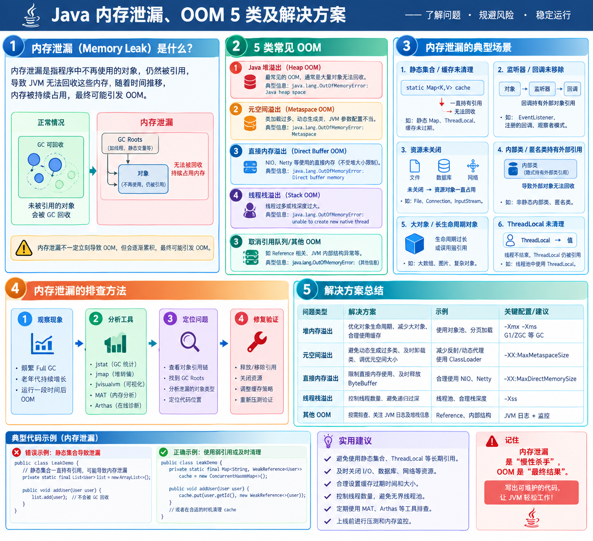
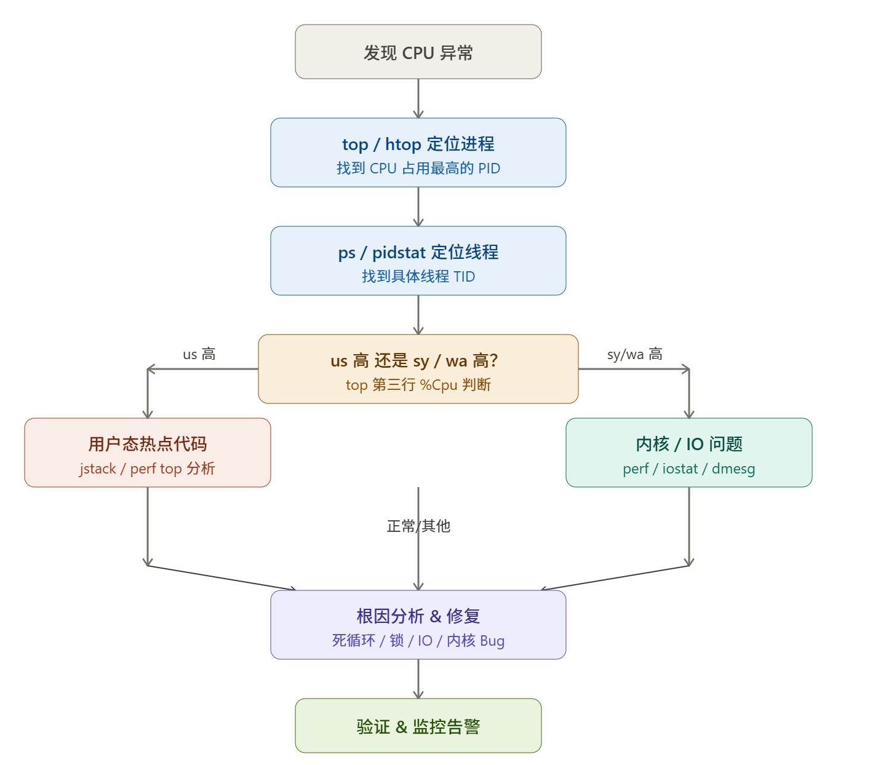
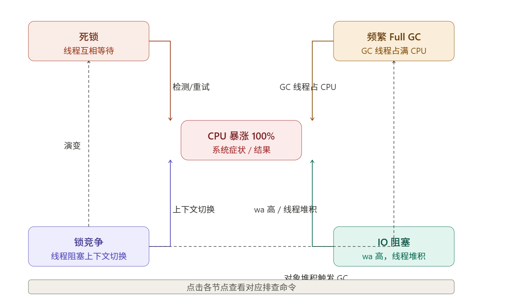
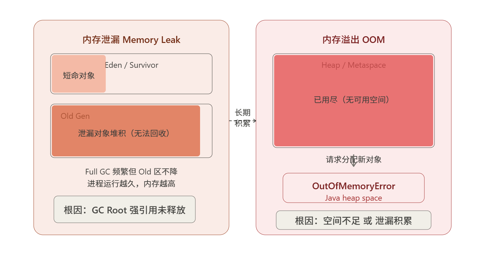
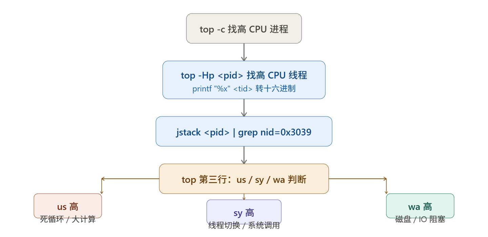
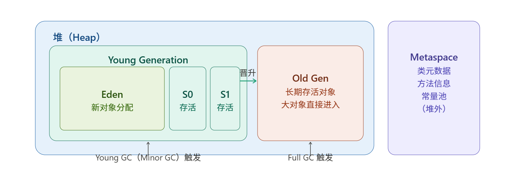

## 线上问题

### Java线上Linux CPU 100% 面试标准问答（后端秋招高频）

> 场景：Linux服务器CPU打满100%，服务响应慢、超时，排查完整流程，按**面试口述顺序**整理，含原理、命令、坑点、根因分类

#### Q1：CPU 100% 完整排查步骤（口述标准答案）

1. **第一步：确认是哪个进程占用高CPU**

```bash
top
# 或者更直观
htop
```

- 按 `P` 按CPU排序，拿到PID（Java进程pid）

> 注意：`top` 默认展示进程，看%CPU列。

2. **第二步：找到该进程里占用CPU最高的线程（核心步骤）**

```bash
# 方式1：top -Hp 进程号，查看进程内所有线程，按P排序，拿到TID（线程ID，十进制）
top -Hp ${pid}
# 方式2：ps 命令
ps -mp ${pid} -o THREAD,tid,time
```

把拿到的**十进制TID转成16进制**（jstack栈里面线程ID是十六进制）

```bash
printf "%x\n" ${tid}
```

3. **第三步：打印Java线程栈 jstack**

```bash
# 多次打印，对比栈信息（建议连续2~3次，间隔1s，看是否同一线程一直跑）
jstack ${pid} > stack.log
```

打开stack.log，搜索**十六进制TID**，找到对应的线程栈，看代码在哪一行。

> 面试一句话重点：jstack只能拿到线程快照，**CPU高一定是RUNNABLE状态线程**，BLOCKED/WAITING不消耗CPU。

4. **第四步：辅助验证 + 定位代码**

- 如果栈里看到业务方法：直接定位业务代码（死循环、大量计算、正则回溯）
- 如果栈是GC相关线程：说明**频繁FullGC/YGC**，下一步查GC日志

```bash
# 查看GC情况
jstat -gc ${pid} 1000
```

看 `S0C S1C EC OC` 以及 `YGC YGCT FGC FGCT`，FGC次数持续上涨就是GC导致CPU满。

5. **第五步：dump堆（GC高CPU场景）**

> ⚠️ 生产dump会STW，尽量业务低峰或者先保留现场再dump

```bash
jmap -dump:format=b,file=heap.hprof ${pid}
```

用MAT/JProfiler分析堆，看大对象、内存泄漏。

6. **第六步：查看系统/业务日志，确认触发条件**
   `dmesg` 看系统OOM；应用日志看接口、定时任务。


#### **Java / JVM 线上 CPU 飙高到 100%** 

**Java / JVM 线上 CPU 飙高到 100%** 是生产环境最高频也是最经典的故障之一。

排查的核心逻辑是：**找到消耗 CPU 的 Java 进程 PID ➔ 找到该进程中最耗 CPU 的线程 TID ➔ 将 TID 转换为 16 进制 ➔ 在线程快照（jstack）中精准定位到具体的代码行号**。

以下是工业级标准的**两种排查手段（Linux 经典排查法 & Arthas 极速秒杀法）**与**三大代码级根治方案**：

---

##### 一、 经典排查四步法（任何裸机与容器均通用）

假设线上服务器 CPU 告警打满：

###### 第一步：找出 CPU 最高的 Java 进程 PID

```bash
top
```
- 查看第一列的 `PID` 和 `%CPU`，找到 CPU 占用超过 90% 的 Java 进程，记下进程号（例如 **`PID = 12480`**）。

###### 第二步：找出该进程中消耗 CPU 最高的线程 TID

```bash
top -Hp 12480
```
- 界面会列出该 Java 进程底下的所有轻量级线程；
- 观察排在第一行的线程，记下线程号（例如 **`TID = 12516`**），其状态通常是 `R` (Running)。

###### 第三步：将十进制线程 TID 转换为十六进制

> **为什么必须转十六进制？**  
> 因为 JVM 导出的线程快照中，线程的操作系统底层标识符 `nid`（Native Thread ID）**全部采用 16 进制表示**。

在终端执行：
```bash
printf "%x\n" 12516
```
- 输出结果为：**`0x30e4`**。

###### 第四步：使用 jstack 抓取堆栈并直击代码行号

```bash
jstack 12480 | grep -A 30 "0x30e4"
```
终端会瞬间打印出类似如下的精确栈帧：
```text
"jvm-lab-cpu-worker-1" #42 prio=5 os_prio=0 tid=0x00007f... nid=0x30e4 runnable [0x00007f...]
   java.lang.Thread.State: RUNNABLE
        at com.jvm.lab.service.fault.HighCpuService.lambda$trigger$0(HighCpuService.java:68)
        at java.lang.Thread.run(Thread.java:833)
```
👉 **结论**：直接定位到代码源头是 `HighCpuService.java` 的 **第 68 行**！

---

##### 二、 现代大厂极速秒杀法：Arthas 一键诊断（推荐）

如果生产环境安装了阿里 Arthas，**不需要任何换算与多步命令**，只需一条命令：

```bash
# 启动进入 Arthas 控制台
as.sh (或 java -jar arthas-boot.jar)

# 一键打印 CPU 占用率最高的 Top 3 线程及完整堆栈
thread -n 3


[arthas@16932]$ thread -n 3
"jvm-lab-cpu-burner-0" Id=88 cpuUsage=95.89% deltaTime=531ms time=463687ms RUNNABLE
    at app//com.jvm.lab.service.fault.HighCpuService.lambda$trigger$0(HighCpuService.java:70)
    at app//com.jvm.lab.service.fault.HighCpuService$$Lambda$1760/0x0000023b948eead0.run(Unknown Source)
    at java.base@17.0.12/java.lang.Thread.run(Thread.java:842)


"jvm-lab-cpu-burner-1" Id=89 cpuUsage=95.89% deltaTime=531ms time=463906ms RUNNABLE
    at app//com.jvm.lab.service.fault.HighCpuService.lambda$trigger$0(HighCpuService.java:70)
    at app//com.jvm.lab.service.fault.HighCpuService$$Lambda$1760/0x0000023b948eead0.run(Unknown Source)
    at java.base@17.0.12/java.lang.Thread.run(Thread.java:842)


"Reference Handler" Id=2 cpuUsage=0.0% deltaTime=0ms time=0ms RUNNABLE
    at java.base@17.0.12/java.lang.ref.Reference.waitForReferencePendingList(Native Method)
    at java.base@17.0.12/java.lang.ref.Reference.processPendingReferences(Reference.java:253)
    at java.base@17.0.12/java.lang.ref.Reference$ReferenceHandler.run(Reference.java:215)
```
- 终端会自动将最耗 CPU 的前 3 个线程名称、CPU 占比百分比以及调用栈直接**高亮标红**显示出来，10 秒内即可完成定位。

---

##### 三、 线上 CPU 100% 的三大常见根因与代码修复

定位到代码行后，通常归属于以下 3 种典型诱因：

| 故障根因                       | 常见业务场景                                                 | 堆栈特征                                                     | 彻底修复方案                                                 |
| :----------------------------- | :----------------------------------------------------------- | :----------------------------------------------------------- | :----------------------------------------------------------- |
| **1. 算术死循环 / 空轮询**     | 未满足退出条件的 `while` 循环；轮询消息队列没有 `sleep/park` | 线程状态为 `RUNNABLE`，常年停留在循环内部计算                | 1. 严格检查循环终止条件；<br>2. 空轮询加入自适应休眠 `LockSupport.parkNanos(1_000_000)`；<br>3. 改用阻塞队列 `BlockingQueue.take()` 或事件监听通知。 |
| **2. 正则灾难性回溯 (ReDoS)**  | 邮箱、手机号等正则校验包含多重量词嵌套（如 `(a+)+`、`([a-zA-Z]+)*`） | 停留在 `java.util.regex.Pattern$Loop.match`                  | 1. 消除嵌套量词，使用非回溯正则；<br>2. 对外部用户输入的字符串长度做硬限制；<br>3. 引入 Google RE2J 线性时间自动机正则引擎。 |
| **3. 频繁 Full GC / 内存打满** | 内存泄露导致老年代打满，GC 线程疯狂运行 STW 回收垃圾         | 消耗 CPU 的线程名称为 `VM Thread`、`GC Thread` 或 `G1 Conc#` | 1. 执行 `jstat -gcutil <PID> 1000` 验证 FGC 次数是否暴涨；<br>2. 导出堆快照（MAT 分析堆内存泄露对象）；<br>3. 解决大对象未分页与静态集合泄露问题。 |

---

##### 四、 在本演练平台中亲测验证

您可以在当前平台中亲自模拟上述全流程：
1. 打开 **⚡ 故障演练实验室** (`/fault-lab`)；
2. 找到 **「CPU 100% 飙高排查」** 卡片：
   - 支持选择 **`算术死循环 (Busy Loop)`** 或 **`正则灾难回溯 (ReDoS)`**；
   - 点击 **`🚨 触发故障`**；
3. 切换到 **JVM 实时监控大盘** (`/dashboard`)，您会看到 CPU 仪表盘指针迅速飙红；
4. 进入 **线上排查指令手册** (`/diagnostic-guide`)，系统已为您自动绑定当前 PID，点击右侧的 `复制命令`，在终端粘贴运行，亲眼见证代码行号被精准捕获！

---

#### Q2：CPU100% 常见根因分类（面试必背）

##### ① 业务代码死循环（最常见）

- while(true) 没有退出条件；for循环超大循环次数
- 集合遍历删除元素，触发无限循环
  ✅ 栈特征：线程一直卡在业务方法，反复执行同一行代码，RUNNABLE

##### ② 正则回溯（大量CPU）

复杂正则匹配，灾难性回溯，CPU飙升

##### ③ 频繁GC（GC线程占满CPU）

内存泄漏、大对象频繁创建、堆设置过小，不断YGC甚至FullGC
✅ jstat特征：YGC/FGC持续上涨，GC时间占比极高
✅ jstack特征：大量GC Worker线程RUNNABLE，业务线程在等待GC

##### ④ 大量序列化/反序列化、复杂计算、加密解密

接口并发高，大量JSON序列化、复杂数学计算

##### ⑤ 锁自旋（AQS自旋）

大量线程争抢synchronized/ReentrantLock，自旋消耗CPU（不是阻塞）

> 区分：BLOCKED是挂起不耗CPU；自旋锁会空循环消耗CPU

##### ⑥ 定时任务疯狂执行

定时任务cron配置错误（每秒执行），任务内部异常没有捕获，反复重试

> 区分点：CPU高 ≠ 内存溢出；内存溢出OOM是进程挂掉；**内存泄漏导致堆不足 → 频繁GC → CPU打满**

#### Q3：面试追问：top看到Java进程CPU 100%，jstack查出来线程是GC线程，接下来怎么做？

1. 使用`jstat -gc pid 1000`持续观察GC指标，确认YGC/FGC频率、GC耗时
2. 导出堆dump文件 `jmap -dump`
3. MAT分析hprof：查找大对象、对象引用链，定位内存泄漏点
   常见泄漏：静态集合持有对象不释放、ThreadLocal未remove、连接池不回收、缓存无限膨胀

#### Q4：面试追问：拿到线程栈，线程状态RUNNABLE，但代码看起来没有死循环，有哪些可能？

1. 正则灾难性回溯
2. 大量字符串处理、循环计算
3. 自旋锁空转（大量并发竞争锁）
4. 外部IO阻塞但是在循环重试（while循环不断重试查询）
5. JNI本地方法CPU消耗（jstack栈显示Native方法）

#### Q5：面试追问：jstack 报错，连接不上进程，怎么办？

原因：

1. 进程已经OOM被系统kill（dmesg查看）
2. 进程僵死，无法attach；
   备选方案：`kill -3 pid`，**不会停止进程**，会把线程栈输出到应用日志stdout。

> 重点：`kill -3 PID` 只是打印线程栈，**不是杀死进程**，面试高频坑点。

#### Q6：面试追问：jstack和jmap生产使用注意事项？

1. jstack/jmap会attach到目标进程，触发短暂STW；高负载下可能超时失败
2. jmap dump堆：**STW**，堆越大暂停时间越长，线上高峰期慎用，优先保留现场再dump
3. 优先多次jstack抓线程快照，不要上来就dump堆

#### Q7：面试追问：怎么区分CPU高是【业务线程】还是【GC线程】？

看jstack输出：

- GC线程名字：`GC task thread#`、`Parallel GC Threads`、`G1 Concurrent GC`
- 业务线程：自定义线程名、http-nio、Dubbo线程池等

#### Q8：精简一句话总结（面试开场/结尾）

> CPU 100%排查思路：先用top定位进程 → top -Hp定位高CPU线程 → TID转16进制 → jstack抓线程栈定位代码；如果栈是GC线程，用jstat看GC指标，堆dump用MAT分析内存泄漏；最后查业务日志定位触发场景。

#### 高频坑点（面试官喜欢挖坑）

1. ❌ 误区：WAITING/BLOCKED线程消耗CPU。**错，只有RUNNABLE线程消耗CPU**
2. ❌ 误区：jstack拿到栈就一定能定位GC问题。GC问题要看jstat+堆dump
3. ❌ 误区：`kill -3` 会杀掉进程，不会！只是打印线程栈
4. ❌ 误区：CPU高一定是死循环，还有GC、正则、自旋锁等场景

---

#### 精简速记版（背这个，面试口述）

1. top → 找到Java进程PID
2. top -Hp PID → 找到高CPU线程TID（十进制）
3. printf "%x" TID → 转16进制
4. jstack PID，搜索16进制TID看线程栈
5. 如果是业务代码：死循环/正则/计算；如果是GC线程：jstat看GC，dump堆查内存泄漏
6. 辅助：kill -3 PID打印栈，dmesg看OOM

要不要我再配套一份 **CPU100%现场排查手写命令清单（可直接复制到简历/笔记）**，以及配套的**内存OOM、磁盘IO高、线程阻塞**对比问答？

### JVM OOM 完整解决方案（面试版，分原理、OOM类型、排查流程、工具、优化方案，后端秋招高频）

> OOM：`java.lang.OutOfMemoryError`，**JVM内存不足，没有足够空间分配对象，GC也回收不出可用内存**。
> 先记住核心：**OOM ≠ GC 频繁；OOM 是GC之后依然没有足够内存分配新对象**。

#### 一、OOM 5大类（面试必考，每种原因+场景）

##### 1. `java.lang.OutOfMemoryError: Java heap space` 堆内存溢出（最常见）

**含义**：堆中对象太多，GC回收后仍然没有空间分配新对象。
触发场景：

1. 集合（List/Map）**无限add，没有清理**，长生命周期集合持有短生命周期对象引用（内存泄漏）
2. 一次性加载超大文件、大量数据库查询结果，没有分页
3. 堆内存设置过小 `-Xmx`
4. 循环不断创建对象

> 区分：**内存泄漏(leak)** 是对象不再使用
>
> 
>
> ，但GC无法回收；**内存溢出**是泄漏的最终结果。

##### 2. `java.lang.OutOfMemoryError: Metaspace` 元空间溢出（JDK8+）

JDK8取消永久代，元空间使用**本地内存（操作系统内存，不在堆内）**
触发场景：

1. 动态生成大量Class（CGLIB动态代理、ASM、反射、Groovy脚本），大量类不断加载
2. 元空间上限设置过小：`-XX:MaxMetaspaceSize`
3. 热部署、频繁重新加载类（开发环境热部署很常见）

##### 3. `java.lang.OutOfMemoryError: unable to create new native thread` 无法创建新线程

（线程太多，操作系统资源耗尽。）

**含义**：JVM向操作系统申请创建新线程失败。
原因：

1. 代码无限循环创建线程，线程没正常退出；
2. 操作系统的进程最大线程数限制；
3. JVM堆内存设置过大，留给操作系统的剩余内存太少，线程栈（native内存）不够；> 
> 重点坑：**-Xmx设太大，反而会导致这个OOM**。线程栈占用操作系统内存，堆占多了，系统剩余内存不够开线程。

##### 4. `java.lang.OutOfMemoryError: Direct buffer memory` 直接内存溢出（NIO）

直接内存：`ByteBuffer.allocateDirect()`，不属于堆，属于操作系统本地内存。
触发：

1. NIO不断分配DirectByteBuffer，没有手动调用`clean()`释放；
2. `-XX:MaxDirectMemorySize` 设置过小；> 
> 直接内存不受GC直接管理，只有FullGC时回收。

##### 5. `java.lang.OutOfMemoryError: GC overhead limit exceeded` GC开销超限

> 面试高频！
> 含义：JVM花费**超过98%的CPU时间在GC上，但是回收不到2%内存**，JVM预判继续GC没有意义，直接抛出OOM。
> 现象：CPU很高，频繁FullGC，堆内存几乎满，每次GC回收一点点。
> 常见：**内存泄漏**，堆里大量垃圾对象无法回收。



---

#### 二、标准OOM排查流程（线上故障排查，面试可以口述）

##### Step1：保留现场（最重要！出OOM第一时间操作）

**一定要让JVM在OOM时自动dump堆快照**，JVM启动参数加上：

```
-XX:+HeapDumpOnOutOfMemoryError 
-XX:HeapDumpPath=/data/heapdump.hprof
```

OOM发生时，自动生成hprof堆快照文件。

> 
> 注意：dump文件很大，磁盘预留足够空间；**不要重启服务！重启后现场消失**。

##### Step2：确认OOM类型（看异常日志第一行）

日志直接决定排查方向：

- Java heap space → 堆溢出，分析hprof
- Metaspace → 看类加载数量
- GC overhead → 内存泄漏，堆分析
- Direct buffer → 查NIO代码
- unable create thread → 线程数量、操作系统限制

##### Step3：工具分析

###### 1. MAT（Memory Analyzer Tool，最常用，分析hprof）

MAT核心分析维度：

1. **Leak Suspects 泄漏嫌疑人报告**：自动推测内存泄漏点（优先看这个）
2. Histogram直方图：看各个类实例数量、占用内存，找异常大对象
3. Dominator Tree支配树：看对象支配关系，**找出谁持有大对象的引用**（核心！找到GC Roots）
4. OQL：查询对象，类似SQL，筛选集合对象

###### 2. Arthas（线上不重启服务，实时排查，生产首选）

常用命令：

```
# 查看JVM内存，堆/元空间
jvm
# 查看对象实例数量
dashboard
# 查看实例数量最多的类
heapdump --live /tmp/dump.hprof
# 监控方法调用，定位哪里大量创建对象
trace
```

###### 3. JDK自带工具

- `jmap`：手动dump堆 `jmap -dump:format=b,file=heap.hprof <pid>`
- `jstat -gc <pid> 1000`：持续打印GC指标，观察YGC/FGC频率、内存变化
- `jstack`：打印线程栈，排查线程溢出、死锁
- `jvisualvm`：可视化工具，本地调试用

##### Step4：定位GC Roots，找出泄漏链路

GC Roots：GC扫描的起点，**被GC Roots引用的对象不会被回收**。
Java GC Roots：

1. 栈帧中本地变量引用
2. 静态变量 static
3. 本地方法JNI引用
4. Class对象
5. 同步锁持有的对象

内存泄漏本质：**本该回收的对象，被GC Roots持续引用**，无法释放。

> 
> 最常见：static List/Map 全局集合不断add，没有remove。

##### Step5：验证修复

修复代码 → 压测验证，监控GC指标，观察堆内存曲线。

---

#### 三、不同OOM的解决方案（分类型）

##### 1. Java heap space 堆OOM

###### 排查方向

1. 看MAT支配树：**哪个集合持有大量对象**
2. 检查大查询：数据库全表查询，返回几十万记录
3. 检查循环创建对象

###### 解决方案

1. **修复内存泄漏（优先！不要上来就调大-Xmx）**
   - 长生命周期集合：用完及时remove、clear；不要用static全局缓存不加淘汰策略
   - 大结果集：分页查询、流式读取，不要一次性加载全部到内存
   - 避免在循环内创建大对象
2. 合理调整堆参数（只是临时缓解，不能根治泄漏）

```
-Xms4g -Xmx4g  # 最小堆=最大堆，避免堆扩容消耗性能
-Xmn1g         # 新生代大小
-XX:+UseG1GC   # 生产推荐G1；大堆可选ZGC(JDK11+)
```

> 
> 原则：**优先修复代码泄漏，调大内存是治标不治本**

##### 2. Metaspace元空间OOM

1. 查看加载类数量：Arthas `jvm` 或者 `jstat -class`
2. 定位大量动态生成类的代码：CGLIB、ASM、反射、动态脚本
3. 参数调整：`-XX:MaxMetaspaceSize=256m`，不要无限放大
4. 开发环境关闭热部署（热部署会重复加载类）

##### 3. GC overhead limit exceeded

几乎都是**堆内存泄漏**，按heap space方案排查。
临时缓解：调大堆；根本解决：找到泄漏对象，切断GC引用链。

##### 4. Direct buffer memory 直接内存OOM

1. NIO `allocateDirect`，使用完毕手动释放，或者使用池化ByteBuffer
2. 设置上限 `-XX:MaxDirectMemorySize=256m`
3. 检查Netty：Netty会使用直接内存，版本bug也会泄漏

##### 5. unable to create new native thread

1. 代码：停止无限创建线程，使用**线程池**，设置合理核心数、最大线程数
2. 操作系统：调高linux进程最大线程数 `ulimit -u`
3. JVM参数：**不要把-Xmx设置过大**，预留操作系统本地内存；减小单个线程栈 `-Xss`

---

#### 四、通用优化方案（预防OOM，面试可以总结）

##### 代码层面（最重要）

1. 集合：缓存使用带淘汰策略，如Guava LRU、Redis，不要无限增长Map
2. 大数据：分页、流式处理，避免一次性加载全量数据
3. 线程：统一使用线程池，禁止`new Thread()`循环创建
4. 资源：IO、NIO资源使用完毕关闭，释放直接内存
5. 避免长生命周期对象持有短对象引用

##### JVM参数&GC选型

- JDK8：G1GC 适合堆4~16G；ZGC JDK11+低延迟大堆
- 设置 `-Xms=-Xmx`，防止运行时堆扩容
- OOM自动dump参数一定要配置在线上

##### 监控预警（线上）

监控指标：堆内存使用率、YGC/FGC次数、FGC耗时、元空间、线程数量。
Prometheus+Grafana，设置告警：堆内存持续走高、频繁FullGC，提前发现，不等OOM发生。

#### 五、面试背诵精简版（口述用）

> OOM即OutOfMemoryError，指JVM内存耗尽，GC回收后仍无法分配对象。一共5类：堆溢出、元空间溢出、无法创建新线程、直接内存溢出、GC开销超限。
> 排查步骤：第一时间保留堆dump快照，查看日志区分OOM类型；使用MAT分析hprof，通过支配树找到GC Roots，定位内存泄漏引用链；使用Arthas线上实时排查。
> 解决思路：优先修复代码内存泄漏，不要盲目调大堆内存；根据OOM类型针对性优化，同时线上增加GC监控告警。

#### 六、面试高频追问

##### 1. 问：内存泄漏和 OOM 的区别？

**答：**

- **内存泄漏**：对象已经业务上不再使用，但存在GC Roots引用，GC无法回收，内存一点点被占用。它是**持续的过程**，不一定立刻报错。
- **OOM（内存溢出）**：GC尽力回收后，仍然没有足够内存分配新对象，JVM抛出OutOfMemoryError，是**最终结果**。> 
> 一句话总结：内存泄漏是**原因**，OOM常常是泄漏长期积累后的**结果**；但OOM不一定都是泄漏，也可能单纯内存设置太小。

##### 2. 问：GC overhead limit exceeded 发生的条件？

**答：**
JVM发现**超过98%的CPU时间都在执行GC，但是GC只能回收不到2%的堆内存**。
JVM预判继续GC没有意义，直接抛出该OOM。
本质：堆里大量对象无法回收，频繁FullGC，CPU打满。

##### 3. 问：dump文件什么时候生成？如果没有配置HeapDumpOnOutOfMemoryError怎么办？

**答：**

1. 配置`-XX:+HeapDumpOnOutOfMemoryError`时，**OOM异常抛出的那一刻自动生成hprof堆dump**。
2. 如果没提前配置参数：
   - 服务还活着：用`jmap -dump:format=b,file=xxx.hprof <pid>`手动dump堆快照；
   - 服务已经crash退出：**无法再获取dump，现场丢失**。> 
   > 面试加分：线上环境建议固定配置OOM自动dump参数，同时预留足够磁盘。

##### 4. 问：G1和ZGC处理大堆OOM有什么区别？

**答：**

1. **G1**：适合4~16G堆；存在STW，FullGC是单线程，一旦OOM前发生FullGC，停顿时间会非常长。G1容易因为内存碎片引发大对象分配失败OOM。
2. **ZGC(JDK11+)**：面向TB级大堆，几乎无STW；压缩、标记、转移大多并发执行。> 
> 但是：**ZGC不会根治OOM**。如果代码存在内存泄漏，堆持续涨满，ZGC最终依然会OOM，只是卡顿更少。

##### 5. 问：发生OOM的时候，线程还能继续运行吗？

**答：**
当抛出OOM是**分配新对象失败**。当前分配对象的线程抛出异常终止；**其他线程仍然可以继续运行**。
如果OOM持续发生，多次分配失败，多个线程陆续异常，最终服务不可用。

> 
> 注意：OOM不一定直接让进程死掉，要看异常是否被捕获；很多业务代码catch OOM继续跑，内存持续恶化。

##### 6. 问：GC Roots有哪些？

**答：**

1. 虚拟机栈（本地变量表）引用的对象
2. 静态变量static引用的对象
3. 本地方法栈JNI引用对象
4. Class类对象
5. 被同步锁synchronized持有的对象

##### 7. 问：`unable to create new native thread` OOM，调大-Xmx能解决吗？

**答：不能，反而会加剧。**
线程栈占用操作系统本地内存。-Xmx堆越大，操作系统剩余内存越少，能创建的线程数量变少。
解决：限制线程数量，使用线程池；调高系统ulimit；适当降低-Xmx或减小-Xss。

##### 8. 问：Direct Buffer Memory OOM是什么原因？Direct内存属于堆吗？

**答：**
直接内存不属于Java堆，是操作系统本地内存，由NIO的DirectByteBuffer使用。
GC仅FullGC阶段回收；如果没有手动释放、Netty内存泄漏，会耗尽本地内存抛出OOM。
可以通过`-XX:MaxDirectMemorySize`限制上限。

##### 9. 问：MAT分析dump，Histogram、Dominator Tree分别是干嘛的？

**答：**

- Histogram直方图：看每个类的实例数量、占用内存大小，快速找到实例数异常暴涨的类。
- Dominator Tree支配树：找出对象引用链，定位**GC Roots是谁持有大对象引用**，是排查内存泄漏最核心视图。

##### 10. 问：什么情况会造成元空间Metaspace OOM？

**答：**
元空间存放Class、方法、常量信息，使用本地内存。
常见场景：CGLIB、ASM动态生成大量类；频繁热部署，类不断加载不卸载；MaxMetaspaceSize设置过小。

##### 11. 问：堆OOM排查的标准流程是什么？

**答：**

1. 保留现场，拿到hprof堆dump；
2. 看日志区分OOM类型；
3. MAT打开dump，用支配树找到泄漏对象和GC Roots；
4. 定位业务代码：全局集合、未关闭资源、大查询；
5. 修改代码修复泄漏，压测验证；> 
> 重点：优先修复代码泄漏，**不要上来直接调大堆内存，治标不治本**。

##### 12. 问：为什么static集合容易内存泄漏？

**答：**
static变量属于类，类加载后只要类不卸载，static集合就一直存活（GC Roots）。
不断add元素又不清空，对象被static集合持续引用，永远无法GC回收，慢慢耗尽堆内存。

##### 13. 问：OOM发生会触发FullGC吗？

**答：**
**会。** 在分配对象发现空间不足时，JVM会尝试一次FullGC，回收内存；如果回收后空间依然不够，才抛出OOM。

##### 14. 问：Arthas排查OOM常用命令有哪些？

**答：**

- `jvm`：查看JVM内存、类加载信息
- `dashboard`：实时看线程、内存、GC
- `heapdump`：在线生成堆快照
- `trace`：追踪方法，定位大量创建对象的代码

##### 15. 追问：生产环境，OOM自动dump，dump的时候会不会STW，业务会不会卡顿？

**答：**
执行heap dump的时候JVM会STW。堆越大，dump耗时越长，业务停顿越明显。
所以大堆环境，尽量在业务低峰手动dump；OOM自动dump是故障取证，接受短暂停顿。


### Java线上 OOM 面试标准问答（后端秋招高频，可直接口述）

> OOM：`java.lang.OutOfMemoryError`，**不是一个异常，是Error**，JVM内存耗尽，无法分配新对象，抛出该错误。分多种类型，排查思路、现象、根因不一样。

#### Q1：OOM有哪些常见类型？（必背）

1. **java.lang.OutOfMemoryError: Java heap space（堆内存溢出，最常见）**
   堆空间不足，无法new对象。
   原因：内存泄漏 / 堆太小 / 一次性创建超大对象。
2. **java.lang.OutOfMemoryError: Metaspace（元空间溢出，JDK8+）**
   元空间存类信息、常量、静态变量、字节码，默认使用本地内存，不在堆里。
   原因：动态生成类（ASM、CGLIB、反射、Groovy），类不断加载不卸载。
3. **java.lang.OutOfMemoryError: unable to create new native thread（无法创建新的本地线程）**

> 高频面试坑：**不是堆内存不够！**
> JVM向操作系统申请创建操作系统线程失败。
> 原因：线程数量达到系统上限；堆开太大，挤占了操作系统剩余内存，导致OS无法分配线程栈内存。

4. **java.lang.OutOfMemoryError: Direct buffer memory（直接内存溢出）**
   NIO的DirectByteBuffer，堆外内存，不受-Xmx限制。
   原因：手动分配堆外内存没有释放；Netty等框架使用不当，没有释放ByteBuf。

#### Q2：OOM完整排查流程（口述标准答案）

> 前提：启动JVM时**一定要加参数**，发生OOM自动dump堆快照，否则现场丢失！

```
-XX:+HeapDumpOnOutOfMemoryError -XX:HeapDumpPath=/xxx/heap.hprof
```

> 注意：dump会STW，文件大小约等于堆大小。

1. **第一步：确认OOM类型，看应用日志**
   看报错信息，区分是堆溢出、元空间、无法创建线程、直接内存。

2. **第二步：拿到hprof堆dump文件**
   优先使用OOM自动dump；如果服务还没挂，可以手动dump：

```bash
jmap -dump:format=b,file=heap.hprof ${pid}
```

⚠️ 线上高峰期手动dump会STW，谨慎操作；进程已经OOM崩溃就不要手动dump。

3. **第三步：使用MAT（Memory Analyzer Tool）分析堆文件**
   MAT核心功能：

- Histogram直方图：看哪些类实例数量最多、占用内存最大
- Dominator Tree支配树：看大对象，找出占用内存最大的对象，以及GC Roots引用链
- Leak Suspects：泄漏嫌疑报告（MAT自动帮你找可疑泄漏点）

重点：**找GC Roots引用链**，对象无法被GC回收，一定是存在GC Roots可达引用。

4. **第四步：定位泄漏代码（常见GC Roots）**

- 静态集合：static List/Map，不断add对象，永不清理
- ThreadLocal：线程池复用线程，ThreadLocal变量没有remove，对象一直绑定在线程上
- 长生命周期对象持有短生命周期对象引用（缓存不设过期、无限增长缓存）
- 连接池、线程池里面对象没有释放

5. **第五步：辅助信息验证**

```bash
# 实时看堆内存变化
jstat -gc ${pid} 1000
# 查看JVM参数
jinfo -flags ${pid}
# 看线程数量（排查 unable to create new native thread）
jstack ${pid}
```

- 堆OOM：老年代持续上涨，FullGC频繁，FullGC之后内存几乎不下降。
- 元空间OOM：jstat看MC/MU（元空间容量、已使用）持续上涨。
- 无法创建线程：`top`看线程数，`ulimit -u`看系统最大进程数。

6. **第六步：复现 & 修复**
   找到引用链，修复代码；调整JVM参数；增加监控（堆内存、元空间、线程数、FullGC次数）。

#### Q3：面试追问：内存泄漏 VS 内存溢出（OOM）区别

- **内存泄漏 Memory Leak**：对象不再使用，但是GC Roots可达，无法回收；内存一点点持续占用。**泄漏是原因**。
- **内存溢出 OOM**：内存不够分配新对象，抛出Error。**溢出是结果**。

> 一句话：长时间内存泄漏，最终导致OOM；OOM不一定是泄漏，也可能一次性加载超大对象。

#### Q4：面试追问：JDK8为什么元空间容易OOM？和永久代区别

JDK7及之前：永久代PermGen，属于堆的一部分，-XX:MaxPermSize限制大小。
JDK8：移除永久代，换成**元空间Metaspace**，使用本地内存。

- 默认不限制上限（受限于服务器物理内存），但可以用 `-XX:MaxMetaspaceSize` 设置上限
- 动态生成大量类（CGLIB代理、反射、脚本引擎），类加载越来越多，类不会被卸载 → 元空间持续上涨，最终OOM。

#### Q5：面试追问：`unable to create new native thread` 原理&排查

原理：
Java线程底层是操作系统线程，创建线程时OS需要分配一块内存作为线程栈。
如果JVM堆设置过大，占用大量物理内存，留给操作系统的内存不足；或者进程创建线程数量达到系统`ulimit`限制，OS无法分配线程栈内存，报这个OOM。

排查步骤：

1. jstack查看当前线程数量，看是不是线程疯狂创建（每次new Thread不复用，线程池配置错误）
2. 查看系统限制：`ulimit -u`，查看进程最大可用线程数
3. 检查JVM参数：-Xmx是不是设置太大，挤占系统内存
4. 修复：用线程池复用线程，不要手动new Thread；合理设置-Xmx，预留系统内存

#### Q6：面试追问：Direct buffer memory 堆外内存OOM

堆外内存（NIO DirectByteBuffer）不由GC直接管理，使用的是操作系统内存。

- 堆内对象是DirectByteBuffer实例很小，但它引用一块堆外内存
- 堆外内存靠`Cleaner`虚引用，GC发生时才释放。如果GC很久不执行，堆外内存持续占用。
  常见场景：Netty，没有释放ByteBuf（忘记release）。
  排查：看堆外内存监控；代码检查NIO/Netty资源释放。

#### Q7：面试追问：MAT看堆dump，支配树 Dominator Tree 作用？

支配树：找到对象被回收后，会一并释放多少内存。

> A支配B：如果A被GC回收，B一定被回收。
> Histogram只看对象本身大小；支配树看**对象保留内存（Retained Heap）**，用来定位大内存块，找泄漏。

#### Q8：面试追问：OOM的时候，服务一定会挂掉吗？

不一定。

- 发生OOM的线程会终止；但其他线程还可能继续运行。
- 如果OOM线程是非核心线程，进程可能存活，但状态异常；后续再分配对象依然会再次OOM。

> 生产建议：配置OOM自动dump + 自动重启，防止服务假死。

#### Q9：面试追问：OOM和FullGC频繁的关系

内存泄漏 → 老年代持续填满 → 触发FullGC → FullGC回收不掉内存 → 反复FullGC，CPU飙升，最后OOM。

> 注意：频繁FullGC不一定OOM，但持续FullGC是OOM前兆。

#### Q10：高频坑点（面试官最爱挖坑）

1. ❌ 误区：OOM一定是堆内存太小。还有元空间、堆外内存、无法创建线程。
2. ❌ 误区：内存泄漏一定会立刻OOM。是慢慢涨，一段时间后才OOM。
3. ❌ 误区：ThreadLocal用完不remove，是堆外内存泄漏。错！是堆内存泄漏，对象存在Thread的ThreadLocalMap里。
4. ❌ 误区：元空间属于Java堆。JDK8中元空间是本地内存，不属于堆。
5. ❌ 误区：jmap dump一定要在OOM发生之后。最好开启自动dump；进程挂掉后，手动jmap连不上。

#### ✅ 精简口述版（面试直接背）

OOM是OutOfMemoryError，分堆、元空间、无法创建线程、堆外内存四种。
排查：先看日志区分OOM类型；优先开启JVM参数OOM自动dump堆；拿到hprof用MAT分析，看直方图、支配树，顺着GC Roots找对象引用链定位内存泄漏。
堆OOM重点查静态集合、ThreadLocal、缓存；元空间OOM查动态生成类；无法创建线程查线程数量和系统ulimit；堆外内存查Netty/NIO资源释放。配合jstat观察GC指标，定位根因。

---

#### 配套速记命令

```bash
# OOM自动dump参数
-XX:+HeapDumpOnOutOfMemoryError -XX:HeapDumpPath=/data/heap.hprof

# 手动dump（进程存活时）
jmap -dump:format=b,file=heap.hprof pid

# 查看GC
jstat -gc pid 1000

# 查看线程数
jstack pid
```

要不要我继续整理 **FullGC频繁** 的面试问答，把CPU100%、OOM、FullGC三套串联成一套线上故障排查体系？

### Java线上 FullGC频繁 面试标准问答（秋招后端高频，可直接口述）

> 前置：FullGC 是收集整个老年代 + 元空间，**会STW（Stop The World）**，STW期间所有业务线程暂停；频繁FullGC会导致接口超时、RT飙升、CPU拉高，严重时触发OOM。
> 区分：YGC只清理年轻代，STW时间短；FullGC代价很高。

#### Q1：FullGC 频繁，完整排查流程（口述标准答案）

1. **第一步：确认现象，采集GC指标**

```bash
# 持续观察GC，1秒输出一次
jstat -gc ${pid} 1000
```

重点看指标：

- `YGC`：年轻代GC次数；`YGCT` YGC总耗时
- `FGC` FullGC次数；`FGCT` FullGC总耗时
- `S0 S1`：Survivor区；`E` Eden；`O` Old老年代；`M` Metaspace元空间

判断：**FGC持续上涨，FGCT不断增加，老年代O占用持续很高，每次FullGC后老年代下降很少** → 大概率内存泄漏。

> 辅助：看GC日志，JVM启动参数加上GC日志（生产必备）

```
-Xloggc:/data/gc.log -XX:+PrintGCDetails -XX:+PrintGCDateStamps
```

GC日志可以直接看到FullGC触发原因、STW耗时、各代内存变化。

2. **第二步：判断FullGC触发原因（5大触发条件，面试必背）**
   ① 老年代空间不足（最常见：对象晋升到老年代，老年代放不下）
   ② 元空间Metaspace满了
   ③ 手动调用`System.gc()`（代码/第三方框架主动触发FullGC）
   ④ 大对象直接进入老年代，老年代快速被占满
   ⑤ CMS特有：CMS并发失败、CMS永久代/元空间满、CMS浮动垃圾过多触发FullGC（G1没有CMS这些问题）

3. **第三步：区分两类场景【每次FullGC内存下降很多】 vs【每次FullGC几乎不下降】**

- ✅ FullGC后老年代明显下降：**短期对象大量晋升**，不是泄漏。
  原因：Eden区不足，对象快速晋升到老年代；大对象；Survivor太小，对象age快速达到晋升阈值。
- ❌ FullGC后老年代几乎不下降：**内存泄漏！** 对象存在GC Roots引用，无法回收。需要dump堆，MAT分析。

```bash
jmap -dump:format=b,file=heap.hprof ${pid}
```

4. **第四步：线程栈 + 业务日志辅助定位**
   `jstack pid`：看有没有大量创建对象的接口、定时任务；
   检查是否有`System.gc()`调用；
   检查线程池、ThreadLocal、静态集合、缓存是否无限增长。

5. **第五步：JVM参数调优（根因找到之后）**
   根据情况调整：堆大小、年轻代比例、Survivor大小、晋升阈值、大对象阈值、元空间上限；修复代码泄漏优先，调参只是缓解。

#### Q2：面试追问：对象晋升到老年代的条件？

1. 对象年龄age达到`-XX:MaxTenuringThreshold`（默认15），每次YGC存活age+1
2. Survivor区放不下当前存活对象，对象直接晋升老年代
3. 对象大小超过 `-XX:PretenureSizeThreshold`，**大对象直接分配到老年代**（默认0，不开启）

> 坑：大对象很容易填满老年代，触发FullGC。

#### Q3：面试追问：常见导致FullGC频繁的根因（背）

1. **内存泄漏（最高频）**
   ThreadLocal不remove、static集合无限add、缓存不设过期/淘汰策略、连接池持有对象，对象晋升到老年代后无法回收 → 老年代越来越满，反复FullGC，最终OOM。

2. **短生命周期对象大量晋升到老年代**
   高并发接口，瞬间创建大量对象；Survivor区太小，YGC之后存活对象放不下，直接晋升老年代；大量大对象直接进老年代。

> 特点：FullGC之后内存能降下来，不是泄漏。

3. **代码/第三方包主动调用 System.gc()**
   `System.gc()` 建议触发FullGC；可以加JVM参数禁用：`-XX:+DisableExplicitGC`

> Netty NIO里的`System.gc()`用来释放堆外内存，开启这个参数要注意堆外内存泄漏风险。

4. **元空间不足**
   动态生成类（CGLIB、ASM、反射、Groovy脚本），类不断加载，元空间持续上涨，触发FullGC。jstat看M（元空间）使用率持续走高。

5. **CMS收集器特有问题（如果用CMS）**

- 并发失败（Concurrent Mode Failure）：CMS后台收集还没完成，老年代快满了，STW单线程FullGC；
- 浮动垃圾过多；
- 老年代内存碎片：CMS不会压缩，大量碎片，明明总内存够，但放不下大对象，触发FullGC。

> G1是整理型收集器，碎片问题比CMS好很多。

#### Q4：面试追问：CMS和G1 FullGC的区别？

- CMS：并发标记清除，**不压缩**，会产生内存碎片；FullGC是单线程STW，耗时很长。并发失败是CMS高频痛点。
- G1：标记整理，局部压缩；G1的FullGC是单线程STW，G1尽量避免FullGC；G1是分区模型，优先回收垃圾多的Region。

> 一句话：CMS容易内存碎片并发失败；G1减少碎片，但FullGC依然是单线程STW，要尽量避免FullGC。

#### Q5：面试追问：jstat看到FGC一直在涨，每次FullGC之后老年代内存几乎不变，下一步怎么做？

这是典型内存泄漏。

1. 导出堆dump文件 `jmap -dump`；
2. MAT分析：Histogram看实例数量，支配树看Retained Heap，顺着GC Roots找对象引用链；
3. 重点排查：ThreadLocal、static Map/List、无淘汰缓存、长生命周期对象持有短对象引用；
4. 复现问题，修复代码。

#### Q6：面试追问：FullGC频繁，但是堆dump看对象数量不多，老年代占用不高，可能是什么？

优先排查：

1. **元空间满**：看jstat中M元空间使用率持续上涨；动态生成类；
2. **System.gc()被频繁调用**；搜索代码、中间件日志；加上`-XX:+DisableExplicitGC`验证；
3. CMS内存碎片：老年代总内存剩余不少，但连续空间不足，分配大对象失败，触发FullGC（CMS特有）。

#### Q7：面试追问：YGC频繁，会不会演变成FullGC？

会。YGC频繁代表Eden区对象创建速度极快。如果大量对象存活、晋升到老年代，老年代持续被填满，最终触发FullGC。
典型场景：高并发接口创建大量临时对象，Survivor放不下，对象不断晋升老年代。

#### Q8：面试追问：STW介绍，YGC、FullGC STW差别？

- YGC：STW，暂停所有业务线程，复制Eden存活对象到Survivor；停顿时间短。
- CMS并发阶段：大部分时间并发，不STW；只有初始标记、重新标记STW；CMS FullGC是全程STW，单线程，停顿很长。
- G1：YGC STW；混合GC有短暂STW；一旦G1发生FullGC，单线程STW，代价很大。

#### Q9：高频坑点（面试官挖坑）

1. ❌ 误区：FullGC = OOM。FullGC频繁是前兆，不一定马上OOM；但持续FullGC，回收不出内存，最终OOM。
2. ❌ 误区：老年代占用高一定是内存泄漏。有可能是正常长期存活对象（本地缓存），只要FullGC后内存下降，就不是泄漏。
3. ❌ 误区：G1不会发生FullGC。G1依然会FullGC，只是目标是尽量避免。
4. ❌ 误区：System.gc()一定会触发FullGC。只是建议，JVM可以不执行；加`-XX:+DisableExplicitGC`直接禁用。

#### ✅ 精简口述版（面试直接背）

FullGC会STW，暂停所有业务线程。排查先用jstat观察GC指标，看FGC、老年代占用，配合GC日志定位触发原因。
如果FullGC后老年代内存几乎不下降，是内存泄漏，需要dump堆用MAT分析GC Roots；如果内存可以回收，多是大量短期对象晋升、大对象、Survivor区过小。
其他原因：元空间满、代码调用System.gc()；CMS还要考虑并发失败、内存碎片。优先修复代码问题，JVM调参只是缓解。

#### 配套命令速记

```bash
# 观察GC指标
jstat -gc pid 1000

# 导出堆快照
jmap -dump:format=b,file=heap.hprof pid

# 禁用显式GC
-XX:+DisableExplicitGC

# GC日志参数
-Xloggc:/data/gc.log -XX:+PrintGCDetails -XX:+PrintGCDateStamps
```

### 死锁四个必要条件

> **四个条件必须同时满足，才会发生死锁；破坏任意一个，死锁就解除。**

1. **互斥条件**
资源是互斥锁，同一时刻只能有一个线程占有该资源；其他线程想要只能等待。
比如`synchronized`、ReentrantLock独占锁。

2. **请求并持有（占有且等待）**
一个线程**已经持有至少一把锁**，现在又去申请获取另一把被别的线程占有的锁，不释放自己手上已有的锁。

3. **不可剥夺**
已经拿到锁的线程，**不能被其他线程强行抢走锁**；只能自己主动释放锁。

4. **循环等待条件**
线程之间形成环路：线程A持有锁1，等待锁2；线程B持有锁2，等待锁1，互相等待对方释放资源，形成闭环。

---

#### 如何避免死锁（对应破坏四个条件）

|死锁条件|怎么破坏|
|---|---|
|互斥|大部分锁无法破坏（独占资源本身就要互斥）|
|请求并持有|一次性申请所有需要的锁；拿到不到全部就不占有任何锁|
|不可剥夺|使用可中断锁 `lockInterruptibly()`，拿不到锁可以放弃已持有锁|
|循环等待|**统一锁的获取顺序**，所有线程都按固定顺序申请锁，不要交叉申请|

#### 标准死锁代码示例

```java
// t1拿lockA，再申请lockB
// t2拿lockB，再申请lockA → 循环等待，死锁
new Thread(()->{
    synchronized(lockA){
        sleep();
        synchronized(lockB){}
    }
}).start();

new Thread(()->{
    synchronized(lockB){
        sleep();
        synchronized(lockA){}
    }
}).start();
```

#### 面试口述版（直接背）

产生死锁需要同时满足四个条件：互斥、请求并持有、不可剥夺、循环等待。
互斥：资源同一时间只允许一个线程占用；
请求并持有：线程已经持有锁，又请求别的锁，不释放现有锁；
不可剥夺：锁只能持有者主动释放，别人抢不走；
循环等待：多个线程形成环形的锁等待。
避免死锁最常用的手段就是**规定锁的获取顺序，破坏循环等待条件**，也可以用可中断锁，或者一次性申请全部锁。

#### 面试官追问：线上如何定位死锁？

1. `jstack pid`打印线程栈
2. 日志中搜索 `Found one Java‑level deadlock`，会直接标出死锁线程、锁对象。

要不要我顺带把**活锁、饥饿**简单对比，面试经常一起问。


### Java线上：线程阻塞 & 死锁排查｜面试标准问答（秋招后端）

> 区分两个概念：
> **死锁 Deadlock**：多个线程互相持有对方需要的锁，循环等待，谁都无法继续，永久阻塞。
> **线程阻塞（非死锁）**：线程卡在某处等待，不一定循环等待。常见：等待锁、等待数据库/Redis IO、等待MQ、CountDownLatch、锁池、等待网络响应。

#### Q1：线程阻塞/死锁 完整排查流程（口述标准答案）

1. **第一步：确认现象**
   服务接口RT变长、请求超时、线程池打满，但CPU不高（重点特征：阻塞一般CPU低；死锁CPU也很低）。
   先看监控：Tomcat/Dubbo线程池耗尽，请求堆积。

2. **第二步：抓取线程栈 jstack（最核心）**

```bash
# jstack <PID> 命令打印出来的本质是 纯文本字符流（包含类名、方法名、行号、锁地址等）。
# Linux 下的 > 是重定向符号，后缀名并不改变文件的内容。

jstack ${pid} > thread.log
# 或者不输出文件，直接打印
jstack ${pid}
# 备选：kill -3 pid，输出栈到应用日志，进程不停止

===========
也可以使用arthas检测死锁
# 进入容器或主机执行 arthas
as.sh
# 一秒直击当前造成死锁的线程栈与锁对象
thread -b

```

> 建议连续抓2次，间隔1~2秒。如果两次栈信息完全一样，大概率死锁。

3. **第三步：分析线程栈，看线程状态**

- `BLOCKED`：线程正在等待监视器锁（synchronized）。
- `WAITING`：调用`wait()` / `LockSupport.park()`，无限等待，需要其他线程唤醒。
- `TIMED_WAITING`：限时等待，`sleep()`、`wait(time)`、`LockSupport.parkNanos()`。

> RUNNABLE：运行中；**BLOCKED/WAITING/TIMED_WAITING 都是阻塞状态，不消耗CPU**。

4. **第四步：查找死锁**
   jstack输出末尾会自动检测死锁：`Found one Java-level deadlock`，打印循环等待的锁和线程。

> 死锁4个必要条件（面试必背）：
>
> 1. **互斥条件**：锁是独占，同一时间只能一个线程持有
> 2. **持有并等待**：线程拿到锁A，再去申请锁B，不释放A
> 3. **不可剥夺**：锁不能被其他线程强行抢走
> 4. **循环等待**：线程A持有A等B；线程B持有B等A，形成环

5. **第五步：非死锁的线程阻塞定位**
   jstack栈可以直接看到卡在什么代码：

- 卡在JDBC：数据库慢SQL，数据库连接耗尽
- 卡在Redis客户端：Redis响应慢，命令阻塞
- 卡在ReentrantLock.lock()：等待可重入锁，线程抢占锁失败
- 卡在`CountDownLatch.await()`、Semaphore：等待信号量
- 卡在HTTP/Dubbo调用：下游服务超时，没有设置超时时间

6. **第六步：辅助验证**

- 查看线程池状态：Dubbo/Tomcat线程池是否耗尽
- 查看数据库连接池：hikari、druid连接是否被占满
- 查看中间件监控：Redis、MQ、下游接口响应时间
- 业务日志：看请求卡在哪个调用环节

---

#### Q2：面试追问：死锁和普通线程阻塞区别？

1. **死锁**：**循环等待**，满足4个条件，线程永久卡住，不会自动恢复；jstack会直接报`Found deadlock`。CPU一般很低。
2. **普通阻塞**：只是等待资源（DB、网络、锁），资源就绪后线程可以继续执行；不存在循环等待。

> 举例：大量线程等同一个synchronized锁，是BLOCKED阻塞，但**不是死锁**。

#### Q3：面试追问：jstack中 BLOCKED、WAITING、TIMED_WAITING 分别是什么场景？

- **BLOCKED**：等待`synchronized`监视器锁。

```
"thread-1" BLOCKED on java.lang.Object@0x123 held by thread-2
```

线程想要进入同步块，但锁被别的线程拿着。

> ReentrantLock 阻塞时线程状态是 **WAITING**，不是BLOCKED！（高频坑点）ReentrantLock底层是AQS，用LockSupport.park()。

- **WAITING**：无限等待。
  `Object.wait()`、`LockSupport.park()`、CountDownLatch.await()。需要其他线程主动唤醒（notify/unpark）。

- **TIMED_WAITING**：带超时等待。
  Thread.sleep()、wait(time)、parkNanos()。时间到自动唤醒。

> 面试坑：synchronized阻塞 → BLOCKED；AQS锁（ReentrantLock）阻塞 → WAITING。

#### Q4：面试追问：死锁如何避免？（必背）

破坏死锁4个条件，工程上最容易落地：

1. **统一锁获取顺序（最有效）**：多个锁，所有线程必须按相同顺序获取，杜绝循环等待。
2. **设置超时时间**：ReentrantLock使用`tryLock(timeout)`，不要直接lock()无限等待。
3. **避免嵌套锁**：尽量不要在一个锁内部再去获取另一个锁。
4. **减少锁粒度**：缩小同步代码块范围。

#### Q5：面试追问：线上发现Dubbo线程池满了，jstack大量线程WAITING，可能原因？

> 线程池打满，请求堆积，CPU不高。常见几类：

1. 下游Dubbo/HTTP接口**没有设置超时**，线程卡在远程调用，一直等待。
2. 数据库慢SQL，线程卡在JDBC等待数据库返回，数据库连接耗尽。
3. Redis大key，阻塞Redis命令，大量线程等待Redis返回。
4. 代码使用ReentrantLock.lock()无限等待，线程卡在park。

> 核心：**IO阻塞占满业务线程池，新请求进不来，服务雪崩**。
> 解决方案：所有远程调用、中间件调用必须设置超时；线程池隔离；熔断降级。

#### Q6：面试追问：数据库连接池耗尽（Druid/Hikari），属于线程阻塞吗？现象是什么？

属于。
现象：业务线程拿到连接池，拿不到数据库连接，卡在`getConnection()`。jstack线程栈卡在连接池获取连接方法。
原因：SQL慢，拿到连接后长时间不释放；连接池最大连接数设置过小；事务忘记commit/rollback，连接不归还。

> 区分：线程池耗尽是业务线程不够；数据库连接池耗尽是DB连接不够。

#### Q7：面试追问：jstack抓取线程栈，有什么线上注意事项？

1. jstack会attach进程，短暂STW；高负载频繁执行会影响服务。
2. 不要连续大量执行。一般抓1~2次即可。
3. 进程已经OOM崩溃，jstack无法attach，要用`kill -3 pid`提前抓栈。
4. jstack只能拿到**快照**，是某一瞬间状态，需要结合多次快照判断。

#### Q8：高频坑点（面试官最爱挖坑）

1. ❌ ReentrantLock锁等待，线程状态是BLOCKED。错，是WAITING。只有synchronized监视器锁等待是BLOCKED。
2. ❌ BLOCKED线程一定是死锁。错，大量线程竞争同一个synchronized锁，都是BLOCKED，但不是死锁。
3. ❌ 线程阻塞一定CPU很高。错！阻塞线程不跑代码，CPU低。CPU高一般是RUNNABLE（死循环、GC）。
4. ❌ sleep()会释放锁。sleep不会释放任何锁；wait()会释放监视器锁。

#### ✅ 精简口述版（面试背诵）

线程阻塞和死锁排查：先观察现象，接口RT高、线程池堆积，CPU不高。使用jstack抓取线程快照，查看线程状态：BLOCKED一般等待synchronized锁；WAITING/TIMED_WAITING常见AQS锁、sleep、wait、IO等待。
死锁jstack会自动识别Found deadlock，满足4个必要条件，循环等待无法恢复。普通阻塞多为慢SQL、Redis、下游调用无超时，连接池耗尽。
优化：所有远程调用设置超时；统一锁顺序避免嵌套锁；线程池隔离；缩小锁粒度。

#### 配套命令速记

```bash
# 打印线程栈
jstack pid > thread.log
# 不杀进程，打印线程栈到应用日志
kill -3 pid
```

---

#### 全套线上故障合集汇总（4大问题）

1. CPU 100%：top → top -Hp → TID转16进制 → jstack看RUNNABLE线程；区分业务死循环 / GC线程
2. OOM：看日志区分OOM类型；JVM参数自动dump；MAT分析GC Roots，排查内存泄漏
3. FullGC频繁：jstat观察FGC；看GC日志；FullGC后内存不降=内存泄漏；还要考虑CMS碎片、System.gc()
4. 线程阻塞/死锁：jstack抓栈；看BLOCKED/WAITING；死锁4条件；阻塞大多是IO、慢SQL、无超时调用

> 接下来两个方向你选：
> ① 整理一份**面试官连环提问全套串讲稿**（模拟面试，从头到尾连贯回答）
> ② 再加 **服务雪崩、接口超时、数据库慢SQL** 的线上排查问答？


### Java线上：服务雪崩、接口超时、慢SQL 面试标准问答（秋招后端）

> 三者经常一起出现：**慢SQL → DB响应慢 → 接口超时 → 请求堆积 → 线程池打满 → 服务雪崩**，是链路式故障。

#### 一、数据库慢SQL 排查

##### Q1：慢SQL完整排查流程（口述标准答案）

1. **第一步：确认现象**
   接口RT突增，大量超时；数据库CPU/IO飙升；业务监控看到DB耗时变长。
2. **第二步：抓取慢SQL**

- MySQL开启慢查询日志：`slow_query_log=ON`，设置`long_query_time`（超过该阈值记录SQL）
- `show processlist`：查看当前正在执行的SQL，看`Command`、`Time`字段，找到长耗时SQL
- performance_schema：实时监控会话SQL
- 应用侧：打印DAO层耗时，APM工具（SkyWalking/Pinpoint）追踪SQL耗时

3. **第三步：SQL优化分析**
   拿到SQL，执行`explain`看执行计划：
   重点看type、key、rows、Extra：

- type：性能从好到坏 `system > const > eq_ref > ref > range > index > ALL`，**ALL代表全表扫描**
- key：实际使用索引；NULL没用到索引
- rows：扫描行数，预估扫描多少行，数值越大越差
- Extra：`Using filesort` 文件排序；`Using temporary` 创建临时表，都需要优化

4. **第四步：分析索引失效原因（高频考点）**
   索引失效常见场景：

- 索引列做函数运算、隐式类型转换
- like `%前缀匹配`
- or连接字段，一侧无索引
- 联合索引不满足最左前缀原则
- MySQL优化器判断全表扫描比索引更快，主动放弃索引

5. **第五步：验证优化，上线，增加监控**
   加合适索引，改写SQL；避免select *；分页大偏移量优化；分库分表；读写分离。

##### Q2：面试追问：explain里面 Using filesort、Using temporary是什么？

- **Using filesort**：MySQL无法利用索引排序，需要额外排序，消耗CPU。不是磁盘文件排序，内存不够才落盘。常见order by没走索引。
- **Using temporary**：创建临时表，一般group by、union场景，开销很大。

##### Q3：面试追问：慢SQL除了索引问题，还有哪些原因？

1. 锁等待：行锁、表锁，事务长时间不提交，SQL卡在等待锁（`show engine innodb status`看事务）
2. 大事务：事务执行时间长，持有锁，阻塞其他SQL
3. 数据库服务器资源瓶颈：磁盘IO打满、CPU高
4. 批量操作一次性更新大量数据
5. 数据库实例连接数打满

##### Q4：面试追问：长事务危害

长事务不提交：

1. 持续持有行锁，阻塞其他读写SQL，引发锁等待、慢SQL
2. undo log无法回收，事务ID持续推进，导致MVCC版本链越来越长，查询性能下降
3. 大事务回滚成本高；主从延迟变大

##### Q5：慢SQL 速记命令

```sql
-- 查看正在运行的会话
show processlist;
-- 查看innodb事务、锁信息
show engine innodb status;
-- 查看执行计划
explain select xxx;
-- 查看慢查询配置
show variables like 'slow_query_log';
```

---

#### 二、接口超时排查

##### Q1：接口超时完整排查流程（口述）

1. **第一步：确认超时发生在哪一层**
   超时分层：网关超时、Dubbo/HTTP调用方超时、服务内部逻辑超时、数据库/Redis中间件超时。
   优先看APM链路追踪（SkyWalking/Pinpoint），定位耗时在哪一段。

> 重点：**调用方的超时时间要小于服务端+网关超时，否则容易出现调用方已经断开，服务还在继续执行**。

2. **第二步：区分两大类超时**
   ① 资源类超时：DB慢SQL、Redis阻塞、下游第三方接口响应慢。
   ② 代码/锁阻塞：线程阻塞、锁竞争、死锁、FullGC STW停顿。

3. **第三步：现场采集**

- 业务日志：看异常栈，是否ReadTimeout、ConnectTimeout
- jstack：抓线程栈，看线程卡在DB/Redis/远程调用
- jstat：看GC情况，FullGC的STW会造成接口突然超时抖动
- 中间件监控：DB、Redis、MQ耗时

4. **第四步：定位根因，临时止血方案**
   临时止血：降级、熔断、限流；调整超时；扩容。
   根治：优化慢SQL、优化下游接口、增加线程池隔离。

##### Q2：面试追问：ConnectTimeout 和 ReadTimeout区别

- ConnectTimeout：建立TCP连接的超时，网络不通、端口不可达、服务没启动。
- ReadTimeout：连接成功后，等待对方返回数据超时。最常见，下游服务/DB处理慢。

##### Q3：面试追问：线上超时大量发生，为什么不能单纯把超时时间调大？

调大超时只是掩盖问题，风险：

1. 请求堆积，占用业务线程，线程池占满，引发服务雪崩
2. 请求不断积压，服务内存上涨，GC压力变大，甚至OOM
3. 大量请求等待，数据库压力持续放大，拖垮DB

> 最佳实践：**超时时间设置短一点，配合熔断，快速失败，而不是长时间等待**。

##### Q4：面试追问：接口RT抖动，偶发超时，可能原因？

1. GC停顿（FullGC STW）
2. Redis集群实例抖动、大key
3. 数据库刷脏页、主从切换
4. 网络抖动
5. JIT编译、锁竞争

---

#### 三、服务雪崩排查 & 熔断降级限流

##### Q1：什么是服务雪崩？

**服务雪崩**：一个下游服务故障（响应慢、超时），上游大量请求堆积，耗尽自身线程池，新请求无法处理；故障不断向上游传导，最后整条链路全部不可用。

> 传播链路：下游慢 → 上游请求堆积，线程耗尽 → 上游无法处理其他正常请求 → 上游服务挂掉，继续传染给更上层调用方。

##### Q2：雪崩排查流程（口述）

1. 监控告警：接口错误率飙升、RT暴涨、线程池满、连接池耗尽。
2. 链路追踪：确认故障起点，找到**最底层故障节点**（通常是DB或者最下游服务），而不是先查上游。
3. 抓线程栈：jstack看大量线程卡在等待下游/DB，线程池耗尽。
4. 查看中间件指标：数据库、Redis、MQ是否压力异常。
5. 止血：优先熔断故障下游、降级非核心接口、限流，阻断故障向上传导。
6. 根因修复：优化慢SQL、修复下游服务。

##### Q3：面试追问：雪崩的三个阶段

1. **故障起始**：底层依赖（DB/下游）响应变慢、超时
2. **请求堆积**：上游请求不断进来，线程池被等待的请求占满
3. **故障扩散**：正常请求拿不到线程，全部失败；调用方不断重试，进一步放大压力

##### Q4：面试追问：限流、熔断、降级三者区别（高频必背）

- **限流**：保护服务自己，限制进入服务的请求数量，防止被流量打垮。令牌桶、漏桶、滑动窗口。
- **熔断**：保护自己，隔离故障下游。下游错误率/超时率达到阈值，直接快速失败，不再调用下游，避免线程耗尽。（Sentinel/Hystrix）
- **降级**：故障发生时，牺牲非核心业务，返回兜底数据。比如商品详情关闭推荐模块，保证核心商品信息可用。

一句话区分：
限流：挡外面流量；熔断：断坏的下游；降级：牺牲非核心功能保核心。

##### Q5：面试追问：重试带来的雪崩风险，如何处理？

调用方超时后自动重试，会把压力放大N倍，压垮下游。
解决方案：

1. 重试加次数限制，不要无限重试
2. 重试增加退避策略（指数退避）
3. 只对幂等接口重试
4. 熔断打开时禁止重试

##### Q6：面试追问：线程池隔离如何防止雪崩？

不同下游使用独立线程池。
比如：商品服务调用订单、库存两个下游，分两个线程池。库存服务故障只会耗尽库存线程池，不会占用订单接口线程，保证核心订单接口不受影响。典型Sentinel线程池隔离。

##### Q7：高频坑点

1. ❌ 雪崩一定是服务挂了。不一定，只是线程池耗尽，服务进程还活着，但是所有请求超时。
2. ❌ 熔断开启之后永久不恢复。熔断有半开状态：一段时间后放少量请求探测下游是否恢复。
3. ❌ 降级=熔断。熔断针对下游调用；降级针对自身业务功能。

#### ✅ 全套精简口述串讲（面试可以一口气讲完这套链路故障）

慢SQL会造成数据库RT升高，引起接口ReadTimeout；如果没有熔断、超时控制，大量请求会阻塞在等待下游，耗尽业务线程池，新请求无法处理，进而引发服务雪崩。
排查的时候优先用APM链路追踪定位耗时节点；慢SQL用show processlist、explain分析执行计划，排查索引失效、长事务锁等待；接口超时区分ConnectTimeout和ReadTimeout，不能单纯调大超时。
雪崩的预防手段：超时设置、重试控制、线程池隔离、熔断、降级、限流。故障发生优先止血，阻断故障向上传播，再定位底层根因。

---

#### 📌 6大线上故障全套汇总（全部整理完毕）

1. Linux CPU 100%
2. OOM
3. FullGC频繁
4. 线程阻塞 & 死锁
5. 服务雪崩、接口超时、慢SQL

> 可选：
> 方案A：我把**6个故障合并成一份【模拟面试连环问答】**，面试官从“线上收到告警，接口大量超时”开始提问，一步步追问，完整模拟面试现场。
> 方案B：补充 Redis 线上问题（大key、热key、缓存雪崩、缓存穿透、缓存击穿）面试问答。你想继续哪个？

### Redis线上问题面试问答（大key、热key、缓存雪崩/穿透/击穿｜Java后端秋招高频）

> 前置说明：这4个缓存问题是面试必考，极易混淆；重点区分各自场景、现象、根因、解决方案。

#### Q1：缓存穿透 Cache Penetration

**定义**：查询**数据库不存在的数据**，请求绕过缓存，直接打到DB。缓存里永远没有这个key，不会写入缓存。

> 例：查询id=-1，或者恶意传入大量不存在商品ID。

##### 现象

大量请求直接访问数据库，DB压力飙升，缓存完全没生效。

##### 解决方案

1. **缓存空值**：查询DB为空时，缓存写入空对象，设置较短过期时间（5min）。缺点：大量无效key占用内存。
2. **布隆过滤器 BloomFilter**：将所有合法主键提前放入布隆过滤器；请求先过布隆，不存在直接返回，不访问Redis和DB。
   - 优点：内存占用极小；缺点：有**误判率**（存在的key可能误判不存在，不会出现“不存在判定为存在”），不支持删除。
3. **接口参数校验**：前置拦截非法参数（负数、非法格式ID）。

> 一句话记忆：**穿透 → 查不存在的数据，绕过缓存，直达DB**

#### Q2：缓存击穿 Cache Hotspot Invalid / Hot key invalid

**定义**：**热点key过期的一瞬间**，大量并发请求同时过来，缓存失效，全部打到数据库。

> 场景：某个访问量极高的热点key，TTL到期，一瞬间缓存清空。

##### 现象

平时正常，在热点key过期瞬间，DB瞬间一波流量尖峰。

##### 解决方案

1. **互斥锁（分布式锁）**：缓存失效时，只放行一个请求去查DB并回写缓存；其余请求等待重试。
   - 缺点：有等待，会影响RT，有死锁风险，要设置锁超时。
2. **永不过期（逻辑过期）【推荐高并发】**
   Redis不设置TTL，后台异步线程定期更新缓存；key物理上永不删除。
   优点：不会出现过期瞬间的风暴；缺点：数据存在短暂不一致。

> 一句话记忆：**击穿 → 热点key过期，过期瞬间并发打DB**

#### Q3：缓存雪崩 Cache Avalanche

**定义**：大量缓存key**同时过期**，大量请求无法命中缓存，全部请求落到数据库，压垮DB。

> 和击穿区别：击穿是**单个热点key过期**；雪崩是**大批量key集体过期**。

##### 原因

1. 批量设置key时，TTL设置相同，同一时间大量key失效。
2. Redis实例宕机，整个缓存集群不可用。

##### 解决方案

1. **过期时间加随机值**：基础TTL + 随机偏移量，打散过期时间，避免集体失效（最简单）。
2. **Redis高可用**：主从、哨兵、Redis Cluster集群，防止单点宕机。
3. **熔断+降级**：缓存全部失效后，快速降级，保护数据库。
4. **多级缓存**：本地Caffeine缓存 + Redis分布式缓存。

> 一句话记忆：**雪崩 → 大量key同时过期 / Redis挂了，大规模请求打DB**

#### Q4：大Key 问题

**定义**：Redis中value过大。比如string几十MB；list/set/hash几十万条元素。

> 判断参考：string超过10KB，集合类型元素上万，就属于大key。

##### 现象&危害

1. **网络阻塞**：读取大key时，网卡传输大量数据，阻塞Redis，其他请求变慢。
2. **Redis阻塞**：删除大key是单线程操作，一次性删除会长时间阻塞Redis主线程（Redis单线程模型！）。
3. 集群分片不均衡，内存倾斜，迁移大key超时，集群迁移卡住。

##### 排查命令

```bash
# redis-cli 查找大key
redis-cli --bigkeys
```

##### 解决方案

1. **拆分大key**：把大集合拆成多个小key；大对象拆分成多个独立key。
2. **渐进式删除**：不要del直接删。用hscan、lscan分批遍历删除，避免阻塞主线程。
3. **压缩value**：JSON压缩（gzip）减少体积。
4. 避免一次性全量读取集合，使用scan分页获取，不要lrange 0 -1。

#### Q5：热Key问题

**定义**：某个key访问QPS极高（上万/秒），大量请求集中访问同一个key。

> 例：首页商品库存、秒杀商品信息。

##### 危害

1. Redis分片压力不均，热点分片CPU/网卡打满，集群热点倾斜。
2. 缓存失效瞬间，引发缓存击穿。

##### 解决方案

1. **本地缓存（Caffeine）**：JVM本地缓存，优先读本地，减少Redis请求。注意数据一致性。
2. **key副本（key分片）**：同一数据，多份key，加随机后缀，分散到不同Redis节点。读取时随机访问其中一个副本。
3. 分布式锁、队列削峰，控制向下游请求量。
4. 永不过期（逻辑过期方案），防止key过期瞬间击穿。

> ✅ 区分热key vs 大key：
> 热key：**访问次数极高**；大key：**value体积很大**；一个key可以既是热key又是大key。

#### Q6：面试连环追问：穿透/击穿/雪崩三者对比（高频口述）

- **穿透**：查不存在数据，缓存一直miss，请求直达DB。防御：布隆过滤器、缓存空值。
- **击穿**：**单个热点key过期**，过期瞬间并发打DB。防御：分布式锁、逻辑永不过期。
- **雪崩**：**大批量key同时过期/Redis宕机**，大量请求压垮DB。防御：TTL加随机、集群高可用、熔断降级。

一句话速记：
穿透：查无此物；击穿：热点过期；雪崩：批量集体失效。

#### Q7：面试追问：Redis是单线程，为什么还能高性能？

Redis的命令执行是**单线程模型**（6.0之后是多线程IO，命令执行依旧单线程）。
优势：避免多线程锁竞争、上下文切换开销；核心瓶颈是**网络IO**，不是CPU。
⚠️ 坑点：**慢命令会阻塞整个Redis主线程**（keys、hgetall、del大key），这就是大key危害根源。

#### Q8：面试追问：keys命令为什么线上禁止使用？

`keys *` 遍历全库，O(n)复杂度，单线程执行，Redis阻塞，所有其他请求等待。
线上查找key使用 `scan` 游标迭代，非阻塞。

#### Q9：面试追问：缓存更新策略（Cache + DB）

两种主流方案

1. **先更新数据库，再删除缓存（推荐）**
   问题：短暂不一致。极端场景：DB更新成功，删除缓存失败。补偿：MQ重试删除/订阅binlog（Canal）异步删除缓存。
2. **先删缓存，再更新数据库**
   更大的并发不一致问题：线程A删缓存，还没更新DB；线程B读到旧数据写入缓存，导致永久脏数据。

> 缓存更新不推荐更新缓存，而是**删除缓存，让请求懒加载回写**。

#### Q10：面试追问：缓存数据一致性怎么保证？

- 强一致性：不适合缓存场景；缓存追求高可用，一般只做最终一致性。
- 方案：更新DB后，删除缓存 + 重试机制；Canal监听binlog异步失效缓存。
- 兜底：缓存设置TTL，就算脏数据，到期自动失效。

#### 高频坑点总结

1. ❌ 缓存击穿是大量key过期。错！是**单个热点key过期**；大量key过期是雪崩。
2. ❌ 布隆过滤器可以删除元素。普通布隆过滤器不能删；计数布隆过滤器可以，但占用内存更高。
3. ❌ Redis多线程意味着命令并行执行。Redis6+多线程只是处理网络IO，**执行命令仍然单线程串行**。
4. ❌ del大key很快。del删除超大集合会阻塞主线程，必须分批删。
5. ❌ 缓存空值没有缺点。会产生大量无效key，占用Redis内存。

#### ✅ 精简口述背诵版

缓存穿透是查询不存在数据，请求直达DB，可用布隆过滤器或者缓存空值解决；
缓存击穿是单个热点key过期，一瞬间大量并发打到数据库，解决方案有分布式锁或者逻辑过期永不过期；
缓存雪崩是大量key同时过期或者Redis宕机，大量请求压垮DB，可以TTL增加随机值，搭建Redis集群，配合熔断降级；
大key是value过大，删除/读取阻塞Redis主线程，要拆分key、渐进删除；
热key是访问QPS极高，造成分片压力倾斜，用本地缓存、key多副本分散压力。
缓存更新优先：更新数据库，再删除缓存，通过MQ或者Canal做补偿，保证最终一致性。

#### 配套命令速记

```bash
# 查找大key
redis-cli --bigkeys
# 非阻塞迭代key，代替keys
scan 0
# 分批遍历hash
hscan key 0
```

---

#### 全部线上故障大盘点（7大模块全部齐活）

1. CPU100%
2. OOM
3. FullGC频繁
4. 线程阻塞 & 死锁
5. 接口超时、慢SQL、服务雪崩
6. Redis：大key、热key、缓存穿透/击穿/雪崩

可选下一步：

1. 把全部7套故障，合并成一份**面试模拟现场（面试官从告警开始连环追问，完整串讲稿）**，直接模拟面试口述。
2. 或者补充 MQ 线上问题（消息丢失、重复消费、消息积压、顺序消息、死信队列）的面试问答，凑齐中间件全家桶。你想继续哪个？

### MQ线上问题

（RocketMQ为主，兼容Kafka/RabbitMQ｜秋招后端高频）

> MQ核心承诺：**至少投递一次（At-Least-Once）**，无法做到严格只投递一次，所以**重复消费不可避免，业务必须做幂等**。

#### Q1：消息丢失（全链路三个环节）

##### 丢失发生位置

1. **生产者端**：消息发出，网络抖动，Broker收到消息但ACK丢了；单向发送（sendOneway）无确认；异步发送失败没有回调处理，生产者认为发送成功，实际没进Broker。
2. **Broker存储端**：消息写入内存缓冲区，还没刷盘，Broker断电宕机；主节点写入成功，从节点还没同步，主宕机，消息丢失。
3. **消费者端（最常见坑）**：**先ACK，再执行业务**。刚拿到消息就提交ACK，业务还没执行完服务宕机，消息直接丢失。

##### 解决方案

1. **生产者**
   - 核心业务：同步发送 `sendSync`，校验返回状态；异步发送一定要实现SendCallback处理异常。
   - RocketMQ：开启重试；Kafka：`acks=all` + 副本数3，ISR最小副本2；
   - 可靠消息方案：本地消息表/事务消息，定时任务扫描补偿未发送成功的消息。
2. **Broker**
   - 开启持久化；核心业务同步刷盘SYNC_FLUSH（性能差），普通业务异步刷盘；多副本集群部署。
3. **消费者**
   - **业务执行成功之后，再手动ACK/提交offset**，禁止自动提前ACK。

> 一句话记忆：生产者要确认，Broker要持久化多副本，消费者**先执行业务，后ACK**。

#### Q2：消息重复消费（必考题）

##### 原因

1. 消费者业务处理完成，ACK/offset提交时网络超时，Broker没有收到ACK，消息会重新投递。
2. 生产者重试发送。
3. Kafka发生Rebalance，分区重新分配，新消费者从旧offset消费。
4. 集群主从切换。

> 结论：MQ只能保证至少一次投递，**重复无法从中间件层面杜绝，只能业务幂等**。

##### 幂等实现方案（按推荐优先级）

1. **数据库唯一索引（最稳）**：订单号/业务流水号设唯一索引，重复插入直接报错，捕获异常忽略。
2. **Redis setNX**：消费前判断bizId是否存在，不存在才执行业务，消费成功写入Redis；注意Redis宕机风险，可加过期时间兜底。
3. **业务状态机**：消费前查询订单状态，如果已经是终态，直接返回成功不处理。

> 坑点：不要用MQ自带messageId做主幂等键，优先**业务唯一ID**（订单号、支付流水号）。

#### Q3：消息积压（线上高频故障）

##### 现象

MQ消息数量持续上涨，消费延迟越来越大，监控看到堆积消息数不断增加。

##### 根因

1. 消费速度 < 生产速度；
2. 消费逻辑慢：消费内部有慢SQL、调用下游接口超时、阻塞；
3. 消费者全部宕机；
4. 毒消息（脏消息）消费一直失败，反复重试，阻塞队列。

##### 排查+应急处理（面试口述标准流程）

1. 先定位：查看消费监控，看每个分区堆积量；看消费日志，是否大量消费失败、超时；jstack抓消费线程栈，看卡在DB/下游调用。
2. 临时止血方案：
   - 增加消费者实例扩容（RocketMQ：topic队列数是上限，消费者数量不能超过队列数量；Kafka一个分区同一消费组只能一个消费者）；
   - 优化消费逻辑，内部慢操作异步化，设置下游调用超时；
   - **毒消息**：超过最大重试次数，自动进死信队列，避免无限重试卡住消费；
   - 极端情况：临时写一个**转移消费者**，把积压消息快速迁移到备用topic，先清空积压，再离线处理历史消息。
3. 根治：削峰，降低生产者发送速率；优化消费逻辑。

> 面试坑：RocketMQ消费者数量不能超过topic的队列数量，超过的实例闲置。

#### Q4：死信队列 DLQ（Dead Letter Queue）

##### 什么是死信？

多次重试消费失败，无法正常处理的消息，不会继续投递到普通消费队列，转入死信队列。
RocketMQ默认重试16次，超过次数进入死信；RabbitMQ通过DLX死信交换机实现。

##### 死信产生场景

1. 业务异常，多次重试仍然消费失败（脏数据、参数错误）
2. 消息TTL过期
3. 队列达到最大长度

##### 作用

1. 防止毒消息无限重试，阻塞整个队列；
2. 死信单独存放，**人工排查、修复后重新投递**；
3. 告警监控死信数量，及时发现业务异常。

> 注意：死信队列消息不会自动消费，需要单独写消费程序处理或人工导出。

#### Q5：顺序消息

##### 问题：为什么会乱序？

1. 生产者开启重试：消息1发送超时，消息2、3发送成功；消息1重试成功，到达Broker顺序变成2,3,1。
2. 多队列/分区，消息分散到不同队列，多线程并发消费，顺序错乱。

##### 保证全局顺序的方案

1. 消息发送时，**同一个业务标识（订单ID）绑定同一个队列/分区**（MessageQueueSelector，Kafka分区key）。
2. 生产者单线程发送，关闭重试；
3. 消费者：**单线程消费这个队列**，不能多线程并发消费。

> 代价：并发能力急剧下降；**绝大多数业务不需要全局顺序，只需要同一订单局部有序**。

#### Q6：事务消息（RocketMQ高频追问）

场景：分布式事务，保证本地数据库事务和发送MQ消息**原子性**。
流程（半消息机制）：

1. 生产者发送**半消息**给Broker，Broker保存消息，**对消费者不可见**；
2. Broker收到半消息成功后，生产者执行本地数据库事务；
3. 本地事务成功，发送Commit，Broker把消息对外投递；本地失败发送Rollback，Broker删除半消息；
4. 如果生产者宕机，没有返回Commit/Rollback，Broker会**定时回查**生产者本地事务状态，根据回查结果提交或回滚。

> 坑：事务消息不是2PC强一致性，是**最终一致性**；回查接口必须幂等。

#### Q7：面试连环追问：消息积压几十万条，你怎么处理？（经典大题）

1. 第一步：排查根因。查看监控，看是消费者宕机，还是消费逻辑慢（慢SQL、下游超时），还是毒消息无限重试。
2. 如果是消费处理慢：优化消费逻辑，内部调用加超时，拆分任务；在队列数量允许的前提下扩容消费者。
3. 如果是毒消息：配置最大重试次数，消息进入死信队列，避免阻塞正常消息。
4. 如果堆积量巨大，短时间消费不完：新建一个临时消费者，把消息迁移到新Topic，快速清理积压；原业务恢复后，再单独处理迁移出来的历史消息。
5. 事后：增加告警，监控消息堆积量、死信数量。

#### Q8：高频坑点汇总

1. ❌ 开启自动ACK性能好，推荐使用。错，自动ACK极易丢消息；生产推荐手动ACK。
2. ❌ MQ可以保证消息只投递一次。错，只能保证至少一次，业务必须幂等。
3. ❌ RocketMQ消费者可以无限扩容。错，消费者组的消费者数量不能大于topic队列数量，多余实例空闲。
4. ❌ 顺序消息可以多线程消费。错，同一个队列必须单线程消费。
5. ❌ 死信消息会自动重试。错，死信不再自动投递，需要人工处理。

#### ✅ 精简口述背诵版

MQ核心是至少一次投递，无法避免重复消费，业务要做幂等。
消息丢失分生产者、Broker、消费者三段，核心原则：生产者等ACK，Broker多副本持久化，消费者**业务执行成功后再ACK**。
消息积压先定位根因，看是消费慢、消费者宕机还是毒消息；优先优化消费逻辑，再扩容；毒消息多次重试失败进入死信队列，防止阻塞。
顺序消息需要同业务key路由到同一个队列，生产者关闭重试，消费者单线程消费。
RocketMQ事务消息基于半消息+事务回查，实现本地事务和发消息最终一致性，不是强一致。

#### 配套重点监控指标

消息堆积数量、消费延迟、死信消息数、重试消息数、消费失败率。


---

#### 📚 全套7大模块全部集齐

1. Linux CPU100%
2. OOM
3. FullGC频繁
4. 线程阻塞 & 死锁
5. 接口超时、慢SQL、服务雪崩
6. Redis（大key/热key/缓存穿透击穿雪崩）
7. MQ（消息丢失、重复消费、消息积压、死信、顺序消息、事务消息）

#### 两个选项：

1. 我把**7套故障整合成一套模拟面试完整串讲**，面试官从告警开始连续连环提问，从头到尾口述答案，适合面试现场直接背诵。
2. 或者，我单独整理一份**Java后端秋招 线上故障排查一页纸（精简版，A4打印速记）**，所有故障+命令+核心结论压缩在一起。你想要哪个？
3. 

## 线上问题图示

### Linux CPU 暴涨 100% 排查指南

#### 排查总流程---



#### 第一步：快速定位高 CPU 进程

```bash
# 实时查看 CPU 占用 TOP，按 CPU 排序（默认）
top -c           # -c 显示完整命令行

# 更好用的交互式版本
htop             # 可鼠标操作，F6 选择排序字段

# 非交互式，适合脚本和 CI
ps aux --sort=-%cpu | head -20
```

**top 关键区域解读：**

```
%Cpu(s): 85.3 us,  8.1 sy,  0.0 ni,  4.2 id,  2.0 wa,  0.4 hi,  0.0 si
          ↑用户态    ↑内核态                ↑空闲    ↑IO等待  ↑硬中断
```

| 指标    | 含义       | 高了说明                             |
| ------- | ---------- | ------------------------------------ |
| `us`    | 用户态 CPU | 业务代码热点（死循环、大量计算）     |
| `sy`    | 内核态 CPU | 系统调用频繁（线程切换、网络、文件） |
| `wa`    | IO 等待    | 磁盘/网络 IO 成为瓶颈                |
| `hi/si` | 硬/软中断  | 网络包处理压力大（高流量）           |

------

#### 第二步：定位具体线程

```bash
# 找到进程 PID 后，查看该进程的线程 CPU 占用
top -Hp <pid>          # H=显示线程，p=指定PID

# 或用 pidstat（更详细）
pidstat -p <pid> -t 1   # -t 显示线程，每秒刷新

# 输出示例：
# TID   %usr  %system  %CPU  Command
# 12345  95.0    0.5   95.5  java

# 将 TID 转成十六进制（用于 jstack 匹配）
printf "%x\n" 12345     # → 3039
```

------

#### 第三步：按 us/sy/wa 分支排查

##### 分支 A：us 高 → 用户态热点代码

###### Java 进程

```bash
# 1. 找到高 CPU 线程 TID，转十六进制
top -Hp <pid>
printf "%x\n" <tid>   # 比如 → 3039

# 2. jstack 导出线程栈，搜索对应线程
jstack <pid> | grep -A 30 "nid=0x3039"

# 关键看：
# - RUNNABLE 状态 + 同一个方法反复出现 → 死循环
# - BLOCKED / WAITING → 锁竞争
# 3. perf 采样（更精确，适用所有语言）
perf top -p <pid>                    # 实时热点函数
perf record -F 99 -p <pid> -g -- sleep 30   # 录制 30s
perf report --sort=dso,sym           # 分析报告

# 4. async-profiler（Java 专用，无 SafePoint 偏差）
./profiler.sh -d 30 -f /tmp/flame.html <pid>
# 用浏览器打开 flame.html → 看最宽的柱子
```

###### Go / C++ / Python 进程

```bash
# Go：内置 pprof
go tool pprof http://localhost:6060/debug/pprof/profile?seconds=30

# C++：gprof / perf
perf record -g -p <pid> sleep 30
perf report

# Python：py-spy
py-spy top --pid <pid>
py-spy record -o /tmp/flame.svg --pid <pid> --duration 30
```

**常见 us 高根因：**

```java
// ❌ 死循环（最常见！）
while (true) {
    if (queue.isEmpty()) continue;  // 空转 CPU 100%
    process(queue.poll());
}

// ✅ 修复：改用阻塞等待
Object item = queue.take();  // 阻塞直到有数据

// ❌ 正则回溯灾难（ReDoS）
Pattern.compile("(a+)+").matcher(longStr).matches();  // 指数级回溯

// ❌ JSON/XML 超大对象反序列化
// ❌ 无限递归（StackOverflow 前 CPU 先飙）
// ❌ HashMap 死循环（JDK 7 并发 put，已修复）
```

------

##### 分支 B：sy 高 → 内核态 / 系统调用

```bash
# 查看系统调用频率
strace -p <pid> -c -f     # 统计各 syscall 次数和耗时
# 输出：write/futex/mmap 次数异常高 → 定位方向

# 查看上下文切换
pidstat -w -p <pid> 1
# cswch/s（自愿切换）高 → 线程太多或锁争用
# nvcswch/s（非自愿）高 → 时间片用尽，线程过多

# 查看系统整体
vmstat 1
# cs 列 → 每秒上下文切换总数（正常 < 1万，异常 > 10万）
```

**sy 高常见场景：**

| 现象               | 根因             | 解决                        |
| ------------------ | ---------------- | --------------------------- |
| `futex` 调用极多   | 锁竞争激烈       | 减少锁粒度，用 CAS/无锁结构 |
| `mmap/munmap` 频繁 | 内存频繁申请释放 | 对象池，减少 GC             |
| 线程数 > 1000      | 线程池无界       | 限制线程池大小              |
| `write` 次数极高   | 日志/IO 刷盘过频 | 异步写，批量 flush          |

------

##### 分支 C：wa 高 → IO 等待

```bash
# 查看磁盘 IO
iostat -xz 1
# %util 接近 100% → 磁盘打满
# await 高 → IO 延迟大

# 找到 IO 最多的进程
iotop -o -P        # -o 只显示有 IO 的进程

# 查看具体文件
lsof -p <pid> | grep REG    # 进程打开的文件
```

------

##### 分支 D：hi/si 高 → 中断

```bash
# 查看中断分布
watch -n 1 cat /proc/interrupts

# 软中断统计
watch -n 1 cat /proc/softirqs

# 网卡软中断集中在单核 → 开启多队列
ethtool -l eth0               # 查看队列数
ethtool -L eth0 combined 8    # 设置 8 队列
```

------

#### 第四步：线上常见根因 & 解法

##### 死循环

```bash
# 特征：jstack 反复看到同一线程 RUNNABLE 在同一行代码
jstack <pid> | grep "RUNNABLE" -A 5
# 或 3 次 jstack 对比，同一行反复出现
for i in 1 2 3; do jstack <pid> > /tmp/jstack$i.txt; sleep 2; done
diff /tmp/jstack1.txt /tmp/jstack2.txt
```

##### GC 引发 CPU 高（Java）

```bash
# Full GC 频繁 → CPU 被 GC 线程占满
jstat -gcutil <pid> 1000
# FGC 列快速增长 → OOM 临界 / 内存泄漏

# GC 线程数过多占 CPU
ps -Lp <pid> | grep GC | wc -l
```

##### 线程池打满 + 自旋

```java
// ❌ 无界队列导致大量任务积压，CPU 空转处理
ExecutorService pool = Executors.newFixedThreadPool(200);

// ✅ 限流 + 有界队列 + 拒绝策略
ThreadPoolExecutor pool = new ThreadPoolExecutor(
    20, 50, 60L, TimeUnit.SECONDS,
    new LinkedBlockingQueue<>(1000),
    new ThreadPoolExecutor.CallerRunsPolicy()  // 背压
);
```

##### CPU 亲和性 / NUMA 问题

```bash
# 查看 CPU 核心分布
numactl --hardware

# 绑定进程到特定核，避免跨 NUMA 访问
taskset -cp 0-7 <pid>          # 绑定到 0-7 号 CPU
numactl --cpunodebind=0 <cmd>  # 绑定到 NUMA node 0
```

------

#### 第五步：应急处置 & 预防

```bash
# 临时降低进程优先级（不杀进程）
renice +10 -p <pid>       # nice 值调高，降低调度优先级

# cgroup 限制 CPU 使用（容器/非容器均可）
cgcreate -g cpu:/limit_group
cgset -r cpu.cfs_quota_us=50000 limit_group   # 限制 50% CPU
cgexec -g cpu:/limit_group <command>
```

**监控告警配置（Prometheus 示例）：**

```yaml
# CPU 使用率超 80% 持续 5 分钟告警
- alert: HighCPUUsage
  expr: 100 - (avg by(instance)(rate(node_cpu_seconds_total{mode="idle"}[5m])) * 100) > 80
  for: 5m
  labels:
    severity: warning

# 上下文切换异常
- alert: HighContextSwitch
  expr: rate(node_context_switches_total[1m]) > 100000
  for: 2m
```

------

#### 速查命令表

| 目的          | 命令                             |
| ------------- | -------------------------------- |
| 找高 CPU 进程 | `top -c` / `ps aux --sort=-%cpu` |
| 找高 CPU 线程 | `top -Hp <pid>`                  |
| 看线程栈      | `jstack <pid>`                   |
| 看系统调用    | `strace -cp <pid>`               |
| 看上下文切换  | `pidstat -w 1`                   |
| 看磁盘 IO     | `iostat -xz 1` / `iotop`         |
| 性能采样      | `perf top -p <pid>`              |
| Java 火焰图   | `async-profiler`                 |
| 临时限速      | `renice +10 -p <pid>`            |

> **核心思路**：`top` 找进程 → `top -Hp` 找线程 → TID 转十六进制 → `jstack`/`perf` 找代码热点 → 按 us/sy/wa 三路分别深挖。CPU 100% 最常见是**死循环**和**GC 风暴**，其次是锁竞争和 IO 阻塞。

### CPU暴涨的四个常见原因

四个问题本质上都是同一条链路上的不同卡点。先用一张总览图把它们的关系说清楚，再逐个深入。五个问题相互牵连：锁竞争恶化变死锁，IO 阻塞导致线程堆积，两者都加剧 Full GC，GC 线程本身又把 CPU 打满。下面逐一拆解。



------

#### 一、CPU 暴涨 100%

##### 快速定位三板斧

```bash
# 第一板：找进程
top -c                          # 按 CPU 降序，记下 PID

# 第二板：找线程
top -Hp <pid>                   # 展开线程，记下高 CPU 的 TID
printf "%x\n" <tid>             # 转十六进制，如 12345 → 3039

# 第三板：找代码
jstack <pid> | grep -A 30 "nid=0x3039"   # 定位热点栈帧
```

##### 按 top 第三行分流

```
%Cpu(s): 91.2 us,  5.3 sy,  0.0 ni,  1.2 id,  1.8 wa,  0.5 hi
          ↑                                      ↑
        us 高 → 业务代码                      wa 高 → IO 阻塞
```

| 指标高  | 方向                 | 工具                               |
| ------- | -------------------- | ---------------------------------- |
| `us`    | 死循环 / 大计算 / GC | `jstack` + `async-profiler` 火焰图 |
| `sy`    | 线程切换 / 系统调用  | `pidstat -w` + `strace -cp`        |
| `wa`    | 磁盘 / 网络 IO       | `iostat -xz` + `iotop`             |
| `hi/si` | 网络中断             | `/proc/interrupts` + 多队列网卡    |

##### 死循环（us 高最常见根因）

```java
// ❌ 典型死循环：空转等待
while (!queue.isEmpty()) {
    // 队列为空时 CPU 100% 空转
}

// ✅ 改为阻塞等待
Object item = blockingQueue.take();   // 无数据时挂起，不消耗 CPU

// ❌ HashMap 并发死循环（JDK 7）
// 多线程同时 put 触发 rehash，形成环形链表
// ✅ 改用 ConcurrentHashMap
```

##### 应急降速

```bash
# 不杀进程，临时降低调度优先级
renice +15 -p <pid>

# 容器环境限制 CPU 配额
# docker run --cpus="2.0" ...
# k8s: resources.limits.cpu: "2"
```

------

#### 二、死锁

##### 识别特征

```bash
# jstack 直接报告死锁
jstack <pid> | grep -A 20 "deadlock"

# 典型输出：
# Found one Java-level deadlock:
# "Thread-1" waiting for lock 0x000000076b5d0f40
#   held by "Thread-2"
# "Thread-2" waiting for lock 0x000000076b5d1090
#   held by "Thread-1"
```

##### 死锁四个必要条件及破解

```
互斥  → 无法避免（锁的本质）
持有并等待 → 破解：一次性申请所有锁，或超时放弃
不可剥夺  → 破解：tryLock + 超时
循环等待  → 破解：固定加锁顺序
// ❌ 经典死锁：加锁顺序不一致
// Thread-1: 先锁 A，再锁 B
// Thread-2: 先锁 B，再锁 A
synchronized (lockA) {
    synchronized (lockB) { /* ... */ }
}

// ✅ 方案一：统一加锁顺序（最简单）
// 所有线程都按 lockA → lockB 顺序加锁
int idA = System.identityHashCode(lockA);
int idB = System.identityHashCode(lockB);
Object first  = idA < idB ? lockA : lockB;
Object second = idA < idB ? lockB : lockA;
synchronized (first) {
    synchronized (second) { /* ... */ }
}

// ✅ 方案二：tryLock + 超时（推荐）
ReentrantLock lockA = new ReentrantLock();
ReentrantLock lockB = new ReentrantLock();

boolean acquired = false;
try {
    acquired = lockA.tryLock(500, TimeUnit.MILLISECONDS);
    if (acquired) {
        acquired = lockB.tryLock(500, TimeUnit.MILLISECONDS);
    }
    if (acquired) {
        // 执行业务
    } else {
        // 获取失败，回退重试
    }
} finally {
    if (lockB.isHeldByCurrentThread()) lockB.unlock();
    if (lockA.isHeldByCurrentThread()) lockA.unlock();
}

// ✅ 方案三：用单一全局锁或消息队列串行化
// 将两个资源的操作放入同一个有界队列，单线程处理
```

##### 预防死锁的设计原则

```java
// 1. 减少锁的持有时间
synchronized (lock) {
    // ❌ 锁内做 IO / RPC / 复杂计算
    String result = httpClient.get("http://...");  // 网络调用！
}

// ✅ 锁外准备，锁内只做内存操作
String result = httpClient.get("http://...");      // 锁外完成
synchronized (lock) {
    cache.put(key, result);                         // 锁内极简
}

// 2. 使用无锁结构替代
// AtomicInteger / AtomicLong / AtomicReference 替代 synchronized 计数器
AtomicLong counter = new AtomicLong(0);
counter.incrementAndGet();  // CAS，无锁

// 3. 使用 StampedLock 读写分离（比 ReadWriteLock 更高效）
StampedLock sl = new StampedLock();
long stamp = sl.readLock();
try {
    return data;
} finally {
    sl.unlockRead(stamp);
}
```

------

#### 三、频繁 Full GC

##### 诊断命令

```bash
# 实时监控各代使用率（每 2s 刷一次，采 20 次）
jstat -gcutil <pid> 2000 20
# 关注：FGC 列快速增长，OU（Old使用率）居高不下

# 输出示例（问题状态）：
#  S0     S1     E      O      M     CCS    YGC     YGCT    FGC    FGCT     GCT
#   0.00   0.00   8.21  97.43  95.12  92.80    142    3.852    38   42.137   45.989
#                        ↑ Old 区 97%，Full GC 38 次，耗时 42s

# 查看 GC 原因（JDK 11+）
jcmd <pid> GC.heap_info

# 自动生成 GC 日志（启动参数配置）
-Xlog:gc*:file=/data/logs/gc.log:time,uptime:filecount=10,filesize=50m
```

##### Full GC 六大根因与解法

###### 根因 1：Old 区内存泄漏（最常见）

```bash
# 诊断：OU 持续增长，FGC 后不降
jstat -gcutil <pid> 3000
# → 参考前文「内存泄漏」章节，heap dump + MAT 分析
```

###### 根因 2：大对象直接进 Old 区

```java
// ❌ 一次性加载大量数据
List<Order> orders = orderDao.findAll();   // 返回百万行！

// ✅ 分页 + 流式处理
orderDao.findAllStream().forEach(order -> process(order));
// 或
int page = 0;
while (true) {
    List<Order> batch = orderDao.findByPage(page++, 1000);
    if (batch.isEmpty()) break;
    processBatch(batch);
}

// JVM 参数：超过阈值直接进 Old（减少大对象在 Young 区复制开销）
-XX:PretenureSizeThreshold=4m
```

###### 根因 3：元空间（Metaspace）不足

```bash
# 监控 Metaspace
jstat -gcmetacapacity <pid> 2000

# 动态代理/类加载器泄漏 → 详见内存泄漏章节
# 临时扩容
-XX:MetaspaceSize=256m -XX:MaxMetaspaceSize=512m
```

###### 根因 4：`System.gc()` 被显式调用

```bash
# 找出谁调了 System.gc()
jstack <pid> | grep -B5 "System.gc"
grep -r "System\.gc" src/

# JVM 参数禁用（防止第三方库触发）
-XX:+DisableExplicitGC

# 如果用了 NIO DirectBuffer，禁用 System.gc 后需手动触发堆外内存回收
-XX:+ExplicitGCInvokesConcurrent   # 用并发 GC 替代 Full GC
```

###### 根因 5：Young GC 晋升失败（Promotion Failure）

```bash
# GC 日志中看到：
# [GC (Allocation Failure) ... [Full GC (Promotion Failure) ...]

# 原因：Old 区没有足够连续空间接收从 Young 晋升的对象
# 解法：
-XX:G1ReservePercent=15              # G1 预留更多空间
-XX:InitiatingHeapOccupancyPercent=35  # 更早触发并发 GC
```

###### 根因 6：堆本身太小

```bash
# 业务增长，堆不够用 → 直接调大（治标但必要）
-Xms8g -Xmx8g      # 初始=最大，避免动态扩容

# G1 调优套餐
-XX:+UseG1GC
-XX:MaxGCPauseMillis=200
-XX:G1HeapRegionSize=16m
```

##### GC 选择器

```
堆 < 4G，延迟不敏感  → ParallelGC（吞吐优先）
堆 4G~32G，低延迟   → G1GC（推荐默认）
堆 > 32G，超低延迟  → ZGC（JDK 15+，停顿 < 1ms）
```

------

#### 四、锁竞争

##### 诊断

```bash
# 上下文切换过高（sy 高的伴生现象）
pidstat -w -p <pid> 1
# nvcswch/s（非自愿切换）持续 > 10000/s → 锁竞争严重

# jstack 看 BLOCKED 线程比例
jstack <pid> | grep "BLOCKED" | wc -l
jstack <pid> | grep "BLOCKED" -A 10 | head -50

# 用 async-profiler 采集锁竞争热点（最准确）
./profiler.sh -e lock -d 30 -f /tmp/lock.html <pid>
```

##### 优化梯度（从简到难）

###### 第一层：缩小锁粒度

```java
// ❌ 整个方法加锁
public synchronized void processOrder(Order order) {
    validate(order);           // 纯计算，不需要锁
    String result = rpcCall(); // 远程调用，绝对不能持锁！
    synchronized (this) {
        cache.put(order.id, result);  // 只有这里需要锁
    }
}

// ✅ 只锁必要的内存操作
public void processOrder(Order order) {
    validate(order);                   // 锁外
    String result = rpcCall();         // 锁外（最耗时）
    synchronized (cacheLock) {
        cache.put(order.id, result);   // 锁内极简
    }
}
```

###### 第二层：锁分段（ConcurrentHashMap 思路）

```java
// ❌ 单一锁保护大 Map
private final Map<String, Data> map = new HashMap<>();
private final Object lock = new Object();

// ✅ 分段锁，16 个桶各自独立
private static final int SEGMENTS = 16;
private final Map<String, Data>[] segments = new Map[SEGMENTS];
private final Object[] locks = new Object[SEGMENTS];

{
    for (int i = 0; i < SEGMENTS; i++) {
        segments[i] = new HashMap<>();
        locks[i] = new Object();
    }
}

private int segmentFor(String key) {
    return Math.abs(key.hashCode() % SEGMENTS);
}

public void put(String key, Data data) {
    int seg = segmentFor(key);
    synchronized (locks[seg]) {
        segments[seg].put(key, data);
    }
}
```

###### 第三层：读写锁分离

```java
// ❌ 读多写少场景用 synchronized（读也互斥）
private final Map<String, Config> configMap = new HashMap<>();

// ✅ ReadWriteLock：读读不互斥，读写 / 写写互斥
private final ReadWriteLock rwLock = new ReentrantReadWriteLock();
private final Map<String, Config> configMap = new HashMap<>();

public Config get(String key) {
    rwLock.readLock().lock();
    try { return configMap.get(key); }
    finally { rwLock.readLock().unlock(); }
}

public void put(String key, Config config) {
    rwLock.writeLock().lock();
    try { configMap.put(key, config); }
    finally { rwLock.writeLock().unlock(); }
}

// ✅ 更高性能：StampedLock（乐观读，适合读远多于写）
private final StampedLock sl = new StampedLock();

public Config get(String key) {
    long stamp = sl.tryOptimisticRead();   // 不加锁读
    Config val = configMap.get(key);
    if (!sl.validate(stamp)) {             // 读期间有写？
        stamp = sl.readLock();             // 降级为悲观读
        try { val = configMap.get(key); }
        finally { sl.unlockRead(stamp); }
    }
    return val;
}
```

###### 第四层：无锁数据结构

```java
// 计数器 → AtomicLong
AtomicLong counter = new AtomicLong();
counter.incrementAndGet();

// 队列 → ConcurrentLinkedQueue（无锁）
// 高并发缓存 → ConcurrentHashMap（分段 CAS）
// 单个引用更新 → AtomicReference + CAS
AtomicReference<Node> head = new AtomicReference<>();
Node oldHead, newNode;
do {
    oldHead = head.get();
    newNode = new Node(value, oldHead);
} while (!head.compareAndSet(oldHead, newNode));  // CAS 替代锁

// 高性能队列 → Disruptor（无锁环形缓冲，金融级）
```

###### 第五层：消除共享状态（根本解法）

```java
// 线程本地变量：彻底消除竞争
ThreadLocal<SimpleDateFormat> sdf = ThreadLocal.withInitial(
    () -> new SimpleDateFormat("yyyy-MM-dd")
);

// Actor 模型（Akka）：消息传递替代共享内存
// 每个 Actor 单线程处理，天然无竞争
```

------

#### 五、IO 阻塞

##### 诊断命令

```bash
# 看磁盘 IO 整体情况
iostat -xz 1
# %util 接近 100% → 磁盘打满
# await 高（> 20ms）→ IO 延迟严重
# r/s w/s 高 → 读写 IOPS 高

# 找 IO 最多的进程/线程
iotop -o -P            # -o 只显示有 IO 的，-P 显示进程级

# 找具体文件
lsof -p <pid> | grep REG
```

##### 磁盘 IO 阻塞优化

###### 日志写入优化

```java
// ❌ 同步写日志，每条都 fsync
logger.info("处理订单: " + order.toJson());  // 字符串拼接 + 同步IO

// ✅ 异步日志（Log4j2 AsyncAppender）
// log4j2.xml 配置：
<AsyncRoot level="info" includeLocation="false">
    <AppenderRef ref="RollingFile"/>
</AsyncRoot>

// ✅ Logback AsyncAppender
<appender name="ASYNC" class="ch.qos.logback.classic.AsyncAppender">
    <queueSize>512</queueSize>
    <discardingThreshold>0</discardingThreshold>  <!-- 0=不丢弃 -->
    <appender-ref ref="FILE"/>
</appender>
```

##### 数据库 IO 优化

```java
// ❌ N+1 查询（最常见 IO 杀手）
List<Order> orders = orderRepo.findAll();
for (Order order : orders) {
    User user = userRepo.findById(order.userId);  // 每条查一次！N 次 IO
}

// ✅ JOIN 一次查完 / 批量 IN 查询
List<Order> orders = orderRepo.findAllWithUser();  // LEFT JOIN

// ❌ 无索引全表扫描
SELECT * FROM orders WHERE status = 'PENDING';

// ✅ 加索引
CREATE INDEX idx_orders_status ON orders(status);
EXPLAIN SELECT * FROM orders WHERE status = 'PENDING';  -- 确认走索引

// ❌ 大事务持有连接 + 锁太久
@Transactional
public void processAllOrders() {
    List<Order> all = repo.findAll();   // 百万行，连接被长占
    all.forEach(this::processOrder);    // 全部处理完才提交
}

// ✅ 小事务，分批提交
@Transactional(propagation = REQUIRES_NEW)
public void processBatch(List<Order> batch) {
    batch.forEach(this::processOrder);
}   // 每批独立提交，释放连接
```

##### NIO / 异步 IO（彻底解法）

```java
// ❌ 传统 BIO：一请求一线程，线程等 IO
ServerSocket server = new ServerSocket(8080);
while (true) {
    Socket client = server.accept();
    new Thread(() -> handle(client)).start();  // IO 阻塞时线程挂起
}

// ✅ Netty NIO：事件驱动，少量线程处理大量连接
EventLoopGroup bossGroup   = new NioEventLoopGroup(1);
EventLoopGroup workerGroup = new NioEventLoopGroup();  // CPU 核数 * 2

ServerBootstrap b = new ServerBootstrap();
b.group(bossGroup, workerGroup)
 .channel(NioServerSocketChannel.class)
 .childHandler(new ChannelInitializer<SocketChannel>() {
     @Override
     protected void initChannel(SocketChannel ch) {
         ch.pipeline().addLast(new MyHandler());
     }
 });
```

##### 连接池调优

```yaml
# HikariCP 配置（数据库连接池）
spring:
  datasource:
    hikari:
      maximum-pool-size: 20       # 核心数 * 2 + 磁盘数（SSD 场景）
      minimum-idle: 10
      connection-timeout: 3000    # 获取连接超时 3s
      idle-timeout: 600000        # 空闲连接 10 分钟回收
      max-lifetime: 1800000       # 连接最长存活 30 分钟
      leak-detection-threshold: 5000  # 5s 未归还 → 打印泄漏堆栈
```

------

#### 六、监控告警配置

```yaml
# Prometheus 告警规则（覆盖五大问题）

# CPU 持续 > 85%
- alert: HighCPU
  expr: 100 - (avg by(instance)(rate(node_cpu_seconds_total{mode="idle"}[2m])) * 100) > 85
  for: 3m

# 线程数暴涨（死锁/锁竞争信号）
- alert: ThreadCountHigh
  expr: jvm_threads_live_threads > 800
  for: 2m

# Full GC 频率 > 2次/分钟
- alert: FrequentFullGC
  expr: rate(jvm_gc_collection_seconds_count{gc=~".*MarkSweep.*|.*G1 Mixed.*"}[1m]) > 2
  for: 2m

# GC 停顿时间 > 1s
- alert: GCPauseLong
  expr: rate(jvm_gc_collection_seconds_sum[1m]) > 1

# 磁盘 IO 利用率 > 90%
- alert: DiskIOHigh
  expr: rate(node_disk_io_time_seconds_total[1m]) > 0.9
  for: 2m

# 上下文切换 > 10万/s（锁竞争信号）
- alert: HighContextSwitch
  expr: rate(node_context_switches_total[1m]) > 100000
  for: 2m
```

------

#### 七、快速参考卡

| 问题     | 第一命令                       | 关键信号                        | 核心解法                           |
| -------- | ------------------------------ | ------------------------------- | ---------------------------------- |
| CPU 暴涨 | `top -c` → `top -Hp <pid>`     | `us` 高 + RUNNABLE 线程栈       | 消除死循环，异步化                 |
| 死锁     | `jstack <pid> | grep deadlock` | "Found one Java-level deadlock" | 统一加锁顺序 / `tryLock` 超时      |
| Full GC  | `jstat -gcutil <pid> 2000`     | FGC 频繁 + OU 不降              | 修复泄漏 / 扩堆 / 优化对象生命周期 |
| 锁竞争   | `pidstat -w -p <pid> 1`        | `nvcswch/s` > 10000             | 缩小粒度 → 读写锁 → 无锁 CAS       |
| IO 阻塞  | `iostat -xz 1` + `iotop`       | `%util` > 90% / `await` > 20ms  | 异步日志 / 批量查询 / NIO          |

### JVM 线上 OOM 问题排查解决指南

#### OOM 类型识别

首先确认 OOM 的具体类型，错误信息决定排查方向：

| 错误信息                                                     | 问题区域            |
| ------------------------------------------------------------ | ------------------- |
| `java.lang.OutOfMemoryError: Java heap space`                | 堆内存不足          |
| `java.lang.OutOfMemoryError: GC overhead limit exceeded`     | GC 频繁但回收效果差 |
| `java.lang.OutOfMemoryError: Metaspace`                      | 元空间不足          |
| `java.lang.OutOfMemoryError: Direct buffer memory`           | 堆外内存不足        |
| `java.lang.OutOfMemoryError: unable to create new native thread` | 线程数超限          |
| `java.lang.OutOfMemoryError: map failed`                     | 内存映射失败        |

------

#### 第一步：现场保留（发生时）

OOM 发生时第一时间保留现场，否则进程重启后数据丢失。

```bash
# JVM 启动参数加上自动 dump（提前配置）
-XX:+HeapDumpOnOutOfMemoryError
-XX:HeapDumpPath=/data/logs/heapdump.hprof
-XX:+PrintGCDetails
-XX:+PrintGCDateStamps
-Xloggc:/data/logs/gc.log
# 如果进程还存活，立即手动 dump
jmap -dump:format=b,file=/tmp/heap.hprof <pid>

# 查看 GC 实时情况
jstat -gcutil <pid> 1000 10

# 查看对象占用 TOP
jmap -histo:live <pid> | head -50
```

------

#### 第二步：快速定位（分钟级）

##### 堆内存问题

```bash
# 查看堆各区域使用情况
jstat -gc <pid> 1000

# 输出关键列含义：
# S0C/S1C  - Survivor 区容量
# EC       - Eden 区容量
# OC       - Old 区容量
# OU       - Old 区已使用（持续增长 = 内存泄漏）
# FGC      - Full GC 次数（频繁 = 问题严重）
# 查看对象实例数 TOP20（不触发 GC）
jmap -histo <pid> | sort -k2 -rn | head -20

# 触发 GC 后再查（排除短命对象）
jmap -histo:live <pid> | sort -k2 -rn | head -20
```

##### Metaspace 问题

```bash
# 查看已加载类数量
jcmd <pid> VM.class_hierarchy | wc -l

# 监控 Metaspace
jstat -gcmetacapacity <pid> 1000
```

##### 线程问题

```bash
# 查看线程数
cat /proc/<pid>/status | grep Threads
ls /proc/<pid>/task | wc -l

# 导出线程快照
jstack <pid> > /tmp/thread_dump.txt
grep "java.lang.Thread.State" thread_dump.txt | sort | uniq -c
```

------

#### 第三步：Heap Dump 深度分析

##### 使用 MAT（Memory Analyzer Tool）

```
1. 打开 heap.hprof
2. 选择 "Leak Suspects Report" → 自动报告泄漏嫌疑
3. 查看 "Dominator Tree" → 找占用内存最大的对象
4. 查看 "Retained Heap" → 找到 GC Root 引用链
```

**关键分析路径：**

```
Leak Suspects → 找大对象 → 查引用链 → 定位代码位置
```

##### 使用 jvisualvm / JProfiler

```bash
# 本地连接远程 JVM（需提前开启）
# 启动参数加：
-Dcom.sun.management.jmxremote
-Dcom.sun.management.jmxremote.port=9999
-Dcom.sun.management.jmxremote.authenticate=false
-Dcom.sun.management.jmxremote.ssl=false
```

------

#### 第四步：常见场景与解决

##### 场景 1：内存泄漏（Old 区持续增长）

```java
// ❌ 常见泄漏：静态集合无限增长
public class CacheService {
    private static Map<String, Object> cache = new HashMap<>(); // 只进不出
    
    public void put(String key, Object value) {
        cache.put(key, value); // 永远不清理
    }
}

// ✅ 修复：使用有界缓存
private static Map<String, Object> cache = new LinkedHashMap<>(1000, 0.75f, true) {
    protected boolean removeEldestEntry(Map.Entry eldest) {
        return size() > 1000;
    }
};
// 或使用 Caffeine/Guava Cache 并设置过期时间
// ❌ 常见泄漏：ThreadLocal 未清理
public class UserContext {
    private static ThreadLocal<User> userLocal = new ThreadLocal<>();
    
    public static void set(User user) { userLocal.set(user); }
    // 线程池中线程复用，没有 remove() → 泄漏！
}

// ✅ 修复：在 finally 中清理
try {
    UserContext.set(user);
    // ... 业务逻辑
} finally {
    UserContext.remove(); // 必须！
}
```

##### 场景 2：GC overhead limit exceeded

```bash
# 原因：GC 时间超过 98%，但回收不足 2%
# 排查：分析对象存活率，通常是大量小对象

# 临时缓解（治标）
-XX:-UseGCOverheadLimit

# 根因通常是：
# 1. 大量 String 拼接 → 改用 StringBuilder
# 2. 大集合排序/转换 → 流式处理
# 3. 堆设置过小 → 适当调大 -Xmx
```

##### 场景 3：Metaspace OOM

```bash
# 常见原因：动态代理/CGLib 生成大量类，类加载器泄漏

# 排查类加载情况
jcmd <pid> VM.classloaders

# 临时增大 Metaspace
-XX:MaxMetaspaceSize=512m

# 根因排查：找到重复加载的类
jcmd <pid> VM.class_hierarchy | grep "$$" | head -30
# $$ 开头通常是动态生成类（cglib/lambda）
// ❌ 每次请求都创建新的 Enhancer（CGLib）
Enhancer enhancer = new Enhancer();
enhancer.setSuperclass(Target.class);
enhancer.setCallback(interceptor);
Target proxy = (Target) enhancer.create(); // 每次都生成新类！

// ✅ 复用代理对象或使用缓存
// Spring 已处理好，自定义时需注意复用
```

##### 场景 4：Direct Buffer Memory

```bash
# NIO / Netty 堆外内存不足
# 启动参数限制：
-XX:MaxDirectMemorySize=1g

# 排查 DirectByteBuffer 使用
jmap -histo:live <pid> | grep DirectByteBuffer
// ❌ DirectByteBuffer 未释放
ByteBuffer buf = ByteBuffer.allocateDirect(1024 * 1024);
// 使用后没有显式释放

// ✅ 显式释放（Java 9+）
import sun.misc.Cleaner;
((DirectBuffer) buf).cleaner().clean();
// 或通过 Netty 的 ReferenceCountUtil.release(buf)
```

##### 场景 5：unable to create native thread

```bash
# 查看系统线程限制
ulimit -u           # 当前用户线程上限
cat /proc/sys/kernel/threads-max  # 系统总线程上限

# 修改限制（临时）
ulimit -u 65535

# 永久修改 /etc/security/limits.conf
* soft nproc 65535
* hard nproc 65535

# 排查线程泄漏
jstack <pid> | grep "Thread-" | wc -l
# 检查线程池是否无界
```

------

#### 第五步：JVM 参数调优

```bash
# 生产推荐基础配置（以 8G 堆为例）
-Xms8g -Xmx8g                          # 堆大小，初始=最大，避免动态扩容
-XX:+UseG1GC                           # G1 收集器（JDK 9+ 默认）
-XX:MaxGCPauseMillis=200               # 目标 GC 停顿时间
-XX:G1HeapRegionSize=16m               # Region 大小
-XX:InitiatingHeapOccupancyPercent=45  # 触发并发 GC 的堆占用阈值
-XX:+HeapDumpOnOutOfMemoryError
-XX:HeapDumpPath=/data/logs/
-XX:+PrintGCDetails
-XX:+PrintGCDateStamps
-Xloggc:/data/logs/gc-%t.log
-XX:+UseGCLogFileRotation
-XX:NumberOfGCLogFiles=10
-XX:GCLogFileSize=100m
```

------

#### 排查流程图

```
OOM 发生
    │
    ├─ 进程存活？─── 否 ──→ 查 HeapDump 文件 + GC 日志
    │
    └─ 是
        │
        ├─ jmap -histo:live → 找大对象类型
        ├─ jstat -gcutil    → 看各区使用率
        └─ jstack           → 看线程状态
            │
            ├─ Old 区 > 80% 持续增长 → 内存泄漏，分析引用链
            ├─ FGC 频繁但 OU 不降   → 对象存活率高，业务逻辑问题  
            ├─ Metaspace 满          → 类加载泄漏，查动态代理
            ├─ 线程数暴涨            → 线程池无界或泄漏
            └─ Direct Memory 满      → NIO 堆外内存未释放
```

------

#### 应急处置 SOP

| 步骤 | 操作                         | 目的           |
| ---- | ---------------------------- | -------------- |
| 1    | `jmap -dump` 或检查自动 dump | 保留现场       |
| 2    | `jstat -gcutil` 持续观察     | 判断严重程度   |
| 3    | `jmap -histo:live`           | 快速定位大对象 |
| 4    | 重启服务（如已影响业务）     | 恢复服务       |
| 5    | MAT 分析 dump 文件           | 根因分析       |
| 6    | 修复代码 + 调整 JVM 参数     | 彻底解决       |
| 7    | 接入监控告警（heap/GC/线程） | 预防复发       |

> **核心原则**：先保现场 → 再恢复服务 → 最后根因分析。线上 OOM 大多是**内存泄漏**，少数是**内存不足**，两者解决思路不同，heap dump 是区分关键。

### JVM 内存泄漏 vs 内存溢出

 解决方案先用一张结构图把两个概念和它们的关系说清楚，再逐层展开解决方案。



两者核心区别：内存泄漏是"对象活着但没用"，GC 无法回收，长期积累最终导致 OOM；内存溢出是"需要内存但没有"，可能由泄漏引起，也可能是空间本就不够。

------

#### 一、核心对比

| 维度     | 内存泄漏                  | 内存溢出                    |
| -------- | ------------------------- | --------------------------- |
| 本质     | 对象被强引用，GC 无法回收 | 申请内存时堆/Metaspace 已满 |
| 现象     | Old 区缓慢持续增长        | 立刻抛出 `OutOfMemoryError` |
| 发生时机 | 系统运行一段时间后        | 可能立即（分配大对象）      |
| 重启后   | 临时恢复，稍后复发        | 视情况，调大堆可能解决      |
| 排查工具 | MAT、jmap、async-profiler | GC 日志、jstat              |

------

#### 二、内存泄漏：六大根因与修复

##### 根因 1：静态集合无限增长

```java
// ❌ 只进不出的静态 Map
public class TokenCache {
    private static final Map<String, Token> cache = new HashMap<>();

    public static void put(String key, Token token) {
        cache.put(key, token);  // 永远不清理 → 泄漏
    }
}

// ✅ 方案一：Caffeine 有界缓存 + 过期时间
private static final Cache<String, Token> cache = Caffeine.newBuilder()
    .maximumSize(10_000)
    .expireAfterWrite(30, TimeUnit.MINUTES)
    .build();

// ✅ 方案二：LRU LinkedHashMap（轻量场景）
private static final Map<String, Token> cache =
    Collections.synchronizedMap(new LinkedHashMap<>(1000, 0.75f, true) {
        @Override
        protected boolean removeEldestEntry(Map.Entry<String, Token> eldest) {
            return size() > 1000;
        }
    });
```

##### 根因 2：ThreadLocal 未清理（线程池场景必现）

```java
// ❌ 线程池线程复用，ThreadLocal 值永久残留
public class UserContext {
    private static final ThreadLocal<UserInfo> LOCAL = new ThreadLocal<>();

    public static void set(UserInfo user) { LOCAL.set(user); }
    public static UserInfo get()          { return LOCAL.get(); }
    // 没有 remove()！线程归还线程池后值残留
}

// ✅ 必须在 finally 中清理
try {
    UserContext.set(currentUser);
    doBusinessLogic();
} finally {
    UserContext.remove();   // 关键！
}

// ✅ 更好：用拦截器统一清理（Spring 场景）
@Component
public class UserContextInterceptor implements HandlerInterceptor {
    @Override
    public void afterCompletion(...) {
        UserContext.remove();   // 每次请求结束后自动清理
    }
}
```

##### 根因 3：监听器 / 回调未注销

```java
// ❌ 注册了监听器，对象销毁时没有注销
public class DataPanel extends JPanel {
    public DataPanel(EventBus bus) {
        bus.register(this);   // 注册后 bus 持有 DataPanel 强引用
        // DataPanel 关闭后，bus 仍持有引用 → 无法 GC
    }
}

// ✅ 在生命周期结束时注销
public class DataPanel extends JPanel {
    private final EventBus bus;

    public DataPanel(EventBus bus) {
        this.bus = bus;
        bus.register(this);
    }

    public void dispose() {
        bus.unregister(this);   // 主动注销
    }
}

// ✅ 或使用 WeakReference 持有监听器
Map<String, WeakReference<Listener>> listeners = new WeakHashMap<>();
```

##### 根因 4：内部类 / 匿名类持有外部类引用

```java
// ❌ 非静态内部类隐式持有 Activity 引用
public class MainActivity extends Activity {
    private Handler handler = new Handler() {
        @Override
        public void handleMessage(Message msg) {
            // 隐式持有 MainActivity 的引用！
            // 延迟消息未执行时，Activity 无法 GC
        }
    };
}

// ✅ 改用静态内部类 + WeakReference
public class MainActivity extends Activity {
    private static class SafeHandler extends Handler {
        private final WeakReference<MainActivity> actRef;

        SafeHandler(MainActivity act) {
            actRef = new WeakReference<>(act);
        }

        @Override
        public void handleMessage(Message msg) {
            MainActivity act = actRef.get();
            if (act != null) { /* 处理逻辑 */ }
        }
    }

    private final SafeHandler handler = new SafeHandler(this);
}
```

##### 根因 5：连接 / 流未关闭

```java
// ❌ 异常时未关闭，资源泄漏
public String readFile(String path) throws Exception {
    FileInputStream fis = new FileInputStream(path);
    // 如果这里抛异常，fis 永远不关闭
    return new String(fis.readAllBytes());
}

// ✅ try-with-resources 自动关闭
public String readFile(String path) throws Exception {
    try (FileInputStream fis = new FileInputStream(path)) {
        return new String(fis.readAllBytes());
    }
}

// ✅ 数据库连接同理（必须用连接池 + try-with-resources）
try (Connection conn = dataSource.getConnection();
     PreparedStatement ps = conn.prepareStatement(sql);
     ResultSet rs = ps.executeQuery()) {
    // 使用 rs
}   // 自动关闭全部资源
```

##### 根因 6：JVM 类加载器泄漏（Metaspace）

```java
// ❌ 每次请求都创建新的 CGLib Enhancer，生成新的类
public Object createProxy(Class<?> target) {
    Enhancer enhancer = new Enhancer();
    enhancer.setSuperclass(target);
    enhancer.setCallback(new MyInterceptor());
    return enhancer.create();   // 每次生成一个新类 → Metaspace 增长
}

// ✅ 复用 Enhancer 或缓存代理类
private static final Map<Class<?>, Object> proxyCache = new ConcurrentHashMap<>();

public Object createProxy(Class<?> target) {
    return proxyCache.computeIfAbsent(target, clz -> {
        Enhancer enhancer = new Enhancer();
        enhancer.setSuperclass(clz);
        enhancer.setCallback(new MyInterceptor());
        return enhancer.create();
    });
}
```

------

#### 三、内存溢出：分类处理

##### OOM 类型速查

```
java.lang.OutOfMemoryError: Java heap space
    → 堆内存不足，最常见
    → 排查：jmap -histo:live <pid> | head -30

java.lang.OutOfMemoryError: GC overhead limit exceeded
    → GC 耗时 > 98%，回收 < 2%，几乎等同堆满
    → 排查：GC 日志 + heap dump

java.lang.OutOfMemoryError: Metaspace
    → 类加载器泄漏 / 动态代理失控
    → 排查：jcmd <pid> VM.class_hierarchy | grep '\$\$' | wc -l

java.lang.OutOfMemoryError: Direct buffer memory
    → NIO / Netty 堆外内存泄漏
    → 排查：jmap -histo:live | grep DirectByteBuffer

java.lang.OutOfMemoryError: unable to create new native thread
    → 线程数超限（OS 或 JVM）
    → 排查：cat /proc/<pid>/status | grep Threads
```

##### 堆内存溢出排查步骤

```bash
# 1. 保留现场（提前配置，OOM 时自动 dump）
-XX:+HeapDumpOnOutOfMemoryError
-XX:HeapDumpPath=/data/logs/heapdump.hprof

# 2. 进程存活时手动 dump
jmap -dump:live,format=b,file=/tmp/heap.hprof <pid>

# 3. 快速看大对象（不需要 dump）
jmap -histo:live <pid> | head -30

# 4. 监控 Old 区趋势（持续增长 = 泄漏）
jstat -gcutil <pid> 2000 20
# OU 列持续上涨且 FGC 后不降 → 内存泄漏

# 5. 用 MAT 分析 dump
# Leak Suspects → Dominator Tree → 找最大 Retained Heap 对象
```

##### Metaspace OOM 排查

```bash
# 查看已加载类数量
jcmd <pid> VM.class_hierarchy | wc -l

# 找动态生成类（$$ 前缀）
jcmd <pid> VM.class_hierarchy | grep '\$\$' | head -30

# 监控 Metaspace 趋势
jstat -gcmetacapacity <pid> 2000

# 临时扩容（治标）
-XX:MetaspaceSize=256m
-XX:MaxMetaspaceSize=512m
```

##### Direct Memory OOM

```java
// ❌ DirectByteBuffer 用完未释放
ByteBuffer buf = ByteBuffer.allocateDirect(64 * 1024 * 1024);
// ... 用完后没有释放

// ✅ 显式释放（JDK 9+）
import sun.nio.ch.DirectBuffer;
((DirectBuffer) buf).cleaner().clean();

// ✅ Netty 场景
ReferenceCountUtil.release(byteBuf);  // 引用计数 - 1，归零时释放

// 监控配置
-XX:MaxDirectMemorySize=1g            // 设置上限，超出时早抛异常
```

------

#### 四、MAT 分析 Heap Dump 实战

```
打开 heap.hprof 后，按以下顺序分析：

1. "Leak Suspects Report"
   → 自动识别嫌疑对象，90% 情况直接命中

2. "Dominator Tree"（按 Retained Heap 降序）
   → 找单个对象或类实例占用最大内存的
   → 展开引用链，看是什么对象引用了它

3. "Object Query Language (OQL)"
   → 精确查询：
   SELECT * FROM java.util.HashMap WHERE size > 100000
   SELECT * FROM java.lang.Thread

4. "Path to GC Roots"（右键大对象 → GC Roots）
   → 找到是谁持有该对象的强引用
   → 这条引用链就是泄漏路径

5. 定位代码
   → 引用链末端通常是业务代码中的静态字段或单例
```

------

#### 五、JVM 参数全套配置

```bash
# ===== 生产推荐（以 16G 内存、8 核为例）=====

# 堆大小（初始=最大，避免动态扩容停顿）
-Xms8g -Xmx8g

# G1 收集器（JDK 9+ 默认，推荐）
-XX:+UseG1GC
-XX:MaxGCPauseMillis=200          # 目标停顿时间
-XX:G1HeapRegionSize=16m          # Region 大小（大对象阈值 = RegionSize/2）
-XX:InitiatingHeapOccupancyPercent=45  # 触发并发 GC 的堆占比
-XX:G1ReservePercent=10           # 预留空间防止晋升失败

# Metaspace
-XX:MetaspaceSize=256m
-XX:MaxMetaspaceSize=512m

# 堆外内存
-XX:MaxDirectMemorySize=1g

# OOM 时自动 dump（必配）
-XX:+HeapDumpOnOutOfMemoryError
-XX:HeapDumpPath=/data/logs/heap-$(date +%Y%m%d%H%M%S).hprof

# OOM 时执行脚本（可用于告警或重启）
-XX:OnOutOfMemoryError="sh /data/scripts/oom-alert.sh %p"

# GC 日志（JDK 11+）
-Xlog:gc*:file=/data/logs/gc-%t.log:time,uptime,level,tags:filecount=10,filesize=50m

# 大对象直接进 Old 区（减少 Young GC 压力）
-XX:PretenureSizeThreshold=4m

# 禁用 System.gc()（防止外部触发 Full GC）
-XX:+DisableExplicitGC
```

------

#### 六、监控指标与告警阈值

```yaml
# Prometheus 告警规则

# Old 区使用率 > 85% 持续 5 分钟
- alert: OldGenHigh
  expr: jvm_memory_used_bytes{area="heap",id=~".*Old.*"} /
        jvm_memory_max_bytes{area="heap",id=~".*Old.*"} > 0.85
  for: 5m

# Full GC 频率 > 2次/分钟
- alert: FullGCFrequent
  expr: rate(jvm_gc_collection_seconds_count{gc="PS MarkSweep"}[1m]) > 2
  for: 2m

# Metaspace 使用率 > 90%
- alert: MetaspaceHigh
  expr: jvm_memory_used_bytes{id="Metaspace"} /
        jvm_memory_max_bytes{id="Metaspace"} > 0.9
  for: 3m

# GC 停顿时间 > 1s
- alert: GCPauseLong
  expr: rate(jvm_gc_collection_seconds_sum[1m]) > 1
  for: 1m
```

------

#### 七、快速排查决策树

```
内存问题出现
    │
    ├── OOM 日志是什么类型？
    │       ├── heap space → jmap -histo + MAT 分析
    │       ├── Metaspace  → 查动态代理 / 类加载器
    │       ├── Direct buf → 查 NIO/Netty ByteBuf 释放
    │       └── native thr → 查线程池是否无界
    │
    ├── jstat -gcutil 看 OU 趋势
    │       ├── OU 持续增长，FGC 不降 → 内存泄漏
    │       └── OU 突增后抛 OOM     → 对象过大 / 堆不足
    │
    ├── 内存泄漏 → heap dump → MAT → 找 GC Root 引用链
    │
    └── 堆不足 → 先调大 -Xmx 缓解 → 再优化对象生命周期
```

> 核心原则：调大 JVM 参数是**应急**，找到泄漏根因并修复才是**治本**。90% 的 OOM 问题背后都有一条可追溯的引用链——`MAT 的 Leak Suspects + Path to GC Roots` 是最快的定位路径。


# 线上问题排查

以下是 Java 线上问题排查的完整分类：

------

## 一、性能问题

- CPU 暴涨 100%
- 接口响应慢 / 超时
- 吞吐量下降
- 内存持续增长
- 系统负载高（load average 高）

------

### 1. CPU 暴涨 100%



#### **面试答法（三段式）：**

**现象识别：** `top` 看到某进程 CPU 接近 100%，`%Cpu` 行 `us` 或 `sy` 异常高。

**排查步骤：**

```bash
top -c                          # 1. 找高 CPU 进程，记 PID
top -Hp <pid>                   # 2. 展开线程，找高 CPU 的 TID
printf "%x\n" <tid>             # 3. TID 转十六进制
jstack <pid> | grep -A 30 "nid=0x<hex>"  # 4. 定位热点代码栈
```

**常见根因与解法：**

| 信号                      | 根因              | 解法                   |
| ------------------------- | ----------------- | ---------------------- |
| `us` 高 + RUNNABLE 同一行 | 死循环            | 改用阻塞队列 `take()`  |
| `us` 高 + FGC 频繁        | GC 线程占 CPU     | 修复内存泄漏 / 扩堆    |
| `sy` 高 + `nvcswch` 高    | 锁竞争 / 线程过多 | 减少锁粒度、限制线程池 |
| `wa` 高                   | 磁盘 IO 阻塞      | 异步日志、批量 IO      |

------

### 2. 接口响应慢 / 超时

**面试答法（分层排查）：**

**第一步：确定慢在哪一层**

```bash
# 链路追踪（有 SkyWalking / Zipkin）
# → 直接看各 span 耗时，定位慢节点

# 没有链路追踪时，手动分段计时
long t1 = System.currentTimeMillis();
Object result = remoteCall();
long t2 = System.currentTimeMillis();
log.info("rpc耗时: {}ms", t2 - t1);
```

**第二步：按层定位**

```
客户端慢？ → 网络问题 / DNS 解析
网关慢？   → 限流 / 鉴权逻辑
业务层慢？ → 代码热点（用 async-profiler 火焰图）
DB 慢？    → 慢 SQL（explain 看执行计划）
缓存慢？   → Redis 大 Key / 热点 Key
外部 RPC？ → 依赖方超时 / 网络抖动
```

**第三步：常见根因**

```java
// 根因 1：串行调用改并行
// ❌ 三个 RPC 串行，总耗时 = 300ms + 200ms + 150ms
UserInfo user   = userService.get(uid);
OrderInfo order = orderService.get(oid);
GoodsInfo goods = goodsService.get(gid);

// ✅ CompletableFuture 并行，总耗时 ≈ max(300,200,150) = 300ms
CompletableFuture<UserInfo>  fu = CompletableFuture.supplyAsync(() -> userService.get(uid));
CompletableFuture<OrderInfo> fo = CompletableFuture.supplyAsync(() -> orderService.get(oid));
CompletableFuture<GoodsInfo> fg = CompletableFuture.supplyAsync(() -> goodsService.get(gid));
CompletableFuture.allOf(fu, fo, fg).join();

// 根因 2：缺索引 / 慢 SQL
EXPLAIN SELECT * FROM orders WHERE user_id = 123;
-- type=ALL → 全表扫描 → 加索引
CREATE INDEX idx_orders_user_id ON orders(user_id);

// 根因 3：N+1 查询
// ❌ 循环内查库
for (Order o : orders) {
    User u = userDao.findById(o.getUserId());  // N 次 IO
}
// ✅ 批量 IN 查询
List<Long> uids = orders.stream().map(Order::getUserId).collect(toList());
Map<Long, User> userMap = userDao.findByIds(uids).stream()
    .collect(toMap(User::getId, u -> u));
```

**超时兜底配置：**

```yaml
# Feign / RestTemplate 必须配超时，否则线程池被慢请求耗尽
feign:
  client:
    config:
      default:
        connectTimeout: 1000   # 连接超时 1s
        readTimeout: 3000      # 读超时 3s
```

------

### 3. 吞吐量下降

**面试答法：**

**现象：** QPS 比平时低，但 CPU / 内存没有异常，请求没有报错。

**排查维度：**

```
吞吐量 = 并发线程数 / 平均响应时间（Little 定律）

→ 响应时间变长了？  → 参考「接口响应慢」排查
→ 并发能力下降了？  → 线程池 / 连接池配置
→ 限流触发了？      → 查限流日志 / 熔断状态
→ 外部依赖变慢了？  → 查下游服务 RT
```

**线程池排查：**

```bash
# 暴露线程池指标（Spring Actuator）
curl http://localhost:8080/actuator/metrics/executor.pool.size
curl http://localhost:8080/actuator/metrics/executor.queue.remaining

# jstack 看线程池状态
jstack <pid> | grep "pool-" | grep "WAITING" | wc -l
# 大量 WAITING → 任务都在排队，线程池不够用
// 线程池调优
ThreadPoolExecutor pool = new ThreadPoolExecutor(
    Runtime.getRuntime().availableProcessors() * 2,  // 核心线程
    Runtime.getRuntime().availableProcessors() * 4,  // 最大线程
    60L, TimeUnit.SECONDS,
    new LinkedBlockingQueue<>(500),                   // 有界队列，防堆积
    new ThreadPoolExecutor.CallerRunsPolicy()         // 背压：调用方执行
);
```

**GC 导致吞吐量下降：**

```bash
jstat -gcutil <pid> 1000
# GCT（GC 总耗时）/ 运行时间 > 5% → GC 占用太多 CPU
# 吞吐量 = 1 - GCT / 总时间
```

------

### 4. 内存持续增长

**面试答法：**

**核心判断：泄漏 vs 不足**

```bash
jstat -gcutil <pid> 2000 20
# OU（Old 区使用率）持续增长 + FGC 后不下降 → 内存泄漏
# OU 每次 FGC 后恢复正常 → 堆不够用，扩堆即可
```

**排查步骤：**

```bash
# 1. 快速看大对象（不 dump，秒出结果）
jmap -histo:live <pid> | head -30

# 2. 完整 heap dump（进程存活时）
jmap -dump:live,format=b,file=/tmp/heap.hprof <pid>

# 3. MAT 分析：Leak Suspects → Dominator Tree → Path to GC Roots
# 找到引用链：哪个静态变量 / 单例持有大对象
```

**六大常见泄漏根因：**

| 根因               | 典型代码                                    | 修复                         |
| ------------------ | ------------------------------------------- | ---------------------------- |
| 静态集合无限增长   | `static Map cache = new HashMap()`          | 改用 Caffeine 有界缓存       |
| ThreadLocal 未清理 | 线程池中 `set()` 没 `remove()`              | `finally` 块调 `remove()`    |
| 监听器未注销       | `eventBus.register(this)` 没有 `unregister` | 生命周期结束时注销           |
| 连接 / 流未关闭    | `new FileInputStream()` 异常路径未关闭      | `try-with-resources`         |
| 内部类持有外部引用 | 非静态匿名类 Handler                        | 改静态内部类 + WeakReference |
| CGLib 动态代理失控 | 每次请求 `new Enhancer().create()`          | 缓存代理对象                 |

**提前配置，OOM 时自动 dump：**

```bash
-XX:+HeapDumpOnOutOfMemoryError
-XX:HeapDumpPath=/data/logs/heap.hprof
```

------

### 5. 系统负载高（load average 高）

**面试答法：**

**什么是 load average：**

```bash
# uptime 或 top 第一行
load average: 8.23, 6.45, 4.12
#             ↑1分钟  ↑5分钟  ↑15分钟

# 经验值：load > CPU 核数 * 2 → 需要关注
# 8核机器 load > 16 → 严重过载
nproc   # 查看 CPU 核数
```

**Load 高 ≠ CPU 高，关键区别：**

```
CPU 使用率高 + Load 高  → CPU 密集，线程在跑
CPU 使用率低 + Load 高  → IO 等待，线程在阻塞（D 状态）
```

**排查步骤：**

```bash
# 1. 看 CPU 使用率
top   # %Cpu 行 id（空闲）低 → CPU 密集
      # %Cpu 行 wa（等待）高 → IO 阻塞

# 2. 看 D 状态线程（不可中断睡眠 = 等 IO）
ps aux | awk '$8=="D"' | wc -l
# D 状态进程多 → 磁盘 / NFS 卡住

# 3. 磁盘 IO 确认
iostat -xz 1
# await > 50ms 或 %util > 90% → 磁盘成瓶颈

# 4. 查具体 IO 慢的进程
iotop -o
```

**常见场景与解法：**

| 场景              | 信号                         | 解法                           |
| ----------------- | ---------------------------- | ------------------------------ |
| 线程数过多        | `ps -Lp <pid> | wc -l` > 500 | 限制线程池大小                 |
| 磁盘 IO 满        | `iostat %util` ≈ 100%        | 异步写 / SSD / 挂载点分离      |
| NFS / 网络盘卡    | 大量 D 状态进程              | 换本地盘或检查网络             |
| 僵尸进程堆积      | `ps aux | grep 'Z'`          | 检查父进程是否正常 wait        |
| 内存不足触发 swap | `free -h` swap 使用率高      | 扩内存 / 关 swap / 限制 JVM 堆 |

**Swap 导致 load 高（Java 最怕这个）：**

```bash
free -h          # 看 swap 使用量
vmstat 1         # si/so 列 > 0 → 正在 swap 进出，性能断崖
# 解法：-Xmx 不超过物理内存 70%，或直接关闭 swap
swapoff -a
```

------

### 面试总结答题套路

```
所有性能问题统一答题结构：

1. 现象描述  → 用监控数据说明（CPU %、RT ms、QPS、OU %）
2. 排查工具  → top / jstack / jstat / jmap / iostat（说出命令）
3. 根因定位  → 说出 2~3 个最常见根因及判断依据
4. 解决方案  → 应急（renice / 重启）+ 根治（代码 / 配置修改）
5. 预防措施  → 监控告警 + JVM 参数 + 代码规范
```

------

## 二、内存问题

- 堆内存溢出（Java heap space OOM）
- 内存泄漏（Memory Leak）
- Metaspace OOM（类加载器泄漏）
- 堆外内存泄漏（Direct Buffer Memory）
- 栈溢出（StackOverflowError）

------

## 三、线程问题

- 死锁（Deadlock）
- 锁竞争（Lock Contention）
- 线程池打满 / 任务堆积
- 线程泄漏（线程只增不减）
- 上下文切换过频

------

## 四、GC 问题

- 频繁 Full GC
- GC 停顿时间过长（Stop-The-World）
- Young GC 过于频繁
- GC 晋升失败（Promotion Failure）
- G1 Mixed GC 失控

 Java GC 问题排查 — 面试答题框架



先建立 JVM 内存结构的整体认知，五个 GC 问题都在这张图的不同位置发生。

------

### 通用诊断命令（先背熟）

```bash
# 实时监控各代使用率（面试必说）
jstat -gcutil <pid> 2000 20
# 输出含义：
# S0    S1    E      O      M     YGC  YGCT  FGC  FGCT
# 0.00  42.3  78.5   91.2   94.1  142  3.85   38  42.1
#                    ↑Old区          ↑YGC次数  ↑FGC次数

# GC 日志（启动时配置，线上必备）
-Xlog:gc*:file=/data/logs/gc.log:time,uptime:filecount=10,filesize=50m

# 查看 GC 详情
jcmd <pid> GC.heap_info
```

------

### 1. 频繁 Full GC

**面试一句话定义：** Old 区来不及回收，GC 线程反复触发 Full GC，期间 STW 导致业务线程全部暂停。

**识别信号：**

```bash
jstat -gcutil <pid> 2000
# FGC 列每隔几秒 +1，FGCT 持续增长
# OU（Old 使用率）FGC 后不下降 → 内存泄漏
# OU FGC 后恢复正常 → 堆不够用
```

**六大根因与解法：**

```
根因 1：内存泄漏（最常见）
→ OU 持续增长，FGC 后不降
→ jmap -histo:live <pid> | head -30 → 找大对象类型
→ heap dump + MAT 分析引用链
→ 根治：修复 ThreadLocal/静态集合/监听器泄漏

根因 2：堆设置过小
→ OU 每次 FGC 后能恢复，但很快又满
→ 临时：调大 -Xmx；根治：分析对象存活量合理设堆

根因 3：大对象直接进 Old
→ 单次请求分配超大 List / byte[]
→ 分页处理 / 流式读取
→ -XX:PretenureSizeThreshold=4m（超过阈值直接进 Old，减少复制开销）

根因 4：System.gc() 被调用
→ grep -r "System\.gc" src/ 找出调用方
→ -XX:+DisableExplicitGC 禁用

根因 5：Metaspace 不足
→ jstat -gcmetacapacity <pid>
→ 动态代理 / CGLib 失控生成大量类
→ -XX:MaxMetaspaceSize=512m + 修复类加载泄漏

根因 6：GC overhead limit exceeded
→ GC 耗时 > 98% 但回收 < 2%，JVM 自动抛 OOM
→ 临时：-XX:-UseGCOverheadLimit；根治：同内存泄漏
```

**面试答题结构：**

```
现象 → FGC 频繁，STW 导致接口超时
排查 → jstat -gcutil 看 FGC 频率和 OU 趋势
       分两路：OU 不降（泄漏）/ OU 能降（堆小）
工具 → 泄漏：jmap -histo + MAT；堆小：调参
预防 → 配置 HeapDumpOnOutOfMemoryError + GC 日志 + 监控告警
```

------

### 2. GC 停顿时间过长（STW）

**面试一句话定义：** GC 期间所有业务线程被迫暂停（Stop-The-World），导致接口 P99 出现尖峰。

**识别信号：**

```bash
# GC 日志中看停顿时间
grep "Pause" gc.log | awk '{print $NF}' | sort -n | tail -20
# Pause Full (Ergonomics) 1200ms  ← 超过 200ms 需要关注

# 或用 GCViewer / GCEasy 可视化分析 gc.log
```

**停顿来源分类：**

```
Young GC STW  → 通常 < 50ms，可接受
Full GC STW   → 可达秒级，必须消灭
G1 Remark     → 并发标记后的 STW，通常 < 100ms
G1 Cleanup    → 很短，可忽略
```

**核心解法 —— 选对 GC 收集器：**

```bash
# 场景一：堆 < 8G，吞吐优先（批处理）
-XX:+UseParallelGC
-XX:GCTimeRatio=99          # GC 时间占比 < 1%

# 场景二：堆 4G~32G，低延迟（推荐大多数服务）
-XX:+UseG1GC
-XX:MaxGCPauseMillis=200    # 目标停顿时间（软目标）
-XX:G1HeapRegionSize=16m
-XX:InitiatingHeapOccupancyPercent=45

# 场景三：堆 > 32G 或超低延迟（JDK 15+）
-XX:+UseZGC                 # 停顿 < 1ms，与堆大小无关
# 或
-XX:+UseShenandoahGC        # Red Hat 出品，同级别低延迟
```

**G1 调优减少 STW：**

```bash
# 问题：Remark 阶段停顿过长
# 原因：并发标记期间引用变更太多（写屏障压力）
-XX:G1MixedGCLiveThresholdPercent=85   # 只回收存活率 < 85% 的 Region
-XX:G1RSetUpdatingPauseTimePercent=5   # RSet 更新时间占停顿比例上限

# 问题：Full GC 退化（G1 无法完成并发回收）
# 原因：并发回收速度跟不上对象分配速度
→ 增大堆 / 降低 IHOP / 增加并发线程数
-XX:ConcGCThreads=4                    # 并发 GC 线程数（默认核数/4）
```

------

### 3. Young GC 过于频繁

**面试一句话定义：** Eden 区太小或对象分配速率太高，Young GC 每隔几百毫秒就触发一次，累积 STW 不可忽视。

**识别信号：**

```bash
jstat -gcutil <pid> 1000
# YGC 列每秒 +2 以上 → 过于频繁
# 正常：几秒到几十秒一次 Young GC
```

**根因与解法：**

```
根因 1：Eden 区太小
→ -Xmn 设置过小，或 -XX:NewRatio 比例不合理
→ 调大 Young 区：-Xmn4g 或 -XX:NewRatio=2（Old:Young = 2:1）

根因 2：短命大对象太多
→ 高并发下每次请求创建大量临时对象
→ 对象复用：StringBuilder 池、对象池（Commons Pool）
→ 减少不必要的装箱：用 int[] 替代 List<Integer>

根因 3：分配速率过高
→ async-profiler 采集分配热点
  ./profiler.sh -e alloc -d 30 -f /tmp/alloc.html <pid>
→ 定位高频创建对象的代码路径

根因 4：Survivor 区太小，对象过早晋升
→ 存活对象 > Survivor 区 50% → 动态年龄判定触发提前晋升
→ 调大 Survivor：-XX:SurvivorRatio=6（Eden:S = 6:1:1）
→ 延长晋升年龄：-XX:MaxTenuringThreshold=15
```

**代码层面减少对象分配：**

```java
// ❌ 循环内频繁创建对象
for (Order order : orders) {
    String desc = new StringBuilder()
        .append(order.getId()).append("-").append(order.getName())
        .toString();   // 每次 new StringBuilder
}

// ✅ 复用 StringBuilder
StringBuilder sb = new StringBuilder(64);
for (Order order : orders) {
    sb.setLength(0);   // 清空复用，不 new
    sb.append(order.getId()).append("-").append(order.getName());
    String desc = sb.toString();
}

// ❌ 不必要的自动装箱
Long sum = 0L;
for (long i = 0; i < 1000000; i++) {
    sum += i;   // 每次 Long 拆装箱，产生大量临时 Long 对象
}
// ✅
long sum = 0L;  // 基本类型
```

------

### 4. GC 晋升失败（Promotion Failure）

**面试一句话定义：** Young GC 时存活对象要晋升 Old 区，但 Old 区没有足够连续空间接收，触发 Full GC。

**识别信号：**

```bash
# GC 日志关键字
grep "Promotion Failure\|promotion failed" gc.log

# 典型日志：
# [GC (Allocation Failure) ... [Full GC (Promotion Failure) 8192M->7943M 12.453s]
#                                              ↑ 这就是晋升失败退化为 Full GC
```

**根因分析：**

```
Old 区空间不足 → 碎片化（CMS 特有）/ Old 区真的满了
               ↓
对象等待晋升   → Survivor 放不下，必须晋升
               ↓
Old 区无连续空间 → 触发 Full GC 整理碎片
```

**解法：**

```bash
# 解法 1：换 G1（G1 用 Region 管理，天然解决碎片问题）
-XX:+UseG1GC

# 解法 2：CMS 场景下增加压缩频率（治标）
-XX:+UseCMSCompactAtFullCollection
-XX:CMSFullGCsBeforeCompaction=0   # 每次 Full GC 都压缩

# 解法 3：提前触发并发 GC，给 Old 区留余量
-XX:CMSInitiatingOccupancyFraction=68   # CMS：Old 区 68% 时开始并发回收
-XX:InitiatingHeapOccupancyPercent=35   # G1：整堆 35% 时开始并发标记

# 解法 4：减少大对象晋升
-XX:PretenureSizeThreshold=4m    # 超大对象直接进 Old，跳过 Young 复制
-XX:MaxTenuringThreshold=15      # 延迟晋升年龄

# 解法 5：增大 Old 区（治标）
-Xmx16g -XX:NewRatio=2           # Old:Young = 2:1，Old 区占 2/3
```

**G1 下的晋升失败（Evacuation Failure）：**

```bash
# G1 日志关键字
grep "Evacuation Failure\|to-space exhausted" gc.log

# 原因：G1 并发回收跟不上分配速度，to-space 耗尽
# 解法：
-XX:G1ReservePercent=15              # 预留 15% 空间作为晋升缓冲（默认 10%）
-XX:InitiatingHeapOccupancyPercent=35  # 更早触发并发标记
-XX:ConcGCThreads=8                    # 加快并发回收速度
```

------

### 5. G1 Mixed GC 失控

**面试一句话定义：** G1 的 Mixed GC 负责回收 Old 区中垃圾比例高的 Region，如果触发过于频繁或每次回收量不足，会导致 Old 区持续增长最终退化为 Full GC。

**G1 GC 分类（先说清楚）：**

```
Young GC  → 只回收 Young 区 Region
Mixed GC  → 回收所有 Young Region + 部分 Old Region（垃圾多的优先）
Full GC   → G1 兜底，单线程，极慢（要不惜一切避免）
```

**识别信号：**

```bash
grep "GC pause (G1 Mixed)" gc.log | wc -l   # Mixed GC 次数
grep "Full GC" gc.log                         # 是否退化为 Full GC

# jstat 观察
jstat -gcutil <pid> 2000
# O 列持续增长，YGC 后 O 不降 → Mixed GC 没有及时回收
```

**Mixed GC 失控的四个场景：**

```
场景 1：IHOP 设置过高，触发太晚
→ Old 区已经很满才开始并发标记，来不及回收
→ 降低 IHOP：-XX:InitiatingHeapOccupancyPercent=35

场景 2：并发标记来不及完成（Concurrent Mode Failure）
→ 标记期间 Old 继续膨胀，标记结果过期
→ 增加并发线程：-XX:ConcGCThreads=8
→ 增大堆，给并发回收留余量

场景 3：Mixed GC 每次回收 Region 太少
→ 默认每次 Mixed GC 回收 Old 区 Region 的 1/8
→ 调大单次回收比例：-XX:G1MixedGCCountTarget=4（从 8 次减为 4 次回收完）

场景 4：Region 中存活对象比例过高，没有可回收的
→ 活对象太多的 Region G1 不回收（浪费时间）
→ 降低阈值：-XX:G1MixedGCLiveThresholdPercent=65（默认 85%）
```

**G1 调优全套参数：**

```bash
-XX:+UseG1GC
-XX:MaxGCPauseMillis=200                    # 停顿目标
-XX:G1HeapRegionSize=16m                    # Region 大小（1m~32m，2的幂）
-XX:InitiatingHeapOccupancyPercent=35       # 更早开始并发标记（默认45）
-XX:G1ReservePercent=15                     # 晋升预留空间（默认10）
-XX:ConcGCThreads=8                         # 并发 GC 线程数
-XX:G1MixedGCCountTarget=4                  # Mixed GC 分几次完成回收
-XX:G1MixedGCLiveThresholdPercent=65        # 存活率低于此才纳入回收
-XX:G1HeapWastePercent=5                    # 可回收空间低于此停止 Mixed GC
```

------

### 面试总结：五个问题对照表

| 问题          | 核心信号               | 第一命令                  | 最常见根因            | 关键解法                   |
| ------------- | ---------------------- | ------------------------- | --------------------- | -------------------------- |
| 频繁 Full GC  | FGC 列快速增长         | `jstat -gcutil`           | 内存泄漏 / 堆太小     | MAT 分析 + 扩堆            |
| STW 过长      | GC 日志 Pause > 500ms  | `grep Pause gc.log`       | Full GC / 收集器不对  | 换 G1/ZGC                  |
| Young GC 频繁 | YGC 每秒 2 次以上      | `jstat -gcutil`           | Eden 小 / 分配速率高  | 扩 Young 区 + 减少临时对象 |
| 晋升失败      | 日志 Promotion Failure | `grep "Promotion" gc.log` | Old 区碎片 / 空间不足 | 换 G1 / 提前触发并发 GC    |
| Mixed GC 失控 | Old 区持续增长         | `grep "Mixed" gc.log`     | IHOP 过高 / 并发太慢  | 降 IHOP + 增并发线程       |

**一句话总结答题思路：**

> GC 问题排查三步走：`jstat` 看趋势定方向 → GC 日志看细节找根因 → 调参或改代码根治，同时配好监控告警防复发。

------

## 五、数据库 / 中间件问题

- 慢 SQL / 全表扫描
- 数据库连接池打满
- 死锁（数据库行锁 / 表锁）
- N+1 查询问题
- 大事务阻塞
- Redis 热点 Key / 大 Key
- MQ 消息积压 / 消费失败


------

## 六、网络 / IO 问题

- IO 阻塞（磁盘 / 网络）
- 连接超时 / 读写超时
- TCP 连接数暴涨（TIME_WAIT / CLOSE_WAIT 堆积）
- 文件描述符耗尽
- 带宽打满

------

## 七、代码逻辑问题

- 空指针异常（NPE）
- 并发数据不一致（可见性 / 原子性）
- 缓存击穿 / 穿透 / 雪崩
- 接口幂等性问题
- 分布式事务不一致

------

## 八、JVM 启动 / 配置问题

- JVM 参数配置不合理
- 类加载失败 / 版本冲突
- OOM Killer 被系统杀掉进程

# JVM 工具

## VisualVM

### **Heap Dump**

#### 一、翻译

**Heap Dump**

- 中文标准翻译：**堆转储文件**
- 通俗理解：**堆内存快照 / 堆内存镜像**

---


#### 二、是什么意思（大白话）

1. **Heap**：JVM 堆内存，所有对象、集合、字符串都存在这里
2. **Dump**：导出、抓取、镜像备份

✅ **Heap Dump 含义：**
**某一时刻，把当前 JVM 堆里「所有对象、对象数量、占用内存、引用关系、泄漏对象」全部完整抓取保存下来的文件。**

文件后缀：`.hprof`

---

#### 三、作用（面试+实战必记）

用来分析：

1. **内存泄漏**（静态集合强引用、无效对象无法回收）
2. **OOM 内存溢出**
3. 哪个对象占用内存最大
4. 谁持有引用导致 GC 回收不掉
5. 排查大对象、不合理缓存

---

#### 四、VisualVM 里操作

在 VisualVM 中：

- 对应按钮：**堆 Dump / Heap Dump**
- 点击瞬间：立刻冻结当前堆内存，生成快照文件
- 打开后可查看：
  - 类实例数量
  - 对象占用大小
  - 引用链（排查泄漏核心）

---

#### 五、区分两个易混概念

1. **Heap Dump**：堆快照 → 查内存泄漏、OOM
2. **Thread Dump**：线程快照 → 查死锁、线程阻塞、CPU 飙高

---

#### 六、极简背诵版

Heap Dump：**堆内存快照，记录当前所有对象与引用，用于分析内存泄漏、OOM 问题。**

### Perform GC

结论：**VisualVM 里的 Perform GC ≈ 代码里的 System.gc()，会触发 Full GC**。

#### 1. 按钮位置

打开 VisualVM → 选进程 → Monitor 标签 → 有个 **Perform GC** 按钮（中文叫“执行垃圾回收”）。

#### 2. 等价代码

点这个按钮，本质是通过 JMX 调用：

```java
System.gc();
```

- **官方说明**：建议 JVM 做一次“全堆收集”（包括新生代+老年代+元空间）。

- **日志表现**：GC 日志里会看到：

  ```
  Full GC (System.gc())
  ```

#### 3. 为什么是 Full GC

- `System.gc()` **不强制**，但几乎所有 JVM 实现（HotSpot）都会**做 Full GC**。
- 它会：
  - 回收新生代（Young）
  - 回收老年代（Old）
  - 回收元空间（Metaspace/PermGen）
  - 可能做压缩（取决于 GC 算法）

#### 4. 和 Young GC 的区别

- Young GC（Minor GC）：只清新生代，**不碰老年代**，速度快。
- Perform GC → Full GC：**全堆扫描**，暂停时间长，生产环境慎用。

#### 5. 生产环境建议

- **不要随便点**：会引发长时间 STW（Stop-The-World），影响业务。

- 想手动触发又怕 Full GC：

  ```java
  // 只建议 Young GC（HotSpot 不一定完全遵守）
  System.runFinalization();
  ```

#### 6. 怎么验证

1. 开启 GC 日志：

   ```
   -XX:+PrintGCDetails -XX:+PrintGCTimeStamps
   ```

2. 点 Perform GC

3. 看日志：出现 `Full GC (System.gc())` → 确认是 Full GC。

要不要我帮你整理一份VisualVM监控与GC日志分析的快速参考清单？

## Jstack

### `jstack <pid>` 到底是什么？

`jstack <pid>` 是 **JDK 自带的命令行工具**，作用是：
**打印指定 Java 进程（PID）的所有线程当前时刻的堆栈快照**。
主要用来 **排查 Java 程序卡死、CPU 高、死锁、线程阻塞** 等问题。

---

#### 它能做什么？（最常用场景）

1. **查死锁**（线程互相等待，程序卡住不动）
2. **查 CPU 100%**（哪个线程疯狂占用资源）
3. **查线程阻塞/等待**（程序慢、假死）
4. **看所有线程在干什么**（运行、等待、锁等待）

---

#### 怎么用？

##### 1. 先找到 Java 进程 PID

```bash
jps -l
```

会输出：

```
12345 com.example.Application
```

`12345` 就是 PID。

##### 2. 执行 jstack

```bash
jstack 12345
```

直接输出**当前所有线程的调用栈**。

##### 3. 保存到文件方便分析

```bash
jstack 12345 > thread.log
```

---

#### 输出里能看到什么？

你会看到类似这样的信息：

```
"main" #1 prio=5 os_prio=0 tid=0x00007f8... nid=0x123 waiting on condition
java.lang.Thread.sleep(Native Method)
com.example.Test.main(Test.java:10)

"线程-1" #2 waiting for monitor entry  <-- 等待锁
```

##### 关键状态你要认识

- `RUNNABLE`：正在运行
- `WAITING` / `TIMED_WAITING`：在等待
- `BLOCKED`：**被阻塞，等锁**（大概率性能问题）
- `waiting for monitor entry`：**死锁/锁竞争高危信号**

---

#### 最经典用法：排查死锁

执行后，jstack 会**自动在底部标出死锁**：

```
Found one Java-level deadlock:
=============================
"线程A": waiting to lock <0x123>
"线程B": waiting to lock <0x456>
```

直接告诉你**哪两个线程、哪两行代码死锁**。

---

#### 小总结

- **jstack = Java 线程堆栈查看工具**
- **用途**：排查死锁、CPU 高、程序卡死、线程阻塞
- **命令**：`jstack <Java进程PID>`
- **输出**：所有线程当前正在执行的方法调用栈

需要我教你 **一步步排查 CPU 100% 或死锁** 的实战流程吗？

## jmap

### jmap 常用命令（面试必背+实战）

`jmap`：JDK 自带，**分析堆内存、对象、堆快照**，排查内存溢出、内存泄漏。

#### 1. jmap -heap PID

查看**堆内存整体信息**

- 新生代、老年代、元空间大小/使用率
- GC收集器类型
- Xms/Xmx 配置

> 作用：快速看堆内存现状、内存是否爆满

#### 2. jmap -dump:format=b,file=heap.hprof PID

**导出堆快照文件**（最重要）

```bash
jmap -dump:format=b,file=heap.hprof 12345
```

- 生成 hprof 文件
- 后续用 MAT、JProfiler、IDEA 分析

> 作用：排查**内存泄漏、OOM、大对象**

#### 3. jmap -histo PID

查看**堆内对象统计**

- 类名、实例数量、占用内存大小
- 按内存排序

```bash
# 只看存活对象
jmap -histo:live PID
```

> 作用：快速定位哪个类对象过多、内存暴涨

#### 4. jmap -clstats PID

打印**类加载器统计**

- 各类加载器加载类数量、内存占用

> 作用：排查元空间溢出、类加载泄漏

#### 5. jmap -finalizerinfo PID

查看**等待finalize的对象**

> 作用：排查finalize阻塞导致内存回收异常

---

#### 高频面试总结（背诵版）

1. `jmap -heap`：查看堆内存配置与各代使用情况，静态快照。
2. `jmap -histo`：查看堆中对象数量与内存占用，快速定位大对象。
3. `jmap -dump`：导出堆dump文件，线下分析内存泄漏、OOM。
4. `jmap -clstats`：类加载器与元空间分析。

---

#### 组合排查套路（线上实操）

1. `jstat -gc` 发现 FullGC 频繁
2. `jmap -heap` 看老年代是否占满
3. `jmap -histo:live` 找异常大对象
4. `jmap -dump` 导出文件，MAT 深度分析

## jstat

### jstat 常用命令（面试+线上实战 精简背诵版）

`jstat`：JDK 轻量实时监控，**无侵入、看GC、类加载、编译**。
格式：`jstat [选项] PID 间隔ms 次数`

---

#### 1. 最常用：jstat -gc PID 1000

**核心：全程GC监控（面试必考）**
输出：

- S0C/S1C、EC、OC、MC：各区容量
- S0U/S1U、EU、OU、MU：各区已用
- YGC/YGT：年轻GC次数、耗时
- FGC/FGCT：FullGC次数、耗时
- GCT：总GC耗时
  用途：排查 **GC频繁、FullGC过多、内存压力**

---

#### 2. jstat -gcutil PID 1000

**极简百分比视图，线上最常用**
只展示：
各内存区域**使用率** + YGC/FGC + 耗时
适合快速看：老年代是否爆满、是否频繁FullGC

---

#### 3. jstat -gccapacity PID 1000

查看**堆内存各代容量大小**
新生代、老年代、元空间 最大/最小/当前容量
适合分析：堆分区大小配置是否合理

---

#### 4. jstat -gcnew PID 1000

专注**新生代GC**
查看Eden、Survivor 变化、Minor GC频率
排查：新生代回收过快、对象晋升频繁

---

#### 5. jstat -gcold PID 1000

专注**老年代**
观察老年代增长速度，预判OOM、内存泄漏

---

#### 6. jstat -class PID 1000

监控**类加载**
加载数量、卸载数量、耗时
排查：元空间溢出、动态类加载泄漏

---

#### 7. jstat -compiler PID 1000

JIT即时编译耗时、编译任务数
排查：代码编译过慢、线上卡顿

---

#### 面试极简背诵

1. `-gc`：完整GC明细，看各代内存、GC次数与耗时
2. `-gcutil`：使用率百分比，线上快速排查首选
3. `-gcnew / -gcold`：分别监控新生代、老年代
4. `-class`：类加载统计，排查元空间问题
5. 用法：`jstat -gcutil pid 1000` 每秒刷新一次

---

#### 线上排查固定组合

- 看GC频率：`jstat -gcutil pid 1000`
- 看内存细节：`jstat -gc pid 1000`
- 配合：jmap 堆快照、jstack 线程堆栈 联合定位OOM/卡顿

## Arthas

### Arthas 常用命令

Arthas：阿里开源 Java 线上诊断神器，**无需重启、无侵入、实时排查**。

#### 一、基础环境

```bash
# 启动
java -jar arthas-boot.jar
```

---

#### 二、系统全局查看

1. **dashboard**
   全局面板：CPU、内存、线程、GC、堆栈 总览，实时刷新。

2. **thread**

```bash
thread         # 查看所有线程
thread -n 5    # 打印 top5 高CPU线程
thread -b      # 一键检测死锁
```

3. **jvm**
   查看 JVM 参数、堆配置、GC收集器、系统环境。

---

#### 三、线上调试（高频）

1. **watch**
   **监听方法入参、出参、异常**，线上排错第一神器

```bash
watch 全类名 方法名 '{params,returnObj,throwExp}'
```

2. **trace**
   追踪方法调用链路，**看耗时**，定位慢接口、慢SQL

```bash
trace 全类名 方法名
```

3. **stack**
   打印方法调用堆栈，定位代码调用来源。

4. **tt**
   时间隧道：记录方法每次调用记录，可回放、查看入参出参。

---

#### 四、热更新 / 反编译

1. **jad**
   反编译线上运行代码，快速核对线上版本是否和本地一致

```bash
jad 全类名
```

2. **mc / redefine**

- `mc`：内存编译Java文件
- `redefine`：**热更新代码**，不用重启服务

---

#### 五、内存 & GC 排查

1. **memory**
   查看堆、非堆、直接内存使用。
2. **heapdump**
   导出堆快照，等同于 jmap dump。
3. **gc**
   手动触发 FullGC（谨慎生产）。

---

#### 六、耗时&性能

1. **monitor**
   统计方法 调用次数、成功率、平均耗时、QPS。
2. **profiler**
   火焰图分析，精准定位 CPU 热点代码。

---

#### 面试极简背诵版

1. **dashboard**：系统全局监控
2. **thread**：查高CPU线程、死锁
3. **watch**：监听方法入参/返回值/异常
4. **trace**：追踪方法链路、排查慢接口
5. **jad**：线上反编译看代码
6. **heapdump**：导出堆文件分析内存泄漏
7. **profiler**：火焰图分析CPU耗时

---

#### 线上排查万能组合

- 接口慢：`trace`
- 报错未知：`watch`
- CPU飙高：`thread -n`
- 代码不一致：`jad`
- 内存泄漏：`heapdump`

### Arthas

**Arthas（阿尔萨斯）** 是阿里巴巴开源的 **Java 线上实时诊断工具**，核心是**无侵入、不重启、在线排查**，被称为线上问题的“瑞士军刀”。

#### 一、核心定位（与 MAT/VisualVM 区别）

- **MAT**：**离线堆分析**（.hprof），专攻**内存泄漏、OOM**。
- **VisualVM**：**GUI 综合监控**，侧重实时概览、轻量堆分析。
- **Arthas**：**命令行在线诊断**，**动态追踪、热调试、热修复**，**线上问题首选**。

#### 二、核心功能（面试必背）

1. **JVM 实时监控**
   - `dashboard`：实时面板（CPU、内存、GC、线程）
   - `thread`：查线程栈、死锁、CPU 高的线程
   - `jvm`：JVM 参数与运行时信息

2. **类与方法深度诊断**
   - `jad`：**反编译线上代码**（看是否是最新版本）
   - `sc`/`sm`：查类/方法加载信息、来源 Jar
   - `getstatic`：查看静态变量

3. **动态追踪（最强）**
   - `watch`：监控方法**入参、返回值、异常**
   - `trace`：追踪方法调用链路与**耗时**
   - `stack`：查看方法**调用路径**
   - `tt`：记录方法调用现场，**事后回放**

4. **性能与热修复**
   - `profiler`：生成 **CPU 火焰图**
   - `redefine`：**热替换 class**（线上紧急修复）
   - `heapdump`：导出堆快照（给 MAT 深度分析）

#### 三、典型线上场景（高频）

- **CPU 100%**：`dashboard` → `thread -n 3` → 定位代码
- **接口超时**：`trace` 定位慢方法
- **类冲突**：`sc` 查类加载来源
- **无日志异常**：`watch` 实时抓参数与异常
- **代码不生效**：`jad` 反编译验证
- **内存问题**：`heapdump` 导出后用 MAT 分析

#### 四、一句话总结

**Arthas 是阿里开源的 Java 在线诊断神器，无需重启、无侵入，实时监控、追踪方法、热修复，是线上 CPU/性能/类/异常问题排查的首选工具。**

### Arthas 安装使用完整教程

Arthas 是阿里巴巴开源的 Java 诊断工具，支持 **Linux/macOS/Windows**，无需重启服务即可实时定位线上问题，适合排查接口慢、线程阻塞、类加载异常、JVM 问题等场景。

#### 核心前提

- 依赖：**JDK 8+**（目标进程与 Arthas 版本尽量接近，跨版本兼容但不保证 100% 稳定）
- 权限：与目标 Java 进程**同用户**运行（否则 attach 失败）
- 网络：在线安装需访问外网；生产环境优先选**离线安装**

#### 安装方式（按场景选择）

##### 1. 在线安装（推荐开发/测试环境）

###### 方式 A：arthas-boot（最通用，一键下载）

```bash
# 1. 下载 arthas-boot.jar（阿里云镜像，速度快）
curl -O https://arthas.aliyun.com/arthas-boot.jar
# 或 wget 下载
# wget https://arthas.aliyun.com/arthas-boot.jar

# 2. 启动（自动列出本机所有 Java 进程）
java -jar arthas-boot.jar

# 加速下载（国内网络）
java -jar arthas-boot.jar --repo-mirror aliyun --use-http

# 查看帮助（可选参数）
java -jar arthas-boot.jar -h
```

###### 方式 B：as.sh 脚本（Linux/macOS 一键安装）

```bash
# 一键下载并安装 as.sh
curl -L https://arthas.aliyun.com/install.sh | sh

# 启动（交互式选择进程）
./as.sh

# 查看帮助
./as.sh -h
```

##### 2. 离线安装（生产环境推荐，无外网依赖）

1. **下载全量包**：前往 [GitHub  releases](https://github.com/alibaba/arthas/releases) 下载最新版 `arthas-packaging-bin.zip`

2. **解压到目标服务器**：

   ```bash
   unzip arthas-packaging-bin.zip -d /opt/arthas
   ```

3. **清理旧版本**（可选）：

   ```bash
   rm -rf ~/.arthas/lib/*
   ```

4. **安装并启动**：

   ```bash
   cd /opt/arthas
   ./install-local.sh  # 安装本地依赖
   ./as.sh             # 启动（选择进程编号）
   ```

##### 3. Windows 专属安装

1. **手动下载**：访问 [Arthas 官网](https://arthas.aliyun.com/) 下载 `arthas-boot.jar`

2. **启动**：打开命令行，进入 jar 所在目录执行：

   ```cmd
   java -jar arthas-boot.jar
   ```

3. **脚本方式**：解压全量包后，在 `bin` 目录使用 `as.bat <PID>` 直接 attach 到指定进程

##### 4. 容器化安装（Docker/K8s）

###### Docker 集成（预安装到镜像）

```dockerfile
FROM openjdk:17-jdk-slim
# 复制 Arthas 全量包到镜像
COPY arthas-packaging-bin.zip /opt/
RUN unzip /opt/arthas-packaging-bin.zip -d /opt/arthas && \
    rm /opt/arthas-packaging-bin.zip
# 复制应用
COPY target/your-app.jar /app.jar
# 启动应用并自动 attach Arthas
CMD java -jar /app.jar & sleep 10 && \
    java -jar /opt/arthas/arthas-boot.jar --telnet-port 3658 --http-port 8563
```

###### K8s 集成（使用 arthas-k8s 工具）

```bash
# 添加 Helm 仓库
helm repo add arthas https://alibaba.github.io/arthas
# 安装 Arthas Tunnel Server
helm install arthas arthas/arthas-k8s
#  attach 到目标 Pod
arthas-k8s attach <pod-name>
```

#### 启动与 Attach 到目标进程

以 `arthas-boot` 为例（其他方式类似）：

1. 执行启动命令后，Arthas 会列出所有 Java 进程，格式如下：

   ```
   [INFO] Found existing java process, please choose one and input the serial number
   * [1]: 12345 com.intellij.idea.Main
   * [2]: 36400 com.sky.SkyApplication  # 你的 SpringBoot 项目
   * [3]: 67890 org.jetbrains.jps.cmdline.Launcher
   ```

2. **输入进程编号**（如 `2`），回车即可 attach 成功

3. 成功后会进入 Arthas 命令行：`[arthas@36400]$`

##### 关键启动参数（常用）

| 参数            | 说明                             | 示例                              |
| --------------- | -------------------------------- | --------------------------------- |
| `--telnet-port` | 指定 telnet 端口（默认 3658）    | `--telnet-port 3658`              |
| `--http-port`   | 指定 Web 控制台端口（默认 8563） | `--http-port 8563`                |
| `--target-ip`   | 绑定 IP（0.0.0.0 允许远程连接）  | `--target-ip 0.0.0.0`             |
| `--repo-mirror` | 指定镜像源                       | `--repo-mirror aliyun`            |
| `<PID>`         | 直接指定进程 ID（非交互模式）    | `java -jar arthas-boot.jar 36400` |

#### Web 控制台（可视化操作）

Arthas 启动后**自动开启 Web 控制台**，无需额外配置，浏览器直接访问：

```
http://127.0.0.1:8563  # 本地访问
# 或远程访问（需指定 --target-ip 0.0.0.0）
http://<服务器IP>:8563
```

- 功能：支持命令输入、历史记录、日志保存、代码高亮、复制粘贴
- 优势：比命令行更便捷，适合新手使用

#### 核心命令速查（按场景分类）

##### 1. 基础监控（快速概览）

| 命令        | 功能                                         | 退出方式   |
| ----------- | -------------------------------------------- | ---------- |
| `dashboard` | 实时监控 CPU、内存、线程、GC                 | `Ctrl + C` |
| `jvm`       | 查看 JVM 详细信息（堆、非堆、GC 配置）       | 自动退出   |
| `thread`    | 查看线程堆栈（`-n 3` 显示最耗 CPU 3 个线程） | `Ctrl + C` |
| `sysenv`    | 查看系统环境变量                             | 自动退出   |

##### 2. 方法追踪与调试（核心场景）

| 命令       | 功能                           | 示例                                                         |
| ---------- | ------------------------------ | ------------------------------------------------------------ |
| `trace`    | 追踪方法耗时（定位接口慢）     | `trace com.sky.* *`（追踪 com.sky 包下所有方法）             |
| `watch`    | 监控方法入参/返回值/异常       | `watch com.sky.controller.UserController getUser "{params, returnObj, throwExp}" -x 2` |
| `stack`    | 打印方法调用堆栈               | `stack com.sky.service.UserService getUser`                  |
| `tt`       | 记录方法调用（可回放）         | `tt -t -i 1000`（查看 ID 为 1000 的调用记录）                |
| `jad`      | 反编译类（查看线上代码）       | `jad com.sky.SkyApplication`                                 |
| `mc`       | 编译内存中的 Java 类（热更新） | `mc /tmp/Test.java -d /tmp`                                  |
| `redefine` | 热替换类（修改代码不重启）     | `redefine /tmp/Test.class`                                   |

##### 3. 类加载与类信息

| 命令          | 功能                     | 示例                                             |
| ------------- | ------------------------ | ------------------------------------------------ |
| `sc`          | 搜索类（查看类是否加载） | `sc -d com.sky.*`（详细显示 com.sky 包下类信息） |
| `sm`          | 搜索类的方法             | `sm com.sky.controller.UserController`           |
| `classloader` | 查看类加载器层次         | `classloader -l`（显示加载器统计）               |
| `dump`        | 导出类字节码到文件       | `dump com.sky.*`                                 |

##### 4. 进阶诊断（性能/内存问题）

| 命令       | 功能                             | 示例                                                        |
| ---------- | -------------------------------- | ----------------------------------------------------------- |
| `profiler` | 生成性能火焰图（定位热点）       | `profiler start -e cpu -f /tmp/cpu.html`（生成 CPU 火焰图） |
| `heapdump` | 导出堆转储文件（分析内存泄漏）   | `heapdump /tmp/heap.hprof`                                  |
| `ognl`     | 执行 OGNL 表达式（动态获取对象） | `ognl '@com.sky.util.DateUtils@format(new Date())'`         |

#### 常见问题与解决

1. **attach 失败**

   - 原因：权限不足、进程不存在、JDK 版本不兼容
   - 解决：
     - 切换到与目标进程**同用户**执行
     - 确认进程 PID 正确
     - 尽量保持 JDK 版本一致（如项目用 JDK 17，Arthas 也用 JDK 17）

2. **下载速度慢**

   - 解决：使用阿里云镜像启动

     ```bash
     java -jar arthas-boot.jar --repo-mirror aliyun --use-http
     ```

3. **Web 控制台无法访问**

   - 原因：未开启 Web 端口、防火墙拦截
   - 解决：
     - 启动时指定 `--http-port 8563`
     - 开放服务器防火墙 8563 端口
     - 确认浏览器访问地址正确

4. **日志查看**

   - Arthas 日志默认存放在 `~/.arthas/logs/arthas.log`（Linux/macOS）、`C:\Users\<用户名>\.arthas\logs\arthas.log`（Windows）

####  退出方式

**临时退出**：

输入 `quit` 或 `exit`，Arthas 服务仍运行，下次可直接连接

只**关闭当前命令行会话**，Java 项目正常运行。**Arthas 后台还挂在项目里、端口 (3658/8563) 不释放**下次再开 `arthas-boot.jar` 会直接连上上次的会话

**完全退出**：

输入 `stop`，关闭 Arthas 服务，目标进程不受影响

**强制退出**：

```
# 查看进程 PID
36400 com.sky.SkyApplication
taskkill /F /PID 36400
```

### Arthas trace 作用（面试版 + 和SkyWalking对比）

一句话：**trace 用来跟踪方法内部调用链路，输出每个子调用的耗时，定位慢方法、慢SQL，是本地/在线单进程的方法级追踪工具**

> Arthas 是阿里的 Java 诊断工具，**进程内诊断，数据只在控制台输出，不会上报到远端平台**

#### 基础用法

```
# 格式：trace 类名 方法名
trace com.order.service.OrderService createOrder
# -n 3 只抓3次，防止刷屏
trace com.order.service.OrderService createOrder -n 3
# --skipJDKMethod false 把jdk内部调用也打印出来（默认跳过jdk方法）
trace com.order.service.OrderService createOrder --skipJDKMethod false
```

输出样例结构：

```
`---[52.12ms] com.order.service.OrderService:createOrder()
    +---[2.1ms] com.order.mapper.OrderMapper:insert()
    +---[45ms] com.order.client.PayFeign:pay()
    `---[3.2ms] com.order.service.StockService:deduce()
```

能看到：

- 整个方法总耗时
- 方法里面每一个子方法的**执行耗时**
- 哪一步拖慢了整体流程

#### trace 核心能干什么

1. **定位慢调用**：同一个方法里，一眼看出是Feign远程调用慢，还是Mapper数据库慢
2. **查看内部调用栈**：方法A里面依次调用了哪些方法，顺序是什么
3. **捕获异常**：子方法抛异常的时候，trace 会把异常栈一起打印出来
4. **支持条件过滤**：`-c` 匹配类、`-E` 正则匹配、`#cost>100` 只打印耗时大于100ms的调用

```
# 只抓取耗时超过100ms的链路
trace com.order.service.OrderService createOrder '#cost>100'
```

#### trace 不能干什么（重点，和SkyWalking区分，面试高频）

✅ Arthas trace：**单JVM进程内**，只能看当前这个Java进程里的方法调用，**跨服务看不到** ❌ **不会跨进程追踪**：A服务调用B服务，trace A只能看到Feign调用这一步耗时，看不到B内部的链路 ❌ 没有TraceId，没有分布式上下文，没有拓扑图，没有持久化，关掉Arthas数据就没了 ❌ 不自动采集所有请求，**需要你手动指定要trace的类和方法**，不会全局自动埋点

> SkyWalking：分布式、跨服务、自动字节码增强、持续采集、远端存储、UI大盘 Arthas trace：单机单进程、手动触发、临时诊断、控制台输出，**应急排查**

#### 补充：arthas 几个容易混的命令

- `trace`：看**方法内部子调用耗时**（最常用，你现在问的）
- `watch`：看方法入参、返回值、异常
- `stack`：看这个方法被谁调用的（向上调用栈）
- `tt`：时间隧道，记录多次调用的入参返回，可重播

#### 面试背诵短句

Arthas trace 是在线诊断命令，用于追踪指定方法内部的子调用，输出各子方法耗时，快速定位进程内慢方法；**它只能做单机进程内方法追踪，不支持跨服务分布式链路，和SkyWalking分布式APM定位场景不一样**。

要不要我整理一张 **Arthas trace / watch / stack / tt 和 SkyWalking Trace 的对比表**？


##  JDK 自带工具

#### 一、基础开发工具

1. **javac**  
   编译：`.java` → `.class`
2. **java**  
   运行 Java 程序、运行 JAR
3. **javap**  
   字节码反编译、查看类结构、指令
4. **jar**  
   打包/解包：把 class 打包成 `.jar`
5. **javadoc**  
   从注释生成**HTML API 文档**
6. **jlink**（JDK9+）  
   定制最小 JRE 运行环境

##### 一、javac —— Java 编译器

**全称：Java Compiler**
**作用：**
将程序员编写的 **`.java` 源代码文件**，编译成 JVM 能够识别的 **`.class` 字节码文件**。

**核心功能：**

1. 语法检查：检查 Java 语法是否正确（缺少分号、类型错误、访问权限等）。
2. 编译生成字节码：`.java` → `.class`（二进制字节码）。
3. 处理注解、泛型、内部类等语法糖。

**常用命令：**

```
javac Hello.java
```

结果：生成 `Hello.class`

**地位：** Java 开发最基础、最核心的编译工具。

---

##### 二、java —— Java 运行工具

**作用：**
**启动 Java 虚拟机（JVM），并执行编译后的字节码文件**。

**功能：**

1. 启动 JVM。
2. 加载并执行 `.class` 字节码。
3. 可直接执行 **`.jar` 打包文件**。

**常用命令：**

```
java Hello       # 运行 class 文件
java -jar demo.jar  # 运行 jar 包
```

**注意：**
运行时**不需要写后缀名 `.class`**。

---

##### 三、javap —— 字节码反编译工具

**作用：**
对 **`.class` 字节码文件进行反汇编**，查看类的结构、方法、变量、编译器底层指令，但**不会还原成完整 Java 代码**。

**主要用途：**

1. 查看类里有哪些方法、构造器、字段。
2. 查看编译器自动生成的代码（自动装箱、构造器、合成类）。
3. 学习底层字节码指令（JVM 执行逻辑）。
4. 验证 `equals/hashCode` 是否被重写。

**常用命令：**

```
javap Hello.class        # 查看类结构
javap -c Hello.class     # 查看详细字节码指令
```

**一句话：看到源码背后编译器真正做了什么。**

---

##### 四、jar —— Java 打包工具

**作用：**
将多个 **`.class` 文件、配置文件、资源文件** 压缩打包成 **一个 `.jar` 文件**，方便项目发布、传输、部署。

**功能：**

1. 打包、压缩、解压缩。
2. 可打包成**可执行 jar**（通过 Main-Class 入口）。
3. 是 Java 项目最基础的发布格式。

**常用命令：**

```
jar -cvf my.jar *.class
```

- c：创建
- v：显示过程
- f：指定文件名

---

##### 五、javadoc —— Java API 文档生成工具

**作用：**
根据 Java 源代码中的**文档注释 `/** ... */`**，自动生成 **HTML 格式的离线 API 帮助文档**。

**特点：**

1. 只识别 `/**` 开头的文档注释。
2. 可生成：类说明、方法说明、参数、返回值、异常、作者、版本等。
3. 官方 Java API 文档就是用它生成的。

**示例注释：**

```java
/**
 * 用户类
 * @author fancy
 * @version 1.0
 */
public class User {}
```

**命令：**

```
javadoc Hello.java
```

---

##### 六、jlink —— JDK 9+ 自定义运行时构建工具

**作用：**
JDK 9 引入**模块化（Module）**后，用于**创建最小、精简、可直接运行的 Java 运行时环境（JRE）**。

**背景：**
传统 JRE 很大，包含很多用不到的模块。
**jlink 可以只保留项目需要的模块，打包成极小的运行镜像。**

**功能：**

1. 打包自定义最小 JRE。
2. 不依赖系统安装 JDK/JRE。
3. 用于云原生、轻量化部署。

**命令示例：**

```
jlink --module-path mods --add-modules my.app --output myruntime
```

**意义：轻量化、定制化 Java 运行环境。**

---

##### 最终超清晰总结（可直接背诵）

1. **javac：编译 .java → .class**
2. **java：启动 JVM，运行 class 或 jar**
3. **javap：反编译 class，查看底层结构与指令**
4. **jar：打包多个 class 为 jar 文件**
5. **javadoc：根据注释生成 HTML API 文档**
6. **jlink：JDK9+ 构建最小自定义 Java 运行时**

如果你需要，我可以把这 6 个工具整理成**考试简答题标准满分答案（每道2~3行）**。

---

#### 二、JVM 监控 & 故障排查工具（重点！面试高频）

##### 1. jps（JVM Process Status Tool）

**作用**：  
查看**当前机器上所有正在运行的 Java 进程**，显示**进程 ID（PID）** 和主类名称。

**功能**：

- 列出所有 Java 进程
- 显示 PID、主类名、jar 路径

**常用命令**：

```
jps        # 简单显示 PID + 主类名
jps -l     # 显示完整包名/jar路径（最常用）
jps -v     # 同时显示 JVM 启动参数
```

**面试回答**：  
**查看 Java 进程的工具，用于快速定位 Java 进程 PID。**

---

##### 2. jstat（JVM Statistics Monitoring Tool）

**作用**：  
查看 JVM **实时统计信息**，包括**类加载、堆内存、GC 情况、编译情况**等。

**功能**：

- 监控 Eden、Survivor、老年代大小
- 查看 YGC、FGC 次数与耗时
- 监控类加载、编译耗时

**常用命令**：

```
jstat -gc 12345      # 查看 GC 情况（最常用）
jstat -class 12345  # 查看类加载
```

**面试回答**：  
**用于监控 JVM 堆内存使用和 GC 状况，排查 GC 频繁、内存溢出问题。**

---

##### 3. jinfo（JVM Configuration Info）

**作用**：  
**查看或修改运行中的 JVM 配置参数、系统属性**。

**功能**：

- 查看 JVM 启动参数（-Xms、-Xmx 等）
- 查看系统属性（System.getProperties()）
- 可**动态修改**部分 JVM 参数

**常用命令**：

```
jinfo 12345          # 查看全部信息
jinfo -flags 12345   # 查看 JVM 启动参数
```

**面试回答**：  
**查看和修改 JVM 运行时参数，用于排查配置错误。**

---

##### 4. jmap（JVM Memory Map）

**作用**：  
**操作堆内存**，导出**堆转储快照文件（heap dump）**，查看对象占用情况。

**功能**：

- 导出 dump 文件（用于分析 OOM）
- 查看堆中对象数量、占比
- 查看类实例占用内存大小

**常用命令**：

```
jmap -dump:format=b,file=heap.hprof 12345
```

**面试回答**：  
**导出堆 dump 文件，用于分析内存泄漏、OOM、对象过多问题。**

---

##### 5. jhat（JVM Heap Analysis Tool）

**作用**：  
**分析 jmap 导出的 heap dump 文件**，以**网页形式（HTTP）**展示。

**功能**：

- 解析 hprof 文件
- 网页查看对象数量、引用关系、类占用

**常用命令**：

```
jhat heap.hprof
```

**缺点**：分析大堆很慢，**现在一般用 VisualVM 或 MAT 替代**。

**面试回答**：  
**堆转储文件分析工具，提供网页界面查看内存对象。**

---

##### 6. jstack（Stack Trace for Java）

**作用**：  
**导出 JVM 线程栈信息**，用于查看所有线程运行状态。

**功能**：

- 显示线程调用栈
- 定位**死锁、死循环、线程阻塞、线程 hang 住**

**常用命令**：

```
jstack 12345
```

**面试回答**：  
**查看线程栈，排查死锁、线程卡死、CPU 过高问题。**

---

##### 7. jconsole

**作用**：  
JDK 自带**图形化监控工具**，监控：**内存、线程、类、CPU、JVM 参数**。

**功能**：

- 可视化图表
- 查看堆、非堆、线程数
- 简单 MBean 管理

**面试回答**：  
**图形化 JVM 监控工具，简单直观，适合基础监控。**

---

##### 8. jvisualvm（Java VisualVM）

**作用**：  
**强大的可视化 JVM 综合分析工具**，功能远超 jconsole。

**功能**：

- 监控 CPU、堆、线程
- 导入 dump 文件分析
- 性能抽样、内存抽样
- 插件扩展

**面试回答**：  
**一站式可视化分析工具，可监控、分析线程、堆、性能、内存泄漏。**

---

##### 9. jcmd（JDK 7+ 官方推荐）

**作用**：  
**全能诊断命令**，一个命令替代：**jps、jmap、jstack、jinfo、jstat**。

**功能**：

- 查看 Java 进程
- 导出堆、线程栈
- 查看 GC、JVM 参数
- 执行诊断命令

**常用命令**：

```
jcmd                  # 列出进程（替代 jps）
jcmd 12345 help        # 查看支持命令
jcmd 12345 Thread.print  # 线程栈（替代 jstack）
jcmd 12345 GC.heap_dump dump.hprof  # 导出堆
```

**面试回答**：  
**JDK 官方推荐的全能诊断工具，可替代大部分 j* 工具。**

---

##### 极简背诵版（面试直接说）

1. **jps**：查看 Java 进程 PID  
2. **jstat**：监控 GC、堆内存统计  
3. **jinfo**：查看/修改 JVM 参数  
4. **jmap**：导出堆 dump 文件  
5. **jhat**：网页分析 dump  
6. **jstack**：查看线程栈、排查死锁  
7. **jconsole**：图形化简单监控  
8. **jvisualvm**：强大可视化分析工具  
9. **jcmd**：全能工具，替代所有 

---

#### 三、面试一句话总结

- **javac、java、jar、javap、javadoc**：开发编译打包基础工具  
- **jps、jstat、jmap、jstack、jinfo、jconsole、jvisualvm、jcmd**：**JVM 性能监控、内存分析、线程排查、故障定位工具**

---

#### 最核心记忆口诀（超好背）

**编译运行 javac/java**  
**打包 jar 反编译 javap**  
**查进程 jps**  
**看 GC jstat**  
**看线程 jstack**  
**看堆内存 jmap**  
**全能监控 jvisualvm**


## MAT

#### 一、MAT 全称

**MAT = Eclipse Memory Analyzer Tool**
Eclipse 出品、免费、专业 **Java 堆dump 离线分析工具**

#### 二、核心作用

1. 解析 **hprof 堆快照文件**
2. 定位：**内存泄漏、大对象、内存溢出OOM**
3. 快速查看：对象占用、引用链、GC Roots、支配树
4. 自动生成：**Leak Suspects 泄漏可疑报告**

#### 三、和 VisualVM 区别

1. **VisualVM**
   JDK 自带，偏向**实时监控、轻量堆分析**，在线查看、简单dump；
   大堆、复杂内存泄漏分析弱。

2. **MAT**
   纯**离线分析**，专门干内存泄漏；
   支持超大堆、自动泄漏分析、支配树、批量过滤，**排查OOM首选**。

#### 四、常用核心功能（面试常问）

- Leak Suspects：自动怀疑泄漏对象，一键定位
- Dominator Tree：支配树，查看谁占用内存最大
- Histogram：类/实例数量、内存占用排行
- GC Roots 查找：定位无效引用、静态集合泄漏
- 线程视图：排查线程泄漏、死锁

#### 五、使用流程

1. 项目触发OOM/手动堆dump，生成 `.hprof`
2. 用 MAT 打开堆文件
3. 查看泄漏报告 → 支配树 → 锁定大对象/长生命周期引用
4. 找到代码位置修复

#### 六、一句话极简背诵

MAT 是 Eclipse 内存分析工具，专门解析堆快照，**专业解决 Java 内存泄漏、OOM 问题**，是线上内存问题排查的核心工具。

### MAT（Eclipse Memory Analyzer Tool）完整使用教程（Windows，配合Arthas）

MAT是离线分析 **`.hprof`堆快照** 的工具，专门定位**OOM、内存泄漏、大对象**；Arthas负责在线抓dump，MAT做深度分析，是Java后端面试高频组合。

> 独立版MAT推荐，不用装Eclipse，Windows直接解压即用。

#### 一、下载 & Windows配置

1. 官网下载独立版：[https://www.eclipse.org/mat/downloads.php](https://www.eclipse.org/mat/downloads.php)
2. 解压后修改 `MemoryAnalyzer.ini`（**非常重要，大dump必改**）

```
# 默认很小，打开几G的hprof会OOM打不开
-Xmx8g   # 根据你的电脑内存设置，比如16G内存写8g，32G写16g
```

3. 启动：`MemoryAnalyzer.exe`

#### 二、获取 hprof 文件（3种方式，优先Arthas）

##### 方式1：Arthas（Windows本机Java进程，推荐）

```
# 进入arthas后执行，-live 只导出存活对象，文件更小
heapdump -live D:/temp/dump.hprof
```

##### 方式2：jmap（JDK自带）

```
jmap -dump:format=b,file=C:/tmp/dump.hprof <pid>
```

##### 方式3：JVM参数自动dump（线上OOM自动抓）

```
-XX:+HeapDumpOnOutOfMemoryError
-XX:HeapDumpPath=C:/tmp/
```

> 拿到 `dump.hprof` 后，用MAT打开：`File → Open Heap Dump`，选中hprof，等待构建索引（大文件会慢，会生成一堆`.index`索引文件，不要删）。
> 打开弹窗直接选 **Leak Suspects Report（泄漏嫌疑报告）**，Finish。

#### 三、核心概念（面试必考）

- **Shallow Heap（浅堆）**：对象**本身**占用内存。比如Object对象本身几十字节，不包含它引用的对象。
- **Retained Heap（深堆/保留堆）**：**如果这个对象被GC回收，可以一并释放的总内存**。**排查泄漏重点看这个**。
- **GC Roots**：GC无法回收的起点（静态变量、线程、本地变量等）；对象从GC Roots存在强引用，就不会被回收。

#### 四、MAT三大核心视图（排查SOP）

##### 1. Leak Suspects（泄漏嫌疑报告，首选，自动分析）

自动生成饼图，列出 Problem Suspect 1/2，直接告诉你：

- 哪个对象占了百分之多少堆内存
- 对应的线程栈、对象实例数量
  点击 `Details` 展开详情。> 

> 场景：静态List/Map无限add不删除、全表查询加载几十万实体、ThreadLocal泄漏，这里直接抓到。

##### 2. Dominator Tree 支配树（最常用）

按 **Retained Heap降序** 展示对象，直接找到内存最大的“元凶对象”。
操作：

1. 点开Dominator Tree
2. 点 `Retained Heap` 列排序
3. 找到占用巨大的对象 → **右键 → Path to GC Roots → exclude all phantom/weak/soft etc.**> 

> `exclude all phantom/weak/soft`：排除软/弱/虚引用，**只保留强引用链**，找到是谁强引用持有对象，定位代码！（面试高频操作）

##### 3. Histogram 直方图（按类统计）

按Class分组，统计：类名、实例数量、Shallow、Retained。
适合：

- 发现某自定义对象实例数量异常爆炸（例如Order 20w个）
- 大量重复String、byte数组
  右键可以：
- List objects → with incoming references：看**谁引用了这个类**

#### 五、标准排查流程（背下来，面试直接回答）

1. Arthas/jmap 获取 `.hprof` 堆快照
2. MAT打开，优先看 **Leak Suspects**，看自动识别的泄漏嫌疑
3. 嫌疑不明显，打开 **Dominator Tree**，按Retained堆排序，找到大对象
4. 右键 `Path to GC Roots（排除弱引用）`，查看**强引用链**，定位GC Root是谁持有它
5. 结合Histogram看对应类实例数量，确认是不是异常增长
6. 结合业务代码分析：静态集合、线程池、ThreadLocal、未关闭连接、大查询等

#### 六、高频实战场景

##### 场景1：静态Map不断put，内存泄漏

DominatorTree看到HashMap巨大 → Path to GC Roots，发现GC Root是`static`静态变量，代码里只新增不清空。

##### 场景2：ThreadLocal泄漏

Histogram大量ThreadLocalMap$Entry对象；Path to GC Roots指向线程池的线程。线程复用，key被置null但value还被Entry强引用。

##### 场景3：OOM因为一次性查出百万数据库记录

看到大量Order/Entity实体对象，引用链指向DAO查询方法，一次性全表加载。

#### 七、Windows踩坑清单

1. 打开大hprof文件报OOM：修改 `MemoryAnalyzer.ini` 的 `-Xmx`
2. hprof打不开、损坏：导出时尽量加 `-live`；导出过程不要强制杀Java进程
3. 看不到引用链：**一定要选 exclude all phantom/weak/soft**，否则会看到大量弱引用干扰
4. MAT只能分析**堆内对象**！**堆外内存（DirectBuffer）泄漏MAT看不到**，要用NMT排查。
5. 文件路径不要中文，避免解析异常

#### 八、MAT + Arthas完整链路（面试回答模板）

> 先用Arthas dashboard观察JVM，发现老年代持续上涨、频繁FullGC；
> arthas执行`heapdump -live`导出存活对象hprof；
> 下载到Windows本地，MAT打开，先看Leak Suspects；
> 再打开DominatorTree，找到RetainedHeap最大对象；
> 通过Path to GC Roots追踪强引用链，定位GC Root，找到代码中持有对象不释放的地方。

要不要我给你整理一份**MAT面试问答速记**，把常问的浅堆/深堆、GC Roots、内存泄漏排查流程压缩成面试口述版本？


# Java线上故障排查工具汇总（面试背诵版）

> 把前面7大类线上问题用到的JDK自带工具 + 第三方工具整理，分清楚**工具、用途、适用场景**，面试可以直接口述。
> 分为：JDK自带命令行工具、Linux系统工具、中间件自带工具、APM链路追踪工具。

## 一、JDK自带工具（重点！面试最常问，在JDK的bin目录）

### 1. jstack

**作用**：生成Java进程的**线程快照（线程栈）**
适用场景：

- 线程阻塞、死锁（自动检测Java死锁`Found one Java-level deadlock`）
- Dubbo/Tomcat线程池打满，接口RT高、请求堆积
- CPU100%：定位RUNNABLE线程，找到消耗CPU的代码行
- 排查GC线程、业务线程卡在慢SQL/Redis/MQ阻塞

> 命令：`jstack <pid>`
> 备选：`kill -3 <pid>`，不杀进程，直接输出线程栈到应用日志

### 2. jstat

**作用**：实时监控JVMGC、内存各代使用情况，持续输出指标
适用场景：

- FullGC频繁、YGC频繁，观察FGC/FGCT、老年代O占用、元空间M
- 判断每次GC后内存是否释放，区分是内存泄漏还是短期对象大量晋升> 

> 命令：`jstat -gc <pid> 1000` 每1秒打印一次GC指标

### 3. jmap

**作用**：内存快照dump + 查看内存、类统计信息

1. `jmap -dump:format=b,file=xxx.hprof <pid>`：导出堆快照hprof文件，用于OOM、内存泄漏分析
2. `jmap -heap <pid>`：查看堆配置、各代内存使用
3. `jmap -histo <pid>`：查看堆中对象数量、占用大小（实时简易查看）

> 适用：OOM、内存泄漏、FullGC后定位大对象。
> 注意：执行dump会STW，线上谨慎操作；优先配置JVM参数OOM自动dump。

### 4. jinfo

**作用**：查看/修改JVM启动参数

> `jinfo -flags <pid>` 查看进程所有JVM参数
> 适用场景：确认堆大小、元空间上限、是否开启OOM自动dump、GC收集器等配置。

### 5. jhat

> 简单分析hprof堆文件，**几乎不用**，性能差，一般用MAT替代。

### 6. jvisualvm

图形化JVM监控工具，本地远程连接，看线程、堆、GC，适合测试环境，生产一般不用。

## 二、MAT（Memory Analyzer Tool，第三方离线分析工具，非常重要）

**不是JDK自带！**
作用：**离线分析hprof堆dump文件**
适用场景：OOM、内存泄漏、FullGC频繁
核心能力：

- Histogram直方图：看类实例数量、占用内存
- Dominator Tree支配树：查看对象保留内存，定位大对象
- Leak Suspects 泄漏嫌疑报告，自动给出可疑泄漏点
- 追踪GC Roots引用链，找到无法回收对象的引用来源

## 三、Linux系统工具（排查底层资源，Java故障必备）

### 1. top

查看服务器进程CPU、内存占用。找到高CPU的Java进程pid。

> CPU100%第一步先用top定位进程。

### 2. jstack + top 组合定位CPU高线程：

`top -H -p <pid>` 查看进程内部线程CPU占用，拿到线程LWP，转16进制，在jstack栈中定位代码。

### 3. netstat / ss

查看端口连接、连接数、TIME_WAIT，排查连接耗尽、网络阻塞。

### 4. df / iostat

磁盘使用率、磁盘IO，排查磁盘打满、IO过高导致DB/Redis性能下降。

## 四、中间件自带排查工具

### Redis

`redis-cli --bigkeys`：扫描找出Redis大key
`scan / hscan`：游标迭代遍历key，代替危险的keys命令

### MySQL

`show processlist`：查看正在执行SQL
`show engine innodb status`：查看InnoDB事务、行锁
`explain`：分析SQL执行计划，判断索引失效、全表扫描

## 五、APM链路追踪工具（SkyWalking / Pinpoint / CAT）

**作用：分布式链路追踪**
适用场景：接口超时、服务雪崩、慢SQL、Redis/MQ调用耗时定位
能力：

- 一条请求完整调用链路，看每一段耗时：网关、Dubbo、DB、Redis、MQ
- 快速定位耗时在哪个节点，区分是代码、DB还是下游中间件问题
- 监控指标：接口RT、QPS、错误率

## 六、补充：Arthas（阿里开源Java诊断工具，线上神器，面试加分项）

> 很多面试官喜欢问Arthas！
> 作用：线上实时诊断，**不用重启服务，不用修改代码**
> 常用功能：

1. `thread`：查看线程，定位高CPU线程、阻塞线程（替代jstack）
2. `heapdump`：导出堆快照，替代jmap
3. `watch`：方法入参、返回值、异常监控
4. `trace`：方法调用链路，看方法内部每一步耗时，定位慢方法
5. `dashboard`：实时面板，CPU、线程、内存、GC概览

适用场景：CPU高、接口RT高、慢方法、异常排查。

Arthas 使用教程（面试背诵 + 线上实操）

> Arthas：阿里开源Java在线诊断工具，**无需重启服务、不用改代码**，attach到目标Java进程做诊断，底层使用字节码增强 + JVM attach。
> 面试重点：**启动方式、核心命令、对应故障场景、线上风险**

### 一、安装 & 启动（Linux）

```bash
# 1.下载arthas-boot.jar
curl -O https://arthas.aliyun.com/arthas-boot.jar

# 2.启动，会列出本机所有java进程，输入进程前面的序号attach
java -jar arthas-boot.jar
```

> ⚠️ 注意事项：
>
> 1. 执行用户**必须和目标Java进程是同一个用户**，否则attach失败
> 2. 服务器必须有JDK（不能只有JRE）
> 3. 退出：`quit`；彻底断开进程attach：`stop`

这条命令是 **Arthas（阿尔萨斯）** —— 阿里巴巴开源的 **Java 在线诊断利器**。它是国内目前互联网企业（阿里、美团、字节、腾讯等）在排查 Java 线上生产事故时**使用频率最高的排障神器**。

`as.sh`（启动并挂载 Arthas）

- **作用**：运行 Arthas 启动脚本（在 Linux / 容器里是 `as.sh`，在 Windows 下对应的是 `java -jar arthas-boot.jar`）。

- **底层原理**：它利用了 JVM 的 **Java Attach API** 机制，在**不重启应用、不修改任何一行代码**的前提下，动态连接（Attach）到正在运行的 Java 进程中，把诊断 Agent 注入进去。

- 启动后终端会列出当前主机所有 Java 进程：

  ```text
  [1]: 12480 com.jvm.lab.JvmInsightApplication
  
  [2]: 8912 org.jetbrains.jps.cmdline.BuildMain
  ```

  输入`1`回车，即可进入 Arthas 交互式控制台（显示漂亮的`arthas`字符画）。

### 二、核心命令（按故障场景分组，和前面线上故障一一对应）

#### 1. 全局概览 dashboard（快速看整体状态）

```bash
dashboard

可以查看 GC
Memory                    used    total    max     usage    GC
heap                      79M     288M     4046M   1.97%    gc.g1_young_generation.count  23
g1_survivor_space         0K      0K       -1      0.00%    gc.g1_young_generation.time(m 119
g1_eden_space             0K      81920K   -1      0.00%    s)
g1_old_gen                79M     208M     4046M   1.97%    gc.g1_old_generation.count    7804
nonheap                   112M    115M     -1      97.40%   gc.g1_old_generation.time(ms) 352559
metaspace                 82M     83M      -1      98.69%
compressed_class_space    10M     11M      1024M   1.06%
codecache                 18M     20M      48M     39.46%
```

实时面板：线程、CPU、内存、GC、Runtime信息。
适用：**初步排查CPU高、GC频繁**，一眼看到整体压力。
`Ctrl+C`停止刷新。

#### 2. thread 线程排查（对标jstack，CPU高、死锁、线程阻塞）

```bash
# 列出所有线程栈
thread

# 找出占用CPU最高的前3个线程（面试高频！替代 top -H + jstack）
thread -n 3

# 找出阻塞、死锁线程，直接定位等待锁的线程
thread -b
```

> 场景：CPU100%、线程池打满、死锁、线程阻塞。比原生jstack方便，不用手动转换16进制线程ID。

`thread -b`（一秒直击死锁）

- **作用**：全自动检测 JVM 内部的死锁，**直接找出阻塞其他线程的“罪魁祸首”**（`-b` 即 `--blocked`）。
- **效果**：它不像传统的 `jstack` 那样导出几万行日志让你人工肉眼去找，而是**直接把那行有问题的死锁代码高亮标红**！

执行后输出效果就像这样：

```text
[arthas@12480]$ thread -b

"jvm-lab-deadlock-thread-A" Id=69 BLOCKED on java.lang.Object@4c563914 owned by "jvm-lab-deadlock-thread-B" Id=70

    at com.jvm.lab.service.fault.DeadlockService.lambda$trigger$1(DeadlockService.java:113)

    - waiting to lock <0x0000000717283920> (a java.lang.Object)

    - locked <0x0000000717283910> (a java.lang.Object)

    at java.lang.Thread.run(Thread.java:833)
```

一眼就能看穿：

1. 线程 **`Id=69`** 正卡在 `DeadlockService.java:113` 行；
2. 它拿着锁 `<0x0000000717283910>`，在苦苦等待锁 `<0x0000000717283920>`；
3. 而这个锁正被线程 **`Id=70`** 死死霸占着。

#### 3. trace：追踪方法内部调用链路+耗时（定位慢接口、慢方法）

```bash
# 追踪OrderController的getOrderDetail方法，输出内部每一步耗时
trace com.xxx.controller.OrderController getOrderDetail -n 5
```

- `-n 5`：只捕获5次调用，自动停止，**减少线上开销**（必加！）
- `-j`：跳过JDK自带方法，减少噪音

> 场景：接口RT高、超时，快速定位是哪一行代码/DB调用耗时高。原理：字节码增强，在方法出入口埋点统计耗时。

#### 4. watch：观测方法入参、返回值、异常（排查参数错误、返回异常）

```bash
# 观察方法入参、返回对象，-x 2 代表对象展开深度
watch com.xxx.service.OrderService createOrder "{params,returnObj,throwExp}" -x 2 -n 3
```

- `params` 入参，`returnObj` 返回值，`throwExp`捕获异常
- `-e`：只在抛出异常时捕获，适合排查偶发报错

> 场景：线上报错，缺少日志，想看入参和异常，**不用重启加日志**

#### 5. jad：反编译线上正在运行的class源码

```bash
# 反编译整个类
jad com.xxx.service.OrderService
# 只反编译某个方法
jad com.xxx.service.OrderService createOrder
```

场景：怀疑线上包和本地代码不一致、线上代码不是预期版本，直接看JVM里加载的class源码。

#### 6. heapdump 导出堆快照（对标jmap，OOM/内存泄漏）

```bash
# 导出hprof堆文件
heapdump --live /data/arthas/dump.hprof
```

`--live` 只导出存活对象，减小文件体积；导出的hprof用MAT离线分析。

#### 7. sc / sm：查找已加载类、类方法

```bash
sc *OrderService*        # Search-Class，模糊搜索JVM加载的类
sm com.xxx.OrderService * # Search-Method，查看类所有方法
```

#### 8. tt 时空隧道（记录每次调用快照，可回放）

```bash
tt -t com.xxx.service.OrderService createOrder -n 10
```

记录方法每一次调用：入参、返回值、异常、耗时；可以回放当时的请求。

> ⚠️ 风险：tt会缓存调用记录，长时间开着容易**撑大内存，引发OOM**，一定要加`-n`限制次数，用完清理。

#### 9. profiler 火焰图（性能瓶颈深度分析，面试加分）

```bash
# 采样30秒，生成火焰图
profiler start
sleep 30
profiler stop --file /data/flamegraph.html
```

适合定位CPU高，看方法CPU占用占比。

### 三、对应前面线上故障，Arthas使用场景串讲（面试口述）

1. **CPU 100%**：`dashboard`看CPU，`thread -n 3`直接找到最耗CPU的线程栈，`jad`看对应代码，定位死循环。
2. **接口超时、RT高**：`trace`追踪controller/service方法，定位内部慢SQL/下游调用。
3. **线程阻塞、死锁**：`thread -b` 查找死锁阻塞线程；`thread`查看WAITING/BLOCKED线程栈。
4. **OOM、FullGC频繁**：`dashboard`观察内存、GC；`heapdump`导出堆，MAT分析内存泄漏。
5. **线上偶发异常，缺少日志**：`watch`捕获入参返回值和异常；`tt`记录调用快照。
6. **怀疑线上代码包不对**：`jad`反编译JVM内的class，核对源码。

### 四、线上使用风险（面试官一定会追问！重点背诵）

1. **trace/watch/tt是字节码增强**，会在类方法插入切面，**有性能开销**；生产必须加`-n`限制捕获次数，抓完尽快停止。
2. `tt`会缓存调用数据，长时间运行会占用JVM内存，甚至OOM，用完清理记录。
3. `heapdump`会STW，和jmap一样，大堆会停顿业务，低峰执行。
4. attach过程短暂停顿JVM；不要多人同时attach同一个进程。
5. 诊断完成建议执行`stop`彻底关闭Arthas，不要一直挂在进程内。

### 五、高频面试追问

Q：Arthas和jstack/jmap/jstat区别？

> JDK原生命令是一次性快照；Arthas可以**动态持续追踪方法调用、看入参返回值、反编译**，不用反复敲命令、不用重启服务；底层同样使用JVM attach机制。

Q：trace原理？会不会修改源码？

> 字节码增强，运行期修改加载到JVM里的字节码，插入埋点统计耗时；**磁盘上原始class文件不会被修改**，JVM重启后增强消失。

Q：什么时候不用Arthas？

> 进程已经OOM崩溃，JVM已经退出，无法attach，只能用jstack/jmap提前采集或者OOM自动dump。

### ✅ 精简口述背诵版

Arthas是阿里开源Java线上诊断工具，attach目标Java进程，**不需要重启服务**。
启动：下载arthas-boot.jar，java -jar启动，选择目标Java进程。
常用命令：
dashboard实时看JVM概览；thread -n 3定位高CPU线程，thread -b查找死锁；trace追踪方法内部耗时，定位慢接口；watch观测方法入参返回值和异常；jad反编译线上class；heapdump导出堆快照用于OOM内存泄漏分析；tt记录调用快照。
注意：trace/watch/tt基于字节码增强，**有性能开销，必须限制捕获次数**；heapdump会STW；tt要小心内存溢出。排查完成使用stop退出。
适用场景：CPU高、接口慢、线程阻塞死锁、OOM、线上代码不一致等问题。


---

现在所有线上故障排查工具都补齐了。你可以选择：

1. 把**所有故障+工具（JDK工具+Arthas）合并成一整套模拟面试串讲**，面试官从收到告警开始连环提问；
2. 或者整理一份**面试必背的Java后端线上故障排查一页纸（极简速记）**。你想要哪个？


## ✅ 精简背诵版（面试口述）

1. **jstack**：获取线程快照，排查死锁、线程阻塞、CPU高、线程池耗尽；
2. **jstat**：实时监控GC指标，排查FullGC频繁，观察各代内存变化；
3. **jmap**：导出堆hprof快照，用于OOM、内存泄漏；
4. **jinfo**：查看JVM启动参数；
5. **MAT**：离线分析hprof堆文件，查找内存泄漏，分析GC Roots；
6. **Linux top**：定位高CPU进程；top -H看线程CPU；
7. **Arthas**：阿里在线诊断工具，实时看线程、方法耗时、堆dump，无需重启；
8. **APM（SkyWalking/Pinpoint）**：分布式链路追踪，定位接口超时、服务雪崩、慢SQL；
9. 中间件自带：redis-cli --bigkeys查Redis大key；MySQL的explain、show processlist排查慢SQL锁问题。

## 面试高频追问：

Q：jmap和MAT关系？

> jmap是JDK命令，负责**导出堆dump文件**；MAT是离线分析工具，**解析hprof文件找内存泄漏**，二者配合使用。

Q：jstack和Arthas thread命令区别？

> jstack是JDK原生，生成线程快照；Arthas thread功能更强，可直接定位占用CPU最高线程，支持实时观察，不用转换16进制，不需要下载栈文件。

Q：jstat和APM区别？

> jstat看JVM层面GC指标；APM看业务调用链路、接口耗时、中间件调用耗时。

要不要我把**全部线上故障+对应排查工具+排查步骤**压缩成一页速记表，方便你直接背？