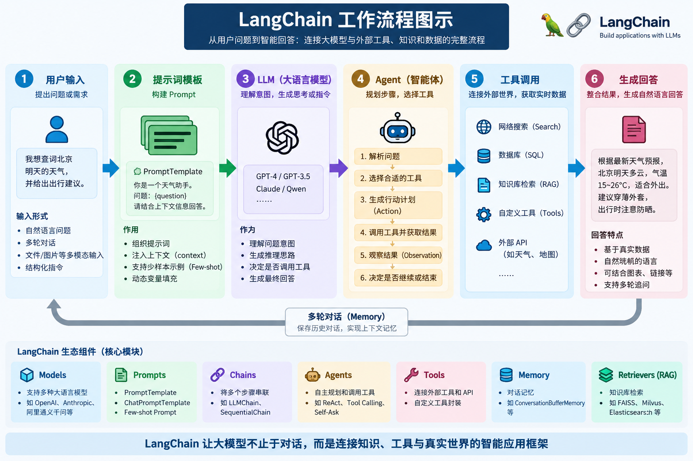

# Function Calling / MCP / Skill 

完整对比详解（AI Agent 方向，面试版）

> 背景：大模型本身不会直接调用外部能力（数据库、接口、本地文件），Function Calling、MCP、Skills 都是**让大模型具备调用外部工具能力**的方案，但是层级、标准、定位完全不一样。
> 适用场景：LangChain / LangGraph / Spring AI 面试，Agent 项目简历描述。

## 一、Function Calling（函数调用）
### 1. 定义
Function Calling 是**大模型厂商内置能力**（OpenAI、通义千问、DeepSeek 等）：
开发者预先定义函数描述（函数名、入参、功能说明，JSON Schema）交给大模型。
大模型根据用户问题，**判断是否需要调用函数，并生成结构化的函数调用参数**，交给后端执行代码，拿到结果再返回大模型做总结回答。

### 2. 核心流程
1. 开发者定义函数元信息（name、description、parameters json schema）
2. 将函数列表 + 用户Prompt一起传给LLM
3. LLM判断：直接回答 or 需要调用函数
4. LLM输出结构化函数调用消息（不是自然语言）
5. 后端解析消息，执行对应函数代码
6. 函数返回结果，把结果丢回大模型
7. LLM整合结果，输出最终答案

### 3. 特点
✅ 优点
- 原生内置，开箱即用；主流大模型都支持
- 轻量，适合少量工具调用场景
❌ 缺点
- **绑定模型**：不同厂商的 function calling 格式略有差异，换模型需要改代码
- 工具描述、参数需要手动写JSON Schema
- 工具能力是在代码里硬编码，跨应用复用差
- 没有统一协议，无法远程发现、远程调用工具

> 一句话总结：**Function Calling 是大模型的能力，用来输出结构化参数，触发本地函数执行。**

## 二、MCP（Model Context Protocol，模型上下文协议）

### MCP（Model Context Protocol，模型上下文协议）

#### 1. 定义

MCP 是 Anthropic 推出的**开源标准化协议（JSON-RPC 2.0）**，用来标准化「AI应用 ↔ 外部系统/工具/数据源」通信。类比AI领域的USB-C接口，一套标准，任意MCP客户端可以对接任意MCP服务端，不需要重复写适配代码。
> 分层：**协议层**，规定通信规则，不是模型能力，不是业务能力。

#### 2. 架构（Host / Client / Server）

- **Host**：AI应用主体（LangGraph、Claude Desktop、IDE Agent）
- **MCP Client**：Host内部连接器，和单个MCP Server维持会话
- **MCP Server**：独立轻量服务，向外暴露三类能力：
  1. **Tools**：可执行动作（查询数据库、调用接口，等价于工具函数）
  2. **Resources**：上下文资源（文件、知识库，给模型读数据）
  3. **Prompts**：可复用提示词模板，服务端下发给Host

#### 3. 工作流程

1. Host启动MCP Client，连接MCP Server
2. 握手协商能力：Server上报自己有哪些Tools/Resources
3. Host把MCP的工具描述转成LLM Function Calling Schema
4. LLM决定调用工具，输出FunctionCall参数
5. Host通过MCP协议转发调用请求到MCP Server
6. Server执行工具，返回结果，走MCP协议回传给Host
7. Host把结果交给大模型继续推理

✅ 优点
- 工具**即插即用**，一套MCP Server，LangChain、LangGraph、Claude都可以复用
- 工具逻辑隔离在独立进程/远程服务，安全沙箱，不会污染主应用
- 支持动态发现工具，不需要每次请求把全部工具传给模型
- 除了工具调用，还支持资源读取、提示词模板
❌ 缺点
- 多一层协议转发，带来额外开销
- 协议还在迭代，生态还在完善
- 底层依然依赖Function Calling，不能脱离大模型函数调用能力

## 三、Skills（技能）

> 注意：Skills 有两层含义，面试中经常混用：
> ① Claude Skills：Anthropic官方定义，可复用的子Agent/任务流
> ② 通用Agent领域Skills：**业务能力封装单元**（行业通用叫法，Spring AI / LangGraph都有这个概念）

### 1. 通用定义（面试最常问）

Skill = **一组相关工具 + 编排逻辑 + Prompt + 业务规则封装成一个可复用业务单元**。
> 分层：**业务编排层**，面向业务意图，不是协议，不是模型底层能力。

示例：
- 订单查询Skill：包含「查询订单接口、查询支付记录、订单状态格式化」多个函数，加上错误重试、结果整理Prompt。
- 邮件Skill：发送邮件、查询收件箱、删除邮件，打包成一个Skill。

### 2. 核心特点

- 面向**业务意图**：大模型识别用户意图，选择对应的Skill，而不是单个函数
- 内部可以编排多个Function / MCP工具，自带业务流程、校验、重试逻辑
- 可以嵌套：Skill内部可以调用别的Skill（子Agent）
- 可复用：同一个Skill，在多个Agent项目直接引入
- 可以用Prompt、配置文件定义，不一定需要大量硬编码代码

✅ 优点
- 业务语义清晰，方便大模型做意图路由
- 复用整套业务流程，不用每次重复编排
- 统一做权限、日志、异常处理
❌ 缺点
- 封装粒度不好把控，容易过度封装
- Skill编排逻辑复杂时，调试难度上升

### 3. Claude Skills（狭义）

Anthropic Claude推出的能力，用自然语言描述一套任务流程，不需要写大量代码，定义好Skill后，Claude可以自动调用这套流程完成复杂任务。本质是可复用的子Agent。

## Function Calling / MCP / Skills 三者完整对比表

| 维度 | Function Calling | MCP | Skills |
|---|---|---|---|
| 层级 | **模型底层能力层** | **通信协议层** | **业务编排层** |
| 核心定位 | 让大模型输出结构化参数，触发工具执行 | 标准化协议，统一Agent和外部系统通信 | 业务能力打包，一组工具+流程封装 |
| 一句话理解 | 解决：**模型怎么知道要调用函数，输出参数** | 解决：**Agent和外部工具按什么标准通信** | 解决：**把一堆工具打包成一个业务能力** |
| 依赖关系 | 基础底座；MCP、Skills最终都依赖它 | 底层依赖Function Calling；MCP Server暴露工具，Host转为Function Calling schema | Skill内部可以调用Function，也可以调用MCP服务 |
| 工具定义位置 | 代码内硬编码，每次请求传给LLM | MCP Server启动时主动上报工具列表，动态发现 | 在编排层定义，封装多个工具 |
| 部署形态 | 函数和主应用同进程 | MCP Server独立进程/远程服务，解耦 | 编排逻辑在Agent框架内（LangGraph/SpringAI） |
| 复用范围 | 当前项目代码内复用 | 跨框架、跨模型通用（MCP生态） | 业务层面复用，同一个业务能力多个Agent使用 |
| 典型例子 | 定义`get_weather(city)`函数交给LLM | 独立MCP Server暴露MySQL查询工具，LangGraph直接接入 | 「电商订单处理Skill」，包含查订单、查支付、退款多个工具和流程 |

## 三者关系（面试口述版，45秒）

Function Calling是底层基础能力，让大模型能够判断并生成工具调用参数。MCP是一套标准通信协议，用来解耦Agent和外部工具，MCP Server对外暴露工具，Host会把MCP工具转换为Function Calling格式交给大模型。Skills是上层业务封装，把多个Function或者MCP工具、提示词、业务流程打包成一个业务技能单元，由Agent根据用户意图选择调用。
> 简单一句话总结：**Function Calling决定模型要不要调工具；MCP决定工具怎么通信；Skills决定调哪些工具、按什么业务流程执行。**

## 面试高频问题

### Q1：MCP会不会替代Function Calling？

A：不会替代。MCP是通信协议，MCP暴露出来的工具，Host端依然要转成Function Calling的schema交给大模型，MCP只是把工具服务独立出去，底层仍然依赖Function Calling。

### Q2：Skill和工具(Tool)区别？

A：Tool是单个原子能力（单个函数）；Skill是多个Tool的**业务编排组合**，自带业务逻辑、提示词、重试，面向业务意图。比如：查询天气是Tool；出行规划Skill，里面调用查天气、查车票两个Tool。

### Q3：LangGraph中怎么组合三者？

1. 编写MCP Server，提供数据库查询工具
2. LangGraph作为Host，连接MCP Server，自动获取MCP Tools
3. LangGraph内部封装一个订单Skill，编排MCP工具 + Prompt + 异常处理
4. Agent节点使用Function Calling能力，判断用户意图，调用Skill内的工具完成任务

### Q4：什么时候选MCP，什么时候直接用Function Calling？

- 小型项目、工具数量少、工具和主应用耦合度高：直接用Function Calling，简单快速。
- 企业级Agent，多Agent复用工具、工具需要独立部署、安全隔离、多套模型/框架共用工具：使用MCP。

---

如果你需要，我可以：
1. 给一段**LangGraph + MCP + Skill**完整可运行Python Demo代码
2. 压缩成1分钟面试口述稿
3. 画架构流程图（文本版）


# MCP（Model Context Protocol，模型上下文协议）

> MCP 是 **Anthropic 推出、现已捐赠给 Linux 基金会 Agentic‑AI 基金会的开放标准协议**，基于 JSON‑RPC 2.0，被称为AI Agent领域的USB‑C标准，目标：**将Agent应用与外部工具、数据源解耦，一套工具服务可以被不同Agent框架复用**。
>
> 核心思想：**工具逻辑独立运行在MCP Server进程/服务；Agent宿主（LangChain、LangGraph、Claude Desktop、Cursor）作为MCP Client，通过标准协议发现、调用远端工具，不需要在Agent代码内部实现工具逻辑**。

## 一、核心架构（三方角色）
1. **Host（宿主）**
AI应用本体：Claude Desktop、VS‑Code插件、LangGraph Agent、企业对话系统。宿主可以同时连接**多个MCP Server**。

2. **MCP Client（客户端，运行在Host内部）**
负责协议通信：握手、发现工具、转发工具调用请求、解析返回结果；1个Client对应1个MCP Server连接。
> LangChain侧：`MultiServerMCPClient` / `MCPAdapter` 就是MCP Client实现。

3. **MCP Server（服务端）**
独立程序/服务，实现真实业务能力（文件读写、SQL执行、调用第三方API、操作系统命令）；对外暴露标准化接口。可以本地子进程运行，也可以远程部署为HTTP服务。

### 协议两层模型
- **消息层**：JSON‑RPC2.0，定义方法、错误、通知；核心方法：`initialize`、`list_tools`、`call_tool`、`list_resources`、`get_prompt`。
- **传输层Transport**：底层通信通道。

### MCP三大核心原语
|原语|作用|
|---|---|
|**Tools**|可执行动作，对应工具调用；提供name、description、JSON‑Schema入参；`call_tool`执行|
|**Resources**|外部数据资源：文件、数据库记录、文档，供Agent读取上下文|
|**Prompts**|预定义提示词模板，Server向Client提供可复用Prompt模板|

## 二、完整生命周期流程
1. **建立连接**：Client通过transport连接MCP Server。
2. **初始化握手 `initialize`**：协商协议版本，交换双方能力，Server返回自身能力声明。Client发送`initialized`通知，握手完成。
3. **能力发现**：Client调用`list_tools`，获取全部工具元数据（名称、描述、输入JSON‑Schema）。
4. **工具调用**：
    1. LLM输出工具调用；
    2. Client发送`call_tool` JSON‑RPC请求；
    3. MCP Server执行业务逻辑；
    4. Server返回结果/错误；
5. **结果回传**：Client将结果封装成Agent框架可识别消息（ToolMessage）交给LLM继续推理。
6. **连接终止**：释放连接、终止子进程、清理资源。

> MCP协议本身**无状态**；状态由MCP Server业务层维护。

## 三、三种Transport传输层（选型重点，面试高频）
|传输|模式|适用场景|注意事项|
|---|---|---|---|
|**stdio**|子进程标准输入输出；Host fork子进程，管道通信|**本地开发调试、桌面端**|**严禁Web/API后端高并发使用**；高并发会产生大量僵尸子进程，耗尽句柄；无鉴权，依靠操作系统权限隔离|
|**HTTP+SSE（旧版，已废弃）**|双端点：POST发请求、GET长连接接收推送|存量老项目|2025‑03‑26规范废弃，新项目禁止使用|
|**Streamable‑HTTP（标准远程）**|**单HTTP端点**，POST报文，可升级SSE做推送；支持`Mcp‑Session‑Id`会话、重连恢复、鉴权Header、OAuth、负载均衡|**生产环境首选远程部署**|支持多租户、水平扩容、鉴权；MCP Server独立部署成HTTP服务|

> ✅选型口诀：
> - 本地原型、桌面Agent：**stdio**
> - 线上服务、多Agent共享工具、企业部署：**Streamable‑HTTP**
> - 老系统兼容：保留旧SSE，尽快迁移。

## 四、开发MCP Server（FastMCP）
`FastMCP`是社区最主流Python高阶SDK，装饰器开发，自动从类型注解、docstring生成JSON‑Schema，不用手写schema定义。

### 安装
```bash
pip install fastmcp
```

### 最小MCP Server示例
```python
# math_server.py
from fastmcp import FastMCP

mcp = FastMCP("MathService")

@mcp.tool()
def add(a:int,b:int)->int:
    """两个数字相加
    Args:
        a:第一个数字
        b:第二个数字
    """
    return a + b

@mcp.tool()
def multiply(a:int,b:int)->int:
    """两个数字相乘"""
    return a * b

if __name__ == "__main__":
    # 本地子进程模式，供stdio客户端拉起
    mcp.run(transport="stdio")
    # 远程HTTP模式
    # mcp.run(transport="streamable_http", host="0.0.0.0", port=8000)
```

运行：
- stdio：由MCP Client拉起子进程，不要直接手动运行；
- streamable_http：直接运行，对外暴露HTTP端点，供远程Client访问。

## 五、主流Agent框架接入MCP
### 1. LangChain / LangGraph
两套客户端API：
1. `langchain‑mcp‑adapters.MultiServerMCPClient`：旧版，广泛用于现有项目，支持同时连接多个MCP Server。
2. `langchain.mcp.MCPAdapter`：langchain≥1.4.0内置，Beta新版API，基于FastMCP。

**关键点：MCP工具全部是异步，只能调用`.ainvoke()`，同步调用直接抛异常**。

工作逻辑：
Client连接Server → `list_tools`获取工具元数据 → 转换为LangChain `StructuredTool` → 直接丢入`ToolNode` / `create_react_agent`，和本地`@tool`对上层Agent完全透明。

```python
import asyncio
from langchain_mcp_adapters.client import MultiServerMCPClient
from langgraph.prebuilt import create_react_agent
from langchain_openai import ChatOpenAI

async def main():
    llm = ChatOpenAI(model="gpt‑4o‑mini")
    async with MultiServerMCPClient({
        "math": {
            "transport":"stdio",
            "command":"python",
            "args":["math_server.py"]
        }
    }) as client:
        tools = await client.get_tools()
        agent = create_react_agent(llm, tools=tools)
        res = await agent.ainvoke({"messages":[{"role":"user","content":"(3+5)*12"}]})
        print(res["messages"][-1].content)

if __name__ == "__main__":
    asyncio.run(main())
```

> 多Server配置：可同时配置多个MCP服务；开启`prefix_tool_name_with_server_name=True`自动给工具名增加前缀，避免不同Server工具重名冲突。

## 六、MCP vs Tool / Toolkit / Skill / Sub‑Agent（面试必考题）
> ⚠️MCP、Skill不是互斥，经常搭配使用：**Skill负责业务流程Prompt、SOP；MCP负责底层动作执行**。

|组件|定位|核心职责|执行位置|
|---|---|---|---|
|**Tool（@tool）**|最小原子动作|单一函数执行；schema一次性注入System Prompt|**Agent宿主进程内运行**|
|**Toolkit**|一组关联Tool集合|打包一组相关本地工具|Agent宿主进程内|
|**MCP**|**通信协议**|标准化调用外部工具；工具逻辑与Agent解耦|独立进程/远程服务|
|**Skill**|业务能力包（渐进式披露）|业务SOP、流程、规范文档模板；按需加载Prompt；**不执行动作**|仅上下文层，不执行业务代码|
|**Sub‑Agent子Agent**|独立Agent实例|独立推理循环，独立上下文，强任务隔离|宿主进程内，全新Agent循环|

> 通俗理解：
> - MCP = **手**：负责实际对外操作；
> - Skill = **操作手册/SOP**：告诉手按什么步骤做；
> - Sub‑Agent = **另一个独立员工**，独立房间完成复杂子任务。

### 选型决策
1. 简单小工具，和Agent强耦合：直接`@tool`；
2. 工具逻辑复杂、需要独立部署、多Agent复用：使用MCP；
3. 多步骤业务、大量业务规范文档，控制Token开销：Skill + MCP；
4. 任务推理极其复杂，需要隔离上下文：Sub‑Agent。

## 七、MCP优势
1. **彻底解耦**：Agent代码不需要写工具实现；MCP Server独立开发、测试、部署、升级，修改工具逻辑不用改Agent代码。
2. **跨框架复用**：同一个MCP Server，可以被LangGraph、Claude Desktop、Cursor、其他Agent同时调用。
3. **自动工具发现**：Client通过`list_tools`自动获取全部工具schema，不需要手动维护Pydantic模型。
4. **部署灵活**：既可本地子进程，也可远程HTTP服务，支持鉴权、负载均衡。
5. **协议中立**：不限语言，Python、TS/JS、Go都可以实现MCP Server。

## 八、生产风险与踩坑（面试高频）
1. **生命周期管理（最高频坑）**
MCP工具对象绑定Client会话连接；不要把`async with`内部取出的tools拿到上下文外部长期保存，连接关闭之后调用直接报错。
- stdio模式必须用`async with`，保证退出终止子进程，**否则产生大量僵尸进程**。

2. **stdio transport禁止用于Web后端API**
每一个连接会fork子进程；高并发会耗尽内存、文件句柄。线上环境全部使用`streamable_http`。

3. **全部异步**：MCP工具只能使用`await tool.ainvoke()`；同步`.invoke()`直接抛出异常。LangGraph内部ToolNode自动走异步；手写调用必须await。

4. **错误处理行为**
MCP Server内部异常，适配器默认封装成`is_error=True`的ToolMessage返回给Agent，**不会直接抛出Python异常打断Graph**，Agent拿到错误消息可以重试；业务可在LangGraph增加节点拦截告警。

5. **安全风险**
MCP Server可以读写文件、执行命令、操作数据库。Agent幻觉、Prompt注入会触发高危操作；写/删除类操作，必须增加**Human‑in‑the‑Loop人工确认**节点。

6. **工具名称冲突**
多MCP Server存在同名工具，开启`prefix_tool_name_with_server_name=True`自动加命名空间前缀。

7. **协议版本兼容**
区分旧SSE和新标准`streamable_http`，旧SDK只支持废弃SSE transport。

## 九、工程架构最佳实践（企业项目）
```
用户Query → LangGraph Agent
    ↓
Skill层（SKILL.md：业务流程SOP、schema参考文档，渐进式加载）
    ↓
ToolNode（同时包含普通工具 + MCP适配器转换后的MCP工具）
    ↓
MCP Client（MCPAdapter/MultiServerMCPClient）
    ↓
Streamable‑HTTP（生产，禁止stdio）
    ↓
MCP Server集群：执行SQL、文件操作、调用第三方API
```
> 分工：
> - Skill：定义“这件事要怎么做”；
> - MCP：真正“动手做”；
> - LangGraph：状态管理、checkpoint持久化、人工确认、重试、告警。

## 十、面试口述速记
### Q1：什么是MCP？
> MCP即Model‑Context‑Protocol，是开放的Agent工具调用标准协议，基于JSON‑RPC2.0；架构分为Host宿主、MCP Client、MCP Server。
> MCP把工具逻辑放到独立进程/服务；Agent通过协议自动发现、调用远端工具；实现Agent和工具解耦，一套MCP Server可以被多个Agent框架复用。
> 支持stdio本地子进程、Streamable‑HTTP远程生产两种主流传输；旧版SSE已废弃。

### Q2：MCP和Skill区别？
> MCP是通信协议，负责执行实际外部动作，解决“怎么做事”；Skill是业务流程能力包，定义SOP、规范，解决“按什么步骤做事”。两者经常配合：Skill写业务流程，MCP负责底层工具执行。

### Q3：stdio和streamable‑http怎么选？
> stdio用于本地开发调试，拉起子进程；**严禁Web后端高并发，会产生大量僵尸进程**。生产部署MCP为独立HTTP服务，选用streamable‑http，支持鉴权、负载均衡、会话重连。

### Q4：MCP主要坑点？
> 1.严格管理Client生命周期，不要将tools拿到with上下文外部；
> 2.stdio不要用于线上Web服务；
> 3.MCP工具全部异步，不能调用同步invoke；
> 4.高危操作需要人工确认，防范Prompt注入；
> 5.多Server注意工具重名，开启名称前缀隔离。

如果你需要，我可以输出：
1. MCP完整生产示例：FastMCP streamable_http部署 + LangGraph调用；
2. MCP调试模板打印完整JSON‑RPC报文；
3. MCP、Skill、Sub‑Agent对比面试速记小抄。

# Skills 

全面详细介绍（Agent 领域，搭配 LangGraph / MCP 面试版）

> 先划重点：**Skills 不是 MCP，也不是 LangGraph 原生内置组件**，它是一套**上下文工程设计范式（渐进式披露 Progressive Disclosure）**，最早在 `langchain-deepagents` 中落地，现在大量项目**不用 deepagents，直接基于 LangGraph 手写实现 Skill 机制**。
>
> 一句话定义：**Skill = 一个独立打包的领域业务能力包，包含元数据、业务SOP提示词、参考文档、模板；启动只加载简短元数据，只有LLM判定需要该能力时，才动态加载完整业务指令，解决System Prompt Token爆炸问题。**

## 一、核心概念
### 1. 为什么要提出 Skills？
普通Agent的痛点：
如果把所有业务规则、数据库schema、业务约束、操作步骤全部塞进System Prompt，会出现：
1. System Prompt 超长，Token开销巨大；
2. LLM容易丢失细节、混淆多个业务规则；
3. 新增业务能力，必须修改主Prompt，无法模块化管理。

**Skill 的核心思想：分层加载，按需披露（Progressive Disclosure）**
不一次性把全部业务文档塞进上下文，分成三层：

|层级|内容|加载时机|
|---|---|---|
|L1 元数据（Metadata）|`name`、`description`、tags（一句话介绍这个Skill能干什么）|Agent初始化，全部Skill的元数据一次性放入System Prompt；**不加载详细流程文档**|
|L2 核心业务指令|SKILL.md：完整业务步骤、约束、输出规范、边界规则|LLM判断当前任务匹配该Skill → 调用`load_skill`工具，把完整SKILL.md加载进对话上下文|
|L3 资源附件|schema、示例、模板、参考文档（如db_schema.md）|执行Skill流程过程中，按需读取参考文件|

> 类比：
> L1 = 目录（只写书名）
> L2 = 翻开这本书，看完整操作手册
> L3 = 手册附带的附录、数据表、模板

### 2. Skill 目录标准结构（文件式Skill，工程最常用）
```
skills/
├── sql_generator/
│   ├── SKILL.md                # 入口文件：YAML frontmatter元数据 + 业务流程正文
│   ├── references/
│   │   └── order_db_schema.md  # L3资源：数据库表结构
│   └── templates/
│       └── sql_output_template.txt
└── report_generator/
    └── SKILL.md
```

`SKILL.md` 示例：
```yaml
---
name: sql_generator
description: 根据用户自然语言生成合规SQL，严格遵守数据库schema，禁止编造不存在的表和字段
tags: ["sql","database"]
---
# SQL生成Skill
## 执行步骤
1. 读取 references/order_db_schema.md 获取表结构
2. 理解用户查询条件，校验字段是否存在
3. 生成SQL，附带中文解释
4. 字段/表信息不足时，主动向用户提问，禁止猜测
5. 生成完成后调用MCP工具执行SQL
```

## 二、Skill 核心组件
1. **SKILL.md**：Skill的入口文件。头部YAML是L1元数据；Markdown正文是L2完整业务流程。
2. **Skill Registry**：Skill注册表，保存所有Skill的名称、描述、文件路径。初始化时提取L1元数据注入System Prompt。
3. **`load_skill` 工具（核心自定义工具）**
    是触发加载L2内容的开关。LLM识别任务匹配Skill后，调用这个工具，读取磁盘上SKILL.md全文，追加到对话消息列表。
    可选扩展工具：`load_skill_resource`，读取L3参考文档。
4. **Skill Middleware（DeepAgents版本）**
    `langchain-deepagents` 提供的`SkillsMiddleware`，自动扫描skill目录、构建注册表、注册`load_skill`工具。
    
    > 注意：deepagents属于beta组件，生产项目很多选择**手写Skill，不引入deepagents包**。

## 三、完整执行链路（LangGraph + Skill + MCP）
1. **初始化阶段**
扫描所有skill目录，提取每个SKILL.md的YAML元数据，把所有skill的简短描述放进System Prompt；**此时完整SKILL.md和参考文档完全没有加载**。
2. 用户输入问题，LLM读取System Prompt里面的Skill目录，判断当前任务应该使用`sql_generator`。
3. LLM调用`load_skill(skill_name="sql_generator")`工具。
4. `load_skill`读取SKILL.md全文，作为工具返回结果，追加到messages。
5. LLM读取刚加载进来的完整业务SOP，继续执行Skill定义的步骤，调用`load_skill_resource`读取db_schema。
6. 按照Skill里面的业务约束，调用**MCP工具**执行SQL（Skill只定义流程，**不执行任何真实动作**）。
7. MCP Server执行SQL，返回结果，LangGraph ToolNode接收ToolMessage，LLM继续推理，输出最终答案。

> 关键：**Skill 只负责Prompt和业务流程，没有执行能力；真正干活的是Tool/MCP**。

## 四、Skill 和其他Agent组件对比（面试高频）
|组件|定位|是否执行动作|上下文加载方式|适用场景|
|---|---|---|---|---|
|**Skill**|业务能力包（SOP+文档+模板）|❌ 不执行动作，仅Prompt约束|分层按需加载（渐进披露）|多步骤业务、大量规范文档，控制token成本|
|**Tool（@tool）**|最小原子执行函数|✅ 进程内执行|初始化一次性加载工具描述|简单单次动作：计算器、简单API调用|
|**Toolkit**|一组相关Tool集合|✅ 多个原子动作|一次性加载全部工具描述|SQLDatabaseToolkit这类成套本地工具|
|**MCP**|工具通信协议|✅ 远端独立进程执行|运行时动态发现工具schema|工具独立部署、跨框架复用工具|
|**Sub-Agent子Agent**|独立完整Agent实例|✅ 独立Agent循环执行|一次性加载完整子Agent配置|推理逻辑极其复杂，需要强上下文隔离|

一句话区分：
- Skill = **操作手册**（告诉你按什么步骤做这件事）
- MCP = **手**（真正动手执行操作）
- Sub-Agent = **另一个独立员工**，单独开一个会话处理复杂任务

> 经典组合：**Skill + MCP + LangGraph**
> Skill写业务SOP；MCP执行底层动作；LangGraph负责状态流转、HITL人工确认、checkpoint持久化、重试。

## 五、两种实现方案
### 方案1：langchain-deepagents SkillsMiddleware（封装版）
`langchain-deepagents`内置中间件，自动扫描skill目录，自动注册`load_skill`工具。
优点：开箱即用，自动管理skill注册表；
缺点：Beta版本，API不稳定，生产环境风险高。

### 方案2：原生LangGraph手写Skill（生产推荐，无额外依赖）
**不引入deepagents**，自己实现Skill机制，核心只有3点：
1. 手动维护Skill注册表，提取L1元数据放入System Prompt；
2. 自定义`load_skill`工具，读取SKILL.md文件；
3. 将`load_skill`和MCP/本地Tool一起交给LangGraph的ToolNode。

> 前面给过完整代码，这里提炼核心工具定义：
```python
@tool
def load_skill(skill_name:str) -> str:
    """加载指定skill完整业务指令
    Args:
        skill_name: skill名称
    """
    for sk in SKILL_REGISTRY:
        if sk["name"] == skill_name:
            with open(sk["path"],"r",encoding="utf-8") as f:
                return f.read()
    return f"找不到skill:{skill_name}"
```

## 六、Skill优势
1. **大幅降低Token消耗**
大量业务规范、长文档不需要常驻System Prompt；只在需要的时候加载。
2. **业务能力模块化、可版本管理**
每个Skill是独立文件夹，git管理，不同团队维护各自Skill；新增能力只需要新增skill目录，不用修改主Agent代码。
3. **输出一致性更高**
业务SOP固化在SKILL.md，LLM严格按预设步骤执行，减少幻觉、减少输出格式混乱。
4. **能力自包含**
Skill自带参考文档、模板、示例，能力包可以直接分发，移植到其他Agent。
5. **轻量，对比Sub-Agent开销小**
不需要启动独立Agent循环，只是追加一段Prompt到当前对话上下文。

## 七、局限 & 生产踩坑（面试重点）
1. **依赖LLM主动调用load_skill，存在绕过风险**
    LLM有可能不调用`load_skill`，直接回答问题，跳过Skill的业务约束。
    ✅优化方案：
    - System Prompt强制要求：**匹配Skill任务，必须优先调用load_skill加载后再处理**；
    - LangGraph增加校验节点，校验输出是否满足Skill规范，不满足则重试。

2. **文件读取安全风险**
    文件型Skill是读取本地磁盘文件；生产环境必须做**目录沙箱**，限制读取路径，禁止任意路径遍历。

3. **Skill数量不能过多**
    L1元数据全部放入System Prompt；Skill数量太多，元数据列表过长，LLM识别匹配Skill的准确率下降。

4. **Skill没有执行能力**
    Skill只是Prompt文档，不能执行SQL、读写文件；真实动作必须依赖Tool/MCP。

5. **Skill内容只作用于当前对话会话**
    load_skill加载的完整指令，追加到当前messages；新会话重新只加载L1元数据，不会永久保存。

6. deepagents的SkillsMiddleware属于Beta，API不稳定，核心业务优先手写原生实现。

## 八、面试口述速记（背这个）
### Q1：什么是Skill？
> Skill是一套**渐进式披露（Progressive Disclosure）**的上下文工程范式，把领域业务能力打包为独立能力包。
> 分为三层加载：L1元数据在Agent初始化加载，只包含名字和简介；当LLM判定任务匹配，调用`load_skill`工具加载L2完整业务SOP；执行过程按需加载L3参考资源。
> Skill本身**只包含Prompt、业务规范、模板，没有执行能力**，底层动作依靠Tool或者MCP执行。LangGraph没有原生Skill组件，有两种实现：deepagents的SkillsMiddleware，或者原生手写实现。

### Q2：Skill和MCP的区别？
> Skill是业务流程Prompt包，定义做事步骤和约束；MCP是工具通信协议，负责远端执行实际动作。
> 工程上经常搭配使用：Skill写业务SOP，MCP执行底层操作，LangGraph编排状态、人工确认、持久化。

### Q3：Skill和Sub-Agent怎么选型？
> 如果是多步骤业务、大量业务规范，希望控制token开销，轻量执行，选择Skill；
> 如果任务推理逻辑极其复杂，需要独立完整Agent循环、强上下文隔离，选择Sub-Agent。

### Q4：Skill最大的风险是什么？
> 最大风险是LLM绕过`load_skill`，不加载Skill的业务约束直接输出结果。其次是文件读取安全风险；Skill数量过多会降低LLM选择Skill的准确率。

## 九、常见扩展方向
1. 远程Skill：Skill文件不放在本地磁盘，放在对象存储/数据库，load_skill从远端拉取，适合多租户系统；
2. Skill权限控制：不同用户只能加载指定Skill；
3. Skill校验节点：LangGraph增加独立节点，校验Agent输出是否符合Skill规范，失败自动重试；
4. Skill缓存：缓存加载后的Skill内容，减少重复读取磁盘。

如果你需要，我可以单独整理一份：
1. Skill + LangGraph + MCP 完整可运行工程代码；
2. 面试精简小抄（一页纸，适合口述）；
3. Skill、MCP、Tool、SubAgent 对比表格。


# LangChain 使用 MCP（Model Context Protocol）

> MCP（Model Context Protocol）：Anthropic推出的**开放标准化Agent工具调用协议**，被称为AI Agent领域的USB‑C标准。
> 目标：**工具逻辑和Agent宿主彻底解耦**。工具独立运行在MCP Server，LangChain充当MCP Client；Agent不需要手写`@tool`，通过协议自动发现、调用远端服务暴露的工具。
>
> LangChain接入MCP有两套API：
> 1. 旧版本：独立包 `langchain‑mcp‑adapters`，`MultiServerMCPClient`
> 2. 新版本（langchain ≥1.4.0，beta）：内置 `langchain.mcp.MCPAdapter`，基于FastMCP，官方推荐新代码使用

## 一、MCP核心概念
### 1.架构角色
1. **MCP Server**：独立进程/HTTP服务，对外暴露一组工具（list‑tools、call‑tool），可以用Python/JS编写，可以本地子进程(stdio)、远程HTTP/SSE部署。
2. **MCP Client**：LangChain侧，负责和MCP Server通信，把MCP协议工具**转换成LangChain StructuredTool**，直接给ReAct Agent / LangGraph使用。
3. **Transport传输层**：Client和Server之间通信方式，三种主流：
    |传输方式|说明|适用场景|
    |----|----|----|
    |`stdio`|子进程标准输入输出，本地拉起MCP Server子进程|本地开发、桌面客户端；**Web服务慎用，会不断fork子进程**|
    |`sse`|Server‑Sent‑Events长连接|远程服务，老版本MCP|
    |`streamable_http`（新）|HTTP流式，新一代标准|生产环境远程MCP服务，推荐生产使用|

> MCP通信流程：
> 1.Client连接Server → `list_tools()`获取全部工具的name、description、inputSchema(json schema)
> 2.LLM做出工具调用决策
> 3.Client发送`call_tool`请求给MCP Server
> 4.MCP Server执行真实业务逻辑，返回结果
> 5.适配器把结果封装成LangChain工具返回给Agent链路

> 核心优势：
> - 工具与Agent代码解耦；工具可以独立开发、部署、版本迭代
> - 一套MCP Server，可以同时被LangChain、Claude Desktop、其他Agent框架复用
> - 支持多Server同时接入（比如同时连文件MCP、数据库MCP、API MCP）
> - 自动获取工具schema，不用手动写Pydantic参数定义

> 局限：
> - **全部是异步协议，MCP工具只能异步调用`ainvoke`，不能同步invoke**，容易踩坑
> - 链路变长，调试复杂；网络、进程生命周期需要手动管理
> - stdio模式在Web后端极易产生僵尸子进程，生产优先HTTP transport
> - Beta接口，版本迭代较快，API会小幅变动

## 二、环境安装
```bash
# 新版本 langchain>=1.4.0，内置MCPAdapter
pip install langchain[all] fastmcp

# 旧版（兼容老项目，不建议新项目）
pip install langchain-mcp-adapters
```

## 三、完整实战示例
### 示例1：编写一个简单MCP Server（FastMCP）
math_server.py，独立服务，提供加减乘工具，可被LangChain调用
```python
# math_server.py
from fastmcp import FastMCP

mcp = FastMCP("MathService")

@mcp.tool()
def add(a:int,b:int)->int:
    """两个数字相加"""
    return a+b

@mcp.tool()
def multiply(a:int,b:int)->int:
    """两个数字相乘"""
    return a*b

if __name__ == "__main__":
    # stdio：本地子进程模式；也可以启动http/sse服务
    mcp.run(transport="stdio")
```

### 示例2：新版本 MCPAdapter（langchain.mcp，官方推荐）
> 新版本：`MCPAdapter`，支持http/streamable_http/sse，使用async with上下文管理连接生命周期
```python
import asyncio
from langchain.agents import create_agent
from langchain_openai import ChatOpenAI
from langchain.mcp import MCPAdapter

async def main():
    llm = ChatOpenAI(model="gpt‑4o‑mini")

    # 方式1：连接远程HTTP MCP Server
    # async with MCPAdapter("[http://127.0.0.1:8000/mcp](http://127.0.0.1:8000/mcp)",transport="streamable_http") as adapter:

    # 方式2：本地stdio拉起MCP子进程（上面math_server.py）
    async with MCPAdapter(
        transport="stdio",
        command="python",
        args=["math_server.py"]
    ) as adapter:
        # 自动发现server全部工具，转为LangChain工具对象
        tools = await adapter.list_tools()
        print("加载MCP工具列表：",[t.name for t in tools])

        # 创建Agent，MCP工具直接传入，和普通@tool完全一样
        agent = create_agent(llm,tools=tools)
        resp = await agent.ainvoke({
            "messages":[{"role":"user","content":"计算 (3+5)*12"}]
        })
        print(resp["messages"][-1].content)

if __name__ == "__main__":
    asyncio.run(main())
```

### 示例3：旧版 MultiServerMCPClient（兼容存量项目）
> `MultiServerMCPClient`支持同时连接**多个MCP Server**，可以混合stdio、http服务
```python
import asyncio
from langchain_openai import ChatOpenAI
from langchain.agents import create_agent
from langchain_mcp_adapters import MultiServerMCPClient

async def main():
    llm = ChatOpenAI(model="gpt‑4o‑mini")
    client = MultiServerMCPClient({
        "math_server":{
            "transport":"stdio",
            "command":"python",
            "args":["math_server.py"]
        },
        "weather_server":{
            "transport":"streamable_http",
            "url":"[http://127.0.0.1:8001/mcp](http://127.0.0.1:8001/mcp)",
            "headers":{"Authorization":"Bearer xxx"}
        }
    })
    # 获取所有server的工具集合
    tools = await client.get_tools()
    agent = create_agent(llm,tools=tools)
    res = await agent.ainvoke({"messages":[{"role":"user","content":"(10+2)*7"}]})
    print(res["messages"][-1].content)
    await client.close() # 必须关闭，释放子进程/连接！

if __name__ == "__main__":
    asyncio.run(main())
```

### 示例4：MCP + LangGraph ReAct Agent
MCP工具本质就是LangChain的`StructuredTool`，可以直接接入LangGraph的`create_react_agent`：
```python
import asyncio
from langgraph.prebuilt import create_react_agent
from langchain_openai import ChatOpenAI
from langchain.mcp import MCPAdapter

async def main():
    llm = ChatOpenAI(model="gpt‑4o‑mini")
    async with MCPAdapter(transport="stdio",command="python",args=["math_server.py"]) as adapter:
        tools = await adapter.list_tools()
        agent = create_react_agent(llm,tools)
        result = await agent.ainvoke({"messages":[{"role":"user","content":"(3+8)*5等于多少"}]})
        print(result["messages"][-1].content)

if __name__ == "__main__":
    asyncio.run(main())
```

## 四、关键配置项
1. **工具命名冲突**：多MCP Server下出现同名tool，开启`prefix_tool_name_with_server_name=True`，自动加服务名前缀，如`math_server__add`，避免冲突。
2. **过滤工具**：`include_tools=["add"]`只加载指定工具；`exclude_tools=["multiply"]`屏蔽部分工具。
3. **超时**：`default_tool_timeout`，单次调用MCP工具超时秒数。
4. **鉴权**：http/sse模式传入`headers`，携带token、鉴权头。
5. **重连**：SSE传输支持自动重连配置。

## 五、调用链路完整流程
1. `MCPAdapter/MultiServerMCPClient`建立transport连接（stdio子进程 / http流）
2. 执行协议握手`initialize`
3. 请求`list_tools`获取MCP Server全部工具元数据（name、desc、json schema），适配器把json schema转换为LangChain StructuredTool
4. Agent运行，LLM输出工具调用请求
5. MCP Client把工具调用封装MCP协议`call_tool`消息发给MCP Server
6. MCP Server执行业务函数，返回结果/错误
7. Adapter接收返回，封装成ToolMessage回传给Agent；若工具执行报错，会把isError标记的结果交给LLM，Agent可自行重试，不直接抛异常终止程序
8. 退出上下文时自动关闭transport；stdio模式会终止子进程。

> ⚠️重要：**MCP工具全部是异步实现，只可以调用`.ainvoke()`，同步`.invoke()`直接报错**。

## 六、常见踩坑与生产注意点（面试高频）
1. **上下文生命周期大坑**
MCP工具对象绑定session连接；**不要把async with内部取出的tools拿到上下文外面使用**，一旦退出`async with`块，transport关闭，调用工具抛出异常`ToolException`。
- 错误写法：先出with块保存tools变量，之后再运行agent；
- 正确写法：**Agent调用全部放在async with内部执行**；使用MultiServerMCPClient的`get_tools()`会自动管理session生命周期，可在外部使用，但程序结束必须调用`await client.close()`释放子进程，否则产生僵尸进程。

2. **stdio传输不要直接用于Web服务/API后端**
每次创建MCPAdapter(stdio)会fork子进程；高并发下会大量创建进程，耗尽文件句柄。生产环境MCP Server部署为独立HTTP服务，使用`streamable_http` transport。

3. **工具名称冲突**
多个MCP Server有同名工具，开启`prefix_tool_name_with_server_name=True`，做命名空间隔离。

4. **MCP只做参数透传，不校验参数**
Adapter不会校验入参合法性；LLM输出不符合schema参数，直接转发到MCP Server，由Server返回错误，错误消息交给大模型处理。需要写好tool的description和inputSchema，减少模型输出错误参数。

5. **安全风险**
MCP Server可以操作文件系统、数据库、执行命令；Agent如果有幻觉或者prompt注入，会触发高危操作。生产环境对写文件、删除、执行命令类工具，**必须接入Human‑in‑the‑Loop人工确认**。

6. **版本问题**
langchain 1.4之前没有内置MCPAdapter，需要第三方包`langchain‑mcp‑adapters`，新旧版本API不兼容，注意区分。

7. 调试：打开日志，查看MCP完整请求响应，区分问题发生位置：LLM推理 → LangChain MCPAdapter层 → Transport网络层 → MCP Server业务逻辑。

## 七、MCP的优势对比普通@tool
|方案|普通`@tool`装饰器|MCP协议工具|
|----|----|----|
|部署|和Agent在同一个进程|独立进程/独立服务，可以跨机器部署|
|耦合度|业务逻辑嵌入Agent代码|完全解耦，独立迭代、测试、部署MCP Server|
|复用性|只能本代码使用|Claude Desktop、LangChain、其他Agent框架都可调用同一个MCP Server|
|发现机制|手动维护工具列表|自动list‑tools获取schema|
|开销|进程内函数调用|IPC/网络调用，有额外开销|

> 选型：
> - 简单内部工具，逻辑简单，和Agent强耦合：直接`@tool`；
> - 工具需要多Agent复用，工具逻辑重、需要独立部署维护，跨语言：选择MCP。

## 八、面试高频问答（口述版）
### Q1：什么是MCP协议？LangChain怎么使用MCP？
> MCP是Model Context Protocol，是Agent工具调用的开放标准，实现Agent和工具服务解耦。分为MCP Server（实现工具逻辑）、MCP Client（LangChain侧）。
> LangChain通过MCPAdapter或者MultiServerMCPClient作为MCP客户端，支持stdio、SSE、streamable_http三种传输。客户端连接MCP Server后调用list_tools自动获取工具元数据，转换成LangChain的StructuredTool，直接提供给ReAct / LangGraph Agent使用；工具调用全部走MCP协议的call_tool。
> MCP工具全部是异步，必须用ainvoke；要注意管理session生命周期，及时关闭连接释放资源。

### Q2：stdio和streamable_http分别适合什么场景？
> stdio：本地开发，拉起本地子进程；**不适合Web后端高并发场景，容易产生大量子进程、僵尸进程**。
> streamable_http：生产环境，MCP Server独立部署为HTTP服务，支持鉴权、负载均衡，推荐线上使用。

### Q3：MCP常见坑点？
> 1. 不要将with上下文内拿到的tools拿到外部使用，session关闭之后调用报错；
> 2. stdio不要用于web服务，高并发fork大量进程；
> 3. MCP工具是异步，不能调用同步invoke；
> 4. 多server工具重名，开启名称前缀隔离；
> 5. 高危操作工具，必须增加人工确认，防止LLM幻觉带来安全风险。

### Q4：MCP与LangChain原生@tool区别？
> @tool是进程内函数，工具逻辑写在Agent代码中，部署简单但耦合高；MCP工具运行在独立Server，通过IPC或者网络通信，工具和Agent完全解耦，可以跨框架复用，但带来网络/进程管理开销。

如果你需要，我可以：
1. MCP完整生产项目：MCP Server部署为FastAPI HTTP服务 + LangGraph Agent调用MCP；
2. MCP + Human‑in‑the‑Loop人工确认完整代码；
3. MCP排错调试模板（打印完整MCP协议报文）。


# LangChain Skills 
> ⚠️ 重要区分：**Skills 不是 LangChain 核心库原生组件，属于 DeepAgents（LangChain深度Agent）的高阶能力**，不是 Tool、不是 Toolkit，也不等同 MCP。
> - **Tool**：最小原子可调用函数（执行动作）
> - **Toolkit**：一组相关Tool集合
> - **Skill**：**高阶能力包**，=元数据 + 领域Prompt + 业务流程 + 参考文档/脚本模板，**按需加载（渐进式披露 Progressive Disclosure）**，解决大量能力全部塞进System Prompt带来的Token爆炸、上下文膨胀问题。
> - **MCP**：跨框架工具调用通信协议；Skill封装Prompt、流程，MCP负责执行底层工具逻辑，二者经常搭配使用但职责完全不同。

## 一、什么是 Skills
**Skill：把一个完整领域业务能力打包成目录化、可复用的能力单元**。
核心思想：**分层加载，不一次性把全部知识、流程塞进上下文**。
1. Agent启动阶段，只加载每个Skill简短元数据（name、description），只告诉Agent“我有哪些能力”，**不加载完整详细指令，节省大量token**。
2. 当Agent判断用户问题匹配某个Skill，才动态读取完整`SKILL.md`完整流程、业务规范。
3. 如果需要，再按需读取配套参考文档、脚本、模板文件。

> 三层加载机制（Progressive Disclosure 渐进式披露）
|层级|加载内容|加载时机|
|---|---|---|
|L1 元数据|SKILL.md头部YAML元数据(name、description、tags)|Agent启动，全部Skill的元数据注入System Prompt|
|L2 核心指令|SKILL.md完整正文（流程、Prompt、约束）|Agent判定要使用该Skill，动态读入上下文|
|L3 资源文件|scripts/、references/、assets/下面文档脚本|Skill执行过程按需读取|

> 典型Skill场景：SQL编写Skill、代码评审Skill、RAG知识库问答Skill、财务报表生成Skill。

### Skill目录标准结构
每个Skill是独立文件夹，入口文件**SKILL.md**，头部YAML Front‑matter元数据，主体是Markdown业务流程指令，配套资源目录：
```
skills/
└── sql_writer/                 # Skill名称
    ├── SKILL.md                # 入口文件，YAML元数据 + 完整业务指令
    ├── references/             # 参考资料：数据库schema、规范文档
    │   └── db_schema.md
    ├── scripts/                # 辅助脚本（可选，可配合MCP工具执行）
    │   └── format_sql.py
    └── assets/                 # 模板、示例
        └── sql_template.txt
```

`SKILL.md`示例内容：
```yaml
---
name: sql_writer
description: 根据用户自然语言生成正确可执行SQL，严格遵守数据库schema，禁止编造表
tags: ["sql","database"]
---
# SQL编写Skill
## 工作步骤
1.读取references/db_schema.md获取全部表结构
2.理解用户查询条件，不要使用schema不存在的字段
3.输出SQL同时附带简短解释
4.禁止使用未定义的表和字段，如果信息不足向用户提问
```

## 二、核心组件（DeepAgents）
使用Skill依赖DeepAgents库，核心：
1. `SkillsMiddleware`：中间件，扫描Skill目录，提取元数据注入System Prompt；提供内置工具`load_skill`，让Agent可以动态加载完整Skill内容。
2. `FilesystemBackend`：文件后端，读取本地/虚拟文件系统上Skill目录。
3. `create_deep_agent()`：创建支持Skill的Agent实例，内置文件读写工具，Agent可以读取Skill内部的文件资源。

> 依赖安装
```bash
pip install langchain-deepagents
```

## 三、最简可运行示例
### 1.准备本地Skill目录
```
./my_skills/sql_writer/
    SKILL.md
    references/db_schema.md
```

### 2.代码：创建DeepAgent接入本地Skills
```python
from langchain_deepagents import create_deep_agent
from langchain_deepagents.middleware.skills import SkillsMiddleware
from langchain_deepagents.backends.filesystem import FilesystemBackend
from langchain_openai import ChatOpenAI
from langgraph.checkpoint.memory import MemorySaver

# 1.文件后端，指向skill根目录
backend = FilesystemBackend(root_dir="./my_skills")

# 2.Skill中间件，扫描所有skill，注入元数据，提供load_skill工具
skill_middleware = SkillsMiddleware(
    backend=backend,
    sources=["./my_skills"]
)

llm = ChatOpenAI(model="gpt‑4o‑mini")
checkpointer = MemorySaver()

# 3.创建支持Skill的DeepAgent
agent = create_deep_agent(
    model=llm,
    backend=backend,
    middlewares=[skill_middleware],
    skills=["./my_skills"],
    checkpointer=checkpointer
)

# 4.调用Agent
result = agent.invoke({
    "messages": [{"role":"user","content":"查询订单金额大于1000的客户"}]
})

for msg in result["messages"]:
    print(f"{msg.type}:{msg.content}")
```
**执行流程拆解**
1. Agent启动：`SkillsMiddleware`扫描`my_skills`，读取`sql_writer/SKILL.md`头部YAML，把`name+description`放进System Prompt。
2. 用户提问；LLM看到System Prompt内可用Skill列表，识别应当使用`sql_writer`。
3. Agent调用内置工具`load_skill(skill_name="sql_writer")`，读取完整SKILL.md正文注入上下文。
4. Skill指令要求读取`references/db_schema.md`，Agent调用文件工具读取schema。
5. 按照Skill定义的业务流程完成SQL生成。

## 四、Skill、Tool、Toolkit、MCP、Sub‑Agent对比（面试高频）
|组件|本质|执行单元|上下文加载|适用场景|
|---|---|---|---|---|
|**Tool**|最小原子可调用函数；输入输出结构化；直接执行代码|函数调用|全部描述schema一次性注入System Prompt|单一原子动作：搜索、计算器、查询数据库|
|**Toolkit**|一组相关Tool集合|多个Tool|全部工具同时加载|一组关联原子能力，如SQLDatabaseToolkit|
|**Skill**|能力包：元数据 + Prompt流程 + 文档模板，**描述“怎么做这件事”**|Agent按照Skill内的步骤执行，可以调用Tool/MCP|**分层按需加载，启动只加载元数据，匹配后加载完整指令**|多步骤领域业务，大量规范文档，希望控制token开销；不同团队独立维护能力包|
|**MCP Server**|独立进程/服务，暴露一批Tool；通信协议|远端进程执行工具|工具schema客户端获取，注入Agent|工具逻辑解耦，跨框架复用工具，文件系统、命令执行等高危操作|
|**Sub‑Agent子Agent**|独立完整Agent，专门负责一类任务|完整Agent循环|全部子Agent配置一次性加载|完全独立复杂推理任务，强隔离|

> 选型判断：
1. 简单原子动作：直接写`@tool`；
2. 多步骤业务，大量业务规范、模板，不想全部塞进System Prompt：**使用Skill**；
3. 工具逻辑要独立部署、跨框架复用：Skill + MCP搭配；Skill负责流程prompt，MCP负责底层动作执行；
4. 任务推理逻辑极其复杂，需要独立循环：使用Sub‑Agent。

> 组合模式最佳实践：**Skill负责业务流程、约束、模板文档；MCP负责真正执行底层动作**。Skill的SKILL.md里写清楚什么时候调用哪个MCP工具。

## 五、Skill完整运行链路
1. **扫描与注册阶段**
`SkillsMiddleware`扫描skill目录，解析每个SKILL.md头部YAML元数据，将`name+description`汇总，注入Agent System Prompt；注册内置工具`load_skill`。
> 此时**完整SKILL.md正文、参考文档都没有加载进上下文，只存后端文件系统**。

2. **识别阶段**
用户输入，LLM读取System Prompt内所有Skill元数据，判断当前任务是否需要激活某个Skill。

3. **按需加载激活**
Agent调用`load_skill(skill_name)`工具；后端读取完整SKILL.md，将完整流程指令注入对话上下文。

4. **执行阶段**
按照Skill.md定义步骤执行，期间可以调用文件读取工具读取`references/`下schema、模板，也可以调用普通Tool/MCP工具完成动作。

5. **会话结束**
Skill完整指令不会永久保存在System Prompt；下一轮会话，重新只加载元数据。

## 六、核心优势
1. **Token成本优化**：大量领域能力，启动只加载简短元数据，只有任务匹配才加载完整大段Prompt文档，避免System Prompt无限膨胀。
2. **能力模块化、可分发**：Skill是目录包，可以版本管理、git分发；不同团队维护各自Skill，Agent直接挂载skill目录即可获得新能力，不用修改Agent代码。
3. **流程固化**：把业务最佳实践、步骤、约束写进SKILL.md，不需要每次靠LLM自己摸索执行顺序，提升Agent输出一致性。
4. **资源配套**：Skill绑定schema、模板、示例，能力包自包含，不用在外部单独管理参考资料。
5. **轻量**：对比Sub‑Agent开销更小，不需要启动另一个完整Agent循环。

## 七、局限与生产踩坑（面试重点）
1. **Skill依赖Agent自带文件读写工具**，文件操作存在安全风险，生产环境要做沙箱隔离，限制可访问目录，禁止任意路径读取。
2. **依赖LLM识别能力**：LLM有可能识别不到应当激活Skill，直接自己处理任务，绕过Skill的流程约束。
    - 优化：System Prompt强调优先使用匹配的Skill；增加校验节点（LangGraph节点校验输出是否符合Skill规范）。
3. **Skill的load_skill是工具调用**：多一轮LLM工具调用，增加延迟与token消耗。
4. **Skill只负责Prompt与流程**，本身不能执行代码；需要执行真实动作要搭配Tool或者MCP Server。
5. DeepAgents还属于相对新的组件，API会迭代，不建议直接用于核心生产；可以基于Skill思想自己实现简易版SkillMiddleware。
6. 不要过度拆分Skill，Skill数量太多，System Prompt元数据列表过长，会降低LLM选择Skill准确率。

## 八、Skill + MCP 组合实战架构（工程常用）
> Skill负责**业务流程、约束、规范文档**；MCP负责**底层工具执行**，二者各司其职。
1. MCP Server：实现SQL执行、文件读取工具，独立部署；
2. Skill目录`sql_writer`：SKILL.md写SQL生成完整业务流程，引用schema文档，描述何时调用MCP的`execute_sql`工具；
3. LangChain侧：`MCPAdapter`连接MCP Server获取工具；`SkillsMiddleware`加载Skill目录；
4. Agent：用户提问→识别Skill→load_skill加载完整流程→读取schema→调用MCP工具执行SQL。

## 九、面试高频问答（口述版）
### Q1：LangChain Skill是什么，和Tool区别？
> Skill是DeepAgent提供的高阶能力包，核心是**渐进式分层加载**。Skill由元数据、业务Prompt流程、参考文档模板组成。Agent启动只加载简短元数据，任务匹配后才把完整业务指令加载进上下文，减少System Prompt的token开销。
> Tool是最小可执行原子函数，所有Tool描述启动全部注入上下文。Skill描述“整件事该按什么步骤做”，Tool负责“做某一个动作”。Skill可以调用Tool或者MCP工具完成实际操作。

### Q2：什么是渐进式披露Progressive Disclosure？
> Skill三层加载机制：第一层只加载Skill名字和简介元数据；当Agent判定任务匹配，第二层加载完整SKILL.md业务流程；执行中按需加载第三层参考文档脚本。不会一次性把全部大段业务文档塞进上下文，降低token消耗，缓解上下文膨胀。

### Q3：Skill与MCP的区别，什么时候搭配使用？
> Skill偏向Prompt、业务流程、规范文档，定义做事步骤；MCP是通信协议，用来远端执行工具动作。当业务有多步骤流程，同时底层动作需要独立部署、跨框架复用，就搭配使用：Skill写业务流程，MCP执行底层工具。

### Q4：Skill有什么缺陷？
> 第一，依赖LLM判断是否激活Skill，有可能绕过Skill直接输出结果；第二，Skill依赖文件读写，有安全风险，生产要做沙箱；第三，激活Skill需要一次工具调用，带来延迟；第四，DeepAgents组件还在迭代，API不稳定；Skill数量太多会让元数据列表过长，降低模型选择准确率。

### Q5：Skill、Sub‑Agent怎么选型？
> 多步骤业务、大量业务规范文档，希望控制token开销，选Skill；如果任务推理非常复杂，需要独立完整Agent循环，强隔离，使用Sub‑Agent子Agent。

## 十、自己实现简易Skill（不依赖DeepAgents）
很多项目不引入DeepAgents包，自己实现Skill思想：
1. 预加载全部Skill的`name+description`到System Prompt；
2. 提供`load_skill`自定义Tool，入参skill_name；工具内部读取对应SKILL.md完整内容；
3. 将读取的Skill完整内容追加到messages；
4. Agent后续轮次按照Skill指令执行。
> 这套模式就是Skill的核心逻辑，不需要DeepAgents库也能落地。

如果你需要，我可以给你：
1. 不依赖DeepAgents的简易Skill完整可运行代码；
2. Skill+MCP联合调用完整示例；
3. Skill、Toolkit、MCP、Sub‑Agent对比面试口述速记。


# RAGAS 

完整介绍（RAG评估框架，面试重点）

**RAGAS = Retrieval-Augmented Generation Assessment**，是目前最主流**开源RAG自动化评估框架**，论文出自2023，核心思想：**LLM-as-Judge**，用大模型充当裁判，把RAG链路拆成**检索阶段 + 生成阶段**分开评估，定位瓶颈；**大部分指标不需要人工标注标准答案（ground truth）**，大幅降低RAG评测成本。

> 一句话总结：RAG不是只看最终答案好不好，RAGAS可以区分问题是**检索坏了，还是生成幻觉**。

## 一、核心原理 LLM-as-Judge
用一个评判大模型（judge LLM，如GPT-4o-mini、通义千问、DeepSeek等），按照预设prompt，对每条样本打分（0~1）。
- 优点：不用大量人工标注、可批量离线评估、区分检索/生成两个环节；
- 缺点：**裁判本身有偏见、不稳定**，换模型、换prompt、调换样本顺序，分数会波动；需要少量人工标注做校准，不能完全替代人工验收。

## 二、四大核心指标（必背，0~1分，越高越好）
分为**检索指标**（衡量向量检索/召回）、**生成指标**（衡量LLM输出质量）
### 检索层（Retrieval）
1. **Context Precision 上下文精确率**
> 检索返回的chunk里，**真正对回答问题有用的占比**，还会考虑排序（靠前的chunk权重更高，LLM优先读前面）
- 低：检索返回很多无关文档，浪费token，噪声多；优化方向：重排、调整embedding、过滤噪声文档。

2. **Context Recall 上下文召回率**
> 回答该问题**必须的关键信息点，有多少被检索到**（需要ground-truth标准答案做参考）
- 低：检索漏掉关键资料；哪怕生成模型再好，缺资料也答不全；优化：chunk切分策略、召回数量、混合检索。

### 生成层（Generation）
3. **Faithfulness 忠实度（幻觉核心指标）**
> 答案里的每一条事实陈述，**是否都能在检索上下文context里找到支撑**，衡量幻觉。
> 实现逻辑：LLM把答案拆成一条条独立断言，逐条判断能不能从上下文推导；不能支撑的就是幻觉。
- 低：模型编造内容、凭空脑补；优化：增加引用校验、收紧prompt、降低模型创造性。

4. **Answer Relevancy 回答相关性**
> 答案是否紧扣用户原始问题，有没有答非所问。
> 实现逻辑：反向生成——**基于RAG生成的答案，反推应该是什么问题，对比原始用户query相似度**。
- 低：跑题，回答内容和用户提问无关；优化：query改写、prompt约束。

> RAG Triad（RAG三元关系）：Query ↔ Context（检索）、Context ↔ Answer（忠实度）、Query ↔ Answer（相关性）。

### 扩展常用指标（v0.2+新增）
- Factual Correctness：事实正确性，对比ground truth标准答案；
- Context Entity Recall：实体召回；
- Answer Accuracy：答案整体准确度；
- Noise Sensitivity：抗噪声能力。

## 三、评估数据集结构
数据集每一条样本字段：
```python
{
    "question": "用户原始问题",
    "contexts": ["检索返回的chunk列表"],
    "answer": "RAG系统生成的答案",
    "ground_truth": "参考答案（可选，部分指标需要）"
}
```
RAGAS还自带**测试集自动生成**：基于知识库文档自动生成question+ground_truth，快速构建评测数据集，不用人工出题。

## 四、最简可运行代码示例
```bash
pip install ragas datasets
```
```python
from ragas import evaluate
from ragas.metrics import (
    faithfulness,
    answer_relevancy,
    context_precision,
    context_recall,
)
from datasets import Dataset

data = {
    "question": ["公司的退款政策是什么？"],
    "contexts": [["30天内未使用商品可申请退款"]],
    "answer": ["未使用商品可以在30天内申请退款"],
    "ground_truth": ["商品未使用，30天内支持退款"]
}
dataset = Dataset.from_dict(data)

result = evaluate(
    dataset=dataset,
    metrics=[context_precision, context_recall, faithfulness, answer_relevancy]
)
print(result)
```

## 五、评估结果诊断（面试高频）
拿到4个指标分数，快速定位问题：
1. Context Recall低，Faithfulness高：**检索漏信息**，生成本身没问题，优化检索链路；
2. Context Recall高，Faithfulness低：**检索拿到了资料，但大模型幻觉**，重点优化prompt、生成层；
3. Context Precision低：检索返回大量无关chunk，噪声大，做重排/过滤；
4. Answer Relevancy低：答非所问，优化query改写、prompt约束。

## 六、RAGAS优缺点
✅ 优点
1. 分检索、生成两个维度，**可定位RAG链路故障点**，不是只看最终答案；
2. LLM-as-judge，**无需大量人工标注**，支持批量离线评测；
3. 自带测试集生成，快速构造评测数据集；
4. 可对接OpenAI、DeepSeek、通义千问等各类LLM作为judge。

❌ 缺点
1. Judge LLM本身有**随机性、偏见**，分数不稳定；
2. 指标是**离线评估**，不能完全等价线上真实用户体验；
3. 评估会大量调用LLM接口，评测成本高；
4. 无法评估业务规则、安全、权限、拒答逻辑；**高分不代表能直接上线**，必须人工抽样复核。

## 七、面试高频问答（精简口述版）
### Q1 RAGAS是什么？核心指标？
> RAGAS是RAG的自动化评估开源框架，基于LLM-as-judge，把RAG拆检索和生成评估。
> 四大核心指标：
> Context Precision上下文精确率（检索结果里有用信息占比，带排序权重）；
> Context Recall上下文召回率（回答所需关键信息是否被检索到）；
> Faithfulness忠实度，检测幻觉，答案事实是否全部来自上下文；
> Answer Relevancy回答相关性，判断答案是否对题，用反向生成query方式评估。

### Q2 Faithfulness怎么计算？
> LLM先把答案拆成多条独立陈述，逐条判断该陈述是否可以由检索上下文推导，统计**可被支撑的陈述 / 全部陈述**得到分数，专门用来衡量幻觉。

### Q3 Context Recall和Context Precision区别？
> Recall：**该找的信息有没有找全**（全不全）；Precision：**找回来的内容里有多少是有用的**（准不准）。

### Q4 RAGAS指标高分，是不是RAG系统就可以上线？
> 不是。RAGAS只能评估检索、生成内容相关性和幻觉；无法评估业务规则、权限、安全、边界案例。需要人工抽样校准judge，结合真实用户反馈、业务case综合验收。

### Q5 LLM-as-judge的缺点？
> 裁判模型本身存在偏见、随机性，prompt、模型版本、样本顺序都会影响打分；需要少量人工标注做校准，不能完全替代人工评估。

## 八、RAGAS评估流程
1. 准备评测数据集（人工构造 / RAGAS自动生成）
2. 跑RAG链路，保存 question、contexts、answer、ground_truth
3. 选择评判LLM，选定评估指标
4. RAGAS批量调用judge LLM打分
5. 输出指标报告，分析瓶颈，针对性优化检索/生成
6. 人工抽样校验裁判打分可靠性


如果你需要，我可以：
1. 整理RAGAS 1分钟面试口述版；
2. 写RAGAS+LangChain/ LlamaIndex完整RAG评估项目；
3. RAG全套面试题（向量库、分块、RAG优化、RAGAS、幻觉）。


# FastAPI 

全面详细完整版（整合全部内容，含 async/await、请求、响应、校验、路由、底层、工程化、踩坑点，适合面试复习）

## 概述

FastAPI 是一款**基于 Python 类型注解、ASGI 协议**的高性能 Web API 框架，由 Sebastián Ramírez 开发，底层由 **Starlette（ASGI 底层，处理请求、响应、WebSocket、中间件）+ Pydantic（数据模型、类型转换、数据校验、生成JSON Schema）** 构成。

> 核心定位：专门用来构建 RESTful API，**自动生成 OpenAPI 接口文档、声明式参数校验、原生 async/await 异步、内置依赖注入**。
> Python版本要求：推荐 Python 3.10+；FastAPI 0.100+ 默认使用 Pydantic v2。

---

## 一、底层核心：ASGI 与 async/await（异步是重点）

### 1. ASGI vs WSGI

- WSGI（Flask/Django）：**同步协议**，一个请求占一个线程/进程，IO阻塞时资源被占用。
- ASGI（Starlette/FastAPI）：**异步网关协议**，支持协程 `async/await`，单进程事件循环可同时处理大量IO请求。

### 2. `async def` 和 `def` 两种接口写法（面试高频）

FastAPI 接口函数支持两种写法，**执行机制完全不同**
1. **`async def` 异步协程函数（IO密集推荐）**
```python
@app.get("/async/demo")
async def demo():
    await asyncio.sleep(1) # 异步IO，释放事件循环
    return {"msg":"async"}
```
- 由 uvicorn **事件循环直接调度**；IO等待时主动让出CPU，事件循环处理其他请求，并发高。
- ⚠️ 硬性约束：**async函数内部禁止调用同步阻塞代码**（`requests`、`time.sleep`、同步mysql），会阻塞整个事件循环，所有请求卡住。
- 必须使用异步驱动库：`httpx.AsyncClient`、`asyncpg`、`aiomysql`、`aioredis`

2. **普通 `def` 同步函数**
```python
@app.get("/sync/demo")
def demo():
    time.sleep(1)
    return {"msg":"sync"}
```
- FastAPI**不会自动转为协程**，自动投递到框架内置**线程池**运行。
- 优点：可直接使用传统同步库，老代码迁移简单。
- 缺点：并发上限受线程池大小限制，大量阻塞请求会耗尽线程池，请求排队超时。

> 补充：协程只提升**IO密集场景**并发；受Python GIL限制，**CPU密集场景协程没有加速效果**。

### 3. await 规则

`await` 只能写在 `async def` 内部，后面只能接**可等待对象**（协程、异步IO、异步锁等）。

### 4. 异步支持范围

- 接口函数、Depends依赖、HTTP中间件、WebSocket全部支持async；
- WebSocket接口**必须使用async**，收发消息都是IO操作，需要await。

---

## 二、HTTP 请求方法

FastAPI提供装饰器绑定HTTP方法，遵循REST语义：
```python
@app.get("/path")      # 查询资源，只读，不建议携带请求体
@app.post("/path")     # 创建资源，提交请求体
@app.put("/path")      # 全量更新，替换整个资源
@app.patch("/path")    # 局部更新，仅提交变更字段
@app.delete("/path")   # 删除资源
@app.options("/path")
@app.head("/path")
```
通用装饰器，支持绑定多个HTTP方法：
```python
@app.api_route("/test", methods=["GET", "POST"])
def test():
    return {}
```

---

## 三、路由系统（基础路由 + APIRouter模块化路由）

### 1. 基础路由

```python
from fastapi import FastAPI
app = FastAPI(title="项目标题", version="1.0")

@app.get("/hello")
def hello():
    return {"msg": "hello world"}
```

### 2. APIRouter（大型项目必备，模块化、接口版本管理）

作用：拆分业务模块，统一路由前缀、文档分组、模块级公共依赖，支持路由嵌套。
```python
from fastapi import APIRouter, Depends

user_router = APIRouter(
    prefix="/api/v1/user",
    tags=["用户模块"],
    # dependencies=[Depends(get_current_user)] # 当前路由下所有接口统一鉴权
)

@user_router.get("/{uid}")
def get_user(uid:int):
    return {"uid":uid}

# 挂载到主app实例
app.include_router(user_router)
```
- `tags`：用于 `/docs` 文档页面分组展示接口；
- 支持嵌套路由：`router.include_router(sub_router)`，实现v1/v2多版本接口共存。

---

## 四、请求参数全分类（FastAPI自动识别参数来源）

> 识别规则：根据参数类型注解、导入的类自动区分参数来源
1. **Path 路径参数**：URL路径占位符`{var}`，必传；`Path()`添加校验
```python
from fastapi import Path
@app.get("/item/{item_id}")
def get_item(item_id:int = Path(gt=0, description="ID大于0")):
    return {"item_id":item_id}
```
2. **Query 查询参数**：URL `?key=value`，可选，`Query()`校验
```python
from fastapi import Query
@app.get("/items")
def list_items(page:int=Query(default=1, ge=1)):
    return {"page":page}
```
3. **Body 请求体(JSON)**：POST/PUT/PATCH，使用Pydantic BaseModel接收JSON；GET不推荐使用请求体
```python
from pydantic import BaseModel
class ItemCreate(BaseModel):
    name:str
    price:float
@app.post("/items")
def create_item(item:ItemCreate):
    return item
```
4. **Header 请求头**：读取HTTP Header，自动把`user-agent`转为`user_agent`
```python
from fastapi import Header
@app.get("/")
def get_ua(user_agent:str|None = Header(default=None)):
    return {"ua":user_agent}
```
5. **Cookie 参数**
```python
from fastapi import Cookie
@app.get("/cookie")
def get_cookie(sid:str|None = Cookie(default=None)):
    return {"sid":sid}
```
6. **Form表单 & File文件上传**：`multipart/form-data`，**Form 和 JSON Body互斥**
```python
from fastapi import Form, File, UploadFile
@app.post("/upload")
def upload(name:str=Form(), file:UploadFile=File()):
    return {"filename":file.filename}
```

---

## 五、请求体 & Pydantic 数据校验（核心）

Pydantic 在接口执行**之前**自动完成解析、类型转换、校验。校验失败直接返回 **422 Unprocessable Entity**，附带结构化错误详情。
### 1. 基础模型 + Field字段级校验

```python
from pydantic import BaseModel, Field, EmailStr

class UserCreate(BaseModel):
    username: str = Field(min_length=4, max_length=32)
    email: EmailStr
    age: int = Field(ge=18, le=120)
    password: str = Field(min_length=6)
```
支持：字符串长度、正则、邮箱、UUID、数字范围、布尔、列表。

### 2. 嵌套模型（嵌套JSON对象）

```python
class Address(BaseModel):
    province:str
    city:str

class User(BaseModel):
    name:str
    address:Address
```

### 3. 模型级联合校验（多字段一起校验，Pydantic v2）

```python
from pydantic import model_validator
class Order(BaseModel):
    price:float
    discount:float
    @model_validator(mode="after")
    def check_discount(self):
        if self.discount > self.price:
            raise ValueError("折扣不能大于原价")
        return self
```

---

## 六、响应处理、响应模型 response_model

### 1. response_model（面试高频）

作用：
1. 定义接口返回结构，生成OpenAPI响应文档；
2. **自动过滤敏感字段**（如密码）；
3. 校验返回数据，保证输出规范。

```python
# 请求入参模型
class UserIn(BaseModel):
    username:str
    password:str

# 响应输出模型（不含password）
class UserOut(BaseModel):
    id:int
    username:str

@app.post("/user", response_model=UserOut, status_code=201)
def create_user(user:UserIn):
    # 返回的dict即使包含password，response_model会自动剔除
    return {"id":1, "username":user.username, "password":user.password}
```
配套参数：
- `response_model_exclude={"password"}`：排除指定字段
- `response_model_include={"id","name"}`：只保留指定字段
- `response_model_exclude_unset=True`：只返回客户端显式传入字段，不返回默认值

### 2. 各类响应对象

```python
from fastapi.responses import JSONResponse, PlainTextResponse, HTMLResponse, FileResponse, StreamingResponse
```
- JSONResponse：默认返回json
- PlainTextResponse：纯文本
- HTMLResponse：返回html页面
- FileResponse：文件下载
- StreamingResponse：流式响应（LLM大模型SSE流式输出核心）

### 3. 多状态码文档

```python
@app.post("/user", responses={
    400: {"description": "参数错误"},
    409: {"description": "用户名已存在"}
})
```

---

## 七、依赖注入 Depends

原生轻量DI，类似Spring的依赖注入，用来抽离公共逻辑（鉴权、获取DB会话、公共参数解析），便于单元测试。
依赖可以是async def，也可以是普通def，FastAPI自动处理await。
```python
from fastapi import Depends

async def get_token():
    return "token_123"

@app.get("/test")
async def test(token:str = Depends(get_token)):
    return {"token":token}
```
特性：
- 支持依赖嵌套（依赖内部继续Depends）
- 可以作用于单个接口、单个APIRouter全局

---

## 八、异常处理

### 1. HTTPException 手动抛出业务异常

```python
from fastapi import HTTPException
@app.get("/user/{uid}")
def get_user(uid:int):
    if uid>100:
        raise HTTPException(status_code=404, detail="用户不存在")
    return {"uid":uid}
```

### 2. 全局异常处理器

统一捕获异常，自定义统一返回体格式
```python
from fastapi.responses import JSONResponse
@app.exception_handler(Exception)
async def global_exception_handler(request, exc):
    return JSONResponse(status_code=500, content={"code":500,"msg":"服务器内部错误"})
```

---

## 九、高级内置能力

### 1. 中间件

全局拦截请求，统计耗时、日志、修改请求响应头
```python
@app.middleware("http")
async def log_middleware(request, call_next):
    response = await call_next(request)
    return response
```

### 2. CORS跨域中间件

```python
from fastapi.middleware.cors import CORSMiddleware
app.add_middleware(
    CORSMiddleware,
    allow_origins=["*"],
    allow_credentials=True,
    allow_methods=["*"],
    allow_headers=["*"],
)
```

### 3. BackgroundTasks 后台任务

**接口响应返回之后**执行任务，适合发送邮件、日志上报。
> ⚠️ 进程内轻量任务；进程崩溃任务丢失，**不适合长时间任务**，长任务推荐Celery/RQ。
```python
from fastapi import BackgroundTasks
def send_email():
    print("发送邮件")

@app.get("/notify")
def notify(bt:BackgroundTasks):
    bt.add_task(send_email)
    return {"msg":"已提交任务"}
```

### 4. WebSocket长连接

```python
from fastapi import WebSocket
@app.websocket("/ws")
async def ws(websocket:WebSocket):
    await websocket.accept()
    while True:
        data = await websocket.receive_text()
        await websocket.send_text(f"收到：{data}")
```

### 5. 自动接口文档

- SwaggerUI：`[http://127.0.0.1:8000/docs](http://127.0.0.1:8000/docs)`，可在线调试接口
- ReDoc：`[http://127.0.0.1:8000/redoc](http://127.0.0.1:8000/redoc)`，静态文档
文档基于OpenAPI规范自动生成，无需手写注解。

---

## 十、生产项目目录结构

```
fastapi_project/
├── main.py                 # 入口，创建app，挂载所有router
├── api/
│   ├── __init__.py
│   ├── v1/                 # v1版本接口
│   │   ├── user.py
│   │   └── item.py
├── schemas/                # Pydantic模型：入参/出参schema
├── models/                 # ORM数据库模型（SQLAlchemy/Tortoise）
├── dependencies/           # 公共依赖、鉴权逻辑
├── services/               # 业务逻辑层
├── utils/                  # 工具函数
├── settings.py             # 配置文件（pydantic-settings读取环境变量）
└── requirements.txt
```

## 十一、部署

> ❌ `--reload` 热重载**仅开发环境，严禁生产**
开发启动：
```bash
uvicorn main:app --reload --host 0.0.0.0 --port 8000
```
生产推荐：gunicorn进程管理 + uvicorn worker
```bash
gunicorn main:app -w 4 -k uvicorn.workers.UvicornWorker -b 0.0.0.0:8000
```
线上架构：Nginx反向代理 + gunicorn+uvicorn + Docker容器化。

## 十二、优缺点 & 适用场景

✅ 优点
1. ASGI原生异步，IO密集场景并发高；
2. 自动OpenAPI交互式文档，调试方便；
3. 声明式Pydantic校验，减少大量手写校验代码；
4. Python类型注解驱动，IDE友好，减少bug；
5. 轻量，灵活搭配各类组件；原生依赖注入、WebSocket、SSE。

❌ 缺点
1. async函数中调用同步阻塞代码会卡死事件循环，必须使用异步驱动库；
2. CPU密集场景协程无优势；
3. 无内置ORM、后台管理，需要自行集成组件；
4. Python GIL限制CPU密集任务性能上限。

适用场景：
- AI模型服务（LLM、CV模型封装HTTP接口）
- 微服务轻量API、内部平台接口
- 实时推送、WebSocket长连接、SSE流式接口
- 前后端分离项目后端接口

不适合：重型网站、重度CPU计算业务。

## 十三、常用生态库

- SQLAlchemy：同步ORM
- Tortoise-ORM：异步ORM
- python-jose + passlib：JWT鉴权、密码加密
- redis-py：Redis缓存
- httpx：异步HTTP客户端
- pydantic-settings：环境变量配置
- pytest：单元测试

## 十四、面试高频问题（精简）

1. FastAPI如何区分Path、Query、Body参数？
> 根据参数声明：`{}`内为Path；普通非BaseModel参数为Query；BaseModel类型参数解析为JSON Body；Header/Cookie显式标记。

2. `async def` 和 `def` 在FastAPI中的区别？
> async def：协程，事件循环调度，IO等待让出CPU；async内部不能调用同步阻塞代码。
> def：同步函数，放到线程池执行，可直接使用同步库，并发受线程池限制。

3. response_model作用？
> 定义返回结构，过滤敏感字段，校验输出，生成OpenAPI响应文档。

4. 422状态码含义？
> 请求参数Pydantic校验失败，类型、长度、格式不满足。

5. BackgroundTasks 和 Celery 的区别？
> BackgroundTasks进程内轻量任务，接口返回后执行，进程崩溃任务丢失；Celery是独立分布式任务队列，支持持久化、重试，适合长耗时任务。

6. async函数里面调用requests会有什么问题？
> requests是同步阻塞库，会阻塞整个uvicorn事件循环，所有请求全部卡住。要改用httpx.AsyncClient。

---

如果你需要，我可以：
1. 生成**完整可运行的异步项目Demo（TortoiseORM + JWT鉴权 + APIRouter分层）**
2. 整理**面试口述版（45s/1分钟回答模板）**
3. 写 SSE 流式接口（大模型流式输出）完整代码
4. 整理FastAPI线上性能优化与故障排查方案

你想要哪一个？


# LangChain

LangChain 是一个用于构建大语言模型（LLM）应用的模块化框架，其核心设计理念是**组件化**与**可组合性**。它主要可以从**包结构**、**核心组件**和**生态系统**三个维度进行分类介绍。

- **包结构**解决了“**代码如何组织**”的问题。
- **核心组件**解决了“**AI 应用由哪些部分构成**”的问题。
- **生态系统**解决了“**如何开发、调试、部署**”的问题。

要不要我用一个表格对比一下 LangChain、LlamaIndex 和 Haystack 的核心差异和适用场景？

---

## 一、包结构分类（模块化架构）

LangChain V1.0 采用清晰的分层包设计，各包职责明确，依赖关系单向。

| 包名                      | 核心定位         | 主要内容                                                     | 依赖             |
| :------------------------ | :--------------- | :----------------------------------------------------------- | :--------------- |
| **`langchain-core`**      | 核心抽象层       | 定义基础接口（ChatModel, Prompt, Tool）、LCEL 表达式语言、Runnable 原语。 | 无               |
| **`langchain`**           | 主包（应用入口） | 高阶 API、预构建链/代理、中间件。                            | `langchain-core` |
| **`langchain-community`** | 第三方集成库     | 社区维护的海量集成（模型、向量库、工具、文档加载器）。       | `langchain-core` |
| **`langchain-openai`**    | 官方合作伙伴包   | OpenAI 系列模型的专用集成（更稳定、最新）。                  | `langchain-core` |
| **`langchain-groq`**      | 官方合作伙伴包   | Groq 高速推理模型集成。                                      | `langchain-core` |

---

## 二、核心组件分类（六大模块）

LangChain 的功能核心由六大组件构成，它们如同乐高积木，可灵活组合。



### 1. 模型输入输出 (Model I/O)

负责与大语言模型交互，是所有应用的基础。

- **模型 (Models)**:
  - **LLM**: 文本输入/文本输出（如 GPT-3.5-turbo-instruct）。
  - **ChatModel**: 消息列表输入/消息输出（如 GPT-4o），支持多轮对话。
  - **Embeddings**: 将文本转换为语义向量（如 text-embedding-ada-002）。
- **提示词模板 (Prompt Templates)**: 动态生成模型输入，封装工程化最佳实践。
- **输出解析器 (Output Parsers)**: 将模型输出（常为字符串）解析为结构化数据（如 JSON、List）。

#### 一、整体作用

**Model I/O** 是 LangChain 所有应用**最底层基础**，专门统一规范：
如何给大模型发请求、怎么拼装提示词、怎么接收模型返回结果、怎么把杂乱文本转成结构化数据。
屏蔽不同大模型（OpenAI、通义、文心、本地LLaMA）调用差异，一套写法通吃所有模型。

---

#### 二、三大模型分类（LLM / ChatModel / Embeddings）

##### 1. LLM 纯文本模型

###### 定义

**纯字符串输入 → 纯字符串输出**
老式补全式大模型，没有对话角色区分，只做文本续写。

###### 特点

1. 无`系统提示、用户、助手`角色概念
2. 直接拼接文本上下文
3. 只适合**单轮问答、文案生成、续写**
4. 不适合多轮连续对话

###### 常见模型

GPT-3.5-turbo-instruct、text-davinci-003、本地开源续写模型

###### 代码极简示例

```python
from langchain_openai import OpenAI

llm = OpenAI(model="gpt-3.5-turbo-instruct")
res = llm.invoke("写一句早安文案")
print(res)
```

---

##### 2. ChatModel 对话模型（**工作最常用**）

###### 定义

**消息对象列表输入 → 消息对象输出**
专门为**聊天对话**设计，区分角色，支持多轮上下文。

###### 三大固定角色

1. **SystemMessage 系统角色**：设定人设、规则、任务要求
2. **HumanMessage 用户角色**：用户提问
3. **AIMessage AI角色**：模型回答

###### 特点

1. 原生支持**多轮对话记忆**
2. 市面主流聊天模型全是此类：GPT4o、通义千问、讯飞星火、Qwen、DeepSeek
3. 支持**函数调用、工具调用**
4. RAG智能问答、AI聊天机器人首选

###### 代码示例

```python
from langchain_openai import ChatOpenAI
from langchain_core.messages import SystemMessage, HumanMessage

chat = ChatOpenAI(model="gpt-4o")
msgs = [
    SystemMessage(content="你是专业Java面试官"),
    HumanMessage(content="讲一下JVM内存分区")
]
res = chat.invoke(msgs)
print(res.content)
```

Viewed llm_chain.py:1-63

在当前的 `langchain-demo` 项目中，**确实已经区分了这三种消息类型**。

特别是在 `demos/memory_chat.py` 中，你可以看到如下定义：

```python
prompt = ChatPromptTemplate.from_messages([
    ("system", "You are a helpful assistant."), # SystemMessage
    MessagesPlaceholder(variable_name="history"), # 历史消息（包含 Human 和 AI）
    ("human", "{input}"), # HumanMessage
])
```

以下是这三者的详细区别和作用：

###### 1. SystemMessage (系统消息)

*   **角色**：扮演“导演”或“规则制定者”。
*   **作用**：设置 AI 的身份、语气、行为准则或任务背景。
*   **示例**：`"你是一个资深的 Python 程序员"` 或 `"请用幽默的方式回答问题"`。
*   **特点**：通常放在对话的最开始，对 AI 的后续表现有全局性的引导作用。

###### 2. HumanMessage (人类消息)

*   **角色**：扮演“用户”。
*   **作用**：代表真实用户的提问、指令或输入。
*   **示例**：`"如何实现一个冒泡排序？"`。
*   **特点**：由用户发起，是对话的驱动力。

###### 3. AIMessage (AI 消息)

*   **角色**：扮演“AI 助手”。
*   **作用**：代表模型生成的回复。
*   **示例**：`"冒泡排序是一种简单的排序算法..."`。
*   **特点**：模型根据之前的 `SystemMessage` 和 `HumanMessage` 生成的内容。在对话记忆（Memory）中，AI 的回复会被保存为 `AIMessage`，以便下次提问时模型知道自己之前说过什么。

---

###### 在本项目中的体现：

如果你查看 `chat_histories/` 下的 JSON 文件（例如你打开过的 `user_02.json`），你会发现存储的结构就是按类型区分的：

```json
[
  {"type": "human", "data": {"content": "你知道小明几岁吗"}},
  {"type": "ai", "data": {"content": "我无法直接知道..."}}
]
```

**总结区别表：**

| 消息类型          | 对应角色    | 主要目的                 | 频率                |
| :---------------- | :---------- | :----------------------- | :------------------ |
| **SystemMessage** | 系统/开发者 | 设定 AI 角色、规则、约束 | 通常 1 条（在开头） |
| **HumanMessage**  | 用户        | 提出问题、给出指令       | 每轮对话 1 条       |
| **AIMessage**     | AI 模型     | 给出回答、执行任务       | 每轮对话 1 条       |

**为什么要区分？**
现代大模型（如 Gemini, GPT, Qwen 等）是专门针对这种“角色扮演”模式进行微调的。明确区分角色可以显著提高模型理解指令的准确度，并让对话流更加自然。

---

##### 3. Embeddings 嵌入向量模型

###### 定义

**文本 → 高密度数字向量**
把人类语言转成计算机能计算的**语义向量**。

###### 核心用途

1. **RAG知识库检索**（最核心）
2. 文本相似度对比
3. 聚类、内容匹配、问答召回文档

###### 原理

语义越相近的文本，向量距离越近。

###### 常用模型

text-embedding-3-small、bge-m3、m3e、百川向量模型

###### 代码示例

```python
from langchain_openai import OpenAIEmbeddings

emb = OpenAIEmbeddings()
vec = emb.embed_query("Java并发原理")
print(vec) # 输出浮点型向量数组
```


#### **ChatModel **

**ChatModel** 是 LangChain 中**所有大语言模型（LLM）的统一接口标准**，不管是 OpenAI、Anthropic、通义千问、文心一言、DeepSeek、Ollama 本地模型，全部都被它**标准化封装**。

它的核心作用：
**让你用同一套代码，无缝切换所有模型，不用改业务逻辑。**

---

##### 一、ChatModel 到底是什么？

一句话：
**ChatModel = LangChain 对「对话类大模型」的统一抽象层**

它不是某个具体模型，而是**接口规范**。

所有模型必须实现它规定的方法：

- `invoke()` → 同步调用
- `stream()` → 流式输出
- `batch()` → 批量调用
- `ainvoke()` → 异步调用

你只需要学这一个接口，就能用**全球所有模型**。

---

##### 二、核心能力（必须掌握）

###### 1. 统一消息格式

所有模型都必须接收 **Message 列表**：

- `SystemMessage`：系统提示
- `HumanMessage`：用户输入
- `AIMessage`：AI 回复

```python
from langchain_core.messages import HumanMessage, SystemMessage

messages = [
    SystemMessage(content="你是一个助手"),
    HumanMessage(content="你好")
]

model.invoke(messages)
```

###### 2. 统一调用方式

不管什么模型，调用代码**完全一样**：

```python
# 同步
response = model.invoke(messages)

# 流式
for chunk in model.stream(messages):
    print(chunk.content, end="")

# 异步
await model.ainvoke(messages)

# 批量
model.batch([messages1, messages2])
```

###### 3. 统一输出格式

输出永远是：

```python
AIMessage(
    content="...",
    usage_metadata={"input_tokens": 10, "output_tokens": 5}
)
```

---

##### 三、创建 ChatModel 的 2 种方式（官方最新）

###### 方式1：通用创建（最推荐，一行切换所有模型）

```python
from langchain.chat_models import init_chat_model

model = init_chat_model(
    model="gpt-3.5-turbo",
    model_provider="openai",
    api_key="sk-xxx",
    base_url="https://xxx",
    temperature=0.7
)
```

**支持的 provider 几乎全覆盖：**

- openai
- anthropic
- qwen（通义千问）
- wenxin（文心一言）
- ollama（本地模型）
- deepseek
- zhipu
- mistral
- ……100+

###### 方式2：直接导入（适合固定模型）

```python
from langchain_openai import ChatOpenAI

model = ChatOpenAI(model="gpt-3.5-turbo")
```

---

##### 四、最常用参数（所有模型通用）

```python
model = ChatOpenAI(
    temperature=0.7,      # 创造力 0~2
    max_tokens=1024,      # 最大输出长度
    api_key="sk-xxx",     # 密钥
    base_url="https://",  # 代理地址
    streaming=True,       # 开启流式
    verbose=True          # 打印调试信息
)
```

---

##### 五、ChatModel 工作流程

1. 输入：**消息列表**
2. 模型：**统一接口调用**
3. 输出：**AIMessage**
4. 可接：解析器、RAG、工具调用、记忆、链……

```
messages → ChatModel → AIMessage
```

---

##### 六、和 LCEL 无缝组合（核心）

```python
from langchain_core.prompts import ChatPromptTemplate
from langchain_core.output_parsers import StrOutputParser

prompt = ChatPromptTemplate.from_messages([
    ("system", "你是专家"),
    ("user", "{input}")
])

chain = prompt | model | StrOutputParser()

chain.invoke({"input": "你好"})
```

**这就是 LangChain 最强大的地方：模型即组件。**

---

##### 七、和普通 LLM（Completion Model）的区别

| 类型          | 输入                        | 场景                   |
| ------------- | --------------------------- | ---------------------- |
| **ChatModel** | 多轮消息（system/human/ai） | 对话、助手、AI 应用    |
| LLM           | 纯文本提示                  | 补全、续写、旧接口模型 |

**现在 99% 的场景都用 ChatModel**

---

##### 八、支持的高级能力（所有模型通用）

###### 1. 结构化输出（JsonOutputParser）

```python
chain = prompt | model | JsonOutputParser(pydantic_object=Joke)
```

###### 2. 带记忆对话（RunnableWithMessageHistory）

```python
chain_with_history = RunnableWithMessageHistory(
    runnable=chain,
    get_session_history=get_session_history,
    input_messages_key="input"
)
```

###### 3. 工具调用（Function Calling）

```python
model.bind_tools([get_weather])
```

###### 4. 流式输出

```python
for chunk in model.stream(messages):
    print(chunk.content, end="")
```

---

##### 九、为什么必须学 ChatModel？

1. **统一代码**：一套代码跑所有模型
2. **生产稳定**：官方标准，长期支持
3. **接入极快**：切换模型只改 model 名
4. **LCEL 生态核心**：所有链、RAG、智能体都基于它

---

##### 十、一句话终极总结

**ChatModel = LangChain 的大模型统一标准接口**
**所有模型 → 封装成 ChatModel → 用同一套代码调用**

---

如果你愿意，我可以给你：
✅ **通用模型切换工具类（生产级）**
✅ **支持所有国产/海外/本地模型**
✅ **带流式、结构化输出、记忆、异常处理**

要我直接给你完整可复制代码吗？

---

#### 三、Prompt Templates 提示词模板

##### 作用

**动态拼接、统一管理提示词**，告别硬编码字符串，实现工程化开发。

##### 核心优势

1. 支持**占位符动态传参**
2. 提示词统一维护、方便修改
3. 适配不同模型格式
4. 快速切换业务场景（客服、面试、写作、总结）

##### 两种常用模板

###### 1. 普通字符串模板（适配LLM）

```python
from langchain_core.prompts import PromptTemplate

prompt = PromptTemplate(
    template="请用{style}风格回答：{question}",
    input_variables=["style","question"]
)
text = prompt.format(style="幽默", question="如何学习Python")
```

###### 2. 聊天提示词模板（适配ChatModel）

```python
from langchain_core.prompts import ChatPromptTemplate

chat_prompt = ChatPromptTemplate.from_messages([
    ("system", "你是{job}"),
    ("user", "回答：{query}")
])
msg = chat_prompt.format_messages(job="后端架构师", query="讲微服务优缺点")
```

#### **ChatPromptTemplate**

---

##### 一、它是什么？（一句话定义）

**ChatPromptTemplate 是 LangChain 中专门为「对话型大模型」设计的提示词模板**，用来**标准化、结构化、参数化**构造多角色对话（system / user / assistant），让你不用手动拼接字符串，代码更干净、更易维护。

简单理解：
**它 = 提示词的模具**
你往里填变量（参数），它自动输出标准格式的对话消息列表。

---

##### 二、为什么要用它？（核心价值）

1. **支持多角色消息**（system、user、assistant）
2. **支持动态传参**（{question}、{context}、{user_name}）
3. **代码更优雅**，不用拼接一堆字符串
4. **可复用、可维护**，适合生产环境
5. **和 LLM 接口完美对齐**（OpenAI、通义千问、文心一言等）

---

##### 三、核心结构（必背）

ChatPromptTemplate 由 **多条消息模板（MessagePromptTemplate）** 组成：

1. **System 系统消息**
   定义角色、规则、行为（如：你是客服助手、只回答技术问题）
2. **User 用户消息**
   用户真正的问题/输入
3. **Assistant 助手消息**
   可选，用于少样本学习（few-shot）

格式永远是：

```
[
    SystemMessage(content="..."),
    HumanMessage(content="..."),
    AIMessage(content="...")
]
```

---

##### 四、使用步骤（最常用写法）

###### 1. 从消息列表创建模板

```java
// Java 版（你是 Java 技术栈，我直接给 Java 版！）
List<ChatMessagePromptTemplate> messages = new ArrayList<>();

// 系统角色
messages.add(ChatMessagePromptTemplate.fromSystemMessage(
    "你是一个专业的Java技术助手，回答要简洁、准确、带示例"));

// 用户问题（带参数 {question}）
messages.add(ChatMessagePromptTemplate.fromUserMessage(
    "请解释：{question}"));

// 构建模板
ChatPromptTemplate promptTemplate = ChatPromptTemplate.of(messages);
```

###### 2. 填充变量，生成最终提示词

```java
Map<String, Object> variables = new HashMap<>();
variables.put("question", "ConcurrentHashMap put流程");

// 生成完整对话消息
PromptResult result = promptTemplate.format(variables);
List<ChatMessage> messages = result.getChatMessages();
```

###### 3. 直接丢给大模型

```java
chatModel.invoke(messages);
```

---

##### 五、最常用的 3 种创建方式（Java）

###### 1. 多角色模板（最常用）

```java
ChatPromptTemplate prompt = ChatPromptTemplate.builder()
    .system("你是一个AI助手，专业、简洁、有耐心")
    .user("用户问题：{query}")
    .build();
```

###### 2. 带上下文的 RAG 模板（企业级）

```java
ChatPromptTemplate prompt = ChatPromptTemplate.builder()
    .system("""
        使用下面的上下文回答用户问题。
        上下文：{context}
        """)
    .user("问题：{question}")
    .build();
```

###### 3. FewShot 少样本模板

```java
ChatPromptTemplate prompt = ChatPromptTemplate.builder()
    .system("你是分类助手")
    .user("订单问题")
    .assistant("订单类")
    .user("登录问题")
    .assistant("账号类")
    .user("{text}")  // 最终用户输入
    .build();
```

##### 历史对话

---

###### 一、它到底是干嘛的？（一句话）

**MessagesPlaceholder = 消息占位符**
作用：**把历史对话（history）动态插入到提示词模板里**，让大模型知道“之前聊过什么”。

也就是：
**让 AI 拥有记忆 → 实现真正的多轮对话。**

---

###### 二、代码完整含义

```python
ChatPromptTemplate.from_messages([
    ("system", "You are a helpful assistant."),  # 系统角色
    MessagesPlaceholder(variable_name="history"),  # 历史对话占位符
    ("human", "{input}"),  # 用户最新问题
])
```

最终生成的结构是：

```
[
    系统提示词,
    历史对话1,
    历史对话2,
    历史对话3,
    ...
    用户最新问题
]
```

没有它会怎样？

- AI **没有记忆**
- 每次对话都是全新的
- 无法多轮聊天

有了它：

- AI **记得之前的对话**
- 能上下文理解
- 真正实现智能多轮交互

---

###### 三、MessagesPlaceholder 核心作用（必背）

1. **动态插入历史消息**
   把 `history` 里的多轮对话自动放进模板
2. **保持消息结构**
   不会破坏 system / user / assistant 格式
3. **支持任意长度历史**
   不管多少轮对话都能正确拼接
4. **LangChain 记忆（Memory）机制的标配**

---

###### 四、最精炼总结（填表/写成果直接复制）

**在 LangChain 对话模板中使用 MessagesPlaceholder 动态注入历史对话记录，实现多轮对话上下文记忆功能，让大模型能够基于历史交互内容进行连贯、上下文感知的智能回复，是构建具备长期记忆能力的 AI Agent 与对话系统的核心组件。**

---

##### 六、核心作用（写成果/面试都能用）

1. **结构化对话**
   严格按照 system / user / assistant 构造消息，符合大模型输入规范。
2. **动态参数注入**
   支持 {context}、{question}、{input} 等变量，适合 RAG、对话系统。
3. **提示词工程标准化**
   把提示词从代码中抽离，便于修改、管理、版本控制。
4. **提升模型效果稳定性**
   规范的角色设定 + 清晰的上下文 = 回答更稳定、可控。
5. **生产级可用**
   企业 Agent、智能问答、RAG 系统的**标配组件**。

---

##### 七、和普通 PromptTemplate 的区别（必背）

| 类型                   | 用途             | 格式               |
| ---------------------- | ---------------- | ------------------ |
| **PromptTemplate**     | 普通文本生成     | 单字符串           |
| **ChatPromptTemplate** | **对话模型专用** | **多角色消息列表** |

一句话区分：
**普通模板 = 一段话**
**Chat模板 = 一场对话（带角色）**

---

##### 八、最精炼总结（填表/写成果直接用）

**ChatPromptTemplate 是 LangChain 中面向对话大模型的标准化提示词模板，支持 system/user/assistant 多角色结构与动态参数注入，可实现提示词工程化、可复用、可维护，是构建 RAG 系统、智能对话 Agent、多轮交互应用的核心组件，大幅提升模型输出稳定性与开发效率。**

---

#### 四、Output Parsers 输出解析器

##### 作用

强制让大模型**按指定格式返回数据**，把自由文本 → 结构化数据。
解决模型回答杂乱、无法程序读取的痛点。

##### 主流3种解析器

###### 1. StrOutputParser 字符串解析

只提取纯文本，最基础，日常对话用

```python
from langchain_core.output_parsers import StrOutputParser
parser = StrOutputParser()
```

###### 2. JsonOutputParser JSON结构化解析

强制模型返回**标准JSON**，后端接口、数据提取必备
用途：抽取姓名、电话、地址、商品信息、表单数据

###### 3. PydanticOutputParser 实体类解析

绑定Python实体类，自动校验字段、类型、长度
企业级开发最规范，适合严肃业务数据提取

###### 完整流程串联（ModelI/O 标准链路）

**Prompt模板 → ChatModel大模型 → 输出解析器**

```
用户变量填充提示词 → 传给大模型 → 模型生成文本 → 解析成结构化数据
```

```python
# 完整标准链路
prompt = ChatPromptTemplate.from_messages([("user","总结这段话：{content}")])
model = ChatOpenAI()
parser = StrOutputParser()

# LCEL链式写法
chain = prompt | model | parser
result = chain.invoke({"content":"这里是长文本内容"})
```

#### **JsonOutputParser** 

##### 一、核心定位

**JsonOutputParser** 是 LangChain 内置的输出解析器，用于**将大模型的文本输出可靠地转为 JSON（Python dict/list）**，并支持**强制格式约束与流式增量解析**。

- 所属包：`langchain-core.output_parsers.json`
- 依赖：无强依赖（可选 Pydantic/Zod 做结构化校验）
- 适用场景：需要**结构化输出**（API 参数、配置、报表数据）、**机器直接处理**的场景

---

##### 二、工作原理

1. **提示词注入**：通过 `get_format_instructions()` 生成标准化格式要求，注入 Prompt，强制模型输出**纯净 JSON 字符串**（无解释、无 Markdown 包裹）。
2. **原始输出清洗**：自动移除首尾空格、换行、Markdown 代码块标记（```json），提取核心 JSON 文本。
3. **安全解析**：调用标准 JSON 解析器，转为 Python `dict`/`list`；失败则抛 `OutputParserException`。
4. **流式支持**：支持**增量解析**，边输出边生成部分 JSON 对象（区别于 PydanticOutputParser）。

---

##### 三、核心参数与方法

###### 1. 初始化参数（Python）

```python
class JsonOutputParser(BaseCumulativeTransformOutputParser[Any]):
    def __init__(
        self,
        *,
        schema: Optional[Union[BaseModel, Dict[str, Any]]] = None,
        diff: bool = False,
        name: Optional[str] = None
    )
```

- `schema`：可选，Pydantic 模型或 JSON Schema，用于**强校验输出结构**。
- `diff`：是否启用增量解析（默认 `False`）。
- `name`：解析器标识（调试用）。

###### 2. 关键方法

- `get_format_instructions() -> str`：生成**标准化格式提示**，注入 Prompt 指导模型输出合规 JSON。
- `parse(text: str) -> Any`：清洗并解析文本为 JSON 对象。
- `parse_stream(text: str) -> Iterator[Any]`：流式增量解析，逐块返回部分 JSON。

---

##### 四、基础用法（无 Schema）

```python
from langchain_core.prompts import ChatPromptTemplate
from langchain_core.output_parsers import JsonOutputParser
from langchain_openai import ChatOpenAI

# 1. 初始化组件
model = ChatOpenAI(model="gpt-3.5-turbo")
parser = JsonOutputParser()

# 2. 构建 Prompt，注入格式指令
prompt = ChatPromptTemplate.from_messages([
    ("system", "你是数据提取专家，严格按格式输出。"),
    ("user", "提取以下文本的实体：{input}\n{format_instructions}")
]).partial(format_instructions=parser.get_format_instructions())

# 3. 构建链
chain = prompt | model | parser

# 4. 调用
result = chain.invoke({"input": "西安是陕西省省会，古称长安。"})
print(type(result))  # <class 'dict'>
print(result)
# 输出：{"city": "西安", "province": "陕西省", "ancient_name": "长安"}
```

**生成的 format_instructions 示例**：

```
输出必须是严格的 JSON 字符串，无任何额外解释、换行或代码块。
使用双引号，键名完整，值类型正确（字符串/数字/布尔/数组/对象）。
示例：{"key": "value"}
```

---

##### 五、高级用法（带 Pydantic Schema，强校验）

✔ **`JsonOutputParser` 同时支持两种写法：**

1. **`schema=PydanticModel`**
2. **`pydantic_object=PydanticModel`**

```python
from pydantic import BaseModel, Field
from langchain_core.prompts import ChatPromptTemplate
from langchain_core.output_parsers import JsonOutputParser
from langchain_openai import ChatOpenAI

# 1. 定义 Pydantic 模型（Schema）
class Entity(BaseModel):
    city: str = Field(description="城市名称")
    province: str = Field(description="省份名称")
    ancient_name: str = Field(description="古称")

# 2. 初始化带 Schema 的解析器
parser = JsonOutputParser(schema=Entity)

# 3. 构建 Prompt 与链
prompt = ChatPromptTemplate.from_messages([
    ("system", "严格按指定 JSON Schema 输出。"),
    ("user", "提取实体：{input}\n{format_instructions}")
]).partial(format_instructions=parser.get_format_instructions())

chain = prompt | ChatOpenAI() | parser

# 4. 调用（自动校验结构与类型）
result = chain.invoke({"input": "西安是陕西省省会，古称长安。"})
print(type(result))  # <class 'dict'>
print(result)  # {"city": "西安", "province": "陕西省", "ancient_name": "长安"}
```

**优势**：

- 自动生成**带字段描述的格式指令**，模型更易遵循。
- 解析时**强校验类型与必填字段**，不符合直接抛错，避免脏数据。

---

##### 六、流式解析（增量输出）

```python
# 沿用上面的 chain
for chunk in chain.stream({"input": "西安是陕西省省会，古称长安。"}):
    print(chunk)
```

**输出（增量过程）**：

```
{}
{'city': ''}
{'city': '西安'}
{'city': '西安', 'province': ''}
{'city': '西安', 'province': '陕西省'}
{'city': '西安', 'province': '陕西省', 'ancient_name': ''}
{'city': '西安', 'province': '陕西省', 'ancient_name': '长安'}
```

---

##### 七、常见问题与解决方案

1. **输出含 Markdown 代码块（```json ... ```）**
   - 原因：模型未遵循格式指令。
   - 解决：强化 Prompt，明确禁止代码块；或用 `SimpleJsonOutputParser`（自动剥离 Markdown）。

2. **解析失败（JSONDecodeError）**
   - 原因：输出有语法错误（单引号、 trailing comma、注释）。
   - 解决：
     - 用 **gpt-4/gpt-3.5-turbo** 等能力更强的模型。
     - 启用 `schema` 强校验，模型会更严谨。
     - 增加重试逻辑：`RetryOutputParser` 包裹。

3. **字段缺失/类型错误**
   - 解决：**必须用 Pydantic Schema**，定义必填字段与类型，解析时自动校验。

---

##### 八、与其他解析器对比

| 解析器                     | 核心能力          | 流式支持 | 结构化校验     | 适用场景         |
| -------------------------- | ----------------- | -------- | -------------- | ---------------- |
| **JsonOutputParser**       | 基础 JSON 解析    | ✅ 增量   | 可选（Schema） | 通用 JSON 输出   |
| **SimpleJsonOutputParser** | 自动清洗 Markdown | ✅ 增量   | ❌              | 模型易输出代码块 |
| **PydanticOutputParser**   | 强类型模型校验    | ❌ 全量   | ✅ 强制         | 复杂结构化数据   |

---

##### 九、总结

- **核心价值**：**标准化、可靠、可流式**地将 LLM 输出转为 JSON，打通“自然语言 → 结构化数据”的关键链路。
- **最佳实践**：
  - 简单场景：直接用 `JsonOutputParser()`。
  - 生产环境：**必加 Pydantic Schema**，强校验保障稳定性。
  - 流式需求：优先 `JsonOutputParser` 或 `SimpleJsonOutputParser`。

需要我把以上代码整理成一个可直接运行的完整示例（含依赖安装和异常重试逻辑）吗？

---

#### 五、Model I/O 整体工作流程总结

1. **PromptTemplate**：组装标准化、可动态修改的提问话术
2. **Model**：选择LLM/ChatModel/Embedding完成语义交互
3. **OutputParser**：规整模型输出，方便程序调用、入库、前端展示

#### 六、面试高频考点

1. LLM和ChatModel核心区别？
   LLM纯文本输入输出；ChatModel基于消息角色，支持多轮对话与工具调用。
2. Embedding模型作用？
   文本向量化，用于知识库相似度检索，是RAG核心。
3. PromptTemplate意义？
   解耦提示词与业务代码，动态传参，便于维护迭代。
4. OutputParser解决什么问题？
   统一模型输出格式，让大模型结果能被代码直接解析使用。

需要我给你整理**Model I/O全套可直接运行实战代码**吗？

### 最现代的 RAG 结构（LCEL 版）

这是**官方文档唯一推荐、工业级落地、最稳定**的 RAG 写法，**没有之一**。

我直接给你**最简标准模板 + 原理图解 + 代码逐行解析**，你写的代码**完全符合这个标准**。

---

#### 一、官方标准 RAG 结构图（背下来）

```
输入问题
   ↓
【检索器】 → 取出相关文档片段
   ↓
【RunnableParallel】并行组装：
   - context: 检索到的文档
   - input:  用户原始问题
   ↓
【格式化文档】拼接 context 为字符串
   ↓
【Prompt】把 问题 + 文档 喂给模型
   ↓
【LLM】生成答案
   ↓
【解析器】输出最终回答
```

---

#### 二、官方标准代码（可直接复制）

```python
from langchain_core.runnables import RunnablePassthrough, RunnableParallel
from langchain_core.output_parsers import StrOutputParser
from langchain_core.prompts import ChatPromptTemplate

# ----------------------
# 1. 定义 Prompt（标准RAG提示词）
# ----------------------
prompt = ChatPromptTemplate.from_messages([
    ("system", "根据下面的上下文回答问题，不知道就说不知道\n{context}"),
    ("human", "{input}"),
])

# ----------------------
# 2. 定义模型 & 检索器
# ----------------------
llm = ...  # 你的模型
retriever = ...  # 你的向量库检索器

# ----------------------
# 3. 【官方核心结构】LCEL RAG Chain
# ----------------------

# 子链：拿到文档后 → 格式化 → 送prompt → 生成答案
rag_chain_from_docs = (
    RunnablePassthrough.assign(context=lambda x: "\n\n".join(doc.page_content for doc in x["context"]))
    | prompt
    | llm
    | StrOutputParser()
)

# 主链：并行检索 + 传参 → 生成答案
rag_chain = RunnableParallel(
    {"context": retriever, "input": RunnablePassthrough()}
).assign(answer=rag_chain_from_docs)
```

---

#### 三、最关键的 2 个组件（必须懂）

##### 1. **RunnableParallel**

作用：**同时干两件事，不排队**
- 执行 `retriever` 去查文档
- 把用户问题直接透传

输出结构：
```python
{
  "context": [文档片段1, 片段2...],
  "input": "用户问题"
}
```

##### 2. **RunnablePassthrough.assign(...)**

作用：**在数据里新增/修改字段**
这里用来把**文档数组 → 拼接成字符串**，送给 `{context}`。

---

#### 四、为什么这是「官方最标准」？

1. **纯 LCEL 架构**（LangChain 现代流水线）
2. **流式输出支持**
3. **可调试、可追踪、可扩展**
4. **结构清晰，不会乱**
5. **兼容所有向量库**
6. **输出结构稳定**：`context + input + answer`

---

#### 五、你的代码 == 官方标准结构 ✅

你写的：
```python
rag_chain_from_docs = (
    RunnablePassthrough.assign(context=(lambda x: format_docs(x["context"])))
    | prompt
    | llm
    | StrOutputParser()
)

rag_chain = RunnableParallel(
    {"context": retriever, "input": RunnablePassthrough()}
).assign(answer=rag_chain_from_docs)
```
**和官方标准 100% 一致！**

---

#### 六、一句话记住官方 RAG

> **先并行检索，再格式化文档，最后生成答案。**
> `RunnableParallel` → `RunnablePassthrough.assign` → `LLM`

### 2. 检索 (Retrieval)

解决 LLM 知识过时与私有数据问题，是**RAG（检索增强生成）**的核心。

- **文档加载器 (Document Loaders)**: 从各种来源（PDF、网页、数据库）加载数据为 `Document` 对象。
- **文本分割器 (Text Splitters)**: 将长文档切分为适合模型处理的小块（Chunk）。
- **向量存储 (Vector Stores)**: 存储和检索文本向量的数据库（如 Pinecone、Chroma、FAISS）。
- **检索器 (Retrievers)**: 根据用户查询，从向量库中召回最相关的文档片段。

#### 整体核心作用

解决**大模型知识库滞后、无法使用企业私有数据**两大痛点，是 **RAG 检索增强生成** 整套流程核心骨架。
完整流程：**加载文档 → 切片分块 → 向量化入库 → 语义检索 → 拼接上下文给大模型**

---

#### 1. 文档加载器 Document Loaders

##### 作用

从**不同数据源**读取内容，统一封装成 LangChain 标准 `Document` 文档对象。
`Document` 结构：

- `page_content`：正文文本内容
- `metadata`：元数据（文件名、路径、页码、来源、时间等）

##### 支持主流数据源

1. **本地文件**
   PyPDFLoader(PDF)、Docx2txtLoader(Word)、TextLoader(TXT)、CSVLoader、ExcelLoader
2. **网页数据**
   WebBaseLoader、SeleniumLoader、爬取博客/官网/教程
3. **知识库/平台**
   NotionLoader、MarkdownLoader
4. **数据库**
   SQLDatabaseLoader 读取 MySQL/PostgreSQL 数据

##### 简单示例

```python
from langchain_community.document_loaders import PyPDFLoader

loader = PyPDFLoader("test.pdf")
docs = loader.load() # 加载全部文档
print(docs[0].page_content)
print(docs[0].metadata)
```

---

#### 2. 文本分割器 Text Splitters

##### 作用

大模型有**上下文长度限制**，长文档必须切成小块 Chunk，才能正常向量化+检索。
切分原则：**语义尽量完整，不割裂语句**

##### 常用分割器

1. **RecursiveCharacterTextSplitter 递归字符分割（最常用）**
   优先按段落、换行、句号、逗号逐级切割，语义保留最好
2. **CharacterTextSplitter 普通字符分割**
   单纯按固定符号切割，容易断句
3. **MarkdownTextSplitter**
   专门切分 Markdown 文档，保留标题层级
4. **TokenTextSplitter**
   按大模型 Token 数量切割，精准控制长度

##### 核心参数

- `chunk_size`：每块最大字符/Token 长度
- `chunk_overlap`：块与块重叠长度（**关键**，防止上下文断裂丢失信息）

##### 示例

```python
from langchain.text_splitter import RecursiveCharacterTextSplitter

splitter = RecursiveCharacterTextSplitter(
    chunk_size=800,
    chunk_overlap=150
)
split_docs = splitter.split_documents(docs)
```

---

#### 3. 向量数据库 Vector Stores

##### 作用

把**文本块 → 向量**，存入专门做**相似度搜索**的数据库，替代传统关键词搜索。
原理：语义相近文本，向量空间距离更近。

##### 主流向量库分类

1. **轻量本地免费（开发首选）**
   - **Chroma**：纯本地，零部署，本地RAG首选
   - **FAISS**：Facebook开源，检索速度极快，无持久化
2. **开源部署型**
   - Milvus、Qdrant、Weaviate
3. **云端商用**
   Pinecone、Weaviate Cloud、阿里云向量库

##### 存入向量库完整逻辑

1. 分割好的文本块
2. 调用 Embeddings 转为向量
3. 文本+向量+元数据 一起存入向量库

##### 极简入库示例

```python
from langchain_openai import OpenAIEmbeddings
from langchain_community.vectorstores import Chroma

embeddings = OpenAIEmbeddings()
# 存入向量库
vector_db = Chroma.from_documents(
    documents=split_docs,
    embedding=embeddings,
    persist_directory="./chroma_db" # 持久化保存
)
vector_db.persist()
```

---

#### 4. 检索器 Retrievers

##### 作用

用户输入问题 → 转为向量 → 在向量库**匹配相似度最高文档块**，召回作为参考上下文。
是连接**用户提问**和**私有知识库**的入口。

##### 检索常用模式

1. **相似度检索 Similarity Search**
   默认模式，返回语义最相似 Top-K 文档
2. **最大边际相关性 MMR**
   优先召回相似且内容不重复文档，避免检索结果同质化
3. **相似度阈值检索**
   只返回达到相似度分数的内容，过滤无关文档

##### 检索使用示例

```python
# 转为检索器
retriever = vector_db.as_retriever(search_kwargs={"k": 3})
# 根据问题召回相关文档
search_docs = retriever.invoke("Java并发锁原理")
```

---

##### 完整 RAG 检索整条链路

1. Document Loaders → 读取各类文件
2. Text Splitters → 长文本切块
3. Embeddings → 文本向量化
4. Vector Stores → 向量持久化存储
5. Retrievers → 用户问题语义召回文档
6. 召回文档 + 用户问题 拼接 Prompt → 送入 LLM/ChatModel 生成答案

---

##### 面试高频考点

1. 检索模块解决什么问题？
   解决大模型知识过时、无法使用本地私有业务数据，实现知识库问答。
2. 文本分割为什么要设置 overlap 重叠？
   防止重要上下文被切分断裂，保证语义连贯。
3. 向量库和普通数据库区别？
   普通库关键词匹配，向量库**语义相似度匹配**，理解句子含义。
4. Retriever 作用是什么？
   从海量知识库中快速筛选和用户问题最相关的片段，减少Prompt冗余Token。
5. 轻量级本地RAG优先用什么？
   Chroma + FAISS，无需搭建服务，开箱即用。

需要我给你写**一整套可直接运行的完整RAG检索代码**吗？

### 3. 记忆 (Memory)

为对话系统提供**上下文感知**能力，记录历史交互信息。

- **ConversationBufferMemory**: 简单缓存所有历史消息。
- **SummaryMemory**: 随对话进行，动态生成并维护历史摘要，节省 token。
- **VectorStoreRetrieverMemory**: 将历史对话存入向量库，按语义召回相关上下文。
- **RunnableWithMessageHistory**: 现代、可组合的记忆封装，兼容 LCEL。


#### 核心作用

给对话赋予**上下文记忆**，让大模型记住历史聊天内容，实现连续对话；解决单轮问答无上下文、多轮对话token爆炸、长对话遗忘关键信息等问题，是聊天机器人必备模块。

#### 整体原理

把用户历史提问、AI历史回答统一存储，每次新对话自动拼接历史上下文，再送入大模型。

---

#### 1. ConversationBufferMemory 缓存对话记忆

##### 核心特点

- **最简单基础**，完整存储**所有原始聊天记录**
- 不做任何压缩、精简，原样保存对话
- 优点：上下文最全、不会丢失信息
- 缺点：对话越长，token消耗越大，容易超出模型上下文限制

##### 适用场景

短轮次闲聊、简单客服对话、对话轮次少的场景

##### 代码示例

```python
from langchain_openai import ChatOpenAI
from langchain.chains import ConversationChain
from langchain.memory import ConversationBufferMemory

llm = ChatOpenAI()
memory = ConversationBufferMemory()
conv_chain = ConversationChain(llm=llm, memory=memory, verbose=True)

conv_chain.predict(input="我叫小明")
conv_chain.predict(input="我叫什么名字") # 能记住
```

---

#### 2. SummaryMemory 对话摘要记忆

##### 核心特点

- **不存完整对话**，自动把历史对话浓缩成**简短摘要**
- 边聊天边总结，持续精简历史内容
- 大幅减少token占用，支持**超长多轮对话**
- 缺点：过度精简会丢失细节信息

##### 细分两类

1. **ConversationSummaryMemory**：实时生成全局对话摘要
2. **ConversationSummaryBufferMemory**：先存原始对话，达到阈值再生成摘要，兼顾细节与节省token

##### 适用场景

长对话陪伴聊天、连续多轮业务咨询、智能助手

---

#### 3. VectorStoreRetrieverMemory 向量库记忆

##### 核心特点

- 把**历史对话存入向量数据库**
- 不再全量拼接历史，而是**根据当前问题语义召回相关历史对话**
- 精准调取有用记忆，彻底解决长对话冗余问题
- 属于**长期记忆**，可持久化保存聊天记录

##### 工作流程

1. 聊天记录自动向量化存入向量库
2. 用户发起新提问
3. 语义匹配召回最相关历史对话
4. 只拼接相关记忆，过滤无关内容

##### 适用场景

私人知识库对话、个性化长期AI助手、历史聊天复盘问答

---

#### 4. RunnableWithMessageHistory 现代标准记忆（主流推荐）

##### 核心特点

- LangChain 新版官方标准记忆方案
- 完美兼容 **LCEL 链式语法**，可自由组合提示词、模型、检索链
- 支持**多用户会话隔离**，不同用户独立记忆互不干扰
- 灵活搭配任意存储：内存、Redis、数据库、文件
- 企业级开发首选，替代老式 ConversationChain

##### 核心优势

1. 解耦记忆与业务链，结构清晰
2. 支持会话ID区分用户
3. 可接入分布式存储，支持线上部署
4. 适配RAG+记忆混合对话场景

##### 核心使用结构

```
对话链 + 会话历史管理 + 独立用户记忆
```

`RunnableWithMessageHistory` 是 LangChain 为 **LCEL 链式语法**设计的「会话记忆包装器」，核心作用是**给任意链自动加上多轮对话记忆**，彻底替代旧的 `ConversationChain`，是现在官方推荐的标准用法。

下面从**定义、核心参数、工作原理、完整示例、存储后端、对比旧方案**六方面讲透。

---

##### 一、它是什么？（一句话）

**给任意 Runnable（链/模型）套一层“记忆壳”**：

- 自动根据 `session_id` 加载历史
- 自动把历史注入 Prompt
- 自动把新问答保存回历史
- 全程无手动拼接历史，开箱即用

---

##### 二、核心参数（必懂）

```python
RunnableWithMessageHistory(
    runnable: Runnable,                # 你原来的链（prompt | model | parser）
    get_session_history: Callable,     # 工厂函数：根据 session_id 返回历史对象
    input_messages_key: str,           # 用户输入在 dict 里的 key（如 "input"）
    history_messages_key: str,         # 历史消息在 prompt 里的 key（对应 MessagesPlaceholder）
    output_messages_key: Optional[str] = None  # AI 输出的 key（默认自动识别）
)
```

- **`get_session_history`**：最关键，是个**工厂函数**，不是对象！每次调用按 `session_id` 拿到独立历史，天然支持多用户/多会话。
- **`session_id`**：在 `config={"configurable": {"session_id": "xxx"}}` 里传，区分不同会话。

---

##### 三、工作原理（四步走）

每次调用 `invoke` 自动执行：

1. **加载历史**：从 config 取 `session_id` → 调用 `get_session_history` → 拿到该会话的历史消息列表。
2. **注入 Prompt**：把历史列表塞进 `history_messages_key`（对应 Prompt 里的 `MessagesPlaceholder`）。
3. **执行链**：用「历史+当前输入」调用你的 Runnable，拿到输出。
4. **保存新消息**：把「用户输入」和「AI 输出」追加到该会话的历史里。

> 无历史时自动创建；同 `session_id` 共享历史；不同 `session_id` 完全隔离。

---

##### 四、完整可运行示例（直接复制可用）

###### 1. 依赖导入

```python
from langchain_core.runnables.history import RunnableWithMessageHistory
from langchain_core.chat_history import InMemoryChatMessageHistory
from langchain_core.prompts import ChatPromptTemplate, MessagesPlaceholder
from langchain_openai import ChatOpenAI
from langchain_core.output_parsers import StrOutputParser
```

###### 2. 1分钟实现多轮对话记忆

```python
# 1. 内存存储（生产换 Redis/DB）
store = {}
def get_session_history(session_id: str):
    if session_id not in store:
        store[session_id] = InMemoryChatMessageHistory()
    return store[session_id]

# 2. 构建基础链（含历史占位符）
prompt = ChatPromptTemplate.from_messages([
    ("system", "你是助手，记住对话历史，简洁回答。"),
    MessagesPlaceholder(variable_name="history"),  # 历史消息注入这里
    ("human", "{input}")
])
base_chain = prompt | ChatOpenAI() | StrOutputParser()

# 3. 包装记忆（核心一行）
chain_with_mem = RunnableWithMessageHistory(
    runnable=base_chain,
    get_session_history=get_session_history,
    input_messages_key="input",       # 用户输入 key
    history_messages_key="history"    # 历史对应 Prompt 里的 key
)

# 4. 调用（带 session_id，多轮记忆）
config = {"configurable": {"session_id": "user_001"}}  # 会话ID

# 第一轮
res1 = chain_with_mem.invoke({"input": "我叫小明"}, config=config)
print(res1)  # 你好小明！有什么可以帮你？

# 第二轮（自动记住名字）
res2 = chain_with_mem.invoke({"input": "我叫什么？"}, config=config)
print(res2)  # 你叫小明。
```

---

##### 五、支持的存储后端（开发→生产）

- **开发/测试**：`InMemoryChatMessageHistory`（内存，重启丢失）。
- **文件持久化**：`FileChatMessageHistory`（JSON 文件，简单持久化）。
- **生产环境（推荐）**：`RedisChatMessageHistory`（高性能、分布式、支持 TTL）。
- **数据库**：`PostgresChatMessageHistory`/`SQLiteChatMessageHistory`（持久化到 DB）。

切换存储只需改 `get_session_history` 的实现，上层代码完全不用动，**解耦极强**。

---

##### 六、对比旧方案（为什么用它？）

###### 旧：ConversationChain + Memory（淘汰）

- 耦合重：链和记忆绑定，无法复用基础链。
- 不灵活：难与 LCEL、RAG、工具调用组合。
- 扩展性差：多会话/多存储后端支持弱。

###### 新：RunnableWithMessageHistory（官方推荐）

- **解耦**：记忆是独立包装器，基础链可复用。
- **灵活**：无缝搭配 LCEL、RAG、工具、流式输出。
- **强扩展**：原生支持多会话、多存储后端、分布式。
- **类型安全**：参数清晰，IDE 友好提示。

---

##### 七、关键注意点

1. **Prompt 必须有 `MessagesPlaceholder`**：`history_messages_key` 要和 `variable_name` 一致，否则历史注入不进去。
2. **`session_id` 必须传**：在 `config` 里指定，否则报错；不同 ID 隔离历史。
3. **工厂函数无状态**：`get_session_history` 不能带缓存，每次按 `session_id` 返回最新历史。
4. **内存存储不适合生产**：重启丢失、多实例不同步，生产必换 Redis/DB。

---

要不要我把上面示例改造成**带Redis持久化+流式输出+多会话隔离**的生产可用版本？


---

#### 四类记忆对比总结

| 记忆类型                   | 存储形式         | 优点                       | 缺点                | 适用场景               |
| -------------------------- | ---------------- | -------------------------- | ------------------- | ---------------------- |
| ConversationBufferMemory   | 完整原始对话     | 信息最全、最简单           | 耗token、长对话超限 | 短轮次简单对话         |
| SummaryMemory              | 对话精简摘要     | 极度省token、支持长聊      | 丢失细节            | 超长连续闲聊           |
| VectorStoreRetrieverMemory | 向量语义记忆     | 精准调取、长期存储         | 依赖向量库          | 个性化长期记忆         |
| RunnableWithMessageHistory | 会话式结构化记忆 | 工程化强、多用户、兼容LCEL | 配置稍复杂          | 线上项目、企业级AI对话 |

---

#### 面试高频考点

1. Memory 模块作用是什么？
   存储对话历史，实现多轮上下文连续对话，让模型记住聊天内容。
2. BufferMemory 和 SummaryMemory 区别？
   前者存全部原文，信息全耗token；后者压缩成摘要，节省token丢失细节。
3. 长对话token溢出怎么解决？
   使用摘要记忆、向量检索记忆、分段压缩记忆。
4. 线上项目做用户聊天记忆用什么？
   优先 **RunnableWithMessageHistory**，支持会话隔离、持久化、分布式部署。
5. 向量记忆优势？
   不用拼接全部历史，语义匹配调取相关对话，大幅提升对话效率。

需要我给你写**RunnableWithMessageHistory 多用户记忆完整可运行代码**吗？

### 4. 链 (Chains)

将多个组件**按固定顺序**串联，形成可复用的工作流。

- **基础链**: `LLMChain`（提示词+模型）、`RetrievalChain`（检索+生成）。

- **LCEL (LangChain Expression Language)**: 新一代组合语法，用 `|` 运算符连接组件，支持流式输出、并行执行、类型检查。

  ```python
  # LCEL 示例：提示词 -> 模型 -> 解析器
  chain = prompt | chat_model | output_parser
  ```

这是**把所有组件串起来干活的核心**，没有 Chains，模型、提示词、检索、记忆都是散的，串不起来就无法形成完整AI应用。

---

#### 一、Chains 到底是什么？

一句话：
**把多个组件按固定顺序串成一条流水线 = 链（Chain）**

就像工厂流水线：
原料（用户问题）→ 提示词加工 → 模型处理 → 输出解析 → 成品（最终答案）

**Chains = 组件 + 执行顺序**

---

#### 二、两大类链：传统基础链 vs 新一代 LCEL 链

##### 1. 传统基础链（Legacy Chains）

早期 LangChain 用的封装链，简单但不灵活，**现在逐步被淘汰**。

###### 最常用的两种：

1. **LLMChain**
   提示词 + 模型 最基础链

   ```python
   from langchain.chains import LLMChain
   chain = LLMChain(prompt=prompt, llm=chat_model)
   ```


2. **RetrievalQAChain**
   检索 + 问答链，RAG 专用
   
   ```python
   from langchain.chains import RetrievalQA
   chain = RetrievalQA.from_llm(llm=chat_model, retriever=retriever)
   ```

###### 缺点

- 写法臃肿
- 不支持流式输出
- 不支持并行
- 调试困难
- 不兼容新组件

---

#### 三、LCEL（新一代标准，必须掌握）

##### 1. 什么是 LCEL？

**LangChain Expression Language**
LangChain 官方主推的**链式组合语法**。

**用 | 符号把组件串起来**，像管道一样。

```python
chain = 提示词 | 模型 | 输出解析器
```

##### 2. 为什么必须用 LCEL？

✅ **超级简洁**，一行串完
✅ **支持流式输出**（打字机效果）
✅ **支持异步、并行**
✅ **自动重试、日志、监控**
✅ **完美兼容记忆、检索、代理**
✅ **企业级、线上项目唯一标准写法**

##### 3. 标准 LCEL 结构

###### 最基础对话链

```python
prompt = ChatPromptTemplate.from_template("回答：{question}")
model = ChatOpenAI()
parser = StrOutputParser()

# LCEL 管道
chain = prompt | model | parser
```

###### RAG 检索链

```python
chain = (
    {"context": retriever, "question": RunnablePassthrough()}
    | prompt
    | model
    | parser
)
```

###### 带记忆对话链

```python
chain = RunnableWithMessageHistory(
    基础链,
    get_session_history=get_history
)
```

##### 4. LCEL 超级能力

1. **流式输出**

   ```python
   for chunk in chain.stream({"question": "讲Java"}):
       print(chunk, end="")
   ```

2. **并行执行**
   同时调用多个模型/检索器，速度翻倍

3. **自动异常重试**
   模型超时自动重试，不用写代码

4. **完整可观测**
   每一步输入输出都能在 LangSmith 看到

---

#### 四、Chains 完整执行流程

用户输入 → 链接收 → 按顺序执行组件 → 输出最终结果

**标准流水线：**

1. 接收用户问题
2. 填充提示词模板
3. 发送给大模型
4. 接收模型返回
5. 解析输出格式
6. 返回给用户

---

#### 五、最常用的 4 条标准链

##### 1. 基础对话链

提示词 → 模型 → 解析
用途：聊天、问答

##### 2. RAG 检索链

检索 → 提示词 → 模型 → 解析
用途：知识库问答（最常用）

##### 3. 带记忆对话链

记忆历史 → 提示词 → 模型 → 解析
用途：多轮对话机器人

##### 4. 结构化输出链

提示词 → 模型 → JSON解析
用途：提取信息、表单、数据解析

---

#### 六、一句话总结（最重要）

- **Chains = 组件流水线**
- **传统链 = 老写法，不推荐**
- **LCEL = 现代标准，必须会**
- **| 符号 = 串联组件**
- **所有企业级AI项目 = 100% 用 LCEL**

---

#### 面试必问

1. Chains 作用？
   把多个组件串成流水线，实现完整业务逻辑。

2. LCEL 是什么？
   Langchain 表达式语言，用 | 串联组件，现代标准写法。

3. LCEL 优势？
   简洁、流式、并行、重试、可观测、企业级标准。

4. LLMChain 和 LCEL 区别？
   LLMChain 是旧封装；LCEL 灵活、现代、功能更强。

---

需要我给你**4 条最常用 LCEL 完整可运行代码（基础对话、RAG、记忆、结构化输出）**吗？

### 5. 代理 (Agents)—Tool

赋予 LLM**动态决策**能力，使其能根据当前状态选择下一步行动（调用工具）。

- **核心要素**:
  - **工具 (Tools)**: LLM 可调用的外部能力（如搜索引擎、计算器、API）。
  - **工具调用 (Tool Calling)**: 模型输出结构化的工具调用请求。
- **常见类型**:
  - **ReAct Agent**: 基于“思考-行动-观察”循环。
  - **OpenAI Tool Calling Agent**: 利用模型原生工具调用能力，更稳定。

#### 核心作用

普通**链(Chain)**是**固定流程**，写死先做什么再做什么；
**代理(Agent)**是**自主决策**，让大模型自己判断：**要不要调用工具、调用哪个工具、调用几次**，自动完成复杂任务。

#### 核心逻辑

用户复杂问题 → LLM 自主思考 → 判断是否需要工具 → 调用外部工具 → 获取结果 → 整合答案输出
**思考 → 行动 → 观察 → 再思考** 循环执行

#### 一、核心概念

##### 1. 工具 Tools

**定义**：给大模型**外接执行能力**，弥补模型短板

- 局限：大模型**知识截止、不会计算、不能联网、无法操作业务接口**
- 作用：让模型能**查数据、算公式、搜实时信息、执行代码、调用业务接口**

**内置常用工具一览**

| 工具                     | 作用                                 |
| ------------------------ | ------------------------------------ |
| `Calculator`             | 高精度数学四则运算、复杂算式计算     |
| `SerpAPI`/`TavilySearch` | 联网实时搜索（新闻、天气、最新资讯） |
| `WikipediaQueryRun`      | 维基百科知识检索                     |
| `PythonREPL`             | 动态运行 Python 代码、数据分析       |
| `SQLDatabaseTool`        | 数据库查询工具                       |
| `FileTool`               | 本地文件读写                         |

##### 2. 工具调用 Tool Calling

**定义**：大模型不再只输出自然语言，而是输出**标准化结构化调用参数**
流程：

1. LLM 判断**需要调用工具**
2. 输出固定格式：**工具名 + 入参**
3. LangChain 自动解析、执行工具
4. 把工具执行结果丢回大模型
5. 模型整合结果给出最终答案

**核心优势**：全自动决策调用，无需人工判断

---

#### 二、三种自定义工具写法（必掌握）

##### 写法1：@tool 装饰器（最简最常用）

```python
from langchain.tools import tool

@tool
def get_city_weather(city: str) -> str:
    """
    查询指定城市实时天气
    Args:
        city: 城市中文名
    """
    # 这里可对接真实天气API
    return f"{city} 今日晴，气温26℃，微风"

@tool
def calculate_math(expr: str) -> str:
    """
    数学算式计算
    Args:
        expr: 数学表达式，如 12*5+99
    """
    return str(eval(expr))
```

- 函数**文档字符串必须写**：模型靠文档识别工具用途、入参
- 自动生成**工具名称、参数描述**，适配所有支持FunctionCall模型

##### 写法2：继承 BaseTool 类（复杂业务工具）

适合需要**初始化参数、状态、复杂逻辑**场景

```python
from langchain.tools.base import BaseTool
from langchain_core.callbacks import CallbackManagerForToolRun
from typing import Optional

class OrderQueryTool(BaseTool):
    name = "order_query"
    description = "根据订单号查询订单物流信息"

    def _run(self, order_no: str, run_manager: Optional[CallbackManagerForToolRun] = None) -> str:
        # 对接后端业务接口
        return f"订单{order_no}已发货，正在运输中"
```

##### 写法3：StructuredTool 结构化多参数工具

支持**多个入参、类型严格约束**

```python
from langchain.tools import StructuredTool

def user_info_query(name: str, age: int) -> str:
    """查询用户基础信息
    :param name: 用户名
    :param age: 用户年龄
    """
    return f"用户：{name}，年龄：{age}，信息正常"

user_tool = StructuredTool.from_function(user_info_query)
```

---

#### 三、完整工具调用实战（Agent + ToolCalling）

##### 1. 完整可运行代码

```python
from langchain_openai import ChatOpenAI
from langchain.agents import AgentExecutor, create_openai_tools_agent
from langchain_core.prompts import ChatPromptTemplate
from langchain.tools import tool

# 1. 定义工具
@tool
def weather_query(city:str) -> str:
    """查询城市天气，传入城市名称"""
    return f"{city}今天多云，气温24℃"

@tool
def calc(expr:str) -> str:
    """数学计算工具，传入数学表达式"""
    return str(eval(expr))

tools = [weather_query, calc]

# 2. 初始化支持工具调用的 ChatModel
model = ChatOpenAI(model="gpt-3.5-turbo", temperature=0)

# 3. 构建Agent提示词
prompt = ChatPromptTemplate.from_messages([
    ("system", "你是智能助手，优先使用工具完成用户问题"),
    ("user", "{input}"),
    ("placeholder", "{agent_scratchpad}")
])

# 4. 创建工具调用Agent
agent = create_openai_tools_agent(model, tools, prompt)
agent_executor = AgentExecutor(agent=agent, tools=tools, verbose=True)

# 5. 执行对话（自动调用工具）
res = agent_executor.invoke({"input": "帮我算 18*36 是多少，再查北京天气"})
print(res["output"])
```

##### 2. 执行流程拆解

1. 用户提问包含**计算+查天气**
2. 模型自动识别**两个工具**
3. 依次生成工具调用参数
4. 框架自动执行 `calc`、`weather_query`
5. 拿到结果后整理成自然语言回答

---

#### 四、ToolCalling 底层交互格式

模型输出**非文本**，而是 JSON 结构调用指令

```json
{
  "name": "calc",
  "parameters": {
    "expr": "18*36"
  }
}
```

LangChain 内置解析器自动识别、分发执行。

---

#### 五、核心使用场景

1. **实时信息问答**：联网搜索新闻、股市、赛事
2. **数理计算**：复杂公式、统计运算
3. **业务系统打通**：查订单、查会员、查库存、审批流程
4. **数据处理**：运行Python代码做统计、绘图、格式转换
5. **知识库增强**：结合百科、私有文档精准回答

---

#### 六、高频易错点

1. **工具无文档字符串** → 模型不知道什么时候调用
2. **参数类型不匹配** → 调用失败
3. 模型不支持 FunctionCall
   - 海外：gpt-3.5-turbo/gpt-4 全支持
   - 国产：通义、文心、DeepSeek 均适配 LangChain 工具调用
4. `verbose=True` 开启可查看**完整工具调用日志**，调试必备

---

#### 七、工具 + 记忆 组合（业务常用）

搭配 `RunnableWithMessageHistory` 实现**多轮对话+记忆+工具调用**

- 记住历史对话上下文
- 遇到需要外部能力自动调用工具
- 企业级智能客服、办公助手标准架构

需要我给你写**Streamlit 可视化工具调用Demo**，或者**联网搜索实时天气真实接口工具**吗？

### 5. 代理 (Agents)—Agent

#### 一、Agent 核心定义

**智能代理 = 大模型 + 思考决策 + 工具调用 + 自主执行**
不再是人指挥模型，**模型自己思考：要不要调用工具、调用哪个工具、传什么参数**，自动完成复杂任务。

**核心三要素**

1. **大脑**：ChatModel（负责思考、决策、判断）
2. **手脚**：Tools 工具（执行外部动作）
3. **调度**：Agent 调度逻辑（规划→调用→观察→总结）

#### 二、Agent 解决什么问题

- 单轮问答做不了**多步骤复杂任务**
- 不知道何时联网、何时计算、何时查数据
- 需要**自主规划、分步执行、纠错重试**

**典型场景**
旅行规划、数据分析、代码编写、智能办公助手、自动化流程、知识库问答+联网补充

#### 三、Agent 运行核心流程（思维链）

1. **思考 Thought**：分析用户需求，判断是否需要工具
2. **行动 Action**：选择工具 + 生成调用参数
3. **观察 Observation**：拿到工具返回结果
4. **循环迭代**：结果不足继续调用工具
5. **输出答案**：信息足够，整理最终回答

#### 四、LangChain 主流 Agent 类型

##### 1. OpenAI Tools Agent（最常用、生产首选）

- 基于**Function Calling**原生工具调用
- 稳定性最高、解析最准、支持多工具并行调用
- 适配：GPT3.5/4、通义、DeepSeek 等所有支持函数调用模型
- 创建函数：`create_openai_tools_agent()`

###### 原理

依托 GPT 系列**原生内置工具调用能力**，底层原生支持函数调用

###### 特点

- 调用格式标准、成功率极高、极少出错
- 执行效率高，无需复杂提示词约束
- 仅适配支持原生函数调用的模型

###### 适用

线上商业项目、生产环境、高精度工具调用场景

##### 2. ReAct Agent（经典思维框架）

- 思想：**思考+行动** 交替执行
- 不靠函数调用，靠模型文本推理解析工具
- 兼容所有大模型，无接口依赖
- 创建：`create_react_agent()`

###### 原理

遵循 **Thought(思考) → Action(行动) → Observation(观察)** 三段式思维链
靠提示词引导模型自己推理决策，**不依赖模型原生函数调用**，通用性最强。

###### 特点

- 开源模型、各类大模型全都适配
- 逻辑透明，能看到每一步思考过程
- 稳定性一般，复杂问题容易格式错乱

###### 适用

本地开源大模型、通用简单智能任务

##### 3. Structured Chat Agent

支持**多参数复杂工具**，适合企业复杂业务接口调用

##### 4. Plan-and-Execute 规划执行Agent

**先整体规划步骤，再分步执行**
适合长流程、多步骤复杂任务（写方案、做报表、流程自动化）

#### 五、核心组成代码结构

```python
# 1.导入
from langchain_openai import ChatOpenAI
from langchain.tools import tool
from langchain.agents import AgentExecutor, create_openai_tools_agent
from langchain_core.prompts import ChatPromptTemplate

# 2.定义工具
@tool
def search_info(keyword:str) -> str:
    """联网搜索实时信息"""
    return f"{keyword}最新资讯内容"

@tool
def calculate(formula:str) -> str:
    """数学计算"""
    return str(eval(formula))

tools = [search_info, calculate]

# 3.初始化模型
llm = ChatOpenAI(model="gpt-3.5-turbo", temperature=0)

# 4.构建Agent提示词
prompt = ChatPromptTemplate.from_messages([
    ("system","你是智能助手，合理使用工具完成用户问题"),
    ("human","{input}"),
    ("placeholder","{agent_scratchpad}")
])

# 5.创建Agent + 执行器
agent = create_openai_tools_agent(llm, tools, prompt)
agent_executor = AgentExecutor(agent=agent, tools=tools, verbose=True)

# 6.调用执行
result = agent_executor.invoke({"input":"查今天新闻，再算25*48"})
print(result["output"])
```

#### 六、AgentExecutor 执行器核心参数

- `agent`：创建好的智能代理
- `tools`：可用工具列表
- `verbose=True`：**打印完整思考过程**（调试必备）
- `max_iterations`：最大迭代次数（防止死循环）
- `handle_parsing_errors=True`：自动解析错误重试

#### 七、Agent 五大特点

1. **自主决策**：模型自己选工具，不用人工指定
2. **多轮调用**：一个问题连续调用多个工具
3. **上下文感知**：结合对话历史做决策
4. **错误自愈**：参数错误自动修正重调
5. **可记忆**：搭配 `RunnableWithMessageHistory` 实现**记忆+Agent**多轮智能对话

#### 八、Agent 与 Chain 区别（面试必问）

1. **Chain 链**
   固定流程、固定顺序、**人定义执行步骤**，适合确定流程
2. **Agent 智能代理**
   动态流程、**模型自主决定步骤**，适合不确定、开放式复杂任务

#### 九、企业级常用组合架构

1. **Agent + 联网搜索**：实时资讯、舆情分析
2. **Agent + 计算器+代码工具**：数据分析、报表生成
3. **Agent + 数据库工具**：智能BI、自然语言查库
4. **Agent + 记忆 + 结构化输出**：智能客服、私人助理
5. **Agent + RAG**：私有知识库 + 外部实时信息 混合问答

#### 十、常见坑

1. 工具**缺少注释文档** → 模型不会调用
2. 温度 temperature 太高 → 决策混乱乱调用工具
3. 未限制最大迭代数 → 无限循环调用工具
4. 提示词没加 `agent_scratchpad` → Agent 无法记录思考过程

#### 十一、一句话总结

**Chain 是死板固定流水线，Agent 是会思考、会动手、会办事的智能员工。**


### LangChain Agent 

#### 一、核心概念

##### 1. 什么是 Agent

**Agent = 大模型LLM + 决策逻辑 + 工具调用 + 记忆 + 执行器**
不再只会单纯聊天，**能自主思考、判断是否调用工具、选哪个工具、执行、汇总答案**。
核心思想：**让LLM当大脑，自主规划行动**

##### 2. 核心组成五件套

1. **LLM**：决策大脑，思考下一步做什么
2. **Tools 工具**：外部能力（计算器、搜索、数据库、API、RAG检索）
3. **Agent 核心逻辑**：思考模板+提示词规则
4. **Memory 记忆**：上下文对话记忆
5. **AgentExecutor 执行器**：循环调度、异常捕获、流程控制

##### 3. 运行流程（必考）

```
用户提问 → LLM思考
→ 是否需要调用工具？
   是 → 选择工具 → 解析参数 → 执行工具 → 拿到结果回到LLM
   否 → 直接生成答案输出
循环直到无需工具，给出最终回答
```

#### 二、4Agent 底层工作原理

##### 1. 核心推理范式：ReAct

**Reason + Act 思考+行动**
- Thought：思考我该做什么
- Action：确定调用哪个工具、传什么参数
- Observation：工具返回结果
- 循环往复

LLM依靠**固定Prompt模板**输出指定格式文本，程序解析文本完成工具调用。

##### 2. 两大主流调用机制

1. **提示词解析式（传统React）**
   LLM输出自然语言格式动作，代码正则提取工具名+参数
   优点：通用所有大模型
   缺点：格式易乱、不稳定

2. **函数调用式（OpenAI Function / Tool Call）**
   LLM原生输出结构化JSON函数调用
   优点：精准、稳定、工业级首选
   缺点：仅支持具备函数调用能力模型

#### 三、LangChain 主流 Agent 类型（最全分类）

##### 1. ZeroShotAgent 零样本智能体

- 最经典：`ZERO_SHOT_REACT_DESCRIPTION`
- 无需样本，靠**工具描述**自动判断调用
- 适用：简单工具、快速上手
- 缺点：复杂任务容易乱格式

##### 2. StructuredChatAgent 结构化对话Agent

- 支持**多参数复杂工具**
- 输出严格结构化格式
- 企业级常用

##### 3. OpenAIToolsAgent（最强推荐）

- 基于OpenAI原生 `tool_call`
- **现在LangChain官方主推**
- 格式永不乱、支持多工具并行调用
- 适配 gpt-3.5/4o

##### 4. ConversationalAgent 对话记忆Agent

- 自带对话记忆
- 适合多轮聊天+工具调用场景

##### 5. RetrievalAgent 检索Agent（RAG+Agent）

- 联网/知识库检索 + 问答结合
- 解决大模型幻觉、实时信息

##### 6. Plan-and-Execute 规划执行Agent

**复杂长任务首选**
两层结构：
1. Planner规划器：拆分任务成步骤清单
2. Executor执行器：逐步骤执行Agent
适合：写方案、数据分析、复杂流程任务

##### 7. Self-Reflection 自省反思Agent

执行完任务自我复盘纠错，提升准确率

#### 四、核心组件详解

##### 1. Tool 工具定义

###### 两种写法

1）装饰器写法（最简）
```python
from langchain_core.tools import tool

@tool
def add_num(a:int,b:int)->int:
    """加法计算器，用于计算两个数字之和
    参数：
        a: 第一个整数
        b: 第二个整数
    """
    return a+b
```
**重点**：函数注释必须清晰，LLM靠注释理解用途

2）自定义BaseTool（企业级）
继承`BaseTool`，可控性最强

##### 2. Memory 记忆体系

- `ConversationBufferMemory`：完整对话缓存
- `ConversationSummaryMemory`：摘要记忆（省token）
- `VectorStoreRetrieverMemory`：向量知识库记忆
Agent搭配记忆实现**多轮连续调用工具**

##### 3. AgentExecutor 执行器

**Agent真正运行入口**
核心能力：
1. 循环迭代调用
2. 最大迭代次数限制（防死循环）
3. 异常捕获、工具返回值格式化
4. 终止条件判断

关键参数：
- `verbose=True`：打印完整思考日志
- `max_iterations`：最大思考轮数
- `handle_parsing_errors`：自动修复解析错误

#### 五、官方标准实战代码（OpenAI Tool Agent 新版）

##### 环境安装

```bash
pip install langchain langchain-openai python-dotenv
```

##### 完整可运行代码

```python
from dotenv import load_dotenv
import os
from langchain_openai import ChatOpenAI
from langchain_core.tools import tool
from langchain.agents import AgentExecutor, create_openai_tools_agent
from langchain_core.prompts import ChatPromptTemplate

load_dotenv()

# 1. 初始化大模型
llm = ChatOpenAI(
    model="gpt-3.5-turbo-1106",
    api_key=os.getenv("OPENAI_API_KEY"),
    openai_proxy=os.getenv("OPENAI_PROXY")
)

# 2. 定义工具
@tool
def calculate_mul(x:float,y:float)->float:
    """计算两个数字相乘，数学乘法运算"""
    return x*y

@tool
def get_current_time()->str:
    """获取当前系统时间"""
    from datetime import datetime
    return datetime.now().strftime("%Y-%m-%d %H:%M:%S")

tools = [calculate_mul, get_current_time]

# 3. 构建提示词
prompt = ChatPromptTemplate.from_messages([
    ("system","你是专业智能助手，优先使用工具完成用户问题"),
    ("user","{input}"),
    ("placeholder","{agent_scratchpad}")
])

# 4. 创建Agent + 执行器
agent = create_openai_tools_agent(llm, tools, prompt)
agent_executor = AgentExecutor(agent=agent, tools=tools, verbose=True)

# 5. 调用
if __name__ == "__main__":
    res = agent_executor.invoke({"input":"现在时间是多少？再算一下28.6乘以15.3等于多少"})
    print("最终结果：",res["output"])
```

#### 六、新旧版Agent API区别

##### 旧版（废弃不推荐）

```python
from langchain.agents import initialize_agent, AgentType
agent = initialize_agent(tools,llm,agent=AgentType.ZERO_SHOT_REACT_DESCRIPTION)
```
缺点：臃肿、维护停止、格式容易报错

##### 新版（官方推荐）

- `create_openai_tools_agent`
- `create_structured_chat_agent`
- `create_react_agent`
**全部基于LCEL架构，流式、可组合、易扩展**

#### 七、Agent 常见问题与调优

1. **不调用工具**
   - 工具注释不清晰
   - 问题太简单无需工具
   - 模型不支持函数调用

2. **死循环一直调用工具**
   配置 `max_iterations=5` 限制最大轮数

3. **解析格式报错**
   优先换成 **OpenAIToolsAgent** 彻底解决

4. **token消耗大**
   改用摘要记忆、精简工具描述、限制上下文长度

5. **本地开源模型跑Agent**
   放弃FunctionCall，使用**React Agent + 严格提示词**

#### 八、Agent 高阶场景

1. **多Agent协作**：管理者Agent + 执行Agent分工
2. **Agent + RAG**：智能检索知识库再回答
3. **Agent + 数据库**：自动生成SQL查询数据
4. **Agent 流式输出**：逐步返回思考+结果
5. **Agent 日志监控**：搭配LangSmith全链路调试

#### 九、面试高频考点总结

1. Agent 执行流程：思考→行动→观测→循环
2. React范式含义：Reason + Act
3. 传统Agent与FunctionCall Agent区别
4. AgentExecutor作用：循环调度与流程控制
5. 如何防止Agent死循环
6. Plan-and-Execute适用场景
7. 工具定义规范与注意事项

### AgentExecutor 执行器 

---

##### 一、AgentExecutor 到底是什么？

一句话：
**AgentExecutor = Agent 的“总调度指挥官”**

- Agent 只负责**思考**（我该调用什么工具）
- AgentExecutor 负责**执行、循环、纠错、收尾**

没有它，Agent 只是一堆想法，**永远跑不起来**。

---

##### 二、核心能力（你写的 4 点，我展开讲透）

###### 1. 循环迭代调用（最核心机制）

执行流程：

```
用户提问 → LLM思考 → 调用工具 → 获取结果 → 再思考 → 再调用…
直到不需要工具 → 输出最终答案
```

这一整套**循环**，全部由 AgentExecutor 控制。

---

###### 2. 最大迭代次数限制（防死循环）

LLM 偶尔会发疯：

- 反复调用同一个工具
- 无限思考
- 格式解析错误死循环

所以 AgentExecutor 强制加了**安全锁**：

```python
max_iterations=5  # 默认 15，建议设 5~10
```

超过次数直接强制停止，避免卡死、浪费 token。

---

###### 3. 异常捕获、工具返回值格式化

你不用写任何 try-catch，AgentExecutor 自动处理：

- 工具执行报错
- 网络超时
- LLM 返回格式乱码
- 参数传错

它会把错误信息**整理成自然语言**丢回 LLM，让 LLM **自己修正**。

---

###### 4. 终止条件判断

什么时候停止循环？AgentExecutor 判断：

- LLM 输出 **Final Answer**
- 达到最大迭代次数
- 发生无法修复的错误
- 用户手动停止

满足任一条件 → 结束任务 → 返回结果。

---

##### 三、关键参数详解（最实用）

###### 1. `verbose=True`（调试神器）

打印**完整思考过程**：

```
> 进入新AgentExecutor链...
思考：我需要调用计算器
行动：调用calculator(3,5)
观察：结果是15
思考：我现在可以给出答案
最终答案：15
```

开发 100% 必须开，否则你不知道 Agent 为什么不调用工具。

---

###### 2. `max_iterations`（最大迭代次数）

```python
max_iterations=5
```

作用：防止死循环、无限调用工具、无限思考。

---

###### 3. `handle_parsing_errors`（解析错误自动修复）

LLM 偶尔输出格式乱了，解析失败。

开启：

```python
handle_parsing_errors=True
```

AgentExecutor 会：

1. 捕获错误
2. 把错误信息发给 LLM
3. 让 LLM **重新输出正确格式**
4. 继续执行

不会直接崩溃。

---

##### 四、完整使用示例（最标准写法）

```python
from langchain.agents import AgentExecutor

agent_executor = AgentExecutor(
    agent=agent,          # 你的Agent
    tools=tools,          # 工具列表
    verbose=True,         # 打印思考过程（必开）
    max_iterations=5,     # 最大思考5轮
    handle_parsing_errors=True  # 格式错了自动修复
)
```

---

##### 五、AgentExecutor 工作流程图（极简版）

```
用户问题
    ↓
[执行器启动]
    ↓
LLM思考 → 是否调用工具？
    ↓             ↓
  是 → 调用工具 → 拿回结果 → 回到LLM
    ↓
  否 → 输出最终答案 → 结束
```

---

##### 六、最关键的一句话总结

**Agent 负责想，Executor 负责干。**

- Agent = 大脑
- Executor = 手脚 + 调度中心 + 安全卫士

### AgentExecutor 

我用**最通俗、最完整、最能直接用**的方式，把 **AgentExecutor** 讲得明明白白。这是 LangChain Agent 里**最核心、最容易被误解**的组件。

---

#### 一、一句话定义

##### **AgentExecutor = Agent 的运行时、调度器、总控制器**

- **Agent 只负责“思考”**：下一步做什么、调用哪个工具
- **AgentExecutor 负责“执行”**：循环、调用工具、处理错误、限制次数、输出结果

没有 AgentExecutor，**Agent 根本跑不起来**。

---

#### 二、核心作用（必须背下来）

1. **循环执行**：思考 → 调用工具 → 拿回结果 → 再思考…
2. **工具调用**：真正去执行你定义的函数
3. **错误处理**：解析失败、工具报错、网络异常都能接住
4. **安全控制**：限制最大迭代次数，防止死循环
5. **结果整理**：把最终答案返回给你

---

#### 三、完整工作流程（超清晰）

```
1. 用户输入问题
2. AgentExecutor 交给 Agent 去思考
3. Agent 返回：要调用 XX 工具 + 参数
4. AgentExecutor 执行工具
5. 把工具结果返回给 Agent
6. 重复 2~5 直到 Agent 说“可以给最终答案”
7. 返回结果
```

---

#### 四、构造函数完整参数（最全）

```python
agent_executor = AgentExecutor(
    agent=agent,                  # 必须：Agent 实例（思考大脑）
    tools=tools,                  # 必须：工具列表
    verbose=False,                # 打印思考过程（调试必开）
    max_iterations=15,            # 最大思考轮数（防死循环）
    max_execution_time=None,       # 最大执行时间（秒）
    early_stopping_method="force", # 超次数后如何停止
    handle_parsing_errors=False,   # 解析错误自动修复（强烈推荐开）
    return_intermediate_steps=False, # 返回思考过程（调试用）
    trim_intermediate_steps=True   # 精简上下文，省 token
)
```

---

#### 五、每个参数详细解释

##### 1. `agent`

- 传入由 `create_openai_tools_agent` / `create_react_agent` 等创建的**思考组件**
- 它只输出下一步行动

##### 2. `tools`

- 你定义的工具列表
- AgentExecutor 会根据 Agent 的指令**自动从中找到并执行**

##### 3. `verbose=True`（调试神器）

开启后会打印：
```
> 进入新AgentExecutor链
思考：我需要查询时间
行动：调用 get_current_time()
观察：2025-xx-xx xx:xx:xx
思考：我可以回答了
最终答案：现在时间是...
```
**开发必须开，否则你不知道 Agent 为什么不干活。**

##### 4. `max_iterations`（最重要的安全参数）

- 默认：15
- 作用：限制最大思考+调用次数
- **防止死循环、无限调用工具、疯狂耗 token**

推荐设置：
```python
max_iterations=5
```

##### 5. `handle_parsing_errors=True`（救命参数）

LLM 偶尔会输出乱格式，导致解析失败。

开启后：
- 不会崩溃
- 自动把错误发给 LLM
- 让 LLM **重新输出正确格式**

强烈建议永远打开：
```python
handle_parsing_errors=True
```

##### 6. `return_intermediate_steps=True`

返回**完整思考+行动过程**，用于调试、日志、展示工作流。

结果里会包含：
- 每一步思考
- 调用的工具
- 工具返回结果

##### 7. `max_execution_time`

设置最长运行时间（秒），超时强制结束。

---

#### 六、最标准、最推荐的写法（复制即用）

```python
from langchain.agents import AgentExecutor

agent_executor = AgentExecutor(
    agent=agent,
    tools=tools,
    verbose=True,                # 调试必开
    max_iterations=5,            # 防止死循环
    handle_parsing_errors=True,  # 自动修复格式错误
)
```

---

#### 七、调用方式

##### 1. 最常用

```python
result = agent_executor.invoke({"input": "你的问题"})
print(result["output"])
```

##### 2. 流式输出

```python
for chunk in agent_executor.stream({"input": "问题"}):
    print(chunk, end="")
```

---

#### 八、Agent 和 AgentExecutor 的区别（终极总结）

| 组件              | 作用                   | 定位                     |
| ----------------- | ---------------------- | ------------------------ |
| **Agent**         | 思考、决策、输出指令   | 大脑                     |
| **AgentExecutor** | 执行、循环、调度、纠错 | 身体 + 指挥官 + 安全卫士 |

- **Agent 不执行工具，只决定用什么工具**
- **真正执行工具的是 AgentExecutor**

---

#### 九、你必须记住的 3 句话

1. **Agent 负责想，Executor 负责干**
2. **AgentExecutor 是 Agent 唯一能跑起来的方式**
3. 永远开：`verbose=True`, `max_iterations=5`, `handle_parsing_errors=True`

###  LangChain 新旧版 Agent API ****

我用**最清晰、最直白、最能帮你避坑**的方式，把这一块彻底讲明白，让你以后写代码**只写新版、绝不踩旧版雷**。

---

#### 一、先记住一句话

##### **旧版 = 过时、臃肿、不稳定、官方已放弃**

##### **新版 = 现代、稳定、LCEL 架构、官方主推**

---

#### 二、旧版 API（initialize_agent）深度吐槽

##### 1. 旧版代码长这样

```python
# 🔥 过时！不推荐！千万别再用了！
from langchain.agents import initialize_agent, AgentType

agent = initialize_agent(
    tools,
    llm,
    agent=AgentType.ZERO_SHOT_REACT_DESCRIPTION,
    verbose=True
)
```

##### 2. 旧版 5 大致命缺点（真实开发血泪）

1. **封装太死**
   内部逻辑黑盒，你改不了提示词、改不了流程。

2. **格式极易报错**
   依赖 LLM 输出固定文本格式，稍微乱一点就直接崩溃。

3. **不支持流式输出**
   无法像聊天一样逐字返回，体验极差。

4. **不兼容 LCEL**
   无法和新版 LangChain 语法组合使用。

5. **官方停止维护**
   文档里已经标记 **Deprecated（废弃）**。

---

#### 三、新版 API（create_*_agent）官方标准方案

##### 1. 新版三大核心函数（必须背下来）

| 函数名                           | 适用模型   | 特点                             | 推荐度 |
| -------------------------------- | ---------- | -------------------------------- | ------ |
| **create_openai_tools_agent**    | OpenAI GPT | 原生函数调用，**最稳定、不报错** | ⭐⭐⭐⭐⭐  |
| **create_structured_chat_agent** | 所有模型   | 支持多参数工具，格式严谨         | ⭐⭐⭐⭐   |
| **create_react_agent**           | 所有模型   | 经典 ReAct 范式，兼容开源模型    | ⭐⭐⭐    |

###### 3 个 Agent 函数参数完全相同

全部都只需要 **3 个参数**，顺序、格式、用法 100% 一致：

```python
agent = create_xxx_agent(
    llm,       # 大模型
    tools,     # 工具列表
    prompt     # 提示词模板
)
```

**代码示例**

```python
from langchain.agents import (
    create_openai_tools_agent,
    create_react_agent,
    create_structured_chat_agent
)

# 三个函数参数完全一样！
agent1 = create_openai_tools_agent(llm, tools, prompt)
agent2 = create_react_agent(llm, tools, prompt)
agent3 = create_structured_chat_agent(llm, tools, prompt)
```

**你只需要改函数名，其他代码完全不用动！**

###### 二、为什么参数相同？

因为它们都遵循 **LangChain 最新 LCEL 架构**：

- 统一输入
- 统一输出
- 统一提示词结构
- 统一调度方式

这就是 LangChain 新版的强大：**一套代码，无缝切换 Agent 类型**。

------

###### 三、唯一区别：内部推理方式不同

|              函数名              |          推理方式           |    适用场景    |
| :------------------------------: | :-------------------------: | :------------: |
|  **create_openai_tools_agent**   | OpenAI 原生函数调用（最稳） |    GPT 系列    |
|      **create_react_agent**      |  ReAct 思考 - 行动（通用）  |    开源模型    |
| **create_structured_chat_agent** |      结构化 JSON 输出       | 复杂多参数工具 |

##### 2. 新版最大优势

- **基于 LCEL 架构**（LangChain 现代流水线）
- **流式输出支持**
- **提示词完全可控**（你自己写 prompt）
- **不会乱格式**（尤其是 OpenAI 版）
- **可组合、可扩展、可调试**

---

#### 四、新版标准写法（可直接复制）

```python
# ✅ 新版官方推荐写法
from langchain.agents import create_openai_tools_agent, AgentExecutor

# 1. 创建 agent（只负责思考）
agent = create_openai_tools_agent(llm, tools, prompt)

# 2. 创建执行器（负责运行）
agent_executor = AgentExecutor(
    agent=agent,
    tools=tools,
    verbose=True,
    max_iterations=5
)
```

---

#### 五、最关键区别（一张图看懂）

##### 旧版

```
initialize_agent = 黑盒
你无法控制 prompt、流程、格式
```

##### 新版

```
create_*_agent = 只创建思考逻辑
AgentExecutor   = 只负责执行运行

完全解耦、完全可控、完全稳定
```

---

#### 六、终极结论（开发必看）

##### **永远不要再用 initialize_agent！**

###### **新项目一律使用新版 create_*_agent！**

###### 最简单记忆法：

- **用 OpenAI GPT** → `create_openai_tools_agent`
- **用开源模型** → `create_react_agent`
- **复杂工具多参数** → `create_structured_chat_agent`

### create_sql_agent 

下面我把 **create_sql_agent 到底是什么、和前面三个有啥不一样、参数怎么写、什么时候用** 一次性讲清楚，保持和你前面那三个（openai-tools / react / structured）一样直白、实用、可直接复制。

---

#### 一、create_sql_agent 是什么？

一句话：
> **它是 LangChain 官方封装好的「数据库专用 Agent」，内部已经帮你装好「查表、查 schema、执行 SQL、错误重试」全套工具，不用自己写 tool，直接连库就能问自然语言。**

它属于 **langchain_community.agent_toolkits**，不是 langchain.agents 里的通用 agent。

---

#### 二、它和你之前那三个的区别（最重要）

你记的这三个：

- create_openai_tools_agent → **通用、OpenAI 函数调用**
- create_react_agent → **通用、开源模型、ReAct**
- create_structured_chat_agent → **通用、多参数工具、结构化输出**

**共同点：都是「通用 Agent 工厂」，工具要你自己写、自己传。**

---

##### create_sql_agent 完全不一样：

- **专用：只用来做「自然语言 → SQL → 查库」**
- **内置全套 SQL 工具：不用你写 @tool**
  - 列出所有表
  - 查看表结构（schema）
  - 执行 SELECT（自动防 DML，只读）
  - SQL 报错自动重试
- **内部已经封装好 prompt + 流程 + 安全规则**

所以：
> **它不是和前面三个并列的通用 agent，而是「垂直领域（SQL）的一键式 agent」。**

---

#### 三、参数长什么样（直接对比）

##### 1）你之前的三个（通用）

```python
agent = create_xxx_agent(
    llm,
    tools,
    prompt
)
```

##### 2）create_sql_agent（专用）

```python
from langchain_community.agent_toolkits import create_sql_agent

agent_executor = create_sql_agent(
    llm=llm,
    db=db,                      # SQLDatabase 实例（必填）
    agent_type="openai-tools", # 底层用哪种 agent（和你前面三个对应）
    verbose=True,
    max_iterations=5
)
```
**参数完全不一样！**
- 没有 `tools`（内置了）
- 没有 `prompt`（有默认，也可自定义）
- 多了 `db`（必须传数据库连接）
- 多了 `agent_type`（底层可以选 openai-tools / react / structured）

---

#### 四、agent_type 怎么选（和你前面记忆完全对齐）

```python
agent_type="openai-tools"   → 对应 create_openai_tools_agent（GPT 最稳）
agent_type="tool-calling"    → 对应 create_structured_chat_agent（复杂工具）
agent_type="zero-shot-react-description" → 对应 create_react_agent（开源模型）
```
**也就是说：create_sql_agent 底层可以“选”你前面学的三种通用 agent 之一，套上 SQL 专用壳。**

---

#### 五、什么时候用它？

- ✅ 你要做 **自然语言问答数据库**
- ✅ 不想自己写 list_tables / get_schema / run_sql 等工具
- ✅ 想要 **开箱即用、自动防删改、自动重试 SQL 错误**
- ✅ 快速原型、BI 问答、客服查订单数据

**一句话：只要是「用自然语言查数据库」，优先用 create_sql_agent，别自己造轮子。**

---

#### 六、最简可运行示例（复制即用）

```python
from langchain_openai import ChatOpenAI
from langchain_community.utilities import SQLDatabase
from langchain_community.agent_toolkits import create_sql_agent

# 1. 连库（SQLite 示例）
db = SQLDatabase.from_uri("sqlite:///mydb.db")

# 2. 模型
llm = ChatOpenAI(model="gpt-3.5-turbo", temperature=0)

# 3. 创建 SQL Agent（一键）
agent_executor = create_sql_agent(
    llm=llm,
    db=db,
    agent_type="openai-tools",  # 和你前面学的对应
    verbose=True,
    max_iterations=5
)

# 4. 直接问自然语言
agent_executor.run("帮我查一下2025年每个月的订单总额")
```

---

#### 七、终极总结（背这 4 句）

1. **create_sql_agent = 数据库专用、开箱即用的 Agent**
2. **参数和前面三个通用 agent 不一样（db 必传，无 tools）**
3. **agent_type 可以选 openai-tools / react / structured**
4. **专门做自然语言→SQL，不用自己写工具**

---

要不要我给你一张 **「4 个 Agent 对比速查表」**，把适用场景、参数、是否内置工具、import 路径全部列在一起，方便你面试和开发快速翻？

### 5.代理区别

---

#### Agent 和 Chain 最核心区别

1. **Chain 链**
   流程**固定写死**，顺序不能变，适合确定流程任务
   例：知识库问答、文案生成、固定格式总结

2. **Agent 代理**
   流程**动态可变**，模型自主选工具、定步骤
   例：查天气+算数据+联网查资料组合复杂任务

---

#### 简单使用示例

```python
from langchain_openai import ChatOpenAI
from langchain.agents import AgentExecutor, create_openai_tools_agent
from langchain_core.prompts import ChatPromptTemplate
from langchain.tools import Calculator

# 1. 定义工具
tools = [Calculator()]

# 2. 模型 + 提示词
llm = ChatOpenAI(model="gpt-3.5-turbo")
prompt = ChatPromptTemplate.from_messages([
    ("system","你可以使用工具完成数学计算"),
    ("user","{input}"),
    ("placeholder","{agent_scratchpad}")
])

# 3. 创建代理
agent = create_openai_tools_agent(llm, tools, prompt)
agent_executor = AgentExecutor(agent=agent, tools=tools, verbose=True)

# 4. 执行自动调用计算器
agent_executor.invoke({"input":"1234乘以5678等于多少"})
```

---

#### 面试高频考点

1. Agent 解决什么问题？
   打破大模型静态知识局限，自主调用外部工具完成不确定、多步骤复杂任务。

2. ReAct 与 OpenAI 工具调用代理区别？
   ReAct靠提示词推理，通用性强；OpenAI原生调用格式标准、稳定性更强。

3. Agent 执行流程？
   思考需求 → 选择工具 → 执行工具 → 接收结果 → 整合回答。

4. 什么时候用Chain，什么时候用Agent？
   流程固定用Chain；任务不确定、需要联网/计算/多方调用用Agent。

5. 工具(Tool)作用？
   拓展LLM能力边界，实现实时数据获取、运算、业务接口调用。

### 6. 回调 (Callbacks)

**事件驱动**系统，用于在组件生命周期的关键节点（如开始、结束、错误）注入自定义逻辑。

- **用途**: 日志记录、监控、限流、数据追踪、可视化。
- **集成**: 原生支持 LangSmith、OpenTelemetry 等。

这是 LangChain 的**监控、日志、调试、追踪系统**，相当于给你的 AI 应用装了一个**黑匣子 + 监控器**。

---

#### 一、Callbacks 到底是什么？

一句话解释：
**在模型运行的每一个关键节点，自动触发你写的自定义代码。**

它是**事件驱动**的：

- 链开始运行 → 触发 `on_chain_start`
- 模型开始调用 → 触发 `on_llm_start`
- 模型返回结果 → 触发 `on_llm_end`
- 出现报错 → 触发 `on_error`

你可以在这些节点**插入自己的逻辑**：打印日志、保存数据、报警、统计耗时。

---

#### 二、核心用途（工作中最常用）

##### 1. 日志打印（Verbose）

自动打印每一步执行细节：

- 提示词是什么
- 模型返回了什么
- 检索到哪些文档
- 代理思考过程
  不用自己写 print

##### 2. 调试排错

看到完整执行链路，快速定位：

- 提示词是否正确
- 模型是否调用成功
- 检索是否召回正确内容
- 工具调用是否失败

##### 3. 监控与埋点

- 记录调用耗时
- 统计 Token 消耗
- 监控错误率
- 用户行为追踪

##### 4. 限流与安全

- 接口调用次数限制
- 敏感内容拦截
- 异常请求拦截

##### 5. 对接观测平台

- **LangSmith**（官方首选）
- OpenTelemetry
- 自定义日志平台

---

#### 三、三种使用方式（由简单到高级）

##### 1. 全局开启 verbose（最简单）

直接打印所有流程，**调试神器**

```python
chain.invoke({"query": "问题"}, verbose=True)
```

##### 2. 自定义回调处理器（中级）

自己写一个类，监听事件：

```python
from langchain_core.callbacks import BaseCallbackHandler

class MyLogHandler(BaseCallbackHandler):
    def on_llm_start(self, *args, **kwargs):
        print("【日志】大模型开始调用")
        
    def on_llm_end(self, *args, **kwargs):
        print("【日志】大模型调用结束")

# 使用
chain.invoke({}, callbacks=[MyLogHandler()])
```

##### 3. 接入 LangSmith（企业级标准）

一键打通官方监控平台，**所有流程可视化**
只需设置环境变量：

```python
import os
os.environ["LANGCHAIN_TRACING_V2"] = "true"
os.environ["LANGCHAIN_API_KEY"] = "xxx"
```

然后：

- 每一次调用都能看见
- 每一步耗时、Token、输入输出
- 可分享、可测试、可标注优化

---

#### 四、支持监听的所有核心事件

你可以监听这些生命周期：

- `on_chain_start` / `end`
- `on_llm_start` / `end`
- `on_retriever_start` / `end`
- `on_tool_start` / `end`
- `on_agent_action` / `end`
- `on_error`

---

#### 五、Callbacks 最核心价值

1. **透明化**：AI 调用不再是黑盒
2. **可调试**：快速定位错误
3. **可观测**：生产环境必备监控
4. **可优化**：基于追踪数据优化提示词、模型、检索

---

#### 六、一句话总结

**Callbacks = LangChain 的监控与日志系统**
**所有生产级 AI 项目必须用！**

---

#### 面试高频考点

1. Callbacks 作用？
   监听组件运行事件，实现日志、监控、调试、追踪。

2. 最常用的 Callback 工具是什么？
   **LangSmith**，官方全链路追踪平台。

3. 能监听哪些事件？
   链开始/结束、模型调用、检索、工具调用、错误。

4. verbose=True 有什么用？
   自动打印完整执行流程，快速调试。

---

## 三、生态系统分类（周边工具）

LangChain 生态提供了从开发到部署的完整工具链。

- **LangGraph**: 用于构建**有状态、多轮、复杂**代理工作流的库，支持循环、分支和持久化。
- **LangSmith**: **调试、测试、评估和监控** LLM 应用的平台，可追踪每一步的输入输出。
- **LangServe**: 将 LangChain 链或代理**部署为 REST API** 的工具，支持流式输出。
- **LangFlow**: 基于 Web 的**可视化拖拽**界面，用于构建 LangChain 工作流，无需代码。

---


# LangChain 面试题

## 一. 基础概念

1. 什么是 LangChain？核心定位是什么
2. LangChain 解决大模型哪些痛点
3. LangChain 核心五大组件分别是什么
4. Chain 与 Agent 区别
5. PromptTemplate、ChatPromptTemplate 用法区别
6. 什么是 Runnables 流式链式调用

### 1. 什么是 LangChain？核心定位是什么

**定义**
LangChain 是一款面向**大语言模型(LLM)** 的**应用开发与流程编排框架**，基于Python/Java开发，提供一套标准化、可复用的开发组件，用于快速构建基于大模型的各类智能应用。

**核心定位**

1. 作为**大模型中间层编排框架**，打通大模型与外部世界；
2. 统一封装模型调用、文档处理、向量检索、对话记忆、工具调用、业务流程；
3. 降低LLM应用工程化开发门槛，让开发者快速落地RAG知识库、智能Agent、自动化业务流程、多轮对话系统等；
4. 不训练大模型，只**编排大模型能力**。

### 2. LangChain 解决大模型哪些痛点

1. **知识时效性不足**
   原生大模型知识存在时间截止点，无法获取实时数据、企业私有文档、内部业务资料，容易产生**幻觉**。
2. **无法联动外部资源**
   大模型原生不能直接读取PDF/Word/Excel、查数据库、调用API、联网搜索、执行代码。
3. **多轮对话上下文难以管理**
   原生调用需要手动拼接历史对话，容易超长溢出、上下文丢失、格式混乱。
4. **复杂业务流程无法自动化**
   多步骤推理、条件判断、串行/并行任务无统一编排方式。
5. **缺少工程化通用能力**
   缺少文本分片、向量化、相似度检索、结果解析、流式输出、异常重试等生产级能力。
6. **模型接入不统一**
   兼容OpenAI、通义、文心、星火、本地开源大模型，统一调用接口，无缝切换模型。

### 3. LangChain 核心五大组件分别是什么

1. **Models 模型层**
   包含LLM普通文本模型、ChatModel对话模型、Embeddings嵌入模型，负责文本生成与向量化。
2. **Prompts 提示词层**
   统一管理提示词模板、角色设定、 Few-shot 示例，标准化输入格式。
3. **Memory 记忆层**
   持久化/临时存储对话历史，实现多轮上下文连贯对话，解决记忆丢失问题。
4. **Chains 链路层**
   把多个组件按顺序串联，形成固定执行流程，如文档问答链、摘要链、翻译链。
5. **Agents & Tools 智能代理与工具层**
   让大模型自主思考、自主判断、自主选择调用外部工具，完成开放式复杂任务。

### 4. Chain 与 Agent 区别

#### Chain 链式流程

- **执行逻辑：固定流程**
  流程、步骤、顺序提前写死，人工定义先做什么再做什么。
- **决策方式：无自主决策**
  大模型只负责生成结果，**不能自主选择工具、不能改变流程**。
- **适用场景**
  流程确定、逻辑简单的标准化任务：RAG问答、文档总结、文本翻译、数据提取。
- **优点**：稳定、可控、易调试、响应快
- **缺点**：无法应对未知、多变场景

#### Agent 智能代理

- **执行逻辑：动态灵活**
  没有固定流程，由大模型**自主思考决策**下一步动作。
- **决策方式：自主推理+工具选择**
  模型判断是否需要调用工具、调用哪个工具、调用几次。
- **适用场景**
  开放式复杂任务：智能助手、数据分析、联网查询、代码执行、复杂业务推理。
- **优点**：通用性强，适配未知问题
- **缺点**：不可控、容易乱调用工具、耗时更长、结果不稳定

**一句话总结**
**Chain = 人定流程，模型执行；Agent = 模型定流程，自主执行。**

### 5. PromptTemplate、ChatPromptTemplate 用法区别

#### 1）PromptTemplate

- 面向**传统文本大模型 LLM**（非对话模型）
- 输入格式：**纯字符串**
- 结构简单，只有一段整体提示词
- 无角色区分，不分系统、用户、助手
- 多用于：文本生成、续写、摘要、简单指令

示例结构：

```
请根据内容回答问题：{context}
问题：{question}
```

#### 2）ChatPromptTemplate

- 面向**对话大模型 ChatModel**（主流GPT、通义、文心均为对话模型）
- 支持**多角色消息结构**
  - SystemMessage：系统角色设定、人设、规则
  - HumanMessage：用户提问
  - AIMessage：模型历史回答
- 严格贴合对话模型交互协议，**多轮对话首选**
- 支持批量拼接历史对话，格式最标准

**核心区别**

1. 适配模型不同：前者适配LLM，后者适配Chat对话模型
2. 结构不同：纯文本 VS 多角色消息列表
3. 业务场景：简单指令用前者，多轮对话、智能问答必用后者

### 6. 什么是 Runnables 流式链式调用

#### 基础概念

Runnables 是 LangChain 新版**统一可运行协议**，所有组件（模型、提示词、检索器、解析器）都统一实现 `Runnable` 接口。

#### 核心作用

1. **统一链式语法**
   使用 `|` 管道符快速拼接流程，替代老旧Chain写法，代码更简洁。

```
prompt | model | output_parser
```

2. **统一调用方式**
   同步调用、异步调用、批量调用、流式输出**一套接口通用**。
3. **流式链式调用含义**
   整条链路**边执行、边输出**，不需要等全部结果生成完毕再返回。

- 从提示词 → 模型推理 → 结果输出全程流式推送
- 前端实现打字机实时回复效果
- 大幅提升用户体验，长文本场景必备

#### 核心优势

- 支持**断点、重试、回调、日志埋点**
- 天然支持异步并发，适合高并发对话服务
- 链路可拆分、可组合、可复用
- 是现在 LangChain 企业开发**主流标准写法**

**一句话总结**
Runnables 就是 LangChain 新一代统一组件规范，**流式链式调用**就是用管道符串联业务链路，实现全程实时流式输出响应。

需要我再给你整理**对应的手写代码示例**，面试手写代码直接背吗？

## 二. 模型层 Model I/O

1. ChatModel 与 LLM 区别
2. 如何实现本地大模型接入 LangChain
3. 温度值 temperature、top_p 作用
4. 大模型上下文窗口限制如何处理
5. 输出解析器 OutputParser 适用场景

### 1. ChatModel 与 LLM 区别

#### LLM

1. 传统**文本补全模型**，输入纯字符串，输出纯字符串
2. 无角色概念，不分系统、用户、助手消息
3. 交互形式：单向文本续写，不贴合多轮对话场景
4. 调用方式简单，只传prompt文本
5. 适用：文案生成、摘要、续写、简单指令任务

#### ChatModel

1. **对话交互模型**，主流大模型均为该类型
2. 结构化消息传入：`SystemMessage`、`HumanMessage`、`AIMessage`
3. 原生支持多轮对话上下文格式，符合模型训练对话范式
4. 具备角色人设、对话记忆、对话逻辑能力
5. 适用：智能问答、多轮聊天、RAG对话、Agent交互

#### 核心总结

- **LLM**：纯文本生成，无对话结构
- **ChatModel**：结构化对话交互，企业项目**首选**

### 2. 如何实现本地大模型接入 LangChain

1. **部署本地大模型服务**
   用Ollama、FastChat、LLaMA Factory、vllm 启动模型，暴露本地HTTP接口
2. **使用LangChain兼容对接类**
   - Ollama本地模型：`langchain_ollama.ChatOllama`
   - 兼容OpenAI接口本地模型：`ChatOpenAI` 修改base_url指向本地地址
3. **配置模型参数**
   指定模型名称、本地接口地址、上下文长度、温度等
4. **正常融入流程**
   接入Prompt、Memory、Chain、RAG链路，和在线模型用法完全一致
5. **私有化部署**
   断开外网，本地完成嵌入模型+大模型+向量库全套闭环

### 3. 温度值 temperature、top_p 作用

#### temperature 温度

- 取值：**0 ~ 2**
- 作用：控制模型**随机性、创造性**
- 数值越小：输出越确定、严谨、重复度高，适合问答、知识库、专业答题
- 数值越大：发散性越强、创意越高，适合文案创作、脑洞写作
- 业务常用：RAG知识库设**0.1~0.3**，创作设**0.7~1.0**

#### top_p 核采样

- 取值：**0 ~ 1**
- 作用：按**概率累计**筛选候选词，截断低概率词汇
- 原理：只从累计概率达到top_p的词汇中抽样生成
- 越接近1：选词范围越大，越自由
- 越接近0：选词极度保守
- 一般和temperature搭配使用，控制输出风格一致性

### 4. 大模型上下文窗口限制如何处理

1. **文本预处理分片**
   长文档提前拆分chunk，只送入相关片段，不全量塞入上下文
2. **对话记忆压缩**
   使用`SummaryMemory`摘要总结历史对话，精简篇幅
3. **滑动窗口记忆**
   只保留最近N轮对话，淘汰早期历史
4. **上下文动态裁剪**
   实时统计token数量，超限自动截断最早内容
5. **多级检索召回**
   先粗召再精召、重排过滤，只把高相关内容放进prompt
6. **分层摘要策略**
   长文本先全局摘要+局部细节结合送入模型
7. **使用长上下文模型**
   直接替换更大窗口本地/商用大模型

### 5. 输出解析器 OutputParser 适用场景

#### 作用

统一把大模型**自由文本输出**，解析成**结构化数据**

#### 常用场景

1. **结构化数据提取**
   提取姓名、电话、地址、订单信息、简历字段
2. **固定格式输出**
   强制输出JSON、YAML、列表、枚举、键值对
3. **业务指令分类**
   把用户问题解析成指定枚举类别，用于路由分发
4. **参数抽取**
   抽取函数调用参数、工具入参、接口请求参数
5. **结果标准化**
   统一模型杂乱回答，方便后端代码判断、存储、入库
6. **Agent工具调用格式化**
   规范思考内容+工具名+入参格式，避免调用异常

#### 常用解析器

- StrOutputParser 普通文本解析
- JsonOutputParser JSON结构化解析
- PydanticOutputParser 实体类强类型解析
- CommaSeparatedListOutputParser 列表拆分解析

需要我把这几道题**配套可直接运行代码**发给你吗？

## 三. 记忆 Memory

1. LangChain 有哪些常用 Memory
2. ConversationBufferMemory / SummaryMemory / VectorStoreRetrieverMemory 区别
3. 会话记忆如何持久化
4. 长对话记忆溢出解决方案
5. 实体记忆 EntityMemory 原理

### 1. LangChain 有哪些常用 Memory

1. **ConversationBufferMemory**：原始缓存记忆，完整存储所有对话
2. **ConversationSummaryMemory**：对话摘要记忆，压缩历史对话
3. **ConversationSummaryBufferMemory**：摘要+缓存结合，兼顾精简与完整
4. **ConversationTokenBufferMemory**：按Token数量限制记忆长度
5. **VectorStoreRetrieverMemory**：向量检索记忆，长历史语义召回
6. **EntityMemory**：实体记忆，抽取人物、事物、关系长期留存
7. **RedisChatMessageHistory**：分布式Redis持久化会话记忆
8. **CombinedMemory**：组合多种记忆混合使用

### 2. ConversationBufferMemory / SummaryMemory / VectorStoreRetrieverMemory 区别

#### 1）ConversationBufferMemory 缓存记忆

- 存储**完整原始对话**，不做任何压缩
- 优点：信息最全、无丢失、逻辑连贯
- 缺点：对话越长Token越多，极易超限
- 适用：短轮次、轻量对话场景

#### 2）ConversationSummaryMemory 摘要记忆

- 不存原文，调用大模型**把历史总结成简短摘要**
- 不断迭代更新摘要，大幅节省Token
- 优点：极致压缩，占用上下文极少
- 缺点：细节丢失过多，容易遗忘细粒度信息
- 适用：超长连续闲聊、日常多轮聊天

#### 3）VectorStoreRetrieverMemory 向量检索记忆

- 将历史对话向量化存入向量库
- 新一轮提问时**语义相似度召回相关历史**
- 不把全部历史塞进上下文，只拿相关片段
- 优点：彻底突破窗口限制，支持万轮级对话
- 缺点：依赖向量库，存在召回不准问题
- 适用：企业知识库、长期用户会话、历史业务溯源

**一句话区分**

- Buffer：全量存
- Summary：精简总结存
- VectorRetriever：向量语义按需取

### 3. 会话记忆如何持久化

1. **文件持久化**
   用`FileChatMessageHistory`，将对话写入本地JSON文件
2. **数据库持久化**
   MySQL/SQLite 存储会话ID+角色+对话内容
3. **缓存中间件（生产常用）**
   `RedisChatMessageHistory`，按`session_id`隔离会话，支持分布式部署
4. **向量库持久化**
   把对话历史向量化存入Milvus、FAISS、Chroma，实现长期语义记忆
5. **自定义持久化**
   继承`BaseChatMessageHistory`，对接业务自有用户会话表

**核心思路**：以`session_id`作为唯一标识，隔离不同用户对话记录。

### 4. 长对话记忆溢出解决方案

1. **固定窗口截断**：只保留最近N轮对话，删除最早记录
2. **Token阈值截断**：超过设定Token自动裁剪头部历史
3. **摘要压缩**：用SummaryMemory合并精简过往对话
4. **分层记忆**：近期完整保存，远期统一摘要
5. **向量检索隔离**：超长历史存入向量库，仅召回相关内容进上下文
6. **分块会话**：按时间/场景拆分会话，分段记忆
7. **动态Prompt瘦身**：剔除无用话术，精简系统提示词
8. **切换大模型**：改用更大上下文窗口模型


### 5. 实体记忆 EntityMemory 原理

1. **核心思想**
   不从整体保存对话，而是**抽取对话里关键实体与关系**长期记忆。

2. **执行流程**

- 大模型自动识别对话中**人物、地点、时间、喜好、习惯、事件**等实体
- 提取实体属性、相互关系存入记忆库
- 新一轮对话时，自动读取实体信息融入问答

3. **特点**

- 遗忘表层对话话术，记住**用户核心信息**
- 跨轮次、跨会话长期记住用户偏好
- 极大节省上下文Token
- 适合私人助理、陪伴聊天、个性化智能客服

4. **使用场景**
   记住用户姓名、年龄、喜好、日程、过往需求，实现千人千面个性化应答。

需要我给你**记忆层实战代码**和面试背诵精简版吗？

## 四. 文档加载&切片 Document

1. 常用文档加载器：PDF/Word/网页/Excel
2. RecursiveCharacterTextSplitter 分片原理
3. 分片大小、重叠块 chunk_overlap 作用
4. 语义分片 vs 字符分片优缺点
5. 文档预处理清洗方案

### 1. 常用文档加载器

1. **PDF**
   `PyPDFLoader`、`PDFPlumberLoader`，读取PDF文本内容，支持分页读取
2. **Word**
   `Docx2txtLoader`、`UnstructuredWordDocumentLoader`，解析docx文档
3. **网页**
   `WebBaseLoader` 爬取网页正文；`SitemapLoader` 批量爬取站点
4. **Excel**
   `UnstructuredExcelLoader`、`CSVLoader` 读取表格数据
5. 其他常用

- `TextLoader`：纯txt文本
- `MarkdownLoader`：md文档
- `DirectoryLoader`：遍历文件夹批量加载所有文件
- `JSONLoader`：读取结构化JSON文档

### 2. RecursiveCharacterTextSplitter 递归字符切片原理

1. **优先级分割**
   按照**优先级从大到小**依次尝试分割符拆分文本
   分割顺序：`\n\n`(段落) → `\n`(换行) → `.` → `,` → 空格 → 单个字符
2. **递归逻辑**

- 先按最高级分隔符切
- 切完片段仍**大于设定chunk_size**，就用下一级更细分隔符继续切
- 直到所有片段长度都符合限制为止

3. **核心优势**
   尽量**保证语义完整性**，优先不拆散完整段落，是RAG项目最通用分片器

### 3. chunk_size 分片大小、chunk_overlap 重叠块作用

#### chunk_size 分片大小

- 含义：单个文本块最大字符/Token长度
- 作用：**适配大模型输入上下文**，防止片段过长超限
- 经验值：通用知识库 **500~1500**

#### chunk_overlap 重叠块

- 含义：相邻两个切片**首尾重复的文本长度**
- 作用：
  1. 避免**语义被拆分断裂**，上下文信息断层
  2. 解决跨片段问答丢信息问题
  3. 提升检索召回完整性
- 经验值：设置为 chunk_size 的 **10%~20%**

### 4. 语义分片 vs 字符分片 优缺点

#### 1）字符分片（递归/固定长度）

**优点**

- 速度快、资源消耗低

- 配置简单、稳定不出错

- 适合大批量文档快速处理

  **缺点**

- 容易强行截断句子、打断语义

- 不理解文本逻辑结构，分割生硬

#### 2）语义分片

**原理**：通过嵌入模型计算句子相似度，语义相近划为一块
**优点**

- 严格按照**语义意图**切分，段落逻辑完整
- RAG检索精度更高，问答准确率更好
  **缺点**
- 速度慢，需要大量向量计算
- 消耗算力与Token，成本更高
- 长文本处理耗时明显增加

**选型**

- 批量海量文档：字符分片
- 高精度知识库、专业资料：语义分片

### 5. 文档预处理清洗方案

1. **空白清理**
   去除多余空行、空格、制表符、换行符
2. **格式过滤**
   剔除页眉、页脚、页码、目录、水印、广告无关内容
3. **乱码&特殊字符过滤**
   清除Unicode乱码、特殊符号、表情、无效转义字符
4. **内容去重**
   删除文档内重复段落、重复话术
5. **排版统一**
   统一标点、统一换行规则，规整文本格式
6. **无效内容剔除**
   过滤参考文献、致谢、注释、无关附录
7. **结构化提取**
   区分标题、正文、条例，优化分片效果
8. **语种统一**
   中英文混排规整，统一编码格式

需要我给你**分片实战代码**吗？

## 五. 向量库&检索 RAG 核心

1. LangChain 支持哪些主流向量库
2. 相似度检索、MMR 多路召回区别
3. 混合检索 Hybrid Search 实现
4. RAG 检索召回不足如何优化
5. 元数据过滤检索实战场景

### 1. LangChain 支持哪些主流向量库

LangChain 几乎兼容所有主流向量数据库，分为**轻量本地版**和**生产分布式版**：

#### 本地轻量型（开发/小数据）

1. **FAISS**：Facebook 开源，速度极快，内存运行，无需服务
2. **Chroma**：轻量开箱即用，调试最方便，适合快速开发
3. **Pinecone**：云端托管，简单易用
4. **FAISS-CPU**：单机百万级数据无压力

#### 生产分布式（企业/海量数据）

1. **Milvus / Zilliz**：国内最主流生产向量库，高可用、分片、索引优化
2. **ElasticSearch**：支持文本检索+向量检索混合查询
3. **Redis**：基于 Redis 向量扩展，速度超快
4. **PGVector**：基于 PostgreSQL 插件，关系库+向量一体
5. **Weaviate**：支持混合检索、实体链接

#### 一句话总结

**开发用 FAISS/Chroma，生产用 Milvus/PGVector/ElasticSearch。**

---

### 2. 相似度检索、MMR 多路召回区别

#### 1）普通相似度检索（Similarity Search）

- **原理**：只看**向量距离**，返回与问题最相似的 topK 条
- **优点**：简单、速度快、精度高
- **缺点**：容易返回**内容高度重复、多样性差**的片段
- **适用**：标准问答、精准检索

#### 2）MMR 最大边际相关性（Maximal Marginal Relevance）

- **原理**：兼顾**相似度 + 多样性**
  1. 先召回一批相似文档
  2. 自动剔除重复、相近内容
  3. 保留最相关 + 最多样的片段
- **优点**：信息更全面、不重复、覆盖度更高
- **缺点**：速度略慢、多一步计算
- **适用**：长文本、综述类问题、需要全面信息的场景

#### 核心区别

- **相似度检索**：追求最像 → 可能重复
- **MMR**：追求像 + 不重复 → 信息最全

---

### 3. 混合检索 Hybrid Search 实现

#### 定义

**混合检索 = 关键词检索（BM25） + 向量检索（语义）**
结合两种检索优势，既懂字面匹配，又懂语义理解。

#### 实现步骤

1. **构建两路检索器**
   - 一路：BM25 关键词检索（字面匹配）
   - 一路：Vector 向量检索（语义匹配）
2. **两路分别召回结果**
3. **融合排序（RRF 召回排序融合）**
   自动给两路结果加权、去重、重新排序
4. **输出最终最优片段**

#### 优点

- 解决**语义检索查不到关键词**问题
- 解决**关键词检索不懂语义**问题
- 企业级 RAG **标配方案**

---

### 4. RAG 检索召回不足如何优化（高频大题）

#### 1）检索前优化（分片层）

- 调整 chunk_size，不要太大/太小
- 增加 chunk_overlap 避免语义断裂
- 使用**语义分片**替代生硬字符分片
- 清洗文档，剔除无效内容

#### 2）检索中优化（向量层）

- 换**更好的嵌入模型**（中英文专用、领域专用）
- 使用 **混合检索**（关键词+向量）
- 使用 **MMR** 提升多样性
- 增加召回数量 topK（5→10→15）

#### 3）检索后优化（后处理）

- 使用 **Rerank 重排模型** 精排
- 过滤低相似度垃圾片段
- 动态拼接上下文，保留最相关信息

#### 4）查询层优化

- **问题改写/扩写**：让问题更清晰
- 复杂问题**拆分子问题**分别检索

---

### 5. 元数据过滤检索实战场景

#### 元数据 = 给文档打标签（作者、时间、部门、文件名、类型等）

#### 核心作用：**先过滤，再检索**，大幅提升精度与速度

#### 高频实战场景

1. **按部门/权限过滤**
   技术部员工只能查技术文档，不能查财务文档
2. **按时间范围检索**
   “2025年的政策” → 只查2025年的切片
3. **按文档类型过滤**
   只查“合同”、“手册”、“报告”
4. **按产品/项目过滤**
   问A产品 → 只检索A产品资料
5. **按文件名/章节过滤**
   精准定位某一章、某一节

#### 优势

- 缩小检索范围，**速度更快**
- 避免无关信息干扰，**准确率极高**
- 企业级系统**权限控制必备**

#### 一句话总结

**元数据过滤 = 给检索加“精准筛选条件”。**

---

#### 记忆要点（面试必背）

1. 向量库：开发用 **FAISS/Chroma**，生产用 **Milvus**
2. 检索方式：**相似度（精准）** vs **MMR（多样）**
3. 最强检索：**混合检索 = 关键词 + 向量 + 重排**
4. 召回优化：分片、嵌入模型、混合检索、Rerank、问题改写
5. 元数据：权限、时间、类型、部门 **精准过滤**

需要我继续给你整理 **第6部分 Chain 链路** 的面试答案吗？

## 六. Chain 链路

1. Stuff / MapReduce / Refine 三种文档链区别
2. RetrievalQA 底层执行流程
3. SequentialChain 串行多任务调用
4. 自定义 Chain 实现步骤
5. 异步 Chain 调用写法

---

### 1. Stuff / MapReduce / Refine 三种文档链区别

这三种是 LangChain 处理**多篇/超长文档**时，将上下文喂给大模型的**合并策略**。

#### 1）Stuff (简单填充)

- **原理**：把所有检索到的文档**直接拼接**成一个大 Prompt，一次性喂给模型。
- **优点**：简单、快速、模型能一次性看到全局信息，效果最好。
- **缺点**：文档一多，**立刻超出上下文窗口**，报错。
- **适用场景**：简单问答、小数据量、chunk很小的场景。**（最常用）**

#### 2) MapReduce (分而治之)

- **原理**：分两步。
  1. **Map**：对**每一篇**文档单独调用模型，生成**中间答案/摘要**。
  2. **Reduce**：把所有中间结果汇总，再调用模型生成**最终答案**。
- **优点**：能处理**超大量文档**，突破长度限制。
- **缺点**：速度慢（调用多次API），丢失细节，逻辑复杂。
- **适用场景**：**海量文档总结**、书籍、长篇报告。

#### 3) Refine (迭代优化)

- **原理**：**流水线**作业。
  1. 拿第一个文档生成答案。
  2. 拿着**上一次的答案** + **下一个文档**，让模型迭代**优化、补充、修正**答案。
- **优点**：适合**时序/递进**类信息，答案更精准、连贯。
- **缺点**：极慢（串行调用），依赖上下文传递。
- **适用场景**：逐步完善的写作、多文献综述。

#### 面试必背总结

- **Stuff**: 简单快 -> **短文本首选**
- **MapReduce**: 并行处理 -> **海量总结**
- **Refine**: 迭代优化 -> **精细写作**

---

### 2. RetrievalQA 底层执行流程

`RetrievalQA` 是**最标准的RAG问答链**，面试常让口述流程。

#### 完整执行流程（5步）：

1. **用户提问**：用户输入问题。
2. **检索文档**：Chain 将问题传给**检索器 (Retriever)**，去向量库搜索相关的 `topK` 个文档片段。
3. **文档合并**：使用 `Stuff/MapReduce/Refine` 策略，将检索到的**文档片段**和**用户问题**填充到预设的 Prompt 模板中。
4. **模型推理**：将构造好的 Prompt 发送给 LLM/ChatModel 进行推理。
5. **返回结果**：模型根据提供的**上下文（Context）** 生成答案，返回给用户。

#### 核心逻辑

**RetrievalQA = 检索器 + 文档合并链 + 大模型**
**口诀**：一问、二搜、三拼、四推、五回。

---

### 3. SequentialChain 串行多任务调用

用于处理**多步骤、流水线式**业务，上一步的输出是下一步的输入。

#### 核心概念

- 将多个独立的 `Chain` (如：翻译链->总结链->润色链) 串起来。
- 数据像流水线一样自动流转。
- 必须指定 `input_variables` 和 `output_variables`。

#### 典型场景

1. 提取摘要 -> 翻译成英文 -> 生成标题
2. 分析评论 -> 提取观点 -> 生成报告

#### 特点

- 流程**固定**。
- 必须按顺序执行。
- 适合**确定性**的复杂任务。

---

### 4. 自定义 Chain 实现步骤

面试**手写代码**高频考点。

#### 实现步骤（基于新版 Runnable）：

1. **定义函数**：编写你的业务逻辑函数。
2. **包装成 Runnable**：使用 `@tool` 装饰器 或 `RunnableLambda` 将普通函数变成 Chain 节点。
3. **构建链路**：使用管道符 `|` 串联 **Prompt | Model | Parser | 自定义函数**。
4. **调用执行**：使用 `.invoke()` 方法运行。

#### 极简代码示例（背这个）：

```python
from langchain_core.runnables import RunnableLambda
from langchain_openai import ChatOpenAI

# 1. 自定义函数: 大写转换
def uppercase_func(text: str) -> str:
    return text.upper()

# 2. 包装成 Chain 节点
upper_chain = RunnableLambda(uppercase_func)

# 3. 主模型链
model = ChatOpenAI()

# 4. 组装完整自定义链路
# 流程: 提问 -> 模型回答 -> 转成大写
full_chain = model | upper_chain

# 5. 调用
result = full_chain.invoke("你好")
print(result)
```

---

### 5. 异步 Chain 调用写法

生产环境**高并发**必备，提升接口吞吐量。

#### 核心方法

- 同步：`.invoke()`
- **异步**：`.ainvoke()`

#### 写法要点：

1. 函数前加 `async`。
2. 调用时加 `await`。
3. 所有组件（Model, Retriever）都支持异步。

#### 代码模板：

```python
# 定义异步函数
async def async_qa(question):
    # 注意: 使用 ainvoke
    response = await qa_chain.ainvoke(question)
    return response

# 在主程序中运行
import asyncio
result = asyncio.run(async_qa("什么是RAG?"))
```

#### 优势

- 非阻塞IO，接口能同时处理更多请求。
- 适合Web服务（FastAPI + LangChain）部署。

---

#### 本章面试绝杀总结

1. **三种链**：Stuff（快）、MapReduce（量大）、Refine（精细）。
2. **RAG流程**：检索 -> 拼接 -> 推理。
3. **自定义**：函数转 `Runnable`，用 `|` 拼接。
4. **异步**：用 `.ainvoke()` 提升并发。

需要我继续讲解 **第7部分 Agent 智能代理** 吗？这是面试最难的部分。

## 七. Agent 智能代理

1. Agent 运行整体流程
2. ReAct 代理原理
3. ZeroShotAgent / StructuredToolAgent 区别
4. 自定义工具 Tool 开发流程
5. Agent 思考日志 Trace 如何查看
6. 如何限制 Agent 乱调用工具

### 1. Agent 运行整体流程

1. **接收用户问题**，带入对话上下文
2. **思考决策**：大模型自主判断当前问题是否需要调用工具
3. **选择工具**：确定调用哪个工具、拼装入参
4. **执行工具**：发起接口/函数调用，拿到外部结果
5. **整合信息**：把工具返回数据+原有信息汇总
6. **循环判断**：若信息不足，继续选工具调用；信息充足则停止
7. **生成最终答案**，整理自然语言回复用户

**核心闭环**：思考→行动→观察→再思考

### 2. ReAct 代理原理

- 全称：**Reason + Act** 思考+行动范式
- 核心思想：让模型把**内心思考过程**明文写出来，再决定执行动作
- 执行逻辑：
  1. Thought：分析用户需求，梳理解题思路
  2. Action：选定具体工具与入参
  3. Action Input：填写调用参数
  4. Observation：接收工具返回结果
  5. 循环往复，直到可直接给出答案
- 优势：逻辑透明、易于调试，是目前工业界最主流Agent实现范式
- 适用：通用工具调用、联网查询、数据查询、代码执行等场景

### 3. ZeroShotAgent / StructuredToolAgent 区别

#### ZeroShotAgent 零样本代理

- 无需额外示例，零学习成本直接使用
- 仅支持**单字符串**格式入参，不能传结构化多参数
- 工具传参简单，复杂参数容易解析出错
- 轻量化、上手快，适合简单单参数工具调用

#### StructuredToolAgent 结构化工具代理

- 支持**JSON结构化入参**，可定义多个不同类型参数
- 严格校验参数名、参数类型、是否必填
- 适配企业复杂业务工具，入参规范不易出错
- 兼容性更强，生产环境业务开发首选

**总结**
简单工具用 ZeroShot，多参数复杂业务工具必用 StructuredToolAgent

### 4. 自定义工具 Tool 开发流程

1. **导入基础依赖**：从`langchain_core.tools`引入`tool`装饰器
2. **编写业务功能函数**，定义入参、返回值、业务逻辑
3. **使用@tool装饰器**注册为Agent可识别工具
4. **填写工具名称、功能描述**（描述决定模型会不会调用该工具）
5. **统一规范入参类型**，便于结构化解析
6. **加入工具列表**，传入Agent初始化配置
7. **测试调用**，验证模型能否自动识别并正确传参调用

**极简模板**

```python
from langchain_core.tools import tool

@tool("天气查询工具")
def get_weather(city: str) -> str:
    """用于查询指定城市实时天气，入参为城市名称"""
    return f"{city}今日天气晴朗"
```

### 5. Agent 思考日志 Trace 如何查看

1. **开启LangSmith追踪**（企业主流）
   配置环境变量`LANGSMITH_API_KEY`，自动推送全链路日志，网页端可视化查看思考、选工具、调用记录
2. **控制台原生日志**
   设置日志级别为INFO/DEBUG，直接打印Thought、Action、Observation完整流程
3. **回调Callback监听**
   自定义`AgentCallbackHandler`，拦截思考过程、工具调用前后事件，本地存储日志
4. **内置返回字段**
   部分Agent返回结果中自带`intermediate_steps`字段，可直接读取每一步思考与行动记录

### 6. 如何限制 Agent 乱调用工具

1. **精简工具描述**
   工具功能描述精准收敛，不写多余能力，避免模型误解用途
2. **限定可用工具白名单**
   初始化Agent时只注入当前业务需要的工具，屏蔽无关工具
3. **设置最大迭代次数**
   配置`max_iterations`，限制最大工具调用轮次，防止死循环调用
4. **添加强制终止提示词**
   在系统prompt中明确规定：信息足够禁止继续调用工具，优先直接回答
5. **参数强校验**
   使用结构化工具，对入参做格式、范围校验，错误参数直接拦截
6. **结果阈值判断**
   工具返回结果满足条件直接终止流程，不再继续探索
7. **路由分层管控**
   简单问题直接走对话链路，复杂问题再进入Agent工具流程

## 八. 工程部署

1. LangChain 流式输出实现
2. 对话上下文隔离方案
3. 生产环境异常捕获与重试
4. 大模型接口限流、熔断处理
5. LangChain 性能优化方向

---

### 1. LangChain 流式输出实现

#### 核心原理

让模型**边生成边返回**，不用等全部结果，前端实现打字机效果。

#### 实现步骤

1. 模型开启 `streaming=True`
2. 使用回调函数 `StreamingStdOutCallbackHandler` 或自定义回调
3. 后端接口必须支持**流式响应**（FastAPI 使用 `StreamingResponse`）
4. 前端通过 EventStream / Fetch 读取流

#### 核心代码（面试必背）

```python
# 1. 模型开启流式
llm = ChatOpenAI(streaming=True, callbacks=[StreamingStdOutCallbackHandler()])

# 2. 构建 chain
chain = prompt | llm | StrOutputParser()

# 3. 流式调用
for chunk in chain.stream("介绍下AI"):
    print(chunk, end="", flush=True)
```

#### 关键点

- 新版 LangChain 使用 `chain.stream()` 极简实现
- 所有组件（Prompt、Parser、Retriever）天然支持流式
- 生产部署必须用流式，大幅提升用户体验

---

### 2. 对话上下文隔离方案

#### 核心目标

**不同用户、不同会话**互不干扰，数据不串、历史不乱。

#### 实现方案

1. **Session ID 唯一标识**
   每个用户会话分配唯一 `session_id`
2. **Memory 绑定 Session**
   使用 `ConversationBufferMemory` 并指定 `session_id`
3. **持久化存储隔离**
   - Redis：`key = session_id` 存储对话历史
   - 数据库：按 `session_id` 分表/分字段存储
4. **多线程/分布式隔离**
   每次请求从存储中**加载对应会话历史**，用完即释放
5. **无状态设计**
   服务不存内存，完全依赖外部存储（Redis/PG）

#### 总结

**SessionID + 外部存储 = 生产级上下文隔离**

---

### 3. 生产环境异常捕获与重试

#### 常见异常

- 模型接口超时
- 网络波动
- 上下文超限
- 向量库连接失败
- Token 过期/限流

#### 解决方案

1. **全局 try-except 捕获**
   捕获LLM异常、网络异常、业务异常，返回友好提示

2. **自动重试机制**
   使用 `tenacity` 库重试超时、限流错误

   ```python
   @retry(stop=stop_after_attempt(3), wait=wait_exponential(multiplier=1, min=2, max=10))
   def call_llm():
       return llm.invoke(prompt)
   ```

3. **降级方案**
   重试失败 → 返回兜底文案（“服务繁忙，请稍后再试”）

4. **日志记录**
   记录入参、错误信息、耗时，便于排查问题

---

### 4. 大模型接口限流、熔断处理

#### 限流（控制请求速度）

1. **令牌桶/漏桶算法**
   控制每秒请求数 QPS
2. **队列缓冲**
   请求先进队列，匀速消费
3. **接口级别限流**
   按用户ID、IP、接口路径限流

#### 熔断（防止雪崩）

1. **失败率达到阈值 → 切断调用**
2. 直接返回降级结果，保护下游服务
3. 半开探测：恢复后少量请求试探

#### 生产工具

- Python：`limits`、`pybreaker`
- 网关：Nginx、Gateway 限流

---

### 5. LangChain 性能优化方向

#### 1）检索速度优化

- 向量库构建索引（IVF_FLAT、HNSW）
- 混合检索提前过滤（元数据过滤）
- 缓存高频问答结果（Redis 缓存）

#### 2）模型调用优化

- 异步调用 `ainvoke` 提升并发
- 流式输出减少首屏响应时间
- 复用长连接，减少握手开销

#### 3）上下文瘦身

- 精简系统提示词
- 摘要记忆替代全量记忆
- 检索只返回高相关片段

#### 4）架构优化

- 检索与推理服务分离
- 向量库分布式部署
- 无状态服务支持水平扩容

#### 5）资源控制

- 限制最大召回条数
- 限制 Agent 最大迭代次数
- 超时主动中断

---

### 工程部署 面试绝杀总结

1. **流式输出**：`streaming=True` + `chain.stream()`
2. **上下文隔离**：`SessionID` + `Redis` 持久化
3. **异常重试**：`try-except` + `tenacity` 重试
4. **限流熔断**：保护大模型接口，防止雪崩
5. **性能优化**：检索加速、异步、瘦身、缓存、分离部署