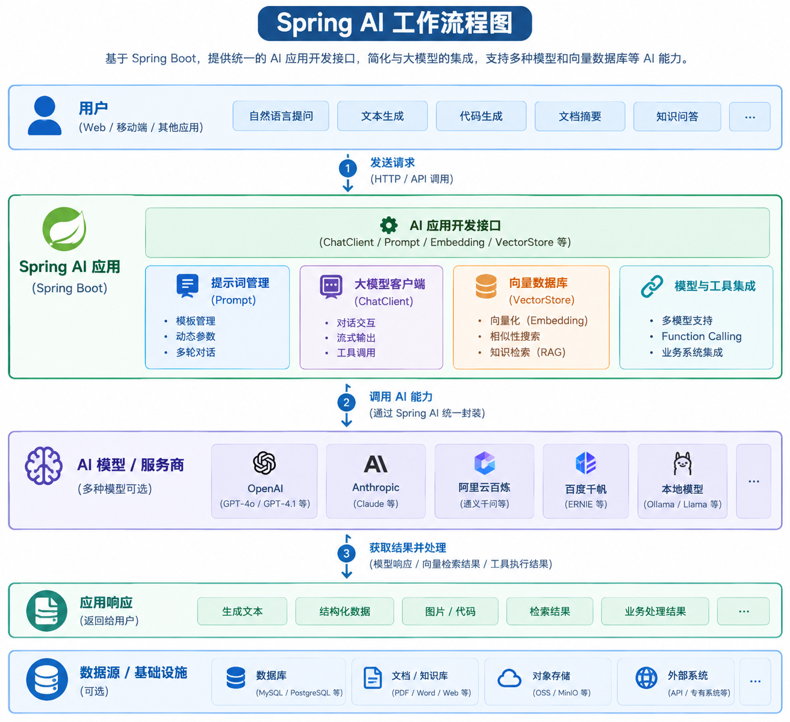

# Spring AI 核心架构体系与企业级生产实战深度指南

> **文档知识定位与全景蓝图**：
> 本文档全面系统地拆解 Spring AI 工业级技术栈。内容涵盖：Spring AI 架构理念与 Spring Boot 自动配置底座、ChatModel 与 ChatClient 模型调用体系、Advisor AOP 拦截器与链路增强、ChatMemory 分布式多租户会话隔离（Redis/MySQL）、VectorStore 向量数据库选型与文档切块（Parent-Child 父子切片）、现代 Advanced RAG 检索增强全链路（Dense+BM25 混合检索、RRF 融合、CrossEncoder 精排 Rerank）、Tool Calling 函数调用、Model Context Protocol (MCP) 与 Skills 技能编排、Micrometer 可观测性与 Token 监控、以及企业级知识库问答与智能客服 Agent 综合架构实战。

---

## 一、Spring AI 体系架构与工程底座

### 1.1 Spring AI 核心定位、设计哲学与生态演进

#### 1. Spring AI 诞生的核心背景与解决的痛点

在生成式 AI 与大语言模型（LLM）爆发之初，Java 企业级开发者面临着严重的碎片化接入痛点：
- **厂商 API 协议异构且割裂**：OpenAI、Anthropic Claude、Google Gemini、阿里云通义千问（DashScope）、智谱 AI 等各大模型厂商的 HTTP 接口入参、响应结构、流式协议（SSE）、认证机制各不相同；
- **业务系统与特定模型厂商深度强绑定**：直接使用各大模型厂商的原生 SDK 会导致业务代码充斥厂商专有类库，一旦后续需要切换模型（如从 OpenAI 迁移至国产合规的通义千问或本地私有化部署的 DeepSeek/Ollama），需要全局重构业务代码；
- **缺乏企业级应用基础设施抽象**：大模型落地企业业务不仅需要基础调用，还需要**对话记忆（ChatMemory）、向量检索（VectorStore）、检索增强生成（RAG）、函数调用（Function Calling / Tools）、AOP 拦截治理（Advisor）、指标监控（Observability）**。传统开发者不得不重复造轮子。

**Spring AI 的核心定位**：
正如 **Spring Data 统一了关系型与非关系型数据库的访问**、**Spring Cloud 统一了微服务治理**一样，**Spring AI 是 Spring 官方推出的顶级顶级开源项目，旨在为 Java 企业级生态提供一套统一、标准、高度抽象的生成式 AI 应用开发框架**。它抹平了底层大模型厂商与向量数据库的技术细节，让 Java 工程师可以用纯正的 Spring 编程范式构建 AI 原生应用。



#### 2. Spring AI vs LangChain (Python) vs LangChain4j 深度对比

| 对比维度 | Spring AI（Spring 官方顶级项目） | LangChain4j（Java 社区独立开源项目） | LangChain（Python 工业级事实标准） |
| :--- | :--- | :--- | :--- |
| **项目背景与血统** | **Pivotal / VMware / Broadcom Spring 官方团队出品**，顶级一级项目 | 社区开源主导，由独立开发者和社区共同驱动 | Python 生态最早、最知名的 AI 应用框架 |
| **架构设计哲学** | **纯正的 Spring 生态设计范式**：强依赖 Spring Boot 自动配置、IoC 依赖注入、AOP 拦截器思想（Advisor 体系）、Fluent API | 类似 Python LangChain 的 Java 端口实现，轻量级，支持纯 Java SE，不强制依赖 Spring | 面向算法与原型验证，链式调用（LCEL），动态语言特性丰富，迭代极其激进 |
| **生态兼容度** | **无缝融入 Spring 全家桶**（Spring Boot 3.x, Spring Cloud Nacos, Spring Security, Micrometer, Actuator） | 提供了 Spring Boot Starter，但内部设计独立于 Spring 体系 | 独立生态，与 Python Web 框架（FastAPI, Django）配合 |
| **可观测性支持** | **原生内置 Micrometer Metrics 与 OpenTelemetry 链路追踪**，开箱即用 Prometheus/Grafana 监控 | 依赖扩展插件实现部分日志与监听 | 强绑定 LangSmith（商业化收费闭源平台） |
| **模型调用 API** | 统一为 `ChatClient`（高层业务编排）与 `ChatModel`（底层接口） | `ChatLanguageModel`、`StreamingChatLanguageModel` | `ChatOpenAI`、`LLMChain`、`Runnable` |
| **企业生产选型建议** | **已有 Spring Boot 3.x 技术栈的中大型 Java 企业首选**，契合运维与微服务规范 | 适合非 Spring 单体、Java 8/11 老系统迁移、轻量级快速原型 | 适合算法团队、AI 原型探索、前沿 Agent 研究 |

#### 3. 版本兼容性要求与演进历程

- **JDK 版本基线**：**必须基于 Java 17+**（全面兼容 Java 21 虚拟线程 Virtual Threads）。
- **Spring Boot 版本基线**：**必须基于 Spring Boot 3.2.x 或 3.3.x 以上版本**。Spring AI 无法直接在 Spring Boot 2.x（基于 Java 8）中原生运行。
- **演进历程与里程碑**：
  - `0.8.x ~ 0.8.1`：早期技术预览版（引入基础 Model 与 VectorStore 抽象）；
  - `1.0.0-M1 ~ M6`：重大架构重构里程碑（推出全新的 **`ChatClient` Fluent API**，重构并全面确立了 **`Advisor` 拦截器体系**，引入 Tool Calling 与结构化输出）；
  - `1.0.0 GA`：企业生产就绪版，新增 Model Context Protocol (MCP) 支持与 Skills 编排体系。

---

### 1.2 核心架构分层与顶层抽象模型

#### 1. Spring AI 四层整体架构分层全景

```
+--------------------------------------------------------------------------+
|                        4. 业务应用与交互层 (Client Layer)                 |
|   ChatClient (Fluent API) | Model Context Protocol (MCP) | AI Skills     |
+--------------------------------------------------------------------------+
                                     |
                                     v
+--------------------------------------------------------------------------+
|                        3. 拦截治理与增强层 (Advisor Layer)                |
|   AroundAdvisor / BaseAdvisor | ChatMemoryAdvisor | QuestionAnswerAdvisor|
|   SafeGuardAdvisor | ToolCallingAdvisor | Logging & Token Metering        |
+--------------------------------------------------------------------------+
                                     |
                                     v
+--------------------------------------------------------------------------+
|                  2. 存储、检索与工程抽象层 (Storage & ETL Layer)          |
|   VectorStore | Document ETL Pipeline | TextSplitter (Parent-Child)     |
|   VectorStoreRetriever | Reranker (Cross-Encoder) | Hybrid Search (BM25) |
+--------------------------------------------------------------------------+
                                     |
                                     v
+--------------------------------------------------------------------------+
|                        1. 底层大模型抽象层 (Model Layer)                  |
|   ChatModel | StreamingChatModel | EmbeddingModel | ImageModel | Moderation|
+--------------------------------------------------------------------------+
```

#### 2. 核心顶层抽象接口体系

1. **`ChatModel`（顶层对话模型接口）**：
   - 抽象底层大模型对话能力，核心方法为 `ChatResponse call(Prompt prompt)`；
   - 支持流式输出的接口为 `StreamingChatModel`，核心方法为 `Flux<ChatResponse> stream(Prompt prompt)`。
2. **`ChatClient`（上层高阶业务编排入口）**：
   - Spring AI 1.0+ 推荐的核心入口。基于 Fluent 链式构建风格，聚合了 Prompt 模板渲染、多轮会话记忆、RAG 知识检索增强、工具调用与响应结果映射。
3. **`EmbeddingModel`（向量嵌入模型接口）**：
   - 负责将文本转化为多维高精度浮点向量（如 1536 维、1024 维），核心方法为 `EmbeddingResponse call(EmbeddingRequest request)`。
4. **`VectorStore`（向量存储接口）**：
   - 封装对各种底层向量数据库的读写与检索能力，继承自 `VectorStoreRetriever`，核心方法包括 `add(List<Document>)`、`delete(...)` 与 `similaritySearch(SearchRequest)`。
5. **`ImageModel`（图像生成模型接口）**：
   - 抽象文生图能力，核心方法为 `ImageResponse call(ImagePrompt prompt)`。

#### 3. 核心载荷模型：Prompt、Message 与 ChatResponse

- **`Prompt`（模型请求对象）**：封装单次请求的所有元数据，包含一个或多个 `Message` 集合以及模型运行参数 `ChatOptions`。
- **4 种核心 `Message` 类型**：
  - **`SystemMessage`（系统人设消息）**：设定大模型的全局行为规范、身份背景、输出规则与安全约束；
  - **`UserMessage`（用户提问消息）**：终端用户的输入内容，支持纯文本或图文多模态（`Media` 列表）；
  - **`AssistantMessage`（助手回复消息）**：大模型的历史回复内容，若触发了函数调用，还会携带 `ToolCall` 对象；
  - **`ToolResponseMessage`（工具执行结果消息）**：本地应用程序执行工具函数后回传给大模型的返回值。
- **`ChatResponse`（模型完整响应对象）**：包含 `List<Generation>`（生成的候选文本列表）、`ChatResponseMetadata`（大模型调用全局元数据，包含最重要的 Token 消耗对象 `Usage`）。

#### 4. 官方生态支持矩阵清单

- **支持模型厂商（不断扩充中）**：
  - 国际厂商：OpenAI (GPT-4o, o1), Anthropic Claude 3.5, Google Gemini, Azure OpenAI, AWS Bedrock, Mistral AI；
  - 国内合规厂商：阿里云百炼通义千问（DashScope / Spring AI Alibaba）、智谱 BigModel、百度千帆、腾讯混元；
  - 本地私有化引擎：Ollama (DeepSeek, Llama 3, Qwen 2.5), LocalAI。
- **支持向量数据库（覆盖云原生与主流中间件）**：
  - 关系型扩展：PostgreSQL (PgVector)；
  - 分布式专用：Milvus, Qdrant, Weaviate, Pinecone；
  - 传统检索/缓存扩展：Elasticsearch 向量检索, Redis Vector Search, Neo4j Vector；
  - 本地轻量级：SimpleVectorStore（内存测试用）, Chroma。

---

### 1.3 Spring Boot 自动配置机制与生产级配置管理

#### 1. 核心 Starter 依赖体系分类

Spring AI 严格遵循 Spring Boot 标准 Starter 命名模式：
- **模型类 Starter**：`spring-ai-starter-openai`、`spring-ai-starter-dashscope`、`spring-ai-starter-ollama` 等；
- **向量库 Starter**：`spring-ai-starter-pgvector-store`、`spring-ai-starter-milvus-vector-store`、`spring-ai-starter-redis-vector-store` 等；
- **通用功能 Starter**：`spring-ai-starter-mcp-client`、`spring-ai-starter-mcp-server-webmvc` 等。

```xml
<!-- 生产最简组合示例：引入 OpenAI 对话模型与 PgVector 向量存储 -->
<dependencyManagement>
    <dependencies>
        <dependency>
            <groupId>org.springframework.ai</groupId>
            <artifactId>spring-ai-bom</artifactId>
            <version>1.0.0-M6</version>
            <type>pom</type>
            <scope>import</scope>
        </dependency>
    </dependencies>
</dependencyManagement>

<dependencies>
    <dependency>
        <groupId>org.springframework.ai</groupId>
        <artifactId>spring-ai-starter-openai</artifactId>
    </dependency>
    <dependency>
        <groupId>org.springframework.ai</groupId>
        <artifactId>spring-ai-starter-pgvector-store</artifactId>
    </dependency>
</dependencies>
```

#### 2. 自动配置（AutoConfiguration）底层原理解析

Spring AI 的自动配置机制深度结合了 Spring Boot 的条件注解（Conditional Annotations）：
1. **自动装配触发点**：
   - 依赖包中的 `META-INF/spring/org.springframework.boot.autoconfigure.AutoConfiguration.imports` 声明了配置类（如 `OpenAiAutoConfiguration`、`PgVectorStoreAutoConfiguration`）；
2. **核心装配逻辑与条件注入**：
   - 自动扫描读取 `spring.ai.openai.*` 配置并映射到 `OpenAiChatProperties`；
   - 检查容器中若不存在自定义的 `OpenAiApi`，则根据配置的 `api-key` 与 `base-url` 自动构建底层 HTTP 客户端通信 Bean；
   - 使用 `@ConditionalOnMissingBean` 自动创建并向 Spring 容器注入单例的 `ChatModel`（具体实现类为 `OpenAiChatModel`）与 `EmbeddingModel`；
   - 自动配置并注入 **`ChatClient.Builder`** 原型 Bean，使得业务层可以直接注入并构建链式调用的 `ChatClient`。

#### 3. 生产级 `application.yml` 统一规范配置全貌

```yaml
spring:
  application:
    name: ai-enterprise-service
  ai:
    # 1. 大模型通信配置 (以 OpenAI 协议接口为例，支持直连通义千问/DeepSeek等兼容协议)
    openai:
      api-key: ${AI_API_KEY:sk-your-secure-key}
      base-url: ${AI_BASE_URL:https://api.openai.com}
      chat:
        options:
          model: gpt-4o                # 默认大模型版本
          temperature: 0.7              # 温度: 0.0严格严谨，1.0丰富发散
          max-tokens: 2048              # 最大生成 Token 限制
          top-p: 0.95
      embedding:
        options:
          model: text-embedding-3-small # 默认文本嵌入模型
      # 客户端传输层超时与重试配置 (防止网络闪断打崩业务)
      retry:
        max-attempts: 3
        backoff:
          initial-interval: 1000ms
          multiplier: 2.0

    # 2. 向量数据库配置 (以 PgVector 为例)
    vectorstore:
      pgvector:
        index-type: HNSW                # 生产首选 HNSW 索引
        distance-type: COSINE           # 余弦距离
        dimensions: 1536                # 向量维度必须与 Embedding 模型强一致！
        initialize-schema: false        # 生产禁止自动建表，由 DBA 预先执行脚本
```

#### 4. 配置优先级法则（生产调优关键）

Spring AI 参数配置具备多层覆盖机制，优先级**从低到高**依次为：
$$\text{默认内部兜底值} < \text{application.yml 全局配置} < \text{ChatClient.Builder 默认参数} < \text{单次调用动态覆盖参数 (prompt().options())}$$
- **生产最佳实践**：在 `application.yml` 中配置大多数接口通用的全局保守参数（如 `temperature: 0.7`）；在代码中针对特定接口（如要求严格精确的金融报表计算）显式通过 `.options(OpenAiChatOptions.builder().temperature(0.0).build())` 进行局部精准覆盖。

---

### 1.4 Spring 全家桶无缝生态集成

#### 1. 与 Spring Cloud 集成：Nacos 配置中心动态热刷新与服务治理

在企业级微服务集群中，大模型的 API Key、模型名称、提示词模板通常由运营和架构师统一管控，绝不能硬编码，必须支持秒级动态热更新。

```yaml
# bootstrap.yml 或 application.yml
spring:
  cloud:
    nacos:
      config:
        server-addr: 127.0.0.1:8848
        file-extension: yaml
        namespace: production
        group: AI_CONFIG_GROUP
```

**配合 `@RefreshScope` 实现 API Key 动态无感刷新**：
```java
@Component
@RefreshScope // 监听 Nacos 配置变更事件，触发底层连接重建
public class AiConfigHolder {
    @Value("${spring.ai.openai.api-key}")
    private String apiKey;

    @Value("${spring.ai.openai.chat.options.model}")
    private String activeModel;

    public String getApiKey() { return apiKey; }
    public String getActiveModel() { return activeModel; }
}
```

#### 2. 与 Spring Security 集成：多租户权限校验与数据安全隔离

大模型接口极度消耗算力且涉及敏感数据，必须在入口接入 Spring Security 认证鉴权链：
```java
@RestController
@RequestMapping("/api/v1/ai")
public class SecureAiController {

    private final ChatClient chatClient;

    public SecureAiController(ChatClient.Builder builder) {
        this.chatClient = builder.build();
    }

    @PostMapping("/chat")
    @PreAuthorize("hasAuthority('AI_CHAT_ACCESS')")
    public String chat(@RequestBody ChatRequest request,
                       @AuthenticationPrincipal SecurityUser user) {
        // 从当前登录上下文中提取租户 ID 与用户 ID
        String tenantId = user.getTenantId();
        String userId = user.getUserId();

        return chatClient.prompt()
                .user(request.getMessage())
                // 在 Advisor 上下文中传递多租户隔离标记，向量检索时自动按租户过滤
                .advisors(advisorSpec -> advisorSpec.param("tenant_id", tenantId)
                                                   .param("user_id", userId))
                .call()
                .content();
    }
}
```

#### 3. 与 Spring Data & Spring Cache 集成：缓存高频重复查询

对于电商 FAQ、通用政策咨询等静态问答，频繁调用大模型不仅延迟高（500ms~2s）而且持续产生成本。利用 Spring Cache 可以在前置链路拦截高频重复问题：
```java
@Service
public class CachedAiService {

    private final ChatClient chatClient;

    public CachedAiService(ChatClient.Builder builder) {
        this.chatClient = builder.build();
    }

    // 针对相同问题的用户提问，直接命中 Redis 缓存返回，RT 降至 5ms，节省 100% Token 费用
    @Cacheable(value = "ai:faq:cache", key = "#question.trim().toLowerCase()", unless = "#result == null")
    public String askFaq(String question) {
        return chatClient.prompt()
                .system("你是一个专业的客服，请简明扼要地回答问题。")
                .user(question)
                .call()
                .content();
    }
}
```

---

## 二、模型抽象与核心调用链路

### 2.1 ChatModel（底层接口） vs ChatClient（链式高层 API）深度剖析

#### 1. 底层接口：ChatModel 的职责与局限

`ChatModel` 是 Spring AI 面向底层大模型通信的顶层标准化接口，直接对应各大厂商的原生 API：

```java
// Spring AI 官方核心接口定义
public interface ChatModel extends Model<Prompt, ChatResponse> {
    @Override
    ChatResponse call(Prompt prompt); // 同步阻塞调用
    
    // 默认支持流式响应
    default Flux<ChatResponse> stream(Prompt prompt) {
        throw new UnsupportedOperationException("Streaming not supported");
    }
}
```

##### ChatModel 原生底层调用代码示例：
```java
@Service
public class LowLevelModelService {

    @Autowired
    private ChatModel chatModel; // 容器自动注入的具体实现（如 OpenAiChatModel）

    public String askDirectly(String userQuestion) {
        // 必须手动组装 Message 和 Prompt 对象
        Message userMessage = new UserMessage(userQuestion);
        Message systemMessage = new SystemMessage("你是一个严谨的资深架构师。");
        Prompt prompt = new Prompt(List.of(systemMessage, userMessage));

        // 底层直接调用
        ChatResponse response = chatModel.call(prompt);
        
        // 必须逐层拆包获取结果
        return response.getResult().getOutput().getContent();
    }
}
```

- **ChatModel 的局限性**：
  - API 较为底层繁琐，每次调用都需要显式手动创建 `Prompt`、`Message` 集合并层层解包；
  - **无法直接外挂 Spring AI 的核心灵魂组件——`Advisor` 拦截器链**（如无法直接自动追加会话记忆、无法直接挂载 RAG 检索增强）。

#### 2. 上层业务核心：ChatClient（Fluent API 推荐开发标准）

为了提升开发体验，Spring AI 1.0+ 推出了全新的 **`ChatClient`**。它采用类似 Spring 6 的 `RestClient` 或 `WebClient` 的**流畅链式调用（Fluent API）**设计风格，作为连接业务逻辑与底层 AI 基础设施的集大成者。

##### ChatClient 核心配置与 Bean 注入规范：
```java
@Configuration
public class AiClientConfig {

    @Bean
    public ChatClient chatClient(ChatClient.Builder builder) {
        // 在全局构建器中预先配置通用人设与全局拦截器
        return builder
                .defaultSystem("你是一个企业级 AI 专家助手，回答请条理清晰、格式严密。")
                .defaultAdvisors(
                    new SimpleLoggerAdvisor() // 全局请求响应日志打印
                )
                .build();
    }
}
```

##### ChatClient 业务层极简调用实战：
```java
@Service
public class BusinessAiService {

    private final ChatClient chatClient;

    public BusinessAiService(ChatClient chatClient) {
        this.chatClient = chatClient;
    }

    public String quickChat(String question) {
        return chatClient.prompt()
                .user(question)
                .call()
                .content(); // 一键直接拿到最终文本，内部自动完成消息组装与解包
    }
}
```

#### 3. ChatModel vs ChatClient 核心全景对比

| 对比维度 | ChatModel（底层接口） | ChatClient（高层业务 API，首选） |
| :--- | :--- | :--- |
| **层级定位** | 基础设施层底层抽象，直接映射模型厂商 HTTP API | 业务应用编排层门面（Facade），项目开发官方强烈推荐 |
| **调用风格** | 传统方法传参：`chatModel.call(new Prompt(...))` | **链式流畅风格（Fluent API）**：`chatClient.prompt().user(...).call().content()` |
| **Advisor 拦截器支持** | **不支持**（需业务自己手动处理上下文与 RAG） | **原生深度集成**（可一键配置 ChatMemory、RAG、安全校验等 Advisor） |
| **参数组装便捷性** | 繁琐，需手动组装 Prompt、Message、Options | 极度便捷，提供 `.system()`、`.user()`、`.param()` 动态占位符注入 |
| **返回类型灵活性** | 仅返回底层的原始 `ChatResponse` | **支持多层按需解析**：`.content()`（字符串）、`.entity(Class)`（转 POJO）、`.chatResponse()` |
| **工业选型场景** | 需要脱离 Advisor 体系进行极简底层测试、自研框架中间件封装 | **99% 的企业级实际业务系统、智能客服、知识库问答开发** |

#### 4. ChatClient 内部完整执行调用链路全景拆解

理解 ChatClient 的执行链路是掌握 Spring AI 源码和面试考核的关键核心：

```text
[业务代码调用] -> chatClient.prompt().user("...").advisors(...).call()
      |
      v
[DefaultChatClient.DefaultChatClientRequestSpec] (构建并收集 Prompt 参数、User/System 文本)
      |
      v
[DefaultChatClient.call()] (触发执行流程)
      |
      v
[Advisor 拦截器链前置处理 (AroundAdvisor.aroundRequest)]
      |--- 1. MessageChatMemoryAdvisor (读取历史上下文，注入到 Prompt 消息列表中)
      |--- 2. QuestionAnswerAdvisor (执行 RAG，检索向量库并将上下文填入 Prompt)
      |--- 3. SimpleLoggerAdvisor (记录最终准备发往大模型的完备 Prompt 日志)
      v
[底层 ChatModel.call(Prompt)] (向大模型发起真实网络通信请求，得到 ChatResponse)
      |
      v
[Advisor 拦截器链后置处理 (AroundAdvisor.aroundResponse)]
      |--- 1. SimpleLoggerAdvisor (打印模型原始响应与 Token 耗时)
      |--- 2. MessageChatMemoryAdvisor (将本轮大模型的回复保存沉淀到会话存储中)
      v
[结果提取与反序列化] -> .content() / .entity(POJO.class) -> 返回最终业务结果给调用方
```

---

### 2.2 同步调用 `call()` vs 响应式流式输出 `stream()` 底层机制

#### 1. 同步阻塞调用 `call()` 的三大返回值层级

`ChatClient` 在调用 `.call()` 后，支持根据业务需求灵活提取不同维度的结果：

```java
// 1. 直接获取大模型返回的纯文本字符串内容 (最常用)
String textContent = chatClient.prompt().user("解释什么是DDD").call().content();

// 2. 结构化自动映射为 Java 实体类 (POJO / Record，无需手动写 JSON 解析)
UserProfile profile = chatClient.prompt()
        .user("提取用户信息：张三，28岁，高级Java工程师")
        .call()
        .entity(UserProfile.class);

// 3. 获取完整的原始 ChatResponse (用于提取 Token 消耗、FinishReason 等元数据)
ChatResponse fullResponse = chatClient.prompt().user("写一首诗").call().chatResponse();
long totalTokens = fullResponse.getMetadata().getUsage().getTotalTokens();
```

#### 2. 响应式流式输出 `stream()` 底层机制与实战

- **底层技术机制**：流式调用基于 **Project Reactor 响应式流规范**，返回 `Flux<ChatResponse>` 或 `Flux<String>`；
- **传输层协议**：大模型厂商在服务端计算出新 Token 时，通过 HTTP **Server-Sent Events (SSE)** 协议持续向客户端推送数据切片；
- **业务价值**：大模型生成一篇长文章往往需要十几秒，采用同步调用会导致客户端长时间面对空白转圈；采用流式输出可以实现类似 ChatGPT 的**实时打字机效果**，首字延迟（TTFT，Time to First Token）降低到几百毫秒，极大地提升用户体验。

##### 生产级 Web 接口流式输出（结合 Spring WebMvc / SSE）：
```java
@RestController
@RequestMapping("/api/ai")
public class StreamingAiController {

    private final ChatClient chatClient;

    public StreamingAiController(ChatClient chatClient) {
        this.chatClient = chatClient;
    }

    // 声明 produces 为 TEXT_EVENT_STREAM_VALUE，浏览器端直接通过 EventSource 监听打字机
    @GetMapping(value = "/stream", produces = MediaType.TEXT_EVENT_STREAM_VALUE)
    public Flux<String> streamChat(@RequestParam("prompt") String prompt) {
        return chatClient.prompt()
                .user(prompt)
                .stream()
                .content(); // 将 Flux<ChatResponse> 自动扁平化转换为 Flux<String>
    }
}
```

> **流式调用的重要考量（面试避坑点）**：
> 在流式输出模式下，前面推送的每一个文本 Chunk 通常**不包含 Token 消耗元数据**，大模型的总 Token 消耗（`Usage`）**仅包含在最后一个数据帧（Final Chunk）中**。如果业务需要精确计费，必须监听并提取最后一个 Chunk 的 Metadata，或者利用后置拦截器统一累加。

---

### 2.3 核心请求响应模型剖析与层级结构

#### 1. PromptTemplate 提示词模板机制

提示词模板允许将用户动态变量以占位符（如 `{topic}`、`{format}`）的形式注入预设的静态模板中，避免脆弱的手动字符串拼接：

```java
// 定义带占位符的通用模板
PromptTemplate template = new PromptTemplate(
    "你是一个资深专家，请用通俗易懂的语言向一个小白解释概念：{concept}，要求字数不超过 {maxWords} 字。"
);

// 渲染模板并生成 Prompt
Prompt prompt = template.create(Map.of(
    "concept", "分布式锁",
    "maxWords", "200"
));

// 也可以直接在 ChatClient 中使用快捷占位符渲染
String response = chatClient.prompt()
        .user(u -> u.text("分析股票代码：{code}在过去{days}天的趋势")
                    .param("code", "600519")
                    .param("days", "7"))
        .call()
        .content();
```

#### 2. 4 种核心 Message 类型的语义矩阵

| Message 实现类 | 对应的角色（Role） | 核心业务语义与功能 | 使用场景与实战技巧 |
| :--- | :--- | :--- | :--- |
| **`SystemMessage`** | `system` | **系统人设与硬规则**：拥有最高的遵从优先级，决定模型的角色定位、输出格式、安全边界 | 设定全局角色（如“你是一个翻译官”、“严格以JSON输出，不得有多余废话”） |
| **`UserMessage`** | `user` | **最终用户提问**：代表终端使用者的当前输入指令，支持纯文本或媒体附件 | 用户在聊天框输入的文本，或上传的图片/音频数据 |
| **`AssistantMessage`** | `assistant` | **大模型历史回复**：大模型之前生成的回复内容；若模型触发了工具调用，还携带 `toolCalls` | 用于在多轮对话中还原大模型自身说过的历史记录，保持逻辑连贯 |
| **`ToolResponseMessage`** | `tool` | **本地工具调用执行结果**：当模型决定调用工具后，本地业务代码执行完将结果封装成此对象 | 包含工具调用 ID（`toolCallId`）与函数的执行返回结果，交回模型做最终汇总 |

#### 3. ChatResponse 完整层级树深度拆解

```text
ChatResponse (全局响应顶层容器)
|
+--- List<Generation> (大模型生成结果列表，通常默认只有 1 条候选)
|    |
|    +--- AssistantMessage (具体的助手消息)
|    |    +--- String content (生成的最终文本内容)
|    |    +--- List<ToolCall> (大模型发起的函数调用指令列表，若有)
|    |
|    +--- ChatGenerationMetadata (单条生成结果的元数据)
|         +--- String finishReason (生成结束的原因标志)
|
+--- ChatResponseMetadata (大模型全局调用元数据)
     +--- String id (本次调用的全局唯一请求 ID)
     +--- String model (实际提供服务的模型名称及版本)
     +--- Usage usage (★极其重要★ 本次调用的 Token 消耗核心指标)
          +--- Long promptTokens (输入提示词消耗的 Token 数)
          +--- Long generationTokens (输出回复内容消耗的 Token 数)
          +--- Long totalTokens (总计消耗的 Token 数)
```

##### `finishReason` 核心枚举取值精准解析（排查故障必看）：
- **`STOP`**：正常结束。大模型生成了自然的停止标记，完整输出了所有内容。
- **`LENGTH`**：截断结束。生成的内容达到了请求参数设定的 `max-tokens` 上限，或者触碰了模型底层最大上下文窗口极限，**内容被迫强行截断，是不完整的**！
- **`TOOL_CALLS`**：挂起等待工具执行。大模型判定需要调用本地函数（Function Calling），生成暂停并等待本地代码执行工具后回传结果。
- **`CONTENT_FILTER`**：触发内容安全拦截。大模型内部的安全审核机制检测到输入或输出包含涉黄、涉政、违规内容，强行中止生成。

---

### 2.4 结构化输出（Structured Output）：OutputParser 原理与 POJO 映射

#### 1. 为什么必须引入结构化输出机制？

在将 LLM 接入传统企业后端（如订单系统、审批流、自动化报表）时，我们通常要求模型返回严格的 JSON 格式供后端解析。
- **纯文本 Prompt 的痛点**：若仅在 Prompt 中写“请以 JSON 返回”，大模型极易在 JSON 外面包裹 Markdown 代码块（````json ... ````），或者输出夹杂“好的，以下是为您整理的数据：”等解释性废话，甚至偶尔少闭合一个花括号，导致后端 `Jackson` 解析器抛出致命的 `JsonParseException`。
- **Spring AI 的解决方案**：提供了一等公民的 **`OutputParser`（输出解析器）** 抽象，结合 Java 的强类型体系（POJO / Record），实现自动注入格式约束与精准容错反序列化。

#### 2. `OutputParser` 核心接口与实现体系

```java
public interface OutputParser<T> extends Parser<T>, FormatProvider {
    // 负责在 Prompt 中自动追加给大模型看的输出格式说明指令
    @Override
    String getFormat();
    
    // 负责将大模型返回的原始字符串精准反序列化为泛型 Java 对象
    @Override
    T parse(String text);
}
```

- **`BeanOutputParser<T>`**：最强大的实体类解析器，根据传入的 Java 类定义，自动推导出对应的 JSON Schema 并注入 Prompt；
- **`MapOutputParser`**：将模型输出解析为标准的 `Map<String, Object>`；
- **`ListOutputParser`**：将逗号分隔或列表形式的输出解析为 `List<String>`。

#### 3. 结构化输出底层原理解密

```text
[定义 Java POJO / Record: ActorFilms]
      |
      v
[BeanOutputParser 自动提取类结构生成 JSON Schema]
      |
      v
[自动追加到最终 Prompt 的末尾]:
"The output should be formatted as a JSON instance that conforms to the JSON Schema below:
 { "$schema": "...", "type": "object", "properties": { "actor": {"type": "string"}, ... } }"
      |
      v
[大模型感知严格约束，直接输出纯净 JSON 字符串]
      |
      v
[BeanOutputParser 自动清洗外层反引号，并通过 ObjectMapper 反序列化为 Java 对象]
```

#### 4. 推荐实战：基于 Java Record 的现代化结构化输出

Java 16+ 引入的 `Record` 具备不可变性、简洁语法与天然的数据载荷特性，是结构化输出的最佳载体：

```java
// 1. 定义期望大模型抽取的强类型数据结构
public record CustomerInvoice(
    String invoiceNumber,
    String customerName,
    BigDecimal totalAmount,
    List<String> items,
    LocalDate issueDate
) {}

@Service
public class InvoiceExtractService {

    private final ChatClient chatClient;

    public InvoiceExtractService(ChatClient chatClient) {
        this.chatClient = chatClient;
    }

    public CustomerInvoice extractInvoice(String rawEmailContent) {
        // 利用 ChatClient 的 .entity() 语法糖，一行代码搞定结构化提取与类型转换！
        return chatClient.prompt()
                .system("你是一个专业的财务票据信息抽取智能体。")
                .user(u -> u.text("请从以下邮件中提取发票要素：
{content}")
                            .param("content", rawEmailContent))
                .call()
                .entity(CustomerInvoice.class); // 内部自动装配 BeanOutputParser
    }
}
```

---

### 2.5 跨模态模型集成与企业级应用

大语言模型正在全面迈入多模态（Multimodal）时代，Spring AI 对图文生成、语音交互与安全合规提供了统一的抽象支持。

#### 1. 文生图（ImageModel）集成实战

```java
@Service
public class AiImageService {

    @Autowired
    private ImageModel imageModel; // 自动装配 OpenAiImageModel 等具体实现

    public String generateBanner(String description) {
        ImagePrompt imagePrompt = new ImagePrompt(
            description,
            ImageOptionsBuilder.builder()
                .withModel("dall-e-3")
                .withN(1)                   // 生成图片张数
                .withHeight(1024)
                .withWidth(1024)
                .withQuality("hd")          // 高清画质
                .build()
        );

        ImageResponse response = imageModel.call(imagePrompt);
        // 获取生成的云端临时访问 URL
        return response.getResult().getOutput().getUrl();
    }
}
```

#### 2. 语音识别（ASR）与语音合成（TTS）

- **语音识别（Audio Transcriptions - Whisper）**：将用户在移动端录制的语音文件转译为结构化文本：
  - 核心接口：`OpenAiAudioTranscriptionModel`，入参为语音文件 `Resource`，直接返回识别出的文本。
- **语音合成（Audio Speech - TTS）**：将大模型生成的文本转换为真人发音音频流（支持多种音色 `alloy`, `echo`, `shimmer`）：
  - 核心接口：`OpenAiAudioSpeechModel`，输出 `byte[]` 音频二进制流，常用于智能外呼电话机器人。

#### 3. 内容审核（ModerationModel）：企业风控护栏

在将用户输入送入大模型、或将大模型回答展现给用户之前，必须通过内容审核模型确保企业合规：
```java
@Service
public class SecurityAuditService {

    @Autowired
    private OpenAiModerationModel moderationModel;

    public boolean isSafe(String text) {
        ModerationPrompt prompt = new ModerationPrompt(text);
        ModerationResponse response = moderationModel.call(prompt);
        
        // 检查是否被标记为违规 (如涉暴、仇恨言论、骚扰等)
        return !response.getResult().getOutput().isFlagged();
    }
}
```

---

## 三、Advisor 拦截器体系与链路增强

### 3.1 Advisor 核心定位与设计模式

#### 1. 为什么说 Advisor 是 Spring AI 架构设计的“灵魂组件”？

在传统软件工程中，Spring AOP（面向切面编程）通过代理模式与拦截器机制，完美实现了事务管理、权限拦截与性能审计，做到了非侵入式的关注点分离。

在生成式 AI 时代，与大模型的交互链路极度复杂：
- 发送给大模型前，需要**动态拼接多轮历史会话记录、执行知识库检索（RAG）、注入安全脱敏规则、记录请求日志**；
- 大模型返回后，需要**审计敏感违规内容、提取消费的 Token 指标、将模型回复沉淀到会话存储中、缓存结果**。
- 如果将这些横切逻辑全部混杂在业务 Controller 或 Service 中，代码将迅速恶化为意大利面条式的泥潭。

**Spring AI 引入了 `Advisor`（顾问拦截器）架构体系**：将所有在“模型调用前（Pre-processing）”与“模型调用后（Post-processing）”的横切增强行为统一抽象为可插拔、可复用、可严格排序的责任链。

```
+-------------------------------------------------------------------------+
|                  ChatClient Advisor 责任链执行流水线                    |
+-------------------------------------------------------------------------+
[业务调用发起]
      |
      v
+------------------+     +------------------+     +------------------+
| Advisor 1 (前置)  | --> | Advisor 2 (前置)  | --> | Advisor 3 (前置)  |
| (如: 会话记忆注入) |     | (如: RAG 知识检索)|     | (如: 请求日志审计) |
+------------------+     +------------------+     +------------------+
                                                           |
                                                           v
                                                  [底层 ChatModel.call()]
                                                  (向 LLM 发起真实网络通信)
                                                           |
                                                           v
+------------------+     +------------------+     +------------------+
| Advisor 1 (后置)  | <-- | Advisor 2 (后置)  | <-- | Advisor 3 (后置)  |
| (如: 保存最新回复) |     | (如: 评估检索质量)|     | (如: 统计消耗Token) |
+------------------+     +------------------+     +------------------+
      |
      v
[返回最终结果给业务]
```

#### 2. `AroundAdvisor` vs `BaseAdvisor` 核心抽象体系

Spring AI 提供了两种实现自定义 Advisor 的底层基类：

| 对比维度 | `AroundAdvisor`（环绕拦截器接口） | `BaseAdvisor`（抽象便捷基类） |
| :--- | :--- | :--- |
| **层级定位** | 核心顶层接口，提供对整条链路的完全控制力 | 抽象辅助类，继承自 `AroundAdvisor`，做简化封装 |
| **方法签名** | `AdvisedResponse aroundCall(AdvisedRequest req, Chain chain)` | `AdvisedRequest before(req)` 与 `AdvisedResponse after(resp)` |
| **链路传递机制** | **必须手动显式调用 `chain.nextAroundCall(req)` 传递** | 无需关心链式调用，框架模板方法自动执行链条流转 |
| **请求阻断能力** | **具备完全的短路阻断能力**（可根据安全规则直接 `return` 伪造响应，无需调用真实大模型） | 较难直接短路阻断，主要用于纯粹的参数改写与结果后置监控 |
| **流式支持** | 需同时实现 `aroundStream()` 负责响应式流拦截 | 框架提供统一处理 |
| **开发建议** | **适合复杂场景：如安全护栏拦截、语义缓存命中直接返回、重试降级** | **适合简单场景：如打印日志、追加系统 Prompt、统计耗时** |

#### 3. Advisor 链的两种配置装配模式

1. **全局默认注入（Default Advisors）**：在 Spring 配置类中配置到 `ChatClient.Builder` 上，对所有基于该客户端的调用全局生效（如全局日志、全局安全审计）；
2. **单次请求动态覆盖（Request-level Advisors）**：在单次链式调用中使用 `.advisors(...)` 动态挂载，仅对当前次模型交互生效（如特定问答挂载 RAG，特定会话注入 ChatMemory）。

```java
// 单次请求动态挂载 Advisor 示例
String answer = chatClient.prompt()
        .user("我的公积金贷款额度是多少？")
        .advisors(
            new QuestionAnswerAdvisor(vectorStore), // 仅本接口挂载知识库检索
            new MessageChatMemoryAdvisor(chatMemory) // 挂载会话记忆
        )
        .call()
        .content();
```

---

### 3.2 Spring AI 内置 7 大核心 Advisor 深度剖析

Spring AI 官方开箱即用地提供了覆盖生产全流程的内置 Advisor 组件：

| Advisor 名称 | 所属核心领域 | 核心工作原理与职责 | 生产价值与应用场景 |
| :--- | :--- | :--- | :--- |
| **1. `MessageChatMemoryAdvisor`** | 会话记忆（消息流） | 在调用前从 `ChatMemory` 读取历史消息追加为独立的 `Message` 列表；调用后将 Assistant 回复自动写回存储 | **最标准、最推荐的普通多轮会话记忆组件** |
| **2. `PromptChatMemoryAdvisor`** | 会话记忆（纯文本） | 将历史对话拼接为一个长字符串，以文本形式注入系统提示词中的 `{chat_memory}` 占位符 | 适配部分不支持结构化 Message 历史的轻量级大模型 |
| **3. `VectorStoreChatMemoryAdvisor`** | 会话记忆（语义记忆） | 将历史对话切块向量化存储在向量库中，每次仅基于用户当前提问进行语义搜索，召回最相关的几轮历史 | **超长跨度会话、终身记忆智能体**，极度节省 Token |
| **4. `QuestionAnswerAdvisor`** | 检索增强（RAG） | 拦截用户问题，在 `VectorStore` 中执行相似度检索，将召回的相关切片拼接进预设的 RAG 模板中提交给模型 | **企业内部知识库问答的标准生产 RAG 增强组件** |
| **5. `RetrievalAugmentationAdvisor`** | 检索增强（进阶 RAG） | Spring AI 1.0 引入的模块化 RAG 顾问，解耦了 QueryTransformer、Retriever 与 DocumentPostProcessor | 支持复杂查询改写、多向量库召回与重排序的进阶 RAG 管道 |
| **6. `SimpleLoggerAdvisor`** | 可观测性与日志 | 在请求前打印完整的 Prompt 内容，在响应后打印生成的文本与 Token 耗时元数据 | 本地开发调试、排查模型输入格式问题的首选工具 |
| **7. `SafeGuardAdvisor`** | 安全风控护栏 | 内置敏感词与风险模式列表，在请求前检测用户提问，一旦违规直接拦截并返回安全兜底话术 | 金融、政务等严合规场景下的前置 Prompt 注入防护 |

---

### 3.3 Advisor 责任链执行顺序法则与避坑指南

#### 1. Advisor 链的严格有序性机制

Advisor 实现了 Spring 的 `Ordered` 接口，可以通过 `getOrder()` 明确指定其在责任链中的物理执行顺序：
- **`Order` 值越小，优先级越高**；
- **前置阶段（Request Phase）**：按照 `Order` **从小到大（升序）**依次执行；
- **后置阶段（Response Phase）**：按照 `Order` **从大到小（降序，类似栈后进先出）**逆向依次执行。

```
                    Order = 0 (如: ChatMemory)     Order = 100 (如: RAG QA)
请求进栈方向 (升序) -------> [ Memory 前置: 取历史 ] ------> [ RAG 前置: 向量检索拼接 ] -------> [LLM 调用]
响应出栈方向 (降序) <------- [ Memory 后置: 存回复 ] <------ [ RAG 后置: 质量校验 ] <----------+
```

#### 2. 经典高频生产避坑：为什么 Memory 必须在 RAG 之前执行？

在很多初学者的项目中，经常出现一个诡异 Bug：“多轮对话提问时，AI 突然像失忆了一样，完全不知道上一句话说了什么”。

- **故障根因：Advisor 顺序装配错误！**
  - 如果将 `QuestionAnswerAdvisor`（Order=0）放在了 `MessageChatMemoryAdvisor`（Order=100）的前面：
  - **前置时**：RAG 拦截器先执行。此时 RAG 仅能看到用户当前的最新单句提问（例如：“那它支持哪些参数？”），由于没有包含上一轮提问的主语（如：“Spring AI 的重试机制”），RAG 带着无主语的残缺语句去向量库检索，命中率几乎为 0！
  - 随后 Memory 拦截器才执行，将历史记录追加到 Prompt。但此时 Prompt 已经无法影响上一步的 RAG 检索结果了！
- **生产黄金铁律**：
  $$\text{Order}(\text{ChatMemoryAdvisor}) < \text{Order}(\text{QuestionAnswerAdvisor})$$
  **永远必须让会话记忆拦截器先执行，确保完整的对话上下文就绪后，再执行 RAG 知识检索或路由拦截！**

---

### 3.4 自定义 Advisor 工业实战：全局输入输出 Token 自动计量与耗时监控

在生产环境中，大模型是按照 Token 计费的。如果在每个业务 Controller 里手动写代码获取 Token，会有巨大的代码侵入。通过实现 `AroundAdvisor` 可以优雅地实现全局全自动切面监控：

```java
@Component
public class TokenMeteringAdvisor implements AroundAdvisor {

    private static final Logger log = LoggerFactory.getLogger(TokenMeteringAdvisor.class);

    // 设置执行优先级，通常作为最外层拦截器执行
    @Override
    public int getOrder() {
        return Ordered.HIGHEST_PRECEDENCE;
    }

    @Override
    public String getName() {
        return "TokenMeteringAdvisor";
    }

    @Override
    public AdvisedResponse aroundCall(AdvisedRequest advisedRequest, AroundAdvisorChain chain) {
        long startTime = System.currentTimeMillis();
        
        // 1. 放行请求，继续沿责任链向下传递，最终向大模型发起通信
        AdvisedResponse advisedResponse = chain.nextAroundCall(advisedRequest);
        
        long costTime = System.currentTimeMillis() - startTime;

        // 2. 从响应元数据中安全提取 Token 消耗指标
        ChatResponse chatResponse = advisedResponse.response();
        if (chatResponse != null && chatResponse.getMetadata() != null) {
            Usage usage = chatResponse.getMetadata().getUsage();
            if (usage != null) {
                Long promptTokens = usage.getPromptTokens();
                Long genTokens = usage.getGenerationTokens();
                Long totalTokens = usage.getTotalTokens();

                log.info("【AI 调用审计】耗时: {} ms | 输入 Token: {} | 输出 Token: {} | 总计 Token: {}",
                        costTime, promptTokens, genTokens, totalTokens);

                // 此处可上报至 Micrometer 监控大盘，或写入 MySQL 租户计费流水表
                // meterRegistry.counter("ai.token.usage", "type", "total").increment(totalTokens);
            }
        }

        return advisedResponse;
    }

    @Override
    public Flux<AdvisedResponse> aroundStream(AdvisedRequest advisedRequest, StreamAroundAdvisorChain chain) {
        // 针对流式调用的响应式切面处理
        long startTime = System.currentTimeMillis();
        return chain.nextAroundStream(advisedRequest)
                .doOnComplete(() -> {
                    log.info("【AI 流式调用完毕】耗时: {} ms", System.currentTimeMillis() - startTime);
                });
    }
}
```

---

### 3.5 自定义 Advisor 工业实战：多模型动态路由分发与熔断降级

在复杂的企业架构中，往往同时采购了高成本强推理模型（如 GPT-4o / Qwen-Max）与低成本轻量级模型（如 Qwen-Turbo / 本地 Ollama 7B）。通过 Advisor 可以在模型网关层实现智能流量分流：

```java
public class DynamicModelRoutingAdvisor implements AroundAdvisor {

    private final String heavyModelName = "gpt-4o";
    private final String lightModelName = "qwen-turbo";

    @Override
    public int getOrder() {
        return Ordered.HIGHEST_PRECEDENCE + 10;
    }

    @Override
    public String getName() {
        return "DynamicModelRoutingAdvisor";
    }

    @Override
    public AdvisedResponse aroundCall(AdvisedRequest advisedRequest, AroundAdvisorChain chain) {
        String userText = advisedRequest.userText();
        
        // 智能路由决策规则：根据提示词长度与复杂度判断
        String targetModel = lightModelName;
        if (userText != null && (userText.length() > 500 || userText.contains("写代码") || userText.contains("深度推理"))) {
            targetModel = heavyModelName;
        }

        // 动态改写模型请求参数中的 model 字段
        ChatOptions chatOptions = advisedRequest.chatOptions();
        ChatOptions modifiedOptions = ModelOptionsUtils.copyToTarget(chatOptions, ChatOptions.class);
        // 此处动态注入新的模型标识
        
        AdvisedRequest modifiedRequest = AdvisedRequest.from(advisedRequest)
                .withChatOptions(modifiedOptions)
                .build();

        try {
            return chain.nextAroundCall(modifiedRequest);
        } catch (Exception ex) {
            // 熔断降级兜底：若主力大模型超时或限流（429 Too Many Requests），安全降级并重试备用模型
            log.warn("主力模型调用失败，自动触发降级至备用模型...", ex);
            AdvisedRequest fallbackRequest = AdvisedRequest.from(advisedRequest)
                    .withChatOptions(buildFallbackOptions())
                    .build();
            return chain.nextAroundCall(fallbackRequest);
        }
    }

    @Override
    public Flux<AdvisedResponse> aroundStream(AdvisedRequest advisedRequest, StreamAroundAdvisorChain chain) {
        return chain.nextAroundStream(advisedRequest);
    }

    private ChatOptions buildFallbackOptions() {
        return OpenAiChatOptions.builder().withModel("qwen-plus").build();
    }
}
```

---

## 四、对话管理与分布式会话隔离

### 4.1 对话记忆抽象体系：ChatMemory vs ChatMemoryRepository

#### 1. 为什么大模型需要对话记忆（ChatMemory）？

大语言模型底层通信的 HTTP 接口本身是**完全无状态的（Stateless）**。单次调用模型时，模型不会记忆任何之前的交互历史。
为了让用户体验到丝滑连贯的“多轮对话（Multi-turn Conversation）”，系统必须在每一次发起新提问时，将之前的历史对话记录一并作为上下文重新发给大模型。

**Spring AI 提供了标准的抽象分层体系**：

```text
+--------------------------------------------------------------------------+
|                  ChatClient 链式调用 (带 conversationId)                  |
+--------------------------------------------------------------------------+
                                    |
                                    v
+--------------------------------------------------------------------------+
|      MessageChatMemoryAdvisor (切面拦截器，负责提取上下文注入 Prompt)      |
+--------------------------------------------------------------------------+
                                    |
                                    v
+--------------------------------------------------------------------------+
|          ChatMemory (记忆逻辑层，管理窗口截断、消息数量控制逻辑)          |
+--------------------------------------------------------------------------+
                                    |
                                    v
+--------------------------------------------------------------------------+
|      ChatMemoryRepository (数据持久化层，负责真实读写底层持久化存储)     |
+--------------------------------------------------------------------------+
        |                                      |
        v                                      v
[Redis 集群 (分布式缓存)]              [MySQL 数据库 (JDBC 规范)]
```

#### 2. `ChatMemory` 核心接口规范定义

```java
public interface ChatMemory {
    // 向指定会话追加一批新的消息（通常是用户的 UserMessage 与大模型的 AssistantMessage）
    void add(String conversationId, List<Message> messages);
    
    // 获取指定会话最近的 N 条消息历史
    List<Message> get(String conversationId, int lastN);
    
    // 清空指定会话的全部记忆（如用户点击“开启新对话”）
    void clear(String conversationId);
}
```

#### 3. 为什么内置的 `InMemoryChatMemory` 绝对禁止上生产？

Spring AI 默认提供了基于 JVM 本地内存 `ConcurrentHashMap` 的 `InMemoryChatMemory`，该实现仅供本地单元测试和快速 Demo 演示，在生产环境中存在三大致命缺陷：
1. **数据无法持久化（进程重启即丢失）**：一旦服务重启、发布上线或发生故障漂移，所有正在与客服交互的用户的历史上下文全部灰飞烟灭，用户体验极差；
2. **引发 JVM 内存溢出（OOM 风险）**：成千上万在线用户的多轮长文本对话持续积压在 JVM 堆内存中，如果没有精细的清理机制，极易打爆 JVM 堆内存；
3. **无法支撑多实例分布式集群**：现代微服务通常部署多台实例（Pod）。用户第 1 次请求打到实例 A，第 2 次请求被 Nginx 负载均衡到实例 B，实例 B 的内存中根本没有上轮对话，直接导致上下文断裂！

---

### 4.2 短期窗口记忆 vs 语义长期记忆对比与选型

在实际架构设计中，对话记忆分为两大核心模式：

| 对比维度 | 模式 1：窗口式短期记忆（MessageWindowChatMemory） | 模式 2：语义型长期记忆（VectorStoreChatMemoryAdvisor） |
| :--- | :--- | :--- |
| **底层实现机制** | 基于滑动窗口（Sliding Window），仅保留**最近的最后 K 轮（如 10 条）消息** | 将每次对话切块向量化，存入**向量数据库（VectorStore）**；提问时执行相似度检索 |
| **Token 开销** | 固定可控：Token 数量严格限制在最近几轮窗口内 | 极度节省：仅召回与当前提问强相关的历史片段，不带无关历史 |
| **远期记忆能力** | **无**：超出窗口阈值的早期历史被无情截断遗忘 | **极强**：支持数月前、甚至一年前的关键偏好记忆（终身记忆） |
| **检索计算延迟** | **极低（毫秒级）**：直接从 Redis 列表读取，无额外计算 | 较高：每次提问必须先调用 Embedding 模型计算向量并检索向量库 |
| **技术实现复杂度** | 简单轻量，工业落地成熟可靠 | 较高，需维护向量库与对话分块索引 |
| **适用业务场景** | **智能客服、问卷调查、任务型 Agent、短周期日常聊天** | **个人 AI 伴侣、个性化长期助手、复杂角色扮演（RPG）** |

---

### 4.3 企业级多层会话隔离架构设计

在多租户 SaaS 平台和金融企业级系统中，绝对严禁出现“用户 A 串看到用户 B 的对话”，必须在架构上落地**三层会话隔离机制**：

```text
[HTTP 请求头 / JWT Token] -> 提取: tenant_id = "tenant_1001", user_id = "user_888"
                                                |
                                                v
[业务请求携带会话参数] -----> conversation_id = "chat_abc123"
                                                |
                                                v
[架构层装配复合隔离 Key]:
redis_key = "chat:memory:{tenant_id}:{user_id}:{conversation_id}"
```

#### 三层隔离落地策略：
1. **第一层：原生会话级隔离（`conversationId`）**：
   - Spring AI 原生基于 `conversationId`（会话 ID，通常为 UUID）隔离不同的独立聊天窗口。用户在同一个 APP 下可以拥有“关于技术的对话”、“关于理财的对话”。
2. **第二层：用户级与租户级复合隔离（多租户安全防护）**：
   - 严禁单纯使用前端传入的 `conversationId` 作为底层数据库的主键或 Redis 的 Key！
   - 恶意攻击者可能通过遍历 UUID 越权嗅探他人的会话。
   - **安全最佳实践**：从已通过 Spring Security 认证的当前登录态中，强制提取 `tenantId` 与 `userId`，组装出不可伪造的强隔离复合 Key：`tenant:user:conversationId`。
3. **第三层：会话生命周期与过期淘汰机制**：
   - 为存储的会话设置合理的 TTL（Time-To-Live，如 7 天无活跃自动过期清理）；
   - 提供明确的会话销毁端点，当用户点击“清空记录”或注销账户时，级联物理删除底层关联的所有会话条目。

---

### 4.4 分布式会话持久化实战：Spring AI + Redis 分布式部署方案

Redis 凭借其纳秒级的内存读写性能、天然的 Key TTL 过期机制，是高并发在线多轮会话存储的**工业界绝对首选方案**。

#### 1. 引入 Spring Data Redis 依赖与基础配置
```xml
<dependency>
    <groupId>org.springframework.boot</groupId>
    <artifactId>spring-boot-starter-data-redis</artifactId>
</dependency>
```

#### 2. 自定义企业级 `RedisChatMemory` 完整落地实现
```java
@Component
public class RedisChatMemory implements ChatMemory {

    private final StringRedisTemplate redisTemplate;
    private final ObjectMapper objectMapper;
    private static final String KEY_PREFIX = "ai:chat:memory:";
    private static final Duration DEFAULT_TTL = Duration.ofDays(7); // 会话保持7天

    public RedisChatMemory(StringRedisTemplate redisTemplate, ObjectMapper objectMapper) {
        this.redisTemplate = redisTemplate;
        this.objectMapper = objectMapper;
    }

    @Override
    public void add(String conversationId, List<Message> messages) {
        if (messages == null || messages.isEmpty()) return;

        String key = KEY_PREFIX + conversationId;
        List<String> serializedList = messages.stream().map(msg -> {
            try {
                // 封装轻量级消息 DTO 进行 JSON 序列化
                MessageDto dto = new MessageDto(msg.getMessageType().getValue(), msg.getContent());
                return objectMapper.writeValueAsString(dto);
            } catch (JsonProcessingException e) {
                throw new RuntimeException("序列化消息失败", e);
            }
        }).toList();

        // 采用 Redis List 结构按序存入
        redisTemplate.opsForList().rightPushAll(key, serializedList);
        // 每次产生新交互，自动续期 7 天
        redisTemplate.expire(key, DEFAULT_TTL);
    }

    @Override
    public List<Message> get(String conversationId, int lastN) {
        String key = KEY_PREFIX + conversationId;
        Long size = redisTemplate.opsForList().size(key);
        if (size == null || size == 0) return Collections.emptyList();

        // 计算滑动窗口读取的范围 (读取最后 lastN 条)
        long start = Math.max(0, size - lastN);
        List<String> rawMessages = redisTemplate.opsForList().range(key, start, -1);
        if (rawMessages == null) return Collections.emptyList();

        return rawMessages.stream().map(json -> {
            try {
                MessageDto dto = objectMapper.readValue(json, MessageDto.class);
                return convertToSpringAiMessage(dto);
            } catch (Exception e) {
                throw new RuntimeException("反序列化消息失败", e);
            }
        }).collect(Collectors.toList());
    }

    @Override
    public void clear(String conversationId) {
        redisTemplate.delete(KEY_PREFIX + conversationId);
    }

    private Message convertToSpringAiMessage(MessageDto dto) {
        return switch (dto.type().toLowerCase()) {
            case "user" -> new UserMessage(dto.content());
            case "assistant" -> new AssistantMessage(dto.content());
            case "system" -> new SystemMessage(dto.content());
            default -> new UserMessage(dto.content());
        };
    }

    public record MessageDto(String type, String content) {}
}
```

#### 3. 业务层与 ChatClient 结合实战
```java
@Service
public class MultiTurnChatService {

    private final ChatClient chatClient;
    private final RedisChatMemory redisChatMemory;

    public MultiTurnChatService(ChatClient.Builder builder, RedisChatMemory redisChatMemory) {
        this.redisChatMemory = redisChatMemory;
        // 构建带有 Redis 记忆拦截器的 ChatClient
        this.chatClient = builder
                .defaultAdvisors(
                    new MessageChatMemoryAdvisor(redisChatMemory) // 自动接管上下文
                )
                .build();
    }

    public String chat(String userId, String conversationId, String message) {
        // 将 userId 与 conversationId 组装为多租户强隔离键
        String compositeSessionId = userId + ":" + conversationId;

        return chatClient.prompt()
                .user(message)
                // 核心：在 Advisor 参数中传递会话 ID，底层自动据此读写 Redis
                .advisors(spec -> spec.param(AbstractChatMemoryAdvisor.CHAT_MEMORY_CONVERSATION_ID_KEY, compositeSessionId)
                                      .param(AbstractChatMemoryAdvisor.CHAT_MEMORY_RETRIEVE_SIZE_KEY, 10)) // 提取最近 10 条
                .call()
                .content();
    }
}
```

---

### 4.5 关系型存储会话持久化实战：Spring AI + MySQL（JdbcChatMemory 官方规范）

对于企业级审计合规、法务追溯或永久归档要求极高的场景，MySQL 关系型数据库是官方支持的标准持久化介质。

#### 1. 引入 JDBC 会话记忆官方依赖
```xml
<dependency>
    <groupId>org.springframework.ai</groupId>
    <artifactId>spring-ai-starter-model-chat-memory-jdbc</artifactId>
</dependency>
<dependency>
    <groupId>com.mysql</groupId>
    <artifactId>mysql-connector-j</artifactId>
</dependency>
```

#### 2. 官方标准 DDL 建表脚本（生产规范）
```sql
CREATE TABLE IF NOT EXISTS `spring_ai_chat_memory_conversation` (
    `conversation_id` VARCHAR(255) NOT NULL,
    `message_index` INT NOT NULL,
    `message_type` VARCHAR(50) NOT NULL,
    `content` TEXT NOT NULL,
    `created_at` TIMESTAMP DEFAULT CURRENT_TIMESTAMP,
    PRIMARY KEY (`conversation_id`, `message_index`)
) ENGINE=InnoDB DEFAULT CHARSET=utf8mb4;
```

#### 3. 生产配置与 Bean 装配
```yaml
spring:
  ai:
    chat:
      memory:
        jdbc:
          initialize-schema: never # 生产环境禁止自动建表，由 DBA 预先执行
```

```java
@Configuration
public class JdbcChatMemoryConfig {

    @Bean
    public ChatMemory jdbcChatMemory(JdbcTemplate jdbcTemplate) {
        // 基于标准 JdbcTemplate 构建官方支持的持久化记忆仓库
        return new JdbcChatMemory(jdbcTemplate);
    }
}
```

#### 4. Redis vs MySQL 会话存储选型终极决策指南

| 选型考量点 | Redis 方案（高并发在线首选） | MySQL / JDBC 方案（合规归档首选） |
| :--- | :--- | :--- |
| **读写吞吐性能** | **极高（10万+ QPS）**，单次读取仅耗时 1~2ms | 中等（受限于连接池与磁盘 I/O），耗时 5~15ms |
| **存储成本开销** | 内存单价高，不适合存储几年前的历史记录 | 磁盘成本极低，适合存储海量冷数据与历史凭证 |
| **TTL 过期管理** | **原生自动淘汰**，无需额外编写定时任务清理 | 必须自研定时调度任务（如 XXL-Job）定期执行物理归档与删除 |
| **合规与审计检索** | 结构化查询弱，无法方便地按关键字 SQL 检索审计 | **极强**：支持通过 SQL 进行关键词检索、时间范围审计与统计分析 |
| **工业混合架构** | **最佳实践**：热数据（最近 7 天）放 Redis 支持秒级多轮交互；异步消息队列（RocketMQ/Kafka）将已结束的会话归档刷入 MySQL 供运营后台审计。 |

---

## 五、向量存储体系与文档 ETL 流水线

### 5.1 VectorStore 核心接口体系与 Document 文档模型

#### 1. 核心接口体系：VectorStore 与 VectorStoreRetriever

在 RAG（检索增强生成）架构中，外部知识库的存储与检索完全依赖向量数据库。Spring AI 设计了两层解耦的接口体系：

```java
// 1. 只读检索接口 (面向纯检索消费方)
public interface VectorStoreRetriever {
    List<Document> similaritySearch(SearchRequest request);
    default List<Document> similaritySearch(String query) {
        return similaritySearch(SearchRequest.query(query));
    }
}

// 2. 完整读写管理接口 (面向知识库维护与全生命周期管理)
public interface VectorStore extends VectorStoreRetriever {
    // 写入文档：内部自动调用 EmbeddingModel 计算向量并存入底层库
    void add(List<Document> documents);
    
    // 按文档 ID 列表物理删除
    void delete(List<String> idList);
}
```

- **职责边界清晰性**：只读组件（如 `QuestionAnswerAdvisor`、`Retriever`）只需要依赖轻量级的 `VectorStoreRetriever`，从而避免上层业务误调用写接口引发数据污染。

#### 2. 核心数据载体：Document 对象全生命周期剖析

`Document` 是 Spring AI 文档抽象的原子单位，它承载了一段独立的文本及其配套的所有元数据：

```java
public class Document implements Content {
    private final String id;               // 文档全局唯一标识符 (UUID)
    private final String text;             // 文档切块后的正文文本内容 (Chunk Content)
    private final Map<String, Object> metadata; // 极其重要的元数据键值对
    private List<Double> embedding;        // 浮点型向量数组 (如 1536 维向量)
    // ...
}
```

##### 核心元数据（Metadata）的生产关键作用：
- **溯源引用**：记录 `file_name`、`source_url`、`page_number`，使得大模型在回答时可以输出带有准确页码角标的“参考出处”；
- **权限与多租户隔离**：记录 `tenant_id`、`department_id`、`security_level`，在检索阶段进行前置硬过滤；
- **父子切片回溯**：记录 `parent_chunk_id`，用于从子块检索精准回溯父块完整全文。

#### 3. `SearchRequest` 检索请求的核心高级参数

```java
SearchRequest request = SearchRequest.query("Spring AI 如何配置 Redis 记忆？")
    .withTopK(5)                         // 召回最相似的前 5 条文档
    .withSimilarityThreshold(0.75)       // 相似度阈值过滤: 仅保留相似度 >= 0.75 的切片 (滤除无关噪声)
    .withFilterExpression("tenant_id == '1001' && category == 'technical'"); // 元数据布尔过滤
```

---

### 5.2 向量相似度度量与 ANN 近似最近邻索引原理

#### 1. 三大常用向量空间距离算法数学剖析

向量数据库通过计算两个高维向量之间的空间几何距离，来衡量其语义相似程度：

| 距离算法 | 数学定义与公式 | 几何物理意义 | 最佳适用场景 |
| :--- | :--- | :--- | :--- |
| **余弦相似度（Cosine Similarity）** | $\cos(\theta) = \frac{\mathbf{A} \cdot \mathbf{B}}{\|\mathbf{A}\| \|\mathbf{B}\|}$ | 衡量两个向量在高维空间中的**夹角方向差异**，与向量本身的绝对长度模长无关 | **自然语言处理（NLP）、文本相似度检索（工业界绝对主流标准）** |
| **点积相似度（Dot Product / IP）** | $\mathbf{A} \cdot \mathbf{B} = \sum A_i B_i$ | 同时考量夹角与绝对模长；**若向量在入库前已做 L2 归一化，点积计算结果严格等于余弦相似度** | 经单位归一化后的超高性能检索（计算速度最快，无开方除法） |
| **欧几里得距离（Euclidean / L2）** | $d = \sqrt{\sum (A_i - B_i)^2}$ | 衡量高维欧氏空间中两点之间的**绝对几何物理距离**，距离越小越相似 | 图像特征比对、人脸识别、物理空间坐标匹配 |

#### 2. 暴力 KNN vs ANN 近似最近邻索引

- **暴力检索（KNN，K-Nearest Neighbors）**：
  - 计算待查 Query 向量与数据库中**每一个现有向量**的几何距离，全局排序选出 Top-K；
  - 复杂度为严格的 $O(N \times D)$（$N$ 为文档数，$D$ 为维度）。在百万级（$10^6$）向量库中单次查询耗时超过几秒，CPU 彻底打满，高并发下不可用。
- **ANN（Approximate Nearest Neighbors，近似最近邻检索）**：
  - **核心思想**：牺牲极微小的精度（如 99% 的召回准确率），换取数量级的查询性能飞跃（毫秒级响应）；
  - **主流两强架构对比**：
    - **HNSW（Hierarchical Navigable Small World，分层可导航小世界图）**：
      - 原理：构建多层图网络结构，上层稀疏用于“大跨步跳跃搜索”，下层稠密用于“精细局部收敛”，时间复杂度压降至 **$O(\log N)$**；
      - 优势：召回率极高（>98%）、查询延迟极低（<5ms）、支持高频动态增删更新；
      - 缺点：构建内存开销大（需要额外内存维护图指针）。**工业界生产首选索引！**
    - **IVF（Inverted File Index，倒排文件索引）**：
      - 原理：利用聚类算法（K-Means）将向量空间划分为成百上千个中心簇（Voronoi 单元），查询时先定位最近的几个中心簇，仅在该簇内检索；
      - 优势：内存占用小；缺点：新增向量容易导致聚类中心漂移，召回率对聚类质量敏感。

---

### 5.3 主流向量数据库选型矩阵与生产决策表

#### 1. 全景对比选型矩阵

| 向量库类别 | 代表产品 | 核心优势 | 致命短板与痛点 | 最佳企业生产适用场景 |
| :--- | :--- | :--- | :--- | :--- |
| **嵌入式 / 本地轻量** | **Chroma / SimpleVectorStore** | 零外部依赖，极速开箱即用，学习曲线平滑 | 纯单机部署，无高可用分布式容灾，海量数据性能差 | 本地调试、原型验证、单机客户端嵌入 |
| **成熟关系型扩展** | **PgVector（PostgreSQL 插件）** | **企业最爱**：无需新增独立中间件运维，支持完整 ACID 事务与复杂关系型 SQL Join | 千万级以上超大规模向量时，写入与构建索引吞吐受限 | **数据量 < 1000 万，已有 PG 技术栈，强事务与权限隔离的企业内网知识库** |
| **传统缓存/搜索扩展** | **Redis Vector / Elasticsearch** | 复用已有 ES 搜索集群或 Redis 缓存，天然支持强大的全文检索 | 内存成本昂贵（Redis），专业向量优化与召回指标不及专用向量库 | 已深度依赖 ES 的大型企业，需要文本+向量双路一体化检索 |
| **分布式专用向量库** | **Milvus（国产开源霸主，Linux 基金会项目）** | **海量工业级标杆**：存储计算完全分离，原生支持 K8s 水平伸缩，支撑亿级/十亿级向量 | 运维复杂度极高（依赖 MinIO、etcd、Pulsar 等一整套中间件） | **数据量 > 1000 万，超高并发在线业务，专业 AI 大模型基础平台** |

#### 2. PgVector 生产级落地实战配置

PostgreSQL 搭配 PgVector 插件是目前绝大多数 Java 企业级落地 RAG 的黄金组合：

```yaml
# application.yml
spring:
  datasource:
    url: jdbc:postgresql://localhost:5432/ai_knowledge_db
    username: postgres
    password: secure_password
  ai:
    vectorstore:
      pgvector:
        index-type: HNSW          # 启用高性能 HNSW 索引
        distance-type: COSINE     # 采用余弦距离度量
        dimensions: 1536          # 向量维度 (必须与 text-embedding-3-small 维度 1536 严格一致)
        initialize-schema: false  # 生产由 DBA 预先执行 DDL
```

```java
@Service
public class KnowledgeBaseService {

    @Autowired
    private VectorStore vectorStore; // 自动注入 PgVectorStore 实现

    // 1. 文档入库：底层自动调用 EmbeddingModel 批量转换并入库
    public void importKnowledge(List<Document> documents) {
        vectorStore.add(documents);
    }

    // 2. 带相似度阈值与多租户过滤的相似度检索
    public List<Document> queryRelevantDocs(String question, String tenantId) {
        SearchRequest request = SearchRequest.query(question)
                .withTopK(5)
                .withSimilarityThreshold(0.70) // 过滤相关度低于 70% 的无关噪声
                .withFilterExpression(new FilterExpressionBuilder()
                        .eq("tenant_id", tenantId) // 严格租户数据安全隔离
                        .build());

        return vectorStore.similaritySearch(request);
    }
}
```

---

### 5.4 文档处理 ETL 流水线（DocumentReader -> DocumentTransformer -> VectorStore）

大规模非结构化文档（PDF、Word、Markdown、FAQ 问答）转化为高质量知识向量的过程，被称为 **文档 ETL（Extract-Transform-Load）流水线**：

```text
[原始多格式文档] (PDF / Word / Markdown / HTML / TXT)
        |
        v 1. Extract (抽取阶段)
[DocumentReader] (PdfDocumentReader / TikaDocumentReader / PagePdfDocumentReader)
        |
        v 纯净文本与初始元数据 (Document List)
[DocumentTransformer] (清洗去噪、特殊字符过滤、元数据丰富)
        |
        v 2. Transform (转换切分阶段)
[TextSplitter] (固定切分 / 递归切分 / 父子分层切片 Parent-Child)
        |
        v 紧凑高质量小文本块 (Chunked Documents)
[EmbeddingModel + BatchingStrategy] (分批异步向量化，防 API 超时打爆)
        |
        v 3. Load (持久化入库阶段)
[VectorStore.add(chunks)] -> 最终写入底层 PgVector / Milvus
```

#### 关键组件剖析：
1. **`DocumentReader`（读取抽取器）**：
   - `PagePdfDocumentReader`：专为 PDF 设计，自动按物理页码提取文本，并将页码（`page_number`）自动注入每个 Document 的元数据；
   - `TikaDocumentReader`：基于 Apache Tika，支持 Office 文档（`.docx`, `.pptx`）、HTML 等上百种复杂格式的纯文本解析。
2. **批处理策略（`BatchingStrategy`）在大规模入库中的不可替代性**：
   - **痛点**：若一份几百页的 PDF 切分出了 1000 个 Chunk，如果一次性发起全量 Embedding HTTP 请求，大模型 API 必定会报 `413 Payload Too Large` 或直接网络超时。
   - **解法**：配置 `BatchingStrategy`，自动以 50~100 个 Chunk 为一个安全批次，结合重试与流控有序并发向量化。

---

### 5.5 工业级文档切块（Chunking）策略深度对比

在整个 RAG 知识库问答系统中，**切块（Chunking）的质量直接决定了最终问答的准确率上限**（业界公认：“垃圾切片入库，必定导致幻觉答复输出”）。

#### 1. 主流切分策略特性对比

| 切分策略实现 | 切分核心逻辑 | 优缺点深度分析 | 适用场景 |
| :--- | :--- | :--- | :--- |
| **1. 固定 Token 切分 (`TokenTextSplitter`)** | 严格按 Token 计数（如每 500 Token 一切），配合 `chunkOverlap` 重叠 | 极其简单直观，计算速度快；但会硬生生切断完整句子与代码块，**严重破坏语义连续性** | 格式极松散的日志或纯文本灌库 |
| **2. 递归字符切分 (`RecursiveTextSplitter`)** | 优先按双换行 `

`（段落）切；超标则按单换行 `
` 切；再超标按句号 `。` 切 | **工业界最通用标准基线**，尽可能保持段落与句子的完整性 | 通用 Markdown、长篇白皮书、通用长文章 |
| **3. 语义分块 (`Semantic Chunking`)** | 计算相邻两句话的 Embedding 相似度，当相似度发生“断崖式下跌”时打上切分点 | 语义聚合度极高，切出的都是完整话题；但**耗费天量 Embedding 算力，离线切分极慢** | 高价值研究报告、法规法条精细建库 |
| **4. 结构化层级分块** | 基于 Markdown 标题语法（`#`, `##`, `###`）切分，标题路径写入元数据 | 保持章节上下文层级，逻辑极其清晰；但仅对格式规范的 Markdown 生效 | 官方技术文档、格式严整的产品手册 |
| **5. 父子分层切片 (`Parent-Child Chunking`)** | **大块切小块**：父块保留大段完整上下文；子块极小，用于向量检索匹配 | **现代 Advanced RAG 核心王牌方案**，完美兼顾“检索高精度”与“生成大上下文” | **企业级高要求 RAG 项目绝对首选！** |

#### 2. 切块重叠（`chunkOverlap`）的不可替代性（面试必考）

- **为什么切分时必须配置重叠区（如 `chunkSize=500, chunkOverlap=50`）？**
  - 如果采用严格无重叠的硬切，一个核心技术专有名词、关键主谓宾语义很可能正好被一刀切在边界两端（前半句在 Chunk A，后半句在 Chunk B）；
  - 导致 Chunk A 和 Chunk B 的向量均无法完整表达该句子的真实含义，后续用户搜索时检索召回率断崖式暴跌。
  - **重叠区的作用就是在相邻 Chunk 之间架设一道语义缓冲桥梁，确保边界处的语义完整跨界保留。**

#### 3. 终极王牌方案：父子分层切片（Parent-Child / Small-to-Big Chunking）深度剖析

```text
[原始长文档]
      |
      v 切分为大颗粒度【父块 (Parent Chunk)】(如 800~1000 Token，保留完整段落论述)
+--------------------------------------------------------------------------+
| 父块 A: "关于企业差旅报销政策...（包含住宿标准、交通报销、审批人要求全量细则）" |
+--------------------------------------------------------------------------+
      |
      v 父块再细切为若干极小颗粒度【子块 (Child Chunk)】(如 150~200 Token)
+------------------------+  +------------------------+  +------------------------+
| 子块 A1: 住宿标准明细  |  | 子块 A2: 交通报销规定  |  | 子块 A3: 审批领导权限  |
| (计算向量存入向量库)   |  | (计算向量存入向量库)   |  | (计算向量存入向量库)   |
| 元数据绑定 parent_id=A |  | 元数据绑定 parent_id=A |  | 元数据绑定 parent_id=A |
+------------------------+  +------------------------+  +------------------------+

                             [线上用户发起检索提问]
                                       |
                                       v
[子块精准命中 A2] (因为小切片语义极度聚焦，相似度打分极高，零噪音！)
                                       |
                                       v 触发关键回溯机制！
[从元数据提取 parent_id=A，直接从持久存储中拉取【父块 A 的完整全文】]
                                       |
                                       v
[将拥有完整上下文的【父块 A】作为背景资料喂入 LLM Prompt] -> 生成零幻觉、逻辑严密的完美回答！
```

- **父子切片的本质技术哲学**：
  $$\text{检索阶段追求“小而精（精准命中）”} \iff \text{生成阶段追求“大而全（上下文无丢失）”}$$
  通过将检索粒度与生成粒度物理层解耦，彻底终结了传统 RAG 进退两难的割裂死局。

---

## 六、现代 RAG 检索增强全链路

### 6.1 现代 RAG 架构演进：Naive RAG vs Advanced RAG 核心痛点与突破

RAG（Retrieval-Augmented Generation，检索增强生成）是大模型落地企业级知识库的核心路径：

```text
[用户提问 Query] ---> [检索系统 (Retriever)] ---> 召回 [外部企业知识库 Context]
                              |
                              v
[组装 Prompt: "根据以下参考资料回答: {context} 
 问题: {query}"]
                              |
                              v
               [大语言模型 (LLM)] ---> [输出准确、有据可循的回答]
```

#### 1. 朴素 RAG（Naive RAG）的三大致命死穴

早期简单的 RAG 架构仅包含“提问 -> 单路向量相似度检索 -> 塞入 Prompt -> 模型回答”四步，在生产环境中面临严重翻车：
1. **语义鸿沟与专有名词失准（检索层痛点）**：
   - 稠密向量模型（Embedding）长于理解日常语言的“泛语义”，但在面对**企业专有缩写、物料编码、员工工号、精确技术术语（如 “CVE-2024-1234”、“iPhone 16 Pro Max 256G”）**时，余弦相似度极难准确区分，经常搜出风马牛不相及的无关切片；
2. **中间信息迷失（Lost in the Middle，生成层痛点）**：
   - 研究表明，LLM 对喂入的 Prompt 具有“首尾注意力集中、中间注意力塌陷”的特性。如果粗暴将召回的 10 个切片一股脑塞入 Prompt，位于中间位置的核心关键证据极易被模型彻底忽略，导致模型睁眼瞎；
3. **低质量噪声引入与幻觉加剧**：
   - 只要向量库中召回了低质量或互相矛盾的旧文档，大模型便会基于错误证据煞有介事地输出严重幻觉答复。

#### 2. 现代高级 RAG（Advanced RAG）全生命周期工程闭环

为了攻破上述痛点，现代工业级 RAG 演进出了全链路系统性防护体系：

```
[原始用户提问]
       |
       v 1. 查询重写 / 意图识别 (Query Rewrite / Expansion)
[改写后的标准化 Query]
       |
       +-------------------------------+ 2. 多路召回 (Multi-Route Retrieval)
       |                               |
       v 稠密路 (Dense Search)          v 稀疏路 (Sparse BM25)
[向量库检索 Top 50]              [全文索引检索 Top 50]
       |                               |
       +--------------+----------------+
                      |
                      v 3. 多路排名融合 (RRF 算法)
              [候选合并 Top 30]
                      |
                      v 4. 交叉编码器精排 (Cross-Encoder Reranker)
              [高精准度 Top 3~5]
                      |
                      v 5. 检索后上下文增强 (Small-to-Big 父块回溯 / 邻域扩展)
              [拥有完备上下文的黄金 Evidence]
                      |
                      v 6. 防幻觉约束 Prompt + 安全护栏
              [大语言模型 LLM 生成回答]
```

---

### 6.2 检索层抽象体系：VectorStoreRetriever 深度解析

#### 1. 为什么 Spring AI 要独立抽象 `Retriever` 接口？

在早期的设计中，检索逻辑往往与具体的数据库实现紧密耦合。
- **解耦的艺术**：`VectorStore` 负责数据的“存储与物理索引”；而 **`Retriever`（检索器）** 负责“如何检索（检索策略）”。
- 上层应用（如 `QuestionAnswerAdvisor`）仅依赖高层的 `Retriever` 契约：
```java
public interface VectorStoreRetriever {
    List<Document> similaritySearch(SearchRequest request);
}
```
- **核心价值**：使得开发者可以随意扩展自定义检索器（如多向量库聚合检索、混合检索、加入缓存的检索），而无需侵入或重写底层的 `VectorStore` 数据驱动层。

#### 2. `VectorStoreRetriever` 核心配置项

```java
VectorStoreRetriever retriever = new VectorStoreRetriever(vectorStore);
// 配置只召回相关度极高的切片
SearchRequest searchRequest = SearchRequest.query("Spring AI 核心组件")
        .withTopK(3)
        .withSimilarityThreshold(0.78); // 相似度门限
```

---

### 6.3 粗排多路召回与混合检索（Hybrid Search）：Dense 稠密向量 + BM25 稀疏关键词 + RRF 融合

#### 1. 为什么必须将 Dense（向量）与 BM25（关键词）进行双路混合？

没有任何一种单一检索技术能包打天下：
- **Dense 稠密向量检索（基于 Embedding）**：
  - **优势**：擅长**跨语言、同义词、意图理解**（用户搜“手机电池不耐用”，能精准匹配“续航衰减严重”）；
  - **死穴**：对**精确型号、缩写字母、人名密码、专有术语**极度迟钝（用户搜型号“A18 Pro”，向量可能把“A17”或“M4”排在更前面）。
- **BM25 稀疏关键词检索（基于本地倒排索引 / Lucene / ES）**：
  - **优势**：擅长**精确词频匹配（TF-IDF 演进版）**，对于字面完全吻合的型号、工号、专有词命中率 100%；
  - **死穴**：零语义理解能力，换一个同义词便彻底搜空。
- **双路合璧（Hybrid Search）**：同时发起 Dense 向量检索与 BM25 关键词检索，兼得“语义泛化”与“精准匹配”的双重极致优势！

#### 2. 倒数排名融合算法（RRF，Reciprocal Rank Fusion）数学原理解密

当两路检索分别返回了各自打分的候选列表后，由于向量余弦分数（0~1）与 BM25 词频分数（可能高达十几）不在同一个度量衡空间，直接按分数相加是绝对错误的！

工业界最标准、无参数偏差的融合算法是 **RRF（倒数排名融合算法）**：
- **RRF 仅关注文档在各路结果中的“相对排名顺序”，彻底消除分数度量差异**：
$$RRF(d) = \sum_{m \in M} rac{1}{k + r_m(d)}$$
  - 其中 $M$ 代表参与融合的检索路数（Dense 路与 BM25 路）；
  - $r_m(d)$ 代表文档 $d$ 在第 $m$ 路检索结果中的排名位置（1, 2, 3...）；
  - $k$ 为平滑常数（学术界与工业界通常取值 **$k = 60$**，防止排在第 1 名的文档权重产生极端垄断倾斜）。
  - 两路均排在前列的文档，其 RRF 综合得分将最高，优先晋级！

#### 3. 自定义双模混合检索器（DualModeVectorRetriever）实战落地

```java
@Component
public class DualModeHybridRetriever {

    @Autowired
    private VectorStore vectorStore; // 第一路：稠密向量检索 (Milvus / PgVector)

    @Autowired
    private LuceneLocalSearchEngine bm25Engine; // 第二路：稀疏关键词检索 (本地倒排索引 / ES)

    private static final int RRF_K = 60;

    public List<Document> hybridSearch(String query, int topK) {
        // 1. 并发并行发起双路检索
        List<Document> denseDocs = vectorStore.similaritySearch(SearchRequest.query(query).withTopK(20));
        List<Document> sparseDocs = bm25Engine.search(query, 20);

        // 2. 汇总并计算每个文档的 RRF 综合得分
        Map<String, Double> rrfScoreMap = new HashMap<>();
        Map<String, Document> docStore = new HashMap<>();

        // 计算 Dense 路得分
        for (int rank = 0; rank < denseDocs.size(); rank++) {
            Document doc = denseDocs.get(rank);
            docStore.put(doc.getId(), doc);
            double score = 1.0 / (RRF_K + (rank + 1));
            rrfScoreMap.put(doc.getId(), rrfScoreMap.getOrDefault(doc.getId(), 0.0) + score);
        }

        // 计算 BM25 路得分
        for (int rank = 0; rank < sparseDocs.size(); rank++) {
            Document doc = sparseDocs.get(rank);
            docStore.put(doc.getId(), doc);
            double score = 1.0 / (RRF_K + (rank + 1));
            rrfScoreMap.put(doc.getId(), rrfScoreMap.getOrDefault(doc.getId(), 0.0) + score);
        }

        // 3. 按 RRF 综合总分降序排序，截取最终 TopK
        return rrfScoreMap.entrySet().stream()
                .sorted(Map.Entry.<String, Double>comparingByValue().reversed())
                .limit(topK)
                .map(entry -> docStore.get(entry.getKey()))
                .collect(Collectors.toList());
    }
}
```

---

### 6.4 精排重排序（Rerank）：Bi-Encoder vs Cross-Encoder 与自定义 Reranker Advisor

#### 1. 粗排与精排的底层模型架构本质差异

在工业级 RAG 架构中，“粗排检索”与“精排重排”有着严格的物理模型分工：

```text
粗排模型 (Bi-Encoder / Embedding 双编码器):
[Query] --------> [Transformer 编码] ----> [向量 Q]                                                       ---> 计算向量余弦距离 (O(1) 毫秒极速，但无交叉交互)
[Document] -----> [Transformer 编码] ----> [向量 D] /

精排模型 (Cross-Encoder / Reranker 交叉编码器):
[Query + Document 拼接] ---> [统一送入同一 Transformer 深度编码] ---> [直接输出 0~1 高精度相关度真实打分]
(核心优势: Query 的每个词与 Document 的每个词进行全量 Self-Attention 交叉注意力交互，精度巅峰！)
```

| 对比维度 | 粗排阶段（Bi-Encoder / 向量检索） | 精排阶段（Cross-Encoder / Reranker 重排序） |
| :--- | :--- | :--- |
| **模型代表** | `text-embedding-3`, `bge-large-zh-v1.5` | `bge-reranker-large`, `cohere-rerank-v3` |
| **计算复杂度** | **极低（毫秒级）**：文档向量预先算好存入库，查询时仅需一次向量距离比对 | **较高（数十至上百毫秒）**：每个候选文档必须与 Query 实时拼接进行深度推理 |
| **吞吐能力** | 能够从百万/千万级海量库中秒级捞出候选 | 仅能处理极少量候选（通常 **20 ~ 50 条**） |
| **注意力交互机制** | **无词级别交叉交互**：各自独立压缩为单一固定维度向量，大量细微语义在压缩中丢失 | **全量双向交叉注意力（Full Self-Attention）**：精准洞察细微因果、逻辑关联 |
| **两阶段工业分工** | **第一阶段（海选 / 召回）**：从全库中快速捞取 Top 30~50 候选 | **第二阶段（精挑细选）**：对这 Top 30 进行深度打分，精炼出前 3~5 条黄金证据送入大模型 |

#### 2. 自定义 `RerankAdvisor` 生产落地实战

通过实现 Spring AI 的 `AroundAdvisor`，可以无缝将精排模型嵌入到 RAG 调用链路上：

```java
@Component
public class RerankAdvisor implements AroundAdvisor {

    @Autowired
    private RerankService rerankService; // 封装外部 BGE-Reranker 服务调用

    @Override
    public int getOrder() {
        return 50; // 必须在 QuestionAnswerAdvisor 之后执行，对召回的文档做后置精排
    }

    @Override
    public String getName() {
        return "RerankAdvisor";
    }

    @Override
    public AdvisedResponse aroundCall(AdvisedRequest advisedRequest, AroundAdvisorChain chain) {
        // 1. 从上下文中提取粗排阶段已经召回的候选文档列表
        List<Document> candidateDocs = (List<Document>) advisedRequest.adviseContext()
                .get(QuestionAnswerAdvisor.RETRIEVED_DOCUMENTS);

        if (candidateDocs != null && !candidateDocs.isEmpty()) {
            String userQuery = advisedRequest.userText();
            // 2. 调用 Cross-Encoder 精排模型深度打分，从 30 条粗排结果中精选出前 3 条最优证据
            List<Document> topRerankedDocs = rerankService.rerank(userQuery, candidateDocs, 3);
            
            // 3. 将精排后的优质文档替换回上下文，并重新组装干净精炼的 RAG Prompt
            advisedRequest.adviseContext().put(QuestionAnswerAdvisor.RETRIEVED_DOCUMENTS, topRerankedDocs);
        }

        return chain.nextAroundCall(advisedRequest);
    }

    @Override
    public Flux<AdvisedResponse> aroundStream(AdvisedRequest advisedRequest, StreamAroundAdvisorChain chain) {
        return chain.nextAroundStream(advisedRequest);
    }
}
```

---

### 6.5 检索后上下文增强技术：Small-to-Big 还原与邻域窗口扩展

单纯将切片内容塞给 LLM 仍可能面临上下文语境偏窄的问题，工业界配套了以下两大进阶后置增强策略：

1. **Small-to-Big 父块回溯还原机制（配合父子切片使用）**：
   - 检索时用极小粒度的子块匹配（保证余弦相似度极高）；
   - 召回后不把子块直接塞给 LLM，而是通过子块的 `parent_chunk_id` 自动从 MySQL 或 Redis 中拉取其对应的**整段父块全文**替换送入 Prompt，既享受了小块检索的高精度，又赋予了大模型宽广完整的论述上下文。
2. **邻域滑动窗口扩展（Context Window Expansion）**：
   - 如果命中的是按行切分的普通 Chunk，检索器自动读取其物理相邻的**前一个切片（Chunk $N-1$）与后一个切片（Chunk $N+1$）**，将三者拼接融合后再送入 LLM，有效修补因切块造成的上下文割裂。

---

### 6.6 元数据预过滤（Pre-Filtering）与多租户权限控制实战

#### 1. 为什么权限过滤必须是“预过滤（Pre-Filtering）”？

- **后置过滤（Post-Filtering）的致命灾难**：
  - 逻辑：先在全库检索 Top 5，然后在 Java 代码中判断：“该用户属于部门 A，过滤掉不属于部门 A 的切片”；
  - **严重后果**：如果全库相似度最高的前 5 条正好全属于部门 B，后置过滤一刀切完后，**Java 代码手中拿到的有效文档数为 0**！导致大模型明明有知识却回答“未找到相关资料”。
- **预过滤（Pre-Filtering）的标准做法**：
  - 将过滤条件（如 `tenant_id == '1001' && dept_id in ['IT', 'HR']`）直接下推给底层向量数据库引擎（PgVector / Milvus）；
  - 向量引擎在**构建 ANN 检索树遍历阶段，直接将无权限节点从候选集剔除，在剩余合法子集中精准搜索出真正的 Top 5**！

#### 2. Spring AI Filter Expression 标准语法实战

```java
// 利用 Spring AI 官方类型安全的 FilterExpressionBuilder 构建下推条件
Filter.Expression filter = new FilterExpressionBuilder()
    .and(
        new FilterExpressionBuilder().eq("tenant_id", "T_001"),
        new FilterExpressionBuilder().in("security_level", "PUBLIC", "INTERNAL")
    ).build();

SearchRequest request = SearchRequest.query("年度员工福利明细")
    .withTopK(5)
    .withFilterExpression(filter); // 向量数据库底层执行硬性预过滤
```

---

## 七、Tool Calling 与 Agent / MCP / Skills 架构

### 7.1 大模型函数调用（Function Calling）底层运行机制与 `@Tool` 原理

#### 1. 什么是函数调用（Function Calling）？

大语言模型（LLM）本身只是一个“纯文本概率预测生成器”，它无法直接访问当前实时物理世界的信息（如实时天气、当前股票价格），也无法主动操作外部业务系统（如执行数据库退款、发送邮件、调用微服务 API）。

**函数调用（Function Calling / Tools）让大模型拥有了“长出手脚行动”的能力，是构建自主智能体（Agent）的基石协议。**

```text
[用户提问: "帮我查一下订单 10086 的当前物流状态"]
      |
      v 1. 请求携带工具描述 (Tool Definitions / JSON Schema)
[向大模型发起通信: Prompt + 可用工具函数清单 {name: "queryLogistics", params: {orderId: string}}]
      |
      v 2. 大模型自主推理决策: "我需要调用 queryLogistics 工具，实参是 orderId=10086"
[大模型响应 (FinishReason: TOOL_CALLS)]: 返回结构化调用指令，绝不直接编造回答
      |
      v 3. Spring AI 本地拦截识别，自动反射执行 Java 真实业务代码
[执行本地本地方法: logisticsService.queryLogistics("10086") -> 返回: "已到达北京顺义分拨中心"]
      |
      v 4. 将执行结果包装为 ToolResponseMessage，再次自动发回大模型
[向大模型回传执行结果: {toolCallId: "call_abc", result: "已到达北京顺义分拨中心"}]
      |
      v 5. 大模型根据真实的物理世界执行结果，组织人类自然语言输出
[大模型最终输出: "您好，您的订单 10086 目前已到达北京顺义分拨中心，预计明天送达。"]
```

#### 2. `@Tool` 注解底层机制与实战代码

在 Spring AI 1.0+ 中，定义一个可供大模型调用的工具变得极其简洁优雅，只需使用 `@Tool` 注解：

```java
@Component
public class OrderBusinessTools {

    @Autowired
    private OrderService orderService;

    // description 极其关键！大模型完全依赖方法上的描述来判断“什么时候应该调用这个工具”
    @Tool(description = "根据订单编号查询订单详情、支付状态与总金额")
    public OrderDetail queryOrderInfo(@ToolParam(description = "订单编号，例如: ORD10086") String orderId) {
        return orderService.getDetail(orderId);
    }

    @Tool(description = "根据用户ID为指定账户申请优惠券减免")
    public String applyCoupon(@ToolParam(description = "用户唯一ID") Long userId,
                             @ToolParam(description = "优惠券编码") String couponCode) {
        boolean success = orderService.applyCoupon(userId, couponCode);
        return success ? "优惠券核销成功" : "优惠券已被领完或无效";
    }
}
```

##### 业务层挂载工具实战：
```java
@Service
public class OrderAgentService {

    private final ChatClient chatClient;
    private final OrderBusinessTools orderBusinessTools;

    public OrderAgentService(ChatClient.Builder builder, OrderBusinessTools orderBusinessTools) {
        this.orderBusinessTools = orderBusinessTools;
        this.chatClient = builder.build();
    }

    public String handleCustomerRequest(String userPrompt) {
        return chatClient.prompt()
                .system("你是一个专业的电商售后客服智能体，请合理利用工具协助用户处理问题。")
                .user(userPrompt)
                // 直接将包含 @Tool 注解的 Spring Bean 挂载给模型！底层自动解析为 JSON Schema
                .tools(orderBusinessTools)
                .call()
                .content(); // 框架全自动在底层跑完双轮握手，直接返回大模型汇总后的最终自然语言！
    }
}
```

---

### 7.2 工具调用核心避坑与生产安全防护

#### 1. 防止大模型工具死循环调用与递归失控

- **致命场景**：如果工具执行返回了空结果或报错信息，某些偏执的大模型会反复不死心地尝试调用该工具或死循环调用其他工具，直到把客户端连接超时打满，产生高额 Token 账单。
- **防护方案**：
  - 配置 `ChatOptions` 中的最大工具调用次数限制（如单次会话最多允许调用 5 次工具）；
  - 在自定义工具内部做频次计数器，一旦单个会话连续调用同一工具超过 3 次，工具强制返回：“已达到最大查询重试上限，请向用户汇报并转人工”。

#### 2. 参数幻觉校验与异常优雅捕获

- **参数校验**：大模型生成的参数并不完全可信（如要求数字却传入了带汉字的字符串）。在 `@Tool` 方法内部必须进行严格的防御性编程（如 Hibernate Validator 或手动 `Assert`）；
- **异常捕获最佳实践**：
  - **严禁直接在 `@Tool` 方法内部直接抛出运行时异常给 Spring 框架！**
  - 如果抛出异常，整个链路直接中断报错，大模型连道歉和解释的机会都没有。
  - **正确做法**：使用 `try-catch` 包裹代码，将报错转化为友好的错误说明字符串返回给大模型（如 `return "查询失败：系统未找到该订单，请确认订单号是否输入有误";`），大模型拿到该返回后能智能地提示用户重新核对信息。

#### 3. 敏感高危操作（转账、删除、发货）的双重人工确认（HITL，Human-in-the-Loop）

对于只读查询类工具（查天气、查订单），可以完全全自动执行；但对于**具有副作用（Side-Effect）的写操作与金钱交易**，绝对禁止让大模型自动全流程调用执行。
- **工业最佳架构**：大模型调用该工具时，工具内部只生成一个“待确认的工单草稿”，并向前端返回“请用户点击二次确认按钮”；待用户在真实 UI 界面完成鉴权二次点击后，才由普通业务后端执行写入。

---

### 7.3 Model Context Protocol (MCP) 全景剖析与微服务通信

#### 1. 什么是 MCP？为什么它是 AI 外部工具互联的未来？

在传统的 `@Tool` 模式下，所有的工具方法必须硬编码打包在**当前 Java 进程内存中**。
- **痛点**：若公司有 10 个不同的 AI 应用都要查天气、查数据库、访问 GitHub，每个项目都必须重复写一套 `@Tool`；且无法跨语言共享（Java 写的工具 Python 用不了）。
- **Model Context Protocol (MCP)** 是由全球知名 AI 实验室 **Anthropic 发起、Spring AI 在 1.0+ 深度作为一级架构原生支持的开放网络协议**。
- **核心定位**：**MCP 之于 AI 工具，就如同 HTTP 之于万维网、JDBC 之于数据库！** 它彻底解耦了大模型客户端与外部工具提供方。

```text
[Spring AI 应用 (充当 MCP-Client)] 
        | 
        | 通过标准 JSON-RPC 协议 (基于 SSE / Stdio / Stream 通信)
        v
+-------------------------------------------------------------------------+
|                  标准 MCP-Server 微服务集群 (外部工具提供方)             |
+-------------------------------------------------------------------------+
| [微服务 A: MySQL 数据查询 MCP 服务] | [微服务 B: 企业 ERP 流程审批 MCP 服务] |
| [微服务 C: GitHub 代码分析 MCP 服务] | [微服务 D: 实时外汇行情 MCP 服务]    |
+-------------------------------------------------------------------------+
```

#### 2. `@Tool`（本地进程） vs `MCP`（远程协议）核心对比

| 对比维度 | 原生 `@Tool`（进程内本地工具） | Model Context Protocol (MCP，跨网络开放协议) |
| :--- | :--- | :--- |
| **部署与运行拓扑** | **单机进程内强绑定**，与业务应用打包运行在同一个 JVM 容器 | **跨网络、跨进程解耦**，作为独立的微服务独立部署与运维 |
| **跨语言能力** | **仅限 Java** 生态内部使用 | **完全跨语言**（Java 的 MCP-Client 可无缝调用 Python/Go 写的 MCP-Server） |
| **权限与安全隔离** | 工具直接运行在主业务应用内，安全性依赖主应用 | 工具运行在沙箱或专属内网服务中，具备独立的安全鉴权与审计链路 |
| **生态复用性** | 各项目各自拷贝重复代码 | 全公司甚至全球开发者开源的工具库可像插头一样开箱即插即用 |

#### 3. Spring AI 生产级 MCP 实战

##### 步骤 1：构建独立 MCP-Server（对外暴露微服务能力）
```xml
<!-- 引入 Spring AI MCP-Server 依赖 (基于 Spring MVC Web) -->
<dependency>
    <groupId>org.springframework.ai</groupId>
    <artifactId>spring-ai-starter-mcp-server-webmvc</artifactId>
</dependency>
```

```java
@Configuration
public class MyMcpServerConfig {

    // 使用 @McpTool 对外发布符合标准 MCP 协议的远程工具
    @McpTool(name = "getEmployeeVacationDays", description = "查询指定员工的剩余年假天数")
    public int getVacationDays(@McpToolParam(name = "empId", description = "员工工号") String empId) {
        // 业务查询逻辑
        return 15;
    }
}
```

##### 步骤 2：在业务系统中作为 MCP-Client 动态消费远程工具
```yaml
# application.yml
spring:
  ai:
    mcp:
      client:
        enabled: true
        name: enterprise-mcp-client
        connections:
          # 配置远程微服务 MCP-Server 的连接端点
          hr-service:
            transport-type: sse
            url: http://hr-microservice.internal:8080/mcp/message
```

```java
@Service
public class HrAgentService {

    private final ChatClient chatClient;
    private final McpSyncClient mcpClient; // 自动装配远程 MCP 客户端

    public HrAgentService(ChatClient.Builder builder, McpSyncClient mcpClient) {
        this.mcpClient = mcpClient;
        this.chatClient = builder.build();
    }

    public String askHr(String question) {
        return chatClient.prompt()
                .user(question)
                // 一行代码直接绑定远程 MCP 服务的全量工具！业务完全无感知！
                .tools(mcpClient)
                .call()
                .content();
    }
}
```

---

### 7.4 AI 技能包（Skills）企业级编排与渐进式披露

#### 1. 什么是 Skill？与底层 Tool 的本质区别

- **Tool（工具）**：是**原子级别的代码函数**（如 `queryOrder(id)`、`sendEmail(to, content)`），它没有任何业务流程判断与上下文心智；
- **Skill（技能包）**：是**高阶的业务流程编排单元**。它将**特定的 System Prompt 专家人设 + 一组协同工具集合（Tools） + 业务规则规范 + 错误重试策略**打包成一个自包含的独立组件。例如：“发票合规审查技能”、“多租户离职审计技能”。

#### 2. 渐进式披露（Progressive Disclosure）核心原理（解决海量工具打爆 Prompt 难题）

- **行业痛点**：若一家大型企业内部有上千个工具，如果把这 1000 个工具的 JSON Schema 全量塞进每次请求的 Prompt 中：
  1. 瞬间消耗十几万 Token，单次请求成本暴涨上百倍；
  2. 极易触发大模型上下文混乱（“大海捞针”失准），模型完全不知道该选哪一个。
- **渐进式披露（Progressive Disclosure）架构**：
  - **第一阶段（仅展示技能目录）**：仅向大模型注入极轻量的 Skill 目录摘要（如：“我具备以下技能：1. 差旅审计技能，2. 薪资核算技能”）；
  - **第二阶段（按需动态挂载工具）**：当且仅当用户提问命中特定技能时，框架才动态将该技能专属的 3~5 个精细 Tool Schema 挂载进入当前上下文，实现极速推理与 Token 极致压缩。

---

### 7.5 企业级 Text2SQL 实战与安全只读隔离

利用大模型根据用户自然语言（如：“统计上个季度华东区销售额前三的销售冠军”）自动生成 SQL 并执行查询，是企业报表的核心刚需。

```java
@Component
public class SafeText2SqlTool {

    @Autowired
    private DataSource readOnlyDataSource; // ★强制必须使用只读从库的数据源！★

    @Tool(description = "根据生成的 SQL 语句查询业务报表数据，返回 JSON 数组格式的结果")
    public List<Map<String, Object>> executeSafeQuery(
            @ToolParam(description = "严格的 SELECT 查询 SQL 语句") String sql) {
        
        // 1. 严格白名单与高危关键字拦截防护
        String cleanSql = sql.trim().toLowerCase();
        if (!cleanSql.startsWith("select")) {
            throw new IllegalArgumentException("安全拦截：本系统仅允许执行 SELECT 查询语句！");
        }
        if (cleanSql.contains("insert") || cleanSql.contains("update") || 
            cleanSql.contains("delete") || cleanSql.contains("drop") || cleanSql.contains("truncate")) {
            throw new SecurityException("安全告警：检测到非法破坏性关键字，操作已被系统强制阻断！");
        }

        // 2. 强制追加 LIMIT 保护，防止大模型生成全表扫描撑爆内存
        if (!cleanSql.contains("limit")) {
            sql = sql + " LIMIT 100";
        }

        // 3. 在只读从库中执行查询
        JdbcTemplate jdbcTemplate = new JdbcTemplate(readOnlyDataSource);
        return jdbcTemplate.queryForList(sql);
    }
}
```

---

## 八、生产级可观测性、模型评估与企业实战

### 8.1 基于 Micrometer 的生产级指标监控

#### 1. Spring AI 原生可观测性（Observability）技术底座

在将生成式 AI 接入企业生产系统后，运维与技术专家面临着全新的监控盲区：
- 每次模型调用的平均耗时（RT）是多少？P99 延迟是多少？
- 过去 24 小时内全系统总共消耗了多少输入/输出 Token？产生了大模型 API 账单多少元？
- 哪个业务租户正在恶意高频刷接口？

**Spring AI 深度整合了 Spring Boot 官方事实标准度量门面——Micrometer**。无需编写任何侵入性埋点代码，底层自动埋设丰富的 `Timer`（耗时直方图）与 `Counter`（计数器）。

#### 2. 核心指标（Metrics）清单与 Prometheus / Grafana 大盘

```yaml
# application.yml 开启详细指标监控
management:
  endpoints:
    web:
      exposure:
        include: health, info, metrics, prometheus
  metrics:
    tags:
      application: ${spring.application.name}
```

| Micrometer 指标名称 | 类型 | 统计维度（Tags / Dimensions） | 核心监控价值与业务警报规则 |
| :--- | :--- | :--- | :--- |
| **`spring.ai.chat.client.call`** | Timer | `model`, `client_name`, `error` | **调用耗时与 QPS 监控**：观察大模型响应时间，针对 P99 > 5s 触发告警 |
| **`spring.ai.chat.client.token.usage`** | Counter | `model`, `message_type` (prompt/generation) | **Token 计量与计费核算**：实时统计全局 Token 消耗，计算当日 API 账单成本 |
| **`spring.ai.vectorstore.similarity.search`** | Timer | `vector_store_type` (pgvector/milvus) | **向量检索耗时**：排查向量库索引性能瓶颈与慢查询 |

---

### 8.2 分布式链路追踪（Tracing）与 OpenTelemetry 集成

#### 1. 跨进程全链路追踪（Tracing）的实现

当终端用户的请求穿过 API 网关、调用订单微服务、再由订单服务触发 Spring AI 请求大模型时，**Spring AI 深度支持 Micrometer Tracing 与 OpenTelemetry 标准**。
- 每次与大模型的网络交互，都会在当前的 Trace 树中自动创建一个独立的 **Span（跨度）**；
- 开发者可以在 SkyWalking、Zipkin 或 Jaeger 中完整观察到大模型调用的精准耗时、重试次数与上下文网络开销。

```text
[HTTP GET /api/v1/order/ask] -------------------> TraceId: 00-abc12345 (总耗时: 1250ms)
    |
    +--- [OrderService.queryDetail] -----------> SpanId: 0.1 (耗时: 15ms, MySQL 查询)
    |
    +--- [SpringAI: ChatModel.call] -----------> SpanId: 0.2 (耗时: 1220ms, LLM 通信)
            |
            +--- 标签 Tags:
                 - ai.model: gpt-4o
                 - ai.finish_reason: stop
                 - ai.usage.prompt_tokens: 350
                 - ai.usage.generation_tokens: 88
```

#### 2. `include-prompt` 参数与生产隐私脱敏策略

- **调试需求**：在开发和灰度测试环境中，我们希望在链路 Span 属性中直接看到发给大模型的完整 Prompt 与模型的回复，方便排查提示词问题；
- **合规红线**：在正式生产环境中，Prompt 中可能包含用户身份证号、手机号、银行卡号等严苛隐私数据，直接打入链路追踪会被安全审计合规重罚！
- **生产配置规范**：
```yaml
spring:
  ai:
    chat:
      observations:
        # 开发与测试环境置为 true，方便调试；生产环境强制置为 false！
        include-prompt: ${AI_OBSERVABILITY_INCLUDE_PROMPT:false}
        include-completion: false
```

---

### 8.3 RAG 效果评估与模型评测（Evaluation）

在 RAG 知识库上线前，我们如何科学客观地评估知识库的质量？不能依赖个人感觉，必须建立工业级的两层自动化评测体系：

```text
+-------------------------------------------------------------------------+
|                        RAG 全链路两层客观评估体系                        |
+-------------------------------------------------------------------------+
| 1. 检索层评估 (Retrieval Evaluation) -> 评估向量库检索召回的切片是否精准
|    - 命中率 (Hit Rate) / 召回率 (Recall@K) / 平均倒数排名 (MRR)
+-------------------------------------------------------------------------+
| 2. 生成层评估 (Generation Evaluation) -> 评估 LLM 依据参考资料回答的质量
|    - 忠实度 (Faithfulness / 真实性) -> 是否存在基于资料之外的编造幻觉？
|    - 回答相关性 (Answer Relevance)  -> 是否正面精确解答了用户的提问？
+-------------------------------------------------------------------------+
```

#### 1. 检索层核心指标
- **Hit Rate（命中率）**：在前 $K$ 个检索出的切片中，包含标准答案证据片段的查询比例；
- **MRR（Mean Reciprocal Rank，平均倒数排名）**：第一个正确答案切片在检索结果中排名的倒数均值。若正确切片总排在第 1 名，MRR=1.0；若总排在第 2 名，MRR=0.5。

#### 2. 生成层核心指标与“LLM-as-a-Judge”自动化评估

- **忠实度（Faithfulness，防幻觉核心指标）**：
  - 衡量生成回答中的每一句话，是否都能在检索出的参考切片中找到明确的支撑证据；
  - $\text{Faithfulness} = \frac{\text{有证据支撑的事实断言数}}{\text{回答中包含的总事实断言数}}$。
- **LLM-as-a-Judge 评估模式**：
  - 利用更强大的高级大模型（如 GPT-4o），按照严格的评分提示词对小模型的 RAG 回答进行打分（1~5 分）；
  - **优势**：全自动化、批量跑海量测试集、效率极高；
  - **短板**：打分模型自身存在微弱的位置偏差（Position Bias）与风格偏好，关键指标需配合人工专家抽样标注校验。

---

### 8.4 综合架构实战 1：企业级多租户知识库问答系统（RAG）端到端落地架构设计

一个能够支撑万人企业、满足合规与多租户权限隔离的 RAG 知识库端到端工程闭环：

```text
[离线知识处理链路 (ETL Pipeline)]
多源文档 (PDF/Word/Markdown)
   |
   +--> [Tika/Pdf DocumentReader] -> 提取纯文本与页码元数据
   |
   +--> [DocumentTransformer] -> 清洗不可见字符与敏感脱敏
   |
   +--> [Parent-Child TextSplitter] -> 切分子块 (150 Token) 与父块 (800 Token)
   |
   +--> [Dual Index 构建]
           |-- 1. 子块计算向量 -> 写入 Milvus/PgVector (附加 parent_id 与 tenant_id)
           |-- 2. 子块文本分词 -> 写入 本地 Lucene / ES 倒排索引 (支持精确词匹配)
```

```text
[在线问答查询链路 (Online Query Pipeline)]
用户发起提问: "研发部 2026 年差旅住宿标准是多少？" (携带 TenantId=1001, DeptId=RD)
   |
   v 1. 查询意图识别与改写 (Query Rewriter)
标准化 Query: "2026年企业差旅管理制度 研发部门 住宿报销标准限额"
   |
   v 2. 多路召回 (Dual-Mode Hybrid Search)
   |-- 稠密路: Milvus 预过滤 (tenant_id=1001) -> 余弦相似度召回 Top 30
   |-- 稀疏路: Lucene 倒排索引 (tenant_id=1001) -> BM25 词频匹配召回 Top 30
   |
   v 3. 倒数排名融合 (RRF 算法) -> 消除分数度量偏差，合并输出 Top 20 候选子块
   |
   v 4. 交叉编码器精排 (Cross-Encoder BGE-Reranker) -> 精准交叉打分，截取 Top 3
   |
   v 5. Small-to-Big 上下文还原
根据 Top 3 子块的 parent_id，从 MySQL 批量回溯拉取【对应父块的完整全文】
   |
   v 6. 组装防幻觉 Prompt + ChatMemory 历史注入
   |
   v 7. ChatClient.prompt().stream() -> 响应式流式打字机直达前端界面！
```

---

### 8.5 综合架构实战 2：多轮会话智能客服 Agent 架构设计

在电商与售后场景中，构建一个既懂企业政策、又能查订单查物流的智能客服 Agent：

```java
@Service
public class CustomerSupportAgentService {

    private final ChatClient agentClient;

    public CustomerSupportAgentService(
            ChatClient.Builder builder,
            RedisChatMemory redisChatMemory,
            VectorStore policyVectorStore,
            OrderBusinessTools orderTools) {

        this.agentClient = builder
                // 1. 设定客服智能体专业人设与安全红线
                .defaultSystem(
                    "你是一个专业的品牌官方智能客服助手。\n" +
                    "请遵循以下行为准则：\n" +
                    "1. 优先使用知识库资料回答政策性问题；\n" +
                    "2. 若用户询问订单、物流或需要执行操作，请务必使用提供的工具函数进行实时查询；\n" +
                    "3. 严禁编造任何虚假物流或价格信息；\n" +
                    "4. 回答语气亲切礼貌，格式规整。"
                )
                // 2. 挂载责任链：先挂载多轮会话记忆，后挂载企业知识库 RAG
                .defaultAdvisors(
                    new MessageChatMemoryAdvisor(redisChatMemory), // Order = 0
                    new QuestionAnswerAdvisor(policyVectorStore),   // Order = 100
                    new SimpleLoggerAdvisor()
                )
                // 3. 挂载实时业务工具集 (查订单、查物流、领券)
                .defaultTools(orderTools)
                .build();
    }

    public Flux<String> processCustomerMessage(String userId, String sessionId, String userMessage) {
        // 多租户与会话隔离 Key
        String compositeSessionId = userId + ":" + sessionId;

        return agentClient.prompt()
                .user(userMessage)
                // 动态注入会话 ID，自动接管上下文与工具执行
                .advisors(spec -> spec.param(AbstractChatMemoryAdvisor.CHAT_MEMORY_CONVERSATION_ID_KEY, compositeSessionId))
                .stream()
                .content();
    }
}
```

---

### 8.6 Spring AI 生产级落地避坑全景盘点与调优总结

结合大规模生产落地经验，梳理出以下高频致命坑点与调优口诀：

```text
+-------------------------------------------------------------------------------+
|                       Spring AI 生产避坑黄金七大铁律                          |
+-------------------+-------------------+-------------------+-------------------+
| 1. 严禁内存记忆   | 2. 避免单路向量   | 3. Advisor 严格排 | 4. 切块必须带重叠 |
| (InMemory 必 OOM, | (专业术语必失准,  | (Memory 必须先于  | (chunkOverlap 必须|
|  生产必选 Redis)  |  生产必选混合检索)|  RAG 知识检索执行)|  为 10%~20%)      |
+-------------------+-------------------+-------------------+-------------------+
| 5. 预过滤绝不后置 | 6. 工具异常要捕获 | 7. 流式 Token 尾  |
| (权限下推向量库,  | (严禁直接抛异常,  | (计费指标仅存在   |
|  防止有效证据归零)|  转为描述引导纠错)|  最后一个 Chunk)  |
+-------------------+-------------------+-------------------+
```

1. **绝对禁止在生产环境直接使用 `InMemoryChatMemory`**：
   - 必须使用 Redis 或 JDBC 规范进行持久化，并严格配置基于多租户复合键（`tenant:user:session`）的会话隔离与 TTL 自动失效机制。
2. **绝对不要单纯依赖单一的稠密向量检索（Dense Search）**：
   - 对于企业级专有名词、型号、工号，必须结合 BM25 稀疏检索进行多路召回，并利用 **RRF 倒数排名融合算法** 与 **Cross-Encoder 精排 Reranker** 保障最终 Top 3 证据的绝对精准。
3. **切块务必采用前沿的父子分层切片（Parent-Child Chunking）**：
   - 彻底打破“小切片丢失上下文、大切片检索不准”的固有矛盾，实现“小块向量检索，大块全文喂入 LLM”。
4. **必须严格把控 Advisor 责任链的执行顺序**：
   - 会话记忆拦截器的优先级必须高于知识库 RAG 拦截器（`Order(Memory) < Order(RAG)`），防止多轮对话中因主语缺失导致向量库检索召回率为 0。
5. **多租户权限过滤必须作为“预过滤（Pre-Filtering）”下推至向量库底层**：
   - 严禁在应用层进行后置硬过滤，防止有效候选切片被全局清空。
6. **工具调用（Tool）必须做好防御性容错**：
   - 在方法内捕获所有业务异常，转化为友好的错误引导文本回传大模型，坚决杜绝运行时异常导致整条链路直接暴毙。
7. **可观测性与隐私合规前置治理**：
   - 生产环境关闭 `include-prompt`，利用 Micrometer 全局自动采集 Token 成本流水与 P99 耗时监控，防范 API 账单失控。
