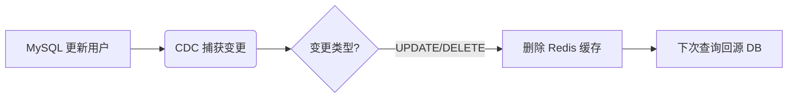

### **CDC (Change Data Capture)工具**

**CDC 工具**（Change Data Capture，变更数据捕获工具）是一类用于**实时捕获数据库中数据变更（增、删、改）** 并将这些变更以结构化事件形式传递给下游系统的软件工具。

它的核心目标是：  

> **“知道数据库里什么数据在什么时候发生了什么变化”，并让其他系统能实时响应。**

------

#### 🔍 一、CDC 的本质

| 传统方式                                                     | CDC 方式                                                  |
| ------------------------------------------------------------ | --------------------------------------------------------- |
| 定时全量/增量轮询（如每5分钟查一次 `update_time > last_time`） | **实时监听数据库日志**（如 MySQL binlog、PostgreSQL WAL） |
| 延迟高、性能差（频繁查表）                                   | **低延迟、低侵入、高性能**                                |
| 可能漏数据（如删除记录无时间戳）                             | **精确捕获所有 DML 操作**（包括 DELETE）                  |

✅ **CDC = 数据库的“监听器” + “消息生产者”**

------

#### 🌐 二、CDC 工具的核心工作原理（通用）

```
[源数据库]
│
├── 开启事务日志（必须！）
│   ├── MySQL → binlog（需 ROW 模式）
│   ├── PostgreSQL → WAL（Write-Ahead Logging）
│   ├── Oracle → Redo Log / GoldenGate
│   └── SQL Server → Transaction Log
│
└── [CDC 工具]
    │
    ├── 连接数据库（模拟从库或使用逻辑解码）
    │
    ├── 实时读取并解析日志
    │
    ├── 转换为标准化事件（如 JSON）
    │   {
    │     "table": "user",
    │     "type": "UPDATE",
    │     "before": {"id":1, "name":"Alice"},
    │     "after":  {"id":1, "name":"Alice_new"}
    │   }
    │
    └── 投递到下游
        ├── Kafka / Pulsar / RocketMQ
        ├── Elasticsearch
        ├── Redis / 缓存
        ├── 数据仓库（ClickHouse, Doris, Hive）
        └── 微服务（通过 API 或消息）
```

------

#### 🧰 三、主流 CDC 工具对比

| 工具                  | 开源        | 支持数据库                                | 特点                                     | 适用场景              |
| --------------------- | ----------- | ----------------------------------------- | ---------------------------------------- | --------------------- |
| **Canal**             | ✅           | MySQL                                     | 阿里开源，轻量，Java 生态友好            | 国内 MySQL 场景首选   |
| **Debezium**          | ✅           | MySQL, PG, Oracle, SQL Server, MongoDB... | 基于 Kafka Connect，生态强大，支持快照   | 多数据库、云原生架构  |
| **Maxwell**           | ✅           | MySQL                                     | 输出纯 JSON 到 Kafka，简单易用           | 轻量级 MySQL 同步     |
| **Flink CDC**         | ✅           | MySQL, PG 等                              | 内嵌于 Flink，支持流批一体、Exactly-Once | 实时计算 + CDC 一体化 |
| **Oracle GoldenGate** | ❌（商业）   | Oracle, MySQL, PG...                      | 企业级，高可靠，昂贵                     | 金融、大型企业        |
| **AWS DMS**           | ❌（云服务） | 多种                                      | 托管服务，开箱即用                       | AWS 云上迁移/同步     |

------

#### 🏗️ 四、CDC 的典型应用场景

##### 1. **缓存一致性**



##### 2. **搜索索引同步**

- 用户修改商品 → CDC → 推送新数据到 Elasticsearch → 搜索结果实时更新

##### 3. **实时数仓 / BI**

- 业务库（OLTP）→ CDC → Kafka → Flink → 数仓（OLAP）

##### 4. **微服务解耦**

- 订单服务不直接调用积分服务，而是：

  ```
  订单创建 → CDC → 发送“订单已创建”事件 → 积分服务消费事件
  ```

##### 5. **数据备份与异地多活**

- 通过 CDC 将主库变更实时同步到备库或异地集群

------

#### ⚙️ 五、CDC 的三种实现模式

| 模式                               | 原理                             | 优点                         | 缺点                                  |
| ---------------------------------- | -------------------------------- | ---------------------------- | ------------------------------------- |
| **1. 基于日志（Log-based）**       | 解析数据库事务日志（binlog/WAL） | ✅ 实时、无侵入、捕获完整变更 | ❌ 依赖数据库日志格式，配置复杂        |
| **2. 基于触发器（Trigger-based）** | 在表上建触发器，写变更到日志表   | ✅ 兼容老数据库               | ❌ 性能差、侵入性强、难维护            |
| **3. 基于时间戳/版本号**           | 轮询 `update_time > last_time`   | ✅ 简单                       | ❌ 延迟高、无法捕获 DELETE、可能漏数据 |

> ✅ **现代 CDC 工具几乎都采用“基于日志”模式**（如 Canal、Debezium）

------

#### ✅ 六、使用 CDC 的前提条件

1. **数据库必须开启事务日志**  
   - MySQL：`binlog_format=ROW`
   - PostgreSQL：`wal_level=logical`
2. **有足够权限读取日志**  
   - MySQL：`REPLICATION SLAVE`, `REPLICATION CLIENT`
   - PG：创建 replication user
3. **网络可达**  
   - CDC 工具需能连接数据库

------

#### 💡 七、总结一句话

> **CDC 工具是现代数据架构的“神经末梢”——它让数据库的每一次心跳（数据变更）都能被整个系统感知和响应，从而实现真正的实时数据驱动。**

如果你需要：

- 实时同步数据
- 解耦微服务
- 构建实时数仓
- 保证缓存一致性

那么 **CDC 工具（如 Canal、Debezium）就是你的必备武器**。