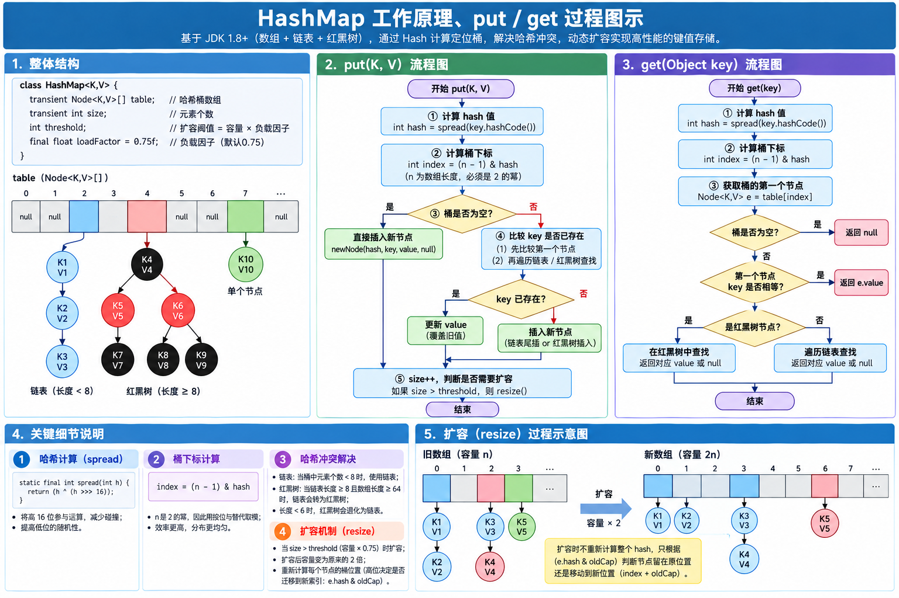
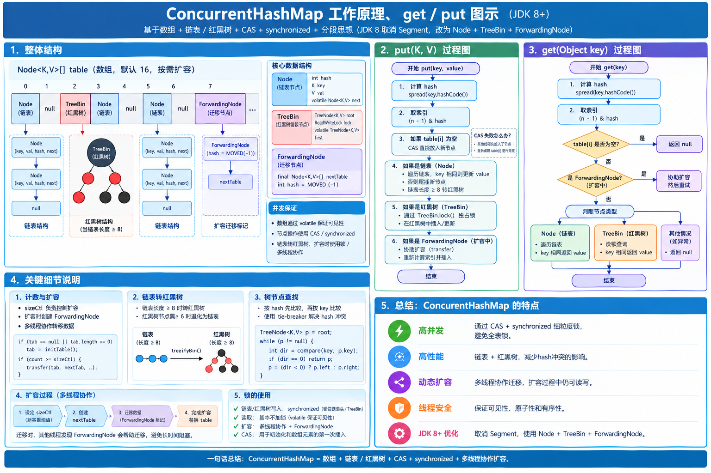

## 三、集合框架

### 1. **集合框架的整体结构**

- **整体结构**：Java集合框架包含了各种类型的集合类和接口。集合框架提供了统一的接口、类以及算法，用于存储和操作数据。
- **两大接口体系**：
  - **Collection接口体系**：包括 `List`、`Set`、`Queue` 等接口。
  - **Map接口体系**：包括 `Map` 和其常用实现类，如 `HashMap`、`TreeMap`、`LinkedHashMap`。

#### Java集合框架的整体结构

Java集合框架（Java Collections Framework）是用于存储和操作一组对象的统一架构，主要由**接口**（定义规范）、**实现类**（具体实现）和**工具类**（如`Collections`）组成，整体结构遵循“接口-实现类”的分层设计，方便开发者灵活选择和替换具体实现。

框架的核心目标是：
- 提供统一的操作接口（如添加、删除、遍历）；
- 封装不同的数据结构（如数组、链表、哈希表、树）；
- 支持高效的元素访问和修改。

Map接口和Collection接口是所有集合框架的父接口：
Collection接口的子接口包括：Set接口和List接口
Map接口的实现类主要有：HashMap、TreeMap、Hashtable、**ConcurrentHashMap**以及**Properties**等
Set接口的实现类主要有：HashSet、TreeSet、LinkedHashSet等
List接口的实现类主要有：ArrayList、LinkedList、Stack以及Vector等

##### 两大核心接口体系

集合框架的顶层接口分为两大分支，分别对应“单个元素集合”和“键值对集合”：

##### 1. **Collection接口体系**

用于存储**单个元素的集合**（一组对象），是所有单列集合的根接口，定义了通用操作（如`add()`、`remove()`、`size()`等）。其主要子接口及特点：

| 子接口       | 核心特点                                  | 典型实现类                  |
|--------------|-------------------------------------------|-----------------------------|
| `List`       | 有序（元素存入顺序与取出顺序一致）、可重复 | `ArrayList`（数组实现）、`LinkedList`（链表实现）、`Vector`（线程安全，古老类） |
| `Set`        | 无序（存入顺序与取出顺序可能不一致）、不可重复 | `HashSet`（哈希表，无序）、`LinkedHashSet`（哈希表+链表，有序）、`TreeSet`（红黑树，可排序） |
| `Queue`      | 队列（先进先出FIFO），支持队列操作        | `LinkedList`（双端队列）、`PriorityQueue`（优先队列，按优先级出队） |
| `Deque`      | 双端队列（两端均可进出）                  | `ArrayDeque`（数组实现）、`LinkedList` |

##### 2. **Map接口体系**

用于存储**键值对（key-value）映射**的集合，每个键（key）唯一，值（value）可重复。其主要实现类及特点：

| 实现类           | 核心特点                                  | 底层数据结构                |
|------------------|-------------------------------------------|-----------------------------|
| `HashMap`        | 无序，key允许为`null`（仅一个）           | 数组+链表/红黑树（JDK 8+）  |
| `LinkedHashMap`  | 有序（按插入顺序或访问顺序）              | `HashMap` + 双向链表        |
| `TreeMap`        | 可排序（按key自然排序或自定义排序）        | 红黑树                      |
| `Hashtable`      | 线程安全（古老类，不推荐），key不允许为`null` | 数组+链表                   |
| `ConcurrentHashMap` | 线程安全（高效，推荐）                    | 分段锁/ CAS机制（JDK 8+）   |

##### 框架的继承关系简化图

```
Collection（根接口）
├─ List（有序可重复）
│  ├─ ArrayList
│  ├─ LinkedList（同时实现Deque）
│  └─ Vector
│     └─ Stack（栈，已过时，推荐用Deque的实现类）
├─ Set（无序不可重复）
│  ├─ HashSet (底层是根据 HashMap 实现的)
│  │  └─ LinkedHashSet（保证插入顺序）
│  └─ TreeSet（自然排序/定制排序）
└─ Queue（队列，先进先出）
   └─ Deque（双端队列，可操作首尾）
      ├─ LinkedList（Deque的常用实现，非线程安全）
      ├─ ArrayDeque（基于数组的Deque实现，效率高于LinkedList，非线程安全）
      └─ ConcurrentLinkedDeque（线程安全的Deque实现，适用于并发场景）
      
Map（根接口，独立体系，键值对存储）
├─ HashMap（非线程安全，无序，JDK1.8后基于数组+链表/红黑树）
│  └─ LinkedHashMap（保证插入顺序/访问顺序）
├─ TreeMap（自然排序/定制排序，基于红黑树）
├─ Hashtable（线程安全，已过时，推荐用ConcurrentHashMap）
└─ ConcurrentHashMap（线程安全，高效并发，JDK1.8后基于CAS+synchronized）
```

##### 核心工具类

- `Collections`：提供操作集合的静态方法（如排序`sort()`、查找`binarySearch()`、同步化`synchonizedList()`等）。
- `Arrays`：提供操作数组的静态方法（如数组转集合`asList()`、排序`sort()`等）。

##### 总结

- Java集合框架通过**Collection**（单列）和**Map**（键值对）两大体系，覆盖了几乎所有常用的数据结构；
- 接口定义规范，实现类提供具体功能，开发者可根据需求（如是否有序、是否线程安全、查询效率等）选择合适的实现；
- 掌握两大体系的区别（单列vs键值对）和主要实现类的特点，是灵活使用集合框架的基础。

#### Java 集合框架中各实现类的方法

可分为两类：**继承自接口的通用方法**和**实现类特有的方法**。以下是核心实现类的主要方法整理（基于你提供的体系图）：

##### 一、List 体系实现类

###### 1. ArrayList

- **继承自 List 接口的核心方法**：
  - `add(E e)`：添加元素到末尾
  - `add(int index, E e)`：指定位置插入元素
  - `get(int index)`：获取指定索引元素（随机访问，O(1) 效率）
  - `set(int index, E e)`：替换指定索引元素
  - `remove(int index)`：删除指定索引元素（后续元素需移位，O(n) 效率）
  - `size()`：获取元素数量
  - `contains(Object o)`：判断是否包含元素
  - `subList(int fromIndex, int toIndex)`：获取子列表（视图，修改会影响原列表）

- **特有方法**：
  - `ensureCapacity(int minCapacity)`：手动扩容，避免多次自动扩容的性能消耗
  - `trimToSize()`：将容量调整为实际元素数量，节省内存

###### 2. LinkedList

- **继承自 List 接口的方法**（与 ArrayList 一致，但性能不同）：
  - `get(int index)`：获取元素（需从头/尾遍历，O(n) 效率，不适合随机访问）
  - `add(int index, E e)`：指定位置插入（链表操作，O(1) 定位后插入，但定位需 O(n)）

- **实现 Deque 接口的队列/栈方法**（特有核心）：
  - 队列操作（FIFO）：
    - `addFirst(E e)` / `offerFirst(E e)`：头部添加元素
    - `addLast(E e)` / `offerLast(E e)`：尾部添加元素
    - `getFirst()` / `peekFirst()`：获取头部元素（不删除）
    - `getLast()` / `peekLast()`：获取尾部元素（不删除）
    - `removeFirst()` / `pollFirst()`：删除并返回头部元素
    - `removeLast()` / `pollLast()`：删除并返回尾部元素
  - 栈操作（LIFO，替代过时的 Stack）：
    - `push(E e)`：等价于 `addFirst(E e)`（压栈）
    - `pop(E e)`：等价于 `removeFirst()`（出栈）

###### 3. Vector（线程安全，已基本被 ArrayList 替代）

- 方法与 ArrayList 基本一致，但**所有方法都被 `synchronized` 修饰**（线程安全）：
  - `addElement(E obj)`：等价于 `add(E e)`
  - `elementAt(int index)`：等价于 `get(int index)`
  - `removeElementAt(int index)`：等价于 `remove(int index)`

- 特有方法：
  - `capacity()`：返回当前容量（ArrayList 需通过反射获取）
  - `copyInto(Object[] anArray)`：将元素复制到指定数组

add = 强行加

offer = 试着提供一下

get：**正经获取**

peek：**轻轻看一眼，不拿走**

**remove**：移除、删掉

语气强硬：**必须删掉，删不到就报错**

**poll**：抽取、取出

语气温和：**有就拿，没有就算了**

**失败抛异常：add、remove、element**

**失败不抛异常：offer、poll、peek**


##### 二、Set 体系实现类

###### 1. HashSet

- **继承自 Set 接口的核心方法**：
  - `add(E e)`：添加元素（依赖 `hashCode()` 和 `equals()` 去重），添加成功返回true，否则返回false。
  - `remove(Object o)`：删除元素
  - `contains(Object o)`：判断是否包含元素（哈希查找，O(1) 效率）
  - `size()`：获取元素数量
  - `isEmpty()`：判断是否为空
- `retainAll(Collection<?> c)` 用于**保留集合中与另一个集合共有的元素**（即求两个集合的交集），同时删除当前集合中不存在于另一个集合中的元素。如果当前集合因调用该方法而发生了改变（即有元素被删除），则返回 `true`；否则返回 `false`。
  
- 无特有方法，完全依赖 Set 接口和 HashMap 底层实现（HashSet 本质是 HashMap 的 Key 集合）。

###### 2. LinkedHashSet

- 方法与 HashSet 完全一致（继承自 HashSet），但**通过双向链表维护插入顺序**，因此：
  - `iterator()` 迭代时按插入顺序返回元素
  - 无额外特有方法，所有功能与 HashSet 一致，仅多了顺序保证

###### 3. TreeSet

- **继承自 Set 接口的方法**（与 HashSet 一致，但添加了排序特性）：
  - `add(E e)`：添加元素（需元素可比较，或通过构造器传入 `Comparator`）
  - `contains(Object o)`：判断包含（基于排序树查找，O(log n) 效率）

- **特有排序相关方法**：
  - `first()`：返回最小元素
  - `last()`：返回最大元素
  - `lower(E e)`：返回小于 e 的最大元素
  - `higher(E e)`：返回大于 e 的最小元素
  - `subSet(E fromElement, E toElement)`：返回子集合（从 from 到 to，左闭右开）
  - `headSet(E toElement)`：返回小于 to 的所有元素
  - `tailSet(E fromElement)`：返回大于等于 from 的所有元素

##### 三、Queue 体系实现类

###### 1. PriorityQueue（优先队列，元素按优先级排序）

- **队列核心方法**：
  - `add(E e)` / `offer(E e)`：添加元素（按优先级排序，默认自然排序）
  - `peek()`：获取队首元素（不删除，优先级最高的元素）
  - `poll()`：删除并返回队首元素
  - `remove()`：删除队首元素（与 poll() 类似，但为空时抛异常）

- 特有方法：
  - `comparator()`：返回用于排序的比较器（无则返回 null，即自然排序）

Queue体系的实现类围绕“队列操作”核心，不同实现类在方法上遵循Queue接口规范，同时根据自身特性（如双端、优先级、线程安全）扩展了额外能力。以下按实现类分类，梳理核心方法及使用场景：

###### 一、通用Queue接口核心方法（所有实现类均支持）

Queue接口定义了“先进先出（FIFO）”的基础操作，分为两类：**抛出异常**和**返回特殊值**（更推荐，避免异常处理），适用于所有实现类。

| 操作类型 | 抛出异常的方法 | 返回特殊值的方法 | 说明 |
|----------|----------------|------------------|------|
| 添加元素 | `add(E e)`     | `offer(E e)`     | 向队列尾部添加元素；若队列满，`add`抛`IllegalStateException`，`offer`返回`false` |
| 删除元素 | `remove()`     | `poll()`         | 移除并返回队列头部元素；若队列空，`remove`抛`NoSuchElementException`，`poll`返回`null` |
| 获取元素 | `element()`    | `peek()`         | 返回（不删除）队列头部元素；若队列空，`element`抛`NoSuchElementException`，`peek`返回`null` |

##### 二、各实现类的方法与特性

###### 1. 基础双端实现：LinkedList（实现Queue+Deque+List）

LinkedList同时具备队列、双端队列、列表的能力，方法最灵活，核心补充**双端操作方法**（来自Deque接口）。

| 方法分类       | 核心方法                                                                 | 说明                                                                 |
|----------------|--------------------------------------------------------------------------|----------------------------------------------------------------------|
| 通用Queue方法  | `offer(e)`、`poll()`、`peek()`                                           | 基础尾部添加、头部删除/获取，非阻塞                                  |
| 双端操作方法   | 头部操作：`addFirst(e)`/`offerFirst(e)`、`removeFirst()`/`pollFirst()`、`getFirst()`/`peekFirst()` | 直接操作队列头部（如`offerFirst`在头部插入，实现“栈”的`push`效果）    |
|                | 尾部操作：`addLast(e)`/`offerLast(e)`、`removeLast()`/`pollLast()`、`getLast()`/`peekLast()` | 直接操作队列尾部（与通用Queue的`offer`功能一致）                      |
| List额外方法   | `add(int index, e)`、`get(int index)`、`remove(int index)`               | 支持按索引操作（因底层是链表，索引操作效率低，不推荐频繁使用）        |

**示例**：用LinkedList实现栈（先进后出）

```java
LinkedList<String> stack = new LinkedList<>();
stack.push("a"); // 等价于 addFirst("a")
stack.push("b");
System.out.println(stack.pop()); // 等价于 removeFirst()，输出 "b"
```

###### 2. 高效双端实现：ArrayDeque（实现Deque）

ArrayDeque是Deque的数组实现，双端操作效率比LinkedList高，方法与LinkedList的“双端操作”完全一致，但**不支持List的索引方法**，且**禁止存储null**。

| 核心方法（与LinkedList双端方法一致） | 说明                                                                 |
|--------------------------------------|----------------------------------------------------------------------|
| `offerFirst(e)`/`offerLast(e)`        | 头部/尾部添加元素，非阻塞，返回`true`（因无界，不会返回`false`）      |
| `pollFirst()`/`pollLast()`            | 头部/尾部删除并返回元素，空队列返回`null`                             |
| `peekFirst()`/`peekLast()`            | 头部/尾部获取元素，空队列返回`null`                                   |
| `push(e)`/`pop()`                     | 等价于`addFirst(e)`/`removeFirst()`，用于模拟栈操作（推荐替代过时的Stack） |

**注意**：ArrayDeque无`add(int index, e)`这类List方法，仅专注双端队列操作，效率更高。

###### 3. 优先级队列：PriorityQueue（实现Queue）

PriorityQueue打破FIFO，按“优先级”取元素，核心方法与通用Queue一致，但**元素必须支持排序**（实现`Comparable`或传入`Comparator`）。

| 核心方法       | 说明                                                                 |
|----------------|----------------------------------------------------------------------|
| 构造方法       | `PriorityQueue()`（默认自然排序，小顶堆）、`PriorityQueue(Comparator<? super E> c)`（自定义排序） | 初始化时指定排序规则，如`new PriorityQueue<>(Collections.reverseOrder())`实现大顶堆 |
| 通用Queue方法  | `offer(e)`、`poll()`、`peek()`                                       | `poll()`/`peek()`返回的是“优先级最高”的元素（如小顶堆返回最小元素）  |
| 额外方法       | `size()`、`contains(Object o)`、`clear()`                             | 常规的大小查询、包含判断、清空操作，无特殊扩展方法                   |

**示例**：用PriorityQueue实现大顶堆（取最大元素）
```java
// 自定义比较器，实现大顶堆
PriorityQueue<Integer> maxHeap = new PriorityQueue<>(Collections.reverseOrder());
// 这种 变量的类型声明 方式更好，面向接口编程，而非面向实现，便于后续类型变更，只修改右边就可以了
Queue<Integer> maxHeap = new PriorityQueue<>(Collections.reverseOrder());
maxHeap.offer(3);
maxHeap.offer(1);
maxHeap.offer(5);
System.out.println(maxHeap.poll()); // 输出 "5"（优先级最高）
```

###### 4. 线程安全队列：ConcurrentLinkedQueue（实现Queue）

ConcurrentLinkedQueue是无锁线程安全队列，基于CAS实现并发安全，方法与通用Queue一致，**无额外扩展方法**，但保证多线程下的操作安全性。

| 核心方法       | 说明                                                                 |
|----------------|----------------------------------------------------------------------|
| `offer(e)`      | 尾部添加元素，线程安全，无界队列（永远返回`true`，不会满）            |
| `poll()`        | 头部删除并返回元素，线程安全，空队列返回`null`（非阻塞）              |
| `peek()`        | 头部获取元素，线程安全，空队列返回`null`                             |
| `isEmpty()`     | 判断队列是否为空，线程安全（注意：判断后若立即操作，仍可能有并发问题） |

**示例**：多线程向ConcurrentLinkedQueue添加元素
```java
ConcurrentLinkedQueue<String> queue = new ConcurrentLinkedQueue<>();
// 线程1添加元素
new Thread(() -> queue.offer("thread1")).start();
// 线程2添加元素
new Thread(() -> queue.offer("thread2")).start();
System.out.println(queue.poll()); // 线程安全获取，可能返回"thread1"或"thread2"
```

###### 5. 阻塞队列：LinkedBlockingQueue（实现BlockingQueue）

LinkedBlockingQueue是阻塞式线程安全队列，实现了`BlockingQueue`接口，在通用Queue方法基础上，补充了**阻塞式方法**（队列满时添加、空时获取会阻塞线程）。

| 方法分类       | 核心方法                                                                 | 说明                                                                 |
|----------------|--------------------------------------------------------------------------|----------------------------------------------------------------------|
| 阻塞添加       | `put(E e)`                                                               | 尾部添加元素；若队列满，阻塞线程直到有空间                             |
| 阻塞获取       | `take()`                                                                 | 头部删除并返回元素；若队列空，阻塞线程直到有元素                       |
| 超时阻塞       | `offer(E e, long timeout, TimeUnit unit)`、`poll(long timeout, TimeUnit unit)` | 添加/获取元素时，若满/空则阻塞指定时间，超时后返回`false`/`null`       |
| 通用方法       | `offer(e)`、`poll()`、`peek()`                                           | 非阻塞，满时`offer`返回`false`，空时`poll`返回`null`                  |

**示例**：用LinkedBlockingQueue实现生产者-消费者模型
```java
LinkedBlockingQueue<Integer> queue = new LinkedBlockingQueue<>(10); // 容量10
// 生产者：添加元素，满时阻塞
new Thread(() -> {
    try {
        queue.put(1); // 若队列满，阻塞
    } catch (InterruptedException e) {
        Thread.currentThread().interrupt();
    }
}).start();
// 消费者：获取元素，空时阻塞
new Thread(() -> {
    try {
        queue.take(); // 若队列空，阻塞
    } catch (InterruptedException e) {
        Thread.currentThread().interrupt();
    }
}).start();
```

###### 三、关键方法对比与选择

| 实现类                | 核心方法特点                          | 线程安全 | 阻塞性 | 适用场景                          |
|-----------------------|---------------------------------------|----------|--------|-----------------------------------|
| LinkedList            | 支持双端+List索引方法                  | 否       | 非阻塞 | 单线程灵活操作（队列/栈/列表）    |
| ArrayDeque            | 双端操作高效，无List方法，禁null      | 否       | 非阻塞 | 单线程栈/双端队列（替代Stack）    |
| PriorityQueue         | 按优先级取元素，需排序                | 否       | 非阻塞 | 单线程优先级任务处理（如TopK）    |
| ConcurrentLinkedQueue | 无锁安全，非阻塞，无界                | 是       | 非阻塞 | 高并发无界任务存储（如日志收集）  |
| LinkedBlockingQueue   | 支持阻塞方法，可选有界                | 是       | 阻塞   | 并发场景需控制容量（如线程池队列）|


##### 四、Map 体系实现类

###### 1. HashMap

- **继承自 Map 接口的核心方法**：
  - `put(K key, V value)`：添加键值对（Key 重复则覆盖 Value）
  - `get(Object key)`：根据 Key 获取 Value（哈希查找，O(1) 效率）
  - `remove(Object key)`：删除键值对
  - `containsKey(Object key)`：判断是否包含指定 Key
  - `containsValue(Object value)`：判断是否包含指定 Value（需遍历，O(n) 效率）
  - `keySet()`：返回所有 Key 的 Set 视图
  - `values()`：返回所有 Value 的 Collection 视图
  - `entrySet()`：返回所有键值对（`Map.Entry`）的 Set 视图
  - **`merge`：合并两个键值对，键重复时的 value 计算**（如累加、取最大值 / 最小值等）。它的核心作用是：根据指定的键，要么将新值放入 Map（键不存在时），要么通过自定义逻辑合并旧值和新值（键存在时）。
- `getOrDefault(Object key, V defaultValue)` 是 Java 8 为 `Map` 接口新增的方法，用于**安全地获取 Map 中指定 Key 对应的 Value**，当 Key 不存在时返回一个默认值，避免了手动判断 `null` 的繁琐逻辑。
  
- 特有方法：
  - `putIfAbsent(K key, V value)`：Key 不存在时才添加（Java 8+）
  - `computeIfAbsent(K key, Function<? super K, ? extends V> mappingFunction)`：Key 不存在时通过函数计算 Value 并添加（Java 8+）
  - `resize()`：扩容（内部方法，自动触发）

###### 2. LinkedHashMap

- 方法与 HashMap 完全一致，但**通过双向链表维护顺序**（插入顺序或访问顺序）：
  - 默认按插入顺序迭代（`entrySet()`、`keySet()` 等）
  - 构造器可指定 `accessOrder = true`，按访问顺序排序（`get` 或 `put` 会移动元素到链表尾部）

- 特有方法（保护方法，可重写实现 LRU 缓存）：
  - `removeEldestEntry(Map.Entry<K, V> eldest)`：当添加新元素时，判断是否删除最旧元素（默认返回 false，即不删除）

###### 3. TreeMap

- **继承自 Map 接口的方法**（与 HashMap 一致，但添加了排序特性）：
  - `put(K key, V value)`：添加键值对（Key 需可比较，或通过构造器传入 `Comparator`）
  - `get(Object key)`：根据 Key 获取 Value（基于红黑树查找，O(log n) 效率）

- **特有排序相关方法**：
  - `firstKey()` / `lastKey()`：返回最小/最大 Key
  - `lowerKey(K key)` / `higherKey(K key)`：返回小于/大于指定 Key 的最大/最小 Key
  - `subMap(K fromKey, K toKey)`：返回子 Map（Key 从 from 到 to，左闭右开）
  - `headMap(K toKey)` / `tailMap(K fromKey)`：返回 Key 小于 to / 大于等于 from 的子 Map

###### 4. Hashtable（线程安全，已基本被 ConcurrentHashMap 替代）

- 方法与 HashMap 类似，但**所有方法都被 `synchronized` 修饰**（线程安全）：
  - `put(K key, V value)`：Key/Value 不能为 null（与 HashMap 最大区别）
  - `get(Object key)`：获取 Value
  - `elements()`：返回所有 Value 的枚举（Enumeration）

###### 5. ConcurrentHashMap（线程安全，高效并发）

- 方法与 HashMap 类似，但支持**并发操作**（无需整体加锁，性能优于 Hashtable）：
  - `put(K key, V value)`：线程安全的添加操作
  - `get(Object key)`：无锁获取 Value（高效）
  - `size()`：返回元素数量（并发环境下可能为近似值）
  - `forEach(BiConsumer<? super K, ? super V> action)`：并发遍历

- 特有并发方法：
  - `putIfAbsent(K key, V value)`：原子操作，Key 不存在时添加
  - `remove(Object key, Object value)`：仅当 Key 关联的 Value 匹配时才删除（原子操作）
  - `replace(K key, V oldValue, V newValue)`：仅当 Key 关联的 Value 为 oldValue 时才替换（原子操作）

##### 总结

- **通用方法**：各实现类均实现了顶层接口（List/Set/Map）的抽象方法，功能一致但性能因底层结构（数组/链表/哈希表/红黑树）不同而有差异。
- **特有方法**：多与实现类的特性相关（如 LinkedList 的队列操作、TreeSet/TreeMap 的排序方法、ConcurrentHashMap 的并发原子操作）。
- 实际开发中，优先使用接口定义变量（如 `List<String> list = new ArrayList<>()`），仅在需要特有方法时才使用具体类声明。

以下是Java集合框架中核心接口及实现类的**常用方法汇总**，按接口体系分类说明，涵盖List、Set、Queue/Deque、Map的核心操作：

#### 一、Collection 根接口（所有集合的基础）

定义了集合的通用操作，List、Set、Queue均继承此接口。

| 方法                 | 说明                                                                 |
|----------------------|----------------------------------------------------------------------|
| `int size()`         | 返回集合中元素的数量                                                 |
| `boolean isEmpty()`  | 判断集合是否为空                                                     |
| `boolean contains(Object o)` | 判断集合是否包含指定元素（依赖`equals()`方法）                       |
| `Iterator<E> iterator()` | 返回迭代器，用于遍历集合元素                                         |
| `Object[] toArray()` | 将集合转换为数组                                                     |
| `boolean add(E e)`   | 添加元素到集合（List返回true，Set若元素存在则返回false）             |
| `boolean remove(Object o)` | 从集合中移除指定元素（成功返回true）                                 |
| `boolean containsAll(Collection<?> c)` | 判断集合是否包含另一个集合的所有元素                                 |
| `boolean addAll(Collection<? extends E> c)` | 添加另一个集合的所有元素到当前集合                                   |
| `boolean removeAll(Collection<?> c)` | 移除当前集合中与另一个集合共有的元素                                 |
| `boolean retainAll(Collection<?> c)` | 保留当前集合中与另一个集合共有的元素（交集）                         |
| `void clear()`       | 清空集合所有元素                                                     |

#### 二、List 接口（有序可重复）

继承Collection，增加了“索引操作”能力。

| 通用方法             | 说明                                                                 |
|----------------------|----------------------------------------------------------------------|
| `E get(int index)`   | 获取指定索引的元素                                                   |
| `E set(int index, E element)` | 替换指定索引的元素，返回被替换的旧元素                               |
| `void add(int index, E element)` | 在指定索引插入元素，后续元素后移                                     |
| `E remove(int index)` | 移除指定索引的元素，返回被移除的元素                                 |
| `int indexOf(Object o)` | 返回指定元素第一次出现的索引（不存在返回-1）                         |
| `int lastIndexOf(Object o)` | 返回指定元素最后一次出现的索引（不存在返回-1）                       |
| `ListIterator<E> listIterator()` | 返回列表迭代器，支持双向遍历和修改                                   |

##### 1. ArrayList（数组实现）

除List接口方法外，无特有方法，核心是**随机访问高效**（`get/set` 时间复杂度 `O(1)`）。

##### 2. LinkedList（链表实现，同时实现Deque）

额外支持Deque的双端操作（见下文Deque方法），List接口方法中**插入/删除高效**（`add/remove` 时间复杂度 `O(1)`，需定位索引时 `O(n)`）。

##### 3. Vector（线程安全的ArrayList，已过时）

方法与ArrayList一致，但**所有方法加了`synchronized`锁**（线程安全但效率低），推荐用`Collections.synchronizedList(new ArrayList<>())`替代。

#### 三、Set 接口（无序不可重复）

继承Collection，无特有方法，核心是**元素唯一**（依赖`equals()`和`hashCode()`）。

##### 1. HashSet（哈希表实现）

- 基于HashMap实现，元素存储在HashMap的key中。
- 无序（迭代顺序与插入顺序无关），查询/添加/删除效率高（`O(1)`）。

##### 2. LinkedHashSet（哈希表+链表）

- 继承HashSet，内部维护双向链表记录插入顺序。
- 迭代顺序与插入顺序一致，性能略低于HashSet（链表维护开销）。

##### 3. TreeSet（红黑树实现）

- 基于TreeMap实现，元素按自然排序或自定义比较器排序。
- 支持排序相关方法：
  - `E first()`：返回第一个（最小）元素
  - `E last()`：返回最后一个（最大）元素
  - `E lower(E e)`：返回小于e的最大元素
  - `E higher(E e)`：返回大于e的最小元素

#### 四、Queue 接口（队列，FIFO）

继承Collection，增加队列特有操作（分“抛异常”和“返回特殊值”两类）。

| 操作类型 | 抛异常方法       | 返回特殊值方法   | 说明                                                                 |
|----------|------------------|------------------|----------------------------------------------------------------------|
| 添加     | `add(E e)`       | `offer(E e)`     | 向队尾添加元素；队列满时，`add`抛异常，`offer`返回false             |
| 删除     | `remove()`       | `poll()`         | 移除并返回队首元素；队列空时，`remove`抛异常，`poll`返回null         |
| 获取     | `element()`      | `peek()`         | 返回（不删除）队首元素；队列空时，`element`抛异常，`peek`返回null   |

#### Deque 接口（双端队列，继承Queue）

支持首尾双向操作，方法前缀`First`（头部）、`Last`（尾部）。

| 头部操作（抛异常） | 头部操作（返回特殊值） | 尾部操作（抛异常） | 尾部操作（返回特殊值） | 说明                                                                 |
|---------------------|------------------------|---------------------|------------------------|----------------------------------------------------------------------|
| `addFirst(E e)`     | `offerFirst(E e)`      | `addLast(E e)`      | `offerLast(E e)`       | 向头部/尾部添加元素                                                 |
| `removeFirst()`     | `pollFirst()`          | `removeLast()`      | `pollLast()`           | 移除并返回头部/尾部元素                                             |
| `getFirst()`        | `peekFirst()`          | `getLast()`         | `peekLast()`           | 返回（不删除）头部/尾部元素                                         |
| `push(E e)`         | （等价于`addFirst(e)`） | `pop()`             | （等价于`removeFirst()`） | 模拟栈操作（先进后出）                                               |

##### Deque 实现类特有说明

- **ArrayDeque**：无特有方法，双端操作效率高于LinkedList，**禁止存储null**。
- **LinkedList**：同时实现List和Deque，可混用索引操作和双端操作。
- **ConcurrentLinkedDeque**：线程安全，基于CAS实现，方法与Deque一致，无阻塞。


#### **⚠️ Stack使用建议**

尽管 `java.util.Stack` 类仍然存在，但它在现代 Java 开发中**不被推荐使用**。官方文档建议优先使用 `Deque` 接口及其实现类（如 `ArrayDeque`）来实现栈的功能，因为 `Deque` 提供了更完整、更一致的 LIFO 操作集合，且性能通常更优4。

#### 五、Map 接口（键值对存储，独立体系）

不继承Collection，核心是“键唯一，值可重复”。

| 通用方法                 | 说明                                                                 |
|--------------------------|----------------------------------------------------------------------|
| `V put(K key, V value)`  | 添加键值对，若key已存在则覆盖旧值，返回旧值（无则返回null）           |
| `V get(Object key)`      | 根据key获取value（key不存在返回null）                                |
| `V remove(Object key)`   | 根据key移除键值对，返回被移除的value（无则返回null）                 |
| `boolean containsKey(Object key)` | 判断是否包含指定key                                                  |
| `boolean containsValue(Object value)` | 判断是否包含指定value                                                |
| `int size()`             | 返回键值对数量                                                       |
| `boolean isEmpty()`      | 判断是否为空                                                         |
| `void clear()`           | 清空所有键值对                                                       |
| `Set<K> keySet()`        | 返回所有key的Set集合（可遍历key）                                    |
| `Collection<V> values()` | 返回所有value的Collection集合（可遍历value）                          |
| `Set<Map.Entry<K,V>> entrySet()` | 返回键值对Entry的Set集合（可遍历键值对）                             |

这几个是 Java 8 引入的函数式方法，专门用来简化 HashMap 的操作，特别是处理“存在则更新，不存在则插入”这种逻辑时，代码会非常

##### **1.** `computeIfAbsent(K key, Function mappingFunction)`

**含义**：**“如果没有，就算一下放进去”**

- 如果指定的键 **不存在** 或者 对应的值为 `null`，则计算给定的函数值，并将其放入 Map 中。
- 如果键 **已存在**，则 **不做任何操作**，直接返回现有的值。

##### **2.** `computeIfPresent(K key, BiFunction remappingFunction)`

**含义**：**“如果有，就算一下更新它”**

- 只有当指定的键 **存在** 且 值不为 `null` 时，才执行计算函数来更新值。
- 如果键 **不存在**，则什么都不做，返回 `null`。

**典型场景**：计数器累加。**2.** `computeIfPresent(K key, BiFunction remappingFunction)`

**含义**：**“如果有，就算一下更新它”**

- 只有当指定的键 **存在** 且 值不为 `null` 时，才执行计算函数来更新值。
- 如果键 **不存在**，则什么都不做，返回 `null`。

**典型场景**：计数器累加。


##### **3.** `compute(K key, BiFunction remappingFunction)`

**含义**：**“不管有没有，都重新算一下”**

- 无论键是否存在，都会执行计算函数。
- 你可以根据旧值（`oldValue`）来决定新值。如果旧值不存在，`oldValue` 为 `null`。
- **注意**：如果计算结果为 `null`，则会将该键从 Map 中 **删除**。

**典型场景**：复杂的更新逻辑，或者初始化并更新。

##### 4.`map.getOrDefault(key, defaultValue)`

**获取键对应的值，如果键不存在，则返回一个默认值。**

##### 5.putIfAbsent(K key, V value)

```java
V putIfAbsent(K key, V value)
```

- **逻辑**：如果 `key` 不存在（或对应 value 为 `null`），则添加 `key-value` 并返回 `null`；如果 `key` 已存在，则**不修改原有值**，直接返回已存在的 `value`。
- **完美匹配你的需求**：返回值可判断“是否是新添加的元素”，结合 `keySet().indexOf()`（或自定义索引逻辑）就能实现“存在返回索引、不存在添加并返回新索引”。


##### 1. HashMap（哈希表实现，非线程安全）

- JDK1.8后底层为“数组+链表+红黑树”，查询/添加/删除效率高（`O(1)`）。
- 无序（迭代顺序与插入顺序无关），允许key为null（仅一个），value为null。

##### 2. LinkedHashMap（继承HashMap）

- 内部维护双向链表记录键值对的**插入顺序**或**访问顺序**（通过构造函数指定）。
- 特有方法：`boolean removeEldestEntry(Map.Entry<K,V> eldest)`，可用于实现LRU缓存（移除最久未访问元素）。

##### 3. TreeMap（红黑树实现）

- 键按自然排序或自定义比较器排序，支持排序相关操作：
  - `K firstKey()` / `K lastKey()`：返回最小/最大key
  - `SortedMap<K,V> subMap(K fromKey, K toKey)`：返回key在[fromKey, toKey)范围内的子Map
- 不允许key为null（会抛异常）。

##### 4. Hashtable（线程安全，已过时）

- 方法与HashMap类似，但**所有方法加了`synchronized`锁**（线程安全但效率低）。
- 不允许key或value为null，推荐用`ConcurrentHashMap`替代。

##### 5. ConcurrentHashMap（线程安全，高效并发）

- JDK1.8后基于“CAS+synchronized”实现，支持高并发（仅锁定链表/红黑树的首节点）。
- 方法与HashMap类似，额外支持原子操作：
  - `V putIfAbsent(K key, V value)`：若key不存在则添加，返回null；否则返回现有value
  - `boolean remove(Object key, Object value)`：仅当key对应value匹配时才移除，返回是否成功

#### 总结

- **List**：核心是“有序+索引”，`get/set` 用ArrayList，`add/remove` 频繁用LinkedList。
- **Set**：核心是“去重”，无序用HashSet，需顺序用LinkedHashSet，需排序用TreeSet。
- **Queue/Deque**：核心是“队列操作”，单线程双端操作首选ArrayDeque，并发用ConcurrentLinkedDeque。
- **Map**：核心是“键值对”，非并发用HashMap/LinkedHashMap/TreeMap，并发用ConcurrentHashMap。

掌握这些方法是熟练使用Java集合的基础，不同实现类的选择需结合“线程安全”“排序需求”“操作效率”等场景判断。


------

### 2. **Collection接口和Map接口**

- **本质区别**：
  - `Collection` 用于存储单一对象的集合，代表对象的集合。
  - `Map` 用于存储键值对（key-value），每个元素包含一个键和一个对应的值。
- **核心实现类**：
  - **Collection接口**：`ArrayList`、`LinkedList`、`HashSet`、`TreeSet`、`PriorityQueue`。
  - **Map接口**：`HashMap`、`TreeMap`、`LinkedHashMap`、`Hashtable`、`ConcurrentHashMap`。


### **ArrayList的扩容机制**

- **扩容机制**：当 `ArrayList` 的容量不足时，容量会翻倍（默认情况下）。
- **初始容量**：设置初始容量可以避免多次扩容，减少性能开销。
- **负载因子**：负载因子影响扩容时机，通常默认是 0.75。负载因子较大时，会减少扩容的次数，但会增加查询时间；负载因子较小时，扩容次数增多，但查询性能较好。

##### 一、ArrayList的底层结构与扩容触发条件

ArrayList底层基于**动态数组**实现（数组长度固定，ArrayList通过“复制旧数组→创建新数组”实现动态扩容）。

###### 扩容触发时机：

当调用`add()`方法添加元素时，若当前元素数量（`size`）等于数组容量（`elementData.length`），则触发扩容。

核心判断逻辑（简化源码）：

```java
public boolean add(E e) {
    ensureCapacityInternal(size + 1); // 检查是否需要扩容
    elementData[size++] = e;
    return true;
}

// 确保容量至少为minCapacity（当前所需最小容量）
private void ensureCapacityInternal(int minCapacity) {
    if (minCapacity > elementData.length) {
        grow(minCapacity); // 触发扩容
    }
}
```

##### 二、扩容的具体过程（grow()方法）

扩容的核心是`grow()`方法，步骤如下：

1. **计算新容量**：
   - 旧容量（`oldCapacity`）= 当前数组长度；
   - 新容量默认扩容为 **`oldCapacity + (oldCapacity >> 1)`**（即旧容量的1.5倍，通过右移1位实现除以2的高效计算）；
   - 若新容量仍小于所需最小容量（`minCapacity`），则直接将新容量设为`minCapacity`（如初始添加大量元素时）；
   - 若新容量超过ArrayList的最大限制（`Integer.MAX_VALUE - 8`），则取`Integer.MAX_VALUE`。

2. **复制元素到新数组**：
   - 通过`Arrays.copyOf()`创建新数组（长度为新容量）；
   - 将旧数组的元素复制到新数组，旧数组被垃圾回收。

简化源码：

```java
private void grow(int minCapacity) {
    int oldCapacity = elementData.length;
    int newCapacity = oldCapacity + (oldCapacity >> 1); // 1.5倍扩容
    if (newCapacity < minCapacity) {
        newCapacity = minCapacity;
    }
    if (newCapacity > MAX_ARRAY_SIZE) {
        newCapacity = hugeCapacity(minCapacity);
    }
    // 复制旧数组到新数组
    elementData = Arrays.copyOf(elementData, newCapacity);
}
```

##### 三、初始容量对性能的影响

ArrayList的**初始容量**是创建时指定的数组长度（默认初始容量为10，若通过`new ArrayList(initialCapacity)`指定，则初始容量为`initialCapacity`）。

###### 影响：

- **初始容量过小**：添加元素时会频繁触发扩容（每次扩容都需要复制数组，时间复杂度为O(n)），导致性能损耗；
- **初始容量过大**：会浪费内存空间（数组中未使用的位置占用内存）。

###### 最佳实践：

若已知大致元素数量，创建时指定初始容量（如`new ArrayList(1000)`），可减少扩容次数，平衡时间和空间效率。

##### 四、常见误区：ArrayList没有“负载因子”

需要注意：**负载因子（load factor）是哈希表（如HashMap）的概念**，用于判断何时触发扩容（`元素数量 > 容量 × 负载因子`）。

而ArrayList的扩容仅与“元素数量是否等于当前容量”有关，**与负载因子无关**——只要`size == 容量`，就会立即扩容，不存在“负载因子”的计算逻辑。

##### 总结

- **扩容机制**：当元素数量达到当前容量时，默认扩容为原容量的1.5倍（通过复制数组实现）；
- **初始容量**：合理设置初始容量可减少扩容次数，避免频繁复制数组的性能开销；
- **负载因子**：与ArrayList无关，是哈希表（如HashMap）的属性。

###### 简单说：ArrayList的扩容是“满了就扩1.5倍”，初始容量设置得越合理，性能越好。

### 集合toString() vs 字符串toString()

#### 1️⃣ String.toString()（字符串对象）

`String`本身就是字符串。

```java
String s = "abc";
System.out.println(s.toString()); //StringBuilder.toString(); 也是类似


```

输出：

```
abc
```

> 
> String重写的`toString()`：**直接返回自己本身的字符内容，不带任何额外符号**。

#### 2️⃣ 集合的toString()（ArrayList / LinkedList / HashSet …）

**集合类（List）的toString是Collection里面的实现！**

> 
> LinkedList、ArrayList继承自`AbstractCollection`，这里的toString会**遍历集合里面每一个元素，自动拼接：开头`[`，元素之间`, `逗号+空格，结尾`]`**

```java
LinkedList<Character> list = new LinkedList<>();
list.add('a');
list.add('b');
System.out.println(list.toString());
```

🖨输出：

```
[a, b]
```

❗**这不是业务字符串！这是Java为了方便调试打印集合的调试格式！！**

> 
> 这就是你上一题踩坑点：回溯收集结果的时候直接写

```
stringArrayList.add(charArrayList.toString()); // ❌错误！存进去"[a,b]"
```

#### 🧪简单测试代码

```java
public class Test {
    public static void main(String[] args) {
        LinkedList<Character> list=new LinkedList<>();
        list.add('a');
        list.add('b');

        //集合toString
        String res1 = list.toString();
        System.out.println("集合toString："+res1);
        System.out.println("长度："+res1.length()); // "[a, b]"长度是5！

        //手动拼接得到真正目标字符串
        StringBuilder sb=new StringBuilder();
        for(Character c:list){
            sb.append(c);
        }
        String res2=sb.toString();
        System.out.println("StringBuilder拼接后："+res2);
        System.out.println("长度："+res2.length()); //ab长度是2
    }
}
```

运行输出：

```
集合toString：[a, b]
长度：5
StringBuilder拼接后：ab
长度：2
```

#### 📌对比表格

| 调用 | 返回内容 | 用途 |
| --- | --- | --- |
| `list.toString()` | `[a, b, c]`，带括号逗号空格 | **调试打印看集合内容，不能拿来做业务结果！** |
| `sb.toString()`（StringBuilder的toString） | `abc`纯字符 | **生成普通业务字符串，回溯收集结果用这个！** |
| `str.toString()`（String对象） | 原字符串本身 | 字符串对象，几乎不用调用，直接用str即可 |

#### 📍补充面试关联（回溯全排列题坑）

1. ❌错误写法（用list.toString收集答案）

```java
if(list.size() == len){
    res.add(list.toString()); 
}
```

结果存进去`[a,b]`，牛客直接判错！

2. ✅正确两种收集方案
方案A：循环遍历list，用StringBuilder拼接

```java
StringBuilder sb=new StringBuilder();
for(Character c:list){
    sb.append(c);
}
res.add(sb.toString());
```

方案B（更推荐）：**直接拿StringBuilder作为回溯的path路径，不再维护LinkedList**

```java
//path是StringBuilder
if(path.length() == len){
    res.add(path.toString());
    return;
}
//回溯撤销：path.deleteCharAt(path.length()-1);
```

#### 💡额外小思考：为什么List的toString要加[]和逗号？

方便开发人员在控制台看集合里面存放了哪些元素，属于调试友好输出，**不是业务数据！**

> 
> 类比打印数组：`Arrays.toString(new int[]{1,2,3})`输出`[1, 2, 3]`，数组工具类也是调试打印格式！！

> 
> 很多同学写回溯全排列（数字、字符串）都踩这个坑！以为集合toString就直接得到最终结果，结果提交之后答案带着方括号直接WA。

如果你愿意，我可以对比数字全排列的时候，如果也错误使用ArrayList.toString收集结果会出现什么效果。


------

### 4. **HashMap和HashTable**

- **区别**：
  - **HashMap**：允许 `null` 键和 `null` 值，线程不安全。
  - **Hashtable**：不允许 `null` 键或 `null` 值，线程安全（但性能较差，因其大部分操作都被同步化）。
- **线程安全问题**：`Hashtable` 的同步机制会导致性能瓶颈，且并发访问时可能导致问题，因此不推荐使用。

##### HashMap与Hashtable的核心区别

| 维度                | HashMap                                  | Hashtable                              |
|---------------------|------------------------------------------|----------------------------------------|
| **线程安全性**       | 线程不安全（无同步机制）                  | 线程安全（方法被`synchronized`修饰）    |
| **null值支持**       | 允许1个`null`键和多个`null`值            | 不允许`null`键或`null`值（会抛`NullPointerException`） |
| **底层数据结构**     | JDK 8前：数组+链表；JDK 8后：数组+链表/红黑树（链表长度>8时转红黑树） | 始终是数组+链表（无红黑树优化）         |
| **继承关系**         | 继承`AbstractMap`类                      | 继承古老的`Dictionary`类                |
| **迭代器类型**       | 快速失败迭代器（`fail-fast`）             | 安全失败迭代器（`fail-safe`，但不保证） |
| **性能**             | 无同步开销，并发环境下效率高              | 方法同步导致性能低（多线程竞争同一把锁） |
| **初始容量与扩容**   | 初始容量16，扩容为原容量×2               | 初始容量11，扩容为原容量×2 + 1          |
| **使用场景**         | 单线程环境或通过`Collections.synchronizedMap()`包装后用于多线程 | 不推荐使用，多线程场景推荐`ConcurrentHashMap` |

**快速失败（fail-fast）是 Java 集合的一种保护机制。当迭代器遍历集合过程中，集合结构被修改（新增 / 删除元素），迭代器立刻抛出`ConcurrentModificationException`，而不是继续遍历拿到脏数据。**

> 注意：**只针对集合结构变化（add/remove）；修改元素内容，不算结构修改，不会触发。**

**原理（核心：modCount）**

集合内部维护变量 `modCount`（修改计数器，mod=modify）

1. 创建迭代器时，迭代器保存当前集合版本号 `expectedModCount = modCount`
2. 每次调用`next()` / `remove()`，**先校验 `expectedModCount == modCount`**
3. 如果集合执行 add/remove，`modCount++`；再次校验发现两者不等 → 直接抛异常

**安全失败 fail-safe**

`java.util.concurrent`包下集合（CopyOnWriteArrayList）是 **fail-safe 安全失败**

- 原理：遍历的时候，**在底层数组副本上遍历**
- 原集合修改，不会影响正在遍历的副本，**不会抛异常**
- 缺点：读到的是旧快照，不能感知最新数据；写的时候复制数组，内存开销大

##### 为什么Hashtable被视为“线程不安全的替代方案”？

这里的表述更准确的是：**Hashtable虽然线程安全，但因性能问题和设计缺陷，已被更高效的线程安全实现（如ConcurrentHashMap）替代**，具体原因：

1. **同步效率极低**  
   Hashtable的线程安全是通过对**整个方法加锁**（`synchronized`修饰方法）实现的，意味着任何线程操作Hashtable时，都会独占整个对象的锁。多线程并发访问时，所有操作都会串行执行（即使操作不同的键），导致严重的性能瓶颈。

   例如：线程A执行`put("a", 1)`时，线程B执行`put("b", 2)`必须等待A释放锁，即使两个操作完全不冲突。


2. **迭代器的“安全失败”不可靠**  
   Hashtable的迭代器被称为“安全失败”（`fail-safe`），但这是通过**复制底层数组**实现的——迭代时遍历的是数组副本，因此不会抛出`ConcurrentModificationException`。但这会导致：
   - 额外的内存开销（复制数组）；
   - 迭代器无法反映实时修改（遍历的是旧数据）。


3. **功能设计落后**  
   - 不支持`null`键值（限制了使用场景）；
   - 底层无红黑树优化（链表过长时查询效率低，时间复杂度O(n)）；
   - 继承自古老的`Dictionary`类，而非`AbstractMap`，与集合框架的主流设计脱节。


4. **更好的替代方案存在**  
   JDK 5引入的`ConcurrentHashMap`解决了Hashtable的所有缺陷：
   - 采用**分段锁**（JDK 7）或**CAS + synchronized**（JDK 8+）实现高效并发，允许多线程同时操作不同段/桶；
   - 支持`null`值（键仍不允许`null`）；
   - 底层有红黑树优化，查询效率高；
   - 迭代器支持“弱一致性”（能反映部分实时修改，且无额外复制开销）。

##### 总结

- HashMap适用于**单线程环境**，性能优异但线程不安全；
- Hashtable虽线程安全，但因**同步效率低、设计落后**，已被淘汰；
- 多线程场景下，**优先使用ConcurrentHashMap**（高效并发），而非Hashtable或通过`Collections.synchronizedMap()`包装的HashMap。

简单说：Hashtable的“线程安全”是以牺牲性能和灵活性为代价的，而ConcurrentHashMap在保证线程安全的同时，实现了更高的并发效率，因此成为了更好的替代方案。

------

### 6. **TreeSet和TreeMap排序**

- **实现排序功能**：`TreeSet` 和 `TreeMap` 都是基于红黑树实现的，它们会自动根据元素的自然顺序（通过 `Comparable`）或者通过提供的比较器 `Comparator` 进行排序。
- **自定义对象排序**：自定义对象需要实现 `Comparable` 接口，重写 `compareTo()` 方法，或使用 `Comparator` 接口定义排序规则。

##### 一、TreeSet和TreeMap的排序实现原理

TreeSet和TreeMap底层都基于**红黑树（一种自平衡的二叉搜索树）** 实现，排序的核心是通过**比较机制**确定元素在树中的位置，保证集合中的元素始终处于有序状态。

###### 排序的核心逻辑：

1. **二叉搜索树的特性**：对于树中的每个节点，其左子树的所有元素都小于该节点，右子树的所有元素都大于该节点（通过比较器或自然排序判断）。
2. **插入元素时的排序**：
   - 新元素插入时，通过比较机制与树中节点依次比较，确定其在左子树或右子树的位置；
   - 红黑树的自平衡机制会自动调整树结构，避免出现极端不平衡的情况（保证查询、插入、删除的时间复杂度为O(log n)）。

###### TreeSet与TreeMap的关系：

和HashSet类似，**TreeSet底层依赖TreeMap实现**：
- TreeSet将元素存储在TreeMap的`key`位置，`value`使用一个固定的空对象；
- 排序逻辑完全复用TreeMap的key排序机制。

##### 二、自定义对象的排序方式

TreeSet和TreeMap对元素（或key）的排序依赖两种比较方式，自定义对象需通过以下方式指定排序规则：

###### 方式1：实现`Comparable`接口（自然排序）

自定义类实现`Comparable`接口，重写`compareTo()`方法，定义“自然排序”规则。

**示例**：定义`User`类，按`id`升序排序

```java
// 实现Comparable接口，指定比较类型为User
class User implements Comparable<User> {
    private int id;
    private String name;

    // 重写compareTo()：返回负数（当前对象小）、0（相等）、正数（当前对象大）
    @Override
    public int compareTo(User other) {
        // 按id升序排序（this.id - other.id）
        return this.id - other.id;
        // 若需降序，可改为 other.id - this.id
    }

    // 构造器、getter等省略
}

// 使用TreeSet（依赖自然排序）
TreeSet<User> set = new TreeSet<>();
set.add(new User(2, "B"));
set.add(new User(1, "A"));
// 遍历结果：按id升序 [User(1, "A"), User(2, "B")]
```

###### 方式2：使用`Comparator`比较器（定制排序）

当无法修改自定义类（如第三方类），或需要临时改变排序规则时，可通过`Comparator`接口定义排序逻辑。

**示例**：对`User`类按`name`长度排序（不修改User类）
```java
// 定义Comparator比较器（按name长度升序）
Comparator<User> nameLengthComparator = (u1, u2) -> {
    return u1.getName().length() - u2.getName().length();
};

// 创建TreeSet时传入比较器
TreeSet<User> set = new TreeSet<>(nameLengthComparator);
set.add(new User(1, "Alice"));  // name长度5
set.add(new User(2, "Bob"));    // name长度3
// 遍历结果：按name长度升序 [User(2, "Bob"), User(1, "Alice")]
```

##### 三、关键注意事项

1. **两种排序方式的优先级**：
   - 若同时提供`Comparator`和`Comparable`，**`Comparator`优先级更高**（定制排序覆盖自然排序）。

2. **排序与元素唯一性的关系**：
   - TreeSet和TreeMap判断元素（或key）是否唯一，**完全依赖比较结果**：
     - 若`compareTo()`或`compare()`返回`0`，则认为是相同元素（即使`equals()`返回`false`），会被视为重复元素而不被添加。
   - 建议：`compareTo()`的结果应与`equals()`保持一致（即`compareTo() == 0`时，`equals()`也应返回`true`），避免逻辑混乱。

3. **null值处理**：
   - TreeSet的元素和TreeMap的key**不允许为null**（会抛出`NullPointerException`），因为比较时无法调用`null`的`compareTo()`方法；
   - （HashSet和HashMap允许null是因为它们依赖hashCode()，而null的hashCode()被定义为0）。

##### 总结

- TreeSet和TreeMap通过**红黑树**实现排序，依赖比较机制确定元素位置；
- 自定义对象排序有两种方式：**实现`Comparable`（自然排序）** 或**提供`Comparator`（定制排序）**；
- 排序的核心是`compareTo()`或`compare()`方法的实现，其返回值决定了元素的顺序和唯一性。

简单说：Tree系列集合的排序是“比较驱动”的，自定义对象必须明确告诉集合“如何比较大小”，才能正确排序和去重。


### TreeMap底层原理

> 
> **底层：红黑树（自平衡二叉搜索树）**，实现`NavigableMap`，key全局有序，增删查复杂度稳定 $(O(logn))$

#### 1. 节点结构 Entry

```
static final class Entry<K,V> implements Map.Entry<K,V> {
    K key;
    V value;
    Entry<K,V> left;    // 左子
    Entry<K,V> right;   // 右子
    Entry<K,V> parent;  // 父节点（红黑树旋转需要）
    boolean color = BLACK; // true红，false黑；默认黑色
}
```

每个Entry就是红黑树的一个节点，保存key-value、左右孩子、父指针、颜色标记

#### 2. 排序规则（核心考点）

TreeMap**所有比较只使用比较器，不使用equals/hashCode**

1. 无参构造：key必须实现`Comparable`接口，调用`compareTo()`**自然排序（升序）**
2. 带Comparator构造：使用传入的`Comparator.compare()`**自定义排序**> 
> ⚠️ 要求：比较逻辑必须和equals保持一致，否则Map接口语义破坏
> 限制：**key不能为null**（要比较，null会空指针）；value可以是null

二叉搜索树BST规则：

- 左子树所有key < 当前节点key
- 右子树所有key > 当前节点key
**中序遍历红黑树，输出结果就是key有序序列**

#### 3. 红黑树5条性质（必背）

1. 节点只能是红色 / 黑色
2. 根节点一定黑色
3. 所有NIL空叶子节点都是黑色
4. **红色节点的两个子节点必须是黑色**（不能连续红节点）
5. 任意节点到它所有NIL叶子，路径上黑色节点数量相等（黑高相同）

> 
> 效果：树**近似平衡**，最长路径不会超过最短路径2倍，避免普通BST退化成链表，保证 $(O(logn))$ 操作耗时。

#### 4. put() 流程

1. 树为空：新节点作为根，设置黑色
2. 树不为空：从根开始，按BST规则向下遍历比较key，找到待插入位置
3. 新节点默认**红色**（插入红色，更不容易破坏黑高规则）
4. 插入后，检查红黑树规则是否破坏，出现**红红冲突**，执行**旋转+变色**修复平衡
   - 旋转：左旋、右旋
   - 变色：节点颜色调整
5. 如果key重复，直接覆盖旧value

> 
> 三种修复场景：看叔叔节点颜色，区分变色 / 单旋 / 双旋

#### 5. get() 流程

从根节点，循环比较key：

- 目标key < 当前key → 走左子树
- 目标key > 当前key → 走右子树
- 相等 → 返回value
找不到返回null，$(O(logn))$

#### 6. remove()

删除更复杂：删除后会破坏黑高，同样要**旋转+变色**做红黑树修复。

#### 7. 核心特性&面试对比

- 有序：key全局排序，支持`subMap`区间查询、firstKey/lastKey、floor/ceiling（NavigableMap）
- 线程不安全；多线程并发修改会抛ConcurrentModificationException
- TreeSet底层就是TreeMap，value放一个固定占位Object，只存key
- 和HashMap对比：
  - HashMap：数组+链表/红黑树，无序，$(O(1))$，允许null key
  - TreeMap：纯红黑树，key有序，$(O(logn))$，不允许null key

#### 8. 面试一句话背诵版

TreeMap底层是**红黑树（自平衡二叉搜索树）**，根据key的Comparable或者自定义Comparator维护全局有序；put/get/remove时间复杂度稳定(O(logn))。插入删除时会通过**左旋、右旋+变色**维持红黑树五条性质，防止树退化成链表；key不允许null，value允许null，线程不安全。

#### 9. 高频追问

1. 为什么红黑树不用AVL树？
AVL是严格平衡，高度差最多1，旋转次数更多；红黑树近似平衡，旋转更少，**插入删除性能更好**，查询略差一点，综合更适合Map场景。
2. 新节点为什么默认红色？
如果插入黑色，一定会破坏性质5（黑高不一致），必然触发修复；插入红色，只有父节点红色时才需要修复，概率更低。
3. 红黑树和HashMap里的红黑树是同一个数据结构吗？
是的，都是红黑树；但HashMap是数组桶内的红黑树，TreeMap整棵容器就是一颗独立红黑树。


------

### 7. **迭代器 Iterator**

- **迭代器**：`Iterator` 是用于遍历集合元素的工具，提供了 `hasNext()`、`next()`、`remove()` 方法。
- **注意问题**：在使用迭代器时，不能在迭代过程中修改集合结构（例如通过 `add()` 或 `remove()` 方法），否则会抛出 `ConcurrentModificationException`。

##### 一、迭代器（Iterator）的本质与作用

迭代器（`java.util.Iterator`）是Java集合框架中用于**统一遍历集合元素的接口**，它封装了集合的底层数据结构（如数组、链表、红黑树），为所有集合（如`List`、`Set`）提供了一致的遍历方式，开发者无需关心集合的具体实现细节。

###### 1. 核心设计目的

- **解耦遍历逻辑与集合实现**：无论集合底层是数组还是链表，都能通过`Iterator`的`hasNext()`和`next()`方法遍历，无需为不同集合编写不同遍历代码。
- **支持安全的元素删除**：提供`remove()`方法，可在遍历过程中安全删除元素（避免直接操作集合导致的索引混乱）。

###### 2. 核心方法

| 方法名         | 作用                                                                 |
|----------------|----------------------------------------------------------------------|
| `boolean hasNext()` | 判断集合中是否还有未遍历的元素，有则返回`true`，无则返回`false`。    |
| `E next()`      | 返回下一个未遍历的元素；若已无元素，会抛出`NoSuchElementException`。 |
| `void remove()` | 删除`next()`方法最后返回的元素；若未调用`next()`就调用`remove()`，或连续调用`remove()`，会抛出`IllegalStateException`。 |

###### 3. 基本使用示例（遍历`HashSet`）

```java
Set<String> set = new HashSet<>();
set.add("A");
set.add("B");
set.add("C");

// 1. 获取集合的迭代器
Iterator<String> iterator = set.iterator();

// 2. 遍历集合
while (iterator.hasNext()) {
    String element = iterator.next(); // 获取下一个元素
    System.out.println(element);
    
    // 3. 安全删除元素（通过迭代器的remove()）
    if (element.equals("B")) {
        iterator.remove(); 
    }
}

System.out.println(set); // 输出：[A, C]
```

##### 二、使用迭代器遍历集合的核心注意事项

###### 1. 严禁“并发修改”：避免`ConcurrentModificationException`

这是最常见的问题——**在迭代器遍历期间，若直接通过集合的方法（如`add()`、`remove()`、`clear()`）修改集合结构，会触发`ConcurrentModificationException`**。

##### 原因：
迭代器内部维护了一个“修改计数器”（`modCount`），记录集合被修改的次数。迭代器初始化时会记录当前的`modCount`，每次调用`next()`时会检查集合的`modCount`是否与初始化时一致：
- 若一致：正常遍历；
- 若不一致：说明集合被“意外修改”，直接抛出异常（防止遍历过程中集合结构变化导致的遍历混乱，如数组越界、链表断裂）。

##### 错误示例（触发异常）：
```java
Iterator<String> iterator = set.iterator();
while (iterator.hasNext()) {
    String element = iterator.next();
    if (element.equals("B")) {
        set.remove(element); // 直接调用集合的remove()，触发ConcurrentModificationException
    }
}
```

##### 正确做法：
- 若需删除元素：通过迭代器自身的`remove()`方法（如上文示例）；
- 若需添加元素：迭代器不支持`add()`，可改用`ListIterator`（仅`List`接口支持，提供`add()`方法）。

###### 2. 避免“重复调用`remove()`”或“未调用`next()`就调用`remove()`”

迭代器的`remove()`方法有严格限制：**只能删除`next()`最后返回的元素，且每次`next()`后只能调用一次`remove()`**。

##### 错误示例：
```java
Iterator<String> iterator = set.iterator();
while (iterator.hasNext()) {
    String element = iterator.next();
    if (element.equals("B")) {
        iterator.remove(); 
        iterator.remove(); // 连续调用，抛出IllegalStateException
    }
}
```

##### 正确逻辑：
确保`remove()`与`next()`一一对应，每次`remove()`前必须有`next()`调用。

###### 3. 迭代器遍历是“单向的”，不支持反向遍历

`Iterator`是单向迭代器，只能从集合头部遍历到尾部，无法像`List`的索引那样“回头”访问已遍历的元素。若需反向遍历，可使用：
- `List`接口的`ListIterator`（支持`hasPrevious()`和`previous()`方法）；
- 对集合进行反向排序后再遍历（如`TreeSet`的`descendingIterator()`）。

###### 4. 集合结构变化后，迭代器会失效

若集合在迭代过程中被其他线程修改（如多线程环境下），或当前线程通过其他方式修改（如外层代码调用`clear()`），已创建的迭代器会立即失效，后续调用`hasNext()`或`next()`会抛出异常。

##### 多线程场景的解决方案：
- 使用线程安全的集合（如`CopyOnWriteArrayList`），其迭代器是“弱一致性”的，不会抛出`ConcurrentModificationException`（但可能遍历到旧数据）；
- 在遍历期间对集合加锁（如`synchronized`），禁止其他线程修改。

###### 5. 避免“空指针异常”：检查`hasNext()`后再调用`next()`

若未调用`hasNext()`直接调用`next()`，或`hasNext()`返回`false`后仍调用`next()`，会抛出`NoSuchElementException`。

##### 正确遍历流程：
```java
// 必须先通过hasNext()判断，再调用next()
while (iterator.hasNext()) {
    String element = iterator.next(); // 安全调用
}
```

##### 三、迭代器的扩展：`ListIterator`与“增强for循环”

- **`ListIterator`**：仅`List`接口支持，是`Iterator`的子类，额外提供`add()`（添加元素）、`set()`（修改元素）、反向遍历等功能，适合对`List`进行复杂操作。
- **增强for循环（foreach）**：本质是`Iterator`的语法糖，编译后会自动转换为`Iterator`遍历。若在foreach中修改集合，同样会抛出`ConcurrentModificationException`。

```java
// foreach遍历（本质是Iterator）
for (String element : set) {
    if (element.equals("B")) {
        set.remove(element); // 同样触发ConcurrentModificationException
    }
}
```


##### 总结
- 迭代器是集合的“统一遍历工具”，核心价值是解耦遍历逻辑与集合实现；
- 使用时最关键的是**避免并发修改**：修改集合必须通过迭代器的`remove()`（或`ListIterator`的`add()`），而非集合自身的方法；
- 其他注意事项（如`remove()`的调用限制、单向遍历、空指针预防）需严格遵循，避免抛出运行时异常。


### 26.Map和Map.Entry

`Map.Entry` 和 `Map` 是 Java 集合框架中密切相关但角色完全不同的两个接口，二者的核心区别在于**职责和功能**：

#### 1. 本质与职责

- **`Map`**：是**键值对集合的顶层接口**，代表一个“键值对容器”，用于存储和管理一系列键值对（Key-Value），并提供了对整体集合的操作（如添加、删除、查询键值对）。  
  例如：`HashMap`、`TreeMap` 都是 `Map` 的实现类，用于存储多组键值对。

- **`Map.Entry`**：是 `Map` 内部定义的**静态嵌套接口**，代表 `Map` 中的**单个键值对元素**（即“一个键对应一个值”的单元），用于描述和操作这一组具体的键值对。  
  例如：`Map` 中存储的每个 `<K, V>` 对，都是 `Map.Entry<K, V>` 类型的实例。

#### 2. 核心功能与方法

##### `Map` 接口的核心方法（操作整体集合）：

- `put(K key, V value)`：向集合中添加键值对  
- `get(Object key)`：根据键获取对应的值  
- `remove(Object key)`：根据键删除键值对  
- `keySet()`：获取所有键的集合（`Set<K>`）  
- `values()`：获取所有值的集合（`Collection<V>`）  
- `entrySet()`：获取所有键值对的集合（`Set<Map.Entry<K, V>>`）  
- `size()`：获取键值对的数量  

##### `Map.Entry` 接口的核心方法（操作单个键值对）：

- `getKey()`：获取当前键值对中的“键”（Key）  
- `getValue()`：获取当前键值对中的“值”（Value）  
- `setValue(V value)`：修改当前键值对中的“值”（返回旧值）  
- `Map.Entry.comparingByKey()` 是 Java 8 为 `Map.Entry` 接口新增的静态方法，用于**创建一个根据键（Key）对 `Map.Entry` 元素进行排序的比较器（`Comparator`）**，简化 `Map` 中键值对按 Key 排序的逻辑。用于按 Key 的自然顺序对 `Map.Entry` 元素排序（默认升序）。

#### 3. 关系与依赖

- `Map.Entry` 是 `Map` 的“内部组件”：一个 `Map` 包含多个 `Map.Entry` 实例（每个对应一组键值对）。  

- 通过 `Map.entrySet()` 可以获取所有 `Map.Entry` 的集合，从而遍历或操作单个键值对：  

  ```java
  Map<String, Integer> map = new HashMap<>();
  map.put("a", 1);
  map.put("b", 2);
  
  // 遍历所有键值对（通过 Map.Entry）
  for (Map.Entry<String, Integer> entry : map.entrySet()) {
      System.out.println("键：" + entry.getKey() + "，值：" + entry.getValue());
  }
  ```

#### 4. 通俗类比

可以把 `Map` 比作一个“字典”，而 `Map.Entry` 比作字典中的“每一页词条”：

- `Map` 负责管理整个字典（添加词条、删除词条、查找词条所在页码）；  
- `Map.Entry` 负责描述单个词条的具体内容（词条的“键”是单词，“值”是释义）。

#### 总结

| 对比维度 | `Map`                          | `Map.Entry`                       |
| -------- | ------------------------------ | --------------------------------- |
| 角色     | 键值对的容器（整体集合）       | 单个键值对元素（集合中的元素）    |
| 定义位置 | 顶层接口（`java.util.Map`）    | `Map` 的内部静态接口              |
| 核心功能 | 管理键值对集合（增删改查整体） | 操作单个键值对（获取/修改键和值） |
| 数量关系 | 一个 `Map` 包含多个 `Entry`    | 每个 `Entry` 属于一个 `Map`       |

简单说：`Map` 是“容器”，`Map.Entry` 是容器中的“元素”，二者是“整体”与“个体”的关系。


### 哈希冲突（Hash Collision）

#### 1. 什么是哈希冲突

> 哈希表：通过**哈希函数**，把key转换成数组下标，快速定位存储位置。

**哈希冲突：两个不同的key，经过hash函数计算，得到了相同的数组下标。**
> 不同的key，算出来桶位一样，要放到同一个数组下标位置，这就是哈希冲突。

示例：
```
key1 → hash() → 5
key2 → hash() → 5
```
两个不同key，落到数组同一个下标`table[5]`，发生冲突。

> 哈希冲突无法完全避免，只能降低冲突概率。

#### 2. HashMap中hash怎么计算

```java
// JDK1.8 HashMap hash方法
static final int hash(Object key) {
    int h;
    return (key == null) ? 0 : (h = key.hashCode()) ^ (h >>> 16);
}
```
1. 拿到对象原生`hashCode()`
2. **高16位异或低16位**：把高位信息混合到低位，减少冲突。
3. 定位桶下标：`hash & (table.length - 1)`
> 数组容量是2的n次方，`length‑1`二进制全1，&运算等价取模，效率高于%。

> ⚠️注意：`hashCode()`相等**不一定是同一个对象**，只是哈希值相同；hashCode不同，一定不是同一个对象。

#### 3. HashMap JDK1.8 解决哈希冲突的三种方式

##### ① 链表法（链地址法，主要方案）

同一个桶位的元素，用单向链表挂在数组下标后面。
- 新元素加到**链表尾部（尾插法，JDK1.8）**
> JDK1.7是头插法，并发扩容会产生环形链表死循环。

##### ② 链表转红黑树（树化）

条件同时满足才树化：
1. 链表长度 **>8**
2. 数组容量 ≥ **64**

链表转为红黑树；查询时间复杂度从O(n)降到O(logn)。

##### ③ 红黑树退化为链表（反树化）

删除元素，树节点数量 ≤6，红黑树退回到单向链表。

> 阈值为什么是8、6，不是7？留一个缓冲，避免频繁来回转换（抖动）。

> 注意：负载因子0.75，控制数组填充程度，减少冲突发生概率。

#### 4. 其他解决哈希冲突的方案（面试拓展）

1. **链地址法（HashMap用的）**：同一个下标，链表/红黑树挂多个元素。
2. **开放寻址法**：冲突了就向后找下一个空位存放。ThreadLocalMap使用。
    - 线性探测、二次探测。
3. **再哈希法**：冲突，换另一个hash函数重新计算下标。

> Java HashMap只用**链地址法**。

#### 5. 负载因子 loadFactor

默认`0.75f`
> 阈值 = 数组容量 × 负载因子，超过阈值触发扩容。

- 负载因子大：空间利用率高；哈希冲突变多，链表/树变长，查询变慢。
- 负载因子小：冲突少，查询快；空间浪费，频繁扩容。
> 0.75是时间与空间的折中。

#### 6. 为什么重写equals必须重写hashCode（高频面试）

> HashSet/HashMap去重逻辑：
1. 先比较`hashCode()`，hash不一样 → 直接判定不同对象。
2. hash相同，再调用`equals()`，equals相等才判定key重复。

如果只重写`equals()`，不重写`hashCode()`：
两个逻辑相等对象，hashCode返回不同，放到不同桶，HashMap/HashSet认为是两个不同对象，**去重失效**。

> 规则：
> 两个对象equals相等，hashCode必须相等；
> hashCode相等，equals不一定相等（哈希冲突）。

#### 7. 哈希冲突带来的影响

1. 冲突多，链表变长，查询效率下降；最坏全部冲突，退化成链表O(n)。
2. JDK1.8树化之后最坏O(logn)。
3. JDK1.7头插法，并发扩容 + 哈希冲突，会形成环形链表，get死循环。1.8尾插修复死循环，但依旧线程不安全，会丢数据。

#### 面试背诵精简版

1. **哈希冲突：不同key经过哈希函数，得到相同数组下标。冲突无法完全避免。**
2. HashMap(JDK1.8)使用**链地址法**解决冲突：
    - 冲突元素挂单向链表，尾插；
    - 链表长度>8且数组≥64 →转红黑树；
    - 树节点≤6退化成链表。
3. hash计算：`hashCode ^ hashCode>>>16`；下标：`hash & (length‑1)`，容量必须是2的幂。
4. **重写equals必须重写hashCode**；hashCode相等不一定对象相等（哈希冲突）。
5. 负载因子0.75，平衡空间利用率与冲突概率。

#### 易混区分

- hashCode相同：可能同一对象，也可能**哈希冲突不同对象**
- equals返回true：hashCode一定相同。

如果你需要，我可以把HashMap完整流程（put、get、扩容、树化）整理一份面试手写流程。


### 集合视图（View）

#### 1. 什么是视图

> **视图集合本身不存储自己的数据，不拷贝元素；底层直接引用【后备集合(backing‑collection)】的原始数据；所有操作委托给原集合执行**。

核心特点：

1. **没有复制新数据，零拷贝，性能高**；
2. **视图和原集合数据双向联动**：修改视图 → 影响原集合；修改原集合 → 视图也看到变化；
3. 如果**原集合发生结构性增删（add/remove），视图继续访问会抛出 `ConcurrentModificationException`（fail‑fast）**；
4. 和**拷贝构造做区分**：
   - 拷贝构造：`new LinkedHashSet<>(list)`，**生成全新独立对象，数据复制一份，两者互不影响**。
   - 视图：不复制对象，共用同一套底层数据。

> 
> 面试一句话区分：
> ✅拷贝构造：新集合，两份数据，互不干扰。
> ✅视图：不复制，共用原数据，互相影响。

#### 2. Java常见视图

##### ① Map的三个视图（高频，遍历就是用视图）

```
Map<String,Integer> map = new HashMap<>();

Set<String> keySet = map.keySet();        // key视图
Collection<Integer> values = map.values();// value视图
Set<Map.Entry<String,Integer>> entrySet = map.entrySet(); //键值对视图
```

- 返回的Set/Collection是**视图对象，不是新创建的集合**，没有复制key、value。
- `keySet.remove("a")` → 直接删除map里面这条k‑v。
- ❌`keySet.add()`会抛异常，视图不支持add（没有value，不知道新增什么）。> 
> 当map发生put/remove结构性修改，继续操作keySet/entrySet会触发fail‑fast异常。

##### ② List的 subList() 视图（大坑）

```
List<String> list = new ArrayList<>(List.of("a","b","c","d"));
List<String> sub = list.subList(1,3); //返回视图，不是新ArrayList！
```

1. sub不是ArrayList实例，是ArrayList内部静态类`SubList`视图对象，**不能强转ArrayList**，会报类型转换异常。
2. 修改sub（set、remove）会直接改变原list；修改原list（add/remove），再访问sub直接抛`ConcurrentModificationException`。

> 
> 如果想要一份独立副本：

```
//把视图拷贝成真正独立集合
List<String> subCopy = new ArrayList<>(list.subList(1,3));
```

##### ③ TreeMap / TreeSet 区间视图 subMap / subSet

```
TreeMap<Integer,String> treeMap = new TreeMap<>();
SortedMap<Integer,String> subMap = treeMap.subMap(10,20); //区间视图
```

返回一部分key范围的视图；对subMap的增删直接作用于原TreeMap。

##### ④ Collections工具类返回的视图

```
Collections.synchronizedList(list);      //同步包装视图
Collections.unmodifiableList(list);     //只读视图（不能修改，抛UnsupportedOperationException）
Collections.checkedList(list,String.class); //类型检查视图
```

> 
> 这些全部是**视图包装**，不复制元素，底层引用原集合。unmodifiable只是拦截修改方法，底层数据还是原来的集合。

#### 3.视图 vs 拷贝构造（重点对比，你前面写过的代码）

```
List<Integer> list = List.of(1,2,3);

// 1.视图：subList，不复制，共用底层数组，互相影响
List<Integer> view = list.subList(0,2);

// 2.拷贝构造：全新独立对象，复制元素，互不干扰
Set<Integer> copy = new LinkedHashSet<>(list);
```

|  | 视图（view） | 拷贝构造 new XxxCollection(c) |
| --- | --- | --- |
| 是否复制数据 | ❌不复制，引用原数据 | ✅复制全部元素，堆上新对象 |
| 内存开销 | 很小，仅包装对象 | 会占用额外内存 |
| 数据联动 | 视图和原集合互相影响 | 两者完全独立，互不干扰 |
| 原集合结构性修改 | 视图抛`ConcurrentModificationException` | 不受影响 |
| 能否add/remove | 部分视图有限制（keySet不能add） | 完全支持集合全部操作 |

#### 4.面试高频坑总结

1. `subList()`返回视图，**不是新ArrayList，不要强转ArrayList**；需要独立副本必须再套一层`new ArrayList<>(subList)`。
2. `keySet() / entrySet()`是视图，删除视图里面元素会真实删除map的数据；但keySet不能add。
3. **视图底层原集合做add/remove结构性改动，视图后续访问直接抛并发修改异常**。
4. `Collections.unmodifiableXXX`只是视图包装，如果原集合被修改，只读视图也会看到变化。

```
List<String> src = new ArrayList<>(List.of("a","b"));
List<String> readOnly = Collections.unmodifiableList(src);
src.add("c");
System.out.println(readOnly); // [a,b,c] 视图跟着变！
```

> 
> 只读视图不能修改视图本身，但原集合依然可以改。

#### ✅背诵总结

1. **集合视图：不存储元素，不拷贝数据，底层引用后备原集合；操作委托原集合，两者数据双向联动。**
2. 典型视图：`map.keySet()、map.entrySet()、list.subList()、treeMap.subMap()`、Collections包装系列。
3. 原集合发生add/remove结构性修改，视图访问抛出`ConcurrentModificationException`。
4. 和拷贝构造区分：**拷贝构造复制元素生成独立对象；视图共用原始数据**。
5. 需要独立副本：把视图传入拷贝构造器 `new ArrayList<>(view)`。

> 
> 面试手写记忆：
> 
> 
> - 视图：共用原数据，互相影响；
> - 拷贝构造：复制一份，互不干扰。

### Collections 工具类

> `java.util.Collections`，**集合工具类，全部静态方法**，用来操作 Collection、Map；注意和 `Collection` 接口区分。
>
>
> - `Collection`：集合根接口，List/Set父接口
> - `Collections`：工具类，静态方法，帮助操作集合

#### Collections常用方法分类

##### 1.排序、反转、打乱

```java
//排序，元素实现Comparable
public static <T> void sort(List<T> list)
//传入外部比较器
public static <T> void sort(List<T> list, Comparator<? super T> c)

//反转List顺序
public static void reverse(List<?> list)

//随机打乱顺序
public static void shuffle(List<?> list)

//交换指定下标两个元素
public static void swap(List<?> list, int i, int j)
```

> 注意：sort 只支持 **List**；Set/Map排序要用TreeSet/TreeMap本身。

示例：

```java
List<Integer> list = new ArrayList<>(Arrays.asList(3,1,2));
Collections.sort(list);       // [1,2,3]
Collections.reverse(list);    // [3,2,1]
Collections.shuffle(list);    //随机打乱
Collections.swap(list,0,1);  //交换0和1位置
```

##### 2.查找、最值、二分查找

```java
//二分查找，List必须预先升序排序！否则结果错误
public static <T> int binarySearch(List<? extends Comparable<? super T>> list, T key)
public static <T> int binarySearch(List<? extends T> list, T key, Comparator<? super T> c)

//获取最大、最小值
public static <T extends Object & Comparable<? super T>> T max(Collection<? extends T> coll)
public static <T> T max(Collection<? extends T> coll, Comparator<? super T> comp)
public static <T> T min(Collection<? extends T> coll)
public static <T> T min(Collection<? extends T> coll, Comparator<? super T> comp)
```

> ⚠️binarySearch前提：**list必须提前升序排好序**，否则返回值不可信；找不到返回 `-(插入点)-1`，不是‑1。

##### 3.拷贝、填充

```java
//把src全部复制到dest，dest集合size必须 >= src.size，只覆盖对应下标元素，不会扩容
public static <T> void copy(List<? super T> dest, List<? extends T> src)

//集合全部填充同一个对象
public static <T> void fill(List<? super T> list, T obj)
```

copy坑：dest的容量要足够，不会自动add元素，只是覆盖原有位置。

##### 4.返回不可变集合（只读集合）

返回**只读集合，不能add/remove/set，修改会抛 UnsupportedOperationException**。

```java
//空集合，不可变
public static <T> List<T> emptyList()
public static <T> Set<T> emptySet()
public static <K,V> Map<K,V> emptyMap()

//返回只包含一个元素的不可变集合
public static <T> Set<T> singleton(T o)
public static <T> List<T> singletonList(T o)
public static <K,V> Map<K,V> singletonMap(K key, V value)

//把原有集合包装成不可变视图，原集合修改，这个视图也会变！
public static <T> List<T> unmodifiableList(List<? extends T> list)
public static <T> Set<T> unmodifiableSet(Set<? extends T> s)
public static <K,V> Map<K,V> unmodifiableMap(Map<? extends K, ? extends V> m)
```

> 重点区分：
>
>
> - `unmodifiableXXX`：**视图**，底层还是原来的集合；外部修改原集合，只读视图内容跟着变；视图本身不能增删改。
>   JDK9+ `List.of()` / `Set.of()`：真正不可变集合，不依赖原集合。

##### 5.线程安全包装（同步集合）

给非线程安全集合包一层同步，所有方法加`synchronized`。

```java
public static <T> List<T> synchronizedList(List<T> list)
public static <T> Set<T> synchronizedSet(Set<T> s)
public static <K,V> Map<K,V> synchronizedMap(Map<K,V> m)
```

⚠️重要坑：**迭代遍历的时候，必须手动加锁**！synchronized包装只保证单个方法原子性，迭代没有加锁。

```java
List<String> syncList = Collections.synchronizedList(new ArrayList<>());
synchronized (syncList) {
    for(String s : syncList){
        //遍历
    }
}
```

> 性能差；高并发优先：`ConcurrentHashMap`、`CopyOnWriteArrayList`。

##### 6.其他常用

```java
//返回出现次数
public static int frequency(Collection<?> c, Object o)

//返回子集合第一次出现的索引
public static int indexOfSubList(List<?> source, List<?> target)
```

---

#### Collections.reverse() vs Collections.reverseOrder()

`reverse`是把现有list从头到尾颠倒；`reverseOrder`是拿到一个比较器，用来sort的时候降序排列。

- `Collections.reverse(list)`：**方法，原地反转集合里元素的顺序，直接修改原list**
- `Collections.reverseOrder()`：**方法，返回一个反向比较器Comparator，用来排序**

##### 1. Collections.reverse(List<?> list)

```
public static void reverse(List<?> list)
```

✅ 作用：翻转**已有list里面元素的顺序**，不是排序！

> 原来：[1,2,3,4] → reverse之后：[4,3,2,1]
> 不管大小，单纯颠倒顺序。

示例：

```
ArrayList<Integer> list = new ArrayList<>(Arrays.asList(1,2,3,4));
Collections.reverse(list);
System.out.println(list); // [4,3,2,1]
```

⚠️ 特点

1. **原地修改原List**，无返回值（void）
2. 参数必须是`List`，不能是Set
3. 只是翻转顺序，**不做大小比较**

> 👉 适用场景：本题二叉树锯齿层序遍历，一层收集完之后，把当前层列表颠倒顺序。

##### 2. Collections.reverseOrder()

```
public static <T extends Comparable<? super T>> Comparator<T> reverseOrder()
```

✅ 作用：返回一个**反向比较器**，用于**排序**，不是翻转现有顺序。
默认自然顺序升序：`1,2,3,4`
`reverseOrder()`得到降序比较器，排序后变成`4,3,2,1`

示例：

```
ArrayList<Integer> list = new ArrayList<>(Arrays.asList(2,1,4,3));
// 使用反向比较器进行排序
Collections.sort(list, Collections.reverseOrder());
System.out.println(list); // [4,3,2,1]
```

⚠️ 特点

1. 返回`Comparator`对象，**不会修改集合**，配合sort使用
2. 基于元素本身实现的Comparable自然比较规则，取反
3. 核心是**排序**，不是单纯颠倒原有顺序

> 举个例子体会差别：
> list = [2,1,4,3]
>
>
> - Collections.reverse(list) → [3,4,1,2]（单纯反转原顺序）
> - Collections.sort(list, Collections.reverseOrder()) → [4,3,2,1]（按大小降序排序）


##### 3. 对照表

| 特性             | Collections.reverse()    | Collections.reverseOrder() |
| ---------------- | ------------------------ | -------------------------- |
| 返回值           | void                     | Comparator                 |
| 功能             | 原地反转List元素顺序     | 返回降序比较器，用于排序   |
| 是否比较元素大小 | ❌ 不比较，只颠倒位置     | ✅ 比较元素，实现降序       |
| 使用场景         | 已经收集好数据，直接翻转 | 需要对集合做降序排序       |


#### Arrays 工具类

`java.util.Arrays`，操作**数组**的静态工具类。

```java
//排序
Arrays.sort(arr);
//指定比较器排序（对象数组）
Arrays.sort(T[] a, Comparator<? super T> c)

//二分查找，数组必须预先排序
Arrays.binarySearch(arr, key);

//数组转List，返回固定大小视图！不能add remove
List<String> list = Arrays.asList("a","b","c");

//数组拷贝
copyOf / copyOfRange

//打印数组内容，toString，deepToString多维数组
System.out.println(Arrays.toString(arr));
System.out.println(Arrays.deepToString(二维数组));

//判断数组相等
Arrays.equals(a1,a2);
//多维数组相等
Arrays.deepEquals(a1,a2);
```

> Arrays.asList()大坑：

1. 返回的是**固定大小视图**，底层是原数组；**不支持add、remove，调用直接抛异常**。
2. 修改list元素，原数组跟着改变。
3. 如果要真正ArrayList：`new ArrayList<>(Arrays.asList(arr))`。


---

#### fail‑fast 和 fail‑safe（面试高频）

##### 1.fail‑fast 快速失败（ArrayList、HashMap、HashSet普通迭代器）

> 迭代器遍历期间，如果其他线程（或当前线程）修改集合结构（add/remove/clear），触发**并发修改异常 ConcurrentModificationException**。

原理：集合维护`modCount`修改计数器；迭代器内部保存期望`expectedModCount`。
每次next()先校验：`modCount != expectedModCount` → 抛异常。

> 注意：迭代器自身`iterator.remove()`会同步更新两个计数，不会报错。

> fail‑fast不是并发安全机制，只是**检测机制，尽最大努力抛出异常，不能保证一定捕获并发修改**。

##### 2.fail‑safe 安全失败（CopyOnWriteArrayList）

> 遍历的时候，不校验modCount；迭代器遍历的是**旧数组快照**。
> 集合增删修改的是新副本；遍历读取旧快照，不会抛异常。
> 缺点：遍历读到的不是最新数据；写操作复制数组开销大。

| 模式      | 代表集合                    | 现象                                      | 原理               |
| --------- | --------------------------- | ----------------------------------------- | ------------------ |
| fail‑fast | ArrayList、HashMap、HashSet | 遍历修改抛ConcurrentModificationException | modCount计数器校验 |
| fail‑safe | CopyOnWriteArrayList        | 遍历不会抛异常，读到旧快照                | 遍历快照，写时复制 |

> 💡注意：ConcurrentHashMap迭代器是弱一致性，不属于严格fail‑safe，也不会抛并发修改异常。

#### 高频面试题

##### Q1：Collection 和 Collections区别？

1. `Collection`：集合根接口，List、Set父接口，定义集合的通用行为。
2. `Collections`：工具类，一堆静态方法，用于排序、查找、线程安全包装、生成只读集合。

##### Q2：Collections.synchronizedList有什么坑？

单个方法加锁；**遍历必须手动加锁**；性能一般，高并发优先CopyOnWriteArrayList。

##### Q3：unmodifiableList和List.of()区别？

- unmodifiableList：视图，底层引用原集合；原集合修改，视图跟着变；
- List.of()（JDK9+）：真正不可变集合，内部自有数据，和原对象无关。

##### Q4：Arrays.asList()坑？

返回固定大小视图，底层数组；不能add/remove；修改list元素会影响原数组；想要真正ArrayList需要new ArrayList<>包装。

##### Q5：fail‑fast原理？

modCount记录集合结构修改次数；迭代器保存expectedModCount；每次next对比，不一致抛出ConcurrentModificationException；迭代器自己remove会更新计数。

##### Q6：fail‑safe与fail‑fast区别？

fail‑fast检测并发修改直接抛异常；fail‑safe遍历快照，不抛异常，可能读到旧数据，代表CopyOnWriteArrayList。

#### ✅背诵总结

1. **Collection是接口，Collections是工具类**；Collections提供sort、reverse、max/min、binarySearch。
2. binarySearch（Collections/Arrays）前提：**必须预先升序排序**。
3. unmodifiableXXX返回只读视图，底层引用原集合；synchronizedXXX包装同步集合，遍历需要手动加锁。
4. Arrays工具类操作数组；`Arrays.asList()`返回视图，不能add/remove。
5. fail‑fast：modCount计数器，检测集合并发修改抛出`ConcurrentModificationException`；普通ArrayList、HashMap迭代器。
6. fail‑safe：CopyOnWriteArrayList，遍历快照，不会抛异常，但可能读到旧数据。

### 27.Collection和Collections

- **Collection**：**根接口**，List/Set/Queue 的父接口。
- **Collections**：**工具类**，提供 `sort()`、`binarySearch()`、`synchronizedList()` 等静态方法。

一句话：
**Collection 是接口；Collections 是工具类。**

#### 1. 本质与定义

- **`Collection`**  
  是 Java 集合框架中的**顶层接口**（`interface`），位于 `java.util` 包下，定义了所有单列集合（存储单个元素的集合）的通用操作规范。  
  它是 `List`、`Set`、`Queue` 等接口的父接口，规定了集合的基本行为（如添加、删除、遍历元素等）。

- **`Collections`**  
  是 Java 提供的**工具类**（`class`），同样位于 `java.util` 包下，包含了一系列静态方法，用于操作或返回集合（如排序、查找、同步化等）。  
  它是集合的“辅助工具”，本身不存储元素。

#### 2. 核心功能与用法

##### `Collection` 接口（定义集合规范）

作为接口，`Collection` 主要定义了所有单列集合的通用方法，具体实现由其子类/实现类完成：

```java
// 核心方法示例（由 List、Set 等实现）
public interface Collection<E> {
    boolean add(E e);          // 添加元素
    boolean remove(Object o);  // 删除元素
    int size();                // 获取元素数量
    boolean isEmpty();         // 判断是否为空
    Iterator<E> iterator();    // 获取迭代器
    // 其他方法...
}
```

**使用场景**：作为变量类型声明，统一操作不同的集合实现类（面向接口编程）：

```java
// 用 Collection 接口接收不同实现类（多态）
Collection<String> list = new ArrayList<>();
Collection<String> set = new HashSet<>();
```

##### `Collections` 工具类（提供集合操作方法）

`Collections` 是工具类，提供静态方法操作集合，例如：

- 排序：`sort(List<T> list)`
- 查找：`binarySearch(List<? extends Comparable<? super T>> list, T key)`
- 同步化：`synchronizedList(List<T> list)`（将集合转为线程安全版本）
- 填充：`fill(List<? super T> list, T obj)`
- 获取最大/小值：`max(Collection<? extends T> coll)` / `min(...)`

**使用场景**：直接调用静态方法处理集合：

```java
List<Integer> list = new ArrayList<>(Arrays.asList(3, 1, 2));

// 排序（Collections 工具类的静态方法）
Collections.sort(list);
System.out.println(list); // [1, 2, 3]

// 获取最大值
Integer max = Collections.max(list); // 3
```

#### 3. 关键区别对比

| 维度     | `Collection`                               | `Collections`                                    |
| -------- | ------------------------------------------ | ------------------------------------------------ |
| 类型     | 接口（`interface`）                        | 工具类（`class`，被 `final` 修饰，不能继承）     |
| 核心作用 | 定义单列集合的通用规范                     | 提供操作集合的静态工具方法                       |
| 方法类型 | 抽象方法（由实现类实现）                   | 静态方法（直接通过类名调用）                     |
| 关系     | 是 `List`、`Set` 等的父接口                | 依赖 `Collection` 及其实现类，提供操作它们的工具 |
| 示例用法 | `Collection<String> c = new ArrayList<>()` | `Collections.sort(list)`                         |

#### 总结

- `Collection` 是**接口**，是所有单列集合的“总规范”，定义了集合的基本行为；
- `Collections` 是**工具类**，是集合的“辅助工具”，提供了排序、查找等实用操作。

简单记忆：`Collection` 带单数词尾“-ion”，表示“一个集合接口”；`Collections` 带复数词尾“-ions”，表示“操作集合的工具类”。

------
### 集合中的弱引用（WeakHashMap）

> 
> Java集合里唯一直接使用弱引用的集合：**WeakHashMap**。普通HashMap、ArrayList、HashSet全部是**强引用**。

#### 1.基础概念

**弱引用（WeakReference）**：如果对象**仅剩下弱引用指向它，没有任何外部强引用**，一旦发生GC，该对象一定会被回收。

> 
> ⚠️WeakHashMap：**key是弱引用，value依旧是强引用**！这点面试高频坑。

##### HashMap vs WeakHashMap

| 对比 | HashMap | WeakHashMap |
| --- | --- | --- |
| key引用 | **强引用**。只要map还在，key对象不会被GC，必须手动remove | **key弱引用**。外部没有强引用时，GC回收key，entry自动删除 |
| value引用 | 强引用 | **强引用** |
| 底层结构 | 数组+链表+红黑树 | 数组+单向链表（**没有红黑树**），内部维护`ReferenceQueue`引用队列 |
| 清理时机 | 不会自动清理 | **懒清理**：GC之后，下次调用`get/put/size/remove`才清理失效entry，不是GC立刻删 |
| 线程安全 | 非线程安全 | 非线程安全 |
| 允许null key | ✅ | ✅ |

> 
> WeakHashMap**没有红黑树**，只有链表结构，不要和HashMap结构完全等同。

#### 2.底层原理（源码角度）

内部静态`Entry`继承`WeakReference`，把key包装成弱引用，同时传入引用队列`ReferenceQueue`。

```
private static class Entry<K,V> extends WeakReference<Object> implements Map.Entry<K,V> {
    V value;
    final int hash;
    Entry<K,V> next;
    Entry(Object key, V value, ReferenceQueue<Object> queue,int hash, Entry<K,V> next) {
        super(key, queue); //key包装为弱引用，注册引用队列
        this.value = value;
        this.hash  = hash;
        this.next  = next;
    }
}
```

完整流程：

1. put(key,value)：key被包装为WeakReference，注册到内部`ReferenceQueue`；value是普通强引用。
2. 当外部**不存在key的强引用**，GC执行，key对象被回收；这个弱引用Entry会被加入`ReferenceQueue`队列。
3. 下次执行`get/put/size`等任意map操作，调用私有方法`expungeStaleEntries()`：循环从queue取出失效Entry，把整条entry（key+value）从哈希链表中移除，释放value内存。

> 
> 关键点：**GC只是把entry丢进队列；真正删除entry，要等下一次map方法调用（懒清除）**。GC完成瞬间map.size()不会立刻变小。

#### 3.两大经典坑（面试必问）

##### 坑1：value是强引用，会造成内存泄漏

> 
> 如果**value内部持有key的强引用**，key永远不能被GC回收，WeakHashMap完全失效，内存泄漏。

```java
WeakHashMap<Object,Object> map = new WeakHashMap<>();
Object key = new Object();
// value里面保存key的强引用，key无法被回收
map.put(key, key);
key = null;
System.gc();
// entry不会被自动清除，内存泄漏
```

##### 坑2：只回收key对象，**equals相等的新对象不等于原来key**

WeakHashMap回收判断依据是**对象可达性（GC回收）**，不是equals/hashCode。
旧key被GC回收，就算新建一个equals相同的对象，也拿不到旧value。

##### 坑3：不能当做普通LRU缓存

WeakHashMap淘汰依据：**key对象是否被GC回收**，不是内存大小。内存充足时，就算很多数据，也不会清理；内存够用不会触发GC，无效entry会残留在集合中。

> 
> LinkedHashMap的LRU是基于访问顺序；WeakHashMap基于GC对象生命周期，二者完全不同。

#### 4.适用场景

适合做**对象元数据映射**：给对象附加一些附属信息，对象消亡，附属信息自动消失。

1. 对象元数据缓存；
2. 监听器注册表，防止内存泄漏；> 
> ❗不适合普通业务缓存。

#### 5.四种引用简单回顾（集合相关）

1. **强引用**：普通HashMap、ArrayList，只要有引用，对象不会回收。
2. **软引用 SoftReference**：内存OOM之前才回收，适合缓存。集合没有直接实现，需要自己封装。
3. **弱引用 WeakReference**：只要GC就回收，集合实现：**WeakHashMap(key弱引用)**。
4. **虚引用 PhantomReference**：不能get拿到对象，仅用于堆外内存回收通知；集合没有对应实现。

> 
> 强度：**强引用 > 软引用 > 弱引用 > 虚引用**。

#### ✅面试背诵总结

1. Java集合中弱引用实现是 **WeakHashMap；key弱引用，value仍然是强引用**，普通集合全部强引用。
2. 底层Entry继承`WeakReference`，配合`ReferenceQueue`引用队列。GC回收key后，entry进入队列；**懒清理，下次调用map方法才真正删除失效节点**。
3. 底层只有数组+单向链表，**没有红黑树**。
4. 坑：value强引用，如果value持有key会内存泄漏；清理依赖GC，不是按内存大小淘汰，不能当做普通LRU缓存。
5. 使用场景：对象元数据映射；key外部没有强引用，自动清除k‑v，防止内存泄漏。

> 对比记忆：
> LinkedHashMap LRU：**按访问顺序淘汰；WeakHashMap：按GC对象存活淘汰**。

### 19. **空集合和不可变集合**

- **区别**：

  - **空集合**：没有元素的集合，通常通过 `Collections.emptyList()` 或 `Collections.emptySet()` 来创建。
  - **不可变集合**：集合创建后不能修改，通过 `Collections.unmodifiableXXX()` 方法创建。

- **示例**：

  ```java
  Set<String> emptySet = Collections.emptySet();
  Set<String> unmodifiableSet = Collections.unmodifiableSet(new HashSet<>());
  ```

------

### 20. **集合选型**

- **选择依据**：
  - **查询性能**：如果需要频繁查询，选择 `HashSet` 或 `HashMap`。
  - **元素有序性**：如果需要按顺序处理元素，选择 `TreeSet` 或 `TreeMap`。
  - **线程安全**：如果涉及并发访问，可以使用 `CopyOnWriteArrayList`、`ConcurrentHashMap` 或 `Collections.synchronizedXXX()`。
  - **内存消耗与性能**：对于需要快速读取且修改较少的场景，`ArrayList` 或 `LinkedHashMap` 性能较好。

### 21. sort() 方法底层原理


Java 中 `Collections.sort()` 方法（以及 `Arrays.sort()`，两者底层逻辑一致）的底层实现原理会根据排序对象的类型和版本有所不同，核心是**根据元素类型选择高效的排序算法**，以平衡时间复杂度和实际性能。

#### 一、核心原则：“不同场景，不同算法”

Java 对排序算法的选择遵循“因地制宜”的原则，主要依据：
- 元素类型（基本类型 / 对象类型）；
- 数据量大小；
- 是否实现了 `Comparable` 接口或使用 `Comparator`。

JDK 7 及之后的版本中，核心排序算法是**双轴快速排序（Dual-Pivot Quicksort）**、**归并排序（Merge Sort）** 和**插入排序（Insertion Sort）** 的组合，通过“分段策略”实现高效排序。

#### 二、具体实现逻辑（以 JDK 8 为例）

##### 1. 对基本类型数组（如 `int[]`、`long[]`）

采用 **双轴快速排序（Dual-Pivot Quicksort）**，这是对传统快速排序的优化：
- **传统快排**：选择一个轴点（pivot），将数组分为“小于轴点”和“大于轴点”两部分；
- **双轴快排**：选择两个轴点（pivot1 < pivot2），将数组分为三部分：小于 pivot1、介于 pivot1 和 pivot2 之间、大于 pivot2，减少递归深度，提高缓存利用率。

**适用场景**：基本类型（`int`、`long`、`char` 等），因为它们无需考虑稳定性（排序后相等元素的相对位置不变）。

**时间复杂度**：平均 O(n log n)，最坏 O(n²)（但通过随机化轴点选择，实际很少出现最坏情况）。

##### 2. 对对象数组（如 `Integer[]`、自定义对象数组）

采用 **TimSort 算法**（归并排序的优化版本，由 Python 创始人 Tim Peters 设计）：
- **核心思想**：利用数据中可能存在的“已排序片段（run）”，通过归并这些片段实现高效排序，减少比较次数。
- **步骤**：
  1. 扫描数组，找出所有已排序的片段（升序或降序，降序会转为升序）；
  2. 按一定规则合并这些片段（类似归并排序的合并步骤），最终得到完整的有序数组。

**适用场景**：对象数组，因为 TimSort 是**稳定排序**（相等元素的相对位置不变），而对象排序通常需要保持稳定性（如先按年龄排序，再按姓名排序时，同年龄的人姓名排序应保留原相对位置）。

**时间复杂度**：O(n log n)，且在实际数据（尤其是有部分已排序的数据）上表现优于传统归并排序。

##### 3. 小数据量优化：插入排序

无论是基本类型还是对象类型，当排序的子数组长度小于**阈值**（JDK 中默认是 47 或 60，不同版本略有差异）时，会改用**插入排序**：
- 插入排序在小数据量时效率更高（无需递归或复杂的分区操作，常数时间小）；
- 当子数组长度小于阈值时，双轴快排或 TimSort 会切换为插入排序。

#### 三、`Collections.sort()` 与 `Arrays.sort()` 的关系

`Collections.sort(List)` 底层依赖 `Arrays.sort()` 实现：

1. 将 List 转换为数组（`list.toArray()`）；
2. 调用 `Arrays.sort()` 对数组排序；
3. 将排序后的数组元素复制回 List（通过迭代器修改）。

简化源码逻辑：
```java
public static <T extends Comparable<? super T>> void sort(List<T> list) {
    Object[] a = list.toArray();
    Arrays.sort(a); // 核心排序逻辑
    ListIterator<T> i = list.listIterator();
    for (Object e : a) {
        i.next();
        i.set((T) e); // 复制回List
    }
}
```

#### 四、总结

Java 中 `sort` 方法的底层实现是“**算法组合 + 场景适配**”的典范：
- 基本类型用**双轴快速排序**（追求效率，无需稳定）；
- 对象类型用**TimSort**（稳定排序，适应实际数据特性）；
- 小数据量用**插入排序**（优化常数时间）。

这种设计既保证了理论上的高效性（O(n log n)），又在实际场景中（尤其是有部分有序的数据）表现优异，是 Java 集合排序的核心支撑。

### ArrayList/LinkedList/Vector 

| 对比维度 | ArrayList | LinkedList | Vector |
| --- | --- | --- | --- |
| 底层实现 | **动态Object数组** | **双向链表** | 动态Object数组 |
| 线程安全 | ❌非线程安全 | ❌非线程安全 | ✅线程安全，所有方法加`synchronized` |
| 扩容机制 | 默认容量10，**1.5倍扩容**，`Arrays.copyOf`拷贝数组 | 链表无扩容概念；每个节点存数据+prev/next指针 | 默认容量10，**2倍扩容**，数组拷贝 |
| 随机访问`get(index)` | 快 O(1)，数组下标直接定位 | 慢 O(n)；会做优化，靠近头从头遍历，靠近尾从尾遍历 | 快 O(1) |
| 头部/中间增删 | 慢 O(n)，需要数组拷贝移动元素 | 快 O(1)，只修改指针；只针对首尾增删 | 慢 O(n)，数组拷贝 |
| 尾部add | 性能很好 | 性能很好 | 性能很好 |
| 内存开销 | 数组连续内存，开销小，CPU缓存友好 | 每个节点额外保存prev、next指针，内存开销大 | 连续数组 |
| 允许null | ✅允许null | ✅允许null | ✅允许null |
| 实现接口 | List | **List + Deque**，可以做队列、栈 | List |
| 版本 | JDK1.2，主流推荐 | JDK1.2 | JDK1.0，**过时不推荐使用** |

#### 1.ArrayList

- 底层`Object[] elementData`动态数组，**懒加载**：创建对象不初始化数组，第一次add才扩容到10。
- 扩容：`newCapacity = oldCapacity + (oldCapacity >> 1)`，扩大1.5倍；通过`Arrays.copyOf`复制数组。
- 特点：查询快，中间插入删除慢；**绝大多数业务优先选ArrayList**。
- 线程不安全：多线程并发add会出现越界、数据丢失。> 
> 线程安全替代：读多写少用`CopyOnWriteArrayList`；不要用Vector。

#### 2.LinkedList

- 底层双向链表，内部静态内部类`Node<E>`，存储item、prev、next。
- 没有数组，没有扩容；元素分散在堆内存，不连续。
- 实现`Deque`双端队列接口，可以当做队列、双端队列、栈使用。> 
> ❗坑：不要频繁调用`get(index)`，链表随机索引遍历性能差。
> 使用场景：**频繁头部插入删除**，业务实际很少用。

#### 3.Vector（过时）

- JDK1.0老类，底层数组，逻辑几乎和ArrayList一样。
- 所有方法都加了`synchronized`，线程安全，但锁粒度大，并发性能差。
- 扩容默认扩大**2倍**。> 
> 开发禁止使用Vector；栈不要用`Stack`类（Vector子类），栈请用`ArrayDeque`。

#### 核心面试问答

##### Q1：为什么ArrayList中间增删慢？

数组内存连续，中间插入/删除，后面全部元素需要数组拷贝移位，时间复杂度O(n)；末尾add性能很好。

##### Q2：LinkedList为什么get(index)慢？

链表没有下标直接定位，需要从头或尾循环遍历找到对应位置；首尾增删只修改指针O(1)。

##### Q3：ArrayList和Vector区别？

1. Vector方法synchronized线程安全，ArrayList不安全；
2. ArrayList扩容1.5倍，Vector默认扩容2倍；
3. Vector过时，不推荐使用。

##### Q4：什么场景选LinkedList？

需要频繁在**头部、尾部增删**，很少做随机索引查询；业务开发中很少遇到该场景。

##### Q5：为什么不推荐Stack（Vector子类）？

全部方法`synchronized`性能差；官方建议栈使用`ArrayDeque`。

#### ✅背诵总结

1. **ArrayList：动态数组，查询快，中间增删慢，1.5倍扩容，非线程安全，业务首选。**
2. **LinkedList：双向链表，首尾增删快，随机索引查询慢；实现Deque，可以做队列栈。**
3. **Vector：底层数组，全部方法加synchronized，2倍扩容，性能差，过时废弃。**

> 
> 口诀：查询多用ArrayList；头尾频繁增删考虑LinkedList；Vector不要碰。

> 
> 补充：线程安全集合
> 
> 
> - `Collections.synchronizedList()`：包装集合，方法加锁，性能一般；遍历需要手动加锁。
> - `CopyOnWriteArrayList`：写时复制，读多写少场景，写性能差。
> 

### HashMap/LinkedHashMap/TreeMap

> 
> 三者都实现 `Map<K,V>` 接口；**key都不能重复**。

| 对比维度 | HashMap | LinkedHashMap | TreeMap |
| --- | --- | --- | --- |
| 底层结构 | **数组 + 链表 + 红黑树**   JDK1.8 | 数组+链表+红黑树，**额外维护双向链表** | **红黑树（自平衡二叉搜索树）** |
| key是否有序 | ❌无序，不保证存入顺序 | ✅**插入有序（默认）**，按put顺序；也可开启访问顺序LRU | ✅**key自然排序 / 自定义比较器排序** |
| 允许key为null | ✅允许1个null key；value可多个null | ✅允许1个null key | ❌key不能null（会空指针） |
| 时间复杂度 | get/put：平均O(1)，最坏O(logn) | get/put平均O(1) | get/put O(logn) |
| 扩容 | 默认容量16，负载因子0.75，扩容2倍 | 继承HashMap，扩容规则完全一样 | 红黑树，**无扩容概念** |
| 排序能力 | 无排序 | 仅维护插入/访问顺序，**不按key大小排序** | 按键大小排序，可传入Comparator自定义规则 |
| 线程安全 | ❌非线程安全 | ❌非线程安全 | ❌非线程安全 |
| 继承关系 | 直接实现Map | **继承HashMap** | 实现NavigableMap → SortedMap → Map |

#### 1.HashMap（最常用）

##### JDK1.8底层

`Node<K,V>[] table` 哈希数组；

1. key计算hash值，定位数组下标；
2. 下标位置元素少：链表；
3. 链表长度＞8，且数组长度≥64 → 链表转**红黑树**；
4. 红黑树节点数降到 ≤6 → 退化为链表。

参数：

- 默认初始容量：`16`（必须是2的幂）
- 负载因子 `loadFactor=0.75`：元素数量 > 容量*0.75，触发扩容，容量翻倍。> 
> 负载因子越大，空间利用率高，但哈希冲突变多；越小冲突少，空间浪费。

特点：

1. **无序**，put顺序和遍历顺序不一致。
2. 允许一个`null`作为key，多个null作为value。
3. key对象必须重写 `equals()` 和 `hashCode()`，否则去重失效。
4. **非线程安全**；并发会出现死链、数据丢失；并发场景用 `ConcurrentHashMap`。

> 
> 适用：绝大多数键值对存储，不需要顺序。

#### 2.LinkedHashMap

**继承 HashMap，绝大部分逻辑复用HashMap，额外维护一条双向链表**，记录entry顺序。

两种顺序模式：

1. **插入顺序（默认）**：`new LinkedHashMap<>()`，遍历顺序=put存入顺序。
2. **访问顺序（LRU模式）**：构造器第三个参数 `accessOrder=true`

```
// accessOrder=true：get/put访问过的元素移动到链表尾部，实现LRU最近最少访问
LinkedHashMap<K,V> map = new LinkedHashMap<>(16,0.75f,true);
```

> 
> 可以简易实现LRU缓存。

特点：

1. 底层哈希表结构和HashMap完全一样，只是多维护双向链表；扩容、负载因子规则和HashMap一致。
2. 性能略低于HashMap，多了链表维护开销。
3. 同样支持一个null key。

> 
> 适用：需要**保留插入顺序**；简单LRU缓存。

⚠️注意：**LinkedHashMap只是保存插入先后，不会按照key的大小排序**。

#### 3.TreeMap

底层：**红黑树（平衡二叉搜索树）**，不使用哈希表。

> 
> 元素存入时，按照key的大小在树上找位置。

排序两种方式：

1. key类实现`Comparable`接口（自然排序，如Integer、String）
2. 构造传入`Comparator`自定义比较器

```
//自定义比较器，key降序
TreeMap<Integer,String> treeMap = new TreeMap<>(Comparator.reverseOrder());
```

特点：

1. **key不能为null**，调用compare会NPE；value允许null。
2. 遍历是key的排序顺序，不是插入顺序。
3. 提供特有方法：`firstKey()、lastKey()、subMap()、ceilingKey()`，获取区间数据。
4. put/get都是O(logn)，性能比HashMap慢。

> 
> 适用：需要**按照key大小排序**，需要获取最大最小key、区间查询。

---

#### 重点高频面试问题

##### Q1：HashMap为什么容量必须是2的幂？

hash值 & (table.length‑1) 做下标定位；只有数组长度是2的n次方，`length‑1`二进制全1，哈希&运算才能均匀分布，减少冲突。

##### Q2：HashMap、LinkedHashMap有序的区别？

- HashMap：完全无序。
- LinkedHashMap：**插入顺序/访问顺序，和key大小无关**。
- TreeMap：**key大小排序**。

##### Q3：LinkedHashMap accessOrder=true作用？

开启访问顺序；每次get/put会把被访问的Entry移动到双向链表末尾；可以实现简易LRU缓存。

##### Q4：TreeMap key为什么不能null？

内部需要调用比较器`compare()`，null调用比较直接空指针；HashMap只是计算hash，允许一个null key。

##### Q5：什么时候用哪个？

1. 普通存储，不需要顺序 → **HashMap（首选）**
2. 需要保留put插入顺序 → **LinkedHashMap**
3. 需要按key大小排序、区间查询 → **TreeMap**

##### Q6：线程安全？

三者全部非线程安全。并发场景使用`ConcurrentHashMap`。

#### ✅背诵总结

1. **HashMap：数组+链表+红黑树；无序；允许一个null key；默认容量16，负载因子0.75，扩容2倍；日常首选。**
2. **LinkedHashMap：继承HashMap，底层哈希表+双向链表；支持插入顺序、访问顺序(LRU)；不做key大小排序。**
3. **TreeMap：底层红黑树；按键排序；key不能null；可做区间查询；读写O(logn)。**

> 
> 记忆口诀：
> HashMap无序；LinkedHashMap记插入先后；TreeMap按key大小排。

#### 补充易混点

```
HashMap<>               //无序
LinkedHashMap<>         //插入有序
LinkedHashMap<>(16,0.75,true) //访问顺序LRU
TreeMap<>               //key大小排序
```

如果你需要，我可以把集合体系全部高频对比整理一张总表，方便秋招复习。


### HashSet/LinkedHashSet/TreeSet

> Set 底层全部依托 Map 实现：**Set 的元素作为 Map 的 key，value 是一个固定的 Object 占位对象(PRESENT)**。
> Set 特性：元素不可重复。

| 对比维度 | HashSet | LinkedHashSet | TreeSet |
| --- | --- | --- | --- |
| 底层实现 | **HashMap** | **LinkedHashMap** | **TreeMap** |
| 顺序 | ❌无序，不保证插入顺序 | ✅**插入有序**，遍历顺序等于add顺序 | ✅**元素大小排序（自然排序/自定义比较器）** |
| 允许null元素 | ✅允许一个null | ✅允许一个null | ❌不允许null，报空指针 |
| 时间复杂度 | add/contains/remove 平均 O(1) | add/contains/remove 平均 O(1) | add/contains/remove O(logn) |
| 扩容规则 | 同HashMap：初始容量16，负载因子0.75，扩容2倍 | 继承HashSet，复用LinkedHashMap，扩容规则一样 | 红黑树，无扩容概念 |
| 去重依据 | 元素 `hashCode()` + `equals()` | `hashCode()` + `equals()` | `compareTo()` / `Comparator`比较结果 |
| 线程安全 | ❌非线程安全 | ❌非线程安全 | ❌非线程安全 |
| 继承关系 | 实现Set接口 | **继承HashSet** | 实现 NavigableSet → SortedSet → Set |

#### 1.HashSet

底层：`private transient HashMap<E,Object> map;`
add(e) 等价 `map.put(e, PRESENT)`，PRESENT是静态常量占位对象。

特点：

1. **无序**，遍历顺序不等于添加顺序。
2. 可以存`null`，最多一个null。
3. **去重：先对比hashCode，hash相同再equals；两个都相同判定为重复元素，拒绝存入。**> 
> ⚠️存入HashSet的自定义对象，**必须重写`hashCode()`和`equals()`，否则去重失效**。

适用：只需要去重，不关心顺序。

#### 2.LinkedHashSet

> 
> **继承 HashSet，底层使用 LinkedHashMap**

```
public LinkedHashSet(int initialCapacity, float loadFactor) {
    super(initialCapacity, loadFactor, true);
}
```

父类 HashSet 的三参构造，第三个参数true代表底层使用 LinkedHashMap。

特点：

1. 在哈希表基础上维护**双向链表**，记录元素插入顺序；遍历就是add的先后顺序。
2. **只保证插入顺序，不会按照元素大小排序**。
3. 去重规则和HashSet完全一样：`hashCode + equals`。
4. 性能略低于HashSet，需要维护双向链表。
5. 允许一个null。

> 
> 就是你前面代码用到：`new LinkedHashSet<>(list)`，**拷贝构造，对list去重同时保留原有顺序**。

适用：需要**去重 + 保留插入顺序**。

> 
> ⚠️注意：LinkedHashSet没有LRU访问顺序模式！LinkedHashMap才有accessOrder，LinkedHashSet封装了LinkedHashMap，没有暴露该能力。

#### 3.TreeSet

底层：`private transient NavigableMap<E,Object> m;`，实际是TreeMap。

特点：

1. 底层红黑树，**元素按照大小排序**，不是插入顺序。
2. 两种排序：
   - 自然排序：元素类实现`Comparable`接口（Integer、String都实现了）
   - 自定义比较器：构造传入`Comparator`

```
//降序
TreeSet<Integer> treeSet = new TreeSet<>(Comparator.reverseOrder());
```

3. **不能存null，会抛出空指针异常**。
4. ✨特有方法：`first() last() subSet() headSet() tailSet()`，获取最大、最小、区间子集。
5. ⚠️TreeSet去重依据**compareTo / compare返回0**，**不使用equals！**> 
> 坑：如果compare返回0，就算equals返回false，也会判定为重复，无法存入。

适用：需要去重，同时需要**元素按大小排序、区间查询**。

---

#### 高频面试题

##### Q1：HashSet为什么元素不可重复？

底层HashMap，put的时候key重复就覆盖，Set把元素当做map的key。

##### Q2：HashSet、LinkedHashSet、TreeSet有序区别

1. HashSet：完全无序；
2. LinkedHashSet：**插入有序，和元素大小无关；底层LinkedHashMap；去重依靠hashCode+equals**；
3. TreeSet：**按照元素大小排序；底层TreeMap红黑树；去重依靠比较器返回0**。

##### Q3：TreeSet为什么不能存null？

存入时调用compareTo/compare比较，null调用比较方法直接空指针。HashSet是计算hash，允许一个null。

##### Q4：TreeSet去重和HashSet去重的区别？

- HashSet：`hashCode()`相同，再调用`equals()`；
- TreeSet：只看比较器返回值，`compare(a,b)==0`就判定重复，**equals不会被调用**。

##### Q5：LinkedHashSet和LinkedHashMap关系？

LinkedHashSet继承HashSet，底层是LinkedHashMap；LinkedHashMap有accessOrder访问顺序，LinkedHashSet没有对外暴露这个特性。

##### Q6：场景选择

1. 只去重，不关心顺序 → HashSet
2. 去重，保留插入顺序 → LinkedHashSet
3. 去重，需要元素排序、取最大最小、区间 → TreeSet

#### ✅背诵总结

1. **HashSet底层HashMap，无序；去重hashCode+equals；允许null。**
2. **LinkedHashSet继承HashSet，底层LinkedHashMap；插入有序；去重hashCode+equals；允许null。**
3. **TreeSet底层TreeMap红黑树；元素大小排序；去重依靠compare比较；不允许null；支持区间查询。**

> 
> 记忆口诀：
> HashSet无序；LinkedHashSet记插入先后；TreeSet按元素大小排序。

#### 对应Map一一对应记忆

`HashSet ↔ HashMap`
`LinkedHashSet ↔ LinkedHashMap`
`TreeSet ↔ TreeMap`

> 
> Set就是包装Map，元素当key，value统一占位。

需要的话我可以把 **List/Set/Map/Queue** 整套集合做成一张总复习表，方便秋招背诵。


### 菱形语法（Diamond Operator，钻石运算符）

#### 1. 基本概念

菱形语法 `<>`, **JDK 7 新增特性**，专门用于 `new` 创建**泛型类实例**。

> 
> 作用：**new 的右边不再重复书写泛型实参，编译器根据左边变量声明的泛型自动推断右边的泛型类型**，消除代码重复。

##### JDK6（无菱形，旧写法）

```
// 左右两边都要写 <String>，重复
List<String> list = new ArrayList<String>();
Map<String, Integer> map = new HashMap<String, Integer>();
```

##### JDK7+ 菱形语法

```
// 右边写 <>，省略泛型实参
List<String> list = new ArrayList<>();
Map<String, Integer> map = new HashMap<>();
```

---

#### 2. LinkedHashSet 例子

##### 旧版本完整写法

```
Set<Integer> set = new LinkedHashSet<Integer>(list);
```

##### 使用菱形语法

```
Set<Integer> set = new LinkedHashSet<>(list);
```

- `(list)`：调用**拷贝构造器**，把 list 的元素复制进新集合。
- `<>`：菱形，编译器从左边 `Set<Integer>` 推断出右边 LinkedHashSet 的泛型是 `Integer`。

> 
> ⚠️菱形只写在 `new 类名` 的后面，**左边变量声明不能写菱形**。

```
List<> list = new ArrayList<String>(); // ❌编译报错，左边不能用菱形
```

---

#### 3. 适用场景

##### ① 普通无参构造

```
List<String> list = new ArrayList<>();
```

##### ② 拷贝构造（你最熟悉的场景）

```
Collection<Integer> coll = List.of(1,2,3);
Set<Integer> set = new LinkedHashSet<>(coll);
```

##### ③ 自定义泛型类也支持菱形

```
class MyBox<T>{
    public MyBox(){}
}

// 编译器从左边推断 T=String
MyBox<String> box = new MyBox<>();
```

##### ④ JDK8 对菱形的增强：方法上下文推断

JDK7 菱形只能依据**左边变量类型**；
**JDK8 可以结合方法调用的实参来推断泛型**。

```
public static void test(List<String> param){}

// JDK8可以，根据方法参数推断 <> 里面是 String
test(new ArrayList<>());
```

> 
> JDK7 上面这行编译报错，JDK8泛型推断能力提升。

---

#### 4. 重要限制与坑（面试高频）

1. **`<>` 只能用于 `new` 创建对象，不能用于变量声明、方法、返回值**

```
List<> list; // ❌非法
public <> void fun(){} //❌非法
```

2. **不能把菱形和原始类型混写**

```
List<String> list = new ArrayList; // ❌去掉<>，变成原始类型，会有泛型警告
```

3. 菱形推断失败时，会推断为 `Object`

```
// 左边没有给出泛型信息，推断为 ArrayList<Object>
var list = new ArrayList<>(); 
```

4. 菱形**不会改变运行时**，只是编译期语法糖。编译之后泛型会擦除，字节码和写全泛型的版本是一样的。

> 
> 本质：**编译期语法糖，运行时泛型擦除，没有任何性能开销**。

---

#### 5. 菱形 + 向上转型 + 拷贝构造，完整串联你的代码

```
// ① Set<Integer> set：变量声明，接口类型，向上转型
// ② new LinkedHashSet<>(list)
//    - new：实例化对象
//    - <>：菱形语法，编译器根据左边推断泛型为 Integer
//    - (list)：调用拷贝构造器，复制集合元素完成初始化
Set<Integer> set = new LinkedHashSet<>(list);
```

拆解整行：

1. **变量声明**：`Set<Integer> set`
2. **赋值初始化**：`= new LinkedHashSet<>(list)`
   - `new`：堆创建对象
   - `<>`：菱形语法(JDK7+)，省去重复写`<Integer>`
   - `(list)`：拷贝构造，复制list元素

> 
> 运行时对象是 LinkedHashSet；编译看左边，运行看右边。

---

#### 6. 面试背诵版总结

1. **菱形语法 `<>` JDK7引入，编译期语法糖，用于`new`泛型对象。**
2. **作用：new右侧省略泛型实参，编译器根据上下文（左边变量/方法参数）自动推断泛型类型，减少重复代码。**
3. **只能写在 new 类名之后，左边变量声明不能使用菱形。**
4. JDK7仅支持依据左边变量推断；**JDK8增强，支持方法调用上下文推断。**
5. 不影响运行，编译后泛型擦除，和完整写泛型的字节码等价。

> 
> 易错：`new ArrayList`（没有尖括号）是原始类型；`new ArrayList<>`才是菱形语法。

如果你需要，我可以把前面所有知识点（声明初始化、向上转型、拷贝构造、菱形语法）合并成一段完整面试口述答案。


### 28.CopyWrite

在Java中，`CopyOnWrite`（写时复制）是一种种种并发编程中的优化策略，核心思想是：**当对容器进行修改操作（如添加、删除元素）时，不直接修改原容器，而是创建一个新的副本，修改操作在副本上进行，完成后再将引用指向新副本**。

这种机制**主要用于解决并发场景下的线程安全问题**，常见的实现类有：
- `CopyOnWriteArrayList`（对应`ArrayList`的线程安全版本）
- `CopyOnWriteArraySet`（对应`Set`的线程安全版本）

#### 工作原理

1. **读操作**：直接读取原容器，无需加锁，性能高效
2. **写操作**：
   - 创建原容器的副本
   - 在副本上执行修改操作
   - 将容器引用指向新副本
3. **线程安全保障**：通过不可变的原容器保证读操作的安全性，写操作通过锁保证互斥

#### 代码示例（CopyOnWriteArrayList）

```java
import java.util.List;
import java.util.concurrent.CopyOnWriteArrayList;

public class CopyOnWriteDemo {
    public static void main(String[] args) {
        // 创建CopyOnWriteArrayList实例
        List<String> list = new CopyOnWriteArrayList<>();
        
        // 添加元素（写操作，会触发复制）
        list.add("a");
        list.add("b");
        
        // 读取元素（读操作，直接访问原数组）
        System.out.println(list.get(0)); // 输出 "a"
        
        // 遍历元素（迭代器基于快照，不会抛出ConcurrentModificationException）
        for (String s : list) {
            System.out.println(s);
            // 遍历中修改元素不会影响当前迭代
            list.add("c");
        }
        
        System.out.println(list.size()); // 输出 3
    }
}
```

#### 优缺点分析

##### 优点：

1. **读操作高效**：无需加锁，适合读多写少的场景
2. **线程安全**：避免了`ConcurrentModificationException`（并发修改异常）
3. **迭代安全**：迭代器基于原容器的快照，不会受后续修改影响

##### 缺点：

1. **内存占用**：写操作时会复制整个容器，内存消耗翻倍
2. **数据一致性**：读操作可能读取到旧数据（最终一致性，非实时一致性）
3. **写操作性能差**：复制容器的开销大，不适合频繁修改的场景

#### 适用场景

- 读操作远多于写操作的场景（如缓存、配置列表）
- 对数据实时一致性要求不高的场景
- 需要避免迭代时出现并发修改异常的场景

#### 不适合场景：

- 写操作频繁的场景
- 内存敏感的场景
- 需要强一致性的场景

### 集合线程安全 + 底层原因

> 核心结论： **ArrayList、LinkedList、HashMap、HashSet、TreeMap、TreeSet、LinkedHashMap、LinkedHashSet 全部是非线程安全。** Vector、Stack、Hashtable 是线程安全（过时，不推荐）。 并发推荐：`ConcurrentHashMap`、`CopyOnWriteArrayList`、`CopyOnWriteArraySet`。

#### 一、总表

| 集合                    | 是否线程安全 | 不安全现象                                                   |
| ----------------------- | ------------ | ------------------------------------------------------------ |
| ArrayList               | ❌不安全      | 并发add：数组越界、元素丢失、数据错乱                        |
| LinkedList              | ❌不安全      | 并发增删，链表节点错乱，数据丢失                             |
| HashMap(JDK1.8)         | ❌不安全      | 并发put：数据覆盖、丢失；JDK1.7会环形链表死循环，1.8修复死链，但依旧不安全 |
| HashSet / LinkedHashSet | ❌不安全      | 底层HashMap，继承HashMap并发问题                             |
| LinkedHashMap           | ❌不安全      | 底层HashMap，不安全                                          |
| TreeMap / TreeSet       | ❌不安全      | 红黑树并发修改，树结构破坏                                   |
| Vector                  | ✅安全        | 所有方法`synchronized`，过时                                 |
| Stack(Vector子类)       | ✅安全        | 所有方法`synchronized`，过时                                 |
| Hashtable               | ✅安全        | 所有方法`synchronized`，过时                                 |
| ConcurrentHashMap       | ✅安全        | 分段锁(JDK1.7)，CAS+synchronized锁头节点(JDK1.8)             |
| CopyOnWriteArrayList    | ✅安全        | 写时复制，加锁写，读无锁                                     |
| CopyOnWriteArraySet     | ✅安全        | 底层CopyOnWriteArrayList                                     |

------

#### 二、为什么这些集合非线程安全？（核心原因）

> 根本原因：**内部成员变量没有做并发保护；多个线程同时读写，没有锁、没有CAS，共享变量发生竞态条件，出现指令交错。**

##### 1. ArrayList 不安全原因

底层`Object[] elementData`，`size`记录实际元素数量。 `add()`伪代码：

```
ensureCapacity(size+1); //判断是否扩容
elementData[size] = e; //1.赋值
size++;                //2.size自增
```

> `size++`不是原子操作，分为读size、+1、写回三步。 两个线程同时add：

1. 线程A执行完赋值，还没执行size++；
2. 线程B也进来赋值到同一个下标； 👉 **元素覆盖丢失，size计数错误，数组越界异常ArrayIndexOutOfBoundsException**。

##### 2. HashMap(JDK1.8)不安全原因

成员变量：`table哈希数组`、`size`、`modCount`。

1. **数据覆盖**：两个线程key哈希到同一个桶，同时执行put，后执行的直接覆盖先执行的结果，数据丢失。

2. modCount并发修改

   ：迭代时其他线程修改集合，抛出

   ```
   ConcurrentModificationException
   ```

   （fail‑fast检测，不是保护）。

   > JDK1.7头插法，并发扩容会形成环形链表，get死循环；**JDK1.8尾插修复环形链表，但依旧线程不安全，会丢数据、覆盖**。

> HashSet底层是HashMap，所以同样不安全。

##### 3. LinkedList不安全

双向链表维护`first`、`last`、size；add/remove修改节点prev、next指针。 多线程同时增删，指针互相覆盖，链表结构错乱，出现节点丢失、环形链表。

##### 4. TreeMap / TreeSet

底层红黑树，put会旋转、调整树结构。多线程同时修改红黑树，节点父子指针被覆盖，树结构破坏，数据错乱。

> LinkedHashMap继承HashMap，所以也是非线程安全。

------

#### 三、旧的线程安全集合为什么安全（Vector / Hashtable）

> 原理：**所有public方法全部加上 `synchronized`**，方法级锁。

```
public synchronized boolean add(E e) {...}
public synchronized V put(K key,V value){...}
```

缺点：

1. **锁粒度太大**，整个对象一把锁，并发全部串行，性能很差。
2. **复合操作没有原子性**：例如 `if(!contains()) add()`，两个synchronized方法中间会被其他线程插队。
3. Vector/Hashtable是JDK1.0产物，**官方已经不推荐使用**。

> 坑：`Collections.synchronizedList / synchronizedMap` 也是这套原理：每个方法包一层synchronized。 ⚠️注意：**迭代遍历没有加锁，需要外部手动synchronized包裹遍历代码块，否则依旧会并发异常**。

```
List<String> list = Collections.synchronizedList(new ArrayList<>());
//遍历必须手动加锁
synchronized (list){
    for(String s : list){}
}
```

------

#### 四、并发集合安全原理（面试重点）

##### 1. ConcurrentHashMap（代替HashMap/Hashtable）

- JDK1.7：分段锁Segment，每个Segment一把锁，降低锁粒度。

- JDK1.8：

  取消Segment；CAS + synchronized锁住哈希桶头节点

  。

  - 空桶：用CAS尝试插入；

  - 桶不为null：synchronized锁住链表/红黑树第一个节点；只锁当前桶，其他桶不受影响，并发性能高。

    > 注意：**复合操作（get之后put）依旧需要自己加锁；不是完全无条件原子**。迭代器是**弱一致性**，不会抛`ConcurrentModificationException`，可能读到部分新数据。

##### 2. CopyOnWriteArrayList（代替ArrayList，读多写少）

> **写时复制（fail‑safe）**

1. **读操作不加锁**，直接读原数组；
2. add/set/remove修改时：先`ReentrantLock`加锁，复制一份新数组，在新数组修改，修改完成把引用指向新数组。
3. 旧数组继续给迭代器遍历使用。

特点： ✅遍历不会抛并发修改异常； ❌写操作要复制数组，内存开销大；**适合读多写少场景**； ❌遍历读到的是快照，不一定是最新数据。

> CopyOnWriteArraySet底层就是CopyOnWriteArrayList。

##### 五、fail‑fast vs fail‑safe再回顾

1. **fail‑fast（ArrayList、HashMap普通迭代器）** 维护`modCount`修改计数器；迭代next()校验modCount，并发修改直接抛`ConcurrentModificationException`。

   > 只是检测报错，**不是线程安全保护**。

2. **fail‑safe（CopyOnWriteArrayList）** 迭代器拿旧数组快照，不校验modCount，不会抛异常；可能读到旧数据。

> ConcurrentHashMap迭代器属于**弱一致性**，不属于严格fail‑safe。


#### **如何将一个集合转换为线程安全的集合？**

- **转换方式**：
  - 使用 `Collections.synchronizedXXX()` 方法将集合包装为线程安全的集合。
  - 使用 `CopyOnWriteXXX` 类（如 `CopyOnWriteArrayList`）来实现线程安全。
- **优缺点**：
  - `Collections.synchronizedXXX()`：适合较少修改的集合，性能较差。
  - `CopyOnWriteXXX`：适合频繁读取而少量修改的集合，性能较好，但内存消耗较大。

------

#### 面试背诵版总结

1. **ArrayList、LinkedList、HashMap、HashSet、TreeMap全部非线程安全：内部共享变量没有锁保护，多线程并发读写发生指令交错，造成数据丢失、覆盖、结构错乱。**
2. Vector、Hashtable：方法全部加`synchronized`，线程安全，但锁粒度大性能差，过时不推荐。
3. `Collections.synchronizedXXX`：包装加synchronized，单个方法安全；**遍历必须手动加锁，性能一般**。
4. JDK并发集合：
   - `ConcurrentHashMap`：JDK1.8 CAS + synchronized锁桶头节点，替代HashMap；
   - `CopyOnWriteArrayList`：写时复制，读多写少，fail‑safe快照遍历。

#### 选型口诀

- 单线程：直接用ArrayList、HashMap；
- 并发读多写少List：CopyOnWriteArrayList；
- 并发Map：ConcurrentHashMap；
- 不要用Vector、Hashtable。

> 坑提醒：并发集合也不能保证复合操作原子性，如 `if(map.containsKey(k)) map.put(k,v)`，该逻辑依旧需要自己加锁。

如果你需要，我可以把**集合：底层、时间复杂度、线程安全、适用场景**合并一张终极复习表。*


### 集合中的空指针 NPE 

> 
> NPE：`NullPointerException`，调用`null`引用的方法/访问成员就抛出。分两类：**引用本身是null**；**集合内部元素为null**。

#### 一、引用为 null（集合变量是 null）

```java
List<String> list = null;
list.size();        // NPE
list.add("aaa");    // NPE
list.contains("x"); // NPE
```

> 
> 变量是`null`，堆上没有集合对象，调用任何集合方法直接NPE。
> ❗区分：变量为`null` 和 **集合对象里面存null元素**，完全两回事。

```java
List<String> list = new ArrayList<>();
list.add(null);
System.out.println(list.size()); // 1，正常，不会NPE，ArrayList允许存null元素
```

#### 二、各个集合对 null 的支持（元素/key能否为null）

##### Map

| 实现类 | key允许null | value允许null | NPE场景 |
| --- | --- | --- | --- |
| HashMap | ✅1个null key | ✅多个null value | key=null可以put；get(null)正常 |
| LinkedHashMap | ✅1个null key | ✅多个null value | 同上 |
| TreeMap | ❌key不能null | ✅value可以null | put(null,xxx) → NPE |
| ConcurrentHashMap | ❌key、value都不能null | ❌ | put(null,xxx) / put(x,null) NPE |

##### Set

| 实现类 | 元素允许null | NPE场景 |
| --- | --- | --- |
| HashSet | ✅1个null | add(null)正常 |
| LinkedHashSet | ✅1个null | add(null)正常 |
| TreeSet | ❌不能存null元素 | add(null) → NPE |

> 
> 原因：TreeMap/TreeSet底层红黑树，存入要调用`compareTo()/compare()`比较，null调用比较方法直接空指针。
> HashMap计算hash：对null做特殊处理返回hash=0，所以允许一个null key。

##### List

- ArrayList、LinkedList、Vector：**都允许存储null元素**

```java
List<String> list = new ArrayList<>();
list.add(null);
list.add(null); // 可以存多个null
```

> 
> List只是存储引用，不做元素校验；可以多个null。

#### 三、高频容易踩NPE的API

##### 1. `TreeSet / TreeMap put(null)`

```java
TreeSet<Integer> treeSet = new TreeSet<>();
treeSet.add(null); // NullPointerException
```

##### 2. ConcurrentHashMap key/value为null

```java
ConcurrentHashMap<String,String> map = new ConcurrentHashMap<>();
map.put("k",null); // NPE
map.put(null,"v"); // NPE
```

> 
> 设计原因：并发场景，`get(key)`返回null分不清是**key不存在**，还是**key存在value就是null**，所以直接禁止null。HashMap允许value为null，会有这个歧义问题。

##### 3. 集合工具类

```java
List.of(); // 可以
List.of(null); // ❌ NPE！JDK9+工厂方法，拒绝null元素
Set.of(1,null); // NPE
Map.of("a",null); // NPE
```

> 
> `List.of() / Set.of() / Map.of()` 返回不可变集合，**不允许null元素**，传入null直接抛NPE。

> 
> 对比：

```java
new ArrayList<>(List.of(1,2)); // ok
new ArrayList<>().add(null); // ok
```

##### 4. subList视图，原集合为null

```java
List<String> list = null;
list.subList(0,1); //NPE
```

##### 5. 遍历NPE坑

```java
List<String> list = null;
for(String s : list){} // 增强for循环底层调用iterator()，list为null直接NPE
```

> 
> 注意：**集合对象非空，但元素是null，遍历取元素不会NPE；只有调用元素方法才会NPE**

```java
List<String> list = new ArrayList<>();
list.add(null);
for(String s : list){
    s.length(); // s是null，这里NPE！集合没问题，是元素调用方法NPE
}
```

#### 四、容易混淆三组概念（面试必区分）

1. **集合引用 = null**：没有集合对象，调用任何集合方法直接NPE。

```java
List<String> list = null;
```

2. **集合对象存在，但集合是空集合（size=0）**，不会NPE。

```java
List<String> list = new ArrayList<>(); // size=0，list!=null
list.size(); //0，正常
```

3. **集合对象存在，内部保存null元素**：集合本身不NPE；调用元素的方法才NPE。

```java
list.add(null);
```

#### 五、开发中防御NPE手段

1. 判断集合不为null：`list != null`；判断集合是否有元素：`CollectionUtils.isNotEmpty(list)`（spring）

```java
//错误
if(list.size()>0){} // list为null直接NPE

//正确
if(list != null && !list.isEmpty()){}
```

2. JDK8 `Optional`防护集合引用null。
3. 注意`List.of()`不可变集合不能存null；TreeMap/TreeSet不能存null key/元素；ConcurrentHashMap key、value都不能null。

#### ✅面试背诵总结

1. **HashMap/HashSet允许一个null key/元素；LinkedHashMap/LinkedHashSet同理。**
2. **TreeMap、TreeSet不允许null key/元素，存入NPE，底层要调用比较器。**
3. **ConcurrentHashMap key、value都禁止null，防止get返回null语义歧义。**
4. **ArrayList、LinkedList可以存多个null元素；JDK9工厂方法`List.of()`拒绝null元素。**
5. NPE分两种：①集合引用本身为null，调用集合方法直接NPE；②集合里面存了null元素，集合本身不报错，调用元素方法才NPE。
6. 空集合 `new ArrayList<>()`（size=0）≠ `null`。

> 一句话口诀：
> HashMap允许null key；Tree系列不允许null；ConcurrentHashMap key value都不许null；List可以存null；of工厂方法不能存null。


### List / Set / Map 查询元素时间复杂度

> 查询分为两类：
> 1. 根据**索引下标查询** `get(index)`
> 2. 根据**元素值/key查询**（contains、get(key)）

#### List

|实现类|按索引get(index)|按元素contains(Object o)|
|---|---|---|
|ArrayList|O(1) 数组直接下标访问|O(n)，从头遍历比对|
|LinkedList|O(n)，双向链表遍历定位|O(n)，从头遍历比对|
|Vector|O(1)|O(n)|

> 注意：LinkedList 的 `get(index)` 会做优化：判断index靠近头部还是尾部，选择从哪一端遍历，但最坏依旧 O(n)。

#### Set

> Set没有索引，只有按元素查询 `contains()`
|实现类|contains(元素)|底层结构|
|---|---|---|
|HashSet|平均 O(1)，最坏 O(log n)|数组+链表+红黑树|
|LinkedHashSet|平均 O(1)，最坏 O(log n)|哈希表+双向链表|
|TreeSet|O(log n)|红黑树|

#### Map

> Map没有索引，根据key查询 `get(key)`、`containsKey(key)`
|实现类|get(key) / containsKey(key)|底层结构|
|---|---|---|
|HashMap|平均 O(1)，最坏 O(log n)|数组+链表+红黑树|
|LinkedHashMap|平均 O(1)，最坏 O(log n)|哈希表+双向链表|
|TreeMap|O(log n)|红黑树|

---

#### 补充说明（面试必说）

1. **HashMap / HashSet最坏为什么 O(log n)？**
哈希冲突严重，链表全部转为红黑树；查询变成红黑树查找，时间复杂度 O(logn)。
理想哈希分布均匀，是O(1)。

2. TreeSet、TreeMap 红黑树，无论好坏都是稳定 O(log n)。

3. List的`contains`一律O(n)：List没有哈希、没有树，只能逐个遍历对比元素。
> ArrayList虽然数组，但是不知道元素存放位置，找元素依旧要全部遍历。

#### 容易混淆点

- ✅`ArrayList.get(i)`：下标访问 O(1)
- ❌`ArrayList.contains(obj)`：找元素 O(n)
- ❌`LinkedList.get(i)`：下标访问 O(n)
- ✅HashMap.get(key)：平均 O(1)
- ✅TreeMap.get(key)：稳定 O(logn)

#### 完整汇总简表

|集合|按索引查询|按值/key查询|
|---|---|---|
|ArrayList|O(1)|O(n)|
|LinkedList|O(n)|O(n)|
|HashSet|无索引|平均O(1)，最坏O(logn)|
|LinkedHashSet|无索引|平均O(1)，最坏O(logn)|
|TreeSet|无索引|O(logn)|
|HashMap|无索引|平均O(1)，最坏O(logn)|
|LinkedHashMap|无索引|平均O(1)，最坏O(logn)|
|TreeMap|无索引|O(logn)|

#### 面试口述记忆

1. List：**按下标查，ArrayList O(1)，LinkedList O(n)；只要按元素找，全部O(n)**。
2. HashSet、HashMap：哈希表，**平均O(1)，冲突树化最坏O(logn)**。
3. TreeSet、TreeMap：红黑树，**稳定O(logn)**。

> 扩展：PriorityQueue，peek取堆顶O(1)；contains查找元素O(n)。

### Queue/List/Set/Map 四种集合遍历

> 重点注意：
>
> 1. 增强for底层是迭代器；遍历过程中**直接调用集合remove/add会触发 `ConcurrentModificationException`**。
> 2. 需要删除元素：使用迭代器 `iterator.remove()`。
> 3. Map没有迭代器，依靠 `keySet / values / entrySet` 转成集合再遍历。

#### 一、List遍历（ArrayList / LinkedList）

```java
List<String> list = new ArrayList<>();
list.add("A");
list.add("B");
list.add("C");
```

##### 方式1：普通for循环（有索引，仅List可用）

```java
for(int i = 0; i < list.size(); i++){
    String item = list.get(i);
    System.out.println(item);
}
```

> LinkedList不推荐大量get(i)，链表随机访问性能差。

##### 方式2：增强for循环（for‑each）

```java
for(String item : list){
    System.out.println(item);
}
```

##### 方式3：Iterator迭代器（支持安全删除）

```java
Iterator<String> it = list.iterator();
while(it.hasNext()){
    String item = it.next();
    System.out.println(item);
    // it.remove(); //安全删除，不会报并发修改异常
}
```

##### 方式4：ListIterator（List专属，可以向前遍历、add）

```java
ListIterator<String> lit = list.listIterator();
while(lit.hasNext()){
    String s = lit.next();
}
```

##### 方式5：JDK8 Lambda forEach

```
list.forEach(System.out::println);
```

------

#### 二、Set遍历（HashSet / LinkedHashSet / TreeSet）

Set**没有索引**，不能用普通for+get。

```java
Set<String> set = new HashSet<>();
set.add("A");
set.add("B");
```

##### 方式1：增强for‑each

```java
for(String s : set){
    System.out.println(s);
}
```

##### 方式2：Iterator迭代器（删除用这个）

```java
Iterator<String> it = set.iterator();
while(it.hasNext()){
    String s = it.next();
    // it.remove();
}
```

##### 方式3：forEach lambda

```java
set.forEach(System.out::println);
```

> ❌Set不能：`for(int i=0; i<size; i++) set.get(i)`，没有get(index)方法。

------

#### 三、Queue遍历（LinkedList、ArrayDeque、PriorityQueue、阻塞队列）

Queue继承Collection，和Set遍历语法一样；**注意：遍历≠出队！遍历只是查看，不会删除元素**。

```java
Queue<String> queue = new ArrayDeque<>();
queue.offer("A");
queue.offer("B");
```

##### 方式1：增强for

```java
for(String s : queue){
    System.out.println(s);
}
```

##### 方式2：Iterator迭代器

```java
Iterator<String> it = queue.iterator();
while(it.hasNext()){
    String s = it.next();
}
```

##### 方式3：forEach

```java
queue.forEach(System.out::println);
```

> ⚠️如果要**一边遍历一边消费出队**，不要用上面，用poll：

```java
String s;
while((s = queue.poll()) != null){
    System.out.println(s);
}
```

> PriorityQueue注意：迭代器遍历不保证堆有序；只有poll出队才是优先级顺序。

------

#### 四、Map遍历（HashMap / LinkedHashMap / TreeMap）

Map**不属于Collection，没有迭代器**，通过三个视图转集合再遍历。

```java
Map<String,Integer> map = new HashMap<>();
map.put("A",1);
map.put("B",2);
```

##### 方式1：keySet 遍历key，再get拿value（性能差，大数据量不推荐）

```java
Set<String> keySet = map.keySet();
for(String key : keySet){
    Integer val = map.get(key);
    System.out.println(key + "=" + val);
}
```

##### 方式2：entrySet 遍历键值对（**效率最高，推荐**）

```java
for(Map.Entry<String,Integer> entry : map.entrySet()){
    String key = entry.getKey();
    Integer val = entry.getValue();
    System.out.println(key + ":" + val);
}
```

##### 方式3：迭代器遍历entrySet

```java
Iterator<Map.Entry<String,Integer>> it = map.entrySet().iterator();
while(it.hasNext()){
    Map.Entry<String,Integer> entry = it.next();
    // it.remove(); //安全删除
}
```

##### 方式4：只遍历value集合

```java
Collection<Integer> values = map.values();
for(Integer v : values){
    System.out.println(v);
}
```

##### 方式5：JDK8 forEach Lambda

```java
map.forEach((k,v)->{
    System.out.println(k + "->" + v);
});
```

------

#### 遍历对比 & 面试重点

| 集合  | 是否有索引 | 推荐遍历方式                    | 删除元素正确做法     |
| ----- | ---------- | ------------------------------- | -------------------- |
| List  | ✅有索引    | 普通for / 增强for / entry无     | `iterator.remove()`  |
| Set   | ❌无索引    | 增强for、iterator               | `iterator.remove()`  |
| Queue | ❌无索引    | 增强for、iterator；消费用poll() | `iterator.remove()`  |
| Map   | ❌无索引    | **entrySet优先**                | entrySet迭代器remove |

#### 高频坑总结

1. **增强for循环内部是迭代器，循环体内直接集合.remove() → ConcurrentModificationException**。
2. Map不要用`keySet`+get做大数据遍历，优先`entrySet`，减少一次hash查询。
3. Queue遍历不等于出队；想消费队列元素用`while(poll()!=null)`。
4. PriorityQueue迭代遍历不是有序，只有poll出队才按优先级。
5. subList、keySet、entrySet是**视图**，修改视图会影响原集合。

> 快速记忆：
>
> - List：可以下标for；
> - Set、Queue：只能for‑each / iterator；
> - Map：用entrySet拿键值对。


### Set / List / Map / Queue 遍历过程添加/删除元素

> 核心：**普通迭代器 fail‑fast 机制**，内部维护 `modCount`（修改计数器）。
> 集合结构性修改（add / remove）会让`modCount++`；迭代器保存初始`expectedModCount`。
> 每次`next()`对比两者，不一致直接抛出 `ConcurrentModificationException`。
> ⚠️**结构性修改：新增、删除元素；set修改元素内容不算结构性修改。**

> 注意：增强for循环底层就是迭代器，同样会触发fail‑fast。

#### 1.List（ArrayList / LinkedList）

##### 场景1：普通for循环（下标for）

```java
ArrayList<String> list = new ArrayList<>(List.of("A","B","C"));
for(int i=0;i<list.size();i++){
    String s = list.get(i);
    if("B".equals(s)){
        list.add("X"); //✅可以执行，不会抛异常
    }
}
```

- 下标for**不使用迭代器，不受fail‑fast约束**。
- 隐患：add会扩容，数组移位；i不会自动跳过新增元素，容易漏元素、重复处理。

##### 场景2：增强for循环（迭代器）❌

```java
for(String s : list){
    if("B".equals(s)){
        list.add("X"); //❌ ConcurrentModificationException
    }
}
```

##### 场景3：Iterator迭代器，集合add/remove ❌

```java
Iterator<String> it = list.iterator();
while(it.hasNext()){
    String s = it.next();
    if("B".equals(s)){
        list.remove(s); //❌ 调用集合的remove，modCount变化，抛异常
    }
}
```

##### 场景4：Iterator迭代器自带remove() ✅

```java
Iterator<String> it = list.iterator();
while(it.hasNext()){
    String s = it.next();
    if("B".equals(s)){
        it.remove(); //✅迭代器自己的remove，同步更新expectedModCount，不抛异常
    }
}
```

> ⚠️Iterator**只有remove，没有add方法，迭代器不能添加元素**。

##### 场景5：ListIterator（List专属迭代器）✅支持add

```java
ListIterator<String> lit = list.listIterator();
while(lit.hasNext()){
    String s = lit.next();
    if("B".equals(s)){
        lit.add("X"); //✅ ListIterator支持add，更新expectedModCount，不报错
    }
}
```

> ListIterator是List特有，支持 add、set、remove；Set/Map没有这个迭代器。

---

#### 2.Set（HashSet、LinkedHashSet、TreeSet）

> Set只有普通Iterator，**没有ListIterator，迭代器只有remove，没有add**。

```java
Set<String> set = new HashSet<>(Set.of("A","B","C"));

//增强for
for(String s : set){
    if("B".equals(s)){
        set.add("X"); //❌ ConcurrentModificationException
    }
}

Iterator<String> it = set.iterator();
while(it.hasNext()){
    String s = it.next();
    if("B".equals(s)){
        it.remove(); //✅迭代器remove可以
        // it.add(); //Set迭代器没有add方法
    }
}
```

> 遍历Set迭代器**不能add元素**；只能迭代器remove。想要add只能复制一份集合再遍历副本。

#### 3.Map（HashMap、LinkedHashMap、TreeMap）

遍历 `keySet / entrySet / values` 视图，底层还是Set迭代器，同样fail‑fast。

```java
HashMap<String,Integer> map = new HashMap<>();
map.put("A",1);
map.put("B",2);

//遍历keySet视图
for(String key : map.keySet()){
    if("B".equals(key)){
        map.put("C",3); //❌ ConcurrentModificationException
    }
}

Iterator<Map.Entry<String,Integer>> it = map.entrySet().iterator();
while(it.hasNext()){
    Map.Entry<String,Integer> entry = it.next();
    if("B".equals(entry.getKey())){
        it.remove(); //✅迭代器remove，删除map这条数据
        // it.add 没有add方法
    }
}
```

> entrySet迭代器remove会真实删除map里面键值对；**迭代器没有add方法，遍历中不能put新增**。

> 注意：`entry.setValue()` 修改value，**不是结构性修改，不会触发modCount，不会抛异常**。

#### 4.Queue（LinkedList、ArrayDeque）

Queue底层集合迭代器依旧fail‑fast。

```java
Queue<String> queue = new ArrayDeque<>(List.of("A","B","C"));
for(String s : queue){
    if("B".equals(s)){
        queue.offer("X"); //❌ ConcurrentModificationException
    }
}
```

Iterator只有remove，无add。

> Queue可以用while循环 `while(!queue.isEmpty()){ queue.poll() }` 消费，这种不是迭代器遍历，可以安全add。

---

#### 遍历中需要新增/删除元素，可行方案

1. **List使用ListIterator**：支持add、remove（仅List可用）
2. **先把待新增/待删除元素收集到临时集合，遍历结束后再统一add/remove**（业务最常用）

```
List<String> addList = new ArrayList<>();
for(String s : list){
    if("B".equals(s)){
        addList.add("X");
    }
}
list.addAll(addList); //遍历完再新增
```

3. 下标for循环遍历List（不推荐，容易漏元素）
4. 使用并发集合：`CopyOnWriteArrayList`，迭代器是快照fail‑safe，遍历期间集合add/remove**不会抛异常**，但是迭代器读到的是旧快照，看不到新增元素。

> ⚠️CopyOnWriteArrayList迭代器**也不支持迭代器add/remove**。

#### 关键区分：fail‑fast vs fail‑safe

1. **fail‑fast（ArrayList、HashMap、HashSet）**
   迭代校验modCount；遍历过程集合add/remove →抛`ConcurrentModificationException`。

> 注意：这是**检测机制，不是线程安全**，单线程修改也会抛。

2. **fail‑safe（CopyOnWriteArrayList）**
   迭代器拿旧数组快照，不校验modCount；不会抛异常；迭代器看不到遍历过程中新增加的数据。

#### ✅面试背诵总结

1. **增强for循环本质迭代器，遍历的时候直接集合add/remove，触发fail‑fast，抛出ConcurrentModificationException。**
2. Iterator：只有`remove()`，没有add；List特有`ListIterator`支持add/remove。
3. Set、Map迭代器**没有add方法，遍历迭代器不能新增元素**。
4. Map的`entry.setValue()`修改value，不属于结构性修改，不抛异常；put/remove属于结构性修改。
5. 下标for循环遍历List不受迭代器约束，可以add，但容易漏元素。
6. 业务最佳实践：遍历收集待变更数据，遍历结束统一操作；或者使用CopyOnWriteArrayList快照遍历。

#### 极简记忆

- ListIterator：✅add ✅remove
- Iterator（Set/Map/Queue）：✅remove ❌add
- 集合对象直接add/remove迭代中：❌抛并发修改异常
- entry.setValue：✅没问题

如果你需要，我可以把全部集合高频面试点整理一页速记文档。


### 集合排序

> 
> 主要分为两大块：

1. List集合排序（ArrayList、LinkedList）
2. TreeSet / TreeMap 自带排序> 
> 核心两个接口：`Comparable`内部比较器、`Comparator`外部比较器。
> 工具类：`Collections`、`List.sort()`、`Arrays.sort()`。

#### 一、预备知识

##### Comparable 内部比较器

`java.lang.Comparable<T>`，**写在实体类内部，定义对象默认自然排序规则**

```java
public interface Comparable<T> {
    // this和o比较
    // 返回负数：this < o；0：相等；正数：this > o
    int compareTo(T o);
}
```

示例实体：

```java
class User implements Comparable<User> {
    private Integer age;
    private String name;

    // 默认按年龄升序
    @Override
    public int compareTo(User o) {
        // 推荐用静态compare，防止int溢出，不要直接 return this.age - o.age
        return Integer.compare(this.age, o.age);
    }
    //getter setter
}
```

##### Comparator 外部比较器

`java.util.Comparator<T>`，**外部排序策略，不修改实体类代码，可以多套排序规则**

```java
public interface Comparator<T> {
    //比较o1和o2
    int compare(T o1, T o2);
}
```

JDK8之后新增大量静态工厂方法：`comparingInt()、thenComparing()、reverseOrder()`，支持链式多条件排序。

> 
> 返回值规则统一：

- 返回负数：o1排在o2前面
- 返回0：认为相等
- 返回正数：o1排在o2后面

---

#### 二、List集合排序（ArrayList / LinkedList）

List本身无序，需要调用方法排序，排序后直接修改原list。

##### 方式1：Collections.sort(List list)

> 
> 使用集合元素实现的`Comparable`规则，元素必须实现Comparable，否则抛`ClassCastException`

```java
List<User> list = new ArrayList<>();
Collections.sort(list); //调用User的compareTo
```

##### 方式2：Collections.sort(List list, Comparator)

传入外部比较器，不需要实体实现Comparable。

```java
//匿名内部类
Collections.sort(list, new Comparator<User>() {
    @Override
    public int compare(User u1, User u2) {
        return Integer.compare(u1.getAge(), u2.getAge());
    }
});
```

##### 方式3：List.sort(comparator) 【JDK8+，推荐】

List接口默认方法，底层还是调用Arrays.sort，直接在list上操作。

> 
> ⚠️没有无参的`list.sort()`，必须传入Comparator。

```java
//Lambda简写，年龄升序
list.sort((u1,u2)->Integer.compare(u1.getAge(),u2.getAge()));
```

##### JDK8 Comparator链式写法（重点，开发高频）

```java
//1.单条件：age升序
list.sort(Comparator.comparingInt(User::getAge));

//2.单条件：age降序
list.sort(Comparator.comparingInt(User::getAge).reversed());

//3.多条件：先age升序，age相同按name字典序升序
list.sort(Comparator.comparingInt(User::getAge)
        .thenComparing(User::getName));

//4.多条件：age升序，age相同name降序
list.sort(Comparator.comparingInt(User::getAge)
        .thenComparing(User::getName, Comparator.reverseOrder()));
```

> 
> 注意：`reversed()`是对前面整个比较结果反转；写在thenComparing里面只反转当前字段。

##### 字符串排序说明

String已经实现Comparable，按Unicode字典序排序。

```java
List<String> strList = Arrays.asList("banana","apple","cat");
Collections.sort(strList); // [apple, banana, cat]
```

##### 数组排序 Arrays.sort()

```java
User[] arr = new User[3];
//元素实现Comparable
Arrays.sort(arr);
//传入比较器
Arrays.sort(arr, Comparator.comparingInt(User::getAge));
```

##### ⚠️重要坑：int减法溢出

```java
//错误写法！age如果是Integer，数值差距大，相减int溢出得到负数，排序错乱
return u1.getAge() - u2.getAge();

//安全写法，包装类自带静态compare，规避溢出
return Integer.compare(u1.getAge(), u2.getAge());
```

#### 三、TreeSet / TreeMap（自带排序）

> 
> Tree系列集合**存入的时候就自动排序，容器内部始终有序**，底层红黑树。
> **Tree判断元素相等：compare/compareTo返回0就判定为相同对象，和equals无关！**

两种排序方式：

1. **自然排序**：元素key实现`Comparable`接口，无参构造。

```java
//User实现Comparable
TreeSet<User> treeSet = new TreeSet<>();
treeSet.add(new User(18,"a"));
treeSet.add(new User(20,"b"));
```

2. **定制排序**：构造方法传入`Comparator`，**优先使用传入的比较器，忽略Comparable**。

```java
TreeSet<User> treeSet = new TreeSet<>(Comparator.comparingInt(User::getAge).reversed());
```

> 
> 严重坑：compareTo返回0，TreeSet直接去重，即使equals返回false。

```java
User u1 = new User(18,"张三");
User u2 = new User(18,"李四");
//age相同，compareTo返回0，TreeSet认为是同一个对象，第二个存不进去！
treeSet.add(u1);
treeSet.add(u2);
```

> 
> 业务规范：`a.equals(b) == true` 建议 `a.compareTo(b)==0`，否则Tree行为异常。

> 
> HashSet、HashMap：无序；依靠`hashCode + equals`判重，和比较器无关。

#### 四、Stream流排序 JDK8（开发高频）

> 
> stream的`sorted()`不会修改原集合，返回新的排序之后的流。

```java
List<User> list = new ArrayList<>();

//1.元素实现Comparable，无参sorted()
List<User> newList = list.stream().sorted().collect(Collectors.toList());

//2.传入Comparator
List<User> newList2 = list.stream()
        .sorted(Comparator.comparingInt(User::getAge).reversed())
        .collect(Collectors.toList());
```

> 
> 注意：`sorted()`不会改变原来的list，需要收集到新集合。

#### 五、Comparable vs Comparator完整对比

| 对比项 | Comparable | Comparator |
| --- | --- | --- |
| 接口包 | java.lang | java.util |
| 方法 | `compareTo(T o)` | `compare(T o1,T o2)` |
| 位置 | 写在实体类内部 | 外部，不修改实体 |
| List排序 | `Collections.sort(list)` | `Collections.sort(list,comparator)` / list.sort() |
| TreeSet | 无参构造使用它 | 构造传入，优先级更高 |
| 特点 | 一套默认排序规则 | 可以定义多套策略，灵活切换 |

> 
> 使用场景：

1. 对象有固定默认排序，实现`Comparable`（String、Integer都实现）。
2. 需要临时、多种不同排序逻辑，优先用`Comparator`。

#### 六、常见面试题

##### Q1：List排序和TreeSet排序区别？

1. List：本身无序，调用sort方法才排序，可以有重复元素；排序修改原集合（或生成新集合）。
2. TreeSet：存入即自动排序，内部红黑树；**会根据compare返回0去重**，不允许重复。

##### Q2：TreeSet去重依据是equals吗？

不是。TreeSet依靠`compareTo/compare返回0`判断重复；HashSet依靠`hashCode()+equals()`。

##### Q3：Comparator.comparing遇到null会怎样？

如果字段为null，直接抛出空指针。需要自己处理null，或者用`Comparator.nullsFirst() / nullsLast()`。

```java
//name为null的元素排在最前面
Comparator.comparing(User::getName, Comparator.nullsFirst(String::compareTo));
```

##### Q4：Collections.sort底层是什么排序？

JDK8之后List排序底层使用`TimSort`，归并+插入混合排序，稳定排序。

> 
> 稳定排序：相等key的元素，原有相对顺序不会改变。

##### Q5：reversed()位置问题

```java
//按age降序
Comparator.comparingInt(User::getAge).reversed();

//age升序，name降序
Comparator.comparingInt(User::getAge)
        .thenComparing(User::getName, Comparator.reverseOrder());
```

#### ✅背诵总结

1. List排序：`Collections.sort()` / `list.sort(comparator)`；stream.sorted()生成新集合，不修改原数据。
2. `Comparable`内部比较器，实体实现，定义默认排序；`Comparator`外部比较器，多套策略，JDK8链式API。
3. TreeSet/TreeMap存入自动排序；**compare返回0就判定重复，和equals无关**。
4. 比较数值不要直接相减，用`Integer.compare()`防止int溢出。
5. Stream sorted()不改变原集合，需要collect收集结果。
6. 业务约定：`a.equals(b)`为true，尽量保证`compareTo(b)==0`。

> 
> 下一部分可以讲Java异常体系：Error、Exception、受检异常、非受检异常。


## 底层原理

### HashMap 底层原理（JDK1.8，面试高频）

> JDK1.7：数组 + 链表；头插法，并发会循环链表死链。
> JDK1.8：**数组 + 链表 + 红黑树**；**尾插法**；当链表长度大于等于8，转为红黑树；元素小于等于6退化为链表。
> 默认初始容量16，负载因子0.75。



#### 1.核心成员变量

```java
// table：主数组，存放Node节点，数组叫哈希桶
transient Node<K,V>[] table;

// 存放entrySet缓存
transient Set<Map.Entry<K,V>> entrySet;

// 当前存储元素总数量
transient int size;

// 修改次数，用于fast‑fail快速失败
transient int modCount;

// 扩容阈值：capacity * loadFactor，size超过这个值触发扩容
int threshold;

// 负载因子，默认0.75f
final float loadFactor;
```

##### 参数说明

1. **初始容量 capacity**：默认`16`，**必须是2的n次幂**。就算你new HashMap(7)，内部也会自动变成最近的2的幂，也就是8。
2. **负载因子 loadFactor 默认0.75**> 
> 负载因子 = 实际元素数量 / 数组长度。
> 0.75是时间和空间权衡：太小浪费空间，太大哈希冲突变多，链表变长查询变慢。
3. **threshold阈值**：`threshold = capacity * loadFactor`，size > threshold，执行扩容resize()。

#### 2.Node节点结构（链表节点）

```java
static class Node<K,V> implements Map.Entry<K,V> {
    final int hash;    //key经过计算后的hash值
    final K key;
    V value;
    Node<K,V> next;    //指向下一个链表节点

    //...
}
```

##### TreeNode 红黑树节点

链表树化之后，节点变成`TreeNode`，继承`Node`，拥有红黑树属性：parent、left、right、red标记。

#### 3.put() 完整流程（JDK1.8）

```java
public V put(K key, V value) {
    return putVal(hash(key), key, value, false, true);
}
```

1. **计算key的hash值**

```java
static final int hash(Object key) {
    int h;
    // key.hashCode() 高16位与低16位做异或，扰动函数，减少冲突
    return (key == null) ? 0 : (h = key.hashCode()) ^ (h >>> 16);
}
```

> 
> 扰动函数：把hashCode**高16位右移和低16位异或**，让高位信息参与数组下标计算，降低哈希冲突。

2. 通过`(n‑1) & hash`计算数组下标，`n`是table数组长度。

> 
> 为什么不用取模`hash % n`？因为n是2的幂，`(n‑1)&hash`等价取模，位运算性能远高于取模。
3. 判断table数组是否未初始化（第一次put），执行`resize()`初始化数组。
4. 判断该桶下标位置`table[i]`：
   - ① **桶为空**：直接新建Node放入该位置。
   - ② **桶不为空，第一个节点key完全相等（hash相等 && key equals相等）**：直接覆盖旧value。
   - ③ 当前节点是 **TreeNode红黑树节点**：走红黑树put逻辑，树上插入/覆盖。
   - ④ 当前是普通链表：遍历链表到末尾（**尾插法JDK1.8**）
     - 遍历过程中，如果发现某个节点`hash相等 && key.equals()`，覆盖旧value。
     - 遍历到链表末尾，没有相同key，把新节点接在链表尾部。
     - 插入完成，判断链表长度 >=8，触发**树化 treeBin()**。> 
     > ⚠️树化有条件：数组长度必须≥64，如果数组小于64，不会转红黑树，直接执行**扩容resize**。
5. put完成，size++；判断`size > threshold`，满足条件执行`resize()`扩容。

> 
> JDK1.7是头插法；JDK1.8改为尾插法，解决并发下循环链表死环问题，但**HashMap依然线程不安全**。

#### 4.resize() 扩容机制（重点）

扩容：数组容量变为原来 **2倍**，阈值也翻倍。

> 
> 原数组长度16 → 扩容后32。

##### 核心：元素迁移

假定：oldCap =16, newCap = 32

原数组每个桶上的链表/红黑树节点，重新计算新数组下标。
因为容量变成2倍，`(newCap‑1)&hash`，节点只有两种去向：

1. **原下标不变**：`hash & oldCap == 0`
2. **原下标 + oldCap**（偏移原数组长度）：`hash & oldCap !=0`

> JDK1.8不需要重新计算hash，直接用`hash & oldCap`判断，分成两条链表，分别放到新数组两个位置。
> JDK1.7需要重新做hash求下标。

- 如果是链表：拆成两条链表，分别放到新桶。
- 如果是TreeNode红黑树：拆树；拆分后树节点数量 ≤6，**退化成链表**。

##### 举个例子直观理解

oldCap=16，某个桶下标 = 3 桶里面 hash 分别是：`3，19，35`

- hash=3：二进制`00011` ，hash &16 =0 → 新下标还是 3
- hash=19：二进制`10011`，hash &16=16≠0 → 新下标 = 3+16=19
- hash=35：二进制`100011`，hash &16=16≠0 → 新下标 = 3+16=19

扩容后： 新数组下标 3 放`3`；下标 19 放`19,35`

#### 5.get()流程

1. key为null，直接去下标0的桶；
2. 计算key的hash，定位table桶下标；
3. 判断桶首节点：
   - hash与key都匹配，直接返回value；
   - 如果是TreeNode，红黑树查找；
   - 如果是链表，循环遍历链表，依次对比`hash && key.equals()`；
4. 找不到返回null。

> 
> 先比较hash，hash不一样直接跳过；hash相同再调用equals，和前面`equals & hashCode`知识点关联。

#### 6.树化 & 退树条件

1. **链表转红黑树（树化）**

- 链表节点数 ≥8；**并且table数组长度 ≥64**。
- 如果数组长度小于64，只做扩容，不树化。

2. **红黑树退化为链表**

- resize扩容拆分树的时候，树节点数量 ≤6，退化为普通链表。

> 为什么阈值选8和6？
> 根据泊松分布，hash足够随机情况下，链表长度超过8概率极低。
> 8转树，6退树，中间留7作为缓冲，防止频繁树化退化来回切换。

#### 7.HashMap线程不安全体现在哪里（面试必问）

> 
> JDK1.8修复了JDK1.7并发put的**循环链表死链**，但是HashMap依旧线程不安全！

1. 并发put，会发生**数据覆盖**，两个线程同时put同一个桶，后插入直接覆盖前面节点，元素丢失。
2. 并发执行put+get，可能get到null，数据错乱。
3. modCount快速失败：并发一边遍历一边修改，抛出`ConcurrentModificationException`。

> 
> 线程安全替代：
> 
> 
> - `ConcurrentHashMap`（推荐）
> - `Hashtable` 全方法加synchronized，性能差，不推荐。

#### 8.HashMap key的注意点

1. key可以为null，存放在数组下标0位置；**value可以为null**。
2. 自定义对象作为key：**必须重写equals() + hashCode()**。
3. key对象，参与hashCode/equals的字段，**不要修改**。修改后hash值变化，get的时候找不到这个key，内存泄漏。

```java
// 坑示例：修改key对象字段，存进去拿不出来
HashMap<User, String> map = new HashMap<>();
User u = new User(1L,"张三");
map.put(u,"test");
u.setId(2L); //修改参与hash的字段
map.get(u); //返回null，找不到
```

#### 9.HashMap vs HashTable vs ConcurrentHashMap

| 集合 | 线程安全 | null | 锁 |
| --- | --- | --- | --- |
| HashMap | 不安全 | key允许一个null，value允许null | 无锁 |
| HashTable | 安全 | key、value都不能null | 方法上加synchronized，锁整个对象 |
| ConcurrentHashMap(JDK1.8) | 安全 | key、value都不能null | CAS+synchronized，锁头节点，分段锁废弃 |

#### 面试高频简答题

##### Q1：为什么容量是2的幂？

为了`(n‑1)&hash`位运算模拟取模，性能高；扩容迁移节点时可以快速判断新下标。

##### Q2：负载因子0.75为什么？

平衡时间复杂度与空间开销。负载因子大，数组利用率高，但冲突变多链表变长；负载因子小，冲突少，数组浪费。0.75是统计学上折中选择。

##### Q3：扰动函数作用？

将hashCode的高16位扰动到低16位，让高位参与下标计算，减少哈希冲突。

##### Q4：为什么链表大于8转红黑树，小于6退链表？

泊松分布，链表长度>=8概率很小；红黑树查找O(logn)，但是树节点占内存更大；设置阈值缓冲，避免频繁转换。

##### Q5：JDK1.7和1.8HashMap区别

1. 底层：1.7数组+链表；1.8数组+链表+红黑树。
2. 插入：1.7头插法；1.8尾插法。
3. 扩容迁移逻辑不一样；1.7并发会循环链表死链；1.8解决死链，但依旧线程不安全。
4. 1.8增加扰动函数优化。

##### Q6：modCount作用？

快速失败fast‑fail。迭代过程中，如果modCount改变（其他线程增删元素），直接抛ConcurrentModificationException。

#### 总结背诵

1. JDK1.8 HashMap底层：**数组(Node[]) + 链表 + 红黑树**；默认容量16，负载因子0.75。
2. put：扰动函数计算hash，`(n‑1)&hash`定位桶；尾插；链表>=8且数组>=64树化；size超过阈值触发扩容。
3. resize扩容：容量翻倍；节点按`hash & oldCap`分成两组迁移；树节点≤6退链表。
4. get：先hash定位桶，hash相等再equals匹配key。
5. 自定义对象做key，必须重写equals和hashCode；key不要修改参与hash的字段。
6. HashMap线程不安全，并发用ConcurrentHashMap。

> 
> 接下来可以继续讲 ConcurrentHashMap JDK1.8底层原理。
> 

### ConcurrentHashMap JDK1.8 底层原理

> JDK1.7：分段锁 Segment，把大map拆成多个小HashTable，每个Segment一把锁。
> JDK1.8 **废弃Segment分段锁**；底层结构和HashMap一致：`数组(Node[]) + 链表 + 红黑树`；并发控制改为 **CAS + synchronized锁桶头节点**，锁粒度降到桶级别，并发性能大幅提升。

> 核心：**只锁当前要操作的哈希桶，不是锁整个表**，不同桶可以并发读写。



#### 1. 核心属性

```java
//哈希主数组，和HashMap一样
transient Node<K,V>[] table;

//扩容辅助数组，只有resize扩容的时候不为null
private transient Node<K,V>[] nextTable;

//元素数量，不直接用size，用CAS统计
private transient volatile long baseCount;

//扩容控制标记，多个含义：是否扩容、扩容进度
private transient volatile int transferIndex;

//sizeCtl 核心控制变量，volatile
//>0：初始化容量/扩容阈值
//=-1：正在初始化
//<-1：正在扩容，高16位记录参与扩容线程数
private transient volatile int sizeCtl;
```

- `sizeCtl`：最重要变量，控制初始化、扩容、阈值，多线程之间协调。
- `table` volatile：保证数组引用可见性。
- Node节点的`val、next`用`volatile`修饰，保证多线程可见性。

##### Node节点

```java
static class Node<K,V> implements Map.Entry<K,V> {
    final int hash;
    final K key;
    volatile V val;      //volatile，保证可见性
    volatile Node<K,V> next; //volatile

    //不允许setValue，禁止直接修改value
}
```

> 
> Node的value、next被volatile修饰，保证多线程之间内存可见；**禁止直接修改value，修改要用CAS**。

> 
> 特殊节点类型：

1. `ForwardingNode`：转移节点，hash=-1；代表该桶已经迁移到nextTable，当前正在扩容，访问到此桶的线程要协助扩容。
2. `TreeNode`：红黑树节点。

#### 2. put() 流程

```java
public V put(K key, V value) {
    return putVal(key, value, false);
}
```

> 
> ⚠️ ConcurrentHashMap key、value**都不能为null**，会抛NPE；HashMap允许key一个null，value允许null。

1. 校验key、value不能null。
2. 计算key的hash扰动值（和HashMap类似）。
3. 判断`table`是否未初始化，如果未初始化，通过CAS自旋完成初始化，修改`sizeCtl=-1`标记正在初始化。
4. 根据`(n‑1)&hash`定位数组下标桶。
   - ① **桶为null**：使用 **CAS** 尝试把新Node放入桶；CAS成功结束；CAS失败自旋重试。
   - ② **桶是ForwardingNode**：代表正在扩容，当前线程**协助扩容transfer()**，扩容完成后再回来put。
   - ③ **桶不为空，普通链表 / 红黑树**：**synchronized锁住桶头节点**
     - 如果是链表：遍历链表，key相等则CAS更新value；没有找到则尾插新节点。
     - 如果是TreeNode：走红黑树插入逻辑。
     - 插入完成，判断链表长度≥8，触发树化（同样需要table长度≥64才真正树化）。
5. addCount()：CAS更新元素计数baseCount；判断是否达到阈值，触发扩容transfer。

> 
> 关键点：
> 
> 
> - 桶为空：用CAS，不加锁。
> - 桶有数据：`synchronized锁桶头`，只锁这一个桶，其他桶完全并发。
> - 遇到ForwardingNode，线程不阻塞，而是帮忙一起扩容。

#### 3. transfer() 扩容机制（重点，多线程协助扩容）

> JDK1.8 ConcurrentHashMap扩容支持**多线程协助扩容**。
> table容量翻倍，生成新数组`nextTable`；
> 已经迁移完的桶标记为`ForwardingNode`。

1. 第一个线程触发扩容，创建nextTable，容量2倍。
2. 多个线程可以一起来帮忙迁移桶，每个线程认领一段桶区间（transferIndex往前分配）。
3. 线程遍历自己认领的桶：
   - 桶为null：直接标记ForwardingNode。
   - 已经是ForwardingNode：跳过。
   - 有真实数据：**synchronized锁住桶头**，把链表/红黑树拆成两组，迁移到nextTable对应下标（和HashMap逻辑一样：原下标 / 原下标+旧容量），迁移完成把原桶设置ForwardingNode。
4. 所有桶全部迁移完毕：nextTable赋值给table；nextTable置null；sizeCtl更新为新阈值，扩容结束。

> 
> 当put/get操作访问到ForwardingNode，当前线程会加入协助扩容，不会阻塞等待。

#### 4.get() 查询流程（无锁）

get全程**不加锁，依靠volatile保证可见性**。

1. 计算hash定位桶。
2. 如果桶是ForwardingNode，去nextTable新数组查找。
3. 如果是普通链表 / 红黑树，遍历查找；依靠`volatile val、next`保证读到最新值。
4. 找到返回value，找不到返回null。

> get为什么不用锁：Node内部val、next是volatile，保证其他线程修改后，get可以直接读到最新内存值。
> 弱一致性：get可能读到扩容过程中的旧数据，不保证实时强一致，属于最终一致性。

#### 5.size() 获取元素个数

`size()`调用`mappingCount()`，不是直接返回baseCount。
内部有两个变量：

- `baseCount`：基础计数；
- `counterCells`：计数单元格数组，多线程竞争更新baseCount失败，就更新counterCells里面的单元格。

最终总元素数量 = `baseCount + sum(counterCells数组)`。

> 
> 为了避免大量线程CAS竞争同一个baseCount，采用类似LongAdder的分离计数思想，提升统计性能。

#### 6.JDK1.7 vs JDK1.8 ConcurrentHashMap对比

| 项目 | JDK1.7 | JDK1.8 |
| --- | --- | --- |
| 底层结构 | Segment数组 + HashEntry数组 + 链表 | Node数组 + 链表 + 红黑树，废弃Segment |
| 锁策略 | Segment分段锁，每个Segment继承ReentrantLock | CAS + synchronized锁**桶头节点** |
| 锁粒度 | 锁一个Segment（多个桶） | 锁单个哈希桶，粒度更小并发更高 |
| 扩容 | 每个Segment独立扩容 | 全局table扩容，**多线程协助扩容transfer** |
| 树化 | 没有红黑树 | 链表>=8且数组>=64转为红黑树 |
| size统计 | 遍历所有Segment累加 | baseCount + counterCells分离计数 |

> 
> JDK1.7 Segment是大锁，一个segment里面多个桶，只要有一个桶写，整个segment锁住；1.8只锁单个桶，并发能力提升巨大。

#### 7.常见面试题

##### Q1：为什么用synchronized而不用ReentrantLock？

1. JDK1.8对`synchronized`做大量锁优化（偏向锁、轻量级锁、重量级锁），性能已经追上ReentrantLock。
2. 锁对象是桶头节点，对象可以被回收；ReentrantLock需要额外对象存储AQS队列，增加内存开销。

##### Q2：ConcurrentHashMap 可以存null吗？

key、value都不能为null，put会抛出空指针。HashMap允许key一个null，value允许null。

> 
> 原因：并发场景下get(key)==null，无法区分是key不存在，还是value存的就是null。

##### Q3：get为什么不需要加锁？

Node内部`val`、`next`使用volatile，保证可见性；读取直接拿到主内存最新值；属于弱一致性，不保证强实时。

##### Q4：ForwardingNode作用？

标记该桶已经迁移完成；其他线程访问到此桶，不再操作旧table，**协助扩容**。

##### Q5：ConcurrentHashMap并发安全体现在哪里？

1. 空桶：CAS插入；
2. 已有数据桶：synchronized锁住桶头；
3. volatile保证变量可见；
4. 多线程协助扩容；
5. size统计采用分离计数缓解CAS竞争。

> 
> 注意：**复合操作依然不安全**！比如 `if(!map.containsKey(k)) map.put(k,v)`，这两步没有原子性，多线程需要自己加锁。ConcurrentHashMap只能保证单个api原子。

##### Q6：modCount快速失败？

ConcurrentHashMap迭代器不是fast‑fail，是**弱一致性迭代**，遍历过程其他线程修改，不会抛异常，可能读到部分新/旧数据。

#### 8. HashMap / HashTable / ConcurrentHashMap(JDK1.8)对比

| 集合 | 线程安全 | null | 锁实现 |
| --- | --- | --- | --- |
| HashMap | 不安全 | key允许1个null；value允许null | 无锁 |
| HashTable | 安全 | key、value都不能null | 全部方法synchronized，锁整个对象 |
| ConcurrentHashMap | 安全 | key、value都不能null | CAS + synchronized锁桶头，多线程协助扩容 |

#### ✅背诵总结

1. JDK1.8 ConcurrentHashMap废弃Segment分段锁；底层`Node[]+链表+红黑树`。
2. 并发控制：**CAS + synchronized锁哈希桶头节点**；空桶用CAS，有数据锁桶头；锁粒度小。
3. put：定位桶；遇到ForwardingNode协助扩容；链表尾插，满足条件树化；addCount更新计数。
4. transfer扩容：多线程协助扩容；ForwardingNode标记迁移完成的桶。
5. get无锁，依靠volatile保证可见性，弱一致性。
6. size统计采用`baseCount + counterCells`分离计数，类似LongAdder。
7. key、value均不允许null；单个方法原子安全，复合业务逻辑需要自己处理原子性。

> 
> 下一个可以讲：ArrayList、LinkedList、Vector，以及fail‑fast快速失败机制。
> 

### ConcurrentHashMap(JDK1.8) vs HashMap 

> 底层存储结构是一样的：**数组+链表+红黑树**，默认容量16，负载因子0.75，树化阈值8，退化阈值6。
> 核心差异：**线程安全、并发控制、null值、扩容行为、计数、迭代器行为**。

#### 1.核心区别总表

|对比项|HashMap|ConcurrentHashMap(JDK1.8)|
|---|---|---|
|线程安全|❌线程不安全|✅线程安全|
|并发实现|无任何锁机制|CAS + synchronized锁**桶头节点**|
|key、value|null：**key允许1个null，value允许null**|❌key、value**都不能为null**，put直接NPE|
|扩容|单线程扩容|**多线程协助扩容transfer()**；遇到ForwardingNode的线程会帮忙扩容|
|元素计数|直接`size`变量|`baseCount + counterCells`分离计数，类似LongAdder，缓解CAS竞争|
|get查询|无锁|无锁，依靠`volatile`保证可见性，**弱一致性**|
|迭代器|fail‑fast快速失败；遍历期间修改抛`ConcurrentModificationException`|弱一致性迭代，不会抛异常，可能读到新旧混合数据|
|modCount|有，用于fast‑fail|有，但不用于快速失败|
|性能|单线程性能高|单线程略低于HashMap；多线程远优于Hashtable|
|适用场景|单线程环境|多线程并发读写场景|

#### 2.逐条重点解析

##### ① 线程安全与并发控制

**HashMap**：完全没有并发保护。
多线程put会发生数据覆盖、元素丢失；遍历同时修改抛出并发修改异常。

**ConcurrentHashMap**：
- 桶为空：使用CAS尝试插入，不加锁；
- 桶已有数据：`synchronized锁住该桶头节点`，**只锁单个桶，其他桶可以并发读写**；
> 注意：只是**单个API原子安全**。复合操作（`if(!containsKey) put`）不是原子，业务上仍需要额外锁。

##### ② null值问题（面试高频）

- HashMap：`key=null`可以，放在下标0；value也可以存null。
```java
HashMap map = new HashMap();
map.put(null,null); //合法
```

- ConcurrentHashMap：key、value传null直接抛出空指针。
```java
map.put(null,"aaa"); // NullPointerException
map.put("aaa",null); // NullPointerException
```
> 为什么禁止null？
并发场景下 `V v = map.get(k)` 返回null，无法区分：
1. key不存在；
2. key存在，value就是null。
单线程HashMap可以用`containsKey(key)`二次判断；并发环境containsKey和get中间其他线程可能修改，判断失效。

##### ③ 扩容机制

- HashMap：**只有触发扩容的那一个线程做resize，单线程迁移数据**。
- ConcurrentHashMap：**多线程协助扩容**。
当一个线程正在扩容，其他线程执行put/get遇到`ForwardingNode`（转移节点），不会阻塞，直接加入帮忙迁移桶，提升扩容速度。

##### ④ size()元素数量统计

- HashMap：直接返回成员变量`size`。
- ConcurrentHashMap：为了避免多线程大量CAS竞争同一个变量，采用分离计数：
`总数量 = baseCount + counterCells数组所有单元格之和`，思想类似LongAdder。

##### ⑤ 迭代器行为

- HashMap：**fail‑fast快速失败**。遍历过程其他线程增删元素，modCount变化，立刻抛`ConcurrentModificationException`。
- ConcurrentHashMap：**弱一致性迭代**。遍历过程集合被修改，不会抛异常；迭代器可能读到旧数据，也可能读到新插入的数据，不保证快照。

#### 3.相同点

1. 底层结构：`Node[]数组 + 链表 + 红黑树`；
2. 默认初始化容量16，负载因子0.75；
3. 链表长度≥8，数组≥64才树化；树节点≤6退化为链表；
4. key的hash扰动算法逻辑一样；
5. 自定义对象做key，都要求**重写equals和hashCode**。

#### 4.面试简答标准答案

> Q：HashMap 和 ConcurrentHashMap(JDK1.8)区别？
1. **线程安全**：HashMap线程不安全；ConcurrentHashMap线程安全，采用CAS+synchronized锁桶头节点，锁粒度小。
2. **null值**：HashMap允许一个null key，value允许null；ConcurrentHashMap key、value都不允许null。
3. **扩容**：HashMap单线程扩容；ConcurrentHashMap支持多线程协助扩容，遇到ForwardingNode线程参与迁移。
4. **size统计**：HashMap直接size变量；ConcurrentHashMap采用baseCount+counterCells分离计数降低竞争。
5. **迭代器**：HashMap快速失败；ConcurrentHashMap弱一致性迭代，不会抛出并发修改异常。
6. **使用场景**：单线程优先HashMap；多线程并发读写使用ConcurrentHashMap。
> 二者底层数据结构一致。注意ConcurrentHashMap只保证单个方法原子性，复合操作仍需要自己保证原子。

#### 5.开发使用建议

1. 单线程环境，优先HashMap，性能最好；
2. 多线程并发读写Map，使用ConcurrentHashMap；
3. 不要用Hashtable，全量synchronized锁整张表性能差。


### HashSet JDK1.8 底层原理

> 
> HashSet 底层**完全基于 HashMap 实现**。

```
public class HashSet<E>
    extends AbstractSet<E>
    implements Set<E>, Cloneable, java.io.Serializable
{
    //底层HashMap
    private transient HashMap<E,Object> map;

    //虚拟Object常量，作为HashMap的value占位值
    private static final Object PRESENT = new Object();
}
```

- HashSet只存元素，底层把元素当做**HashMap的key**；
- value统一存放一个静态占位对象 `PRESENT`，无实际业务意义。

#### 1.核心构造方法

```
//无参构造，底层HashMap默认容量16，负载因子0.75
public HashSet() {
    map = new HashMap<>();
}

//指定初始容量
public HashSet(int initialCapacity) {
    map = new HashMap<>(initialCapacity);
}

//指定容量+负载因子
public HashSet(int initialCapacity, float loadFactor) {
    map = new HashMap<>(initialCapacity, loadFactor);
}
```

> 
> 所有构造本质就是实例化HashMap。

#### 2.add() 添加元素

```
public boolean add(E e) {
    //put返回null代表key不存在，新增成功；返回旧对象代表key已存在，插入失败
    return map.put(e, PRESENT)==null;
}
```

流程：

1. 将传入的元素`e`作为HashMap的key，固定占位对象`PRESENT`作为value。
2. 调用`HashMap.put(key,value)`。
3. HashMap逻辑：根据key的`hashCode()`定位桶，再用`equals()`判断key是否相等。
   - 如果key不存在 → put返回`null` → add返回`true`，添加成功。
   - 如果key已经存在 → put返回旧value(PRESENT) → add返回`false`，元素拒绝存入，**去重**。

> 
> ✅HashSet去重规则：依赖元素的 **`hashCode() + equals()`**。
> 自定义对象存入HashSet，**必须重写 hashCode() 和 equals()**，否则无法按业务属性去重。

#### 3.常用方法底层

```
//删除元素
public boolean remove(Object o) {
    return map.remove(o)==PRESENT;
}

//判断是否包含
public boolean contains(Object o) {
    return map.containsKey(o);
}

//获取size，直接取map的size
public int size() {
    return map.size();
}

//清空集合
public void clear() {
    map.clear();
}
```

全部直接调用HashMap对应的方法。

#### 4.迭代器

```
public Iterator<E> iterator() {
    //返回HashMap key的迭代器
    return map.keySet().iterator();
}
```

遍历的就是HashMap全部key集合。

#### 5.HashSet特点

1. **无序**：存入顺序和遍历顺序不一致；底层是HashMap数组+链表+红黑树，按hash散列存放。
2. **元素不可重复**：依靠`hashCode + equals`去重。
3. **可以存null，最多存一个null**。> 
> null的hash为0，放在数组下标0位置。
4. **非线程安全**，多线程并发修改会出现问题。
5. 初始容量16，负载因子0.75；达到阈值 `容量*0.75`触发扩容，容量翻倍。

#### 6.HashSet vs TreeSet（面试高频）

|  | HashSet | TreeSet |
| --- | --- | --- |
| 底层 | HashMap | TreeMap（红黑树） |
| 去重依据 | `hashCode() + equals()` | `compareTo() / compare()`返回0 |
| 顺序 | 无序，散列存储 | 自动排序，存入即排序 |
| 元素要求 | 自定义对象重写hashCode+equals | 实现Comparable，或构造传入Comparator |
| 允许null | ✅允许一个null | ❌不允许null，会空指针 |
| 时间复杂度 | add/contains O(1) | O(logn) |

> 
> ⚠️大坑：TreeSet判断重复**不看equals，看比较器返回0**；HashSet看`hashCode+equals`。

#### 7.高频面试题

##### Q1：HashSet底层是什么？

底层封装HashMap；存入的元素作为HashMap的key，value是一个静态Object占位常量PRESENT。

##### Q2：HashSet怎么保证元素不重复？

add的时候调用HashMap.put。先计算hashCode定位哈希桶，再用equals判断对象是否相等；
如果hash相同且equals返回true，认为是重复元素，拒绝添加。

##### Q3：自定义对象存入HashSet不重写hashCode和equals会怎样？

使用Object原生方法：`hashCode()`返回对象内存地址；`equals()`比较地址。
两个业务属性完全一样，但new出来的不同对象，hashCode不同，equals返回false，**会同时存入集合，达不到去重效果**。

##### Q4：HashSet有序吗？

无序，不保证存取顺序；如果要排序使用TreeSet；如果要保证插入顺序，使用`LinkedHashSet`。

##### Q5：LinkedHashSet底层？

继承HashSet；底层是 **LinkedHashMap**。
既拥有HashSet去重能力，同时维护双向链表，**保证元素插入顺序**。

##### Q6：HashSet线程安全吗？

不安全，多线程并发增删会出现异常，并发场景用 `CopyOnWriteArraySet`。

#### ✅背诵总结

1. HashSet底层包装HashMap，元素作为key，value是静态占位对象PRESENT。
2. add()调用map.put，返回null代表新增成功；依靠`hashCode()+equals()`实现去重。
3. 无序、允许一个null、非线程安全；初始容量16，负载因子0.75。
4. 自定义实体存入HashSet，必须重写`hashCode()`与`equals()`。
5. TreeSet底层TreeMap，依靠compareTo/compare返回0去重，自动排序；不允许null。
6. LinkedHashSet底层LinkedHashMap，保证插入顺序。

> 
> 下一个可以讲 LinkedHashMap / LinkedHashSet原理。
> 

### LinkedHashMap & LinkedHashSet 底层原理

> 
> HashMap：无序；
> LinkedHashMap：**保留插入顺序（访问顺序）**，底层在HashMap基础上加**双向链表**维护节点顺序；
> LinkedHashSet：底层就是 LinkedHashMap，和 HashSet 包装 HashMap 的套路完全一致。

#### 一、LinkedHashMap（JDK1.8）

##### 继承关系

```
HashMap ← LinkedHashMap
```

`LinkedHashMap extends HashMap`，复用HashMap的数组、链表、红黑树结构，**额外维护一条双向链表**，把所有put成功的节点串起来，记录顺序。

##### 节点 Entry

继承 HashMap.Node，增加两个指针：`before`、`after`，用来构建双向链表。

```
static class Entry<K,V> extends HashMap.Node<K,V> {
    Entry<K,V> before, after; //双向链表前驱、后继指针
    Entry(int hash, K key, V value, Node<K,V> next) {
        super(hash, key, value, next);
    }
}
```

> 
> 注意区分两套指针：

1. `next`：HashMap原生，解决哈希冲突，同一个桶内链表/红黑树；
2. `before / after`：**LinkedHashMap新增，全局双向链表，串联全部元素，维护遍历顺序**。

##### 两种顺序模式（构造参数 accessOrder）

```
public LinkedHashMap(int initialCapacity, float loadFactor, boolean accessOrder) {
    super(initialCapacity, loadFactor);
    this.accessOrder = accessOrder;
}
```

- `accessOrder = false`（**默认**）：**插入顺序**。按put的先后顺序，遍历顺序等于插入顺序。
- `accessOrder = true`：**访问顺序LRU模式**。get/put已存在key时，把当前节点移动到链表尾部，最近访问放末尾；可简单实现LRU缓存。

> 
> 普通业务使用，默认 false（插入顺序）。

##### put流程（复用HashMap的put）

LinkedHashMap**没有重写put方法**，直接使用父类HashMap的`putVal()`。
但是HashMap内部预留了3个回调钩子方法，LinkedHashMap重写这三个方法，完成双向链表维护：

```
//新节点创建完成后回调，把节点加到双向链表尾部
void afterNodeInsertion(boolean evict) 

//节点被访问(get/put更新)之后回调；accessOrder=true时移到链表末尾
void afterNodeAccess(Node<K,V> e) 

//节点删除之后回调，双向链表摘除该节点
void afterNodeRemoval(Node<K,V> e)
```

1. put新key：HashMap创建Entry节点，调用`afterNodeInsertion`，把节点接入双向链表尾部。
2. put更新已存在key / get(key)：如果`accessOrder=true`，触发`afterNodeAccess`，把该节点挪到链表尾部。
3. remove：删除节点后，`afterNodeRemoval`，双向链表把该节点摘除。

> 
> 数组、哈希桶、扩容、树化逻辑全部复用HashMap。双向链表**不影响哈希寻址，只控制遍历顺序**。

##### 遍历

`entrySet() / keySet()`迭代器，遍历的是**全局双向链表**，不是数组桶；所以输出顺序是插入/访问顺序。

##### LRU简易缓存示例

```
//accessOrder=true，最大容量3，超过时删除最久未访问的头部节点
LinkedHashMap<String,Integer> cache = new LinkedHashMap<>(3,0.75f,true){
    @Override
    protected boolean removeEldestEntry(Map.Entry eldest) {
        return size()>3;
    }
};
```

重写`removeEldestEntry`，返回true就自动删除双向链表头部（最久未访问）元素，简易LRU。

> 
> 注意：这是简易LRU，**线程不安全**，生产一般用Guava Cache。

#### 二、LinkedHashSet

```
public class LinkedHashSet<E>
    extends HashSet<E>
    implements Set<E>, Cloneable, java.io.Serializable
```

继承`HashSet`；**底层使用 LinkedHashMap**，套路完全对标HashSet。

```
//HashSet包权限构造，给LinkedHashSet使用
HashSet(int initialCapacity, float loadFactor, boolean dummy) {
    map = new LinkedHashMap<>(initialCapacity, loadFactor);
}

//LinkedHashSet构造
public LinkedHashSet() {
    super(16, .75f, true); //调用父类包私有构造，map=new LinkedHashMap
}
```

- add、remove、contains全部调用 LinkedHashMap，value同样是占位常量`PRESENT`。
- 特性：**去重 + 保证插入顺序**。

#### 三、对比 HashMap / LinkedHashMap / TreeMap

| 集合 | 底层 | 顺序 | 去重 | null key |
| --- | --- | --- | --- | --- |
| HashMap | 数组+链表+红黑树 | 无序 | hashCode+equals | ✅允许1个null key |
| LinkedHashMap | HashMap+全局双向链表 | 插入顺序 / 访问LRU顺序 | hashCode+equals | ✅允许1个null key |
| TreeMap | 红黑树 | key排序 | compareTo/compare返回0 | ❌不允许null key |

> 
> Set对应：
> HashSet → HashMap；
> LinkedHashSet → LinkedHashMap；
> TreeSet → TreeMap。

#### 四、高频面试题

##### Q1：LinkedHashMap怎么保证顺序？

在HashMap基础上，每个节点增加`before/after`指针，维护一条**全局双向链表**，把所有节点串联起来。遍历走双向链表，输出顺序就是插入顺序（accessOrder=false）。
`accessOrder=true`开启访问顺序，get/put已存在key，把节点移动到链表尾部，实现LRU。

##### Q2：LinkedHashMap重写put方法了吗？

**没有重写put**，复用HashMap的putVal；重写HashMap预留的三个钩子`afterNodeInsertion、afterNodeAccess、afterNodeRemoval`维护双向链表。

##### Q3：next 和 before/after 的区别？

- `next`：HashMap原有，用于同一个哈希桶内链表，解决hash冲突；
- `before、after`：LinkedHashMap新增，全局双向链表，维护遍历顺序，跨桶。

##### Q4：LinkedHashSet原理？

继承HashSet，调用父类包私有构造，底层是LinkedHashMap；元素做key，占位对象PRESENT做value；具备去重，同时保证插入顺序。

##### Q5：LinkedHashMap有序，那它会影响HashMap的查询效率吗？

不会。get、put寻址依旧走hash数组，双向链表只负责遍历顺序，不影响查找性能。

##### Q6：LinkedHashMap LRU实现原理？

设置`accessOrder=true`；访问元素后`afterNodeAccess`把节点移到链表尾部；重写`removeEldestEntry`，size超过阈值，删除链表头部最久未访问节点。

#### ✅背诵总结

1. LinkedHashMap继承HashMap，节点增加`before/after`，维护**全局双向链表**；哈希结构完全复用HashMap。
2. `accessOrder=false`默认插入顺序；`accessOrder=true`访问顺序，可实现简易LRU缓存。
3. 没有重写put，依靠HashMap三个回调钩子维护双向链表：新增、访问、删除。
4. LinkedHashSet继承HashSet，底层使用LinkedHashMap，保证插入顺序+去重。
5. next处理桶内冲突；before/after维护全局遍历顺序。
6. LinkedHashMap有序；TreeMap是按key排序，二者不要混淆。

### List集合

> `java.util.List` 继承 `Collection`，**有序集合，可重复，有索引**。
> 存入顺序 = 遍历顺序；支持根据下标索引操作元素。

#### List继承体系

```
Collection
└── List接口
    ├─ ArrayList      数组实现，查询快，增删慢
    ├─ LinkedList     双向链表实现，查询慢，首尾增删快
    └─ Vector         数组实现，全部方法synchronized，线程安全，过时
```

#### List接口特有方法（基于索引）

```
//按索引获取
E get(int index);
//按索引设置
E set(int index, E element);
//指定下标插入
void add(int index, E element);
//指定下标删除
E remove(int index);
//截取子集合，返回视图，不是新集合
List<E> subList(int fromIndex, int toIndex);
//获取元素第一次出现的下标
int indexOf(Object o);
//获取最后一次出现下标
int lastIndexOf(Object o);
```

> 
> 普通`add(e)`：直接追加到末尾；`add(index,e)`：在指定位置插入，后面元素全部后移。

#### 1. ArrayList（开发最常用）

底层：**动态Object数组**

```java
transient Object[] elementData; //存储元素
private int size; //实际元素个数
```

##### 核心参数

- 默认初始容量：**10**（JDK8，创建对象时不会立刻开辟10长度数组，第一次add才扩容到10，懒加载）
- 扩容规则：
当`size == elementData.length`触发扩容；
新容量 = **旧容量 + 旧容量 >> 1** → 1.5倍扩容。
- 扩容本质：`Arrays.copyOf()`数组拷贝，生成新数组，复制旧数组元素。

##### 特点

1. **查询快，随机访问快**：数组下标直接定位 O(1)。
2. **中间位置增删慢**：需要数组拷贝移动大量元素 O(n)；末尾add性能很好。
3. **允许重复、允许null元素**。
4. **线程不安全**，多线程并发读写会出现数组越界、数据丢失。
5. `subList()`返回**视图**，不是新List；对子list修改会影响原list。

> 
> 线程安全替代：
> 
> 
> 1. `Collections.synchronizedList(new ArrayList<>())` 加锁，性能一般
> 2. `CopyOnWriteArrayList`：写时复制，**读多写少场景**，增删会复制整个数组，写性能差。

#### 2. LinkedList

底层：**双向链表**

```java
transient Node<E> first;
transient Node<E> last;

private static class Node<E> {
    E item;
    Node<E> next;
    Node<E> prev;
}
```

##### 特点

1. 链表没有容量概念，没有扩容；每个节点存数据+前驱、后继指针。
2. **首尾增删快 O(1)**，只修改指针；
3. **按索引查询慢 O(n)**：会做优化，如果index靠近头就从头遍历，靠近尾就从尾部遍历。
4. 允许重复、允许null。
5. **线程不安全**。
6. 同时实现了`Deque`接口，可以当做队列、双端队列、栈使用。

```java
//作为队列
linkedList.offer();
linkedList.poll();
//作为栈
linkedList.push();
linkedList.pop();
```

> 
> ❗注意：不要用`LinkedList`做随机大量get(index)，性能很差。

#### 3.Vector（过时，不推荐）

底层Object数组，和ArrayList逻辑几乎一致；

- 所有方法加`synchronized`，线程安全，性能低。
- 默认初始容量10，默认扩容**2倍**。

#### ArrayList vs LinkedList（面试高频）

|  | ArrayList | LinkedList |
| --- | --- | --- |
| 底层 | 动态Object数组 | 双向链表 |
| 随机get(index) | 快 O(1) | 慢 O(n) |
| 中间插入/删除 | 慢，数组拷贝O(n) | 快，修改指针O(1) |
| 尾部add | 很快 | 很快 |
| 内存 | 连续数组，内存紧凑 | 每个节点额外存prev、next指针，内存开销大 |
| 扩容 | 1.5倍数组拷贝 | 无扩容概念 |
| 实现接口 | List | List + Deque，可以做队列栈 |

> 
> 使用选择：
> 
> 
> - 大部分场景：查询多、末尾增删多 → **优先ArrayList**（绝大多数业务）
> - 频繁在头部/中间增删，很少随机get → LinkedList；实际业务很少用。

#### List遍历的几种方式

```java
List<String> list = new ArrayList<>();
//1.普通for循环，适合有索引集合
for(int i=0;i<list.size();i++){
    list.get(i);
}

//2.增强for循环（底层迭代器）
for(String s : list){}

//3.Iterator迭代器，安全删除
Iterator<String> it = list.iterator();
while(it.hasNext()){
    String s = it.next();
    it.remove(); //安全删除，不会并发修改异常
}

//4.ListIterator，List专属迭代器，可以向前遍历、添加元素
ListIterator<String> lit = list.listIterator();

//5.JDK8 forEach
list.forEach(System.out::println);
```

> 
> ⚠️坑：增强for循环遍历中，直接`list.remove()`，会抛出`ConcurrentModificationException`并发修改异常；删除要用迭代器`it.remove()`。

#### subList坑

```
List<String> sub = list.subList(0,2);
sub.add("xxx"); //修改子集合，原list也会变！
```

subList返回的是原list的视图，没有拷贝数据；不要把subList结果强转成ArrayList。

#### JDK8 List常用新API

```java
//删除满足条件元素
list.removeIf(s->s.length()>3);
//排序
list.sort(comparator);
//替换全部元素
list.replaceAll(s->s.toUpperCase());
```

#### 线程安全List

1. `Collections.synchronizedList(list)`：对所有方法加锁，并发读写都阻塞。
2. `CopyOnWriteArrayList`：写时复制；写操作复制一份新数组修改，读操作读旧数组；读多写少，适合缓存场景；**写代价高，不适合大量增删**。

#### 高频面试题

##### Q1：ArrayList的扩容机制？

JDK8懒加载，创建对象不初始化数组；第一次add，容量变为10；之后每次扩容为原来的1.5倍；底层`Arrays.copyOf`数组拷贝。

##### Q2：ArrayList和LinkedList区别？

ArrayList底层数组，随机访问快，中间增删慢；LinkedList双向链表，随机访问慢，首尾增删快；LinkedList实现Deque可以做队列栈。

##### Q3：ArrayList线程安全吗？为什么？

不安全；多线程并发add，会出现size越界、元素覆盖丢失。

##### Q4：subList会生成新集合吗？

不会，返回原集合视图；修改子集合会影响原集合。

##### Q5：LinkedList可以做栈和队列吗？

可以，实现Deque双端队列接口，提供push/pop/offer/poll。

##### Q6：为什么ArrayList不适合频繁中间插入？

中间插入需要把后面所有元素数组拷贝后移，开销大。

#### ✅背诵总结

1. List有序、可重复、带索引；主要实现：ArrayList、LinkedList、Vector。
2. ArrayList底层动态数组；懒加载，初始容量10，扩容1.5倍；查询快，中间增删慢；线程不安全。
3. LinkedList双向链表；首尾增删快，随机索引查询慢；实现Deque，可当队列栈。
4. subList返回视图不是新集合；遍历删除用迭代器remove，直接list.remove报并发修改异常。
5. Vector过时，方法加synchronized；并发读多写少用CopyOnWriteArrayList。
6. 绝大多数业务优先选ArrayList。

> 
> 现在集合体系：List、Set、Map全部梳理完，接下来可以讲：**Collections工具类、Arrays工具类**。

### Set集合

> 
> `java.util.Set`，**元素不可重复集合**；继承`Collection`接口。
> Set底层几乎全部依赖对应的Map实现：

- HashSet → HashMap
- LinkedHashSet → LinkedHashMap
- TreeSet → TreeMap

> 
> Set的元素，对应Map的key；Map的value是一个无意义的占位对象`PRESENT`。

#### Set继承体系

```
Collection
└── Set接口
    ├─ HashSet         无序，底层HashMap
    ├─ LinkedHashSet   插入顺序，底层LinkedHashMap
    └─ TreeSet         自动排序，底层TreeMap
```

#### Set接口常用方法

全部继承自`Collection`，没有新增额外方法：

```java
boolean add(E e);          //添加元素，重复返回false
boolean remove(Object o);
boolean contains(Object o);
int size();
boolean isEmpty();
void clear();

boolean addAll(Collection<? extends E> c);
boolean removeAll(Collection<?> c);
boolean retainAll(Collection<?> c); //求交集，保留同时存在的元素
Iterator<E> iterator();
```

> 
> 核心特性：**元素不允许重复**；是否允许null、是否有序，看具体实现类。

#### 1. HashSet

底层：`HashMap`，存入的元素作为Map的key，value固定静态占位对象`PRESENT`。

```java
private static final Object PRESENT = new Object();
```

##### 特点

1. **无序**：存取顺序不一致，按hash散列存放。
2. **去重规则：`hashCode() + equals()`**
   - 先算hashCode定位哈希桶；
   - hash相同，再用`equals()`判断对象是否相等；
   - hash相等 && equals=true → 判断重复，拒绝存入。
3. ✅允许存入**一个null**。
4. 非线程安全。
5. 默认容量16，负载因子0.75。

> 
> ⚠️自定义对象存入HashSet，**必须重写`hashCode()`和`equals()`**，否则无法按业务字段去重。

```java
//add源码
public boolean add(E e) {
    return map.put(e, PRESENT)==null;
}
```

#### 2. LinkedHashSet

继承`HashSet`，底层是`LinkedHashMap`。

##### 特点

1. **去重 + 保证插入顺序**，遍历顺序等于添加顺序。
2. 内部依靠双向链表维护顺序；哈希结构和HashSet完全一样。
3. ✅允许一个null。
4. 非线程安全。

> 
> 适合：需要去重，同时要保留插入顺序的场景。

#### 3. TreeSet

底层：`TreeMap`，红黑树结构。

##### 特点

1. **存入即自动排序**。
2. 两套排序规则：
   - 自然排序：元素实现`Comparable`接口；
   - 定制排序：构造传入`Comparator`比较器，优先级更高。
3. ⚠️**去重规则：比较器返回0就判定元素重复，和equals无关！**> 
> 大坑：两个对象equals返回true，但compareTo不为0，会同时存入；compareTo返回0，即使equals为false，也会被去重丢弃。
> 业务规范：`a.equals(b)`为true，建议`a.compareTo(b)==0`。
4. ❌**不允许null元素**，add(null)直接抛空指针。
5. 非线程安全。

#### Set实现类对比表

| 集合 | 底层 | 顺序 | 去重依据 | null元素 | 线程安全 |
| --- | --- | --- | --- | --- | --- |
| HashSet | HashMap | 无序 | hashCode + equals | ✅1个 | null |
| LinkedHashSet | LinkedHashMap | 插入顺序 | hashCode + equals | ✅1个 | null |
| TreeSet | TreeMap | 自动排序 | compareTo/compare返回0 | ❌不允许 | null |

#### Set遍历

Set继承Collection，支持三种遍历：

1. 增强for循环

```java
Set<String> set = new HashSet<>();
for(String s : set){
    System.out.println(s);
}
```

2. Iterator迭代器

```java
Iterator<String> it = set.iterator();
while(it.hasNext()){
    String s = it.next();
    it.remove(); //安全删除
}
```

> 
> 遍历中直接`set.remove()`会触发`ConcurrentModificationException`并发修改异常，要用迭代器的`remove()`。

3. JDK8 forEach

```java
set.forEach(System.out::println);
```

#### 线程安全的Set

HashSet、LinkedHashSet、TreeSet都线程不安全。

- `Collections.synchronizedSet(new HashSet<>())`：方法加锁，性能一般。
- `CopyOnWriteArraySet`：底层`CopyOnWriteArrayList`，读多写少场景；写时复制，增删性能差。

#### 高频面试题

##### Q1：Set如何保证元素不重复？

- HashSet / LinkedHashSet：依靠`hashCode()+equals()`；
- TreeSet：依靠`compareTo/compare返回0`，和equals无关。

##### Q2：HashSet为什么无序？

底层HashMap，元素按照hash值散列分配到数组下标，所以存取顺序不一致；LinkedHashSet可以保证插入顺序。

##### Q3：TreeSet中两个对象equals相等，但compareTo不为0会怎样？

两个对象都会存入集合，不会去重，业务逻辑异常。规范要求equals为true时compareTo应当返回0。

##### Q4：LinkedHashSet和HashSet区别？

HashSet无序；LinkedHashSet在HashSet基础上，底层LinkedHashMap维护双向链表，保证插入顺序，同样依靠hashCode+equals去重。

##### Q5：Set可以存null吗？

HashSet、LinkedHashSet允许一个null；TreeSet不允许null。

##### Q6：HashSet的add返回值？

add成功返回true；元素重复返回false。

##### Q7：Set和Map关系？

Set底层几乎都是包装Map；Set元素作为Map的key，value是一个占位Object对象。

#### ✅背诵总结

1. Set继承Collection，元素不可重复；三大实现：HashSet、LinkedHashSet、TreeSet。
2. HashSet底层HashMap，无序，`hashCode+equals`去重，允许一个null。
3. LinkedHashSet底层LinkedHashMap，去重+保存插入顺序。
4. TreeSet底层TreeMap红黑树，自动排序；**compare返回0即判定重复，不看equals，禁止null**。
5. 自定义对象存入HashSet，重写`hashCode()+equals`；存入TreeSet需要实现Comparable或传入Comparator。
6. 遍历删除要用迭代器remove，直接set.remove会报并发修改异常；全部非线程安全。

> 
> 接下来可以讲：HashMap完整源码（put、resize、树化）。

### Map集合

> 
> `java.util.Map`：**键值对集合，存储 key‑value，key唯一，value可重复**。
> Map不属于Collection集合；Collection存单个元素，Map存成对的键值。

#### 一、Map整体继承体系

```
Map 接口
├─ HashMap          数组+链表+红黑树，无序，允许null key、null value
│  └─ LinkedHashMap HashMap+双向链表，插入/访问顺序
├─ TreeMap          红黑树，key自动排序，不允许null key
├─ Hashtable        线程安全，过时，不允许null键值
└─ Properties       继承Hashtable，专门读取配置文件，key value都是String
```

> 
> 常用实现对比总览
> 
> 
> | 实现类 | 底层 | 顺序 | key是否null | 线程安全 | 去重规则 |
> | --- | --- | --- | --- | --- | --- |
> | HashMap | 数组+链表+红黑树 | 无序 | ✅1个null key | ❌ | key：hashCode + equals |
> | LinkedHashMap | HashMap+双向链表 | 插入/访问顺序 | ✅1个null key | ❌ | key：hashCode + equals |
> | TreeMap | 红黑树 | key排序 | ❌null key | ❌ | compareTo/compare返回0 |
> | Hashtable | 数组+链表 | 无序 | ❌null键值 | ✅synchronized | hashCode+equals |

#### 二、Map接口核心API

```java
//新增/覆盖，key存在则覆盖旧value
V put(K key, V value);

//批量放入
void putAll(Map<? extends K,? extends V> m);

//删除
V remove(Object key);
boolean remove(Object key, Object value);

//根据key获取值
V get(Object key);
//没有key返回默认值
V getOrDefault(Object key, V defaultValue);

//判断
boolean containsKey(Object key);   //是否包含某个键
boolean containsValue(Object value);//是否包含某个值

int size();
boolean isEmpty();
void clear();

//替换
V replace(K key, V value);
boolean replace(K key,V oldValue,V newValue);

//不存在才put，存在不覆盖
V putIfAbsent(K key, V value);
```

#### 获取视图（非常重要）

Map本身不能直接遍历，提供3个视图方法，把Map转成集合：

1. `Set<K> keySet()`：获取所有key的Set集合
2. `Collection<V> values()`：获取全部value的Collection（value允许重复，返回Collection不是Set）
3. `Set<Map.Entry<K,V>> entrySet()`：获取键值对对象Entry的Set集合

```java
//Entry 是Map内部接口，代表一条键值对
interface Entry<K,V>{
    K getKey();
    V getValue();
    V setValue(V value);
}
```

#### 三、Map三种遍历方式

##### 方式1：keySet 遍历key，再get取值

```java
Map<String,Integer> map = new HashMap<>();
Set<String> keys = map.keySet();
for(String key : keys){
    Integer val = map.get(key);
    System.out.println(key + "=" + val);
}
```

> 
> 缺点：循环内调用get，多一次查询；数据量大效率略低。

##### 方式2：entrySet（推荐，效率最高）

直接拿到键值对对象，不用二次get。

```java
for(Map.Entry<String,Integer> entry : map.entrySet()){
    String k = entry.getKey();
    Integer v = entry.getValue();
}
```

##### 方式3：forEach JDK8 Lambda

```java
map.forEach((k,v)->{
    System.out.println(k + ":" + v);
});
```

> 
> ⚠️遍历过程中，不要直接用`map.remove()`删除元素，会触发并发修改异常`ConcurrentModificationException`；
> 需要删除：使用迭代器`iterator.remove()`。

#### 四、各个实现类重点解析

##### 1.HashMap（开发最常用）

- JDK1.8底层：**数组 + 链表 + 红黑树**
- 默认初始容量 `16`，负载因子 `0.75`；扩容阈值 = 容量 × 负载因子；扩容容量变为2倍。
- 树化条件：链表长度大于 **8**，数组容量≥64，链表转为红黑树；
- 红黑树退化：节点小于 **6**，退化为链表。
- key重复判定：`hashCode()`求哈希，再`equals()`比较key。
- 允许**一个null key**，多个null value。
- **线程不安全**；并发场景不要直接用HashMap。

> 
> 线程安全替代：
> 
> 
> 1. `Collections.synchronizedMap(new HashMap<>())` 加锁，性能差；
> 2. `ConcurrentHashMap`（生产推荐，分段锁/CAS+synchronized）。

##### 2.LinkedHashMap

继承HashMap，额外维护**全局双向链表(before/after)**。

- `accessOrder=false(默认)`：**插入顺序**，遍历顺序等于put顺序；
- `accessOrder=true`：**访问顺序LRU模式**，get/put后把访问节点移到链表尾部，可实现简易缓存。
- 哈希、扩容、树化逻辑完全复用HashMap。

##### 3.TreeMap

底层**红黑树**，存入key自动排序。

- key排序两种方式：
  1. key实现`Comparable`自然排序；
  2. 构造传入`Comparator`外部比较器，优先级更高。
- ⚠️判重：**比较器返回0就认为key重复，和equals无关**。
- key不能为null，会空指针；value可以null。
- 适合需要key有序的场景。

##### 4.Hashtable（过时，不推荐）

- 方法全部加`synchronized`，线程安全，性能差。
- **key、value都不允许null**，放null直接抛空指针。
- 初始容量11，负载因子0.75，扩容为 2*容量+1。

##### 5.Properties

继承Hashtable，专门用于读取`.properties`配置文件；key、value只能是String。

```java
Properties prop = new Properties();
prop.load(new FileInputStream("xxx.properties"));
String val = prop.getProperty("key");
```

#### 五、JDK8 Map新增方法（开发高频）

1. `putIfAbsent(k,v)`：key不存在才存入；存在不覆盖。
2. `getOrDefault(k,defaultVal)`：获取key，没有返回默认值，不会存入map。
3. `computeIfAbsent(k,Function)`：key不存在，执行函数生成value放入map；经常做缓存。

```java
//key不存在，new一个ArrayList放入
map.computeIfAbsent("a",k->new ArrayList<>()).add(1);
```

4. `computeIfPresent(k,BiFunction)`：key存在，才计算新value覆盖。
5. `merge(k,value,BiFunction)`：key存在，执行合并逻辑；不存在直接put。

#### 六、常见坑点

1. **自定义对象做HashMap的key**：必须重写`equals()`和`hashCode()`，否则key判重失效。
2. TreeMap的key判重看`compareTo/compare返回0`，不是equals；业务尽量保持语义一致。
3. 遍历集合时直接`map.remove()`会`ConcurrentModificationException`，要用迭代器删除。
4. HashMap线程不安全：并发put会出现数据丢失、死链（JDK1.8死链问题已经修复，但依旧数据丢失）。
5. `keySet`、`entrySet`返回的是**视图**，不是新集合；对视图remove会直接修改原Map。

#### 七、高频面试题

##### Q1：Map和Collection区别？

Collection存储单个对象；Map存储key‑value键值对；Map不属于Collection体系。

##### Q2：HashMap、LinkedHashMap、TreeMap区别？

1. HashMap无序，数组链表红黑树；
2. LinkedHashMap基于HashMap加双向链表，保存插入/访问顺序；
3. TreeMap红黑树，key自动排序；key判重依靠比较器返回0。

##### Q3：三种遍历方式哪种效率最高？

`entrySet()`效率最高，直接拿到键值对；keySet遍历需要额外get()。

##### Q4：HashMap为什么允许一个null key？

null的hash被处理为0，存放在数组下标0位置；多个null key会被去重，所以只能一个。

##### Q5：ConcurrentHashMap和Hashtable区别？

Hashtable对整个方法加synchronized；ConcurrentHashMap JDK1.8使用CAS + synchronized锁住头节点，并发粒度更小，性能高。

##### Q6：computeIfAbsent作用？

key不存在，执行lambda生成value放入map，返回value；非常适合做缓存、分组。

#### ✅背诵总结

1. Map存储key‑value，key唯一；三大视图：keySet、values、entrySet；entrySet遍历效率最高。
2. HashMap：数组链表红黑树，无序，允许null key，线程不安全；初始容量16，负载因子0.75。
3. LinkedHashMap继承HashMap，双向链表维护插入/访问顺序，可简易实现LRU缓存。
4. TreeMap红黑树，key自动排序；判重依赖compareTo/compare返回0，key不能null。
5. Hashtable线程安全，过时；Properties读取properties配置。
6. 自定义对象做key，HashMap必须重写equals+hashCode；TreeMap要实现Comparable。
7. JDK8新增：putIfAbsent、getOrDefault、computeIfAbsent、merge。

> 
> 下一部分可以讲HashMap核心源码：resize扩容、树化、并发问题。
> 

### Queue 队列

> 
> `java.util.Queue<E>`，**队列，FIFO先进先出**，继承`Collection`。
> 队列核心：一端入队，一端出队；还有双端队列`Deque`，可以当队列、栈使用。

#### Queue继承体系

```
Collection
└ Queue 队列接口
    ├─ Deque 双端队列接口（重点）
    │   ├─ LinkedList       双向链表实现，常用
    │   ├─ ArrayDeque       数组实现，推荐做栈/队列
    ├─ PriorityQueue       优先级队列（小顶堆）
└ 并发队列（java.util.concurrent）
    ├─ ArrayBlockingQueue  有界阻塞队列
    ├─ LinkedBlockingQueue 无界/有界阻塞队列
    ├─ ConcurrentLinkedQueue 无界非阻塞并发队列
    └─ SynchronousQueue 同步队列
```

#### Queue基础接口方法

Queue分两套API：**抛异常版本** 和 **返回特殊值版本**，开发要分清。

| 操作 | 抛异常 | 返回特殊值(null/false) | 说明 |
| --- | --- | --- | --- |
| 入队（队尾添加） | `boolean add(e)` | `boolean offer(e)` | add满了抛异常；offer满返回false |
| 出队（删除队首） | `E remove()` | `E poll()` | remove空队列抛异常；poll空返回null |
| 获取队首元素（不删除） | `E element()` | `E peek()` | element空抛异常；peek空返回null |

> 
> 生产代码优先用：`offer / poll / peek`，避免抛出异常。

#### Deque 双端队列接口

`Deque extends Queue`，**两端都可以增删**，既可以做FIFO队列，也可以做LIFO栈。

##### 1）当做普通队列（FIFO）

队尾入队，队首出队

- `offerLast(e)` 入队
- `pollFirst()` 出队
- `peekFirst()` 获取队首

##### 2）当做栈（LIFO后进先出）

栈：压栈push，弹栈pop，取栈顶peek

- `push(e)`：等价`addFirst(e)`头部压入
- `pop()`：等价`removeFirst()`头部弹出，空抛异常
- `peek()`：获取栈顶，不删除

> 
> ⚠️注意：Java官方文档建议：**做栈优先用ArrayDeque，不要用Stack类（过时，Vector子类，全部synchronized性能差）**。

Deque常用方法一览：

```java
//头部
addFirst(e) / offerFirst(e)
removeFirst() / pollFirst()
getFirst() / peekFirst()

//尾部
addLast(e) / offerLast(e)
removeLast() / pollLast()
getLast() / peekLast()
```

#### 非并发队列（普通队列）

##### 1. LinkedList

底层双向链表，实现了`Deque`。

- 可以做队列、双端队列、栈；**无容量限制**。
- 允许null元素。
- 线程不安全。

##### 2. ArrayDeque【推荐】

底层**可扩容循环数组**实现Deque。

> 
> 做队列、栈，优先ArrayDeque，性能优于LinkedList。

特点：

1. 底层循环数组，初始容量16；**容量必须是2的幂**；扩容翻倍。
2. **不允许存null**，存null报空指针。
3. 作为栈，比`Stack`快；作为队列比LinkedList快。
4. 线程不安全。

> 
> 为什么比LinkedList快：数组连续内存，CPU缓存友好；没有链表节点对象开销。

##### 3. PriorityQueue 优先级队列（小顶堆）

底层：**数组实现二叉小顶堆**，不是FIFO！

> 
> 不是按入队顺序，而是按元素优先级排序出队。

特点：

1. 默认**小顶堆**，队首是最小元素；
2. 元素实现`Comparable`，或者构造传入`Comparator`；可以改成大顶堆；
3. **不允许null**；
4. 线程不安全；
5. `peek/poll`拿到的永远是优先级最高（最小）的元素；遍历顺序不保证有序，只有出队顺序有序。

```
//大顶堆示例
PriorityQueue<Integer> maxHeap = new PriorityQueue<>(Comparator.reverseOrder());
```

> 
> 应用场景：topK问题；任务优先级调度。

#### J.U.C 并发阻塞队列（面试高频）

`java.util.concurrent`，多线程场景，生产者消费者模式；

> 
> 阻塞队列多出两个阻塞方法：

- `put(e)`：入队，队列满就阻塞等待；
- `take()`：出队，队列为空就阻塞等待。

| 队列 | 底层 | 边界 | 说明 |
| --- | --- | --- | --- |
| ArrayBlockingQueue | 数组 | **有界** | 必须指定容量；一把锁，读写同一把锁 |
| LinkedBlockingQueue | 链表 | 可有界/无界 | 两把锁，put锁、take锁，读写可以并发 |
| ConcurrentLinkedQueue | 单向链表 | 无界 | 非阻塞，CAS；不阻塞，满不会等待 |
| SynchronousQueue | 无存储 | 0容量 | put必须等待take，线程直接对接；线程池Executors.newCachedThreadPool底层 |

简单区分：

1. **ArrayBlockingQueue**：有界数组，读写同一把锁；
2. **LinkedBlockingQueue**：链表，可无界；读写分离两把锁，并发性能更好；
3. **ConcurrentLinkedQueue**：非阻塞，CAS实现，无阻塞put/take；
4. **SynchronousQueue** 不存元素，生产一个必须消费一个。

#### 容易混淆点

1. `Stack`类：过时，继承Vector，全部synchronized；**不要用，栈请用ArrayDeque#push/pop**。
2. PriorityQueue只是堆，**iterator遍历不是有序，只有poll出队才有序**。
3. ArrayDeque不能存null；LinkedList可以存null。
4. Queue普通方法add/remove/element空/满抛异常；offer/poll/peek返回null/false。

#### 高频面试题

##### Q1：Queue两套API区别？

add/remove/element：队列满/空抛出异常；
offer/poll/peek：失败返回false/null，不抛异常，业务优先使用。

##### Q2：ArrayDeque和LinkedList区别？

ArrayDeque底层循环数组，不允许null，CPU缓存友好，栈/队列优先选；
LinkedList双向链表，允许null，节点有额外指针开销。

##### Q3：PriorityQueue底层？

数组实现二叉堆（默认小顶堆）；依靠Comparable/Comparator定义优先级；peek/poll得到优先级最高元素；遍历不保证有序。

##### Q4：Deque做栈为什么不推荐Stack类？

Stack继承Vector，所有方法synchronized，性能差；ArrayDeque非同步，性能更好，官方推荐。

##### Q5：ArrayBlockingQueue 和 LinkedBlockingQueue区别？

- ArrayBlockingQueue：数组，必须有界，读写同一把锁；
- LinkedBlockingQueue：链表，可以无界；put、take两把独立锁，读写可以并发，吞吐量更高。

##### Q6：SynchronousQueue特点？

容量为0，本身不存储元素；put之后线程阻塞，必须有take来消费，才完成传递；CachedThreadPool底层。

#### ✅背诵总结

1. Queue队列FIFO；两套API：抛异常(add/remove/element) / 返回特殊值(offer/poll/peek)，业务优先后者。
2. Deque双端队列，可以做队列（FIFO），也可以做栈（LIFO push/pop）；栈优先ArrayDeque，抛弃Stack类。
3. ArrayDeque循环数组，容量2的幂，不允许null，性能高于LinkedList。
4. PriorityQueue数组实现二叉堆（小顶堆），按优先级出队，遍历无序。
5. 并发阻塞队列：ArrayBlockingQueue、LinkedBlockingQueue、ConcurrentLinkedQueue、SynchronousQueue；提供put/take阻塞方法，生产者消费者。

> 
> 集合体系到此：List、Set、Map、Queue全部过完，下一部分可以讲：**Collections & Arrays工具类，fail‑fast/fail‑safe机制**。
> 

> 
> 