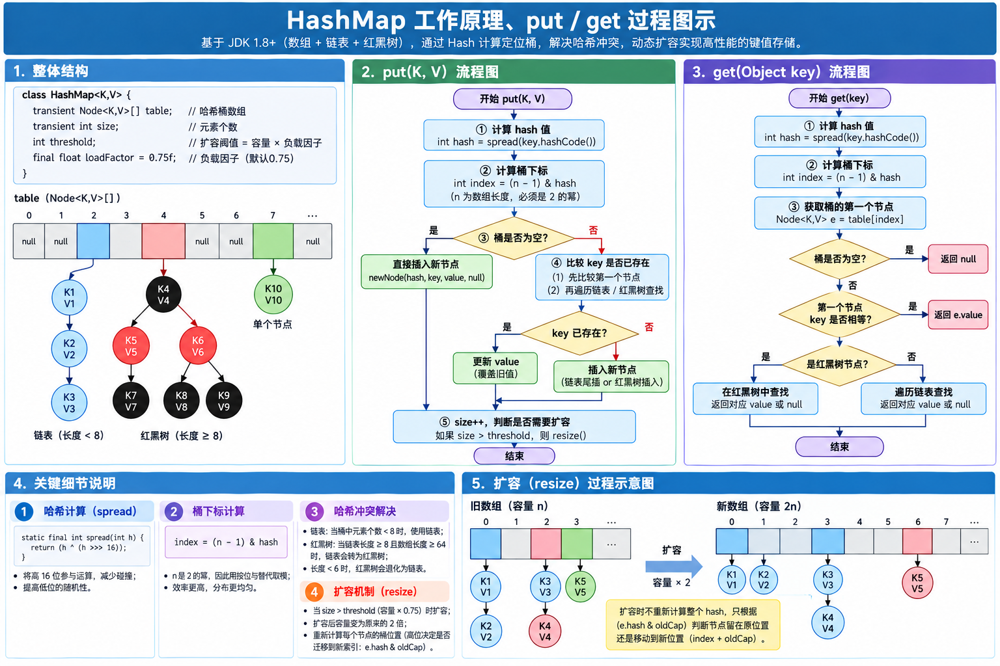
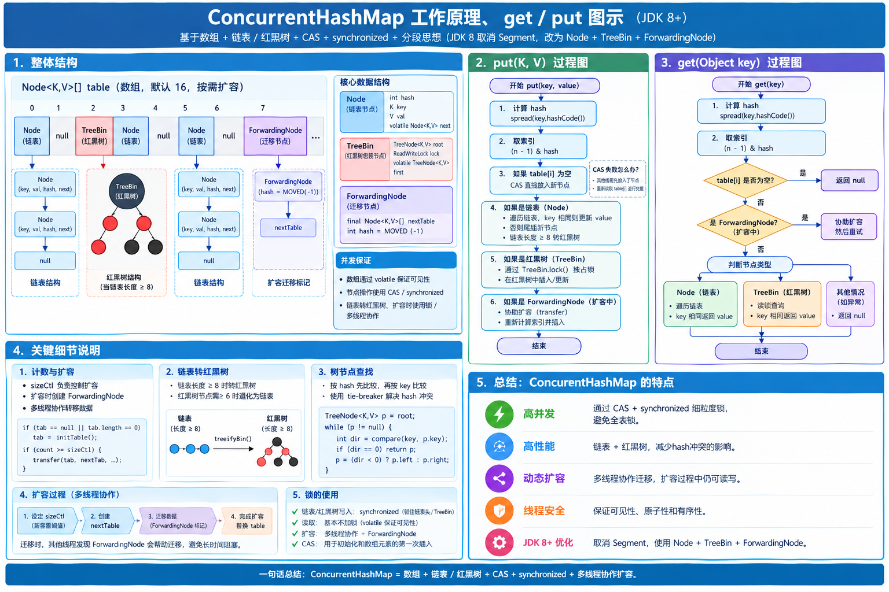

# Java 基础篇：集合框架与底层源码全解析

> [!NOTE]
> 本文档系统梳理 **Java 集合框架（JCF, Java Collections Framework）** 与 **`java.util.concurrent` 并发容器** 的核心架构、JDK 1.7 / 1.8 底层源码实现、时间复杂度对比、高频生产踩坑以及大厂面试追问标准话术。

---

## 一、Java 集合框架全景总纲与复杂度/选型矩阵

### 1.1 两大顶层接口继承体系全景图

Java 集合框架主要由两大根接口派生：**`Collection<E>`**（单列集合，存储独立元素，继承自 `Iterable<E>`）和 **`Map<K, V>`**（双列集合，存储键值对映射，独立于 `Collection` 体系之外）。

```text
Iterable<E> (支持 iterator() 与增强 for 循环)
 └── Collection<E> (单列集合根接口)
      ├── List<E> (有序、可重复、支持索引随机访问)
      │    ├── ArrayList<E>            (动态 Object[] 数组，默认懒加载 10，1.5 倍扩容，非线程安全)
      │    ├── LinkedList<E>           (双向链表 Node，同时实现 Deque，首尾 O(1)，非线程安全)
      │    ├── Vector<E>               (古老动态数组，方法全加 synchronized，2 倍扩容，已过时)
      │    │    └── Stack<E>           (继承 Vector 的 LIFO 栈，已过时，推荐用 ArrayDeque 替代)
      │    └── CopyOnWriteArrayList<E> (JUC 写时复制数组，读无锁写加锁复制，适合读多写少)
      │
      ├── Set<E> (元素唯一不可重复，底层均复用对应 Map，Value 为静态占位对象 PRESENT)
      │    ├── HashSet<E>              (底层 HashMap，无序，基于 hashCode + equals 去重)
      │    │    └── LinkedHashSet<E>   (继承 HashSet，底层 LinkedHashMap，维护插入顺序)
      │    ├── SortedSet<E> -> NavigableSet<E>
      │    │    └── TreeSet<E>         (底层 TreeMap 红黑树，按 Comparable/Comparator 排序与去重)
      │    └── CopyOnWriteArraySet<E>  (底层持有 CopyOnWriteArrayList，通过 addIfAbsent 去重)
      │
      └── Queue<E> (队列接口，通常遵循 FIFO 先进先出或优先级出队)
           ├── PriorityQueue<E>        (基于 Object[] 的二叉小顶堆，按优先级出队，非线程安全)
           ├── Deque<E>                (双端队列接口，兼具 FIFO 队列与 LIFO 栈能力)
           │    ├── ArrayDeque<E>      (基于 2 的幂次方环形数组 + head/tail 指针，极速双端队列/栈)
           │    └── LinkedList<E>      (双向链表实现双端队列)
           ├── ConcurrentLinkedQueue<E>(JUC 基于 CAS 的无锁非阻塞并发队列)
           └── BlockingQueue<E>        (JUC 阻塞队列接口，提供 put/take 阻塞原语)
                ├── ArrayBlockingQueue<E>    (有界环形数组 + 单把 ReentrantLock)
                ├── LinkedBlockingQueue<E>   (单向链表 + putLock/takeLock 读写双锁分离)
                ├── PriorityBlockingQueue<E> (支持阻塞的无界优先级二叉堆队列)
                ├── DelayQueue<E>            (基于 PriorityQueue 的延时获取无界阻塞队列)
                └── SynchronousQueue<E>      (0 容量不存元素，生产者与消费者直接配对移交)

Map<K, V> (双列键值对根接口，Key 唯一、Value 可重复)
 ├── HashMap<K, V>                     (JDK8 数组 + 链表 + 红黑树，允许 1 个 null Key，非线程安全)
 │    └── LinkedHashMap<K, V>          (继承 HashMap + 全局双向链表，支持插入序或访问序 LRU)
 ├── SortedMap<K, V> -> NavigableMap<K, V>
 │    └── TreeMap<K, V>                (红黑树实现，按 Key 排序，Key 禁止 null)
 ├── Hashtable<K, V>                   (古老哈希表，全表 synchronized，键值均禁 null，已过时)
 │    └── Properties                   (继承 Hashtable，键值均为 String，专用于读写配置文件)
 ├── WeakHashMap<K, V>                 (弱引用键 WeakReference + ReferenceQueue，GC 后自动清理条目)
 └── ConcurrentMap<K, V>
      ├── ConcurrentHashMap<K, V>      (JDK8 Node[] + CAS + synchronized 锁桶头，键值均禁 null)
      └── ConcurrentSkipListMap<K, V>  (JUC 基于跳表 SkipList 的高并发有序 Map)
```

---

### 1.2 全集合底层结构、时间复杂度、`null` 支持与扩容终极汇总表

| 集合类 | 底层数据结构 | 有序性 | `null` 支持 | 线程安全 | 初始容量与扩容机制 | 随机查询 | 增删复杂度 | 去重/相等判定依据 |
| :--- | :--- | :--- | :--- | :--- | :--- | :--- | :--- | :--- |
| **`ArrayList`** | `Object[]` 动态数组 | 插入有序 | 允许多个 `null` | ❌ 否 | 无参懒加载为空数组，首次 `add` 扩至 `10`；满时 **1.5 倍**扩容（无负载因子） | $O(1)$ | 尾部均摊 $O(1)$；中间 $O(N)$ | `equals()`（查找/删除时） |
| **`LinkedList`** | 双向链表 `Node<E>` | 插入有序 | 允许多个 `null` | ❌ 否 | 链表节点按需分配，无容量与扩容概念 | $O(N)$（折半遍历） | 首尾 $O(1)$；按索引 $O(N)$ | `equals()`（查找/删除时） |
| **`Vector`** | `Object[]` 动态数组 | 插入有序 | 允许多个 `null` | ✅ `synchronized` | 默认容量 `10`，满时默认 **2 倍**扩容 | $O(1)$ | 尾部均摊 $O(1)$；中间 $O(N)$ | `equals()` |
| **`CopyOnWriteArrayList`** | `volatile Object[]` + `ReentrantLock` | 插入有序 | 允许多个 `null` | ✅ 写时复制 | 默认长度 `0`，每次写操作拷贝新数组长度 `+1` | $O(1)$ | 写操作整表复制 $O(N)$ | `equals()` |
| **`HashSet`** | `HashMap`（值固定为 `PRESENT`） | 无序 | 允许 1 个 `null` | ❌ 否 | 复用 `HashMap`（默认 `16`，负载因子 `0.75`，2 倍扩容） | $O(1)$ 均摊 | $O(1)$ 均摊，树化 $O(\log N)$ | 先 `hashCode()` 后 `equals()` |
| **`LinkedHashSet`** | `LinkedHashMap` | 插入有序 | 允许 1 个 `null` | ❌ 否 | 复用 `LinkedHashMap`（默认 `16`，负载因子 `0.75`） | $O(1)$ 均摊 | $O(1)$ 均摊 | 先 `hashCode()` 后 `equals()` |
| **`TreeSet`** | `TreeMap`（红黑树） | 排序有序 | ❌ 禁止 `null` | ❌ 否 | 树节点动态分配，无扩容概念 | $O(\log N)$ | $O(\log N)$ | **`compareTo / compare == 0`** |
| **`ArrayDeque`** | `Object[]` 环形数组 + `head/tail` | 队列/栈序 | ❌ 禁止 `null` | ❌ 否 | 默认 `16`（必为 $2^n$），满时（`head == tail`）**2 倍**扩容 | 队首/尾 $O(1)$ | 首尾入队/出队 $O(1)$ | `equals()` |
| **`PriorityQueue`** | `Object[]` 二叉小顶堆 | 仅出队有序 | ❌ 禁止 `null` | ❌ 否 | 默认 `11`；容量 $<64$ 时 $2\text{x}+2$，容量 $\ge 64$ 时 **1.5 倍**扩容 | 堆顶 `peek` $O(1)$ | 入堆/出堆 $O(\log N)$ | `compareTo / compare` |
| **`HashMap`** | 数组 + 链表 + 红黑树（1.8） | 无序 | 1 个 `null` Key，多个 `null` Value | ❌ 否 | 默认 `16`（懒加载），负载因子 `0.75`（阈值 `12`），**2 倍**扩容 | $O(1)$ 均摊，最坏 $O(\log N)$ | $O(1)$ 均摊，最坏 $O(\log N)$ | Key：`hashCode()` + `equals()` |
| **`LinkedHashMap`** | `HashMap` + 全局双向链表 | 插入序 / 访问序 | 1 个 `null` Key，多个 `null` Value | ❌ 否 | 同 `HashMap` | $O(1)$ 均摊 | $O(1)$ 均摊 | Key：`hashCode()` + `equals()` |
| **`TreeMap`** | 红黑树（自平衡 BST） | 按 Key 排序 | ❌ 禁 `null` Key；允许 `null` Value | ❌ 否 | 树节点动态分配，无扩容概念 | $O(\log N)$ | $O(\log N)$ | Key：**`compareTo / compare == 0`** |
| **`Hashtable`** | 数组 + 链表 | 无序 | ❌ 键值均禁 `null` | ✅ `synchronized` | 默认 `11`，负载因子 `0.75`，扩容为 $2\text{x}+1$ | $O(1)$ 均摊 | $O(1)$ 均摊 | Key：`hashCode()` + `equals()` |
| **`ConcurrentHashMap`** | 数组 + 链表 + 红黑树（1.8） | 无序 | ❌ 键值均禁 `null` | ✅ `CAS` + `synchronized` | 默认 `16`（懒加载），负载因子 `0.75`，多线程协同 **2 倍**扩容 | $O(1)$ 无锁读 | $O(1)$ 锁单桶头 | Key：`hashCode()` + `equals()` |

---

### 1.3 `Collection` 与 `Map` 顶层通用 API 契约

#### 1. `Collection<E>` 核心通用方法
```java
// 1. 基础增删改查与状态判断
boolean add(E e);                           // 添加单个元素（List 恒返回 true；Set 重复时返回 false）
boolean remove(Object o);                   // 删除首个匹配 equals(o) 的元素
boolean contains(Object o);                 // 判断是否包含指定元素（List 调 equals；HashSet 调 hash+equals）
int size();                                 // 返回当前元素个数
boolean isEmpty();                          // 判空（规范要求优先用 isEmpty() 而非 size() == 0）
void clear();                               // 清空所有元素

// 2. 集合代数运算（批量操作）
boolean addAll(Collection<? extends E> c);  // 并集：将集合 c 的所有元素加入当前集合
boolean removeAll(Collection<?> c);         // 差集：移除当前集合中所有包含在 c 中的元素
boolean retainAll(Collection<?> c);         // 交集：仅保留当前集合与 c 共有的元素
boolean containsAll(Collection<?> c);       // 子集判断：判断是否包含 c 的全部元素

// 3. 数组转换与 Java 8+ 增强方法
Object[] toArray();                         // 转为 Object[]
<T> T[] toArray(T[] a);                     // 转为指定类型数组（推荐传入 new String[0]）
boolean removeIf(Predicate<? super E> filter); // JDK 8：按条件安全批量删除元素
default Stream<E> stream();                 // JDK 8：获取串行流
default void forEach(Consumer<? super E> action); // JDK 8：函数式遍历
```

#### 2. 菱形语法（Diamond Operator `<>`）与面向接口编程规范
- **Java 7 菱形语法**：编译器根据左侧声明的泛型类型自动执行**类型推断（Type Inference）**，右侧构造器只需写 `<>`：
  ```java
  // 推荐：面向接口声明引用（List/Map/Set/Deque）+ 右侧菱形语法 <>
  List<String> list = new ArrayList<>();
  Map<String, List<Integer>> groupMap = new HashMap<>();
  Deque<Integer> stack = new ArrayDeque<>();
  ```
- **为什么强烈建议左侧使用接口类型（如 `List`）而非具体实现类（如 `ArrayList`）？**
  遵循依赖倒置原则，后续若业务需要切换为 `LinkedList` 或 `CopyOnWriteArrayList`，只需修改 `new` 处的一行代码，所有方法入参、返回值及调用方代码零改动。

---

## 二、`List` 体系深度剖析（`ArrayList` / `LinkedList` / `Vector` / `CopyOnWriteArrayList`）

### 2.1 `List` 接口专属带索引 API
`List<E>` 在 `Collection<E>` 基础上扩展了**按位置索引（`index`）精确操作**的契约：
```java
E get(int index);                         // 按下标随机获取元素
E set(int index, E element);              // 替换指定下标元素，并返回旧元素
void add(int index, E element);           // 在指定下标插入元素（后续元素整体右移）
E remove(int index);                      // 删除指定下标元素（后续元素整体左移），注意与 remove(Object) 重载区分！
int indexOf(Object o);                    // 返回元素首次出现的索引（不存在返回 -1）
int lastIndexOf(Object o);                // 返回元素最后一次出现的索引
List<E> subList(int fromIndex, int toIndex); // 返回左闭右开 [fromIndex, toIndex) 的原集合视图
ListIterator<E> listIterator();           // 返回支持双向遍历与原地增改的专属迭代器
default void sort(Comparator<? super E> c); // JDK 8：原地排序
```

> [!WARNING]
> **`List<Integer>` 删除元素的重载大坑**：
> 当集合类型为 `List<Integer>` 时，`list.remove(1)` 调用的是 **`remove(int index)`**（删除索引为 `1` 的元素）；若要删除值为 `1` 的元素对象，必须显式装箱：`list.remove(Integer.valueOf(1))`。

---

### 2.2 `ArrayList` 源码级深度剖析（JDK 1.8）

#### 1. 核心字段与三种构造器（无参懒加载机制）
```java
public class ArrayList<E> extends AbstractList<E>
        implements List<E>, RandomAccess, Cloneable, java.io.Serializable {

    // 默认初始容量为 10
    private static final int DEFAULT_CAPACITY = 10;
    // 有参构造传入 0 或空集合时共享的空数组
    private static final Object[] EMPTY_ELEMENTDATA = {};
    // 无参构造专属的共享空数组（用于区分首次 add 时是否扩到默认容量 10）
    private static final Object[] DEFAULTCAPACITY_EMPTY_ELEMENTDATA = {};

    // 底层存储元素的数组（transient 修饰，自定义序列化）
    transient Object[] elementData;
    // 实际已存入的元素个数（注意：不是数组容量 elementData.length）
    private int size;

    // 1. 无参构造：懒加载！此时只赋值为空数组 {}，不分配 10 个槽位的内存
    public ArrayList() {
        this.elementData = DEFAULTCAPACITY_EMPTY_ELEMENTDATA;
    }

    // 2. 指定初始容量构造：立即分配对应长度的 Object[]（已知数据量时强烈推荐，避免多次扩容拷贝）
    public ArrayList(int initialCapacity) {
        if (initialCapacity > 0) {
            this.elementData = new Object[initialCapacity];
        } else if (initialCapacity == 0) {
            this.elementData = EMPTY_ELEMENTDATA;
        } else {
            throw new IllegalArgumentException("Illegal Capacity: " + initialCapacity);
        }
    }
}
```

#### 2. `add(E)` 与 `grow()` 1.5 倍扩容核心源码
```java
public boolean add(E e) {
    ensureCapacityInternal(size + 1);  // 确保容量足够容纳第 size + 1 个元素
    elementData[size++] = e;           // 尾部直接赋值并将 size 加 1
    return true;
}

private void ensureCapacityInternal(int minCapacity) {
    // 若是无参构造创建且首次添加元素（elementData == DEFAULTCAPACITY_EMPTY_ELEMENTDATA）
    // 则 minCapacity 取 Math.max(10, minCapacity)
    if (elementData == DEFAULTCAPACITY_EMPTY_ELEMENTDATA) {
        minCapacity = Math.max(DEFAULT_CAPACITY, minCapacity);
    }
    ensureExplicitCapacity(minCapacity);
}

private void ensureExplicitCapacity(int minCapacity) {
    modCount++; // 记录结构性修改次数（用于 fail-fast 检测）
    // 只有当所需的最小容量 minCapacity 超过当前数组长度时，才触发 grow 扩容！
    if (minCapacity - elementData.length > 0)
        grow(minCapacity);
}

private void grow(int minCapacity) {
    int oldCapacity = elementData.length;
    // 核心：新容量 = 旧容量 + (旧容量 >> 1)，即 1.5 倍（向下取整）
    int newCapacity = oldCapacity + (oldCapacity >> 1);
    // 若 1.5 倍仍不够（如首次从 0 扩到 10，或 addAll 一次性塞入大量元素），则直接取 minCapacity
    if (newCapacity - minCapacity < 0)
        newCapacity = minCapacity;
    // 若超过 MAX_ARRAY_SIZE (Integer.MAX_VALUE - 8)，调用 hugeCapacity 兜底至 Integer.MAX_VALUE
    if (newCapacity - MAX_ARRAY_SIZE > 0)
        newCapacity = hugeCapacity(minCapacity);
    // 底层调用 System.arraycopy 将旧数组元素复制到新分配的数组中
    elementData = Arrays.copyOf(elementData, newCapacity);
}
```

> [!IMPORTANT]
> **面试高频辟谣与细节追问**：
> 1. **`ArrayList` 有“负载因子（Load Factor）”吗？**
>    **绝对没有！** 负载因子 `0.75` 是哈希表（`HashMap` / `HashSet`）为降低哈希冲突而设计的概念。`ArrayList` 是连续线性表，只有当数组**100% 装满**（`size == elementData.length`）再插入新元素时才会触发 **1.5 倍**扩容（扩容序列：`0 -> 10 -> 15 -> 22 -> 33 -> 49 ...`）。
> 2. **如果是无参构造的 `ArrayList`，第一次直接调用 `addAll()` 放入 15 个元素，容量是多少？**
>    在 `ensureCapacityInternal` 中 `minCapacity = Math.max(10, 15) = 15`；进入 `grow(15)` 后，`newCapacity` 从 `0` 修正为 `15`，因此一步到位直接扩容为 **`15`**。若此后再 `add` 第 16 个元素，则按 $15 + (15 \gg 1) = 22$ 扩容。
> 3. **为什么 `elementData` 数组要用 `transient` 修饰？`ArrayList` 还能序列化吗？**
>    能序列化（实现了 `Serializable`）。因为 `elementData` 往往预留了未使用的空槽位（容量 `length >= size`），若采用默认序列化会把末尾大量的 `null` 空位一并写出。`ArrayList` 重写了私有方法 `writeObject` 和 `readObject`，在序列化时仅遍历写出前 `size` 个真实元素，大幅节省网络与磁盘开销。

#### 3. 中间插入 `add(index, e)` 与删除 `remove(index)` 的数组搬移成本
```java
public void add(int index, E element) {
    rangeCheckForAdd(index);
    ensureCapacityInternal(size + 1);
    // 将 index 及其后面的 size - index 个元素原地向后拷贝移动 1 位
    System.arraycopy(elementData, index, elementData, index + 1, size - index);
    elementData[index] = element;
    size++;
}

public E remove(int index) {
    rangeCheck(index);
    modCount++;
    E oldValue = elementData(index);
    int numMoved = size - index - 1;
    if (numMoved > 0)
        // 将 index + 1 开始的元素向前拷贝覆盖 1 位
        System.arraycopy(elementData, index + 1, elementData, index, numMoved);
    elementData[--size] = null; // 必须置空末尾冗余引用，协助 GC 回收对象，防止内存泄漏！
    return oldValue;
}
```

---

### 2.3 `LinkedList` 源码级深度剖析

`LinkedList<E>` 同时实现了 `List<E>` 和 `Deque<E>` 接口，底层是带头尾指针（`first`、`last`）的**双向链表**。

```java
public class LinkedList<E> extends AbstractSequentialList<E>
        implements List<E>, Deque<E>, Cloneable, java.io.Serializable {

    transient int size = 0;
    transient Node<E> first; // 头节点指针
    transient Node<E> last;  // 尾节点指针

    private static class Node<E> {
        E item;
        Node<E> next; // 后继指针
        Node<E> prev; // 前驱指针

        Node(Node<E> prev, E element, Node<E> next) {
            this.item = element;
            this.next = next;
            this.prev = prev;
        }
    }

    // 折半查找定位第 index 个节点：时间复杂度 O(N)
    Node<E> node(int index) {
        // 若 index 在前半区（index < size / 2），从头节点 first 向后遍历
        if (index < (size >> 1)) {
            Node<E> x = first;
            for (int i = 0; i < index; i++)
                x = x.next;
            return x;
        } else {
            // 若 index 在后半区，从尾节点 last 向前遍历
            Node<E> x = last;
            for (int i = size - 1; i > index; i--)
                x = x.prev;
            return x;
        }
    }
}
```

> [!CAUTION]
> **面试高频误区纠正：“`LinkedList` 插入和删除的时间复杂度是 $O(1)$，比 `ArrayList` 快”对吗？**
> - **只有在头部/尾部增删**（`addFirst/addLast/removeFirst/removeLast`）或**已经持有 `Iterator` 游标原地增删**时，由于无需遍历寻址、仅修改前后节点的 `prev/next` 引用，时间复杂度才是严格的 **$O(1)$**。
> - 如果调用**按索引增删 `add(int index, E)` 或 `remove(int index)`**，必须先调用 `node(index)` 执行折半链表遍历（平均遍历 $N/4$ 个节点），因此**按索引增删的整体时间复杂度仍然是 $O(N)$**！而且由于链表每次 `add` 都要 `new Node<>()` 分配对象且内存不连续（CPU 缓存不友好），在绝大多数中间插入基准测试中，`LinkedList` 甚至比 `System.arraycopy` 块拷贝的 `ArrayList` 更慢。

---

### 2.4 `ArrayList` vs `LinkedList` vs `Vector` vs `CopyOnWriteArrayList`

#### 1. 四大 `List` 实现全方位对比表
| 对比维度 | `ArrayList` | `LinkedList` | `Vector` | `CopyOnWriteArrayList` |
| :--- | :--- | :--- | :--- | :--- |
| **底层结构** | 动态 `Object[]` 数组 | 双向链表 `Node<E>` | 动态 `Object[]` 数组 | `volatile Object[]` + `ReentrantLock` |
| **实现接口** | `List`, `RandomAccess` | `List`, `Deque`（无 `RandomAccess`） | `List`, `RandomAccess` | `List`, `RandomAccess` |
| **线程安全** | ❌ 不安全 | ❌ 不安全 | ✅ 全方法 `synchronized` | ✅ 读无锁，写加锁复制（COW） |
| **扩容机制** | 默认 `10`，**1.5 倍**扩容 | 无扩容概念 | 默认 `10`，**2 倍**扩容（可设 `capacityIncrement`） | 每次写操作拷贝新数组（长度 $\pm 1$） |
| **内存占用與局部性** | 连续内存空间，仅存元素引用，**CPU Cache 预取极快** | 内存分散，每个元素额外消耗 `Node` 对象头（12B）+ `prev/next` 引用（8B） | 同 `ArrayList` | 写操作瞬间占用双倍数组内存 |
| **适用场景** | **95% 以上的单线程/局部业务首选** | 仅适合频繁头尾增删的队列或滑动窗口 | 遗留代码兼容，新项目禁用 | **读多写少**的高并发场景（白名单、监听器列表、配置缓存） |

#### 2. `CopyOnWriteArrayList`（写时复制）源码核心原理
```java
public class CopyOnWriteArrayList<E> implements List<E>, RandomAccess, Cloneable, java.io.Serializable {
    final transient ReentrantLock lock = new ReentrantLock();
    // volatile 保证数组引用切换时对所有读线程立即可见
    private transient volatile Object[] array;

    // 读操作：全程无锁！直接读取当前 volatile 数组快照
    public E get(int index) {
        return get(getArray(), index);
    }

    // 写操作：加独占锁 -> 复制新数组 -> 在新数组上修改 -> 原子替换 volatile 引用
    public boolean add(E e) {
        final ReentrantLock lock = this.lock;
        lock.lock();
        try {
            Object[] elements = getArray();
            int len = elements.length;
            Object[] newElements = Arrays.copyOf(elements, len + 1);
            newElements[len] = e;
            setArray(newElements); // volatile 写，读线程立即可见新数组
            return true;
        } finally {
            lock.unlock();
        }
    }
}
```
- **核心优势**：读读不互斥、**读写也不互斥**（读操作永远访问不可变的旧数组或新数组快照），迭代器绝不会抛出 `ConcurrentModificationException`。
- **两大缺陷**：
  1. **内存占用与 GC 压力大**：每次 `add/set/remove` 都会完整复制底层数组，若集合较大且写频繁，会瞬间产生大量朝生夕死的数组对象引发频繁 Young GC 甚至 Full GC。
  2. **数据最终一致性（弱一致性）**：写线程尚未执行完 `setArray(newElements)` 前，读线程以及此前已创建的迭代器看到的仍然是旧数组数据，不适合强实时一致性场景。

---

## 三、`Map` 体系核心基石：`HashMap`（JDK 1.7 vs 1.8）源码级全链路剖析



### 3.1 核心常量与底层节点数据结构（JDK 1.8）

`HashMap` 在 JDK 1.8 中采用 **“数组（哈希桶 `Node<K,V>[] table`）+ 单向链表（`Node`）+ 红黑树（`TreeNode`）”** 的复合结构：

```java
public class HashMap<K,V> extends AbstractMap<K,V> implements Map<K,V>, Cloneable, Serializable {
    // 1. 默认初始容量：16（必须是 2 的幂次方）
    static final int DEFAULT_INITIAL_CAPACITY = 1 << 4;
    // 2. 最大容量：2^30
    static final int MAXIMUM_CAPACITY = 1 << 30;
    // 3. 默认负载因子：0.75f（扩容阈值 threshold = capacity * loadFactor）
    static final float DEFAULT_LOAD_FACTOR = 0.75f;
    // 4. 链表转红黑树的长度阈值：链表节点数达到 8 时尝试树化
    static final int TREEIFY_THRESHOLD = 8;
    // 5. 红黑树退化为链表的长度阈值：树节点数降至 6 及以下时退化为链表
    static final int UNTREEIFY_THRESHOLD = 6;
    // 6. 树化的最小数组容量阈值：若桶数组长度 < 64，即使链表长度达到 8 也只执行 resize() 扩容而不树化！
    static final int MIN_TREEIFY_CAPACITY = 64;

    // 普通单向链表节点
    static class Node<K,V> implements Map.Entry<K,V> {
        final int hash; // 扰动后的 hash 值
        final K key;
        V value;
        Node<K,V> next; // 桶内下一个节点
        // ...
    }

    // 红黑树节点（间接继承自 HashMap.Node，同时保留 prev/next 双向链表指针以便退化与遍历）
    static final class TreeNode<K,V> extends LinkedHashMap.Entry<K,V> {
        TreeNode<K,V> parent;
        TreeNode<K,V> left;
        TreeNode<K,V> right;
        TreeNode<K,V> prev;
        boolean red;
        // ...
    }
}
```

#### 高频追问：为什么 `HashMap` 的核心参数如此设计？
1. **为什么默认负载因子是 `0.75f`（而不是 `1.0` 或 `0.5`）？**
   - 这是**空间利用率**与**查询时间成本（哈希冲突率）**的数学折中。
   - 若设为 `1.0`：必须等 16 个桶位全部填满才扩容，在填满前大量元素会发生严重的哈希碰撞堆积成链表/树，导致查询退化。
   - 若设为 `0.5`：空间才用了一半就触发 2 倍扩容，造成近一半数组空间闲置浪费。
   - 根据统计学**泊松分布（Poisson Distribution）**与二项分布推导，当负载因子为 $\ln 2 \approx 0.693$ 到 $0.75$ 之间时，哈希桶平均碰撞率极低，且 $16 \times 0.75 = 12$ 恰好能与 $2^n$ 容量相乘得到整数阈值 `threshold`。
2. **为什么链表转红黑树阈值是 `8`，而退化回链表阈值是 `6`？**
   - **为什么是 `8`**：源码注释明确给出了在负载因子 `0.75` 且哈希函数良好时，单个桶内链表长度遵循参数 $\lambda = 0.5$ 的泊松分布：长度为 `8` 的概率仅为 **`0.00000006`（千万分之六）**。平时用轻量级 `Node` 链表节省内存（`TreeNode` 大小约为普通 `Node` 的两倍）；一旦因恶意构造哈希碰撞或劣化 `hashCode` 导致链表长度达到 `8`，则升级为红黑树将最坏查询复杂度从 $O(N)$ 兜底至 $O(\log N)$。
   - **为什么退化是 `6` 而不是 `7`**：预留 **`2` 的缓冲差值（Hysteresis）**，防止某个热点 Key 在阈值 `8` 附近被频繁 `put` 和 `remove` 时，引发链表与红黑树之间反复转换的性能抖动。
   - **树化的双重条件**：必须同时满足 **`链表长度 >= 8`** 且 **`table.length >= 64`**（若数组容量 `< 64`，`treeifyBin()` 内部只会调用 `resize()` 扩容，因为小容量下扩容拆分链表比建树更高效）。

---

### 3.2 扰动函数 `hash()`、容量 $2^n$ 铁律与 `tableSizeFor`

#### 1. 扰动函数 `hash(Object key)` 源码
```java
static final int hash(Object key) {
    int h;
    // 1. key == null 时固定返回 hash = 0（因此 null Key 永远落在 table[0] 号桶）
    // 2. 非 null 时：将 32 位 hashCode 的高 16 位无符号右移后，与原低 16 位做异或（^）运算
    return (key == null) ? 0 : (h = key.hashCode()) ^ (h >>> 16);
}
```
- **为什么要做 `(h = key.hashCode()) ^ (h >>> 16)` 高低 16 位异或？**
  桶下标的计算公式是 `index = (n - 1) & hash`。在大多数业务场景中，数组长度 `n` 较小（如初始 `16`、`32`、`64`），此时 `n - 1` 的高 16 位全为 `0`（例如 $16 - 1 = \text{00000000 00000000 00000000 00001111}_2$）。如果不做扰动，直接用 `hashCode` 与 `n - 1` 按位与，那么 `hashCode` 的**高 16 位特征将完全丢失**，只要两个对象的低 4 位相同就会发生碰撞！通过高 16 位与低 16 位异或，将高位特征混合渗透到低 16 位中，大幅降低哈希冲突。
- **为什么混合高低位用异或 `^`，而不用按位与 `&` 或按位或 `|`？**
  `&` 运算结果有 $75\%$ 概率趋向于 `0`，`|` 运算结果有 $75\%$ 概率趋向于 `1`，都会导致散列结果严重偏斜；唯有异或 `^` 产生 `0` 和 `1` 的概率严格为 **50% : 50%**，散列最均匀。

#### 2. 为什么 `HashMap` 的数组长度 $n$ 必须是 $2$ 的幂次方（$2^k$）？
1. **位与运算替代取模运算，极速寻址**：
   当且仅当 $n = 2^k$ 时，二进制下 $n - 1$ 表现为低 $k$ 位全为 `1`（如 $16 - 1 = 15 = \text{1111}_2$），此时按位与运算 **`(n - 1) & hash` 在数学上完全等价于取模运算 `hash % n`**，而 CPU 执行位运算 `&` 的效率远高于除法取模 `%`。
2. **保证散列均匀，避免桶位永远闲置**：
   若 $n$ 不是 $2$ 的幂（如 $n = 15$，则 $n - 1 = 14 = \text{1110}_2$，最低位为 `0`），任何 `hash` 与 `1110` 按位与后最低位永远为 `0`，这意味着**所有奇数下标的桶（`1, 3, 5, 7...`）永远不可能存进任何元素**，浪费一半空间且冲突翻倍！
3. **支持 JDK 1.8 扩容时 `(e.hash & oldCap) == 0` 高低位免 rehash 极速拆分**（详见 3.4 节）。

#### 3. 任意传入容量如何向上取整为 $2$ 的幂？—— `tableSizeFor(int cap)`
```java
static final int tableSizeFor(int cap) {
    int n = cap - 1; // 先减 1，防止 cap 本身就是 2 的幂（如 16）时被翻倍算成 32！
    n |= n >>> 1;
    n |= n >>> 2;
    n |= n >>> 4;
    n |= n >>> 8;
    n |= n >>> 16;   // 连续 5 次无符号右移并按位或，将最高位 1 右侧的所有低位全部涂满为 1
    return (n < 0) ? 1 : (n >= MAXIMUM_CAPACITY) ? MAXIMUM_CAPACITY : n + 1; // 最后 +1 即得到最小的 2^k
}
```
> **实战计算**：若预计向 `HashMap` 存入 `100` 个元素且不希望触发扩容，构造参数应传多少？
> $\text{initialCapacity} = \lceil 100 / 0.75 \rceil + 1 = 134$，传入 `new HashMap<>(134)`（或 Guava 的 `Maps.newHashMapWithExpectedSize(100)`），`tableSizeFor(134)` 会自动将其规整为 $256$（阈值 $256 \times 0.75 = 192 > 100$）。

---

### 3.3 `put(K, V)` 与 `get(Object)` 源码级完整流程

#### 1. `putVal` 九步核心源码解析（JDK 1.8）
```java
public V put(K key, V value) {
    return putVal(hash(key), key, value, false, true);
}

final V putVal(int hash, K key, V value, boolean onlyIfAbsent, boolean evict) {
    Node<K,V>[] tab; Node<K,V> p; int n, i;
    // 步骤 1：【懒加载初始化】若 table 为空或长度为 0，调用 resize() 初始化长度为 16 的数组
    if ((tab = table) == null || (n = tab.length) == 0)
        n = (tab = resize()).length;

    // 步骤 2：【计算桶下标】i = (n - 1) & hash；若该桶为空，直接新建 Node 放入桶头（无锁/无冲突）
    if ((p = tab[i = (n - 1) & hash]) == null)
        tab[i] = newNode(hash, key, value, null);
    else {
        // 发生哈希冲突，p 为当前桶的头节点
        Node<K,V> e; K k;
        // 步骤 3：【桶头直接命中】比较桶头节点的 hash 与 key（先比 == 再比 equals）
        if (p.hash == hash && ((k = p.key) == key || (key != null && key.equals(k))))
            e = p; // 记录待覆盖的目标节点 e
        // 步骤 4：【红黑树分支】若桶头是 TreeNode，调用红黑树的 putTreeVal 插入或查找相同 Key
        else if (p instanceof TreeNode)
            e = ((TreeNode<K,V>)p).putTreeVal(this, tab, hash, key, value);
        // 步骤 5：【链表分支】遍历单向链表（JDK 1.8 采用尾插法！）
        else {
            for (int binCount = 0; ; ++binCount) {
                // 遍历到链表末尾仍未找到相同 Key，直接将新节点挂在尾部（尾插法）
                if ((e = p.next) == null) {
                    p.next = newNode(hash, key, value, null);
                    // 步骤 6：【树化检查】binCount 从 0 开始，当 binCount == 7 时代表原链表已有 8 个节点，
                    // 加上刚插入的新节点共 9 个（或第 8 次比较后达阈值 TREEIFY_THRESHOLD - 1），触发 treeifyBin
                    if (binCount >= TREEIFY_THRESHOLD - 1) // -1 for 1st
                        treeifyBin(tab, hash);
                    break;
                }
                // 在链表中途找到了相同 Key 的节点，跳出循环去执行步骤 7 的覆盖
                if (e.hash == hash && ((k = e.key) == key || (key != null && key.equals(k))))
                    break;
                p = e;
            }
        }
        // 步骤 7：【Key 已存在，覆盖旧值】若 e != null，说明是更新已有 Key，不增加 size，直接返回旧值
        if (e != null) {
            V oldValue = e.value;
            if (!onlyIfAbsent || oldValue == null)
                e.value = value;
            afterNodeAccess(e); // LinkedHashMap 钩子方法
            return oldValue;
        }
    }
    // 步骤 8：【记录修改次数并检查扩容】新增节点成功后，modCount++，若 ++size > threshold 则扩容
    ++modCount;
    if (++size > threshold)
        resize();
    afterNodeInsertion(evict); // LinkedHashMap 钩子方法
    return null;
}
```

#### 2. `get(Object key)` 寻址流程源码
```java
public V get(Object key) {
    Node<K,V> e;
    return (e = getNode(hash(key), key)) == null ? null : e.value;
}

final Node<K,V> getNode(int hash, Object key) {
    Node<K,V>[] tab; Node<K,V> first, e; int n; K k;
    // 1. 表非空且目标桶 (n - 1) & hash 头节点非空
    if ((tab = table) != null && (n = tab.length) > 0 &&
        (first = tab[(n - 1) & hash]) != null) {
        // 2. 永远先检查桶头节点（绝大多数无冲突情况下 O(1) 直接命中返回）
        if (first.hash == hash && ((k = first.key) == key || (key != null && key.equals(k))))
            return first;
        if ((e = first.next) != null) {
            // 3. 若桶已树化，走红黑树查找 O(log N)
            if (first instanceof TreeNode)
                return ((TreeNode<K,V>)first).getTreeNode(hash, key);
            // 4. 否则顺着单向链表遍历 O(N)
            do {
                if (e.hash == hash && ((k = e.key) == key || (key != null && key.equals(k))))
                    return e;
            } while ((e = e.next) != null);
        }
    }
    return null;
}
```

---

### 3.4 `resize()` 2 倍扩容与高低位链表免 rehash 拆分机制

在 JDK 1.7 中，扩容时需要为每个节点重新计算 `hash & (newCap - 1)` 并采用头插法搬移。而在 **JDK 1.8** 中，由于容量每次都是翻倍（`newCap = oldCap << 1`），`newCap - 1` 的二进制掩码仅仅比 `oldCap - 1` **在最高位多出了一个 `1`**（该位正好对应 `oldCap` 本身的二进制位）。

因此，JDK 1.8 直接通过 **`(e.hash & oldCap) == 0`** 判断节点去向：
- **低位链表（`loHead / loTail`）**：若 `(e.hash & oldCap) == 0`，说明该节点在新数组中的下标**完全不变**：`newIndex = j`。
- **高位链表（`hiHead / hiTail`）**：若 `(e.hash & oldCap) != 0`，说明该节点在新数组中的下标只需**加上旧容量**：`newIndex = j + oldCap`。

```java
// JDK 1.8 resize() 中桶内链表高低位拆分核心源码片段
Node<K,V> loHead = null, loTail = null;
Node<K,V> hiHead = null, hiTail = null;
Node<K,V> next;
do {
    next = e.next;
    // 无需重算 hash，仅看 e.hash 对应 oldCap 那一位是 0 还是 1
    if ((e.hash & oldCap) == 0) {
        if (loTail == null) loHead = e;
        else loTail.next = e;
        loTail = e;
    } else {
        if (hiTail == null) hiHead = e;
        else hiTail.next = e;
        hiTail = e;
    }
} while ((e = next) != null);

if (loTail != null) {
    loTail.next = null;
    newTab[j] = loHead;          // 原下标位置
}
if (hiTail != null) {
    hiTail.next = null;
    newTab[j + oldCap] = hiHead; // 原下标 + oldCap 位置
}
```
> **高低位拆分的三大优势**：① 省去重新计算 hash 与取模的开销；② 将原链表均匀拆成两条短链表，降低冲突；③ **尾插法保持原链表节点的相对顺序不变**，彻底根除了 JDK 1.7 头插法逆序引发的并发死循环。

---

### 3.5 JDK 1.7 vs JDK 1.8 `HashMap` 全方位对比与并发死循环复盘

| 对比维度 | JDK 1.7 `HashMap` | JDK 1.8 `HashMap` |
| :--- | :--- | :--- |
| **底层数据结构** | 数组（`Entry[]`）+ 单向链表 | 数组（`Node[]`）+ 单向链表 + **红黑树（`TreeNode`）** |
| **链表插入方式** | **头插法**（新节点插在桶头，原有链表整体下移） | **尾插法**（遍历到链表末尾追加新节点，顺便统计长度判断树化） |
| **插入与扩容顺序** | 先判断是否需要扩容 `resize()`，再插入新节点 | 先插入新节点，最后判断 `++size > threshold` 再扩容 |
| **扰动函数 `hash()`** | 4 次位运算 + 5 次异或（9 次扰动，较繁琐） | 1 次右移 + 1 次异或：`(h = key.hashCode()) ^ (h >>> 16)` |
| **扩容节点迁移** | 逐个重新计算 `indexFor(e.hash, newCapacity)` 并头插逆序 | `(e.hash & oldCap) == 0` 拆分为 `lo`（原位）和 `hi`（`+oldCap`）两条链表尾插 |
| **并发安全隐患** | 并发扩容下头插法导致**链表逆序成环（`A <-> B`），触发 `get()` 死循环 CPU 100%** + 数据丢失 | 修复了死循环，但并发 `put` 仍会导致**桶头覆盖数据丢失**与 `size` 计数不准 |

#### 深入追问：为什么 JDK 1.7 头插法并发扩容会形成环形死链？
假设原桶中有链表 `A -> B -> null`：
1. **线程 T1** 启动扩容，刚执行完 `Entry<K,V> next = e.next;`（此时 T1 局部变量 `e = A`，`next = B`）即被挂起。
2. **线程 T2** 独自完成了整个扩容过程。因为采用**头插法**，T2 先把 `A` 插到新桶头，再把 `B` 插到 `A` 前面，新桶中的链表顺序被**反转成了 `B -> A -> null`**。
3. **线程 T1** 恢复执行，继续拿着旧引用搬移：
   - 第一轮循环将 `A` 头插到 T1 的新桶中，随后 `e` 推进到 `next`（即 `B`）。
   - 第二轮循环处理 `B`，而此时由于 T2 的修改，`B.next` 已经指向了 `A`！T1 把 `B` 头插到 `A` 前面后，第三轮又拿到 `A` 并把 `A.next` 指向 `B`，最终形成 **`B.next = A` 且 `A.next = B` 的环形链表**。后续任何线程一旦对该桶调用 `get()` 遍历，就会陷入无限死循环，导致线上 CPU 飙升至 100%。

---

### 3.6 生产大坑：使用可变对象作为 `HashMap / HashSet` 的 Key 导致内存泄漏

```java
// 踩坑复现：以可变的 ArrayList（或未将参与 hashCode 的字段设为 final 的自定义类）作为 Key
Map<List<String>, String> map = new HashMap<>();
List<String> key = new ArrayList<>();
key.add("Java");

map.put(key, "Value-1");        // 存入时：按 ["Java"] 算出 hash1，落入桶 index1
System.out.println(map.get(key)); // 输出："Value-1"

// 灾难操作：在放入 Map 后修改了 Key 内部参与 hashCode 计算的状态！
key.add("Spring");              // 此时 key 的 hashCode 已变成 hash2

System.out.println(map.get(key)); // 输出：null！（去桶 index2 找，根本找不到）
map.remove(key);                  // 删除失败！原桶 index1 中的节点永远无法被 get 或 remove，引发内存泄漏！
```
> [!IMPORTANT]
> **自定义对象作为 `HashMap` Key 或存入 `HashSet` 的三大铁律**：
> 1. **必须同时重写 `hashCode()` 和 `equals()`**：若只重写 `equals` 不重写 `hashCode`，两个逻辑相等的对象因默认 `Object.hashCode()` 不同而落入不同桶，导致去重与查找完全失效。
> 2. **参与 `hashCode()` 和 `equals()` 计算的字段必须完全一致**。
> 3. **Key 对象强烈建议设计为不可变类（Immutable，如 `String`、`Integer`、`Long`，或将参与哈希计算的字段用 `final` 修饰）**，严禁在存入容器后修改 Key 的哈希相关属性。

---

### 3.7 Java 8 `Map` 函数式高频 API 对比与实战

| 方法签名 | 核心语义 | `key` 不存在时 | `key` 存在但 `value == null` 时 | 典型应用场景 |
| :--- | :--- | :--- | :--- | :--- |
| **`getOrDefault(k, defaultV)`** | 只读查询，不会修改 Map | 返回 `defaultV` | **返回 `null`！**（因为 key 已存在） | 安全读取默认配置或计数器初值 |
| **`putIfAbsent(k, v)`** | 不存在或值为 `null` 时才写入 | 写入 `v`，返回 `null` | 写入 `v`，返回 `null` | 简单值防覆盖初始化（注意：入参 `v` 表达式总是会先求值） |
| **`computeIfAbsent(k, k -> newV)`** | **懒加载计算**：不存在或值为 `null` 时才执行函数并写入 | 执行函数写入 `newV`，**返回 `newV`** | 执行函数写入 `newV`，**返回 `newV`** | **分组聚合神器**：`map.computeIfAbsent(k, k -> new ArrayList<>()).add(x)` |
| **`computeIfPresent(k, (k, oldV) -> newV)`** | 仅当 `key` 存在且旧值非 `null` 时才计算更新 | 不执行函数，返回 `null` | 不执行函数，返回 `null` | 针对已有非空记录做状态更新（若函数返回 `null` 则删除该 Key） |
| **`merge(k, v, (oldV, v) -> newV)`** | 不存在或旧值为 `null` 则直接存 `v`；否则用函数合并新旧值 | 存入 `v`，返回 `v` | 存入 `v`，返回 `v` | **词频统计/金额累加神器**：`map.merge(word, 1, Integer::sum)` |

```java
// 实战对比：以前写 6 行的多值分组 vs Java 8 一行搞定
Map<String, List<String>> deptUsers = new HashMap<>();
// 传统写法：判断 get == null -> new ArrayList -> put -> add
// Java 8 优雅写法（因为 computeIfAbsent 返回的是当前或新创建的 List 引用）：
deptUsers.computeIfAbsent("研发部", k -> new ArrayList<>()).add("张三");

// 词频统计一行搞定：
Map<String, Integer> wordCount = new HashMap<>();
for (String word : words) {
    wordCount.merge(word, 1, Integer::sum);
}
```

---

## 四、并发 `Map` 与特殊 `Map`（`ConcurrentHashMap` / `Hashtable` / `LinkedHashMap` / `TreeMap` / `WeakHashMap`）



### 4.1 `ConcurrentHashMap`（JDK 1.7 vs JDK 1.8）深度剖析

#### 1. JDK 1.7 vs JDK 1.8 架构演进对比
| 对比维度 | JDK 1.7 `ConcurrentHashMap` | JDK 1.8 `ConcurrentHashMap` |
| :--- | :--- | :--- |
| **底层数据结构** | **`Segment[]` 分段数组 + `HashEntry[]` 数组 + 单向链表** | **`Node[]` 数组 + 单向链表 + 红黑树（`TreeBin`）**（与 1.8 `HashMap` 对齐） |
| **锁机制与粒度** | **`Segment` 继承 `ReentrantLock`**，锁住整个分段（含多个哈希桶） | **`CAS`（无锁空桶写入）+ `synchronized`（仅锁单个哈希桶的头节点）** |
| **并发度（Concurrency）** | 默认 `16` 个 `Segment`，**一旦初始化后 `Segment` 数组不可扩容**，并发上限锁死 | 并发度等于当前 `Node[]` 数组长度 $N$，**随数组 2 倍扩容并发度同步翻倍** |
| **寻址与解决冲突** | 二次哈希（高 4 位定 `Segment`，低位定 `HashEntry`）+ 链表 $O(N)$ | 单次扰动 `(h ^ (h >>> 16)) & HASH_BITS` + 链表达到 8 且容量 $\ge 64$ 转红黑树 $O(\log N)$ |
| **扩容机制** | 每个 `Segment` 内部各自独立单线程扩容 | **多线程协同扩容（`ForwardingNode` + `helpTransfer`）** |
| **`size()` 计数统计** | 先不加锁连续统计 2～3 次各 `Segment` 的 `modCount`，若不一致则**将全部 `Segment` 加锁**后汇总 | 仿 `LongAdder` 的 **`baseCount` + `CounterCell[]` 分散热点 CAS 累加**，读取时直接无锁求和 `sumCount()` |

#### 2. JDK 1.8 `ConcurrentHashMap` 为什么放弃 `ReentrantLock` 改用 `synchronized`？
1. **锁粒度大幅细化，冲突率极低**：1.8 锁的是**单个哈希桶的头节点 `f`**，哈希散列良好时多线程竞争同一个桶的概率很低。
2. **JVM 底层对 `synchronized` 做了锁升级优化**：自 JDK 1.6 起引入了偏向锁 $\rightarrow$ 轻量级锁（CAS 自旋）$\rightarrow$ 重量级锁的升级路径。在低冲突的单桶上，绝大多数时候处于轻量级锁级别，性能与 `ReentrantLock` 持平甚至更好。
3. **极致的内存节省**：如果每个哈希桶都配一个独立的 `ReentrantLock`（继承自 `AQS`），当桶数组扩容到百万级时，光 `ReentrantLock` 和 `AQS` 对象就会白白消耗数以百 MB 计的堆内存；而 `synchronized` 直接复用每个 `Node` 对象自带的 **Mark Word 对象头**作为锁标记，**零额外内存开销**！

#### 3. JDK 1.8 `ConcurrentHashMap` 四大核心源码机制

##### ① `initTable()`：基于 `sizeCtl` 状态机的 CAS 安全初始化
- `sizeCtl` 的四种状态值含义：
  - `0`：默认未初始化状态。
  - `> 0`：未初始化时代表预设初始容量；已初始化后代表下次扩容阈值（`0.75 * n`）。
  - `-1`：**正在由某个线程初始化 `table` 数组**。
  - `< -1`：正在执行多线程并发扩容（高 16 位为扩容标识戳 `resizeStamp`，低 16 位减 1 在早期版本中表示正在扩容的线程数）。
- 当多个线程同时首次 `put` 时，通过 `U.compareAndSwapInt(this, SIZECTL, sc, -1)` 抢占初始化权；抢到的线程分配数组，没抢到的线程调用 `Thread.yield()` 让出 CPU 自旋等待。

##### ② `putVal()`：空桶 CAS + 非空桶 `synchronized` 锁头节点
```java
final V putVal(K key, V value, boolean onlyIfAbsent) {
    // 1. 铁律：Key 和 Value 只要有一个为 null，立即抛 NullPointerException！
    if (key == null || value == null) throw new NullPointerException();
    int hash = spread(key.hashCode()); // (h ^ (h >>> 16)) & 0x7fffffff（保证 hash 恒为非负数）
    int binCount = 0;
    for (Node<K,V>[] tab = table;;) {
        Node<K,V> f; int n, i, fh;
        // 2. 懒加载初始化数组
        if (tab == null || (n = tab.length) == 0)
            tab = initTable();
        // 3. 若目标桶为空：全程不加 synchronized，直接用 CAS 原子写入新节点！失败则自旋重试
        else if ((f = tabAt(tab, i = (n - 1) & hash)) == null) {
            if (casTabAt(tab, i, null, new Node<K,V>(hash, key, value, null)))
                break;                   // CAS 成功，直接跳出循环去计数
        }
        // 4. 若桶头节点的 hash == MOVED (-1)，说明当前桶已迁移完且正处于扩容中，当前线程立即协助扩容！
        else if ((fh = f.hash) == MOVED)
            tab = helpTransfer(tab, f);
        // 5. 目标桶非空且不在迁移状态：仅使用 synchronized 锁住当前桶头节点 f
        else {
            V oldVal = null;
            synchronized (f) {
                if (tabAt(tab, i) == f) { // 双重检查：确认 f 仍然是桶头（未被其它线程树化或扩容替换）
                    if (fh >= 0) {        // fh >= 0 表示普通链表节点
                        // 顺着链表查找更新或尾插新节点...
                    } else if (f instanceof TreeBin) { // fh == -2 表示红黑树代理节点 TreeBin
                        // 调用 putTreeVal 插入红黑树...
                    }
                }
            }
            if (binCount != 0) {
                if (binCount >= TREEIFY_THRESHOLD)
                    treeifyBin(tab, i);
                if (oldVal != null)
                    return oldVal;
                break;
            }
        }
    }
    addCount(1L, binCount); // 分散累加元素个数并检查是否触发扩容
    return null;
}
```

##### ③ `transfer()`：多线程协同扩容与 `ForwardingNode`
- 当数组需要扩容时，首个发起扩容的线程会创建一个 2 倍长度的新数组 `nextTable`。
- 根据 CPU 核数计算每个线程每次领取的桶迁移步长 `stride`（最小为 `16` 个桶），通过 CAS 递减 `transferIndex` 从后往前领取一段桶区间任务。
- 每当某个旧桶迁移完毕，就在该旧桶位置塞入一个特殊的 **`ForwardingNode`（其 `hash` 固定为 `MOVED = -1`，内部持有 `nextTable` 的引用）**：
  - 若此时有**读线程**访问该旧桶，看到 `fh == -1` 会顺着 `ForwardingNode` 直接转发去新数组 `nextTable` 查询，**扩容期间读操作依然完全无锁不阻塞**！
  - 若此时有**写线程**要往该桶 `put`，看到 `fh == -1` 会调用 `helpTransfer()` 领取剩余桶区间**帮着一起搬迁数据**，多核并发加速扩容。

##### ④ `get()`：为什么全程无锁还能保证线程安全？
- `Node` 的 `val` 和 `next` 字段均使用了 **`volatile`** 关键字修饰：`volatile V val; volatile Node<K,V> next;`。
- 数组桶的读取使用了 `tabAt()`（底层 `Unsafe.getObjectVolatile`），保证数组引用和桶头节点在多线程间的**内存可见性（Happens-Before）**，因此 `get` 全程无需加任何锁。

---

### 4.2 `HashMap` vs `Hashtable` vs `ConcurrentHashMap` 8 维终极对比

| 对比维度 | `HashMap` | `Hashtable` | `ConcurrentHashMap`（JDK 1.8） |
| :--- | :--- | :--- | :--- |
| **线程安全性** | ❌ **非线程安全** | ✅ 线程安全（全表粗粒度锁，已淘汰） | ✅ **高并发线程安全（企业级首选）** |
| **同步实现机制** | 无同步措施 | 所有公开方法（`get/put/remove/size`）均加 **`synchronized`** 锁住整个 `Hashtable` 实例 | **空桶 `CAS` + 非空桶 `synchronized` 锁单个桶头节点** + `volatile` 无锁读 |
| **底层数据结构** | 数组 + 链表 + 红黑树（$\ge 8$ 且 $\ge 64$） | 数组 + 单向链表（无红黑树） | 数组 + 链表 + 红黑树（`TreeBin`） |
| **`null` 键与 `null` 值** | ✅ 允许 **1 个 `null` Key** 和**多个 `null` Value** | ❌ **Key 和 Value 均严格禁止 `null`**（抛 NPE） | ❌ **Key 和 Value 均严格禁止 `null`**（抛 NPE） |
| **初始容量与扩容** | 默认 `16`（懒加载），每次 **2 倍**扩容（$2^n$） | 默认 `11`（构造即分配），每次 **$2\text{x} + 1$** 扩容 | 默认 `16`（懒加载），多线程协同 **2 倍**扩容（$2^n$） |
| **哈希值计算** | 高低 16 位异或扰动 + `(n - 1) & hash` 位与 | `(hash & 0x7FFFFFFF) % tab.length` 除法取模 | `(h ^ (h >>> 16)) & 0x7fffffff` + `(n - 1) & hash` |
| **迭代器机制** | **`fail-fast`**（遍历中结构被改抛 `CME`） | `Iterator`（`keySet/entrySet`）为 **`fail-fast`**；古老 `Enumeration`（`keys/elements`）不抛 `CME`（**注意：底层绝不会复制数组！**） | **`fail-safe`（弱一致性）**：基于 `volatile` 遍历，不抛 `CME` 且无需复制数组 |
| **继承体系** | `extends AbstractMap` | `extends Dictionary`（JDK 1.0 遗留类） | `extends AbstractMap implements ConcurrentMap` |

> [!IMPORTANT]
> **面试必问：为什么 `HashMap` 允许 `null` 键值，而 `ConcurrentHashMap` 和 `Hashtable` 严格禁止 `null`？**
> 核心原因是**并发场景下的二义性（Ambiguity）问题**：
> - 当调用 `map.get(key)` 返回 `null` 时，存在两种可能：① 该 `key` 根本不在 Map 中；② 该 `key` 存在，但其绑定的 `value` 本身就是 `null`。
> - 在**单线程 `HashMap`** 中，可以通过紧接着调用 `map.containsKey(key)` 来消除二义性。
> - 但在**多线程 `ConcurrentHashMap`** 中，`get(key)` 与 `containsKey(key)` 两步操作之间**不是原子的**：假设线程 A 刚执行完 `get(key)` 得到 `null`（原本是因为该 `key` 不存在），此时线程 B 抢先一步执行了 `put(key, null)`，紧接着线程 A 调用 `containsKey(key)` 竟然返回了 `true`！这会导致线程 A 误以为刚才读到了一个值为 `null` 的合法记录，引发严重并发逻辑错乱。此外，ConcurrentHashMap 的作者 Doug Lea 也明确指出：Map 中存入 `null` 往往掩盖了上游代码的未初始化 Bug，禁止 `null` 既消除了并发二义性，也简化了源码中 `tabAt / casTabAt` 对空桶 `null` 的判断。

---

### 4.3 `LinkedHashMap` 源码原理与手写 LRU 缓存

#### 1. 底层结构：`HashMap` 哈希桶 + 全局双向链表
`LinkedHashMap<K,V>` 继承自 `HashMap<K,V>`。它在 `HashMap.Node` 基础上增加了 `before` 和 `after` 两个指针，将散落在不同哈希桶中的所有节点串联成一条**全局双向链表**（头指针 `head`、尾指针 `tail`）：

```java
static class Entry<K,V> extends HashMap.Node<K,V> {
    Entry<K,V> before, after; // 跨桶维护全局插入/访问顺序的双向链表指针
    Entry(int hash, K key, V value, Node<K,V> next) {
        super(hash, key, value, next);
    }
}
```
> **注意区分两组指针**：
> - **`next`**：属于父类 `HashMap.Node`，仅用于连接**同一个哈希桶内部**发生碰撞的节点。
> - **`before / after`**：属于 `LinkedHashMap.Entry`，用于跨桶连接**所有节点**以维护全局遍历顺序。因此 `LinkedHashMap` 的 `get/put` 查找依然走哈希表 $O(1)$，而遍历 `entrySet()` 时直接顺着 `head -> after` 双向链表遍历，效率甚至比遍历稀疏数组桶的 `HashMap` 更快！

#### 2. 模板方法设计模式：三大钩子方法与 `accessOrder`
`LinkedHashMap` **没有重写 `put()` 方法**，而是直接复用了父类 `HashMap.putVal()`，并通过重写父类预留的三个空钩子方法来维护双向链表：
1. `newNode()`：创建新节点时顺便调用 `linkNodeLast(p)` 将其挂在双向链表尾部。
2. `afterNodeAccess(Node<K,V> e)`：当 **`accessOrder = true`**（访问顺序模式）时，每次 `get()` 或 `put()` 更新已有节点后，将该节点从双向链表原位置摘下并**移到链表尾部（代表最近刚被访问过，Most Recently Used）**。
3. `afterNodeInsertion(boolean evict)`：新增节点后调用 `removeEldestEntry(first)`，若返回 `true`，则自动移除双向链表**头节点 `head`（代表最久未被访问的节点，Least Recently Used）**。
4. `afterNodeRemoval(Node<K,V> e)`：节点从哈希桶删除后，同步将其从双向链表中摘除。

#### 3. 面试高频手写题：基于 `LinkedHashMap` 10 行代码实现标准 LRU 缓存
```java
import java.util.LinkedHashMap;
import java.util.Map;

public class LRUCache<K, V> extends LinkedHashMap<K, V> {
    private final int capacity;

    public LRUCache(int capacity) {
        // 第三个参数 accessOrder 必须传 true，开启按访问顺序重排链表！
        super(capacity, 0.75f, true);
        this.capacity = capacity;
    }

    @Override
    protected boolean removeEldestEntry(Map.Entry<K, V> eldest) {
        // 当元素个数超过最大容量时返回 true，自动淘汰双向链表头部的最久未访问节点
        return size() > capacity;
    }
}
```

---

### 4.4 `TreeMap`（红黑树）与 `WeakHashMap`（弱引用键值表）

#### 1. `TreeMap` 核心原理与红黑树 5 大性质
`TreeMap<K,V>` 实现了 `NavigableMap<K,V>` 接口，底层是标准的**红黑树（Red-Black Tree，自平衡二叉查找树）**，增删查时间复杂度稳定在 **$O(\log N)$**。
- **红黑树必须满足的 5 大性质**：
  1. 每个节点要么是红色，要么是黑色。
  2. **根节点必须是黑色**。
  3. 所有叶子节点（NIL 空节点）都是黑色。
  4. **红色节点的两个子节点必须都是黑色**（即任意路径上不能出现两个连续的红色节点）。
  5. **从任一节点到其每个叶子的所有简单路径都包含相同数目的黑色节点（黑高平衡）**。
  > 这 5 条性质保证了红黑树中**最长路径（红黑交替）不会超过最短路径（全黑）的 2 倍**，通过**左旋、右旋和变色**维持近似平衡（相比严格要求高度差 $\le 1$ 的 AVL 树，红黑树在频繁插入删除时旋转次数更少，综合性能更优）。
- **Key 排序与去重铁律**：
  - **禁止 `null` Key**（因为需要调用 `compareTo/compare` 比较大小，传入 `null` 必抛 `NullPointerException`），但允许 `null` Value。
  - **判重唯一依据是 `compareTo(k) == 0` 或 `compare(k1, k2) == 0`，完全不调用 `equals()`**！
- **专属范围与邻近导航 API**（一致性哈希环虚拟节点路由常用）：
  ```java
  TreeMap<Integer, String> ring = new TreeMap<>();
  ring.firstKey();          // 最小 Key
  ring.lastKey();           // 最大 Key
  ring.ceilingKey(100);     // >= 100 的最小 Key（常用于一致性哈希顺时针找最近节点）
  ring.floorKey(100);       // <= 100 的最大 Key
  ring.higherKey(100);      // > 100 的最小 Key
  ring.lowerKey(100);       // < 100 的最大 Key
  ring.subMap(10, true, 50, false); // 截取 [10, 50) 范围的子视图
  ```

#### 2. `WeakHashMap` 弱引用自动回收机制与避坑指南
`WeakHashMap<K,V>` 的节点类 `Entry<K,V> extends WeakReference<Object>`，将 **Key 封装为弱引用**并关联一个引用队列 `ReferenceQueue<Object> queue`。
- **回收链路**：当某个 Key 对象在外部没有任何强引用指向它时，下一次 GC 发生时该 Key 会被回收，同时对应的 `Entry` 被 JVM 加入 `queue`。随后在下次调用 `WeakHashMap` 的 `get / put / size` 等方法时，内部会调用 **`expungeStaleEntries()`** 轮询 `queue`，将已失效的 `Entry` 从哈希桶链表中摘除并将 `value` 置为 `null`。
- **四大使用避坑点**：
  1. **Value 绝不能直接或间接强引用 Key**：否则 Key 永远可达，弱引用失效退化为内存泄漏。
  2. **不要用字符串字面量（`"abc"`）或 `-128~127` 的 `Integer` 作 Key**：因为常量池与缓存池始终持有它们的强引用，永远不会被 GC 回收。
  3. **清理是被动触发的**：GC 后若不再调用 `WeakHashMap` 的任何方法，`Entry` 的 `value` 不会立即释放。
  4. **非线程安全**：多线程下需使用 `Collections.synchronizedMap(new WeakHashMap<>())`。

---

## 五、`Set` 体系深度剖析（`HashSet` / `LinkedHashSet` / `TreeSet` / `CopyOnWriteArraySet`）

### 5.1 `Set` 复用 `Map` 的适配器设计模式

`Set<E>` 接口的方法签名与 `Collection<E>` 完全一致（无额外新增方法），核心契约是**元素唯一不可重复**。在 JDK 源码中，`Set` 的三大标准实现类并没有重新手写一套哈希表或红黑树，而是直接**在内部封装了一个对应的 `Map<E, Object>`**，将存入 `Set` 的元素作为 `Map` 的 **Key**，并将全局共享的静态虚拟对象 `PRESENT` 作为 `Map` 的 **Value**：

```java
public class HashSet<E> extends AbstractSet<E> implements Set<E>, Cloneable, java.io.Serializable {
    // 底层实际存储的 HashMap（若为 LinkedHashSet 子类，则实际指向 LinkedHashMap 实例）
    private transient HashMap<E,Object> map;

    // 所有 Key 共用的虚拟占位 Value 对象（节省内存，避免每次 add 都 new Object）
    private static final Object PRESENT = new Object();

    public HashSet() {
        map = new HashMap<>();
    }

    // 留给子类 LinkedHashSet 调用的包访问权限构造器（dummy 参数仅用于区分重载）
    HashSet(int initialCapacity, float loadFactor, boolean dummy) {
        map = new LinkedHashMap<>(initialCapacity, loadFactor);
    }

    // 核心去重源码：当 key 不存在时，map.put 返回 null，因此 add 返回 true（添加成功）；
    // 当 key 已存在时，map.put 返回旧值 PRESENT（非 null），因此 add 返回 false（去重拒绝）！
    public boolean add(E e) {
        return map.put(e, PRESENT) == null;
    }

    public boolean remove(Object o) {
        return map.remove(o) == PRESENT;
    }

    public boolean contains(Object o) {
        return map.containsKey(o);
    }
}
```

---

### 5.2 四大 `Set` 实现类全方位对比与去重铁律

| 对比维度 | `HashSet` | `LinkedHashSet` | `TreeSet` | `CopyOnWriteArraySet` |
| :--- | :--- | :--- | :--- | :--- |
| **底层封装容器** | `HashMap` | `LinkedHashMap`（继承自 `HashSet`） | `TreeMap`（红黑树） | **`CopyOnWriteArrayList`** |
| **元素顺序** | **无序**（按哈希散列分布） | **插入有序**（遍历顺序 = 添加顺序） | **排序有序**（自然排序或定制排序） | **插入有序** |
| **去重判定依据** | 先比 **`hashCode()`**，相等再比 **`equals()`** | 先比 **`hashCode()`**，相等再比 **`equals()`** | **只看 `compareTo / compare == 0`（与 `equals` 无关！）** | 遍历数组逐个调用 `equals()`（`addIfAbsent`） |
| **`null` 元素支持** | ✅ 允许 1 个 `null` | ✅ 允许 1 个 `null` | ❌ **禁止 `null`**（抛 NPE） | ✅ 允许 1 个 `null` |
| **增删查时间复杂度** | $O(1)$ 均摊 | $O(1)$ 均摊（遍历比 `HashSet` 更快） | $O(\log N)$ | 读/查 $O(N)$，写 $O(N)$ |
| **线程安全性** | ❌ 不安全 | ❌ 不安全 | ❌ 不安全 | ✅ 线程安全（读多写少） |

> [!CAUTION]
> **面试高频大坑：`TreeSet / TreeMap` 的去重规则与 `equals()` 不一致会怎样？**
> - **源码真相**：`TreeSet.add(e)` 底层调用 `TreeMap.put(e, PRESENT)`，在红黑树向下查找插入位置时，仅调用 `cmp = cpr.compare(key, t.key)` 或 `k.compareTo(t.key)`。**只要比较结果返回 `0`，`TreeMap` 就直接认为该元素已存在**（覆盖 Value 并返回旧值 `PRESENT`，导致 `TreeSet.add` 返回 `false`），**全程根本不会调用对象的 `equals()` 方法**！
> - **后果示例**：假设自定义 `Person(name, age)` 类重写了 `equals`（姓名且年龄相同才相等），但 `compareTo` 只按 `age` 比较（`Integer.compare(this.age, o.age)`）。此时往 `TreeSet` 中先后添加 `new Person("张三", 18)` 和 `new Person("李四", 18)`，虽然两者 `equals` 为 `false`，但因为年龄都是 `18`（`compareTo == 0`），**“李四”会被 `TreeSet` 当成重复元素直接丢弃**！
> - **开发规范**：实现 `Comparable` 或 `Comparator` 时，务必遵守契约：**当 `a.compareTo(b) == 0` 时，必须保证 `a.equals(b) == true`**（若主排序字段相同，需继续用 `thenComparing` 比较唯一标识字段）。

---

## 六、`Queue` 与 `Deque` 队列体系（`ArrayDeque` / `PriorityQueue` / 阻塞与并发队列）

### 6.1 `Queue` 顶层接口两套核心方法矩阵

`Queue<E>` 针对“入队、出队、查看队首”三大操作提供了**两套语义不同**的方法，日常开发与刷题务必优先使用**返回特殊值**的第二套：

| 操作类型 | 抛出异常版本（队满/队空时抛异常） | 返回特殊值版本（推荐：队满返回 `false` / 队空返回 `null`） |
| :--- | :--- | :--- |
| **入队（队尾插入）** | `boolean add(E e)`（满时抛 `IllegalStateException`） | **`boolean offer(E e)`** |
| **出队（移除并返回队首）** | `E remove()`（空时抛 `NoSuchElementException`） | **`E poll()`** |
| **查看队首（不移除）** | `E element()`（空时抛 `NoSuchElementException`） | **`E peek()`** |

> **为什么几乎所有 `Queue` 实现（除 `LinkedList` 外）都严格禁止插入 `null`？**
> 因为 `poll()` 和 `peek()` 在队列为空时的约定返回值就是 `null`！如果允许向队列中存入合法的 `null` 元素，当调用 `poll()` 返回 `null` 时，调用方将无法区分究竟是“队列已空”还是“成功取出了一个值为 `null` 的元素”。

---

### 6.2 `Deque` 双端队列与为什么用 `ArrayDeque` 替代 `Stack`

`Deque<E>`（Double Ended Queue，继承自 `Queue<E>`）支持在队列首尾两端同时高效地插入和移除元素，因此既可作为 **FIFO 队列**，也可作为 **LIFO 栈**。

#### 1. `Deque` 充当队列 vs 充当栈的标准方法对照表
| 使用模式 | 操作语义 | `Deque` 推荐方法 | 等价的 `Deque` 底层双端方法 |
| :--- | :--- | :--- | :--- |
| **普通队列模式（FIFO）** | 队尾入队 | `queue.offer(e)` | `offerLast(e)` |
| | 队首出队 | `queue.poll()` | `pollFirst()` |
| | 查看队首 | `queue.peek()` | `peekFirst()` |
| **栈模式（LIFO）** | 压栈（入栈顶） | **`stack.push(e)`** | `addFirst(e)` |
| | 弹栈（出栈顶） | **`stack.pop()`** / 安全弹出 `pollFirst()` | `removeFirst()` |
| | 查看栈顶 | **`stack.peek()`** | `peekFirst()` |

#### 2. 面试必考：为什么 Java 官方文档明确宣告废弃 `Stack`，强烈推荐用 `ArrayDeque`？
1. **`Stack` 的三大历史设计败笔**：
   - **粗粒度同步锁性能低下**：`Stack extends Vector<E>`，`push / pop / peek` 全部被 `synchronized` 修饰，单线程下每次压栈弹栈都有无谓的锁开销。
   - **破坏栈的 LIFO 封装性**：因为继承了 `Vector`，`Stack` 竟然暴露了 `add(int index, E)`、`get(int index)`、`remove(int index)` 等随机任意位置增删的方法，严重违背“只允许在栈顶操作”的数据结构定义（典型违反合成复用原则的反例）。
2. **`ArrayDeque` 底层环形数组（Circular Array）的极致设计**：
   - 底层持有 `transient Object[] elements`（容量必为 $2^n$，默认 `16`）以及两个游标 `int head` 和 `int tail`。
   - **位运算环形回绕**：无需移动任何数组元素，头部压入仅需 `elements[head = (head - 1) & (elements.length - 1)] = e`；尾部追加仅需 `elements[tail] = e; tail = (tail + 1) & (elements.length - 1)`，所有首尾操作均为严格的 **$O(1)$**。
   - **对比 `LinkedList` 的优势**：`ArrayDeque` 内存连续、CPU 缓存命中率极高，且无需在每次入队时 `new Node<>()`、出队时回收 `Node` 对象，无论是做栈还是做队列，实测吞吐量均显著优于 `LinkedList`。
   - **扩容机制**：当 `head == tail`（数组满）时触发 `doubleCapacity()`，申请 2 倍长度新数组，并通过两次 `System.arraycopy` 将 `head` 右侧元素和 `0 ~ tail` 元素拉直复制到新数组开头，重置 `head = 0, tail = n`。

---

### 6.3 `PriorityQueue`（二叉堆优先级队列）源码剖析与 TopK 实战

#### 1. 底层数组二叉堆结构与父子索引公式
`PriorityQueue<E>` 并非按 FIFO 顺序出队，而是基于 `Object[] queue` 实现的**二叉小顶堆（Min-Heap，即任意父节点的值始终 $\le$ 其左右子节点的值）**。
对于数组中任意索引为 `i`（从 `0` 开始）的节点，其在完全二叉树中的父子下标满足：
- **左孩子下标**：`leftNo = (i << 1) + 1`（即 $2i + 1$）
- **右孩子下标**：`rightNo = (i << 1) + 2`（即 $2i + 2$）
- **父节点下标**：`parentNo = (i - 1) >>> 1`（即 $\lfloor (i - 1) / 2 \rfloor$）

#### 2. 入堆上浮 `siftUp` 与出堆下沉 `siftDown`（$O(\log N)$）
- **`offer(E e)` 入堆上浮（`siftUp`）**：将新元素先放在数组末尾 `k = size`，然后循环与父节点 `parent = (k - 1) >>> 1` 比较；若新元素比父节点更小，则将父节点拉下来，直到新元素 $\ge$ 父节点或到达树根 `0` 号位，时间复杂度 $O(\log N)$。
- **`poll()` 出堆下沉（`siftDown`）**：取出 `queue[0]`（最小值）作为返回值，将数组末尾最后一个元素 `x = queue[--size]` 移到堆顶 `0` 号位，然后循环与左右孩子中**较小的一个**比较并向下交换（下沉），直到满足小顶堆性质，时间复杂度 $O(\log N)$。

> [!WARNING]
> **`PriorityQueue` 极易踩坑点**：
> **直接用增强 `for` 循环或 `iterator()` 遍历 `PriorityQueue`，输出顺序是无序的**（仅仅是按底层堆数组的层序输出，而堆只保证父 $\le$ 子，不保证左右兄弟之间的大小顺序）！若要按优先级顺序输出，**必须循环调用 `while (!pq.isEmpty()) pq.poll()`**。

#### 3. 面试高频手写：用 `PriorityQueue` 解决海量数据 TopK 问题
```java
// 求数组 nums 中最大的 K 个元素（或第 K 大元素）：维护一个容量为 K 的【小顶堆】！
// 时间复杂度 O(N log K)，空间复杂度 O(K)（无需对全部 N 个元素排序）
public int findKthLargest(int[] nums, int k) {
    // 默认即为小顶堆（若需大顶堆则传 (a, b) -> Integer.compare(b, a) 或 Comparator.reverseOrder()）
    PriorityQueue<Integer> minHeap = new PriorityQueue<>(k);
    for (int num : nums) {
        if (minHeap.size() < k) {
            minHeap.offer(num);
        } else if (num > minHeap.peek()) { // 当前元素比堆顶（前 K 大里的最小值）还要大，则淘汰堆顶
            minHeap.poll();
            minHeap.offer(num);
        }
    }
    return minHeap.peek(); // 最终堆顶即为第 K 大元素，堆内 K 个元素即为最大的 K 个数
}
```

---

### 6.4 `J.U.C` 阻塞队列（`BlockingQueue`）与非阻塞并发队列对比

#### 1. `BlockingQueue` 四组核心操作 API 矩阵
| 操作 | 抛异常 | 返回特殊值 | **一直阻塞（生产/消费者核心）** | **超时阻塞（带超时自动退出）** |
| :--- | :--- | :--- | :--- | :--- |
| **入队** | `add(e)` | `offer(e)` | **`put(e)`**（满则挂起等待） | `offer(e, time, unit)` |
| **出队** | `remove()` | `poll()` | **`take()`**（空则挂起等待） | `poll(time, unit)` |
| **查队首** | `element()` | `peek()` | *不支持* | *不支持* |

#### 2. 五大高频并发队列选型对比表
| 并发队列 | 底层结构 | 是否有界 | 锁与并发机制 | 核心特征与典型应用场景 |
| :--- | :--- | :--- | :--- | :--- |
| **`ArrayBlockingQueue`** | `Object[]` 环形数组 | **强制有界**（构造必传容量） | **单把 `ReentrantLock`** + 两个 `Condition`（`notEmpty` / `notFull`） | 生产与消费共用同一把锁（读写互斥），内存预先分配可控，适合固定缓冲池 |
| **`LinkedBlockingQueue`** | 单向链表 `Node` | 可选有界（默认 `Integer.MAX_VALUE` 准无界） | **双锁分离**：`takeLock`（出队锁）+ `putLock`（入队锁）+ `AtomicInteger count` | 生产者与消费者各自拿不同的锁，**读写可真正并行**，吞吐量高（注意：生产严禁用无参构造防 OOM！） |
| **`PriorityBlockingQueue`** | `Object[]` 二叉堆 | 无界（自动扩容） | 单把 `ReentrantLock` + CAS 自旋扩容 | 支持阻塞出队的线程安全优先级队列（`put` 永不阻塞，`take` 空时阻塞） |
| **`DelayQueue`** | `PriorityQueue` | 无界 | 单把 `ReentrantLock` + Leader-Follower 线程等待模式 | 元素需实现 `Delayed` 接口，只有到期（`getDelay <= 0`）才能被 `take` 取出，用于订单超时关单、定时任务 |
| **`SynchronousQueue`** | 无内部数组/链表（仅传输节点） | **0 容量**（不存储任何元素） | CAS 无锁栈（非公平 `TransferStack`）/ 队列（公平 `TransferQueue`） | 每一次 `put` 必须阻塞等待另一个线程 `take` 一对一直接交接；`Executors.newCachedThreadPool()` 底层队列 |
| **`ConcurrentLinkedQueue`** | 单向链表 `Node` | 无界 | **全程无锁 CAS（非阻塞队列，未实现 `BlockingQueue`）** | 极高并发下的非阻塞 FIFO 队列（注意：`size()` 方法需遍历全链表 $O(N)$，判空务必用 `isEmpty()`！） |

---

## 七、集合遍历、安全删除、`fail-fast` vs `fail-safe` 与集合视图（View）

### 7.1 各集合最佳遍历方式与性能铁律

#### 1. `RandomAccess` 标志接口对 `List` 遍历性能的决定性影响
`RandomAccess` 是一个没有任何方法的空标志接口（Marker Interface），`ArrayList` 和 `Vector` 实现了它，而 `LinkedList` **没有**实现它。
- **`ArrayList`**：普通索引 `for (int i = 0, n = list.size(); i < n; i++) list.get(i)` 最快（无迭代器对象创建开销，$O(1)$ 直接寻址）。
- **`LinkedList`**：**严禁使用普通索引 `for` 循环调用 `list.get(i)`**！因为每次 `get(i)` 都要折半遍历链表，外层循环 $N$ 次乘以内层平均 $N/4$ 次遍历，整体时间复杂度会退化为灾难性的 **$O(N^2)$**（10 万条数据耗时数秒，而用 `Iterator` 或增强 `for` 循环顺着 `next` 指针走只需 **$O(N)$** 的几毫秒）！
- **JDK `Collections.binarySearch` 等源码中的标准分发写法**：
  ```java
  if (list instanceof RandomAccess) {
      for (int i = 0, n = list.size(); i < n; i++) { /* 索引遍历 */ }
  } else {
      for (Iterator<?> it = list.iterator(); it.hasNext(); ) { /* 迭代器遍历 */ }
  }
  ```

#### 2. `Map` 的 4 种遍历方式与为什么 `entrySet()` 最快？
```java
Map<String, Integer> map = new HashMap<>();

// 方式 1（强烈推荐）：entrySet() 遍历 —— 一次遍历同时拿到 Key 和 Value，零额外哈希查找开销！
for (Map.Entry<String, Integer> entry : map.entrySet()) {
    String k = entry.getKey();
    Integer v = entry.getValue();
}

// 方式 2（强烈推荐）：JDK 8+ map.forEach Lambda（底层同样直接遍历 table 桶与链表节点）
map.forEach((k, v) -> System.out.println(k + "=" + v));

// 方式 3（仅需 Key 时可用，若还要拿 Value 则不推荐）：keySet() 遍历
// 缺点：拿到 key 后再调 map.get(key)，相当于对每个元素又重复算了一遍 hash 并查桶，耗时翻倍！
for (String k : map.keySet()) {
    Integer v = map.get(k);
}

// 方式 4（需要在遍历中按条件安全删除键值对时必用）：entrySet().iterator()
Iterator<Map.Entry<String, Integer>> it = map.entrySet().iterator();
while (it.hasNext()) {
    Map.Entry<String, Integer> entry = it.next();
    if (entry.getValue() < 0) {
        it.remove(); // 安全删除
    }
}
```

#### 3. `Iterator` vs `ListIterator` 核心区别
| 对比维度 | `Iterator<E>` | `ListIterator<E>`（继承自 `Iterator<E>`） |
| :--- | :--- | :--- |
| **适用集合范围** | 所有 `Collection`（`List`、`Set`、`Queue`） | **仅限 `List`**（通过 `list.listIterator()` 或 `list.listIterator(index)` 获取） |
| **遍历方向** | 仅支持单向向后遍历（`hasNext()` + `next()`） | 支持**双向遍历**（新增向前 `hasPrevious()` + `previous()`） |
| **遍历中修改能力** | 仅支持 `remove()` 删除当前元素 | 支持 `remove()`、**`add(E)` 原地插入新元素**、**`set(E)` 原地替换当前元素** |
| **游标索引定位** | 不支持获取当前下标 | 支持 `nextIndex()` 和 `previousIndex()` 获取游标位置 |

---

### 7.2 遍历集合时安全删除元素的 4 种标准方案与 2 大禁区

#### 1. 两大绝对禁区（面试必考踩坑复盘）
- **❌ 禁区一：在增强 `for` 循环（`foreach`）中直接调用集合自身的 `list.remove()` / `map.remove()`**
  ```java
  // 必抛 java.util.ConcurrentModificationException！
  for (String s : list) {
      if ("del".equals(s)) {
          list.remove(s); // 集合的 modCount++，但隐式迭代器的 expectedModCount 未更新，下次 next() 立即崩溃！
      }
  }
  ```
  > *特殊面试陷阱*：如果被删除的元素恰好在 `ArrayList` 的**倒数第二个位置**，有时竟然不报错？因为删掉一个元素后 `size` 减 1，下一轮循环调用 `hasNext()` 判断 `cursor != size` 恰好相等返回 `false` 直接退出了循环，没机会走到 `next()` 里的 `checkForComodification()`！但这纯属巧合，生产绝不可依赖。
- **❌ 禁区二：正序普通 `for` 循环（`i++`）直接调用 `list.remove(i)` 导致相邻目标元素漏删**
  ```java
  // 假设 list = ["a", "b", "b", "c"]，目标是删掉所有 "b"
  for (int i = 0; i < list.size(); i++) {
      if ("b".equals(list.get(i))) {
          list.remove(i);
          // 错误根源：当 i = 1 的第一个 "b" 被删除后，后面所有元素左移 1 位，原本 i = 2 的第二个 "b" 顶替到了 i = 1 的位置！
          // 但本轮结束执行 i++ 后 i 变成了 2，直接跳过了新挪到 i = 1 的第二个 "b"，造成严重漏删 Bug！
      }
  }
  ```

#### 2. 四种安全删除的标准方案
```java
// ✅ 方案 1（JDK 8+ 首选，最简洁高效）：使用 Collection.removeIf(Predicate)
// ArrayList 重写了 removeIf，底层先用 BitSet 记录所有待删下标，最后只做一次单趟数组紧凑平移，时间复杂度严格 O(N)！
list.removeIf(s -> "b".equals(s));
map.entrySet().removeIf(entry -> entry.getValue() < 0);

// ✅ 方案 2（全版本通用标准）：显式使用 Iterator，并调用 it.remove()（注意不是 list.remove！）
Iterator<String> it = list.iterator();
while (it.hasNext()) {
    String s = it.next();
    if ("b".equals(s)) {
        it.remove(); // 内部自动执行 expectedModCount = modCount 并修正 cursor = lastRet
    }
}

// ✅ 方案 3（索引循环场景）：倒序普通 for 循环（从末尾往前删，左移的都是已经检查过的元素，绝不漏删！）
for (int i = list.size() - 1; i >= 0; i--) {
    if ("b".equals(list.get(i))) {
        list.remove(i);
    }
}

// ✅ 方案 4（函数式不修改原集合）：Stream filter 过滤生成新集合
List<String> filtered = list.stream()
        .filter(s -> !"b".equals(s))
        .collect(Collectors.toList());
```

---

### 7.3 `fail-fast`（快速失败） vs `fail-safe`（安全失败）机制深度对比

```java
// ArrayList.Itr 内部类 fail-fast 源码摘录
private class Itr implements Iterator<E> {
    int cursor;       // 下一个要访问的元素下标
    int lastRet = -1; // 上一次刚访问过的元素下标
    int expectedModCount = modCount; // 迭代器创建时记录当前集合的修改版本号快照

    public E next() {
        checkForComodification(); // 每次 next() 第一步先校验版本号！
        // ...
    }

    public void remove() {
        if (lastRet < 0) throw new IllegalStateException();
        checkForComodification();
        try {
            ArrayList.this.remove(lastRet); // 调用外部类删除，使 modCount++
            cursor = lastRet;               // 游标回退 1 位，防止漏元素
            lastRet = -1;
            expectedModCount = modCount;    // 关键：同步更新 expectedModCount，因此 it.remove() 不会抛异常！
        } catch (IndexOutOfBoundsException ex) {
            throw new ConcurrentModificationException();
        }
    }

    final void checkForComodification() {
        if (modCount != expectedModCount)
            throw new ConcurrentModificationException();
    }
}
```

| 对比维度 | `fail-fast`（快速失败） | `fail-safe`（安全失败 / 弱一致性） |
| :--- | :--- | :--- |
| **所在包与代表集合** | `java.util` 包下所有非并发集合（`ArrayList`、`LinkedList`、`HashMap`、`HashSet`、`Vector`、`Hashtable` 的 `Iterator`） | `java.util.concurrent` 包下所有并发集合（`CopyOnWriteArrayList`、`ConcurrentHashMap`、`ConcurrentLinkedQueue`） |
| **触发异常** | 遍历期间一旦检测到集合结构被外部修改，立即抛出 **`ConcurrentModificationException`** | **绝不抛出 `ConcurrentModificationException`** |
| **底层实现原理** | 维护 **`modCount`**（实际结构修改次数）与迭代器私有 **`expectedModCount`**，每次 `next()/remove()` 比对两者是否相等 | ① `CopyOnWriteArrayList`：基于创建迭代器瞬间的**底层数组快照**遍历；② `ConcurrentHashMap`：基于 `volatile` 引用弱一致性遍历 |
| **设计目的与局限** | 尽早暴露并发修改或遍历中违规增删的编程 Bug（注意：它仅用于 Bug 诊断，**不能作为多线程并发安全的保障**） | 保证高并发下的可用性与无锁遍历吞吐量，但代价是**弱一致性**（遍历过程可能看不到迭代开始后刚写入的最新数据） |

---

### 7.4 集合视图（View） vs 独立拷贝（Copy）深度辨析与生产三大坑

#### 1. 什么是集合视图（Collection View）？
**视图（View）不会分配新的数组或节点来拷贝元素，而是直接持有原集合的引用，提供一层轻量级包装窗口。** 对视图与原集合的任何修改都会**双向穿透**（一改俱改）。

```java
// 1. 视图：与原集合共享底层数据，O(1) 创建，零元素拷贝
List<String> subView = list.subList(0, 2);
Set<String> keyView = map.keySet();

// 2. 独立浅拷贝：分配全新底层数组/哈希表，将元素引用复制一份，后续增删互不影响
List<String> independentList = new ArrayList<>(list.subList(0, 2));
Set<String> independentKeys = new HashSet<>(map.keySet());
```

#### 2. 视图的三大高频生产事故
1. **`ArrayList.subList(from, to)` 的三大连环坑（阿里规约强制条款）**：
   - **坑 ① 不能强转**：`subList` 返回的是 `ArrayList` 的内部类 `SubList`（继承自 `AbstractList` 而非 `ArrayList`），若写 `(ArrayList<String>) list.subList(0, 2)` 必抛 **`ClassCastException`**！
   - **坑 ② 原集合结构修改导致子列表崩溃**：生成 `subList` 后，只要对**原 `list`** 执行了任何 `add/remove`（改变 `modCount`），之后再对 `subList` 做任何遍历或读写操作，必抛 **`ConcurrentModificationException`**！
   - **坑 ③ 大集合截取小视图引发 OOM 内存泄漏**：`SubList` 内部强引用指向外部类 `ArrayList.this`。如果从一个包含 100 万条数据的巨型 `ArrayList` 中调用 `subList(0, 2)` 截取 2 条数据并放入全局缓存长期持有，会导致那 **100 万长度的底层 `elementData` 数组永远无法被 GC 回收**，直接引发线上 OOM！
     > **正确做法**：若需长期持有或独立修改子列表，务必写 `new ArrayList<>(list.subList(0, 2))`。
2. **`Arrays.asList(T... a)` 的三大连环坑**：
   - **坑 ① 定长视图不可增删**：返回的是 `java.util.Arrays.ArrayList` 静态内部类（而非 `java.util.ArrayList`），底层直接包裹传入的定长数组，未重写 `add / remove / clear` 方法，调用即抛 **`UnsupportedOperationException`**！
   - **坑 ② 基本类型数组泛型坍塌**：若传入基本类型数组 `int[] arr = {1, 2, 3}; List<int[]> list = Arrays.asList(arr);`，由于基本类型不能作为泛型参数，整个 `int[]` 会被当成**唯一的一个元素**存入列表，导致 **`list.size() == 1`**！（必须使用包装类数组 `Integer[]` 或 `Arrays.stream(arr).boxed().collect(Collectors.toList())`）。
   - **坑 ③ 数组与列表修改双向穿透**：修改 `arr[0] = 99` 会直接改变 `list.get(0)` 的值。
3. **`Map.keySet() / values() / entrySet()` 视图限制**：
   - 这三个视图均**支持 `remove()` / `removeAll()` / `retainAll()` / `clear()`**（会同步删除原 `Map` 中对应的键值对），但**严禁调用 `add()` / `addAll()`**（因为单存一个 Key 或 Value 无法凑成键值对，调用必抛 `UnsupportedOperationException`）。

---

### 7.5 算法刷题与回溯高频细节：`toString()` 与二维结果集深浅拷贝

#### 1. 为什么 `System.out.println(list)` 能直接打印 `[1, 2, 3]`，而打印数组却是 `[I@1b6d3586`？
- 普通数组没有重写 `Object.toString()`，因此直接输出 `类名@十六进制哈希码`（打印数组需用 `Arrays.toString(arr)` 或二维 `Arrays.deepToString(arr)`）。
- 而所有 `Collection` 实现类都继承了 **`AbstractCollection.toString()`**（同理 `Map` 继承了 `AbstractMap.toString()`）：源码内部通过 `Iterator` 遍历所有元素，用 `StringBuilder` 拼接 `[`、`, ` 和 `]`，甚至专门处理了 `e == this ? "(this Collection)" : String.valueOf(e)` 防止集合自引用死递归。

#### 2. 为什么回溯算法（如全排列、组合总和）收集结果时必须写 `res.add(new ArrayList<>(path))`？
```java
List<List<Integer>> res = new ArrayList<>();
Deque<Integer> path = new ArrayDeque<>();

// ❌ 错误写法：res.add(path);
// 原因：Java 集合存储的都是对象引用！全程只有一个 path 对象在不断 push 和 pop 回溯，
// 若直接把 path 引用塞进 res，当回溯结束 path 被 pop 清空时，res 里所有的子列表都会变成空列表 [[], [], []]！

// ✅ 正确写法：在到达递归叶子节点时，用拷贝构造器把当前时刻 path 里的元素复制成一份全新的独立快照存入 res！
res.add(new ArrayList<>(path));
```

---

## 八、`Collections` 工具类、集合排序体系与不可变/空集合最佳实践

### 8.1 `Comparable`（自然排序） vs `Comparator`（定制排序）

| 对比维度 | `Comparable<T>`（内比较器 / 自然排序） | `Comparator<T>`（外比较器 / 定制排序） |
| :--- | :--- | :--- |
| **所在包** | `java.lang.Comparable` | `java.util.Comparator`（`@FunctionalInterface` 函数式接口） |
| **核心方法签名** | `int compareTo(T o)` | `int compare(T o1, T o2)` |
| **代码侵入性** | **高**：必须修改待排序实体类源码并 `implements Comparable<T>` | **零侵入**：无需修改实体类，在排序处或容器构造时通过 Lambda 临时传入 |
| **灵活性與优先级** | 单一固定排序规则 | 可针对同一类定义任意多种排序策略；**两者共存时以 `Comparator` 优先级更高** |

#### 排序比较器黄金铁律：严禁使用减法 `a - b`，统一使用 `Integer.compare(a, b)`！
```java
// ❌ 致命反模式：在 compareTo 或 Comparator 中直接用减法 return this.id - other.id;
// 当 this.id = Integer.MIN_VALUE (-2147483648)，other.id = 1 时：
// this.id - other.id 会发生整型下溢变成正数 2147483647 > 0，导致最小的负数反而被排在了正数后面，引发排序彻底错乱甚至 TimSort 抛 IllegalArgumentException！

// ✅ 标准防溢出写法 1：使用包装类静态 compare 方法（底层用 < 和 == 比较，绝不溢出）
list.sort((u1, u2) -> Integer.compare(u1.getAge(), u2.getAge()));

// ✅ 标准防溢出写法 2（Java 8+ 最推荐）：使用 Comparator 链式组合 API
list.sort(
    Comparator.comparingInt(User::getAge)                   // 主排序：按年龄升序
              .reversed()                                   // 反转为主排序按年龄降序
              .thenComparing(User::getName, Comparator.nullsLast(String::compareTo)) // 次排序：按姓名升序，且兼容 null 值排末尾
);
```

---

### 8.2 `List.sort()`、`Collections.sort()` 与 `Arrays.sort()` 底层调用链与 `TimSort`

1. **三者底层调用关系**：
   - 在 JDK 8 中，`Collections.sort(list, c)` 内部只有一行代码：**直接委托给 `list.sort(c)`**。
   - `list.sort(c)` 先调用 `list.toArray()` 转为数组，然后调用 **`Arrays.sort(a, (Comparator) c)`** 完成排序，最后用 `ListIterator` 将排好序的数组元素写回原 `List`（而 `ArrayList` 重写了 `sort()`，直接在内部的 `elementData` 数组上原位调用 `Arrays.sort`，省去了额外拷贝数组的开销）。
2. **`Arrays.sort` 的双引擎底层算法**：
   - **基本数据类型数组（如 `int[]`、`double[]`）**：采用 **双轴快速排序（Dual-Pivot Quicksort）**（结合插入排序与堆排序，时间复杂度 $O(N \log N)$，空间 $O(1)$，不稳定排序）。
   - **对象引用数组（`Object[]` / 集合排序）**：采用 **`TimSort` 算法**（融合了**归并排序 MergeSort** 与**二分插入排序 Binary Insertion Sort** 的自适应稳定排序算法）：
     - 当数组长度 $< 32$ 时，直接寻找自然有序段（Run）并利用二分插入排序完成；
     - 当数组长度 $\ge 32$ 时，划分为多个长度在 $16 \sim 32$ 之间的自然有序 Run 段压入栈中，按归并规则两两合并；
     - **优势**：**稳定排序**（相等元素相对次序不变），平均与最坏时间复杂度均为 $O(N \log N)$，而在数据本身已接近有序时时间复杂度可达惊人的 **$O(N)$**！

---

### 8.3 `Collections` 高频方法与易混辨析

#### 1. 极易混淆辨析：`Collections.reverse(list)` vs `Collections.reverseOrder()`
```java
List<Integer> list = new ArrayList<>(Arrays.asList(3, 1, 4, 2));

// 1. Collections.reverse(list)：【动作】直接原地物理翻转列表中元素的当前位置（不排序！）
Collections.reverse(list); // 结果：[2, 4, 1, 3]

// 2. Collections.reverseOrder()：【返回比较器】返回一个逆序 Comparator，本身不修改任何集合，需配合 sort 或容器构造使用！
list.sort(Collections.reverseOrder()); // 按从大到小降序排序，结果：[4, 3, 2, 1]
PriorityQueue<Integer> maxHeap = new PriorityQueue<>(Collections.reverseOrder()); // 构造大顶堆
```

#### 2. `Collections` 其他常用工具方法速查
```java
Collections.binarySearch(list, key);       // 二分查找（前提：list 必须已按升序排好序！找到返回下标，未找到返回 -(插入点) - 1）
Collections.max(coll) / min(coll);         // 获取最大 / 最小元素
Collections.frequency(coll, obj);          // 统计元素 obj 在集合中出现的次数
Collections.shuffle(list);                 // 随机洗牌打乱顺序（抽奖、随机题库常用）
Collections.swap(list, i, j);              // 交换两个下标的元素
Collections.rotate(list, distance);        // 循环右移（正数）或左移（负数）distance 位
Collections.fill(list, obj);               // 将列表中所有现有位置替换为 obj（注意：若 list.size() == 0 则什么都不会填入！）
Collections.nCopies(n, obj);               // 返回包含 n 个重复 obj 的不可变列表视图
```

---

### 8.4 不可变集合（Immutable Collections）与空集合企业级规范

#### 1. 只读视图 `Collections.unmodifiableXXX` vs 真正不可变集合 `List.of / copyOf`
| 对比维度 | `Collections.unmodifiableList(list)`（JDK 1.2+） | `List.of(...) / Set.of(...) / Map.of(...)`（JDK 9+）& `List.copyOf`（JDK 10+） |
| :--- | :--- | :--- |
| **不可变本质** | **伪不可变（只读代理视图）**：对返回的视图调 `add/set/remove` 会抛 `UnsupportedOperationException`；但**如果有人仍持有原 `list` 引用并修改了原 `list`，只读视图里的数据也会跟着被篡改**！ | **真正物理不可变**：底层使用紧凑的专属内部类（如 `ImmutableCollections.ListN`），与外部集合彻底隔离，任何途径均无法修改 |
| **`null` 元素策略** | 允许包含 `null`（取决于原集合） | **严格禁止 `null` 键或 `null` 值**（传入 `null` 立即抛 `NullPointerException`） |
| **重复元素策略** | `unmodifiableSet` 取决于原 `Set` | **`Set.of(1, 1)` 或 `Map.of("k", 1, "k", 2)` 传入重复元素时直接抛 `IllegalArgumentException`！** |
| **JDK 8 真正不可变方案** | 先拷贝再包装：`Collections.unmodifiableList(new ArrayList<>(srcList))` 或使用 **Guava `ImmutableList.copyOf(srcList)`** | 直接使用 `List.copyOf(srcList)`（若原集合已是 `of` 系列不可变集合则零拷贝直接返回） |

#### 2. 方法返回空集合的企业级防 NPE 规范（阿里巴巴 Java 开发手册强制）
- **铁律**：当方法返回类型为 `List / Set / Map` 且查询无结果时，**严禁返回 `null`**，必须返回空集合，从而免去所有上游调用方繁琐的 `if (res != null)` 判空防御。
- **性能优选**：
  - 若返回值仅用于上游**只读遍历**，优先返回 **`Collections.emptyList()` / `Collections.emptySet()` / `Collections.emptyMap()`**（它们复用全局唯一的静态不可变空实例 `EMPTY_LIST`，**零对象分配开销**；但切记不可对其调用 `add/put`，否则抛 `UnsupportedOperationException`）。
  - 若上游明确需要向返回的集合中继续 `add` 元素，则返回 `new ArrayList<>(0)`。
