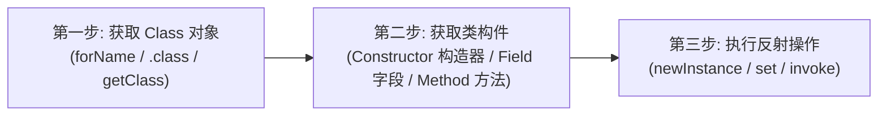
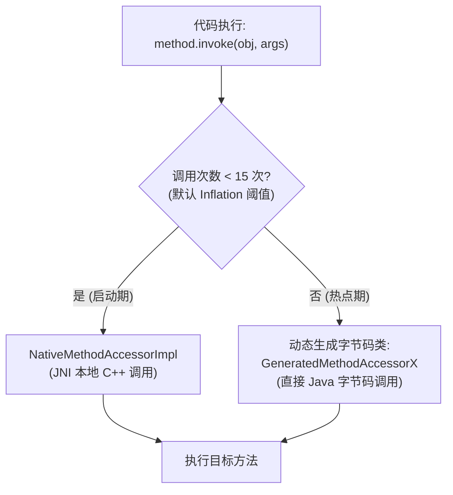
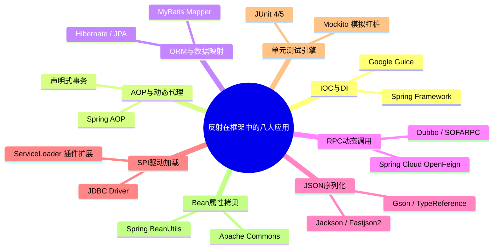
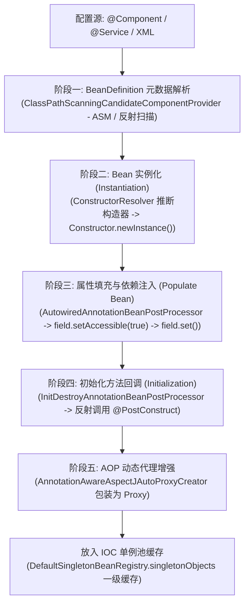
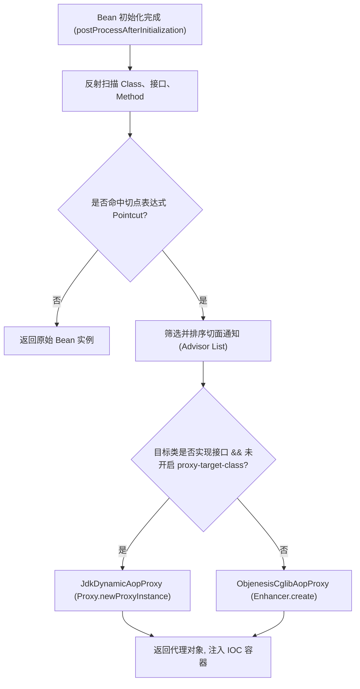

# 反射与动态代理

**反射（Reflection）** 是 Java 语言的核心特性之一，它赋予了 Java 在**运行期（Runtime）**动态探查类结构、分析类成员、调用任意方法与访问任意字段的能力。反射打破了“编译期类型绑定”的传统限制，是现代 Java 生态（Spring IOC/AOP、MyBatis ORM、RPC 序列化、中间件插件化体系）赖以建立的基石。

与反射深度绑定的**动态代理（Dynamic Proxy）**，则是在运行期动态生成代理类字节码以实现无侵入式方法增强的技术，是 AOP、分布式远程调用与声明式事务的核心驱动力。

---

## 一、反射的核心概念与类元数据机制

### 1. 什么是反射？（静态编译 vs 运行期动态解析）
- **传统静态编译模式**：
  在普通编程中，类型在编译期就已经完全确定：
  ```java
  User user = new User();
  user.sayHello();
  ```
  编译器在编译为 `.class` 文件时，就必须明确知道 `User` 类的结构，并在字节码常量池中记录符号引用（Symbolic Reference）。如果类不存在，编译直接失败。
- **反射动态解析模式**：
  反射允许程序在运行期根据外部输入（如配置文件、注解、网络请求参数、字符串类名）动态探查并操作未知类：
  
  ```java
  // 编译期无需知道具体类名，运行期动态加载并调用
  Class<?> clazz = Class.forName("com.example.service.UserService");
  Object instance = clazz.getDeclaredConstructor().newInstance();
  Method method = clazz.getMethod("sayHello");
  method.invoke(instance);
  ```

**核心优势与应用场景**：
- **解耦与动态装配**：框架不需要在编写时硬编码业务类，可在运行期根据配置按需加载（如 Spring `@Component` 扫描）。
- **通用能力抽象**：实现通用的序列化/反序列化（Jackson/Fastjson）、通用 ORM 字段映射（MyBatis）、通用对象拷贝工具。

---

### 2. Class 对象与类加载深层绑定
在 Java 虚拟机（JVM）中，类不是凭空存在的，每一个加载到内存中的类都会由 JVM 自动创建唯一的 **`java.lang.Class` 实例**（类的元数据载体）。


#### 类加载三阶段与反射的关系
类加载全过程包含三个主要阶段：
1. **加载（Loading）**：通过全限定名获取定义此类的二进制字节流，转化为方法区的数据结构，并在堆内存中生成一个代表该类的 `java.lang.Class` 对象。
2. **连接（Linking）**：
   - **验证（Verification）**：确保 Class 文件的字节流符合 JVM 规范，不会危害虚拟机安全；
   - **准备（Preparation）**：在方法区中为类的 `static` 变量分配内存并设置零值（默认值）；
   - **解析（Resolution）**：将常量池内的符号引用替换为直接引用（指针）。
3. **初始化（Initialization）**：执行类的类构造器 `<clinit>()` 静态方法（初始化静态变量与执行静态代码块）。

---

### 3. 获取 Class 对象的三种方式全维度对比

| 获取方式 | 语法范式 | 类加载阶段与行为 | 是否执行静态代码块 `<clinit>`？ | 适用场景 |
| :--- | :--- | :--- | :---: | :--- |
| **方式一：字面量** | `TargetClass.class` | 仅完成**加载与连接**，**不触发初始化** | ❌ **不执行** | 编译期已知具体类型，参数传递（如 DAO `get(User.class)`） |
| **方式二：实例对象** | `instance.getClass()` | 对象已经实例化，**已完成初始化** | ✅ **已执行** | 运行期已有对象实例，获取其实际运行时动态类型（多态场景） |
| **方式三：全限定类名**| `Class.forName("com.xxx")` | **默认完成加载、连接与初始化** | ✅ **会执行**（默认 initialize=true） | 框架读取配置文件动态加载未知类（如 JDBC 驱动注册） |

#### 关键辨析：`Class.forName()` vs `ClassLoader.loadClass()`
- **`Class.forName(className)`**：
  默认调用 `Class.forName(className, true, currentClassLoader)`，参数 `initialize` 默认为 `true`，**会立即触发静态代码块执行**（经典案例：JDBC 加载驱动 `Class.forName("com.mysql.cj.jdbc.Driver")`，通过其静态代码块向 `DriverManager` 注册自己）。
- **`ClassLoader.loadClass(className)`**：
  默认只完成类加载的第一阶段（加载为二进制流并生成 Class 对象），**不进行连接和初始化**，只有当第一次实际实例化（`newInstance()`）或访问静态成员时才会触发初始化。常用于需要延迟加载的场景。

---

## 二、反射核心 API 体系与安全攻防

### 1. 使用反射通用三步法（极简必背总纲）

无论多么复杂的框架底层，反射的实际落地均可归纳为**极简“三步走”思维模型**。面试时若被问到反射的通用调用流程，可直接以该框架作答：



#### 极简必背清单（面试直接口述）：

- **第一步：获取 Class 对象（3 种方式）**
  1. `Class.forName("全类名");` —— 框架动态加载类最常用（如 JDBC 驱动、Spring Bean）
  2. `类名.class;` —— 编译期已知具体类型时最安全（如 `User.class`）
  3. `对象.getClass();` —— 运行时已有具体实例时使用（如 `user.getClass()`）

- **第二步：获取类的构件（构造方法 / 成员变量 / 成员方法）**
  1. **获取构造方法（Constructor）**：
     - 单个公有：`clazz.getConstructor(Class<?>...);`
     - 单个全权限（含私有）：`clazz.getDeclaredConstructor(Class<?>...);`
     - 全部公有：`clazz.getConstructors();`
     - 全部声明（含私有）：`clazz.getDeclaredConstructors();`
  2. **获取成员变量（Field）**：
     - 单个变量：`clazz.getField("变量名");` / `clazz.getDeclaredField("变量名");`
     - 全部变量：`clazz.getFields();` / `clazz.getDeclaredFields();`
  3. **获取成员方法（Method）**：
     - 单个方法：`clazz.getMethod("方法名", Class<?>...);` / `clazz.getDeclaredMethod("方法名", Class<?>...);`
     - 全部方法：`clazz.getMethods();` / `clazz.getDeclaredMethods();`

- **第三步：执行反射操作（创建对象 / 修改变量 / 执行方法）**
  1. **创建对象**：`constructor.newInstance(实参...);`（Java 9+ 官方唯一推荐标准方案）
  2. **读写变量**：`field.get(实例);`（读取） / `field.set(实例, 新值);`（修改）
  3. **执行方法**：`method.invoke(实例, 实参...);`（返回 `Object`，需强转）
  > ⚠️ **关键防御**：若访问的是私有构件（`private`），必须在执行操作前调用 **`accessibleObject.setAccessible(true);`** 暴力解锁！

---

#### 核心操作全景对照矩阵：

| 核心步骤 | 核心操作目标 | 常用核心 API 语法 | 典型使用场景 |
| :--- | :--- | :--- | :--- |
| **第一步：获取 Class 对象** | 拿到类的运行时字节码元数据 | 1. `Class.forName("全类名")`<br/>2. `类名.class`<br/>3. `对象.getClass()` | ① 动态加载配置文件与驱动（框架最常用）<br/>② 编译期已知具体类型时首选（最安全）<br/>③ 已持有运行时具体对象实例时使用 |
| **第二步：获取类的成员** | 定位具体的构造器、属性或方法 | 1. **构造方法**：`get[Declared]Constructor(参数类型...)`<br/>2. **成员变量**：`get[Declared]Field("变量名")`<br/>3. **成员方法**：`get[Declared]Method("方法名", 参数类型...)` | 带 `Declared` 能穿透访问本类所有修饰符成员（含 `private`）；不带 `Declared` 仅获取 `public`（含父类） |
| **第三步：执行反射操作** | 触发实例化、属性赋值或方法调用 | 1. **创建对象**：`constructor.newInstance(...)`<br/>2. **读写变量**：`field.get(obj)` / `field.set(obj, val)`<br/>3. **执行方法**：`method.invoke(obj, args...)` | 若操作私有成员，必须在调用前执行 `accessibleObject.setAccessible(true)` |

---

### 2. 反射四大核心构件与层级体系
在 `java.lang.reflect` 包中，JVM 将类的组成成分映射为四大核心反射类：

| 反射类 | 对应类的组成部分 | 核心获取方法 | 核心操作方法 |
| :--- | :--- | :--- | :--- |
| **`Constructor<T>`** | 构造器 | `getConstructor()`, `getDeclaredConstructor()` | `newInstance(Object... args)` |
| **`Method`** | 成员方法 / 静态方法 | `getMethod()`, `getDeclaredMethod()` | `invoke(Object obj, Object... args)` |
| **`Field`** | 成员变量 / 静态变量 | `getField()`, `getDeclaredField()` | `get(Object obj)`, `set(Object obj, Object value)` |
| **`Parameter`** (Java 8+) | 方法形参 | `method.getParameters()` | `getName()`, `getType()` |

---

### 3. 反射调用方法标准 6 步法（含返回值类型转换与面试口述版）

在技术面试中，面试官经常开门见山考察：“**请说一下使用反射调用一个方法的核心步骤有哪些？**”  
许多候选人只能答出 4 或 5 步，常常遗漏**第 6 步“返回值的强制类型转换”**或**void 方法的 null 处理**。

#### （1）完整标准 6 步流程
1. **获取目标类的 `Class` 对象**（`Class.forName()`、`类名.class` 或 `obj.getClass()`）；
2. **通过反射创建类实例**（推荐 `clazz.getDeclaredConstructor().newInstance(...)`）；
3. **获取目标 `Method` 方法对象**（传入方法名及对应的形参类型 `Class<?>...`）；
4. **权限解除（若为私有方法）**：调用 `method.setAccessible(true)` 放开访问检查；
5. **执行反射调用**：调用 `method.invoke(实例, 实参...)`，统一返回 `Object` 类型；
6. **强制类型转换与结果处理**：将返回的 `Object` 向下强转为真实业务类型（若方法为 `void` 则返回 `null`）。

#### （2）带返回值转换完整可运行代码

```java
import java.lang.reflect.Method;

// 1. 业务测试类
class OrderService {
    // 成员方法 1: 返回 String
    public String createOrder(String orderNo) {
        return "订单创建成功：" + orderNo;
    }

    // 成员方法 2: 返回包装类 Integer
    public Integer getOrderCount() {
        return 128;
    }

    // 成员方法 3: 无返回值 void
    public void printStatus(String orderNo) {
        System.out.println("订单状态流转中: " + orderNo);
    }
}

// 2. 反射调用与强转测试
public class ReflectMethodInvokeTest {
    public static void main(String[] args) throws Exception {
        // 第 1 步：获取 Class 字节码对象
        Class<?> clazz = OrderService.class;

        // 第 2 步：创建类实例
        Object serviceObj = clazz.getDeclaredConstructor().newInstance();

        // 第 3 步：获取有参方法对象
        Method createMethod = clazz.getDeclaredMethod("createOrder", String.class);

        // 第 4 步：若为私有方法则开启权限（此处为 public 可选）
        // createMethod.setAccessible(true);

        // 第 5 步：调用 invoke 执行方法，统一返回 Object
        Object resultObj = createMethod.invoke(serviceObj, "ORD20260518");

        // 第 6 步：【关键核心步】向下强制类型转换为真实业务类型
        String orderResult = (String) resultObj;
        System.out.println(orderResult); // 订单创建成功：ORD20260518


        // 演示场景 2：调用无参且返回 Integer 的方法
        Method countMethod = clazz.getDeclaredMethod("getOrderCount");
        Object countObj = countMethod.invoke(serviceObj);
        Integer count = (Integer) countObj; // 强转为 Integer
        System.out.println("订单数量：" + count); // 订单数量：128


        // 演示场景 3：调用 void 方法
        Method voidMethod = clazz.getDeclaredMethod("printStatus", String.class);
        Object voidResult = voidMethod.invoke(serviceObj, "ORD20260518");
        // void 方法反射调用返回值固定为 null，切忌强制类型转换
        System.out.println("void 方法调用返回值: " + voidResult); // null
    }
}
```

#### （3）高频面试要点说明（答题点睛之笔）
1. **为什么 `invoke()` 统一返回 `Object`**？因为反射是在运行期动态解析调用的，编译器在编译时无法获知目标方法的具体返回值类型，故以根类 `Object` 作为通用载体；
2. **必须手动向下强转**：如果不做强转，只能持有 `Object` 引用，无法调用目标类型的专有业务方法与属性；
3. **`void` 方法的特殊返回值**：当被调用的方法声明为 `void` 时，`invoke()` 返回 `null`，无需也不应进行强转，直接忽略即可；
4. **基本类型的自动装箱**：若目标方法返回基本类型（如 `int`、`boolean`），JVM 会自动将其装箱为对应的包装类（`Integer`、`Boolean`）返回。

#### （4）面试官提问标准口述背诵版
> “反射调用方法的核心步骤分为 6 步：  
> 1. 先通过 `Class.forName` 或类名 `.class` 获取目标类的 **Class 字节码对象**；  
> 2. 通过反射构造器 `getDeclaredConstructor().newInstance()` **创建类的实例对象**；  
> 3. 根据方法名和形参类型列表，调用 `getDeclaredMethod()` **获取目标 Method 对象**；  
> 4. 若为私有方法，调用 `setAccessible(true)` **放开访问权限**；  
> 5. 调用 `method.invoke(实例, 实参)` 执行方法，**统一接收返回的 Object 对象**；  
> 6. **将返回的 Object 结果强制向下转换为方法的真实返回类型**使用；若方法本身是 void 则返回 null，无需强转。”

---

### 4. `getXxx()` vs `getDeclaredXxx()` 作用域对比全景表
这是反射最基础但也最容易引发运行时异常的考点：

| API 方法类型 | 访问修饰符限制 | 能否获取父类成员？ | 典型示例 |
| :--- | :--- | :---: | :--- |
| **`getXxx(...)`** | **仅能获取 `public` 成员** | ✅ **包含父类/父接口的 `public` 成员** | `getFields()`, `getMethod()` |
| **`getDeclaredXxx(...)`** | **获取当前类声明的全部成员**（`private`, `default`, `protected`, `public`） | ❌ **不包含从父类继承的任何成员** | `getDeclaredFields()`, `getDeclaredMethod()` |

> 💡 **递归查找父类属性实战技巧**：  
> 若要获取当前类及其所有父类中声明的所有私有字段，必须通过循环沿继承树向上追溯：
> ```java
> public static List<Field> getAllFields(Class<?> clazz) {
>     List<Field> fields = new ArrayList<>();
>     while (clazz != null && clazz != Object.class) {
>         fields.addAll(Arrays.asList(clazz.getDeclaredFields()));
>         clazz = clazz.getSuperclass(); // 向上追溯父类
>     }
>     return fields;
> }
> ```

---

### 5. 暴力反射与 `setAccessible(true)` 底层机制
- **作用**：当访问私有属性、私有方法或私有构造函数时，默认会触发 JVM 的语言访问检查并抛出 `IllegalAccessException`。调用 `accessibleObject.setAccessible(true)` 可以关闭此项检查，实现“暴力反射”。
- **本质纠偏**：`setAccessible(true)` **并不是修改了目标字段的修饰符（它依然是 private）**，而是修改了反射对象内部维护的一个布尔标记 `override = true`，通知 JVM 在执行 `invoke()` 或 `set()` 时跳过安全访问控制检查（Security Manager & Access Control Check）。
- **Java 9+ 模块系统（JPMS）强封装限制**：
  在 Java 9 及以上版本中，模块系统对跨模块的暴力反射施加了严格限制。如果目标包没有向当前模块显式 `opens` 或 `exports`，即使执行 `setAccessible(true)` 也会抛出 `InaccessibleObjectException`。

---

### 6. 反射修改 `final` 字段的真相（经典高频避坑题）

```java
public class User {
    private final String name = "张三"; // 编译期常量
    private final List<String> hobbies = new ArrayList<>(); // 引用类型
}
```

**问题：反射能不能修改 `final` 字段？**
- **语法与内存层面**：**完全可以修改成功**。通过反射将 `Field.modifiers` 中的 `Modifier.FINAL` 位清零（或在 JDK 8 中调用 `setAccessible(true)` 并执行 `field.set(user, "李四")`），该字段在堆内存中的实际值确实被成功更改了。
- **经典“翻车”现象（编译期常量折叠 Constant Inlining）**：
  如果被修改的字段是**基本数据类型**或**带字面量初始化的 `String`**（即编译期常量），修改后通过对象读取可能依然是旧值！
  ```java
  System.out.println(user.getName()); // 依然打印 "张三"！
  ```
  **底层真相**：因为 `final String name = "张三"` 在 `javac` 编译期被识别为编译期常量，代码中所有调用处（如 `getName()` 内部）直接在编译期被**内联替换**为了字符串常量 `"张三"`，根本不会产生读取字段的 `getfield` 指令！因此即使堆内存里的变量值被反射修改为 `"李四"`，编译后的代码读取的依然是常量池中的常量。
  
  > ⚠️ 只有当 `final` 字段的值是在构造器中动态赋值的，或者是非字面量引用类型时，反射修改后读取才会生效。

---

## 三、JVM 视角：反射性能开销与底层原理深水区（大厂必考）

在技术面试中，几乎所有面试官都会问：“**反射为什么慢？它的性能开销主要来自哪里？**”

### 1. 反射性能损耗的四大根源
1. **动态方法查找与安全检查开销**：每次调用 `getMethod()` 都会在 Class 元数据中进行字符串比对与遍历查找；调用时必须检查调用方权限（除非开启 `setAccessible(true)`）。
2. **JIT 编译器无法进行方法内联（Method Inlining）**：普通直接调用方法时，JIT 编译器会根据热点探测直接将目标方法的字节码平铺内联到调用处，消除函数栈帧开销；而反射通过 `Method.invoke()` 间接调用，目标方法动态不确定，JIT 难以做激进的内联优化。
3. **逃逸分析（Escape Analysis）失效**：普通直接调用时，JVM 能够通过逃逸分析判断对象是否逃逸，从而将对象分配在栈上或进行标量替换；反射传参使用 `Object[]` 数组，必然导致对象逃逸，强制在堆上分配内存，增加垃圾回收（GC）压力。
4. **参数包装与自动装箱拆箱（Boxing/Unboxing）**：基本数据类型传给 `Method.invoke(obj, args...)` 时必须包装为对应的包装类对象，返回值也必须解包，带来大量的瞬时对象分配与转换开销。

---

### 2. `Method.invoke()` 底层执行链路：JVM 反射通胀机制（Inflation）
在 HotSpot 虚拟机中，`Method.invoke()` 的实现并不是一成不变的，而是采用了**两段式策略**：



- **初始阶段（Native 路径，调用次数 $\le 15$）**：
  在方法调用频次较低的初始化阶段，JVM 使用 **`NativeMethodAccessorImpl`**。它通过 JNI 调用进入 C++ 虚拟机层执行方法。
  - *为什么不一上来就生成字节码？* 因为动态生成字节码类需要消耗时间和 Metaspace 内存。对于只调用几次的方法，直接走 Native 调用更加经济。
- **通胀阶段（Java 字节码路径，调用次数 $> 15$）**：
  当一个反射方法的调用次数超过阈值（由 JVM 参数 `-Dsun.reflect.inflationThreshold=15` 控制，默认 15 次），JVM 会触发**反射通胀（Inflation）**：
  - HotSpot 会通过内置的字节码生成器动态生成一个专门的类（如 `sun.reflect.GeneratedMethodAccessor1`）；
  - 该类直接包含原生 Java 代码的调用逻辑（如直接执行 `((TargetClass) obj).targetMethod()`）；
  - 后续的反射调用直接委托给该生成的类执行，性能逼近普通直接方法调用，且允许 JIT 进一步优化。

---

### 3. 企业级反射性能优化四大策略

| 优化策略 | 原理与手段 | 收益程度 |
| :--- | :--- | :---: |
| **1. 元数据缓存预热** | 将反射获取的 `Class`、`Method`、`Field` 缓存到 `ConcurrentHashMap` 中，避免运行期频繁遍历查找。 | ⭐⭐⭐⭐ |
| **2. 显式开启 setAccessible** | 对所有频繁调用的 `Method`/`Field` 显式设置 `setAccessible(true)`，关闭 JVM 安全检查。 | ⭐⭐⭐ |
| **3. 使用 MethodHandle (Java 7+)** | 使用 `java.lang.invoke.MethodHandle`（方法句柄），底层由 JVM 指令直接支持，允许 JIT 深度优化和内联。 | ⭐⭐⭐⭐ |
| **4. 编译期代码生成（零反射）** | 生产级高频调用彻底弃用运行时反射，改用基于 JSR-269 APT 的编译期生成工具（如 **MapStruct** 替代 BeanUtils，**Lombok** 生成访问代码）。 | ⭐⭐⭐⭐⭐ |

---

## 四、动态代理双雄深度剖析：JDK 动态代理 vs CGLIB

动态代理是在运行时**动态生成代理类的字节码**并加载到 JVM 中，用于在不侵入业务源代码的前提下对目标对象进行方法增强（AOP）。

### 1. 静态代理 vs 动态代理

| 维度 | 静态代理（Static Proxy） | 动态代理（Dynamic Proxy） |
| :--- | :--- | :--- |
| **代理类生成时机** | **编译期**（由程序员手动手写或工具预先生成 `.java`） | **运行期**（由 JVM 动态生成内存字节码并加载） |
| **接口扩展性** | 差（目标接口新增一个方法，所有代理类都必须重写实现） | 优（拦截器统一拦截，接口调整零修改成本） |
| **类数量膨胀** | 每一个目标类都需要一个对应的代理类，类爆炸 | 一个代理工厂可代理成百上千个业务类 |

---

### 2. JDK 动态代理底层原理（基于接口）

#### (1) 核心组件
- **`java.lang.reflect.Proxy`**：负责根据传入的接口和 ClassLoader 在内存中生成并实例化代理类的核心工具类；
- **`java.lang.reflect.InvocationHandler`**：调用处理器接口，所有对代理对象方法的调用都会被路由重定向到其唯一的 `invoke()` 方法中。

#### (2) 为什么 JDK 动态代理只能代理“接口”？（大厂必考杀手题）
通过将 JVM 参数 `-Djdk.proxy.ProxyGenerator.saveGeneratedFiles=true`（低版本为 `sun.misc.ProxyGenerator.saveGeneratedFiles=true`）开启，可将动态生成的代理类文件导出并反编译：

```java
// 动态生成的代理类反编译代码结构
public final class $Proxy0 extends java.lang.reflect.Proxy implements UserService {

    private static Method m1; // equals
    private static Method m2; // toString
    private static Method m3; // saveUser (业务方法)

    // 构造器：必须接收 InvocationHandler
    public $Proxy0(InvocationHandler h) {
        super(h); // 传递给父类 java.lang.reflect.Proxy
    }

    // 实现接口的业务方法
    @Override
    public final void saveUser(String username) {
        try {
            // 全部转调 InvocationHandler 的 invoke 方法
            super.h.invoke(this, m3, new Object[]{username});
        } catch (Throwable t) {
            throw new UndeclaredThrowableException(t);
        }
    }
}
```
**答案真相**：
因为动态生成的代理类 `$Proxy0` **已经默认继承了 `java.lang.reflect.Proxy` 基类**。由于 Java 语言**严格不支持类的多继承**，该代理类绝不可能再去继承目标业务类，因此它**只能通过实现目标接口的方式来实现多态和方法代理**！

#### (3) 标准手写 JDK 动态代理范式
```java
public class JdkProxyFactory {

    @SuppressWarnings("unchecked")
    public static <T> T getProxy(T target) {
        return (T) Proxy.newProxyInstance(
                target.getClass().getClassLoader(),     // 目标类的类加载器
                target.getClass().getInterfaces(),       // 目标类实现的全部接口
                new InvocationHandler() {               // 增强拦截逻辑
                    @Override
                    public Object invoke(Object proxy, Method method, Object[] args) throws Throwable {
                        long start = System.currentTimeMillis();
                        System.out.println("[日志] 开始执行方法: " + method.getName());
                        
                        // 核心：通过反射执行目标对象的原方法
                        Object result = method.invoke(target, args);
                        
                        System.out.println("[日志] 方法执行完毕，耗时: " + (System.currentTimeMillis() - start) + "ms");
                        return result;
                    }
                }
        );
    }
}
```

---

### 3. CGLIB 动态代理底层原理（基于类继承）

#### (1) 核心组件
- **`Enhancer`**：增强器，类似于 JDK Proxy 的总调度器；
- **`MethodInterceptor`**：方法拦截器接口，其 `intercept()` 方法拦截代理对象的所有方法调用。

#### (2) 为什么 CGLIB 不能代理 `final` 类与 `final` 方法？
- CGLIB（Code Generation Library）使用底层的 **ASM 字节码技术**，在运行期动态生成目标类的**子类（Subclass）**。
- 如果目标类被 `final` 修饰，Java 语法和虚拟机字节码规范严禁生成该类的任何子类；
- 如果目标方法被 `final` 修饰，子类无法重写（Override）该方法，因而无法对该方法实施拦截增强。

#### (3) CGLIB 的性能利器：FastClass 机制（避免反射）
在 `MethodInterceptor#intercept` 方法中，有两个关键参数：
```java
public Object intercept(Object obj, Method method, Object[] args, MethodProxy proxy) throws Throwable {
    // 方案 1（不推荐）：传统的反射调用
    // return method.invoke(target, args);

    // 方案 2（推荐）：使用 CGLIB 专有的 FastClass 机制
    return proxy.invokeSuper(obj, args);
}
```
- **传统反射的弊端**：`method.invoke` 仍有反射开销。
- **FastClass 机制实现原理**：
  - CGLIB 在生成代理类子类的同时，还会为目标类和代理类分别动态生成一个名为 **`FastClass`** 的类；
  - 该类在编译生成时，为目标类的每一个方法分配了一个整数索引（`int index`）；
  - `FastClass` 内部包含一个巨大的 `switch-case` 表：
    ```java
    public Object invoke(int index, Object obj, Object[] args) {
        switch (index) {
            case 0: return ((UserService) obj).saveUser((String) args[0]);
            case 1: return ((UserService) obj).deleteUser((Long) args[0]);
            // ... 直接调用原生代码，完全不需要反射！
        }
    }
    ```
  - 当调用 `proxy.invokeSuper()` 时，直接通过索引查表分发，**彻底绕过了 Java 反射机制**，达到接近原生方法直接调用的极致速度。

---

### 4. JDK 动态代理 vs CGLIB 全方位对比矩阵

| 对比维度 | JDK 动态代理 | CGLIB 动态代理 |
| :--- | :--- | :--- |
| **底层实现机制** | JVM 原生反射与 ProxyGenerator 生成类 | 基于三方 ASM 框架动态生成目标类的子类字节码 |
| **目标类限制** | **必须实现至少一个接口** | **目标类和方法绝不能被 `final` 修饰** |
| **方法调用开销** | 早期基于反射调用（现已受通胀机制优化） | 基于 **FastClass 索引直接调用**（零反射） |
| **代理生成速度** | **快**（生成结构简单，JVM 原生轻量） | **较慢**（需通过 ASM 分析生成复杂的子类与 FastClass） |
| **运行期调用速度** | 早期较慢，现代 JDK 差距大幅缩小 | 早期极快（FastClass 优势） |
| **三方依赖** | 纯 JDK 自带，零外部依赖 | 依赖 CGLIB 与 ASM 依赖包 |

#### Spring AOP 动态代理选型演进历程
1. **Spring 4.x 及之前**：
   - 目标对象实现了接口 $
ightarrow$ 默认使用 **JDK 动态代理**；
   - 目标对象没有实现接口 $
ightarrow$ 强制使用 **CGLIB**；
   - 可通过配置 `proxy-target-class="true"` 强制全局使用 CGLIB。
2. **Spring Boot 2.x+ 时代（重大变化）**：
   - **默认全部采用 CGLIB 动态代理**（`spring.aop.proxy-target-class=true` 为默认值）。
   - **核心原因**：避免业务开发中依赖注入类型转换异常（如果用 JDK 代理，容器中 Bean 的真实类型为 `$Proxy0`，如果开发者使用具体的实现类 `UserServiceImpl` 进行 `@Autowired` 注入，会直接报类型不匹配错误；而 CGLIB 生成的是 `UserServiceImpl` 的子类，无论按接口还是按实现类注入均能完美兼容）。

---

---

## 五、反射与动态代理在主流框架中的底层应用与实现机制

反射与动态代理是 Java 顶层主流框架的“发动机”。没有反射，Spring 无法实现 IOC/AOP，MyBatis 无法实现 Mapper 接口绑定与 ORM 映射。

---

### 1. 反射在现代框架开发中的“八大典型应用场景”（全景总览）

反射（Reflection）被誉为 **Java 框架的灵魂与动力引擎**。没有反射，现代 Java 生态中几乎所有主流框架（Spring、MyBatis、Dubbo、Jackson、JUnit 等）都将无法实现动态化、解耦与自动化。

面试官常问：“**在实际框架与底层中间件开发中，反射有哪些典型应用场景？**”可从以下八大维度系统回答：



#### 八大核心应用场景全景对照矩阵：

| 序号 | 典型应用领域 | 代表性主流框架 | 核心使用的反射 API / 机制 | 框架中的核心价值与业务场景 |
| :---: | :--- | :--- | :--- | :--- |
| **1** | **控制反转与依赖注入<br/>(IOC / DI)** | Spring Framework、<br/>Google Guice | `clazz.getDeclaredConstructor().newInstance()`<br/>`field.setAccessible(true)`<br/>`field.set(bean, dependency)` | **对象的非侵入式装配与解耦**：读取注解或配置，在运行期动态推断构造器实例化 Bean，并暴力反射写入 `@Autowired` 依赖属性。 |
| **2** | **面向切面编程<br/>(AOP 与动态代理)** | Spring AOP、<br/>Spring @Transactional | `Proxy.newProxyInstance(...)`<br/>`InvocationHandler#invoke`<br/>`MethodInterceptor#intercept` | **横切关注点解耦**：通过 JDK Proxy 或 CGLIB 拦截业务方法，在目标方法前后动态反射织入日志监控、分布式链路追踪、声明式事务管理。 |
| **3** | **ORM 映射与接口绑定<br/>(对象关系映射)** | MyBatis、<br/>Hibernate / JPA | `Proxy.newProxyInstance`<br/>`ResultSetMetaData` 遍历<br/>`field.set()` / Setter 反射调用 | **消灭繁琐 JDBC 代码**：为纯 Mapper 接口动态生成代理实例（`MapperProxy`），拦截方法调用执行 SQL；并将 `ResultSet` 结果集反射自动映射为 JavaBean 实体。 |
| **4** | **RPC 远程服务调用与调度<br/>(分布式服务框架)** | Apache Dubbo、<br/>SOFARPC、Feign | `Class.forName(interfaceName)`<br/>`method.invoke(targetService, args)`<br/>`MethodHandle` 句柄加速 | **透明化远程调用**：服务端网络接收到请求元数据（接口名、方法名、参数类型、入参），通过反射定位并执行真实本地服务，将执行结果序列化网络回传。 |
| **5** | **JSON / XML 序列化与反序列化** | Jackson、Fastjson2、<br/>Gson | `field.get(obj)`、Getter 提取<br/>`Type.getActualTypeArguments()`<br/>`constructor.newInstance()` | **对象与文本互转**：序列化时反射读取私有属性或 Getter 拼接 JSON；反序列化时反射推断泛型 Token（`TypeReference`）并构造目标实体对象注入属性。 |
| **6** | **SPI 插件化与驱动动态加载** | JDBC 数据库驱动、<br/>Java SPI (`ServiceLoader`) | `Class.forName("com.mysql.cj.jdbc.Driver")`<br/>`ServiceLoader.load(Driver.class)` | **可插拔插件架构**：解耦应用与底层厂商实现，依据类名或 `META-INF/services/` 配置文件动态加载实现类，并在静态代码块中自动注册驱动。 |
| **7** | **单元测试驱动与 Mock 打桩** | JUnit 4/5、<br/>Mockito、PowerMock | `method.isAnnotationPresent(Test.class)`<br/>`method.invoke(testInstance)`<br/>动态字节码代理拦截 | **自动化测试执行器**：扫描测试类中带有 `@Test`、`@BeforeEach` 注解的方法并用反射逐一触发；Mockito 利用动态代理为接口生成桩对象（Mock）。 |
| **8** | **JavaBean 属性复制与反射工具** | Spring `BeanUtils`、<br/>Apache `PropertyUtils` | `clazz.getDeclaredFields()`<br/>`PropertyDescriptor` 读写方法获取<br/>`readMethod.invoke()` / `writeMethod.invoke()` | **跨层数据传输转换**：自动遍历两个 JavaBean 的属性名称与类型，通过反射 Getter 读取源对象字段值，反射 Setter 写入目标对象（如 DTO 转 Entity）。 |

---

#### 面试官提问标准口述背诵版（1 分钟惊艳高分总结）：
> “面试官，反射在现代主流框架开发中有 8 个最典型的应用：  
> 1. **Spring IOC/DI**：基于反射实现构造器推断实例化与 `@Autowired` 属性注入；  
> 2. **Spring AOP**：基于 JDK 动态代理与 CGLIB 实现方法拦截与事务切面织入；  
> 3. **MyBatis ORM**：通过动态代理给 Mapper 接口生成代理对象，并通过反射将 JDBC 查询结果集自动映射为 Entity；  
> 4. **Dubbo RPC**：网络收到远程报文后，服务端通过反射动态调用本地服务；  
> 5. **Jackson/Fastjson**：通过反射读取属性和解析泛型 Token，实现 JSON 与 Java 对象的自动互转；  
> 6. **JDBC 与 SPI**：利用 `Class.forName` 或 `ServiceLoader` 实现驱动和插件的解耦动态加载；  
> 7. **JUnit 单元测试**：通过反射扫描 `@Test` 注解并自动触发执行；  
> 8. **BeanUtils 属性拷贝**：利用反射读写 Getter/Setter 自动完成 DTO 与 PO 的属性同步。”


---

### 2. 反射与 Spring IOC 的本质关系深度剖析

面试中常出现经典考题：“**请谈谈 Spring IOC 和反射的关系？**”或“**Spring IOC 容器底层是如何通过反射实现控制反转与依赖注入的？**”

---

#### (1) 宏观定性：反射与 Spring IOC 的核心本质关系
- **技术基石与工业化落地**：**反射是 Spring IOC 能够成立的技术基石（底层动力引擎），而 IOC 则是反射技术在对象解耦与生命周期管理上的终极工业化实践**。
- **解耦的底层密码**：
  - **传统模式（静态强耦合）**：开发者必须在业务代码中硬编码使用 `new ServiceImpl()` 创建对象，此时对象创建的主导权在**程序员编写的业务代码**中，无法做到可插拔与动态替换；
  - **Spring IOC 模式（控制反转）**：通过将“对象创建与依赖组装”的主动权移交给 Spring 容器。但容器要怎么在**完全不知道用户具体写了哪些类名、哪些方法名**的前提下创建并组装它们？**唯一的技术途径就是反射！**
  - Spring 通过读取 XML 配置或注解扫描拿到目标类的全类名字符串，使用反射在运行期动态感知类结构、实例化对象并完成注入。

---

#### (2) 架构全景：Spring IOC 容器中反射介入的 5 大生命周期阶段



1. **阶段一：BeanDefinition 元数据解析**：
   - Spring 启动时，组件扫描器（`ClassPathScanningCandidateComponentProvider`）使用 ASM / 反射扫描类路径下的 Class 文件，读取类上的 `@Component`、`@Scope`、`@Lazy` 等注解元数据，将其抽象封装为 `BeanDefinition`（保存了类全限定名 `beanClassName`、构造器入参、依赖属性等）。
2. **阶段二：Bean 实例化（推断构造器并反射调用）**：
   - **默认无参构造**：底层调用 `clazz.getDeclaredConstructor().newInstance()`；
   - **构造器推断与自动装配**：`ConstructorResolver` 通过反射分析类中声明的所有构造器（`clazz.getDeclaredConstructors()`），若存在标注了 `@Autowired` 的构造器，或只有一个有参构造器，则反射解析其形参类型，从容器中按类型获取依赖 Bean 并作为实参反射传入。
3. **阶段三：属性填充与依赖注入（DI 反射赋值）**：
   - 核心后置处理器 **`AutowiredAnnotationBeanPostProcessor`** 通过反射扫描目标类及其所有父类中声明的 `@Autowired` 与 `@Value` 注解；
   - 提取对应的 `Field` 或 `Method`（Setter），调用 `field.setAccessible(true)`，最后执行 `field.set(beanInstance, dependencyBean)` 暴力反射完成依赖注入。
4. **阶段四：初始化回调触发（反射调用生命周期方法）**：
   - **`InitDestroyAnnotationBeanPostProcessor`** 通过反射扫描类中的 `@PostConstruct` 注解，并在属性注入完成后反射调用该初始化方法。
5. **阶段五：Spring MVC 请求映射与动态参数解析**：
   - **路由映射扫描**：`RequestMappingHandlerMapping` 在容器启动时通过反射扫描所有 Controller 类及其方法上的 `@RequestMapping`，将 URL 与 `HandlerMethod`（封装了 Controller 实例和目标 `Method` 对象）建立映射表；
   - **动态反射触发**：当 HTTP 请求到达时，`HandlerMethodArgumentResolver` 通过反射分析 `Method.getParameters()` 上的参数注解与泛型类型，将请求 JSON 转换为实体对象，最后通过 **`method.invoke(controllerBean, args)`** 动态调用业务方法。

---

#### (3) 大厂深度追问（为什么反射这么慢，Spring IOC 却能大规模使用？）

##### 追问 1：反射具有性能开销，为什么 Spring IOC 敢大范围使用反射？
> **【标准满分回答】**：  
> 1. **开销集中在“启动期”，运行期“零反射”**：  
>    Spring 将几乎所有的反射类扫描、反射构造、反射属性注入**全部集中在容器启动（Bootstrapping）阶段一次性完成**；
> 2. **单例池（SingletonObjects）以空间换时间**：  
>    Spring 容器中的 Bean 默认全部是**单例模式（Singleton）**。对象通过反射创建并装配完毕后，会立即存入一级缓存单例池（`ConcurrentHashMap<String, Object>`）。当生产运行时业务频繁调用 `getBean()` 或调用业务逻辑时，直接从内存哈希表读取现成实例并执行原生调用，**运行期间根本不存在反射损耗**；
> 3. **极佳的解耦红利压倒微小开销**：  
>    在微服务和企业架构中，反射带来的零侵入装配、开箱即用、无缝动态插拔与 AOP 事务增强的工程收益，远远胜过容器启动阶段增加的百毫秒级耗时。

##### 追问 2：Spring IOC 在 Bean 实例化时，什么时候用反射？什么时候用 CGLIB？
> **【标准满分回答】**：  
> Spring 底层通过 `InstantiationStrategy` 接口定义了 Bean 实例化策略，包含两种实现：
> 1. **默认常规 Bean**：采用 **`SimpleInstantiationStrategy`**，底层直接利用 Java 反射 `Constructor.newInstance()` 创建对象；
> 2. **带有“方法注入”的特殊 Bean**：如果类中定义了 **`@Lookup`** 注解或 XML 中配置了 `<lookup-method>` / `<replaced-method>`，Spring 会自动切换为 **`CglibSubclassingInstantiationStrategy`**：  
>    - **原因**：当一个单例 Bean（Singleton）需要依赖注入一个多例 Bean（Prototype）时，由于单例 Bean 只会注入一次属性，导致多例 Bean 无法每次动态刷新；
>    - **解决方案**：Spring 会在运行期利用 **CGLIB 动态生成目标类的子类**，重写标注了 `@Lookup` 的方法，在方法内部动态向容器索取全新的 Prototype Bean。

##### 追问 3：Spring 底层对反射本身做了哪些硬核性能优化？
> **【标准满分回答】**：  
> 1. **全量元数据高并发缓存**：  
>    Spring 提供了 `ReflectionUtils`、`AnnotationUtils`、`MethodIntrospector` 等底层工具类，其内部维护了大量的 `ConcurrentReferenceHashMap` / `ConcurrentHashMap`，所有反射解析出的 `Field`、`Method`、`Constructor` 在第一次解析后全部进入缓存，第二次命中时无需重新遍历类元数据和执行安全检查；
> 2. **ASM 字节码预解析（降级反射）**：  
>    在容器启动进行组件扫描（`@ComponentScan`）时，Spring 根本**不调用 `Class.forName()`**（因为类加载会导致加载大量无用的类并触发其静态代码块 `<clinit>`，极耗内存与时间）。Spring 直接使用内置的轻量级 **ASM 框架读取 `.class` 二进制字节码**（`SimpleMetadataReader`），只提取注解元数据；只有当确定某个类需要被注册为 Bean 时，才会真正触发类加载与反射实例化。

---

#### (4) 面试官提问标准口述背诵版（1 分钟惊艳高分回答）
> “面试官，Spring IOC 和反射的关系可以总结为‘**底层引擎与上层架构**’的关系：  
> **首先，反射是 IOC 能够成立的技术基石**。IOC 的核心目的是将对象创建和依赖管理从业务代码中解耦，移交给容器。为了在完全不硬编码类名和方法的前提下完成动态装配，Spring 必须依赖反射机制在运行期动态感知类结构、推断构造器并注入属性；  
> **其次，在 Bean 的完整生命周期中，反射贯穿始终**：启动时扫描元数据生成 BeanDefinition；通过 `Constructor.newInstance()` 反射推断实例化；通过 `AutowiredAnnotationBeanPostProcessor` 暴力反射完成 Field/Setter 属性填充；并通过反射触发 `@PostConstruct` 初始化；  
> **最后，关于反射性能问题，Spring 做到了极致的工程平衡**：Spring 将绝大部分反射开销限定在**容器启动阶段**，创建完成后放入一级单例池（`singletonObjects`）供运行期高速直调；同时内部采用了 ASM 字节码扫描和反射元数据全量缓存机制，将反射的开销降到了最低。”

---

### 3. 反射与动态代理在 MyBatis 中的深度应用

MyBatis 被誉为“半自动 ORM 框架”，其最神奇之处在于：**开发者只定义了一个 Mapper 接口，没有任何实现类，却能直接调用执行 SQL**。其底层完全依靠反射与动态代理实现。

#### (1) Mapper 接口动态代理绑定（`MapperProxyFactory` & `MapperProxy`）
1. **启动注册**：在 MyBatis 启动加载配置时，`MapperRegistry` 会为每一个 Mapper 接口注册一个 **`MapperProxyFactory`**（代理工厂）。
2. **获取 Mapper**：当业务代码执行 `sqlSession.getMapper(UserMapper.class)` 时，底层调用 **JDK 动态代理**：
   ```java
   // MyBatis 底层 MapperProxyFactory 源码逻辑
   public T newInstance(SqlSession sqlSession) {
       MapperProxy<T> mapperProxy = new MapperProxy<>(sqlSession, mapperInterface, methodCache);
       return (T) Proxy.newProxyInstance(
           mapperInterface.getClassLoader(), 
           new Class[]{ mapperInterface }, 
           mapperProxy
       );
   }
   ```
3. **方法调用拦截**：返回给调用方的实际是实现了 `UserMapper` 接口的动态代理实例 `$Proxy`。当调用 `userMapper.selectById(1L)` 时，请求被拦截进入 **`MapperProxy.invoke()`**：
   - 从调用的 `Method` 对象中提取方法签名，在 `methodCache` 缓存中匹配对应的 `MapperMethod`；
   - 根据 XML 或注解中绑定的 SQL 类型（SELECT / INSERT / UPDATE / DELETE），路由调用底层的 `sqlSession.selectOne(...)` 或 `sqlSession.insert(...)`，最终通过 JDBC 执行 SQL 并返回结果。

#### (2) 结果集反射映射与对象工厂（`DefaultObjectFactory` & `MetaObject`）
- **对象实例化**：查询返回 JDBC `ResultSet` 后，MyBatis 通过 `DefaultObjectFactory` 调用目标实体类的无参构造器（`constructor.newInstance()`）创建空 Entity 对象。
- **高性能属性注入（`MetaObject`）**：
  - 若每行数据都直接调用一次反射 `field.set()`，当查询成千上万行数据时性能极其低下。
  - MyBatis 内部设计了 **`MetaObject`** 体系：引入 **`Reflector` 元数据缓存池**。在系统首次接触该实体类时，一次性反射提取出所有属性的 Getter/Setter 方法、字段类型，并缓存在 `ConcurrentHashMap` 中；后续行数据直接通过缓存的 `Invoker` 调用，性能逼近原生调用。
- **泛型返回类型推断**：若 Mapper 接口声明为 `List<User> queryAll()`，MyBatis 通过反射调用 **`method.getGenericReturnType()`**，解析出 `ParameterizedType` 提取出内部泛型类型 `User.class`，从而得知应该将查询到的每行记录映射为哪个 Java 实体。

#### (3) 类型处理器（`TypeHandler`）泛型推断
- 开发者继承 `BaseTypeHandler<T>` 编写自定义类型转换器时，MyBatis 在抽象父类构造器中通过反射执行：
  ```java
  Type genericSuperclass = getClass().getGenericSuperclass();
  ParameterizedType pt = (ParameterizedType) genericSuperclass;
  this.rawType = (Class<T>) pt.getActualTypeArguments()[0];
  ```
  自动推断出该 Handler 负责处理的具体 Java 实体类型 `T`，省去了手动配置。

---

### 3. 反射与动态代理在 Spring AOP 中的完整实现链路

Spring AOP（面向切面编程）是声明式事务（`@Transactional`）、安全鉴权、操作日志、接口限流的核心基础设施，其底层是**动态代理的集大成者**。

#### (1) AOP 代理创建时机与切点匹配（Pointcut Matching）
- **介入时机**：Spring AOP 的核心处理器 **`AnnotationAwareAspectJAutoProxyCreator`** 实现了 `BeanPostProcessor` 接口，在目标 Bean 完成实例化与属性注入后、进入 **初始化后阶段（`postProcessAfterInitialization`）** 介入。
- **切点分析**：Spring 通过反射获取该 Bean 的 Class 对象、实现的接口和所有声明的方法（`Method`），利用 AspectJ 表达式解析器比对当前方法是否满足切点表达式（如 `@annotation(Transactional)` 或 `execution(* com.service.*.*(..))`）。
- **代理生成决策**：若匹配成功，将所有命中切面的通知（Advice）排序组装成顾问列表（Advisor），最后调用 **`ProxyFactory.getProxy()`** 创建代理对象替换原始目标 Bean。



#### (2) 拦截器责任链执行机制（`ReflectiveMethodInvocation`）
当外部代码调用代理对象的方法时，无论是 JDK 代理还是 CGLIB 代理，底层的调用流程高度统一：
1. **获取拦截器链**：从配置的切面中将通知转换为方法拦截器列表：`List<MethodInterceptor> chain`（包含前置通知、后置通知、环绕通知等）。
2. **构建责任链调用器**：实例化 **`ReflectiveMethodInvocation`** 对象，传入目标对象、被调用的方法、参数及拦截器链。
3. **递归驱动责任链**：
   - 调用 `invocation.proceed()`，内部维护一个指针 `currentInterceptorIndex`；
   - 每次递归递增索引并执行下一个拦截器的 `interceptor.invoke(this)`；
   - 链条末端：当所有前置和环绕拦截器执行完毕后，最终通过反射 **`method.invoke(target, args)`** 执行目标业务对象的真实方法！
   - 方法返回后，逆序沿调用栈返回，执行后置通知和最终通知。

#### (3) AOP 生产级经典踩坑：同类内部方法互调（Self-Invocation）切面失效
- **故障现象**：在同一个 Service 类中，`methodA()` 调用 `this.methodB()`，即便 `methodB()` 上标注了 `@Transactional` 或 `@Async`，事务/异步也**完全不生效**！
- **底层根因解密**：
  - 外部调用该 Service 时，拿到的是 IOC 容器中的**代理对象**（`proxy`）。
  - 外部调用 `proxy.methodA()` 成功走过了 AOP 代理逻辑，代理最后通过反射调用了**目标真实对象**的 `methodA()`。
  - 在目标对象的 `methodA()` 方法体内，代码执行 `this.methodB()`。此时的关键字 **`this` 指向的是目标真实对象本身，而不是代理对象**！因此直接调用 `methodB()` 不会触发任何代理逻辑，直接穿透绕过了 AOP 拦截器链！
- **三大企业级破局方案**：
  1. **方案一（注入自身）**：在类中通过 `@Autowired private UserService self;` 注入自身代理对象，调用处改为 `self.methodB()`。
  2. **方案二（获取当前代理上下文）**：开启 `@EnableAspectJAutoProxy(exposeProxy = true)`，调用处改为：
     ```java
     ((UserService) AopContext.currentProxy()).methodB();
     ```
  3. **方案三（架构解耦，推荐）**：将 `methodB()` 抽离到独立的 Service 接口与实现类中，从设计模式层面彻底解耦业务。

---

## 六、企业级框架深度实战与设计模式

### 1. 实战一：手写简易 Spring IOC 容器（依赖注入 DI 骨架）
通过自定义注解与反射扫描，在容器启动时完成对象的自动组装：

```java
import java.lang.annotation.*;
import java.lang.reflect.Field;
import java.util.*;

@Retention(RetentionPolicy.RUNTIME)
@Target(ElementType.TYPE)
@interface MyComponent {}

@Retention(RetentionPolicy.RUNTIME)
@Target(ElementType.FIELD)
@interface MyAutowired {}

// 简易 IOC 容器
public class SimpleApplicationContext {
    private final Map<Class<?>, Object> beanContainer = new HashMap<>();

    public SimpleApplicationContext(Class<?>... classes) throws Exception {
        // 1. 第一遍扫描：实例化标注了 @MyComponent 的类
        for (Class<?> clazz : classes) {
            if (clazz.isAnnotationPresent(MyComponent.class)) {
                Object beanInstance = clazz.getDeclaredConstructor().newInstance();
                beanContainer.put(clazz, beanInstance);
            }
        }

        // 2. 第二遍扫描：为标注了 @MyAutowired 的字段注入依赖
        for (Object bean : beanContainer.values()) {
            Field[] fields = bean.getClass().getDeclaredFields();
            for (Field field : fields) {
                if (field.isAnnotationPresent(MyAutowired.class)) {
                    field.setAccessible(true);
                    Object dependency = beanContainer.get(field.getType());
                    if (dependency != null) {
                        field.set(bean, dependency); // 反射注入字段
                    }
                }
            }
        }
    }

    @SuppressWarnings("unchecked")
    public <T> T getBean(Class<T> clazz) {
        return (T) beanContainer.get(clazz);
    }
}
```

---

### 2. 实战二：手写简易 MyBatis 结果集映射器（ResultSet 自动匹配 Setter）
模拟 MyBatis 底层通过反射将 JDBC `ResultSet` 自动组装为 Entity 实体：

```java
public class SimpleRowMapper {

    public static <T> T mapRow(ResultSet rs, Class<T> clazz) throws Exception {
        T entity = clazz.getDeclaredConstructor().newInstance();
        ResultSetMetaData metaData = rs.getMetaData();
        int columnCount = metaData.getColumnCount();

        for (int i = 1; i <= columnCount; i++) {
            String columnName = metaData.getColumnLabel(i); // 获取 SQL 字段名
            Object columnValue = rs.getObject(i);

            if (columnValue == null) continue;

            // 按照规范拼接 setter 方法名: "userName" -> "setUserName"
            String setterName = "set" + Character.toUpperCase(columnName.charAt(0)) + columnName.substring(1);
            try {
                // 查找匹配的 setter 方法并反射调用
                Method setter = clazz.getMethod(setterName, columnValue.getClass());
                setter.invoke(entity, columnValue);
            } catch (NoSuchMethodException e) {
                // 若找不到 setter，降级为暴力反射写入 private 字段
                Field field = clazz.getDeclaredField(columnName);
                field.setAccessible(true);
                field.set(entity, columnValue);
            }
        }
        return entity;
    }
}
```

---

### 3. 实战三：反射 + 注解实现动态业务策略分发器（消灭臃肿 if-else）
在高频多渠道支付或差异化业务流转中，基于注解在运行期自动分发处理策略：

```java
@Target(ElementType.TYPE)
@Retention(RetentionPolicy.RUNTIME)
public @interface PayHandlerType {
    String value(); // 支付渠道编码: WX, ALI, UNION
}

public interface IPayHandler {
    void processPay(BigDecimal amount);
}

// 策略注册中心
@Component
public class PayStrategyContext {
    private final Map<String, IPayHandler> handlerMap = new ConcurrentHashMap<>();

    // 启动时自动通过反射探测并注入所有策略实现
    @Autowired
    public PayStrategyContext(List<IPayHandler> handlers) {
        for (IPayHandler handler : handlers) {
            PayHandlerType annotation = handler.getClass().getAnnotation(PayHandlerType.class);
            if (annotation != null) {
                handlerMap.put(annotation.value(), handler);
            }
        }
    }

    public void execute(String channel, BigDecimal amount) {
        IPayHandler handler = handlerMap.get(channel);
        if (handler == null) throw new IllegalArgumentException("未找到支持的支付渠道: " + channel);
        handler.processPay(amount);
    }
}
```

---

## 七、高频面试核心追问与秒杀精答

### Q1：`Class.newInstance()` 为什么在 Java 9 中被标记为 `@Deprecated`？替代方案是什么？
> **参考回答**：  
> `Class.newInstance()` 有两大严重设计缺陷：  
> 1. **绕过异常检查**：它会把构造函数抛出的任何受检异常（Checked Exception）直接抛出，不受编译器受检异常检查机制的约束；  
> 2. **仅支持无参构造**：且无法处理私有构造器。  
> **替代方案**：使用 **`clazz.getDeclaredConstructor().newInstance(...)`**。它统一将构造器异常包装为 `InvocationTargetException`，支持任意有参/无参构造，且设计完全遵循反射 API 规范。

### Q2：反射是否能破坏单例模式？如何有效防御？
> **参考回答**：  
> **可以破坏普通单例**。攻击者只要调用私有构造器的 `setAccessible(true)`，就能强行实例化出多个对象。  
> **防御手段**：  
> 1. **在私有构造器中增加防重防御标志**：当第二次调用构造器时直接抛出 `RuntimeException("禁止反射创建单例！")`；  
> 2. **终极防御方案：使用枚举单例（Enum）**。JDK 底层在 `Constructor.newInstance()` 中硬编码了 `(clazz.getModifiers() & Modifier.ENUM) != 0` 校验，反射创建枚举实例时 JVM 直接抛出 `IllegalArgumentException`，在 API 根源上杜绝反射破坏。

### Q3：方法在反射调用时发生异常，为什么外层捕获到的总是 `InvocationTargetException`？
> **参考回答**：  
> 这是反射机制的安全包装设计。当目标业务方法内部抛出未捕获异常时，反射调用器 `Method.invoke()` 不会直接向上裸抛底层业务异常，而是统一将真实抛出的异常封装进 `InvocationTargetException` 的 `cause` 字段中。  
> **获取真实异常的方式**：调用 `e.getTargetException()` 或 `e.getCause()`。

### Q4：Java 8 之前反射获取的方法参数名为什么全都是 `arg0`, `arg1`？Java 8 是如何解决的？
> **参考回答**：  
> 在 Java 8 之前，为了精简 `.class` 文件体积，编译器在生成字节码时会丢弃局部变量与参数名称元数据，运行时只能显示占位符。  
> **Java 8 解决方案**：引入了 **`javac -parameters`** 编译参数。开启该参数后，编译器会将真实形参名称保留在字节码的 `MethodParameters` 属性中，此时反射调用 `parameter.getName()` 即可准确获取到真实参数名（Spring MVC 无需 `@RequestParam` 即可按名绑定形参即依赖此机制）。

---


---

## 八、大厂高频反射“代码实战与陷阱”面试题（读代码 / 避坑 / 现场手撕）

在架构师与资深开发面试中，面试官往往不再单纯询问反射概念，而是直接提供一段**暗藏玄机**的代码片段，考察候选人对 **泛型擦除、JVM 常量折叠、内存模型、单例防御以及继承链穿透** 的综合实战功底。

---

### 题 1【代码阅读与输出分析】：绕过泛型检查越界注入，遍历时究竟在何时崩溃？

**【面试代码】**：
```java
List<Integer> list = new ArrayList<>();
list.add(100);

// 通过反射绕过编译期泛型检查注入 String
Method addMethod = list.getClass().getMethod("add", Object.class);
addMethod.invoke(list, "hello");

System.out.println("集合实际内容: " + list);

// 增强 for 循环遍历
for (Integer num : list) {
    System.out.println("元素: " + num);
}
```

**【面试官提问】**：
1. `addMethod.invoke(list, "hello")` 是否能成功插入？为什么？
2. `System.out.println(list)` 输出什么？
3. `for (Integer num : list)` 会正常输出还是抛出异常？如果是异常，是在哪一行？什么异常？

> **【深度解析与标准回答】**：
> 1. **能成功插入**：泛型只在**编译期**做语法与类型安全检查，编译成字节码后泛型类型全部被**擦除（Type Erasure）**，`List<Integer>` 在运行期的方法签名本质是 `add(Ljava/lang/Object;)Z`。因此反射在运行时调用 `add(Object)` 能够顺利将字符串加入底层的 `Object[] elementData` 数组中。
> 2. **输出**：`集合实际内容: [100, hello]`。
> 3. **遍历第二轮时抛出 `ClassCastException`**：
>    - 增强 for 循环底层会被 javac 编译为基于 `Iterator` 的遍历；
>    - **关键暗坑**：由于声明了 `for (Integer num : list)`，编译器在从迭代器取出元素赋值给 `num` 时，会自动隐式插入一条 **`checkcast java/lang/Integer`** 字节码指令！
>    - 遍历到第 0 个元素 `100` 时正常打印；遍历到第 1 个元素 `"hello"` 时，执行 `checkcast` 指令发现其实际为 `String`，立即在 `for` 这一行抛出 `java.lang.ClassCastException: java.lang.String cannot be cast to java.lang.Integer`。

---

### 题 2【代码阅读与陷阱追踪】：反射篡改 String 底层字符，为何殃及“全宇宙”的字面量？

**【面试代码（以 JDK 8 为例）】**：
```java
String s1 = "hello";

// 反射强行篡改 String 底层字符数组
Field valueField = String.class.getDeclaredField("value");
valueField.setAccessible(true);
char[] chars = (char[]) valueField.get(s1);
chars[0] = 'H';
chars[1] = 'E'; // 将底层数组修改为 "HEllo"

String s2 = "hello";
System.out.println("s1 = " + s1);
System.out.println("s2 = " + s2);
System.out.println("字面量 hello = " + "hello");
System.out.println("比较: " + (s2 == "hello"));
```

**【面试官提问】**：
1. 上述代码 4 行打印分别输出什么？
2. 为什么 `s2` 和字面量 `"hello"` 也会被修改？背后的 JVM 机制是什么？
3. 在 Java 9+ 模块化环境下运行会有什么结果？

> **【深度解析与标准回答】**：
> 1. **控制台输出**：
>    ```text
>    s1 = HEllo
>    s2 = HEllo
>    字面量 hello = HEllo
>    比较: true
>    ```
> 2. **深层原因（字符串常量池幽灵污染）**：
>    - 在 JVM 中，所有字面量 `"hello"` 在类加载解析阶段均指向**字符串常量池（String Table）**中的**同一个 `String` 内存对象**；
>    - 虽然 `String` 的 `value` 字段被声明为 `private final char[]`，且没有暴露任何修改接口，但反射直接获取到了该堆内存数组的指针，并**在原地（In-place）修改了共享数组中的字符**；
>    - 导致 JVM 运行时内部所有引用该字符串字面量的地方（包括常量池中的对象引用）全部受到严重污染！
> 3. **Java 9+ 行为变更**：
>    - Java 9 引入紧凑字符串（Compact Strings），底层存储结构由 `char[]` 变更为 `byte[]`（结合 `coder` 编码标志位）；
>    - **JPMS（Java 模块系统）防御生效**：Java 9+ 默认对 `java.base` 核心包强封装，执行 `field.setAccessible(true)` 时 JVM 会直接拦截并抛出：  
>      `java.lang.reflect.InaccessibleObjectException: Unable to make field private final byte[] java.lang.String.value accessible`，彻底封死此类反射破墙操作（除非启动时显式声明 `--add-opens java.base/java.lang=ALL-UNNAMED`）。

---

### 题 3【代码阅读与避坑指南】：反射修改 public final 字段，为什么读取结果“阴阳双面”？

**【面试代码】**：
```java
class ConfigBean {
    public final String ENV = "PROD";                     // 编译期字面量常量
    public final int MAX_CONN = 100;                     // 基本类型常量
    public final Integer RETRY = Integer.valueOf(3);      // 运行期求值表达式（对象）
}

public class FinalReflectionTest {
    public static void main(String[] args) throws Exception {
        ConfigBean config = new ConfigBean();

        Field envField = ConfigBean.class.getDeclaredField("ENV");
        envField.setAccessible(true);
        envField.set(config, "DEV");

        Field retryField = ConfigBean.class.getDeclaredField("RETRY");
        retryField.setAccessible(true);
        retryField.set(config, 5);

        // 观察结果
        System.out.println("config.ENV 直接访问: " + config.ENV);
        System.out.println("envField.get 反射读取: " + envField.get(config));
        System.out.println("config.RETRY 直接访问: " + config.RETRY);
        System.out.println("retryField.get 反射读取: " + retryField.get(config));
    }
}
```

**【面试官提问】**：
直接访问和反射访问各输出了什么？为什么 `config.ENV` 依然是 `"PROD"`，而反射却能读出 `"DEV"`？

> **【深度解析与标准回答】**：
> 1. **执行输出**：
>    ```text
>    config.ENV 直接访问: PROD
>    envField.get 反射读取: DEV
>    config.RETRY 直接访问: 5
>    retryField.get 反射读取: 5
>    ```
> 2. **核心原理（编译期常量折叠 Constant Folding 与内联优化）**：
>    - **为什么 `config.ENV` 没变**：`public final String ENV = "PROD"` 和 `final int MAX_CONN = 100` 属于**编译期常量**。Javac 编译器在编译时会启动常量折叠与指令内联优化，在所有调用 `config.ENV` 的地方，字节码中直接被替换成了常量池符号字面量 `ldc "PROD"`，**根本不会生成读取堆内存成员变量的 `getfield` 字节码指令**！
>    - **为什么反射又能读到 `"DEV"`**：在堆内存中，`config` 对象的实际字段值确实已经被反射物理修改成了 `"DEV"`，因此通过 `envField.get(config)` 动态读取堆内存时能够返回新值；
>    - **为什么 `RETRY` 两边都改变了**：`Integer.valueOf(3)` 涉及运行时方法调用和对象分配，不是编译期常量表达式，编译器无法做常量内联，代码中读取 `config.RETRY` 依然会走 `getfield` 指令读取堆内存，因此能实时看到反射修改后的结果 `5`。

---

### 题 4【现场手撕代码】：编写通用的“穿透多层继承链”反射查找工具

**【面试官出题场景】**：
> “平时我们写 `clazz.getDeclaredField(fieldName)`，如果目标私有属性定义在父类，代码会直接抛出 `NoSuchFieldException`；而 `clazz.getField()` 又只能拿到 public 属性。请你在 5 分钟内手写一个通用工具方法，能够安全向上遍历继承链查找任意属性和方法，并考虑执行性能缓存。”

**【现场手写标准答案】**：

```java
import java.lang.reflect.Field;
import java.lang.reflect.Method;
import java.util.Map;
import java.util.concurrent.ConcurrentHashMap;

/**
 * 工业级穿透父类继承链反射工具（模拟 Spring ReflectionUtils）
 */
public class DeepReflectionUtils {

    // 字段二级缓存: Class全类名#字段名 -> Field
    private static final Map<String, Field> FIELD_CACHE = new ConcurrentHashMap<>(256);

    /**
     * 穿透继承链查找指定字段（支持 private，循环向上遍历直到 Object）
     */
    public static Field findField(Class<?> clazz, String fieldName) {
        if (clazz == null || fieldName == null || fieldName.isEmpty()) {
            return null;
        }

        String cacheKey = clazz.getName() + "#" + fieldName;
        Field cachedField = FIELD_CACHE.get(cacheKey);
        if (cachedField != null) {
            return cachedField;
        }

        Class<?> searchType = clazz;
        while (searchType != null && searchType != Object.class) {
            try {
                Field field = searchType.getDeclaredField(fieldName);
                field.setAccessible(true); // 提升后续访问性能并解除私有访问限制
                FIELD_CACHE.put(cacheKey, field);
                return field;
            } catch (NoSuchFieldException e) {
                // 当前类未找到，向上穿透至父类继续检索
                searchType = searchType.getSuperclass();
            }
        }
        return null; // 整个继承链遍历完毕依然未找到
    }

    /**
     * 安全赋值方法
     */
    public static void setFieldValue(Object target, String fieldName, Object value) {
        if (target == null) return;
        Field field = findField(target.getClass(), fieldName);
        if (field == null) {
            throw new IllegalArgumentException("未在 [" + target.getClass().getName() + "] 及其父类继承链中找到属性: " + fieldName);
        }
        try {
            field.set(target, value);
        } catch (IllegalAccessException e) {
            throw new IllegalStateException("无法反射写入字段: " + fieldName, e);
        }
    }
}
```

> **【架构师追问加分项】**：
> - **终止条件**：`searchType != Object.class`，因为 `Object` 没有任何业务属性，避免无谓的反射查找；
> - **元数据缓存**：反射的高频开销在于安全检查与元数据循环查找，通过 `ConcurrentHashMap` 缓存解析出的 `Field` 引用，第二次命中直接为 $O(1)$ 时间复杂度。

---

### 题 5【现场手撕代码】：提取泛型父类中的实际实体 Class（Type Token 实战）

**【面试官出题场景】**：
> “在开发通用的持久层框架（如 BaseDao<T, ID>）或通用数据转换器时，子类继承了泛型父类（例如 `public class UserDao extends BaseDao<User, Long>`）。请手写一段代码，在 `BaseDao` 构造器中自动获取到运行期具体的实体泛型类型 `User.class`。”

**【现场手写标准答案】**：

```java
import java.lang.reflect.ParameterizedType;
import java.lang.reflect.Type;

// 通用持久层基类
public abstract class BaseDao<T, ID> {

    private final Class<T> entityClass;

    @SuppressWarnings("unchecked")
    public BaseDao() {
        // 1. 获取带有泛型参数信息的直接父类 Type
        Type genericSuperclass = this.getClass().getGenericSuperclass();

        // 2. 校验父类是否为参数化类型 (ParameterizedType)
        if (genericSuperclass instanceof ParameterizedType) {
            ParameterizedType parameterizedType = (ParameterizedType) genericSuperclass;
            // 3. 获取泛型实际类型参数数组: [User.class, Long.class]
            Type[] actualTypeArguments = parameterizedType.getActualTypeArguments();
            // 4. 取出第一个泛型参数 T
            this.entityClass = (Class<T>) actualTypeArguments[0];
        } else {
            throw new IllegalArgumentException("当前类未指定泛型参数: " + this.getClass().getName());
        }
    }

    public Class<T> getEntityClass() {
        return entityClass;
    }
}

// 业务子类
class User {}
class UserDao extends BaseDao<User, Long> {}

// 验证运行
public class GenericTokenTest {
    public static void main(String[] args) {
        UserDao userDao = new UserDao();
        // 输出: class User
        System.out.println("自动解析出的实体类型: " + userDao.getEntityClass());
    }
}
```

> **【考点深化问答】**：
> - **为什么泛型被擦除了还能获取到？**：方法内部的局部变量泛型会被彻底擦除，但**类声明、字段声明以及方法签名上的泛型信息会被保留在字节码的 `Signature` 属性中**，因此通过 `Class.getGenericSuperclass()` 能够解析到 `Signature` 属性中的具体类型信息。
> - **如果被 CGLIB 代理了怎么办？**：CGLIB 动态生成的子类名通常形如 `UserDao$$EnhancerBySpringCGLIB$$...`，此时 `this.getClass()` 获取到的是 CGLIB 代理类，其直接父类才是 `UserDao`，需要先通过 `AopUtils.getTargetClass(this)` 剥离代理层再做泛型提取。

---

### 题 6【代码阅读与避坑指南】：基本类型数组的反射“大翻车”

**【面试代码】**：
```java
int[] numbers = new int[]{1, 2, 3};

// 疑问 1: 下面这行强转能否在运行时正常执行？
Object[] objArr = (Object[]) (Object) numbers; 

// 疑问 2: 如果想编写一个通用方法，通过反射打印任意传入数组的长度与第0个元素，该怎么写？
```

**【面试官提问】**：
1. 疑问 1 在运行时是否会抛异常？报什么错？
2. 为什么 `int[]` 可以转 `Object`，但不能转 `Object[]`？
3. 正确使用反射处理任意类型数组的标准代码该如何编写？

> **【深度解析与标准回答】**：
> 1. **疑问 1 抛出异常**：
>    `java.lang.ClassCastException: [I cannot be cast to [Ljava.lang.Object;`
> 2. **原理解析**：
>    - 在 Java 类型系统中，`int[]` 确实继承自 `java.lang.Object`（即一切数组都是 Object 的子类）；
>    - 但 `int` 是基本数据类型（Primitive Type），不是引用类型。`Object[]` 要求其内部元素全都是 `Object` 的派生对象；
>    - 对应 JVM 类型标识：`int[]` 的 JVM 签名是 `[I`，而 `Object[]` 是 `[Ljava/lang/Object;`。二者根本不存在父子继承关系，因此强转必然失败！
> 3. **正确反射操作数组的标准姿势（使用 `java.lang.reflect.Array` 工具类）**：

```java
import java.lang.reflect.Array;

public class ArrayReflectionHelper {
    public static void printArrayInfo(Object anyArray) {
        if (anyArray == null || !anyArray.getClass().isArray()) {
            throw new IllegalArgumentException("传入对象不是合法的数组！");
        }

        // 统一获取数组长度（原生支持基本类型数组与对象数组）
        int length = Array.getLength(anyArray);
        System.out.println("数组长度: " + length);

        if (length > 0) {
            // 统一根据索引读取元素（基本类型会自动装箱为包装类）
            Object firstElement = Array.get(anyArray, 0);
            System.out.println("首个元素值: " + firstElement);
        }
    }

    /**
     * 高级拓展：利用反射手写通用数组动态扩容
     */
    @SuppressWarnings("unchecked")
    public static <T> T resizeArray(T oldArray, int newCapacity) {
        Class<?> componentType = oldArray.getClass().getComponentType(); // 获取元素类型 (如 int.class)
        Object newArray = Array.newInstance(componentType, newCapacity);
        int oldLength = Array.getLength(oldArray);
        System.arraycopy(oldArray, 0, newArray, 0, Math.min(oldLength, newCapacity));
        return (T) newArray;
    }
}
```

---

### 题 7【代码手撕与攻防推演】：反射破解单例与构造器防爆防御实战

**【面试官出题场景】**：
> “请先用反射攻破经典的双重检查锁（DCL）单例模式；然后请你在单例类的私有构造器中增加防御机制阻断反射创建，并分析该防御是否存在漏洞？”

**【代码攻防演示】**：

```java
// 1. 经典 DCL 单例
public class AttackableSingleton {
    private static volatile AttackableSingleton instance;
    private static boolean isInitialized = false; // 防御标志位

    private AttackableSingleton() {
        synchronized (AttackableSingleton.class) {
            if (isInitialized) {
                // 关键防御：二次创建直接抛出异常阻断
                throw new RuntimeException("单例已被创建，禁止恶意反射破坏！");
            }
            isInitialized = true;
        }
    }

    public static AttackableSingleton getInstance() {
        if (instance == null) {
            synchronized (AttackableSingleton.class) {
                if (instance == null) {
                    instance = new AttackableSingleton();
                }
            }
        }
        return instance;
    }
}
```

**【攻击与攻防演进分析】**：

```java
public class SingletonCrackTest {
    public static void main(String[] args) throws Exception {
        // 先正常获取一次
        AttackableSingleton s1 = AttackableSingleton.getInstance();

        // 尝试用反射强行创建第二个对象
        Constructor<AttackableSingleton> constructor = AttackableSingleton.class.getDeclaredConstructor();
        constructor.setAccessible(true);

        try {
            AttackableSingleton s2 = constructor.newInstance();
        } catch (InvocationTargetException e) {
            System.out.println("防御生效，捕获到内部异常: " + e.getTargetException().getMessage());
        }

        // ================= 深度攻击：反制防御标志位 =================
        // 攻击者先利用反射把静态私有字段 isInitialized 改回 false！
        Field flagField = AttackableSingleton.class.getDeclaredField("isInitialized");
        flagField.setAccessible(true);
        flagField.set(null, false); // 强制重置状态

        // 再次反射创建，防御机制被彻底瓦解！
        AttackableSingleton s3 = constructor.newInstance();
        System.out.println("防御被突破！s1 == s3 是否相同: " + (s1 == s3)); // false
    }
}
```

> **【面试官终极追问】：既然标志位也能被反射篡改，Java 中唯一绝对防反射破坏单例的方式是什么？**
> **【标准满分回答】**：  
> **唯一终极方案：使用枚举单例（Enum Singleton）**。  
> 深入 JDK 底层源码 `Constructor.newInstance()` 可见：
> ```java
> if ((clazz.getModifiers() & Modifier.ENUM) != 0)
>     throw new IllegalArgumentException("Cannot reflectively create enum objects");
> ```
> 无论攻击者如何调用 `setAccessible(true)`，只要 `clazz` 是枚举类型，**JVM 在反射底层 API 层面硬编码直接拒绝实例化并抛出异常**，这是从 JVM 底层唯一天然具备免疫反射特权的实现方式！

---

### 题 8【现场手撕与底层原理】：手写通用 JDK 动态代理，为何代理对象不能强转为实现类？

**【现场手写通用动态代理工具】**：

```java
import java.lang.reflect.InvocationHandler;
import java.lang.reflect.Method;
import java.lang.reflect.Proxy;

public class PerformanceLogProxy implements InvocationHandler {

    private final Object target; // 目标被代理对象

    public PerformanceLogProxy(Object target) {
        this.target = target;
    }

    @Override
    public Object invoke(Object proxy, Method method, Object[] args) throws Throwable {
        long start = System.currentTimeMillis();
        System.out.println("[日志切面] >>> 执行方法: " + method.getName());
        try {
            // 反射执行真实目标对象方法
            Object result = method.invoke(target, args);
            System.out.println("[日志切面] <<< 执行成功，耗时: " + (System.currentTimeMillis() - start) + "ms");
            return result;
        } catch (Exception e) {
            System.out.println("[日志切面] !!! 执行异常: " + e.getMessage());
            throw e;
        }
    }

    /**
     * 通用代理工厂方法
     */
    @SuppressWarnings("unchecked")
    public static <T> T wrap(T target, Class<T> interfaceType) {
        return (T) Proxy.newProxyInstance(
                target.getClass().getClassLoader(),
                new Class<?>[]{interfaceType},
                new PerformanceLogProxy(target)
        );
    }
}
```

**【面试核心追问】：如下代码为什么在运行时一定会抛出 `ClassCastException`？**
```java
// 假设 OrderServiceImpl 实现了 IOrderService 接口
IOrderService service = new OrderServiceImpl();
// 如下强转会发生什么？
OrderServiceImpl proxy = (OrderServiceImpl) PerformanceLogProxy.wrap(service, IOrderService.class);
```

> **【底层深度解析与标准回答】**：
> 1. **执行结果**：一定会抛出 `java.lang.ClassCastException: com.sun.proxy.$Proxy0 cannot be cast to OrderServiceImpl`。
> 2. **核心原理**：
>    - JDK 动态代理在运行期动态生成的代理类字节码为 `$Proxy0`，其继承结构定义为：
>      ```java
>      public final class $Proxy0 extends java.lang.reflect.Proxy implements IOrderService
>      ```
>    - 由于 Java 是单继承语言，`$Proxy0` 已经占用了唯一的类继承名额（继承了 `Proxy` 类）；
>    - 因此，`$Proxy0` 和实际业务实现类 `OrderServiceImpl` 只是共同实现了 `IOrderService` 接口，在继承层级树上是**毫无亲缘关系的“兄弟类”**，兄弟类之间绝对不可能完成强制类型转换！
> 3. **面试拓展（Spring AOP 避坑关联）**：
>    这也是为什么在早期 Spring 开启 JDK 动态代理时，如果在 Controller 中通过 `@Autowired private OrderServiceImpl service;`（按具体类注入）会报 Bean 无法注入异常的根本原因；解决办法是将注入类型改为接口 `IOrderService`，或者使用 CGLIB 代理（生成目标类的子类）。

---

### 题 9【高频综合手撕代码】：全功能“通用动态指令反射执行引擎”（熔炼 Class 加载、Constructor 实例化、静态与成员 Method 路由调度）

**【面试官出题场景】**：
> “在分布式微服务 RPC 框架（如 Dubbo / SOFARPC）或低代码动态指令网关中，服务端常接收到远程客户端发来的反射调用元数据：`className`（目标全类名）、`methodName`（目标方法名）、`paramTypes`（形参类型数组）、`args`（实参对象数组）。  
> 请你现场手写一个工业级、高健壮性的通用反射调度引擎 `UniversalReflectiveDispatcher`，要求满足以下全部核心要求：  
> 1. **Class 动态加载**：支持根据全类名安全解析并加载 `Class<?>` 对象，且能正确兼容基本类型（如 `int`, `long`, `boolean` 等）；  
> 2. **Constructor 构造器实例化**：若目标方法是实例方法，能根据传入的构造参数自动匹配 `Constructor<?>`，遇到 `private` 私有构造器能暴力破解并创建实例；若目标方法为**静态方法**，则**自动短路跳过实例化**；  
> 3. **Method 识别与路由**：能通过修饰符 `Modifier.isStatic` 自动区分**静态方法**（传入 `null` 执行）与**成员实例方法**（传入对象实例执行），且支持调用 `private` 私有方法；  
> 4. **异常规范解包**：必须妥善捕获 `InvocationTargetException` 并将真实业务异常还原向上抛出；  
> 5. **元数据高效缓存**：使用 `ConcurrentHashMap` 对解析出的 `Class`、`Constructor` 与 `Method` 元数据进行性能缓存。”

**【现场手写生产级标准答案】**：

```java
import java.lang.reflect.Constructor;
import java.lang.reflect.InvocationTargetException;
import java.lang.reflect.Method;
import java.lang.reflect.Modifier;
import java.util.Arrays;
import java.util.HashMap;
import java.util.Map;
import java.util.concurrent.ConcurrentHashMap;

/**
 * 通用动态指令反射调度引擎 (模拟 RPC 服务端 / 动态网关核心调度器)
 */
public class UniversalReflectiveDispatcher {

    // 1. 元数据二级缓存（防高并发下反射频繁查找导致性能雪崩）
    private static final Map<String, Class<?>> CLASS_CACHE = new ConcurrentHashMap<>(128);
    private static final Map<String, Constructor<?>> CTOR_CACHE = new ConcurrentHashMap<>(256);
    private static final Map<String, Method> METHOD_CACHE = new ConcurrentHashMap<>(512);

    // 基本数据类型映射表
    private static final Map<String, Class<?>> PRIMITIVE_TYPES = new HashMap<>();
    static {
        PRIMITIVE_TYPES.put("int", int.class);
        PRIMITIVE_TYPES.put("long", long.class);
        PRIMITIVE_TYPES.put("double", double.class);
        PRIMITIVE_TYPES.put("float", float.class);
        PRIMITIVE_TYPES.put("boolean", boolean.class);
        PRIMITIVE_TYPES.put("char", char.class);
        PRIMITIVE_TYPES.put("byte", byte.class);
        PRIMITIVE_TYPES.put("short", short.class);
        PRIMITIVE_TYPES.put("void", void.class);
    }

    /**
     * 核心路由入口方法
     *
     * @param className  类全限定名 (例如: "com.demo.OrderService")
     * @param methodName 目标方法名 (例如: "payOrder")
     * @param paramTypes 形参类型列表 (例如: [String.class, BigDecimal.class])
     * @param args       实际调用传参
     * @param ctorArgs   构造器所需实参（若为静态方法可不传）
     * @return 目标方法执行结果
     */
    public static Object execute(String className,
                                 String methodName,
                                 Class<?>[] paramTypes,
                                 Object[] args,
                                 Object... ctorArgs) throws Throwable {
        if (paramTypes == null) paramTypes = new Class<?>[0];
        if (args == null) args = new Object[0];

        // 1. 动态加载获取 Class 对象
        Class<?> targetClass = resolveClass(className);

        // 2. 获取并定位目标 Method 对象（递归穿透继承链 + 暴力解锁）
        Method targetMethod = resolveMethod(targetClass, methodName, paramTypes);

        // 3. 智能判断方法类型：静态方法 vs 实例成员方法
        Object targetInstance = null;
        boolean isStatic = Modifier.isStatic(targetMethod.getModifiers());

        if (!isStatic) {
            // 非静态方法：必须通过 Constructor 创建目标对象实例
            targetInstance = instantiate(targetClass, ctorArgs);
        }

        // 4. 反射执行调用并规范解包异常
        try {
            // 静态方法传 null 作为 target，成员方法传 targetInstance
            return targetMethod.invoke(targetInstance, args);
        } catch (InvocationTargetException ite) {
            // 关键：将包装的 InvocationTargetException 剥离，抛出业务真实的原始异常！
            Throwable realException = ite.getTargetException();
            System.err.println("[调度器捕获] 目标方法内部抛出真实业务异常: " + realException.getMessage());
            throw realException;
        } catch (IllegalAccessException | IllegalArgumentException ex) {
            throw new RuntimeException("反射安全权限或参数不匹配异常: " + ex.getMessage(), ex);
        }
    }

    /**
     * 步骤一：安全获取 Class 对象（支持基本类型与缓存）
     */
    public static Class<?> resolveClass(String className) throws ClassNotFoundException {
        if (className == null || className.trim().isEmpty()) {
            throw new IllegalArgumentException("全类名不能为空！");
        }
        if (PRIMITIVE_TYPES.containsKey(className)) {
            return PRIMITIVE_TYPES.get(className);
        }
        Class<?> cachedClass = CLASS_CACHE.get(className);
        if (cachedClass != null) {
            return cachedClass;
        }
        // 使用当前线程上下文类加载器加载
        ClassLoader cl = Thread.currentThread().getContextClassLoader();
        Class<?> clazz = (cl != null) ? cl.loadClass(className) : Class.forName(className);
        CLASS_CACHE.put(className, clazz);
        return clazz;
    }

    /**
     * 步骤二：利用 Constructor<T> 构造器实例化对象（支持私有构造器 + 构造参数推断）
     */
    @SuppressWarnings("unchecked")
    private static <T> T instantiate(Class<T> clazz, Object... ctorArgs) throws Exception {
        Class<?>[] ctorParamTypes;
        if (ctorArgs == null || ctorArgs.length == 0) {
            ctorParamTypes = new Class<?>[0];
        } else {
            ctorParamTypes = new Class<?>[ctorArgs.length];
            for (int i = 0; i < ctorArgs.length; i++) {
                ctorParamTypes[i] = ctorArgs[i].getClass();
            }
        }

        String ctorKey = clazz.getName() + "#" + Arrays.toString(ctorParamTypes);
        Constructor<?> constructor = CTOR_CACHE.get(ctorKey);

        if (constructor == null) {
            // 查找所有声明的构造器（包含 private）
            try {
                constructor = clazz.getDeclaredConstructor(ctorParamTypes);
            } catch (NoSuchMethodException e) {
                // 若精确类型匹配失败，尝试寻找兼容的构造器
                for (Constructor<?> candidate : clazz.getDeclaredConstructors()) {
                    if (isAssignable(candidate.getParameterTypes(), ctorParamTypes)) {
                        constructor = candidate;
                        break;
                    }
                }
                if (constructor == null) {
                    throw new NoSuchMethodException("未在类 [" + clazz.getName() + "] 中找到匹配实参类型的构造器！");
                }
            }
            // 暴力破解私有构造器访问限制
            constructor.setAccessible(true);
            CTOR_CACHE.put(ctorKey, constructor);
        }

        return (T) constructor.newInstance(ctorArgs);
    }

    /**
     * 步骤三：获取并定位 Method 成员方法 / 静态方法（向上穿透父类继承链）
     */
    private static Method resolveMethod(Class<?> clazz, String methodName, Class<?>[] paramTypes) throws NoSuchMethodException {
        String methodKey = clazz.getName() + "#" + methodName + "#" + Arrays.toString(paramTypes);
        Method cachedMethod = METHOD_CACHE.get(methodKey);
        if (cachedMethod != null) {
            return cachedMethod;
        }

        Class<?> searchType = clazz;
        while (searchType != null && searchType != Object.class) {
            try {
                Method method = searchType.getDeclaredMethod(methodName, paramTypes);
                // 解锁私有方法调用限制
                method.setAccessible(true);
                METHOD_CACHE.put(methodKey, method);
                return method;
            } catch (NoSuchMethodException e) {
                // 向上穿透父类寻找
                searchType = searchType.getSuperclass();
            }
        }
        throw new NoSuchMethodException("在类 [" + clazz.getName() + "] 及其继承链中未找到方法: " + methodName);
    }

    // 辅助工具：判断参数是否兼容赋值
    private static boolean isAssignable(Class<?>[] declaredTypes, Class<?>[] actualTypes) {
        if (declaredTypes.length != actualTypes.length) return false;
        for (int i = 0; i < declaredTypes.length; i++) {
            if (!declaredTypes[i].isAssignableFrom(actualTypes[i])) return false;
        }
        return true;
    }
}
```

---

### 【测试用例验证】：全方位驱动静态方法、私有构造器与异常解包

```java
import java.math.BigDecimal;

// 模拟业务服务类：包含私有构造器、静态方法、实例方法、私有方法与业务异常
class OrderServiceDemo {
    private final String shopId;

    // 私有带参构造器
    private OrderServiceDemo(String shopId) {
        this.shopId = shopId;
    }

    // 1. 静态方法
    public static BigDecimal calculateTax(BigDecimal amount, Double taxRate) {
        return amount.multiply(BigDecimal.valueOf(taxRate));
    }

    // 2. 普通实例成员方法
    public String processOrder(String orderId, BigDecimal amount) {
        return "店铺 [" + shopId + "] 成功处理订单: " + orderId + ", 金额: " + amount;
    }

    // 3. 私有成员方法
    private boolean checkRisk(String orderId) {
        return orderId.startsWith("RISK_");
    }

    // 4. 会抛出业务异常的方法
    public void throwBusinessError() {
        throw new IllegalArgumentException("账户余额不足！无法完成扣款！");
    }
}

public class DispatcherTest {
    public static void main(String[] args) throws Throwable {
        String serviceClassName = OrderServiceDemo.class.getName();

        // 场景 1：调用静态方法（引擎内部自动探测 Modifier.isStatic 并跳过构造器实例化，invoke 传 null）
        Object taxResult = UniversalReflectiveDispatcher.execute(
                serviceClassName,
                "calculateTax",
                new Class<?>[]{BigDecimal.class, Double.class},
                new Object[]{new BigDecimal("1000.00"), 0.06}
        );
        System.out.println("场景 1 [静态方法调用成功] 税费结果: " + taxResult); // 60.00

        // 场景 2：调用普通实例方法（引擎自动通过私有构造器实例化对象并执行）
        Object orderResult = UniversalReflectiveDispatcher.execute(
                serviceClassName,
                "processOrder",
                new Class<?>[]{String.class, BigDecimal.class},
                new Object[]{"ORD_88888", new BigDecimal("999.00")},
                "SHOP_VIP_001" // 传入私有构造器的形参 shopId
        );
        System.out.println("场景 2 [实例方法调用成功] " + orderResult);

        // 场景 3：调用私有成员方法（引擎自动 setAccessible 突破私有保护）
        Object riskResult = UniversalReflectiveDispatcher.execute(
                serviceClassName,
                "checkRisk",
                new Class<?>[]{String.class},
                new Object[]{"RISK_999"},
                "SHOP_VIP_001"
        );
        System.out.println("场景 3 [私有成员方法调用成功] 是否风控: " + riskResult); // true

        // 场景 4：异常真实还原测试（验证 InvocationTargetException 剥离解包机制）
        try {
            UniversalReflectiveDispatcher.execute(
                    serviceClassName,
                    "throwBusinessError",
                    new Class<?>[]{},
                    new Object[]{},
                    "SHOP_VIP_001"
            );
        } catch (IllegalArgumentException e) {
            System.out.println("场景 4 [异常成功解包还原] 真实捕获到业务异常: " + e.getMessage());
        }
    }
}
```

---

### 【面试官高频追问与架构加分深度】：

#### 追问 1：反射调用静态方法时，`method.invoke(target, args)` 的第一个参数如果传了一个具体的对象实例，代码会报错吗？为什么？
> **【标准满分回答】**：  
> **绝对不会报错，代码会正常执行并忽略传入的实例**。  
> - **底层 JVM 原理**：  
>   - 实例方法在字节码层面通过 `invokevirtual` 或 `invokeinterface` 调用，其操作数栈和局部变量表的第 0 个槽位（Slot 0）必须隐式存放目标对象引用（即 `this` 指针）；  
>   - 而静态方法在字节码层面通过 `invokestatic` 调用，它属于类级别的行为，其局部变量表不需要分配给 `this` 指针；  
>   - 当使用反射 `Method.invoke()` 调用静态方法时，JDK 内部的 `MethodAccessorImpl` 看到该方法修饰符带有 `ACC_STATIC`，**根本不会去读取第一个入参 `target`，即使传入非 `null` 对象也会被底层直接丢弃**。但工程规范上**强烈约定传入 `null`**，以清晰表达该调用与具体对象实例无关。

#### 追问 2：在高并发分布式 RPC 服务端中，频繁使用 `Method.invoke()` 会成为性能瓶颈，业内有哪些主流的优化演进路线？

> **【架构师级对比与演进路线】**：  
> 1. **元数据全量预热与缓存**：在应用启动阶段通过注解扫描提前解析并缓存所有服务的 `Class`、`Constructor` 与 `Method`，避免运行时频繁获取元数据引发类锁与安全检查开销；  
> 2. **JDK 7+ `MethodHandle`（方法句柄）**：底层依赖 JVM 规范原生支持的 `invokedynamic` 指令，能够享受 JIT 编译器的强力内联优化，性能优于传统反射 API；  
> 3. **字节码生成调用器（CGLIB FastClass / ByteBuddy / ASM）**：  
>    - 例如 Dubbo 的 `Javassist` / `ByteBuddy` 动态编译包装类：在运行期为每一个目标方法生成一个直接调用的代理类（如 `Wrapper`），内部将动态反射转换为类似 `if ("pay".equals(name)) ((OrderService)obj).pay();` 的直接调用代码；  
>    - **彻底消除反射开销**，直接将调用延迟抹平至原生 Java 方法调用的同一数量级！

---

## 九、高频考点速记口诀

```text
编译静态定类型，运行动态反射赢；
类加载三阶段过，forName 默认 init 行；
getXxx 唯见 public 显，Declared 翻遍本类庭；
暴力反射 Access 破，常量折叠 final 停；
通胀阈值十五转，Native 字节码变精；
JDK 代理承 Proxy，单继承锁接口经；
CGLIB 子类 ASM 创，FastClass 索索引通经；
Spring Boot 全面转 CGLIB，接口实现皆安宁！
```

---

# 虚拟线程（Virtual Threads）

> 💡 **导读**：虚拟线程（Virtual Threads，Project Loom，JEP 444 / JEP 491）是 Java 平台近二十年来最重大的并发编程革命。它颠覆了 Java 自诞生以来沿用的 1:1 操作系统平台线程模型，以轻量级用户态协程的形式，让开发者能够以**最自然的同步阻塞编码方式，直接获得极高吞吐的非阻塞并发能力**。

---

## 一、为什么需要虚拟线程？（传统 1:1 平台线程的物理天花板）

### 1. 传统平台线程（Platform Thread）的 1:1 内核映射痛点

在 Java 21 之前，`java.lang.Thread` 是与**操作系统内核线程（OS Thread / pthread）严格 1:1 绑定**的，存在三大致命物理瓶颈：
1. **物理内存开销巨大**：每个平台线程默认独占 **1MB** 连续的虚拟内存栈空间（`-Xss1m`）。单机启动 1,000 个线程直接吃掉 1GB 内存；当并发达到 5,000~10,000 时，操作系统会直接抛出 `java.lang.OutOfMemoryError: unable to create new native thread`；
2. **内核上下文切换开销昂贵**：内核线程由操作系统内核抢占调度，线程挂起与恢复涉及**用户态与内核态切换、CPU 寄存器保存恢复、CPU TLB 与 L1/L2 缓存行污染（Cache Miss）**，高并发下一半以上的 CPU 算力耗费在无效调度上；
3. **“请求即线程（Thread-per-Request）”模型崩溃**：在微服务 RPC 与 Web 应用中，线程 90% 以上的时间都处于等待远程 HTTP、数据库查询、Redis 读写的阻塞 I/O 状态。物理线程在 I/O 等待时白白占用 1MB 内存并独占系统调度名额；
4. **响应式编程（Reactive / WebFlux）的妥协与代价**：为了榨干少量线程的性能，业界推出了基于 Netty 的响应式编程，但代码被 `Mono/Flux` 异步回调割裂（Callback Hell），调试极其困难、异常堆栈丢失、与庞大的传统同步阻塞生态完全脱节。

### 2. 虚拟线程的设计哲学

**将线程资源由“昂贵稀缺”变为“充裕廉价”**：
- 虚拟线程由 **JVM 在用户态直接管理与调度**，不再与操作系统线程 1:1 绑定；
- 元数据和调用栈帧存放在 **Java 堆内存（Java Heap）** 中；
- 创建一个虚拟线程仅需 **数百字节（约 200~400B）**，创建耗时仅数十纳秒，单机可轻松支撑 **百万级** 虚拟线程并发运行！
- 核心愿景：**“用最简单的同步阻塞代码，享受异步非阻塞的极限吞吐”**。

---

## 二、虚拟线程核心架构与底层调度机制（M:N 模型与 Continuation 引擎）

### 1. M:N 调度模型与 Carrier 载体线程

```
┌─────────────────────────────────────────────────────────────┐
│                   海量虚拟线程 (Virtual Threads)             │
│     [VT-1]   [VT-2]   [VT-3]   [VT-4] ... [VT-1000000]      │
└───────┬─────────┬─────────┬───────┬─────────────────────────┘
        │ (Mount) │ (Yield) │       │ (等待网络/IO 事件)
┌───────▼─────────▼─────────▼───────▼─────────────────────────┐
│ JVM 用户态调度器 (ForkJoinPool - Work Stealing 算法)         │
└──────────────────────────────┬──────────────────────────────┘
                               │
┌──────────────────────────────▼──────────────────────────────┐
│ Carrier 载体线程池 (Platform Threads, 线程数默认 = CPU 核数) │
│       [Carrier-1]    [Carrier-2]    [Carrier-3]             │
└──────────────────────────────┬──────────────────────────────┘
                               │ (1:1 映射)
┌──────────────────────────────▼──────────────────────────────┐
│ 操作系统内核 (OS Kernel Threads / CPU Cores)                 │
└─────────────────────────────────────────────────────────────┘
```

- **M 个虚拟线程映射到 N 个平台载体线程**（Carrier Thread）；
- Carrier 载体线程池默认是 HotSpot 内置的 **`ForkJoinPool`**，其核心线程数默认等于宿主机逻辑 CPU 核数（`Runtime.getRuntime().availableProcessors()`），采用高效的工作窃取（Work-Stealing）算法调度任务。

### 2. `Continuation` 挂起与恢复核心生命周期
虚拟线程能够做到轻量非阻塞的核心，在于底层引入的 **`Continuation`（延续体协程抽象）**：
1. **① 挂载执行（Mount）**：当虚拟线程被调度时，Carrier 线程将其堆中的调用栈帧拷贝到 Carrier 的物理栈上，开始执行 Java 字节码；
2. **② 阻塞卸载（Yield / Unmount）**：当虚拟线程执行任何阻塞操作（如 `SocketChannel.read()`、`Thread.sleep()`、`ReentrantLock.lock()` 等），JDK 底层 I/O 库自动拦截，调用内部 `Continuation.yield()`：
   - 虚拟线程的当前栈帧被从物理栈**保存回 Java 堆内存**；
   - 虚拟线程与 Carrier 线程立即**解绑（Unmount）**，虚拟线程进入等待队列；
   - Carrier 线程被毫秒级释放，立即去执行下一个就绪的虚拟线程，**CPU 核心永远处于满负荷运转，绝不因 I/O 等待而摸鱼**；
3. **③ 事件唤醒挂载（Unpark & Re-Mount）**：操作系统底层（epoll/kqueue/IOCP）收到网络数据包后通知 JVM Poller，将该虚拟线程重新标记为就绪状态并推回 ForkJoinPool。任意一个空闲的 Carrier 线程获取该任务，将堆中栈帧恢复到物理栈上继续执行。

---

## 三、JDK 21 到 JDK 25 的里程碑演进（彻底终结 synchronized 线程固定）

### 1. JDK 21 的最大痛点：Thread Pinning（线程固定）

在 JDK 21 LTS 中，虚拟线程在两种情况下**无法正常卸载（Unmount）**：
1. **进入了 `synchronized` 同步代码块或方法**；
2. **执行 JNI 本地 C/C++ 代码或系统调用**。

- 此时虚拟线程被“固定（Pin）”在底层的 Carrier 平台线程上。如果虚拟线程在 `synchronized` 块内发生了耗时的阻塞 I/O（如发起 HTTP 请求或查 SQL），**底层的 Carrier 线程也会被一同在操作系统层面强行阻塞！**
- 整个 Carrier 线程池通常只有 CPU 核数个（如 8~16 个），一旦这十几个载体线程全部被 Pin 住，**整个 JVM 的虚拟线程调度器将瞬间死锁卡死，高并发吞吐骤降为零！** 因此在 JDK 21 时代，各大开源框架和业务系统被迫大规模将 `synchronized` 重构为 `ReentrantLock`。

### 2. JDK 24 / JDK 25 的破局神技：JEP 491 (Synchronize Virtual Threads without Pinning)
- 在 **JDK 24 / 25** 中，OpenJDK 团队对 HotSpot JVM 的对象监视器（ObjectMonitor）进行了底层重构：
  - 重新设计了监视器锁的获取、释放以及等待队列（WaitSet）数据结构，使其完全感知用户态栈帧；
  - **虚拟线程即使在 `synchronized` 代码块或方法内部执行阻塞 I/O，也能像普通代码一样正常 yield 卸载，释放 Carrier 线程！**
- **工业级意义**：这意味着历史上 30 年积累的庞大 Java 开源库（Spring、MyBatis、Tomcat、各类 JDBC 驱动），无需修改任何一行源码将 `synchronized` 替换为 `ReentrantLock`，即可**零改造直接享受虚拟线程的高吞吐红利**！

---

## 四、虚拟线程核心 API 与并发使用范式（Thread-per-task 模型）

### 1. 创建虚拟线程的三种现代范式
```java
// 范式 1：直接启动单个虚拟线程
Thread vt = Thread.ofVirtual().name("vt-task-1").start(() -> {
    System.out.println("运行在虚拟线程: " + Thread.currentThread());
});

// 范式 2：基于 ThreadFactory 批量生产
ThreadFactory factory = Thread.ofVirtual().name("worker-", 1).factory();
Thread t = factory.newThread(() -> doHeavyIo());
t.start();

// 范式 3：【推荐】使用全新设计的虚拟线程执行器（Thread-per-task）
try (ExecutorService executor = Executors.newVirtualThreadPerTaskExecutor()) {
    IntStream.range(0, 10_000).forEach(i -> {
        executor.submit(() -> {
            Thread.sleep(Duration.ofMillis(500)); // 模拟高耗时 IO
            return i;
        });
    });
} // try-with-resources 自动关闭并阻塞等待所有 10,000 个子任务执行完成
```

### 2. 全新并发范式：Thread-per-task（任务即线程）
- **传统平台线程范式**：线程昂贵 ➔ **必须池化（ThreadPoolExecutor）** ➔ 复用有限线程 + 有界阻塞队列排队；
- **虚拟线程全新范式**：虚拟线程极其廉价（几百字节） ➔ **随用随建，用完即弃（Thread-per-task）** ➔ 任务与线程生命周期 1:1 对齐，交给 JVM 垃圾收集器自然回收。

---

## 五、深度解构：传统线程池（ThreadPoolExecutor）与虚拟线程的共存、对立与演进关系

> 💡 **核心思考**：虚拟线程颠覆了“线程必须池化复用”的思维定势。但很多开发者容易陷入极端认知误区：“既然有了几百万并发的虚拟线程，传统线程池（`ThreadPoolExecutor`）是不是可以彻底淘汰了？” 实际上，**两者并非简单的你死我活，而是一次深刻的职责分流与分层解耦**。

### 1. 核心认知演进：有了虚拟线程，传统线程池被彻底淘汰了吗？
**结论：绝非淘汰！两者在现代 Java 架构中形成了清晰的“二元分工”：**

1. **I/O 密集型任务（全面由虚拟线程接管）**：
   - **典型场景**：微服务 RPC/HTTP API 调用、MySQL/PostgreSQL 增删改查、Redis 存取、MQ 消息收发、文件网络下载等；
   - **传统痛点**：为了防止慢 I/O 耗尽系统物理线程，过去必须精打细算配置 `corePoolSize`、`maximumPoolSize` 与阻塞队列长度（如通过 `N_threads = N_cpu * (1 + W/C)` 公式苦苦推算）。突发高并发时极易发生队列排队超时或触发拒绝策略（`AbortPolicy` / `CallerRunsPolicy`）；
   - **虚拟线程破局**：全面切换为 `Executors.newVirtualThreadPerTaskExecutor()`。线程仅占几百字节，遇到 I/O 阻塞自动 yield 卸载让出 CPU，无需调优线程数，单机轻松抗住数十万级并发 I/O。
2. **CPU 密集型任务（坚决保留传统平台线程池 `ThreadPoolExecutor`）**：
   - **典型场景**：复杂密码哈希（BCrypt/Argon2）、音视频转码、图像识别、大数据矩阵运算、超大 JSON/XML 深层解析、RSA/AES 批量加解密算法；
   - **为什么虚拟线程完全失效？**
     - 虚拟线程的性能奇迹来自于**“I/O 阻塞等待时自动让出 CPU 物理核心”**；
     - 纯 CPU 算力任务中没有任何 I/O 挂起点，因此**绝不会触发 `Continuation.yield()`**；
     - 物理算力严格受限于宿主机的 CPU 核心数（Cores）。如果给 10,000 个纯 CPU 计算任务创建 10,000 个虚拟线程，底层 Carrier 物理线程只有 N 个，虚拟线程在 Java 堆内存与物理栈之间频繁上下文切换（保存与恢复栈帧），不仅没有任何性能提升，反而因 JVM 用户态调度的额外损耗导致总计算耗时大幅增加！
   - **架构基准**：**CPU 密集型任务依然必须采用平台线程池**，容量严格锁定为物理核心数：`Runtime.getRuntime().availableProcessors()`（或 +1）。
3. **JNI 本地系统调用任务**：
   - JNI 调用 C/C++ 动态链接库时使用操作系统本地 C 栈，虚拟线程无法正常卸载，依然会发生 Thread Pinning（固定底层 Carrier 线程），此类非托管代码建议继续隔离在独立的平台线程池中执行。

---

### 2. 底层关系探秘：虚拟线程自身“无池”，为何底层却由“线程池驱动”？
这是虚拟线程架构设计中最精妙的“分层抽象哲学”：

```
┌─────────────────────────────────────────────────────────────┐
│ 业务开发者视角（Top Layer）：彻底【无池化】                 │
│ 每一个任务独占一个全新的虚拟线程，用完即弃（Thread-per-task） │
└──────────────────────────────┬──────────────────────────────┘
                               │ Mount (调度运行)
┌──────────────────────────────▼──────────────────────────────┐
│ JVM 调度核心（Scheduler Layer）：内置【Carrier 载体线程池】  │
│ 全局共享 ForkJoinPool，工作窃取算法，线程数 = CPU 核心数     │
└─────────────────────────────────────────────────────────────┘
```

- **业务层（Top Layer）——彻底告别池化**：
  - 开发者编写业务代码时，不再需要关心 `ThreadPoolExecutor`，每个任务分配一个虚拟线程，生命周期 1:1 对齐，交给 GC 自动回收。
- **调度层（Scheduler Layer）——底层由特殊的平台线程池驱动**：
  - 虚拟线程作为用户态协程，必须依托操作系统的物理线程才能获得 CPU 执行时间片。
  - HotSpot JVM 内部默认内嵌了一个全局共享的载体线程池——**`ForkJoinPool`**。
- **深度剖析：JVM 为什么选用 `ForkJoinPool` 而不是普通的 `ThreadPoolExecutor`？**
  1. **工作窃取算法（Work-Stealing）**：`ThreadPoolExecutor` 所有工作线程共享一个有界/无界阻塞队列，高并发下队列锁竞争（Lock Contention）极度激烈；而 `ForkJoinPool` 为每个 Carrier 线程分配独立的**双端工作队列（Deque）**，Carrier 线程处理完本地任务后，从其他繁忙 Carrier 线程队列的尾部“窃取”任务，极致平衡 CPU 负载并消灭锁竞争；
  2. **CPU 缓存亲和性（Cache Affinity）**：当一个虚拟线程从 I/O 阻塞中恢复被重新唤醒时，调度器会优先尝试将其派发回上次执行它的同一个 Carrier 线程上，最大化复用 CPU L1/L2 缓存行数据，避免 Cache Miss；
  3. **协作式非阻塞调度**：当虚拟线程 yield 时，Carrier 线程不需要陷入 OS 内核态上下文切换，只需在用户态从本地队列取下一个就绪的虚拟线程继续执行。
- **底层调度器核心系统参数**（一般保持默认即可，特定压测调优时使用）：
  - `-Djdk.virtualThreadScheduler.parallelism=N`：载体线程并发数，默认等于逻辑 CPU 核数；
  - `-Djdk.virtualThreadScheduler.maxPoolSize=N`：载体线程池允许扩容的最大物理线程数，默认 256（应对偶尔的临时固定阻塞）；
  - `-Djdk.virtualThreadScheduler.minRunnable=N`：调度器保证的最少处于可运行状态的载体线程数，默认 1。

---

### 3. 为什么严禁对虚拟线程进行“池化（Pooling）”？（三大致命反模式）
在将老项目重构为虚拟线程时，如果生搬硬套把虚拟线程塞进 `ThreadPoolExecutor`，不仅毫无收益，更会引发三大灾难：

```java
// ❌ 严重反模式：千万不要池化虚拟线程！
ExecutorService badPool = Executors.newFixedThreadPool(100, Thread.ofVirtual().factory());
```

1. **反模式危害 1：争用抵消优势，性能适得其反**
   - 传统平台线程池的核心收益是“摊销平台线程 1MB 内存和内核创建的昂贵代价”；
   - 虚拟线程仅占约 200~400 字节，创建耗时仅数十纳秒。如果在虚拟线程前加一层线程池，线程池本身的 `ReentrantLock` 锁竞争、BlockingQueue 入队出队开销、任务包装调度耗时，**远远超过了直接 `new` 一个虚拟线程的代价**！
2. **反模式危害 2：`ThreadLocal` 状态污染与内存泄漏**
   - 传统池化模型为了复用线程，线程长期驻留。若前一个任务在 `ThreadLocal` 中写入了租户 ID、用户 Token 或大对象但未清空，下一个复用该线程的任务就会读到脏数据；大对象甚至导致永久占用堆空间无法 GC；
   - Thread-per-task 模型中，虚拟线程只执行单个任务，任务结束虚拟线程即刻消亡，绑定的所有局部变量随线程对象自然被 GC 干净回收。
3. **反模式危害 3：嵌套任务饥饿死锁（Thread Starvation Deadlock）**
   - 设想一个受限的虚拟线程池大小为 20。若 20 个并发父任务占满了池中的 20 个虚拟线程，每个父任务内部又向同一个池提交了一个子任务，并调用 `future.get()` 等待子任务结果：
   - 此时线程池已满，20 个子任务全部在队列中等待线程，而 20 个父任务等待子任务完成，**系统瞬间发生不可逆的永久饥饿死锁！**
   - 在无界的 `newVirtualThreadPerTaskExecutor()` 下，子任务会直接创建全新独立的虚拟线程执行，**从根源上消除了死锁可能**。

---

### 4. 并发治理转移：从“线程池大小限流”到“显式 Semaphore 限流”
在传统 Java 架构中，线程池往往身兼两职：**一是“异步执行器”，二是“粗粒度的并发限流器”**。

- **过去**：为了保护下游外部系统（如微信支付接口最多允许 20 并发），开发者习惯定义一个 `newFixedThreadPool(20)`。
- **现在（关注点分离）**：
  - **任务执行权**交给**虚拟线程**（有多少任务就拉起多少虚拟线程，不设上限）；
  - **资源保护权**交给**信号量（`Semaphore`）**。
- **为什么虚拟线程搭配 `Semaphore` 具备颠覆性性能？**
  - **传统平台线程争抢信号量**：如果有 1,000 个请求争抢 20 个并发许可，未能获得许可的 980 个平台线程会被操作系统内核挂起阻塞，持续占据 **980MB 物理栈内存**与内核调度资源；
  - **虚拟线程争抢信号量**：980 个虚拟线程在执行 `semaphore.acquire()` 拿不到许可时，会被底层的 Continuation 引擎自动 **Unmount 卸载**，将底层的 Carrier 物理线程毫秒级释放！这 980 个等待中的虚拟线程**仅消耗几百 KB 的堆内存，CPU 占用率绝对为 0**。当令牌释放时自动恢复执行，完美兼顾了系统极限吞吐与下游资源保护。

---

### 5. 全景横向对比矩阵（ThreadPoolExecutor vs VirtualThreadPerTaskExecutor）

| 对比维度 | 传统平台线程池 (`ThreadPoolExecutor`) | 虚拟线程执行器 (`VirtualThreadPerTaskExecutor`) |
| :--- | :--- | :--- |
| **底层线程性质** | 操作系统内核物理线程（1:1 模型） | 用户态轻量级协同线程（M:N 模型，基于 Continuation） |
| **内存开销** | 默认独占 1MB 虚拟内存栈（`-Xss1m`） | 按需动态分配在 Java 堆中，初始仅约 200~400 字节 |
| **创建与销毁成本** | 毫秒级，涉及 OS 内核系统调用，开销极其高昂 | 纳秒级，纯 Java 堆内存对象分配，与 `new Object()` 相当 |
| **核心管理思想** | **池化复用（Pooling）** + 有界队列排队缓冲 | **任务即线程（Thread-per-task）**，随用随建，用完即弃 |
| **单机并发极限** | 数千到数万（超过即报 `unable to create native thread`） | **百万级（1,000,000+）**，仅受 JVM 堆内存大小限制 |
| **I/O 阻塞表现** | 线程独占物理 CPU 调度时间片并陷入内核休眠，浪费严重 | 自动 Unmount 卸载，释放 Carrier 载体线程去跑其它任务 |
| **并发限流手段** | 隐式通过 `corePoolSize` 和 `maximumPoolSize` 粗暴卡死 | 显式解耦，采用 **`Semaphore`**、令牌桶或连接池精准控制 |
| **最佳适用场景** | **CPU 密集型计算**（加密、编解码、矩阵）、JNI 本地调用 | **I/O 密集型交互**（微服务 RPC、Web API、DB 查询、Redis） |
| **死锁风险** | 存在严重的嵌套任务线程池饥饿死锁风险 | 天然无界分配，彻底杜绝线程池耗尽导致的死锁 |
| **ThreadLocal 安全性**| 存在跨任务脏数据污染与隐匿内存泄漏风险 | 线程生命周期与任务绑定，任务完成即消亡，无状态污染 |

---

### 6. 现代企业级生产混合并发架构实战（CPU 与 I/O 分流协作）
在真实的微服务企业级复杂场景中，单个业务接口往往同时包含“高并发远程 I/O 获取”与“繁重的 CPU 密集运算”。最佳架构实践是：**“虚拟线程负责外围高并发 I/O 编排，专用平台线程池负责 CPU 密集算力兜底”**：

```java
import java.util.concurrent.*;
import java.util.List;
import java.util.stream.IntStream;

public class HybridConcurrencyService {

    // 1. CPU 密集型任务专用平台线程池（容量锁定物理核心数，严控上下文切换）
    private static final int CPU_CORES = Runtime.getRuntime().availableProcessors();
    private static final ExecutorService CPU_EXECUTOR = new ThreadPoolExecutor(
            CPU_CORES, CPU_CORES, 0L, TimeUnit.MILLISECONDS,
            new LinkedBlockingQueue<>(1000),
            new ThreadFactory() {
                private int count = 1;
                @Override
                public Thread newThread(Runnable r) {
                    Thread t = new Thread(r, "cpu-worker-" + count++);
                    t.setDaemon(true);
                    return t;
                }
            },
            new ThreadPoolExecutor.CallerRunsPolicy() // 队列满时由调用方降级执行
    );

    // 2. 下游稀缺资源并发访问信号量（限流阀门：例如第三方加密机/支付接口）
    private final Semaphore rateLimiter = new Semaphore(20);

    /**
     * 业务入口：处理高并发批量报表生成与签名
     * 流程：从远端 RPC 聚合数据 (I/O) -> 复杂数字签名与压缩 (CPU) -> 回传远端 OSS (I/O)
     */
    public void processBatchReportAsync(List<String> reportIds) {
        // 使用虚拟线程执行器接管外围海量 I/O 并发
        try (var ioExecutor = Executors.newVirtualThreadPerTaskExecutor()) {
            for (String reportId : reportIds) {
                ioExecutor.submit(() -> {
                    // ① 步骤一：高并发远程 I/O 拉取业务数据（虚拟线程自动 yield，高并发零消耗）
                    String rawData = fetchRemoteDataFromRpc(reportId);

                    // ② 步骤二：使用信号量限制对敏感外部资源的并发穿透
                    rateLimiter.acquire();
                    byte[] signedData;
                    try {
                        // ③ 步骤三：【关键设计】将 CPU 密集型计算任务（如复杂的 RSA 签名与 GZIP 压缩）
                        // 派发给专用的 CPU 平台线程池处理，绝不让高算力任务抢占虚拟线程的 Carrier 调度器！
                        signedData = CompletableFuture.supplyAsync(
                                () -> doHeavyCpuComputeAndSign(rawData), CPU_EXECUTOR
                        ).join();
                    } finally {
                        rateLimiter.release();
                    }

                    // ④ 步骤四：高并发 I/O 将加密数据推送到 OSS 存储
                    uploadResultToOss(reportId, signedData);
                    System.out.printf("报表 [%s] 处理完成，执行线程: %s%n",
                            reportId, Thread.currentThread());
                });
            }
        } // try-with-resources 自动阻塞等待所有虚拟线程任务完成
    }

    private String fetchRemoteDataFromRpc(String reportId) throws InterruptedException {
        Thread.sleep(50); // 模拟网络 RPC 耗时
        return "RawReportPayload-" + reportId;
    }

    private byte[] doHeavyCpuComputeAndSign(String data) {
        // 模拟高消耗 CPU 加密与压缩计算
        long sum = 0;
        for (int i = 0; i < 500_000; i++) {
            sum += (data.hashCode() ^ i);
        }
        return ("SignedHash-" + sum).getBytes();
    }

    private void uploadResultToOss(String reportId, byte[] data) throws InterruptedException {
        Thread.sleep(20); // 模拟上传网络耗时
    }
}
```

---

## 六、现代 Java 并发三驾马车（Virtual Threads + 结构化并发 + Scoped Values）

很多人误以为 Project Loom 仅仅带来了“虚拟线程”，这是一个严重的架构认知盲区。**虚拟线程只解决了“执行体廉价化（谁来跑）”的问题，如果不加以约束，它会把“非结构化并发的混乱”和“ThreadLocal 的内存灾难”瞬间放大成千上万倍**：
- 在传统平台线程时代，系统最多并发几百上千个线程，即便出现“孤儿线程”或在 `ThreadLocal` 暂存数据，系统往往尚能维持；
- 在虚拟线程时代，单机可轻松拉起 **1,000,000 个虚拟线程**。若父请求超时退出，100 万个失控的子线程依然会在后台疯狂打爆下游；若每个虚拟线程都挂载 `ThreadLocalMap`，堆内存瞬间被吃掉几十上百 GB 引发直接 OOM！

为了彻底驯服海量并发，JDK 21~25 构建了相互依存、三位一体的**现代并发三驾马车（Troika）**：

```
┌────────────────────────────────────────────────────────────────────────────────────────┐
│                        现代 Java 并发革命：三位一体三驾马车                            │
├────────────────────────────────────────────────────────────────────────────────────────┤
│                                                                                        │
│   🚗 第一驾马车：Virtual Threads (虚拟线程 - JEP 444) ──> 【执行体：动力引擎】          │
│      • 核心机制: M:N 用户态轻量调度，基于 Continuation 实现阻塞自动挂起与恢复          │
│      • 破局点: 消除线程池复用概念，确立 Thread-per-Task（一任务一线程）心智模型        │
│                                                                                        │
│   🚗 第二驾马车：Structured Concurrency (结构化并发 - JEP 453/480) ──> 【协同：生命周期】 │
│      • 核心机制: 将并发子任务的生命周期强约束在语法代码块内（单入单出，Lexical Scope）  │
│      • 破局点: 终结 CompletableFuture 孤儿线程泄漏，提供自动取消广播与异常向上传播     │
│                                                                                        │
│   🚗 第三驾马车：Scoped Values (作用域值 - JEP 446/481) ──> 【数据：安全信使】         │
│      • 核心机制: 深度绑定调用栈的不可变数据共享通道（Immutable & Stack-confined）      │
│      • 破局点: 彻底废除 ThreadLocal 内存泄漏与数据篡改隐患，子任务零拷贝瞬时共享        │
│                                                                                        │
└────────────────────────────────────────────────────────────────────────────────────────┘
```

---

### 1. 核心认知对号入座：现代并发“三驾马车”到底替代了谁？

很多工程师在初学 Project Loom 时，常常困惑于这些新概念与旧技术栈的映射关系。实际上，**这三驾马车每一驾都精准“刺杀”并替代了一项传统的并发技术痛点**：

| 现代化马车（Project Loom） | 替代的旧技术 / 旧模式 | 核心替代本质（一句话抓精髓） |
| :--- | :--- | :--- |
| **🚗 第一驾马车：Virtual Threads** | 替代 **`ThreadPoolExecutor`（针对 I/O 任务的线程池）** | **从“池化复用”走向“一任务一线程，用完即弃”** |
| **🚗 第二驾马车：Structured Concurrency** | 替代 **`CompletableFuture` / 递归异步回调** | **用 `StructuredTaskScope` 终结回调地狱与孤儿线程泄漏** |
| **🚗 第三驾马车：Scoped Values** | 替代 **`ThreadLocal` / `InheritableThreadLocal`** | **用 `ScopedValue` 终结内存泄漏与数据篡改隐患** |

#### ① 细析 1：虚拟线程真的彻底替代了线程池吗？
- **对于 90% 以上的 I/O 密集型业务（Web 请求、RPC、数据库读写、文件 I/O）**：**是的，彻底废弃线程池复用概念！**
  - **为什么过去要用线程池？** 因为操作系统平台线程太贵（每个占 1MB 内存，内核创建销毁极慢），所以必须用 `ThreadPoolExecutor` 把几百个线程供起来复用；
  - **现在的新范式**：虚拟线程仅占数百字节，创建耗时仅纳秒级。官方理念是 **Thread-per-Task（一任务一线程）**，来 1 万个请求就 `new` 1 万个虚拟线程，执行完毕直接垃圾回收，**严禁池化复用**！
- **传统线程池唯一的两个残留阵地**：
  1. **纯 CPU 密集型任务**（大规模矩阵计算、视频压缩转码）：物理 CPU 算力是硬瓶颈，虚拟线程没有 I/O 可挂起，此时依然需要固定大小等于 CPU 核心数的传统线程池；
  2. **并发限流**：过去常用 `newFixedThreadPool(10)` 限制对下游接口的并发访问量；在虚拟线程时代，不能用线程池限流，必须改用 **`Semaphore`（信号量）**。

#### ② 细析 2：`CompletableFuture` 为什么被 `StructuredTaskScope` 降维打击？

初学者常问：**“`CompletableFuture` 不是也有 `.handle()`、`.whenComplete()` 和 `.anyOf()` 吗？难道不能做到类似的操作吗？”**

答案是：**表面上看，用 `.handle()` 配合大量胶水代码可以勉强模仿出部分逻辑，但在底层的执行机制、物理控制力与系统安全性上，有着四大不可逾越的致命鸿沟！**

```
┌────────────────────────────────────────────────────────────────────────────────────────┐
│               CompletableFuture vs StructuredTaskScope 四大致命鸿沟                     │
├──────────────────────┬──────────────────────────────┬──────────────────────────────────┤
│ 评估维度             │ CompletableFuture            │ StructuredTaskScope              │
├──────────────────────┼──────────────────────────────┼──────────────────────────────────┤
│ 1. 任务取消机制      │ ❌ 【假取消】                │ ✅ 【真中断】                    │
│    (Cancellation)    │ cancel(true) 不会发中断信号  │ shutdown() 实打实调用 interrupt()│
│                      │ 底层线程依然在后台傻傻运行   │ 微秒级掐断网络 I/O 阻塞并立即释放│
├──────────────────────┼──────────────────────────────┼──────────────────────────────────┤
│ 2. 线程生命周期约束  │ ❌ 【非结构化 (脱节)】       │ ✅ 【结构化 (物理级约束)】        │
│    (Thread Lifecycle)│ 父方法提前退出，子任务沦为   │ 基于 try-with-resources，代码绝对 │
│                      │ 后台游离的“孤儿线程”泄漏     │ 不可能走出花括号，物理杜绝孤儿线程│
├──────────────────────┼──────────────────────────────┼──────────────────────────────────┤
│ 3. 代码心智负担      │ ❌ 【回调地狱与竞态漏洞】     │ ✅ 【朴素同步编程】              │
│    (Code Complexity) │ 需徒手写 50+ 行胶水回调代码  │ 3 行原生代码，单入单出，异常自动冒泡│
├──────────────────────┼──────────────────────────────┼──────────────────────────────────┤
│ 4. 生产可观测性      │ ❌ 【平铺散乱无关联】        │ ✅ 【层级树状拓扑】              │
│    (Thread Dump)     │ 全是匿名的 ForkJoinPool 线程 │ 呈现清晰的父子树状层级关系       │
└──────────────────────┴──────────────────────────────┴──────────────────────────────────┘
```

##### 鸿沟 1：`CompletableFuture.cancel(true)` 是个“假取消”！
- 很多工程师踩过的最大深坑：当监听到任务 A 失败，手动调用 `taskB.cancel(true)` 试图取消任务 B。
- **底层残酷真相（JDK 源码揭秘）**：在 Java `CompletableFuture` 实现中，`cancel(true)` **仅仅是将 Future 自身的状态置为 CancelledException，根本不会给底层正在运行的线程发送 `Thread.interrupt()` 中断信号！**
  ```java
  // java.util.concurrent.CompletableFuture 官方源码
  public boolean cancel(boolean mayInterruptIfRunning) {
      // ⚠️ 致命真相：参数 mayInterruptIfRunning 在方法体中被彻底无视！
      boolean cancelled = (result == null) &&
          internalComplete(new AltResult(new CancellationException()));
      postComplete();
      return cancelled || isCancelled();
  }
  ```
- 底层线程此时若正在执行 Socket 网络读写、RPC 调用或慢 SQL，**它依然会在后台继续跑完，白白消耗数秒宝贵的 CPU、数据库连接和网络带宽！**
- 而 `StructuredTaskScope` 在触发 `shutdown()` 时，会真实遍历持有所有的子虚拟线程，**实打实地调用每个子线程的 `Thread.interrupt()`**，底层正阻塞等待的 SocketRead / sleep 立刻抛出 `InterruptedException`，真正做到微秒级掐断！

> 💡 **【认知避坑与高频追问】：“我在流水线里用 `.handle((res, ex) -> ...)` 捕获异常返回兜底对象，这也是‘假取消’吗？”**  
> **答：绝对不是！这根本不是‘取消’，而是标准的‘单链路异常捕获与降级兜底（Fallback）’！**  
> - **单链路降级（正统合法）**：例如调用 `CompletableFuture.supplyAsync(...).handle((user, ex) -> ex != null ? new User(-1L, "兜底") : user)`。这等价于单线程的 `try-catch` 恢复逻辑，完全有效且推荐，**整个过程没有任何任务被取消**；  
> - **跨任务假取消（痛点所在）**：特指在“并发多任务（扇出聚合）”场景下，任务 A 耗时 10ms 抛出异常，任务 B 正在执行 5 秒耗时慢 SQL。你在任务 A 的 `.handle()` 里试图调用 `taskB.cancel(true)` 来掐死任务 B 的执行——此时 `cancel(true)` 根本关不掉正在跑的网络线程，任务 B 依然在后台白跑 5 秒！**这才是被降维打击的‘假取消’！**

| 对比维度 | 单链路降级兜底（`.handle(...)`） | 跨任务协同取消（`taskB.cancel(true)`） | 结构化并发（`StructuredTaskScope`） |
| :--- | :--- | :--- | :--- |
| **所属场景** | 单任务内部异常恢复（相当于 `try-catch`） | 任务 A 失败，试图掐死并发运行的兄弟任务 B | 扇出并发，任一失败全局快速熔断 |
| **底层行为** | 拦截上游异常，返回保底对象恢复流水线 | 仅将 Future 状态置为 Cancelled，**不发中断** | **真实调用 `Thread.interrupt()`** 掐断底层阻塞 |
| **底层线程状态** | 线程正常执行完降级逻辑 | 线程依然在后台继续跑慢 I/O，**白白浪费 5 秒算力** | 正在进行的网络 IO/阻塞立即抛出 `InterruptedException` 退出 |
| **机制定性** | ✅ **正统有效（单链路降级）** | ❌ **假取消（根本管不住后台线程）** | 🚀 **真中断、真熔断、毫秒级止损** |

##### 鸿沟 2：语法级物理约束（物理级杜绝孤儿线程）
- `CompletableFuture.handle()` 无论怎么写，依然是非结构化的。如果父线程因为超时、OOM 或未经捕获的 RuntimeException 提前退出了，派生出的后台任务彻底失控，成为打爆下游的“幽灵孤儿线程”；
- `StructuredTaskScope` 依赖 Java 语法级的 `try-with-resources`：**只要子任务还没全部停下来，JVM 和编译器强制保证代码绝不可能走出 `}` 这个花括号！** 杜绝孤儿线程遗留。

##### 鸿沟 3：代码复杂度与直观性对比（50 行胶水代码 vs 3 行原生代码）

```java
// ❌ 以前尝试用 CompletableFuture 模拟“一错即全停”：极度繁琐、假取消、易出并发 Bug
CompletableFuture<User> f1 = callUserAsync();
CompletableFuture<Order> f2 = callOrderAsync();

CompletableFuture<Response> result = new CompletableFuture<>();
f1.handle((res1, ex1) -> {
    if (ex1 != null) {
        f2.cancel(true); // ⚠️ 假取消！根本关不掉 f2 正在跑的网络线程！
        result.completeExceptionally(ex1);
    } else {
        // 还要给 f2 再写一套互斥竞争回调...
        // 还要处理两者同时完成时的并发竞态条件... 极其容易写出死锁或并发 Bug！
    }
    return null;
});

// ✅ 现在用结构化并发（StructuredTaskScope）：3行代码，单入单出，真取消！
try (var scope = new StructuredTaskScope.ShutdownOnFailure()) {
    Supplier<User> userTask = scope.fork(() -> callUser());
    Supplier<Order> orderTask = scope.fork(() -> callOrder());

    scope.join();          // 汇聚等待
    scope.throwIfFailed(); // 只要任一报错，立即向其他所有子线程广播 interrupt() 真中断，秒级止损！

    return new Response(userTask.get(), orderTask.get());
} // 退出代码块，所有子线程百分之百已终止，绝无任何后台游离孤儿线程！
```

> 🗣️ **形象总结（一句话点破本质）**：  
> **“用 `CompletableFuture.handle()` 去取消，就像是‘踩了刹车，但刹车线根本没连到轮子上（不会发中断，任务依然在跑）’；而 `StructuredTaskScope` 是由 JVM 引擎从根源上控制线程的生老病死，一旦熔断，不仅刹车，还直接切断全车动力！”**


#### ③ 细析 3：`ThreadLocal` 为什么被 `ScopedValue` 降维打击？
- **`ThreadLocal` 在虚拟线程时代的三大死穴**：
  1. **可被篡改（Mutable）**：任何下游调用者都可以随手写 `threadLocal.set(null)`，把上游传下来的用户信息污染覆盖；
  2. **百万线程堆内存雪崩**：100 万个虚拟线程如果各自持有一份 `ThreadLocalMap`，或者通过 `InheritableThreadLocal` 浅拷贝，堆内存瞬间被吃爆 OOM；
  3. **容易内存泄漏**：必须强行在 `finally` 中调用 `threadLocal.remove()`，一旦漏写就会发生线程复用时的上下文串号。
- **`ScopedValue` 的优雅降维**：
  - **严格只读不可变（Immutable）**：只能通过 `ScopedValue.where(KEY, value).run(...)` 绑定，作用域内完全只读，没有任何 `set()` 方法，绝不可能被篡改；
  - **随调用栈自然生灭**：离开代码块作用域自动随栈销毁，**物理上不需要任何 `.remove()` 动作**，根本不会发生内存泄漏；
  - **百万子线程零拷贝共享**：派生出 10,000 个子任务虚拟线程时，子线程**以零内存拷贝开销直接只读共享父级作用域值**！

```java
// ❌ 以前的 ThreadLocal：全局可篡改、必须记得 remove()
public static ThreadLocal<User> USER = new ThreadLocal<>();
try {
    USER.set(currentUser); // 容易被下游暗中修改覆盖
    doBusiness();
} finally {
    USER.remove(); // 极其容易遗忘，一旦忘了就内存泄漏！
}

// ✅ 现在的 ScopedValue：不可变、零拷贝继承、随栈自然消亡
public static final ScopedValue<User> USER = ScopedValue.newInstance();
ScopedValue.where(USER, currentUser).run(() -> {
    // 1. 在当前方法及下游中只能 USER.get()，完全只读，绝不可能被篡改！
    doBusiness();
    
    // 2. 结合结构化并发 fork 出 10,000 个子虚拟线程，子线程零内存拷贝开销共享 USER！
});
// 离开代码块：作用域结束，自动随栈销毁，物理上根本不需要任何 remove()，绝不可能内存泄漏！
```

#### ④ 终极一句话记忆法（面试直接背）：
> 🗣️ **“虚拟线程（Virtual Threads）终结了对线程池的盲目崇拜，让并发执行体廉价如泥；  
> 结构化并发（StructuredTaskScope）终结了 CompletableFuture 的失控孤儿，让任务协同单入单出；  
> 作用域值（ScopedValue）终结了 ThreadLocal 的内存泄漏与篡改，让上下文传输安全如金。”**

---

### 2. 第一驾马车：Virtual Threads（虚拟线程）—— 算力引擎

- **定位**：解决“平台线程昂贵、I/O 阻塞浪费 CPU”的物理瓶颈。
- **调度模型**：M:N 用户态调度。Java 运行时将海量虚拟线程映射到极少数载体线程（Carrier Thread，数量通常等于 CPU 物理核心数）。
- **核心执行魔法（`Continuation` 引擎）**：
  - 当虚拟线程遇到网络 I/O、文件读写、`LockSupport.park()` 或 `Thread.sleep()` 时，底层 JVM 自动触发 `Continuation.yield()`；
  - 虚拟线程的当前栈帧被保存至 JVM 堆内存，虚拟线程从底层 Carrier 线程上**卸载（Unmount）**；
  - Carrier 线程毫秒不歇，立刻转去执行其他就绪的虚拟线程；
  - 待底层 I/O 事件就绪（OS epoll 唤醒），JVM 将保存的栈帧重新**挂载（Mount）**到任意空闲 Carrier 线程恢复执行。
- **范式颠覆**：用最朴素、最易单步调试的**同步阻塞代码**，轻松榨干千兆网卡与万兆网卡，彻底终结 Reactive 响应式（Mono/Flux）复杂的心智负担。

---

### 3. 第二驾马车：Structured Concurrency（结构化并发）—— 组织管家

- **定位**：解决“非结构化并发导致的线程泄漏、异常吞没与取消失效”。
- **非结构化并发（Unstructured Concurrency）的传统原罪**：
  - 传统的 `ExecutorService.submit()` 与 `CompletableFuture` 就像早期的 `goto` 语句一样游离于结构化语法之外。父方法如果发生异常抛出或超时退出，派生出来的子任务根本不受约束，仍然在后台幽灵般继续运行（**孤儿线程泄漏**），严重浪费 CPU、连接池并可能破坏数据一致性。
- **结构化并发的核心原则**：
  - **如果一个方法分叉（fork）了并发子任务，那么在当前代码块退出前，所有子任务必须全部汇合（join）完毕**。
  - 父子任务的生命周期与执行代码块严格绑定，形成清晰的调用树。在 Thread Dump 中能清晰看到完整的树状父子层级关系。
- **两大开箱即用核心策略**：

#### ① `ShutdownOnFailure`（全成策略 / 扇出聚合）：
只要有一个子任务抛出异常，立即触发短路熔断，**自动向其余所有正在运行的兄弟任务广播中断信号（`interrupt()`）**，绝不浪费哪怕 1 毫秒的无谓等待：

```java
// 电商聚合：并发查询用户、订单、支付流水，任何一个失败立即整体取消并快速失败
public OrderDetailVO fetchOrderDetail(String orderId) throws Exception {
    try (var scope = new StructuredTaskScope.ShutdownOnFailure()) {
        // 1. fork 派生轻量子虚拟线程
        Supplier<UserInfo> userTask = scope.fork(() -> userClient.getUser());
        Supplier<OrderInfo> orderTask = scope.fork(() -> orderClient.getOrder(orderId));
        Supplier<PaymentInfo> payTask = scope.fork(() -> payClient.getPayment(orderId));

        // 2. 阻塞汇聚所有子任务（挂起当前虚拟线程，底层 Carrier 线程毫秒不歇去跑其他就绪任务）
        scope.join();
        
        // 3. 统一校验：只要有任一子任务失败，在此处向外抛出 ExecutionException 异常
        scope.throwIfFailed(ex -> new BusinessException("订单聚合子业务异常，熔断中止: " + ex.getMessage()));

        // 4. 走到此处代表所有子任务百分之百执行成功
        return new OrderDetailVO(userTask.get(), orderTask.get(), payTask.get());
    } // 退出 try 块：作用域物理强行关闭，保证绝对没有任何后台孤儿线程残留！
}
```

##### 💡【核心辨析与认知避坑】：“只要有一个子任务失败，就立即报错吗？”
很多工程师在初读官方文档时，容易产生直觉误区：**“既然只要有一个子任务报错就自动熔断，那是不是子任务一抛异常，主线程就立即当场炸飞报错、跳出代码块？”**

**核心答案：绝对不是！“立即广播中断熔断（早停）”与“立即向上报错逃逸（抛弃）”是完全不同的物理概念！**

```
┌────────────────────────────────────────────────────────────────────────────────────────┐
│               StructuredTaskScope.ShutdownOnFailure 核心三阶段时序                     │
├────────────────────────────────────────────────────────────────────────────────────────┤
│                                                                                        │
│  【阶段 1：微秒级短路与广播中断】（发生于子线程抛异常的纳秒瞬间）                      │
│    任一子任务失败抛出异常 ──> 触发 scope.handle(Subtask) 回调                          │
│                           ──> 记录下第一个引发灾难的异常（First Exception）             │
│                           ──> 立即调用 scope.shutdown() 触发熔断短路                   │
│                           ──> 自动遍历所有活跃兄弟虚拟线程，广播 Thread.interrupt()    │
│                           ──> 快速掐断兄弟任务无意义的 SocketRead/Sleep，停止算力浪费  │
│                                                                                        │
│  【阶段 2：安全汇聚与资源善后】（主线程在 scope.join() 处耐心等待）                    │
│    主线程挂起在 join() 处，绝不擅自提前抛错跑路！                                      │
│    兄弟线程接收到中断信号 ──> 捕获 InterruptedException / 执行 finally 块              │
│                          ──> 安全归还 HikariCP 数据库连接、关闭 IO 流、回滚半拉子事务   │
│    所有兄弟子线程全部安全退出完毕后 ──> scope.join() 正常解除阻塞并唤醒主线程          │
│                                                                                        │
│  【阶段 3：统一对齐与异常向上抛出】（主线程执行 scope.throwIfFailed()）                 │
│    主线程被唤醒后，执行 scope.throwIfFailed()                                          │
│      ├── 若无任何异常 ──> 继续往下组装各 Subtask 结果并返回                            │
│      └── 若曾记录异常 ──> 此时才由主线程向外抛出 ExecutionException / 自定义异常       │
│    退出 try-with-resources 作用域 ──> 物理级杜绝任何孤儿线程与资源残留！              │
│                                                                                        │
└────────────────────────────────────────────────────────────────────────────────────────┘
```

**为什么主线程绝不能在子任务报错的瞬间“立即抛错跳出”？**
1. **防止资源泄漏与半拉子脏写**：如果主线程一看到任务 A 报错，就立刻抛异常跳出当前方法，那么此时任务 B 可能正在执行数据库事务写到一半，任务 C 可能正占着 HikariCP 数据库连接未归还。主线程一旦不管不顾提前跑路，这些兄弟线程就会沦为不受监管的**“游离孤儿线程”**，引发连接池枯竭、分布式锁死锁与脏数据写入！
2. **结构化并发的生死契约（Lexical Scope）**：**“同生同死，单入单出”**。主线程创建了这些并发执行体，就必须对其生命周期负责到底——**即使要死，主线程也必须在 `join()` 处等待所有被中断的兄弟任务打扫完现场、释放完资源并安全退出后，主线程才带着异常统一向外报错！**

#### ② `ShutdownOnSuccess`（先胜策略 / 竞速寻址）：
用于多机房寻址、双源读取、DNS 镜像竞速。**只要任何一个分支成功返回，立刻获取该结果并自动取消其余所有还在运行的冗余分支**：

```java
// 竞速模型：同时向机房 A 和机房 B 查询天气，谁最快返回就用谁
public WeatherInfo queryFastestWeather() throws Exception {
    try (var scope = new StructuredTaskScope.ShutdownOnSuccess<WeatherInfo>()) {
        scope.fork(() -> weatherServiceBeijing.getWeather());
        scope.fork(() -> weatherServiceShanghai.getWeather());

        scope.join(); // 等待第一个成功的子任务
        return scope.result(); // 自动取消另一个慢任务并直接返回最快结果
    }
}
```

---

### 4. 第三驾马车：Scoped Values（作用域值）—— 轻量安全信使与上下文传递四代架构演进

#### ① 跨线程上下文传递技术的四代演进全景

在 Java 企业级微服务与多线程开发中，“隐式传参（Context Propagation，如传递 `UserContext`、`TraceId`、`TenantId`）”经历了四代重大技术演化：

```
┌────────────────────────────────────────────────────────────────────────────────────────┐
│                   Java 跨线程上下文传递技术的四代架构演化史                            │
├────────────────────────────────────────────────────────────────────────────────────────┤
│                                                                                        │
│   🌱 第一代：ThreadLocal (JDK 1.2) ──> 【单线程私有隔离】                              │
│      • 机制: 绑定于 Thread.threadLocals Map                                           │
│      • 痛点: 无法跨线程传递；容易内存泄漏；下游可随意 set() 篡改                      │
│                                                                                        │
│   🌿 第二代：InheritableThreadLocal / ITL (JDK 1.2) ──> 【父子线程浅拷贝】             │
│      • 机制: 在 new Thread() 初始化时将父线程 Map 浅拷贝给子线程                       │
│      • 致命死穴: 线程池场景彻底瘫痪！池化核心线程提前常驻，复用时不走 new，读到脏数据 │
│                                                                                        │
│   🌲 第三代：TransmittableThreadLocal / TTL (阿里开源) ──> 【线程池切面透传】          │
│      • 机制: 通过包装 TtlRunnable / TtlExecutors 或 Java Agent 字节码增强              │
│      • 痛点: 需外挂代理包装；每次提交执行频繁捕获/回放/还原 Map，性能与内存开销大     │
│                                                                                        │
│   🚀 第四代：Scoped Values (JDK 21+ JEP 446/481) ──> 【栈帧绑定不可变原生信使】         │
│      • 机制: 绑定方法调用栈帧（Stack-confined），非 Map 存储；数据只读不可变 (Immutable)│
│      • 破局点: 物理杜绝内存泄漏 (无需 remove)；结构化并发下百万虚拟线程零拷贝共享！    │
│                                                                                        │
└────────────────────────────────────────────────────────────────────────────────────────┘
```

#### ② 四大上下文方案深度拆解与典型使用场景

##### 1. 第一代：`ThreadLocal`（线程私有变量）
- **底层原理**：每个 `Thread` 对象持有一个 `ThreadLocal.ThreadLocalMap`。Map 的 Entry 继承了 `WeakReference<ThreadLocal<?>>`，Key 是弱引用，Value 是强引用。
- **典型使用场景**：
  - **同步 Web 请求的隐式传参**：在 Spring MVC 的 `Filter` / `HandlerInterceptor` 中解析 JWT Token，将当前用户信息写入 `UserContextHolder.set(user)`，业务代码任意层级直接 `get()`，避免在每个 Controller/Service 方法签名中传递 `User`；
  - **线程不安全对象的隔离复用**：为每个平台线程绑定一个独享的 `SimpleDateFormat` 实例，避免多线程并发格式化时间竞争或频繁 new 对象的开销；
  - **框架层单线程事务与连接绑定**：Spring 事务管理器（如 `DataSourceTransactionManager`）通过 ThreadLocal 绑定当前线程的数据库连接 `Connection`，确保同一个事务内的所有 DAO 操作共享同一物理连接与事务提交/回滚。
- **核心局限与痛点**：
  - **跨线程完全不可见**：主线程 `set()` 的值，无论是异步 `new Thread()` 还是提交给线程池，子线程调用 `.get()` 全部返回 `null`；
  - **内存泄漏隐患**：Key 虽是弱引用，但 Value 是强引用的。在 Tomcat、Dubbo 等常驻线程池中，线程永不销毁，若忘记在 `finally` 块中调用 `.remove()`，Value 对象将长期留在老年代无法被 GC，最终引发 OOM 堆内存溢出；
  - **可变性污染（Mutable）**：任何下游业务方法都可以随手调用 `set(null)` 或覆盖值，导致上游上下文被意外篡改。

##### 2. 第二代：`InheritableThreadLocal`（ITL，可继承线程变量）

- **底层原理**：在 `Thread` 类中额外增加了一个 `inheritableThreadLocals` 字段。在调用 `new Thread(Runnable)` 构造方法初始化新线程时，JVM 会检查父线程的 `inheritableThreadLocals`，若不为空，则调用 `createInheritedMap()` 将父线程的 Map 条目**全量浅拷贝（Shallow Copy）**给子线程。
- **典型使用场景**：
  - **手动 `new Thread().start()` 的极少数父子线程传值场景**：父线程希望直接创建的一个子线程能读取到父线程的追踪 ID。
- **致命死穴与翻车惨案（为什么绝不能在现代项目中使用 ITL？）**：
  - **在线程池（ThreadPoolExecutor）复用场景下彻底失效！** 现代企业级开发中严禁手动 `new Thread()`，必须使用线程池。
  - **惨案根因**：线程池中的核心工作线程早在应用启动初期或处理第一个请求时就已经被 `new` 出来了！当后续业务请求的主线程把任务 `submit` 给线程池复用现有线程时，**根本不会再次触发 `new Thread()` 的初始化拷贝流程**！
  - **后果**：线程池中的线程永远读到的是**“它当年被创建时那个远古父线程的历史脏数据”**，或者根本拿不到当前新任务的上下文，引发灾难级的跨租户/跨用户数据串号与鉴权混乱！
  - **性能损耗**：如果短生命周期线程频繁创建，每次都对 Map 进行全量浅拷贝，性能损耗极其昂贵。

##### 3. 第三代：`TransmittableThreadLocal`（TTL，阿里开源线程池透传神器）
- **底层原理**：阿里针对“线程池复用导致 ITL 上下文丢失”痛点专门开源的方案（在 Spring Cloud 平台线程时代被广泛采用）。
  - TTL 继承自 `InheritableThreadLocal`，并在内部维护了一个静态全局弱引用注册表 `holder`；
  - **核心“抓手”机制（快照抓取 ➔ 回放设置 ➔ 恢复现场）**：
    1. **提交时抓取快照（Capture）**：通过装饰器（`TtlRunnable` / `TtlCallable`）或通过 `TtlExecutors.getTtlExecutorService(executor)` 包装线程池。在主线程执行 `submit(task)` 的瞬间，调用 `Transmitter.capture()` 将主线程所有的 TTL 变量完整克隆一份快照（Snapshot）存入装饰器对象中；
    2. **执行前现场回放（Replay）**：当线程池中的某个工作线程从任务队列取出任务准备执行前，切面触发 `Transmitter.replay(captured)`，将快照数据强行注入到当前工作线程的 TTL 变量中，并记录工作线程原有的备份；
    3. **执行后恢复现场（Restore）**：任务执行完毕（无论成功或抛异常），切面在 `finally` 块中触发 `Transmitter.restore(backup)`，将工作线程还原为执行前的干净状态，**彻底杜绝线程复用串号**！
  - **无侵入 Agent 支持**：支持通过 `java -javaagent:transmittable-thread-local-2.x.x.jar` 在 JVM 类加载时通过字节码替换，自动增强 `ThreadPoolExecutor` 和 `ForkJoinPool`，使业务开发完全无感知。
- **典型使用场景**：
  - **平台线程池时代的分布式全链路追踪（TraceId 穿透）**：在 SkyWalking、Zipkin、Spring Cloud Sleuth、Sentry 中，HTTP 主线程异步提交任务给 `@Async` 线程池、MQ 发送线程池或多任务并行处理线程池时，自动将 `TraceId`、`SpanId` 透传给子任务线程；
  - **微服务多租户（TenantId）与国际化 Locale 透传**：SaaS 系统主线程解析出租户 ID，异步批量计算时透传给线程池以正确路由多租户分库分表数据源。
- **痛点与局限（在虚拟线程时代的窘境）**：
  - **沉重的包装与切面开销**：每次任务提交、执行和归还，都需要经历三次 Map 的深浅拷贝与状态置换；
  - **在虚拟线程时代成为累赘**：虚拟线程提倡百万级轻量 Thread-per-task（一任务一线程，随用随弃，无需池化）。为百万虚拟线程去挂载 TTL 的 holder 注册表和复杂的捕获/回放切面，不仅大材小用，还会成为沉重的内存与 GC 负担！

##### 4. 第四代：`Scoped Values`（作用域值 - JDK 21+ Project Loom 终极信使）
- **底层原理**：由 JVM 底层内核原生提供的**栈帧绑定（Stack-confined）与严格不可变（Immutable）**机制。
  - 数据根本不保存在任何线程独享的 Map 中，而是**直接与执行线程的方法调用栈帧深度绑定**；
  - 通过 `ScopedValue.where(KEY, value).run(...)` 显式界定作用域；
  - **严格只读不可变**：一旦绑定，作用域内只有 `.get()`，没有任何修改 API，在多线程与深层调用链路中物理杜绝篡改；
  - **随栈自然生灭（零内存泄漏）**：一旦代码执行走出 lambda 闭包或 try 块，随着调用栈出栈，**绑定关系自动物理销毁，根本不需要任何 `.remove()`**；
  - **与结构化并发天生融合（百万虚拟线程零拷贝继承）**：由 `StructuredTaskScope.fork()` 派生出的数十万个子虚拟线程，**仅需持有一个指向父级栈帧作用域的轻量指针，以零内存拷贝开销直接只读共享父级作用域值**！
- **典型使用场景**：
  - **JDK 21+ 虚拟线程与结构化并发下的全场景上下文透传**：安全鉴权凭据（`UserContext`）、全局全链路追踪（`TraceId`）、微服务租户标识（`TenantContext`）、动态只读只写事务标记；
  - **替代历史遗留的 ThreadLocal/TTL**，从根源上消除大并发下的内存暴增与隐蔽内存泄漏。

---

#### ③ 四大上下文传递方案终极全维度对比矩阵

| 评估维度 | 第一代：ThreadLocal | 第二代：InheritableThreadLocal (ITL) | 第三代：TransmittableThreadLocal (TTL) | 第四代：Scoped Values (作用域值) |
| :--- | :--- | :--- | :--- | :--- |
| **引入版本与来源** | JDK 1.2 (Sun) | JDK 1.2 (Sun) | 开源框架 (阿里巴巴) | **JDK 21+ JEP 446/481 (OpenJDK)** |
| **底层存储载体** | 线程自身的 `ThreadLocalMap` | 线程自身的 `inheritableThreadLocals` | ITL + 全局静态弱引用注册表 `holder` | **JVM 调用栈帧结构（Stack-confined）** |
| **跨普通子线程继承** (`new Thread`) | ❌ 不支持 (子线程读到 `null`) | ✅ 支持 (构造时全量浅拷贝) | ✅ 支持 (继承 ITL 能力) | ✅ **原生支持（零拷贝继承）** |
| **跨线程池复用透传** (`ThreadPoolExecutor`) | ❌ 不支持 | ❌ **严重失效（引发脏读串号）** | ✅ **支持（Capture/Replay/Restore 切面）** | ⚠️ 提倡配合虚拟线程与结构化并发 |
| **虚拟线程与结构化并发支持** | ⚠️ 极差（海量线程导致内存 OOM） | ⚠️ 极差（频繁浅拷贝打爆堆内存） | ⚠️ 沉重累赘（不符合一任务一线程哲学） | 🚀 **原生完美契合（零拷贝瞬时共享）** |
| **数据安全性与可变性** | ❌ 弱（Mutable，下游可随意篡改） | ❌ 弱（Mutable，父子各自可写易错乱） | ❌ 弱（Mutable，底层依然是 ThreadLocal） | 🛡️ **极强（Immutable，严格只读无 set）** |
| **生命周期与防泄漏** | ❌ 差（强依赖 `finally { remove(); }`） | ❌ 差（强依赖手动 remove，极易遗忘） | ⚠️ 中（切面自动 restore，但仍需规范） | 💎 **极致（随调用栈自然生灭，无需 remove）** |
| **内存与性能开销** | 线程独占 Map，有内存开销 | 频繁浅拷贝 Map，创建线程时开销大 | 每次提交/执行多次 Map 拷贝还原，有开销 | ⚡ **近乎零开销（无 Map，仅栈指针指向）** |
| **历史定位与选型建议** | 单线程同步调用隐式传参（仍可用） | **已彻底淘汰，严禁在生产中使用** | **传统平台线程池跨线程透传的标准选择** | **现代 Java 21+ 虚拟线程时代的首选与未来** |

---

#### ④ 四大上下文技术实战代码全演练

##### 1. `ThreadLocal` 生产规范代码（必须配 `finally remove`）
```java
public class UserContextHolder {
    private static final ThreadLocal<UserVO> CONTEXT = new ThreadLocal<>();

    public static void set(UserVO user) {
        CONTEXT.set(user);
    }

    public static UserVO get() {
        return CONTEXT.get();
    }

    public static void clear() {
        CONTEXT.remove(); // ⚠️ 绝不能遗忘！否则在 Tomcat 线程池复用下必发内存泄漏或上下文串号！
    }
}

// 业务使用模板
try {
    UserContextHolder.set(currentUser);
    doService();
} finally {
    UserContextHolder.clear(); // 强行清理
}
```

##### 2. `InheritableThreadLocal` 在线程池下的“翻车”惨案演示
```java
public class ItlDangerDemo {
    private static final InheritableThreadLocal<String> USER_ID = new InheritableThreadLocal<>();
    private static final ExecutorService POOL = Executors.newFixedThreadPool(1); // 线程池只有 1 个核心线程

    public static void main(String[] args) throws Exception {
        // 请求 1（用户 A）：设置张三
        USER_ID.set("张三");
        POOL.submit(() -> {
            // 此时核心线程第一次被创建，浅拷贝成功，打印：张三
            System.out.println("子线程处理请求 1：" + USER_ID.get());
        }).get();
        USER_ID.remove();

        // 请求 2（用户 B）：设置李四
        USER_ID.set("李四");
        POOL.submit(() -> {
            // ⚠️ 惨案发生：线程池复用已有核心线程，根本不走 new Thread 拷贝流程！
            // 输出依然是远古的：张三！而不是李四！发生了极其严重的数据错乱！
            System.out.println("子线程处理请求 2（期望李四，实际得到）：" + USER_ID.get());
        }).get();
        USER_ID.remove();
    }
}
```

##### 3. 阿里 `TransmittableThreadLocal` (TTL) 的优雅解法
```java
import com.alibaba.ttl.TransmittableThreadLocal;
import com.alibaba.ttl.threadpool.TtlExecutors;

public class TtlSolutionDemo {
    // 1. 使用 TTL 声明变量
    private static final TransmittableThreadLocal<String> TRACE_ID = new TransmittableThreadLocal<>();
    
    // 2. 关键：必须使用 TtlExecutors 包装线程池！
    private static final ExecutorService POOL = TtlExecutors.getTtlExecutorService(Executors.newFixedThreadPool(2));

    public static void executeWithTrace(String traceId, Runnable task) {
        TRACE_ID.set(traceId);
        try {
            // 包装后的线程池会在 submit 瞬间自动 capture，执行前 replay，执行后 restore！
            POOL.submit(task);
        } finally {
            TRACE_ID.remove();
        }
    }
}
```

##### 4. 现代 Java `Scoped Values` 极简范式（不可变、随栈销毁、零拷贝）
```java
// JDK 21+ 原生作用域值
public class ScopedValueModernDemo {
    // 1. 声明为全局公共单例常量（Key 本身只是类型标记）
    public static final ScopedValue<UserContext> CURRENT_USER = ScopedValue.newInstance();
    public static final ScopedValue<String> TRACE_ID = ScopedValue.newInstance();

    public void handleRequest(HttpRequest request) throws Exception {
        UserContext user = parseUser(request);
        String traceId = UUID.randomUUID().toString();

        // 2. 显式界定作用域（不可变绑定）：在 lambda 内部只读，物理不可篡改
        ScopedValue.where(CURRENT_USER, user)
                   .where(TRACE_ID, traceId)
                   .run(() -> {
                       // 3. 配合结构化并发派生 10,000 个虚拟线程，零拷贝直接共享 CURRENT_USER 与 TRACE_ID！
                       try (var scope = new StructuredTaskScope.ShutdownOnFailure()) {
                           var subtask1 = scope.fork(() -> {
                               System.out.println("虚拟线程 1 读取 TraceId: " + TRACE_ID.get());
                               return inventoryService.checkStock();
                           });
                           var subtask2 = scope.fork(() -> {
                               System.out.println("虚拟线程 2 读取用户: " + CURRENT_USER.get().getUsername());
                               return pointService.checkPoints();
                           });

                           scope.join();
                           scope.throwIfFailed();
                       }
                   });
        // 4. 离开作用域花括号：绑定关系随调用栈出栈自动灰飞烟灭！物理上无需任何 remove()，绝对零内存泄漏！
    }
}
```

---

### 5. 三驾马车协同作战的工业级标准模板

将三驾马车结合在真实微服务跨进程请求处理中，展示**安全上下文绑定 ➔ 虚拟线程轻量派生 ➔ 结构化协同汇聚 ➔ 自动销毁**的完整闭环：

```java
package com.interview.concurrency;

import jdk.incubator.concurrent.StructuredTaskScope;
import jdk.incubator.concurrent.ScopedValue;
import java.util.concurrent.Future;
import java.util.UUID;

public class ModernConcurrencyService {

    // 1. 定义不可变的作用域值（单例全局 Key）
    public static final ScopedValue<UserContext> CURRENT_USER = ScopedValue.newInstance();
    public static final ScopedValue<String> TRACE_ID = ScopedValue.newInstance();

    /**
     * Web 请求入口：隐式注入安全上下文与 TraceId
     */
    public ApiResponse handleWebRequest(HttpRequest request) {
        UserContext user = authenticate(request);
        String traceId = UUID.randomUUID().toString();

        // 2. 绑定 ScopedValue：仅在当前 call 闭包作用域内有效
        return ScopedValue.where(CURRENT_USER, user)
                .where(TRACE_ID, traceId)
                .call(() -> processBusinessLogic(request.getOrderId()));
    }

    /**
     * 业务并发聚合：结构化并发协同管控
     */
    private ApiResponse processBusinessLogic(String orderId) throws Exception {
        // 3. 结构化并发：在当前线程栈内开启任务生命周期管理作用域
        try (var scope = new StructuredTaskScope.ShutdownOnFailure()) {

            // 子任务 1：虚拟线程并发读取库存（子线程直接、只读、零开销继承 TRACE_ID 与 CURRENT_USER）
            StructuredTaskScope.Subtask<StockInfo> stockSubtask = scope.fork(() -> {
                System.out.println("TraceId: " + TRACE_ID.get() + ", 用户: " + CURRENT_USER.get().getUsername());
                return stockService.checkAndLockStock(orderId);
            });

            // 子任务 2：虚拟线程并发扣减积分账户
            StructuredTaskScope.Subtask<PointInfo> pointSubtask = scope.fork(() -> {
                return pointService.deductPoints(CURRENT_USER.get().getUserId());
            });

            // 4. 等待所有分支完成，任一失败立即广播中断并快速失败
            scope.join();
            scope.throwIfFailed(ex -> new BusinessException("订单聚合子业务失败，全链路熔断: " + ex.getMessage()));

            // 5. 组装结果并安全返回
            return ApiResponse.ok(stockSubtask.get(), pointSubtask.get());
        }
        // 退出代码块：Scope 强制关闭，确保无任何孤儿虚拟线程残留！
        // ScopedValue 自动解除绑定，彻底杜绝 ThreadLocal 内存泄漏与数据污染！
    }
}
```

---

### 6. 现代 Java 并发三驾马车全维度对比速查

| 评估维度 | 第一驾马车：Virtual Threads | 第二驾马车：Structured Concurrency | 第三驾马车：Scoped Values |
| :--- | :--- | :--- | :--- |
| **官方定位** | **高密度执行体（动力引擎）** | **任务拓扑与生命周期控制（方向盘与刹车）** | **安全只读数据传输管道（通信系统）** |
| **替代的传统方案** | 平台线程 / `ThreadPoolExecutor` | `CompletableFuture` / 裸 `Thread` / 递归回调 | `ThreadLocal` / `InheritableThreadLocal` |
| **解决的核心危机** | 物理线程昂贵、I/O 阻塞浪费内核线程 | 异步线程泄漏（孤儿线程）、异常吞没、取消信号断裂 | 内存暴增 OOM、数据篡改隐患、忘调用 `.remove()` 泄漏 |
| **核心执行特征** | M:N 调度、`Continuation` 遇到 I/O 自动卸载挂起 | 单入单出、严格嵌套于语法代码块、广播中断 | **严格不可变（Immutable）**、生命周期绑定调用栈 |
| **两两协同效应** | 为结构化并发提供近乎无限的轻量算力 | 为虚拟线程划定生老病死的清晰物理边界 | 为海量虚拟线程树提供零拷贝的上下文安全隐式传递 |


---

## 七、企业级生产落地避坑四大绝杀

❌ **绝杀 1：绝对不要池化（Pool）虚拟线程！**
- **底层逻辑**：传统的 `ThreadPoolExecutor` 核心目的是“复用昂贵的平台线程并限制并发上限”。而虚拟线程的元数据仅几百字节，创建与 GC 回收成本极低，**它的设计哲学是 Thread-per-Task（每个任务分配一个独立虚拟线程，随用随建，用完即弃）**；
- **错误做法**：将虚拟线程塞进有界线程池中复用，不仅毫无性能收益，反而容易引发上下文污染与死锁；
- **正确做法**：直接使用 `Executors.newVirtualThreadPerTaskExecutor()`（详见第五章分析）。

❌ **绝杀 2：不要用线程池做流量限流，改用 `Semaphore`！**
- 传统平台线程时代，大家习惯用 `newFixedThreadPool(20)` 来限制下游第三方接口（如微信支付）的并发访问数；
- 虚拟线程时代：面对 10,000 个任务，启动 10,000 个虚拟线程，但进入支付调用前使用 `Semaphore(20)` 进行令牌保护：
  ```java
  private final Semaphore payLimiter = new Semaphore(20);
  public void callPayService() throws Exception {
      payLimiter.acquire(); // 拿不到信号量的虚拟线程会自动 yield 挂起，绝不浪费底层 Carrier 线程
      try {
          doHttpPay();
      } finally {
          payLimiter.release();
      }
  }
  ```

⚠️ **绝杀 3：严防 `ThreadLocal` 堆内存雪崩！**
- 如果每个线程的 `ThreadLocal` 中存放了 1MB 的缓存对象或缓冲区：在平台线程时代（几百个线程）仅占用几百 MB；但在虚拟线程时代，如果并发拉起 100,000 个虚拟线程，**瞬间占用 100GB 堆内存，直接导致堆内存打爆 OOM！**
- **规约**：虚拟线程中禁止往 ThreadLocal 存放重量级对象，只放轻量鉴权上下文（UserVO），或者在 JDK 21+ 中全面迁移至 **`ScopedValue`**。

⚠️ **绝杀 4：下游依赖资源池瓶颈（数据库连接池 HikariCP）！**
- **经典生产惨案**：开启虚拟线程后，Tomcat 吞吐从 500 QPS 飙升到 20,000 QPS，但系统突然大面积超时报错崩溃；
- **排查根因**：Tomcat 可以同时起 20,000 个虚拟线程处理请求，但是**下游 MySQL 数据库连接池（HikariCP）最大连接数只有 50**！这 20,000 个虚拟线程全部涌入数据库连接池排队争抢连接，导致 HikariCP 连接借出超时（`ConnectionTimeout: 30000ms`）；
- **解法**：虚拟线程提升的是服务**自身承载并发 I/O 等待**的能力，无法放大外部物理瓶颈；核心数据库访问必须前置 Redis 缓存过滤，结合信号量严格控制进入数据库的并发阀门。

---

## 八、反射、动态代理与虚拟线程的协同实战

### 1. 通过反射动态探测与创建虚拟线程（兼容多 JDK 环境）
在需要同时兼容 JDK 8/11 与 JDK 21+ 的自研基础框架中，可以通过反射动态激活虚拟线程执行器：
```java
public class DynamicVirtualThreadAdapter {

    public static ExecutorService createAdaptiveExecutor() {
        try {
            // 通过反射检查当前运行环境是否存在 Executors.newVirtualThreadPerTaskExecutor 方法
            Method method = Executors.class.getMethod("newVirtualThreadPerTaskExecutor");
            System.out.println("检测到当前环境支持虚拟线程，启用 VirtualThreadExecutor");
            return (ExecutorService) method.invoke(null);
        } catch (NoSuchMethodException e) {
            System.out.println("当前环境不支持虚拟线程（JDK < 21），回退到普通线程池");
            return Executors.newFixedThreadPool(Runtime.getRuntime().availableProcessors() * 2);
        } catch (Exception e) {
            throw new RuntimeException("动态反射创建线程池失败", e);
        }
    }
}
```

### 2. 反射在虚拟线程中的性能表现
- 反射调用本身（`Method.invoke`）在虚拟线程中与在平台线程中执行速度一致；
- **注意**：如果反射调用的目标方法底层通过 JNI 调用了 C/C++ 本地代码，由于 JNI 在 JVM 中仍然依赖本地 C 栈，**在 JNI 执行阻塞期间依然会发生 Thread Pinning（固定 Carrier 线程）**，需要特别关注。

---

## 九、大厂高频面试题库与“王炸”回答模板

### 1. 经典必考面试题精选

#### Q1: 虚拟线程与传统平台线程的底层实现有什么根本区别？
> **答**：传统平台线程是 1:1 映射操作系统内核线程，由操作系统内核调度，每个线程默认分配 1MB 物理栈内存（`-Xss1m`），上下文切换成本高，并发量受系统限制（几千即耗尽）；虚拟线程是 M:N 调度的用户态轻量线程，由 JVM 的 ForkJoinPool 调度在少量的 Carrier 平台线程上，元数据保存在 Java 堆中，每个仅占几百字节，阻塞 I/O 时通过 Continuation 机制自动卸载挂起，单机可轻松支撑数百万并发。

#### Q2: 既然虚拟线程这么好，能完全替代平台线程吗？什么场景依然必须使用平台线程？
> **答**：**不能完全替代！** 以下场景依然必须使用平台线程：
> 1. **CPU 密集型计算任务**（如视频转码、图像识别、大数据矩阵计算、复杂加解密）：虚拟线程的优势在于 I/O 阻塞时让出载体线程。对于计算密集型任务，线程没有 I/O 挂起点，虚拟线程反而因用户态调度与堆栈保存增加了额外的运行时开销；
> 2. **JVM 核心基础设施线程**：垃圾收集（GC 线程）、即时编译器（JIT 编译线程）等底层支撑必须依赖操作系统平台线程。

#### Q3: 什么是线程固定（Thread Pinning）？JDK 21 和 JDK 25 在这方面有什么决定性不同？
> **答**：线程固定是指虚拟线程无法从底层的 Carrier 平台线程卸载，导致 Carrier 线程被强行阻塞。在 **JDK 21** 中，虚拟线程进入 `synchronized` 代码块或调用 JNI 时会发生 Pinning，大量阻塞 I/O 会耗尽 Carrier 线程池导致调度瘫痪；而在 **JDK 25（JEP 491）** 中，JVM 底层彻底重构了 Monitor 锁机制，**虚拟线程在 `synchronized` 代码块内部发生阻塞 I/O 时也能正常 yield 卸载并释放 Carrier 线程**，彻底消除了历史痛点。

#### Q4: 为什么说对虚拟线程使用 `ThreadPoolExecutor` 是严重的反模式？
> **答**：因为线程池的核心目的是“复用昂贵的平台线程并限制并发上限”。虚拟线程极其廉价，创建与 GC 回收开销微乎其微，它的设计哲学是 **Thread-per-task（每个任务一个独立虚拟线程，随用随建，用完即弃）**。池化虚拟线程不仅毫无收益，反而会带来上下文污染与死锁风险。需要控制下游并发时，应改用 `Semaphore` 信号量。

#### Q5: 虚拟线程与 Go 语言 Goroutine、Kotlin 协程相比，各自的核心优势是什么？
> **答**：Go 和 Kotlin 采用了不同的语言级协程方案，但通常需要特殊的关键字（如 Go 的 `go func()`，Kotlin 的 `suspend` 挂起函数）。**Java 虚拟线程的最大优势是“完全无侵入且 100% 兼容历史生态”**：它仍然是一个标准的 `java.lang.Thread`，现有的断点调试工具、JProfiler、锁机制、异常堆栈完全通用，30 年积累的海量同步阻塞 Java 类库无需做“染色重写（Function Coloring，不用加 async/await）”即可直接享受高吞吐！

#### Q6: 线程池和虚拟线程是什么关系？有了虚拟线程后还需要维护自定义线程池吗？
> **答**：
> 1. **非替代而是分流**：虚拟线程彻底颠覆的是 **I/O 密集型** 任务的并发模型，由于 I/O 阻塞会自动 yield 让出 CPU，不需要再使用平台线程池调优核心数与阻塞队列；但对于 **CPU 密集型**（如加解密、音视频处理、矩阵计算），由于无阻塞点、无法让出调度权，大量虚拟线程只会加剧用户态堆栈切换损耗，**必须依然使用大小等于 CPU 核心数的平台线程池（ThreadPoolExecutor）**；
> 2. **业务层无池化，系统层有池化**：业务层提倡 Thread-per-task 随用随建，但在 JVM 底层，虚拟线程正是由内置的全局载体线程池——基于工作窃取算法的 **`ForkJoinPool`** 进行驱动的；
> 3. **严禁池化虚拟线程**：虚拟线程元数据仅数百字节，池化不仅无法带来性能提升，反而因同步锁与队列带来额外竞争，并可能引发父子嵌套任务的饥饿死锁；
> 4. **并发控制手段转移**：过去用平台线程池容量粗暴兼职限流，在虚拟线程时代转为使用 **`Semaphore`** 配合虚拟线程，非阻塞挂起且几乎零资源开销，更加轻量安全。

#### Q7: 结构化并发中 `ShutdownOnFailure` 只要有一个子任务失败，是“立即向外报错”吗？底层的中断广播与异常抛出时序是怎样的？
> **答**：**绝对不是“立即向外报错跳出”，而是“立即广播中断，等待全员善后，再统一向外报错”！**
> 1. **第一阶段（微秒级短路与中断广播）**：当任一子任务抛出异常时，内部的 `handle(subtask)` 回调立即记录该异常并调用 `scope.shutdown()`，**自动向其余所有还在运行的兄弟虚拟线程广播 `Thread.interrupt()` 中断信号**，微秒级掐断慢网络 I/O 与阻塞等待，止损算力；
> 2. **第二阶段（等待善后，同生同死）**：主线程在 `scope.join()` 处挂起等待，**绝不会提前脱节抛错退出**！兄弟线程收到中断后，能安全执行 `finally` 块归还数据库连接、关闭文件句柄、回滚事务；直到所有兄弟线程全部退出完毕，`join()` 才被唤醒；
> 3. **第三阶段（统一向外抛出）**：主线程被唤醒后执行 `scope.throwIfFailed()`，此时才将记录的根本异常向外抛出。
> **核心价值**：这种机制既做到了**“毫秒级短路止损（早停）”**，又严守了**“同生同死、单入单出”**的结构化契约，从物理层面杜绝了游离孤儿线程与连接池泄漏。

#### Q8: 传统 `CompletableFuture` 拥有 `.handle()`、`.whenComplete()` 和 `.anyOf()`，难道不能实现类似的中断与失败控制吗？为什么说它无法替代 `StructuredTaskScope`？
> **答**：表面上用 `CompletableFuture.handle()` 配合复杂回调可以模拟部分分支逻辑，但在底层的物理控制力与生产安全性上存在 **四大无法逾越的致命鸿沟**：
> 1. **【假取消 vs 真中断】**：`CompletableFuture.cancel(true)` 底层**根本不会发送 `Thread.interrupt()` 中断信号**，只是把自身状态改为取消，底层线程依然在后台继续跑慢 I/O，白白浪费资源；而 `StructuredTaskScope` 是实打实向线程发送中断；
> 2. **【孤儿线程泄漏 vs 语法级约束】**：`CompletableFuture` 脱离于语法结构，父方法超时或异常退出后，派生任务沦为失控的后台孤儿线程打爆下游；而 `StructuredTaskScope` 强绑定 `try-with-resources`，代码块未全部退出前绝不可能走出花括号，物理级杜绝孤儿线程；
> 3. **【回调地狱与竞态 vs 朴素同步代码】**：用 CompletableFuture 处理多任务互斥取消，需要手写数十行防御性锁、CAS 状态与嵌套 handle，极易引发死锁与竞态 Bug；而结构化并发仅需 3 行原生同步代码，单入单出，异常自动冒泡；
> 4. **【平铺盲盒 vs 树状调用拓扑】**：Thread Dump 中，CompletableFuture 派生的任务全都是匿名的 ForkJoinPool 线程，无法追溯父子归属；结构化并发在线程转储中具有清晰完整的树状层级关系，排查线上故障一目了然。
> 
> 💡 **特别澄清（面试避坑）**：单个异步链路使用 `.handle(...)` 做异常捕获和默认值降级兜底（Fallback，类似 `try-catch`）是完全合法且正统的做法，**并不属于假取消**；但如果试图在 `.handle(...)` 中调用兄弟任务的 `.cancel(true)` 来实现“跨任务协同熔断”，就会彻底暴露出 `cancel(true)` 无法中断底层正在运行线程的“假取消”致命缺陷！

#### Q9: 从 ThreadLocal、ITL 到阿里 TTL，再到 JDK 21 ScopedValue，Java 跨线程上下文传递经历了怎样的架构演进？各自解决了什么核心痛点？
> **答**：Java 跨线程上下文传递经历了 **四代架构演变**：
> 1. **第一代（`ThreadLocal` - 单线程私有隔离）**：解决了单线程同步链路内的隐式传参（如登录态透传、事务连接绑定），但**完全无法跨线程传递**，且强依赖 `finally remove()`，在线程池中极易造成内存泄漏与数据污染；
> 2. **第二代（`InheritableThreadLocal` - 父子线程初始化浅拷贝）**：在 `new Thread()` 时将父线程上下文浅拷贝给子线程；但**在线程池复用场景下彻底失效**，因为线程池核心线程提前常驻，任务复用时不走线程初始化，会读到远古脏数据引发严重串号，已被淘汰；
> 3. **第三代（阿里 `TransmittableThreadLocal` / TTL - 线程池切面透传）**：通过装饰器（`TtlRunnable`）或 Java Agent 拦截，在主线程提交任务时 `capture()` 快照、工作线程执行前 `replay()` 回放、执行后 `restore()` 现场，**完美解决了传统平台线程池复用下的上下文丢失与串号问题**；但属于外挂代理机制，每次任务流转都有 Map 拷贝与切面开销；
> 4. **第四代（`ScopedValue` - 栈帧绑定不可变信使）**：JDK 21+ 原生核心特性，数据直接绑定方法调用栈帧（非 Map 存储），具有三大革命性突破：
>    - **不可变性（Immutable）**：作用域内只有 `.get()`，严禁篡改；
>    - **生命周期随栈生灭**：离开作用域自动随栈销毁，**物理上不需要任何 `.remove()`**，绝对零内存泄漏；
>    - **零拷贝瞬时共享**：与结构化并发深度融合，百万子虚拟线程**以零内存拷贝开销直接共享父级作用域**，彻底解决虚拟线程时代的内存爆炸危机。

---

### 2. 面试官提问“如何看待虚拟线程与高并发演进”的满分话术模板

> **面试官提问**：“你在实际项目中是如何理解并落地虚拟线程的？它给架构设计带来了哪些深远影响？”

#### 🗣️ 满分回答话术：
> “我对虚拟线程的架构思考可以概括为三个维度的跃迁：
> 1. **编程范式的回归与飞跃**：
>    过去我们为了追求高并发吞吐，被迫从同步编程倒向响应式（Reactive/WebFlux），付出了堆栈丢失、Callback 嵌套、调试困难的巨大代价。虚拟线程的出现，实现了**‘以同步阻塞的最简代码风格，享受异步非阻塞的高性能吞吐’**，是高并发架构的最佳形态；
> 2. **资源治理重心的转移**：
>    虚拟线程打破了系统对物理线程数的束缚，但**真正的并发瓶颈转移到了下游物理资源（如数据库连接池 HikariCP、外部第三方 API 速率）**。因此在架构落地中，我们不再纠结于线程池参数的精算调优，而是转向利用 **`Semaphore` 信号量做流量阀门控制**，并结合 Redis 缓存进行前置削峰，保护下游有限的物理资源；
> 3. **现代化并发体系的协同**：
>    虚拟线程必须配合 **结构化并发（Structured Concurrency）** 与 **`ScopedValue`** 协同发力。通过结构化并发消除异步任务泄漏，通过 ScopedValue 替代沉重的 ThreadLocal，构建出真正安全、高吞吐、易维护的现代 Java 微服务高并发底座。”

