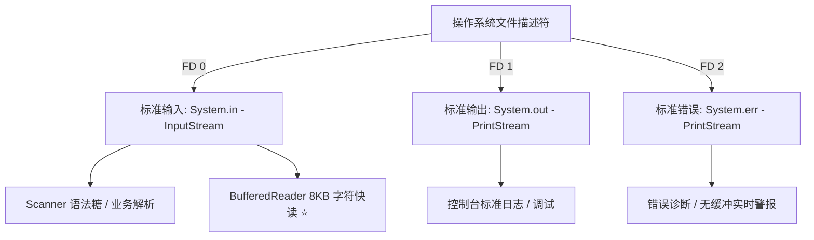

## 七、Java 字符串全景专题（底层源码、内存模型与高频实战）

> **导读与知识图谱**
> 字符串（String）是 Java 体系中使用最频繁、优化最极致、也是面试深挖的核心组件。
> 本专题深度整合 HotSpot 源码、JVM 规范、JDK 版本演进（JDK 6/7/8/9/11/15+）与大厂高频考点，构建五维立体认知体系：
> 1. **核心类家族底座**：String / StringBuilder / StringBuffer 源码实现与紧凑编码
> 2. **JVM 内存模型深潜**：三大常量池流转、StringTable 底层哈希表与 `intern()` 跨版本巨变
> 3. **核心 API 与生产避坑**：分类图谱、`char[]` 凭据擦除、判空矩阵（Spring/Apache）与避坑红线
> 4. **版本演进与工具类选型**：从 Compact Strings、文本块到 Guava/Hutool 工具生态
> 5. **大厂高频连环炮**：直击底层实现与经典压轴名题速答

---

### 1. 字符串家族三大核心类（String / StringBuilder / StringBuffer）

#### 1.1 三大核心类全方位对比矩阵

| 比较维度 | String | StringBuilder | StringBuffer |
| :--- | :--- | :--- | :--- |
| **可变性** | ❌ 绝对不可变（Immutable） | ✅ 可变字符序列（Mutable） | ✅ 可变字符序列（Mutable） |
| **底层存储 (JDK 8 及以前)** | `private final char[] value;` | `char[] value;`（继承自 `AbstractStringBuilder`） | `char[] value;`（继承自 `AbstractStringBuilder`） |
| **底层存储 (JDK 9 及以后)** | `private final byte[] value;` + `byte coder;` | `byte[] value;` + `byte coder;` | `byte[] value;` + `byte coder;` |
| **线程安全性** | ✅ 线程绝对安全（天然不可变） | ❌ 线程不安全（无同步锁） | ✅ 线程安全（方法级 `synchronized` 同步锁） |
| **同步开销与执行性能** | 频繁修改最慢（产生大量临时对象及频繁 GC） | **性能极高**（零同步开销，直接修改内部数组） | 性能中等（存在锁获取与释放的系统级开销） |
| **典型应用场景** | 少量拼接、Map的Key、URL/配置常量、不可变DTO | **单线程环境下的大量拼接、循环构建（99% 工业场景）** | 多线程环境下并发修改共享字符缓冲区（极少直接使用） |
| **动态扩容机制** | 无扩容（每次修改产生新对象） | 自动扩容：`(oldCapacity << 1) + 2` | 自动扩容：`(oldCapacity << 1) + 2` |

#### 1.2 String 底层源码与不可变性（Immutability）

##### 1.2.1 不可变性的底层实现三要素
`String` 的不可变性并非单一语法糖，而是由 **类声明、字段修饰、封装设计与内存拷贝** 共同构筑的闭环设计：

1. **类级别的防继承**：`public final class String implements ...` 类使用 `final` 修饰，杜绝任何子类继承改写其行为（防止子类覆写方法篡改逻辑）。
2. **字段级别的防重指向与私有化封装**：
   - JDK 8 及以前：`private final char[] value;`
   - JDK 9 及以后：`private final byte[] value;`
   - `final` 关键字确保 `value` 引用一旦被初始化分配，便**无法重新指向其他内存数组**。
   - `private` 访问权限将数组严格封装于内部，并且 `String` 源码内部**未提供任何对外公开的修改、写操作接口**（如 `setCharAt`）。
3. **防御性拷贝（Defensive Copy）**：
   - 构造函数传入 `char[]` 或 `byte[]` 时，底层通过 `Arrays.copyOf` 或 `System.arraycopy` 重新开辟新内存拷贝一份，而非直接持有外部数组引用；
   - 调用 `toCharArray()` 或 `getBytes()` 返回时，同样拷贝一份全新数组抛出，彻底隔绝外部指针修改底层数组的可能。

##### 1.2.2 不可变性带来的四大核心系统红利
设计者 James Gosling 之所以将 String 设计为不可变，是出于 Java 整个运行时基石与生态的权衡：
1. **字符串常量池（String Constant Pool）的复用前提**：
   - 只有当字符串内容不可变时，常量池才能够让成千上万个变量引用安全地共享同一个堆内存实例。如果 String 可变，某个变量修改了内容，其他共享此字符串的引用数据将全部被污染。
2. **天然的线程绝对安全（Thread-Safety）**：
   - 不可变对象（Immutable Object）的状态终生不变，具备天然的线程安全属性。多线程并发读取时，无需任何加锁或同步机制，并发性能达到极致。
3. **哈希码缓存（HashCode Caching）与高性能查找**：
   - `String` 内部维护了 `private int hash;` 缓存字段。由于内容绝对不变，其哈希值计算一次后终生有效（延迟计算后缓存）。
   - 这一特性使得 `String` 在作为 `HashMap`、`HashSet`、`ConcurrentHashMap` 的 Key 时，哈希比对与槽位定位速度极快。
4. **底层运行时的系统安全性（Security）**：
   - Java 底层的网络套接字（Socket、URL）、数据库连接凭证（User/Password）、类加载反射全限定名（ClassLoader）、文件系统路径等，全部以 `String` 作为入参传递。
   - 如果 String 可变，攻击者可以在权限校验通过后、执行连接前，通过并发线程篡改字符串内容（Time-of-check to time-of-use, TOCTOU 漏洞），造成严重越权攻击。

##### 1.2.3 深度探究：final 真的能保证绝对不可变吗？
- **结论**：**语法层面的 final 无法抵御反射攻击（Reflection Attack）**。
- `final` 只能保证引用地址不可变，但数组堆内存中的具体元素仍是可变的。在 JDK 8 及以前，通过反射可以直接暴力修改底层数组：
  ```java
  String s = "Hello World";
  // 通过反射获取 String 类的 private final char[] value 字段
  Field valueField = String.class.getDeclaredField("value");
  valueField.setAccessible(true);
  char[] value = (char[]) valueField.get(s);
  value[0] = 'h'; // 强行将大写 H 改为小写 h
  System.out.println(s); // 输出 "hello World"
  ```
- **生产与架构警示**：
  - 这种暴力篡改不仅破坏不可变性，还会**污染字符串常量池中全局共享的字面量**，引发整个 JVM 极其诡异的灾难性 Bug！
  - **JDK 9+ 的强封装应对**：从 JDK 9 引入模块系统（JPMS）后，JVM 对核心包 `java.lang` 开启强封装保护（Strong Encapsulation），禁止非法跨模块反射访问私有字段，抛出 `InaccessibleObjectException`。

##### 1.2.4 JDK 9 架构级重构：Compact Strings（紧凑字符串）
在 JDK 9 中，String 内部存储发生了里程碑式重构（JEP 254: Compact Strings）：
- **重构背景**：
  - OpenJDK 团队对成千上万个大型 Java 企业级应用进行堆内存大数据分析，发现 **String 对象通常占据整个堆内存的 25%~50%**；
  - 更关键的是，**超过 75% 的字符串其内容完全落在 ISO-8859-1 (Latin-1) 字符集范围内**（即纯 ASCII、英文字母、数字、通用标点），每个字符的高位字节全为 `0x00`。
  - 在 JDK 8 中，使用 `char[]` 存储，每个 `char` 强制占据 2 个字节（16 bit），导致其中一半的内存完全被无意义的 `0x00` 浪费。
- **重构实现方案**：
  ```java
  // JDK 9+ String 核心属性
  private final byte[] value;
  private final byte coder; // 编码标识符
  ```
  - **LATIN1 (0)**：若字符串中所有字符都能用 1 个字节（8 位）表达，则 `coder = 0`，底层 `value` 每个字符仅占 1 个 `byte`；
  - **UTF16 (1)**：一旦出现汉字、Emoji 或生僻字符（无法被 8 位容纳），则自动启用 UTF-16 编码，`coder = 1`，底层 `value` 每个字符占 2 个 `byte`。
- **优化成效**：
  - 对于大部分包含大量英文、数字、JSON Key、URL 的互联网应用，**String 内存占用直接暴降近 50%**，GC 频率大幅降低，CPU 缓存命中率显著提高。
  - 该特性由 JVM 自动适配，对上层业务调用完全透明，无需更改任何业务代码。

#### 1.3 StringBuilder 与 StringBuffer 核心源码剖析

##### 1.3.1 核心骨架：`AbstractStringBuilder` 抽象基类
`StringBuilder` 与 `StringBuffer` 均继承自 `AbstractStringBuilder`，绝大多数核心实现均复用父类逻辑：
```java
abstract class AbstractStringBuilder implements Appendable, CharSequence {
    byte[] value; // 存储字符序列（JDK8 为 char[] value）
    byte coder;   // 编码标识
    int count;    // 当前实际存储的有效字符数量（不同于 value.length 容量）
}
```

##### 1.3.2 初始容量分配策略
1. **无参构造函数**：
   ```java
   public StringBuilder() {
       super(16); // 默认初始容量为 16
   }
   ```
2. **指定容量构造函数（推荐）**：
   ```java
   public StringBuilder(int capacity) {
       super(capacity);
   }
   ```
3. **基于初始字符串构造**：
   ```java
   public StringBuilder(String str) {
       super(str.length() + 16); // 初始容量为字符串实际长度 + 16
       append(str);
   }
   ```

##### 1.3.3 动态扩容机制源码剖析
当调用 `append()` 追加内容且当前剩余空间不足以容纳新字符时，触发自动扩容：
```java
// JDK 源码核心扩容算法：
private int newCapacity(int minCapacity) {
    // 核心扩容公式：(旧容量 << 1) + 2，即：旧容量 * 2 + 2
    int newCapacity = (value.length << 1) + 2;
    // 如果扩容 2 倍 + 2 之后依然小于所需最小容量，则直接采用 minCapacity
    if (newCapacity - minCapacity < 0) {
        newCapacity = minCapacity;
    }
    // 越界与超大数组保护（防止超出 Integer.MAX_VALUE - 8）
    return (newCapacity <= 0 || MAX_ARRAY_SIZE - newCapacity < 0)
        ? hugeCapacity(minCapacity)
        : newCapacity;
}
```
- **关键设计点解读**：
  - **为什么是 `旧容量 * 2 + 2` 还要 `+ 2`？**
    如果开发者创建对象时指定了初始容量为 `0`（`new StringBuilder(0)`），若纯粹乘以 2，则 `0 * 2 = 0`，容量永远为 0 导致无法扩容。加上 2 可以确保容量必然递增。
  - **底层数组复制**：
    计算出 `newCapacity` 后，调用 `Arrays.copyOf(value, newCapacity)`，底层通过 C++ 本地方法 `System.arraycopy` 分配新数组并搬迁数据，旧数组丢弃等待 GC 回收。

##### 1.3.4 线程安全性差异与 StringBuffer 锁机制
- **StringBuilder**：
  所有方法均未加锁。在多线程并发执行 `append()` 时，由于 `count = count + len` 操作非原子性，以及数据写入无内存可见性保证，极易发生**数据覆盖、字符丢失**甚至抛出 `ArrayIndexOutOfBoundsException`。
- **StringBuffer**：
  绝大多数对外方法（`append`, `insert`, `delete`, `replace`, `substring`, `toString`）全部使用 `synchronized` 关键字修饰方法级互斥锁。
  ```java
  @Override
  public synchronized StringBuffer append(String str) {
      toStringCache = null; // 清除缓存
      super.append(str);
      return this;
  }
  ```
  - **`toStringCache` 设计**：StringBuffer 内部维护了一个 `private transient char[] toStringCache`。每次被修改时清空缓存；当高频并发调用 `toString()` 且内容未变时，直接复用缓存，减少重复数组分配。

##### 1.3.5 生产性能红线：容量预估原则
> **生产规范**：
> 在可预估拼接长度的场景（如拼接长 JSON、导出 CSV、批量 SQL 构建），**强烈禁止使用无参构造函数**！
> 若频繁追加大文本且未指定容量，数组容量将从 `16 -> 34 -> 70 -> 142 -> 286...` 发生十数次动态扩容，带来大量的内存重复分配、数据拷贝与短命对象，触发频繁 Young GC。
> **正确做法**：`StringBuilder sb = new StringBuilder(estimatedSize);`。

##### 1.3.6 StringBuilder 常用核心 API 详解与操作实战

`StringBuilder` 内部方法丰富，绝大多数返回 `this` 以支持 **Fluent 链式调用**。以下是工业开发与算法面试中的核心 API 全景归纳：

###### 1. 核心 API 功能速查表

| 功能分类 | 常用核心方法 | 说明与行为规范 |
| :--- | :--- | :--- |
| **追加 (Append)** | `append(Object obj)`<br>`append(String str)`<br>`append(char[] str, int offset, int len)` | 支持所有基本数据类型、字符串、对象；返回 `this` 支持链式拼接。<br>⚠️ 若传入 `null`，会追加字符 `"null"`（4 个字符）。 |
| **插入 (Insert)** | `insert(int offset, Object obj)`<br>`insert(int offset, String str)` | 在指定索引 `offset` 处插入数据，原有元素后移；$O(N)$ 复杂度。 |
| **删除 (Delete)** | `delete(int start, int end)`<br>`deleteCharAt(int index)` | `delete` 删除 `[start, end)` 左闭右开区间内容；<br>`deleteCharAt` 删除指定单个字符，**笔试算法中常用于删除末尾冗余逗号**。 |
| **替换与修改** | `replace(int start, int end, String str)`<br>`setCharAt(int index, char ch)` | `replace` 将区间替换为目标串；<br>`setCharAt` 类似数组下标赋值 `arr[i] = ch`，单字符原地修改。 |
| **反转 (Reverse)** | `reverse()` | 原地反转字符序列，常用于**回文串判断、进制转换、数字逆向输出**。 |
| **长度与缓冲区管控** | `length()`<br>`capacity()`<br>`setLength(int newLength)`<br>`trimToSize()`<br>`ensureCapacity(int min)` | • `length()`：当前实际字符数；<br>• `capacity()`：底层数组总容量；<br>• **`setLength(0)`：清空缓冲区并复用底层数组（高性能场景利器）**；<br>• `trimToSize()`：释放未使用的空闲容量（缩容至 `capacity == length`）。 |
| **检索与切片** | `charAt(int index)`<br>`indexOf(String str)`<br>`lastIndexOf(String str)`<br>`substring(int start, int end)` | • `charAt`/`indexOf` 与 String 一致；<br>• ⚠️ **`substring` 返回全新 String 对象，不修改 StringBuilder 自身！** |
| **转换输出** | `toString()` | 生成不可变的最终 `String` 对象（底层 `new String(value, 0, count)`）。 |

###### 2. 生产与算法高频使用范式

###### 范式 1：链式构建与末尾分隔符清除（经典删除用法）
在拼接逗号分隔列表（如 ID 列表、SQL 字段）时，利用 `deleteCharAt` 优雅剔除最后一个多余字符：
```java
public static String buildIdList(List<Long> ids) {
    if (ids == null || ids.isEmpty()) {
        return "";
    }
    // 1. 预估容量：每个 ID 约 10 位 + 1 个逗号
    StringBuilder sb = new StringBuilder(ids.size() * 11);
    for (Long id : ids) {
        sb.append(id).append(",");
    }
    // 2. 删除末尾多余的逗号
    sb.deleteCharAt(sb.length() - 1);
    return sb.toString();
}
```

###### 范式 2：循环内复用 StringBuilder（规避高频 GC 垃圾产生）
在批量处理、网络包序列化或高频循环中，不要在循环体内部反复 `new StringBuilder()`，应使用 `setLength(0)` 复用同一个底层缓冲区：
```java
// 优化前（频繁创建对象，触发 Young GC）：
for (Record record : records) {
    StringBuilder sb = new StringBuilder(); // 每次循环 new 一个新对象
    sb.append(record.getId()).append(":").append(record.getName());
    send(sb.toString());
}

// 优化后（对象复用，零临时对象产生）：
StringBuilder reusableSb = new StringBuilder(256);
for (Record record : records) {
    reusableSb.setLength(0); // 原地重置有效长度为 0，复用底层已扩容的内存数组！
    reusableSb.append(record.getId()).append(":").append(record.getName());
    send(reusableSb.toString());
}
```

###### 范式 3：字符串原地反转与回文数校验
`StringBuilder.reverse()` 在底层直接做双指针首尾交换（ASCII/Latin-1 或 UTF-16 编码下），速度远快于手动写循环拼接：
```java
public static boolean isPalindrome(int x) {
    if (x < 0) return false;
    String str = Integer.toString(x);
    // 反转比对
    return new StringBuilder(str).reverse().toString().equals(str);
}
```

###### 3. 常见避坑警示

> [!WARNING]
> 1. **`append(null)` 陷阱**：
>    调用 `sb.append((String) null)` 或 `sb.append(nullObj)` 并不会忽略该值，而是会将字符 `'n','u','l','l'` 追加到缓冲区中，导致生成 `"null"` 字符串！
>    若需忽略 null，必须先做判空，或使用 Guava 的 `Joiner.skipNulls()`。
> 2. **`substring()` 误区**：
>    `sb.substring(0, 3)` **不会修改 StringBuilder 本身**（与 `delete` 不同），它仅仅是截取并返回一个新 `String`。若想截短本身，请使用 `sb.delete(3, sb.length())` 或 `sb.setLength(3)`。
> 3. **严禁对 StringBuilder 使用 `+` 号**：
>    `sb = sb + "abc";` 属于语法错误或会隐式将 `sb` 强转为 `String` 后再重新创建 `StringBuilder`，完全违背了使用 `StringBuilder` 的初衷。必须统一使用 `sb.append("abc")`。

---

### 2. JVM 内存模型与字符串常量池深潜（核心重难点）

#### 2.1 三大常量池的精准辨析与生命周期

在 Java 编译与运行体系中，存在三个极易混淆的“常量池”概念：

| 常量池类型 | 所属物理载体与内存区域 | 存储核心内容 | 生命周期 | 解析/载入时机 |
| :--- | :--- | :--- | :--- | :--- |
| **Class 文件常量池**<br>(静态常量池) | 磁盘上的 `.class` 字节码二进制文件 | • **字面量**（文本字符串、基本类型数值）<br>• **符号引用**（类与接口全限定名、字段名称与描述符、方法名称与描述符） | 伴随编译产生，持久化保存在磁盘上 | 编译期由 `javac` 生成，尚未载入内存 |
| **运行时常量池**<br>(Runtime Constant Pool) | **JDK 7 及以前**：方法区（PermGen 永久代）<br>**JDK 8 及以后**：元空间（Metaspace，本地物理内存） | • 从 Class 文件常量池加载进来的数据<br>• 符号引用在解析后替换生成的**直接引用**（物理内存指针）<br>• 运行期动态加入的类常量（具备动态性） | 伴随类加载器（ClassLoader）载入，随类卸载而销毁 | 类加载（Class Loading）的加载与解析阶段 |
| **字符串常量池**<br>(String Table / String Pool) | **JDK 6 及以前**：方法区（永久代）<br>**JDK 7 及以后**：**Java 堆（Java Heap）** | **全局共享**的被驻留（Interned）的 `String` 实例的引用指针（HotSpot 内部的 C++ 全局哈希表） | 伴随整个 JVM 进程生命周期（受堆 GC 管理） | 类加载时预载字面量，或运行期 `intern()` 动态注册 |

##### 三者流转与演变关系图谱

```
  [ 源码：String s = "abc"; ]
               │
               ▼ javac 编译
  ┌────────────────────────────────────────────────────────┐
  │ Class 文件常量池（磁盘 .class 文件）                     │
  │ • Constant #1 = Utf8 "abc"                             │
  │ • Constant #2 = String #1                              │
  └────────────────────────────┬───────────────────────────┘
                               │ 类加载（ClassLoader）
                               ▼
  ┌────────────────────────────────────────────────────────┐
  │ 运行时常量池（方法区 / 元空间 Metaspace）               │
  │ • 符号引用被解析为直接指针引用                           │
  └────────────────────────────┬───────────────────────────┘
                               │ JVM 解析 ldc 指令
                               ▼
  ┌────────────────────────────────────────────────────────┐
  │ 全局字符串常量池（Java 堆中的 StringTable 哈希表）        │
  │ Key: "abc" 的 hash -> Value: 堆中唯一的 String 实例引用  │
  └────────────────────────────────────────────────────────┘
```

#### 2.2 字符串常量池（StringTable）的底层实现与历史迁移

##### 2.2.1 HotSpot C++ 源码实现视角
在 HotSpot 虚拟机内核中，字符串常量池在 C++ 层面表现为 `StringTable` 类，其底层继承自 `Hashtable<oop, mtSymbol>`：
- **本质**：它本质上是一张**定长的哈希索引查找表**（拉链法解决哈希冲突）。
- **存储对象**：**常量池中存储的绝非字符串对象本体，而是 Java 堆中真实 String 对象的指针（`oop`）**。
- **全局唯一性**：整个 JVM 进程中仅有一张全局 StringTable，所有线程共享。

##### 2.2.2 为什么 JDK 7 将字符串常量池从永久代迁移到堆？
这是 Java 内存模型历史上极其重要的演进架构改动：
1. **永久代内存极小且受限**：
   - 在 JDK 6 中，永久代默认上限极小（32位下通常仅 64MB，`-XX:MaxPermSize`），且不易动态扩展。
2. **永久代垃圾回收触发条件苛刻**：
   - 永久代仅在触发 **Full GC** 时才进行垃圾回收。而字符串字面量通常大量产生于业务运行期，若是大量调用 `intern()` 注册字符串，极易打爆永久代，频繁引发毁灭性的 `java.lang.OutOfMemoryError: PermGen space`。
3. **堆内存回收高效且空间充足**：
   - 迁移到堆（Java Heap）后，字符串常量池能够直接受到 **Young GC / Minor GC** 的高效管理。当常量池中登记的字符串不再有任何根引用（Unreachable）时，Minor GC 即可将其迅速回收并释放内存，彻底根治了字符串导致的 PermGen OOM 风险。

##### 2.2.3 调优参数与哈希冲突陷阱
- **核心调优参数**：`-XX:StringTableSize=N`
- **默认容量变迁**：
  - JDK 6：默认固定为 `1009`（不可调）。
  - JDK 7：默认 `1009`（可以通过 `-XX:StringTableSize` 调整）。
  - JDK 8 及以后：64 位操作系统下默认容量提升至 **`60013`**。
- **生产性能陷阱**：
  - 如果业务系统存在数百万级海量字符串进行 `intern()` 去重驻留（例如大型爬虫、海量设备序列号去重），而未调大 `StringTableSize`，会导致每个 Bucket 桶上的链表极端拉长。
  - 这会使得常量池查找时间复杂度从 $O(1)$ 骤降到 $O(N)$，导致 CPU 使用率飙高到 100%，系统吞吐量断崖式下跌。

#### 2.3 字符串对象创建与内存分配全流程分析

##### 2.3.1 字面量创建机制：`String s1 = "abc";`
- **执行过程**：
  1. JVM 执行到该行字节码，遇到 `ldc` 指令；
  2. JVM 拿着内容 `"abc"` 前往全局 `StringTable` 检索；
  3. 若哈希表中已存在记录，直接返回其指向的堆 String 实例引用；
  4. 若哈希表中不存在，则在堆中真正分配一个 String 实例，将其堆地址登记至 `StringTable`，并返回给 `s1`。
- **对象数量**：若常量池已存在，创建 **0 个**新对象；若常量池不存在，创建 **1 个**对象。

##### 2.3.2 堆对象创建机制：`String s2 = new String("test");`
这是各级别大厂面试出现频率极高的经典必考题：“该语句一共创建了几个对象？”

###### 字节码指令深度拆解
通过 `javap -c -v` 反编译查看底层指令：
```text
0: new           #2      // class java/lang/String (在堆中分配未初始化的 String 对象)
3: dup                   // 复制栈顶引用地址
4: ldc           #3      // String test (从常量池加载 "test" 的引用)
6: invokespecial #4      // Method java/lang/String."<init>":(Ljava/lang/String;)V
9: astore_1              // 将 new 出来的堆对象引用存入局部变量表槽位 1
```

###### 执行流程步步追踪
1. **指令 `0: new`**：在堆中开辟一块内存空间，创建一个全新的 `String` 对象实例（称之为“堆对象 B”）；
2. **指令 `4: ldc`**：处理字面量 `"test"`。去全局字符串常量池检查：
   - **若常量池无 `"test"`**：在堆中额外创建一个 String 实例（“堆对象 A”），并将对象 A 的堆内存引用存入常量池；
   - **若常量池已有 `"test"`**：直接取出对象 A 的引用；
3. **指令 `6: invokespecial`**：调用 String 的构造函数 `public String(String original)`，将步骤 2 取出的对象 A 作为入参传入。
   - **底层数组共享优化**：在 JDK 8 中，构造函数内部执行 `this.value = original.value;`。这意味着对象 B 与对象 A **共用同一个底层的 `char[]` 字符数组**，不进行多余的字符拷贝！
4. **指令 `9: astore_1`**：将堆对象 B 的引用赋给栈帧局部变量 `s2`。

###### 内存布局与对象数量最终裁决
- **如果字符串常量池中原本不存在 `"test"`**：创建 **2 个对象**（1 个堆中字面量对象且被常量池引用，1 个 new 出来的堆对象）。
- **如果字符串常量池中原本已存在 `"test"`**：仅创建 **1 个对象**（即 new 出来的那个堆对象）。
- **比较结果验证**：
  ```java
  String s1 = "test";
  String s2 = new String("test");
  System.out.println(s1 == s2);      // false！栈变量指向不同的堆对象外壳
  System.out.println(s1.equals(s2)); // true！底层字符序列内容完全一致
  ```

#### 2.4 变量拼接与编译期常量折叠（Compile-time Folding vs invokedynamic）

##### 2.4.1 常量折叠优化：`("a" + "b") == "ab"`
```java
String s1 = "a" + "b";
String s2 = "ab";
System.out.println(s1 == s2); // 输出 true
```
- **底牌解密**：
  - `javac` 编译器具备**常量折叠（Constant Folding）**能力。在编译阶段，编译器发现操作数均为编译期字面量常量，便直接在编译期完成了算术拼接，生成的 `.class` 字节码中直接等价于：`String s1 = "ab";`。
  - 运行时 `s1` 与 `s2` 指向常量池中同一个驻留对象，因此 `==` 判断恒为 `true`。

##### 2.4.2 包含变量的字符串拼接：`s1 + s2`
```java
String s1 = "a";
String s2 = "b";
String s3 = s1 + s2;
System.out.println(s3 == "ab"); // 输出 false
```
- **JDK 8 机制解密**：
  - 编译器无法在编译期预测变量值，因此对 `+` 操作进行语法糖反解，转换为：
    ```java
    String s3 = new StringBuilder().append(s1).append(s2).toString();
    ```
  - `StringBuilder.toString()` 源码：
    ```java
    return new String(value, 0, count);
    ```
  - **核心铁律**：`new String()` 创建于堆内存中，**绝不会自动将其加入字符串常量池**！因此 `s3` 是堆中独立新对象，与常量池中的 `"ab"` 地址不同，`==` 结果为 `false`。

##### 2.4.3 `final` 修饰常量的拼接奇迹
```java
final String a = "a";
final String b = "b";
String c = a + b;
System.out.println(c == "ab"); // 输出 true
```
- **原理解析**：`final` 变量属于编译期常量，被内联进常量池中，编译器能完全确认其值永不改变，依然触发常量折叠，编译后直接变成 `String c = "ab";`。
- **反例警示**：若 `final String a = getA();`（通过方法调用赋值），由于方法返回值在编译期无法推导，无法常量折叠，依然退化为运行时 StringBuilder 拼接。

##### 2.4.4 JDK 9+ 的革命性演进：`makeConcatWithConstants`
在 JDK 9 中（JEP 280: Indify String Concatenation），废弃了硬编码生成 `StringBuilder` 字节码的做法，改用 **`invokedynamic`** 字节码指令与 `StringConcatFactory.makeConcatWithConstants` 引导方法：
- **优势**：将具体的拼接策略从“编译期固化”推迟到“运行期动态生成”；
- 运行期 JVM 可以根据平台特性、JIT 优化策略动态选择采用预先计算大小的单次字节数组分配，避免了传统无参 `StringBuilder` 多次扩容与中间对象分配开销。

#### 2.5 `intern()` 方法原理与跨版本行为巨变（必考压轴题）

##### 2.5.1 `intern()` 方法规范定义
`public native String intern();` 是一个本地方法。其规范定义为：
- 当调用 `s.intern()` 时，JVM 去全局字符串常量池检查是否存在与 `s.equals()` 相等的字符串引用：
  - **若存在**：直接返回常量池中保存的那个对象的引用；
  - **若不存在**：将该字符串加入常量池管理，并返回指向它的引用。

##### 2.5.2 JDK 6 vs JDK 7+ 的跨版本分水岭（重中之重）

| 对比维度 | JDK 6（常量池在永久代 PermGen） | JDK 7 及以后（常量池在堆 Heap） |
| :--- | :--- | :--- |
| **若常量池中不存在该字符串** | **完整复制（Deep Copy）** 该对象到永久代常量池中，返回**永久代中的新对象引用**。原堆对象与常量池对象是两个独立对象。 | **绝不复制对象！** 仅在常量池哈希表中**记录当前 Java 堆对象的物理引用地址**，返回该引用。常量池直接复用堆中的原对象。 |

##### 2.5.3 经典考题逐行推演一：标准拼接后的 intern()
```java
String s1 = new String("a") + new String("b");
s1.intern();
String s2 = "ab";
System.out.println(s1 == s2);
```
- **推演过程**：
  1. `new String("a") + new String("b")`：由 StringBuilder 拼接生成，在堆上创建了内容为 `"ab"` 的对象 `s1`。注意：**此时字符串常量池中仅有 `"a"` 和 `"b"`，尚无 `"ab"`**；
  2. `s1.intern()`：检索常量池，发现没有 `"ab"`：
     - **JDK 6**：复制一份 `"ab"` 对象放入永久代。
     - **JDK 7+**：**直接将堆中 `s1` 的内存地址引用存入常量池**；
  3. `String s2 = "ab"`：字面量检索常量池，找到了刚才存入的 `s1` 的引用并赋给 `s2`；
  4. **判定结论**：
     - **JDK 6**：`false`（`s1` 在堆，`s2` 在永久代）；
     - **JDK 7+**：**`true`**（`s1` 与 `s2` 指向堆中同一个对象实体！）。

##### 2.5.4 经典考题逐行推演二：顺序调换引发的反转
```java
String s1 = new String("a") + new String("b");
String s2 = "ab";
s1.intern();
System.out.println(s1 == s2); // 恒为 false！
```
- **推演过程**：
  1. 第 2 行 `String s2 = "ab"` 执行时，字面量先行触发常量池检索，常量池不存在 `"ab"`，因此在堆中创建了常量池专用的 `"ab"` 对象（对象 P），并将对象 P 的地址登记入池，`s2` 指向对象 P；
  2. 第 3 行 `s1.intern()` 执行，常量池已存在 `"ab"`（对象 P），因此 `intern()` 仅返回对象 P 的引用，**不会修改常量池**，且并未赋值给 `s1`；
  3. `s1` 依然指向 StringBuilder 生成的堆对象，`s2` 指向对象 P，二者非同一对象，输出 **`false`**。

##### 2.5.5 终极陷阱题：“java” 字符串在 JDK 7+ 为什么是 false？
```java
String s = new StringBuilder("ja").append("va").toString();
System.out.println(s.intern() == s); // 输出 false！
```
- **疑难解惑**：
  按照前面的推演规则，先拼出 `"java"` 再调 `intern()`，在 JDK 7+ 应该为 `true` 呀？为什么唯独 `"java"` 是 `false`？
- **深度底层真相**：
  - 在 JVM 虚拟机初始化启动阶段，在加载执行任何业务代码前，JVM 自身的类加载体系（如加载 `java.lang.System`、`sun.misc.Version` 等类）中，就已经执行了大量的字面量驻留操作。
  - **`"java"` 字符串作为系统基础属性，早已在 JVM 启动期被作为字面量驻留进了字符串常量池**！
  - 因此当代码执行 `s.intern()` 时，常量池中早就存在系统预置的 `"java"` 引用，`intern()` 返回的是系统早期对象的引用，而非刚刚 new 出来的 `s`，故比对结果为 **`false`**。

---

### 3. 核心 API 矩阵、字符转换与生产避坑

#### 3.1 String 核心 API 全分类速查图谱

```
String 核心常用 API
├── 1. 检索与探测
│   ├── charAt(int index)             // 获取指定索引字符（越界抛 StringIndexOutOfBoundsException）
│   ├── indexOf(String str)           // 首次出现的下标（未找到返回 -1）
│   ├── lastIndexOf(String str)       // 最后一次出现的下标
│   ├── contains(CharSequence s)      // 是否包含子串（底层基于 indexOf）
│   ├── startsWith(String prefix)     // 是否以指定前缀开头
│   └── endsWith(String suffix)       // 是否以指定后缀结尾
├── 2. 提取与截取
│   ├── substring(int beginIndex)     // 从 beginIndex 截取到末尾 [begin, len)
│   ├── substring(int begin, int end) // 截取区间字符，左闭右开 [begin, end)
│   └── subSequence(int start, int end)// 返回 CharSequence 接口视图
├── 3. 内容比对与校验
│   ├── equals(Object anObject)       // 严格比较字符串字符内容（重写自 Object）
│   ├── equalsIgnoreCase(String s)    // 忽略大小写比对
│   ├── compareTo(String another)     // 字典序比较（返回负数、0、正数，实现 Comparable 接口）
│   ├── isEmpty()                     // 长度是否为 0（value.length == 0）
│   └── isBlank() (JDK 11+)           // 是否为空白串（含全空格、制表符）
├── 4. 转换、替换与变形
│   ├── toLowerCase() / toUpperCase() // 大小写转换（建议指定 Locale.ROOT 避免土耳其 I 陷阱）
│   ├── replace(char old, char new)   // 全量字符替换（字面量替换，非正则）
│   ├── replace(CharSequence, CharSeq)// 全量字符串替换（字面量替换）
│   ├── replaceAll(String regex, ...) // 正则全量替换（性能损耗较大，需预编译正则）
│   ├── replaceFirst(String regex, ..)// 正则首处替换
│   ├── split(String regex)           // 正则切割（注意特殊元字符转义与末尾空串）
│   └── join(CharSequence d, ...)     // 指定分隔符连接多个元素（JDK 8+）
└── 5. 编码与互转
    ├── toCharArray()                 // 转换为全新 char[] 数组（深拷贝）
    ├── getBytes(Charset charset)     // 指定字符集转为 byte[] 数组（严禁使用平台默认无参版）
    └── valueOf(Object obj)           // 安全转字符串（底层判断 obj == null ? "null" : obj.toString()）
```

#### 3.2 String 与 char[] / byte[] 的深层转换与凭据安全准则

##### 3.2.1 互相转换与浅/深拷贝保护
1. **String 转 `char[]`**：
   `char[] chs = str.toCharArray();`：底层分配全新的 `char[]` 并执行数据拷贝。外部修改 `chs` 数组中的任何元素，绝对不会影响原本不可变的 `str` 字符串。
2. **`char[]` 转 String**：
   `String str = new String(chs);` 或 `String.valueOf(chs);`：同样在新对象构造时执行数组内容拷贝，阻断外部数组引用关联。

##### 3.2.2 核心安全规范：为什么存储密码必须使用 `char[]` 而严禁使用 `String`？
在安全框架（如 Spring Security、Shiro）或银行级交易系统中，所有的密码输入组件（如 `JPasswordField`）获取的均是 `char[]`，这在面试中也是极高频的安全考点：
1. **String 的不可变性导致明文驻留无法被手动销毁**：
   - String 对象创建后驻留在堆内存中，Java 程序员无法主动从内存中将其擦除。它的生命周期完全受控于 GC 垃圾回收器；
   - 在下一次垃圾回收发生前，明文密码可能在内存中常驻数分钟甚至数小时。
2. **堆内存转储（Heap Dump）泄漏风险**：
   
   - 若系统突发 OOM 生成了 Dump 快照文件，或者黑客利用漏洞获取了系统的 Core Dump 内存镜像，使用 Memory Analyzer Tool (MAT) 直接进行 ASCII/Unicode 搜索，即可轻易提取出大批量的明文账户密码。
3. **`char[]` 具备主动安全抹零擦除（Zero-out）能力**：
   - 字符数组是完全可变的，在执行完身份认证校验后，开发者可以立即显式将其抹除重置：
     ```java
     char[] password = getPasswordFromRequest();
     try {
         authenticate(username, password);
     } finally {
         // 使用安全擦除：将数组所有元素填充为 0 字符，彻底抹掉内存痕迹
         Arrays.fill(password, '\0');
     }
     ```

#### 3.3 字符串判空完整体系对比（大厂编码规范）

在工业级业务开发中，参数判空是出现 NPE（NullPointerException）与业务逻辑漏洞的重灾区。以下为各核心判空 API 的行为对比矩阵：

##### 3.3.1 核心判空 API 横向对比矩阵

| 测试用例入参 | `str != null` | `str.isEmpty()` | `str.isBlank()`<br>(JDK 11+) | Spring<br>`hasLength(str)` | Spring<br>`hasText(str)` | Apache Commons<br>`StringUtils.isEmpty` | Apache Commons<br>`StringUtils.isBlank` |
| :--- | :--- | :--- | :--- | :--- | :--- | :--- | :--- |
| `null` | ❌ `false` | 💥 **抛出 NPE** | 💥 **抛出 NPE** | ❌ `false` | ❌ `false` | ✅ `true` (为空) | ✅ `true` (为空) |
| `""` (空串) | ✅ `true` | ✅ `true` | ✅ `true` | ❌ `false` | ❌ `false` | ✅ `true` (为空) | ✅ `true` (为空) |
| `" "` (纯空格) | ✅ `true` | ❌ `false` (len=1) | ✅ `true` | ✅ `true` | ❌ `false` | ❌ `false` | ✅ `true` (为空) |
| `"	 "` (空白符) | ✅ `true` | ❌ `false` | ✅ `true` | ✅ `true` | ❌ `false` | ❌ `false` | ✅ `true` (为空) |
| `"  a  "` (带字符) | ✅ `true` | ❌ `false` | ❌ `false` | ✅ `true` | ✅ `true` | ❌ `false` | ❌ `false` (非空) |
| `"abc"` | ✅ `true` | ❌ `false` | ❌ `false` | ✅ `true` | ✅ `true` | ❌ `false` | ❌ `false` (非空) |

##### 3.3.2 生产环境选型规范

1. **原生 JDK 编码**：
   - 若明确要判断“既非 null 也非空串”，标准写法为：`if (str != null && !str.isEmpty())`（利用短路与防止 NPE）。
   - JDK 11+ 场景下处理用户输入表单，建议：`if (str != null && !str.isBlank())`。
2. **Spring 生态工程推荐**：
   - 优先采用 `org.springframework.util.StringUtils.hasText(CharSequence str)`。它能够一次性排除 `null`、空串以及纯空白字符（如空格、Tab、换行符），是最符合实际业务表单入参校验的 API。
3. **通用三方库推荐**：
   - 推荐使用 Apache Commons Lang3 的 `StringUtils.isNotBlank(CharSequence cs)`。

#### 3.4 生产级踩坑清单与避坑指南

##### 避坑 1：严禁在循环体内使用 `+` 拼接字符串
- **反面教材**：
  ```java
  String result = "";
  for (int i = 0; i < 10000; i++) {
      result += i; // 致命反模式！
  }
  ```
- **灾难分析**：
  在循环体内使用 `+`，每次循环都会 `new StringBuilder()`，`append()` 后再调用 `toString()` 产生一个全新的堆 String。循环 10000 次将产生数万个短暂垃圾对象，造成严重内存碎片化并频繁触发 Young GC，时间复杂度退化为 $O(N^2)$。
- **重构准则**：
  必须在循环外部显式声明 `StringBuilder`，并在循环体内执行 `sb.append()`。

##### 避坑 2：常量前置防御 NPE 与 `==` 混淆
- **反面教材**：
  ```java
  if (userRole.equals("ADMIN")) { ... } // 若 userRole 为 null，直接抛出 NPE
  if (name == "zhangsan") { ... }       // 踩坑：比较的是对象地址而非字符串内容
  ```
- **重构准则**：
  字面量常量写在调用方左侧：`if ("ADMIN".equals(userRole))`，天然具备 null 防护；比较字符串内容必须使用 `equals()`。

##### 避坑 3：JDK 6 `substring()` 内存泄露陷阱与 JDK 7 修复
- **历史陷阱（JDK 6）**：
  JDK 6 中，`substring()` 为了极致性能，直接复用原大字符串底层的 `char[] value`，只是修改了内部的 `offset` 和 `count` 字段。
  - **严重后果**：若从一个 100MB 的大文本中通过 `substring(0, 5)` 截取了 5 个字符的小子串，只要该小子串一直被外部引用，底层那个 100MB 的完整大字符数组就**永远无法被 GC 回收**，引发隐蔽的内存泄漏！
- **JDK 7+ 修复方案**：
  JDK 7 彻底重构了 `substring` 实现，内部调用 `Arrays.copyOfRange(...)` 重新开辟内存并独立拷贝截取部分，与原大字符数组彻底脱钩解耦。

##### 避坑 4：`trim()` 与 `strip()` 的空白字符识别陷阱
- **陷阱表现**：
  `"　abc　".trim()` 依然会输出带有空格的内容！
- **底层原因**：
  - `trim()` 仅能识别 ASCII 码值小于等于 `32`（`' '` 空格、`	`、`
`、`
`）的控制字符；
  - 中文全角空格（Unicode `　`）的 ASCII 码值远大于 32，`trim()` 无法过滤。
- **解决方案**：
  JDK 11 引入了 `strip()` 方法，底层基于 `Character.isWhitespace(int codePoint)` 判定，完全支持 Unicode 规范定义的所有空白字符（包括中文全角空格）。

##### 避坑 5：`split()` 正则元字符与末尾空字符串截断陷阱
- **陷阱一（元字符转义）**：
  `str.split(".")` 或 `str.split("|")`：在正则表达式中 `.` 代表匹配任意单个字符，`|` 代表或逻辑，直接使用会导致分割失真。必须加双反斜杠转义：`str.split("\.")`。
- **陷阱二（末尾空串丢弃）**：
  `"a,b,,,".split(",")` 默认返回的数组长度仅为 2（末尾的所有空字符串会被默认剔除）。
  若业务需要保留末尾空串，必须传入负数 limit 参数：`str.split(",", -1)`。

##### 避坑 6：严禁使用字符串字面量作为 `synchronized` 同步锁
- **反面教材**：
  ```java
  public void doProcess(String userId) {
      synchronized (userId.intern()) { // 极度危险！
          // 业务逻辑
      }
  }
  ```
- **灾难分析**：
  常量池中的字符串是整个 JVM 全局共享的。不同业务模块如果恰好使用相同的字符串字面量加锁，或者使用了 `intern()`，会导致完全无关的业务之间产生**跨模块全局锁竞争甚至死锁**！建议使用独立的 `Object` 对象锁或并发包中的锁组件。

---

### 4. JDK 版本演进与第三方工业级工具类

#### 4.1 JDK 各版本字符串核心演进全景

```
JDK 6 -> JDK 7 -> JDK 8 -> JDK 9 -> JDK 11 -> JDK 12 -> JDK 15+
  │        │        │        │        │         │          │
  │        │        │        │        │         │          └─ 文本块 Text Blocks (""")
  │        │        │        │        │         └─ indent() / transform()
  │        │        │        │        └─ strip() / isBlank() / lines() / repeat()
  │        │        │        └─ Compact Strings (byte[] + coder) & invokedynamic 拼接
  │        │        └─ String.join() / Collectors.joining()
  │        └─ 常量池迁移至 Heap / substring 独立拷贝修复内存泄露 / switch 支持 String
  └─ 常量池位于 PermGen / substring 共享大数组隐患
```

- **JDK 7**：
  1. 字符串常量池正式从永久代（PermGen）移入 Java 堆（Heap）；
  2. `substring()` 改造为独立拷贝，修复大数组滞留内存泄露；
  3. `switch` 控制流正式支持 String（底层由 `hashCode()` + `equals()` 组合还原）。
- **JDK 8**：
  1. 新增静态方法 `String.join(CharSequence delimiter, ...)`；
  2. Stream 流支持 `Collectors.joining(",")`。
- **JDK 9**：
  1. 底层存储由 `char[]` 重构为 `byte[]` + `coder`（Compact Strings 紧凑字符串），内存减半；
  2. 字符串拼接改由 `invokedynamic` + `StringConcatFactory` 在运行期动态链接生成。
- **JDK 11**：
  1. `strip()`、`stripLeading()`、`stripTrailing()`：全功能 Unicode 空白去除；
  2. `isBlank()`：全功能空白串判定；
  3. `lines()`：返回 `Stream<String>`，按行分割文本；
  4. `repeat(int count)`：快速重复拼接字符串指定次数。
- **JDK 15+**：
  1. 正式发布 **Text Blocks 文本块**（三引号 `"""`），支持原生书写多行 JSON、SQL、HTML，保留排版并智能剔除共有公共缩进，无需繁琐换行符与转义。

#### 4.2 常用第三方工业级工具类横向对比与选型指南

在工业级项目中，严禁重复造轮子，主流企业工程通常根据技术栈选用以下成熟工具包：

##### 1. Apache Commons Lang3 (`org.apache.commons.lang3.StringUtils`)
- **定位**：工业级通用字符串事实标准，拥有极其完备的 NPE 防御设计。
- **王牌 API**：
  - `isEmpty(str)` / `isNotEmpty(str)`：纯长度判断。
  - `isBlank(str)` / `isNotBlank(str)`：排除空白字符判断。
  - `join(Iterable, separator)`：数组/集合优雅拼接。
  - `substringBetween(str, open, close)`：安全提取两个标记字符之间的子串。
  - `leftPad(str, size, padChar)` / `rightPad`：按固定长度补齐字符（常用于流水号格式化）。

##### 2. Spring Framework (`org.springframework.util.StringUtils`)
- **定位**：Spring 核心容器自带，零第三方依赖，专为 Web/Service 入参处理打造。
- **王牌 API**：
  - `hasText(CharSequence str)`：最经典的判空利器（非 null、非空、非纯空白）。
  - `collectionToDelimitedString(coll, ",")`：集合转逗号分割字符串。
  - `commaDelimitedListToSet(str)`：逗号字符串快速解析为 Set 集合。

##### 3. Google Guava (`com.google.common.base.*`)
- **定位**：流式高可读设计，注重不可变性与防御性编程。
- **王牌组件**：
  - `Splitter.on(",").trimResults().omitEmptyStrings().split(str)`：流式字符串分割器，链式剔除空项并自动 trim，彻底杜绝数组空元素。
  - `Joiner.on(",").skipNulls().join(list)`：拼接时自动忽略 null 元素，规避拼接出 `"null"` 文本。
  - `Strings.nullToEmpty(str)`：安全地将 null 统一兜底转换为空串 `""`。

##### 4. Hutool (`cn.hutool.core.util.StrUtil`)
- **定位**：国内广泛使用的开源工具箱，符合国内开发习惯。
- **王牌 API**：
  - `toCamelCase(str)` / `toUnderlineCase(str)`：数据库下划线与驼峰命名互转。
  - `desensitized(str, DesensitizedType)`：开箱即用的手机号、身份证号、银行卡号掩码脱敏。
  - `format("hello {name}", Dict.create().set("name", "world"))`：优雅的占位符文本格式化。

---

### 5. 高频面试连环炮与深度速答（大厂直通车）

#### Q1：String 为什么设计成不可变？如果通过反射强行修改底层数组会产生什么后果？
> **答**：
> 1. **设计原因**：
>    - **常量池复用**：只有字符串不可变，JVM 才能让多个变量安全共享常量池中同一个实例；
>    - **线程安全**：不可变对象天然具备跨线程读安全性，无需加锁；
>    - **哈希缓存**：内部缓存 `hash` 属性，让 HashMap/HashSet 检索极速；
>    - **系统安全**：文件路径、URL、反射类名等系统级参数不可被并发篡改，规避安全攻击。
> 2. **反射篡改后果**：
>    通过反射修改 `value` 数组虽能修改内容，但会破坏全局字符串常量池中共享的字面量，导致所有引用该字面量的模块全部发生数据错乱；同时导致该 String 在 HashMap 中的 hashCode 失效，出现“放入后无法查出”的幽灵 Key 灾难。JDK 9+ 的模块系统已对核心包加锁保护，禁止此类反射。

#### Q2：为什么开发中推荐将 String 作为 HashMap 的 Key？
> **答**：
> 1. **不可变性保障哈希不可变**：String 不可变，其 `hashCode()` 计算后终生稳定，绝不会发生“放入 Map 后由于字段变更导致 hash 改变而定位不到槽位”的严重问题；
> 2. **内部缓存哈希码**：String 内部拥有 `hash` 字段缓存，仅初次计算一次，后续直接读取缓存值，极大提升 Map 的 Put/Get 性能；
> 3. **精准且高效的 equals 校验**：String 重写了 `equals()`，比对时先判断 `==` 引用，再判断长度，最后逐字核对，对比效率极高。

#### Q3：`String s = new String("xyz")` 到底创建了几个对象？
> **答**：
> - **1 个或 2 个对象**，取决于常量池状态：
>   1. **2 个对象**：若字符串常量池中此前**不存在** `"xyz"`，首先在堆中生成字面量 `"xyz"` 对象并登记入常量池；随后 `new` 操作在堆中开辟内存创建全新的 String 实例。总共 2 个对象（两个对象在 JDK 8 共享底层的字符数组）。
>   2. **1 个对象**：若常量池此前**已存在** `"xyz"`，则字面量不再新建，仅在堆中创建 `new String` 的这一份实例。

#### Q4：详细讲讲 `intern()` 方法在 JDK 6 和 JDK 7+ 的执行区别？
> **答**：
> - 当调用 `s.intern()` 且常量池中不存在该字符串时：
>   - **JDK 6**：常量池位于永久代，JVM 会将堆中该对象**完整拷贝一份到永久代**中，返回永久代新对象的引用；原堆对象与常量池对象是两个独立实例。
>   - **JDK 7+**：常量池迁移到 Java 堆，JVM **不再拷贝对象实体**，而是**直接把堆中该对象的内存引用地址记录进字符串常量池**，返回该引用。原堆对象与常量池中记录的地址完全相同。

#### Q5：为什么在循环中绝对不能使用 `+` 拼接字符串？底层字节码是怎样的？
> **答**：
> 在循环中使用 `+`，每次循环底层字节码都会经历 `new java/lang/StringBuilder`、`append()`，再通过 `toString()` 调用 `new java/lang/String`。循环 $N$ 次将产生 $2N$ 个堆对象，导致巨额内存占用与频繁 GC 停顿，时间复杂度退化至 $O(N^2)$。正确做法是在循环外声明单个 `StringBuilder`，循环内仅调用 `append()`。

#### Q6：JDK 9 对 String 做了怎样的底层重构？解决了什么问题？
> **答**：
> JDK 9 实施了 **Compact Strings（紧凑字符串）** 重构。将底层的 `char[]` 改为 `byte[]`，并新增单字节 `coder` 编码标识。若字符串全为 Latin-1 字符（ASCII 范围），`coder = 0`，每个字符仅占 1 字节；若包含中文或复杂字符，`coder = 1`，每个字符占 2 字节（UTF-16）。
> 这解决了大部分 Java 应用中英文/数字字符串占据堆内存 25%~50% 且高位字节全为 0 的严重内存浪费问题，直接为企业级应用节省近 50% 的 String 堆内存开销。

#### Q7：密码等敏感数据为什么官方推荐使用 `char[]` 而不是 `String`？
> **答**：
> 1. **不可清除性**：String 不可变，使用后无法手动清空，只能被动等待 GC，明文会在堆内存中驻留不可控的时间；
> 2. **内存转储（Heap Dump）泄漏**：若发生 OOM 或被黑客读取内存快照，明文密码会在 Dump 文件中暴露无遗；
> 3. **`char[]` 可主动抹零**：字符数组是可变数组，验证完毕后可在 `finally` 块中使用 `Arrays.fill(pwd, '\0')` 立即将其内容全部擦除归零，杜绝内存暴露。

#### Q8：`isEmpty()`、`isBlank()` 和 Spring 的 `hasText()` 有何本质区别？
> **答**：
> - `isEmpty()`：必须非 null，仅判断 `length == 0`，对空格字符串 `" "` 返回 `false`；
> - `isBlank()`（JDK 11+）：必须非 null，若字符串为空或**全部由空白字符（包含 Unicode 空格）组成**均返回 `true`；
> - `hasText()`（Spring）：自带非 null 校验，必须满足“非 null、长度大于 0、且包含至少一个非空白字符”，最适合业务接口表单校验。

#### Q9：为什么 `("a" + "b") == "ab"` 为 true，而 `(s1 + s2) == "ab"` 为 false？
> **答**：
> - `("a" + "b") == "ab"`：操作数均为字面量，触发编译器**常量折叠**，编译阶段直接优化为常量 `"ab"`，指向常量池同一实例，故为 `true`；
> - `(s1 + s2) == "ab"`：操作数含变量，编译器无法在编译期确定其值，底层在运行时解为 `StringBuilder.append()` 并在堆上 `new String()` 返回，其地址与常量池中的 `"ab"` 不同，故为 `false`。

#### Q10：StringBuilder 初始容量是多少？扩容规则是什么？
> **答**：
> - **初始容量**：无参构造默认容量为 **16**；传入字符串时为 `str.length() + 16`；
> - **扩容算法**：新容量为 `(旧容量 << 1) + 2`（即旧容量 $\times 2 + 2$）。若该容量依然无法容纳新追加的内容，则直接扩容至目标所需最小容量 `minCapacity`；底层通过 `Arrays.copyOf`（`System.arraycopy`）进行数组内存拷贝搬迁。

#### Q11：为什么执行 `new StringBuilder("ja").append("va").toString().intern() == s` 会是 false？
> **答**：
> 因为 `"java"` 字符串是 JVM 核心关键字，在 JVM 启动初始化类加载阶段（如加载 `System`、`Version` 等类）就已经被作为字面量驻留进了字符串常量池。
> 因此调用 `intern()` 时，常量池中早就存在系统预置的引用，直接返回了系统初始引用，而没有引用堆中刚 new 出来的 `s`，故比对结果为 `false`。

#### Q12：简述 Class 常量池、运行时常量池与字符串常量池的区别与联系。
> **答**：
> - **Class 常量池**：位于磁盘 `.class` 文件中，存放编译期生成的字面量和类、方法、字段的符号引用；
> - **运行时常量池**：位于方法区（JDK 8+ 为元空间），类加载时将 Class 常量池载入内存，将符号引用解析为内存直接指针，具备运行期动态性；
> - **字符串常量池（StringTable）**：位于 Java 堆中，是 HotSpot 维护的全局 C++ 哈希表，用于全局驻留和复用 String 对象实例的引用，被所有类与线程共享。


## 数组全景深度解析（内存布局、底层算法与高频实战）

> **导读与知识图谱**
> 数组（Array）是 Java 虚拟机中最原始、最高效的线性数据结构。它在内存中以绝对连续的物理空间存储相同类型的元素，构成了 `ArrayList`、`HashMap`、`ConcurrentHashMap` 等集合框架的核心底层基座。
> 本章节从 **JVM 内存布局、CPU 缓存局部性、编译器边界检查、Arrays 工具类底层算法（双轴快排/TimSort）、泛型与协变陷阱、以及生产高频踩坑** 六大维度进行全景重构。

---

### 1. 数组本质定位与 JVM 内部内存布局（核心底层）

#### 1.1 数组的核心物理特征与寻址效率
1. **物理连续性**：数组在 Java 堆内存中开辟的是一块**严格连续的物理内存空间**。
2. **长度不可变性**：数组对象一旦在堆中实例化完成，其 `length` 字段即被永久固定，无法动态扩容或缩容（`ArrayList` 所谓的动态扩容本质是“新建更大数组 + 内存拷贝迁移”）。
3. **类型强一致性**：数组中的所有元素必须是完全相同的类型（或同一父类的子类型）。
4. **$O(1)$ 极速随机访问公式**：
   数组支持通过下标直接定位任意元素，其底层时间复杂度恒为 $O(1)$。寻址公式为：
   $$\text{Address}(arr[i]) = \text{Base\_Address} + i \times \text{Element\_Size}$$
   CPU 只需一次基址偏移加法与乘法运算即可直接获取物理内存指针。
5. **增删性能短板**：
   在数组任意非尾部位置执行插入或删除操作，必须将后续所有元素整体向前或向后移动，时间复杂度为 $O(N)$。

#### 1.2 JVM 堆中数组对象的底层内存模型（HotSpot 视角）

在 HotSpot 虚拟机中，数组是一个**真正的特殊对象**。与普通 Java 对象的对象头相比，数组对象头多出了一个不可或缺的关键字段：**数组长度（Array Length）**。

##### 64 位 JVM（默认开启指针压缩 `+UseCompressedOops`）下数组内存布局

```
┌─────────────────────────────────────────────────────────────┐
│                       对象头 (Object Header)                 │
├──────────────────────────────┬──────────────────────────────┤
│ 1. Mark Word (8 字节)        │ 锁状态、GC 分代年龄、Hash 码   │
├──────────────────────────────┼──────────────────────────────┤
│ 2. Klass Word (4 字节压缩指针) │ 指向方法区/元空间类型元数据    │
├──────────────────────────────┼──────────────────────────────┤
│ 3. Array Length (4 字节)     │ 记录数组长度 (最多 2^31 - 1)  │
├──────────────────────────────┴──────────────────────────────┤
│                 实际元素数据 (Elements Payload)              │
├─────────────────────────────────────────────────────────────┤
│ 4. 连续元素序列 (int 占 4B / long 占 8B / 引用指针占 4B)     │
├─────────────────────────────────────────────────────────────┤
│                 对齐填充 (Padding, 0~7 字节)                 │
├─────────────────────────────────────────────────────────────┤
│ 5. 对齐填充字节 (保证整个对象大小为 8 字节的整数倍)          │
└─────────────────────────────────────────────────────────────┘
```

##### 基本类型数组 vs 引用类型数组的内存实质差异

| 对比维度 | 基本数据类型数组 (如 `int[] arr = new int[3];`) | 引用数据类型数组 (如 `String[] arr = new String[3];`) |
| :--- | :--- | :--- |
| **数组内槽位存储内容** | 存储**纯粹的原生数值**（如 `10`, `20`, `30`） | 存储**堆中目标对象的内存地址引用（4B 压缩指针）** |
| **内存连续性** | 整个数组在物理堆内存上是**完全连续**的数值段 | 数组槽位本身连续，但引用的对象**离散分布在堆各处** |
| **GC 回收开销** | 数组对象回收时一次性释放连续内存，极轻量 | GC 需追踪数组内每个引用槽位指向的对象，扫描开销大 |
| **默认初始值** | • 整型（byte/short/int/long）：`0`<br>• 浮点型（float/double）：`0.0`<br>• 字符型（char）：`'\u0000'` (空字符)<br>• 布尔型（boolean）：`false` | 全局统一默认初始值为 **`null`** |

#### 1.3 现代硬件协同：CPU 缓存行（Cache Line）与空间局部性

为什么在很多高频量化交易、底层算法与高性能框架中，工程师即便牺牲动态扩容也要坚持使用原始数组？根源在于 **CPU 缓存命中率**：
1. **CPU 空间局部性（Spatial Locality）**：
   - 现代 CPU 访问内存不是按单字节读取的，而是按 **缓存行（Cache Line，通常为 64 字节）** 进行批量拉取；
   - 遍历 `int[]` 时，读取 `arr[0]` 会瞬间将相邻的 `arr[1]` 至 `arr[15]`（共 64 字节，16 个 int）一同加载进 L1/L2 Cache。后续 15 次访问均为 **L1 缓存极速命中（1~3 个 CPU 时钟周期）**，性能超越主存访问百倍！
2. **二维数组遍历的致命陷阱：行优先 vs 列优先**：
   Java 中的二维数组在内存中是按“行”连续存储的。
   - **行优先遍历（Row-major，推荐）**：
     ```java
     for (int i = 0; i < rows; i++) {
         for (int j = 0; j < cols; j++) {
             sum += matrix[i][j]; // 充分命中 CPU 缓存行！速度极快
         }
     }
     ```
   - **列优先遍历（Column-major，性能杀手）**：
     ```java
     for (int j = 0; j < cols; j++) {
         for (int i = 0; i < rows; i++) {
             sum += matrix[i][j]; // 跨行跳跃访问！每次都发生 Cache Miss，速度慢数十倍！
         }
     }
     ```

---

### 2. 数组声明、初始化与多维数组进阶

#### 2.1 声明与初始化语法规范

##### 1. 数组声明风格
```java
int[] arr; // ✅ 标准推荐风格：明确表明变量类型为“int 数组”
int arr[]; // ❌ C/C++ 遗留风格：语法虽支持，但违背 Java 类型清晰规范，严禁使用
```

##### 2. 静态初始化（Static Initialization）
在创建数组时直接指定元素内容，由系统自动推断数组长度：
```java
// 完整写法（可以在声明后拆分赋值）
int[] arr1 = new int[]{1, 2, 3};
int[] arr2;
arr2 = new int[]{4, 5, 6}; // 允许声明与赋值分离

// 简写语法糖（必须声明同时初始化，严禁拆分！）
int[] arr3 = {1, 2, 3};
// 错误示范：
// int[] arr4;
// arr4 = {1, 2, 3}; // 💥 编译报错：Array constants can only be used in initializers
```

##### 3. 动态初始化（Dynamic Initialization）
仅声明数组长度，由系统自动赋予元素默认初始值：
```java
int[] arr = new int[5]; // 分配长度为 5 的数组，默认值全为 0
String[] strs = new String[3]; // 分配长度为 3 的引用数组，默认值全为 null
```

> [!NOTE]
> **语法防坑**：不能在动态初始化时同时指定长度和具体元素！
> `int[] arr = new int[3]{1, 2, 3};` $\to$ **编译报错！**

#### 2.2 二维与多维数组的物理真相

> **核心认知**：
> **Java 中不存在真正的“连续二维矩阵物理内存”！**
> Java 的多维数组本质上是 **“数组的数组”（Array of Arrays / Jagged Array）**。

##### 1. 规则二维数组（Rectangular Matrix）
```java
int[][] matrix = new int[2][3];
```
- **内存实际结构**：
  `matrix` 引用指向一个长度为 2 的主数组对象，主数组中的每个元素分别存储一个指向长度为 3 的子数组对象的内存地址引用。
  ```
  matrix (栈)
     │
     ▼
  ┌──────────┬──────────┐
  │ index 0  │ index 1  │  (主一维数组，长度 2，存储对象引用)
  └────┬─────┴────┬─────┘
       │          │
       ▼          ▼
  ┌───┬───┬───┐ ┌───┬───┬───┐
  │ 0 │ 0 │ 0 │ │ 0 │ 0 │ 0 │ (两个独立的子一维数组，长度各为 3)
  └───┴───┴───┘ └───┴───┴───┘
  ```

##### 2. 不规则二维数组 / 锯齿数组（Jagged Array）
由于多维数组本质是引用的级联，因此 Java 允许每行的列数**完全不相等**：
```java
// 仅指定高维大小，不指定低维大小
int[][] ragged = new int[3][];
ragged[0] = new int[2]; // 第 0 行长度为 2
ragged[1] = new int[4]; // 第 1 行长度为 4
ragged[2] = new int[1]; // 第 2 行长度为 1
```
- **业务价值**：在图论邻接表、杨辉三角、稀疏矩阵等场景中，锯齿数组能规避多余空白槽位的内存浪费，比固定矩形数组节约大量堆内存。

#### 2.3 数组 vs ArrayList 全方位多维对比矩阵

| 对比维度 | 原生数组 (`T[]` / `int[]`) | 集合类 `ArrayList<E>` |
| :--- | :--- | :--- |
| **长度特性** | 长度绝对固定，创建后无法改变 | 动态可扩容（默认 1.5 倍扩容 `old + (old >> 1)`） |
| **数据类型支持** | **同时完美支持基本类型与引用类型** | **仅支持引用类型**（基本类型必须装箱为包装类） |
| **内存与性能开销** | 内存极致紧凑，零装箱/拆箱开销，CPU 缓存友好 | 每个基本数值都有 Integer 对象头开销（16B），占用内存大 3~4 倍 |
| **泛型与类型安全** | 具有协变性（`String[]` 可以赋给 `Object[]`），运行时强校验 | 泛型在编译期强类型检查，类型擦除，无协变 |
| **功能生态与 API** | 仅有 `length` 唯一属性，必须依赖 `Arrays` 工具类 | 拥有极其丰富的集合方法（`add`, `remove`, `contains`, `stream`） |
| **工业选型准则** | **追求极致吞吐、计算密集型算法、固定长度元组** | **通用业务系统、长度动态变化、需频繁集合转换与查询** |

---

### 3. java.util.Arrays 工业级工具类与底层算法剖析

`java.util.Arrays` 是 JDK 提供的全静态方法工具类，方法内部无共享可变状态，是**天然线程安全**的无状态工具。

#### 3.1 Arrays 核心 API 功能速查表

| 方法名称 | 核心功能 | 关键行为与陷阱提示 |
| :--- | :--- | :--- |
| `toString(arr)` | 一维数组序列化为 `[1, 2, 3]` 字符串 | ⚠️ 直接 `System.out.println(arr)` 仅输出类名+内存哈希（如 `[I@1b6d3586`） |
| `deepToString(matrix)` | 多维数组递归序列化为格式化文本 | 二维/多维数组必须使用 `deepToString`，否则输出内层数组地址 |
| `sort(arr)` | 数组原地排序（修改原数组） | • 基本类型：**双轴快速排序（Dual-Pivot Quicksort）**<br>• 对象类型：**TimSort（稳定自适应归并）** |
| `parallelSort(arr)` (JDK 8+) | 多线程并行排序 | 基于 `ForkJoinPool`，在数据量超过 $2^{13}$ (8192) 时大幅提升多核排序效率 |
| `binarySearch(arr, key)` | 二分查找元素索引 | ⚠️ **调用前提：数组必须先进行升序排序！**<br>未找到返回 `-(插入点) - 1` |
| `copyOf(arr, newLen)` | 数组扩容/缩容拷贝 | 返回**全新数组实例**，多出位置赋默认值，原数组不受影响 |
| `copyOfRange(arr, from, to)`| 区间范围截取拷贝 | 区间遵循 **`[from, to)` 左闭右开** 规范 |
| `equals(a1, a2)` | 一维数组元素逐一比对 | `==` 仅比对内存地址；`equals` 比对对应槽位的元素值 |
| `deepEquals(m1, m2)` | 多维数组深度递归比对 | 多维数组比对必须使用 `deepEquals` |
| `fill(arr, val)` | 快速重置/填充数组所有元素 | 常用于图论邻接矩阵初始化（如填充极大值 `INF`）与凭据抹零 |
| `setAll(arr, generator)` (JDK 8+)| 根据函数式生成器批量计算赋值 | 结合 Lambda 表达式快速按索引规律初始化数组（如生成平方数） |

#### 3.2 Arrays.sort() 底层混合排序算法揭秘（大厂必考）

面试官最爱追问：“`Arrays.sort()` 底层到底是快排、归并还是堆排序？”
正确答案是：**JDK 采用针对不同数据特征定制的工业级混合排序算法（Hybrid Sorting Algorithm）**：

##### 1. 基本数据类型数组：Dual-Pivot Quicksort（双轴快速排序）
由 Vladimir Yaroslavskiy 等人设计：
- **算法选型原因**：基本数据类型（`int`, `double` 等）数值相同即可，**不需要保证排序稳定性（Stability）**。
- **算法细节**：
  - 在大数组上采用两个主元（Pivot 1 和 Pivot 2），将区间划分为三部分（小于 P1、介于 P1 与 P2 之间、大于 P2），递归分支更多、递归深度更浅，相比传统单轴快排 CPU 缓存命中率更高；
  - **自适应降级**：
    - 若数组长度小于 **`47`**，直接切换为 **插入排序（Insertion Sort）**（短数据下插入排序指令少、常数开销最小）；
    - 若快排划分出现严重退化，自动回退到堆排序（Heap Sort）防止最坏 $O(N^2)$ 复杂度。

##### 2. 引用类型对象数组：TimSort（稳定自适应归并排序）
由 Tim Peters 设计（最早应用于 Python）：
- **算法选型原因**：对象排序**必须严格保证稳定性**（例如电商订单先按金额排序，再按创建时间排序，金额相同的订单相对时间顺序不能被打乱）；
- **算法机制**：
  - 结合了**插入排序**与**归并排序**；
  - 核心思想：现实世界中的待排对象数据往往已经存在局部的自然升序或降序块（称为 **Run**）。TimSort 能智能识别这些有序 Run 并压入栈中，通过精心设计的归并策略（保证归并栈平衡）合并它们；
  - 最坏与平均时间复杂度均为稳定的 $O(N \log N)$，对近乎有序的数据性能高达 $O(N)$。

#### 3.3 数组内存拷贝三剑客对比：`System.arraycopy` vs `Arrays.copyOf` vs `clone()`

```
                 数组拷贝三剑客机制对比
 ┌──────────────────────┐      ┌─────────────────────────────┐
 │ Arrays.copyOf(...)   │ ───► │ new 新数组 + System.arraycopy│
 └──────────────────────┘      └─────────────────────────────┘
 ┌──────────────────────┐      ┌─────────────────────────────┐
 │ arr.clone()          │ ───► │ 原生语法糖浅拷贝 (底层也是 JNI) │
 └──────────────────────┘      └─────────────────────────────┘
 ┌──────────────────────┐      ┌─────────────────────────────┐
 │ System.arraycopy(...)│ ───► │ JVM 本地 C++ memmove 内存拷贝│ (性能之王)
 └──────────────────────┘      └─────────────────────────────┘
```

- **`System.arraycopy(...)`（基石与性能王者）**：
  ```java
  public static native void arraycopy(Object src, int srcPos, Object dest, int destPos, int length);
  ```
  - JVM 本地 JNI 方法，在 HotSpot 中被声明为 **JIT 固有函数（Intrinsic Method）**。JIT 编译器在编译期直接将其内联替换为机器级汇编指令（如 x86 的 `REP MOVSB` 或 `memmove`），直接在 CPU 缓存和物理内存上进行整块内存字节搬移，性能达到硬件极限。
  - **缺点**：目标数组 `dest` 必须由调用方提前显式 `new` 出来，且传参索引参数繁琐。
- **`Arrays.copyOf(...)`（最常用业务便捷封装）**：
  - 内部自动帮调用方反射或根据入参分配一个全新数组，然后直接调用 `System.arraycopy` 填充数据并返回新数组。
- **`clone()`**：
  - 原生方法，返回相同长度和类型的浅拷贝数组。
- **共同警示：三者全为“浅拷贝”（Shallow Copy）**：
  对于引用类型数组，三者仅仅复制了指针引用，修改拷贝数组中的对象属性，原数组中的对象属性会同步变更！

---

### 4. 数组核心语言机制与三大避坑陷阱

#### 4.1 陷阱 1：数组协变性（Array Covariance）与 `ArrayStoreException`

- **什么是协变**：如果类 `S` 是类 `T` 的子类，那么 `S[]` 也是 `T[]` 的子类。
  ```java
  // 语法完全合法：子类数组可以赋值给父类数组引用
  Object[] objs = new String[2];
  ```
- **运行时隐患与崩溃**：
  Java 早期为了让数组能复用通用方法（如通用打印、排序），赋予了数组协变能力。但这一设计引入了严重的类型安全隐患：
  ```java
  Object[] objs = new String[2];
  objs[0] = 100; // 💥 编译期绿灯通过，运行期抛出 ArrayStoreException！
  ```
- **底层原理**：
  数组对象在堆内存的 Klass Word 中保留了它的真实元素类型（`String.class`）。当执行数组写操作 `aastore` 字节码指令时，JVM 虚拟机在**运行时会严格检查**存入对象的实际类型是否匹配底层数组类型。一旦发现存入了 `Integer`，立即抛出运行时异常 `ArrayStoreException`。
- **架构思考**：
  泛型集合在设计时吸取了数组协变的沉痛教训，因此 **泛型是不变（Invariant）的**（`List<String>` 绝不能直接赋值给 `List<Object>`），在编译阶段就将类型错误彻底扼杀。

#### 4.2 陷阱 2：为什么 Java 严禁直接创建泛型数组？

在 Java 中尝试编写以下代码，编译器会无情报错：
```java
List<String>[] arr = new ArrayList<String>[10]; // 💥 编译报错：Cannot create a generic array of List<String>
E[] arr = new E[10];                            // 💥 编译报错：Cannot create a generic array of E
```

- **底层根因：擦除机制（Erasure）与具化机制（Reification）的不可调和冲突**：
  1. **数组是“具化的（Reified）”**：数组在运行期间必须清楚知道自己每一个元素的具体类型，并在每次向数组写入元素时进行运行时类型检查；
  2. **泛型是“擦除的（Type Erasure）”**：Java 泛型仅存在于编译期，编译为字节码后，所有泛型类型信息（如 `<String>`）全部被擦除为原始类型（如 `Object`）。
  3. **若允许泛型数组，将引发堆污染（Heap Pollution）与无法察觉的类型转换崩溃**：
     ```java
     // 假定 Java 允许创建泛型数组（推演矛盾）：
     List<String>[] stringLists = new ArrayList<String>[1];
     Object[] objects = stringLists; // 利用数组协变赋给 Object[]
     List<Integer> intList = Arrays.asList(42);
     objects[0] = intList; // 类型擦除后数组只知道自己是 List，写入成功！
     
     // 取出元素时，编译器插入强制转换将触发 ClassCastException！
     String s = stringLists[0].get(0); // 💥 取出 Integer 强转 String 暴死！
     ```
- **正确替代方案**：
  1. 优先使用泛型集合替代数组：`List<List<String>> list = new ArrayList<>();`；
  2. 若底层容器（如实现自己的集合类）必须使用数组，通过反射机制明确传入类元信息：
     ```java
     @SuppressWarnings("unchecked")
     E[] arr = (E[]) java.lang.reflect.Array.newInstance(clazz, capacity);
     ```

#### 4.3 陷阱 3：`Arrays.asList()` 的三大致命连环雷（P1 级生产事故）

在生产排错中，`Arrays.asList()` 导致的线上 Bug 屡见不鲜，阿里规约明确将其列为必须严格审查的 API：

##### 雷点 1：传入基本类型数组的“伪列表”陷阱
```java
int[] nums = {1, 2, 3};
List list = Arrays.asList(nums);
System.out.println("size = " + list.size()); // 输出：size = 1 ！
System.out.println("元素类型: " + list.get(0).getClass().getName()); // 输出：[I (int数组对象)
```
- **原因**：`Arrays.asList(T... a)` 接收的是泛型可变参数。由于 `int` 是基本数据类型，无法直接作为泛型 `T`，编译器只能将整个 `int[]` 数组当作单个对象传入，最终返回的是一个类型为 `List<int[]>`、且只有一个元素的集合！
- **修复方案**：使用 Java 8 Stream 进行装箱流式转换：
  ```java
  List<Integer> list = Arrays.stream(nums).boxed().collect(Collectors.toList());
  ```

##### 雷点 2：定长视图，调用修改方法抛出 `UnsupportedOperationException`
```java
String[] arr = {"a", "b", "c"};
List<String> list = Arrays.asList(arr);
list.add("d"); // 💥 运行时抛出 java.lang.UnsupportedOperationException！
```
- **原因**：`Arrays.asList` 返回的并不是大家熟知的 `java.util.ArrayList`，而是 `java.util.Arrays` 内部的一个**私有静态内部类 `ArrayList`**。该私有类继承自 `AbstractList`，并没有重写 `add()`、`remove()`、`clear()` 方法，调用直接抛出异常！
- **修复方案**：套一层真实的 ArrayList 外壳，或者在 JDK 9+ 使用 `List.of()`（不可变）或 `new ArrayList<>(List.of(...))`：
  ```java
  List<String> modifiableList = new ArrayList<>(Arrays.asList(arr));
  ```

##### 雷点 3：底层数组与 List 的“幽灵联动修改”
`Arrays.asList` 返回的私有 `ArrayList` 内部直接持有原始数组的引用指针，并未拷贝任何数据：
```java
String[] arr = {"a", "b", "c"};
List<String> list = Arrays.asList(arr);
list.set(0, "x");
System.out.println(arr[0]); // 输出 "x"！原数组的值被意外篡改！
```

---

### 5. 高频面试连环炮与深度速答（大厂直通车）

#### Q1：数组在 JVM 堆内存中的物理结构是怎样的？为什么数组能做到 O(1) 随机访问？
> **答**：
> 1. **内存结构**：在 64 位 HotSpot 虚拟机中，数组对象头包含：8 字节 Mark Word、4 字节 Klass Word 压缩指针、以及**专属的 4 字节 Array Length 长度字段**，紧随其后是连续分配的元素数据载荷（Payload）与对齐填充（Padding）；
> 2. **O(1) 随机访问根因**：数组占据一段连续的物理内存。CPU 只需根据首地址直接执行基址加法与偏移乘法计算（$\text{Address} = \text{Base} + i \times \text{Size}$），单次 CPU 周期即可完成寻址，无需任何指针寻径。

#### Q2：数组和 ArrayList 有什么区别？开发中如何选型？
> **答**：
> - **区别**：
>   1. **长度**：数组定长不可变；ArrayList 底层基于数组，可动态扩容（1.5 倍）；
>   2. **类型**：数组支持原生基本类型与引用类型；ArrayList 仅支持引用类型，基本数据存入必须装箱，产生对象头开销；
>   3. **安全性**：数组具协变性，类型错误在运行期暴露；ArrayList 基于泛型，类型检查在编译期完成。
> - **选型**：对吞吐和内存要求极端苛刻的底层组件、高频数学矩阵运算、固定长度元素推荐用数组；常规业务逻辑、长度未知、需频繁集合交互场景首选 `ArrayList`。

#### Q3：为什么数组的 length 是属性，而 String 的 length() 是方法？
> **答**：
> - **数组**：数组是 JVM 虚拟机层面直接支持的核心内置对象类型，其长度信息在对象创建时被硬编码保存在对象头的 **Array Length 专用字段**中，由底层直接映射为公开的不可变 `final` 成员属性 `arr.length`；
> - **String**：`String` 是用户态 Java 类，其内部通过私有数组 `value` 存储数据。为了封装性、防御外部篡改，对外暴露 `length()` 公共方法以返回底层数组的有效长度。

#### Q4：详细讲讲 Arrays.sort() 对基本类型和对象类型分别采用什么排序算法？为什么不同？
> **答**：
> 1. **基本类型**：采用 **双轴快速排序（Dual-Pivot Quicksort）**，短数据（$<47$）自适应降级为插入排序。因为基本类型数值相同即可，**无需保证稳定性**，快排具有最佳的 CPU 缓存局部性和无额外内存开销；
> 2. **对象类型**：采用 **TimSort（自适应归并排序）**。因为对象可能包含多属性，排序**必须严格保证相对顺序稳定性**；TimSort 充分利用现实对象数据中的局部有序段（Run），结合归并与插入排序，兼顾稳定性与极致性能。

#### Q5：System.arraycopy 和 Arrays.copyOf 有什么区别与联系？
> **答**：
> - **联系**：`Arrays.copyOf()` 底层直接依赖并调用了 `System.arraycopy()`；
> - **区别**：
>   - `System.arraycopy` 是本地 JNI 方法（Native Intrinsic），直接映射为机器级 `memmove` 内存指令，需要调用方提前 `new` 好目标数组并传入复杂的起始与长度索引；
>   - `Arrays.copyOf` 是高层便捷工具，内部负责自动根据目标长度开辟新数组，再委托给 `System.arraycopy` 完成拷贝并返回。

#### Q6：为什么 Java 允许数组协变，却不允许泛型协变？
> **答**：
> - **数组协变的历史妥协**：在 Java 1.0 还没有集合框架与泛型时，为了编写通用的工具方法（如 `Arrays.sort(Object[] a)` 可以接收任意类型的数组），不得不支持数组协变。但这种妥协导致了在运行期才暴露的 `ArrayStoreException` 运行时异常；
> - **泛型汲取教训保持类型不变**：泛型设计于 Java 5，吸取了数组协变的设计失误。泛型采用类型擦除，如果允许泛型协变，将在运行期引发难以排查的“堆污染（Heap Pollution）”，因此泛型在编译期就强制类型不变（Invariant），将类型隐患 100% 阻断在编译期。

#### Q7：为什么 Java 不支持直接 new 泛型数组（如 new T[10]）？
> **答**：
> 根源在于**泛型的类型擦除（Type Erasure）**与**数组的具化检查（Reification）**的矛盾。数组在运行期必须知晓其元素的物理确切类型以校验写入安全性；而泛型参数 `T` 在编译后被擦除为 `Object`，JVM 在运行期无法获知 `T` 的具体类型，从而无法在堆中开辟出确切类型的数组对象。

#### Q8：生产代码中使用 Arrays.asList() 有哪些致命踩坑点？如何正确规避？
> **答**：
> 1. **基本类型坑**：传入 `int[]` 会被视作单个对象，返回长度为 1 的 `List<int[]>`。规避：使用 `Arrays.stream(arr).boxed().collect(Collectors.toList())`；
> 2. **定长异常坑**：返回的是内部私有 `ArrayList`，调用 `add()` / `remove()` 抛 `UnsupportedOperationException`。规避：用 `new ArrayList<>(Arrays.asList(...))` 包装；
> 3. **视图联动坑**：修改 List 元素会同步改动底层原数组。

#### Q9：遍历二维矩阵时，行优先（Row-major）遍历和列优先（Column-major）遍历在性能上有何巨大差异？为什么？
> **答**：
> **行优先遍历比列优先快数倍乃至数十倍**。
> 因为 Java 二维数组中每行元素在物理内存上是连续分配的。行优先遍历按物理连续地址顺序读取，能够完全命中 CPU **缓存行（Cache Line，通常为 64 字节）**的硬件预取机制，L1/L2 缓存命中率极高；而列优先是跨行跳跃访问，每次读取都会产生严重的 **CPU Cache Miss**，被迫频繁访问缓慢的主内存。

#### Q10：什么是锯齿数组（不规则二维数组）？它在什么场景下比规则二维数组更省内存？
> **答**：
> 锯齿数组（Jagged Array）是指高维数组中各子数组长度各不相同的二维数组。
> 在**行数据稀疏或每行长度天然不等**的场景（如存储每个用户的历史购买记录、图论中的邻接表、杨辉三角）中，传统矩形二维数组必须按最大列数补齐开辟大量无用槽位（填充 `null` 或 `0`），而锯齿数组每行按需分配长度，可以大幅节省堆内存。


## 八、Java 标准输入输出与 I/O 交互全景

在 Java 编程与求职面试中，输入输出（I/O）不仅是基础语法，更是**算法笔试吞吐性能、多线程生产故障规避、系统底座资源管理**的核心考查点。本章系统拆解标准 I/O 体系的底层机制、工业级快读快写模板、`Scanner` 探测方法族与避坑陷阱。

---

### 1. 核心底座：标准 I/O 三剑客与操作系统映射

Java 在 `java.lang.System` 类中预置了三个全局静态流对象，它们与操作系统的标准文件描述符（File Descriptor）直接对应：



| 静态成员 | 类型 | 操作系统 FD | 默认设备 | 缓冲特性 | 核心用途 |
| :--- | :--- | :--- | :--- | :--- | :--- |
| **`System.in`** | `InputStream`（字节流） | **0**（stdin） | 键盘输入 | 无缓冲/原始字节 | 接收外部数据输入 |
| **`System.out`** | `PrintStream`（字符打印流） | **1**（stdout） | 控制台屏幕 | 行缓冲 / 自动刷新 | 正常程序输出 |
| **`System.err`** | `PrintStream`（字符打印流） | **2**（stderr） | 控制台屏幕 | **无缓冲（立即刷盘）** | 致命异常与错误报警 |

#### 标准流重定向机制（Redirection）
在单元测试、线上自动化排查或数据打桩场景中，可动态重定向这三个标准流：
```java
// 1. 重定向输入源到文件：后续 Scanner(System.in) 将直接从 input.txt 读取
System.setIn(new FileInputStream("input.txt"));

// 2. 重定向输出源到日志文件：后续 System.out.println() 将写入 log.txt
System.setOut(new PrintStream(new FileOutputStream("log.txt")));

// 3. 重定向错误流：将异常报错与正常业务流隔离
System.setErr(new PrintStream(new FileOutputStream("error.log")));
```

---

### 2. 标准输入流体系（System.in 与封装工具）

#### 2.1 底层基石：`System.in`
- **本质**：`System.in` 是未经加工的原始字节输入流（`InputStream`）。
- **直接操作的弊端**：
  ```java
  byte[] buffer = new byte[1024];
  int len = System.in.read(buffer); // 读取原始字节码
  String str = new String(buffer, 0, len);
  ```
  直接使用底层字节流无法便捷地进行字符编码转换、类型自动解析（如把字符串解析为 `int`）和行切分。因此实际开发必须使用包装类。

---

#### 2.2 基础易用型：`Scanner` 深度剖析（`java.util.Scanner`）
`Scanner` 是日常开发与入门教学中最常用的文本扫描器，底层包装了 `InputStream`，并通过正则表达式进行词法分词（Tokenizing）。

##### 1. 常用消费型读取 API
- `next()`：读取下一个以**空白符**（空格、Tab、换行符）分隔的有效标记（Token），会自动跳过前导空白，遇到下一个空白停止；
- `nextLine()`：读取整行，以**换行符** `\n` 或 `\r\n` 为结束符，**会消费并丢弃换行符**，返回整行内容（包含空格）；
- `nextInt()` / `nextLong()` / `nextDouble()` / `nextBoolean()`：将下一个 Token 自动转换为对应的基本数据类型。

---

##### 2. 核心探测判定 API：`hasNext*()` 家族（无损预检方法）⭐

在调用消费型方法前，`Scanner` 提供了与之成对的 `hasNext*()` 探测方法族，专门用于在读取前进行有效性与类型校验：

| 探测方法 | 对应消费方法 | 判定标准 | 典型应用场景 |
| :--- | :--- | :--- | :--- |
| **`hasNext()`** | `next()` | 缓冲区是否还有下一个非空白 Token | ACM / 笔试未知数据量多组输入 |
| **`hasNextLine()`** | `nextLine()` | 输入流中是否还有下一行内容（包括纯空行） | 逐行扫描文本文件、处理带空格整行输入 |
| **`hasNextInt()`** | `nextInt()` | 下一个 Token 能否合法转换为十进制 `int` | 防御非数字输入导致程序崩溃 |
| **`hasNextDouble()`** | `nextDouble()` | 下一个 Token 能否合法转换为 `double` 浮点数 | 校验金额、汇率等数值输入 |
| **`hasNext(Pattern)`**| `next(Pattern)`| 下一个 Token 是否匹配指定正则表达式 | 校验手机号、邮箱、IP 等特定格式 |

> [!IMPORTANT]
> **`hasNext*()` 底层机制的三大硬核细节**：
> 1. **无损窥探（Non-consuming Lookahead）**：
>    `hasNext*()` 只检查缓冲区内容是否满足条件，**绝不会移动扫描指针，也不会消耗或移除任何字符**。数据必须由后续的 `next*()` 实际取走。
> 2. **阻塞式挂起（Blocking I/O）**：
>    当输入源关联的是键盘控制台（`System.in`）时，若当前缓冲区为空且没有检测到流结束，**`hasNext()` 不会返回 false，而是会阻塞当前调用线程**，静默等待用户在控制台敲击键盘并回车。
> 3. **控制台如何触发 EOF（End-Of-File）让 `while (scanner.hasNext())` 退出**：
>    - **Windows 环境**：在行首按下 `Ctrl + Z` 并敲击回车；
>    - **Linux / macOS 环境**：直接按下 `Ctrl + D`。

##### 3. 实战场景一：笔试未知组数多组输入（`while(scanner.hasNext())`）
在各大在线测评平台（ACM、牛客网）中，最经典的多组输入模板：
```java
Scanner scanner = new Scanner(System.in);
// 不断探测是否有下一个元素，直到输入流结束（遇到 EOF）
while (scanner.hasNext()) {
    int a = scanner.nextInt();
    int b = scanner.nextInt();
    System.out.println(a + b);
}
```

##### 4. 实战场景二：类型安全校验与“死循环陷阱”防范（面试高频）
如果直接调用 `scanner.nextInt()`，当用户意外输入了字母 `"abc"` 时，程序会瞬间抛出 `InputMismatchException` 异常崩溃。
使用 `hasNextInt()` 进行防御是标准做法，但**必须警惕死循环**：

```java
Scanner scanner = new Scanner(System.in);
System.out.print("请输入年龄: ");

// ❌ 错误示范：致命死循环！
// while (!scanner.hasNextInt()) {
//     System.out.print("输入不是数字，请重新输入: ");
//     // 致命 BUG：没有消费掉非法 Token，缓冲区内依然滞留 "abc"，
//     // hasNextInt() 下一轮依旧判定为 false，造成疯狂无限死循环！
// }

// ✅ 正确示范：校验失败时必须显式调用 next() 消费并丢弃错误 Token
while (!scanner.hasNextInt()) {
    String invalid = scanner.next(); // 核心：将非法字符从输入缓冲区抽走！
    System.out.print("【输入非法】\"" + invalid + "\" 不是有效数字，请重新输入: ");
}
int age = scanner.nextInt();
System.out.println("成功录入年龄: " + age);
```

##### 5. 核心辨析：`hasNext()` vs `hasNextLine()`
- **分词边界差异**：
  - `hasNext()` 以空白符（空格、Tab、换行符）作为 Token 边界。它会**自动跳过连续的空行与空格**，只要后续存在任何有效非空白字符就返回 `true`；
  - `hasNextLine()` 严格以换行符 `\n` 或 `\r\n` 作为行边界。**哪怕用户仅仅敲了一个空回车，或者输入了一串纯空格，`hasNextLine()` 也会判定为 `true`**，而 `nextLine()` 会原样读取并返回这行空串。
- **文件读取混用陷阱**：
  若文本文件末尾有几个多余的空行，使用 `while (scanner.hasNextLine())` 会把末尾的空行全部读入，实际业务中通常需要结合 `if (!line.trim().isEmpty())` 过滤空行；若仅需提取有效单词，改用 `while (scanner.hasNext())` 更加稳健。

---

##### 6. 经典大坑：`nextInt()` 混用 `nextLine()` 吞换行符事故
```java
Scanner scanner = new Scanner(System.in);
System.out.print("请输入年龄：");
int age = scanner.nextInt();   // 用户输入 25 并敲击回车

System.out.print("请输入名字：");
String name = scanner.nextLine(); // 致命现象：直接跳过输入，name 为空字符串 ""！
```
> [!WARNING]
> **现象深度剖析**：
> 1. 用户输入 `25\n`。`scanner.nextInt()` 只读取了数字 `25`，遇到空白符停止，此时**换行符 `\n` 依然滞留在缓冲区中**；
> 2. 紧接着调用 `scanner.nextLine()`，它立刻探测到了缓冲区遗留的 `\n`，认为一整行读取结束，瞬间返回空串 `""`，用户连敲键盘的机会都没有。
> 
> **标准解决方案**：
> - **方案 A（补刀消费）**：在 `nextInt()` 后显式调用一次 `scanner.nextLine()` 吃掉残留换行符；
> - **方案 B（全行读取再解析，推荐）**：统一使用 `scanner.nextLine()` 获取整行字符串，再通过 `Integer.parseInt(line.trim())` 转换，逻辑严密且无缓冲残留。

---

#### 2.3 工业级与笔试利器：`BufferedReader`（极速读入）
在算法笔试（如牛客网、ACM 模式）面对 $10^5 \sim 10^6$ 级别的大规模输入时，**使用 `Scanner` 必然会导致 TLE（Time Limit Exceeded 超时）**，必须改用 `BufferedReader`！

##### 为什么 `Scanner` 比 `BufferedReader` 慢一个数量级？
1. **缓冲区大小**：`Scanner` 默认缓冲区仅 $1024$ 字符（1KB），高频触发系统调用；`BufferedReader` 默认缓冲区为 **$8192$ 字符（8KB）**，支持大块内存预读；
2. **底层解析开销**：`Scanner` 内部充斥着复杂的**正则表达式状态机匹配与多重安全检查**，每读一个整数都要创建 Matcher 对象并捕获异常；而 `BufferedReader.readLine()` 仅仅是高效的原生字符数组拷贝；
3. **线程同步开销**：`Scanner` 的每个扫描方法内部都带有轻量状态锁。

##### 笔试必背模板：ACM 模式快读快写（彻底告别 TLE）
```java
import java.io.*;
import java.util.StringTokenizer;

public class FastIO {
    // 快速输入：BufferedReader + StringTokenizer
    static class FastReader {
        BufferedReader br;
        StringTokenizer st;

        public FastReader() {
            br = new BufferedReader(new InputStreamReader(System.in));
        }

        String next() {
            while (st == null || !st.hasMoreTokens()) {
                try {
                    String line = br.readLine();
                    if (line == null) return null; // 读到 EOF
                    st = new StringTokenizer(line);
                } catch (IOException e) {
                    throw new RuntimeException(e);
                }
            }
            return st.nextToken();
        }

        int nextInt() {
            return Integer.parseInt(next());
        }

        long nextLong() {
            return Long.parseLong(next());
        }

        double nextDouble() {
            return Double.parseDouble(next());
        }

        String nextLine() {
            try {
                return br.readLine();
            } catch (IOException e) {
                throw new RuntimeException(e);
            }
        }
    }

    public static void main(String[] args) {
        FastReader in = new FastReader();
        // 快速输出：使用 PrintWriter 包装 BufferedWriter
        PrintWriter out = new PrintWriter(new BufferedWriter(new OutputStreamWriter(System.out)));

        String token;
        while ((token = in.next()) != null) {
            int a = Integer.parseInt(token);
            int b = in.nextInt();
            out.println(a + b);
        }
        out.flush(); // 必须显式刷新缓冲区！
    }
}
```

---

#### 2.4 安全凭据输入：`Console`（控制台密码无回显）
```java
Console console = System.console();
if (console != null) {
    String username = console.readLine("请输入账号: ");
    // 核心安全点：密码输入不显示在屏幕上，且以 char[] 形式返回
    char[] password = console.readPassword("请输入密码: ");
    
    // 业务处理完毕后，立即手动覆写清零内存，防止被堆转储（Heap Dump）窃取
    java.util.Arrays.fill(password, '0');
}
```
> [!NOTE]
> **面试避坑点**：在 Eclipse、IntelliJ IDEA 或 VS Code 内嵌终端运行调试时，`System.console()` 通常返回 `null`。因为 IDE 的控制台通常是通过管道/伪终端重定向的，并不是真实的操作系统 TTY/终端设备。只有在系统原生命令行（cmd / powershell / bash）中运行才能获取 `Console`。

---

#### 2.5 常见输入类多维对比矩阵

| 维度 | `Scanner` | `BufferedReader` | `Console` | `DataInputStream` |
| :--- | :--- | :--- | :--- | :--- |
| **所属包** | `java.util` | `java.io` | `java.io` | `java.io` |
| **缓冲大小** | 1 KB | **8 KB（可自定义扩展）** | 平台决定 | 依赖底层流 |
| **输入类型** | 字符串 + 自动解析基本类型 | 仅读取字符 / 行文本 | 字符串 / 密码字符数组 | 二进制基本数据类型 |
| **性能吞吐** | 低（正则匹配开销大） | **极高（字符批量搬移）** | 中 | 极高（二进制直读） |
| **密码无回显**| 不支持 | 不支持 | **支持（安全标杆）** | 不支持 |
| **最佳场景** | 日常玩具 Demo、交互式配置 | **大文本读取、算法竞赛笔试** | 交互式终端密码输入 | 读取自定义二进制文件协议 |

---

### 3. 标准输出流体系（System.out / System.err 与生产工程选型）

#### 3.1 `System.out` 的底层本质：`PrintStream`
`System.out` 是一个包装在字节流之上的 `PrintStream` 实例：
1. **自动刷新机制（Auto-flush）**：`System.out` 在输出换行符 `\n`、遇到 `println()` 调用或主动调用 `flush()` 时，会自动刷新底层缓冲区；
2. **静默吞异常**：`PrintStream` 中的所有打印方法**从不向外抛出 `IOException`**，若发生 I/O 错误，仅在其内部记录错误标志（可通过 `checkError()` 探测）。

---

#### 3.2 核心输出三剑客对比
- **`print()`**：打印内容后不换行；
- **`println()`**：打印内容并在末尾追加系统相关的换行符（Windows: `\r\n`，Linux/macOS: `\n`）；
- **`printf()`**：格式化输出，底层等价于 `format()`。

---

#### 3.3 `printf()` 常用占位符与修饰符速查表

| 占位符 | 说明 | 示例代码 | 实际输出结果 |
| :--- | :--- | :--- | :--- |
| `%d` | 十进制整数 | `printf("%d", 123)` | `123` |
| `%05d` | 整数不足 5 位补前导 0 | `printf("%05d", 42)` | `00042` |
| `%,d` | 整数添加千分位逗号 | `printf("%,d", 1000000)` | `1,000,000` |
| `%.2f` | 浮点数保留 2 位小数（四舍五入）| `printf("%.2f", 3.14159)` | `3.14` |
| `%8.2f`| 总宽度 8 位，保留 2 位小数（右对齐）| `printf("%8.2f", 3.14)` | `    3.14` |
| `%-8s` | 字符串占 8 位宽度（左对齐） | `printf("%-8s!", "abc")` | `abc     !` |
| `%n` | **跨平台标准换行符（推荐替代 `\n`）**| `printf("Line1%nLine2")` | 两行文本 |

---

#### 3.4 `System.out` vs `System.err` 的深层差异（大厂常问）
- **缓冲与刷新差异**：
  - `System.out` 具备缓冲机制，遇到换行或满缓冲时输出；
  - `System.err` 是**完全无缓冲的（Unbuffered）**，一旦写入必须立即冲出到终端，保证系统崩塌前的错误追踪能够瞬时呈现。
- **输出乱序现象**：
  ```java
  System.out.println("Step 1");
  System.err.println("Error Happened!");
  System.out.println("Step 2");
  ```
  控制台输出可能出现 `Error Happened!` 出现在 `Step 1` 前面，或者插入在中间！
  **根本原因**：`out` 和 `err` 走的是操作系统中独立的 stdout 和 stderr 管道，分别由各自的线程或缓冲区调度，**两个流之间不存在因果同步保证**。

---

#### 3.5 生产工程红线：为什么严禁在生产代码中使用 `System.out.println`？

> [!CAUTION]
> **《阿里巴巴 Java 开发手册》强制规定**：
> 生产环境严禁使用 `System.out` 或 `System.err` 输出日志，必须使用标准的日志框架（如 SLF4J + Logback）。

##### 为什么 System.out 是生产系统的“隐形杀手”？
1. **全局方法级同步锁（并发吞吐杀手）**：
   查看 `PrintStream.println()` 底层源码：
   ```java
   public void println(String x) {
       synchronized (this) { // 必须争抢全局独占锁！
           print(x);
           newLine();
       }
   }
   ```
   在高并发接口中，几十上百个工作线程一旦同时执行 `System.out.println`，全部会被卡在同一个 `PrintStream` 实例的对象锁上，引发大量的线程阻塞（`BLOCKED` 状态）和上下文切换，接口吞吐直接暴跌。
2. **缺乏日志分级控制**：无法动态配置 `DEBUG`、`INFO`、`WARN`、`ERROR`，排查问题时一旦加上无法在生产动态关闭，产生大量日志垃圾；
3. **不能异步持久化**：所有的输出全在业务线程内同步等待控制台落盘，无法利用异步队列（AsyncAppender）剥离 I/O 耗时。

##### 生产规范：SLF4J 日志门面最佳实践
```java
import org.slf4j.Logger;
import org.slf4j.LoggerFactory;

public class OrderService {
    private static final Logger log = LoggerFactory.getLogger(OrderService.class);

    public void createOrder(String orderId, double amount) {
        // 使用参数化占位符 {}，避免无谓的字符串拼接内存开销
        log.info("创建订单成功, orderId={}, amount={}", orderId, amount);
        
        if (amount <= 0) {
            log.warn("检测到异常订单金额, orderId={}, amount={}", orderId, amount);
        }
    }
}
```

---

### 4. 资源释放与重大避坑陷阱

#### 4.1 自动资源管理：`try-with-resources`
对于基于磁盘文件或网络 Socket 的 I/O 流，凡是实现了 `AutoCloseable` 或 `Closeable` 接口的资源，必须使用 Java 7+ 的 `try-with-resources` 语法，确保在发生异常时也能无泄漏释放底层文件句柄：
```java
try (BufferedReader br = new BufferedReader(new FileReader("input.txt"));
     PrintWriter pw = new PrintWriter(new BufferedWriter(new FileWriter("output.txt")))) {
    String line;
    while ((line = br.readLine()) != null) {
        pw.println(line);
    }
} catch (IOException e) {
    log.error("文件读写失败", e);
}
```

#### 4.2 经典致命避坑：关闭 `Scanner(System.in)` 会带来什么后果？

```java
public void readInput() {
    Scanner scanner = new Scanner(System.in);
    String input = scanner.nextLine();
    scanner.close(); // 危险动作！
}
```
> [!IMPORTANT]
> **面试连环炮核心考点**：
> 当你调用 `scanner.close()` 时，`Scanner` 的内部实现会**级联关闭包装在它底层的输入流，即直接调用 `System.in.close()`**！
> 一旦 `System.in` 被关闭：
> 1. 在整个 JVM 进程的剩余生命周期内，标准输入流**彻底瘫痪且永远无法被重新打开**；
> 2. 后续在任何其他代码位置尝试新建 `new Scanner(System.in)` 并调用其读取方法，都会立即抛出 `NoSuchElementException` 或 `IllegalStateException`。
> 
> **工程规范**：包装 `System.in` 的 `Scanner` 或 `BufferedReader`，若程序还在运行，**不要手动调用 `close()`**，它们会随进程终结自然退出。

---

### 5. 高频面试连环炮与深度速答

#### Q1：`Scanner` 和 `BufferedReader` 在底层实现上的最大区别是什么？
> **答**：
> 1. **缓冲能力**：`Scanner` 默认只有 1KB 缓冲区，而 `BufferedReader` 默认分配 8KB 字符缓冲区，吞吐量相差数倍；
> 2. **职能定位**：`Scanner` 定位是“数据解析器”，通过复杂的正则表达式将输入逐个 Token 解析为各种数据类型，CPU 运算开销大；`BufferedReader` 仅专注做高效的文本字符流预读和行拆分（`readLine()`），无正则开销；
> 3. **线程安全**：`BufferedReader` 的方法是多线程同步安全的，`Scanner` 非线程安全。

#### Q2：在笔试或算法竞赛中，面对 $10^5 \sim 10^6$ 级别的快速输入，最优解法是什么？
> **答**：采用 `BufferedReader + StringTokenizer` 组合。
> `BufferedReader` 负责大缓冲区按行吞吐，`StringTokenizer` 基于纯字符串偏移量做轻量分词（比 `String.split` 的正则快一个数量级），两者配合即为 Java 最快的快读模板，彻底解决 TLE 超时。输出则配合 `BufferedWriter` 或带缓冲的 `PrintWriter`。

#### Q3：`hasNext()` 与 `hasNextLine()` 在遇到空行时的行为有何区别？
> **答**：
> - `hasNext()` 依赖空白符分词，会**自动跳过连续的空行与空格**，只要后续存在任何非空白字符就返回 `true`；
> - `hasNextLine()` 依赖换行符分行，**空回车也会被视为有效的一行**，返回 `true`，随后的 `nextLine()` 会读出空字符串 `""`。

#### Q4：为什么 `System.err` 输出的内容有时会插入在 `System.out` 的中间？
> **答**：
> 因为 `System.out`（标准输出 stdout，FD 1）与 `System.err`（标准错误 stderr，FD 2）是操作系统层面的两个独立文件描述符管道。`System.out` 是行缓冲或全缓冲的，而 `System.err` 是无缓冲且立即冲刷的。两者在 JVM 和操作系统层面不存在跨流顺序同步，因此多流并发写入终端时会出现穿插交错。

#### Q5：`Scanner` 的 `next()` 和 `nextLine()` 的分词边界区别？
> **答**：
> - `next()`：只读取下一个 Token，以任何空白符（空格、Tab、换行符）作为前后边界，自动忽略前导空白，遇到下一个空白停止，不会吞掉换行符；
> - `nextLine()`：只以回车换行符作为结束边界，会读取当前光标到行末的所有内容（包括中间的空格），并把换行符从缓冲区中消费剔除。两者混用时容易产生“读空串”BUG。
