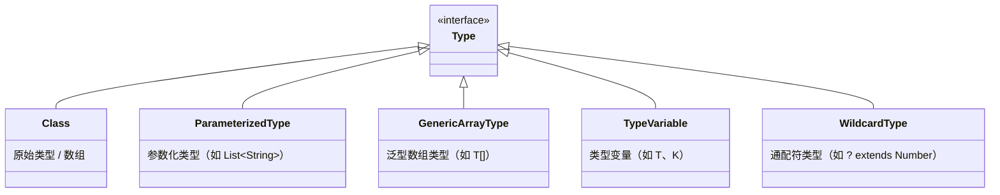
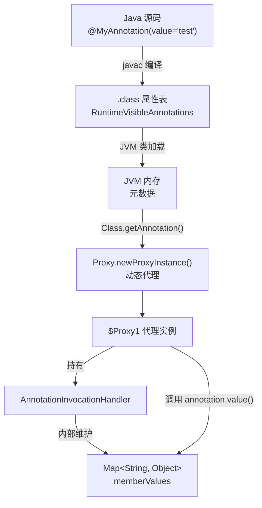
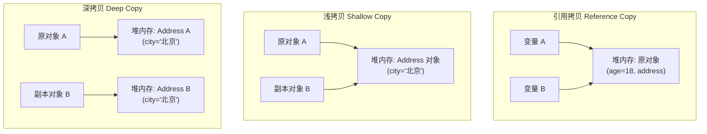

## 枚举

**枚举（Enum，全称 Enumeration）** 是 Java 5 引入的一种特殊引用类型，专门用于定义一组**固定的、有限的常量集合**（如业务状态码、支付渠道、星期、环境配置等）。相比传统的 `public static final` 常量类，枚举具备**编译期强类型安全、全局唯一单例性、面向对象完备性（支持字段、方法、接口与策略模式）**，是《Effective Java》极为推崇的最佳实践。

---

### 一、枚举的核心概念与基础语法

#### 1. 为什么需要枚举？（对比传统常量）
在 Java 5 之前，定义常量通常采用接口常量或静态常量类：
```java
// 传统常量定义（不推荐）
public class OrderStatusConstant {
    public static final int UNPAID = 1;
    public static final int PAID = 2;
    public static final int CANCELLED = 3;
}
```
**传统常量的致命缺陷**：
1. **类型不安全**：方法参数为 `int status` 时，调用方可以随意传入 `999` 等非法值，编译期无法拦截，必须在运行期手写大量校验防御代码。
2. **缺乏命名空间与自描述性**：在调试或日志中只能打印数字 `1` 或 `2`，缺乏易读性，且同名常量容易发生冲突。
3. **无法绑定扩展属性与行为**：状态通常需要配套中文描述（如“待支付”）、前置条件判断等，传统常量必须外挂 `Map` 或冗长的 `switch-case` 进行映射转换。

**枚举的优势对比矩阵**：

| 维度 | 传统常量（`public static final`） | 枚举类（`enum`） |
| :--- | :--- | :--- |
| **类型安全** | ❌ 弱（容易传入越界数值） | ✅ 强（编译期严格校验类型） |
| **唯一单例** | ❌ 仅为字面量数值 | ✅ JVM 保证每个常量对象全局唯一 |
| **自描述能力** | ❌ 仅有数字或字符串 | ✅ 可绑定描述、业务编码、附加属性 |
| **行为扩展** | ❌ 无法定义方法 | ✅ 支持普通方法、抽象方法、实现接口 |
| **集合与映射** | ❌ 依靠通用 `HashSet` / `HashMap` | ✅ 专用高性能 `EnumSet` / `EnumMap`（位图与纯数组） |

#### 2. 枚举的基本语法与使用形态

##### (1) 最简常量枚举
仅用于定义一组固定常量，是最基础的形态：
```java
public enum Season {
    // 枚举常量必须置于枚举类首行，多个常量逗号分隔，分号可选（无后续代码时可省略）
    SPRING, SUMMER, AUTUMN, WINTER
}
```

##### (2) 携带属性与构造器的业务枚举（企业级标配）
枚举支持定义成员变量和构造方法。**枚举的构造器强制为 private**（省略修饰符时也是 private），外部无法通过 `new` 实例化：
```java
public enum PayChannel {
    // 1. 常量定义（调用构造函数初始化）
    ALI_PAY("ALI_PAY", 101, "支付宝支付"),
    WECHAT_PAY("WECHAT_PAY", 102, "微信支付"),
    UNION_PAY("UNION_PAY", 103, "银联云闪付");

    // 2. 业务属性（建议声明为 private final，保证不可变性）
    private final String code;
    private final int id;
    private final String description;

    // 3. 私有构造器（禁止外部 new）
    PayChannel(String code, int id, String description) {
        this.code = code;
        this.id = id;
        this.description = description;
    }

    // 4. Getter 方法（枚举属性通常不提供 Setter）
    public String getCode() { return code; }
    public int getId() { return id; }
    public String getDescription() { return description; }

    @Override
    public String toString() {
        return String.format("[%s(%d): %s]", code, id, description);
    }
}
```

##### (3) 具备行为的枚举与策略模式（抽象方法）
枚举常量不仅是数据，还可以拥有行为。通过定义抽象方法，每个枚举常量各自提供具体实现，优雅地消除臃肿的 `if-else` 或 `switch` 逻辑：
```java
public enum CalculatorOperation {
    PLUS("+") {
        @Override
        public double apply(double x, double y) {
            return x + y;
        }
    },
    MINUS("-") {
        @Override
        public double apply(double x, double y) {
            return x - y;
        }
    },
    MULTIPLY("*") {
        @Override
        public double apply(double x, double y) {
            return x * y;
        }
    },
    DIVIDE("/") {
        @Override
        public double apply(double x, double y) {
            if (y == 0) {
                throw new ArithmeticException("除数不能为0");
            }
            return x / y;
        }
    };

    private final String symbol;

    CalculatorOperation(String symbol) {
        this.symbol = symbol;
    }

    public String getSymbol() { return symbol; }

    // 抽象方法：由每个枚举常量各自实现对应的运算策略
    public abstract double apply(double x, double y);
}
```

#### 3. 枚举内置的核心 API
所有枚举类都隐式继承自 `java.lang.Enum`，天然具备以下核心方法：

| API 方法 | 返回类型 | 功能说明 | 避坑提醒 |
| :--- | :--- | :--- | :--- |
| `name()` | `String` | 返回枚举常量的声明名称（如 `"SPRING"`） | `final` 修饰，不能被重写。 |
| `ordinal()` | `int` | 返回枚举常量在定义时的序数（从 0 开始） | ⚠️ **严禁用于业务存储或数据传输**，修改声明顺序会导致值发生变化！ |
| `toString()` | `String` | 默认返回 `name`，但允许被重写 | 适合重写为用户友好的展示文本。 |
| `compareTo(E o)` | `int` | 根据定义时的 `ordinal` 进行比较 | 自然排序顺序，实现了 `Comparable<E>`。 |
| `values()` | `E[]` | **静态合成方法**，返回所有枚举常量的数组 | 底层通过克隆内部数组返回，高频循环中建议避免反复调用。 |
| `valueOf(String name)` | `E` | **静态合成方法**，按名称精准查找常量 | 大小写敏感；若名称不存在则抛出 `IllegalArgumentException`。 |

---

### 二、枚举底层实现与反编译深度剖析

#### 1. 语法糖解密：编译后的真实 Class 结构
枚举并不是 JVM 原生支持的底层基础类型，而是 Java 语言层面的一层**语法糖**。  
假设我们定义如下简单的枚举类：
```java
public enum Season {
    SPRING, SUMMER, AUTUMN, WINTER
}
```
通过 `javac Season.java` 编译后，使用 `javap -v -p Season.class` 反编译其字节码，可以得到其真实的类定义结构：

```java
// 1. 编译器自动添加 final 修饰，并隐式继承 java.lang.Enum<Season>
public final class Season extends java.lang.Enum<Season> {

    // 2. 每一个枚举常量，本质都是 public static final 的当前类实例
    public static final Season SPRING;
    public static final Season SUMMER;
    public static final Season AUTUMN;
    public static final Season WINTER;

    // 3. 内部维护一个私有的静态常量数组，保存所有枚举实例
    private static final Season[] $VALUES;

    // 4. 静态代码块：负责在类加载初始化阶段实例化所有枚举常量
    static {
        SPRING = new Season("SPRING", 0);
        SUMMER = new Season("SUMMER", 1);
        AUTUMN = new Season("AUTUMN", 2);
        WINTER = new Season("WINTER", 3);
        $VALUES = new Season[]{ SPRING, SUMMER, AUTUMN, WINTER };
    }

    // 5. 私有构造器：隐式追加 (String name, int ordinal) 两个形参，并调用 super(name, ordinal)
    private Season(String name, int ordinal) {
        super(name, ordinal);
    }

    // 6. 编译器自动合成的 values() 方法：返回 $VALUES 数组的克隆副本
    public static Season[] values() {
        return (Season[]) $VALUES.clone();
    }

    // 7. 编译器自动合成的 valueOf() 方法：委派给 Enum.valueOf()
    public static Season valueOf(String name) {
        return (Season) java.lang.Enum.valueOf(Season.class, name);
    }
}
```

#### 2. 底层三大核心规则推导
从反编译结果可以明确以下底层原理：
1. **为什么枚举类不能被继承？**  
   因为编译器自动加上了 `final` 修饰符（`public final class Season`），从语法到字节码均封死继承。
2. **为什么枚举类不能显式继承其他类？**  
   因为 Java 仅支持单继承，而所有枚举已隐式继承自 `java.lang.Enum`。但**枚举可以实现任意多个接口**。
3. **为什么枚举常量天然是线程安全的？**  
   所有枚举常量都是 `static` 字段，并在 `<clinit>` 静态初始化块中完成对象创建。JVM 规范在类加载机制中严格保证了 `<clinit>` 方法由 JVM 的 Class 初始化锁同步执行，在多线程并发环境下仅会被初始化一次，天然保证了线程安全性。

---

### 三、枚举单例为什么是“最强单例”？（面试绝对重点）

《Effective Java》作者 Joshua Bloch 明确提出：
> “**单元素的枚举类型已经成为实现 Singleton 的最佳方法。**”

相比传统的饿汉式、双重校验锁（DCL）和静态内部类单例，枚举单例具有**无法被反射攻破、无法被序列化破坏、无法被克隆篡改、天然线程安全**的绝对优势。

#### 1. 枚举单例的标准代码实现
```java
public enum GlobalCacheManager {
    INSTANCE; // 唯一单例

    // 单例持有的业务资源
    private final ConcurrentHashMap<String, Object> cache = new ConcurrentHashMap<>();

    public void put(String key, Object value) {
        cache.put(key, value);
    }

    public Object get(String key) {
        return cache.get(key);
    }
}

// 业务调用
GlobalCacheManager.INSTANCE.put("token", "xyz");
```

#### 2. 为什么反射攻破不了枚举单例？
在普通单例中，即便把构造器设为 `private`，黑客或攻击代码依然可以通过反射强行突破：
```java
// 普通单例可以被暴力反射破解
Constructor<NormalSingleton> constructor = NormalSingleton.class.getDeclaredConstructor();
constructor.setAccessible(true);
NormalSingleton instance2 = constructor.newInstance(); // 成功创建出第二个实例！
```

**但对于枚举单例，反射机制从根源上予以彻底拦截**：
1. **构造器形参拦截**：枚举构造器在底层必须包含 `(String.class, int.class)`。如果使用 `getDeclaredConstructor()` 查找无参构造，会直接抛出 `NoSuchMethodException`。
2. **JVM 源码硬编码禁止**：即使通过 `getDeclaredConstructor(String.class, int.class)` 找到了构造器并设置 `setAccessible(true)`，在调用 `constructor.newInstance(...)` 时，JDK 底层源码（`java.lang.reflect.Constructor#newInstance`）执行了如下硬核检查：
   ```java
   // JDK 源码 Constructor.java
   if ((clazz.getModifiers() & Modifier.ENUM) != 0)
       throw new IllegalArgumentException("Cannot reflectively create enum objects");
   ```
   **结论**：只要目标类的修饰符带有 `Modifier.ENUM`，JVM 反射 API 会无条件抛出 `IllegalArgumentException`，任何反射实例化尝试都会以报错告终。

#### 3. 为什么序列化绝对破坏不了枚举单例？
普通单例类如果实现了 `Serializable` 接口，在反序列化时会将流中的数据直接恢复为一个**全新创建的对象**，破坏单例唯一性（除非手动在类中编写复杂的 `readResolve()` 方法）。

**而 JVM 规范为枚举定制了专门的序列化协议（`TC_ENUM`）**：
1. **序列化阶段（`ObjectOutputStream#writeEnum`）**：JVM 仅将枚举常量的**名称（`name`）**输出到序列化流中，常量中包含的其他字段属性完全不被写入。
2. **反序列化阶段（`ObjectInputStream#readEnum`）**：JVM 从输入流中读取到枚举常量的名称字符串后，直接调用静态方法：
   ```java
   Enum.valueOf(enumType, name);
   ```
   通过类对象和名称查表，直接从内存中返回已经存在的静态常量单例对象，**绝不通过反射或构造器创建任何新实例**。

#### 4. 为什么克隆无法破坏枚举单例？
在基类 `java.lang.Enum` 中，`clone()` 方法被显式定义为 `final` 且无条件抛出异常：
```java
// java.lang.Enum 源码
protected final Object clone() throws CloneNotSupportedException {
    throw new CloneNotSupportedException();
}
```
子类无法重写该方法，外部调用直接报错，杜绝了克隆漏洞。

#### 5. 四种主流单例模式全方位对比矩阵

| 单例实现方式 | 线程安全 | 延迟加载（Lazy） | 防止反射攻击 | 防止反序列化破坏 | 代码复杂度 | 综合推荐度 |
| :--- | :---: | :---: | :---: | :---: | :---: | :---: |
| **标准饿汉式** | ✅ 是 | ❌ 否 | ❌ 否 | ❌ 需 readResolve | 极简 | ⭐⭐⭐ |
| **双重校验锁（DCL）** | ✅ 是（需 volatile） | ✅ 是 | ❌ 否 | ❌ 需 readResolve | 复杂 | ⭐⭐⭐⭐ |
| **静态内部类** | ✅ 是 | ✅ 是 | ❌ 否 | ❌ 需 readResolve | 简单 | ⭐⭐⭐⭐ |
| **枚举单例（Enum）** | ✅ **天然是** | ❌ 否（类加载） | ✅ **JDK 源码防死** | ✅ **天然防死** | **极简** | ⭐⭐⭐⭐⭐ **（首选）** |

---

### 四、枚举专用高性能集合：EnumSet 与 EnumMap

在日常开发中，若集合或映射的 Key 均为枚举类型，使用通用的 `HashSet` 或 `HashMap` 会带来不必要的哈希计算、散列冲突以及哈希桶包装对象开销。JDK 提供了两个基于**位图与纯数组**的高性能专用容器：

#### 1. EnumSet：基于位向量（Bit Vector）的极速集合
`EnumSet` 是一个专为枚举设计的 `Set` 实现，内部元素顺序等于枚举定义的 `ordinal` 顺序。

##### 底层实现原理
- **`RegularEnumSet`（元素个数 $\le 64$）**：
  - 内部仅使用**一个 `long` 类型的基本变量 `elements`**（64 位整数）作为位图（Bitmask）。
  - 每个位（Bit）的 `1` 或 `0` 对应某个枚举常量的存在与否。
  - 添加（`|`）、删除（`& ~`）、包含判断（`&`）全部转化为 CPU 单条位运算指令完成，时间复杂度为纯粹的 $O(1)$，内存开销极其微小。
- **`JumboEnumSet`（元素个数 $> 64$）**：
  - 底层使用 `long[] elements` 数组，通过分段位图支持大规模枚举集合。

##### 常用 API 与示例
```java
// 1. 创建包含所有工作日的集合
EnumSet<Weekday> workDays = EnumSet.range(Weekday.MONDAY, Weekday.FRIDAY);

// 2. 创建空集合与指定元素集合
EnumSet<Weekday> weekend = EnumSet.of(Weekday.SATURDAY, Weekday.SUNDAY);

// 3. 补集运算
EnumSet<Weekday> restDays = EnumSet.complementOf(workDays);
```

#### 2. EnumMap：基于连续数组的高速映射
`EnumMap` 是一个专为枚举键设计的 `Map` 实现。

##### 底层实现原理
- 内部**完全没有哈希表、哈希碰撞、链表或红黑树**！
- 底层仅使用一个普通数组 `Object[] vals`，数组下标直接对应枚举的 `ordinal()`。
- `get()` 和 `put()` 操作本质上就是根据 `key.ordinal()` 直接进行**数组寻址**，效率和内存紧凑度远超普通 `HashMap`。

##### 示例代码
```java
// 统计每周任务数量
EnumMap<Weekday, List<String>> taskMap = new EnumMap<>(Weekday.class);
taskMap.put(Weekday.MONDAY, Arrays.asList("需求评审", "代码排期"));
taskMap.put(Weekday.FRIDAY, Collections.singletonList("发布上线"));

List<String> fridayTasks = taskMap.get(Weekday.FRIDAY);
```

---

### 五、企业级实战规范与避坑指南

#### 1. 规范一：严禁使用 `ordinal()` 存入数据库或跨服务传输
- **反例**：直接将 `orderStatus.ordinal()` 保存到数据库字段 `status` 中。
- **隐患**：随着业务迭代，若开发者在枚举中间插入新状态或调整了常量排列顺序，`ordinal()` 就会发生错位，导致历史业务数据发生毁灭性错乱。
- **正例**：显式声明业务唯一的 `code` 字段（如 `1001`、`2001` 或语义字符串 `"UNPAID"`），持久化只认 `code`。

#### 2. 规范二：静态 Map 索引缓存，避免高频调用 `values()`
- **隐患**：`MyEnum.values()` 每次调用都会由 JVM 克隆生成一份新的数组对象（`$VALUES.clone()`）。在每秒上万次的高并发反查接口中，频繁调用 `values()` 遍历会导致新生代大量产生瞬时数组对象，触发高频 Minor GC。
- **最佳实践（静态 Map 预热反查）**：
```java
public enum OrderStatus {
    INIT(1, "初始下单"),
    PAID(2, "已支付"),
    FINISHED(3, "已完成");

    private final int code;
    private final String desc;

    // 静态缓存 Map，系统启动时只构建一次
    private static final Map<Integer, OrderStatus> CODE_MAP = new HashMap<>();

    static {
        for (OrderStatus status : OrderStatus.values()) {
            CODE_MAP.put(status.getCode(), status);
        }
    }

    OrderStatus(int code, String desc) {
        this.code = code;
        this.desc = desc;
    }

    public int getCode() { return code; }
    public String getDesc() { return desc; }

    // O(1) 查表反查，零额外对象分配
    public static OrderStatus getByCode(Integer code) {
        return code == null ? null : CODE_MAP.get(code);
    }
}
```

#### 3. 规范三：Spring / Jackson / MyBatis 整合反序列化最佳实践
在前后端交互中，前端通常传递 `code: 2`，如何自动映射到 `OrderStatus.PAID`？

##### (1) Jackson 序列化与反序列化（Spring MVC 接口出入参）
- **`@JsonValue`**：标注在属性或 Getter 上，告诉 Jackson 序列化时将该字段作为 JSON 输出（如输出 `2` 或 `"PAID"`）。
- **`@JsonCreator`**：标注在静态工厂方法上，定义由前端传入的参数反查枚举的规则。

```java
public enum ResultCode {
    SUCCESS(200, "成功"),
    ERROR(500, "系统异常");

    private final int code;
    private final String message;

    ResultCode(int code, String message) {
        this.code = code;
        this.message = message;
    }

    @JsonValue // 序列化时，只输出数字 code，如 200
    public int getCode() {
        return code;
    }

    @JsonCreator // 反序列化时，根据传入的数字反查枚举
    public static ResultCode fromCode(int code) {
        for (ResultCode item : values()) {
            if (item.code == code) return item;
        }
        return ERROR;
    }
}
```

##### (2) MyBatis / MyBatis-Plus 持久化集成
- MyBatis 默认提供 `EnumTypeHandler`（基于 `name`）和 `EnumOrdinalTypeHandler`（基于 `ordinal`）。
- 在 MyBatis-Plus 中，只需在枚举的 `code` 属性上添加 **`@EnumValue`** 注解，框架会自动完成数据库与实体类枚举的双向映射。

---

### 六、高频面试核心追问与秒杀精答

#### Q1：枚举类可以继承其他类吗？可以实现接口吗？
> **参考回答**：  
> **不可以继承其他类，但可以实现多个接口**。  
> **原因**：通过 `javap` 反编译可知，所有 `enum` 类在编译后都会由编译器自动添加 `final` 关键字，并且默认隐式继承自 `java.lang.Enum<E>`。由于 Java 语言不支持多重类继承，因此枚举类无法再显式继承其他类；但 Java 支持多接口实现，因此枚举可以实现一个或多个业务接口（如统一的 `BaseEnum`）。

#### Q2：`Enum.values()` 方法在 `java.lang.Enum` 中根本找不到，它是怎么来的？
> **参考回答**：  
> `values()` 方法不是从父类 `java.lang.Enum` 继承而来的，而是由 **Java 编译器在编译阶段根据当前枚举类定义的常量列表自动合成（Synthetic）的静态方法**。  
> 它的底层实现为调用内部静态常量数组的克隆方法：`$VALUES.clone()`，从而保证返回的数组副本不会被外部调用方修改内部常量引用。

#### Q3：枚举可以用在 `switch` 语句中吗？底层原理是什么？
> **参考回答**：  
> **可以**（Java 5+ 即支持）。  
> **底层原理**：JVM 字节码的 `switch` 指令只支持整型（`int`、`short`、`byte`、`char`）。编译器在处理枚举的 `switch` 时，会在后台自动生成一个合成内部类（Synthetic Inner Class），该类中维护了一个基于 `ordinal` 映射的 `int[]` 查找表。`switch` 实际上比较的是枚举常量的 `ordinal()` 数值，最后通过字节码的 `tableswitch` 或 `lookupswitch` 指令实现跳转。

#### Q4：为什么单例模式推荐使用枚举实现？
> **参考回答**：  
> 主要有四大维度的核心优势：
> 1. **线程安全**：枚举常量为 `public static final` 静态字段，在类加载初始化 `<clinit>` 阶段由 JVM 锁同步创建，天然线程安全。
> 2. **防御反射攻击**：JDK `Constructor.newInstance()` 源码硬编码拦截了 `Modifier.ENUM`，反射创建枚举对象直接抛出 `IllegalArgumentException`。
> 3. **防御反序列化破坏**：JVM 制定了专用枚举序列化协议（`TC_ENUM`），反序列化仅根据名称调用 `Enum.valueOf()` 查表取对象，不创建新实例。
> 4. **防御克隆**：`Enum` 父类将 `clone()` 声明为 `final` 并无条件抛出 `CloneNotSupportedException`，子类无法克隆。

---

### 七、高频考点速记口诀

```text
enum 本质 final 类，隐式继承 Enum 规；
实例 static final 固，类加载时线程对；
values() 编译合成器，clone 数组防篡位；
反射硬拦 Modifier，序列化走 name 回；
克隆 final 抛异常，单例首选用枚举；
业务严禁存 ordinal，自定义 code 走天下！
```

## 泛型

**泛型（Generics，即参数化类型 Parameterized Type）** 是 Java 5 引入的核心语法特性，允许在定义类、接口和方法时将“数据类型”本身作为参数传入。泛型的核心价值在于：**将运行期的 `ClassCastException` 隐患提前暴露在编译期、消除繁琐低效的手工强制类型转换、提供高度通用可复用的类型安全组件**。

---

### 一、泛型核心概念与基础语法体系

#### 1. 为什么需要泛型？（对比传统无泛型时代）
在 Java 5 之前，所有集合和通用容器只能使用万能的 `Object`：
```java
// Java 1.4 传统写法（类型不安全）
List list = new ArrayList();
list.add("Hello");
list.add(100); // 编译通过，允许存入任何对象

// 读取时必须强转
String str = (String) list.get(1); // 运行时抛出 ClassCastException: Integer cannot be cast to String
```

**泛型引入后的优势对比**：

| 维度 | 传统无泛型（`Object`） | 泛型机制（`List<String>`） |
| :--- | :--- | :--- |
| **类型安全** | ❌ 弱（任何对象都能塞入，编译期不报错） | ✅ **强**（编译期严格做类型检查，杜绝非法类型） |
| **类型转换** | ❌ 读出时必须强制类型转换（繁琐易错） | ✅ **免强转**（编译器自动插入转换，代码干净优雅） |
| **异常暴露节点** | ❌ 运行期爆发 `ClassCastException` 崩溃 | ✅ **编译期暴露**，消灭隐患于开发阶段 |
| **代码复用率** | ❌ 针对不同类型需编写多份相似逻辑 | ✅ **一套通用模板**适配千百种业务数据类型 |

#### 2. 泛型的三大基础语法形态

##### (1) 泛型类（Generic Class）
在类名后使用 `<T>` 声明类型形参，实例化时由调用方指定具体类型：
```java
// 泛型容器类
public class Container<T> {
    private T data;

    public Container() {}
    public Container(T data) { this.data = data; }

    public T getData() { return data; }
    public void setData(T data) { this.data = data; }
}

// 实例化：钻石操作符 <> 自动推断类型
Container<String> stringBox = new Container<>("文本数据");
Container<Integer> intBox = new Container<>(1024);
```

##### (2) 泛型接口（Generic Interface）
在接口名后声明泛型，子类实现该接口时有两种选择：
```java
public interface GenericService<T> {
    T getById(Long id);
    void save(T entity);
}

// 选型 1：实现类继续保留泛型，由外部实例化决定类型
public class GenericServiceImpl<T> implements GenericService<T> {
    @Override
    public T getById(Long id) { return null; }
    @Override
    public void save(T entity) {}
}

// 选型 2：实现类直接明确绑定具体实体类型（企业级最常用）
public class UserServiceImpl implements GenericService<User> {
    @Override
    public User getById(Long id) { return new User(); }
    @Override
    public void save(User entity) {}
}
```

##### (3) 泛型方法（Generic Method）
在方法的修饰符与返回值之间声明 `<T>`。**泛型方法与泛型类完全解耦，普通非泛型类中同样可以定义泛型方法**：
```java
public class ArrayUtils {

    // 泛型方法：返回值前的 <T> 声明该方法独立拥有的类型参数
    public static <T> void swap(T[] array, int i, int j) {
        T temp = array[i];
        array[i] = array[j];
        array[j] = temp;
    }
}
```
> ⚠️ **关键规则（面试必问）**：  
> **静态方法无法使用宿主类声明的泛型形参！** 因为静态方法随类加载而存在，而类泛型只有在创建具体对象实例时才绑定。因此，**静态方法若需使用泛型，必须自行声明为泛型方法**（如 `public static <E> E test(E val)`）。

#### 3. 泛型命名规范约定
Java 官方规范推荐使用单个大写字母命名泛型形参，提升代码可读性：
- **`E`**：Element（用于集合元素，如 `List<E>`、`Set<E>`）；
- **`T`**：Type（通用的 Java 类类型）；
- **`K`**、**`V`**：Key / Value（键值对类型，如 `Map<K, V>`）；
- **`N`**：Number（数值类型）；
- **`R`**：Return（方法返回值类型，如 `Function<T, R>`）。

#### 4. 泛型边界限定（Bounded Type Parameters）
当需要限定泛型只能是某些特定类型及其子类时，可使用边界限定：
- **单一上边界**：`<T extends Number>`（限制 T 必须是 `Number` 及其子类，如 `Integer`、`Double`）；
- **多重上边界（Multiple Bounds）**：`<T extends Comparable<T> & Serializable>`  
  - 多个边界使用 `&` 连接；
  - **类必须写在最前面，接口写在后面**（由于 Java 单继承机制，最多只能有一个类边界）。

---

### 二、泛型通配符与 PECS 原则（重中之重）

#### 1. 泛型的不变性（Invariance）痛点
在 Java 中，数组是**协变的（Covariant）**：`Integer` 是 `Number` 的子类，那么 `Integer[]` 就是 `Number[]` 的子类。
但**泛型是不变的（Invariant）**：
```java
Number[] numbers = new Integer[10]; // 编译合法（数组协变，但运行期可能发生 ArrayStoreException）

List<Number> list = new ArrayList<Integer>(); // ❌ 编译报错！类型不兼容！
```
**为什么 `List<Integer>` 不是 `List<Number>` 的子类？**  
假设允许这样赋值，通过 `list.add(3.14)` 存入一个 `Double`（`Double` 是 `Number` 的子类），那么原本声明只存整数的 `ArrayList<Integer>` 内存中就会混入浮点数，直接破坏了类型安全。为了在保证类型安全的同时实现多态容器传参，Java 引入了**通配符（Wildcard `?`）**。

#### 2. 三大通配符全解

##### (1) 无界通配符 `<?>`（Unbounded Wildcard）
- **语义**：代表“任意未知类型”。
- **读写规则**：
  - **读**：只能读出 `Object`，因为不管底层是什么类型，必然都是 `Object` 的子类。
  - **写**：**除了 `null` 之外，严禁写入任何对象**（编译器无法预知底层真实容器类型，为防污染直接禁止写入）。
- **适用场景**：只依赖 `Object` 基础方法（如 `size()`、`clear()`）或单纯遍历打印的场景。

##### (2) 上界通配符 `<? extends T>`（协变，Covariance）
- **语义**：代表“类型是 T 或 T 的某个未知子类”。
- **读写规则**：
  - **读（支持）**：可以安全读取为 `T` 类型的对象（因为所有子类对象都可以向上转型为基类 `T`）。
  - **写（禁止）**：**除了 `null` 之外，严禁写入任何数据**。虽然你知道它是 T 的子类，但编译器不知道它具体是哪一个子类（可能是 `Apple` 也可能是 `Banana`），因此禁止存入。

##### (3) 下界通配符 `<? super T>`（逆变，Contravariance）
- **语义**：代表“类型是 T 或 T 的某个未知父类”。
- **读写规则**：
  - **写（支持）**：可以安全写入 `T` 及其所有子类对象（因为任何 `T` 或 `T` 的子类对象都可以赋给未知父类的引用）。
  - **读（受限）**：读取出来的对象类型只能退化为最顶层的 `Object`，无法直接转型为 `T`。

#### 3. PECS 黄金法则深度推导（大厂必考）
> **PECS 原则**：**Producer Extends, Consumer Super**  
> - **Producer（生产者 / 提供数据）**：如果你的方法需要从集合中**读取数据供外部使用**，使用 `<? extends T>`。
> - **Consumer（消费者 / 吸收数据）**：如果你的方法需要向集合中**写入数据**，使用 `<? super T>`。
> - **既要读又要写**：不要使用通配符，使用确定的类型 `<T>`。

#### 4. JDK 源码经典范式：`Collections.copy`
JDK 标准库中的集合拷贝方法是 PECS 原则的教科书级典范：
```java
// JDK java.util.Collections 源码
public static <T> void copy(List<? super T> dest, List<? extends T> src) {
    int srcSize = src.size();
    if (srcSize > dest.size())
        throw new IndexOutOfBoundsException("Source does not fit in dest");

    for (int i = 0; i < srcSize; i++) {
        // 从 src 读出数据（src 是生产者，使用 extends）
        T element = src.get(i);
        // 写入到 dest（dest 是消费者，使用 super）
        dest.set(i, element);
    }
}
```

#### 5. 经典复合通配符签名解密：`<T extends Comparable<? super T>>`
在 `Collections.sort` 或 `max()` 方法中经常出现如下令人费解的签名：
```java
public static <T extends Comparable<? super T>> T max(Collection<? extends T> coll)
```
**设计意图解析**：
- 如果写成 `<T extends Comparable<T>>`：要求类 `T` 自身必须实现 `Comparable<T>`。
- 但假设父类 `Animal` 实现了 `Comparable<Animal>`，子类 `Dog extends Animal` 没有单独实现 `Comparable<Dog>`，而是复用了父类的比较规则。
- 如果没有 `? super T`，`Dog` 无法传入 `max()`；而加上 `? super T` 后，`Dog` 可以基于父类 `Comparable<Animal>` 进行比较，大幅提升了继承体系下的兼容性。

#### 6. 类型参数 `<T>` 与通配符 `?` 的区别对比

| 对比维度 | 类型形参 `<T>` | 通配符 `<?>` |
| :--- | :--- | :--- |
| **本质定位** | 声明一个具体的、确定的类型占位符 | 表示某种未知类型的引用修饰 |
| **定义位置** | 只能在类、接口名后或方法修饰符后声明 | 只能修饰变量、方法形参或返回值的泛型实参 |
| **支持下界？** | ❌ **不支持 `super`**（不存在 `<T super Number>`） | ✅ **支持** `<? super Number>` |
| **支持多重边界？**| ✅ 支持 `<T extends A & B>` | ❌ 不支持多重边界 |
| **读写灵活性** | ✅ 可读可写（确定类型） | ⚠️ 根据 PECS 原则严格受限 |

---

### 三、泛型底层本质与类型擦除（Type Erasure）深水区

#### 1. 伪泛型本质与历史背景
Java 语言的泛型实现属于**编译期伪泛型（Compile-time Generics）**：
- **C++ 模板**：是真泛型（代码膨胀技术）。编译时遇到 `vector<int>` 和 `vector<double>` 会分别生成两套独立的目标二进制代码，运行时完全感知真实类型。
- **C# 泛型**：CLR 虚拟机在运行时原生支持泛型，类型信息在运行时真实存在。
- **Java 为什么选择“类型擦除”？**  
  Java 5 于 2004 年发布，彼时已有海量基于 Java 1.4（无泛型）编写的企业代码和 Jar 包。为了保证**绝对的二进制向后兼容性（Binary Backward Compatibility）**，Java 采用类型擦除：新编译出的包含泛型的 `.class` 文件可以无缝运行在无泛型的老版本类库中，无需改动 JVM 底层指令集架构。

#### 2. 类型擦除三大规则
`javac` 编译完成生成 `.class` 字节码文件后，**所有泛型形参信息都会被剥除**：
1. **类型形参替换为原始类型（Raw Type）**：
   - 若泛型无界（如 `<T>`），擦除后统一替换为 **`Object`**；
   - 若泛型有界（如 `<T extends Number>`），擦除后统一替换为它的**第一个上边界类型**（即 `Number`）。
2. **自动插入强制类型转换（Checkcast）**：
   - 源代码中调用泛型对象返回具体类型时，编译器在字节码中自动插入 `checkcast` 指令完成强转。
3. **自动生成桥接方法（Bridge Method）**：
   - 用于在发生类继承和方法重写时，维持多态特性的正确调用。

#### 3. 桥接方法（Bridge Method）底层深度剖析
假设定义泛型接口与其实现类：
```java
public interface Node<T> {
    void setData(T data);
}

public class StringNode implements Node<String> {
    @Override
    public void setData(String data) {
        System.out.println("StringNode: " + data);
    }
}
```
**擦除后的矛盾**：
- 接口 `Node<T>` 擦除后变成 `void setData(Object data)`；
- 子类 `StringNode` 中手写的方法是 `void setData(String data)`；
- 此时参数类型不同，子类的方法根本**没有重写父接口的方法**，多态将彻底失效！

**编译器的解决之道（生成桥接方法）**：  
通过 `javap -p -v StringNode.class` 查看反编译字节码，会发现编译器在子类中自动合成了一个桥接方法：
```java
// 编译器自动生成的桥接方法（ACC_BRIDGE, ACC_SYNTHETIC）
public void setData(Object data) {
    // 内部强转后委派调用开发者手写的实际方法
    this.setData((String) data);
}
```
这样外部通过多态调用 `Node n = new StringNode(); n.setData("test");` 时，底层进入桥接方法，再安全分发给真实的 `setData(String)`。

---

### 四、类型擦除带来的经典底层限制与破局方案

类型擦除让 Java 拥有了优秀的兼容性，但也带来了 6 个经典语法限制，是面试官深挖底层的高频阵地：

#### 1. 限制一：不能 `new T()`
- **原因**：运行时 `T` 已经被擦除为 `Object`，JVM 根本不知道具体要分配多大的内存和调用哪个构造函数。
- **破局方案**：
  1. **反射传递 Class 对象**：
     ```java
     public <T> T createInstance(Class<T> clazz) throws Exception {
         return clazz.getDeclaredConstructor().newInstance();
     }
     ```
  2. **函数式接口传递工厂（推荐，性能高且零反射）**：
     ```java
     public <T> T createInstance(Supplier<T> factory) {
         return factory.get();
     }
     // 使用方式：createInstance(User::new);
     ```

#### 2. 限制二：不能直接创建泛型数组（如 `new T[10]` 或 `new List<String>[10]`）
- **原因（防止堆污染 Heap Pollution）**：
  - Java 数组在运行时是**类型安全（Reifiable）且协变的**：`Object[] arr = new String[10]; arr[0] = 123;` 在运行时会立即报 `ArrayStoreException`。
  - 但泛型在运行时**类型被擦除了**。如果允许创建 `List<String>[] arr = new List<String>[10]`，将其向上赋值给 `Object[] objArr = arr` 后，向 `objArr[0]` 存入一个 `List<Integer>`，数组在运行时无法察觉该非法类型。后续当读取 `arr[0].get(0)` 时，就会在毫无预警的情况下抛出 `ClassCastException`。
- **破局方案**：
  1. **反射创建确定类型的数组**：
     ```java
     @SuppressWarnings("unchecked")
     T[] array = (T[]) Array.newInstance(clazz, size);
     ```
  2. **强制类型转换 Object 数组（如 ArrayList 底层实现）**：
     ```java
     @SuppressWarnings("unchecked")
     T[] array = (T[]) new Object[size];
     ```

#### 3. 限制三：静态属性与静态方法不能使用类声明的泛型
- **原因**：静态属性和方法属于类本身，在类加载时就完成内存分配和初始化；而类泛型参数必须等到创建具体对象实例（`new MyClass<String>()`）时才能确定。
- **破局方案**：静态方法若需泛型，必须自行声明泛型形参：
  ```java
  public class Helper<T> {
      // 错误：private static T instance; // 编译报错
      // 正确：静态方法自声明独立的泛型形参 <K>
      public static <K> void doSomething(K key) { ... }
  }
  ```

#### 4. 限制四：不能使用基本数据类型实例化泛型（如 `List<int>`）
- **原因**：类型擦除后泛型替换为 `Object`，而 `int`、`double` 等 8 种基本数据类型并非 `Object` 的子类。
- **破局方案**：使用对应的包装类 `List<Integer>`，或在对内存与 GC 极致苛求的高频数值场景下，使用开源高性能基元集合库（如 Eclipse Collections、fastutil、Trove）。

#### 5. 限制五：不能对具体泛型类型使用 `instanceof`
- **原因**：运行时所有 `List<String>`、`List<Integer>` 的对象类型均为 `List`，无法判断元素类型。
- **表现**：`if (obj instanceof List<String>)` 编译直接报错。
- **正确用法**：只能通过无界通配符判断外层容器类型：`if (obj instanceof List<?>)`。

#### 6. 限制六：重载冲突陷阱
- **表现**：
  ```java
  public void print(List<String> list) {}
  public void print(List<Integer> list) {} // ❌ 编译报错：'print(List)' clashes with 'print(List)'
  ```
- **原因**：类型擦除后，两个方法的签名都变成了 `print(List)`，在字节码层面构成了重复方法定义。

---

### 五、如何突破类型擦除获取真实泛型？（反射与 Type 体系）

#### 1. 擦除之后真的彻底无影无踪了吗？（真相大白）
许多人误以为“类型擦除意味着运行时什么都拿不到了”，**这是极其片面的认知**：
- **局部变量内的泛型**：在方法内部定义的局部变量（如 `List<String> list = new ArrayList<>()`），运行期确实被彻底抹除，无法获取真实类型。
- **类结构声明中的泛型元数据完整保留**：
  - **继承的父类泛型、实现的接口泛型**；
  - **类成员变量（Field）的泛型签名**；
  - **方法形参（Method Parameter）与返回值（Return Type）的泛型签名**。
  
> 编译器在编译这些结构时，会将完整的泛型签名信息保存在 `.class` 文件的常量池与 **`Signature` 属性表**中，通过 Java 反射 API 可以完整解析出真实类型！

#### 2. Java 反射核心抽象：`java.lang.reflect.Type`
Java 5 为配合泛型反射，引入了 `Type` 顶层接口及其四大实现子类：



- **`ParameterizedType` 核心 API**：
  - `getActualTypeArguments()`：获取泛型参数实际类型的 `Type[]`（如 `Map<String, User>` 返回 `[String.class, User.class]`）；
  - `getRawType()`：获取擦除后的原始类型（如 `List<String>` 返回 `List.class`）；
  - `getOwnerType()`：获取所有者类型（内部类场景）。

#### 3. 超级令牌技术：`TypeReference` 匿名内部类机制
在 Jackson、Fastjson、Spring `RestTemplate` 中，当反序列化复杂嵌套泛型（如 `Result<List<User>>`）时，由于无法直接传 `Result<List<User>>.class`，框架均采用了 **`TypeReference`（超级类型令牌 Super Type Token）** 技术：

```java
import java.lang.reflect.ParameterizedType;
import java.lang.reflect.Type;

// 通用 TypeReference 抽象类
public abstract class TypeReference<T> {
    private final Type type;

    protected TypeReference() {
        // 核心技术点：获取当前子类的泛型父类（ParameterizedType）
        Type superClass = getClass().getGenericSuperclass();
        if (superClass instanceof ParameterizedType) {
            ParameterizedType parameterized = (ParameterizedType) superClass;
            // 提取出 T 的真实泛型类型
            this.type = parameterized.getActualTypeArguments()[0];
        } else {
            throw new IllegalArgumentException("TypeReference 必须通过匿名内部类指定具体泛型！");
        }
    }

    public Type getType() {
        return this.type;
    }
}
```

##### 实战调用范式
```java
// 关键在于结尾的 "{}"：利用匿名内部类继承 TypeReference，从而让泛型信息写入子类的 Signature 属性中
TypeReference<List<String>> typeRef = new TypeReference<List<String>>() {};

Type realType = typeRef.getType();
System.out.println("成功提取真实泛型类型: " + realType);
// 输出：java.util.List<java.lang.String>
```

---

### 六、企业级架构实战与泛型工程规范

#### 1. 企业级通用统一响应体设计（`Result<T>`）
在微服务 API 设计中，标准响应体必须具备严格的泛型保护，杜绝无类型裸调用：

```java
@Data
public class Result<T> implements Serializable {
    private int code;
    private String message;
    private T data;
    private long timestamp;

    private Result(int code, String message, T data) {
        this.code = code;
        this.message = message;
        this.data = data;
        this.timestamp = System.currentTimeMillis();
    }

    // 静态泛型工厂方法：成功响应
    public static <T> Result<T> success(T data) {
        return new Result<>(200, "操作成功", data);
    }

    // 静态泛型工厂方法：无返回数据的成功响应
    public static <T> Result<T> success() {
        return new Result<>(200, "操作成功", null);
    }

    // 静态泛型工厂方法：失败响应
    public static <T> Result<T> fail(int code, String message) {
        return new Result<>(code, message, null);
    }
}
```

#### 2. 通用泛型 BaseMapper / BaseDao 反射抽象
在手写持久层框架或封装统一 CRUD 时，通过父类反射自动获取泛型实体类 `Class<T>`：

```java
public abstract class BaseDao<T> {
    private final Class<T> entityClass;

    @SuppressWarnings("unchecked")
    public BaseDao() {
        // 反射获取当前 DAO 实现类绑定的真实实体类型 T
        Type genericSuperclass = getClass().getGenericSuperclass();
        if (genericSuperclass instanceof ParameterizedType) {
            ParameterizedType pt = (ParameterizedType) genericSuperclass;
            this.entityClass = (Class<T>) pt.getActualTypeArguments()[0];
        } else {
            throw new IllegalStateException("Dao 必须继承带有泛型的 BaseDao！");
        }
    }

    public T findById(Long id) {
        String tableName = entityClass.getSimpleName().toLowerCase();
        System.out.println("执行 SQL: SELECT * FROM " + tableName + " WHERE id = " + id);
        // ... 根据 entityClass 自动映射并实例化返回
        return null;
    }
}
```

#### 3. 阿里 Java 开发手册泛型规范精要
1. **【强制】严禁使用原生类型（Raw Type）声明集合**  
   - 反例：`List list = new ArrayList();`
   - 正例：`List<String> list = new ArrayList<>();`（避免破坏类型安全体系）。
2. **【推荐】慎用通配符作为方法返回值**  
   - 方法返回值若为 `List<?>` 或 `List<? extends T>`，会导致调用方无法写入任何数据且必须频繁强转，降低 API 易用性。
3. **【强制】在使用 `@SuppressWarnings("unchecked")` 时必须保证最小作用域**  
   - 严禁标注在整个类上，必须最小化标注在方法或具体变量声明上，并附带注释说明类型安全的理由。

---

### 七、高频面试核心追问与秒杀精答

#### Q1：Java 泛型与 C++ 模板有什么本质区别？
> **参考回答**：  
> 1. **实现机制不同**：Java 采用**类型擦除（伪泛型）**，所有泛型类在编译后仅生成一份 `.class` 字节码文件，泛型替换为 Object 或上限；而 C++ 采用**模板实例化（代码膨胀）**，编译时针对 `vector<int>` 和 `vector<double>` 会分别生成两份独立的目标代码。  
> 2. **运行时支持不同**：Java 运行时无法直接感知泛型参数类型（如无法 `new T()` 或 `instanceof`）；C++ 运行时则完全保留类型信息。  
> 3. **兼容性代价**：Java 是为了保证对 1.4 老版本代码的二进制绝对向后兼容性而牺牲了运行期类型完整性。

#### Q2：为什么 `new ArrayList<String>().getClass() == new ArrayList<Integer>().getClass()` 为 true？
> **参考回答**：  
> 因为 Java 泛型存在**类型擦除**。在编译期完成类型校验后，生成的字节码中 `ArrayList<String>` 和 `ArrayList<Integer>` 的泛型形参均被擦除为原始类型 `ArrayList`。在 JVM 类加载器看来，它们在运行期共享同一个 `ArrayList.class` 类的元数据对象，因此 `getClass()` 返回完全相同的引用。

#### Q3：什么是桥接方法（Bridge Method）？编译器为什么要生成它？
> **参考回答**：  
> 桥接方法是编译器在子类继承泛型父类/接口重写方法时**自动生成的合成方法**（带有 `ACC_BRIDGE` 和 `ACC_SYNTHETIC` 标志位）。  
> **原因**：泛型擦除后，父类方法签名被擦除为 `Object`，而子类手写的方法签名为具体类型，导致两个方法的参数类型不匹配，无法形成多态重写。为了保证多态调用的正确性，编译器在子类中自动合成了一个参数为 `Object` 的桥接方法，内部强转后再委派调用子类的具体方法。

#### Q4：PECS 原则的核心口诀是什么？何时用 extends？何时用 super？
> **参考回答**：  
> PECS 即 **Producer Extends, Consumer Super**：  
> - 当集合作为**生产者（向外部读取数据）**时，使用 `<? extends T>`（协变，只能读取 T，不能写入除 null 外的数据）；  
> - 当集合作为**消费者（吸收外部存入数据）**时，使用 `<? super T>`（逆变，只能存入 T 及其子类，读取只能拿到 Object）；  
> - 既要读取又要存入数据时，不要使用任何通配符，使用确定的类型 `<T>`。

#### Q5：如何通过反射获取一个复杂嵌套泛型对象（如 `Result<List<User>>`）的真实类型？
> **参考回答**：  
> 通过**匿名内部类 + 超级类型令牌（`TypeReference`）**技术。  
> 原理：虽然局部变量在运行期无法获取泛型，但**类的继承体系中的泛型信息会被保留在 Class 文件的 `Signature` 属性表中**。通过创建 `new TypeReference<Result<List<User>>>() {}` 匿名子类，调用 `getClass().getGenericSuperclass()` 获取 `ParameterizedType`，再通过 `getActualTypeArguments()` 即可完整提取出嵌套的真实类型。Jackson 和 Spring 均基于此原理实现复杂泛型反序列化。

---

### 八、高频考点速记口诀

```text
泛型核心参数化，编译检查强强抓；
类型擦除归边界，字节码中 checkcast 达；
PECS 法则牢记心，生产 extends 消费 super 查；
只读协变取数据，只写逆变存入它；
new T 数组皆禁止，静态必须自声明呀；
局部擦除无痕迹，继承 Signature 令牌挖！
```

## 注解

**注解（Annotation）** 是 Java 5 引入的一种元编程机制，它为程序元素（包、类、方法、字段、参数等）关联结构化元数据（Metadata）。注解本身不包含业务逻辑，不会直接改变编译后代码的执行语义，而是作为标记由**编译器、字节码分析工具、代码生成器或运行时框架（通过反射/ASM）** 进行解析处理。

---

### 一、注解的核心概念与底层本质

#### 1. 什么是注解与元数据
- **元数据（Metadata）**：即“描述数据的数据”。在 Java 中，业务代码本身是数据，而用于描述类结构、方法行为、框架配置的信息就是元数据。
- **与普通注释的区别**：
  - **注释（Comments）**：写给人看的，在词法分析阶段即被编译器忽略，不进入字节码。
  - **注解（Annotation）**：写给编译器、虚拟机或框架看的，能根据保留策略留存至编译期、字节码或运行期，可被程序读取并驱动行为。

#### 2. 注解的底层本质：语法糖与接口继承
在 Java 中，使用 `@interface` 关键字定义注解：
```java
public @interface MyAnnotation {
    String value() default "";
}
```
通过 `javac` 编译后，使用 `javap -v MyAnnotation.class` 进行反编译，可以发现其底层结构：
```text
public interface MyAnnotation extends java.lang.annotation.Annotation
```
- **核心结论**：
  1. **所有注解在底层都是继承自 `java.lang.annotation.Annotation` 的接口**。
  2. `@interface` 是 Java 提供的语法糖，不允许开发者显式编写 `class MyClass extends Annotation`。
  3. 注解中声明的每个“属性”（如 `String value()`），在底层编译后实际上都是该接口中的**抽象无参方法**。

#### 3. 运行时注解的底层实现：JVM 动态代理机制
既然注解本质上是一个接口，我们在运行时通过反射调用 `element.getAnnotation(MyAnnotation.class)` 拿到的是什么？接口是无法直接实例化的。

```java
MyAnnotation annotation = MyTestClass.class.getAnnotation(MyAnnotation.class);
System.out.println(annotation.getClass().getName());
// 运行时输出示例：com.sun.proxy.$Proxy1（JDK 动态代理类）
```

**底层工作全链路解密**：
1. **类加载与属性表解析**：带有 `@Retention(RetentionPolicy.RUNTIME)` 的注解，编译后会被保存在 `.class` 文件常量池和属性表的 `RuntimeVisibleAnnotations` 属性中。类加载时，JVM 会将这些元数据加载到内存中。
2. **动态代理生成**：当首次通过反射（如 `Class.getAnnotation()`）访问注解时，JDK 内部的 `AnnotationParser` 会使用 **JDK 动态代理 (`Proxy.newProxyInstance`)** 为该注解接口动态生成一个代理类（如 `$Proxy1`）。
3. **调用处理器拦截**：该动态代理类持有一个 `AnnotationInvocationHandler`，其内部维护了一个 `Map<String, Object> memberValues`，用于存储该注解定义的所有属性及其键值对。
4. **属性值获取**：当代码调用 `annotation.value()` 时，动态代理拦截该方法调用，实际上是通过方法名 `"value"` 从内部的 `memberValues` Map 中查找并返回对应的值。



---

### 二、JDK 内置标准注解

JDK 自带的常见标准注解主要用于**编译器静态检查与代码标记**，其生命周期均为 `SOURCE` 或 `RUNTIME`：

| 注解名称 | 作用目标 | 生命周期 | 核心作用与底层逻辑 |
| :--- | :--- | :--- | :--- |
| **`@Override`** | `METHOD` | `SOURCE` | 显式标记方法重写。编译器会校验父类/接口中是否存在匹配的方法签名，防止手误写错方法名或参数类型。 |
| **`@Deprecated`** | 任意程序元素 | `RUNTIME` | 标记元素已过时、不推荐使用。编译时触发 warning。Java 9 扩展了 `since`（废弃版本）和 `forRemoval`（是否计划移除）属性。 |
| **`@SuppressWarnings`** | 任意程序元素 | `SOURCE` | 压制编译器指定的告警信息，如压制未检查类型转换 (`"unchecked"`)、已废弃 API 调用 (`"deprecation"`) 或全部告警 (`"all"`)。 |
| **`@FunctionalInterface`** | `TYPE` | `RUNTIME` | 标记函数式接口。编译器强制校验该接口中是否**有且仅有一个抽象方法**（SAM，Single Abstract Method），便于安全用于 Lambda 表达式。 |
| **`@SafeVarargs`** | `CONSTRUCTOR`, `METHOD` | `RUNTIME` | 声明使用了泛型可变参数的方法不会引发堆污染（Heap Pollution），压制编译器的泛型强转告警。 |

---

### 三、元注解（Meta-Annotation）体系深度解析

**元注解（Meta-Annotation）** 是修饰其他注解的注解，定义在 `java.lang.annotation` 包下，用于声明自定义注解的生命周期、作用目标、继承性等行为规范。

#### 1. `@Retention`：定义注解的生命周期与保留策略
`@Retention` 是最重要的元注解，参数为 `RetentionPolicy` 枚举，共有三种策略：

| 保留策略 | 阶段 | 编译进 .class 文件？ | 载入 JVM 内存？ | 反射能否读取？ | 典型场景与框架 |
| :--- | :--- | :---: | :---: | :---: | :--- |
| **`SOURCE`** | 仅保留在源码 | ❌ 丢弃 | ❌ 否 | ❌ 否 | 编译器检查（`@Override`）、APT 编译期修改（**Lombok** `@Data`） |
| **`CLASS`**（默认）| 保留至字节码 | ✅ 保留 | ❌ 丢弃 | ❌ 否 | 静态编译增强（**AspectJ** 静态织入）、Android 字节码插桩 |
| **`RUNTIME`** | 保留至运行期 | ✅ 保留 | ✅ 加载 | ✅ **可读取** | 框架反射（**Spring** `@Autowired`/`@Service`、**MyBatis**、AOP 切面） |

##### 深度剖析：三大保留策略的底层技术选型
1. **为什么 Lombok 使用 `SOURCE`？**  
   Lombok 的 `@Getter`/`@Setter`/`@Data` 是通过 Java 规范的 **JSR-269 插入式注解处理器（APT，Annotation Processing Tool）** 在编译期介入的。Lombok 解析抽象语法树（AST）并直接向 AST 注入 getter/setter 的字节码，一旦 `.class` 文件生成，代码里已经有了对应的方法，因此注解在字节码和运行时完全不需要保留。
2. **为什么 AspectJ 静态织入常使用 `CLASS`？**  
   AspectJ 在编译后或打包时通过编译器/织入器（ajc 或 Byte Buddy）扫描 class 字节码完成 AOP 代码增强，增强后代码已经是原生方法调用，运行时无需再通过反射动态识别切点，节省了运行期内存占用与反射开销。
3. **为什么 Spring 核心注解必须是 `RUNTIME`？**  
   Spring 容器是在 JVM 运行期启动的，只有当注解被加载到内存并可通过反射/ASM 解析时，Spring 才能在运行时根据 `@Component`、`@Autowired`、`@Transactional` 等注解完成 Bean 实例化、依赖注入和动态代理创建。

#### 2. `@Target`：定义注解的作用目标范围
`@Target` 用于限定自定义注解可以修饰哪些程序元素，参数为 `ElementType[]` 数组：

```java
@Target({ElementType.TYPE, ElementType.METHOD})
public @interface MyLog { ... }
```

| `ElementType` 枚举值 | 允许修饰的目标元素 | 经典示例 |
| :--- | :--- | :--- |
| **`TYPE`** | 类、接口（包括注解类型）、枚举、Record | `@SpringBootApplication`, `@RestController`, `@Component` |
| **`FIELD`** | 字段、属性（包括枚举常量） | `@Autowired`, `@Value`, `@Id` |
| **`METHOD`** | 普通方法、静态方法 | `@Transactional`, `@GetMapping`, `@Test` |
| **`PARAMETER`** | 方法或构造器的形参 | `@RequestParam`, `@PathVariable`, `@RequestBody` |
| **`CONSTRUCTOR`** | 类的构造器 | `@Autowired`（构造器注入） |
| **`LOCAL_VARIABLE`** | 局部变量 | `@SuppressWarnings("unused")` |
| **`ANNOTATION_TYPE`** | 仅允许修饰其他注解（用于定义元注解） | `@Target`, `@Retention` |
| **`PACKAGE`** | 包声明（写在 `package-info.java` 中） | 针对整个包的统一版本或非空声明 |
| **`TYPE_PARAMETER`** (Java 8+) | 类型参数声明（泛型定义处，如 `<@TypeParam T>`） | 泛型框架校验 |
| **`TYPE_USE`** (Java 8+) | 任何使用类型的地方（包括类型转换、泛型类型、实现接口等） | JSR-308 类型检查框架（如 `@NonNull String str`） |

> **注意**：如果不显式声明 `@Target`，该注解可以修饰除了类型参数声明外的**任意**程序元素。

#### 3. `@Inherited`：注解的继承性机制
`@Inherited` 声明注解是否具有继承特性。
- **作用规则**：如果父类使用了被 `@Inherited` 修饰的注解，其**子类会自动继承父类上的该注解**。
- **高频避坑点（面试必考）**：
  1. **仅对“类”继承有效**：`Class.getAnnotation()` 可以从父类继承到注解。
  2. **接口实现完全无效**：如果接口声明了 `@Inherited` 注解，实现该接口的实现类**不会**继承该注解；子接口也不会继承父接口的注解。
  3. **方法重写完全无效**：如果父类方法上有 `@Inherited` 注解，子类重写（Override）该方法后，子类方法对象上**不会**自动具有该注解，必须通过反射向上查找父类方法获取。

#### 4. `@Documented`：文档生成标记
- 标记该注解在使用 `javadoc` 工具提取生成 API 文档时，会被包含在 API 文档的方法/类签名说明中。

#### 5. `@Repeatable`（Java 8+）：可重复注解
在 Java 8 之前，同一个元素上无法重复标注相同的注解；Java 8 引入了 `@Repeatable`，通过**容器注解（Container Annotation）**模式实现重复声明。

```java
import java.lang.annotation.*;

// 1. 定义容器注解（必须包含 value() 数组属性，且 Target 和 Retention 范围需覆盖子注解）
@Retention(RetentionPolicy.RUNTIME)
@Target(ElementType.METHOD)
public @interface Roles {
    Role[] value();
}

// 2. 定义可重复的子注解，通过 @Repeatable 指向容器注解
@Retention(RetentionPolicy.RUNTIME)
@Target(ElementType.METHOD)
@Repeatable(Roles.class)
public @interface Role {
    String value();
}

// 3. 在业务代码中重复使用
public class SecurityService {
    @Role("ADMIN")
    @Role("USER")
    public void executeAdminTask() {
        // 允许具有 ADMIN 或 USER 角色的用户访问
    }
}
```

- **底层本质**：编译后，编译器会自动将多个 `@Role` 打包成一个 `@Roles` 容器注解：`@Roles({@Role("ADMIN"), @Role("USER")})`。
- **反射读取**：推荐使用 Java 8 提供的 `method.getAnnotationsByType(Role.class)`，它会自动解包容器注解，直接返回 `Role[]` 数组。

---

### 四、自定义注解语法与属性规范

#### 1. 属性定义与支持的类型
注解内部声明的成员称为属性，采用“无参方法”的语法格式：
```java
public @interface ApiAuth {
    String role() default "USER";  // 属性名 role，默认值 "USER"
    int timeout() default 3000;
}
```
**Java 规范对注解属性的类型有严格限制，仅支持以下类型**：
1. **8 种基本数据类型**（`byte`, `short`, `int`, `long`, `float`, `double`, `boolean`, `char`）；
2. **`String`**；
3. **`Class` 类对象**（如 `Class<?> target() default Object.class;`）；
4. **`enum` 枚举类型**；
5. **`Annotation` 注解类型**（支持注解嵌套）；
6. **以上所有类型的单维数组**（如 `String[] tags() default {};`）。
> ⚠️ **不支持包装类**（如 `Integer`、`Boolean`）以及任何自定义普通对象（如 `Map`、`List`、`User` 等）。

#### 2. 默认值与特殊命名规范
- **默认值规则**：使用 `default` 关键字指定默认值。如果不设置默认值，则调用该注解时必须显式传参。**默认值不能为 `null`**（编译报错）。
- **`value()` 命名特殊简写**：
  - 如果注解中只有一个属性，或者除 `value` 外其他属性均有默认值，此时如果将属性命名为 `value()`，赋值时可以**省略属性名**：
    ```java
    public @interface CacheKey {
        String value();
    }
    // 简写：
    @CacheKey("user:profile") // 等同于 @CacheKey(value = "user:profile")
    ```

---

### 五、注解反射解析与企业级实战

注解本身只是元数据标记，必须结合**注解处理器（反射或字节码拦截器）**才能产生业务价值。

#### 1. 反射读取注解的核心 API
在 Java 反射中，`Class`、`Method`、`Field`、`Constructor`、`Parameter` 均实现了 `java.lang.reflect.AnnotatedElement` 接口，提供了一组读取注解的标准方法：

| API 方法 | 返回类型 | 功能说明 |
| :--- | :--- | :--- |
| `isAnnotationPresent(Class<? extends Annotation> annotationClass)` | `boolean` | 判断当前元素是否存在指定的运行时注解 |
| `getAnnotation(Class<T> annotationClass)` | `T` | 获取指定类型的注解对象；不存在则返回 `null`（支持继承过来的注解） |
| `getAnnotations()` | `Annotation[]` | 获取当前元素上的所有运行时注解（包含从父类继承的） |
| `getDeclaredAnnotations()` | `Annotation[]` | 仅获取当前元素上**直接声明**的运行时注解（忽略继承） |
| `getAnnotationsByType(Class<T> annotationClass)` | `T[]` | Java 8+ 提供，专门用于读取 `@Repeatable` 重复注解并自动解包 |

#### 2. 企业级实战一：自定义操作日志注解 + 原生反射解析
```java
import java.lang.annotation.*;
import java.lang.reflect.Method;

// 1. 定义操作审计注解
@Target(ElementType.METHOD)
@Retention(RetentionPolicy.RUNTIME)
@Documented
public @interface OptLog {
    String module();                     // 模块名称
    String operation();                  // 操作描述
    boolean saveResponse() default true; // 是否记录返回值
}

// 2. 业务使用注解
public class OrderService {
    @OptLog(module = "订单中心", operation = "取消超时订单", saveResponse = false)
    public void cancelOrder(String orderId) {
        System.out.println("正在取消订单: " + orderId);
    }
}

// 3. 模拟框架层通过反射提取元数据
public class LogAnnotationProcessor {
    public static void main(String[] args) throws Exception {
        Class<OrderService> clazz = OrderService.class;
        Method method = clazz.getMethod("cancelOrder", String.class);

        // 判断方法上是否存在 @OptLog 注解
        if (method.isAnnotationPresent(OptLog.class)) {
            OptLog optLog = method.getAnnotation(OptLog.class);
            System.out.println("====== 检测到审计日志注解 ======");
            System.out.println("模块名称: " + optLog.module());
            System.out.println("操作行为: " + optLog.operation());
            System.out.println("是否记录响应: " + optLog.saveResponse());
            System.out.println("注解代理实现类: " + optLog.getClass().getName());
        }
    }
}
```

#### 3. 企业级实战二：Spring AOP + 自定义注解（真实微服务生产范式）
在企业生产级开发中，90% 以上的自定义注解都是与 **Spring AOP 切面**配合使用的：

```java
@Aspect
@Component
@Slf4j
public class OptLogAspect {

    // 切点表达式：拦截所有标注了 @OptLog 注解的方法
    @Around("@annotation(optLog)")
    public Object recordLog(ProceedingJoinPoint joinPoint, OptLog optLog) throws Throwable {
        long startTime = System.currentTimeMillis();
        String methodName = joinPoint.getSignature().toShortString();
        Object[] args = joinPoint.getArgs();

        log.info("[审计日志] 开始执行模块: {}, 操作: {}, 方法: {}, 参数: {}", 
                optLog.module(), optLog.operation(), methodName, Arrays.toString(args));

        Object result;
        try {
            result = joinPoint.proceed(); // 执行目标业务方法
            long cost = System.currentTimeMillis() - startTime;
            if (optLog.saveResponse()) {
                log.info("[审计日志] 执行成功, 耗时: {}ms, 响应数据: {}", cost, result);
            } else {
                log.info("[审计日志] 执行成功, 耗时: {}ms", cost);
            }
            return result;
        } catch (Throwable ex) {
            long cost = System.currentTimeMillis() - startTime;
            log.error("[审计日志] 执行异常, 耗时: {}ms, 异常信息: {}", cost, ex.getMessage(), ex);
            throw ex;
        }
    }
}
```

---

### 六、Spring 框架中的注解原理与生命周期串联

#### 1. 为什么 Spring 核心注解几乎全为 `RetentionPolicy.RUNTIME`？
Spring 的核心能力（IOC 依赖注入、AOP 动态代理、MVC 请求路由映射、声明式事务管理等）均在**应用程序运行时**通过扫描类元数据完成：
- Spring 容器在启动初始化阶段，必须感知到哪些类标注了 `@Component`、哪些字段需要 `@Autowired`、哪些方法带有 `@Transactional`。
- 如果注解为 `SOURCE` 或 `CLASS`，在 JVM 运行期间无法通过反射或类加载器提取到注解元数据，IOC 容器便无法识别并组装 Bean。

#### 2. 字节码视角：注解在 `.class` 文件中的存放位置
在 JVM 字节码规范中，类、字段、方法的属性表（Attributes）根据 Retention 策略存放不同属性：
- **`RetentionPolicy.RUNTIME`**：编译后存放在 **`RuntimeVisibleAnnotations`** 属性表中。该属性表在 ClassLoader 加载类到 JVM 内存时会完整保留，供反射 API 读取。
- **`RetentionPolicy.CLASS`**：编译后存放在 **`RuntimeInvisibleAnnotations`** 属性表中。类加载进入 JVM 内存时被抛弃，反射无法访问，但可以被 ASM、Javassist 等离线字节码分析工具读取。
- **`RetentionPolicy.SOURCE`**：在 `javac` 编译完成生成 `.class` 文件前即被清除，不会生成任何注解相关的属性表。

#### 3. Spring 启动时的注解扫描机制（ASM 优化）
很多人误以为 Spring 扫描 `@Component` 是把包下所有类都用 `Class.forName()` 加载一遍然后调用 `clazz.isAnnotationPresent()`，**这是错误的认知**：
- **性能与内存瓶颈**：如果在 Spring 容器启动时把成千上万个 Class 统统使用 `ClassLoader` 载入内存，会造成大量的 JVM 元空间（Metaspace）垃圾，并严重拖慢启动速度。
- **Spring 真实底层实现**：
  - Spring 组件扫描（`ClassPathScanningCandidateComponentProvider`）使用内嵌的 **ASM 字节码技术（`SimpleMetadataReader`）**。
  - 直接读取磁盘上 `.class` 文件的二进制流，无需触发类加载即可高速解析类上的注解信息。
  - 只有当类被确认为候选组件（带有 `@Component` 及其派生注解）后，Spring 才会真正通过类加载器将其实例化并托管进 IOC 容器。

---

### 七、面试高频核心追问与避坑指南

#### Q1：注解本身能包含可执行代码逻辑吗？它到底是如何生效的？
> **参考回答**：  
> 注解本身**绝对不包含任何可执行代码**，它本质上只是一个继承了 `java.lang.annotation.Annotation` 的接口，里面只有声明的方法（属性），起到“打标记”和“存储元数据”的作用。  
> 注解之所以能够生效，依赖于外界的**注解处理器（Processor）**：
> 1. **编译期生效**：由 JSR-269 插入式注解处理器（APT）拦截并解析（如 Lombok 修改 AST 生成代码、MapStruct 生成映射转换类）。
> 2. **字节码增强生效**：由字节码织入器（如 AspectJ、Byte Buddy）在打包或加载期修改 `.class` 字节码。
> 3. **运行期生效**：由运行时框架通过反射 API（或 Spring ASM）读取注解属性，再配合动态代理（JDK 动态代理/CGLIB）或 AOP 切面执行拦截逻辑（如 Spring `@Transactional` 事务切面）。

#### Q2：为什么子类无法继承接口上的 `@Inherited` 注解？
> **参考回答**：  
> 这是 Java 语言规范的强制约定。`@Inherited` 仅适用于**类的继承（Class Inheritance）**，而不适用于**接口的实现（Interface Implementation）**或**接口之间的继承**。  
> **底层原因**：Java 允许一个类实现多个接口。如果接口上的注解允许被实现类继承，当多个接口标注了互斥或冲突的同名注解时，JVM 无法在无需冲突解决机制的前提下确定继承哪个注解。因此 Java 规定 `@Inherited` 仅在单继承的类层次结构中起作用。

#### Q3：频繁在运行时通过反射读取注解是否存在性能瓶颈？如何解决？
> **参考回答**：  
> 存在性能开销。反射读取注解需要进行字节码元数据解析和动态代理对象构建（`Proxy.newProxyInstance`），在高频业务调用链路中如果每次都反射获取注解，性能开销不可忽视。  
> **企业级解决方案**：
> 1. **启动时元数据预热与缓存**：主流框架（如 Spring、MyBatis）仅在系统启动初始化时反射扫描一次注解，并将解析结果（如 BeanDefinition、MethodMetadata）缓存在内存的 `ConcurrentHashMap` 中，后续运行时直接读缓存，零反射损耗。
> 2. **JDK 原生缓存**：JDK `Class` 对象内部也通过 `annotationData` 软引用缓存了解析后的注解 Map，避免重复解析字节码。
> 3. **前移至编译期生成**：对于超高频场景，摒弃运行时反射，改用编译期注解处理器生成纯 Java 硬编码（如 MapStruct 代替 BeanUtils 反射拷贝）。

#### Q4：Lombok 的注解生命周期是 `SOURCE`，它是如何凭空生成 Getter/Setter 的？
> **参考回答**：  
> Lombok 基于 Java 6+ 提供的 **JSR-269 插入式注解处理器（Pluggable Annotation Processing API）**。  
> 在 `javac` 编译流程中，编译器首先将源码解析为**抽象语法树（AST，Abstract Syntax Tree）**；随后进入注解处理阶段，Lombok 的注解处理器捕获到标注有 `@Data`/`@Getter` 的类，直接调用内部编译器 API（如 `com.sun.tools.javac.tree.JCTree`）**修改内存中的 AST 语法树**，强行插入对应字段的 Getter/Setter 方法节点；最后编译器根据修改后的 AST 生成 `.class` 字节码文件。因为目标方法已经真实存在于字节码中，所以该注解在运行期完全不需要保留。

---

### 八、高频考点速记口诀

```text
注解本质是接口，继承 Annotation 莫记错；
运行时读取靠代理，Proxy 内部 Map 把值索；
SOURCE  源码验语法，Lombok 编译改 AST 货；
CLASS   字节码中留，静态织入工具做；
RUNTIME 运行进内存，Spring 反射 IOC 舵；
Inherited 仅限父类传，接口方法不接客！
```

## 拷贝

在 Java 对象生命周期管理中，**对象拷贝（Object Copying）** 是防止内部数据状态逃逸、保护对象封装性以及解耦组件数据交互的基础机制。理解**引用拷贝、浅拷贝与深拷贝**的本质区别，以及不同深拷贝实现方案的性能与陷阱，是规避高并发生产事故与通过大厂技术面试的核心必修课。

---

### 一、三大拷贝层次的本质定义与内存模型

在 Java 中，当我们要“复制”一个对象时，根据对对象及其关联字段的处理方式不同，可以分为三个本质截然不同的层次：



#### 1. 引用拷贝（Reference Copy）

- **定义**：只是复制了对象的**内存引用地址（指针）**，并没有在堆内存中创建任何新的对象。
- **内存表现**：栈中的两个变量指针指向堆内存中的同一个对象实例。
- **影响**：修改其中任何一个变量指向的对象内容，另一个变量看到的内容必然发生改变。
```java
Person p1 = new Person("张三", 20);
Person p2 = p1; // 引用拷贝：仅仅拷贝了引用地址

p2.setAge(25);
System.out.println(p1.getAge()); // 输出：25（原对象被直接修改）
```

#### 2. 浅拷贝（Shallow Copy）
- **定义**：在堆内存中**新建一个顶层对象**，并将原对象的所有字段逐一复制给新对象：
  - **基本数据类型字段**：直接复制其**数值**，新旧对象各自独立；
  - **引用类型字段**：仅复制其**引用地址（指针）**，新旧对象依然指向堆中同一个子对象实例。
- **影响**：修改基本数据类型属性互不影响；但修改嵌套引用对象的内部属性时，原对象会受到连带影响。

#### 3. 深拷贝（Deep Copy）
- **定义**：不仅在堆内存中新建顶层对象，而且**递归复制原对象引用的所有层级的子对象**。
- **内存表现**：在堆内存中完整重建整张对象拓扑结构图，新旧对象的所有属性（无论是基本类型还是引用类型）均完全独立隔离。
- **影响**：对副本对象的任何层级的修改，绝对不会影响原对象。

#### 4. 三大拷贝核心区别全方位对比表

| 对比维度 | 引用拷贝 | 浅拷贝（Shallow Copy） | 深拷贝（Deep Copy） |
| :--- | :--- | :--- | :--- |
| **是否在堆中创建新对象？** | ❌ 否（仅复制栈指针） | ✅ **仅创建顶层新对象** | ✅ **创建整棵对象树的所有新对象** |
| **基本数据类型字段** | 共享同一个对象中的字段 | 独立复制一份数值 | 独立复制一份数值 |
| **引用数据类型字段** | 共享指针，指向同一对象 | ⚠️ **共享指针，指向同一个子对象** | ✅ **独立分配新内存，指向全新子对象** |
| **修改子对象内部属性** | 双方互相影响 | ⚠️ **双方互相影响（生产隐患）** | ✅ **完全隔离，互不影响** |
| **性能开销** | 极低（仅指针赋值） | 低（二进制块复制） | 较高（需递归深层分配内存与赋值） |

---

### 二、`Cloneable` 接口与 `Object.clone()` 底层机制

Java 原生在 `java.lang.Object` 类中提供了 `clone()` 方法，配合 `Cloneable` 接口实现对象克隆。

#### 1. `Cloneable` 是什么？
- **标记接口（Marker Interface）**：查看 JDK 源码可以发现，`Cloneable` 接口内部**没有任何方法声明（空接口）**：
  ```java
  public interface Cloneable { }
  ```
- **核心作用**：它仅仅作为传递给 JVM 的**合法性凭证**。如果一个类调用了 `super.clone()`，但自身没有实现 `Cloneable` 接口，JVM 底层在运行时会强制抛出 **`CloneNotSupportedException`**。

#### 2. `Object.clone()` 的底层原理
- 方法声明：`protected native Object clone() throws CloneNotSupportedException;`
- **Native 极速二进制拷贝**：`Object.clone()` 是一个由 C++ 实现的原生方法。在 JVM 层面，它直接开辟一块与原对象大小相同的堆内存，并将原对象的内存二进制数据（Memory Block）一次性整体拷贝过去。
- **默认是浅拷贝**：正因为 JVM Native 层只进行简单的内存块位拷贝，所以原对象持有的引用指针被直接拷贝，导致**默认的 `clone()` 永远是浅拷贝**。

#### 3. 为什么《Effective Java》强烈建议“避免使用 Cloneable 与 clone()”？
《Effective Java》作者 Joshua Bloch 指出：`Cloneable` 接口是 Java 语言设计中最糟糕的缺陷之一。主要存在四大硬伤：
1. **构造器被绕过**：`clone()` 在不调用任何类构造器的情况下直接在内存中凭空合成对象，导致类中写在构造函数里的所有参数校验、生命周期注册与初始化约束全部失效。
2. **异常设计极度繁琐**：每次调用都强制捕获或抛出受检异常 `CloneNotSupportedException`。
3. **可见性与类型强转缺陷**：`Object.clone()` 默认可见性是 `protected` 且返回 `Object`，子类重写必须显式提升为 `public` 并强制类型转换。
4. **递归深拷贝极度脆弱**：若对象嵌套层级深、包含数组或集合，开发者必须手动逐层调用每个嵌套对象的 `clone()`，一旦漏掉一个字段就会发生浅拷贝数据污染，且无法妥善处理 `final` 引用字段（final 字段无法二次赋值）。

---

### 三、深拷贝的 5 种实现方案与生产选型

#### 方案 1：递归手动重写 `clone()`（最原始但性能最高）
让对象及其所有嵌套引用类型全部实现 `Cloneable` 接口，并在外层类的 `clone()` 方法中手动递归调用子对象的 `clone()`：

```java
// 1. 子对象实现 Cloneable
@Data
@AllArgsConstructor
public class Address implements Cloneable {
    private String city;
    private String street;

    @Override
    public Address clone() {
        try {
            return (Address) super.clone();
        } catch (CloneNotSupportedException e) {
            throw new AssertionError();
        }
    }
}

// 2. 宿主对象实现 Cloneable 并递归克隆
@Data
@AllArgsConstructor
public class User implements Cloneable {
    private String name;
    private int age;
    private Address address;

    @Override
    public User clone() {
        try {
            User cloned = (User) super.clone(); // 浅拷贝顶层对象
            // 核心深拷贝逻辑：手动克隆内部的引用对象，解除共享
            if (this.address != null) {
                cloned.address = this.address.clone();
            }
            return cloned;
        } catch (CloneNotSupportedException e) {
            throw new AssertionError();
        }
    }
}
```
- **优缺点**：原生 Native 执行速度最快，无三方依赖；但代码侵入性极高，维护脆弱，无法应对复杂复杂对象图。

#### 方案 2：拷贝构造器 / 拷贝静态工厂（推荐度高）
通过显式构造函数或静态工厂方法，以原对象为参数重新创建全新实例（《Effective Java》官方推荐）：

```java
public class User {
    private String name;
    private int age;
    private Address address;

    // 拷贝构造器（Copy Constructor）
    public User(User other) {
        this.name = other.name;
        this.age = other.age;
        // 递归创建新实例
        this.address = other.address == null ? null : new Address(other.address);
    }

    // 或者静态拷贝工厂
    public static User newInstance(User other) {
        return new User(other);
    }
}
```
- **优缺点**：清晰可控，类型安全，完整执行构造器校验，支持多态与接口传参；但依然需要编写样板代码。

#### 方案 3：JDK 原生序列化深拷贝（经典面试方案）
利用 Java 原生序列化（`ByteArrayOutputStream` + `ObjectOutputStream`）将对象图写为字节流，再通过输入流重新反序列化生成全新对象图：

```java
import java.io.*;

public class DeepCopyUtils {
    @SuppressWarnings("unchecked")
    public static <T extends Serializable> T deepCopyBySerialization(T object) {
        try {
            // 1. 序列化写入字节数组
            ByteArrayOutputStream byteOut = new ByteArrayOutputStream();
            try (ObjectOutputStream out = new ObjectOutputStream(byteOut)) {
                out.writeObject(object);
                out.flush();
            }

            // 2. 从字节数组反序列化读出全新对象
            try (ObjectInputStream in = new ObjectInputStream(new ByteArrayInputStream(byteOut.toByteArray()))) {
                return (T) in.readObject();
            }
        } catch (IOException | ClassNotFoundException e) {
            throw new IllegalStateException("深拷贝执行失败: " + e.getMessage(), e);
        }
    }
}
```
- **优缺点**：全自动递归处理整棵对象树，支持循环引用；但**所有涉及的类必须实现 `Serializable`**，且基于 Java 原生反射 IO，**性能较差，CPU 与内存开销巨大**。

#### 方案 4：JSON 序列化与反序列化（企业业务开发最常用）
利用主流 JSON 工具（Jackson / Gson / Fastjson）将对象转为 JSON 字符串后再反序列化为对象：

```java
// 使用 Jackson ObjectMapper
public class JsonCopyUtils {
    private static final ObjectMapper MAPPER = new ObjectMapper();

    public static <T> T deepCopyByJson(T object, Class<T> clazz) {
        try {
            String jsonStr = MAPPER.writeValueAsString(object);
            return MAPPER.readValue(jsonStr, clazz);
        } catch (JsonProcessingException e) {
            throw new RuntimeException("JSON 深拷贝失败", e);
        }
    }
}
```
- **优缺点**：
  - **优势**：开箱即用，类无需实现任何接口，支持几乎所有复杂实体；
  - **避坑点（重要）**：
    1. 会丢失 `transient` 修饰的字段；
    2. 对循环引用（A 引用 B，B 引用 A）会直接抛出栈溢出异常（StackOverflowError）；
    3. 特殊类型（如 `LocalDateTime`、无参私有构造器、多态子类）若未配置序列化器可能导致反序列化失败或精度丢失。

#### 方案 5：MapStruct 编译期映射（高并发生产首选）
在微服务领域，对于 DTO、BO、Entity 之间的数据深拷贝，现代架构严禁使用低效的运行时反射，而是采用 **MapStruct**：
- **原理**：在 `javac` 编译期基于 APT 自动生成纯手写的 Java `get/set` 字节码代码；
- **优势**：拥有原生手写代码的**极致性能（零反射、零序列化开销）**，编译期强类型校验，字段拼错或类型不兼容在编译期立即告警报错。

---

### 四、深拷贝 5 种方案全方位选型对比表

| 方案 | 运行性能 | 代码侵入性 | 是否依赖第三方库 | 能否处理循环引用？ | 适用场景 |
| :--- | :---: | :---: | :---: | :---: | :--- |
| **手动递归 `clone()`** | 极高（原生 Native） | 极高（全盘改写 clone） | ❌ 否 | ❌ 极易死循环 | 简单实体、性能极度敏感底层库 |
| **拷贝构造函数** | 高（原生 new） | 中等（编写构造器） | ❌ 否 | 需针对处理 | 核心领域模型（DDD 推荐） |
| **JDK 原生序列化** | 极低（反射+IO） | 低（需 Serializable） | ❌ 否 | ✅ **支持** | 教学面试、小规模复杂对象树 |
| **JSON 序列化（Jackson）**| 中等（字符串编解码） | **极低（零侵入）** | ✅ 依赖三方库 | ❌ 抛异常 | **绝大多数普通业务系统首选** |
| **MapStruct 编译期生成** | **极高（纯 get/set）** | 低（声明 Mapper 接口） | ✅ 编译期依赖 | 需显式映射配置 | **大型微服务、高并发核心交易链路** |

---

### 五、企业级实战四大高频踩坑点（生产事故级）

#### 踩坑 1：`BeanUtils.copyProperties` 到底是什么拷贝？
- **事故真相**：不管是 **Spring 的 `BeanUtils`**、**Apache Commons 的 `BeanUtils`**，还是 **Cglib 的 `BeanCopier`**，**全部都是【浅拷贝】！**
- **致命隐患**：若被拷贝对象包含 `List<Order>` 或 `Address` 等引用字段，`BeanUtils` 只拷贝了集合的指针地址。当开发人员在修改 DTO 里的列表时，无意中篡改了共享缓存或持久层实体的数据，引发灾难性业务并发 Bug。

#### 踩坑 2：集合的 `new ArrayList<>(list)` 与 `clone()` 是什么拷贝？
- **事故真相**：**全部是【浅拷贝】！**
- **底层证明**：
  ```java
  List<User> list1 = new ArrayList<>();
  list1.add(new User("张三"));

  List<User> list2 = new ArrayList<>(list1); // 仅创建了新的 List 外壳
  list2.get(0).setName("李四");

  System.out.println(list1.get(0).getName()); // 输出：李四！原集合元素被篡改！
  ```
- **正确做法**：若需集合深拷贝，必须对集合内的每个元素逐一进行深拷贝后添加到新集合中。

#### 踩坑 3：不可变对象（String、包装类）在浅拷贝中的“假象”
- **疑惑**：浅拷贝仅复制了对象的引用指针，但当修改副本对象中的 `String` 字段时，为什么原对象的 `String` 没有变？难道 `String` 偷偷进行了深拷贝？
- **真相大白**：不是因为深拷贝，而是因为 **`String`、`Integer` 等属于【不可变类（Immutable Class）】**：
  ```java
  cloned.setName("新名称");
  ```
  在 Java 中，对不可变字符串重新赋值，本质上是在堆/常量池中创建了一个**全新**的 `String` 对象，并修改了 `cloned` 对象的指针指向；而原对象的指针依然指向旧的字符串常量，因此表现出“互不影响”的假象。

---

### 六、高频面试核心追问与秒杀精答

#### Q1：引用拷贝、浅拷贝、深拷贝的区别是什么？请画出内存模型。
> **参考回答**：  
> 1. **引用拷贝**：仅在栈中复制了对象引用指针，两个变量指向堆内存中完全相同的对象实例，修改完全同步。  
> 2. **浅拷贝**：在堆中开辟新内存创建了顶层对象。基本类型复制数值，但引用类型仅复制指针地址，新旧对象共享嵌套子对象。  
> 3. **深拷贝**：在堆中递归开辟内存，完整复制所有层级的嵌套子对象，新旧对象彻底隔离，修改互不影响。

#### Q2：为什么《Effective Java》建议尽量不要使用 `Cloneable` / `clone()`？
> **参考回答**：  
> 1. `Cloneable` 是空接口，没有定义任何方法，违反接口定义规范；  
> 2. `clone()` 绕过了类的正常构造函数约束，容易破坏对象状态初始化的一致性；  
> 3. 默认 Native 实现仅为浅拷贝，实现深拷贝需要逐层手动调用，代码脆弱且对 final 字段无能为力；  
> 4. 推荐使用**拷贝构造器（Copy Constructor）**或**拷贝工厂**作为优雅替代方案。

#### Q3：BeanUtils.copyProperties 能用来做深拷贝吗？
> **参考回答**：  
> **绝对不能**。所有主流工具库（Spring / Apache / Cglib）中的 `BeanUtils.copyProperties` 均为**浅拷贝**。它仅按属性名匹配通过反射调用 Getter/Setter，针对引用对象只复制引用指针。在包含嵌套复杂对象或集合时，必须使用 JSON 序列化、MapStruct 或显式遍历进行深拷贝。

#### Q4：String 属于引用类型，为什么浅拷贝修改副本的 String 属性不会影响原对象？
> **参考回答**：  
> 因为 `String` 是由 `final` 字符数组修饰的**不可变对象**。当我们修改副本对象的字符串属性时（如 `user2.setName("Bob")`），底层并不能修改原本字符串内存块的内容，而是生成了一个全新的 `String` 实例并将其地址赋值给 `user2`。原对象 `user1` 的属性依然指向旧的字符串常量，因此不会受到任何影响。

---

### 七、高频考点速记口诀

```text
引用拷贝换指针，浅拷顶层子未分；
深拷递归拓扑建，彻底隔离不伤身；
Cloneable 空标凭据，Object 原生浅拷贝；
BeanUtils 皆是浅，修改嵌套惹祸根；
构造拷贝最优雅，JSON 序列省心真；
高并发选 MapStruct，编译生成快如神！
```

