#### Java 日志分类

通常是指在 Java 应用程序中对日志信息按照其严重程度（或级别）进行划分，以便开发者和运维人员能够快速识别问题的严重性、追踪系统行为、进行调试和监控。主流的日志框架（如 Log4j、Logback、java.util.logging 等）都支持类似的日志级别体系。

以下是 Java 中常见的日志级别（从低到高）及其用途说明：

------

##### 1. **TRACE（跟踪）**

- **用途**：最详细的日志信息，通常用于开发阶段调试，记录方法进入/退出、变量值等。

- **特点**：性能开销大，生产环境一般关闭。

- 示例：

  ```java
  logger.trace("Entering method calculateTotal with params: {}", params);
  ```

##### 2. **DEBUG（调试）**

- **用途**：用于调试应用程序，输出有助于开发人员理解程序运行状态的信息。

- **特点**：比 TRACE 粗略一些，常用于开发和测试环境。

- 示例：

  ```java
logger.debug("User ID {} loaded from database", userId);
  ```

##### 3. **INFO（信息）**

- **用途**：记录应用程序的一般运行信息，如启动完成、配置加载、重要业务流程等。

- **特点**：适合在生产环境中开启，用于监控系统健康状态。

- 示例：

  ```java
logger.info("Application started on port 8080");
  ```

##### 4. **WARN（警告）**

- **用途**：表示潜在的问题，但不会影响系统正常运行（如配置缺失使用默认值、非关键异常等）。

- **特点**：需要关注，但不紧急。

- 示例：

  ```java
logger.warn("No custom config found, using default settings");
  ```

##### 5. **ERROR（错误）**

- **用途**：记录错误事件，通常是业务逻辑或系统功能出错，但应用仍可继续运行。

- **特点**：必须处理或排查，常伴随异常堆栈。

- 示例：

  ```java
logger.error("Failed to send email to user {}", userId, exception);
  ```

##### 6. **FATAL（致命）**（部分框架支持，如 Log4j；SLF4J 和 Logback 中通常用 ERROR 替代）

- **用途**：非常严重的错误，可能导致应用程序崩溃或无法继续运行。

- **特点**：极少使用，现代日志框架中逐渐被 ERROR 取代。

- 示例（Log4j）：

  ```java
logger.fatal("Critical system failure: database connection lost");
  ```

------

##### 补充说明

- **日志级别过滤机制**：日志框架通常只输出 **等于或高于** 配置级别的日志。例如，若设置为 `INFO`，则 `INFO`、`WARN`、`ERROR` 会被记录，而 `DEBUG` 和 `TRACE` 被忽略。

- **SLF4J 的统一接口**：SLF4J（Simple Logging Facade for Java）本身不提供实现，而是作为门面，支持对接 Logback、Log4j、java.util.logging 等后端。

- 最佳实践：

  - 生产环境建议设为 `INFO` 或 `WARN`；
- 敏感信息（如密码、身份证号）不应记录在日志中；
  - 使用参数化日志（如 `logger.debug("User: {}", name)`）避免字符串拼接开销。

------

##### 各日志框架对级别的支持对比

| 级别  | java.util.logging | Log4j | Logback | SLF4J |
| ----- | ----------------- | ----- | ------- | ----- |
| TRACE | FINEST            | ✓     | ✓       | ✓     |
| DEBUG | FINE              | ✓     | ✓       | ✓     |
| INFO  | INFO              | ✓     | ✓       | ✓     |
| WARN  | WARNING           | ✓     | ✓       | ✓     |
| ERROR | SEVERE            | ✓     | ✓       | ✓     |
| FATAL | —                 | ✓     | ✗¹      | ✗¹    |

> ¹ Logback 和 SLF4J 没有独立的 FATAL 级别，通常用 ERROR 表示。

------

如果你使用的是 Spring Boot，默认日志框架是 **Logback + SLF4J**，可通过 `application.properties` 或 `application.yml` 配置日志级别，例如：

```properties
logging.level.com.example.service=DEBUG
logging.level.root=WARN
```

希望这份介绍能帮助你更好地理解和使用 Java 日志分类！如需具体框架配置示例，也可以继续提问。

### Spring Boot日志

Spring Boot 的日志系统是其开箱即用特性的重要组成部分。它默认使用 **SLF4J（Simple Logging Facade for Java）** 作为日志门面，**Logback** 作为底层日志实现。开发者无需额外配置即可直接使用日志功能，并可通过配置文件灵活调整日志行为。

------

#### 一、Spring Boot 默认日志配置

##### 1. **依赖自动引入**

当你引入 `spring-boot-starter` 或 `spring-boot-starter-web` 等 starter 时，会自动包含：

- `spring-boot-starter-logging`（内部依赖 SLF4J + Logback）
- 排除了其他日志实现（如 Log4j、java.util.logging），避免冲突

> ✅ 因此，**无需手动添加 Logback 或 SLF4J 依赖**。

##### 2. **默认日志格式（控制台输出）**

Spring Boot 默认的日志输出格式如下（彩色高亮，仅限支持 ANSI 的终端）：

```
2026-01-31 10:30:45.123  INFO 12345 --- [  main] com.example.MyApplication              : Started MyApplication in 2.345 seconds
```

字段含义：

- 时间戳
- 日志级别（INFO/WARN/ERROR 等）
- 进程 ID
- 线程名（如 `[main]`）
- Logger 名称（通常是类全限定名）
- 实际日志消息

------

#### 二、使用日志（代码示例）

```java
import org.slf4j.Logger;
import org.slf4j.LoggerFactory;
import org.springframework.stereotype.Service;

@Service
public class UserService {

    private static final Logger logger = LoggerFactory.getLogger(UserService.class);

    public void createUser(String name) {
        logger.trace("Trace log: entering createUser");
        logger.debug("Debug log: creating user with name={}", name);
        logger.info("User {} created successfully", name);
        logger.warn("This is a warning message");
        logger.error("An error occurred", new RuntimeException("Sample error"));
    }
}
```

> ✅ 推荐使用 **参数化日志**（如 `{}` 占位符），避免字符串拼接性能损耗。

------

#### 三、配置日志级别

##### 1. **通过 `application.properties`**

```properties
# 设置根日志级别
logging.level.root=WARN

# 设置特定包或类的日志级别
logging.level.com.example.service=DEBUG
logging.level.org.springframework.web=INFO
logging.level.org.hibernate=ERROR
```

##### 2. **通过 `application.yml`**

```yaml
logging:
  level:
    root: WARN
    com.example.service: DEBUG
    org.springframework.web: INFO
    org.hibernate: ERROR
```

> ⚠️ 注意：日志级别不区分大小写（`debug`、`DEBUG` 均可）。

------

#### 四、输出日志到文件

##### 1. **简单方式：指定日志文件路径**

```properties
# 输出到指定文件（每次启动追加）
logging.file.name=app.log

# 或指定目录（默认文件名为 spring.log）
logging.file.path=/var/logs/myapp
```

> - `logging.file.name`：指定完整文件路径（如 `logs/app.log`）
> - `logging.file.path`：只指定目录，文件名固定为 `spring.log`

##### 2. **高级配置：自定义 Logback 配置**

在 `src/main/resources` 下创建 `logback-spring.xml`（推荐）或 `logback.xml`：

```xml
<!-- logback-spring.xml -->
<?xml version="1.0" encoding="UTF-8"?>
<configuration>
    <include resource="org/springframework/boot/logging/logback/defaults.xml"/>
    
    <springProperty scope="context" name="LOG_PATH" source="logging.file.path" defaultValue="./logs"/>
    
    <appender name="FILE" class="ch.qos.logback.core.rolling.RollingFileAppender">
        <file>${LOG_PATH}/app.log</file>
        <rollingPolicy class="ch.qos.logback.core.rolling.SizeAndTimeBasedRollingPolicy">
            <fileNamePattern>${LOG_PATH}/app.%d{yyyy-MM-dd}.%i.log</fileNamePattern>
            <maxFileSize>100MB</maxFileSize>
            <maxHistory>30</maxHistory>
            <totalSizeCap>3GB</totalSizeCap>
        </rollingPolicy>
        <encoder>
            <pattern>%d{yyyy-MM-dd HH:mm:ss.SSS} [%thread] %-5level %logger{36} - %msg%n</pattern>
        </encoder>
    </appender>

    <root level="INFO">
        <appender-ref ref="FILE"/>
    </root>
</configuration>
```

> ✅ 使用 `logback-spring.xml` 而非 `logback.xml`，可使用 Spring Boot 特有功能（如 `<springProfile>`、`<springProperty>`）。

##### 3.使用配置：配置`logback-spring.xml`文件

```xml
logging:
  config: classpath:log4j2-spring.xml  # 这里配置自定义的logback-spring.xml`文件
```

------

#### 五、按环境配置日志（Profile 支持）

在 `logback-spring.xml` 中使用 `<springProfile>`：

```xml
<springProfile name="dev">
    <root level="DEBUG">
        <appender-ref ref="CONSOLE"/>
    </root>
</springProfile>

<springProfile name="prod">
    <root level="WARN">
        <appender-ref ref="FILE"/>
    </root>
</springProfile>
```

配合 `application-prod.yml` 使用，实现开发/生产环境不同日志策略。

------

#### 六、常见问题与最佳实践

| 问题               | 解决方案                                                     |
| ------------------ | ------------------------------------------------------------ |
| 日志不输出？       | 检查日志级别是否过低（如设为 `WARN`，`INFO` 不会输出）       |
| 控制台无颜色？     | 确保终端支持 ANSI；或设置 `spring.output.ansi.enabled=ALWAYS` |
| 多个日志框架冲突？ | 排除其他日志依赖（如 Log4j），确保只保留 `spring-boot-starter-logging` |
| 敏感信息泄露？     | **切勿**记录密码、身份证、Token 等敏感数据                   |
| 性能影响？         | 避免在高频代码中使用 `logger.debug("..." + expensiveOperation())`，应使用参数化日志 |

------

#### 七、切换日志实现（如改用 Log4j2）

若需使用 Log4j2（例如为了异步日志性能）：

1. 排除默认的 Logback：

   ```xml
   <dependency>
       <groupId>org.springframework.boot</groupId>
       <artifactId>spring-boot-starter</artifactId>
       <exclusions>
           <exclusion>
               <groupId>org.springframework.boot</groupId>
               <artifactId>spring-boot-starter-logging</artifactId>
           </exclusion>
       </exclusions>
   </dependency>
   ```

2. 引入 Log4j2 starter：

   ```xml
   <dependency>
       <groupId>org.springframework.boot</groupId>
       <artifactId>spring-boot-starter-log4j2</artifactId>
   </dependency>
   ```

3. 配置 `log4j2-spring.xml`（优先于 `log4j2.xml`）

------

#### 总结

Spring Boot 日志特点：

- **开箱即用**：默认集成 SLF4J + Logback
- **灵活配置**：支持 properties/yml 和 XML 自定义
- **环境感知**：支持 profile 切换日志策略
- **生产友好**：支持滚动文件、异步日志（需额外配置）

合理使用日志，能极大提升系统可观测性与故障排查效率。

如需具体配置模板或异步日志实现，欢迎继续提问！

### Log4j2 和 Logback的区别

Log4j2 和 Logback 都是 Java 生态中主流的高性能日志框架，它们都实现了 SLF4J 日志门面（Logback 原生支持，Log4j2 通过桥接器支持），但在架构、性能、功能和使用体验上存在显著差异。以下是两者的核心对比：

------

#### 一、基本背景

| 项目                 | Logback                               | Log4j2                          |
| -------------------- | ------------------------------------- | ------------------------------- |
| **作者**             | Ceki Gülcü（Log4j 创始人）            | Apache 软件基金会               |
| **诞生时间**         | 2006 年（作为 Log4j 的继任者）        | 2014 年（Log4j 1.x 的彻底重写） |
| **与 SLF4J 关系**    | 原生集成（同作者）                    | 通过 `log4j-slf4j-impl` 桥接    |
| **Spring Boot 默认** | ✅ 是（`spring-boot-starter-logging`） | ❌ 需手动替换                    |

------

#### 二、核心区别对比

##### 1. **性能**

- Log4j2

  ：

  - 采用 **异步日志（Async Logger）** 架构（基于 LMAX Disruptor 高性能队列），在高并发场景下性能远超 Logback。
  - 同步日志性能也优于 Logback。
  - 官方基准测试显示：Log4j2 异步模式比 Logback 快 **5~10 倍**。

- Logback

  ：

  - 支持异步 Appender（`AsyncAppender`），但基于阻塞队列，性能提升有限。
  - 默认为同步日志，在高吞吐场景可能成为瓶颈。

> ✅ **结论**：对性能要求极高（如金融、高频交易系统），优先选 Log4j2。

------

##### 2. **配置方式**

| 特性         | Logback                                        | Log4j2                                        |
| ------------ | ---------------------------------------------- | --------------------------------------------- |
| 配置文件格式 | `logback.xml` / `logback-spring.xml`           | `log4j2.xml` / `log4j2-spring.xml`            |
| 条件配置     | `<if>` 标签（需 Janino 库）                    | 原生支持 `<If>`、`<Script>` 等条件逻辑        |
| 自动重载     | 支持 `scan="true"`                             | 支持 `monitorInterval`（秒级检测）            |
| Spring 集成  | 原生支持 `<springProfile>`、`<springProperty>` | 需通过 `log4j2-spring.xml` + Spring Boot 扩展 |

> ✅ **Log4j2 配置更灵活强大**，尤其适合复杂部署环境。

------

##### 3. **功能特性**

| 功能                       | Logback                                     | Log4j2                                                   |
| -------------------------- | ------------------------------------------- | -------------------------------------------------------- |
| **自动清理旧日志**         | ✅（`maxHistory`）                           | ✅（`DefaultRolloverStrategy` + `Delete`）                |
| **JSON 日志输出**          | 需第三方库（如 `logstash-logback-encoder`） | ✅ 内置 `JsonTemplateLayout`                              |
| **无垃圾（Garbage-Free）** | ❌                                           | ✅ 在同步日志模式下可做到几乎无 GC（2.6+）                |
| **多线程安全**             | ✅                                           | ✅                                                        |
| **插件扩展机制**           | 有限                                        | ✅ 强大的插件体系（自定义 Appender/Filter/Layout）        |
| **Lookups（变量查找）**    | 基础                                        | ✅ 强大（支持环境变量、日期、上下文等，如 `${env:USER}`） |

> ✅ **Log4j2 功能更现代、扩展性更强**。

------

##### 4. **安全性**

- Log4j2

  ：

  - 曾爆发 **Log4Shell（CVE-2021-44228）** 严重漏洞（因 JNDI Lookup 功能）。
  - 后续版本（≥2.15.0）默认禁用危险功能，安全性已大幅提升。

- Logback

  ：

  - 未出现类似高危远程代码执行漏洞，安全性记录较好。

> ⚠️ 使用 Log4j2 需确保版本 ≥ **2.17.0**（推荐最新稳定版）。

------

##### 5. **社区与维护**

- Logback

  ：

  - 更新较慢，近年活跃度下降。
  - 作者重心转向其他项目。

- Log4j2

  ：

  - Apache 官方积极维护，持续发布新特性（如 JSON 模板、异步增强）。
  - 社区活跃，文档完善。

------

#### 三、如何选择？

| 场景                                        | 推荐                                  |
| ------------------------------------------- | ------------------------------------- |
| **Spring Boot 默认项目，简单日志需求**      | ✅ Logback（无需额外配置）             |
| **高并发、低延迟系统（如网关、交易系统）**  | ✅ Log4j2（异步日志优势明显）          |
| **需要 JSON 结构化日志（对接 ELK/Splunk）** | ✅ Log4j2（原生支持）或 Logback + 插件 |
| **对安全性极度敏感，且不愿承担升级风险**    | ✅ Logback                             |
| **已有 Log4j1 或 Log4j2 技术栈**            | ✅ 继续使用 Log4j2                     |

------

#### 四、Spring Boot 中切换示例

##### 使用 Log4j2（替换默认 Logback）：

```xml
<dependency>
    <groupId>org.springframework.boot</groupId>
    <artifactId>spring-boot-starter</artifactId>
    <exclusions>
        <exclusion>
            <groupId>org.springframework.boot</groupId>
            <artifactId>spring-boot-starter-logging</artifactId>
        </exclusion>
    </exclusions>
</dependency>
<dependency>
    <groupId>org.springframework.boot</groupId>
    <artifactId>spring-boot-starter-log4j2</artifactId>
</dependency>
```

然后添加 `src/main/resources/log4j2-spring.xml`。

------

#### 五、总结

| 维度           | Logback                     | Log4j2                     |
| -------------- | --------------------------- | -------------------------- |
| **性能**       | 中等                        | ⭐⭐⭐⭐⭐（异步模式极强）      |
| **易用性**     | ⭐⭐⭐⭐（与 Spring Boot 无缝） | ⭐⭐⭐（需额外配置）          |
| **功能丰富度** | 基础                        | ⭐⭐⭐⭐⭐                      |
| **安全性**     | 较好                        | 需注意版本（≥2.17.0）      |
| **适用场景**   | 中小型应用、快速开发        | 高性能、企业级、云原生应用 |

> 💡 **建议**：  
>
> - 新项目若追求极致性能或结构化日志 → **选 Log4j2**  
> - 普通业务系统、快速交付 → **用默认 Logback 即可**

如有具体性能压测需求或配置模板，可进一步探讨！

### `log4j2-spring.xml`文件分析

```xml
<?xml version="1.0" encoding="UTF-8"?>
<!--Configuration后面的status，这个用于设置log4j2自身内部的信息输出，可以不设置，当设置成trace时，你会看到log4j2内部各种详细输出-->
<!--monitorInterval：Log4j能够自动检测修改配置 文件和重新配置本身，设置间隔秒数-->
<configuration status="INFO" monitorInterval="5">
    <!--日志级别以及优先级排序: OFF > FATAL > ERROR > WARN > INFO > DEBUG > TRACE > ALL -->
    <!--变量配置-->
    <Properties>
        <!-- 格式化输出：%date表示日期，%thread表示线程名，%-5level：级别从左显示5个字符宽度 %msg：日志消息，%n是换行符-->
        <!-- %logger{36} 表示 Logger 名字最长36个字符 -->
        <property name="LOG_PATTERN" value="%date{HH:mm:ss.SSS} %X{PFTID} [%thread] %-5level %logger{36} - %msg%n" />
        <!-- 定义日志存储的路径 -->
        <property name="FILE_PATH" value="../log" />
        <property name="FILE_NAME" value="jcClub.log" />
    </Properties>

    <!--https://logging.apache.org/log4j/2.x/manual/appenders.html-->
    <appenders>

        <console name="Console" target="SYSTEM_OUT">
            <!--输出日志的格式-->
            <PatternLayout pattern="${LOG_PATTERN}"/>
            <!--控制台只输出level及其以上级别的信息（onMatch），其他的直接拒绝（onMismatch）-->
            <ThresholdFilter level="info" onMatch="ACCEPT" onMismatch="DENY"/>
        </console>

        <!--文件会打印出所有信息，这个log每次运行程序会自动清空，由append属性决定，适合临时测试用-->
        <File name="fileLog" fileName="${FILE_PATH}/temp.log" append="false">
            <PatternLayout pattern="${LOG_PATTERN}"/>
        </File>

        <!-- 这个会打印出所有的info及以下级别的信息，每次大小超过size，则这size大小的日志会自动存入按年份-月份建立的文件夹下面并进行压缩，作为存档-->
        <RollingFile name="RollingFileInfo" fileName="${FILE_PATH}/info.log" filePattern="${FILE_PATH}/${FILE_NAME}-INFO-%d{yyyy-MM-dd}_%i.log.gz">
            <!--控制台只输出level及以上级别的信息（onMatch），其他的直接拒绝（onMismatch）-->
            <ThresholdFilter level="info" onMatch="ACCEPT" onMismatch="DENY"/>
            <PatternLayout pattern="${LOG_PATTERN}"/>
            <Policies>
                <!--interval属性用来指定多久滚动一次，默认是1 hour-->
                <TimeBasedTriggeringPolicy interval="1"/>
                <SizeBasedTriggeringPolicy size="10MB"/>
            </Policies>
            <!-- DefaultRolloverStrategy属性如不设置，则默认为最多同一文件夹下7个文件开始覆盖-->
            <DefaultRolloverStrategy max="15"/>
        </RollingFile>

        <!-- 这个会打印出所有的warn及以下级别的信息，每次大小超过size，则这size大小的日志会自动存入按年份-月份建立的文件夹下面并进行压缩，作为存档-->
        <RollingFile name="RollingFileWarn" fileName="${FILE_PATH}/warn.log" filePattern="${FILE_PATH}/${FILE_NAME}-WARN-%d{yyyy-MM-dd}_%i.log.gz">
            <!--控制台只输出level及以上级别的信息（onMatch），其他的直接拒绝（onMismatch）-->
            <ThresholdFilter level="warn" onMatch="ACCEPT" onMismatch="DENY"/>
            <PatternLayout pattern="${LOG_PATTERN}"/>
            <Policies>
                <!--interval属性用来指定多久滚动一次，默认是1 hour-->
                <TimeBasedTriggeringPolicy interval="1"/>
                <SizeBasedTriggeringPolicy size="10MB"/>
            </Policies>
            <!-- DefaultRolloverStrategy属性如不设置，则默认为最多同一文件夹下7个文件开始覆盖-->
            <DefaultRolloverStrategy max="15"/>
        </RollingFile>

        <!-- 这个会打印出所有的error及以下级别的信息，每次大小超过size，则这size大小的日志会自动存入按年份-月份建立的文件夹下面并进行压缩，作为存档-->
        <RollingFile name="RollingFileError" fileName="${FILE_PATH}/error.log" filePattern="${FILE_PATH}/${FILE_NAME}-ERROR-%d{yyyy-MM-dd}_%i.log.gz">
            <!--控制台只输出level及以上级别的信息（onMatch），其他的直接拒绝（onMismatch）-->
            <ThresholdFilter level="error" onMatch="ACCEPT" onMismatch="DENY"/>
            <PatternLayout pattern="${LOG_PATTERN}"/>
            <Policies>
                <!--interval属性用来指定多久滚动一次，默认是1 hour-->
                <TimeBasedTriggeringPolicy interval="1"/>
                <SizeBasedTriggeringPolicy size="10MB"/>
            </Policies>
            <!-- DefaultRolloverStrategy属性如不设置，则默认为最多同一文件夹下7个文件开始覆盖-->
            <DefaultRolloverStrategy max="15"/>
        </RollingFile>

    </appenders>

    <!--Logger节点用来单独指定日志的形式，比如要为指定包下的class指定不同的日志级别等。-->
    <!--然后定义loggers，只有定义了logger并引入的appender，appender才会生效-->
    <loggers>
        <root level="info">
            <appender-ref ref="Console"/>
            <appender-ref ref="RollingFileInfo"/>
            <appender-ref ref="RollingFileWarn"/>
            <appender-ref ref="RollingFileError"/>
            <appender-ref ref="fileLog"/>
        </root>
    </loggers>

</configuration>
```


你提供的 `log4j2-spring.xml` 是 **Spring Boot 项目中用于配置 Log4j2 日志框架的 XML 配置文件**。它的作用是 **精细化控制应用程序的日志输出行为**，包括：

- 日志输出格式
- 日志级别过滤（如只记录 ERROR 及以上）
- 日志写入位置（控制台、文件）
- 日志文件滚动策略（按时间/大小切割、压缩、保留数量）
- 多文件分类存储（info/warn/error 分开）

------

#### 配置文件的核心用途解析

##### 1. **统一日志格式**

```xml
<property name="LOG_PATTERN" value="%date{HH:mm:ss.SSS} %X{PFTID} [%thread] %-5level %logger{36} - %msg%n" />
```

- 输出示例：

  ```
  10:11:31.347 [http-nio-3015-exec-3] INFO  c.j.i.s.u.PDFUtil - 识别到的pdf为...
  ```

- `%X{PFTID}`：支持 MDC（Mapped Diagnostic Context），可用于追踪请求链路 ID（需代码中设置）

##### 2. **日志分级存储（关键优势）**

| Appender           | 存储内容       | 文件名                                             | 滚动策略                             |
| ------------------ | -------------- | -------------------------------------------------- | ------------------------------------ |
| `RollingFileInfo`  | `INFO` 及以上  | `info.log` → `jcClub.log-INFO-2026-01-31_1.log.gz` | 每天 or 每 10MB 切割，最多保留 15 个 |
| `RollingFileWarn`  | `WARN` 及以上  | `warn.log` → `...-WARN-...`                        | 同上                                 |
| `RollingFileError` | `ERROR` 及以上 | `error.log` → `...-ERROR-...`                      | 同上                                 |

> ✅ **好处**：排查问题时可直接查看 `error.log`，无需在海量 info 日志中搜索。

##### 3. **避免日志文件锁死（解决你之前的问题）**

- 使用了 **`RollingFile` + 压缩归档**，而不是固定文件名（如 `error.log` 一直被占用）。

- 但注意：当前配置中 

  `fileName="${FILE_PATH}/error.log"` 是活跃日志文件

  ，仍会被 JVM 锁定。

  - 所以你之前看到的 “无法删除 error.log” 是因为 **有人（或脚本）试图手动删除这个正在被写入的文件**。
  - ✅ 正确做法：**不要手动删 `info.log`/`warn.log`/`error.log`**，让 Log4j2 自动滚动归档。

##### 4. **临时调试日志**

```xml
<File name="fileLog" fileName="${FILE_PATH}/temp.log" append="false">
```

- 每次启动清空 `temp.log`，适合临时调试（但生产环境建议关闭）。

##### 5. **控制台只输出 INFO+ 日志**

```xml
<ThresholdFilter level="info" onMatch="ACCEPT" onMismatch="DENY"/>
```

- 避免 DEBUG 日志刷屏（开发时可调低级别）。

------

#### 当前配置的 **潜在问题 & 优化建议**

##### ❌ 问题 1：**三个 RollingFile 都引用了同一个活跃文件（info.log / warn.log / error.log）**

- 虽然按级别过滤，但 **`info.log` 实际包含 WARN/ERROR，`warn.log` 包含 ERROR**。
- 如果你只想让 **error.log 只存 ERROR**，应使用 **`LevelRangeFilter`** 或调整过滤器。

###### ✅ **推荐改法（更清晰分离）**：

```xml
<!-- error.log 只记录 ERROR -->
<RollingFile name="RollingFileError" ...>
    <LevelRangeFilter minLevel="ERROR" maxLevel="ERROR" onMatch="ACCEPT" onMismatch="DENY"/>
    ...
</RollingFile>

<!-- warn.log 记录 WARN 和 ERROR -->
<RollingFile name="RollingFileWarn" ...>
    <ThresholdFilter level="WARN" onMatch="ACCEPT" onMismatch="DENY"/>
    ...
</RollingFile>

<!-- info.log 记录 INFO, WARN, ERROR -->
<RollingFile name="RollingFileInfo" ...>
    <ThresholdFilter level="INFO" onMatch="ACCEPT" onMismatch="DENY"/>
    ...
</RollingFile>
```

##### ❌ 问题 2：**`temp.log` 每次覆盖（append="false"），可能丢失启动日志**

- 如果用于调试，建议设为 `append="true"`，或直接移除。

###### ✅ 优化建议：**关闭 temp.log（生产环境不需要）**

```xml
<!-- 注释或删除 fileLog appender -->
<!-- <appender-ref ref="fileLog"/> -->
```

###### ✅ 优化建议：**增加异步日志（提升性能）**

在高并发场景下，日志 I/O 可能成为瓶颈。可启用 **AsyncAppender**：

```xml
<Async name="AsyncRollingFileError">
    <AppenderRef ref="RollingFileError"/>
</Async>

<!-- root 中引用 Async 版本 -->
<appender-ref ref="AsyncRollingFileError"/>
```

------

##### 📁 日志文件最终结构示例

```
../log/
├── info.log                 # 当前活跃的 info+ 日志
├── warn.log                 # 当前活跃的 warn+ 日志
├── error.log                # 当前活跃的 error 日志
├── jcClub.log-INFO-2026-01-31_1.log.gz   # 归档的 info 日志（压缩）
├── jcClub.log-WARN-2026-01-31_1.log.gz   # 归档的 warn 日志
└── jcClub.log-ERROR-2026-01-31_1.log.gz  # 归档的 error 日志
```

------

#### 如何解决你之前的 “无法删除 error.log” 错误？

1. **根本原因**：你的应用（JVM）正在写入 `error.log`，而另一个进程（可能是你手动删除、杀毒软件、日志清理脚本）试图删除它。

2. 正确做法

   ：

   - **不要手动删除** `info.log` / `warn.log` / `error.log`
   - 如果需要清理，**重启应用**（Log4j2 会释放文件句柄）
   - 或依赖 **`DefaultRolloverStrategy max="15"`** 自动清理旧归档

------

#### 总结：这个配置文件的作用

> 它是一个 **生产级日志方案**，实现了：
>
> - **分级存储**（info/warn/error 分离）
> - **自动滚动**（防止单个日志过大）
> - **压缩归档**（节省磁盘空间）
> - **格式统一**（便于日志收集系统解析，如 ELK）

只要 **不手动干预活跃日志文件**，就不会再出现 “文件被占用无法删除” 的错误。

## 日志

Java中的日志体系是一个非常庞大且历经演进的技术生态。要全面掌握Java日志，需要理解它的**历史演进、核心架构、主流框架、配置方式以及在生产环境中的最佳实践**。

以下为您整理的 Java 日志全面指南：

---

### 一、 为什么需要专业的日志框架？

初级开发者常使用 `System.out.println()` 打印日志，但这在生产环境中是绝对不可取的。专业日志框架提供：
1. **级别控制**：随时开关不同级别的日志输出（如只看ERROR）。
2. **输出目的地**：同时输出到控制台、文件、数据库、消息队列等。
3. **格式化**：自动附带时间戳、线程名、类名、行号等信息。
4. **性能优化**：支持异步日志，避免磁盘I/O阻塞主线程。
5. **滚动策略**：按时间或大小自动切割日志文件，并自动清理老旧日志。

---

### 二、 Java 日志体系演进与架构（重点）

Java的日志体系比较特殊，分为**日志门面**和**日志实现**，类似于JDBC和数据库驱动的关系。

#### 1. 演进历史
*   **Log4j**：Apache早期的日志框架，奠定了Java日志的基础。
*   **JUL (Java Util Logging)**：JDK自带的日志框架（`java.util.logging`），为了对抗Log4j而生，但功能较弱。
*   **JCL (Jakarta Commons Logging)**：Apache推出的**日志门面**，但因为它使用动态绑定机制（类加载器问题），在复杂项目中经常引发冲突。
*   **SLF4J (Simple Logging Facade for Java)**：Log4j作者推出的新一代**日志门面**，使用静态绑定，彻底解决了JCL的类加载器问题，目前是业界绝对的标准。
*   **Logback**：Log4j作者推出的**日志实现**，性能优于Log4j，原生支持SLF4J，是目前Spring Boot的默认日志框架。
*   **Log4j 2**：Apache推出的新一代**日志实现**，引入了LMAX Disruptor技术，**异步性能极其强悍**，是目前性能最好的日志框架。

#### 2. 当前主流搭配
*   **SLF4J + Logback**：Spring Boot 默认集成，开箱即用，满足绝大多数需求。
*   **SLF4J + Log4j 2**：对并发和性能要求极高的系统首选。

---

### 三、 日志级别

从低到高排列，通常框架支持以下级别：

| 级别      | 说明 | 使用场景                                                     |
| :-------- | :--- | :----------------------------------------------------------- |
| **TRACE** | 跟踪 | 极其详细的系统运行轨迹，一般只在开发期使用。                 |
| **DEBUG** | 调试 | 用于开发调试的详细信息（如变量状态、执行分支）。             |
| **INFO**  | 信息 | 重要的业务流转节点，系统启动配置等。**生产环境默认级别**。   |
| **WARN**  | 警告 | 不会影响系统运行，但潜在风险的情况（如重试机制、缓存降级）。 |
| **ERROR** | 错误 | 发生错误，影响业务正常执行，需要立即人工介入处理。           |

---

### 四、 代码实战（如何打印日志）

#### 1. Lombok 的 `@Slf4j` （强烈推荐）
使用Lombok注解，免去在每个类中手写冗长的 Logger 声明。

```java
import lombok.extern.slf4j.Slf4j;
import org.slf4j.MDC;

@Slf4j // 自动注入 private static final Logger log = LoggerFactory.getLogger(当前类名.class);
public class OrderService {
    public void createOrder(String orderId, String userId) {
        // 1. 推荐使用占位符 {}，避免字符串拼接开销
        log.info("开始创建订单, 订单ID: {}, 用户ID: {}", orderId, userId);
        
        try {
            // 业务逻辑...
        } catch (Exception e) {
            // 2. 打印异常堆栈的正确姿势（将异常对象作为最后一个参数）
            log.error("创建订单失败, 订单ID: {}", orderId, e);
        }
    }
}
```

#### 2. 最佳打印实践
*   **使用 `{}` 占位符**：不要用字符串拼接（`+`），拼接操作无论日志级别是否生效都会执行，浪费性能。
*   **打印异常堆栈**：`log.error("msg", e)`，不要写成 `log.error("msg: " + e.getMessage())`，否则会丢失堆栈信息。
*   **日志脱敏**：绝对不要在日志中打印用户密码、身份证号、完整手机号、银行卡号等敏感信息。
*   **避免空指针**：打印前确保对象非空，或者使用工具类。

---

### 五、 主流框架配置

#### 1. Spring Boot 默认配置
如果不添加任何日志配置文件，Spring Boot 默认将日志打印到控制台，级别为 INFO。可以在 `application.yml` 中调整：

```yaml
logging:
  level:
    root: INFO
    com.yourcompany.project.mapper: DEBUG # 单独设置Mapper包为DEBUG打印SQL
  file:
    name: logs/my-application.log # 输出到文件
```

#### 2. Logback 详细配置 (`logback-spring.xml`)
放在 `src/main/resources/` 下。包含三个核心组件：**Appender**（输出目的地）、**Encoder**（格式化）、**Root/Logger**（级别控制）。

```xml
<?xml version="1.0" encoding="UTF-8"?>
<configuration>
    <!-- 引入Spring Boot默认配置 -->
    <include resource="org/springframework/boot/logging/logback/defaults.xml"/>
    
    <!-- 定义变量 -->
    <property name="LOG_PATH" value="logs"/>
    <property name="LOG_PATTERN" value="%d{yyyy-MM-dd HH:mm:ss.SSS} [%thread] %-5level %logger{36} - %msg%n"/>

    <!-- 1. 控制台输出 -->
    <appender name="CONSOLE" class="ch.qos.logback.core.ConsoleAppender">
        <encoder>
            <pattern>${LOG_PATTERN}</pattern>
            <charset>UTF-8</charset>
        </encoder>
    </appender>

    <!-- 2. 滚动文件输出 -->
    <appender name="FILE" class="ch.qos.logback.core.rolling.RollingFileAppender">
        <file>${LOG_PATH}/app.log</file>
        <encoder>
            <pattern>${LOG_PATTERN}</pattern>
        </encoder>
        <!-- 滚动策略：按天切割，最大保留30天，总大小10GB -->
        <rollingPolicy class="ch.qos.logback.core.rolling.SizeAndTimeBasedRollingPolicy">
            <fileNamePattern>${LOG_PATH}/app.%d{yyyy-MM-dd}.%i.log</fileNamePattern>
            <maxFileSize>100MB</maxFileSize>
            <maxHistory>30</maxHistory>
            <totalSizeCap>10GB</totalSizeCap>
        </rollingPolicy>
    </appender>

    <!-- 3. 异步输出 (提升性能) -->
    <appender name="ASYNC_FILE" class="ch.qos.logback.classic.AsyncAppender">
        <discardingThreshold>0</discardingThreshold> <!-- 不丢弃日志 -->
        <queueSize>512</queueSize> <!-- 队列大小 -->
        <appender-ref ref="FILE"/>
    </appender>

    <!-- 4. 日志级别配置 -->
    <root level="INFO">
        <appender-ref ref="CONSOLE"/>
        <appender-ref ref="ASYNC_FILE"/>
    </root>
</configuration>
```

#### 3. Log4j 2 异步配置 (`log4j2.xml`)
Log4j2 的最大优势在于内置的 Async Logger，性能远超 Logback 的 AsyncAppender。

```xml
<?xml version="1.0" encoding="UTF-8"?>
<Configuration status="WARN">
    <Appenders>
        <Console name="Console" target="SYSTEM_OUT">
            <PatternLayout pattern="%d{HH:mm:ss.SSS} [%t] %-5level %logger{36} - %msg%n"/>
        </Console>
    </Appenders>
    
    <Loggers>
        <!-- 配置 Root 为异步 -->
        <AsyncRoot level="info">
            <AppenderRef ref="Console"/>
        </AsyncRoot>
        
        <!-- 单独配置某个包为异步 -->
        <AsyncLogger name="com.example" level="debug" includeLocation="true"/>
    </Loggers>
</Configuration>
```
*(注意：要使用Log4j2的全部异步性能，需要引入 `disruptor` 依赖)*

---

### 六、 生产环境进阶特性

#### 1. MDC (Mapped Diagnostic Context) - 链路追踪
在微服务或多线程环境中，排查问题非常困难。MDC 允许你在当前线程的上下文中塞入数据（如 TraceID），日志打印时自动输出。

**代码实现：**
```java
import org.slf4j.MDC;

// 在网关或拦截器中生成唯一ID并放入MDC
String traceId = UUID.randomUUID().toString();
MDC.put("traceId", traceId);

try {
    // 执行业务逻辑，跨方法调用
    // 任何地方打印日志都能带上 traceId
    log.info("处理业务");
} finally {
    // 注意：线程池复用，必须清理MDC，否则造成内存泄漏和数据污染！
    MDC.clear();
}
```

**日志格式配置（logback.xml 中pattern修改）：**
```xml
<pattern>%d{yyyy-MM-dd HH:mm:ss} [%X{traceId}] [%thread] %-5level %logger - %msg%n</pattern>
```
*(注：`%X{traceId}` 用于输出MDC中的变量。在Spring Cloud Sleuth/Micrometer Tracing中，底层就是基于MDC实现链路ID的自动传递。)*

#### 2. 日志的分割与归档
生产环境绝对不能让日志写在一个文件里无限变大。必须配置 **RollingPolicy**：
*   **按时间**：每天零点切割（`%d{yyyy-MM-dd}`）。
*   **按大小**：单个文件超过 100MB 切割（`%i`）。
*   **保留策略**：如保留最近 30 天，总大小不超过 10GB。

#### 3. 集中式日志收集 (ELK / EFK)
单体应用看本地文件即可，但在 Kubernetes 或微服务集群中，登录每台机器看日志是不现实的。
**标准架构：**
*   **Filebeat / Fluentd**：部署在节点上，实时读取日志文件。
*   **Logstash / Kafka**：作为缓冲和数据清洗。
*   **Elasticsearch**：存储海量日志数据，提供检索能力。
*   **Kibana**：Web 界面，用于查询、过滤、图表展示日志。

---

### 七、 避坑指南

1. **依赖冲突**：引入第三方库时常带入不同的日志框架（如同时存在 Logback 和 Log4j2）。使用 `mvn dependency:tree` 排查，并通过 `<exclusions>` 排除多余依赖。Spring Boot 提供了 `spring-boot-starter-logging` 和 `spring-boot-starter-log4j2` 来统一管理。

2. **不要打印大对象**：切忌将大 List、大 Map 或整个实体类（未重写精简版 `toString()`）打印到日志中，尤其是 DEBUG 级别，一旦级别调低，I/O 会瞬间打满 CPU 和磁盘。

3. **循环中的日志**：`for` 循环内尽量不打 INFO 日志，容易产生日志风暴。

4. **条件日志**：如果构建日志参数的开销很大，但又只想在 DEBUG 下打印，SLF4J 的占位符已经自动延迟计算，但如果是方法调用的参数，仍需判断：
   ```java
   // 如果 calculateCost() 很耗时
   if (log.isDebugEnabled()) {
       log.debug("Cost is {}", calculateCost());
   }
   ```
   
5. **堆栈丢失问题**：JVM优化时可能会省略部分堆栈，如果排查问题发现堆栈不全，可以加上 JVM 参数 `-XX:-OmitStackTraceInFastThrow`。

## 每天生成一个日志文件

在Java生产环境中，实现“每天生成一个日志文件”最核心的机制是使用日志框架提供的**基于时间的滚动策略**。

生产环境不仅需要每天切割，还需要考虑**文件命名、历史日志保留数量、总大小限制**，以防磁盘被撑爆。

下面分别提供目前最主流的两种框架（**Logback** 和 **Log4j2**）的详细配置实现。

---

### 方案一：使用 Logback (Spring Boot 默认集成)

在项目的 `src/main/resources/` 目录下创建 `logback-spring.xml` 文件（Spring Boot会自动识别）。

```xml
<?xml version="1.0" encoding="UTF-8"?>
<configuration>
    <!-- 定义日志存放路径变量 -->
    <property name="LOG_PATH" value="./logs"/>
    <property name="APP_NAME" value="my-application"/>
    
    <!-- 日志输出格式变量：包含时间、线程、级别、Logger名、消息 -->
    <property name="LOG_PATTERN" value="%d{yyyy-MM-dd HH:mm:ss.SSS} [%thread] %-5level %logger{36} - %msg%n"/>

    <!-- 1. 控制台输出 (生产环境通常保留，方便 Docker/K8s 查看标准输出) -->
    <appender name="CONSOLE" class="ch.qos.logback.core.ConsoleAppender">
        <encoder>
            <pattern>${LOG_PATTERN}</pattern>
            <charset>UTF-8</charset>
        </encoder>
    </appender>

    <!-- 2. 按天滚动生成文件的 Appender -->
    <appender name="DAILY_FILE" class="ch.qos.logback.core.rolling.RollingFileAppender">
        <!-- 当天正在写入的日志文件名 -->
        <file>${LOG_PATH}/${APP_NAME}.log</file>
        
        <encoder>
            <pattern>${LOG_PATTERN}</pattern>
            <charset>UTF-8</charset>
        </encoder>

        <!-- 核心配置：滚动策略 -->
        <rollingPolicy class="ch.qos.logback.core.rolling.SizeAndTimeBasedRollingPolicy">
            <!-- 
              文件命名规则：每天归档时自动按此格式重命名。
              %d{yyyy-MM-dd} 代表日期
              %i 代表如果在同一天内文件大小超过maxFileSize，会按序号生成 .0.log, .1.log 
            -->
            <fileNamePattern>${LOG_PATH}/${APP_NAME}.%d{yyyy-MM-dd}.%i.log</fileNamePattern>
            
            <!-- 单个日志文件最大大小：100MB (防止单个文件过大难以打开) -->
            <maxFileSize>100MB</maxFileSize>
            
            <!-- 历史日志保留天数：保留 30 天 -->
            <maxHistory>30</maxHistory>
            
            <!-- 总大小上限：10GB。超过此大小会自动删除最老的日志 -->
            <totalSizeCap>10GB</totalSizeCap>
        </rollingPolicy>
    </appender>

    <!-- 3. 异步日志输出 (强烈建议生产环境开启，防止磁盘I/O阻塞业务线程) -->
    <appender name="ASYNC_FILE" class="ch.qos.logback.classic.AsyncAppender">
        <discardingThreshold>0</discardingThreshold> <!-- 0表示队列满时不丢弃任何级别的日志 -->
        <queueSize>1024</queueSize>                  <!-- 异步队列大小 -->
        <neverBlock>true</neverBlock>                <!-- 队列满时直接丢弃，绝不阻塞业务线程 (视业务重要性而定) -->
        <appender-ref ref="DAILY_FILE"/>
    </appender>

    <!-- 4. 全局日志级别配置 -->
    <root level="INFO">
        <appender-ref ref="CONSOLE"/>
        <appender-ref ref="ASYNC_FILE"/>
    </root>
</configuration>
```

#### 关键原理解析：
* `<file>` 指定的是当前写入的文件。
* `<fileNamePattern>` 是归档模板。到了午夜0点（或者第一次有日志写入的跨天时刻），Logback 会将前一天的 `${APP_NAME}.log` 重命名为 `my-application.2023-10-27.0.log`，并为新的一天创建一个新的 `my-application.log` 继续写入。

---

### 方案二：使用 Log4j2 (追求极致性能)

如果您的项目使用的是 Log4j2，在 `src/main/resources/` 下创建 `log4j2.xml`。

```xml
<?xml version="1.0" encoding="UTF-8"?>
<Configuration status="WARN" monitorInterval="300">
    <Properties>
        <Property name="LOG_PATH">./logs</Property>
        <Property name="APP_NAME">my-application</Property>
        <Property name="LOG_PATTERN">%d{yyyy-MM-dd HH:mm:ss.SSS} [%t] %-5level %logger{36} - %msg%n</Property>
    </Properties>

    <Appenders>
        <!-- 1. 控制台输出 -->
        <Console name="Console" target="SYSTEM_OUT">
            <PatternLayout pattern="${LOG_PATTERN}"/>
        </Console>

        <!-- 2. 按天滚动生成文件的 Appender -->
        <RollingFile name="DailyFile" fileName="${LOG_PATH}/${APP_NAME}.log"
                     filePattern="${LOG_PATH}/${APP_NAME}.%d{yyyy-MM-dd}.%i.log">
            <PatternLayout pattern="${LOG_PATTERN}"/>
            <Policies>
                <!-- 按时间触发：每天滚动一次 (interval=1表示1天) -->
                <TimeBasedTriggeringPolicy interval="1" modulate="true"/>
                <!-- 按大小触发：单个文件超过100MB也触发滚动 -->
                <SizeBasedTriggeringPolicy size="100MB"/>
            </Policies>
            <!-- 默认滚动策略：最多保留30个文件 -->
            <DefaultRolloverStrategy max="30">
                <!-- 高级特性：可以配置自动删除老旧文件 -->
                <Delete basePath="${LOG_PATH}" maxDepth="2">
                    <IfFileName glob="*.log" />
                    <!-- 保留最近30天的文件，或者总大小不超过10GB -->
                    <IfLastModified age="30d" />
                </Delete>
            </DefaultRolloverStrategy>
        </RollingFile>
    </Appenders>

    <Loggers>
        <!-- 配置 Root Logger -->
        <Root level="INFO">
            <AppenderRef ref="Console"/>
            <AppenderRef ref="DailyFile"/>
        </Root>
        
        <!-- 如果要开启 Log4j2 的全异步日志 (需引入 disruptor 依赖，性能提升巨大) -->
        <!-- <AsyncRoot level="INFO">
            <AppenderRef ref="Console"/>
            <AppenderRef ref="DailyFile"/>
        </AsyncRoot> -->
    </Loggers>
</Configuration>
```

---

### 生产环境特别注意避坑指南

1. **时区问题**：
   默认情况下，Logback/Log4j2 滚动时间可能使用 UTC 时间，导致凌晨8点才切割日志。
   * **Logback 解决**：在 JVM 启动参数中加上 `-Duser.timezone=GMT+8`，或者在 `logback-spring.xml` 的 `<configuration>` 标签加上属性：`<configuration debug="false" scan="true" scanPeriod="60 seconds">` 并确保系统时区正确。
   
2. **磁盘打满风险**：
   一定要同时配置 `maxHistory`（保留天数）和 `totalSizeCap`（总大小上限）。千万不要只配保留天数，因为如果日志量巨大（比如每天10GB），保留30天就是300GB，很容易把磁盘撑爆导致服务宕机。

3. **容器化环境 (Docker/K8s) 注意事项**：
   * 在容器中，日志目录应挂载到宿主机或持久化卷 上。
   * 容器化最佳实践其实是：**应用只输出到控制台 (stdout/stderr)**，由外部的日志收集器（如 Filebeat/Fluentd）去收集并落盘归档。这属于云原生架构的标准做法，可以避免应用自身管理文件的复杂性（如容器重启导致日志丢失）。但如果您的架构还在过渡期，直接在应用内按天切割落盘依然是可行的。

# Java 日志体系全面详解
Java 日志并非单一工具，整体分为 **日志门面（抽象层）**、**日志实现（具体落地框架）**、**日志桥接适配包** 三大部分，核心目的：解耦代码日志API与底层日志实现，随时切换日志框架而无需改动业务代码。

## 一、整体架构分层（核心结构）
### 1. 日志门面（抽象接口，推荐业务代码直接调用）
只提供日志调用接口，不具备日志输出能力，对接底层任意日志实现。
| 门面框架  | 全称                           | 特点                     | 使用场景                        |
| --------- | ------------------------------ | ------------------------ | ------------------------------- |
| **SLF4J** | Simple Logging Facade for Java | 行业标准主流门面，最通用 | 95%项目首选，SpringBoot默认绑定 |
| JCL       | Jakarta Commons Logging        | 老牌门面，设计缺陷多     | 老旧遗留项目，现已淘汰          |

✅ 编码规范：业务代码一律用 `org.slf4j.Logger + LoggerFactory` 编写日志，不直接调用Logback/Log4j。
```java
import org.slf4j.Logger;
import org.slf4j.LoggerFactory;

public class Demo {
    // 定义日志对象
    private static final Logger log = LoggerFactory.getLogger(Demo.class);

    public void test() {
        log.trace("追踪日志");
        log.debug("调试日志");
        log.info("普通信息日志");
        log.warn("警告日志");
        log.error("错误日志，可打印异常堆栈");
        log.error("异常信息", new RuntimeException("出错啦"));
    }
}
```

### 2. 日志实现框架（真正负责打印、文件输出、滚动、归档）
承接SLF4J调用，执行日志格式化、控制台输出、写入文件、按大小/时间切割日志、压缩归档等能力。
1. **Logback**（首选）
    - Log4j 作者后续重构作品，性能最优、功能最全、配置灵活
    - SpringBoot 默认日志实现，无额外依赖，生态适配最好
2. **Log4j2**
    - Log4j 1.x 升级版，异步日志性能极强，高并发大流量系统优选
    - 支持垃圾回收零开销、内存缓冲区，大数据/中间件项目常用
3. Log4j 1.x
    - 老旧版本，**早已停止维护、存在安全漏洞，禁止新项目使用**
4. java.util.logging(JUL)
    - JDK 原生自带日志，功能简陋，几乎无人商用

### 3. 桥接适配包（转换桥，解决多框架日志冲突）
项目引入多个第三方依赖（MyBatis、Dubbo、Spring）各自依赖不同日志框架时，用桥接包统一路由到同一个日志实现，消除冲突。
常用包：
- `slf4j-api`：SLF4J核心抽象API
- `logback-classic`：SLF4J ↔ Logback 绑定包（自带桥接）
- `log4j-slf4j-impl`：SLF4J ↔ Log4j2 绑定
- `jcl-over-slf4j`：把JCL日志全部转发到SLF4J
- `log4j-to-slf4j`：把Log4j1日志转发到SLF4J

## 二、日志5个级别（从低到高）
优先级：`TRACE < DEBUG < INFO < WARN < ERROR`
配置日志级别后，**大于等于当前级别的日志才会输出**
1. **TRACE**：最细粒度追踪，记录方法进出、参数细节，开发调试用，线上关闭
2. **DEBUG**：调试信息，SQL语句、接口参数，测试环境开启，线上关闭
3. **INFO**：正常业务运行记录，接口调用、启动成功、下单完成，线上默认级别
4. **WARN**：警告，程序未报错但存在隐患（参数不规范、资源即将耗尽）
5. **ERROR**：程序异常、报错，抛出异常、业务执行失败，必须永久打印

## 三、主流框架搭配方案（生产常用）
### 方案1：普通业务系统（SpringBoot 默认）
**SLF4J + Logback**
依赖（Boot无需手动引入，starter自带）：
```xml
<!-- spring-boot-starter-web 内置依赖 -->
<dependency>
    <groupId>org.slf4j</groupId>
    <artifactId>slf4j-api</artifactId>
</dependency>
<dependency>
    <groupId>ch.qos.logback</groupId>
    <artifactId>logback-classic</artifactId>
</dependency>
```
配置文件：`resources/logback-spring.xml`（Spring环境专属，可读取yml配置）

### 方案2：高并发、海量日志系统（网关、中间件、大数据）
**SLF4J + Log4j2 异步日志**
优势：并发量大时不阻塞业务线程，吞吐更高

## 四、Logback 核心配置详解（最常用）
logback三大核心组件：
1. **Logger**：Java代码中获取的日志对象，绑定级别、绑定appender
2. **Appender**：日志输出目的地（控制台、文件、滚动文件）
    - ConsoleAppender：控制台输出
    - RollingFileAppender：滚动文件（按时间/大小分割日志文件）
3. **Layout/Encoder**：日志格式模板（时间、线程、类名、日志级别、内容、堆栈）

### 完整生产可用 logback-spring.xml 模板
```xml
<?xml version="1.0" encoding="UTF-8"?>
<configuration scan="true" scanPeriod="60 seconds" debug="false">
    <!-- 定义变量：日志存储路径、日志格式 -->
    <property name="LOG_PATH" value="${user.home}/logs/java-demo"/>
    <property name="LOG_PATTERN" value="%d{yyyy-MM-dd HH:mm:ss.SSS} [%thread] %-5level %logger{50} - %msg%n"/>

    <!-- 1. 控制台输出 -->
    <appender name="CONSOLE" class="ch.qos.logback.core.ConsoleAppender">
        <encoder class="ch.qos.logback.classic.encoder.PatternLayoutEncoder">
            <pattern>${LOG_PATTERN}</pattern>
            <charset>UTF-8</charset>
        </encoder>
    </appender>

    <!-- 2. 文件滚动输出：按天分割，单个文件最大100MB，保留30天日志 -->
    <appender name="FILE" class="ch.qos.logback.core.rolling.RollingFileAppender">
        <file>${LOG_PATH}/app.log</file>
        <rollingPolicy class="ch.qos.logback.core.rolling.TimeBasedRollingPolicy">
            <!-- 归档日志命名：按天拆分 -->
            <fileNamePattern>${LOG_PATH}/app-%d{yyyy-MM-dd}.log</fileNamePattern>
            <!-- 单个日志文件上限 -->
            <timeBasedFileNamingAndTriggeringPolicy class="ch.qos.logback.core.rolling.SizeAndTimeBasedFNATP">
                <maxFileSize>100MB</maxFileSize>
            </timeBasedFileNamingAndTriggeringPolicy>
            <!-- 日志保留最大天数 -->
            <maxHistory>30</maxHistory>
            <!-- 日志总容量上限，超出自动删除旧日志 -->
            <totalSizeCap>10GB</totalSizeCap>
        </rollingPolicy>
        <encoder>
            <pattern>${LOG_PATTERN}</pattern>
            <charset>UTF-8</charset>
        </encoder>
    </appender>

    <!-- 3. 错误日志单独存储：只收集ERROR级别日志 -->
    <appender name="ERROR_FILE" class="ch.qos.logback.core.rolling.RollingFileAppender">
        <file>${LOG_PATH}/error.log</file>
        <filter class="ch.qos.logback.classic.filter.LevelFilter">
            <level>ERROR</level>
            <onMatch>ACCEPT</onMatch>
            <onMismatch>DENY</onMismatch>
        </filter>
        <rollingPolicy class="ch.qos.logback.core.rolling.TimeBasedRollingPolicy">
            <fileNamePattern>${LOG_PATH}/error-%d{yyyy-MM-dd}.log</fileNamePattern>
            <maxHistory>30</maxHistory>
        </rollingPolicy>
        <encoder>
            <pattern>${LOG_PATTERN}</pattern>
            <charset>UTF-8</charset>
        </encoder>
    </appender>

    <!-- 根日志全局配置 -->
    <root level="INFO">
        <appender-ref ref="CONSOLE"/>
        <appender-ref ref="FILE"/>
        <appender-ref ref="ERROR_FILE"/>
    </root>

    <!-- 单独指定包日志级别：MyBatis打印SQL语句 -->
    <logger name="com.xxx.mapper" level="DEBUG" additivity="false">
        <appender-ref ref="CONSOLE"/>
    </logger>
</configuration>
```

## 五、SpringBoot 日志精简配置（application.yml）
无需xml文件，简单场景直接yml配置：
```yaml
logging:
  level:
    root: info                # 全局默认级别
    com.xxx.service: debug    # 指定业务包debug级别
    org.springframework: warn # 框架日志只打印警告错误
  file:
    path: /logs/demo          # 日志存放路径
    name: app.log
```

## 六、日志最佳实践（线上规范）
1. **禁止 System.out.println()** 打印内容，全部使用日志API
2. 拼接字符串使用**占位符{}**，避免字符串拼接（性能损耗）
   ```java
   // 正确：延迟拼接，日志级别不满足时不会执行字符串拼接
   log.info("用户id：{}，名称：{}", userId, username);
   // 错误：无论日志是否打印都会拼接字符串
   log.info("用户id：" + userId);
   ```
3. 打印异常必须传入异常对象，方便打印完整堆栈
   ```java
   try {
       // 业务代码
   } catch (Exception e) {
       log.error("查询数据失败，参数：{}", params, e);
   }
   ```
4. 线上关闭 `DEBUG、TRACE`，默认使用 `INFO`；ERROR日志单独归档，便于排查故障
5. 敏感信息（手机号、身份证、银行卡）禁止明文打印，需要脱敏
6. 高并发场景推荐 Log4j2 异步日志，减少线程阻塞
7. 大型分布式系统：日志采集（Filebeat）+ 存储（Elasticsearch）+ 检索可视化（Kibana）ELK栈统一收集查看日志

## 七、常见问题
1. **多个日志框架冲突**
   排除老旧日志依赖（log4j1、jcl），统一全部桥接到SLF4J+Logback
2. 日志文件越来越大：开启滚动策略、设置保留天数、总容量上限
3. 启动日志乱码：encoder指定 `UTF-8` 编码

需要我给你一份 **Log4j2异步日志完整配置**，或者区分开发/测试/生产多环境日志配置吗？

# 生产环境每日生成一份日志文件完整实现
主流两套方案：
1. **Logback（SpringBoot 默认，最简单推荐）**：按日期滚动，每天一个日志文件
2. **Log4j2（高并发系统）**：每日拆分日志，异步输出性能更高

核心要点：
- 按天切割：`yyyy-MM-dd` 日期格式命名日志
- 限制保留天数：避免磁盘占满
- 区分普通日志、错误日志分开存储
- 生产关闭控制台冗余输出，只输出文件日志
- 编码UTF-8、日志格式规范、可对接ELK采集

## 一、方案1：Logback 每日生成日志（最常用）
新建文件：`resources/logback-spring.xml`
> logback-spring.xml 会被SpringBoot自动识别，支持多环境切换配置

### 完整配置（每日拆分日志 + 错误日志单独文件）
```xml
<?xml version="1.0" encoding="UTF-8"?>
<!--
scan：开启配置文件热加载
scanPeriod：每60秒扫描一次配置文件改动
debug：false 生产关闭logback自身调试日志
-->
<configuration scan="true" scanPeriod="60 seconds" debug="false">
    <!-- 全局变量配置 -->
    <!-- 日志根目录，linux/windows自动适配 -->
    <property name="LOG_BASE_PATH" value="${user.home}/project_logs/your-project"/>
    <!-- 日志输出格式：时间|线程|日志级别|类名|日志内容 -->
    <property name="LOG_PATTERN" value="%d{yyyy-MM-dd HH:mm:ss.SSS} [%15t] %-5level %logger{40} - %msg%n"/>

    <!-- ===================== 1. 常规业务日志：每天一个文件 ===================== -->
    <appender name="DAILY_FILE" class="ch.qos.logback.core.rolling.RollingFileAppender">
        <!-- 当前正在写入的日志文件名 -->
        <file>${LOG_BASE_PATH}/app-current.log</file>

        <!-- 滚动策略：基于时间滚动（按天拆分核心） -->
        <rollingPolicy class="ch.qos.logback.core.rolling.TimeBasedRollingPolicy">
            <!-- 归档日志命名规则：app-2026-07-24.log 每天生成新文件 -->
            <fileNamePattern>${LOG_BASE_PATH}/app-%d{yyyy-MM-dd}.log</fileNamePattern>

            <!-- 日志保留天数：生产保留30天，按需调整 -->
            <maxHistory>30</maxHistory>
            <!-- 日志总磁盘上限，超出自动删除最早日志，防止打满磁盘 -->
            <totalSizeCap>10GB</totalSizeCap>
        </rollingPolicy>

        <!-- 日志编码+格式 -->
        <encoder class="ch.qos.logback.classic.encoder.PatternLayoutEncoder">
            <pattern>${LOG_PATTERN}</pattern>
            <charset>UTF-8</charset>
        </encoder>
    </appender>

    <!-- ===================== 2. 错误日志：每天单独一个error日志文件 ===================== -->
    <appender name="ERROR_DAILY_FILE" class="ch.qos.logback.core.rolling.RollingFileAppender">
        <file>${LOG_BASE_PATH}/error-current.log</file>

        <rollingPolicy class="ch.qos.logback.core.rolling.TimeBasedRollingPolicy">
            <fileNamePattern>${LOG_BASE_PATH}/error-%d{yyyy-MM-dd}.log</fileNamePattern>
            <maxHistory>30</maxHistory>
        </rollingPolicy>

        <!-- 过滤器：只接收ERROR级别日志 -->
        <filter class="ch.qos.logback.classic.filter.LevelFilter">
            <level>ERROR</level>
            <onMatch>ACCEPT</onMatch>
            <onMismatch>DENY</onMismatch>
        </filter>

        <encoder>
            <pattern>${LOG_PATTERN}</pattern>
            <charset>UTF-8</charset>
        </encoder>
    </appender>

    <!-- ===================== 多环境区分配置：开发/测试/生产 ===================== -->
    <springProperty scope="context" name="springEnv" source="spring.profiles.active"/>

    <!-- 开发环境：控制台打印 + 文件输出 -->
    <springProperty scope="context" name="consoleEnable" source="logging.console.enable" defaultValue="false"/>
    <if condition='"${consoleEnable}".equals("true")'>
        <then>
            <appender name="CONSOLE" class="ch.qos.logback.core.ConsoleAppender">
                <encoder>
                    <pattern>${LOG_PATTERN}</pattern>
                    <charset>UTF-8</charset>
                </encoder>
            </appender>
        </then>
    </if>

    <!-- 根日志配置：全局日志级别 -->
    <root level="INFO">
        <appender-ref ref="DAILY_FILE"/>
        <appender-ref ref="ERROR_DAILY_FILE"/>
        <!-- 生产环境注释掉控制台输出，减少性能开销 -->
        <!-- <appender-ref ref="CONSOLE"/> -->
    </root>

    <!-- 自定义包日志级别：例如mapper打印SQL只在测试环境开启 -->
    <logger name="com.xxx.mapper" level="WARN" additivity="false"/>
</configuration>
```

### application.yml 环境配置
```yaml
spring:
  profiles:
    active: prod  # 生产环境

# 生产关闭控制台日志输出
logging:
  console:
    enable: false
```

### 生成日志效果
日志目录下会生成文件：
```
app-2026-07-23.log
app-2026-07-24.log
app-2026-07-25.log
error-2026-07-23.log
error-2026-07-24.log
```
✅ 每过凌晨0点，自动新建当天日志文件

---

## 二、方案2：Log4j2 按天生成日志（高并发推荐）
适合网关、大数据、高吞吐项目，异步日志不阻塞业务线程
1. 排除默认logback依赖，引入log4j2
```xml
<dependency>
    <groupId>org.springframework.boot</groupId>
    <artifactId>spring-boot-starter-web</artifactId>
    <exclusions>
        <exclusion>
            <groupId>ch.qos.logback</groupId>
            <artifactId>logback-classic</artifactId>
        </exclusion>
    </exclusions>
</dependency>

<dependency>
    <groupId>org.springframework.boot</groupId>
    <artifactId>spring-boot-starter-log4j2</artifactId>
</dependency>
```

2. 配置文件：`log4j2-spring.xml`
```xml
<?xml version="1.0" encoding="UTF-8"?>
<Configuration status="WARN">
    <Properties>
        <Property name="LOG_PATH">${sys:user.home}/project_logs/your-project</Property>
        <Property name="PATTERN">%d{yyyy-MM-dd HH:mm:ss.SSS} [%t] %-5level %logger{36} - %msg%n</Property>
    </Properties>

    <Appenders>
        <!-- 每日滚动文件 -->
        <RollingFile name="DailyFile" fileName="${LOG_PATH}/app.log"
                     filePattern="${LOG_PATH}/app-%d{yyyy-MM-dd}.log">
            <PatternLayout pattern="${PATTERN}"/>
            <Policies>
                <!-- 按时间触发滚动：每日新建文件 -->
                <TimeBasedTriggeringPolicy interval="1" modulate="true"/>
            </Policies>
            <!-- 保留30天日志 -->
            <DefaultRolloverStrategy max="30"/>
        </RollingFile>

        <!-- 错误日志单独归档 -->
        <RollingFile name="ErrorFile" fileName="${LOG_PATH}/error.log"
                     filePattern="${LOG_PATH}/error-%d{yyyy-MM-dd}.log">
            <PatternLayout pattern="${PATTERN}"/>
            <ThresholdFilter level="ERROR" onMatch="ACCEPT" onMismatch="DENY"/>
            <TimeBasedTriggeringPolicy interval="1" modulate="true"/>
            <DefaultRolloverStrategy max="30"/>
        </RollingFile>
    </Appenders>

    <Loggers>
        <Root level="info">
            <AppenderRef ref="DailyFile"/>
            <AppenderRef ref="ErrorFile"/>
        </Root>
    </Loggers>
</Configuration>
```

---

## 三、生产环境关键优化要点
1. **日志级别**
生产统一使用 `INFO`，关闭 `DEBUG/TRACE`，减少日志量、提升性能
2. **磁盘管控**
必须配置 `maxHistory`、`totalSizeCap`，防止日志无限增长占满服务器磁盘
3. **禁止控制台输出**
生产去掉ConsoleAppender，控制台打印非常消耗性能
4. **日志脱敏**
手机号、身份证、银行卡等隐私信息不能明文打印
5. **日志收集（分布式必备）**
搭配 Filebeat 采集日志 → Elasticsearch存储 → Kibana查看（ELK），无需登录服务器挨个查看日志文件
6. **Linux部署注意**
日志目录要赋予读写权限，避免项目无权限创建日志文件

## 四、常见问题
1. 到凌晨没有生成新日志？
`TimeBasedRollingPolicy` 默认按自然天滚动，modulate开启会对齐零点；检查系统时间是否正确
2. 日志乱码？
encoder统一指定 `charset=UTF-8`
3. 重启项目会不会拆分新文件？
不会，只会依据日期切割，同一天重启依旧写入当天同一个日志文件

需要我给你一套 **dev/test/prod 三套环境分离的完整配置** 吗？开发打印控制台，测试/生产只输出文件。

# SLF4J、Logback、Log4j2 三者完整关系拆解
一句话总结：
**SLF4J 是日志门面（接口标准），Logback、Log4j2 是两套不同的日志具体实现；业务代码只依赖 SLF4J 编写日志，底层可以随意切换 Logback / Log4j2，不用改一行业务代码。**

## 一、逐个角色定义
### 1. SLF4J（Simple Logging Facade for Java）日志门面 / 抽象层
- 本质：**一套日志接口规范，只定义日志调用方法，不会真正输出日志**
- 提供类：`Logger`、`LoggerFactory`
业务代码固定写法（永远这么写，和底层框架无关）：
```java
private static final Logger log = LoggerFactory.getLogger(XXX.class);
log.info("消息：{}", name);
```
- 作用：解耦
上层业务只调用接口，不绑定具体日志实现；日后想从 Logback 换成 Log4j2，只需要改依赖+配置文件，Java 代码完全不动。
- 核心包：`slf4j-api.jar`（必须引入）

### 2. Logback：日志实现框架
- 开发者：SLF4J 同一个作者开发，**天生完美适配 SLF4J**
- 定位：SpringBoot **默认内置日志实现**
- 包含三部分：
  1. `logback-core`：核心基础能力
  2. `logback-classic`：实现了 SLF4J 的接口，SLF4J 调用最终交给 logback 执行打印
  
  > logback-classic 内部自带了 slf4j 绑定适配层，无需额外桥接包
- 优点：配置简单、轻量、日常中小型项目首选

### 3. Log4j2：日志实现框架
- 前身：老旧 Log4j 1.x（已淘汰、有安全漏洞）的全新重构版本
- 定位：高性能日志实现，主打**异步日志**，高并发、海量日志场景（网关、中间件、大数据）使用
- 它本身**不直接实现 SLF4J 接口**，需要专属绑定桥接包：
`log4j-slf4j-impl`：负责把 SLF4J 的所有日志调用转发给 Log4j2 执行

## 二、三者层级结构（自上而下）
```
【业务Java代码】
    ↓ 依赖调用
【SLF4J API（抽象接口层）】
    ↓ 通过绑定适配包路由
【具体日志实现二选一】
   方案A：Logback
   方案B：Log4j2
```

## 三、两种主流组合链路对比
### 组合1：SLF4J + Logback（SpringBoot默认标配）
调用链路：
业务代码 → slf4j-api → logback-classic（绑定层+实现一体）→ 控制台/日志文件输出
依赖构成：
- slf4j-api
- logback-core
- logback-classic

### 组合2：SLF4J + Log4j2（高并发选用）
调用链路：
业务代码 → slf4j-api → log4j-slf4j-impl（桥接绑定包）→ log4j2核心实现 → 日志输出
依赖构成：
- slf4j-api
- log4j-core
- log4j-api（Log4j2自身API）
- log4j-slf4j-impl（SLF4J ↔ Log4j2桥梁）

## 四、关键配套：桥接包（解决第三方框架日志冲突）
很多老旧框架（Spring、MyBatis旧版本）底层用的是 JCL、Log4j1 日志，会造成多个日志框架共存冲突。
依靠桥接包统一全部转发到 SLF4J：
1. `jcl-over-slf4j`：把 Commons Logging(JCL) 日志转 SLF4J
2. `log4j-to-slf4j`：把 Log4j1.x 日志转 SLF4J

## 五、核心区别对照表
| 项目               | SLF4J                    | Logback                | Log4j2                             |
| ------------------ | ------------------------ | ---------------------- | ---------------------------------- |
| 类型               | 日志抽象门面（接口）     | 日志具体实现           | 日志具体实现                       |
| 是否能单独打印日志 | ❌ 不能，无输出能力       | ✅ 可以                 | ✅ 可以                             |
| 和SLF4J适配        | 标准制定者               | 原生无缝适配           | 需要桥接包适配                     |
| SpringBoot默认     | 内置                     | 默认开启               | 需要手动切换引入                   |
| 性能               | 无性能消耗               | 日常项目足够           | 异步模式并发性能极强               |
| 适用场景           | 所有Java项目统一编码规范 | 普通业务后台、管理系统 | 微服务网关、高吞吐接口、大数据服务 |

## 六、常见易错点
1. 不能同时引入 Logback 和 Log4j2 两套实现，会出现日志绑定冲突，启动报错
2. 代码里绝对不要直接 new Logback/Log4j2 的日志对象，一律用 SLF4J 的 Logger
3. Log4j2 自身也有一套独立API，但业务开发不推荐使用，统一SLF4J更灵活

## 七、切换示例：Logback 改成 Log4j2 只做两件事
1. Maven排除logback依赖，引入log4j2 starter
2. 删除 logback-spring.xml，新建 log4j2-spring.xml 配置文件
Java 日志代码一行不用修改。

# SLF4J + Logback/Log4j2 整体用到的核心设计模式
Java 日志体系整套架构，核心围绕**解耦、可替换实现、适配兼容**设计，大量运用经典设计模式，逐个拆解：

## 一、门面模式（外观模式 Facade）【最核心】
### 对应：SLF4J 整体架构
1. **角色划分**
- 外观门面：`SLF4J API（Logger、LoggerFactory）`
- 底层复杂子系统：Logback、Log4j2、JUL 各个日志实现框架
- 客户端：我们业务代码

2. 作用
屏蔽底层多个日志框架繁杂的API差异，对外只提供一套简洁统一的日志调用接口。
上层程序员只调用 `log.info()`，完全不用关心底层是 Logback 还是 Log4j2 在打印日志，切换实现无需改动业务代码，这就是门面模式最典型的应用。

## 二、工厂方法模式 / 简单工厂模式
### 对应：`LoggerFactory.getLogger()` 获取日志对象
```java
Logger log = LoggerFactory.getLogger(Demo.class);
```
1. `LoggerFactory` 就是**工厂类**
2. 根据项目中绑定的日志实现（Logback/Log4j2），动态创建对应框架实现了 `Logger` 接口的实例对象；
3. 上层拿到的永远是 SLF4J 顶层接口 `Logger`，屏蔽具体实例创建细节。

属于**简单工厂 + 工厂方法**结合：
- 运行时探测classpath下存在哪个日志绑定包，生产对应Logger实例。

## 三、适配器模式（Adapter）【日志桥接包核心】
整个日志体系解决多框架日志冲突，全靠适配器：
### 场景1：SLF4J 对接不同日志实现
- `logback-classic`：适配器，将 SLF4J 接口调用适配转发给 Logback 底层实现
- `log4j-slf4j-impl`：适配器，把 SLF4J 调用转换成 Log4j2 的内部调用

### 场景2：老旧日志API转向SLF4J（桥接包）
- `jcl-over-slf4j`：适配 JCL（Apache通用日志）→ SLF4J
- `log4j-to-slf4j`：适配 Log4j1.x → SLF4J

> 适配器模式目的：将一个类的接口转换成客户期望的另一个接口，让原本不兼容的类可以协作工作。日志桥接包是教科书级适配器案例。

## 四、单例模式
1. **Logger 日志对象**
每个类对应的 Logger 全局只会创建一份，单例复用，不会频繁新建对象浪费内存；
2. 日志上下文、日志配置管理器、输出组件上下文大多采用饿汉/懒汉单例。

## 五、建造者模式（Builder）
日志格式化、日志事件组装场景：
日志框架内部收集：时间、线程名、日志级别、类名、日志内容、异常堆栈等一堆零散信息，**分步拼装成一条完整日志字符串**，内部使用建造者模式。

## 六、策略模式
### 1. 日志级别过滤策略
TRACE / DEBUG / INFO / WARN / ERROR 不同级别过滤规则，可自由切换生效级别；
### 2. 日志输出策略（Appender）
ConsoleAppender（控制台输出）、FileAppender（文件）、RollingFileAppender（滚动文件）、KafkaAppender（发送消息队列）
可随意配置选用哪一种/多种输出方式，切换输出策略无需修改核心日志逻辑。

## 七、观察者模式（发布订阅）
一条日志事件产生时：
日志主体发布日志事件，多个 Appender（控制台、文件、错误日志文件）作为观察者同时接收日志并各自输出；
新增日志输出目的地，只需要新增观察者，原有代码不用改动。

## 八、装饰器模式
日志框架支持层层包装增强日志：
基础日志内容 → 装饰上时间戳 → 装饰上线程信息 → 装饰上日志级别 → 最终完整日志文本，层层叠加功能，互不影响。

## 九、插件化：策略+SPI（Java 服务提供者接口）
SLF4J 自动发现底层日志实现，依靠 **Java SPI机制**：
1. SLF4J 定义接口标准
2. Logback/Log4j2 在自己jar包中配置SPI文件，声明自己是SLF4J的实现提供者
3. 程序启动时，SLF4J通过SPI动态加载绑定实现
SPI底层思想依托策略模式，实现可插拔替换。

# 总结主次排序
1. **门面模式（Facade）**：整套日志体系最核心设计
2. **工厂模式**：获取Logger对象
3. **适配器模式**：桥接各个日志框架、解决兼容冲突
4. 策略模式、单例、观察者、建造者 属于内部细节落地模式

需要我给你画一张简易UML结构图，直观展示这些模式的类关系吗？

## 一、整体UML文字结构图（PlantUML 可直接渲染）
复制下面代码到 PlantText 在线网站即可生成可视化UML类图，涵盖：门面、工厂、适配器、策略、SPI绑定核心类关系，标注每种设计模式。

```plantuml
@startuml Java日志体系 SLF4J+Logback+Log4j2 UML
' 样式设置
skinparam class {
    BackgroundColor #f8f8ff
    BorderColor #222
}
skinparam arrow {
    Color #333
}
skinparam note {
    BackgroundColor #fff2cc
}

' ========== 1. SLF4J 门面层（外观模式 Facade） ==========
package "SLF4J 门面抽象层【Facade外观模式】" {
    interface Logger {
        +trace()
        +debug()
        +info()
        +warn()
        +error()
    }

    class LoggerFactory {
        #ILoggerFactory factory
        +static getLogger(Class<?> clazz): Logger <<工厂方法模式>>
    }

    interface ILoggerFactory {
        +getLogger(String name): Logger
    }
}

' ========== 2. 适配绑定层【适配器模式 Adapter】 ==========
package "绑定适配器层【Adapter适配器模式】" {
    ' Logback 适配实现
    class LogbackLoggerFactory implements ILoggerFactory {
        +getLogger(): Logger
    }
    class LogbackLogger implements Logger {
        ' 持有Logback内部日志对象
    }

    ' Log4j2 适配实现
    class Log4j2LoggerFactory implements ILoggerFactory {
        +getLogger(): Logger
    }
    class Log4j2Logger implements Logger {
        ' 持有Log4j2内部日志事件对象
    }
}

' ========== 3. 底层日志实现内核 ==========
package "日志具体实现内核" {
    package "Logback 实现" {
        class LoggerContext <<单例>>
        class Appender <<策略顶层接口【策略模式】>> {
            +append(日志事件)
        }
        class ConsoleAppender implements Appender
        class RollingFileAppender implements Appender
    }

    package "Log4j2 实现" {
        class LoggerContext <<单例>>
        class Appender <<策略顶层接口【策略模式】>>
        class FileAppender implements Appender
    }
}

' ========== 4. 客户端业务代码 ==========
class BusinessClient {
    -static Logger log
    +businessMethod()
}

' ========== 关联关系绘制 ==========
' 客户端依赖SLF4J门面
BusinessClient --> Logger : 调用

' 工厂持有工厂接口，生产Logger
LoggerFactory --> ILoggerFactory : 组合

' 两个日志框架工厂都实现SLF4J工厂接口（适配器实现）
LogbackLoggerFactory -|> ILoggerFactory
Log4j2LoggerFactory -|> ILoggerFactory

' 日志实例实现SLF4J Logger接口
LogbackLogger -|> Logger
Log4j2Logger -|> Logger

' 适配器持有底层内核上下文
LogbackLoggerFactory --> LoggerContext : 关联
Log4j2LoggerFactory --> LoggerContext : 关联

' 日志上下文管理多个输出器（观察者模式：日志事件分发多个Appender）
LoggerContext *--> Appender : 聚合(一对多 观察者)

' 标注各个设计模式备注
note top of LoggerFactory : 工厂模式：动态创建不同日志实现的Logger实例
note top of ILoggerFactory : SPI机制：启动时自动加载实现类
note top of Appender : 策略模式：自由切换控制台/文件输出
note top of LogbackLoggerFactory : 适配器：适配SLF4J接口 ↔ Logback底层API
note top of LoggerContext : 单例模式 全局唯一日志上下文
note top of Logger : 门面模式：统一对外日志入口，屏蔽底层差异

@enduml
```



## 二、文字版层级结构图（纯文本直观看懂）
```
【业务客户端】
       ↓ 调用统一接口（Facade门面模式）
┌─────────────────────────────┐
│      SLF4J 抽象门面层        │
│  Logger（日志行为接口）       │
│  LoggerFactory（日志工厂）    │
└───────────┬─────────────────┘
            │ 工厂根据SPI加载具体实现
            ▼
┌─────────────────────────────┐
│      适配器适配层(Adapter)   │
│ 1. LogbackLoggerFactory     │  实现ILoggerFactory
│    LogbackLogger实现Logger  │
│ 2. Log4j2LoggerFactory      │
│    Log4j2Logger实现Logger   │
└───────────┬─────────────────┘
            │ 持有底层日志上下文
            ▼
┌─────────────────────────────┐
│ 日志底层内核（两套二选一）   │
│ 日志上下文Context(单例)      │
│ Appender策略接口：           │
│   控制台输出、每日文件滚动输出
│ （观察者：一条日志分发所有Appender）
└─────────────────────────────┘
```

## 三、用到的设计模式对应点位梳理
1. **外观模式(Facade)：核心**
`SLF4J整套API` 作为统一门面，隔离业务代码与Logback/Log4j2繁杂底层API
2. **工厂方法模式**
`LoggerFactory` 通过 `ILoggerFactory` 工厂接口，生成不同实现的Logger对象
3. **适配器模式(Adapter)**
`LogbackLoggerFactory / Log4j2LoggerFactory` 把SLF4J标准接口调用，转换成各自日志框架内部调用
4. **策略模式**
`Appender` 顶层接口，可随意切换控制台、滚动文件、MQ输出日志
5. **单例模式**
日志上下文 `LoggerContext` 全局只创建一个
6. **观察者模式**
日志事件发布，多个Appender同时接收并输出日志
7. **SPI服务发现**
SLF4J启动时通过SPI自动扫描classpath下绑定适配器，实现可插拔替换日志实现

## 四、使用方式
1. 打开网站：[www.planttext.com](https://www.planttext.com/)
2. 粘贴全部代码，点击提交，自动生成高清UML类图（方框、继承、实现、箭头关系一目了然）

需要我简化极简版本，只保留核心4个设计模式的精简UML吗？

### 文本结构化UML示意图（层级+类关系可视化，直白看懂）
从上至下调用链路，标注每种设计模式：
```
┌─────────────────────────────────────────────────────────┐
│  业务代码 Client（调用方）                                │
│  private static final Logger log = LoggerFactory.getXxx();│
└───────────────┬─────────────────────────────────────────┘
                │ 依赖调用统一日志API
                ▼
┌─────────────────────────────────────────────────────────┐
│ 【SLF4J 门面层 —— 外观模式 Facade（核心）】                │
│  ┌─────────┐        ┌────────────────────────┐           │
│  │ Logger  │◄──────┤   LoggerFactory        │           │
│  │ 接口    │        │ 日志工厂（工厂模式）    │           │
│  └─────────┘        └──────────┬─────────────┘           │
│                                │                         │
│                     持有 ILoggerFactory 接口              │
└────────────────────────┬────────────────────────────────┘
                         │ SPI动态加载实现类
                         ▼
┌─────────────────────────────────────────────────────────┐
│ 【适配层 —— 适配器模式 Adapter】                         │
│ 两种实现二选一：                                         │
│ 方案1：Logback 适配包                                   │
│  ILoggerFactory 实现类：LogbackLoggerFactory             │
│  Logger 实现类：LogbackLogger                           │
│                                                         │
│ 方案2：Log4j2 适配包                                    │
│  ILoggerFactory 实现类：Log4j2LoggerFactory             │
│  Logger 实现类：Log4j2Logger                            │
└────────────────────────┬────────────────────────────────┘
                         │ 关联底层日志内核
                         ▼
┌─────────────────────────────────────────────────────────┐
│ 【日志底层内核】                                         │
│  LoggerContext 日志上下文（单例模式，全局唯一）           │
│        ↓ 聚合持有多个输出组件（观察者模式）               │
│  ┌─────────────────────────────────────┐                │
│  │ Appender 顶层接口（策略模式）        │                │
│  │ ├─ ConsoleAppender 控制台输出       │                │
│  │ └─ RollingFileAppender 每日文件滚动 │                │
│  └─────────────────────────────────────┘                │
└─────────────────────────────────────────────────────────┘
```

## 各类关系符号说明
1. **◄────**：接口实现（类实现上层抽象接口）
2. **───┬───**：组合/持有关系（一个类包含另一个类对象）
3. **▼**：调用、流转方向

## 每种设计模式对应位置汇总
1. **外观模式（Facade）**：SLF4J 整套API，给业务提供统一入口，屏蔽Logback/Log4j2底层差异
2. **工厂模式**：`LoggerFactory`，根据环境动态创建Logger实例
3. **适配器模式（Adapter）**：Logback/Log4j2的适配工厂类，打通SLF4J接口与各自框架内部API
4. **单例模式**：`LoggerContext` 全局日志上下文，全程只实例化一次
5. **策略模式**：`Appender` 接口，可自由切换日志输出目的地（控制台/文件）
6. **观察者模式**：一条日志事件，同时分发到所有Appender完成输出

## 横向对比极简简图
```
业务代码
   ↓
SLF4J(门面)
   ↓
适配器桥接层
   ↓
Logback / Log4j2（二选一实现）
```

如果你想要图片样式的框图，我可以用字符排版给你画方格版。