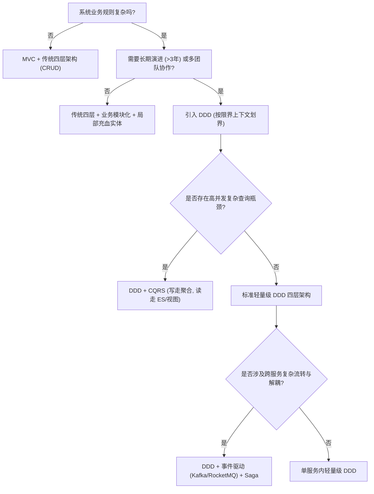
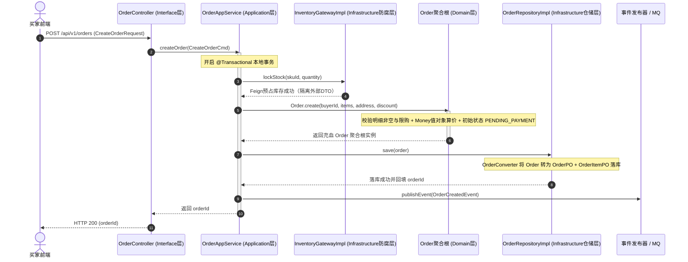

# 软件架构模式与 DDD 实战指南

> **核心速记**：
>
> - **MVC** 是“怎么画界面”的表现层模式，**DDD** 是“怎么想业务”的领域建模方法论，**Clean / Hexagonal（整洁/六边形架构）** 是“怎么搭骨架”的依赖倒置原则，**CQRS** 是“读写分离”的数据访问模式——它们处于不同抽象层级，是**组合关系而非替代关系**。
> - **贫血模型** = 只有数据没有行为（逻辑全堆在 Service）；**充血模型** = 数据 + 业务行为 + 规则校验内聚在实体/聚合根内部。
> - **工业界主流选型（二八定律）**：**核心域重设计（轻量级/完整 DDD），支撑域重效率（传统四层 CRUD）；微服务边界即限界上下文（Bounded Context）。**

---

## 目录

- [一、主流架构模式全景与对比](#一主流架构模式全景与对比)
  - [1.1 六大主流架构模式全景表](#11-六大主流架构模式全景表)
  - [1.2 各架构模式深度解析与关系梳理](#12-各架构模式深度解析与关系梳理)
  - [1.3 架构模式组合关系总结](#13-架构模式组合关系总结)
- [二、传统三层架构 vs 领域驱动设计（DDD）](#二传统三层架构-vs-领域驱动设计ddd)
  - [2.1 传统三层/四层架构剖析（技术分层）](#21-传统三层四层架构剖析技术分层)
  - [2.2 贫血模型（Anemic） vs 充血模型（Rich）](#22-贫血模型anemic-vs-充血模型rich)
  - [2.3 传统四层架构（CRUD）与 DDD 四层架构全维度对比](#23-传统四层架构crud与-ddd-四层架构全维度对比)
- [三、DDD（领域驱动设计）核心体系](#三ddd领域驱动设计核心体系)
  - [3.1 为什么需要 DDD？（背景与核心目标）](#31-为什么需要-ddd背景与核心目标)
  - [3.2 战略设计（Strategic Design）—— 宏观规划（怎么拆）](#32-战略设计strategic-design-宏观规划怎么拆)
  - [3.3 战术设计（Tactical Design）—— 微观建模（怎么写）](#33-战术设计tactical-design-微观建模怎么写)
  - [3.4 DDD 经典四层架构（Layered Architecture）](#34-ddd-经典四层架构layered-architecture)
  - [3.5 DDD 落地避坑指南与学习路径](#35-ddd-落地避坑指南与学习路径)
- [四、Spring Cloud 微服务中的 DDD 落地实践](#四spring-cloud-微服务中的-ddd-落地实践)
  - [4.1 核心指导原则：“DDD + Clean Architecture”](#41-核心指导原则ddd--clean-architecture)
  - [4.2 基于 DDD 拆分微服务的五步落地法](#42-基于-ddd-拆分微服务的五步落地法)
  - [4.3 微服务间协作模式（同步、异步与最终一致性）](#43-微服务间协作模式同步异步与最终一致性)
  - [4.4 微服务配套工程实践清单](#44-微服务配套工程实践清单)
- [五、真实生产环境架构选型指南](#五真实生产环境架构选型指南)
  - [5.1 按业务复杂度分档选型全景图](#51-按业务复杂度分档选型全景图)
  - [5.2 三大典型业务场景详细落地方案](#52-三大典型业务场景详细落地方案)
  - [5.3 一线大厂真实架构实践参考](#53-一线大厂真实架构实践参考)
  - [5.4 架构选型决策树、Checklist 与渐进式演进路线](#54-架构选型决策树checklist-与渐进式演进路线)
- [六、DDD 高频面试真题与满分回答话术](#六ddd-高频面试真题与满分回答话术)
  - [Q1：为什么你们项目要用 DDD？相比传统三层架构解决了什么痛点？](#q1为什么你们项目要用-ddd相比传统三层架构解决了什么痛点)
  - [Q2：贫血模型和充血模型有什么区别？充血实体内能不能注入 Repository 查库？](#q2贫血模型和充血模型有什么区别充血实体内能不能注入-repository-查库)
  - [Q3：实体（Entity）和值对象（Value Object）有什么区别？数据库中如何持久化值对象？](#q3实体entity和值对象value-object有什么区别数据库中如何持久化值对象)
  - [Q4：什么是聚合与聚合根？聚合边界怎么划分？为什么一个事务只改一个聚合？](#q4什么是聚合与聚合根聚合边界怎么划分为什么一个事务只改一个聚合)
  - [Q5：应用服务（Application Service）和领域服务（Domain Service）有什么区别？](#q5应用服务application-service和领域服务domain-service有什么区别)
  - [Q6：VO / DTO / Entity(DO) / PO 分别在哪一层？频繁对象转换不嫌麻烦吗？](#q6vo--dto--entitydo--po-分别在哪一层频繁对象转换不嫌麻烦吗)
  - [Q7：限界上下文和微服务是什么关系？如何用 DDD 指导老系统拆分微服务？](#q7限界上下文和微服务是什么关系如何用-ddd-指导老系统拆分微服务)
  - [Q8：DDD 架构下，复杂的跨表分页查询怎么处理？也要走聚合根和 Repository 吗？](#q8ddd-架构下复杂的跨表分页查询怎么处理也要走聚合根和-repository-吗)
  - [Q9：什么是防腐层（ACL）？在实际项目中具体怎么写代码落地？](#q9什么是防腐层acl在实际项目中具体怎么写代码落地)
  - [Q10：如何保证“业务落库”与“领域事件发布”的一致性（不丢消息）？](#q10如何保证业务落库与领域事件发布的一致性不丢消息)
  - [Q11：工厂（Factory）和仓储（Repository）有什么区别？什么场景需要写 Domain Factory？](#q11工厂factory和仓储repository有什么区别什么场景需要写-domain-factory)
  - [Q12：聚合根包含子实体列表（如 `List<OrderItem>`），调用 `save(order)` 时怎么避免全删全插？](#q12聚合根包含子实体列表如-listorderitem调用-saveorder-时怎么避免全删全插)
  - [Q13：六边形架构（端口与适配器）/ COLA 架构与传统 DDD 四层架构是什么关系？](#q13六边形架构端口与适配器-cola-架构与传统-ddd-四层架构是什么关系)
  - [Q14：什么是事件风暴（Event Storming）？你们团队是怎么做事件风暴建模的？](#q14什么是事件风暴event-storming你们团队是怎么做事件风暴建模的)
  - [Q15：DDD 有什么落地难点或缺点？什么场景下你会明确拒绝使用 DDD？](#q15ddd-有什么落地难点或缺点什么场景下你会明确拒绝使用-ddd)
- [七、完整项目实战：从 0 到 1 用 DDD 构建「电商订单履约系统」](#七完整项目实战从-0-到-1-用-ddd-构建电商订单履约系统)
  - [7.1 业务背景与核心痛点（为什么用 DDD）](#71-业务背景与核心痛点为什么用-ddd)
  - [7.2 第一步：战略设计与事件风暴（划分边界与模型）](#72-第一步战略设计与事件风暴划分边界与模型)
  - [7.3 第二步：Maven 多模块四层工程结构](#73-第二步maven-多模块四层工程结构)
  - [7.4 第三步：四层核心代码完整实现（由内向外）](#74-第三步四层核心代码完整实现由内向外)
  - [7.5 第四步：全链路调用时序图](#75-第四步全链路调用时序图)
  - [7.6 面试压轴：1 分钟串讲你的 DDD 项目落地经验](#76-面试压轴1-分钟串讲你的-ddd-项目落地经验)

---

## 一、主流架构模式全景与对比

### 1.1 六大主流架构模式全景表

我们可以从 **关注点、抽象层级、适用范围** 三个维度系统梳理主流软件架构/设计方法及其与 DDD 的关系：

| 方法                                   | 全称                                     | 关注点                                   | 抽象层级                 | 是否与 DDD 冲突                                     |
| :------------------------------------- | :--------------------------------------- | :--------------------------------------- | :----------------------- | :-------------------------------------------------- |
| **MVC**                          | Model-View-Controller                    | **表现层分离**（UI 与逻辑解耦）    | **UI 层设计模式**  | ❌ 不冲突，可共存（常作为 DDD 的 Interface 层实现） |
| **传统三层架构**                 | Presentation / BLL / DAL                 | **技术分层**（代码组织）           | **系统级架构**     | ⚠️ DDD 可视为其“业务逻辑层（BLL）”的深化与重构  |
| **DDD**                          | Domain-Driven Design                     | **业务建模**（复杂领域抽象）       | **业务架构方法论** | —                                                  |
| **Clean Architecture**           | 整洁架构                                 | **依赖方向控制**（内层不依赖外层） | **架构风格**       | ✅ 与 DDD 高度兼容                                  |
| **Hexagonal (Ports & Adapters)** | 六边形架构（端口与适配器）               | **核心逻辑与外部解耦**             | **架构风格**       | ✅ 常与 DDD 结合使用                                |
| **CQRS**                         | Command Query Responsibility Segregation | **读写模型分离**                   | **数据访问模式**   | ✅ 常作为 DDD 高并发读场景的补充                    |

---

### 1.2 各架构模式深度解析与关系梳理

#### 1. MVC（Model-View-Controller）

- **定位**：**表现层（Presentation Layer）设计模式**。
- **目标**：分离用户界面（View）、用户输入控制（Controller）与数据模型（Model）。
- **典型结构**：
  ```text
  View（HTML/React） 
    ←→ Controller（接收请求，调用 Service）
        → Model（通常是 DTO 或贫血 POJO）
  ```
- **与 DDD 的关系**：
  - MVC 中的 **Controller ≈ DDD 的 Interface Layer（用户接口层）**；
  - MVC 中的 **Model（DTO）≠ DDD 的 Domain Model（领域模型）**；
  - **DDD 的领域层完全位于 MVC 的 "Model" 之下**，在实际项目中可以在 DDD 的 Interface 层使用 Spring MVC 实现 Controller，两者完全兼容。

#### 2. 传统三层架构（Three-Layer Architecture）

- **分层结构**：
  - **表现层（UI）**：Web / API 接口；
  - **业务逻辑层（BLL）**：Service 类（通常采用过程式代码 + 贫血模型）；
  - **数据访问层（DAL）**：DAO / Mapper。
- **核心痛点**：
  - 业务逻辑全部集中在 Service，随业务演进极易膨胀为数千行的 **“上帝类”**（如 `OrderService` 同时包含订单、库存、支付、积分逻辑）；
  - 实体对象是**贫血的**（只有 `getter/setter`，无业务行为）。
- **与 DDD 的关系**：
  - DDD 是对三层架构中“BLL（业务逻辑层）”的重构：将臃肿的 Service 拆分为 **Application Service（应用编排） + Domain Model（富领域模型：聚合、实体、值对象、领域服务）**。
  - 简言之：**DDD = 三层架构 + 领域建模 + 依赖倒置**。

#### 3. Clean Architecture（整洁架构） & Hexagonal（六边形架构）

- **核心思想**：**依赖倒置（DIP）** —— 内层（业务核心）绝对不依赖外层（框架、数据库、UI、外部中间件）。
- **由内到外分层映射**：
  1. **Entities（领域层）** ← 对应 DDD 的 `Domain` 层；
  2. **Use Cases（应用层）** ← 对应 DDD 的 `Application` 层；
  3. **Interface Adapters（接口适配层）** ← 对应 DDD 的 `Interface` + `Infrastructure` 层；
  4. **Frameworks & Drivers（框架与驱动层）**。
- **与 DDD 的关系**：**高度互补**。Clean Architecture 提供**依赖方向规则**，DDD 提供**业务领域建模方法**。

#### 4. CQRS（命令查询职责分离）

- **核心思想**：读模型（Query）与写模型（Command）分离：
  - **Command（写）**：修改系统状态，走 **DDD 聚合根 + 事务**，保障强业务一致性；
  - **Query（读）**：只读数据，可直接通过 MyBatis / SQL 查数据库视图或 Elasticsearch，绕过领域层以保障高性能。
- **与 DDD 的关系**：CQRS **不是替代 DDD，而是增强它**——写操作用 DDD 保一致性，读操作用直查保性能。

---

### 1.3 架构模式组合关系总结

| 业务场景                                 | 推荐架构组合                                  |
| :--------------------------------------- | :-------------------------------------------- |
| **简单后台管理系统**               | MVC + 传统三层架构                            |
| **中等复杂业务系统**               | DDD（四层） + Spring MVC（作为 Interface 层） |
| **大型复杂核心系统（如电商交易）** | DDD + CQRS + Hexagonal Architecture           |
| **需要严格技术解耦与高可测试性**   | DDD + Clean Architecture                      |

---

## 二、传统三层架构 vs 领域驱动设计（DDD）

### 2.1 传统三层/四层架构剖析（技术分层）

在 Java Web / Spring Boot 项目中，最常见的 `Controller → Service → Mapper/DAO → Entity` 结构是**传统三层架构的具体实现形式**（常被称为**传统四层架构**或**贫血模型架构**）。

#### 1. 各层职责（以技术职责为中心）

| 层级                   | 职责                                              | 技术关注点                |
| :--------------------- | :------------------------------------------------ | :------------------------ |
| **Controller**   | 接收 HTTP 请求、参数校验、调用 Service            | Web 框架（Spring MVC）    |
| **Service**      | 业务逻辑编排（通常是事务边界 `@Transactional`） | 业务流程、事务管理        |
| **Mapper / DAO** | 数据库 CRUD 操作                                  | MyBatis / Spring Data JPA |
| **Entity / PO**  | 数据库表的映射对象（POJO）                        | ORM 映射                  |

#### 2. 架构正式名称与定位

1. **传统三层架构（Three-Tier Architecture）的变体**：将经典三层（Presentation + Business Logic + Data Access）细化为 `Controller + Service + Mapper + Entity`。
2. **贫血模型架构（Anemic Domain Model Architecture）**：由 Martin Fowler 提出并指出其在复杂业务下的反模式特征——领域对象只有数据无行为，业务逻辑散落在 Service 中。
3. **优缺点评估**：
   - ✅ **优点**：简单直观、新人 1 天上手、CRUD 开发极快、与 MyBatis-Plus / JPA 高度适配。
   - ❌ **缺点**：复杂业务下 Service 膨胀为“上帝类”、需求变更牵一发而动全身、业务逻辑与持久化框架强耦合导致单元测试困难、代码像“操作数据库脚本”而非“表达业务语义”。

---

### 2.2 贫血模型（Anemic） vs 充血模型（Rich）

- **贫血模型** = **只有数据，没有行为**（只会存数据的“数据容器”，逻辑全在外部 Service）。
- **充血模型** = **数据 + 业务行为 + 规则校验**（自带业务灵魂，状态变更由自身方法受控执行）。

#### 1. 核心区别对比表

| 维度                     | 贫血模型（传统 CRUD）                           | 充血模型（DDD 标准）                                                |
| :----------------------- | :---------------------------------------------- | :------------------------------------------------------------------ |
| **类结构**         | 只有属性字段 + `getter/setter`                | 属性字段 + 业务行为方法（慎开公共 `setter`）                      |
| **业务逻辑位置**   | 全部堆砌在 `Service` 类中                     | 内聚在 `Entity` / `Aggregate Root` 内部                         |
| **状态安全性**     | ❌ 不安全，外部任何地方都能随意 `setStatus()` | ✅ 安全，状态只能通过业务方法（如 `pay()`、`cancel()`）受控流转 |
| **Service 层职责** | 充血（既管流程编排，又写全部业务规则）          | 贫血/薄层（只做事务控制、仓储调用与流程编排）                       |
| **可维护性**       | 差，Service 越写越臃肿，逻辑重复                | 好，高内聚，业务规则跟着领域对象走                                  |

#### 2. 代码实战对比一：付款单状态流转（`PaymentOrder`）

##### ❌ 贫血模型写法（反例）

```java
// 贫血实体：只有字段和 getter/setter，没有任何业务保护
public class PaymentOrder {
    private Long id;           // 付款单ID
    private Integer status;    // 状态：0待审批 1已审批 2已支付
    private BigDecimal amount; // 金额

    public Integer getStatus() { return status; }
    public void setStatus(Integer status) { this.status = status; }
}

// 风险：任何 Service 都能绕过审批校验，直接调用 order.setStatus(2) 改成已支付！
```

##### ✅ 充血模型写法（DDD 正例）

```java
// 充血实体：数据 + 业务行为 + 状态机规则内聚在一起
public class PaymentOrder {
    private Long id;
    private PaymentStatus status; // 使用枚举替代魔法数字
    private BigDecimal amount;

    // 业务行为 1：审批
    public void approve() {
        if (this.status != PaymentStatus.PENDING) {
            throw new IllegalStateException("只有待审批状态的付款单才能审批");
        }
        this.status = PaymentStatus.APPROVED;
    }

    // 业务行为 2：支付
    public void pay() {
        if (this.status != PaymentStatus.APPROVED) {
            throw new IllegalStateException("付款单必须先审批通过才能支付");
        }
        this.status = PaymentStatus.PAID;
    }
}
```

#### 3. 代码实战对比二：订单取消流程（`OrderService` vs `OrderAppService`）

##### ❌ 传统四层（贫血模型 + 过程式 Service）

```java
@Service
public class OrderService {
    @Autowired
    private OrderMapper orderMapper;

    public void cancelOrder(Long orderId) {
        Order order = orderMapper.selectById(orderId);
        // 业务规则散落在 Service 中
        if ("PAID".equals(order.getStatus())) {
            throw new IllegalStateException("已支付订单不能取消");
        }
        order.setStatus("CANCELLED");
        orderMapper.updateById(order);
    }
}
```

##### ✅ DDD 架构（充血模型 + 应用层薄编排）

```java
// 1. 领域层实体（Domain Layer）：封装核心业务规则
public class Order {
    private Long id;
    private OrderStatus status;

    public void cancel() {
        if (this.status == OrderStatus.PAID) {
            throw new IllegalStateException("已支付订单不能取消");
        }
        this.status = OrderStatus.CANCELLED;
    }
}

// 2. 应用层服务（Application Layer）：只做编排，不写业务 if-else
@Service
public class OrderAppService {
    @Autowired
    private OrderRepository orderRepository;

    @Transactional(rollbackFor = Exception.class)
    public void cancelOrder(Long orderId) {
        Order order = orderRepository.findById(orderId);
        order.cancel(); // 调用领域对象行为
        orderRepository.save(order);
    }
}
```

---

### 2.3 传统四层架构（CRUD）与 DDD 四层架构全维度对比

| 维度                 | 传统四层架构（CRUD）                                 | DDD 四层架构                                              |
| :------------------- | :--------------------------------------------------- | :-------------------------------------------------------- |
| **分层依据**   | **技术职责**（怎么实现：HTTP / 事务 / SQL）    | **业务语义与关注点分离**（业务核心 vs 技术细节）    |
| **设计焦点**   | 数据库表结构（先建表，再生成 Entity/Mapper）         | 业务行为与领域模型（先建模，再映射持久化）                |
| **核心层**     | `Service` 层（过程式事务脚本）                     | `Domain` 领域层（富领域模型）                           |
| **对象状态**   | 被动（POJO + `setter`）                            | 主动（封装业务方法，如 `order.cancel()`）               |
| **技术解耦度** | 低（Service 常直接依赖 MyBatis `QueryWrapper` 等） | 高（Domain 层纯 Java，不依赖任何框架与 ORM 注解）         |
| **团队协作**   | 开发人员说“表字段”，业务人员说“业务术语”         | 共建**通用语言（Ubiquitous Language）**，代码即业务 |
| **适用场景**   | 简单 CRUD、报表、快速原型（MVP）                     | 复杂核心业务、高频变更、长生命周期系统                    |

---

## 三、DDD（领域驱动设计）核心体系

### 3.1 为什么需要 DDD？（背景与核心目标）

**DDD（Domain-Driven Design，领域驱动设计）** 由 Eric Evans 在 2003 年提出。其核心思想是：**将复杂业务系统的开发重心从“数据库表与技术框架”回归到“业务领域”本身，通过与领域专家共建通用语言，在限界上下文内构建富含行为的领域模型。**

- **解决传统开发四大痛点**：
  1. 代码充斥 `if-else` 与魔法数字，难以阅读；
  2. 同一业务规则散落在 Controller、Service、Util 多处；
  3. 需求变更时牵一发而动全身；
  4. 开发与产品/业务语言割裂，沟通成本极高。
- **理性认知（非“银弹” Silver Bullet）**：
  > **银弹（Silver Bullet）**：指一招解决所有问题的万能特效药。
  > Eric Evans 原话：*“DDD is not for all projects. It’s for the ones where the domain is complex and central to the business.”*（DDD 不是银弹，它专为复杂核心业务而生。）
  >

---

### 3.2 战略设计（Strategic Design）—— 宏观规划（怎么拆）

战略设计关注**宏观业务边界划分与团队协作**：

| 核心概念                                  | 定义与作用                                                                                                                                                                                       | 电商系统实例                                                                                                                                                                     |
| :---------------------------------------- | :----------------------------------------------------------------------------------------------------------------------------------------------------------------------------------------------- | :------------------------------------------------------------------------------------------------------------------------------------------------------------------------------- |
| **领域（Domain）**                  | 系统要解决的业务范围总和                                                                                                                                                                         | 电商业务领域                                                                                                                                                                     |
| **子域（Subdomain）**               | 领域的细分，按业务价值分为三类：1. **核心子域（Core）**：核心竞争力，决定成败2. **支撑子域（Supporting）**：辅助核心业务，具行业特性3. **通用子域（Generic）**：全行业通用能力 | - **核心子域**：订单履约、商品定价、支付清算- **支撑子域**：操作日志统计、商户入驻审核- **通用子域**：用户认证（IAM）、短信通知                                |
| **通用语言（Ubiquitous Language）** | 开发、产品、测试、业务专家在同一个上下文内使用**完全一致的术语**，并直接体现在类名与方法名中                                                                                               | 统一称“创建订单（`placeOrder`）”、“扣减预占库存（`deductReservedStock`）”                                                                                                |
| **限界上下文（Bounded Context）**   | **战略设计最核心概念！** 通用语言和领域模型生效的明确边界。同一术语在不同上下文中模型不同                                                                                                  | - **“用户”**：在会员上下文有积分/等级/手机号；在订单上下文仅需一个 `buyerId`- **“订单”**：在交易上下文关注“待支付/已支付”；在物流上下文关注“待拣货/已签收” |
| **上下文映射（Context Map）**       | 描述不同限界上下文之间的集成关系与数据流向                                                                                                                                                       | 开放主机服务（OHS）、发布语言（PL）、**防腐层（ACL，隔离外部系统模型污染）**                                                                                               |

---

### 3.3 战术设计（Tactical Design）—— 微观建模（怎么写）

战术设计关注在**单个限界上下文内部**如何用面向对象代码精准表达业务：

| 战术模式                                   | 核心特征与职责                                                                                           | 典型代码示例                                                        |
| :----------------------------------------- | :------------------------------------------------------------------------------------------------------- | :------------------------------------------------------------------ |
| **实体（Entity）**                   | 有**唯一标识（ID）**和生命周期，属性可变，通过 ID 判断相等性                                             | `Order(id=1001L)`、`User(id="U001")`                            |
| **值对象（Value Object）**           | **无唯一 ID**，通过属性值判断相等性，**不可变（Immutable）**，表达度量或描述                 | `Money(100, "CNY")`、`Address("北京", "朝阳区")`                |
| **聚合与聚合根（Aggregate & Root）** | **事务与数据一致性边界**。一组紧密关联的实体和值对象集合，由唯一的**聚合根**对外提供操作入口 | `Order` 是聚合根，内部包含 `List<OrderItem>` 和收货 `Address` |
| **领域服务（Domain Service）**       | 封装**跨多个实体/聚合**、不适合放在单个实体内的无状态业务逻辑                                      | `TransferDomainService.transfer(fromAccount, toAccount, amount)`  |
| **领域事件（Domain Event）**         | 领域中已经发生的具有业务意义的事实（命名用过去分词），用于解耦后续动作                                   | `OrderCreatedEvent`、`PaymentSucceededEvent`                    |
| **仓储（Repository）**               | 聚合根的持久化抽象，**接口定义在领域层，实现类在基础设施层**（屏蔽数据库细节）                     | `OrderRepository.findById(id)`、`OrderRepository.save(order)`   |

> **聚合设计的两大黄金法则**：
>
> 1. **外部只能通过聚合根访问聚合内部对象**（外部不能直接拿到 `OrderItem` 并修改它，必须调用 `order.changeItemQuantity(...)`）。
> 2. **一个事务只修改一个聚合实例**（跨聚合的状态变更优先通过**领域事件**实现最终一致性）。

---

### 3.4 DDD 经典四层架构（Layered Architecture）

| 层级                                   | 核心职责                                                                              | 包含组件示例                                                                                                   |
| :------------------------------------- | :------------------------------------------------------------------------------------ | :------------------------------------------------------------------------------------------------------------- |
| **用户接口层（Interface）**      | 处理用户请求、协议转换、参数校验、DTO 序列化                                          | `OrderController`、RPC Facade、Web 请求/响应 DTO                                                             |
| **应用层（Application）**        | **薄层！** 编排业务用例、控制事务边界、调用领域层与发送事件（不含核心业务规则） | `OrderAppService.placeOrder()`、Command / Query Handler                                                      |
| **领域层（Domain）**             | **核心层！** 100% 纯粹的业务规则与领域模型                                      | 聚合根 `Order`、实体 `OrderItem`、值对象 `Money`、`OrderDomainService`、`OrderRepository`（接口）    |
| **基础设施层（Infrastructure）** | 为其他层提供技术实现细节                                                              | `OrderRepositoryImpl`、MyBatis `OrderMapper`、数据表 `OrderPO`、Kafka Producer、Redis、Feign Client 实现 |

> **依赖倒置铁律**：依赖方向为 `Interface → Application → Domain ← Infrastructure`。**领域层（Domain）处于最核心，严禁依赖任何外部技术框架（Spring / MyBatis / Jackson 注解等）**，基础设施层通过实现领域层定义的 `Repository` / `Client` 接口完成依赖反转。

---

### 3.5 DDD 落地避坑指南与学习路径

1. **不要一上来就画聚合和写代码**：先和业务专家对齐“通用语言”与核心业务事件流（可借助事件风暴 Event Storming）。
2. **领域层保持纯净**：将 `@TableName`、`@TableField` 等 ORM 注解留给基础设施层的持久化对象（`PO` / `DO`），不要污染领域实体。
3. **聚合粒度切忌过大**：大聚合会导致高并发下锁冲突严重，遵循“小聚合 + ID 引用其他聚合”原则。
4. **不要为了 DDD 而 DDD**：支撑域、报表查询直接用传统 CRUD 或 CQRS 读模型。
5. **推荐学习路径**：《领域驱动设计精粹》（Vaughn Vernon） → 《实现领域驱动设计》（红皮书） → 实战项目拆解。

---

## 四、Spring Cloud 微服务中的 DDD 落地实践

在工业界 Spring Cloud 微服务项目中，主流策略是 **“混合架构 + 分层治理”**：**以限界上下文划分微服务边界，核心微服务内采用轻量级 DDD 四层架构，支撑型微服务采用传统四层架构。**

### 4.1 核心指导原则：“DDD + Clean Architecture”

| 原则                                | 生产落地实践                                                                                                     |
| :---------------------------------- | :--------------------------------------------------------------------------------------------------------------- |
| **限界上下文 = 微服务边界**   | 每个核心微服务对应一个 Bounded Context（如 `order-service`、`inventory-service`）                            |
| **领域层纯净无污染**          | `domain` 模块不引入 MyBatis / Feign 等基础设施依赖                                                             |
| **依赖方向由外向内**          | `Domain ← Application ← Interface / Infrastructure`                                                          |
| **防腐层（ACL）隔离外部调用** | 调用其他微服务时，在 `infrastructure` 层通过 Adapter 转换 Feign DTO，绝不让外部 DTO 进入本服务的 `domain` 层 |

---

### 4.2 基于 DDD 拆分微服务的五步落地法

#### 步骤 1：梳理业务领域与子域分类（以电商系统为例）

| 子域名称                | 子域类型 | 核心业务职责                             |
| :---------------------- | :------- | :--------------------------------------- |
| **订单子域**      | 核心子域 | 订单创建、修改、取消、状态机流转         |
| **商品子域**      | 核心子域 | 商品管理、价格体系、库存扣减与预占       |
| **支付子域**      | 核心子域 | 支付渠道对接、支付单状态流转、账单与退款 |
| **用户子域**      | 通用子域 | 用户注册、登录认证、基础信息管理         |
| **日志/通知子域** | 支撑子域 | 操作日志审计、短信/邮件推送              |

#### 步骤 2：划分限界上下文

- **订单上下文**：包含订单聚合根、订单状态变更服务、订单创建事件；
- **商品上下文**：包含商品聚合根、库存聚合根、库存扣减服务；
- **支付上下文**：包含支付单聚合根、支付回调处理服务。

#### 步骤 3：将限界上下文映射为微服务

1. **一对一映射（首选）**：一个限界上下文对应一个微服务（如 `order-service`、`product-service`、`payment-service`、`user-service`）。
2. **多对一映射（支撑域合并）**：多个简单的支撑/通用子域合并为一个微服务（如将“日志 + 通知 + 配置”合并为 `base-support-service`）。
3. **一对多映射（谨慎使用）**：仅当单个上下文流量极高或读写特性差异极大时拆分（如拆分为 `order-command-service` 与 `order-query-service`）。

#### 步骤 4：核心微服务内部架构（轻量级 DDD 四层 Maven 结构）

90% 的核心微服务采用如下结构（1~3 个聚合根，按需引入 CQRS 和事件）：

```text
order-service/
├── order-domain/                  ← 【领域层：核心业务逻辑】
│   ├── model/
│   │   ├── Order.java             // 聚合根（Aggregate Root）
│   │   ├── OrderItem.java         // 内部实体（Entity）
│   │   └── OrderStatus.java       // 值对象/枚举（Value Object）
│   ├── service/
│   │   └── OrderDomainService.java // 跨聚合领域逻辑
│   ├── event/
│   │   └── OrderCreatedEvent.java  // 领域事件
│   └── repository/
│       └── OrderRepository.java    // 仓储接口（仅定义接口）
│
├── order-application/             ← 【应用层：用例编排与读写分离】
│   ├── dto/                       // 命令/查询 DTO
│   ├── command/
│   │   └── OrderAppService.java   // 写操作编排（事务边界）
│   └── query/
│       └── OrderQueryService.java // 读操作查询（CQRS）
│
├── order-interface/               ← 【接口层：对外暴露 API】
│   ├── web/
│   │   └── OrderController.java   // REST 接口
│   └── facade/
│       └── OrderRpcFacade.java    // 对内 RPC 接口封装
│
└── order-infrastructure/          ← 【基础设施层：技术实现细节】
    ├── persistence/
    │   ├── po/OrderPO.java        // 数据库映射对象
    │   ├── OrderMapper.java       // MyBatis Mapper
    │   └── OrderRepositoryImpl.java // 实现 domain 层的 OrderRepository
    ├── acl/
    │   ├── InventoryFeignClient.java    // Spring Cloud Feign 接口
    │   └── InventoryClientAdapter.java  // 防腐层适配器
    └── mq/
        └── OrderEventProducer.java      // Kafka / RocketMQ 消息发送
```

#### 步骤 5：非核心支撑微服务内部架构（传统分层，效率优先）

对于通知服务、文件服务等简单支撑服务，直接采用传统四层结构以节省开发成本：

```text
notification-service/
├── controller/
├── service/      // 贫血模型，直接写业务与发送逻辑
├── mapper/
└── entity/
```

---

### 4.3 微服务间协作模式（同步、异步与最终一致性）

#### 1. 同步调用：Feign + 防腐层（ACL 适配器）

严禁将其他微服务的 Feign DTO 直接传给本服务的领域层，必须通过防腐层转换：

```java
// 1. 领域层定义所需外部能力接口（order-domain）
public interface InventoryGateway {
    boolean deductStock(Long skuId, int quantity);
}

// 2. 基础设施层实现防腐适配器（order-infrastructure）
@Component
public class InventoryClientAdapter implements InventoryGateway {
    @Autowired
    private InventoryFeignClient feignClient;

    @Override
    public boolean deductStock(Long skuId, int quantity) {
        DeductStockRequest request = new DeductStockRequest(skuId, quantity);
        DeductStockResponse response = feignClient.deductStock(request);
        // 将外部协议响应转换为本域能理解的语义，隔离外部变更
        return response != null && response.isSuccess();
    }
}
```

#### 2. 异步解耦：领域事件（服务内）与集成事件（跨服务）

- **服务内解耦**：使用 Spring `ApplicationEventPublisher` + `@EventListener`；
- **跨服务通信**：在基础设施层监听本域的**领域事件（Domain Event）**，转换为**集成事件（Integration Event）**投递到 Kafka / RocketMQ。

```java
// 1. 领域事件定义（order-domain）
@Getter
@AllArgsConstructor
public class OrderCreatedEvent {
    private final Long orderId;
    private final Long productId;
    private final Integer quantity;
}

// 2. 应用层发布领域事件（order-application）
@Service
public class OrderAppService {
    @Autowired
    private OrderRepository orderRepository;
    @Autowired
    private ApplicationEventPublisher eventPublisher;

    @Transactional(rollbackFor = Exception.class)
    public void createOrder(CreateOrderCmd cmd) {
        Order order = Order.create(cmd.getUserId(), cmd.getProductId(), cmd.getQuantity());
        orderRepository.save(order);
        // 发布服务内领域事件
        eventPublisher.publishEvent(new OrderCreatedEvent(order.getId(), order.getProductId(), order.getQuantity()));
    }
}

// 3. 基础设施层监听并转发为跨服务 MQ 集成事件（order-infrastructure）
@Component
public class OrderEventRelay {
    @Autowired
    private KafkaTemplate<String, Object> kafkaTemplate;

    @TransactionalEventListener(phase = TransactionPhase.AFTER_COMMIT)
    public void onOrderCreated(OrderCreatedEvent event) {
        OrderCreatedIntegrationEvent integrationEvent = convert(event);
        kafkaTemplate.send("order-created-topic", integrationEvent);
    }
}

// 4. 下游商品微服务消费 MQ 消息异步扣减库存（product-service）
@Component
public class OrderCreatedConsumer {
    @Autowired
    private ProductAppService productAppService;

    @KafkaListener(topics = "order-created-topic", groupId = "product-group")
    public void handleOrderCreated(OrderCreatedIntegrationEvent event) {
        // 需保证消费幂等性
        productAppService.deductStock(event.getOrderId(), event.getProductId(), event.getQuantity());
    }
}
```

#### 3. 分布式事务一致性：Saga 模式 / 最终一致性

- 高并发核心链路**避免使用强一致刚性分布式事务（如 Seata AT/XA）**，防止锁竞争拖垮吞吐量；
- 优先采用 **“本地消息表 / RocketMQ 事务消息 + 消费幂等 + 失败重试 + 逆向补偿（Saga / TCC）”** 实现最终一致性。

---

### 4.4 微服务配套工程实践清单

| 工程实践                    | 标准落地方式                                                                                                           |
| :-------------------------- | :--------------------------------------------------------------------------------------------------------------------- |
| **模块化 Maven 工程** | 单服务拆分为 `domain` / `application` / `interface` / `infrastructure` 子模块，通过 Maven 依赖强制约束调用方向 |
| **API 版本管理**      | Controller 路径支持 `/api/v1/orders`，DTO 遵循向后兼容原则                                                           |
| **统一异常处理**      | 全局 `@RestControllerAdvice` 捕获领域异常（`DomainException`）并映射为标准错误码                                   |
| **全链路追踪**        | 集成 SkyWalking / Micrometer Tracing，跨 Feign 与 MQ 透传 `TraceId`                                                  |
| **配置与注册中心**    | Nacos / Apollo 统一管理多环境配置与服务发现                                                                            |
| **服务容错与治理**    | Sentinel / Resilience4j / Istio 实现限流、熔断与降级                                                                   |

---

## 五、真实生产环境架构选型指南

### 5.1 按业务复杂度分档选型全景图

> **核心洞察**：**80% 的简单系统不需要完整 DDD，但 20% 的核心系统不用 DDD 会陷入泥潭。**

| 业务类型                                                            | 推荐架构                                                                     | 典型技术栈                               | 工业界占比（估算） |
| :------------------------------------------------------------------ | :--------------------------------------------------------------------------- | :--------------------------------------- | :----------------- |
| **1. 简单 CRUD / 内部工具**（CMS 后台、OA 审批、数据看板）    | **传统四层架构（贫血模型）**`Controller + Service + Mapper + Entity` | Spring Boot + MyBatis-Plus + MySQL       | **≈ 60%**   |
| **2. 中等复杂业务**（商品中心、用户中心、营销活动）           | **轻量级 DDD（务实主流）**分模块 + 聚合根封装行为 + 领域服务           | Spring Boot/Cloud + DDD 四层 + 按需 CQRS | **≈ 30%**   |
| **3. 高复杂核心系统**（交易履约、支付清算、金融风控、供应链） | **完整 DDD + 事件驱动 + CQRS**限界上下文 + 领域事件 + Saga 最终一致性  | Spring Cloud + DDD + Kafka/RocketMQ + ES | **≈ 10%**   |

---

### 5.2 三大典型业务场景详细落地方案

#### 场景 1️⃣：简单业务（快速交付优先）

- **架构选择**：✅ **传统四层架构（贫血模型）**。
- **改良技巧**（防止劣化）：
  1. 用 `DTO / VO` 隔离数据库 `Entity`，禁止直接将 `Entity` 返回给前端；
  2. `Service` 按业务子模块拆分，避免单个 Service 塞入所有表操作；
  3. 外部第三方接口调用单独封装 `Client` 包（轻量防腐层）。

#### 场景 2️⃣：中等复杂业务（平衡可维护性与开发效率 —— 最主流“务实 DDD”）

- **架构选择**：✅ **轻量级 DDD（模块化 + 聚合根充血模型）**。
- **核心做法**：
  - 按业务能力划分模块（如 `product`、`promotion`）；
  - 核心状态变更与校验内聚在聚合根（如 `product.updatePrice()`），Service 只做编排；
  - **不做过度设计**：不强行拆分过多微服务，不滥用领域事件。

#### 场景 3️⃣：高复杂核心系统（长期演进与高可靠优先）

- **架构选择**：✅ **完整 DDD + 事件驱动 + CQRS**。
- **核心架构图**：
  ```mermaid
  graph LR
      A["Order Context (写模型: DDD 聚合)"] -- "OrderCreatedEvent" --> B("Kafka / RocketMQ")
      B --> C["Inventory Context (库存扣减)"]
      B --> D["Billing Context (账单生成)"]
      B --> E["Order Read Model (读模型: ES 宽表)"]
      C -- "InventoryUpdatedEvent" --> B
  ```
- **关键前提**：需要资深架构师与领域专家护航，配套完善的分布式追踪与事件日志审计。

---

### 5.3 一线大厂真实架构实践参考

| 公司                        | 真实落地做法                                                                                                    |
| :-------------------------- | :-------------------------------------------------------------------------------------------------------------- |
| **阿里（电商/支付）** | 核心链路（交易、支付、库存）采用完整 DDD + 四层架构 + TCC/Saga；边缘后台系统采用传统分层                        |
| **美团（O2O 履约）**  | 推崇“DDD Lite（轻量级 DDD）”：按业务能力拆微服务（限界上下文），服务内采用聚合根 + 领域服务，按需使用事件驱动 |
| **腾讯（互娱/ToB）**  | 游戏后台大量采用 Actor 模型（天然充血模型）；ToB 管理系统采用传统分层或轻量模块化                               |
| **携程（旅游订单）**  | 订单系统采用 DDD + Saga 模式 + Kafka 事件驱动，保障跨机票/酒店/保险上下文的最终一致性                           |
| **Netflix（流媒体）** | 微服务 + Functional Core（函数式业务核心，思想与 DDD 领域层解耦一致）+ 异步非阻塞                               |

---

### 5.4 架构选型决策树、Checklist 与渐进式演进路线

#### 1. 架构选型决策树



#### 2. 选型自检 Checklist（六问法）

| 评估维度                                                         | 选传统四层架构 | 选 DDD（至少轻量级） |
| :--------------------------------------------------------------- | :------------: | :------------------: |
| **1. 业务规则与状态流转是否复杂且频繁变更？**              |       否       |     **是**     |
| **2. 是否有领域专家/资深产品深度参与建模？**               |       否       |     **是**     |
| **3. 系统预期生命周期是否 > 3 年？**                       |       否       |     **是**     |
| **4. 研发团队规模是否 > 20 人或需多团队协作？**            |       否       |     **是**     |
| **5. 现有代码是否已出现 > 1000 行的“上帝 Service 类”？** |       否       |     **是**     |
| **6. 是否涉及强业务一致性校验（如金融、交易、计费）？**    |       否       |     **是**     |

#### 3. 终极建议：渐进式架构演进四步法

> **“架构是演进而非一步到位设计出来的。”**

1. **阶段一（起步验证期）**：用传统四层架构快速交付 MVP，验证商业模式；
2. **阶段二（局部重构期）**：当发现 `Service` 膨胀、状态被随意 `set` 时，将核心校验收拢到 `Entity` 内部（**贫血转充血**），按业务能力分包；
3. **阶段三（服务化拆分期）**：团队扩大、业务复杂度飙升时，识别**限界上下文**拆分微服务，落地**轻量级 DDD 四层结构 + 防腐层（ACL）**；
4. **阶段四（高并发深化期）**：针对跨服务解耦引入**领域/集成事件**，针对读写比悬殊场景引入 **CQRS（ES/物化视图）**。


---

## 六、DDD 高频面试真题与满分回答话术

### Q1：为什么你们项目要用 DDD？相比传统三层架构解决了什么痛点？

- **考察点**：检验候选人是否真正理解 DDD 解决的工程问题，而非盲目跟风堆砌概念。
- **传统三层架构的四大痛点**：
  1. **“上帝 Service 类”**：业务逻辑全部堆积在 `Service` 层，核心类动辄数千行，没人敢改；
  2. **贫血模型导致状态失控**：`Entity` 只有 `getter/setter`，任何地方都能随意 `order.setStatus(2)`，业务校验规则散落在十几个调用处，极易漏校验；
  3. **表驱动开发（数据思维绑架业务）**：需求一来先想“怎么建表、怎么加字段”，代码读起来全是 SQL 拼接与字段赋值，看不出业务语义；
  4. **外部依赖腐化核心逻辑**：调用第三方或下游微服务的 DTO 直接穿透到核心业务层，外部接口一改，本系统核心逻辑全线报错。
- **面试满分回答话术**：
  > “我们并不是所有系统都一刀切用 DDD，而是在**订单/支付等业务规则复杂、状态流转多、需要长期演进的核心域**引入了轻量级 DDD。
  > 以前用传统三层架构时，`OrderService` 膨胀到了三四千行，各种状态校验散落在不同方法里，改一个规则经常漏改其他入口。
  > 引入 DDD 后，我们主要解决了三个问题：
  > 第一，**通过充血模型与聚合根收拢状态机**，把审批、支付、取消等状态流转和前置校验全部内聚到 `Order` 聚合根内部，关闭公共 `setter`，杜绝了非法状态篡改；
  > 第二，**应用层与领域层分离**，`ApplicationService` 只管事务编排和调用仓储，核心业务规则全部沉淀在 `Domain` 层，纯 Java 零框架依赖，单测覆盖率大幅提升；
  > 第三，**在基础设施层增加防腐层（ACL）**，隔离了下游微服务的协议变更，做到了核心业务逻辑的高内聚、低耦合。”

---

### Q2：贫血模型和充血模型有什么区别？充血实体内能不能注入 Repository 查库？

- **考察点**：DDD 战术设计深水区、**高频连环追问陷阱题**。
- **第一问（贫血 vs 充血）**：
  - **贫血模型**：对象只有数据属性和 `getter/setter`，不含业务行为，属于“过程式设计（事务脚本）”；
  - **充血模型**：对象同时包含**数据属性 + 业务行为方法 + 业务不变量校验**，状态只能通过自身业务方法受控变更，符合面向对象封装原则。
- **第二问（连环追问：充血实体 `Entity` 里能不能 `@Autowired` 注入 `Repository` 或 `Mapper`？）**：
  - **核心结论**：**强烈不推荐！领域实体（Entity）严禁直接依赖 Spring 容器或直接注入 `Repository` 查库。**
  - **原因**：
    1. **生命周期冲突**：`Entity` 是每次请求随业务数据 `new` 出来的多例瞬态对象，而 `Repository` 是 Spring 容器管理的单例 Bean；
    2. **破坏领域层纯净性与可测试性**：一旦实体内部直接查库，单测一个 `order.pay()` 就必须启动数据库或 Mock 持久层，违背了领域模型纯内存计算的初衷；
    3. **容易引发隐式 `N+1` SQL 问题**。
  - **正确落地方式（3 种标准解法）**：
    1. **应用层预加载传参（首选）**：由 `ApplicationService` 先调用 `Repository` 把所需数据查出来，再作为参数传给聚合根的方法（例如：`Coupon coupon = couponRepo.findById(id); order.applyCoupon(coupon);`）；
    2. **升级为领域服务（Domain Service）**：如果该逻辑涉及多个聚合交互或必须依赖外部查询接口，将其提取到无状态的 `OrderDomainService` 中（领域服务可以注入 `Repository` 接口）；
    3. **方法参数注入接口（Double Dispatch 双重分派）**：将领域接口作为方法参数传入实体方法（如 `order.checkRisk(RiskCheckPort port)`）。

---

### Q3：实体（Entity）和值对象（Value Object）有什么区别？数据库中如何持久化值对象？

- **考察点**：微观领域建模能力与数据库落地技巧。
- **核心区别对比**：

| 对比维度 | 实体（Entity） | 值对象（Value Object） |
| :--- | :--- | :--- |
| **唯一标识（ID）** | **有唯一 ID**，贯穿整个生命周期 | **无 ID**，本质是一组属性的集合 |
| **判等规则（`equals`）** | 只要 **ID 相同**即为同一个实体 | 所有**属性值全部相等**才相等 |
| **可变性** | **可变（Mutable）**，状态随业务演进流转 | **不可变（Immutable）**，修改时直接替换整个新对象 |
| **典型例子** | `Order`（订单）、`User`（用户） | `Money(amount, currency)`、`Address(省, 市, 区, 详细地址)` |

- **值对象在数据库中的 2 种持久化方式**（在 `Infrastructure` 层转 `PO` 时处理）：
  1. **字段平铺嵌入（Embedded，最常用）**：例如 `Order` 聚合根中的 `Money payAmount` 值对象，在数据库 `t_order` 表中拆分为 `pay_amount`（`DECIMAL`）和 `pay_currency`（`VARCHAR`）两个字段；
  2. **序列化为 JSON / 字符串存储**：例如订单中的收货地址快照 `ShippingAddress`，不需要按省市区建关联表，直接在 `t_order` 表中用 `shipping_address_json` 字段存储序列化后的 JSON。

---

### Q4：什么是聚合与聚合根？聚合边界怎么划分？为什么一个事务只改一个聚合？

- **考察点**：DDD 战术设计最核心的难点（一致性边界设计）。
- **核心解析**：
  1. **什么是聚合（Aggregate）与聚合根（Aggregate Root）**：
     - **聚合**是一组具有**强业务一致性（Invariants，业务不变量）**、必须同生共死的实体和值对象的集合；
     - **聚合根**是聚合的唯一“守门人”，外部对象**严禁直接持有或修改聚合内部子实体**，一切状态变更必须通过聚合根的方法完成（例如：修改订单明细数量，必须调用 `order.changeItemQuantity(itemId, newQty)`，这样 `Order` 聚合根才能实时重算订单总价并校验限购规则）。
  2. **聚合边界怎么划分？（遵循“小聚合原则”）**：
     - **判断标准**：问自己“这两个对象是否必须在**同一个数据库本地事务**里同时修改成功，且离开彼此就没有独立存在意义？”
     - **是** → 划入同一个聚合（如 `Order` 聚合根 + `OrderItem` 订单项）；
     - **否** → 拆分为不同聚合，聚合之间**只通过 ID 引用（如 `Order` 只存 `Long buyerId`、`Long couponId`），绝不直接持有 `User` 或 `Coupon` 对象引用**。
  3. **为什么强调“一个事务只修改一个聚合”？**：
     - 在高并发分布式场景下，如果一个事务同时锁定并修改多个大聚合（如同时锁订单、锁库存、锁账户积分），会导致长事务、死锁率飙升，且在分库分表或微服务拆分后无法直接依赖本地事务。
     - **跨聚合的一致性标准解法**：主聚合事务提交后，发布**领域事件（Domain Event）**，异步驱动其他聚合完成状态更新（达成**最终一致性**）。

---

### Q5：应用服务（Application Service）和领域服务（Domain Service）有什么区别？

- **考察点**：DDD 开发中最容易写乱、职责混淆的重灾区。
- **职责对比表**：

| 维度 | 应用服务（Application Service） | 领域服务（Domain Service） |
| :--- | :--- | :--- |
| **所属层级** | `Application`（应用层） | `Domain`（领域层） |
| **核心职责** | **业务用例编排（Use Case Orchestration）** | **跨多个实体/聚合的核心业务逻辑计算** |
| **是否包含业务规则** | ❌ **不含任何业务 `if-else` 规则**（薄层） | ✅ **包含纯正的跨实体业务规则** |
| **事务与横切关注点** | ✅ 负责开启 `@Transactional`、安全认证、发 MQ、日志 | ❌ 不管事务注解，不依赖外部中间件 |
| **出入参类型** | 入参 `Command/DTO`，出参 `DTO` | 入参和出参均为**领域对象（Entity / Value Object）** |

- **三步判断口诀（面试必背）**：
  1. 一段业务规则只涉及**单个聚合** → 写在 **聚合根/实体（`Entity`）** 内部（如 `order.cancel()`）；
  2. 一段业务规则涉及**多个聚合/实体协同计算**，放进哪个实体都不合适 → 写在 **领域服务（`DomainService`）** 中（如账户转账 `TransferDomainService.transfer(fromAcc, toAcc, money)`、多促销活动叠加算价）；
  3. 负责**查仓储、调领域对象/领域服务、存仓储、开事务、发事件**的流水线调度 → 写在 **应用服务（`ApplicationService`）** 中。

---

### Q6：VO / DTO / Entity(DO) / PO 分别在哪一层？频繁对象转换不嫌麻烦吗？

- **考察点**：真实 DDD 工程落地经验与折中权衡思维。
- **1. 四类对象的边界与所在层**：
  ```text
  前端/调用方 
    ←(VO / Request DTO)→ 【Interface 接口层】
    ←(Command / DTO)→    【Application 应用层】
    ←(Entity / Aggregate)→【Domain 领域层（核心业务对象，无 ORM 注解）】
    ←(PO / DO)→          【Infrastructure 基础设施层（带 @TableName，严格映射数据库表）】
  ```
- **2. 为什么要把领域实体（`Entity`）和数据库对象（`PO`）分开？**：
  - **模型解耦**：领域聚合根往往包含 `List<OrderItem>` 和值对象 `Money`，而数据库对应的是 `t_order` 和 `t_order_item` 两张扁平表（甚至带有 `is_deleted`、分表键、乐观锁 `version` 等纯技术字段）；
  - 如果合二为一，任何表结构调整都会直接破坏核心领域模型，且无法自由设计充血行为。
- **3. 面试官追问“转换太繁琐怎么解决？”（满分回答）**：
  > “在工程落地上，我们不会手写大量的 `getter/setter` 转换代码，而是采用两条务实策略：
  > 第一，引入编译期代码生成框架 **MapStruct**，统一在应用层定义 `Assembler`（完成 `DTO ↔ Entity` 转换）、在基础设施层定义 `Converter`（完成 `Entity ↔ PO` 转换），编译期直接生成字节码，零反射性能损耗；
  > 第二，**分域治理，不搞教条主义**——只有核心子域（如订单、支付）严格隔离 `Entity` 和 `PO`；对于简单的支撑子域（如配置管理、字典表），直接退化为传统四层，`Entity` 与 `PO` 合一，兼顾架构纯洁性与团队开发效率。”

---

### Q7：限界上下文和微服务是什么关系？如何用 DDD 指导老系统拆分微服务？

- **考察点**：战略设计理解深度与微服务架构重构经验。
- **1. 限界上下文（Bounded Context）与微服务的关系**：
  - **限界上下文是逻辑上的业务模型边界，微服务是物理上的部署与运行边界**；
  - **包含关系**：一个限界上下文**不一定**上来就拆成独立部署的微服务（在项目初期，一个限界上下文可以是单体应用中的一个独立 **Maven Module / Package**）；当业务规模增长需要拆分微服务时，**首选 1 个限界上下文映射为 1 个微服务**（1:1 映射）。
- **2. 用 DDD 拆分巨石老系统的四步实操话术**：
  1. **事件风暴（Event Storming）梳理全局**：拉齐业务方与研发，按时间线梳理业务流程中的所有**领域事件**（如已下单、已支付、已发货）与触发命令；
  2. **寻找概念边界，划分限界上下文**：根据通用语言的语义边界（例如同一个“商品”，在商品中心关注 SKU 规格与上下架，在库存中心只关注可用库存与预占库存），划分出商品上下文、库存上下文、交易上下文；
  3. **识别子域优先级**：区分核心域（交易、计费）、支撑域（审核）、通用域（认证、通知）；
  4. **绞杀者模式（Strangler Fig） + 防腐层（ACL）平滑演进**：不搞推倒重写，每次只剥离一个边界最清晰、痛点最强的上下文独立为微服务；新微服务与老巨石系统之间通过 **ACL 防腐层** 转换接口模型，逐步替换老系统功能。

---

### Q8：DDD 架构下，复杂的跨表分页查询怎么处理？也要走聚合根和 Repository 吗？

- **考察点**：**鉴别“真落过地”还是“只背过八股文”的试金石问题！**
- **核心结论**：**绝对不能走聚合根和领域层 Repository！复杂查询必须采用 CQRS（命令查询职责分离）绕过领域层。**
- **为什么不能走聚合根？**：
  - `Repository` 的职责是以**聚合为单位**进行加载和持久化，旨在服务于**写操作（Command）**的状态变更校验；
  - 如果后台管理系统的“订单分页列表（需联查订单表、买家信息、店铺名称、物流状态）”也通过 `OrderRepository` 加载几十个完整的 `Order` 聚合根再转成 DTO，不仅会产生灾难性的 **`N+1` 查询问题**，而且完全没有用到聚合根的充血修改行为，纯属性能浪费。
- **生产环境标准解法（CQRS 落地）**：
  - **写操作（Command）**：严格走 `Controller → OrderAppService → Order（聚合根） → OrderRepository`；
  - **读操作（Query）**：`Controller → OrderQueryService（应用层查询服务） → OrderQueryMapper（基础设施层）`，直接编写高性能定制 SQL 联表查询，或直接查询 **Elasticsearch 宽表 / Redis 缓存视图**，一步到位组装并返回 `OrderPageVO`。

---

### Q9：什么是防腐层（ACL）？在实际项目中具体怎么写代码落地？

- **考察点**：跨微服务调用、第三方外部系统对接时的模型隔离与容错设计。
- **核心作用**：当本上下文（如订单服务）需要调用外部上下文（如风控服务、微信支付 SDK、遗留老系统）时，**防止外部杂乱的 DTO、状态码和异常直接侵入本服务的 `Domain` 领域层**。即使外部接口字段大改或替换了供应商，也只需修改防腐层转换逻辑，领域层代码一行不动。
- **代码落地三步法（依赖倒置）**：
  1. **在 `Domain` 层定义本域语言的端口接口（Outbound Port / Gateway）**：入参和返回值全部使用本领域的实体或值对象；
  2. **在 `Infrastructure` 层编写 `Adapter` 实现该接口**：在内部调用 `FeignClient` 或第三方 HTTP SDK；
  3. **在 `Adapter` 内完成“三合一隔离”**：协议参数转换（本域对象 ↔ 外部 DTO）+ 外部状态码翻译 + 异常捕获与熔断兜底。

---

### Q10：如何保证“业务落库”与“领域事件发布”的一致性（不丢消息）？

- **考察点**：**分布式系统与 DDD 结合的高频核心题**（考察事务与消息最终一致性）。
- **常见错误写法及隐患**：
  - ❌ **在 `@Transactional` 方法内直接发 MQ**：若 MQ 发送成功但随后数据库事务回滚，下游会收到“幽灵消息”；若数据库提交前 MQ 网络超时，又会拖长本地数据库连接占用时间。
  - ⚠️ **用 `@TransactionalEventListener(phase = AFTER_COMMIT)` 异步发 MQ**：虽然保证了事务提交后才发 MQ，但如果事务刚提交成功、还没来得及发 MQ 时**机器宕机/重启**，内存中的领域事件就会永久丢失！
- **生产级满分解决方案（2 种）**：
  1. **本地事件表方案（Transactional Outbox 模式 —— 最稳妥通用）**：
     - 在业务数据库中建一张 `t_domain_event_outbox`（本地事件表）；
     - `OrderRepository.save(order)` 与 `EventRepository.save(order.getDomainEvents())` 在**同一个本地数据库事务**中提交落库（100% 原子性）；
     - 事务提交后，异步触发投递或由后台定时任务（XXL-Job + 分片）/ Canal 监听 binlog 扫描状态为 `PENDING` 的事件投递到 Kafka/RocketMQ，发送成功后更新为 `SENT`；
     - 下游消费者通过 `eventId` 做**幂等去重**。
  2. **RocketMQ 事务消息方案**：
     - 应用层先发送 Half Message（半消息）→ 执行本地聚合根落库事务 → 根据本地事务状态 Commit/Rollback 半消息；若超时未响应，RocketMQ Broker 会回调 `checkLocalTransaction` 查库确认。

---

### Q11：工厂（Factory）和仓储（Repository）有什么区别？什么场景需要写 Domain Factory？

- **考察点**：领域对象的生命周期管理（创建 vs 重建/持久化）。
- **核心区别**：
  - **工厂（Factory）**：负责**“从无到有”创建全新的领域对象/聚合根**（生命周期的起点），重点在于封装复杂的初始化组装规则与前置校验；
  - **仓储（Repository）**：负责**“持久化新聚合”或“从数据库加载并重建已有聚合”**（生命周期的延续）。
- **什么场景需要专门写 `Domain Factory`？**：
  - 简单场景：直接在聚合根内部提供语义化的**静态工厂方法**（如 `Order.create(buyerId, items, address)`），同时将 `new Order()` 构造方法设为 `private/protected`；
  - 复杂场景（需要独立 `OrderFactory` 类）：当创建聚合根需要组合多个外部值对象、生成全局唯一业务单号（调用 `IdGenerator`）、初始化复杂的默认子实体树，或根据不同订单类型（普通订单、秒杀订单、跨境订单）执行不同的初始化装配策略时，单独提取 `OrderFactory`。

---

### Q12：聚合根包含子实体列表（如 `List<OrderItem>`），调用 `save(order)` 时怎么避免全删全插？

- **考察点**：**骨灰级实战题！** 国内主流使用 MyBatis（而非自带 Dirty Checking 脏检查的 Hibernate/JPA），面试官借此一眼看穿你是否真正手写过 `RepositoryImpl`。
- **问题本质**：当我们从 `OrderRepository.findById(id)` 查出 `Order`（内含 5 个 `OrderItem`），在内存中修改了其中 1 个 `OrderItem` 的数量、新增了 1 个 `OrderItem`，最后调用 `orderRepository.save(order)` 时，MyBatis 怎么知道哪些子项该 `INSERT`、哪些该 `UPDATE`、哪些该 `DELETE`？
- **MyBatis 体系下的 3 种工程落地方案**：
  1. **方案一：聚合快照对比（Snapshot Diff / 变更追踪 —— 最正统）**：
     - 在 `OrderRepository.findById` 加载聚合根时，在持久层上下文（如 `ThreadLocal` 或包装类）保存一份加载时的深拷贝快照 `OriginOrder`；
     - 调用 `save(order)` 时，通过 Diff 工具对比当前 `order` 与快照 `OriginOrder`：识别出新增项执行 `batchInsert`、修改项（字段有变化）执行 `update`、被移除项执行 `delete`，未变化项跳过不执行 SQL。
  2. **方案二：实体内维护变更状态位（轻量实用）**：
     - 在子实体基类中维护一个瞬态枚举字段 `transient EntityState state`（`UNCHANGED` / `ADDED` / `MODIFIED` / `DELETED`）；
     - 聚合根执行 `order.addItem()` 时标记为 `ADDED`，执行 `order.changeItemQty()` 时标记为 `MODIFIED`；`OrderRepositoryImpl.save()` 根据该状态位精准分发 SQL。
  3. **方案三：控制聚合大小（架构规避）**：
     - 严格遵守**小聚合原则**。如果一个聚合下的子实体可能达到几百上千条（例如“店铺”与“商品”），说明它们绝不该放在同一个聚合里，必须将“商品”拆分为独立聚合根，通过 `shopId` 关联。

---

### Q13：六边形架构（端口与适配器）/ COLA 架构与传统 DDD 四层架构是什么关系？

- **考察点**：对现代 DDD 架构演进及阿里开源 COLA（Clean Object-Oriented and Layered Architecture）框架的理解。
- **演进关系**：
  1. **早期传统 DDD 四层**：从上到下依次依赖 `Interface → Application → Domain → Infrastructure`，导致最核心的 `Domain` 层反而依赖了最底层的 `Infrastructure`（数据库/中间件），破坏了领域层纯洁性；
  2. **引入依赖倒置（DIP）后的现代 DDD 四层**：让 `Domain` 层定义仓储与外部网关接口（`Repository` / `Gateway`），由 `Infrastructure` 层去实现它，从而将依赖箭头反转（`Domain ← Infrastructure`）；
  3. **六边形架构（Ports & Adapters）与阿里 COLA 架构**：
     - 将上述思想进一步明确为 **“端口（Port）与适配器（Adapter）”**；
     - **入站适配器（Driving Adapter / COLA 的 `adapter` 层）**：Controller、MQ Consumer、定时任务，负责接收外部触发并调用 `app` 层；
     - **出站端口（Driven Port / COLA 的 `domain.gateway` 接口）**：由领域层定义它需要什么外部能力（如存数据库、发消息、调风控）；
     - **出站适配器（Driven Adapter / COLA 的 `infrastructure` 层）**：用 MyBatis、Kafka、Feign 具体实现领域层定义的 Gateway 接口。

---

### Q14：什么是事件风暴（Event Storming）？你们团队是怎么做事件风暴建模的？

- **考察点**：考察候选人是否参与过真实的领域建模过程。
- **标准五步工作坊流程（结合四色贴纸法）**：
  1. **发散识别领域事件（橙色贴纸 — 过去时态）**：开发、产品、测试、业务专家围在白板前，按业务时间线贴出所有会发生的重要事实（如：`订单已创建`、`库存已预占`、`订单已支付`、`支付已超时`）；
  2. **识别触发命令与角色（蓝色贴纸 — 命令 / 黄色小人 — 角色）**：在每个橙色事件左侧贴上触发它的蓝色命令（如：`买家` 发起 `创建订单` 命令 → 产生 `订单已创建` 事件；`定时任务` 发起 `关闭超时订单` 命令 → 产生 `订单已取消` 事件）；
  3. **寻找聚合（淡黄色贴纸 — 聚合根）**：命令作用在谁身上、谁来校验规则并产生事件？将其提取为**聚合根**（如 `Order` 聚合、`Inventory` 聚合）；
  4. **划定限界上下文边界（画圈分组）**：将紧密关联的聚合、命令、事件圈在一起，确认通用语言无歧义，形成**交易上下文、库存上下文、支付上下文**；
  5. **梳理上下文映射关系**：标明跨上下文是通过同步 RPC（加 ACL 防腐层）还是异步 MQ 领域事件交互。

---

### Q15：DDD 有什么落地难点或缺点？什么场景下你会明确拒绝使用 DDD？

- **考察点**：架构师的辩证思维（任何技术都有 Trade-off 权衡）。
- **三大真实落地难点**：
  1. **团队认知门槛与腐化风险高**：如果团队成员对充血模型和分层边界理解不一致，很容易在赶工期时又把业务 `if-else` 塞回 `ApplicationService`，最后退化成“代码多写了好几层转换、但依然是贫血模型”的四不像架构；
  2. **初期建模与样板代码成本高**：需要编写 `Command`、`DTO`、`Entity`、`PO` 以及对应的 `Assembler/Converter`，对于简单需求显得繁琐；
  3. **ORM 阻抗不匹配**：充血聚合根的面向对象嵌套结构与关系型数据库的扁平表结构存在天然矛盾，需要额外设计 `RepositoryImpl` 的持久化映射。
- **明确拒绝使用 DDD 的 4 类场景**：
  1. **生命周期短、一次性交付的营销活动或外包项目**（天下武功唯快不破，直接用 Spring Boot + MyBatis-Plus 四层架构）；
  2. **纯数据增删改查（CRUD）的内部后台管理系统、配置中心、字典服务**；
  3. **以复杂 SQL 统计聚合为主的数据报表、BI 看板系统**；
  4. **团队全员零 DDD 经验且工期极度紧迫的新项目**（此时强推完整 DDD 必败，应先用传统分层 + 局部充血方法过渡）。

---

## 七、完整项目实战：从 0 到 1 用 DDD 构建「电商订单履约系统」

下面以一个真实的工业级核心微服务 —— **电商交易订单中心（`mall-order-service`）** 为例，完整展示如何从业务需求出发，用 DDD 完成**战略划分、Maven 多模块搭建、四层核心代码编写与全链路串联**。

---

### 7.1 业务背景与核心痛点（为什么用 DDD）

- **核心业务流程**：
  1. **用户下单（`createOrder`）**：校验购买数量限购 → 调用营销服务计算优惠券抵扣 → 调用库存服务预占库存 → 生成订单及订单明细（状态为 `PENDING_PAYMENT` 待支付） → 发布“订单已创建”事件（触发延迟队列 30 分钟超时关单检查）；
  2. **订单支付（`payOrder`）**：接收支付成功通知 → 校验订单状态必须为“待支付”且实付金额一致 → 状态流转为 `PAID`（已支付） → 发布“订单已支付”事件（通知履约中心拆单发货、通知积分中心加积分）；
  3. **取消订单（`cancelOrder`）**：仅“待支付”状态允许取消 → 状态流转为 `CANCELLED` → 发布“订单已取消”事件（异步回滚预占库存与优惠券）。
- **痛点**：涉及状态机流转、金额计算不变量（总价 = 明细之和 - 优惠额，且实付金额 $\ge 0.01$ 元）、跨服务协作（库存、营销、支付、履约），非常适合采用 **轻量级 DDD + CQRS + 领域事件** 构建。

---

### 7.2 第一步：战略设计与事件风暴（划分边界与模型）

通过事件风暴，我们将电商交易链路划分为 4 个限界上下文，并明确 `mall-order-service`（订单上下文）内部的核心模型：

| 建模维度 | 识别出的核心元素 |
| :--- | :--- |
| **限界上下文划分** | **订单上下文（本服务）**、库存上下文（下游）、营销优惠券上下文（下游）、支付上下文（上下游） |
| **聚合根（Aggregate Root）** | `Order`（订单聚合根，唯一对外操作入口，保障订单总价与状态机强一致） |
| **内部实体（Entity）** | `OrderItem`（订单明细项，归属于 `Order` 聚合，外部不可直接修改） |
| **值对象（Value Object）** | `Money`（金额与币种，不可变）、`ShippingAddress`（收货地址快照，不可变）、`OrderStatus`（状态枚举） |
| **领域服务（Domain Service）** | `OrderPricingDomainService`（结合商品原价与外部优惠券规则计算最终实付金额） |
| **领域事件（Domain Event）** | `OrderCreatedEvent`、`OrderPaidEvent`、`OrderCancelledEvent` |
| **出站端口（Repository & Gateway）** | `OrderRepository`（订单仓储接口）、`InventoryGateway`（库存防腐接口）、`CouponGateway`（优惠券防腐接口） |

---

### 7.3 第二步：Maven 多模块四层工程结构

```text
mall-order-service/
├── mall-order-interface/                  ← 【1. 用户接口层】依赖 application
│   └── com.mall.order.interfaces
│       ├── web/OrderController.java       // 暴露 REST 接口（下单、取消、查询）
│       ├── mq/PaymentCallbackConsumer.java // 监听支付成功 MQ 消息
│       └── dto/CreateOrderRequest.java    // 前端入参校验 DTO
│
├── mall-order-application/                ← 【2. 应用层】依赖 domain
│   └── com.mall.order.application
│       ├── command/CreateOrderCmd.java    // 用例命令对象
│       ├── service/OrderAppService.java   // 写操作用例编排（开启事务、调领域层、发事件）
│       ├── query/OrderQueryService.java   // 读操作服务（CQRS：绕过领域层直查视图）
│       └── assembler/OrderAssembler.java  // DTO <-> Domain 对象转换（MapStruct）
│
├── mall-order-domain/                     ← 【3. 领域层（核心！）】零外部框架依赖！
│   └── com.mall.order.domain
│       ├── model/
│       │   ├── aggregate/Order.java       // 聚合根（封装 create / pay / cancel 核心行为）
│       │   ├── entity/OrderItem.java      // 聚合内部子实体
│       │   └── vo/
│       │       ├── Money.java             // 值对象：金额
│       │       ├── ShippingAddress.java   // 值对象：收货地址快照
│       │       └── OrderStatus.java       // 状态枚举与状态机规则
│       ├── service/OrderPricingDomainService.java // 领域服务：订单算价
│       ├── event/OrderCreatedEvent.java   // 领域事件
│       └── gateway/                       // 出站端口（由领域层定义接口，基础设施层实现）
│           ├── OrderRepository.java       // 仓储接口
│           └── InventoryGateway.java      // 外部库存服务防腐接口
│
└── mall-order-infrastructure/             ← 【4. 基础设施层】依赖 domain，实现其接口
    └── com.mall.order.infrastructure
        ├── persistence/
        │   ├── po/OrderPO.java            // 数据库表映射对象（带 @TableName）
        │   ├── po/OrderItemPO.java
        │   ├── mapper/OrderMapper.java    // MyBatis-Plus Mapper
        │   ├── converter/OrderConverter.java // Entity <-> PO 转换器
        │   └── repository/OrderRepositoryImpl.java // 实现 domain 的 OrderRepository
        ├── acl/
        │   ├── client/InventoryFeignClient.java    // Spring Cloud Feign 接口
        │   └── adapter/InventoryGatewayImpl.java   // 实现 domain 的 InventoryGateway（防腐层）
        └── event/SpringDomainEventPublisher.java   // 领域事件转 MQ 集成事件发布器
```

---

### 7.4 第三步：四层核心代码完整实现（由内向外）

#### 1. Domain 领域层（纯 Java，封装核心业务灵魂）

##### (1) 值对象：`Money.java`（不可变、自校验、封装金额运算）
```java
package com.mall.order.domain.model.vo;

import java.math.BigDecimal;
import java.util.Objects;

/**
 * 值对象：金额（不可变 Immutable，无唯一 ID，靠属性值判等）
 */
public final class Money {
    private final BigDecimal amount;
    private final String currency;

    public static final Money ZERO_CNY = new Money(BigDecimal.ZERO, "CNY");

    public Money(BigDecimal amount, String currency) {
        if (amount == null || amount.compareTo(BigDecimal.ZERO) < 0) {
            throw new IllegalArgumentException("金额不能为空且不能为负数");
        }
        this.amount = amount;
        this.currency = Objects.requireNonNull(currency, "币种不能为空");
    }

    public static Money ofCny(BigDecimal amount) {
        return new Money(amount, "CNY");
    }

    public Money add(Money other) {
        checkSameCurrency(other);
        return new Money(this.amount.add(other.amount), this.currency);
    }

    public Money subtract(Money other) {
        checkSameCurrency(other);
        BigDecimal result = this.amount.subtract(other.amount);
        // 保底逻辑：实付最低 0.01 元
        if (result.compareTo(new BigDecimal("0.01")) < 0) {
            result = new BigDecimal("0.01");
        }
        return new Money(result, this.currency);
    }

    public Money multiply(int quantity) {
        return new Money(this.amount.multiply(BigDecimal.valueOf(quantity)), this.currency);
    }

    private void checkSameCurrency(Money other) {
        if (!this.currency.equals(other.currency)) {
            throw new IllegalArgumentException("不同币种不能直接运算");
        }
    }

    public BigDecimal getAmount() { return amount; }
    public String getCurrency() { return currency; }

    @Override
    public boolean equals(Object o) {
        if (this == o) return true;
        if (!(o instanceof Money)) return false;
        Money money = (Money) o;
        return amount.compareTo(money.amount) == 0 && Objects.equals(currency, money.currency);
    }

    @Override
    public int hashCode() {
        return Objects.hash(amount.stripTrailingZeros(), currency);
    }
}
```

##### (2) 内部子实体：`OrderItem.java`
```java
package com.mall.order.domain.model.entity;

import com.mall.order.domain.model.vo.Money;

/**
 * 订单明细子实体（只能在 Order 聚合根内部被创建和修改）
 */
public class OrderItem {
    private Long id;
    private final Long skuId;
    private final String skuName;
    private final Money unitPrice;
    private int quantity;

    public OrderItem(Long skuId, String skuName, Money unitPrice, int quantity) {
        if (quantity <= 0 || quantity > 99) {
            throw new IllegalArgumentException("单品购买数量必须在 1~99 之间");
        }
        this.skuId = skuId;
        this.skuName = skuName;
        this.unitPrice = unitPrice;
        this.quantity = quantity;
    }

    /** 计算当前明细项小计金额 */
    public Money calculateSubTotal() {
        return this.unitPrice.multiply(this.quantity);
    }

    public Long getSkuId() { return skuId; }
    public String getSkuName() { return skuName; }
    public Money getUnitPrice() { return unitPrice; }
    public int getQuantity() { return quantity; }
}
```

##### (3) 聚合根：`Order.java`（充血模型，把控一切业务规则与状态机）
```java
package com.mall.order.domain.model.aggregate;

import com.mall.order.domain.model.entity.OrderItem;
import com.mall.order.domain.model.vo.Money;
import com.mall.order.domain.model.vo.OrderStatus;
import com.mall.order.domain.model.vo.ShippingAddress;
import java.time.LocalDateTime;
import java.util.ArrayList;
import java.util.Collections;
import java.util.List;

/**
 * 订单聚合根（Aggregate Root）：事务与一致性边界的唯一守门人
 */
public class Order {
    private Long id;
    private Long buyerId;
    private List<OrderItem> items;
    private ShippingAddress shippingAddress;
    private Money totalAmount;   // 商品原始总价
    private Money payAmount;     // 扣除优惠后的实付金额
    private OrderStatus status;  // 订单状态机
    private LocalDateTime createTime;

    // 私有化构造器，禁止外部随意 new 空对象或通过 setter 篡改状态
    private Order() {}

    /**
     * 领域工厂方法：创建新订单（强制校验所有业务不变量）
     */
    public static Order create(Long buyerId, List<OrderItem> items,
                               ShippingAddress address, Money discountAmount) {
        if (items == null || items.isEmpty()) {
            throw new IllegalArgumentException("创建订单必须包含至少一个商品明细");
        }
        Order order = new Order();
        order.buyerId = buyerId;
        order.items = new ArrayList<>(items);
        order.shippingAddress = address;
        // 1. 聚合根内部自动计算原价总和
        order.totalAmount = items.stream()
                .map(OrderItem::calculateSubTotal)
                .reduce(Money.ZERO_CNY, Money::add);
        // 2. 计算扣减优惠后的实付金额
        order.payAmount = (discountAmount != null)
                ? order.totalAmount.subtract(discountAmount)
                : order.totalAmount;
        // 3. 初始状态为待支付
        order.status = OrderStatus.PENDING_PAYMENT;
        order.createTime = LocalDateTime.now();
        return order;
    }

    /**
     * 充血业务行为 1：订单支付成功
     */
    public void pay(Money actualPaidMoney) {
        if (this.status != OrderStatus.PENDING_PAYMENT) {
            throw new IllegalStateException("仅待支付订单允许执行支付，当前状态：" + this.status);
        }
        if (!this.payAmount.equals(actualPaidMoney)) {
            throw new IllegalStateException("实付金额与订单应付金额不一致！");
        }
        this.status = OrderStatus.PAID;
    }

    /**
     * 充血业务行为 2：取消订单（用户主动取消或超时关单）
     */
    public void cancel() {
        if (this.status != OrderStatus.PENDING_PAYMENT) {
            throw new IllegalStateException("已支付或已完成的订单不允许直接取消");
        }
        this.status = OrderStatus.CANCELLED;
    }

    /** 只读暴露子实体列表，防止外部直接 order.getItems().clear() 破坏聚合不变量 */
    public List<OrderItem> getItems() {
        return Collections.unmodifiableList(this.items);
    }

    // 供仓储重建聚合使用的恢复方法（Reconstitution）
    public static Order reconstruct(Long id, Long buyerId, List<OrderItem> items,
                                    ShippingAddress address, Money totalAmount,
                                    Money payAmount, OrderStatus status, LocalDateTime createTime) {
        Order order = new Order();
        order.id = id;
        order.buyerId = buyerId;
        order.items = new ArrayList<>(items);
        order.shippingAddress = address;
        order.totalAmount = totalAmount;
        order.payAmount = payAmount;
        order.status = status;
        order.createTime = createTime;
        return order;
    }

    public void assignId(Long id) { this.id = id; }
    public Long getId() { return id; }
    public Long getBuyerId() { return buyerId; }
    public ShippingAddress getShippingAddress() { return shippingAddress; }
    public Money getTotalAmount() { return totalAmount; }
    public Money getPayAmount() { return payAmount; }
    public OrderStatus getStatus() { return status; }
    public LocalDateTime getCreateTime() { return createTime; }
}
```

##### (4) 领域层出站端口：`OrderRepository.java` 与 `InventoryGateway.java`
```java
package com.mall.order.domain.gateway;

import com.mall.order.domain.model.aggregate.Order;

/** 仓储接口（定义在 Domain 层，由 Infrastructure 层实现） */
public interface OrderRepository {
    void save(Order order);
    Order findById(Long orderId);
}

/** 库存防腐网关接口（定义在 Domain 层，屏蔽外部 Feign 细节） */
public interface InventoryGateway {
    void lockStock(Long skuId, int quantity);
    void unlockStock(Long skuId, int quantity);
}
```

---

#### 2. Application 应用层（薄层：只管事务、编排与事件发布）

```java
package com.mall.order.application.service;

import com.mall.order.application.command.CreateOrderCmd;
import com.mall.order.domain.event.OrderCreatedEvent;
import com.mall.order.domain.gateway.InventoryGateway;
import com.mall.order.domain.gateway.OrderRepository;
import com.mall.order.domain.model.aggregate.Order;
import com.mall.order.domain.model.entity.OrderItem;
import com.mall.order.domain.model.vo.Money;
import com.mall.order.domain.model.vo.ShippingAddress;
import org.springframework.context.ApplicationEventPublisher;
import org.springframework.stereotype.Service;
import org.springframework.transaction.annotation.Transactional;
import java.util.List;
import java.util.stream.Collectors;

/**
 * 订单应用服务（Application Service）：
 * 注意看：这里没有任何业务计算和状态 if-else 校验，纯粹是业务用例的流水线编排！
 */
@Service
public class OrderAppService {

    private final OrderRepository orderRepository;
    private final InventoryGateway inventoryGateway;
    private final ApplicationEventPublisher eventPublisher;

    public OrderAppService(OrderRepository orderRepository,
                           InventoryGateway inventoryGateway,
                           ApplicationEventPublisher eventPublisher) {
        this.orderRepository = orderRepository;
        this.inventoryGateway = inventoryGateway;
        this.eventPublisher = eventPublisher;
    }

    /**
     * 用例 1：创建订单
     */
    @Transactional(rollbackFor = Exception.class)
    public Long createOrder(CreateOrderCmd cmd) {
        // 1. 组装领域值对象与订单明细实体
        ShippingAddress address = new ShippingAddress(cmd.getProvince(), cmd.getCity(), cmd.getDetailAddress());
        List<OrderItem> items = cmd.getItems().stream()
                .map(i -> new OrderItem(i.getSkuId(), i.getSkuName(), Money.ofCny(i.getPrice()), i.getQuantity()))
                .collect(Collectors.toList());

        // 2. 通过防腐层接口预占下游库存
        for (OrderItem item : items) {
            inventoryGateway.lockStock(item.getSkuId(), item.getQuantity());
        }

        // 3. 调用聚合根工厂方法构建 Order（内部自动完成限购、算价与初始状态设置）
        Order order = Order.create(cmd.getBuyerId(), items, address, Money.ofCny(cmd.getDiscountAmount()));

        // 4. 持久化聚合根
        orderRepository.save(order);

        // 5. 发布领域事件（触发异步通知或延迟关单）
        eventPublisher.publishEvent(new OrderCreatedEvent(order.getId(), order.getBuyerId(), order.getPayAmount()));
        return order.getId();
    }

    /**
     * 用例 2：支付成功回调处理
     */
    @Transactional(rollbackFor = Exception.class)
    public void payOrder(Long orderId, Money paidMoney) {
        // 1. 查出聚合根
        Order order = orderRepository.findById(orderId);
        // 2. 调用充血方法执行状态流转与金额核对
        order.pay(paidMoney);
        // 3. 保存状态变更
        orderRepository.save(order);
    }
}
```

---

#### 3. Infrastructure 基础设施层（实现仓储与防腐层适配器）

##### (1) 仓储实现：`OrderRepositoryImpl.java`（完成 `Order` 聚合根与 MyBatis `OrderPO` 的转换）
```java
package com.mall.order.infrastructure.persistence.repository;

import com.mall.order.domain.gateway.OrderRepository;
import com.mall.order.domain.model.aggregate.Order;
import com.mall.order.infrastructure.persistence.converter.OrderConverter;
import com.mall.order.infrastructure.persistence.mapper.OrderItemMapper;
import com.mall.order.infrastructure.persistence.mapper.OrderMapper;
import com.mall.order.infrastructure.persistence.po.OrderItemPO;
import com.mall.order.infrastructure.persistence.po.OrderPO;
import org.springframework.stereotype.Repository;
import java.util.List;

@Repository
public class OrderRepositoryImpl implements OrderRepository {

    private final OrderMapper orderMapper;
    private final OrderItemMapper orderItemMapper;
    private final OrderConverter orderConverter;

    public OrderRepositoryImpl(OrderMapper orderMapper,
                               OrderItemMapper orderItemMapper,
                               OrderConverter orderConverter) {
        this.orderMapper = orderMapper;
        this.orderItemMapper = orderItemMapper;
        this.orderConverter = orderConverter;
    }

    @Override
    public void save(Order order) {
        OrderPO orderPO = orderConverter.toOrderPO(order);
        if (order.getId() == null) {
            // 新增聚合根：插入主表与子表
            orderMapper.insert(orderPO);
            order.assignId(orderPO.getId());
            List<OrderItemPO> itemPOs = orderConverter.toOrderItemPOList(order.getId(), order.getItems());
            itemPOs.forEach(orderItemMapper::insert);
        } else {
            // 更新聚合根状态
            orderMapper.updateById(orderPO);
        }
    }

    @Override
    public Order findById(Long orderId) {
        OrderPO orderPO = orderMapper.selectById(orderId);
        if (orderPO == null) {
            throw new IllegalArgumentException("订单不存在: " + orderId);
        }
        List<OrderItemPO> itemPOs = orderItemMapper.selectByOrderId(orderId);
        // 重建完整聚合根返回给领域层/应用层
        return orderConverter.toDomainAggregate(orderPO, itemPOs);
    }
}
```

##### (2) 防腐层实现：`InventoryGatewayImpl.java`（隔离外部 Feign DTO 与异常）
```java
package com.mall.order.infrastructure.acl.adapter;

import com.mall.order.domain.gateway.InventoryGateway;
import com.mall.order.infrastructure.acl.client.InventoryFeignClient;
import com.mall.order.infrastructure.acl.dto.LockStockFeignReq;
import com.mall.order.infrastructure.acl.dto.ResultDTO;
import org.springframework.stereotype.Component;

@Component
public class InventoryGatewayImpl implements InventoryGateway {

    private final InventoryFeignClient inventoryFeignClient;

    public InventoryGatewayImpl(InventoryFeignClient inventoryFeignClient) {
        this.inventoryFeignClient = inventoryFeignClient;
    }

    @Override
    public void lockStock(Long skuId, int quantity) {
        ResultDTO<Boolean> resp = inventoryFeignClient.lockStock(new LockStockFeignReq(skuId, quantity));
        // 防腐转换：将外部服务的错误码翻译为本领域的业务异常
        if (resp == null || !resp.isSuccess() || !Boolean.TRUE.equals(resp.getData())) {
            throw new IllegalStateException("商品库存不足，锁定失败，skuId=" + skuId);
        }
    }

    @Override
    public void unlockStock(Long skuId, int quantity) {
        inventoryFeignClient.unlockStock(new LockStockFeignReq(skuId, quantity));
    }
}
```

---

#### 4. Interface 用户接口层（Controller + CQRS 读写分离入口）

```java
package com.mall.order.interfaces.web;

import com.mall.order.application.command.CreateOrderCmd;
import com.mall.order.application.query.OrderQueryService;
import com.mall.order.application.service.OrderAppService;
import com.mall.order.interfaces.dto.CreateOrderRequest;
import com.mall.order.interfaces.vo.OrderDetailVO;
import org.springframework.web.bind.annotation.*;
import jakarta.validation.Valid;

@RestController
@RequestMapping("/api/v1/orders")
public class OrderController {

    private final OrderAppService orderAppService;
    private final OrderQueryService orderQueryService;

    public OrderController(OrderAppService orderAppService, OrderQueryService orderQueryService) {
        this.orderAppService = orderAppService;
        this.orderQueryService = orderQueryService;
    }

    /** 写操作（Command）：走 ApplicationService -> Domain 聚合根 -> Repository */
    @PostMapping
    public Long createOrder(@Valid @RequestBody CreateOrderRequest request) {
        CreateOrderCmd cmd = request.toCommand();
        return orderAppService.createOrder(cmd);
    }

    /** 读操作（Query / CQRS）：绕过 Domain 层，直接由 QueryService 查视图/ES 返回 VO */
    @GetMapping("/{orderId}")
    public OrderDetailVO getOrderDetail(@PathVariable Long orderId) {
        return orderQueryService.getOrderDetail(orderId);
    }
}
```

---

### 7.5 第四步：全链路调用时序图



---

### 7.6 面试压轴：1 分钟串讲你的 DDD 项目落地经验

当面试官问：**“我看你简历上写了熟悉 DDD，能结合你们实际项目讲讲是怎么落地的吗？”**，直接按以下 **4 段式黄金模板** 回答：

> **1. 背景与限界上下文划分（战略层）**：
> “在我们的电商交易系统中，核心链路涉及下单、库存、优惠券和支付。我们首先通过事件风暴梳理出核心领域事件，按业务语义边界划分了**订单上下文、库存上下文、营销上下文和支付上下文**，每个上下文对应一个独立的 Spring Cloud 微服务。”
>
> **2. 工程结构与依赖倒置（架构层）**：
> “在订单微服务内部，我们采用了标准的 **DDD 四层 Maven 多模块架构**（`interface`、`application`、`domain`、`infrastructure`）。最核心的 `domain` 层是纯 Java 代码，不依赖任何 Spring 或 MyBatis 注解；数据库持久化接口 `OrderRepository` 和下游调用接口 `InventoryGateway` 都定义在 `domain` 层，由 `infrastructure` 层去实现，严格遵循**依赖倒置原则**。”
>
> **3. 充血聚合根与防腐层（战术层）**：
> “在领域建模上，我们把 `Order` 设计为**聚合根**，内部包含 `OrderItem` 子实体，并把金额和收货地址抽象为不可变的 `Money`、`ShippingAddress` **值对象**。以前散落在 Service 里的算价、限购校验、支付和取消状态机流转，全部内聚到了 `Order` 聚合根的 `create()`、`pay()`、`cancel()` 充血方法里，关闭了公共 `setter`。同时，调用库存服务时通过基础设施层的 `InventoryGatewayImpl` **防腐层（ACL）** 转换 Feign DTO，避免了外部模型污染领域层。”
>
> **4. 读写分离与最终一致性（工程折中）**：
> “为了兼顾性能，我们在应用层落地了 **CQRS（命令查询职责分离）**：写操作严格走聚合根和 `Repository` 保证强业务一致性，并通过本地事件表 + RocketMQ 发布 `OrderCreatedEvent` 等领域事件实现跨服务最终一致性；而后台复杂的多表分页查询则通过 `OrderQueryService` 绕过领域层，直接走定制 SQL 和 ES 宽表返回 `VO`，既保证了核心域的可维护性，又保障了高并发查询性能。”
