# Java 体系认证与授权核心架构与面试宝典

## 一、核心概念与权限模型（RBAC & ABAC）

### 1. 认证（Authentication）与授权（Authorization）本质

| 维度 | 认证（Authentication，AuthN） | 授权（Authorization，AuthZ） |
| :--- | :--- | :--- |
| **本质问题** | **“你是谁？”**（Identity Verification） | **“你能干什么？”**（Access Control） |
| **发生时机** | 访问系统的第一步，前置验证 | 身份通过后，访问具体接口或资源时执行 |
| **常见凭证** | 账号密码、手机验证码、动态令牌（Token）、人脸/指纹 | 角色（Role）、功能权限标识（Permission）、数据范围（Scope） |
| **异常响应** | HTTP 401 Unauthorized（未认证或凭证失效） | HTTP 403 Forbidden（已认证但无权访问） |
| **代码体现** | 登录接口校验、Filter 提取 Token 解析用户信息 | `@PreAuthorize`、`@SaCheckPermission`、SQL 数据过滤 |

---

### 2. 权限四大经典模型深度对比

#### （1）RBAC（Role-Based Access Control，基于角色的访问控制）⭐ 绝大多数企业首选
- **核心思想**：引入“角色（Role）”作为中介，解耦用户与权限。**用户拥有角色，角色拥有权限，权限关联资源**。
- **演进形态**：
  - **RBAC0（基础模型）**：多对多关系。一个用户可拥有多个角色，一个角色可包含多项权限。
  - **RBAC1（角色继承）**：角色具备层级继承关系（如“技术总监”继承“架构师”的所有权限）。
  - **RBAC2（职责分离约束）**：引入静态/动态约束。如互斥角色（会计与出纳不能由同一人兼任）、基数约束（一个角色最多分配给 N 个人）。
  - **RBAC3（统一模型）**：RBAC1 与 RBAC2 的集合体。

#### （2）ABAC（Attribute-Based Access Control，基于属性的访问控制）
- **核心思想**：不仅看角色，而是综合评估四大维度属性：
  1. **主体属性（Subject）**：用户所属部门、职级、安全密级；
  2. **资源属性（Resource）**：文档涉密级别、所属项目、归属人；
  3. **操作属性（Action）**：查看、编辑、导出、删除；
  4. **环境属性（Environment）**：访问时间（是否在工作时间）、网络 IP（是否来自公司内网）、访问设备类型。
- **适用场景**：金融风控、云厂商 IAM、涉密军工系统、复杂动态规则系统。

#### （3）ACL（Access Control List，访问控制列表）
- **核心思想**：直接将用户与资源权限绑定（如 Linux 文件系统权限：`user -> read/write/execute`）。
- **缺陷**：在大规模用户体系下，权限授权与回收极难维护，已很少直接用于现代业务系统。

---

### 3. 企业标准 RBAC 5 张表模型与扩展设计

企业标准 RBAC 系统采用 **5 张基础核心表**（3 张实体表 + 2 张多对多关联表）：

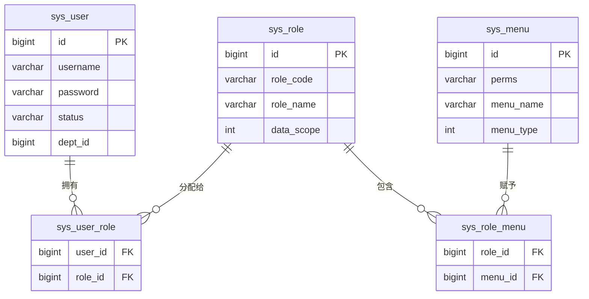

#### 生产级 DDL 设计规范（MySQL 8.0）

```sql
-- 1. 用户表
CREATE TABLE `sys_user` (
  `id` BIGINT NOT NULL AUTO_INCREMENT COMMENT '主键ID',
  `dept_id` BIGINT DEFAULT NULL COMMENT '所属部门ID',
  `username` VARCHAR(64) NOT NULL COMMENT '登录账号',
  `password` VARCHAR(128) NOT NULL COMMENT '加密密码(BCrypt)',
  `nickname` VARCHAR(64) NOT NULL COMMENT '用户昵称',
  `status` TINYINT(1) DEFAULT 1 COMMENT '状态(0:停用, 1:正常)',
  `deleted` TINYINT(1) DEFAULT 0 COMMENT '逻辑删除',
  PRIMARY KEY (`id`),
  UNIQUE KEY `uk_username` (`username`)
) ENGINE=InnoDB DEFAULT CHARSET=utf8mb4 COMMENT='用户表';

-- 2. 角色表
CREATE TABLE `sys_role` (
  `id` BIGINT NOT NULL AUTO_INCREMENT COMMENT '角色ID',
  `role_name` VARCHAR(64) NOT NULL COMMENT '角色名称(如:超级管理员)',
  `role_code` VARCHAR(64) NOT NULL COMMENT '角色权限编码(如:ROLE_ADMIN)',
  `data_scope` TINYINT(1) DEFAULT 1 COMMENT '数据范围(1:全部, 2:自定义, 3:本部门, 4:本部门及以下, 5:仅本人)',
  `status` TINYINT(1) DEFAULT 1 COMMENT '状态',
  PRIMARY KEY (`id`),
  UNIQUE KEY `uk_role_code` (`role_code`)
) ENGINE=InnoDB DEFAULT CHARSET=utf8mb4 COMMENT='角色表';

-- 3. 菜单与权限表（目录、菜单、按钮）
CREATE TABLE `sys_menu` (
  `id` BIGINT NOT NULL AUTO_INCREMENT COMMENT '菜单/权限ID',
  `parent_id` BIGINT DEFAULT 0 COMMENT '父级ID',
  `menu_name` VARCHAR(64) NOT NULL COMMENT '菜单名称',
  `menu_type` CHAR(1) NOT NULL COMMENT '类型(M:目录, C:菜单, F:按钮/接口权限)',
  `path` VARCHAR(255) DEFAULT '' COMMENT '路由地址',
  `perms` VARCHAR(128) DEFAULT NULL COMMENT '权限标识(如: system:user:delete)',
  PRIMARY KEY (`id`)
) ENGINE=InnoDB DEFAULT CHARSET=utf8mb4 COMMENT='菜单权限表';

-- 4. 用户-角色关联表
CREATE TABLE `sys_user_role` (
  `user_id` BIGINT NOT NULL,
  `role_id` BIGINT NOT NULL,
  PRIMARY KEY (`user_id`, `role_id`)
) ENGINE=InnoDB DEFAULT CHARSET=utf8mb4 COMMENT='用户角色关联表';

-- 5. 角色-菜单权限关联表
CREATE TABLE `sys_role_menu` (
  `role_id` BIGINT NOT NULL,
  `menu_id` BIGINT NOT NULL,
  PRIMARY KEY (`role_id`, `menu_id`)
) ENGINE=InnoDB DEFAULT CHARSET=utf8mb4 COMMENT='角色权限关联表';
```

---

## 二、Web 会话管理与分布式架构演进

### 1. HTTP 无状态与会话生命周期
HTTP 协议本身是**无状态（Stateless）**的，两次 HTTP 请求之间没有任何关联记忆。
**会话管理（Session Management）**的本质：通过某种机制让服务端能够跨越多个独立的 HTTP 请求识别并维持同一客户端的登录身份。会话经历 6 个阶段：**创建 -> 存储 -> 传递 -> 校验 -> 续签 -> 销毁**。

---

### 2. 会话管理四大演进阶段

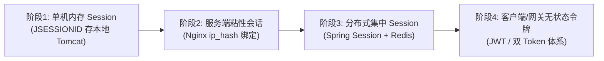

#### 阶段一：单机内存 Session（传统单体时代）
- **核心机制**：客户端首次登录成功，Tomcat 在内存中开辟 `HttpSession` 对象，生成唯一字符串 `JSESSIONID`，通过响应头 `Set-Cookie: JSESSIONID=xxx; Path=/; HttpOnly` 写入浏览器。后续每次请求浏览器自动携带 Cookie。
- **致命缺陷**：
  1. **无法水平扩展**：集群部署时，负载均衡（如 Nginx 轮询）将请求打到不同服务器，导致会话丢失需要反复登录。
  2. **内存溢出风险**：海量用户在线时，服务器内存被挤爆。
  3. **单点重启失效**：服务器重启或发版部署，内存会话全部丢失。

#### 阶段二：负载均衡粘性会话（Sticky Session）
- **核心机制**：在 Nginx 配置 `ip_hash`，根据客户端客户端 IP 计算 Hash，确保同一 IP 的请求始终路由到同一台 Tomcat 节点。
- **致命缺陷**：
  1. **负载倾斜**：企业网关、局域网代理出口 IP 相同，会导致数千人被打到同一台服务器，单机过载。
  2. **容灾能力极差**：某台节点宕机后，该节点绑定的所有用户会话瞬间丢失。

#### 阶段三：分布式集中式 Session（Spring Session + Redis）

- **核心机制**：将 Session 状态与单机 Tomcat 容器解耦，统一接管并持久化至 Redis 集群。所有微服务节点均为无状态节点，读取同一 Redis 中的 Session 数据。
- **Java 生产集成**：
  ```xml
  <dependency>
      <groupId>org.springframework.session</groupId>
      <artifactId>spring-session-data-redis</artifactId>
  </dependency>
  ```
  ```java
  @Configuration
  @EnableRedisHttpSession(maxInactiveIntervalInSeconds = 1800) // 30分钟会话超时
  public class HttpSessionConfig {
  }
  ```
- **优点**：完美支持水平扩容、服务器发版重启用户无感知、可灵活实现强行踢人下线。
- **缺点**：每次请求都需网络 I/O 访问 Redis；移动端/小程序等无 Cookie 环境适配麻烦。

#### 阶段四：客户端/网关无状态 Token（现代互联网主流）

- **核心机制**：服务端完全不存储会话状态。用户登录成功后，服务端签发一段经过数字签名的令牌（JWT），客户端自行存储在 LocalStorage 或 HttpOnly Cookie 中，每次请求在 Header 中附带 `Authorization: Bearer <token>`。
- **优点**：服务端完全无状态、天然跨域、跨端（APP/小程序/Web）、微服务网关一次验签后透传，吞吐上限高。

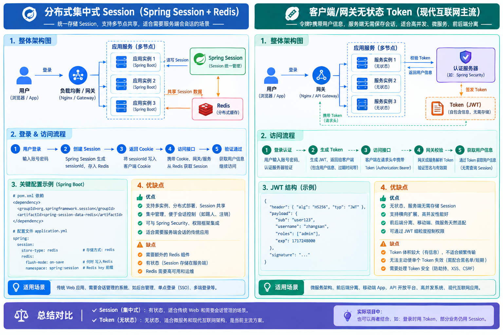


---

### 3. 四大方案横向对比矩阵与选型决策指南

| 评估维度 | 阶段一：单机内存 Session | 阶段二：粘性 Session | 阶段三：Redis 分布式 Session | 阶段四：无状态 JWT Token |
| :--- | :--- | :--- | :--- | :--- |
| **存储介质** | 单机 Tomcat 内存 | 单机 Tomcat 内存 | Redis 集中式集群 | 客户端存储（服务端不存） |
| **集群水平扩展** | ❌ 无法扩展 | ⚠️ 伪扩展（依赖IP绑定） | ✅ 完美水平扩展 | ✅ 完美水平扩展 |
| **跨域 / 跨端** | ❌ 强依赖 Cookie 同源 | ❌ 强依赖 Cookie 同源 | ⚠️ 依赖 Cookie（可改造） | ✅ 原生支持任意端与跨域 |
| **踢人/改密失效** | ✅ 内存直接销毁 | ✅ 内存直接销毁 | ✅ Redis 瞬间删除 Key | ❌ 纯无状态下无法实时失效 |
| **服务端性能开销** | 占用 JVM 内存 | 占用 JVM 内存，负载不均 | 每次请求消耗 Redis 网络 I/O | 无存储开销，仅消耗 CPU 验签 |
| **选型口诀** | 老旧单体直接废弃 | 应急过渡方案，严禁上生产 | 传统大型企业后台、高管控首选 | 互联网、高并发、移动端/微服务首选 |

---

## 三、JWT 深度剖析与双 Token 生产级方案

### 1. 无状态 JWT-Token 登录全链路实现原理（Java后端面试高频）

#### （1）什么是“无状态（Stateless）”登录？
- **传统有状态（Stateful）Session**：服务端内存或 Redis 必须保存会话数据。客户端每次请求携带 `sessionId`，服务端必须根据 ID 进行一次查询以反查出当前用户信息。
- **无状态（Stateless）Token**：**服务端不存会话、不占内存、不查 Redis/DB**。
  - 用户登录成功后，服务端将用户身份（如 `userId`、`username`、`roles`）编码进令牌（Token）并附加数字签名，交由客户端本地保存；
  - 后续请求客户端携带该 Token，服务端**仅凭 CPU 计算哈希校验签名与有效期**，从 Token 中反解出用户信息，即可确认客户端身份；
  - **核心本质**：**用极轻量的本地 CPU 验签算力，换取了彻底免除服务端存储开销与完美水平扩容能力**。

---

#### （2）极简整体流程（6 步直击本质 · 面试口述首选）

1. **用户提交凭证**：用户在前端输入账号密码发起登录请求；
2. **服务端验密签发**：服务端校验用户名密码，**不生成 Session，不存入 Redis**；
3. **生成无状态 Token**：服务端生成 JWT 令牌，把用户身份（ID、角色等）放进 Payload 载荷，用**服务端保密密钥进行数字签名**，返回给前端；
4. **客户端本地持久化**：前端把 JWT 存到 `localStorage / sessionStorage / Cookie`，后续每次业务请求在请求头 `Authorization: Bearer <token>` 携带该令牌；
5. **网关/过滤器验签**：服务端收到请求，**只做本地 CPU 验签与过期时间比对**，不需要查 Redis 或数据库读取会话；验签通过后直接解析出用户信息执行业务；
6. **校验结果分支**：签名合法且未过期就放行；签名被篡改或已过期则直接返回 HTTP 401 未授权。

> [!TIP]
> **一句话直击核心**：**所有会话数据自包含在 Token 字符串内，服务端只保存签名密钥，不保存任何用户会话状态**。

---

#### （3）端到端完整时序流（Java 视角文字版 · 清晰必背）

整个无状态 JWT 认证生命周期严格划分为两大阶段（共 16 个细分步骤）：

##### 阶段一：用户登录与 Token 签发（登录态生成）

1. **客户端提交登录**：用户在 Web/APP 表单输入账号密码，前端发起 `POST /api/auth/login` 请求；
2. **控制器接收分发**：`AuthController`（登录控制器）接收参数，转交调用 `AuthService.login(username, password)`；
3. **数据库核验密码**：`AuthService` 连数据库（MySQL）查询用户信息，使用 `PasswordEncoder.matches()` 核对 BCrypt 加密密码；
4. **生成自包含 JWT**：密码比对通过后，服务端将 `userId`、`username`、`roles` 等核心标识组装为 Claims 载荷，附带过期时间 `exp`，利用服务端保密的 `SecretKey` 计算 HMAC-SHA256 签名，生成无状态 JWT 字符串；
5. **服务层向控制器返回**：`AuthService` 将生成完毕的 JWT 令牌字符串返回给 `AuthController`；
6. **响应下发给前端**：控制器封装统一响应体 `{"accessToken": "eyJhbGciOiJI..."}` 返回给客户端；
7. **客户端本地持久化**：前端接收到 Token，写入 `localStorage`、`sessionStorage` 或内存，登录阶段完成。

##### 阶段二：携带 Token 访问受保护业务接口（鉴权与业务执行）

8. **前端发起受保护请求**：用户点击操作（如查询我的订单 `GET /orders/my-list`），Axios 拦截器在请求头自动携带 `Authorization: Bearer <token>`；
9. **全局过滤器统一截获**：请求到达后端，挂载在请求链最前端的 `JwtAuthenticationFilter`（继承 `OncePerRequestFilter`）拦截请求；
10. **提取并预校验令牌**：从 `Authorization` 请求头中截取去除 `Bearer ` 后的纯 Token 字符串，若缺失或格式错误则按白名单放行或直接阻断；
11. **本地 CPU 极速验签**：调用 `JwtUtils.parseToken(token)`，本地使用 `SecretKey` 计算哈希比对 Signature 签名防伪造，并比对服务器当前时间与 `exp`：
    - ❌ **验签失败或已过期**：抛出 `JwtException` / `ExpiredJwtException`，Filter 直接中断请求，返回 HTTP 401 Unauthorized；
    - ✅ **验签通过且未过期**：继续向下执行放行与上下文绑定流程；
12. **反解 Claims 权限载荷**：直接从 Token 的 Payload 中反解出 `userId` 与 `roles` 角色权限列表，**全程不查 Redis 或数据库**；
13. **注入线程上下文（ThreadLocal）**：构建标准认证主体 `UsernamePasswordAuthenticationToken`，写入 `SecurityContextHolder.getContext().setAuthentication(auth)`，与当前处理线程深度绑定；
14. **过滤器链放行至业务层**：执行 `filterChain.doFilter(request, response)`，请求流转进入 Spring MVC 的 `OrderController`；
15. **业务方法无感获取当前用户**：业务层直接调用 `SecurityUtils.getUserId()` 从当前线程上下文获取当前登录用户 ID，完成业务查询并返回业务 JSON；
16. **线程上下文清理（防内存泄漏）**：响应返回客户端时，Filter 在 `finally` 块中强制执行 `SecurityContextHolder.clearContext()`，清空当前线程变量，彻底规避 Tomcat 线程池复用导致的身份串号或内存泄漏。

---

#### （4）Java 后端核心落地“三板斧”（生产级精炼源码）

##### 第一板斧：JWT 签发与验签工具类（`JwtUtils`）
```java
@Component
public class JwtUtils {
    // 生产环境中必须配置在 nacos/apollo 中，且长度不得小于 256 位(32字符)
    private static final String SECRET_KEY = "YourSecretKeyMustBeLongEnoughForHMAC256AlgorithmSecret!";
    private static final Key KEY = Keys.hmacShaKeyFor(SECRET_KEY.getBytes(StandardCharsets.UTF_8));
    private static final long EXPIRE_TIME = 30 * 60 * 1000L; // 30分钟有效

    // 1. 签发 Token
    public String createToken(Long userId, String username, List<String> roles) {
        Date now = new Date();
        Date expiration = new Date(now.getTime() + EXPIRE_TIME);

        return Jwts.builder()
                .setHeaderParam("typ", "JWT")
                .setSubject(String.valueOf(userId))
                .claim("username", username)
                .claim("roles", roles)
                .setIssuedAt(now)
                .setExpiration(expiration) // 标准 exp 声明
                .setId(UUID.randomUUID().toString()) // 唯一 jti
                .signWith(KEY, SignatureAlgorithm.HS256)
                .compact();
    }

    // 2. 验签并解析 Claims
    public Claims parseToken(String token) throws JwtException {
        // parserBuilder 会自动校验 Signature 是否篡改、exp 是否过期，若不合法直接抛异常
        return Jwts.parserBuilder()
                .setSigningKey(KEY)
                .build()
                .parseClaimsJws(token)
                .getBody();
    }
}
```

##### 第二板斧：请求拦截与认证上下文绑定过滤器（`JwtAuthenticationFilter`）
```java
@Component
public class JwtAuthenticationFilter extends OncePerRequestFilter {

    @Autowired
    private JwtUtils jwtUtils;

    @Override
    protected void doFilterInternal(HttpServletRequest request, 
                                    HttpServletResponse response, 
                                    FilterChain filterChain) throws ServletException, IOException {
        String authHeader = request.getHeader("Authorization");

        // 1. 校验请求头是否包含合法 Bearer Token
        if (StringUtils.hasText(authHeader) && authHeader.startsWith("Bearer ")) {
            String token = authHeader.substring(7);
            try {
                // 2. 验签与解析 (纯本地 CPU 算力比对，零 I/O 消耗)
                Claims claims = jwtUtils.parseToken(token);
                Long userId = Long.valueOf(claims.getSubject());
                String username = claims.get("username", String.class);
                List<String> roles = (List<String>) claims.get("roles");

                // 3. 构造认证主体并注入 SecurityContextHolder (ThreadLocal)
                List<SimpleGrantedAuthority> authorities = roles.stream()
                        .map(SimpleGrantedAuthority::new)
                        .collect(Collectors.toList());

                UsernamePasswordAuthenticationToken authentication =
                        new UsernamePasswordAuthenticationToken(new LoginUser(userId, username), null, authorities);

                SecurityContextHolder.getContext().setAuthentication(authentication);
            } catch (ExpiredJwtException e) {
                log.warn("Token 已过期: {}", e.getMessage());
                // 可在此处直接输出 401 响应或放行让下游 ExceptionTranslationFilter 捕获
            } catch (JwtException e) {
                log.error("Token 非法/被篡改: {}", e.getMessage());
            }
        }

        try {
            // 4. 放行给后续 Filter 或 Controller
            filterChain.doFilter(request, response);
        } finally {
            // 5. 关键：请求结束后清空 ThreadLocal，防止 Tomcat 线程池复用导致的串号或内存泄漏
            SecurityContextHolder.clearContext();
        }
    }
}
```

##### 第三板斧：业务层无感获取当前用户信息（`SecurityUtils`）
```java
public class SecurityUtils {
    public static Long getUserId() {
        Authentication auth = SecurityContextHolder.getContext().getAuthentication();
        if (auth != null && auth.getPrincipal() instanceof LoginUser) {
            return ((LoginUser) auth.getPrincipal()).getUserId();
        }
        throw new BusinessException(401, "未登录或登录态失效");
    }
}

// 业务 Controller 中直接获取当前用户，无需任何入参
@RestController
@RequestMapping("/orders")
public class OrderController {
    @GetMapping("/my-list")
    public Result getMyOrders() {
        Long currentUserId = SecurityUtils.getUserId();
        return Result.success(orderService.listByUserId(currentUserId));
    }
}
```

---

#### （5）面试官核心追问与满分回答

- **追问 1：无状态登录下，服务端完全不存数据，如何保证 Token 不被篡改？**
  > **满分应答**：
  > “底层完全依赖第三段的 **Signature（数字签名）**。签名是由服务端保密的 `SecretKey` 结合 Header 和 Payload 进行不可逆哈希算法（如 HMAC-SHA256）计算出来的。黑客若在前端将 Payload 里的 `userId=1001` 改成 `1000`（管理员），由于他不知道服务端的 SecretKey，无法算出匹配的数字签名。服务端收到后使用自身的 Secret 重新计算签名，两相对比不一致立即抛出 `SignatureException` 拦截，从而确保防篡改。”

- **追问 2：既然是无状态，如果客户端拿着过期的 Token 过来，服务端不查库怎么知道它过期了？**
  > **满分应答**：
  > “JWT 标准规范中包含预定义声明 `exp`（Unix 过期时间戳）。在签发时，服务端将当前时间加上有效时长（如当前时间 + 30分钟）写入 Payload。服务端解析时，JWT 类库内部会自动比对当前服务器时间 `System.currentTimeMillis()` 与 `exp`。只要当前时间大于 `exp`，直接抛出 `ExpiredJwtException` 阻断。整个过期判断完全是**纯本地时间戳算术比对**，不需要任何网络 I/O 或数据库查询。”

- **追问 3：每次接口请求都要经过 Filter 解析验签 Token，性能开销大吗？**
  > **满分应答**：
  > “性能极高。首先，JWT 的 Payload 只是 Base64URL 编码而不是耗时的非对称加解密；其次，验签只是一次内存中的哈希摘要计算，单核 CPU 每秒可进行数十万次计算，单次耗时在微秒级。相比查 Redis（网络往返通常 1~2ms）或查数据库（10~50ms），无状态本地验签在并发吞吐量上提升了数个数量级。”


### 2. JWT 底层原理与三段式结构

JWT（JSON Web Token，RFC 7519）是一段紧凑、URL 安全的字符串，由英文句点（`.`）拼接成三部分：
$$\text{JWT} = \text{Base64URL(Header)} + \text{"."} + \text{Base64URL(Payload)} + \text{"."} + \text{Signature}$$

```
eyJhbGciOiJIUzI1NiIsInR5cCI6IkpXVCJ9.eyJzdWIiOiIxMDAxIiwidXNlcm5hbWUiOiJhZG1pbiIsImV4cCI6MTcxMDAwOTAwMH0.2rN7GZ06...
|-------------- 1. Header -------------| |---------------- 2. Payload ----------------| |----- 3. Signature -----|
```

1. **Header（头部）**：声明令牌类型及签名算法（如 `{"alg": "HS256", "typ": "JWT"}`）。
2. **Payload（负载）**：存放公开业务 Claims（如 `sub: "1001"`、`username: "zhangsan"`、`exp: 1710009000`）。
   
   > **【高压红线】**：Payload 仅仅是 **Base64URL 编码，绝不是加密**！任何人拿到 Token 都能反解查看明文内容，**严禁存放用户密码、手机号、身份证、支付密码等高敏感数据**！
3. **Signature（签名）**：服务端密钥（Secret）与前两部分的哈希签名，**唯一防篡改屏障**。

---

### 3. 验签底层数学原理：HS256 对称 vs RS256 非对称

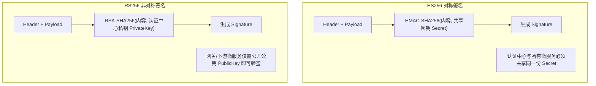

- **HS256（对称算法）**：签发和验签使用同一个密钥。**缺点**：一旦某一下游服务泄露密钥，整个安全体系崩溃。
- **RS256（非对称算法）⭐ 大厂微服务标配**：认证中心持有私钥负责签发，网关和下游服务仅持有公钥进行只读验签。即使公钥被反编译公开，也无法伪造合法 Token。

---

### 4. JWT“纯无状态”的致命代价与三大业务痛点

面试官常问：*“JWT 无状态听起来很美好，为什么实际生产中必须引入 Redis？”*
1. **痛点一：主动踢人与注销失效（无法撤销）**：JWT 一旦签发，在有效期（如 2 小时）内一直有效。用户点击“退出登录”或管理员“强制踢下线”，纯 JWT 无法令其立即作废。
2. **痛点二：封禁/改密无法实时生效**：用户修改密码或被系统封禁，手里的 Token 依然畅通无阻，能继续调用接口直至过期。
3. **痛点三：续期与“吞表单”体验灾难**：为了安全将有效期设为 30 分钟，用户填写了 31 分钟的长表单点击提交，直接 401 报错跳登录页，表单内容全部丢失。

---

### 5. 破局之道：Redis 辅助（黑名单 vs 白名单设计）

| 机制 | Redis 存储内容 | 读写频率 | 能否踢人/改密 | 架构纯粹度 | 适用场景 |
| :--- | :--- | :--- | :--- | :--- | :--- |
| **纯 JWT** | 不存任何内容 | 0 次 Redis I/O | ❌ 无法主动失效 | 100% 无状态 | 一次性下载链接、第三方 Webhook |
| **黑名单机制 ⭐ 推荐** | 仅存被提前注销/踢掉的 `jti` (Token ID) | 正常读 0 写，注销时写入，校验时先查黑名单 | ✅ 毫秒级主动失效 | 准无状态（仅拦截异常） | 绝大部分互联网中大型业务 |
| **白名单机制** | 存储所有已签发的活跃 Token | 每次请求均查 Redis 校验是否存在 | ✅ 强管控，可限制单端/多端登录设备数 | 实质退化为集中式 Session | 银行金融、涉密管理后台 |

> **黑名单淘汰设计**：将注销的 Token `jti` 存入 Redis，Key 为 `jwt:blacklist:{jti}`，**过期时间设置为该 Token 的剩余有效时间**，既保证了实时封禁，又不会产生 Redis 内存泄漏！

---

### 6. 生产级【双 Token 认证机制】（Access Token + Refresh Token）

双 Token 机制完美兼顾了**接口性能（无状态验签）**与**业务安全（主动续签与随时吊销）**：

- **Access Token（AT，访问令牌）**：有效期短（如 15~30 分钟），用于日常接口鉴权，放在请求头中。
- **Refresh Token（RT，刷新令牌）**：有效期长（如 7~14 天），仅用于在 AT 过期时换取新的 AT，存入 Redis 白名单。

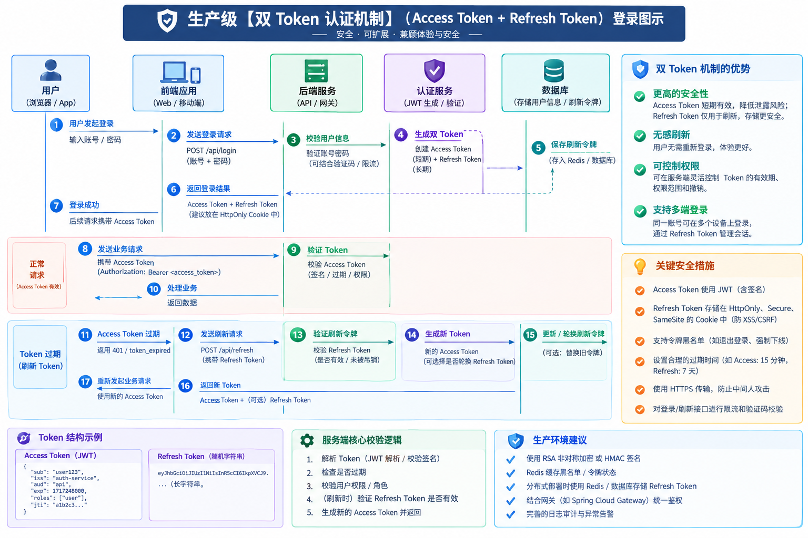

#### 核心生命周期与完整流转时序（文字版 · 3 阶段闭环）

双 Token 机制的全生命周期分为三大核心阶段（共 11 个标准步骤）：

##### 阶段一：初次登录与双令牌签发

1. **客户端发起认证**：用户在登录页输入账号密码，向认证中心发送登录请求；
2. **服务端验证并签发双 Token**：
   - 生成短期访问令牌：**Access Token (AT)**，有效期 15~30 分钟，声明中包含用户 ID、角色等基础信息；
   - 生成长期刷新令牌：**Refresh Token (RT)**，有效期 7~14 天，存入 Redis 白名单：`SET auth:refresh:{userId}:{deviceId} RT EX 7天`；
3. **下发与本地存储**：服务端将 AT 与 RT 组合响应返回，前端持久化存储至 `localStorage`。

##### 阶段二：日常受保护业务请求（极速无状态验签）

4. **携带 AT 访问接口**：前端后续所有日常业务请求，通过请求头自动携带 `Authorization: Bearer <AT>`；
5. **网关/微服务本地验签**：网关或后端服务仅做本地 CPU 密钥验签，**不访问 Redis，也不访问数据库**，验签通过直接放行，性能极高。

##### 阶段三：AT 过期无感自动刷新与重试（用户零感知体验核心）

6. **AT 过期触发 401**：用户请求业务接口时，服务端检测到 AT 的 `exp` 已到期，直接拦截返回 `HTTP 401 Unauthorized (TOKEN_EXPIRED)`；
7. **前端拦截并挂起原请求**：前端 Axios 响应拦截器捕获 401，开启互斥锁挂起当前及后续并发请求，取出本地存储的 `Refresh Token`；
8. **静默调用刷新接口**：前端在后台悄悄向认证中心发起 `POST /auth/refresh` 请求，携带 `refreshToken`；
9. **服务端校验 RT 有效性**：
   - 认证中心核验 RT 的签名与过期时间；
   - 查询 Redis 检查该 RT 是否在白名单中（若用户已被管理员主动踢下线，Redis 中的 RT 已被提前删除）；
10. **分支 A：RT 合法有效（续期成功）**：
    - 服务端签发全新的 AT（30 分钟），并根据安全策略轮转 RT（Refresh Token Rotation）；
    - 更新 Redis 中 RT 的有效期；
    - 将新 AT 返回给前端；
    - 前端更新本地存储，**自动唤醒挂起的重试队列，带上新 AT 重新发起刚才失败的业务请求**，用户在界面上完全无感知！
11. **分支 B：RT 已过期或已被注销（彻底下线）**：
    - 服务端返回 `HTTP 401 (REFRESH_TOKEN_EXPIRED)`；
    - 前端彻底清空本地所有 Token 缓存，强制重定向跳转至登录页要求重新输入账号密码。

#### 前端 Axios 拦截器“无感刷新与并发互斥锁”完整实战

当页面并发发出 5 个请求时，若 AT 恰好过期，如果不加并发控制，会导致 5 个请求同时调用刷新接口，引发竞态问题。生产级标准写法：

```javascript
// request.js (Axios 封装)
import axios from 'axios';

let isRefreshing = false; // 是否正在刷新 Token 的锁
let retryQueue = [];      // 挂起的请求队列

const instance = axios.create({ baseURL: '/api' });

// 请求拦截器：添加 Access Token
instance.interceptors.request.use(config => {
  const token = localStorage.getItem('access_token');
  if (token) config.headers.Authorization = `Bearer ${token}`;
  return config;
});

// 响应拦截器：捕获 401 并自动无感刷新
instance.interceptors.response.use(
  response => response,
  async error => {
    const { config, response } = error;
    if (response && response.status === 401 && !config._retry) {
      if (isRefreshing) {
        // 若正在刷新中，将当前请求包装为 Promise 放入挂起队列
        return new Promise(resolve => {
          retryQueue.push(token => {
            config.headers.Authorization = `Bearer ${token}`;
            resolve(instance(config));
          });
        });
      }

      config._retry = true;
      isRefreshing = true;

      try {
        const refreshToken = localStorage.getItem('refresh_token');
        const res = await axios.post('/api/auth/refresh', { refreshToken });
        const { accessToken, newRefreshToken } = res.data;

        localStorage.setItem('access_token', accessToken);
        if (newRefreshToken) localStorage.setItem('refresh_token', newRefreshToken);

        // 唤醒所有挂起的请求并重试
        retryQueue.forEach(cb => cb(accessToken));
        retryQueue = [];

        // 重试当前失败的请求
        config.headers.Authorization = `Bearer ${accessToken}`;
        return instance(config);
      } catch (refreshErr) {
        // Refresh Token 也失效，彻底退出
        localStorage.clear();
        window.location.href = '/login';
        return Promise.reject(refreshErr);
      } finally {
        isRefreshing = false;
      }
    }
    return Promise.reject(error);
  }
);
```

---

### 7. 存储安全：LocalStorage vs HttpOnly Cookie 攻防对比

| 存储方案 | 受到 XSS 跨站脚本攻击 | 受到 CSRF 跨站请求伪造 | 跨域携带支持 | 生产最佳防护策略 |
| :--- | :--- | :--- | :--- | :--- |
| **LocalStorage** | ❌ **极易被盗取**：黑客通过 XSS 注入 JS 代码即可 `localStorage.getItem()` 窃走 Token | ✅ **免疫 CSRF**：浏览器不会在跨站请求中自动附带 LocalStorage | ✅ 极其灵活，原生支持全平台 | 全站严格进行输入转义、配置 CSP 内容安全策略，杜绝富文本 XSS 漏洞 |
| **HttpOnly Cookie** | ✅ **完全免疫 JS 窃取**：前端 JS 脚本完全无法读取该 Cookie | ❌ **有 CSRF 风险**：跨域表单或恶意链接发起请求时，浏览器会自动带上 Cookie | ⚠️ 跨域需配置 `withCredentials` 与 CORS 白名单 | Cookie 强制配置：`HttpOnly; Secure; SameSite=Lax/Strict`，后端校验自定义 Header 或 CSRF Token |

---

## 四、企业级单点登录（SSO）全景深度剖析

### 1. SSO 核心定义与三大核心角色

**SSO（Single Sign-On，单点登录）**：在企业相互信任的多个独立应用系统中，用户**只需在中心登录一次**，即可在所有关联子系统中畅行无阻；且**在任意一处退出登录，所有子系统同步强制下线**。

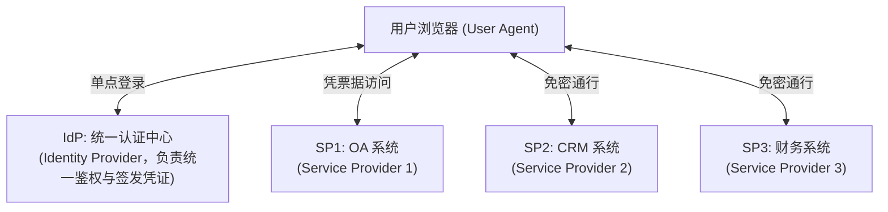

---

### 2. SSO 四大落地演进方案

#### 方案一：同域/顶级域名共享 Cookie（最简单轻量自研）
- **前提条件**：所有子系统必须部署在同一个顶级主域名下（如 `oa.company.com`、`crm.company.com`、`erp.company.com`）。
- **实现原理**：登录成功后，认证服务在写 Cookie 时显式指定 `Domain=.company.com; Path=/`。浏览器在访问任何 `*.company.com` 子域时都会自动携带该 Cookie。所有业务端配合 Redis 集中存储 Session 数据即可直接读取登录态。
- **优缺点**：开发极简，开箱即用；但**跨完全不同的根域名（如 `company-oa.com` 与 `company-crm.com`）时彻底失效**。

#### 方案二：CAS 经典协议（跨域企业级 SSO 标准）⭐ 面试高频必考

CAS（Central Authentication Service）协议通过**票据（Ticket）换取令牌**的机制完美解决完全跨域问题。包含三大核心概念：
1. **TGT（Ticket Granting Ticket）**：全局登录凭证，保存在 CAS 服务端内存/Redis 中。
2. **TGC（Ticket Granting Cookie）**：存放 TGT 唯一标识的 Cookie，只属于 CAS 认证中心域名。
3. **ST（Service Ticket）**：服务临时票据，由 CAS 签发给具体业务系统的单次使用凭证，用于换取用户信息。

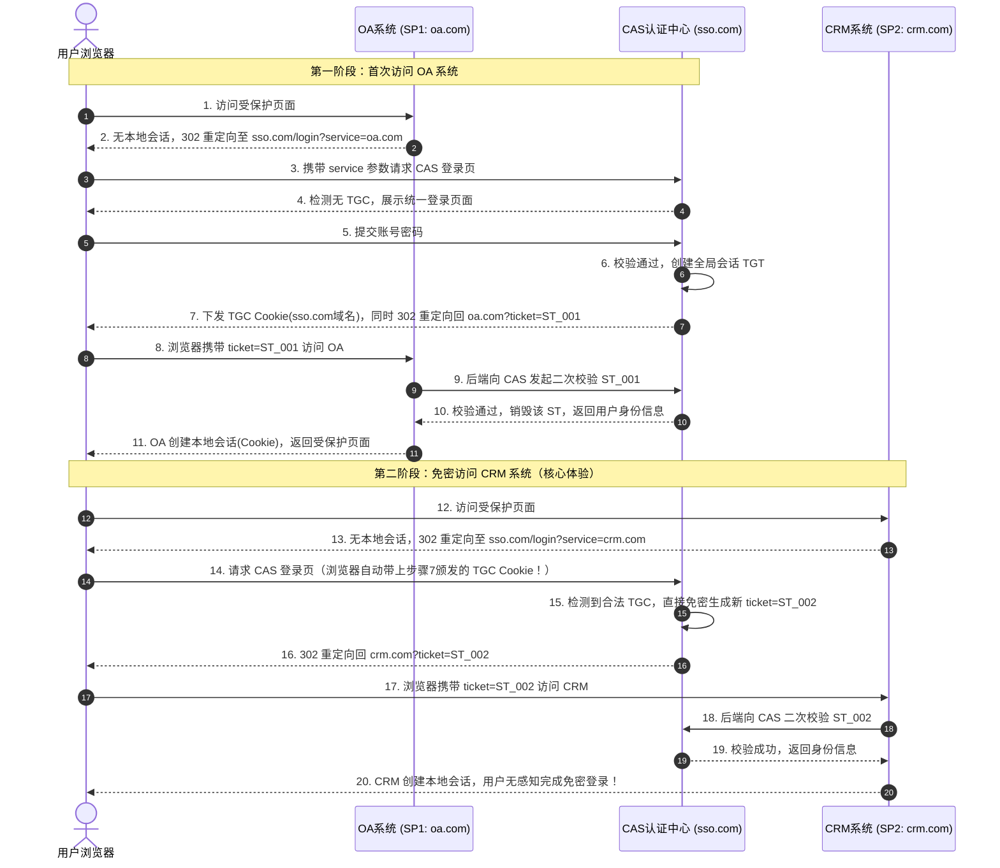

#### 方案三：OAuth 2.0 + OIDC 1.0（现代化互联网/SaaS 首选）
- **核心机制**：在 OAuth 2.0 授权框架上引入 OpenID Connect（OIDC）。IdP 签发 **ID Token（JWT 格式，包含身份信息）** 与 **Access Token（访问令牌）**。
- **优点**：原生支持 Web/移动端/小程序，支持非对称公私钥本地验签（减少服务间回调校验网络开销），国际通用标准。

#### 方案四：SAML 2.0（外企与政务联盟认证）
- **核心机制**：基于 XML 格式的断言（Assertion）交互，安全性极高、配置极度繁琐，专用于大型企业级联邦认证（如 Okta、Azure AD）。

---

### 3. 单点注销（SLO - Single Logout）机制

单点注销是 SSO 架构中最容易出现漏洞的环节。用户在一处点击“退出”，必须全网清除：
1. **客户端注销发起**：用户在 OA 点击“退出”，OA 清理本地 Session，并重定向至 CAS `sso.com/logout`。
2. **销毁全局会话**：CAS 服务端销毁对应 TGT，并清空浏览器的 TGC Cookie。
3. **通知其他业务系统（SLO 广播）**：
   - **方式 A：后端 HTTP 异步广播通知**：CAS 服务端向所有曾为其下发过 ST 的子系统（CRM、财务系统）后台注册的回调 URL 发送 POST 注销请求，各系统后端销毁对应的本地会话。
   - **方式 B：前端隐藏 IFrame 批量注销**：CAS 退出成功页嵌入多个隐藏 IFrame，分别调用各子系统的 logout URL。

---

### 4. SSO 四大方案横向对比矩阵

| 对比维度 | 方案一：同域 Cookie 共享 | 方案二：CAS 经典协议 | 方案三：OAuth 2.0 + OIDC | 方案四：SAML 2.0 |
| :--- | :--- | :--- | :--- | :--- |
| **跨主域名支持** | ❌ 仅支持同顶级域 | ✅ 完美支持完全跨域 | ✅ 完美支持完全跨域 | ✅ 完美支持跨组织联邦 |
| **客户端适配性** | 仅限浏览器端 | 优先浏览器端 | Web、移动端、小程序通杀 | 几乎仅限浏览器 Web 端 |
| **报文/令牌协议** | 普通 SessionId Cookie | 临时 ST 票据（透明字符串） | JSON Web Token (JWT) | 臃肿的 XML 签名报文 |
| **复杂度** | ★☆☆☆☆ (极低) | ★★★☆☆ (中等) | ★★★★☆ (工业级标准) | ★★★★★ (极度繁琐) |
| **代表开源产品** | 自研 Nginx + Redis | Apereo CAS | Keycloak、Authing、Casdoor | Shibboleth、ADFS |

---

## 五、OAuth 2.0 与第三方社交登录实战

### 1. OAuth 2.0 协议本质与四大角色

OAuth 2.0（RFC 6749）是一个**授权（Authorization）代理框架**。它的核心目的不是登录，而是：**允许第三方应用在不获取用户密码的前提下，获得对用户在另一服务上受保护资源的有限访问权限**。

```
1. 资源所有者（Resource Owner）：用户自己（拥有微信/GitHub 账号）
2. 客户端（Client）：我们的业务系统（需要获取用户微信昵称/头像）
3. 授权服务器（Authorization Server）：微信开放平台/GitHub 认证服务（负责展示授权页面、颁发 Token）
4. 资源服务器（Resource Server）：微信开放平台接口服务器（保存用户资料，凭 Token 提供数据）
```

---

### 2. 四大授权模式详解与选型

| 模式名称 | 核心应用场景 | 安全系数 | 核心交互逻辑 |
| :--- | :--- | :--- | :--- |
| **授权码模式（Authorization Code）⭐ 唯一推荐** | 绝大多数有后端的 Web 应用、微信扫码登录、移动 APP | **最高** | 用户在三方页面授权得到临时 `code`，**后端拿着 code + 密钥秘密兑换 `access_token`**，令牌不经浏览器 |
| **隐式/简化模式（Implicit）** | 无后端的纯前端单页应用（SPA） | ❌ **极低**（RFC 已弃用） | 浏览器地址栏重定向直接明文暴露 Token，极易被历史记录与 Referer 窃取 |
| **密码模式（Resource Owner Password）** | 企业自研高度信任的自家第一方系统 | ⚠️ **低**（慎用） | 用户直接在客户端界面输入微信密码，完全违背第三方解耦初衷 |
| **客户端凭证模式（Client Credentials）** | 没有用户参与的微服务之间 M2M 接口调用 | **高** | 客户端凭自身的 `client_id` + `client_secret` 直接获取系统级访问令牌 |

---

### 3. 授权码模式标准交互时序流（文字版 · 生产级 4 阶段闭环）

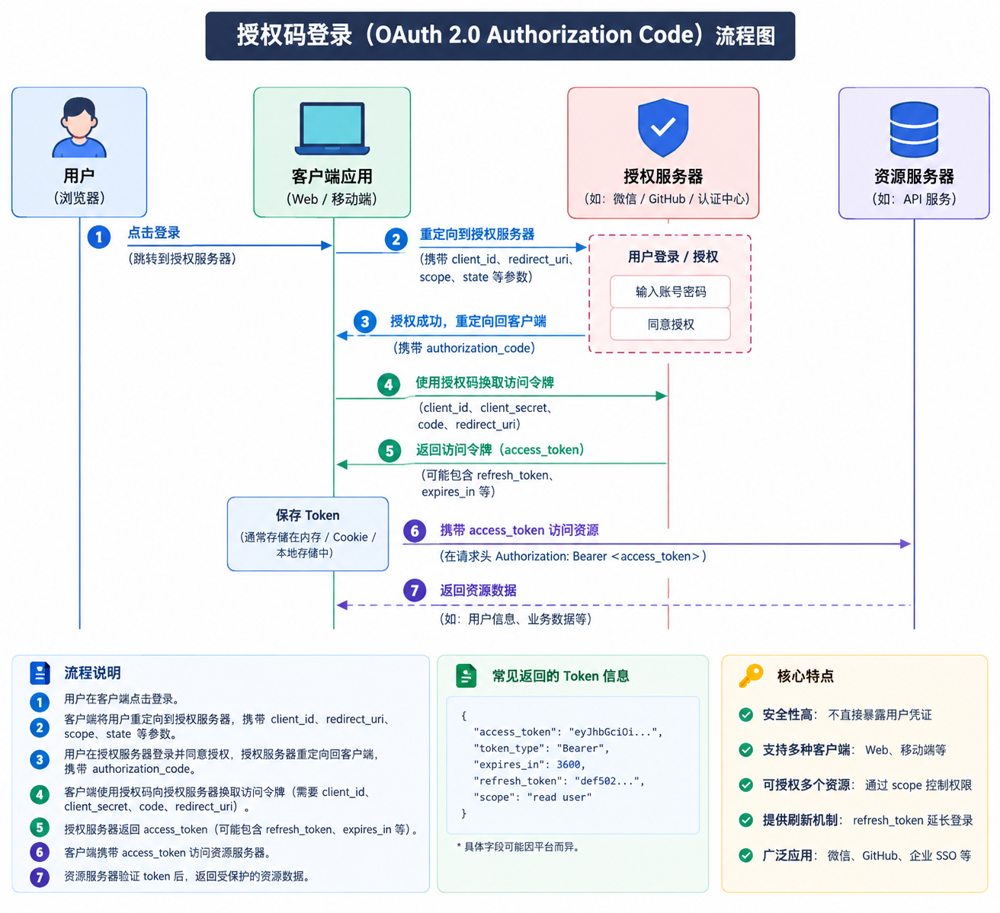

以国内最典型的**微信扫码登录**为例，标准授权码模式的全流程严格划分为 4 大阶段（共 15 个细分步骤）：

##### 阶段一：引导授权与防 CSRF 准备

1. **触发第三方登录**：用户在 Web 页面点击“微信快捷登录”按钮；
2. **请求构造授权链接**：前端请求后端接口获取微信扫码授权 URL；
3. **后端生成安全 State**：后端生成高强度防 CSRF 随机字符串 `state`，存入 Redis（设置 5 分钟 TTL）；
4. **拼接授权 URL 并跳转**：后端向前端返回拼装好的微信二维码跳转链接：
   `https://open.weixin.qq.com/connect/qrconnect?appid=APPID&redirect_uri=CALLBACK&response_type=code&scope=snsapi_login&state=RANDOM_STATE`；
5. **展示官方扫码界面**：前端跳转或使用 IFrame 展示微信官方扫码页面。

##### 阶段二：用户授权与临时 Code 颁发

6. **用户扫码确认**：用户使用手机微信扫码并点击“允许 / 确认登录”；
7. **微信重定向下发授权码**：微信授权服务器确认用户同意后，通过 302 重定向将用户浏览器跳转回开发者配置的回调地址：
   `CALLBACK?code=TEMP_CODE&state=RANDOM_STATE`；
8. **前端截获回调参数**：前端单页应用（SPA）路由截获 URL 中的临时授权码 `code` 和防伪 `state`，立即调用本站后端业务接口：`POST /api/auth/wechat/callback?code=xxx&state=xxx`。

##### 阶段三：后端安全兑换令牌与拉取用户资料

9. **核心防御 CSRF 校验**：后端收到请求，**第一步比对前端传来的 `state` 是否与 Redis 中的缓存一致**（若不一致或已过期，说明存在跨站请求伪造攻击，直接抛异常阻断）；
10. **后端秘密兑换 AccessToken**：后端通过内部服务器向微信授权服务器发送 POST 请求，使用 `code + appid + appsecret` 兑换访问令牌；
    
    > **【安全铁律】**：`appsecret`（应用密钥）绝对严禁暴露给前端，必须由后端在受保护的网络中秘密发起！临时授权码 `code` 只能使用一次，有效时间通常为 5 分钟。
11. **微信返回开放凭据**：微信校验通过，返回 `access_token`、`expires_in`、`openid` 以及 `unionid`；
12. **获取用户公开资料**：后端携带刚获取的微信 `access_token`，调用微信资源服务器用户信息接口，拉取用户基本信息（微信昵称、头像、性别等）。

##### 阶段四：本地账号绑定与登录完成

13. **账号关联与自动注册**：后端根据微信 `unionid` 查询本地数据库：
    - **若已绑定**：直接关联对应的本地系统用户账号；
    - **若未绑定**：自动为新用户创建本地账号（或引导绑定已有手机号），并将 `unionid` / `openid` 写入 `sys_user_social` 关联表；
14. **签发本站业务令牌**：服务端基于本地用户 ID 签发本站的业务 JWT 访问令牌（Access Token）；
15. **完成登录进入系统**：后端向前端响应本站 JWT Token，前端存储并跳转至用户主页，整个第三方登录流程圆满闭环！

---

### 4. 国内微信扫码登录企业级实战与表结构设计

#### 微信体系核心标识区分（面试必问）
- **OpenID**：同一用户在**同一个微信公众号/小程序/开放应用**下的唯一标识。同一个用户在不同小程序或网站里的 OpenID 完全不同。
- **UnionID**：同一主体（同一开发者资质）下绑定的所有公众号、小程序、PC 网站，**同一用户的 UnionID 唯一且完全相同**。因此，做多端统一账号打通，**必须以 UnionID 为核心基准**！

#### 第三方账号绑定表设计（支持微信、手机、GitHub 多端绑定）

```sql
CREATE TABLE `sys_user_social` (
  `id` BIGINT NOT NULL AUTO_INCREMENT COMMENT '主键ID',
  `user_id` BIGINT NOT NULL COMMENT '系统本地用户表ID(sys_user.id)',
  `identity_type` VARCHAR(32) NOT NULL COMMENT '登录类型(WECHAT, GITHUB, DINGTALK, MOBILE)',
  `identifier` VARCHAR(128) NOT NULL COMMENT '唯一标识(微信UnionID/OpenID, 手机号)',
  `credential` VARCHAR(255) DEFAULT NULL COMMENT '第三方凭证/AccessToken(非必填)',
  `extra_info` JSON DEFAULT NULL COMMENT '第三方返回的扩展信息(头像、昵称)',
  `created_time` DATETIME DEFAULT CURRENT_TIMESTAMP COMMENT '绑定时间',
  PRIMARY KEY (`id`),
  UNIQUE KEY `uk_type_identifier` (`identity_type`, `identifier`),
  KEY `idx_user_id` (`user_id`)
) ENGINE=InnoDB DEFAULT CHARSET=utf8mb4 COMMENT='用户第三方社会化账号绑定表';
```

#### 关键安全防御（面试加分项）：
1. **防 CSRF 跨站伪造（State 参数）**：
   - 漏洞场景：黑客自己扫码生成回调链接，诱导受害者点击，受害者的本地账号会被恶意绑定为黑客的第三方账号。
   - 防御策略：每次发起授权前生成一段加密随机数存入 Redis Session，微信回调时后端比对参数中的 state，不一致立即拦截。
2. **AppSecret 泄露防御**：
   - 严禁在前端代码或移动端反编译包中保存 `AppSecret`，所有换取 Token 的网络请求必须在受保护的后端服务间完成。

---

## 六、主流安全框架与微服务网关鉴权

### 1. 安全框架全面对比与选型原则

| 对比维度 | Spring Security（官方标配） | Apache Shiro（老牌轻量） | Sa-Token（国产新兴高星） |
| :--- | :--- | :--- | :--- |
| **生态与官方支持** | Spring 官方顶级项目，更新最活跃 | Apache 顶级项目，但近几年更新缓慢 | 国内个人与社区维护，文档极度友好 |
| **上手与学习成本** | ★★★★★ (过滤器链庞大，概念复杂繁琐) | ★★★☆☆ (Realm、Subject 概念清晰) | ★☆☆☆☆ (几行代码开箱即用，极简 API) |
| **微服务/网关支持** | 完整支持 Spring Cloud Gateway、OAuth2 | 需深度定制，对响应式 Gateway 支持较差 | 提供专门的 Gateway 与微服务依赖包 |
| **核心底层设计** | 基于 Servlet Filter 链与 AOP | 基于 Filter 拦截与 SecurityManager 调度 | 基于 WebMvc 拦截器 / 网关全局过滤器 |
| **适用业务场景** | **中大型企业、金融军工、Spring 全家桶标配** | 传统老旧单体项目维护 | **中小型互联网项目、快速开发、自研后台系统** |

---

### 2. Spring Security 核心架构与底层运行链（大厂面试高频必考）

#### （1）过滤器链整体架构：从 Servlet 到 Spring Bean

Spring Security 的本质是一个挂载在标准 Servlet 容器上的 **过滤器链（Filter Chain）**。其核心入口是 `DelegatingFilterProxy`，它通过桥接模式将标准 Servlet 请求转交给 Spring 容器管理的 `FilterChainProxy`，最后由具体的 `SecurityFilterChain` 顺序调度核心过滤器：

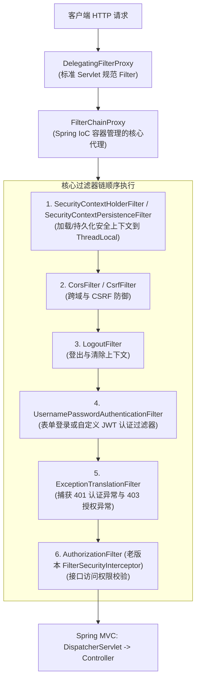

#### （2）核心认证流程（Authentication 流转链路）

当用户提交用户名和密码时，Spring Security 内部的标准认证调用链如下：

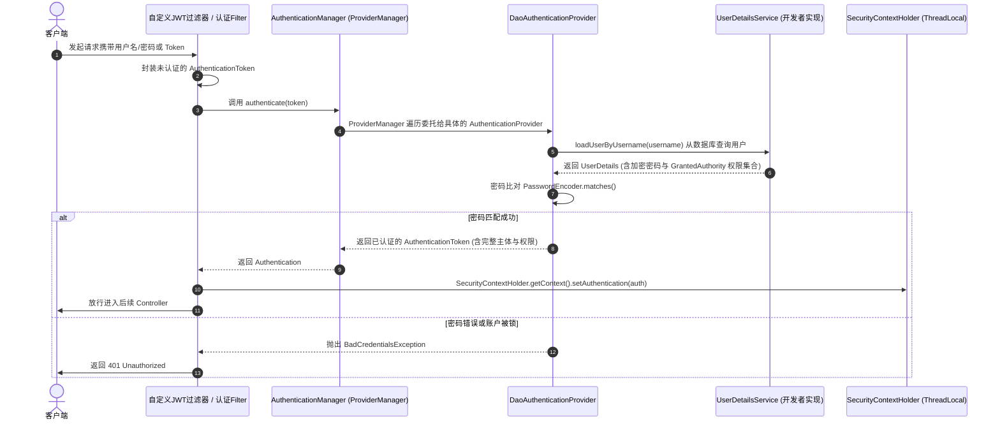

#### （3）上下文线程绑定与内存泄漏防御

Spring Security 默认使用 `ThreadLocal` 来存储当前登录用户的认证信息：
```java
// 存储与获取当前登录用户
Authentication auth = SecurityContextHolder.getContext().getAuthentication();
String currentUsername = auth.getName();
```

- **ThreadLocal 内存泄漏隐患**：在基于 Tomcat 线程池的 Web 容器中，工作线程会被循环复用。如果一个请求处理完毕后未清除 `ThreadLocal` 中的内容，后续复用该线程的新请求可能会**串号读取到上一个用户的登录身份**，或导致内存无法回收引发 OOM！
- **底层防御机制**：Spring Security 链首的 `SecurityContextHolderFilter` 采用 `try ... finally` 范式，在响应返回给客户端后，在 `finally` 块中**强制执行 `SecurityContextHolder.clearContext()`**，彻底规避线程复用串号与内存泄漏。
- **异步子线程与微服务透传**：
  - **跨线程传递**：若在业务方法中开启新线程处理业务，默认子线程无法读取父线程的 `SecurityContext`。可通过设置系统属性 `SecurityContextHolder.setStrategyName(SecurityContextHolder.MODE_INHERITABLETHREADLOCAL)` 或使用 `DelegatingSecurityContextExecutor` 包装线程池。
  - **Feign 微服务间传递**：编写 Feign 的 `RequestInterceptor`，在每次 RPC 调用前从当前线程提取 Token，塞入远程请求的 Header 中透传。

---

### 3. Sa-Token 轻量级微服务架构与避坑指南

Sa-Token 在国内中小企业应用极其广泛，其核心理念是**去框架化、以 API 方法调用为中心**（如 `StpUtil.login(10001)`、`StpUtil.checkPermission("user:delete")`）。

#### （1）微服务分布式典型架构（Gateway + Auth + Biz）

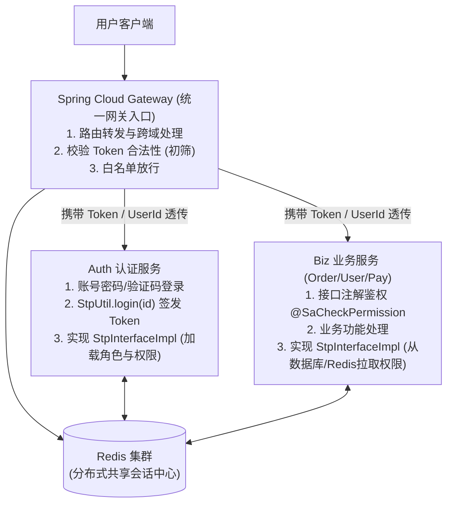

#### （2）【大厂面试高频追问】为什么 `StpInterfaceImpl` 绝对不能放在网关，必须放认证/业务服务？

在 Sa-Token 架构中，`StpInterface` 是自定义获取用户权限列表与角色列表的核心扩展接口：
```java
public interface StpInterface {
    List<String> getPermissionList(Object loginId, String loginType);
    List<String> getRoleList(Object loginId, String loginType);
}
```

面试官常问：*“在 Spring Cloud + Gateway 体系中，权限数据源 `StpInterfaceImpl` 能不能配置在 Gateway 网关模块？”*
**答案是：绝对不能！必须严禁在网关中实现该接口。** 深度核心原因如下：
1. **网关响应式模型（Reactor/Netty）受阻**：Spring Cloud Gateway 底层基于 Netty 异步非阻塞模型。若在网关中实现 `StpInterface`，获取权限通常需要连数据库（MySQL/MyBatis），关系型数据库的阻塞 JDBC 操作会瞬间阻塞 Netty EventLoop 事件循环线程，导致网关整体吞吐量暴跌直至雪崩崩溃。
2. **破坏职责边界与微服务解耦原则**：网关只应承担**路由寻址、黑白名单、流量控制、Token 签名有效性初筛**等基础职责；细粒度的业务权限（哪个用户能点哪个按钮）属于业务服务的领域边界，不应向网关泄漏业务数据库连接。
3. **架构臃肿与跨库依赖**：如果在网关去连各个业务服务的数据库来加载权限，网关将强耦合所有业务模块的数据结构，一旦业务权限变更，需要频繁发布核心网关，严重增加系统不可用风险。

#### （3）微服务中鉴权的最佳分工模式

- **网关层（Gateway）做粗粒度认证（Authentication）**：
  - 判断是否在公开白名单（如 `/auth/login`、`/doc.html`）；
  - 非白名单请求，仅校验 Token 是否存在、是否在 Redis 中有效（`StpUtil.checkLogin()`），无效则直接在网关阻断返回 401；
  - 校验通过后，将用户 ID 放入请求头（`X-User-Id`）透明路由给下游服务。
- **业务服务层（Auth / Biz）做细粒度授权（Authorization）**：
  - 下游服务集成 Sa-Token 注解或拦截器；
  - 各服务本地实现 `StpInterfaceImpl`，基于自身业务数据库或本地二级缓存按需加载对应角色的权限列表，执行 `@SaCheckPermission("order:export")` 校验。

---

## 七、细粒度授权与行级数据权限实战

### 1. 接口功能级鉴权：注解鉴权与 SpEL 表达式

现代 Java 框架均推荐使用方法级注解进行声明式接口鉴权：
- **Spring Security 方式**：
  ```java
  // 必须拥有 ROLE_ADMIN 角色
  @PreAuthorize("hasRole('ADMIN')")
  // 必须拥有对应权限标识
  @PreAuthorize("hasAuthority('system:user:delete')")
  // 支持复杂的 SpEL 表达式（当前用户是否为该资源归属者）
  @PreAuthorize("hasRole('ADMIN') or #userId == authentication.principal.id")
  @DeleteMapping("/users/{userId}")
  public Result deleteUser(@PathVariable Long userId) { ... }
  ```
- **Sa-Token 方式**：
  ```java
  @SaCheckRole("admin")
  @SaCheckPermission("system:user:delete")
  @DeleteMapping("/users/{userId}")
  public Result deleteUser(@PathVariable Long userId) { ... }
  ```

---

### 2. 行级数据权限（Data Scope）企业级设计

#### （1）什么是数据权限？
功能权限解决的是**“能不能点击这个按钮”**（如能否访问 `/api/orders`），而数据权限解决的是**“能看到哪些行数据”**（如：普通销售员只能看本人的订单；销售主管能看本部门全部订单；大区经理能看本部门及所有下级部门订单；CEO 能看全部数据）。

常见 5 种数据范围划分：
1. `DATA_SCOPE_ALL` (全部数据权限)
2. `DATA_SCOPE_CUSTOM` (自定义部门数据权限)
3. `DATA_SCOPE_DEPT` (本部门数据权限)
4. `DATA_SCOPE_DEPT_AND_CHILD` (本部门及子部门数据权限)
5. `DATA_SCOPE_SELF` (仅本人数据权限)

#### （2）企业级实现方案：AOP 注解 + MyBatis 拦截器动态改写 SQL

最优雅、对业务代码零侵入的生产方案是：**通过 AOP 结合 MyBatis 插件（或 MyBatis-Plus DataPermissionInterceptor），在执行查询前，动态向原 SQL 的 WHERE 条件中追加部门或用户过滤子句**。

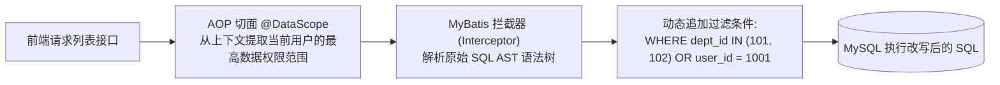

#### 生产级核心设计示意：

```java
// 1. 自定义数据权限注解
@Target(ElementType.METHOD)
@Retention(RetentionPolicy.RUNTIME)
public @interface DataScope {
    String deptAlias() default "d"; // 部门表别名
    String userAlias() default "u"; // 用户表别名
}

// 2. MyBatis 拦截器核心改写逻辑 (基于 JSqlParser)
@Intercepts({@Signature(type = StatementHandler.class, method = "prepare", args = {Connection.class, Integer.class})})
public class DataPermissionInterceptor implements Interceptor {

    @Override
    public Object intercept(Invocation invocation) throws Throwable {
        StatementHandler statementHandler = (StatementHandler) PluginUtils.realTarget(invocation.getTarget());
        MetaObject metaObject = SystemMetaObject.forObject(statementHandler);
        MappedStatement mappedStatement = (MappedStatement) metaObject.getValue("delegate.mappedStatement");

        // 仅拦截标记了 @DataScope 的 Mapper 方法
        DataScope dataScope = getAnnotation(mappedStatement);
        if (dataScope == null) return invocation.proceed();

        BoundSql boundSql = (BoundSql) metaObject.getValue("delegate.boundSql");
        String originalSql = boundSql.getSql();

        // 获取当前登录用户及数据范围
        LoginUser currentUser = SecurityUtils.getLoginUser();
        String dataFilterSql = buildDataFilterSql(currentUser, dataScope);

        // 利用 JSqlParser 解析并在原 SQL 后追加过滤条件
        Select select = (Select) CCJSqlParserUtil.parse(originalSql);
        PlainSelect plainSelect = (PlainSelect) select.getSelectBody();
        Expression originalWhere = plainSelect.getWhere();

        Expression appendWhere = CCJSqlParserUtil.parseCondExpression(dataFilterSql);
        plainSelect.setWhere(originalWhere == null ? appendWhere : new AndExpression(originalWhere, appendWhere));

        // 替换改写后的 SQL
        metaObject.setValue("delegate.boundSql.sql", select.toString());
        return invocation.proceed();
    }

    private String buildDataFilterSql(LoginUser user, DataScope scope) {
        // 根据用户的角色权限范围生成: "d.dept_id IN (1, 2, 3)" 或 "u.user_id = 1001"
        Integer scopeType = user.getMaxDataScope();
        if (scopeType == 1) return "1=1"; // 全部权限
        if (scopeType == 3) return scope.deptAlias() + ".dept_id = " + user.getDeptId();
        if (scopeType == 5) return scope.userAlias() + ".user_id = " + user.getId();
        // ... 其他范围构建
        return "1=1";
    }
}
```

---

## 八、20k~35k 高频面试绝杀与口述模板

### 1. 高频真题 1：双 Token 无感刷新时，高并发多个请求同时触发 401，如何避免旧 Refresh Token 并发刷新报错？

**面试官提问**：
*“你们线上采用了 Access Token + Refresh Token 双令牌机制。用户打开一个包含 5 个异步图表的大屏页面，此时 Access Token 刚好过期，5 个请求几乎同时收到 401。如果采用 Refresh Token 轮转机制（每次刷新同时生成新 RT 并废弃旧 RT），第一个请求刷完后，后 4 个请求带着已经被废弃的旧 RT 去请求刷新接口，会导致系统误判为 Token 窃取而强制退出登录。你们是怎么解决这个高并发刷新竞态的？”*

**满分回答**：
> “我们在生产上采取了**前端防抖互斥队列 + 后端旧 RT 宽限期（Grace Period）**的双重兜底机制：
> 1. **前端层（第一道防线）**：基于 Axios 响应拦截器设置 `isRefreshing` 互斥标志位。第一个捕获 401 的请求发起 `/auth/refresh`，后续并发到来的 401 请求不发起新请求，而是把它们的 `Promise` 回调暂存进 `retryQueue` 重试队列。等刷新请求成功拿到新 Token 后，按序唤醒队列中的请求带上新 Token 重新发起。
> 2. **后端层（高可用兜底）**：即便前端偶发多发了刷新请求，服务端在执行 RT 轮转销毁旧 RT 时，**不立即硬删除**，而是将旧 RT 标记保留一个 **10~30 秒的宽限期（Grace Period）**存入 Redis 临时缓存。在宽限期内到达的旧 RT，服务端依旧返回刚刚签发的新 Token，超过宽限期再彻底作废。这样完美规避了网络抖动与并发刷新导致的闪退问题。”

---

### 2. 高频真题 2：纯 JWT 无法主动失效，生产环境如何实现毫秒级单设备踢人、改密后全端强制下线？

**面试官提问**：
*“JWT 的特点是自包含和无状态，但业务要求管理员能随时在后台‘强制踢下线’某用户，或者用户在手机上修改密码后，必须使 PC 端的登录态立刻失效。你们系统是如何在保证性能的同时做到的？”*

**满分回答**：
> “我们有两套成熟的高性能落地手段，根据管控粒度灵活采用：
> 1. **方案一：Token 签发时间戳 / 版本号（Token Version，开销极小）⭐ 首选**：
>    在用户表或 Redis 中为每个用户维护一个 `token_version` 或 `password_update_time`（最后改密时间戳）。用户每次修改密码或触发全局下线时，将版本号 `+1` 或更新时间戳。JWT 的 Payload 中携带该版本号。网关或微服务验签时，仅从 Redis 中获取当前用户的最新版本号比对，若 Payload 中的版本号小于最新版本号，直接判定 Token 已作废并拦截。这个方案**一个用户仅需 1 个简单整数缓存**，内存占用极小。
> 2. **方案二：精准设备 Session ID + JTI 黑名单（支持单设备剔除）**：
>    JWT Payload 中携带本次登录的唯一 `jti` 和设备标识 `deviceType`。若管理员在后台仅踢出用户的‘iPad 端’，后端将该 `jti` 写入 Redis 黑名单，Key 设置为 `blacklist:{jti}`，过期时间设置为该 JWT 剩余有效时长。后续请求先查 Redis 黑名单（O(1) 查询极快），若命中则拒绝访问。TTL 到期后 Redis 自动过期，避免内存无限膨胀。”

---

### 3. 高频真题 3：现代浏览器全面启用 SameSite 策略（禁止第三方 Cookie），跨域 SSO 方案如何应对？

**面试官提问**：
*“Chrome 等现代浏览器逐渐阻断跨站携带第三方 Cookie（SameSite=Lax/Strict）。传统的 CAS 跨域依托认证中心 Cookie 进行免密跳转识别，在跨主域名甚至 IFrame 嵌套场景下会受到很大冲击，现代架构如何应对这一变化？”*

**满分回答**：
> “针对现代浏览器的 Cookie 隔离安全策略，我们演进了两套解决方案：
> 1. **协议层升级：拥抱 OIDC 1.0 / OAuth 2.0 顶层重定向模式**：
>    彻底放弃在子系统内通过 Ajax/IFrame 跨域静默请求认证中心 Cookie 的旧模式，改用全页面 302 顶层重定向（Top-level Navigation）。当用户重定向到认证中心域名（如 `sso.com`）时，属于**第一方上下文（First-Party Context）**，浏览器会正常携带认证中心的 Cookie 完成登录态校验，然后生成临时 `code` 重定向回子系统，子系统后端用 `code` 换取 Token。此流程完全不依赖第三方 Cookie。
> 2. **基础设施层：API 网关统一反向代理（域名收敛）**：
>    在统一入口网关层面进行域名规整，对外统一暴露在相同的顶级主域名下（如统一使用 `*.company.com` 路径路由或子域分发），从而将跨站（Cross-Site）访问转变为同站（Same-Site）访问，规避浏览器的跨站限制。”

---

### 4. 高频真题 4：Spring Security 和 Sa-Token 怎么做架构选型？各有什么优缺点？

**面试官提问**：
*“你们项目中在技术选型时，为什么选择 Spring Security（或 Sa-Token）？二者核心差异和取舍是什么？”*

**满分回答**：
> “我们在选型时主要从**项目规模、架构规范、合规生态与开发效率**四个维度综合权衡：
> 1. **Spring Security**：
>    - **优势**：Spring 官方顶级全家桶，架构设计极度严密，拥有最完善的安全防御机制（原生防 CSRF、Session 固化攻击防御、密码 BCrypt 强哈希算法、OAuth2/OIDC 完整协议栈），几乎是大型金融、军工及大厂核心系统的唯一标准规范。
>    - **劣势**：学习曲线极陡峭，过滤器链机制复杂，针对国内微服务网关定制扩展时门槛高，若对其内部 `ProviderManager`、`SecurityContextHolder` 生命周期不熟悉，极易踩坑。
> 2. **Sa-Token**：
>    - **优势**：国人生态、极简轻量、API 极度人性化，开箱即用支持分布式 Session、多端登录互斥、账号封禁、路由拦截鉴权等丰富功能，微服务整合几乎 10 分钟即可落地，大幅提升中小型团队的研发效能。
>    - **劣势**：社区驱动，在大型跨组织标准化认证协议（如复杂 SAML/OIDC 联邦认证、企业级安全合规审计）方面不如 Spring 官方生态成熟。
> **选型策略**：中小型互联网公司、敏捷交付项目优先选择 **Sa-Token** 降低维护心智负担；中大型平台、涉密/金融级系统、与 Spring Cloud 深度绑定的规范化架构坚定选择 **Spring Security**。”

---

### 5. 面试加分：1 分钟高薪结构化口述模板

> **“【面试官您好，我从系统演进、核心机制和微服务实战三个层面汇报我们系统的认证与授权架构】：**
>
> 1. **在认证体系演进上**：我们从传统的单机 Session 升级为了现代的**无状态双 Token 体系**。登录成功后颁发 30 分钟有效的 Access Token 和 7 天有效的 Refresh Token。前端通过 Axios 响应拦截器实现 401 自动无感刷新，并使用互斥锁和重试队列杜绝了并发刷新竞态；后端结合 Redis 维护注销黑名单和用户密码版本号，完美解决了纯 JWT 无法主动踢人和改密即时失效的难题。
> 2. **在多系统与第三方集成上**：我们采用 **OAuth 2.0 授权码模式** 对接微信扫码登录，通过后端生成的随机 state 参数严格防御 CSRF 攻击，并通过微信 UnionID 与系统本地的社会化账号表完成双向绑定；企业内部多系统则通过 OIDC/CAS 协议实现单点登录与广播式单点登出。
> 3. **在微服务网关与权限落地层面**：我们严格遵循**网关做初筛认证、服务做细粒度授权**的职责边界。网关层只负责校验 Token 签名与黑名单，避免直接访问业务库；下游业务服务通过注解实现按钮级功能权限，并结合 AOP 与 MyBatis 拦截器，动态改写 SQL 的 WHERE 条件，实现基于部门树的行级数据权限隔离。”
