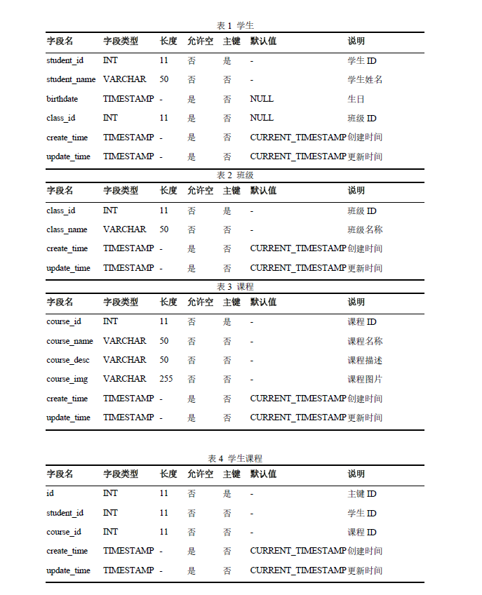
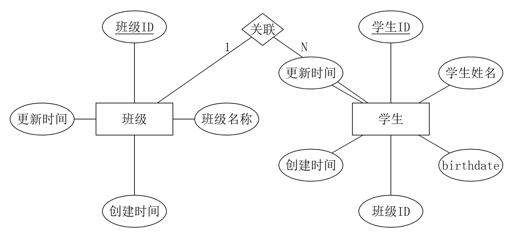

# UML

## UML图

在UML（统一建模语言）的官方标准中，经过UML 2.0到UML 2.5的演进，目前一共定义了 **14 种**图。

为了方便理解，这14种图在官方标准中被严格划分为两大类：**结构图（静态图）** 和 **行为图（动态图）**。其中，行为图又细分出了一个 **交互图** 的子类。

以下是完整的UML 14种图分类及简要说明，并标注了它们在Java开发/面试中的实际出场率：

---

### 一、 结构图—— 描述系统的静态结构（7种）
结构图主要用来展示系统“是什么”，即系统由哪些部分组成，以及它们之间的静态关系。

1. **类图**
   * **说明**：展示系统中的类、接口、属性、方法以及它们之间的继承、实现、依赖等关系。
   * **Java热度**：🔥🔥🔥🔥🔥（最核心，设计模式和面向对象设计必考）
2. **对象图**
   * **说明**：类图的实例化，展示系统在某一特定时刻存在的对象及其关系。
   * **Java热度**：🔥（极少单独画，理解类图自然就懂对象图）
3. **包图**
   * **说明**：展示系统中的包（Package）及其依赖关系，类似Java中的`package`。
   * **Java热度**：🔥🔥（常用于说明代码模块化分层、DDD架构）
4. **组件图**
   * **说明**：展示系统中的组件（如一个微服务、一个Jar包）及其接口和依赖关系。
   * **Java热度**：🔥🔥🔥（微服务架构中常用于说明服务边界和接口契约）
5. **部署图**
   * **说明**：展示软件组件如何映射到硬件节点（物理服务器、虚拟机、容器）上。
   * **Java热度**：🔥🔥🔥（考察系统部署方案、高可用架构、K8s集群时常用）
6. **复合结构图**
   * **说明**：展示一个类内部的协作结构，或运行时实例的连接方式。
   * **Java热度**：（基本不涉及，多用于极其复杂的系统建模）
7. **轮廓图**
   * **说明**：用于扩展UML本身的元模型，为特定领域定制UML标签。
   * **Java热度**：（纯理论，Java开发完全不涉及）

---

### 二、 行为图—— 描述系统的动态行为（7种）
行为图主要用来展示系统“做什么”，即系统在运行时的状态变化和数据流转。

*行为图中，前3种是宏观行为，后4种统称为**交互图**，侧重于对象间消息的传递。*

#### 宏观行为图（3种）
8. **用例图**
   * **说明**：从用户（Actor）的角度描述系统功能及权限边界。
   * **Java热度**：🔥🔥（需求分析阶段常用，后端面试常要求口述Actor和用例，较少手画）
9. **活动图**
   * **说明**：类似高级流程图，展示业务流程或算法步骤，支持并发分支。
   * **Java热度**：🔥🔥🔥（描述复杂业务逻辑、审批流时常用）
10. **状态机图**
    * **说明**：展示一个对象在其生命周期内的各种状态，以及触发状态转换的事件。
    * **Java热度**：🔥🔥🔥🔥（订单流、支付流、线程状态必考）

#### 交互图（4种）
11. **时序图/顺序图**
    * **说明**：按时间顺序展示多个对象之间消息的传递过程。
    * **Java热度**：🔥🔥🔥🔥🔥（极其重要，微服务调用链路、复杂接口逻辑必考）
12. **通信图（Communication Diagram，以前叫协作图）**
    * **说明**：和时序图表达的信息类似，但不强调时间轴，而是强调对象之间的连接拓扑结构。
    * **Java热度**：🔥（有了时序图，通信图基本被淘汰，极少使用）
13. **交互概览图**
    * **说明**：活动图和交互图的结合体，把活动图的每个节点替换成一个小的交互图。
    * **Java热度**：（理论存在，实际开发几乎不用）
14. **定时图/计时图**
    * **说明**：强调消息在特定时间点/时间段内的交互，常用于实时系统或嵌入式系统。
    * **Java热度**：🔥（仅在做时间敏感型系统时偶尔涉及）

---

### 总结

对于Java开发者来说：
* **完全不需要关注的（3种）**：复合结构图、轮廓图、交互概览图。
* **极少使用的（3种）**：对象图、通信图、定时图。
* **需要理解概念但很少手画的（3种）**：用例图、包图、活动图。
* **必须精通并能随时在白板上画出来的核心图（5种）**：**类图、时序图、状态机图、组件图、部署图**。

可以看出，虽然UML定义了14种图，但在日常Java工程和面试中，真正撑起大梁的就是这5种核心图。掌握它们，足以应对99%的架构设计和沟通场景。

## UML 核心图（精通能画）

### 类图


### 时序图


### 状态机图


### 组件图


### 部署图


## UML 非核心图（理解即可）

### 用例图


### 包图


### 活动图


# 非UML

## 三线表

[SQL转三线表工具 - 论文必备三线表生成器 | 三线表格式排版 | 在线制作Word三线表](https://generator.cengxuyuan.cn/sql2line/)

```sql
-- 学生
CREATE TABLE `t_student`(
    `student_id`   int(11) NOT NULL AUTO_INCREMENT COMMENT '学生ID',
    `student_name` varchar(50) NOT NULL COMMENT '学生姓名',
    `birthdate`    timestamp NULL DEFAULT NULL COMMENT '生日',
    `class_id`     int(11) NULL DEFAULT NULL COMMENT '班级ID',
    `create_time`  timestamp NULL DEFAULT CURRENT_TIMESTAMP COMMENT '创建时间',
    `update_time`  timestamp NULL DEFAULT CURRENT_TIMESTAMP ON UPDATE CURRENT_TIMESTAMP COMMENT '更新时间',
    PRIMARY KEY (`student_id`) USING BTREE
) ENGINE = InnoDB AUTO_INCREMENT = 1  COMMENT = '学生';
-- 班级
CREATE TABLE `t_class_info`(
    `class_id`    int(11) NOT NULL AUTO_INCREMENT COMMENT '班级ID',
    `class_name`  varchar(50) NOT NULL DEFAULT '' COMMENT '班级名称',
    `create_time` timestamp NULL DEFAULT CURRENT_TIMESTAMP COMMENT '创建时间',
    `update_time` timestamp NULL DEFAULT CURRENT_TIMESTAMP ON UPDATE CURRENT_TIMESTAMP COMMENT '更新时间',
    PRIMARY KEY (`class_id`) USING BTREE
) ENGINE = InnoDB AUTO_INCREMENT = 1  COMMENT = '班级';
-- 课程
CREATE TABLE `t_course`(
    `course_id`   int(11) NOT NULL AUTO_INCREMENT COMMENT '课程ID',
    `course_name` varchar(50)  NOT NULL DEFAULT '' COMMENT '课程名称',
    `course_desc` varchar(50)  NOT NULL DEFAULT '' COMMENT '课程描述',
    `course_img`  varchar(255) NOT NULL DEFAULT '' COMMENT '课程图片',
    `create_time` timestamp NULL DEFAULT CURRENT_TIMESTAMP COMMENT '创建时间',
    `update_time` timestamp NULL DEFAULT CURRENT_TIMESTAMP ON UPDATE CURRENT_TIMESTAMP COMMENT '更新时间',
    PRIMARY KEY (`course_id`) USING BTREE
) ENGINE = InnoDB AUTO_INCREMENT = 1  COMMENT = '课程';
-- 学生课程
CREATE TABLE `t_student_course`(
    `id`          int(11) NOT NULL AUTO_INCREMENT COMMENT '主键ID',
    `student_id`  int(11) NOT NULL COMMENT '学生ID',
    `course_id`   int(11) NOT NULL COMMENT '课程ID',
    `create_time` timestamp NULL DEFAULT CURRENT_TIMESTAMP COMMENT '创建时间',
    `update_time` timestamp NULL DEFAULT CURRENT_TIMESTAMP ON UPDATE CURRENT_TIMESTAMP COMMENT '更新时间',
    PRIMARY KEY (`id`) USING BTREE
) ENGINE = InnoDB AUTO_INCREMENT = 1  COMMENT = '学生课程';
```



## ER 图

[SQL转ER图在线工具 - 免费ER图在线生成 & 绘制工具 - 数据库ER图自动生成](https://sql.cengxuyuan.cn/)

```sql
-- 班级表
CREATE TABLE `t_class_info` (
    `class_id`    int(11) NOT NULL AUTO_INCREMENT COMMENT '班级ID',
    `class_name`  varchar(50) NOT NULL DEFAULT '' COMMENT '班级名称',
    `create_time` timestamp NULL DEFAULT CURRENT_TIMESTAMP COMMENT '创建时间',
    `update_time` timestamp NULL DEFAULT CURRENT_TIMESTAMP ON UPDATE CURRENT_TIMESTAMP COMMENT '更新时间',
    PRIMARY KEY (`class_id`) USING BTREE
) ENGINE = InnoDB AUTO_INCREMENT = 1 COMMENT = '班级';

-- 学生表存在外键约束
CREATE TABLE `t_student` (
    `student_id`   int(11) NOT NULL AUTO_INCREMENT COMMENT '学生ID',
    `student_name` varchar(50) NOT NULL COMMENT '学生姓名',
    `birthdate`    timestamp NULL DEFAULT NULL,
    `class_id`     int(11) NULL DEFAULT NULL COMMENT '班级ID',
    `create_time`  timestamp NULL DEFAULT CURRENT_TIMESTAMP COMMENT '创建时间',
    `update_time`  timestamp NULL DEFAULT CURRENT_TIMESTAMP ON UPDATE CURRENT_TIMESTAMP COMMENT '更新时间',
    PRIMARY KEY (`student_id`) USING BTREE,
    -- 添加外键约束
    CONSTRAINT `fk_student_class` FOREIGN KEY (`class_id`) REFERENCES `t_class_info` (`class_id`) ON DELETE SET NULL ON UPDATE CASCADE
) ENGINE = InnoDB AUTO_INCREMENT = 1 COMMENT = '学生';

```



## 系统架构图

系统架构图逻辑架构依托 UML 组件图绘制，物理部署架构依托部署图绘制，二者都属于系统静态建模视图，用于整体技术架构与软硬件结构设计。

## 数据流转图

## 功能模块图

## **“4+1视图模型”**

**“4+1视图模型”** 是软件架构领域最经典、最具影响力的理论之一。它由 Philippe Kruchten（Rational公司，UML创始人之一）在1995年提出。

它的核心思想是：**一个复杂的软件系统，不可能用一张图把所有细节都说清楚。不同的干系人（架构师、开发者、测试、运维、老板）关注的角度不同，因此需要从多个视角（视图）来描述同一个系统。**

这5个视图分别是：**逻辑视图、进程视图、开发视图、物理视图**，以及贯穿全局的**场景视图（+1）**。

下面为你详细拆解这5个视图，并结合Java/微服务架构说明它们在实际工作中的应用：

---

### 1. 逻辑视图—— “系统提供什么功能？”

*   **目标受众**：最终用户、业务分析师、产品经理。
*   **关注点**：系统面向业务提供了哪些功能？功能模块是如何划分的？不关心代码怎么写，也不关心部署在哪。
*   **对应的UML图**：**类图、对象图、状态图**。
*   **Java落地场景**：描述系统的领域模型。例如在DDD（领域驱动设计）中，限界上下文的划分、聚合根之间的关系，就是典型的逻辑视图。
*   **一句话总结**：面向业务的“功能地图”。

### 2. 进程视图—— “系统如何并发与通信？”

*   **目标受众**：架构师、性能测试工程师、系统集成商。
*   **关注点**：系统运行时的动态行为。关注并发、进程/线程切换、异步通信、容错、性能和可扩展性。
*   **对应的UML图**：**时序图、活动图、通信图**。
*   **Java落地场景**：描述一个高并发请求下，Tomcat线程池如何调度、消息队列如何做异步削峰、分布式锁的获取与释放过程、多微服务之间的RPC调用链路。
*   **一句话总结**：面向运行时的“动态行为图”。

### 3. 开发视图（Development View / 实现视图）—— “代码怎么组织？”

*   **目标受众**：程序员、开发经理。
*   **关注点**：软件在开发环境下的物理代码结构。关注模块化、分层、依赖管理、代码复用。它不关心业务逻辑对不对，只关心工程结构清不清晰。
*   **对应的UML图**：**组件图、包图**。
*   **Java落地场景**：Maven多模块项目的依赖关系图（如 `api` 模块、`core` 模块、`web` 模块的依赖）；Spring Boot工程内部的 Controller-Service-DAO 分层架构图；微服务工程在Git仓库里的目录结构。
*   **一句话总结**：面向程序员的“工程代码结构图”。

### 4. 物理视图（Physical View / 部署视图）—— “软件部署在什么硬件上？”

*   **目标受众**：运维工程师、系统工程师、网络管理员。
*   **关注点**：软件如何映射到物理硬件上。关注服务器、网络拓扑、存储、云环境、高可用部署。
*   **对应的UML图**：**部署图**。
*   **Java落地场景**：描述 Nginx 部署在两台 ECS 上做负载均衡，Java微服务打包成Jar运行在 K8s 的 Pod 中，MySQL 采用一主两从部署在独立的私有子网中，以及它们之间的网络通路。
*   **一句话总结**：面向运维的“网络与硬件拓扑图”。

---

### 5. 场景视图（Scenarios / “+1”视图）—— “核心业务走得通吗？”

*   **目标受众**：所有人（架构师用来验证设计，测试用来编写用例，产品用来确认需求）。
*   **关注点**：它是将前4个视图**串联起来**的线索。通过几个核心的业务用例，验证逻辑视图是否完整、进程视图是否走得通、开发视图是否支持、物理视图网络是否连通。
*   **对应的UML图**：**用例图**（结合简单的时序图文本说明）。
*   **Java落地场景**：描述“用户下单支付”这个核心场景：用户点击支付（场景） -> 触发支付服务（逻辑） -> 扣减库存（进程/逻辑） -> 调用网关接口（开发组件） -> 数据落盘到主库并同步到从库（物理）。
*   **一句话总结**：验证全局架构的“试金石”。

---

### 为什么叫“4+1”？

前4个视图（逻辑、进程、开发、物理）分别从不同的维度描绘了系统的静态结构和动态行为，它们彼此之间是**正交（独立但相关）**的。

但是，如果只有4个孤立的视图，架构设计很容易出现“拼接不上的情况”。第5个视图（场景视图）扮演着**粘合剂和验证器**的角色。架构师在画完前4个图后，必须把几个最核心的业务场景放到这4个图里“跑”一遍，如果哪个环节跑不通，就说明那个视图的设计有缺陷。因此它是额外的那个“+1”。

### 面试与晋升中的“4+1”应用

在Java高级开发或架构师的面试、技术方案评审中，如果你能自觉运用“4+1”思维，会非常加分：

1.  **需求分析阶段**：先确定**场景视图**（我们要解决什么业务问题）。
2.  **概要设计阶段**：优先输出**逻辑视图**（系统分成哪些业务域）和**开发视图**（工程模块怎么建）。
3.  **详细设计阶段**：针对复杂接口输出**进程视图**（并发、锁、异步怎么处理）。
4.  **上线发布阶段**：输出**物理视图**（部署架构图、容灾方案）。

面试官问：“请介绍一下你负责的XX系统架构。”
你可以这样回答：“这个系统我主要从4+1视图的角度进行了设计。在业务逻辑上，我们拆分了X个领域（逻辑视图）；工程上采用了Maven多模块（开发视图）；针对高并发场景，我们引入了MQ做异步削峰（进程视图）；最终部署在K8s集群上，通过Nginx做网关（物理视图）。我拿核心的XX业务场景串联验证了整个链路（场景视图）……”

这样的表达，不仅体现了你的全局视野，更展示了你成熟的架构思维方法论。