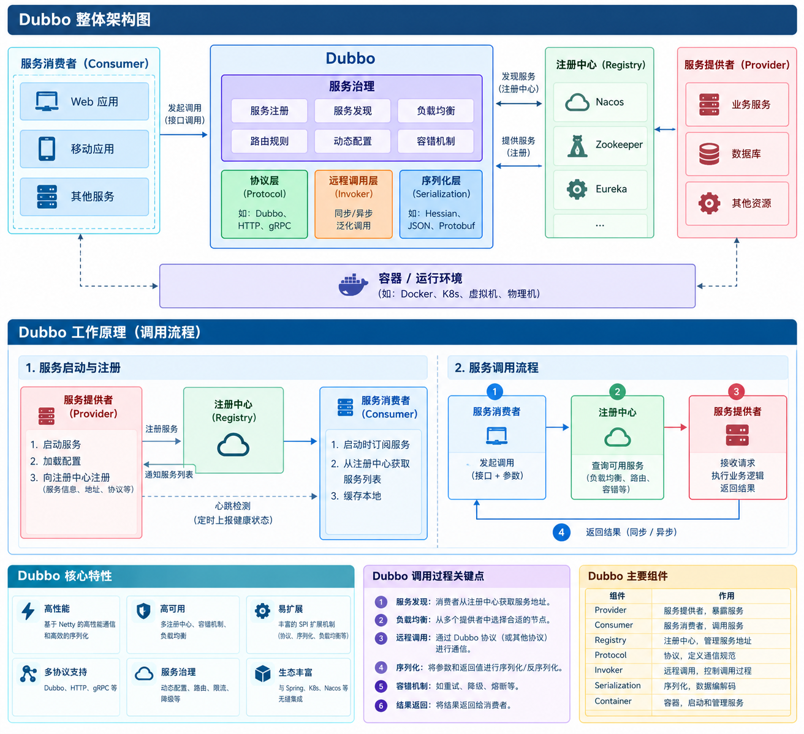
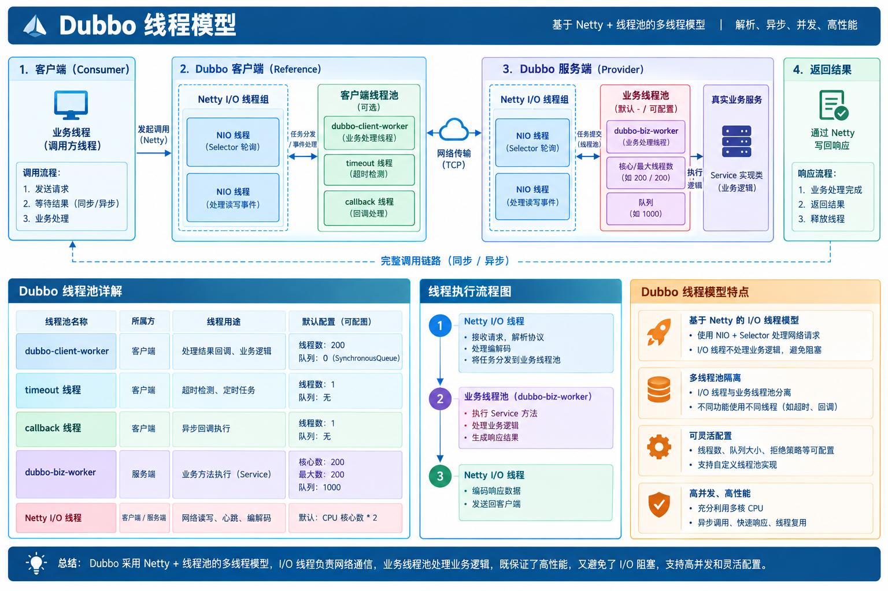

# Apache Dubbo 核心原理、服务治理与生产故障排查指南

> **核心速记**：
> - **Dubbo 定位**：阿里开源、Apache 顶级的**高性能 Java RPC 与分布式服务治理框架**。底层默认采用 **Netty TCP 长连接 + 二进制序列化（Hessian2 / Protobuf）**，主打内网微服务间高频低延迟调用。
> - **五大核心角色**：`Provider`（暴露服务，启动 NettyServer 监听 `20880`）、`Consumer`（订阅服务，生成动态代理直连调用）、`Registry`（Nacos/ZK 注册与发现，**不转发 RPC 流量**）、`Monitor`（指标统计，可选，现多用 `Prometheus + Grafana`）、`Container`（内嵌 Spring 容器，无需单独部署）。
> - **三大底层基石**：**动态代理（`Invoker` 统一模型）** + **Dubbo SPI（按需加载、IoC/AOP、`@Adaptive` 自适应扩展）** + **URL 配置总线**。
> - **黄金避坑铁律**：Netty IO 线程与 Dubbo 业务线程池分离（`dispatcher=all`）；**写接口（扣库存、支付）严禁使用默认 `Failover` 重试，必须配置 `retries=0` + `cluster="failfast"` + 业务幂等**；`timeout` 优先级遵循 **消费端 > 服务端，方法级 > 接口级 > 全局**。

---

## 目录

- [一、Dubbo 全景定位、五大核心角色与十层架构](#一dubbo-全景定位五大核心角色与十层架构)
  - [1.1 Dubbo 是什么、市场地位与适用场景](#11-dubbo-是什么市场地位与适用场景)
  - [1.2 五大核心角色、必要性分析与完整调用流程](#12-五大核心角色必要性分析与完整调用流程)
  - [1.3 监控中心演进：Monitor vs Prometheus + Grafana + Dubbo Admin](#13-监控中心演进monitor-vs-prometheus--grafana--dubbo-admin)
  - [1.4 Dubbo 整体十层架构（含 7 层核心记忆口诀）](#14-dubbo-整体十层架构含-7-层核心记忆口诀)
- [二、底层核心机制：动态代理、Dubbo SPI 与 URL 总线](#二底层核心机制动态代理dubbo-spi-与-url-总线)
  - [2.1 透明动态代理与 Invoker 核心抽象](#21-透明动态代理与-invoker-核心抽象)
  - [2.2 Dubbo SPI 机制深度剖析（对比 Java 原生 SPI）](#22-dubbo-spi-机制深度剖析对比-java-原生-spi)
  - [2.3 URL 配置总线机制](#23-url-配置总线机制)
- [三、Provider 服务端与 Consumer 客户端全链路解析](#三provider-服务端与-consumer-客户端全链路解析)
  - [3.1 Provider 服务暴露（export）与接收请求完整流程](#31-provider-服务暴露export与接收请求完整流程)
  - [3.2 Consumer 服务引用（refer）与发起调用完整流程](#32-consumer-服务引用refer与发起调用完整流程)
  - [3.3 Provider 与 Consumer 核心对比及关键配置](#33-provider-与-consumer-核心对比及关键配置)
  - [3.4 通信协议、序列化与线程派发模型](#34-通信协议序列化与线程派发模型)
  - [3.5 同步调用、CompletableFuture 异步调用与 Oneway 选型](#35-同步调用completablefuture-异步调用与-oneway-选型)
- [四、集群容错、负载均衡与服务治理能力](#四集群容错负载均衡与服务治理能力)
  - [4.1 六种集群容错策略（Cluster）](#41-六种集群容错策略cluster)
  - [4.2 四种客户端负载均衡算法（LoadBalance）](#42-四种客户端负载均衡算法loadbalance)
  - [4.3 核心服务治理能力（路由灰度、Mock 降级、泛化调用、优雅停机）](#43-核心服务治理能力路由灰度mock-降级泛化调用优雅停机)
  - [4.4 写接口防重复请求：5 种幂等性实现方案](#44-写接口防重复请求5-种幂等性实现方案)
- [五、Dubbo 3.x 云原生演进（对比 Dubbo 2.x）](#五dubbo-3x-云原生演进对比-dubbo-2x)
  - [5.1 应用级服务发现（解决注册中心内存爆炸）](#51-应用级服务发现解决注册中心内存爆炸)
  - [5.2 Triple 协议（基于 HTTP/2，兼容 gRPC 与跨语言）](#52-triple-协议基于-http2兼容-grpc-与跨语言)
  - [5.3 云原生 Kubernetes 与 Service Mesh 适配](#53-云原生-kubernetes-与-service-mesh-适配)
- [六、Dubbo vs Spring Cloud (OpenFeign) 深度对比](#六dubbo-vs-spring-cloud-openfeign-深度对比)
  - [6.1 全维度技术栈与选型对比表](#61-全维度技术栈与选型对比表)
  - [6.2 OpenFeign 客户端与 Tomcat 服务端完整调用链路剖析](#62-openfeign-客户端与-tomcat-服务端完整调用链路剖析)
- [七、Spring Cloud Alibaba + Dubbo 3 + Nacos 完整项目实战](#七spring-cloud-alibaba--dubbo-3--nacos-完整项目实战)
  - [7.1 顶层父工程 pom.xml](#71-顶层父工程-pomxml)
  - [7.2 模块 1：dubbo-api 公共接口模块](#72-模块-1dubbo-api-公共接口模块)
  - [7.3 模块 2：dubbo-provider 服务提供者](#73-模块-2dubbo-provider-服务提供者)
  - [7.4 模块 3：dubbo-consumer 服务消费者](#74-模块-3dubbo-consumer-服务消费者)
- [八、Dubbo & OpenFeign 生产线上故障排查大全（面试压轴）](#八dubbo--openfeign-生产线上故障排查大全面试压轴)
  - [8.1 线程池类故障：Thread pool is EXHAUSTED 与队列 OOM](#81-线程池类故障thread-pool-is-exhausted-与队列-oom)
  - [8.2 调用异常类故障：invoke timeout 超时、重试脏数据与级联雪崩](#82-调用异常类故障invoke-timeout-超时重试脏数据与级联雪崩)
  - [8.3 注册中心类故障：No provider available 与注册中心宕机影响](#83-注册中心类故障no-provider-available-与注册中心宕机影响)
  - [8.4 网络与连接类故障：Channel closed / 半开连接与连接泄漏](#84-网络与连接类故障channel-closed--半开连接与连接泄漏)
  - [8.5 序列化与配置坑：Hessian2 无参构造、循环依赖与 timeout 优先级](#85-序列化与配置坑hessian2-无参构造循环依赖与-timeout-优先级)
  - [8.6 OpenFeign 专属线上高频故障与 Dubbo 对照表](#86-openfeign-专属线上高频故障与-dubbo-对照表)
  - [8.7 1 分钟线上故障排查通用口述模板](#87-1-分钟线上故障排查通用口述模板)

---

## 一、Dubbo 全景定位、五大核心角色与十层架构

### 1.1 Dubbo 是什么、市场地位与适用场景

**Apache Dubbo** 是阿里巴巴开源并贡献给 Apache 顶级基金会的**高性能、轻量级分布式 RPC 与服务治理框架**。它屏蔽了底层复杂的 TCP 网络通信，让开发者像调用本地方法一样调用远程服务，同时内置全套企业级服务治理能力（注册发现、负载均衡、集群容错、流量路由、服务降级）。

- **当前市场地位（三足鼎立）**：
  - 在国内中大型互联网、金融、政企的 Java 微服务体系中，**`Spring Cloud Alibaba + Nacos + Dubbo 3 + Sentinel + RocketMQ`** 是最主流的高性能生产架构组合；
  - **典型生产业务场景**：
    1. **电商交易核心链路**：订单服务高频调用库存扣减、优惠券核销、用户查询（追求毫秒级低延迟）；
    2. **金融/支付清算系统**：交易、风控、账户账务互调（强依赖多版本隔离、分组灰度、超时熔断与优雅停机）；
    3. **企业大型 ERP / HRMS / 数据中台 / IoT 平台**：内部多模块拆分后的高频跨进程 RPC 调用，以及业务网关通过**泛化调用**动态路由后端服务。
  - **不适合使用 Dubbo 的场景**：
    1. **前端浏览器/APP 直接访问**：浏览器无法直连 Dubbo TCP 协议，必须遵循 **“公网/前端走 HTTP 网关（Nginx / Spring Cloud Gateway），内网微服务互调走 Dubbo RPC”** 的黄金准则；
    2. **对外暴露给外部第三方的开放 API**：公网异构对接统一使用 HTTPS RESTful 接口；
    3. **简单小型单体项目**：仅 1~2 个服务无需引入 RPC 增加运维复杂度。

---

### 1.2 五大核心角色、必要性分析与完整调用流程



| 核心角色 | 是否必须独立存在/部署 | 核心职责说明 |
| :--- | :---: | :--- |
| **1. `Provider`（服务提供者）** | ✅ **必须** | 实现业务接口并暴露 RPC 服务，启动时开启 `NettyServer` 监听端口（默认 `20880`）并向注册中心注册元数据 |
| **2. `Consumer`（服务消费者）** | ✅ **必须** | 调用远程服务的客户端应用，启动时向注册中心订阅目标服务并缓存地址列表，通过动态代理发起直连调用 |
| **3. `Registry`（注册中心）** | ⚠️ **代码可选，生产必须** | 服务目录（主流选型：**Nacos**、Zookeeper）。本地测试可通过 `url` 直连跳过注册中心；生产环境必须部署以实现动态发现与上下线推送 |
| **4. `Monitor`（监控中心）** | ❌ **完全可选** | 异步统计调用次数、QPS、RT 耗时与错误率，**不参与 RPC 主调用链路**，宕机对业务零影响 |
| **5. `Container`（服务容器）** | ✅ **逻辑角色，无需单独部署** | 负责加载并启动 Provider 的运行容器（日常开发中即 **内嵌的 Spring / Spring Boot 容器**，绝不是一个需要单独安装的外部进程！） |

- **标准完整调用流程（5 步曲）**：
  1. **启动与注册（步骤 0~1）**：`Container` 启动 `Provider`，将自身 IP、端口、接口名、版本分组等元数据注册到 `Registry`；
  2. **启动与订阅（步骤 2）**：`Consumer` 启动时向 `Registry` 订阅所需服务；
  3. **地址推送与本地缓存（步骤 3）**：`Registry` 将可用 `Provider` 地址列表推送给 `Consumer` **缓存在本地内存**；后续当 `Provider` 扩容或下线时，`Registry` 基于长连接主动推送变更通知；
  4. **点对点直连 RPC 调用（步骤 4）**：`Consumer` 基于本地缓存的地址列表，经负载均衡算法选出一台 `Provider`，通过 **Netty TCP 长连接发起点对点直连调用（完全不经过注册中心转发，避免注册中心成为瓶颈）**；
  5. **异步监控上报（步骤 5）**：`Provider` 与 `Consumer` 在内存中累加调用指标，定时异步上报给 `Monitor`。

---

### 1.3 监控中心演进：Monitor vs Prometheus + Grafana + Dubbo Admin

> **面试一句话回答**：老版本 Dubbo 2 的 `dubbo-monitor-simple` 性能弱已淘汰；**现代 Dubbo 3 生产环境统一采用 `Nacos` 做注册中心、`Prometheus + Grafana` 做指标监控中心、`Dubbo Admin` 做服务治理控制台、`SkyWalking` 做分布式全链路追踪**。

- **三大组件职责区分（防混淆）**：
  1. **Prometheus**：时序数据库，定时拉取（Pull）Dubbo 暴露的 Metrics 指标（QPS、RT、线程池活跃数、异常率）并持久化；
  2. **Grafana**：可视化监控大盘，读取 Prometheus 数据绘制曲线并配置告警；
  3. **Dubbo Admin**：官方管控后台，**侧重服务治理**（查看服务实例列表、动态下发路由规则、调整权重、配置 Mock 降级、接口在线测试），本身不是时序数据库。

---

### 1.4 Dubbo 整体十层架构（含 7 层核心记忆口诀）

Dubbo 采用高度解耦的分层架构，每一层均通过 **Dubbo SPI** 实现可插拔替换：

| 大层划分 | 具体分层（自上而下 10 层） | 核心职责 | 核心接口 / 扩展实现 |
| :--- | :--- | :--- | :--- |
| **Business（业务层）** | **1. Business 业务层** | 开发者自己编写的业务接口与实现类 | 业务 `Service` |
| **RPC 层（核心层）** | **2. Config / Service 配置服务层** | 面向开发者的 API 与注解配置收集 | `@DubboService`、`ServiceConfig`、`ReferenceConfig` |
| | **3. Proxy 服务代理层** | 生成客户端/服务端动态代理，将本地方法调用转化为 `Invoker` 调用 | `ProxyFactory`（默认 **Javassist**、JDK 动态代理） |
| | **4. Registry 注册中心层** | 封装服务地址的注册、订阅与动态感知（`Directory`） | `Registry`（**Nacos**、Zookeeper、Kubernetes） |
| | **5. Cluster 路由与集群容错层** | 将多个 `Provider` 节点伪装成 1 个虚拟 `Invoker`，负责**路由规则、集群容错与负载均衡** | `Cluster`（Failover/Failfast）、`LoadBalance`、`Router` |
| | **6. Monitor 监控层** | 拦截统计 RPC 调用次数和执行耗时 | `MonitorFilter` |
| | **7. Protocol 远程调用协议层** | **RPC 核心层**！封装 RPC 调用语义（暴露 `Exporter` 与引用 `Invoker`） | `Protocol`（`dubbo`、`triple`、`rest`） |
| **Remoting（通信层）** | **8. Exchange 信息交换层** | 封装 `Request-Response` 请求响应模式，完成**同步转异步（`DefaultFuture`）**与心跳管理 | `ExchangeChannel`、`HeaderExchange` |
| | **9. Transport 网络传输层** | 抽象底层 TCP 网络传输（只管收发二进制包，不管 RPC 语义） | `Transporter`（默认 **Netty 4**、Mina） |
| | **10. Serialize 数据序列化层** | Java 对象 ↔ 二进制字节流序列化与反序列化 | `Serialization`（**Hessian2**、Protobuf、Fastjson2、Kryo） |

> **7 层精简记忆口诀**（面试官让背架构分层时直接答这 7 层）：**“服、代、集、路、协、传、序”**（服务层 `Service` → 代理层 `Proxy` → 集群层 `Cluster` → 路由层 `Router` → 协议层 `Protocol` → 传输层 `Transport` → 序列化层 `Serialize`）。

---

## 二、底层核心机制：动态代理、Dubbo SPI 与 URL 总线

### 2.1 透明动态代理与 Invoker 核心抽象

1. **动态代理屏蔽网络细节**：`Consumer` 端通过 `@DubboReference` 注入的并不是真实实现类，而是 Dubbo 通过 `ProxyFactory`（默认使用 **Javassist 字节码生成**，性能优于 JDK 反射代理）生成的动态代理对象。调用代理方法时，内部拦截并组装为 `RpcInvocation`（包含接口名、方法名、参数类型、参数值、隐式参数 `attachments`）。
2. **万物皆 `Invoker`（命令模式）**：`Invoker` 是 Dubbo 最核心的领域模型。无论是 `Provider` 端对真实实现类的包装（通过 Wrapper 字节码避免反射开销），还是 `Consumer` 端发起远程网络请求的通道，亦或是多个节点聚合而成的集群，在 Dubbo 内部全部统一抽象为 `Invoker`。

---

### 2.2 Dubbo SPI 机制深度剖析（对比 Java 原生 SPI）

**面试极高频题：“Dubbo 为什么不用 JDK 原生的 `ServiceLoader`（Java SPI），而要自己手写一套 Dubbo SPI（`ExtensionLoader`）？”**

| 对比维度 | Java 原生 SPI（`java.util.ServiceLoader`） | Dubbo SPI（`org.apache.dubbo.common.extension.ExtensionLoader`） |
| :--- | :--- | :--- |
| **配置文件路径与格式** | `META-INF/services/接口全限定名`（纯类名列表，无 Key） | `META-INF/dubbo/`（采用 **`key=实现类全限定名`** 键值对格式） |
| **加载与实例化方式** | ❌ **一次性全量加载并实例化所有实现类**。哪怕只用其中 1 个，也会把其余几十个实现类全部 `new` 出来，极度浪费资源且若某个未使用的实现类缺少依赖还会直接报错 | ✅ **按需懒加载（Lazy Loading）**。通过指定的 `key`（如 `ExtensionLoader.getExtension("random")`）精准查找并仅实例化目标实现类，缓存在内存中 |
| **IoC 依赖注入支持** | ❌ 不支持 | ✅ **支持自动依赖注入（Setter 注入）**：加载扩展实现类时，自动扫描其 `setXxx()` 方法并通过 SPI 或 Spring 容器注入所依赖的其他组件 |
| **AOP 增强支持** | ❌ 不支持 | ✅ **支持 Wrapper 装饰器模式（AOP）**：若某个实现类存在接收该接口作为参数的拷贝构造函数，Dubbo 自动识别为 `Wrapper` 类，层层包裹目标扩展实现公共切面逻辑（如日志、过滤链） |
| **运行时动态选择** | ❌ 不支持根据请求参数动态切换实现 | ✅ **支持 `@Adaptive` 自适应扩展与 `@Activate` 条件自动激活** |

- **两个灵魂注解必背**：
  1. **`@Adaptive`（自适应扩展）**：动态生成代理字节码，在运行时**从传入的 `URL` 总线参数中提取 Key**（如 `url.getParameter("loadbalance", "random")`），动态路由到对应的具体 SPI 实现类；
  2. **`@Activate`（条件激活）**：常用于 `Filter` 过滤器链，根据当前角色（`group = "provider"` 或 `"consumer"`）及 URL 中是否包含特定参数自动激活挂载的一组扩展点。

---

### 2.3 URL 配置总线机制

在 Dubbo 内部，**`org.apache.dubbo.common.URL` 是贯穿整个框架 10 层架构的“配置传递契约总线”**（如 `dubbo://192.168.1.10:20880/com.xxx.OrderService?timeout=3000&loadbalance=leastactive&retries=0`）。它消除了各层之间复杂的参数耦合，配合 `@Adaptive` 实现了完全由配置驱动的插件化架构。

---

## 三、Provider 服务端与 Consumer 客户端全链路解析

### 3.1 Provider 服务暴露（export）与接收请求完整流程

> ⚠️ **端口说明**：一个 Spring Boot 应用作为 `Provider` 时，通常会**同时监听两个端口**：**Tomcat 端口（如 `8080`）** 处理 HTTP 接口，**Dubbo Netty 端口（默认 `20880`）** 处理 RPC 调用，两者互不干扰。

1. **`Provider` 启动与服务暴露（`export`）6 步流程**：
   - ① Spring 容器启动，扫描 `@DubboService` 注解类；
   - ② 组装 `ServiceConfig`，收集接口、实现类引用、版本 `version`、分组 `group`、超时 `timeout` 等元数据；
   - ③ 通过 `ProxyFactory`（Javassist）将真实业务实现类包装成 `Invoker` 对象；
   - ④ 调用 `DubboProtocol.export(invoker)`：启动 **NettyServer** 监听 `20880` 端口，并将 `Exporter/Invoker` 缓存在本地 `exporterMap` 中（Key 为服务接口唯一标识）；
   - ⑤ 通过 `RegistryProtocol` 将服务完整 URL 注册到 Nacos / Zookeeper；
   - ⑥ 进入就绪状态等待 Consumer 请求。
2. **`Provider` 收到 RPC 请求后的处理流程**：
   - ① **Netty Boss 线程**：接收 TCP 连接；
   - ② **Netty Worker IO 线程**：从 Socket 读取二进制字节流，解决粘包并解码反序列化为请求对象；
   - ③ **线程派发（关键！）**：通过 `Dispatcher` 将请求任务提交到 **Dubbo Provider 独立业务线程池**（若线程池与队列已满，直接向客户端抛出 **`Thread pool is EXHAUSTED!`** 异常）；
   - ④ **业务线程执行**：从本地 `exporterMap` 查找对应 `Invoker`，执行真实业务代码拿到返回值；
   - ⑤ **编码回写**：将结果序列化为二进制响应报文（带上原请求 ID），由 Netty 写回给 Consumer。

---

### 3.2 Consumer 服务引用（refer）与发起调用完整流程

1. **`Consumer` 启动与服务引用（`refer`）5 步流程**：
   - ① Spring 扫描 `@DubboReference` 注解，构建 `ReferenceConfig`；
   - ② 向注册中心**订阅目标服务**，拉取并监听全量可用 `Provider` 地址列表，保存在本地 **`RegistryDirectory`** 中；
   - ③ 调用 `DubboProtocol.refer()`：针对每个 `Provider` 节点地址创建 **`NettyClient` 建立 TCP 长连接**（默认共享单一长连接），封装为远程 `DubboInvoker`；
   - ④ 通过 **`Cluster`（集群层）** 将多个节点的 `Invoker` 合并伪装成 1 个具备容错与负载均衡能力的 `ClusterInvoker`；
   - ⑤ 通过 `ProxyFactory` 生成动态代理对象注入 Spring 容器。
2. **`Consumer` 发起一次远程调用完整流程**：
   - ① 业务代码调用代理方法（如 `orderDubboService.createOrder(dto)`），代理拦截并封装为 `RpcInvocation`；
   - ② 经过消费端 `Filter` 过滤器链（写入隐式上下文、统计监控、限流）；
   - ③ `Directory` 列出当前存活的 `Provider` 列表并经 `Router` 路由过滤；
   - ④ `Cluster` 集群容错层调用 **`LoadBalance`（负载均衡）** 选定 1 台目标 `Provider`；
   - ⑤ 通过 `NettyClient` 发送二进制请求报文，同时创建 **`DefaultFuture`**（以全局唯一自增请求 `requestId` 为 Key 存入 Map）；
   - ⑥ 同步模式下业务线程阻塞等待 `DefaultFuture.get(timeout)`；当 `NettyClient` 收到响应并根据响应头中的 `requestId` 唤醒该 Future 后，业务线程拿到反序列化结果返回（若超时或异常则触发 `Cluster` 容错策略）。

---

### 3.3 Provider 与 Consumer 核心对比及关键配置

| 对比维度 | Provider（服务端） | Consumer（客户端） |
| :--- | :--- | :--- |
| **核心注解** | `@DubboService`（**必须标在实现类上，标在方法上无效！**） | `@DubboReference`（标在注入字段或方法上） |
| **底层网络组件** | `NettyServer`（开启监听端口，默认 `20880`） | `NettyClient`（主动发起 TCP 长连接，**不开启监听端口**） |
| **线程模型** | Netty IO 线程 + **独立 Dubbo 业务线程池**（支持接口级隔离） | 同步调用直接复用调用方业务线程等待响应（Dubbo 3 引入 `ThreadlessExecutor` 消除额外消费端线程池开销） |
| **注册中心交互** | **注册（Register）** 服务元数据，下线时主动注销 | **订阅（Subscribe）** 服务，监听地址变更推送并缓存本地 |
| **核心内部对象** | `Exporter`、`Invoker` | `Directory`（动态服务目录）、`Cluster`、`LoadBalance`、`Proxy` |

- **生产核心 YAML 配置速查**：
  ```yaml
  dubbo:
    provider:
      threads: 200          # 服务端业务线程池大小（默认 200）
      threadpool: limited   # 线程池类型：fixed(默认,无界队列易OOM) / limited(推荐,线程只增不减+有界队列) / cached
      queues: 100           # limited 模式下有界等待队列长度（防请求无限堆积 OOM）
      executes: 200         # 服务端单接口最大并发执行数限流（超过直接拒绝保护服务端）
      heartbeat: 30000      # TCP 长连接心跳间隔 30s
    consumer:
      timeout: 3000         # 调用超时毫秒数（消费端配置优先于服务端！）
      retries: 0            # 失败重试次数（不包含首次调用！写操作必须设为 0）
      cluster: failfast     # 写操作设为快速失败；读操作默认 failover
      loadbalance: random   # 负载均衡策略
      check: false          # 启动时是否强制检查 Provider 已上线（开发环境及循环依赖时设为 false）
  ```

---

### 3.4 通信协议、序列化与线程派发模型



1. **主流通信协议对比**：
   - **`dubbo` 协议（Dubbo 2 默认）**：采用 **单一 TCP 长连接 + NIO 异步多路复用 + 16 字节定长协议头（含 2 字节魔数 `0xdabb`、序列化类型、8 字节请求 ID、4 字节消息体长度）**。极其适合**小数据量（< 100KB）、高并发、Consumer 数量远大于 Provider 数量**的内网调用；不适合传大文件。
   - **`triple` 协议（Dubbo 3 默认主推 ✅）**：基于 **HTTP/2** 构建，100% 兼容 gRPC，天然支持穿透网关/防火墙、双向流式调用（Streaming）与多语言互通。
2. **序列化机制对比**：
   - **`Hessian2`（Dubbo 2/3.1 默认）**：二进制序列化，体积远小于 JSON，跨语言兼容性好（**注意：要求传输的 POJO 必须有无参构造函数且实现 `Serializable`**）；
   - **`Fastjson2`（Dubbo 3.2+ 默认）** / **`Kryo`**：极致的序列化速度；
   - **`Protobuf`（Triple 协议标配）**：基于 IDL 定义，跨语言性能与压缩率天花板。
3. **Provider 端 5 种线程派发策略（`Dispatcher`）**：
   - **`all`（默认 ✅）**：除连接建立/断开与心跳外，所有请求接收、响应、异常事件**全部派发到 Dubbo 业务线程池执行**，彻底保护 Netty IO 线程不被阻塞；
   - **`direct`**：所有事件直接在 Netty IO 线程中执行，不经过业务线程池（仅当业务 100% 是纯内存无阻塞操作时才可用）；
   - **`message`** / **`execution`** / **`connection`**：按消息事件或连接维度隔离派发。

---

### 3.5 同步调用、CompletableFuture 异步调用与 Oneway 选型

> **高频核心区分**：Dubbo **底层网络 IO 永远是 Netty 异步非阻塞的**；而上层业务代码默认是**同步阻塞等待 `DefaultFuture` 结果**的（占生产 90% 场景）。

| 调用模式 | 代码实现方式 | 适用业务场景与踩坑点 |
| :--- | :--- | :--- |
| **1. 同步调用（默认，占 90% ✅）** | 直接调用接口返回业务对象：`UserDTO u = userService.getById(1L);` | **后续逻辑强依赖本次 RPC 返回值**（如查用户、下单扣库存）。代码直观、事务与链路追踪清晰；通过合理 `timeout` + Sentinel 熔断保护即可 |
| **2. 异步调用（`CompletableFuture` ✅）** | 接口直接声明返回 `CompletableFuture<T>`（Dubbo 3 推荐），或配置 `@DubboReference(async = true)` 配合 `RpcContext.getServiceContext().getCompletableFuture()` | **单接口内需要并行调用多个无依赖的下游 RPC 以降低总 RT 耗时**：<br>`CompletableFuture.allOf(f1, f2, f3).join();`（总耗时由累加变为取决于最慢的那一个）。<br>⚠️ **大坑**：异步回调在另外的线程执行，会导致 **`ThreadLocal` 上下文（登录用户信息、TraceId）丢失**，且无法参与原线程数据库事务！ |
| **3. 单向调用（`Oneway`，慎用 ⚠️）** | `@DubboMethod(async = true, isReturn = false)` | **发完即忘（Fire-and-Forget）**，完全不等待响应也收不到异常。仅用于可容忍丢失的非核心旁路埋点或日志上报，**严禁用于核心业务写入** |

---

## 四、集群容错、负载均衡与服务治理能力

### 4.1 六种集群容错策略（Cluster）

当 `Consumer` 调用某台 `Provider` 失败（网络超时、异常）时，`Cluster` 层提供 6 种内置容错策略：

| 容错策略 | 核心行为 | 典型适用场景 |
| :--- | :--- | :--- |
| **1. `Failover`（故障转移，默认 ✅）** | 调用失败后**自动切换到其他 `Provider` 节点重试**（默认 `retries=2`，即最多执行 $1 + 2 = 3$ 次） | **幂等的读查询接口**（⚠️ **非幂等写接口严禁使用，会导致重复扣款/重复下单！**） |
| **2. `Failfast`（快速失败，写必选 ✅）** | 只发起 **1 次调用**，一旦失败立即向上抛出异常，绝不重试 | **非幂等写操作（新增订单、扣减库存、转账支付、抢红包）** |
| **3. `Failsafe`（失败安全）** | 出现异常时记录错误日志并**直接忽略异常返回空结果**，不中断主流程 | 写入审计日志、非核心统计上报等旁路操作 |
| **4. `Failback`（失败自动恢复）** | 调用失败后在后台记录失败请求，由定时任务异步重发 | 实时性要求不高但要求最终送达的消息通知类操作 |
| **5. `Forking`（并行调用）** | 同时向多台（`forks=2`）`Provider` 并行发起请求，**只要有 1 台成功即立刻返回** | 对实时响应延迟（RT）要求极严苛、且能容忍多倍服务器资源消耗的核心读接口 |
| **6. `Broadcast`（广播调用）** | 逐个调用所有 `Provider` 节点，任意一台报错则整体视为失败 | 通知所有节点刷新本地内存缓存或动态配置 |

---

### 4.2 四种客户端负载均衡算法（LoadBalance）

> **注意**：Dubbo 的负载均衡是在 **`Consumer` 客户端本地内存** 执行的（非集中式代理，也**不是** Spring Cloud 的 Ribbon）。

| 负载均衡算法 | 核心原理与特点 | 适用场景 |
| :--- | :--- | :--- |
| **1. `Random`（加权随机，默认 ✅）** | 按权重设置随机概率区间；支持**慢启动预热（Warmup，默认前 10 分钟刚启动的节点权重随时间线性递增，避免冷启动瞬间被打垮）** | 绝大多数无状态均匀分布的生产场景 |
| **2. `RoundRobin`（加权平滑轮询）** | 基于 Nginx 平滑加权轮询算法，按权重均匀依次分发请求 | 请求耗时非常均匀的服务 |
| **3. `LeastActive`（最少活跃调用数，加分项 🌟）** | 统计每个 `Provider` 当前正在处理但尚未返回的请求数（活跃数），**优先把请求发给活跃数最小的节点**；若活跃数相同则按权重随机 | **“能者多劳”自适应调优**：慢机器积压请求多会自动少接活，快机器自动多接活，防止慢节点拖垮全局 |
| **4. `ConsistentHash`（一致性哈希）** | 对请求指定参数计算哈希并映射到带虚拟节点的哈希环上，**相同参数的请求永远路由到同一台 `Provider`** | 服务端带有本地状态缓存（Local Cache）的场景 |

---

### 4.3 核心服务治理能力（路由灰度、Mock 降级、泛化调用、优雅停机）

1. **版本（`version`）与分组（`group`）隔离**：
   - `group`：用于区分同一接口的不同业务实现或租户/环境隔离；
   - `version`：用于接口不兼容升级时的**平滑迁移与灰度发布**（如先将一半机器升级为 `version="2.0.0"`）。
2. **条件路由与标签路由（全链路灰度）**：通过 Dubbo Admin 下发标签规则（如携带 `tag=gray` 的流量只路由到打有 `gray` 标签的实例，若无对应实例自动降级到基线节点）。
3. **服务降级（`Mock` 机制）**：
   - **`mock="force:return null"`（强制降级 / 屏蔽）**：大促高峰期直接屏蔽非核心服务（如积分推荐），**根本不发起网络调用**直接返回兜底值；
   - **`mock="fail:return xxx"`（容错降级）**：先发起正常 RPC 调用，仅当调用失败/超时后才执行本地 `Mock` 实现类返回兜底数据。
4. **隐式传参（`RpcContext Attachment`）**：无需修改接口方法签名，通过 `RpcContext.getClientAttachment().setAttachment("traceId", "xxx")` 在消费端与服务端之间透明传递全链路 `TraceId`、租户 ID 或用户压测染色标记。
5. **泛化调用（`GenericService`）**：消费端**无需引入 Provider 的 API Jar 包**，仅凭接口全限定名、方法名和 `Map` 参数即可发起通用调用，是构建 **API 网关（HTTP 转 Dubbo）与自动化测试平台** 的核心机制。
6. **优雅停机（Graceful Shutdown —— 严禁 `kill -9`！）**：
   - 当执行 `kill -15 <pid>`（发送 `SIGTERM` 信号）时，Dubbo 注册的 JVM `ShutdownHook` 依次执行：
     ① 向注册中心注销本机所有服务；② 向所有已连接的 `Consumer` 发送 `Readonly` 只读事件，通知客户端不再发新请求过来；③ 等待服务端正在执行中的在途请求处理完毕（超时时间默认 10 秒）；④ 关闭 `NettyServer` 和业务线程池退出。

---

### 4.4 写接口防重复请求：5 种幂等性实现方案

由于网络抖动、Dubbo 超时重试、网关重试等原因，写接口除了设置 **`retries=0` + `cluster="failfast"`** 外，服务端**必须实现业务幂等**（同一请求执行多次与执行一次的副作用完全相同）：

| 幂等方案 | 核心实现原理 | 适用场景与注意点 |
| :--- | :--- | :--- |
| **1. 数据库唯一索引（最简单）** | 对业务唯一单号（如 `order_no`、`pay_seq_no`）建立 `UNIQUE KEY`，重复插入直接抛 `DuplicateKeyException` 被捕获幂等返回 | **新增（Insert）类业务首选** |
| **2. 状态机条件更新（乐观锁）** | 利用单据状态单向流转特性，SQL 更新时必须带上前置状态条件：<br>`UPDATE t_order SET status='PAID' WHERE id=#{id} AND status='WAIT_PAY'` | **订单、支付等有状态流转的更新业务首选**（InnoDB 行锁天然保证并发安全） |
| **3. 防重表（独立幂等记录表）** | 建一张以全局唯一流水号 `biz_no` 为唯一索引的 `t_idempotent_record` 表，与业务操作在**同一个本地数据库事务**中先插入防重记录，插入成功才执行业务 | 适用于无状态但有唯一请求 ID 的扣减/账务变更（如 `stock = stock - 1`） |
| **4. Redis Token 令牌机制** | 进入页面前先申请全局 Token 存入 Redis；提交请求时执行 **` redis.del(token)` 原子删除**，返回 `1`（删除成功）才放行执行业务，返回 `0` 直接拦截 | 防止前端表单重复点击提交（**切忌先 `get` 再 `del`，必须用单条 `DEL` 或 Lua 脚本保证原子性**） |
| **5. 分布式锁（Redisson）** | 对当前操作维度（如 `lock:order:userId`）加分布式锁，拦截同一时刻的并发重复请求 | 仅防“并发同时到达”，锁释放后仍需配合上述 1~3 的持久化状态判重 |

---

## 五、Dubbo 3.x 云原生演进（对比 Dubbo 2.x）

| 演进维度 | Dubbo 2.x（传统架构） | Dubbo 3.x（新一代云原生架构 ✅） |
| :--- | :--- | :--- |
| **服务发现模型** | **接口级服务发现**：一个应用若有 100 个 RPC 接口，会在注册中心注册 100 条 URL。在大规模集群（几万实例）下，注册中心数据量膨胀百倍，内存爆炸且推送极慢 | **应用级服务发现（核心突破 🌟）**：对齐 Spring Cloud / K8s，注册中心**只存储“应用名 → 实例 IP:Port”映射**（数据量缩减 90%+，内存下降 50%），接口级元数据由 Consumer 点对点向 Provider 拉取并按需计算 |
| **默认通信协议** | `dubbo` 私有 TCP 二进制协议（跨语言弱，难穿透 HTTP 网关与防火墙） | **`Triple` 协议**：基于 HTTP/2，100% 兼容 gRPC，原生支持 Request-Response 与双向流（Streaming），轻松穿透网关并支持 Go/Python/Rust 多语言互通 |
| **云原生与 Mesh** | 强绑定注册中心 SDK，难融入 Service Mesh | 支持直连 Kubernetes Native Service，并提供 Proxyless Mesh（直连 Istio 控制面）与 Sidecar Mesh 双形态 |

---

## 六、Dubbo vs Spring Cloud (OpenFeign) 深度对比

### 6.1 全维度技术栈与选型对比表

| 对比维度 | Apache Dubbo | Spring Cloud OpenFeign |
| :--- | :--- | :--- |
| **核心定位** | **完整的分布式 RPC 框架**（同时包含客户端 `Consumer` 与独立服务端 `Provider`） | **声明式 HTTP 客户端**（**只有客户端！** 被调用方就是普通的 Spring MVC `@RestController` + Tomcat） |
| **通信协议** | 默认 TCP 二进制 `dubbo` 协议 / HTTP2 `Triple` 协议 | 标准 HTTP/1.1 RESTful 协议 |
| **底层网络组件** | **Netty**（客户端 `NettyClient` + 服务端 `NettyServer`） | 客户端：`OkHttp` / `Apache HttpClient`（默认 `HttpURLConnection` 性能差需替换）；服务端：**Tomcat** |
| **连接模型** | **原生 TCP 长连接复用** + 双向心跳保活（单连接多路复用） | HTTP 短连接或 HTTP Keep-Alive 连接池（易被中间防火墙静默断开） |
| **序列化方式** | **二进制序列化**（Hessian2 / Protobuf / Fastjson2），报文极小、解析极快 | **JSON 文本序列化**（Jackson），可读性好但报文体积大、CPU 序列化开销高 |
| **服务端线程模型（关键差距！）** | **Netty IO 线程与 Dubbo 业务线程池彻底分离**，且原生支持**接口级线程池隔离**与 `executes` 并发控制 | **Tomcat `Worker` 线程同时负责网络读写与业务执行**，且**全局共用同一个线程池（无接口级隔离）**，一个慢接口会瞬间耗尽全部 200 个 Tomcat 线程拖垮整个应用 |
| **服务治理能力** | **开箱即用极其完备**：内置 6 种容错、4 种负载均衡、标签灰度、Mock 降级、多版本分组 | 自身仅做 HTTP 拼装，负载均衡依赖 `Spring Cloud LoadBalancer`，熔断限流必须额外集成 `Sentinel` |
| **最佳适用场景** | **Java 微服务集群内部高频、低延迟、重治理的核心调用** | 多语言异构系统互调、调用频次不高、希望直接复用 Spring MVC 接口并用 Postman 直接调试的场景 |

---

### 6.2 OpenFeign 客户端与 Tomcat 服务端完整调用链路剖析

1. **OpenFeign 客户端调用 6 步流程**：
   - ① 启动扫描 `@FeignClient`，生成 JDK 动态代理对象；
   - ② 调用接口方法时，代理拦截并解析 `@GetMapping`/`@PostMapping` 注解，将参数拼装成 HTTP 请求模板；
   - ③ 通过 `Spring Cloud LoadBalancer` 从 Nacos 获取目标服务实例列表并选出一台 IP:Port；
   - ④ 交由底层 **OkHttp / HttpClient（使用 HTTP 连接池复用 TCP 连接）** 发送同步 HTTP 请求；
   - ⑤ **调用方的业务线程（如调用方自身的 Tomcat 线程）全程同步阻塞等待 HTTP 响应**；
   - ⑥ 收到 JSON 响应后由 Jackson 反序列化为 Java 对象返回。
2. **为什么高并发下 OpenFeign 更容易发生级联雪崩？**：
   - 在调用方（服务 A）：每次同步 Feign 调用都会死死占住服务 A 的一个 Tomcat 工作线程；
   - 在被调用方（服务 B）：服务 B 的所有 `@RestController` 接口共享同一个全局 Tomcat 线程池（默认 200 线程），一旦服务 B 的某个慢接口把 200 个线程占满，服务 A 发起的 Feign 调用就会大面积阻塞等待直至 `readTimeout`，瞬间把服务 A 自己的 Tomcat 线程池也全部耗尽！

---

## 七、Spring Cloud Alibaba + Dubbo 3 + Nacos 完整项目实战

企业级标准工程结构拆分为 4 个 Maven 模块：父工程 + **`dubbo-api`（公共接口与 DTO 模块）** + `dubbo-provider` + `dubbo-consumer`。

### 7.1 顶层父工程 pom.xml

```xml
<?xml version="1.0" encoding="UTF-8"?>
<project xmlns="http://maven.apache.org/POM/4.0.0"
         xmlns:xsi="http://www.w3.org/2001/XMLSchema-instance"
         xsi:schemaLocation="http://maven.apache.org/POM/4.0.0 https://maven.apache.org/xsd/maven-4.0.0.xsd">
    <modelVersion>4.0.0</modelVersion>
    <groupId>com.cloud.dubbo</groupId>
    <artifactId>sc-dubbo-nacos-parent</artifactId>
    <version>1.0.0</version>
    <packaging>pom</packaging>

    <modules>
        <module>dubbo-api</module>
        <module>dubbo-provider</module>
        <module>dubbo-consumer</module>
    </modules>

    <properties>
        <maven.compiler.source>8</maven.compiler.source>
        <maven.compiler.target>8</maven.compiler.target>
        <spring.boot.version>2.7.15</spring.boot.version>
        <spring.cloud.version>2021.0.5</spring.cloud.version>
        <sc.alibaba.version>2022.0.0.0</sc.alibaba.version>
        <dubbo.version>3.3.0</dubbo.version>
    </properties>

    <dependencyManagement>
        <dependencies>
            <dependency>
                <groupId>org.springframework.boot</groupId>
                <artifactId>spring-boot-dependencies</artifactId>
                <version>${spring.boot.version}</version>
                <type>pom</type>
                <scope>import</scope>
            </dependency>
            <dependency>
                <groupId>org.springframework.cloud</groupId>
                <artifactId>spring-cloud-dependencies</artifactId>
                <version>${spring.cloud.version}</version>
                <type>pom</type>
                <scope>import</scope>
            </dependency>
            <dependency>
                <groupId>com.alibaba.cloud</groupId>
                <artifactId>spring-cloud-alibaba-dependencies</artifactId>
                <version>${sc.alibaba.version}</version>
                <type>pom</type>
                <scope>import</scope>
            </dependency>
        </dependencies>
    </dependencyManagement>
</project>
```

---

### 7.2 模块 1：dubbo-api 公共接口模块

```java
package com.cloud.dubbo.api;

import org.apache.dubbo.config.annotation.DubboMethod;

/**
 * 抽离独立的 API Jar 包供 Provider 实现与 Consumer 引用
 */
public interface UserDubboService {

    @DubboMethod(timeout = 2000, retries = 1)
    String getUserInfo(Long userId);
}
```

---

### 7.3 模块 2：dubbo-provider 服务提供者

#### 1. `application.yml` 配置
```yaml
server:
  port: 8081

spring:
  application:
    name: dubbo-user-provider
  cloud:
    nacos:
      discovery:
        server-addr: 127.0.0.1:8848

dubbo:
  application:
    name: ${spring.application.name}
  registry:
    address: nacos://127.0.0.1:8848
  protocol:
    name: triple   # 可选 triple (HTTP/2 云原生) 或 dubbo (TCP 二进制，默认端口 20880)
    port: -1       # -1 表示自动分配可用端口，避免单机多实例端口冲突
  scan:
    base-packages: com.cloud.dubbo.provider.service
```

#### 2. 服务实现类：`UserDubboServiceImpl.java`
```java
package com.cloud.dubbo.provider.service;

import com.cloud.dubbo.api.UserDubboService;
import org.apache.dubbo.config.annotation.DubboService;

/**
 * 注意：@DubboService 必须标注在实现类上（不能标在方法上，否则扫描不到会导致 No provider available！）
 */
@DubboService(version = "1.0.0", group = "mall")
public class UserDubboServiceImpl implements UserDubboService {

    @Override
    public String getUserInfo(Long userId) {
        return "【SpringCloud+Dubbo3+Nacos】Provider 返回用户详情，userId=" + userId;
    }
}
```

---

### 7.4 模块 3：dubbo-consumer 服务消费者

#### 1. `application.yml` 配置
```yaml
server:
  port: 8080

spring:
  application:
    name: dubbo-order-consumer
  cloud:
    nacos:
      discovery:
        server-addr: 127.0.0.1:8848

dubbo:
  application:
    name: ${spring.application.name}
  registry:
    address: nacos://127.0.0.1:8848
  consumer:
    check: false
    timeout: 3000
```

#### 2. 消费端调用：`OrderController.java`
```java
package com.cloud.dubbo.consumer.controller;

import com.cloud.dubbo.api.UserDubboService;
import org.apache.dubbo.config.annotation.DubboReference;
import org.springframework.web.bind.annotation.GetMapping;
import org.springframework.web.bind.annotation.PathVariable;
import org.springframework.web.bind.annotation.RestController;

@RestController
public class OrderController {

    // 注意：version 与 group 必须与 Provider 完全一致！
    @DubboReference(
            version = "1.0.0",
            group = "mall",
            timeout = 2000,
            cluster = "failover",
            retries = 2,
            loadbalance = "leastactive"
    )
    private UserDubboService userDubboService;

    @GetMapping("/order/getUser/{uid}")
    public String getUser(@PathVariable Long uid) {
        return userDubboService.getUserInfo(uid);
    }
}
```

---

## 八、Dubbo & OpenFeign 生产线上故障排查大全（面试压轴）

将生产环境最高频的线上故障按 **线程池类、调用超时与雪崩类、注册中心类、网络长连接类、序列化与配置坑** 五大维度系统整理：

---

### 8.1 线程池类故障：Thread pool is EXHAUSTED 与队列 OOM

#### 故障 1：报错 `Thread pool is EXHAUSTED! Thread Pool Size: 200, active: 200`（最高频！）
- **故障现象**：Consumer 调用大量报错线程池耗尽，但 Provider 机器的 CPU 使用率往往并不高；若 Consumer 开启了默认 `failover` 重试，故障会迅速传导打满其他 Provider 节点引发全站雪崩。
- **根本原因**：
  1. Provider 的 Netty IO 线程正常接收请求，但 **Dubbo 业务线程池（默认 200 线程）全部被慢业务（慢 SQL、Redis 大 Key、死锁、同步等待外部第三方接口）阻塞占满**；
  2. Provider 默认所有接口**共用同一个全局业务线程池**，某一个非核心慢报表接口占满 200 个线程后，核心下单/抢红包接口也拿不到线程全部报错。
- **排查与根治 5 步法**：
  1. **看监控 + 抓 `jstack`**：登录故障 Provider 机器执行 `jstack <pid> | grep -A 30 "DubboServerHandler"`，一眼定位那 200 个业务线程卡在哪一行代码（DB / Redis / 外部调用），**优先优化慢 SQL 或慢业务，切忌无脑只调大 `threads`**；
  2. **切换线程池模型防 OOM**：Dubbo 默认 `fixed` 线程池在 `queues=0` 时直接拒绝，但若配置了大队列或无界队列会导致任务无限堆积触发堆内存 OOM；生产推荐使用 `threadpool: limited` + 合理的有界队列 `queues: 100`；
  3. **接口级线程池隔离与并发限流**：在 `@DubboService(executes = 50)` 上限制单接口最大并发数，或使用 Dubbo 3 的接口级独立线程池隔离慢接口；
  4. **消费端关闭写接口重试**：写接口强制设为 `cluster = "failfast"`、`retries = 0`，斩断重试风暴；
  5. **接入 Sentinel 熔断降级**。

---

### 8.2 调用异常类故障：invoke timeout 超时、重试脏数据与级联雪崩

#### 故障 1：报错 `RpcException: Invoke remote method timeout`
- **4 类根因排查**：
  1. **Provider 业务执行真的慢**：查看 Provider 本地耗时日志，是否超过 `timeout`；
  2. **Provider 线程池排队超时**：业务本身执行只需 10ms，但因为线程池已满，请求在等待队列里排了 3 秒才拿到线程，此时 Consumer 早已超时断开；
  3. **Provider 发生长时间 Full GC（STW）**：通过 GC 日志或 `jstat` 排查；
  4. **超时配置覆盖误区**：误以为在 Provider 配置了 `timeout=10000` 就会生效，实际上 **`Consumer` 端的 `timeout` 优先级高于 `Provider` 端**！

#### 故障 2：超时后服务端仍在继续执行，配合 Failover 重试产生脏数据
- **致命机制**：Dubbo 的超时是 **Consumer 客户端等待响应的超时**！当 Consumer 报超时断开并触发 `Failover` 重试下一台机器时，**第一台 Provider 上的业务线程并不会自动中断，而是会继续把数据库事务执行完提交**，从而导致双倍扣款或重复下单！
- **标准解法**：① 写操作一律配置 `retries = 0` + `cluster = "failfast"`；② 服务端必须落地 [4.4 节的 5 种幂等性方案](#44-写接口防重复请求5-种幂等性实现方案)。

---

### 8.3 注册中心类故障：No provider available 与注册中心宕机影响

#### 故障 1：报错 `No provider available from registry`
- **6 步排查清单**：
  1. **核对三要素（90% 是这个原因）**：检查 Consumer 与 Provider 的 **`interface` 全限定名、`version` 版本号、`group` 分组** 是否 100% 一致；
  2. **检查注解位置**：确认 Provider 的 `@DubboService` 是标在实现类上（而非接口或方法上），且包路径已被 `dubbo.scan.base-packages` 覆盖；
  3. **检查注册中心控制台**：登录 Nacos 检查服务是否已注册在同一个 `namespace` 和 `group` 下；
  4. **检查网络与端口**：Docker / K8s 容器化部署时，Provider 是否把容器内部私有不可达 IP 注册到了 Nacos，或防火墙拦截了 `20880` 端口；
  5. **开发环境启动顺序**：Consumer 启动时 Provider 尚未启动，配置 `dubbo.consumer.check=false` 跳过启动期强制检查。

#### 故障 2：注册中心（Nacos / Zookeeper）集群全部宕机，线上业务会中断吗？
- **结论**：**存量正在运行的调用不会中断，可以继续正常通信！**
- **原因与隐患**：因为 `Consumer` 本地内存 (`RegistryDirectory`) 已缓存了 `Provider` 地址列表，且双方已建立 Netty TCP 长连接直连通信；**但宕机期间新扩容的机器无法注册、已宕机下线的机器无法通知 Consumer 剔除**，因此注册中心生产必须高可用集群部署。

---

### 8.4 网络与连接类故障：Channel closed / 半开连接与连接泄漏

- **报错**：偶发 `Channel closed` 或 `Connection reset by peer`。
- **根因**：
  1. Provider 重启或 OOM Crash 导致连接断开；
  2. **防火墙 / 云安全组 / NAT 网关空闲超时切断**：当某条 TCP 长连接在几分钟内没有业务调用时，中间网络设备会静默掐断该连接，但 Consumer 和 Provider 操作系统并未收到 `FIN/RST` 包（形成**半开连接 / 假死连接**），下次复用该连接发请求立刻报错。
- **解决方案**：开启 Dubbo 应用层双向心跳保活（`dubbo.provider.heartbeat: 30000`，默认 60s，建议调小至小于防火墙空闲超时阈值，如 30s），自动保活并及时剔除重连假死通道。

---

### 8.5 序列化与配置坑：Hessian2 无参构造、循环依赖与 timeout 优先级

1. **`HessianSerializationException` 序列化报错**：
   - 检查出入参 DTO 是否实现了 `Serializable`、是否因使用了 `@Builder` / `@AllArgsConstructor` 而**丢失了默认的无参构造函数**（Hessian2 反射实例化依赖无参构造或需补齐 `@NoArgsConstructor`）；
   - 检查两边 DTO 字段类型是否不一致（如一边是 `Integer` 一边改成了 `Long`）或把不可序列化的 `HttpServletRequest` 传进了 RPC。
2. **Dubbo 配置项（如 `timeout`、`retries`）6 级优先级铁律（从高到低）**：
   - **原则一：方法级优先于接口级，接口级优先于全局配置**；
   - **原则二：同一级别下，消费端（`Consumer`）优先于提供端（`Provider`）**！
   - 完整排序：`1. Consumer 方法级` > `2. Provider 方法级` > `3. Consumer 接口级` > `4. Provider 接口级` > `5. Consumer 全局默认` > `6. Provider 全局默认`。

---

### 8.6 OpenFeign 专属线上高频故障与 Dubbo 对照表

在维护使用 OpenFeign 的微服务时，需重点防范以下 4 个专属坑点：
1. **未替换默认 HTTP 客户端导致性能极差**：OpenFeign 默认使用 JDK `HttpURLConnection`（无连接池，每次请求新建连接），生产必须开启 **`OkHttp` 或 `Apache HttpClient` 连接池**，并配置空闲连接驱逐时间小于防火墙 Keep-Alive 超时；
2. **`@RequestParam` / `@RequestBody` 传参丢失坑**：Feign 接口中多个简单参数必须逐个加 `@RequestParam("xxx")` 注解；GET 请求严禁传 `@RequestBody`，复杂对象传参若用 GET 必须加 `@SpringQueryMap`；Header（如 Token、TraceId）跨线程异步调用或转发需注册 `RequestInterceptor` 手动透传；
3. **超时与重试配置覆盖坑**：新版需统一在 `spring.cloud.openfeign.client.config` 中明确配置 `connectTimeout` 与 `readTimeout`，并关闭写接口的 LoadBalancer 重试；
4. **下游慢导致调用方 Tomcat 线程耗尽**：必须配合 Sentinel 配置熔断降级与线程舱壁隔离。

| 线上故障维度 | Apache Dubbo | Spring Cloud OpenFeign (Tomcat) |
| :--- | :--- | :--- |
| **服务端线程耗尽表象** | 明确抛出 `Thread pool is EXHAUSTED` 异常 | 无明确线程池报错，表现为客户端大面积 `Read timed out` |
| **慢接口故障隔离** | Netty IO 与业务线程分离，支持接口级线程池隔离与 `executes` 限流 | Tomcat IO 读写与业务共用全局线程池，1 个慢接口直接拖垮整个应用所有接口 |
| **找不到服务报错** | `No provider available from registry`（常因 `version/group` 不匹配） | `No instances available for xxx-service`（常因 Nacos `namespace` 不一致） |
| **重试风险来源** | 默认 `Failover` 集群容错自带 2 次重试 | OpenFeign 自身无重试，重试来自底层 `LoadBalancer` 组件 |

---

### 8.7 1 分钟线上故障排查通用口述模板

> “遇到 Dubbo 线上告警，我会按以下五步快速定位：
> 第一，**如果报 `Thread pool is EXHAUSTED`**：说明 Provider 业务线程池被打满，立刻查看活跃线程监控并执行 `jstack` 抓取线程栈，定位是慢 SQL、Redis 阻塞还是外部调用卡住；优先优化慢业务，将线程池改为 `limited` 有界队列防 OOM，并对非核心慢接口做线程池隔离与 `executes` 并发限制，同时关闭写接口重试防止重试风暴引发雪崩。
> 第二，**如果报 `invoke timeout` 调用超时**：对比 Consumer 和 Provider 的耗时日志，区分是业务本身执行慢、还是在 Provider 队列排队等待超时，同时核对消费端 `timeout` 配置是否过小；写接口务必保证 `retries=0` 加上状态机或唯一索引幂等。
> 第三，**如果报 `No provider available`**：优先核对两端的接口包名、`version` 和 `group` 是否完全一致，并在 Nacos 控制台确认实例是否健康在线。
> 第四，**如果偶发 `Connection reset by peer`**：排查防火墙空闲超时切断长连接问题，调小 Dubbo `heartbeat` 心跳间隔保活。
> 第五，**如果报 `HessianSerializationException`**：检查 DTO 是否缺失无参构造或上下游字段类型不兼容。”
