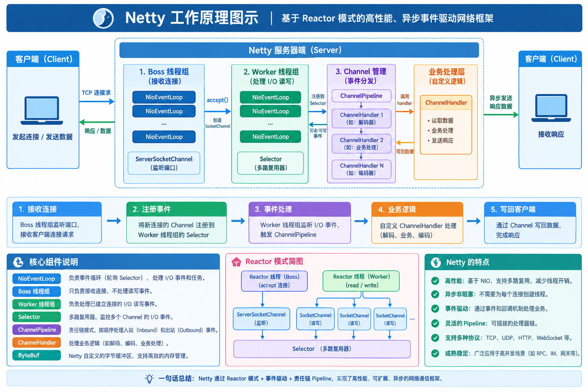
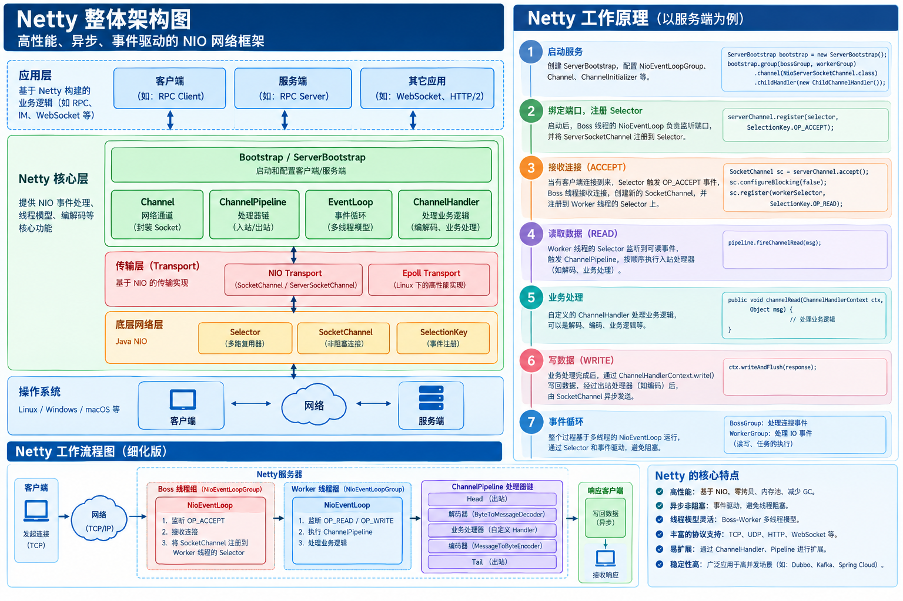
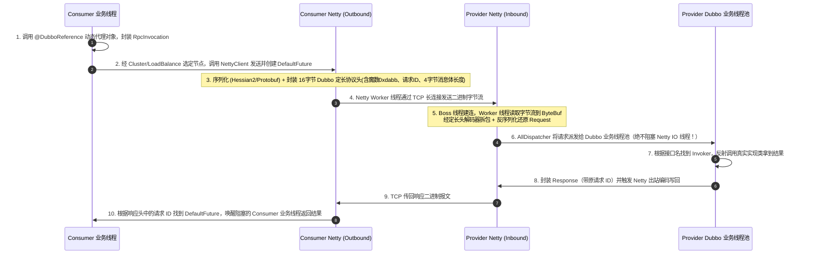

# Netty 核心原理与高并发网络编程指南

> **核心速记**：
> - **Netty 定位**：基于 Java NIO 封装的**高性能、异步事件驱动的网络通信框架**（只专注 TCP/UDP 网络层，不是 Web 容器，也不直接包含 RPC 治理）。
> - **核心架构**：默认采用 **主从 Reactor 多线程模型**——`BossGroup`（主 Reactor，通常 1 个线程）负责监听端口与 `Accept` 接收新连接；`WorkerGroup`（从 Reactor，默认 `CPU核数 * 2` 个线程）负责连接的非阻塞 IO 读写与编解码；耗时业务逻辑必须剥离到独立业务线程池。
> - **无锁线程安全**：一个 `Channel` 生命周期内**固定绑定唯一一个 `EventLoop`（单个 NIO 线程）**，该通道上所有 `ChannelHandler` 事件回调均由同一线程串行执行，无需加锁。
> - **四大杀手锏**：读写指针分离的池化缓冲区（`PooledByteBuf`）、开箱即用的粘包/半包解码器（`LengthFieldBasedFrameDecoder`）、应用层+OS级**零拷贝（Zero-Copy）**、引用计数与内存泄漏检测（`ResourceLeakDetector`）。

---

## 目录

- [一、Netty 全景定位与为什么不用原生 JDK NIO](#一netty-全景定位与为什么不用原生-jdk-nio)
  - [1.1 Netty 是什么与核心特点](#11-netty-是什么与核心特点)
  - [1.2 为什么不直接用 JDK 原生 NIO 而选 Netty？（六大痛点）](#12-为什么不直接用-jdk-原生-nio-而选-netty六大痛点)
  - [1.3 生产环境八大适用场景与不适用场景](#13-生产环境八大适用场景与不适用场景)
  - [1.4 Netty 整体架构层级与工作原理图](#14-netty-整体架构层级与工作原理图)
- [二、核心底层思想：三种 Reactor 反应器线程模型](#二核心底层思想三种-reactor-反应器线程模型)
  - [2.1 三种经典 Reactor 模型演进](#21-三种经典-reactor-模型演进)
  - [2.2 Netty 主从 Reactor 完整读写流转流程](#22-netty-主从-reactor-完整读写流转流程)
  - [2.3 两大黄金并发铁律（面试必考）](#23-两大黄金并发铁律面试必考)
- [三、Netty 六大核心组件详解](#三netty-六大核心组件详解)
  - [3.1 EventLoopGroup 与 EventLoop（事件循环线程组）](#31-eventloopgroup-与-eventloop事件循环线程组)
  - [3.2 Channel（网络通道抽象）](#32-channel网络通道抽象)
  - [3.3 ChannelPipeline 与 ChannelHandler（双向链表责任链）](#33-channelpipeline-与-channelhandler双向链表责任链)
  - [3.4 ByteBuf 字节缓冲区（对比 JDK ByteBuffer）](#34-bytebuf-字节缓冲区对比-jdk-bytebuffer)
  - [3.5 ChannelFuture 与 Promise（异步回调机制）](#35-channelfuture-与-promise异步回调机制)
  - [3.6 ChannelOption 与 AttributeKey（参数与连接属性）](#36-channeloption-与-attributekey参数与连接属性)
- [四、高性能核心机制：TCP 粘包/半包、零拷贝与内存管理](#四高性能核心机制tcp-粘包半包零拷贝与内存管理)
  - [4.1 TCP 粘包与半包问题及 4 种解码器方案](#41-tcp-粘包与半包问题及-4-种解码器方案)
  - [4.2 Netty 零拷贝（Zero-Copy）四大体现](#42-netty-零拷贝zero-copy四大体现)
  - [4.3 堆外内存管理与内存泄漏检测机制](#43-堆外内存管理与内存泄漏检测机制)
  - [4.4 空闲心跳检测（IdleStateHandler）与优雅关闭](#44-空闲心跳检测idlestatehandler与优雅关闭)
- [五、Netty 与 Spring / Tomcat / Dubbo 的关系全景](#五netty-与-spring--tomcat--dubbo-的关系全景)
  - [5.1 Spring 生态中的 Netty（Spring MVC vs WebFlux / Gateway）](#51-spring-生态中的-nettyspring-mvc-vs-webflux--gateway)
  - [5.2 Netty 与 Tomcat 的关系与全方位对比](#52-netty-与-tomcat-的关系与全方位对比)
  - [5.3 Netty 与 Dubbo 的关系及一次 RPC 调用的网络流转全链路](#53-netty-与-dubbo-的关系及一次-rpc-调用的网络流转全链路)
- [六、极简服务端与客户端完整可运行代码](#六极简服务端与客户端完整可运行代码)
  - [6.1 Netty 服务端代码（含粘包处理）](#61-netty-服务端代码含粘包处理)
  - [6.2 Netty 客户端代码（含对称编解码器）](#62-netty-客户端代码含对称编解码器)
- [七、Netty 优缺点总结与高频面试真题](#七netty-优缺点总结与高频面试真题)
  - [7.1 Netty 优缺点总结](#71-netty-优缺点总结)
  - [7.2 45 秒面试开场白背诵版](#72-45-秒面试开场白背诵版)
  - [7.3 高频连环追问 Q&A](#73-高频连环追问-qa)

---

## 一、Netty 全景定位与为什么不用原生 JDK NIO

### 1.1 Netty 是什么与核心特点

**Netty** 是由 JBoss 旗下 Trustin Lee 开发、基于 **Java NIO** 封装的高性能、异步事件驱动的网络通信框架，用于快速开发高可靠、高并发的 TCP/UDP 服务端与客户端程序。

- **核心特点**：
  1. **主从 Reactor 反应器线程模型**：少量 IO 线程即可管理百万级并发长连接；
  2. **开箱即用的高阶特性**：零拷贝（Zero-Copy）、池化内存管理（`PooledByteBuf`）、通用编解码器（处理粘包/半包）、空闲心跳检测、断线重连、SSL/TLS 加密；
  3. **Java 高性能网络事实标准**：几乎所有主流 Java 分布式中间件底层通信均基于 Netty 构建。

---

### 1.2 为什么不直接用 JDK 原生 NIO 而选 Netty？（六大痛点）

JDK 原生 NIO 存在大量工程痛点，Netty 对其进行了工业级封装与优化：

| 维度 | JDK 原生 NIO 痛点 | Netty 的工业级解决方案 |
| :--- | :--- | :--- |
| **1. API 复杂度** | 需手动管理 `Selector`、`ServerSocketChannel`、`SelectionKey` 注册与事件轮询，代码冗长极易出错 | 提供 `ServerBootstrap` 链式 API 与 `ChannelPipeline` 事件驱动模型，几行代码即可启动服务端 |
| **2. Epoll 空轮询 Bug** | Linux 下 JDK NIO 的 `Selector.select()` 存在经典的 **Epoll 空轮询 Bug**（无就绪事件却无限唤醒返回 0，导致 **CPU 飙升至 100%**） | 内置 `selectCnt` 计数器检测：当空轮询次数达到阈值（默认 `512` 次）时，**自动重建新的 `Selector`** 并迁移所有的 `Channel`，彻底规避该 Bug |
| **3. 缓冲区设计缺陷** | `ByteBuffer` 长度固定无法动态扩容，且读写共用一个 `position` 指针，每次切换读写必须手动调用 `flip()` / `clear()`，极易越界 | 自研 [`ByteBuf`](#34-bytebuf-字节缓冲区对比-jdk-bytebuffer)，分离 `readerIndex` 与 `writerIndex`，支持自动扩容、内存池化与零拷贝 |
| **4. 线程模型缺失** | 需开发者自行设计多线程 Reactor 模型与并发同步，极易写出死锁或竞态条件 | 内置成熟的主从 `NioEventLoopGroup` 线程模型，单 `Channel` 绑定单 `EventLoop` 实现无锁串行化 |
| **5. 网络粘包与高可用** | TCP 粘包/半包、心跳保活、断线重连、连接空闲回收全部需要从零手写 | 内置 4 大拆包解码器、`IdleStateHandler` 心跳处理器与完善的异常传播机制 |
| **6. 版本兼容性** | 不同 JDK 版本 NIO 底层行为存在差异 | 屏蔽底层差异，且支持在 Linux 下无缝切换为原生 `EpollEventLoopGroup` 进一步压榨性能 |

---

### 1.3 生产环境八大适用场景与不适用场景

#### ✅ 八大核心生产适用场景
1. **RPC 框架底层通信（最典型）**：Apache Dubbo、gRPC-Java、Motan 等默认使用 Netty 建立服务间 TCP 长连接，收发二进制数据包。
2. **消息中间件与分布式组件**：RocketMQ（Broker 与 Producer/Consumer 通信）、Elasticsearch 节点通信、Redisson 客户端、ZooKeeper、Flink 网络传输层。
3. **响应式 API 网关 / 代理服务**：**Spring Cloud Gateway**、Sentinel Gateway、TCP 代理与内网穿透服务。
4. **IM 即时通讯系统**：微信/釘釘类私聊群聊、在线客服、直播间弹幕推送（维持海量客户端长连接与实时双向推送）。
5. **IoT 物联网接入平台**：百万级低功耗传感器设备长连接接入、心跳保活、数据上报与指令下发。
6. **网络游戏服务器**：手游/端游服务端，实时同步玩家位置与战斗帧状态。
7. **大文件传输与数据同步**：基于 TCP 长连接的分片上传与零拷贝传输。
8. **企业内部自定义私有 TCP 协议**：如自研监控指标采集 Agent 与服务端通信。

#### ❌ 不适合直接使用 Netty 的场景
- **普通 HTTP CRUD 业务系统**：直接使用 Spring MVC（内置 Tomcat）即可，没必要基于 Netty 手写 HTTP 路由和业务控制器；
- **低频短连接简单交互**：连接数极少、无高并发长连接诉求时，直接引入 Netty 反而增加维护成本。

---

### 1.4 Netty 整体架构层级与工作原理图

- **自上而下架构层级**：
  `业务 ChannelHandler 层` → `协议编解码层（Codec）` → `ChannelPipeline 责任链流水线` → `EventLoop 线程调度层` → `ByteBuf 字节缓冲区层` → `JDK NIO / Linux Epoll 底层系统调用`。





---

## 二、核心底层思想：三种 Reactor 反应器线程模型

### 2.1 三种经典 Reactor 模型演进

| 模型名称 | 架构结构 | 优缺点与适用场景 |
| :--- | :--- | :--- |
| **1. 单 Reactor 单线程** | **1 个线程**包揽：监听端口（`Accept`）+ 所有连接 IO 读写（`Read/Write`）+ 业务处理 | 模型极简无并发问题，但无法利用多核 CPU，任何一个连接阻塞就会卡死整个服务端（如 Redis 6.0 前的核心网络模型），Netty 极少使用 |
| **2. 单 Reactor 多线程** | **1 个 Reactor 线程**负责监听连接 + 所有 IO 读写；复杂的业务处理交给独立的 **Worker 业务线程池** | 充分利用多核处理业务，但单个 Reactor 线程同时承担海量连接的 `Accept` 与所有 Socket 读写，超高并发下该单线程仍会成为瓶颈 |
| **3. 主从 Reactor 多线程（Netty 默认 ✅）** | - **主 Reactor（`BossGroup`）**：通常 1 个线程，**只负责监听端口与 `Accept` 接收新 TCP 连接**，随后将 `SocketChannel` 注册给从 Reactor；<br>- **从 Reactor（`WorkerGroup`）**：默认 `CPU核数 * 2` 个 NIO 线程，每个线程绑定独立 `Selector`，负责已建立连接的 **IO 读写与编解码**；<br>- **业务线程池（可选）**：耗时 DB/RPC 操作剥离到独立业务线程池执行 | 职责彻底解耦，轻松支撑百万级并发连接，是 Netty 服务端标准生产架构 |

---

### 2.2 Netty 主从 Reactor 完整读写流转流程

1. **`BossGroup` 监听连接**：Boss `EventLoop` 轮询服务端 `NioServerSocketChannel` 的 `Accept` 事件；
2. **连接注册移交**：客户端三次握手建连成功后，Boss 创建对应的 `NioSocketChannel`，通过轮询算法在 `WorkerGroup` 中挑选一个 Worker `EventLoop`，将该 `SocketChannel` 注册到该 Worker 的 `Selector` 上并监听 `Read` 事件；
3. **触发读就绪事件**：客户端发送数据到达操作系统内核缓冲区，Worker `EventLoop` 轮询到 `Read` 事件就绪，将数据读取到 `ByteBuf`；
4. **`ChannelPipeline` 入站传播**：数据沿 `Pipeline` 上的 `InboundHandler` 依次从头向后执行（拆包 → 反序列化解码 → 业务 Handler 处理）；
5. **`ChannelPipeline` 出站回写**：业务调用 `ctx.writeAndFlush(resp)`，数据沿 `OutboundHandler` 从尾向前执行（序列化编码 → 写入 Socket 缓冲区发送）。

---

### 2.3 两大黄金并发铁律（面试必考）

1. **铁律一：单 `Channel` 终身绑定唯一 `EventLoop`（无锁串行化设计）**
   - 一个 `EventLoop` 绑定 1 个线程，可以同时服务多个 `Channel`；但**同一个 `Channel` 在整个生命周期内只会绑定唯一一个 `EventLoop` 线程**。
   - **好处**：该 `Channel` 上的所有 IO 读写和 `ChannelHandler` 回调天然在同一个线程内串行执行，**不存在多线程并发竞争，因此 Handler 处理单连接状态无需加锁**（注意：若是 `@Sharable` 跨连接共享的 Handler 操作全局共享变量仍需注意线程安全）。
2. **铁律二：Worker IO 线程绝不能执行耗时阻塞任务**
   - 因为 1 个 Worker `EventLoop` 线程同时管理着成百上千个客户端 `Channel`，如果在 `channelRead()` 中直接执行慢 SQL、同步 RPC 或 `Thread.sleep()`，会导致该 Worker 线程绑定的**所有其他客户端连接全部假死卡顿**！
   - **解决方案**：必须将耗时业务提交给独立的业务线程池（如 Dubbo 的业务线程池，或向 `pipeline.addLast(businessEventExecutorGroup, new MyBusinessHandler())` 传入独立 `DefaultEventExecutorGroup`）。

---

## 三、Netty 六大核心组件详解

> **一句话记忆**：`Channel` 是网络连接，`EventLoop` 是工作线程，`Pipeline` 是责任链流水线，`Handler` 是业务/编解码处理器，`ByteBuf` 是数据缓冲区，`ChannelFuture` 是异步结果凭证。

### 3.1 EventLoopGroup 与 EventLoop（事件循环线程组）

- **`NioEventLoopGroup`**：Netty 的核心线程池，内部维护一组 `NioEventLoop`。
  - **`BossGroup`**：通常配置为 `new NioEventLoopGroup(1)`（单端口监听只需 1 个线程即可）；
  - **`WorkerGroup`**：通常配置为 `new NioEventLoopGroup()`（无参构造默认线程数为 **`CPU核心数 * 2`**）。
- **`NioEventLoop`**：本质是一个单线程执行器（绑定 1 个线程 + 1 个 `Selector` + 1 个任务队列 `taskQueue`），死循环执行三件事：① `select()` 轮询 IO 事件；② `processSelectedKeys()` 处理就绪 IO 事件；③ `runAllTasks()` 执行提交到队列中的普通/定时任务。

---

### 3.2 Channel（网络通道抽象）

对底层 Socket 连接的统一抽象，提供连接状态查询、参数配置、异步读写与关闭操作：
- `NioServerSocketChannel`：服务端 TCP 监听通道；
- `NioSocketChannel`：客户端/已建立连接的 TCP 套接字通道；
- `EpollServerSocketChannel` / `EpollSocketChannel`：Linux 平台下基于原生 Epoll 的高性能实现（边缘触发 ET）。

---

### 3.3 ChannelPipeline 与 ChannelHandler（双向链表责任链）

每个 `Channel` 创建时都会自动分配一条 `ChannelPipeline`（内部是一个带 `HeadContext` 和 `TailContext` 哨兵节点的**双向链表**）：

```text
           入站事件 (Inbound: read / active) 从 Head ──► Tail 顺序执行
        ┌───────────────────────────────────────────────────────────┐
        ▼                                                           │
┌───────────────┐    ┌──────────────────┐    ┌──────────────────┐   │   ┌───────────────┐
│  HeadContext  │◄──►│ InboundHandler A │◄──►│ OutboundHandler B│◄──┴──►│  TailContext  │
└───────────────┘    │    (如解码器)     │    │    (如编码器)     │       └───────────────┘
        ▲            └──────────────────┘    └──────────────────┘               │
        └───────────────────────────────────────────────────────────────────────┘
           出站事件 (Outbound: write / flush) 从 Tail ──► Head 逆序执行
```

- **两类处理器**：
  1. **`ChannelInboundHandler`（入站处理器）**：处理读数据（`channelRead`）、连接激活（`channelActive`）、异常（`exceptionCaught`）等事件，方向为 **`Head → Tail`**（通常继承 `ChannelInboundHandlerAdapter` 或 `SimpleChannelInboundHandler<T>`）。
  2. **`ChannelOutboundHandler`（出站处理器）**：处理写数据（`write`）、刷新（`flush`）、连接关闭等主动发出的事件，方向为 **`Tail → Head`**（通常继承 `ChannelOutboundHandlerAdapter`）。
- **高频面试坑点：`ctx.writeAndFlush()` vs `ctx.channel().writeAndFlush()` 有什么区别？**
  - **`ctx.writeAndFlush(msg)`**：从**当前 Handler 节点**开始，直接向前（往 `Head` 方向）寻找出站 `OutboundHandler` 执行，路径更短、性能更高；
  - **`ctx.channel().writeAndFlush(msg)`**：永远从整个双向链表的最末端 **`TailContext`** 开始，从尾到头完整走完所有 `OutboundHandler`。

---

### 3.4 ByteBuf 字节缓冲区（对比 JDK ByteBuffer）

Netty 自研的 `ByteBuf` 彻底解决了 JDK 原生 `ByteBuffer` 的设计缺陷：

```text
+-------------------+------------------+------------------+
| discardable bytes |  readable bytes  |  writable bytes  |
|   (已读可丢弃区)   |     (可读数据区)   |    (剩余可写区)   |
+-------------------+------------------+------------------+
0      <=      readerIndex   <=   writerIndex    <=    capacity
```

| 对比维度 | JDK `ByteBuffer` | Netty `ByteBuf` |
| :--- | :--- | :--- |
| **读写指针** | 读写共用 1 个 `position` 指针，读切换写、写切换读必须手动调用 `flip()` | **读写指针分离**（`readerIndex` 读指针、`writerIndex` 写指针），**完全无需 `flip()`** |
| **容量扩展** | 固定长度，写满直接抛 `BufferOverflowException`，需手动新建数组拷贝 | **支持自动动态扩容**（超过 `writableBytes` 时自动按2倍或步进扩容至 `maxCapacity`） |
| **内存池化** | 不支持池化，每次分配与回收均产生 GC 压力 | 支持 **对象与内存池化（`PooledByteBufAllocator`，4.1+ 默认）**，仿照 jemalloc 算法大幅降低 GC 与分配开销 |
| **内存类型** | 堆内存（`Heap`）与直接内存（`Direct`） | 组合支持 **池化/非池化 × 堆内（`Heap`）/ 堆外直接内存（`Direct`）** 共 4 种模式 |
| **回收机制** | 依赖 JVM GC（堆外依赖 `Cleaner` 虚引用，回收时机不可控） | 引入 **引用计数机制（`ReferenceCounted`）**：`retain()` 计数 $+1$，`release()` 计数 $-1$，归零立即归还内存池或释放 |

---

### 3.5 ChannelFuture 与 Promise（异步回调机制）

Netty 中所有的 IO 操作（`bind`、`connect`、`write`、`close`）全部是**异步非阻塞**的，调用后立刻返回 `ChannelFuture`：
- **同步阻塞等待**：`ChannelFuture future = bootstrap.bind(8888).sync();`（常用于启动阶段等待端口绑定完成）；
- **异步监听器回调（推荐）**：
  ```java
  channel.writeAndFlush(msg).addListener((ChannelFutureListener) future -> {
      if (future.isSuccess()) {
          // 发送成功回调（由 EventLoop 线程触发，切勿在此阻塞）
      } else {
          future.cause().printStackTrace();
      }
  });
  ```

---

### 3.6 ChannelOption 与 AttributeKey（参数与连接属性）

- **`ChannelOption`（底层 TCP Socket 参数）**：
  - `ChannelOption.SO_BACKLOG`：服务端 TCP 三次握手全连接/半连接等待队列大小；
  - `ChannelOption.SO_KEEPALIVE`：开启操作系统 TCP 层保活探测；
  - `ChannelOption.TCP_NODELAY`：设置为 `true` **禁用 Nagle 算法**（小数据包立即发送，不等待凑齐大包，降低延迟）；
  - `ChannelOption.CONNECT_TIMEOUT_MILLIS`：客户端建立连接超时毫秒数。
- **`AttributeKey<T>`**：在 `Channel` 上绑定连接级上下文属性（如绑定当前登录的 `userId` 或设备 ID：`channel.attr(USER_ID_KEY).set("U1001")`）。

---

## 四、高性能核心机制：TCP 粘包/半包、零拷贝与内存管理

### 4.1 TCP 粘包与半包问题及 4 种解码器方案

#### 1. 为什么 TCP 会有粘包和半包？（UDP 为什么没有？）
- **根本原因**：**TCP 是面向字节流的协议（Stream-oriented），本身没有“消息/数据包边界”的概念**（而 UDP 是面向报文的，每个 UDP 包都有明确边界）。
- **产生诱因**：
  - **粘包（多条消息粘在一起）**：发送方每次写入数据很小，Nagle 算法或发送缓冲区将多次写入合并成一个 TCP 段发出；或者接收方应用层没有及时读取接收缓冲区积压的多条数据。
  - **半包/拆包（一条消息被切成两半）**：发送的数据大于发送缓冲区剩余空间，或超过了网卡 **MSS（最大报文段长度）/ MTU**，在传输层被拆分成多个 TCP 报文段分批到达。

#### 2. Netty 内置 4 种开箱即用的拆包解码器

| 解码器类名 | 拆包原理 | 适用场景 |
| :--- | :--- | :--- |
| **`FixedLengthFrameDecoder`** | **固定长度拆包**：每条消息固定 $N$ 个字节，不足则等待后续字节补齐 | 指令长度完全固定的简单协议 |
| **`LineBasedFrameDecoder`** | **换行符拆包**：按 `\n` 或 `\r\n` 识别消息边界（需指定最大长度防内存溢出） | 基于行的文本协议 |
| **`DelimiterBasedFrameDecoder`** | **自定义分隔符拆包**：按指定的特殊字节序列（如 `$_`）切分消息 | 自定义文本分隔协议 |
| **`LengthFieldBasedFrameDecoder`** | **长度域前置拆包（最通用、生产首选 ✅）**：在消息头中专门用固定字节（如 4 字节）记录**消息体长度**，先读长度再精确读取指定字节数 | **所有主流二进制私有协议（Dubbo 协议、RocketMQ 协议等均采用此方案）** |

---

### 4.2 Netty 零拷贝（Zero-Copy）四大体现

面试官问 **“Netty 的零拷贝体现在哪里？”**，必须从 **操作系统层面** 和 **Netty 应用层缓冲区层面** 两部分作答：

1. **堆外直接内存（`DirectByteBuf` —— 减少 JVM 堆与内核态拷贝）**：
   - 若使用传统 JVM 堆内存（`HeapByteBuf`），Socket 读写时必须先将堆内数组拷贝到堆外直接内存，再由 DMA 拷贝到网卡；
   - Netty 默认使用 **堆外直接内存（`DirectByteBuf`）** 进行 Socket 读写，数据直接在堆外内存与内核缓冲区之间传输，**省去了一次 JVM 堆内存 ↔ 堆外内存的 CPU 拷贝**。
2. **`FileRegion` 文件传输（OS 级 `sendfile` 零拷贝）**：
   - Netty 的 `DefaultFileRegion` 底层封装了 JDK `FileChannel.transferTo()`，直接调用 Linux 操作系统的 **`sendfile()` 系统调用**，将磁盘文件数据从内核页缓存（PageCache）经 DMA 直接发送到网卡缓冲区，全程零用户态切换与零 CPU 拷贝。
3. **`CompositeByteBuf` 组合缓冲区（应用层逻辑合并）**：
   - 当需要将“协议头 `headerBuf`”与“消息体 `bodyBuf`”拼接发送时，传统做法是分配一个新数组把两者物理复制过去；
   - `CompositeByteBuf` 将多个 `ByteBuf` **逻辑上组合成一个视图**，底层依然指向各自的物理内存，**零内存物理复制**。
4. **`ByteBuf.slice()` / `duplicate()` / `Unpooled.wrappedBuffer()`（切片与包装零拷贝）**：
   - 将一个大 `ByteBuf` 切分为多个小 `ByteBuf` 时，仅创建独立的读写指针视图并共享同一个底层字节数组，不发生任何字节复制。

---

### 4.3 堆外内存管理与内存泄漏检测机制

- **为什么会内存泄漏？**：`PooledDirectByteBuf` 使用的是堆外内存和内存池，不受 JVM GC 直接回收。如果业务 Handler 处理完入站 `ByteBuf` 后既没有向后传递（`ctx.fireChannelRead`），也没有调用 **`ReferenceCountUtil.release(byteBuf)`** 将引用计数归零，这块内存就永远无法归还池中，最终导致堆外内存耗尽（OOM）。
- **规避技巧**：继承 **`SimpleChannelInboundHandler<T>`**，它在模板方法 `channelRead()` 的 `finally` 块中会自动调用 `ReferenceCountUtil.release(msg)`。
- **Netty 内存泄漏检测机制（`ResourceLeakDetector`）**：
  - **底层原理**：基于 **弱引用（`WeakReference`）+ 引用队列（`ReferenceQueue`）**。当 `ByteBuf` 对象被 JVM GC 回收进入 `ReferenceQueue` 时，Netty 检查其引用计数 `refCnt` 是否已归零；若未归零，说明在使用期间忘记调用 `release()`，立即打印泄漏位置调用栈。
  - **4 个检测级别**（通过 `-Dio.netty.leakDetection.level=xxx` 配置）：
    1. `DISABLED`：完全关闭检测；
    2. **`SIMPLE`（默认，生产推荐）**：按 1% 采样率抽样检测，开销极低；
    3. `ADVANCED`：1% 采样，并详细记录最近几次访问该 `ByteBuf` 的调用栈；
    4. **`PARANOID`（偏执模式，压测/联调排查开启）**：**100% 全量采样记录访问轨迹**，定位泄漏一抓一个准（有性能损耗，禁止线上开启）。

---

### 4.4 空闲心跳检测（IdleStateHandler）与优雅关闭

1. **空闲心跳检测（解决 TCP 半开/假死连接）**：
   - 当客户端断网、拔网线或中间防火墙静默丢弃空闲连接时，服务端操作系统无法立刻感知，导致大量“假死连接”耗尽文件句柄；
   - 在 Pipeline 中添加 `new IdleStateHandler(readerIdleTime, writerIdleTime, allIdleTime, TimeUnit.SECONDS)`：当指定时间内未收到读/写事件时，触发 `userEventTriggered(IdleStateEvent)`，客户端定时发 Ping 心跳包，服务端超时未收到则主动 `ctx.close()` 剔除假死连接。
2. **优雅停机（`eventLoopGroup.shutdownGracefully()`）**：
   - 先切换状态拒绝新连接和新任务接入 → 等待静默期（默认 2 秒）让队列中存量任务与在途 IO 执行完毕 → 关闭所有 Channel 并释放 Selector 与线程资源。

---

## 五、Netty 与 Spring / Tomcat / Dubbo 的关系全景

### 5.1 Spring 生态中的 Netty（Spring MVC vs WebFlux / Gateway）

| Spring 组件 | 默认底层容器/网络引擎 | 核心说明 |
| :--- | :--- | :--- |
| **Spring MVC（`spring-boot-starter-web`）** | **Tomcat**（可选 Jetty / Undertow） | 基于 Servlet 阻塞模型，**默认不使用 Netty** |
| **Spring WebFlux（`spring-boot-starter-webflux`）** | **Reactor-Netty（默认 ✅）** | 响应式非阻塞 Web 框架，默认直接跑在 Netty 服务器上（无需 Servlet 容器） |
| **Spring Cloud Gateway** | **Reactor-Netty（强制 ✅）** | **底层完全基于 Netty + WebFlux 构建，绝对不能运行在 Tomcat 上**（引入 `spring-boot-starter-web` 会直接启动报错） |

---

### 5.2 Netty 与 Tomcat 的关系与全方位对比

> **形象比喻**：**Netty 是“高性能网络发动机”，Tomcat 是“带完整车厢的 HTTP 客车”**。Tomcat 默认使用自研的 Coyote（JDK NIO）发动机（Tomcat 8.5+ 也支持可选配置 `NettyConnector`，但极少开启）；而 Netty 只提供底层网络通信引擎，本身不实现 Servlet 规范。

| 对比维度 | Apache Tomcat | Netty |
| :--- | :--- | :--- |
| **核心定位** | **完整的 Servlet Web 容器 + HTTP 服务器** | **通用异步事件驱动网络通信框架（TCP/UDP）** |
| **支持协议** | 原生专为 HTTP/1.1、HTTP/2、WebSocket、AJP 设计 | 聚焦传输层 TCP/UDP，可通过编解码器支持**任意自定义二进制协议**或 HTTP |
| **Servlet 规范** | ✅ 完整实现 Servlet / Filter / Session 规范，可直接部署 Web 应用 | ❌ 不实现 Servlet 规范 |
| **线程与编程模型** | NIO 接收连接，但 **Servlet 业务执行是同步阻塞模型（一对一占用 Worker 线程）** | 纯粹的**主从 Reactor 异步事件驱动模型** |
| **典型应用场景** | 传统 Spring Boot / Spring MVC Web 后端应用 | RPC 框架底层（Dubbo）、消息队列（RocketMQ）、API 网关（Gateway）、IM 与 IoT |

---

### 5.3 Netty 与 Dubbo 的关系及一次 RPC 调用的网络流转全链路

**Dubbo 是分布式 RPC 服务治理框架，Netty 是 Dubbo 默认的底层网络传输引擎（`Transport` 层默认实现为 `NettyTransporter`）。**

#### 🔥 杀手锏级考题：当 Dubbo Consumer 发起一次 RPC 调用，数据包在 Dubbo 与 Netty 之间是如何流转的？



---

## 六、极简服务端与客户端完整可运行代码

> **注意**：使用 `LengthFieldBasedFrameDecoder` 解决粘包/半包时，发送端必须配套添加 `LengthFieldPrepender(4)` 在消息头部自动写入 4 字节长度，否则两端编解码协议不对称会导致解析失败。

### 6.1 Netty 服务端代码（含粘包处理）

```java
package com.example.netty;

import io.netty.bootstrap.ServerBootstrap;
import io.netty.channel.*;
import io.netty.channel.nio.NioEventLoopGroup;
import io.netty.channel.socket.SocketChannel;
import io.netty.channel.socket.nio.NioServerSocketChannel;
import io.netty.handler.codec.LengthFieldBasedFrameDecoder;
import io.netty.handler.codec.LengthFieldPrepender;
import io.netty.handler.codec.string.StringDecoder;
import io.netty.handler.codec.string.StringEncoder;
import java.nio.charset.StandardCharsets;

public class NettyServer {
    public static void main(String[] args) throws InterruptedException {
        // 1. 创建主从 Reactor 线程组：Boss 负责接收连接，Worker 负责 IO 读写
        EventLoopGroup bossGroup = new NioEventLoopGroup(1);
        EventLoopGroup workerGroup = new NioEventLoopGroup();
        try {
            ServerBootstrap bootstrap = new ServerBootstrap();
            bootstrap.group(bossGroup, workerGroup)
                    .channel(NioServerSocketChannel.class)
                    .option(ChannelOption.SO_BACKLOG, 128)          // TCP 全连接队列大小
                    .childOption(ChannelOption.SO_KEEPALIVE, true)  // 开启 TCP 保活
                    .childOption(ChannelOption.TCP_NODELAY, true)   // 禁用 Nagle 算法，降低延迟
                    .childHandler(new ChannelInitializer<SocketChannel>() {
                        @Override
                        protected void initChannel(SocketChannel ch) {
                            ChannelPipeline pipeline = ch.pipeline();
                            // 入站拆包：最大帧 1024 字节，长度域偏移 0，长度域占 4 字节，剥离前 4 字节长度头
                            pipeline.addLast(new LengthFieldBasedFrameDecoder(1024, 0, 4, 0, 4));
                            // 出站封包：发送时自动在头部追加 4 字节长度字段
                            pipeline.addLast(new LengthFieldPrepender(4));
                            pipeline.addLast(new StringDecoder(StandardCharsets.UTF_8));
                            pipeline.addLast(new StringEncoder(StandardCharsets.UTF_8));
                            pipeline.addLast(new ServerHandler());
                        }
                    });

            ChannelFuture future = bootstrap.bind(8888).sync();
            System.out.println("Netty 服务端已启动，监听端口: 8888");
            future.channel().closeFuture().sync();
        } finally {
            bossGroup.shutdownGracefully();
            workerGroup.shutdownGracefully();
        }
    }

    static class ServerHandler extends SimpleChannelInboundHandler<String> {
        @Override
        protected void channelRead0(ChannelHandlerContext ctx, String msg) {
            System.out.println("服务端收到客户端消息: " + msg);
            ctx.writeAndFlush("服务端已确认接收: [" + msg + "]");
        }

        @Override
        public void exceptionCaught(ChannelHandlerContext ctx, Throwable cause) {
            cause.printStackTrace();
            ctx.close();
        }
    }
}
```

---

### 6.2 Netty 客户端代码（含对称编解码器）

```java
package com.example.netty;

import io.netty.bootstrap.Bootstrap;
import io.netty.channel.*;
import io.netty.channel.nio.NioEventLoopGroup;
import io.netty.channel.socket.SocketChannel;
import io.netty.channel.socket.nio.NioSocketChannel;
import io.netty.handler.codec.LengthFieldBasedFrameDecoder;
import io.netty.handler.codec.LengthFieldPrepender;
import io.netty.handler.codec.string.StringDecoder;
import io.netty.handler.codec.string.StringEncoder;
import java.nio.charset.StandardCharsets;

public class NettyClient {
    public static void main(String[] args) throws InterruptedException {
        EventLoopGroup workerGroup = new NioEventLoopGroup();
        try {
            Bootstrap bootstrap = new Bootstrap();
            bootstrap.group(workerGroup)
                    .channel(NioSocketChannel.class)
                    .option(ChannelOption.TCP_NODELAY, true)
                    .handler(new ChannelInitializer<SocketChannel>() {
                        @Override
                        protected void initChannel(SocketChannel ch) {
                            ChannelPipeline pipeline = ch.pipeline();
                            // 与服务端保持完全对称的长度域编解码器
                            pipeline.addLast(new LengthFieldBasedFrameDecoder(1024, 0, 4, 0, 4));
                            pipeline.addLast(new LengthFieldPrepender(4));
                            pipeline.addLast(new StringDecoder(StandardCharsets.UTF_8));
                            pipeline.addLast(new StringEncoder(StandardCharsets.UTF_8));
                            pipeline.addLast(new ClientHandler());
                        }
                    });

            ChannelFuture future = bootstrap.connect("127.0.0.1", 8888).sync();
            Channel channel = future.channel();
            channel.writeAndFlush("Hello Netty!");
            channel.closeFuture().sync();
        } finally {
            workerGroup.shutdownGracefully();
        }
    }

    static class ClientHandler extends SimpleChannelInboundHandler<String> {
        @Override
        protected void channelRead0(ChannelHandlerContext ctx, String msg) {
            System.out.println("客户端收到服务端响应: " + msg);
        }
    }
}
```

---

## 七、Netty 优缺点总结与高频面试真题

### 7.1 Netty 优缺点总结

- **优点**：
  1. **主从 Reactor 模型 + 异步非阻塞**：轻松支撑单机数十万至百万级 TCP 长连接；
  2. **彻底屏蔽 JDK NIO 缺陷**：自动修复 Linux Epoll 空轮询 CPU 100% Bug，API 简洁优雅；
  3. **单 Channel 绑定单 EventLoop**：Handler 串行执行避免锁竞争，上下文切换极少；
  4. **极致内存与 IO 优化**：池化 `PooledByteBuf` + 堆外直接内存 + 应用层/OS 级零拷贝；
  5. **高度可插拔的责任链**：编解码、拆包、心跳保活、SSL 均可像搭积木一样加入 `ChannelPipeline`。
- **缺点**：
  1. **异步编程门槛高**：一旦新手在 `ChannelHandler` 中误写同步阻塞代码（如慢 SQL），会直接卡死 Worker IO 线程；
  2. **堆外内存泄漏风险**：`ByteBuf` 采用引用计数管理，若未正确调用 `release()` 释放，会引发堆外内存泄漏。

---

### 7.2 45 秒面试开场白背诵版

> “Netty 是基于 Java NIO 封装的高性能异步事件驱动网络框架，广泛用于 Dubbo、RocketMQ 和 Spring Cloud Gateway 的底层通信。
> 它默认采用**主从 Reactor 多线程模型**：`BossGroup` 负责监听端口和接收 TCP 连接，随后将 `SocketChannel` 注册给 `WorkerGroup` 处理非阻塞 IO 读写。每个 `Channel` 终身绑定唯一一个 `EventLoop` 线程，保证了 Handler 回调无锁串行执行；同时耗时业务必须剥离到独立业务线程池，避免阻塞 IO 线程。
> 在核心特性上，Netty 通过 `LengthFieldBasedFrameDecoder` 解决 TCP 粘包半包问题，通过自研的池化 `ByteBuf` 实现读写指针分离与动态扩容，并利用堆外直接内存、`CompositeByteBuf` 和 `FileRegion` 实现了零拷贝优化。”

---

### 7.3 高频连环追问 Q&A

#### Q1：`DirectByteBuf`（堆外直接内存）和 `HeapByteBuf`（堆内内存）有什么区别？如何选型？
- **`HeapByteBuf`（堆内字节数组 `byte[]`）**：分配和释放极快，由 JVM GC 自动回收；但在进行 Socket IO 读写时，JVM 必须先将其复制到堆外直接内存（因为 GC 移动对象会导致内存地址变化，操作系统 DMA 无法直接操作堆内数组），多了一次内存拷贝。**适合纯业务对象内存计算**。
- **`DirectByteBuf`（堆外直接内存）**：在 JVM 堆外分配操作系统本地内存，**Socket 读写时免去堆内到堆外的复制（零拷贝），IO 性能极高**；但分配和释放成本较高，且不受 GC 直接管理。因此 Netty 默认配合 **内存池（`PooledDirectByteBuf`）** 复用堆外内存，并配合引用计数释放，**是网络 IO 缓冲区的默认首选**。

#### Q2：`LengthFieldBasedFrameDecoder` 的 5 个核心构造参数分别代表什么？
- 构造函数：`LengthFieldBasedFrameDecoder(maxFrameLength, lengthFieldOffset, lengthFieldLength, lengthAdjustment, initialBytesToStrip)`：
  1. `maxFrameLength`：单条数据帧最大允许字节数（超出则抛 `TooLongFrameException` 防内存溢出）；
  2. `lengthFieldOffset`：长度字段在消息头中的起始偏移字节数（若消息头最开始就是长度，则为 `0`；若前面有 2 字节魔数，则为 `2`）；
  3. `lengthFieldLength`：长度字段自身占几个字节（通常 `int` 为 `4` 字节）；
  4. `lengthAdjustment`：长度补偿值（若长度字段存的是“总长度”而非“正文长度”，需设为负数减去头部字节）；
  5. `initialBytesToStrip`：解码后向后传递时需剥离掉头部的几个字节（例如设为 `4` 即可直接拿到纯正文内容）。
