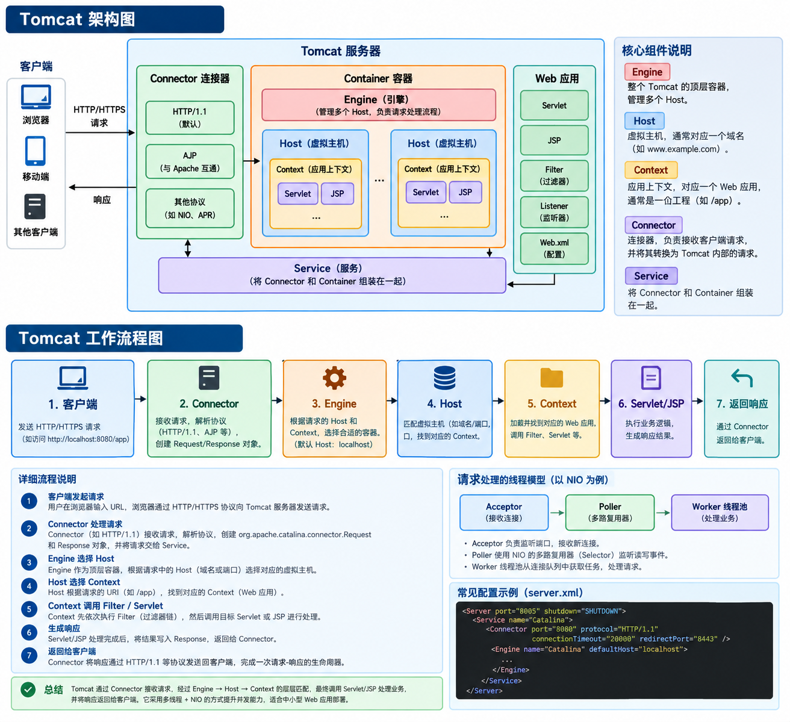

### Tomcat

#### 一、Tomcat 是什么

**Apache Tomcat**（简称 Tomcat）是 Apache 基金会旗下**开源、轻量**的 **Jakarta Servlet / JSP 容器**（旧称 Java EE），用 Java 编写，可独立作为 HTTP Web 服务器运行，也常与 Nginx/Apache 配合部署。


- **核心身份**：
  - **Web 服务器**：监听 8080 端口，处理 HTTP/HTTPS 请求，可直接返回静态资源（HTML/CSS/JS/图片）。
  - **Servlet 容器**：实现 Servlet、JSP、EL、WebSocket 规范，**管理 Servlet 生命周期**（加载→初始化→服务→销毁）。
  - **JSP 引擎**：自动把 JSP 编译成 Servlet 并执行。
  - **轻量应用服务器**：非完整 Java EE 服务器（无 EJB、JTA 等），**占用资源少、启动快、易部署**。

---

#### 二、核心特性

- ✅ **开源免费**：Apache 2.0 许可证，商业项目可用。
- ✅ **跨平台**：纯 Java，支持 Windows/Linux/macOS。
- ✅ **规范兼容**：
  - Tomcat 9：Servlet 4.0、JSP 2.3、EL 3.0、WebSocket 1.1（Java 8+）。
  - Tomcat 10：Jakarta EE 9（包名从 `javax.servlet` 改为 `jakarta.servlet`）。
  - Tomcat 11：Jakarta EE 10，最低 Java 11。
- ✅ **高并发**：内置线程池、支持 NIO/NIO2/APR 网络模型。
- ✅ **集群与负载均衡**：支持会话复制、粘性会话，可与 Nginx 做负载均衡。
- ✅ **安全**：内置 Realm 认证、SSL/TLS、访问控制、防 CSRF。
- ✅ **可扩展**：组件化架构，可自定义 Connector、Valve、Listener。

---

#### 三、版本演进（关键节点）

| 版本 | 发布 | 最低 Java | Servlet | JSP  | 重要特性                         |
| ---- | ---- | --------- | ------- | ---- | -------------------------------- |
| 7.x  | 2011 | 6         | 3.0     | 2.2  | 异步 Servlet、WebSocket 初始支持 |
| 8.x  | 2014 | 7         | 3.1     | 2.3  | NIO2、HTTP/1.1 优化              |
| 9.x  | 2017 | 8         | 4.0     | 2.3  | HTTP/2、TLS 1.3、Jakarta EE 过渡 |
| 10.x | 2021 | 8         | 5.0     | 3.0  | 包名迁移到 `jakarta.*`、EE9      |
| 11.x | 2024 | 11        | 6.0     | 4.0  | EE10、虚拟线程（预览）、性能提升 |

> 生产环境建议用 **9.x（稳定兼容）** 或 **10.x（新项目）**，避免已终止维护的旧版（如 7.x 及更早）。

---

#### 四、目录结构（安装后）

```
tomcat/
├── bin/         # 启动/停止脚本（startup.sh、shutdown.sh、catalina.sh）
├── conf/        # 核心配置（server.xml、web.xml、context.xml、tomcat-users.xml）
├── lib/         # 依赖 jar（servlet-api、jsp-api、el-api 等）
├── logs/        # 日志（catalina.out、localhost.log、access.log）
├── temp/        # 临时文件
├── webapps/     # 应用部署目录（ROOT、examples、docs、manager、host-manager）
└── work/        # JSP 编译后的 Servlet 缓存
```

---

#### 五、核心架构（组件层级）

Tomcat 采用**分层容器架构**，核心组件：**Server → Service → Connector → Engine → Host → Context → Wrapper**。
##### 1. Server（顶层容器）

- 代表**整个 Tomcat 实例**，一个 JVM 中只有一个 Server。
- 管理生命周期（启动/关闭），包含多个 Service（默认一个）。
- 配置：`conf/server.xml` 中 `<Server port="8005" shutdown="SHUTDOWN">`（8005 是关闭端口，不对外）。

##### 2. Service（服务）

- 绑定**一个 Engine + 多个 Connector**，负责请求传递与组件生命周期管理。
- 默认 Service 名：**Catalina**。
- 配置：`<Service name="Catalina">`。

##### 3. Connector（连接器，入口）

- **监听端口、处理网络连接、解析协议**（HTTP/1.1、AJP、HTTP/2）。
- 核心内部组件：
  - **Endpoint**：底层 IO（NIO/NIO2/APR），监听 Socket 端口（默认 8080）。
  - **Processor**：解析 HTTP 字节流 → Tomcat Request/Response 对象。
  - **Adapter（CoyoteAdapter）**：把 Request/Response 转为 Servlet 规范对象，调用 Engine。
- 配置（HTTP 8080）：
  ```xml
  <Connector port="8080" protocol="HTTP/1.1"
             connectionTimeout="20000" redirectPort="8443" />
  ```

##### 4. Engine（引擎，顶层容器）

- **请求处理总入口**，接收所有 Connector 请求，分发给对应 Host。
- 一个 Service 只有一个 Engine，默认引擎名：**Catalina**。
- 配置：`<Engine name="Catalina" defaultHost="localhost">`。

##### 5. Host（虚拟主机）

- 对应**一个域名**（如 localhost、www.example.com），可配置多个 Host 实现多域名部署。
- 管理多个 Context（Web 应用）。
- 配置：`<Host name="localhost" appBase="webapps" unpackWARs="true" autoDeploy="true">`。

##### 6. Context（Web 应用）

- 代表**一个独立 Web 应用**（如 ROOT、/demo），每个应用隔离运行。
- 管理 Servlet、Filter、Listener、Session、JSP 等。
- 配置：`<Context path="/demo" docBase="demo" reloadable="true" />`。

##### 7. Wrapper（包装器）

- **最小容器单元**，代表一个 Servlet 实例。
- 管理 Servlet 生命周期：加载→初始化（init()）→服务（service()）→销毁（destroy()）。

---

#### 六、请求处理全流程（一次 HTTP 请求）

1. **用户**发请求：`http://localhost:8080/demo/index.jsp` → 到达服务器 8080 端口。
2. **Connector（Endpoint）** 接收 TCP 连接，线程池取线程处理。
3. **Processor** 解析 HTTP 协议，生成 Tomcat Request/Response。
4. **Adapter** 转为 Servlet 规范对象，调用 Engine。
5. **Engine** 根据域名（localhost）匹配 Host。
6. **Host** 根据路径（/demo）匹配 Context。
7. **Context** 找到对应 Servlet（JSP 编译后的 Servlet），交由 Wrapper 调用 `service()`。
8. **Servlet** 处理业务（查数据库、生成动态 HTML），写入 Response。
9. 响应沿原路返回 → Connector → 用户浏览器。

---

#### 七、核心配置文件详解

##### 1. server.xml（主配置，核心）

- 位置：`conf/server.xml`
- 作用：配置 Server、Service、Connector、Engine、Host 等核心组件。
- 关键配置项：
  - 关闭端口：`<Server port="8005" shutdown="SHUTDOWN">`
  - HTTP 端口：`<Connector port="8080" ...>`
  - 虚拟主机：`<Host name="localhost" appBase="webapps">`

##### 2. web.xml（全局默认配置）

- 位置：`conf/web.xml`
- 作用：定义所有 Web 应用默认配置（Servlet、Filter、MIME 类型、错误页面）。
- 常用配置：默认 Servlet（处理静态资源）、JSP Servlet、字符编码（UTF-8）。

##### 3. context.xml（数据源/资源配置）

- 位置：`conf/context.xml` 或 应用 `META-INF/context.xml`
- 作用：配置 JDBC 数据源、连接池、JNDI、资源引用。

##### 4. tomcat-users.xml（用户/角色/权限）

- 位置：`conf/tomcat-users.xml`
- 作用：配置 Tomcat 内置用户（如 manager/host-manager 控制台账号）。
- 示例：
  ```xml
  <user username="admin" password="admin" roles="manager-gui,admin-gui"/>
  ```

---

#### 八、部署 Web 应用的 3 种方式

1. **直接放 webapps**：将 WAR 包或解压文件夹放入 `webapps`，Tomcat 启动时**自动部署**（`autoDeploy="true"`）。
2. **配置 Context 标签**：在 `server.xml` 的 Host 内添加 `<Context path="/demo" docBase="/path/to/demo" />`。
3. **配置 Host 子目录**：在 `conf/Catalina/localhost/` 下创建 `demo.xml`，内容同上 Context 配置。

---

#### 九、IO 模型（性能关键）

- **BIO（阻塞 IO，Tomcat 7 前默认）**：一个请求一个线程，高并发下线程阻塞、资源耗尽、性能差。
- **NIO（非阻塞 IO，Tomcat 7+ 默认）**：基于 Java NIO，**单线程处理多个连接**，非阻塞读写，并发能力强。
- **NIO2（异步 IO，Tomcat 8+ 支持）**：Java 7 AIO，操作系统异步通知，**高并发、低延迟**。
- **APR（Apache Portable Runtime，原生 IO）**：调用本地库（C 实现），**高性能、高吞吐**，适合生产环境（需安装 APR 库）。

> 配置 NIO：`<Connector ... protocol="org.apache.coyote.http11.Http11NioProtocol" />`。

---

#### 十、常见使用场景

- ✅ **Java Web 应用部署**：Spring Boot、SSM、Struts、JSP/Servlet 项目。
- ✅ **前后端分离**：后端 API（Spring Boot）部署在 Tomcat，Nginx 反向代理静态资源。
- ✅ **企业内部系统**：OA、ERP、CRM、报表系统。
- ✅ **小型网站/商城**：个人博客、小型电商、毕业设计。
- ✅ **集群高可用**：多台 Tomcat 做集群，Nginx 负载均衡，会话复制保证一致性。

---

#### 十一、优缺点

##### 优点

- ✅ **轻量高效**：启动快、内存占用小、部署简单。
- ✅ **稳定成熟**：20+ 年历史，社区活跃，Bug 少，企业广泛使用。
- ✅ **规范兼容**：严格实现 Servlet/JSP 规范，迁移方便。
- ✅ **免费开源**：无授权费用，商业项目可用。

##### 缺点

- ❌ **不支持 EJB/JTA**：非完整 Java EE 服务器，复杂企业级应用需用 WebLogic、JBoss。
- ❌ **默认配置性能一般**：需调优（线程池、IO 模型、JVM）才能支撑高并发。
- ❌ **静态资源性能不如 Nginx**：高并发静态请求建议 Nginx 反向代理。

---

#### 十二、与 Nginx 的区别与配合

- **Nginx**：高性能 **HTTP 服务器/反向代理**，擅长**静态资源、高并发、负载均衡、SSL 终端**，不支持 Servlet/JSP。
- **Tomcat**：**Servlet 容器**，擅长**动态 Java 应用**，静态性能弱。
- **最佳实践**：**Nginx 前端 + Tomcat 后端**
  - Nginx：监听 80/443，处理静态资源、SSL、负载均衡、反向代理。
  - Tomcat：监听 8080，只处理动态请求（/api、/jsp）。

---

#### 十三、总结

Tomcat 是 **Java Web 生态的基石**，轻量、稳定、开源，完美适配绝大多数 Java Web 应用。理解其**分层架构、请求流程、IO 模型、配置调优**，是 Java 后端开发与运维的必备技能。

要不要我把以上内容浓缩成一份可直接复制的 **Tomcat 核心配置模板（含 Nginx 反向代理示例）**？#

### Tomcat 架构

（后端秋招，重点架构+请求流程+类加载+IO模型）

>一句话：**Tomcat 是轻量级Web容器，实现Servlet、JSP规范；包含两大核心模块 Coyote（网络通信Connector）、Catalina（Servlet容器Container）；SpringBoot内置Tomcat，本质是Java写的HTTP服务器+Servlet容器**



#### 一、整体组件层级（server.xml结构，父子容器）

1. **Server**：代表**一个Tomcat实例**，全局顶层对象，管理所有Service，控制整体生命周期
2. **Service**：一组服务，**一个Service包含多个Connector + 一个Engine**；把网络连接器和Servlet容器绑定
3. **Connector（连接器 Coyote）**
    - 监听端口，接收Socket连接，解析HTTP协议
    - 负责网络IO、协议解析；把原始Socket封装成Request/Response，交给CoyoteAdapter适配Servlet规范，传给Container
    - 支持IO模型：**BIO / NIO / NIO2 / APR**；现在默认NIO（非阻塞同步IO）
    - 核心参数：`maxThreads` 线程池最大工作线程；`acceptCount` 等待队列长度；`connectionTimeout`连接超时
4. **Container（四层父子容器，职责链Pipeline+Valve阀门）**
    - **Engine**：顶层容器，管理多个虚拟主机Host
    - **Host**：虚拟主机，绑定域名，管理多个Web应用Context
    - **Context**：**一个Context对应一个web应用**，管理filter、servlet、session、类加载器
    - **Wrapper**：最小容器，**对应一个Servlet**，包装Servlet实例，管理Servlet生命周期（init/service/destroy）
> 容器内部使用**Pipeline+Valve**（责任链），每一层容器都有Pipeline，里面一串Valve阀门，层层传递请求，最后到Wrapper调用Servlet。

#### 二、一次HTTP请求完整处理流程（面试重点）

1. 客户端发起HTTP请求，操作系统TCP三次握手，Tomcat `Connector`监听端口接收Socket连接
2. Connector的Acceptor接收连接，交给Poller（NIO的Selector），解析HTTP报文，封装Tomcat原生Request、Response
3. `CoyoteAdapter`做适配：把Tomcat内部对象转为Servlet标准ServletRequest/ServletResponse，交给Engine容器
4. Engine的Pipeline → Host Pipeline → Context Pipeline → Wrapper Pipeline（层层Valve阀门）
5. Wrapper组装**Filter过滤器链**，依次执行Filter，最后调用Servlet的`service()`方法（SpringMVC就是DispatcherServlet）
6. Servlet执行业务逻辑，往Response写返回数据
7. 原路逐层返回，Connector拿到响应，通过Socket把结果写给浏览器，关闭连接/放回连接池

#### 三、生命周期 LifeCycle（设计模式：组合+观察者）

所有组件（Server/Service/Connector/Engine/Host/Context/Wrapper）都实现`LifeCycle`接口
核心方法：`init()`初始化 → `start()`启动 → `stop()`停止 → `destroy()`销毁
父组件启动时递归调用子组件init、start；**只需要启动顶层Server，全部组件跟着启动**；同时提供生命周期监听器（观察者模式）监听状态变化。

#### 四、Tomcat类加载机制（高频面试，破坏双亲委派）

> 目的：**同一个Tomcat部署多个Web应用，不同war包可以使用同一个类不同版本，应用之间类隔离**
类加载器层级：
1. BootstrapClassLoader、ExtClassLoader、AppClassLoader（JDK原生）
2. CommonClassLoader：加载tomcat/lib公共包，所有应用共享
3. WebappClassLoader（每个Context独立，**每个web应用一个**）
    - 加载顺序：**优先加载WEB-INF/classes、WEB-INF/lib**，再委托父加载器（**打破双亲委派**）
    - 特点：不同应用类隔离；应用销毁时，类加载器一起回收，支持热部署
> 例外：Java核心类、Tomcat公共包，仍然交给上层加载器，防止安全问题。

> Java 原生双亲委派模型默认是**全局类唯一**，一个类全 JVM 只能加载一份，无法满足多应用不同版本依赖共存。 Tomcat 的 `WebappClassLoader` 每个 web 应用单独一份，实现应用级类隔离。

##### 类隔离带来的 3 个核心能力

1. **依赖版本隔离（最主要）** 不同应用可以使用同一个框架 / 类库的不同版本，互不冲突。比如 A 用 MyBatis3.4，B 用 MyBatis3.5。
2. **应用之间类不可见** WarA 里自定义的类，WarB 默认访问不到，避免应用之间代码污染、类意外覆盖。
3. **支持热部署 / 单个应用卸载** 当你重新发布其中一个 war 包：`WebappClassLoader` 和该应用所有类一起被 GC 回收，再新建类加载器加载新版代码。 不需要重启整个 Tomcat，只停掉这一个 web 应用即可。

> 如果所有应用共用一个类加载器，类一旦加载就无法卸载，更新一个 war 就得重启 Tomcat。

#### 五、IO模型（Connector ProtocolHandler）

1. **BIO（老版本）**：一个连接一个线程，高并发下线程爆炸，淘汰
2. **NIO（默认）**：同步非阻塞IO；1个Acceptor接收连接，Poller线程（Selector）监听IO事件，事件就绪后交给线程池处理业务。**网络IO非阻塞，业务处理线程阻塞**
3. **NIO2(AIO)**：异步非阻塞，依赖操作系统IO回调，Windows性能好，Linux表现一般，很少用
4. **APR**：调用本地C库，高性能，支持sendfile零拷贝，需要安装native库

>注意：NIO只是网络读写非阻塞，**Servlet业务代码依然是阻塞的**，业务慢会占住worker线程池。

#### 六、核心参数调优（面试）

server.xml Connector关键配置
- `maxThreads`：工作线程池最大线程数，默认200，业务IO密集型可以适当调大；CPU密集型不要过大
- `minSpareThreads`：最小空闲线程
- `acceptCount`：TCP等待队列，maxThreads满了之后，排队等待的连接数
- `connectionTimeout`：连接空闲超时
- `enableLookups="false"`：关闭DNS反查，提升性能

#### 七、高频面试题

##### Q1：Tomcat和Nginx区别

- Nginx：**Web静态服务器，反向代理，负载均衡**；C语言，高并发，擅长静态资源、转发；不执行Java Servlet
- Tomcat：**Servlet容器，Java应用服务器**；Java写，执行Servlet/SpringMVC，处理动态Java业务；静态资源能力弱
> 常用架构：Nginx前置反向代理，分发请求到后端多个Tomcat实例

##### Q2：Pipeline和Valve是什么？

每个容器都有Pipeline（管道），Valve（阀门）是管道上的拦截器，**责任链模式**。请求逐层经过Engine、Host、Context、Wrapper的Valve；可以自定义Valve扩展（日志、鉴权）。

##### Q3：SpringBoot内置Tomcat原理

SpringBoot启动时，自动创建Tomcat容器，创建Connector、Engine、Context；把Spring容器注册到Tomcat的Context，把DispatcherServlet注册为Servlet；不需要外部war包部署，直接内嵌运行。

##### Q4：Tomcat Session管理

Session保存在Context的Manager；默认内存；支持持久化、集群复制。多Tomcat集群session共享：session复制、redis存储session（项目常用）。

#### 🎤1分钟面试背诵版

> Tomcat是轻量级Servlet容器，核心是Coyote网络连接器Catalina容器。顶层组件是Server，包含Service，Service由Connector和四层父子Container（Engine、Host、Context、Wrapper）组成。
> Connector负责端口监听、HTTP协议解析，通过CoyoteAdapter把请求交给容器；容器内部使用Pipeline+Valve责任链，请求逐层传递，最后执行Filter链和Servlet。
> 所有组件实现LifeCycle生命周期接口，父组件递归启动子组件。
> 类加载器WebappClassLoader打破双亲委派，实现多个web应用类隔离。默认IO模型是NIO，同步非阻塞网络IO，业务线程池处理请求。
> Tomcat处理动态Java业务；Nginx适合反向代理、静态资源、负载均衡。

#### 追问

Q：Context和Wrapper区别？
> Context对应一个Web应用；Wrapper对应单个Servlet，一个Context包含多个Wrapper。

Q：Tomcat线程池是什么线程？
> Connector的Worker线程池，处理解析后的请求，执行Filter和Servlet。

Q：Tomcat NIO模型线程角色？
> Acceptor（接收TCP连接）、Poller（Selector监听IO事件）、Worker线程池（执行业务）。


要不要我继续整理Nginx，或者Tomcat+Nginx架构、动静分离？

### Tomcat 如何破坏双亲委派

#### 原生双亲委派规则回顾

原生双亲委派：**子类加载器收到加载请求 → 先委托父加载器加载 → 父加载器加载不了，子类才自己加载**。
核心：**向上委托，父优先**，保证JDK核心类安全，全局类唯一。

#### Tomcat WebappClassLoader 的加载顺序（反过来，破坏点）

WebappClassLoader 重写了 `loadClass()` 方法，修改加载逻辑：
> **先尝试自己加载本应用的类（WEB-INF/classes、WEB-INF/lib），自己加载不到，再委托父加载器**
> 简单记：**子优先，再委托父**，这就是破坏双亲委派。

#### 完整加载流程（面试推荐背诵）

1. 检查是否是**JDK核心类（java.*、javax.*等）**：如果是，直接委托Bootstrap加载，**不自己加载**（安全底线，不能篡改核心类）
2. 不是核心类：先在当前 WebappClassLoader 的本地资源（`WEB-INF/classes`、`WEB-INF/lib`）查找并加载
3. 如果本地找不到，才向上委托父加载器（CommonClassLoader → Ext → Bootstrap）
4. 父加载器也找不到，抛出 ClassNotFoundException

> 原生双亲委派：先父后子；Tomcat WebappClassLoader：先子后父（JDK核心类除外）

#### 类加载器父子关系（理清委托链）

```
BootstrapClassLoader
        ↓
ExtClassLoader
        ↓
AppClassLoader
        ↓
CommonClassLoader （tomcat/lib，所有web共享）
        ↓
WebappClassLoader（每个war独立，重点！）
```
> CommonClassLoader 是 WebappClassLoader 的父加载器。

#### 为什么要这么改？

为了**类隔离**：每个Web应用拥有独立WebappClassLoader，优先加载自己war包里的jar。
- WarA spring4，WarB spring5，各自加载自己版本的spring类，互不干扰
- 卸载应用时，WebappClassLoader连同所有类一起GC，实现热部署

#### ⚠️重要考点：不是完全推翻双亲委派

不是所有类都自己加载：
1. `java.*`、`javax.*` 等JDK核心类，仍然交给Bootstrap加载，防止自定义类替换JDK核心类（安全）
2. tomcat/lib下公共包，由CommonClassLoader加载，所有应用共享

#### 面试一句话精简答案

Tomcat 通过重写 `WebappClassLoader` 的 `loadClass` 方法破坏双亲委派。原生双亲委派是**先委托父加载器加载**；而WebappClassLoader在加载非JDK核心类时，**优先加载当前应用WEB-INF下的类，本地找不到才委托父加载器**，以此实现多web应用的类版本隔离。但为了安全，java开头的核心类仍然交给启动类加载器加载。

#### 连环追问预演

Q：破坏双亲委派有什么风险？
A：
1. 容易出现类版本冲突、类转换异常（同一个类被多个加载器加载，class对象不相等）
2. 如果不做限制，恶意代码自定义java.lang.String，替换核心类，造成安全问题。所以Tomcat做了保护，java.*包不允许自己加载。

Q：除了Tomcat还有哪些破坏双亲委派场景？
A：SPI机制（JDBC）、自定义类加载器、热部署框架。

要不要我把「双亲委派 + Tomcat类加载 + 类隔离」合并成一段1分钟口述答案，面试直接讲？


### Tomcat Java面试高频题

（后端秋招，含答案+口述精简版）

> 重点：类加载、架构、线程模型、IO、调优、故障，都是Java后端常问

#### 一、类加载（最高频，你前面看过）

##### 1. Tomcat类加载器结构？

**层级：**
Bootstrap → Ext → App → CommonClassLoader → WebappClassLoader（每个web应用独立）
- CommonClassLoader：加载`tomcat/lib`，所有应用共享
- WebappClassLoader：每个war一个，负责加载`WEB-INF/classes`、`WEB-INF/lib`

> 面试精简：Tomcat自定义Common和WebappClassLoader，每个Web应用拥有独立WebappClassLoader，用来做应用之间类隔离。

##### 2. Tomcat怎么破坏双亲委派？目的是什么？

原生双亲委派：**先委托父，父加载失败，自己加载**。
WebappClassLoader重写`loadClass`：
1. 如果是`java.*`核心类，直接交给Bootstrap加载（安全限制）
2. **非核心类优先加载本应用WEB-INF下的类，本地找不到才委托父加载器**
> 目的：多war部署，不同应用可以使用同一个jar不同版本，实现类隔离；支持单个应用热部署，应用卸载时类加载器一起回收。

##### 3. 什么是类隔离？为什么需要？

一台Tomcat部署多个web应用，不同应用依赖jar版本可能不一样。
JVM原生双亲委派全局类唯一，会出现版本冲突。
每个应用独立WebappClassLoader，应用之间类互相不可见，各自加载自己版本jar；更新单个war不需要重启Tomcat。

##### 4. 破坏双亲委派有什么风险？

1. 同一个类被不同类加载器加载，`Class`对象不相等，强转报`ClassCastException`
2. 如果不做限制，恶意代码自定义`java.lang.String`，篡改JDK核心类，存在安全漏洞；Tomcat限制`java.*`不能自己加载。

##### 5. 除了Tomcat，还有哪些破坏双亲委派的场景？

JDBC SPI、热部署框架（JRebel、Spring Boot devtools）、自定义类加载器。

---

#### 二、Tomcat整体架构

##### 6. Tomcat核心组件，简单介绍

**Server → Service → Engine → Host → Context → Wrapper**
- Server：整个Tomcat实例，包含多个Service
- Service：连接器Connector + 容器Engine
- Connector：连接器，负责网络IO，监听端口，解析http协议（NIO/NIO2）
- Engine：引擎，顶层容器，处理请求
- Host：虚拟主机，对应域名，一个Host下多个Context
- Context：Web应用（对应一个war包）
- Wrapper：包装Servlet，一个Wrapper对应一个Servlet

> 一句话：Connector负责网络通信，Engine/Host/Context/Wrapper是容器，负责管理Servlet，处理业务请求。

##### 7. Connector 和 Container 的关系？

Connector：接收socket请求，解析HTTP报文，封装成Request/Response对象，交给Container。
Container：调用Servlet处理业务逻辑，处理完返回结果，再由Connector写回客户端。
两者解耦，Connector可以切换IO模型（NIO/NIO2）。

##### 8. Context是什么？

Context代表一个Web应用（war），每个Context拥有独立WebappClassLoader，就是前面类隔离的载体。

---

#### 三、IO模型 & 线程模型（高频）

##### 9. Tomcat有哪些IO模型？

- BIO：阻塞IO，Tomcat7及以前默认，一个请求一个线程，并发差
- NIO：非阻塞IO，Tomcat8默认，少量线程处理大量连接
- NIO2（AIO）：异步非阻塞IO，windows性能好，Linux提升不大，很少用
- APR：本地库，调用操作系统底层，高性能，需要安装native库

> 面试：生产一般NIO。

##### 10. Tomcat NIO线程模型？两个线程池

1. **Acceptor线程**：接收TCP连接，把连接丢到Poller
2. **Poller线程**：轮询Socket事件（可读可写），拿到事件交给Worker线程池
3. **Worker线程池**：执行Servlet业务逻辑（阻塞）
> 关键点：连接由Poller复用；业务处理依然是阻塞，消耗Worker线程。
> 坑：如果Servlet里面长时间阻塞（数据库慢查询），会占满Worker线程池，导致Tomcat无法处理新请求。

##### 11. Tomcat线程池参数（面试常问）

- `maxThreads`：最大工作线程数，默认200（核心调优参数）
- `minSpareThreads`：最小空闲线程
- `acceptCount`：等待队列长度，连接满了之后排队数量，队列满直接拒绝连接返回Connection refused

> 经验：maxThreads不是越大越好，线程多会带来上下文切换开销。

---

#### 四、请求处理流程（口述题）

##### 12. 一次HTTP请求，Tomcat完整流程？

1. 请求到达服务器，TCP三次握手，Acceptor接收连接交给Poller
2. Poller检测到socket可读事件，封装请求，交给Worker线程
3. Worker线程通过Connector解析HTTP协议，生成Request、Response对象
4. 交给Engine容器，根据域名匹配Host
5. 根据路径匹配Context（web应用）
6. 根据url匹配Wrapper（Servlet）
7. 执行Filter链，再执行Servlet的service方法
8. Servlet处理业务，往Response写数据
9. 逐层返回，Connector把Response写回客户端，关闭连接（keep-alive可以复用）

---

#### 五、Tomcat 和 SpringBoot内嵌Tomcat

##### 13. SpringBoot内嵌Tomcat和独立Tomcat区别？

1. 独立Tomcat：外部容器，部署war包；Web应用由Tomcat管理Context、类加载器。
2. SpringBoot内嵌Tomcat：程序启动时Java代码启动Tomcat，打包jar；**没有WebappClassLoader，不做类隔离**，所有类使用AppClassLoader加载。
> 考点：SpringBoot打jar包部署，没有Tomcat的类隔离机制，因为只有一个应用。

##### 14. SpringBoot为什么推荐内嵌Tomcat打jar而不是war？

简化部署，不需要预先安装Tomcat；直接`java -jar`启动；微服务场景更方便。

---

#### 六、调优 & 线上故障题（非常适合秋招）

##### 15. Tomcat调优从哪几个方面入手？

1. IO模型：NIO
2. 线程池：`maxThreads`、`acceptCount`
3. JVM调优：堆内存、GC
4. 连接参数：`keepAlive`，最大长连接数
5. 静态资源：静态资源不要走Tomcat，Nginx反向代理
6. 禁用不必要的Filter、关闭热部署

##### 16. 线上Tomcat接口响应很慢，怎么排查？

排查思路：
1. 看线程池：`maxThreads`是否耗尽，查看Tomcat线程堆栈（jstack），看线程卡在数据库/外部调用
2. 看GC：jstat，是否频繁FullGC
3. 看数据库：慢SQL
4. 网络：Nginx、网络超时
5. 看连接数：acceptCount队列是否打满

> 高频坑：Servlet中同步阻塞调用第三方接口，占满worker线程池，所有请求阻塞。

##### 17. Tomcat的keep-alive作用？

HTTP长连接，一次TCP连接可以多次HTTP请求，减少TCP握手开销；需要设置最大长连接数和超时时间。

##### 18. GET和POST请求Tomcat处理上有什么区别？

Tomcat本身底层都是Socket读取；GET参数放在url，POST放在请求体。
POST默认不会自动读取请求体，`getParameter()`会触发读取body。

---

#### 七、易错坑题（面试官喜欢追问）

##### 19. Tomcat是多线程吗？是线程安全吗？

Tomcat是多线程，每一个请求用Worker线程处理；**Servlet不是线程安全**，多个请求共用同一个Servlet实例，不要在Servlet中定义成员变量存业务数据。

##### 20. Tomcat的Session共享怎么做？

Session复制（不推荐，性能差）；Redis统一存储Session，Spring Session。


### SpringBoot内嵌Tomcat

> 
> 一句话：**SpringBoot 默认内嵌Tomcat，Tomcat作为jar包依赖，和业务代码运行在同一个JVM进程；由`TomcatServletWebServerFactory`工厂创建Tomcat实例，在Spring容器`refresh()`阶段启动，自动注册DispatcherServlet、Filter到Tomcat的Context**。

#### 一、依赖与自动配置

引入`spring-boot-starter-web`，自动传递依赖`spring-boot-starter-tomcat`。

- 自动配置类：`ServletWebServerFactoryAutoConfiguration`
- 会识别classpath存在Tomcat包，自动注入`TomcatServletWebServerFactory`这个Bean（Web容器工厂）。
- 也可以排除Tomcat，替换Jetty/Undertow。

#### 二、核心启动流程（重点，Spring容器refresh阶段）

SpringApplication.run() → 刷新容器 `refresh()`

1. `onRefresh()` 回调，执行 `createWebServer()`
2. 拿到 `TomcatServletWebServerFactory`，调用`getWebServer()`
3. 工厂内部**new Tomcat()**，创建Connector、Engine、Host、Context（Tomcat原生组件）
4. 把SpringMVC的`DispatcherServlet`、Filter、Listener注册到Tomcat的Context
5. 调用`tomcat.start()`，启动Tomcat，绑定端口（默认8080）
6. 返回`TomcatWebServer`包装对象，管理Tomcat生命周期（stop/start）

> 
> 关键点：**Tomcat是Spring容器的一个Bean，在Spring上下文刷新完成前就启动完毕**。

#### 三、DispatcherServlet注册逻辑

传统外部Tomcat：web.xml / Servlet3.0的`ServletContainerInitializer`扫描Servlet。
内嵌Tomcat：
SpringBoot在构建Tomcat Context的时候，**手动把DispatcherServlet注册到Wrapper**，不需要web.xml。
请求流程：
`Connector接收HTTP请求 → CoyoteAdapter → Tomcat容器Pipeline阀门链 → Filter链 → DispatcherServlet.service()`
DispatcherServlet内部再交给SpringMVC，找到Controller执行业务。

#### 四、两种部署模式对比：内嵌Tomcat vs 独立外部Tomcat

| 对比项 | SpringBoot内嵌Tomcat | 独立外部Tomcat |
| --- | --- | --- |
| 运行进程 | **同一个JVM**，业务+Tomcat一起 | 独立Tomcat进程，部署war包 |
| 打包方式 | jar包，`java -jar`直接运行 | war包，丢入webapps |
| 启动入口 | main方法启动Spring，Spring启动Tomcat | 启动外部Tomcat，Tomcat加载war中的Spring应用 |
| 类加载 | Tomcat的WebappClassLoader（内嵌） | 外部Tomcat的WebappClassLoader，多个war隔离 |
| Context | 只有**单个Context**，一个应用 | 一个Tomcat可部署多个Context，多个web应用 |
| 配置 | application.yml配置server.*（端口、maxThreads等） | 修改server.xml |
| 适用 | 微服务，主流方案 | 传统老项目，需要统一运维Tomcat实例 |

> 
> 注意：打包war部署到外部Tomcat时，**需要排除内置Tomcat依赖**，启动类继承`SpringBootServletInitializer`。

#### 五、内嵌Tomcat配置方式

##### 方式1：yml配置（最常用）

```
server:
  port: 8080
  tomcat:
    max-threads: 200 # worker线程池最大线程
    accept-count: 100
    connection-timeout: 20000
```

##### 方式2：WebServerFactoryCustomizer 自定义Bean

```
@Bean
public WebServerFactoryCustomizer<TomcatServletWebServerFactory> customizer(){
    return factory -> {
        factory.addAdditionalTomcatConnectors(...);
    };
}
```

##### 方式3：直接自定义TomcatServletWebServerFactory Bean

#### 六、高频面试问题

##### Q1：内嵌Tomcat和原生独立Tomcat底层组件有区别吗？

> 
> **底层Tomcat代码完全一样**，Coyote Connector、Engine/Host/Context/Wrapper、Pipeline+Valve全部保留。区别只是：**内嵌是Java代码new Tomcat()编程式创建，不是读取server.xml配置文件**。

##### Q2：SpringBoot是在什么时候启动Tomcat？

> 
> 在Spring容器`refresh()`的`onRefresh()`阶段，实例化并启动Tomcat。**Spring Bean还没全部实例化完成，Tomcat就已经启动监听端口**。
> 风险点：此时部分Bean还没初始化，请求进来可能报错。

##### Q3：Tomcat的线程池是谁的线程？

> 
> Tomcat的Worker线程池，**不是Spring的线程池**，是Tomcat Connector自己的线程池。Controller业务代码是跑在Tomcat worker线程上。如果业务阻塞，会占满Tomcat线程池，导致无法接收新请求。

##### Q4：内嵌Tomcat默认IO模型？

> 
> NIO（同步非阻塞IO）。

##### Q5：内嵌Tomcat能不能部署多个web应用？

> 
> 默认不行，一个内嵌Tomcat只有**一个Context**。如果要多个上下文，需要手动编码创建多个Context，业务极少这么做。

##### Q6：SpringBoot为什么推荐内嵌容器？

- 可执行jar，环境一致性，交付简单；不需要预先安装Tomcat。
- 版本锁定，不会出现“本地Tomcat和服务器Tomcat版本不一致”问题。
- 微服务架构，每个服务独立端口，独立进程，方便容器化Docker。

#### 🎤1分钟面试背诵版

> 
> SpringBoot默认内嵌Tomcat，Tomcat以jar依赖的方式和业务代码在同一个JVM。核心是`TomcatServletWebServerFactory`工厂，在Spring容器refresh的onRefresh阶段，通过Java代码编程创建Tomcat实例，注册DispatcherServlet、Filter到Tomcat的Context，然后启动Tomcat监听端口。
> 底层Tomcat组件和独立Tomcat完全一致，只是不再读取server.xml。可以通过yml或者WebServerFactoryCustomizer自定义Tomcat参数。
> 和外部独立Tomcat区别：内嵌是jar包java -jar运行，单个Context；外部Tomcat部署war，可以部署多个web应用。Tomcat的worker线程池独立于Spring线程池，Controller业务跑在Tomcat工作线程。

要不要我继续整理SpringMVC完整执行流程，把Tomcat请求流转到DispatcherServlet串起来？


### SpringBoot 集成 Tomcat 参数配置

SpringBoot **默认内置 Tomcat**，无需单独安装，所有 Tomcat 参数都通过 **application.yml / application.properties** 统一配置，比原生 Tomcat 更简单、更规范。

---

#### 一、最核心：application.yml 完整配置（推荐）

```yaml
server:
  # 1. 基础端口与路径
  port: 8080                 # 服务端口
  servlet:
    context-path: /demo      # 项目访问根路径（默认空）
    encoding:
      charset: UTF-8
      enabled: true
      force: true

  # 2. Tomcat 核心配置（最重要！）
  tomcat:
    # ==================== 线程池（并发核心）====================
    threads:
      max: 200                # 最大工作线程（生产 200~500）
      min-spare: 20           # 最小空闲线程（常驻保活）
      max-queue-capacity: 100 # 等待队列大小（线程满后排队）

    # ==================== 连接参数 ====================
    max-connections: 8192     # 最大并发连接数（NIO 模式）
    accept-count: 100         # 连接等待队列（TCP层）
    connection-timeout: 20000 # 连接超时 ms
    keep-alive-timeout: 60000  # 长连接超时
    max-keep-alive-requests: 100 # 长连接最大请求数

    # ==================== 请求大小限制（上传文件必配）====================
    max-http-post-size: 52428800  # POST 请求最大大小 50MB
    max-swallow-size: 2MB         # 最大缓冲大小

    # ==================== 性能优化 ====================
    compression:
      enabled: true            # 开启 GZIP 压缩
      mime-types: text/html,text/xml,text/plain,text/css,text/javascript,application/javascript,application/json
      min-response-size: 1024 # 超过 1KB 才压缩

    # ==================== 连接协议（IO模型）====================
    protocol: org.apache.coyote.http11.Http11NioProtocol  # NIO 模式（最优）

    # ==================== URI编码（解决中文乱码）====================
    uri-encoding: UTF-8

    # ==================== 其他优化 ====================
    accesslog:
      enabled: true           # 开启访问日志
      directory: logs
      prefix: access_log
      suffix: .log
      rotate: true
      pattern: common         # 日志格式

    # 关闭DNS解析，提升性能
    enable-lookups: false
```

---

#### 二、等价 application.properties 版本（如果你用 properties）

```properties
# 基础
server.port=8080
server.servlet.context-path=/demo
server.servlet.encoding.charset=UTF-8
server.servlet.encoding.enabled=true
server.servlet.encoding.force=true

# 线程池
server.tomcat.threads.max=200
server.tomcat.threads.min-spare=20
server.tomcat.threads.max-queue-capacity=100

# 连接数
server.tomcat.max-connections=8192
server.tomcat.accept-count=100
server.tomcat.connection-timeout=20000
server.tomcat.keep-alive-timeout=60000

# 请求大小
server.tomcat.max-http-post-size=52428800
server.tomcat.max-swallow-size=2097152

# 压缩
server.tomcat.compression.enabled=true
server.tomcat.compression.mime-types=text/html,text/xml,text/plain,text/css,text/javascript,application/javascript,application/json
server.tomcat.compression.min-response-size=1024

# IO模型
server.tomcat.protocol=org.apache.coyote.http11.Http11NioProtocol

# 编码
server.tomcat.uri-encoding=UTF-8

# 访问日志
server.tomcat.accesslog.enabled=true
server.tomcat.accesslog.directory=logs
server.tomcat.accesslog.prefix=access_log
```

---

#### 三、每个参数 **详细解释**（面试 + 生产必看）

##### 1. 线程池（决定并发能力，最重要）

```yaml
server.tomcat.threads.max: 200          # 最大能同时处理多少请求
server.tomcat.threads.min-spare: 20     # 常驻线程，不用反复创建销毁
server.tomcat.threads.max-queue-capacity: 100 # 请求等待队列
```
###### server.tomcat.threads.max

最小值：**10**（强制下限，低于 10 自动变 10）

推荐最大值：**500~800**（超过 1000 必翻车）

默认值：**200**

生产最佳值：**200~500**

**并发规则：**

- 请求进来 → 先用空闲线程
- 线程不够 → 新建线程，直到 `max`
- 线程满了 → 进入等待队列 `max-queue-capacity`
- 队列也满 → **直接拒绝请求（503错误）**

---

##### 2. 连接数（TCP 连接）

```yaml
server.tomcat.max-connections: 8192    # 最大 TCP 连接数
server.tomcat.accept-count: 100        # 内核层连接等待队列
```
`max-connections` 是**同时能建立多少连接**，不是同时处理多少请求。

---

##### 3. 请求大小限制（上传文件必配）

```yaml
server.tomcat.max-http-post-size: 52428800 # 50MB
```
如果不配，**上传大文件会报错 400 / 413**。

---

##### 4. GZIP 压缩（大幅提升前端速度）

```yaml
server.tomcat.compression.enabled: true
```
压缩 html/js/css/json，**节省 50%~70% 流量**。

---

##### 5. IO 模型（高性能关键）

```yaml
server.tomcat.protocol: org.apache.coyote.http11.Http11NioProtocol
```
- NIO 模式：**高并发、低资源**（SpringBoot 默认）
- 不要用 BIO（老款阻塞，性能差）

---

##### 6. 中文乱码终极解决

```yaml
server.tomcat.uri-encoding: UTF-8
server.servlet.encoding.charset: UTF-8
server.servlet.encoding.force: true
```

---

#### 四、高级配置：代码方式自定义 Tomcat（更强大）

如果你需要**更深度定制**（如自定义连接器、优化HTTP协议头），可以用 `WebServerFactoryCustomizer`：

```java
import org.springframework.boot.web.embedded.tomcat.TomcatServletWebServerFactory;
import org.springframework.boot.web.server.WebServerFactoryCustomizer;
import org.springframework.context.annotation.Bean;
import org.springframework.context.annotation.Configuration;

@Configuration
public class TomcatConfig {

    @Bean
    public WebServerFactoryCustomizer<TomcatServletWebServerFactory> tomcatCustomizer() {
        return factory -> {
            factory.setProtocol("org.apache.coyote.http11.Http11NioProtocol");
            factory.addConnectorCustomizers(connector -> {
                // 这里可以写任意原生 Tomcat Connector 配置
                connector.setEnableLookups(false);
                connector.setURIEncoding("UTF-8");
            });
        };
    }
}
```

---

#### 五、生产环境最佳实践（直接用这套）

```yaml
server:
  port: 8080
  servlet:
    context-path: /api
    encoding:
      charset: UTF-8
      enabled: true
      force: true
  tomcat:
    threads:
      max: 300
      min-spare: 50
      max-queue-capacity: 200
    max-connections: 10000
    accept-count: 200
    connection-timeout: 30000
    max-http-post-size: 104857600 # 100MB
    uri-encoding: UTF-8
    enable-lookups: false
    compression:
      enabled: true
      min-response-size: 1024
    accesslog:
      enabled: true
```

---

#### 六、最常见面试题（SpringBoot + Tomcat）

1. **SpringBoot 怎么修改 Tomcat 线程数？**
   `server.tomcat.threads.max`
2. **SpringBoot 怎么限制上传文件大小？**
   `server.tomcat.max-http-post-size`
3. **SpringBoot 怎么开启 GZIP？**
   `server.tomcat.compression.enabled=true`
4. **maxThreads、max-queue-capacity、maxConnections 区别？**
   - maxThreads：处理请求的线程
   - queue：等待队列
   - maxConnections：TCP连接数+
