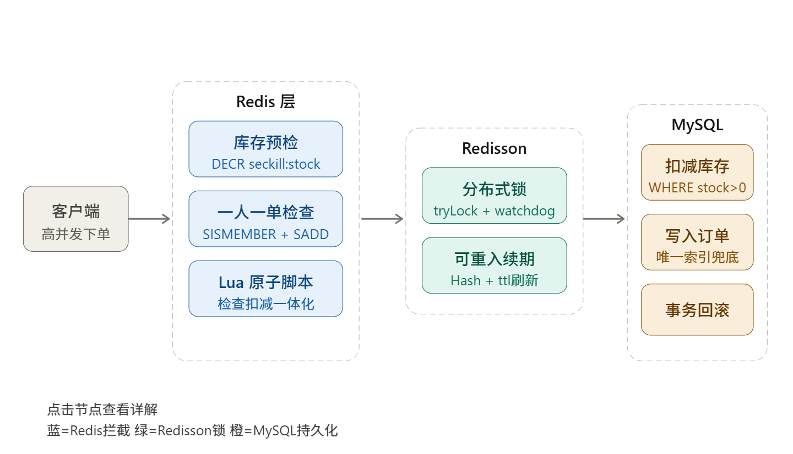
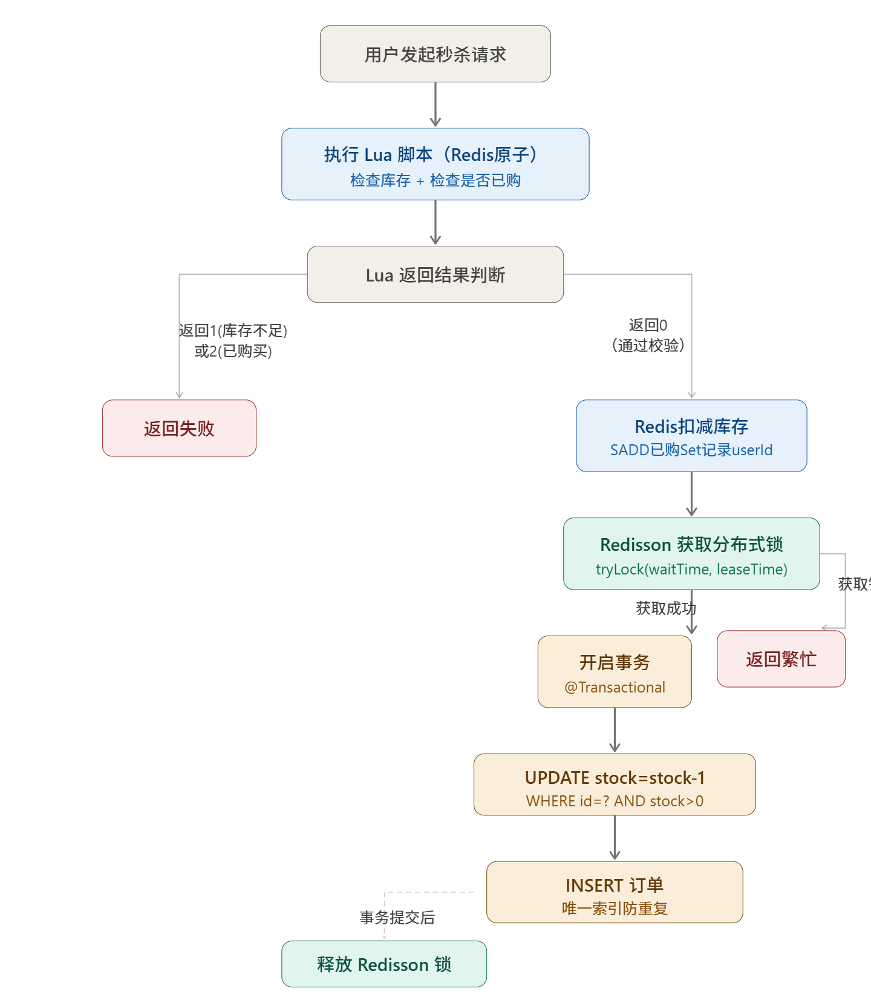
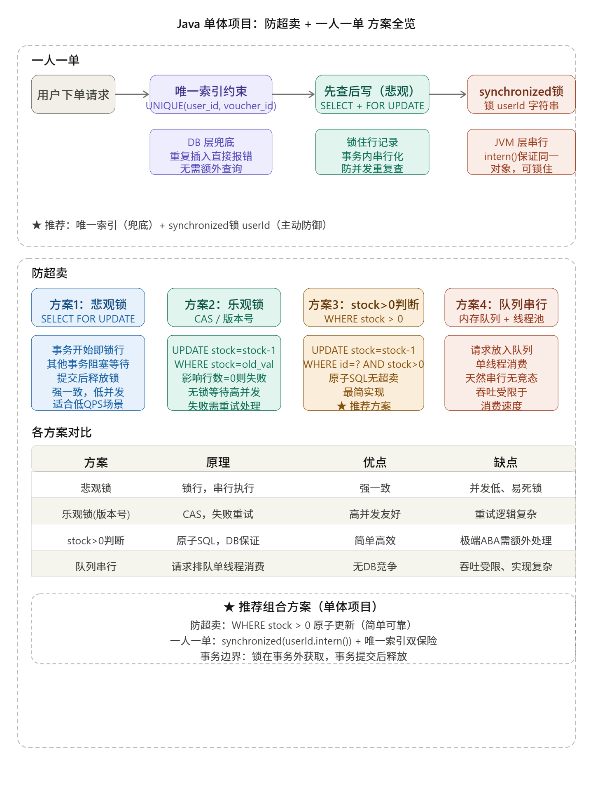
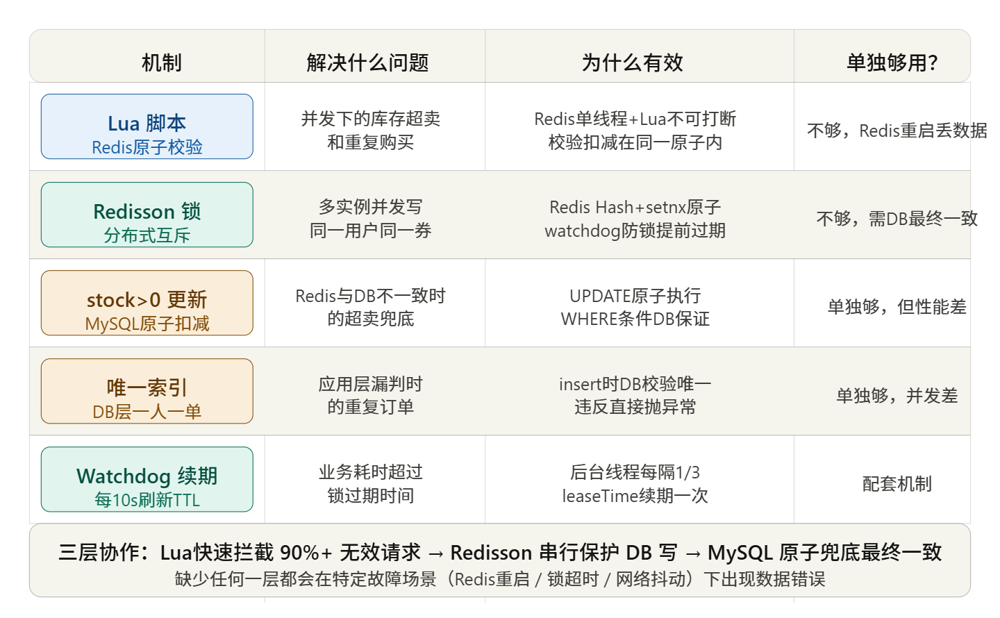

# Java 大厂面试：高并发业务场景与系统设计全解析

> [!NOTE]
> 本文档深度融合并重构自五份业务场景专题笔记（涵盖 **架构图示、P6–P8 方案选型矩阵、生产级 Java/Lua/SQL 核心代码、线上应急排障 SOP 与经典系统设计**），按照 **“核心痛点与架构图 $\rightarrow$ 方案选型对比表 $\rightarrow$ 生产级代码实现 $\rightarrow$ 踩坑兜底与面试速记”** 四段式标准组织，覆盖大厂业务场景面试全部高频考点。

---

## 一、高并发业务场景方法论与通用系统设计模板

### 1.1 Java 业务场景架构能力全景模型

```text
Java 业务场景与系统设计全景
 ├── 一、高并发与流量防护
 │    ├── 秒杀/抢购系统（漏斗削峰、动静分离、一人一单、防超卖）
 │    ├── 库存并发扣减（DB 乐观锁、Redis Lua、分段分桶、12306 区间票、抢红包）
 │    └── 限流与防刷体系（固定/滑动窗口、漏桶/令牌桶、四层反爬风控）
 ├── 二、缓存与分布式协调
 │    ├── 缓存设计（穿透/击穿/雪崩、多级缓存 Caffeine+Redis、预热与淘汰）
 │    ├── 数据一致性与治理（Cache Aside、延迟双删、Canal Binlog、热Key与大Key治理）
 │    ├── 分布式锁（SET NX EX + Lua、Redisson WatchDog、Redlock 争议、ZK/etcd）
 │    └── 分布式事务（Seata AT、TCC 防悬挂/空回滚、SAGA、本地消息表、RocketMQ 事务消息）
 ├── 三、可靠通信与数据架构
 │    ├── 幂等与网关（防重 Token、支付回调幂等、通用 @Idempotent 框架、OpenAPI 签名网关）
 │    ├── 消息队列实战（全链路防丢失、百万积压急救 SOP、顺序消费、4 种延迟队列）
 │    ├── 分布式 ID 与分库分表（雪花算法时钟回拨、美团 Leaf、淘宝/京东基因分片、双写平滑迁移）
 │    └── 海量数据与搜索排行（深分页优化、ES 搜索同步、BitMap/HLL 统计、EasyExcel 流式导出、ZSet 排行榜）
 └── 四、安全、稳定性、架构演进与领域系统设计
      ├── 登录认证与安全（SSO 单点登录、双 Token 无感刷新、AES+盲索引加密检索、RBAC/ABAC）
      ├── 稳定性与线上应急（Sentinel 熔断降级、全链路压测影子库、全链路灰度、CPU 100%/OOM 3分钟排障）
      ├── 架构演进与 DDD（微服务五步拆分、百万行老系统绞杀者模式重构、DDD 战略/战术落地、多租户 SaaS）
      └── 综合系统设计（订单/购物车、优惠券引擎、支付对账、IM 聊天、Feed 流、LBS 派单、短链、网盘、任务调度）
```

---

### 1.2 系统设计面试 9 步通用答题公式（万能模板）

面对任何开放式业务场景或系统设计题（如“设计秒杀系统”、“设计微博 Feed 流”、“设计短链系统”），切忌上来直接堆砌中间件名词，务必遵循以下 **9 步结构化答题法**：

| 步骤 | 核心维度 | 面试表达话术要点 |
| :--- | :--- | :--- |
| **Step 1** | **需求梳理（Clarify）** | 明確**功能性需求**（核心主流程是什么？边界在哪？）与**非功能性需求**（读写比例？强一致还是最终一致？RT 延迟要求？高可用 SLA 几个 9？）。 |
| **Step 2** | **容量与规模估算（Estimate）** | 估算日活 DAU、日常 QPS、**峰值 QPS**（通常为日均 $5 \sim 10$ 倍，秒杀可达百倍）、日增数据量及 3 年存储总量（决定是否需要分库分表与冷热分离）。 |
| **Step 3** | **整体分层架构（High-Level）** | 画出从外到内的漏斗分层：`客户端/App -> CDN/WAF -> Nginx/API 网关 -> 业务服务层 -> 多级缓存层(Caffeine+Redis) -> MQ 异步削峰层 -> 数据库/搜索引擎`。 |
| **Step 4** | **核心存储与表设计（Storage）** | 明确哪些数据放 MySQL（核心主表字段、唯一索引、状态机字段）、哪些放 Redis（数据结构选 String/Hash/Set/ZSet/BitMap？）、哪些放 ES 或 OSS。 |
| **Step 5** | **核心业务链路（Data Flow）** | 分步讲清**写链路**（如：参数校验 $\rightarrow$ 幂等判重 $\rightarrow$ Redis 预扣 $\rightarrow$ 投递 MQ $\rightarrow$ 异步落库）与**读链路**（多级缓存命中与回源）。 |
| **Step 6** | **高并发与性能优化（Scale）** | 读优化靠**动静分离 + 多级缓存 + 读写分离**；写优化靠**MQ 削峰填谷 + 批量合并写（Batch/Pipeline）+ 分片打散热点**。 |
| **Step 7** | **数据一致性与可靠性（Reliability）** | 幂等防重怎么保証？消息丢失怎么防？缓存与 DB 不一致怎么同步？跨服务调用失败如何通过重试、状态机、定时补偿 Job 与 T+1 对账兜底？ |
| **Step 8** | **容灾、限流与降级（Resilience）** | 流量超预期怎么限流？Redis 或第三方依赖宕机时如何熔断降级（返回兜底数据或走降级开关）？ |
| **Step 9** | **方案取舍与演进（Trade-off）** | 主动点出当前方案的代价（如短暂延迟、少卖风险、运维复杂度），体现架构演进思维（单体 $\rightarrow$ 读写分离 $\rightarrow$ 缓存+MQ $\rightarrow$ 分库分表/多活）。 |

> [!TIP]
> **高并发架构四句黄金铁律**：
> **“用缓存扛海量读、用消息队列削峰写、用限流熔断保可用、用状态机+幂等+补偿对账保最终一致（强一致仅用于核心资金扣减）。”**

---

## 二、秒杀/抢购系统、防超卖与高并发库存扣减

### 2.1 百万 QPS 秒杀漏斗式分层防护架构

秒杀场景的三大特征：**瞬时流量极高（10w+ ~ 100w+ QPS）**、**读多写少极端化（99% 是浏览与无效点击）**、**库存极少（有效成交仅百/千件）**。核心设计原则是**漏斗式层层过滤，将 99.9% 的流量拦截在数据库层之外**。



#### 1. 秒杀八层漏斗流量衰减模型（P6–P8 标准回答）
| 防护层级 | 核心拦截手段 | 预期过滤后剩余 QPS | 关键技术组件与落地细节 |
| :--- | :--- | :--- | :--- |
| **1. 浏览器 / App 层** | 页面静态化、按钮点击置灰、前端防抖、滑块/答题验证码、动态隐藏秒杀 URL | $100\text{w} \rightarrow 30\text{w}$ | 倒计时未结束禁点；点击后置灰 3 秒；验证码将毫秒级脉冲洪峰拉平至 $3 \sim 5$ 秒；活动开始前才下发随机秒杀パス `md5(userId+goodsId+salt)` |
| **2. CDN / 边缘节点** | 静态资源（HTML/图片/CSS/JS）全量预推 CDN、WAF 拦截恶意 Bot IP | $30\text{w} \rightarrow 10\text{w}$ | 静态详情页与动态库存/倒计时接口解耦；配置 CDN 回源限流防止回源打死源站 |
| **3. Nginx / 接入网关** | IP 黑名单、`limit_req` 漏桶/令牌桶限流、签名与 Token 合法性校验 | $10\text{w} \rightarrow 5\text{w}$ | OpenResty + Lua 拦截黑产 IP 段与超高频单 IP 请求 |
| **4. 微服务网关 / Sentinel** | 接口总 QPS 限流、单用户频控（如 1 秒 1 次）、热点商品参数限流 | $5\text{w} \rightarrow 2\text{w}$ | Spring Cloud Gateway + Sentinel 集群限流，超限直接返回“活动太火爆，请稍后再试” |
| **5. 应用层本地缓存** | JVM 本地缓存（`Caffeine`）标记“已售罄（StockSoldOut）”布尔开关 | $2\text{w} \rightarrow 5000$ | 一旦 Redis 库存扣至 `0`，通过 MQ 广播更新所有实例内存标记 `soldOutMap.put(skuId, true)`，后续请求在 JVM 内存直接拦截，连 Redis 都不访问！ |
| **6. Redis 缓存层** | 库存预热 + **Lua 脚本原子完成“查库存 + 查一人一单 + 预扣减”** | $5000 \rightarrow \text{数百}$ | 单分片顶不住时采用 **HashTag 分段库存**；拦截掉所有库存不足和重复下单请求 |
| **7. MQ 削峰层** | 抢购成功请求封装消息投递 RocketMQ / Kafka，立即返回前端“排队中” | $\text{数百/秒匀速消费}$ | 将瞬时并发写转化为消费者按 DB 承受能力匀速拉取，保护下游数据库 |
| **8. MySQL 数据库层** | 消费者落库创建订单 + `WHERE stock > 0` 条件原子更新兜底 | $< 500\text{ TPS}$ | 订单表 `(user_id, voucher_id)` 唯一索引防重 + 库存流水表幂等兜底 |



---

### 2.2 单体项目“一人一单”与“防超卖”完整落地方案

在中小型单体项目（未引入 Redis 与 MQ）中，仅依靠 MySQL + Spring 如何彻底解决**超卖**与**一人一单并发漏洞**？



#### 1. 防超卖的三种数据库方案演进
```java
// ❌ 方案 1：悲观锁（SELECT ... FOR UPDATE）—— 事务内加排他行锁串行化，高并发下大量线程阻塞排队，连接池极易打满
// ❌ 方案 2：标准版本号乐观锁（WHERE id = ? AND version = ?）—— 高并发下 1000 个线程同时读到同个 version，999 个更新失败导致严重“少卖”！

// ✅ 方案 3（推荐）：基于 stock >= num 的条件乐观锁（利用 MySQL 单条 UPDATE 语句的原子行锁）
// SQL: UPDATE seckill_voucher SET stock = stock - #{num} WHERE voucher_id = #{voucherId} AND stock >= #{num}
int rows = voucherMapper.deductStock(voucherId, 1);
if (rows == 0) {
    return Result.fail("库存不足");
}
```

#### 2. 单体“一人一单”：`synchronized` 锁边界与 Spring 事务自调用两大铁律
```java
@Service
public class VoucherOrderServiceImpl implements IVoucherOrderService {

    @Override
    public Result seckillVoucher(Long voucherId) {
        Long userId = UserHolder.getUser().getId();
        // 铁律 1：锁粒度精细到 userId，必须调用 intern() 从字符串常量池获取规范引用，确保相同 userId 锁住同一个对象！
        // 铁律 2：synchronized 必须套在 @Transactional 事务方法【外部】！
        // 若把锁写在事务方法内部，会导致“锁已释放但数据库事务尚未提交”，此时同一用户的第二个并发线程进入并执行 SELECT count(*)，
        // 由于隔离级别下读不到未提交的新订单（count 仍为 0），依然会引发重复下单！
        synchronized (userId.toString().intern()) {
            // 铁律 3：必须通过 AopContext 获取代理对象调用，防止 Spring 同类自调用（this.createVoucherOrder）导致 @Transactional 失效！
            IVoucherOrderService proxy = (IVoucherOrderService) AopContext.currentProxy();
            return proxy.createVoucherOrder(userId, voucherId);
        }
    }

    @Transactional(rollbackFor = Exception.class)
    public Result createVoucherOrder(Long userId, Long voucherId) {
        // 1. 一人一单主动校验
        int count = orderMapper.countByUserAndVoucher(userId, voucherId);
        if (count > 0) {
            return Result.fail("每人限购一单");
        }
        // 2. 原子扣减库存（WHERE stock > 0）
        int rows = voucherMapper.deductStock(voucherId);
        if (rows == 0) {
            throw new BusinessException("库存不足");
        }
        // 3. 插入订单（订单表额外建立 UNIQUE INDEX uk_user_voucher (user_id, voucher_id) 做最终物理兜底）
        VoucherOrder order = new VoucherOrder(IdWorker.getId(), userId, voucherId);
        orderMapper.insert(order);
        return Result.ok(order.getId());
    }
}
```

---

### 2.3 分布式高并发秒杀完整方案（Redis Lua + Redisson + MQ + MySQL）

当系统部署为多实例集群时，JVM 级 `synchronized` 跨进程失效，必须升级为分布式架构。



#### 1. 分布式高并发库存扣减六大方案全方位对比表（Grok 矩阵）
| 扣减方案 | 核心实现机制 | 能否彻底防超卖 | 极限 QPS | 少卖风险 | 一致性保障 | 适用场景与大厂实践 |
| :--- | :--- | :--- | :--- | :--- | :--- | :--- |
| **1. DB 条件乐观锁** | `UPDATE ... SET stock = stock - 1 WHERE id = ? AND stock > 0` | ✅ 是 | 几百 $\sim 2000$ | 极低 | 强一致（单库事务） | 普通商品下单、低并发促销（热门行锁竞争严重） |
| **2. DB 悲观锁** | `SELECT ... FOR UPDATE` 事务排他锁 | ✅ 是 | 几百 | 无 | 强一致 | 极少用于秒杀，仅用于后台人工调拨库存 |
| **3. 分布式锁 + DB** | `Redisson RLock` 锁用户/商品 + DB 事务 | ✅ 是 | 数千 $\sim 1\text{w}$ | 低 | 强一致 | 中等并发、含复杂资格校验的限购业务 |
| **4. Redis Lua 原子预扣 + MQ 异步落库** | Lua 脚本原子完成查库存、查重、扣减 + 投递 MQ 异步写库 | ✅ 是 | **$5\text{w} \sim 10\text{w}+^{**}$ | 中（需补偿） | 最终一致（补偿+对账） | **阿里/美团/字节/京东高并发秒杀主力方案** |
| **5. Redis HashTag 分桶分段预扣** | 将 1000 库存拆为 10 个子 Key `stock:{sku}_0~9` 分散到不同分片 | ✅ 是 | **$30\text{w} \sim 100\text{w}+^{**}$ | 低（尾盘合并） | 最终一致 | 单品百万 QPS 超爆款秒杀（解决单 Redis 节点瓶颈） |
| **6. 本地内存预分配 + 远程异步补** | 每台应用实例本地 `AtomicInteger` 领用一批库存 + Buffer 容灾 | ✅ 是 | **百万级** | 有（宕机短暂锁死） | 最终一致 | 12306 春运抢票、极致超高并发场景 |

#### 2. 核心 Lua 脚本（`seckill.lua`）：原子校验库存 + 一人一单 + 预扣减
```lua
-- KEYS[1]: 库存 Key -> seckill:stock:{voucherId}
-- KEYS[2]: 已购用户集合 Key -> seckill:order:{voucherId}
-- ARGV[1]: 用户 ID -> userId
-- ARGV[2]: 扣减数量 -> num (通常为 1)

-- 1. 校验库存是否充足
local stock = tonumber(redis.call('GET', KEYS[1]))
local num = tonumber(ARGV[2])
if (not stock or stock < num) then
    return 1 -- 返回 1：库存不足
end

-- 2. 校验一人一单（判断用户是否已在已购 Set 集合中）
if (redis.call('SISMEMBER', KEYS[2], ARGV[1]) == 1) then
    return 2 -- 返回 2：重复下单（每人限购一单）
end

-- 3. 原子预扣减库存 + 将用户加入已购集合
redis.call('INCRBY', KEYS[1], -num)
redis.call('SADD', KEYS[2], ARGV[1])
return 0 -- 返回 0：抢购资格获取成功！
```

#### 3. 秒杀回滚 Lua 脚本（`seckill_rollback.lua`）：MQ 发送失败或消费异常时回补 Redis
```lua
-- KEYS[1]: seckill:stock:{voucherId}
-- KEYS[2]: seckill:order:{voucherId}
-- ARGV[1]: userId, ARGV[2]: num
if (redis.call('SISMEMBER', KEYS[2], ARGV[1]) == 1) then
    redis.call('SREM', KEYS[2], ARGV[1])
    redis.call('INCRBY', KEYS[1], tonumber(ARGV[2]))
    return 1
end
return 0
```

#### 4. 秒杀 Service 完整生产级实现（含本地售罄标记 + Lua 预扣 + MQ 异步落库 + 异常回补闭环）
```java
@Service
@Slf4j
public class SeckillVoucherServiceImpl implements SeckillVoucherService {

    @Autowired private StringRedisTemplate redisTemplate;
    @Autowired private RocketMQTemplate rocketMQTemplate;
    @Autowired private RedissonClient redissonClient;
    @Autowired private VoucherOrderMapper orderMapper;
    @Autowired private SeckillVoucherMapper voucherMapper;

    // 第一道内存防线：JVM 本地已售罄标记（避免售罄后海量请求继续冲击 Redis）
    private final ConcurrentHashMap<Long, Boolean> localSoldOutMap = new ConcurrentHashMap<>();

    private static final DefaultRedisScript<Long> SECKILL_SCRIPT;
    private static final DefaultRedisScript<Long> ROLLBACK_SCRIPT;
    static {
        SECKILL_SCRIPT = new DefaultRedisScript<>();
        SECKILL_SCRIPT.setLocation(new ClassPathResource("seckill.lua"));
        SECKILL_SCRIPT.setResultType(Long.class);

        ROLLBACK_SCRIPT = new DefaultRedisScript<>();
        ROLLBACK_SCRIPT.setLocation(new ClassPathResource("seckill_rollback.lua"));
        ROLLBACK_SCRIPT.setResultType(Long.class);
    }

    @Override
    public Result seckillVoucher(Long voucherId) {
        // 1. 本地内存标记快速拦截
        if (Boolean.TRUE.equals(localSoldOutMap.get(voucherId))) {
            return Result.fail("手慢了，商品已售罄");
        }
        Long userId = UserHolder.getUser().getId();
        List<String> keys = Arrays.asList("seckill:stock:" + voucherId, "seckill:order:" + voucherId);

        // 2. 执行 Redis + Lua 原子预扣减与一人一单校验（微秒级无锁执行）
        Long result = redisTemplate.execute(SECKILL_SCRIPT, keys, userId.toString(), "1");
        if (result == null || result != 0L) {
            if (result != null && result == 1L) {
                localSoldOutMap.put(voucherId, true); // 标记本地已售罄
                return Result.fail("手慢了，商品已售罄");
            }
            return Result.fail("每人限购一单，请勿重复抢购");
        }

        // 3. 预生成全局唯一订单 ID（雪花算法），发送 MQ 异步落库消息
        long orderId = IdWorker.getId();
        SeckillOrderMsg msg = new SeckillOrderMsg(orderId, userId, voucherId);
        try {
            // 同步发送确认 Broker 落盘（或使用 RocketMQ 事务消息）
            rocketMQTemplate.syncSend("topic-seckill-order", msg, 3000);
        } catch (Exception e) {
            log.error("秒杀订单消息发送失败，立即回滚 Redis 预扣库存, order={}", msg, e);
            // 关键闭环：一旦 MQ 发送失败，立即执行回滚脚本恢复 Redis 库存与用户购买资格，杜绝少卖！
            redisTemplate.execute(ROLLBACK_SCRIPT, keys, userId.toString(), "1");
            localSoldOutMap.remove(voucherId);
            return Result.fail("系统繁忙，请重试");
        }

        // 4. 立即向前端返回订单号，前端凭 orderId 轮询或通过 WebSocket 接收异步下单结果
        return Result.ok(orderId);
    }

    /**
     * MQ 消费者调用的数据库落库方法（Redisson 锁兜底 + 数据库条件更新 + 唯一索引）
     */
    @Transactional(rollbackFor = Exception.class)
    public void createOrderInDb(SeckillOrderMsg msg) {
        String lockKey = "seckill:lock:" + msg.getUserId() + ":" + msg.getVoucherId();
        RLock lock = redissonClient.getLock(lockKey);
        boolean isLocked = false;
        try {
            // waitTime=0 不排队，leaseTime=-1 开启 WatchDog 自动续期（每 10s 续期至 30s）
            isLocked = lock.tryLock(0, -1, TimeUnit.SECONDS);
            if (!isLocked) {
                return;
            }
            // 幂等检查：若订单已落库则直接幂等返回
            if (orderMapper.countByUserAndVoucher(msg.getUserId(), msg.getVoucherId()) > 0) {
                return;
            }
            // MySQL 最终防超卖兜底：UPDATE seckill_voucher SET stock = stock - 1 WHERE voucher_id = ? AND stock > 0
            int updated = voucherMapper.deductStock(msg.getVoucherId());
            if (updated == 0) {
                throw new BusinessException("DB库存不足");
            }
            // 插入订单（表上建有 UNIQUE INDEX uk_user_voucher (user_id, voucher_id)）
            VoucherOrder order = new VoucherOrder(msg.getOrderId(), msg.getUserId(), msg.getVoucherId());
            orderMapper.insert(order);
        } catch (InterruptedException e) {
            Thread.currentThread().interrupt();
            throw new RuntimeException(e);
        } finally {
            if (isLocked && lock.isHeldByCurrentThread()) {
                lock.unlock();
            }
        }
    }
}
```

---

### 2.4 超高并发进阶场景：分段库存、12306 区间票与微信抢红包

#### 1. 超高并发单热点 Key 瓶颈：分段库存（Sharded Stock）
- **痛点**：单台 Redis 节点的极限 QPS 约为 $8\text{w} \sim 10\text{w}$。若某顶流直播间秒杀单品瞬时涌入 $50\text{w}$ QPS，全打在同一个 Key `seckill:stock:1001` 上，会导致该分片 CPU 100% 成为单点瓶颈。
- **解法**：将 1000 件库存拆分为 **10 个分段 Key**（如 `seckill:stock:1001_0` 到 `seckill:stock:1001_9`，每个分片存 100 件），分散到 Redis Cluster 的 10 个不同主节点上。
  - **扣减路由**：客户端请求到来时，按 `userId % 10`（或随机起始位轮询 `start = rand(0, 9)`）选择分段执行 Lua 扣减；若当前分段库存为 `0`，则顺时针尝试下一个分段 `(start + i) % 10`，将并发写能力横向放大 10 倍。

#### 2. 12306 余票“区间库存”防超卖设计（原子区间 + 读扩散 / 位图法）
- **痛点**：一列高铁经过 `A -> B -> C -> D -> E` 五站。用户买一张 `B -> D` 的票，不仅影响 `B -> D`，还会导致 `A -> C`、`A -> D`、`B -> E` 等所有重叠区间的余票减 1。
- **主流架构解法**：
  1. **原子区间存储 + 读扩散**：
     - Redis 中只存储**相邻两站的原子区间库存**（`A-B`、`B-C`、`C-D`、`D-E` 共 4 个原子区间）。
     - **查询余票（读扩散）**：查询 `B -> D` 余票时，取路径覆盖的所有原子区间的最小值 `min(stock[B-C], stock[C-D])`。
     - **扣减余票**：购买 `B -> D` 时，用 Lua 脚本原子判断 `B-C` 和 `C-D` 均 $>0$，并同时减 1。
  2. **座位二进制位图法（BitMask 精确选座）**：
     - 每个物理座位用一个整数（BitMap）表示各站段占用状态，如 4 个原子站段对应二进制 `0000`。
     - 卖出 `B -> D`（占第 2、3 段，掩码 `0110`）时：只需寻找 `(seatMask & 0b0110) == 0` 的座位，并通过原子按位或 `seatMask |= 0b0110` 锁定座位；退票则按位与反码 `seatMask &= ~0b0110`。

#### 3. 微信抢红包系统设计（二倍均值法预分配 + 无锁拆包）
- **核心难点**：发红包瞬间几十人同时点击“拆”，如何保证**总金额绝对不超发**、**每个红包至少 `0.01` 元**、**手气分布均匀**且**零锁竞争**？
- **标准架构：发红包时预分配（空间换时间）+ 拆红包时 `LPOP` 原子弹出**：
  1. **发红包阶段**：采用**二倍均值法**一次性在内存算出 $N$ 个子红包金额（单位全部转为**分**，避免浮点数精度丢失），推入 Redis `List`（`RPUSH redpacket:list:{id} a1 a2 ... aN`），同时初始化已抢用户 Hash `redpacket:taken:{id}`。
  2. **二倍均值算法核心代码**（剩余金额为 $M$ 分，剩余个数为 $N$ 个，每次随机范围为 $[1, \lfloor \frac{M}{N} \times 2 \rfloor - 1]$）：
     ```java
     public List<Integer> splitRedPacket(int totalAmountFen, int totalCount) {
         List<Integer> list = new ArrayList<>(totalCount);
         Random random = new Random();
         int restAmount = totalAmountFen;
         int restCount = totalCount;
         for (int i = 0; i < totalCount - 1; i++) {
             // 每次最大可抢金额为剩余人均金额的 2 倍（且必须给后面每人至少留 1 分钱）
             int max = (restAmount / restCount) * 2 - 1;
             int amount = max <= 1 ? 1 : random.nextInt(max) + 1;
             restAmount -= amount;
             restCount--;
             list.add(amount);
         }
         list.add(restAmount); // 最后一个红包直接拿走全部剩余金额，保证总和 100% 精确！
         return list;
     }
     ```
  3. **拆红包阶段（Lua 原子执行）**：先检查 `HEXISTS redpacket:taken:{id} {userId}` 防重复抢 $\rightarrow$ 再执行 `LPOP redpacket:list:{id}` 弹出一个预分好的金额 $\rightarrow$ 若非空则执行 `HSET` 记录并返回金额，同时投递 MQ 异步写入数据库账单流水；若返回 `nil` 则说明红包已抢光，全程 $O(1)$ 无锁极速完成！

---

## 三、缓存架构设计、双写一致性与热 Key / 大 Key 治理

### 3.1 缓存与数据库双写一致性深度剖析



#### 1. 五大缓存读写策略全维对比表
| 策略名称 | 核心写流程 | 一致性级别 | 并发异常与主要缺陷 | 适用场景与大厂主流度 |
| :--- | :--- | :--- | :--- | :--- |
| **1. 先更新 DB，再删缓存（Cache Aside 标准）** | ① 更新 MySQL $\rightarrow$ ② 删除 Redis 缓存（读请求 miss 时回填） | 最终一致（窗口极短，毫秒级） | ① 删缓存可能失败（需 MQ 重试）；② 极端情况下“读 miss 查旧库 + 写更新库并删缓存 + 读请求晚到回写旧值”（概率极低，因为写 DB 远慢于读 DB） | **95% 互联网业务首选标准模式** |
| **2. 先删缓存，再更新 DB（❌ 不推荐）** | ① 删除 Redis $\rightarrow$ ② 更新 MySQL | 极易长期脏数据 | 线程 A 刚删完缓存尚未提交 DB，线程 B 读 miss 瞬间查出旧 DB 值并写回缓存，导致缓存**永久残留旧数据**！ | ❌ 严禁裸用 |
| **3. 延迟双删（Delay Double Delete）** | ① 先删缓存（或先改 DB）$\rightarrow$ ② 更新 DB $\rightarrow$ ③ 延迟 $500\text{ms} \sim 1\text{s}$ 再删一次缓存 | 最终一致（消除回写旧值） | 延迟时间难以精确评估，需配合异步线程池或延迟 MQ 避免阻塞主线程 | 热点商品详情、价格变更场景 |
| **4. Canal / Debezium 监听 Binlog + MQ** | 业务代码**只写 MySQL**；Canal 伪装从库订阅 Binlog 投递 MQ 异步删/改 Redis | 高可靠最终一致（秒级） | 存在 $100\text{ms} \sim 1\text{s}$ 主从及消费延迟，增加中间件运维成本 | **大厂高并发读多写少核心链路首选（业务零侵入）** |
| **5. Write Through / Write Behind** | 读写均只穿透缓存层，由缓存组件同步或异步批量刷库 | 吞吐最高（Behind） | Write Behind 宕机有丢数据风险，不适合交易主链路 | 点赞数、浏览量 PV、直播间热度批量刷库 |



> [!IMPORTANT]
> **面试标准回答话术：如何保证 Redis 与 MySQL 的双写一致性？**
> 1. **定调**：根据 CAP 定理，只要使用异步缓存，就不存在零性能损耗的 100% 强一致（若业务绝对不允许读到哪怕 1 毫秒旧数据，要么不加缓存，要么加 Redisson 读写锁 `RReadWriteLock` 串行化，但这会牺牲高并发吞吐）。
> 2. **标准落地组合拳**：采用 **“先更新 MySQL，再删除 Redis 缓存（Cache Aside）”**：
>    - **为什么删除而不是更新缓存？** ① 写多读少时频繁更新缓存却无人读取，白白浪费 CPU（懒加载思想）；② 并发写时若两个线程交错更新 DB 和更新缓存（A 写库 $\rightarrow$ B 写库 $\rightarrow$ B 写缓存 $\rightarrow$ A 写缓存），会导致旧值覆盖新值。
>    - **删缓存失败怎么兜底？** 方案一：捕获异常后将待删 Key 发送至 **MQ 重试队列**；方案二（最优雅）：部署 **Canal 监听 MySQL Binlog**，异步消费变更事件删除缓存并附带 **TTL 过期时间**作为最终兜底。

---

### 3.2 缓存穿透、缓存击穿、缓存雪崩三大问题实战与代码

| 问题类型 | 触发原因（一句话区分） | 核心危害 | 生产级标准解决方案（组合拳） |
| :--- | :--- | :--- | :--- |
| **缓存穿透** | 查询**根本不存在的数据**（如黑客遍历 `id = -1` 或随机 UUID） | 缓存永远 miss，每次请求直穿 DB，瞬间打挂数据库 | ① **参数合法性前置校验**；② **缓存空对象（`"NULL"` + 短 TTL $30\text{s} \sim 5\text{min}$）**；③ **Redisson 布隆过滤器（`RBloomFilter`）前置拦截** |
| **缓存击穿** | **某一个超高频热点 Key 突然到期失效**瞬间 | 成千上万并发线程同时读 miss 并涌入 DB 重建同一条缓存 | ① **分布式互斥锁（Mutex）+ 双重检查（Double-Check）**；② **逻辑过期（物理不设 TTL，Value 内封装 `expireTime`，后台线程异步刷新）** |
| **缓存雪崩** | **同一时刻大批量 Key 集中过期** 或 **Redis 集群整体宕机** | 全量读流量瞬间压垮 DB，引发级联服务雪崩 | ① **TTL 增加随机抖动偏移（`baseTTL + random(60, 300)`）**；② **Caffeine 本地二级缓存兜底**；③ **Redis Cluster + 哨兵高可用**；④ **Sentinel 熔断降级限流保护 DB** |

#### 生产级代码：缓存击穿“互斥锁 + Double Check”与“布隆过滤器防穿透”
```java
@Service
public class ProductCacheService {
    @Autowired private StringRedisTemplate redisTemplate;
    @Autowired private RedissonClient redissonClient;
    @Autowired private ProductMapper productMapper;
    private RBloomFilter<Long> bloomFilter;

    @PostConstruct
    public void initBloomFilter() {
        // 初始化布隆过滤器：预计元素 100 万，误判率 1%
        bloomFilter = redissonClient.getBloomFilter("bloom:product:ids");
        bloomFilter.tryInit(1_000_000L, 0.01);
    }

    public Product getProductById(Long id) {
        // 1. 【防穿透第一关】布隆过滤器判断：若返回 false，则 100% 不存在，直接拦截！
        if (!bloomFilter.contains(id)) {
            return null;
        }
        String cacheKey = "product:detail:" + id;
        String json = redisTemplate.opsForValue().get(cacheKey);

        // 2. 命中缓存（含防穿透的空值标记 "NULL"）
        if (StringUtils.hasText(json)) {
            return "NULL".equals(json) ? null : JSON.parseObject(json, Product.class);
        }

        // 3. 【防击穿】缓存未命中，使用分布式互斥锁控制只有一个线程回源查 DB
        RLock lock = redissonClient.getLock("lock:product:rebuild:" + id);
        try {
            if (lock.tryLock(50, 5000, TimeUnit.MILLISECONDS)) {
                try {
                    // 关键：拿到锁后必须执行 Double-Check 二次查缓存，防止前一个刚释放锁的线程已经回填过了！
                    json = redisTemplate.opsForValue().get(cacheKey);
                    if (StringUtils.hasText(json)) {
                        return "NULL".equals(json) ? null : JSON.parseObject(json, Product.class);
                    }
                    // 回源查询数据库
                    Product dbProduct = productMapper.selectById(id);
                    if (dbProduct == null) {
                        // 【防穿透第二关】DB 也为空（布隆 1% 误判或刚删除），缓存空值 2 分钟
                        redisTemplate.opsForValue().set(cacheKey, "NULL", 120, TimeUnit.SECONDS);
                        return null;
                    }
                    // 【防雪崩】基础过期时间 30 分钟 + 随机 0~300 秒抖动
                    long ttl = 1800 + ThreadLocalRandom.current().nextInt(300);
                    redisTemplate.opsForValue().set(cacheKey, JSON.toJSONString(dbProduct), ttl, TimeUnit.SECONDS);
                    return dbProduct;
                } finally {
                    if (lock.isHeldByCurrentThread()) lock.unlock();
                }
            } else {
                // 未抢到锁的线程短暂休眠 50ms 后递归/自旋重试读缓存
                Thread.sleep(50);
                return getProductById(id);
            }
        } catch (InterruptedException e) {
            Thread.currentThread().interrupt();
            return null;
        }
    }
}
```

---

### 3.3 多级缓存架构（Caffeine + Redis + MQ 广播失效）

```text
客户端请求 ──→ Nginx 本地共享字典 (ngx.shared.DICT)
                ↓ miss
             JVM 进程内缓存 (Caffeine，纳秒级，抗住 90% 热 Key)
                ↓ miss
             分布式缓存 (Redis Cluster，毫秒级)
                ↓ miss
             MySQL 数据库 (回源后逐级回填 Redis 与 Caffeine)
```

#### 多级缓存最大痛点与解法：多实例 JVM 本地缓存如何保持一致性？
- **痛点**：应用部署了 20 台机器，修改商品价格时只删除了 Redis 缓存和当前机器 A 的 Caffeine 缓存，其余 19 台机器的 Caffeine 里仍然是旧价格。
- **解法**：
  1. **MQ 广播模式（RocketMQ `MessageModel.BROADCASTING`）或 Redis `Pub/Sub`**：当数据发生变更时，删除 Redis 缓存后立即发送一条缓存失效广播消息，所有 20 台应用实例监听到消息后立即调用 `localCache.invalidate(key)` 清除各自的本地 Caffeine 缓存。
  2. **Caffeine 设置极短的物理 TTL 兜底**（如 `expireAfterWrite(10, TimeUnit.SECONDS)`），即使广播消息偶发丢失，最多 10 秒后本地缓存也会自动刷新。

---

### 3.4 热 Key（热点倾斜）与大 Key（BigKey）排查与治理

#### 1. 热 Key（Hot Key）发现与治理
- **如何发现热 Key**：
  1. **客户端 SDK 拦截器统计（最推荐）**：如京东开源 `JD-hotkey` 或自研 Lettuce/Jedis 拦截器，滑动窗口统计 Key 访问频次，超阈值毫秒级自动上报并推送至所有客户端。
  2. **代理层统计**：Codis / Twemproxy 代理层汇总统计。
  3. **Redis 服务端命令**：`redis-cli --hotkeys`（需开启 `maxmemory-policy` 为 LFU 策略）或 `MONITOR`（高并发生产严禁长时间开启 `MONITOR`，会导致内存暴涨卡死）。
- **热 Key 两大根治手段**：
  1. **晋升为 JVM 本地缓存（Caffeine）**：一旦探测到某 Key 成为热 Key，直接将其缓存进所有应用节点的本地内存中（TTL 设为 $3 \sim 5$ 秒），使百万级读请求在应用层直接返回，完全不走网络请求 Redis。
  2. **热 Key 多副本分片打散**：将原 Key `hotkey` 复制为 $N$ 份：`hotkey#1`、`hotkey#2` ... `hotkey#10`（分布在不同 Redis 节点），客户端读取时随机拼接后缀 `hotkey# + rand(1, 10)`，将单节点流量均摊到整套集群。

#### 2. 大 Key（BigKey）定义、危害与治理脚本
- **判定标准**：String 类型 Value **$> 10\text{KB}$（严重 $> 1\text{MB}$）**；Hash / List / Set / ZSet 元素个数 **$> 5000$ 个**。
- **三大危害**：① 阻塞 Redis 单线程主循环，导致慢查询与超时；② 占满网卡带宽（如 $1\text{MB}$ 大 Key 每秒读 1000 次即吃满 $1\text{GB/s}$ 万兆网卡）；③ Cluster 分片内存严重不均，且直接执行 `DEL` 会让 Redis 卡死数秒。
- **排查与治理四步法**：
  ```bash
  # 1. 在线非阻塞扫描大 Key（在从节点执行，内部用 SCAN 游标，安全无阻塞）
  redis-cli -h 127.0.0.1 -p 6379 --bigkeys -i 0.01

  # 2. 离线分析 RDB 快照（零生产影响，最精准）
  rdb -c memory dump.rdb --bytes 10240 -f memory.csv

  # 3. 安全删除大 Key：严禁直接 DEL！必须使用 Redis 4.0+ 的异步非阻塞删除命令 UNLINK
  redis-cli UNLINK big_hash_key
  ```
  - **架构拆分**：将包含 100 万字段的大 Hash `user:tags` 按 `userId % 1000` 拆成 1000 个小 Hash `user:tags:0` ~ `user:tags:999`（每个仅存 1000 个字段）；大 String 采用 **LZ4 / Snappy** 压缩后再写入。

---

## 四、分布式锁与分布式事务（强一致与最终一致）

### 4.1 分布式锁选型与 Redis / Redisson 锁原理

#### 1. 四大分布式锁实现方案对比表
| 对比维度 | 数据库锁（唯一索引/行锁） | Redis 分布式锁（Redisson） | ZooKeeper 分布式锁（Curator） | etcd 分布式锁 |
| :--- | :--- | :--- | :--- | :--- |
| **CAP 模型** | 单点强一致 | **AP 模型**（异步复制下极端主从切换可能丢锁） | **CP 模型**（ZAB 协议，多数派写入强一致） | **CP 模型**（Raft 协议，强一致） |
| **加锁/释放机制** | 插入唯一记录或 `FOR UPDATE` | `Lua` 脚本操作 `Hash` 结构 + `Pub/Sub` 唤醒 | 创建**临时顺序节点** + 监听前序节点 `Watch` | `Lease` 租约 + `Revision` 前序监听 |
| **锁超时与防死锁** | 定时任务扫描过期记录 | **WatchDog 看门狗自动续期** + TTL 兜底 | 客户端断开 Session 后**临时节点自动删除** | `KeepAlive` 心跳续租，断连自动过期 |
| **性能（TPS）** | 低（百 $\sim$ 千级） | **极高（数万级）** | 中（数千级，写需过半同步） | 中高（万级） |
| **适用场景** | 极低频后台任务 | **95% 互联网高并发业务首选** | 强一致选主（Leader Election）、金融核心协调 | 云原生 K8s 生态分布式协调 |

#### 2. 单节点 Redis 分布式锁的正确姿势与 Redisson 可重入锁源码
- **手写原生 Redis 锁三大铁律**：
  1. **加锁与设过期必须原子**：`SET lock_key unique_uuid NX EX 30`（严禁先 `SETNX` 再 `EXPIRE`）。
  2. **Value 必须存线程唯一标识（`UUID:threadId`）**：防止线程 A 业务阻塞超时导致锁自动过期后，线程 A 恢复执行时**误删了线程 B 刚持有的锁**！
  3. **解锁必须使用 Lua 脚本原子完成“比对 Value + 删除 Key”**：
     ```lua
     if redis.call('GET', KEYS[1]) == ARGV[1] then
         return redis.call('DEL', KEYS[1])
     else
         return 0
     end
     ```
- **Redisson `RLock` 可重入与 WatchDog 看门狗原理**：
  - **可重入存储结构**：底层采用 Redis **`Hash`** 结构，Key 为锁名，Field 为 `UUID:threadId`，Value 为**重入计数 `count`**。同线程再次加锁时通过 `HINCRBY` 将计数 `+1`，解锁时 `-1`，直至减为 `0` 才执行 `DEL` 并通过 `PUBLISH` 唤醒等待队列中的其他线程。
  - **WatchDog 自动续期**：当调用无参 `lock.lock()`（即 `leaseTime == -1`）时，加锁成功后 Redisson 会在后台启动一个基于 **Netty 时间轮（`HashedWheelTimer`）** 的定时任务，每隔 **`internalLockLeaseTime / 3`（默认 $30 / 3 = 10$ 秒）** 检查当前线程是否仍持有锁；若是，则自动执行 Lua 脚本将锁的 TTL 重置回 `30` 秒。一旦服务宕机，定时任务自然消失，锁最多 30 秒后自动释放，完美兼顾“防止业务未执行完锁提前过期”与“防止机器宕机死锁”。

---

### 4.2 Redlock（红锁）算法原理与三大争议（面试加分项）

- **背景痛点**：在 Redis 主从 + 哨兵架构中，若客户端在 Master 上加锁成功，但 Master 尚未将锁异步复制到 Slave 就发生宕机，Slave 晋升为新 Master 后锁丢失，导致第二个客户端也能加锁成功（一锁二主）。
- **Redlock 原理**：部署 $N$ 个（通常为 **5 个**）完全独立、无主从关系的 Redis 节点。客户端依次向 5 个节点请求加锁，只有同时满足 **① 超过半数节点（$\ge 3$ 个）加锁成功** 且 **② 总耗时小于锁有效时间（$\Delta t < \text{TTL}$）**，才判定加锁成功（实际有效时间 $= \text{TTL} - \Delta t$）；否则向所有节点发起解锁。
- **为什么业界（以分布式权威 Martin Kleppmann 为代表）不推荐使用 Redlock？**
  1. **强依赖物理时钟同步（时钟漂移风险）**：若节点 3 的系统时钟被 NTP 向前跳跃，锁会提前过期并被其他客户端抢走，破坏互斥性。
  2. **GC STW（Stop-The-World）导致锁失效反例**：客户端 A 拿到 Redlock（TTL 30s）后，在发起写存储请求前发生了长达 35s 的 Full GC STW 停顿；期间锁已过期，客户端 B 合法拿到锁并写入数据；随后客户端 A 从 GC 恢复，误以为自己仍持有锁继续写入，造成并发脏写！
     > **根本解法（Fencing Token 护栏令牌）**：分布式锁服务每次加锁必须返回一个全局单调递增的整型令牌 `token`（如 `33`、`34`）；下游存储系统校验令牌，若收到旧令牌 `33` 的写请求（当前已处理过 `34`），直接拒绝写入！而 Redis 无事务级自增护栏能力，强一致场景应直接选 **ZooKeeper / etcd**。

---

### 4.3 分布式事务五大方案全方位对比与 TCC 三大坑

| 方案名称 | 核心原理 | 一致性级别 | 性能损耗 | 代码侵入性 | 典型适用场景 |
| :--- | :--- | :--- | :--- | :--- | :--- |
| **1. 2PC / XA（Seata XA）** | 数据库原生两阶段提交（Prepare 锁定资源 $\rightarrow$ Commit） | **强一致** | 极高（全程长事务持锁） | 极低 | 传统金融、跨库低频强一致操作 |
| **2. Seata AT 模式** | 一阶段本地事务直接提交并记录前后镜像 `undo_log`；二阶段异步删日志或反向补偿 | 准强一致（依赖全局锁防脏写） | 中（释放了 DB 锁，但有全局锁竞争） | **零侵入**（仅加 `@GlobalTransactional`） | **微服务中低并发 CRUD 跨服务事务首选** |
| **3. TCC 模式（Try-Confirm-Cancel）** | 业务层手动实现 Try（资源预留/冻结）、Confirm（确认执行）、Cancel（释放冻结）三接口 | 最终一致（业务隔离度高） | **低（无全局长锁，性能好）** | **极高**（每个接口写 3 个方法） | **高并发核心资金账户、秒杀库存冻结、优惠券核销** |
| **4. SAGA 模式** | 将长事务拆分为多个本地正向事务 $T_1, T_2 \dots T_n$，失败时逆序执行补偿 $C_n \dots C_1$ | 最终一致（无隔离性） | 低 | 中（需定义状态机 JSON 与补偿服务） | 跨越多系统/外部银行接口的超长业务流程 |
| **5. 本地消息表 / RocketMQ 事务消息** | 将本地数据库操作与消息发送绑定为原子操作，下游通过 MQ 重试确保必达 | **最终一致** | **最低（完全异步解耦）** | 中低 | **互联网大厂 80%+ 异步跨服务解耦场景（下单通知、加积分、清购物车）** |

#### 高频追问：TCC 模式必须解决的三大异常问题（幂等、空回滚、防悬挂）
1. **幂等性（Idempotency）**：由于网络抖动，TC（事务协调器）可能重复调用 `Confirm` 或 `Cancel`；必须引入 **`tcc_transaction_log` 状态控制表**（以 `xid + branch_id` 为唯一主键），已处于 `CONFIRMED / CANCELLED` 状态的直接返回成功。
2. **空回滚（Empty Rollback）**：
   - **现象**：`Try` 请求因网络丢包根本没到达参与者，随后全局事务超时，TC 发起了 `Cancel` 请求。
   - **解决**：`Cancel` 执行时先查 `tcc_transaction_log` 表；若发现不存在 `TRIED` 记录，说明 `Try` 未执行过，此时**不执行任何资金/库存释放逻辑，但必须向表中插入一条状态为 `CANCELLED` 的记录**后直接返回成功（这就是空回滚，同时为下一步防悬挂做铺垫）。
3. **防悬挂（Anti-Hanging）**：
   - **现象**：`Try` 请求因网络拥堵延迟了 10 秒才到达，而此时 TC 早已超时并执行完了上面的“空回滚 `Cancel`”！如果此时再放行执行这个迟到的 `Try`，预留冻结的资源将**永远没有任何 `Cancel` 来释放（悬挂）**！
   - **解决**：在 `Try` 方法开头先尝试向 `tcc_transaction_log` 插入 `TRIED` 记录；若捕获到唯一索引冲突（说明此前已经执行过空回滚写入了 `CANCELLED` 记录），则**直接拒绝执行本次迟到的 `Try`**！

---

### 4.4 RocketMQ 事务消息原理与完整落地代码

```text
生产者 (订单服务)                       RocketMQ Broker                    消费者 (库存/积分服务)
      │                                      │                                      │
      ├── 1. 发送 Half 半消息 (对消费者不可见) ─→│                                      │
      │←─ 2. 半消息持久化成功 ACK ────────────┤                                      │
      ├── 3. 执行本地事务 (创建订单落库)       │                                      │
      ├── 4. 提交 Commit / Rollback 二次确认 →│                                      │
      │   (若步骤 4 网络超时未收到)            │                                      │
      │←─ 5. Broker 定时发起事务状态回查 ──────┤                                      │
      ├── 6. 查本地订单表是否存在，补发 Commit →│                                      │
      │                                      ├── 7. Commit 后消息转正式可见并投递 ───→│
      │                                      │                                      ├── 8. 幂等消费 (失败重试/进死信)
```

```java
// 1. 订单服务发起 RocketMQ 事务消息
@Service
public class OrderTransactionService {
    @Autowired private RocketMQTemplate rocketMQTemplate;

    public void createOrderWithMq(Order order) {
        Message<Order> message = MessageBuilder.withPayload(order)
                .setHeader(RocketMQHeaders.KEYS, order.getOrderNo())
                .build();
        // 发送半消息并触发本地事务监听器
        rocketMQTemplate.sendMessageInTransaction("tx-order-group", "topic-order-paid", message, order);
    }
}

// 2. 本地事务执行与状态回查监听器
@RocketMQTransactionListener(txProducerGroup = "tx-order-group")
public class OrderTransactionListener implements RocketMQLocalTransactionListener {

    @Autowired private OrderMapper orderMapper;

    // 半消息发送成功后，回调执行本地数据库事务
    @Override
    @Transactional(rollbackFor = Exception.class)
    public RocketMQLocalTransactionState executeLocalTransaction(Message msg, Object arg) {
        try {
            Order order = (Order) arg;
            orderMapper.insert(order); // 本地订单落库
            return RocketMQLocalTransactionState.COMMIT; // 通知 Broker 提交消息，下游可见
        } catch (Exception e) {
            return RocketMQLocalTransactionState.ROLLBACK; // 通知 Broker 丢弃半消息
        }
    }

    // 当步骤 4 因网络闪断或实例重启丢失时，Broker 每隔 1 分钟回调此方法回查本地事务真实状态（默认最多 15 次）
    @Override
    public RocketMQLocalTransactionState checkLocalTransaction(Message msg) {
        String orderNo = (String) msg.getHeaders().get(RocketMQHeaders.KEYS);
        Order order = orderMapper.selectByOrderNo(orderNo);
        // 只要本地数据库里查到了该订单，说明本地事务已提交成功，补发 COMMIT；否则返回 ROLLBACK 或 UNKNOWN
        return order != null ? RocketMQLocalTransactionState.COMMIT : RocketMQLocalTransactionState.ROLLBACK;
    }
}
```

---

## 五、幂等性体系、接口防刷、限流与 OpenAPI 网关设计

### 5.1 四大限流算法对比与分布式限流落地

#### 1. 四种经典限流算法全方位横评
| 算法名称 | 核心实现原理 | 能否应对突发流量 | 流量输出平滑度 | 核心缺陷与适用场景 |
| :--- | :--- | :--- | :--- | :--- |
| **1. 固定窗口（Fixed Window）** | 按固定时间周期（如 1 秒）统计请求计数，超阈值拒绝，下个周期清零 | ✅ 允许窗口内突发 | ❌ 极差 | **临界突刺问题**：前 1 秒最后 `100ms` 涌入 1000 次，后 1 秒前 `100ms` 又涌入 1000 次，导致 `200ms` 内承受了 **2 倍阈值**流量！仅适合粗粒度防护 |
| **2. 滑动窗口（Sliding Window）** | 将大时间窗口切分为多个小格（或用 Redis `ZSet` 记录时间戳），每次滑动剔除过期小格 | ✅ 较灵活 | 中 | 解决了固定窗口临界突刺问题（**Sentinel 默认 QPS 限流底层采用滑动时间窗 LeapArray**） |
| **3. 漏桶算法（Leaky Bucket）** | 请求像水一样任意速率流入桶中（桶满则溢出丢弃），桶底以**绝对恒定的速率**向下游滴出 | ❌ **严禁突发** | ✅ **绝对平滑** | 即使下游空闲也只能按固定速率排队流出，适合**保护脆弱的下游数据库或第三方定速 API**（Nginx `limit_req`） |
| **4. 令牌桶算法（Token Bucket）** | 系统按恒定速率向桶中放入令牌（桶满则丢弃令牌）；请求到来时需从桶中取走 1 个令牌才放行 | ✅ **允许合理突发**（攒够令牌即可瞬时消费） | 良好 | **互联网对外 API 网关与业务接口首选**（Guava `RateLimiter`、Redisson `RRateLimiter`） |

#### 2. 生产级 Redis + Lua 滑动窗口分布式限流脚本
```lua
-- KEYS[1]: 限流 Key，如 rate:limit:api:order:{userId}
-- ARGV[1]: 当前毫秒时间戳 nowMs
-- ARGV[2]: 窗口大小毫秒数 windowMs (如 60000 代表 1 分钟)
-- ARGV[3]: 窗口内最大允许请求数 maxCount (如 20)
-- ARGV[4]: 本次请求唯一标识 requestId (防止同毫秒覆盖)

local key = KEYS[1]
local now = tonumber(ARGV[1])
local window = tonumber(ARGV[2])
local limit = tonumber(ARGV[3])

-- 1. 移除窗口左边界（now - window）之前的所有过期请求记录
redis.call('ZREMRANGEBYSCORE', key, 0, now - window)
-- 2. 统计当前滑动窗口内的有效请求数
local current = tonumber(redis.call('ZCARD', key))
if current >= limit then
    return 0 -- 超过阈值，触发限流拒绝
end
-- 3. 未超限，记录当前请求并重置 Key 过期时间
redis.call('ZADD', key, now, ARGV[4])
redis.call('PEXPIRE', key, window + 1000)
return 1 -- 放行
```

---

### 5.2 恶意爬虫 / 羊毛党识别与四层防刷体系

| 防护层级 | 防护手段与核心组件 | 识别黑灰产特征 | 拦截率与误杀控制 |
| :--- | :--- | :--- | :--- |
| **第一层：网络与接入层** | 云 WAF / CDN Bot 管理 / Nginx 频控 | 黑产代理 IP 段、非法 `User-Agent`、无 `Referer`、秒级超高频请求 | 拦截 70% 低级脚本；对疑似 IP 返回 `429` 或弹出 JS 算力挑战 |
| **第二层：前端与客户端对抗** | 接口参数签名、行为轨迹验证码（滑块/点选）、WebAssembly 设备指纹 | Headless 浏览器（Puppeteer/Selenium）、直线滑动轨迹、固定点击间隔、模拟器多开 | 拦截 85% 自动化工具；仅在风控评分异常时弹出滑块验证，保障正常用户体验 |
| **第三层：业务网关频控层** | 多维滑动窗口限流（单 IP、单 UserID、单设备号、单商品） | 正常用户不会 1 分钟内连续请求 50 次商品详情或领券接口 | 分级处置：轻度超频弹验证码 $\rightarrow$ 中度临时封禁 15 分钟 $\rightarrow$ 重度加入黑名单 |
| **第四层：实时风控引擎与事后审计** | Flink 实时风控规则引擎 + 图计算关联分析 | 同设备切换数十个账号、收货地址相似（改谐音字）、批量新注册账号集中领券 | 实时阻断高危交易；事后 T+1 离线图谱挖掘团伙账号，冻结补贴并追回资金 |

---

### 5.3 全链路幂等架构：防重 Token、支付回调幂等与通用 `@Idempotent` 框架

**幂等性（Idempotency）定义**：同一个请求参数被执行 1 次与被重复执行 $N$ 次（因用户手抖连点、前端超时重试、Feign/RPC 重试、MQ 重复投递），对系统产生的业务状态副作用完全一致（例如只生成一笔订单、只扣一次款）。

#### 1. 四大典型幂等落地方案对比
| 方案名称 | 核心实现流程 | 适用场景 | 优缺点与关键注意点 |
| :--- | :--- | :--- | :--- |
| **1. 防重 Token 令牌机制** | ① 进入页面前先调接口获取一次性 `token` 存入 Redis；② 提交表单时携带该 `token`；③ 服务端用 **Lua 脚本原子执行 `GET + DEL`**，删除成功才放行 | 用户手抖重复点击下单、表单提交 | **严禁先 `GET` 判断再 `DEL`**（非原子，并发下两个线程同时 `GET` 通过）；业务执行失败时需允许重新申请 Token |
| **2. 数据库唯一索引 / 防重表** | 在业务表或独立的防重流水表上建立唯一约束（如 `UNIQUE(user_id, biz_type, biz_no)`），捕获 `DuplicateKeyException` 幂等返回 | 订单创建、优惠券领取、支付回调流水 | **物理级绝对兜底**（任何分布式系统最后一道防线） |
| **3. 状态机 + 乐观锁条件更新** | 规定状态只能单向演进（`待支付 10 -> 已支付 20`），SQL：`UPDATE orders SET status = 20 WHERE order_no = ? AND status = 10` | 订单支付回调、状态变更、退款审核 | 零额外表开销，利用 `affected_rows == 1` 判定首次成功，`== 0` 判定重复请求 |
| **4. 通用 `@Idempotent` 注解切面** | 基于 `Redis SETNX (PROCESSING -> SUCCESS)` + 数据库唯一键兜底的统一 AOP 框架 | 超时重试接口、RPC 接口、MQ 消费者统一防重 | 区分“正在处理中（拒绝并发）”与“已处理成功（直接返回上次结果）” |

#### 2. 第三方支付回调（微信/支付宝）生产级幂等标准流程
```java
@Transactional(rollbackFor = Exception.class)
public String handleAlipayCallback(Map<String, String> params) {
    // 1. 【安全验签】使用支付宝公钥校验 RSA2 签名 + 校验商户 app_id 与订单金额 total_amount 是否一致（防伪造回调！）
    if (!AlipaySignature.rsaCheckV1(params, ALIPAY_PUBLIC_KEY, "UTF-8", "RSA2")) {
        log.warn("支付回调验签失败: {}", params);
        return "failure";
    }
    String outTradeNo = params.get("out_trade_no"); // 商户订单号
    String tradeNo = params.get("trade_no");        // 支付宝交易流水号

    // 2. 【第一层快速幂等 + 并发互斥】尝试获取针对该订单号的分布式锁
    RLock lock = redissonClient.getLock("lock:pay:callback:" + outTradeNo);
    if (!lock.tryLock()) {
        return "failure"; // 正在处理中，让支付平台稍后重试
    }
    try {
        // 3. 【第二层状态机幂等】查询订单，若已处于已支付/已完成状态，直接返回 "success" 停止第三方重发！
        Order order = orderMapper.selectByOrderNo(outTradeNo);
        if (order == null) return "failure";
        if (order.getStatus() >= OrderStatus.PAID.getCode()) {
            return "success";
        }

        // 4. 【第三层数据库乐观锁状态流转 + 支付流水表唯一索引兜底】
        // SQL: UPDATE orders SET status = 20, pay_time = NOW() WHERE order_no = #{outTradeNo} AND status = 10
        int rows = orderMapper.updateStatusToPaid(outTradeNo, OrderStatus.UNPAID.getCode(), OrderStatus.PAID.getCode());
        if (rows == 1) {
            // 插入支付回调流水表（trade_no 建立 UNIQUE 唯一索引）
            paymentRecordMapper.insert(new PaymentRecord(outTradeNo, tradeNo, params));
            // 发送事务消息通知下游发货、加积分
            rocketMQTemplate.syncSend("topic-order-paid", outTradeNo);
        }
        // 铁律：只要处理成功或已处理过，必须返回特定字符串 "success"，否则微信/支付宝会在 24~48 小时内阶梯式不断重试！
        return "success";
    } finally {
        lock.unlock();
    }
}
```

#### 3. 手写通用 `@Idempotent` 分布式幂等组件与 OpenAPI 签名网关
```java
// 1. 自定义幂等注解
@Target(ElementType.METHOD)
@Retention(RetentionPolicy.RUNTIME)
public @interface Idempotent {
    String key();                      // 支持 SpEL 表达式，如 "#req.requestId" 或 "#userId + ':' + #req.orderNo"
    long expireSeconds() default 300;  // 幂等锁保留时长
    String message() default "请求正在处理或已提交，请勿重复操作";
}

// 2. 幂等切面核心逻辑（区分 PROCESSING 与 SUCCESS 状态）
@Aspect
@Component
public class IdempotentAspect {
    @Autowired private StringRedisTemplate redisTemplate;

    @Around("@annotation(idempotent)")
    public Object around(ProceedingJoinPoint joinPoint, Idempotent idempotent) throws Throwable {
        String bizKey = "idempotent:" + SpelUtil.parse(idempotent.key(), joinPoint);
        // 原子写入 PROCESSING 状态
        Boolean isFirst = redisTemplate.opsForValue()
                .setIfAbsent(bizKey, "PROCESSING", idempotent.expireSeconds(), TimeUnit.SECONDS);
        if (Boolean.FALSE.equals(isFirst)) {
            throw new DuplicateRequestException(idempotent.message());
        }
        try {
            Object result = joinPoint.proceed();
            // 业务执行成功，更新状态为 SUCCESS（在有效期内拦截后续相同重试请求）
            redisTemplate.opsForValue().set(bizKey, "SUCCESS", idempotent.expireSeconds(), TimeUnit.SECONDS);
            return result;
        } catch (Throwable ex) {
            // 关键细节：若业务执行抛出异常，必须立即删除 Redis 幂等 Key，允许客户端排错后发起正常重试！
            redisTemplate.delete(bizKey);
            throw ex;
        }
    }
}
```
- **OpenAPI 开放网关防篡改与防重放四要素**：
  1. `appKey`：标识调用方身份（注意：**`appSecret` 密钥严禁在网络中传输**，仅用于本地计算签名）。
  2. `timestamp`：请求毫秒时间戳。网关校验 `|now - timestamp| <= 5 分钟`，超时直接拒绝（防止抓取历史报文无限重放）。
  3. `nonce`：一次性随机流水号（UUID）。网关在 **5 分钟时间窗内将 `nonce` 存入 Redis `SETNX`（TTL = 5 分钟）**，若已存在则说明是 5 分钟内的重放攻击，立即拦截！
  4. `sign`：将所有非空请求参数按字段名字典序排序拼接 + `timestamp` + `nonce`，使用 **`HMAC-SHA256(sortedParams, appSecret)`** 生成签名，服务端用相同算法验签，改动任何一个字节签名即失效。

---

## 六、消息队列（MQ）高可靠、千万级积压急救、顺序与延迟消息

### 6.1 消息 100% 不丢失全链路加固方案

消息从产生到被消费经过**生产者（Producer）$\rightarrow$ 消息中间件（Broker）$\rightarrow$ 消费者（Consumer）**三大环节，任何一环配置不当都会丢消息：

```text
   【1. 生产者端】                      【2. Broker 服务端】                     【3. 消费者端】
同步发送 + 异常重试 (或事务消息) ──→ 同步刷盘 (SYNC_FLUSH) + 主从同步复制 ──→ 先执行业务落库，最后手动 ACK
(严禁异步 fire-and-forget 不管结果)   (Kafka: acks=all + min.insync.replicas>=2)   (严禁拉取后自动提交 Offset)
```

| 环节 | RocketMQ 零丢失生产配置 | Kafka 零丢失生产配置 | RabbitMQ 零丢失生产配置 |
| :--- | :--- | :--- | :--- |
| **1. 生产者侧** | 使用 `syncSend()` 同步发送 + 重试（`retryTimesWhenSendFailed=3`）或**事务消息**；捕获异常入本地表补偿 | 异步回调 `send(record, callback)` + **`acks = all`（或 `-1`）** + `retries = Integer.MAX_VALUE` + 开启幂等 `enable.idempotence = true` | 开启 **`Publisher Confirm`（确认模式）** + **`Mandatory / ReturnCallback`**（路由不到队列时回调告警） |
| **2. Broker 侧** | 刷盘策略设为**同步刷盘 `flushDiskType = SYNC_FLUSH`**；主从架构设为**同步双写 `brokerRole = SYNC_MASTER`**（或 DLedger Raft 多数派） | Topic 副本数 `replication.factor >= 3`，最小同步副本数 **`min.insync.replicas >= 2`**，且严禁非 ISR 副本选主 **`unclean.leader.election.enable = false`** | 交换机、队列（`durable = true`）与消息（`deliveryMode = 2`）**三者全部持久化** + **镜像队列 / Quorum 仲裁队列** |
| **3. 消费者侧** | 必须等本地数据库事务成功后再返回 `ConsumeConcurrentlyStatus.CONSUME_SUCCESS`；**严禁在异步子线程中消费却立即返回 SUCCESS** | 关闭自动提交 **`enable.auto.commit = false`**；业务处理完落库后调用 `commitSync()` / `commitAsync()` 手动提交位移 | 关闭自动确认 **`ackMode = MANUAL`**；业务成功后调用 `channel.basicAck()`，失败调 `basicNack` 进重试或死信 |

---

### 6.2 双 11 几百万/千万条消息积压紧急救援 SOP（面试必考）

当监控告警发现 MQ 突然积压了 500 万条未消费消息，且还在以每秒数万条的速度增长时，如何**在 15 分钟内快速消化积压**？

#### 1. 第一步：3 分钟快速定位积压根因与止血
- 检查消费者日志：是因为**下游 DB/第三方接口慢导致消费耗时从 `5ms` 暴增到 `2s`**，还是遇到了某条格式非法的**“毒消息（Poison Pill）”**导致消费者陷入无限抛异常重试死循环？
- **毒消息止血**：跳过无法解析或触发 Bug 的毒消息，将其转存至死信表/日志表留待事后人工修复，先让消费位点继续往前推进。
- **降级非核心步骤**：关闭消费逻辑中的非核心 RPC 调用或日志写库，开启 JDBC `rewriteBatchedStatements=true` 将单条插入改为每次拉取 500 条**批量插入（Batch Insert）**。

#### 2. 第二步：为什么直接增加消费者机器往往无效？
- 在 RocketMQ 和 Kafka 中，**一个 MessageQueue / Partition 同一时刻最多只能被同一个消费组（Consumer Group）内的一个消费者实例消费**！
- 如果原 Topic 只有 **4 个 Queue / Partition**，此时哪怕紧急扩容 40 台消费者机器，也只有 4 台机器能分配到分区干活，另外 **36 台机器完全处于空转闲置状态**！

#### 3. 第三步：千万级积压终极救援方案 —— 临时扩容 Topic 10 倍分发法
```text
                        ┌─→ 转发实例 1 ─┐                    ┌─→ 临时消费者 1 ──┐
原积压 Topic (4 个分区) ─┼─→ 转发实例 2 ─┼─→ 新临时 Topic     ├─→ 临时消费者 ... ─┼─→ 高速并发落库
(积压 500 万条)         ├─→ 转发实例 3 ─┤   (40 个分区!)      └─→ 临时消费者 40 ─┘
                        └─→ 转发实例 4 ─┘
```
1. **新建一个临时 Topic**，将其 Partition / Queue 数量配置为原来的 **10 倍**（例如 **40 个分区**）。
2. 将原有的 4 台消费者实例代码临时改造成**纯转发程序（不执行任何耗时业务，从原 Topic 拉取消息后直接毫秒级原样写入新临时 Topic 的 40 个分区中）**，500 万条积压几分钟内即可全部搬运至新 Topic。
3. 同时紧急部署 **40 台消费者实例**订阅该新临时 Topic，此时 40 台机器全部满负荷并行消费，消费吞吐量瞬间提升 **10 倍**，原本需要 5 小时的积压 **30 分钟内即可彻底清空**！
4. 积压消化完毕后，将架构切回正常消费链路。

---

### 6.3 严格顺序消费与 4 种延迟消息方案对比

#### 1. 如何保证消息严格按顺序消费（如同一订单：`创建 -> 支付 -> 发货 -> 归档`）？
- **误区**：不要试图保证“全局所有订单严格有序”（那等于退化成单队列单线程串行，吞吐量归零）；业务需要的几乎都是**“局部有序（同一订单号/同一用户 ID 内部有序）”**。
- **三步实现局部严格顺序**：
  1. **生产者端按业务 ID 哈希路由到同一队列**：使用 `MessageQueueSelector`（RocketMQ）或指定 `Record Key = orderId`（Kafka），通过 `Math.abs(orderId.hashCode()) % queueList.size()`，确保**同一个 `orderId` 的所有状态变更消息 100% 进入同一个 Queue / Partition**（队列内部天然 FIFO 有序）。
  2. **消费者端单线程顺序拉取**：RocketMQ 注册 `MessageListenerOrderly`（Broker 端加分布式锁保证同一 Queue 只分配给一个消费者，消费者内部对 Queue 加本地锁单线程串行消费）。
  3. **消费端多线程并发加速技巧（内存队列分段锁）**：如果消费者拉取后想用多线程加速，绝不能直接丢进无序线程池！必须在消费者内存中创建 $N$ 个 `BlockingQueue`（如 32 个内存队列），拉取到消息后再次按 `orderId.hashCode() & 31` 路由到固定内存队列，每个内存队列绑定一个独立的工作线程按序处理，既保证了同一 `orderId` 绝对串行，又实现了不同订单 32 路并行！

#### 2. 订单超时自动取消（30 分钟未支付关单）：4 种延迟消息方案横评
| 方案名称 | 核心实现原理 | 定时精度 | 吞吐量与可靠性 | 优缺点与选型建议 |
| :--- | :--- | :--- | :--- | :--- |
| **1. RocketMQ 延迟/定时消息（推荐）** | 4.x 支持 18 个固定延迟级别（底层 `SCHEDULE_TOPIC_XXXX` + Timer）；5.0+ 基于**分层时间轮（TimerWheel）**支持任意秒级定时时间戳 | 秒级 | **极高（支持集群持久化与高并发）** | **大厂电商超时关单首选方案**；业务解耦最彻底 |
| **2. RabbitMQ `TTL + DLX` 或延迟插件** | 队列/消息设置 `TTL` 不挂消费者，到期后自动路由至**死信交换机（DLX）**投递给关单消费者；或使用 `rabbitmq_delayed_message_exchange` 插件 | 秒级 | 中高 | 注意：普通消息 TTL 存在**“队头阻塞（Head-of-Line Blocking）”**缺陷（前一条长 TTL 未到期会堵住后一条短 TTL 消息），任意延迟需用队列级固定 TTL 或官方插件 |
| **3. Redis `ZSet` 延迟队列** | 以 ` orderNo` 为 Member，到期时间戳 `now + 30min` 为 `Score`；后台线程轮询 `ZRANGEBYSCORE key 0 now LIMIT 0 50` 配合 **Lua 原子 `ZREM` 抢占** | 秒级 | 中（依赖 Redis 内存） | 轻量灵活，但需自行处理消费失败重试与大 Key 分桶，适合中小项目 |
| **4. 分布式定时任务（XXL-Job）扫表** | 每分钟按索引 `WHERE status = 'UNPAID' AND create_time < NOW() - 30min LIMIT 500` 分片扫描关单 | 分钟级 | 低（大表扫描有 DB 压力） | **必不可少的最终兜底方案**！无论上面用哪种 MQ，都必须配一个低频定时任务防止极端消息丢失导致订单永远不关单 |

---

## 七、分布式 ID、海量订单分库分表、读写分离与深分页优化

### 7.1 分布式 ID 生成方案选型与雪花算法时钟回拨解法

#### 1. 五大分布式 ID 方案对比表
| 方案 | 核心原理 | 全局唯一 | 趋势递增（B+树友好） | 极限性能 | 核心缺陷與适用场景 |
| :--- | :--- | :--- | :--- | :--- | :--- |
| **UUID（v4）** | 本地随机生成 36 字符（128 bit） | ✅ 是 | ❌ **完全无序** | 极高 | 字符串过长占空间；**无序插入会导致 InnoDB 聚簇索引频繁页分裂与随机 IO，严禁作 MySQL 主键！** |
| **DB 自增 / 步长模式** | 多台 DB 设置不同起始值与相同步长（如 `1,3,5` 和 `2,4,6`） | ✅ 是 | ✅ 趋势递增 | 低（千级） | 水平扩容新节点时极难重新调整步长，且 ID 规律易被竞品遍历猜出日单量 |
| **Redis `INCR` 发号** | `日期前缀 + INCRBY key 1` | ✅ 是 | ✅ 单调递增 | 高（数万） | 强依赖 Redis 持久化，AOF `everysec` 宕机可能丢 1 秒计数导致 ID 重复 |
| **雪花算法（Snowflake）** | 64 位 `long`：`1bit 符号 + 41bit 毫秒时间戳 + 10bit 机器ID + 12bit 序列号` | ✅ 是 | ✅ **趋势递增** | **极高（单机 $409.6\text{w/s}$）** | 本地纯内存生成零网络开销；痛点是**强依赖机器物理时钟（时钟回拨风险）** |
| **美团 Leaf（号段 / Snowflake）** | **号段模式（双 Buffer 异步预加载）** + **Leaf-Snowflake（ZK 持久顺序节点 + 时钟校验）** | ✅ 是 | ✅ 趋势递增 | **极高（十万+）** | **大厂高可用发号器标杆**，双 Buffer 解决了号段切换时的 DB 抖动毛刺 |

#### 2. 雪花算法（Snowflake）64 Bit 结构与“时钟回拨”四级解决方案
```text
 0  -  0000000000 0000000000 0000000000 0000000000 0  -  00000 00000  -  000000000000
[1位]                 [41位毫秒时间戳差值]                 [10位工作机器ID]   [12位毫秒内序列号]
固定0              可用 (2^41-1)/(1000*3600*24*365)≈69年    支持 1024 个节点   每毫秒支持 4096 个ID
```
- **面试必追问：机器发生 NTP 时钟回拨（`currentTimestamp < lastTimestamp`），雪花算法怎么防止生成重复 ID？**
  1. **一级防御（微幅回拨 $\le 5\text{ms}$）：自旋等待追平**。直接调用 `Thread.sleep(offset)` 或 `wait(offset << 1)` 阻塞等待几毫秒，等系统时间追上 `lastTimestamp` 后再继续生成。
  2. **二级防御（中度回拨 $5\text{ms} \sim 100\text{ms}$）：借用历史/未来最大时间戳（追赶模式）**。不读取当前回拨的系统时间，而是直接沿用内存里记录的 `lastTimestamp`，继续递增 12 位序列号 `sequence`；当 `sequence` 满 `4095` 时将 `lastTimestamp + 1`（逻辑时钟向前推进），直到物理时钟重新追上逻辑时钟。
  3. **三级防御（预留扩展位 / 备用 WorkerId 切换）**：从 10 位 `workerId` 或 12 位 `sequence` 中拆出 **2 bit 作为“时钟回拨拓展位（Clock-Backwards Counter，0~3）”**。一旦检测到时钟回拨，直接将该回拨位 `+1`（0 变 1），即使时间戳和序列号完全一样，生成的 64 位 ID 也绝对不冲突！
  4. **四级防御（大幅回拨 $> 1\text{s}$ 或实例重启时钟倒退）**：像美团 Leaf-Snowflake 一样，每隔 3 秒将当前机器时间戳上报至 ZooKeeper / Redis；启动或运行时若检测到本机时钟比集群时间慢超过阈值，立即触发告警并摘除本节点流量（或自动切换备用 `workerId`）。

---

### 7.2 淘宝/京东亿级订单表分库分表实战（基因分片法 + 异构双写）

#### 1. 经典面试难题：订单表按 `user_id` 分片后，按 `order_id` 查询或卖家按 `merchant_id` 查询怎么办？
如果只按 `user_id % 64` 分库分表，买家查“我的订单”可以精确路由到单表；但当客服或支付回调只拿到 `order_id` 来查单时，由于没有 `user_id`，就会触发**全库全表广播扫描（64 张表同时查）**！

#### 2. 解决方案一：基因分片法（将 `user_id` 分片基因融入 `order_id`，解决 `order_id` 单点查询）
- **核心原理**：假设分为 $64$ 张表（$64 = 2^6$），取模运算 `user_id % 64` 本质上只取决于 **`user_id` 二进制的最后 6 个 bit（即分片基因）**！
- **生成规则**：在用雪花算法生成 `order_id` 时，将原本 12 位的序列号缩减为 6 位，把最后 **6 bit 替换为 `userId & 63`（用户的 6 位分片基因）**（或在十进制订单号末尾直接拼接 `userId` 的后 2～4 位数字）。
  ```java
  // 基因法生成订单 ID：将 userId 的低 6 位（分片基因）直接嵌入 orderId 的最低 6 位
  long shardGene = userId & 63L; // 等价于 userId % 64 (0 ~ 63)
  long orderId = (snowflakePrefix << 6) | shardGene;

  // 路由效果：此时无论上游传的是 userId 还是 orderId，低 6 位完全相同，100% 路由到同一张物理分表！
  int tableIndexByUser  = (int) (userId & 63L);
  int tableIndexByOrder = (int) (orderId & 63L); // tableIndexByUser == tableIndexByOrder 恒成立！
  ```

#### 3. 解决方案二：买家库 + 卖家库异构同步 + ES 多维检索（解决卖家维度与运营后台多条件查询）
```text
买家下单 ──→ 写入【买家订单库】(按 buyer_id 基因分库分表，支撑 C 端“我的订单”与 order_id 极速读写)
                │
                ├──→ Canal 监听 Binlog 投递 MQ ──→ 异步写入【卖家订单库】(按 seller_id 分库分表，支撑商家端查单发货)
                └──→ Canal 监听 Binlog 投递 MQ ──→ 异步写入【Elasticsearch 宽表】(支撑运营后台按时间/商品名/手机号任意组合搜索)
```

---

### 7.3 不停机平滑分库分表数据迁移四步法（双写迁移 SOP）

当线上单表已达 5000 万行，如何在**不停机、用户零感知**的前提下将其迁移到 64 张分库分表中？

```text
阶段 1：【存量全量搬迁 + 增量同步】
  业务代码维持单写旧单表（读旧写旧）；启动 DataX / Flink CDC 先迁移存量历史数据至新分库分表，同时用 Canal 实时追平增量 Binlog。

阶段 2：【开启业务层或中间件双写（以旧库为准）】
  上线双写开关：写请求先写旧表，成功后异步/同步写新分表；读请求仍然 100% 读旧表。

阶段 3：【全量 + 增量自动化对账校验与修复】
  运行离线 + 实时对账 Job，逐行比对新旧库数据与哈希值，自动补偿修复不一致的差异记录，直至连续 72 小时数据 100% 一致。

阶段 4：【读流量灰度切换 -> 写流量切换 -> 下线旧表】
  通过配置中心（Nacos/Apollo）动态调整读路由比例（1% -> 10% -> 50% -> 100% 读新分表）；
  稳定运行后将写主库切为新分表（旧表改由异步同步保留 1 周作回滚兜底），最终停止同步并归档下线旧表。
```

---

### 7.4 读写分离主从延迟 4 大解法与千万级深分页优化

#### 1. 读写分离下“刚写完主库，立刻读从库读不到最新数据（主从延迟）”怎么破？
1. **核心业务强制走主库（HintManager / `@MasterRoute`）**：对强一致敏感链路（如支付成功后立刻查订单状态、注册后立刻登录），通过 ShardingSphere 的 `HintManager.getInstance().setWriteRouteOnly()` 强制路由到主库查询。
2. **Redis 短期写标记动态路由（最优雅无侵入）**：
   - 当某用户对某表执行写操作时，拦截器自动在 Redis 中写入一个短期的路由标记 `write:flag:{table}:{userId}`，**TTL 设为略大于主从延迟的时间（如 `2` 秒）**。
   - 随后的读请求先检查 Redis 是否存在该标记：若存在（说明 2 秒内刚写过），则自动路由读**主库**；若已过期不存在，则安全路由读**从库**！
3. **业务层缓存直读**：写完主库后顺便写入 Redis 缓存，后续读请求直接命中 Redis，绕过从库同步延迟。

#### 2. MySQL 千万级大表深分页（`LIMIT 1000000, 10`）为什么慢？四大优化方案
- **为什么慢**：InnoDB 执行 `SELECT * FROM orders WHERE status = 1 ORDER BY create_time DESC LIMIT 1000000, 10` 时，如果二级索引未覆盖全部字段，存储引擎会先从二级索引扫出 **1,000,010 个主键 ID**，并执行 **1,000,010 次随机回表（Random Disk IO）** 把完整行捞到 Server 层，最后丢弃前 100 万行，只返回最后 10 行！
- **四大根治方案**：
  ```sql
  -- ✅ 方案 1：游标分页 / 记住上一页最大或最小主键 ID（Seek Method，性能最高 O(1)，适合无限下拉流与导出）
  SELECT id, order_no, amount, create_time FROM orders
  WHERE user_id = 12345 AND id < #{lastPageMinId}
  ORDER BY id DESC LIMIT 10;

  -- ✅ 方案 2：延迟关联 / 子查询覆盖索引优化（支持任意跳页，减少 100 万次无效回表为仅 10 次回表！）
  SELECT t1.* FROM orders t1
  INNER JOIN (
      -- 子查询只查主键 id，100% 走二级覆盖索引 (status, create_time, id)，零回表！
      SELECT id FROM orders WHERE status = 1 ORDER BY create_time DESC LIMIT 1000000, 10
  ) t2 ON t1.id = t2.id;
  ```
  - **✅ 方案 3（搜索引擎层）**：超过 100 页的复杂条件分页走 Elasticsearch，使用 **`search_after` + `PIT（Point In Time）`** 游标翻页。
  - **✅ 方案 4（产品交互层）**：像淘宝/百度一样限制前端最大可跳页数（如最多展示前 100 页），杜绝恶意爬虫遍历深分页。

---

## 八、海量数据处理、搜索系统（ES）与实时排行榜（TopN）

### 8.1 电商商品搜索系统与 ES 架构设计

#### 1. 为什么 MySQL 不能直接做商品搜索，必须用 Elasticsearch？
- MySQL `LIKE '%手机%'` 前置通配符会导致 B+ 树索引彻底失效，触发全表扫描；且不支持中文分词、同义词扩展、拼音搜索、错别字纠错以及相关性打分（BM25）。
- ES 底层基于 Lucene **倒排索引（Inverted Index：分词 Term $\rightarrow$ 词项字典 Term Index(FST) $\rightarrow$ 倒排表 Posting List 文档 ID 集合）**，可在亿级商品中毫秒级完成多条件布尔检索与分面聚合。

#### 2. 商品搜索综合排序（`function_score`）与数据实时同步
- **搜索打分公式**：不能只看文本匹配度（否则配件“iPhone 手机壳”会排在“iPhone 真机”前面），必须采用 ES `function_score` 将 **文本相关度得分（`_score`）+ 销量权重（`field_value_factor` 对数平滑）+ 好评率权重 + 新品时间衰减函数（`gauss` 高斯衰减）+ 广告竞价 Boost** 加权融合。
- **MySQL 与 ES 实时同步标准架构**：`MySQL Binlog -> Canal -> Kafka/RocketMQ -> 搜索同步服务批量 Bulk 写入 ES`（秒级延迟），配合每日凌晨离线对账任务修复漏同步数据。

---

### 8.2 海量数据统计（UV/PV/DAU）、海量去重与百万级流式导出

#### 1. 亿级日活 UV / DAU 去重统计四大方案对比
| 方案名称 | 核心 Redis 命令 / 结构 | 存储 1 亿用户的内存占用 | 精确度 | 支持判断单用户是否访问过？ | 适用场景 |
| :--- | :--- | :--- | :--- | :--- | :--- |
| **1. Redis `Set`** | `SADD uv:20261103 {userId}` + `SCARD` | $\approx 3.2\text{ GB}$（极高，变成恐怖大 Key） | 100% 精确 | ✅ 支持 (`SISMEMBER`) | 仅适合日活 $< 10\text{w}$ 的小型活动 |
| **2. Redis `BitMap`（位图）** | `SETBIT dau:20261103 {userId} 1` + `BITCOUNT` | **仅需 $\approx 12\text{ MB}$**（$10^8\text{ bit} \approx 11.92\text{MB}$） | **100% 精确** | ✅ **支持 (`GETBIT`)**，且支持多天留存位与 `BITOP AND/OR` | **亿级精确 DAU、连续签到、用户留存统计首选**（若 ID 稀疏可用 **RoaringBitmap** 压缩） |
| **3. Redis `HyperLogLog`** | `PFADD uv:page1 {userId}` + `PFCOUNT` | **固定仅需 $12\text{ KB}$！** | 概率估算（标准误差 **0.81%**） | ❌ **不支持**单元素查重 | **海量页面 UV 统计、允许 $<1\%$ 误差的极低成本统计首选** |
| **4. 布隆过滤器（BloomFilter）** | 位数组 + $k$ 个哈希函数 | 1 亿数据 1% 误判约需 $\approx 114\text{ MB}$ | 判不存在 100% 准；判存在有极小误判 | ✅ 支持（但不支持统计总数） | 海量爬虫 URL 去重、推荐系统已读视频去重、防缓存穿透 |

#### 2. 运营后台导出百万级订单数据，如何做到不 OOM、不卡死数据库？
- **致命错误**：同步接口执行 `SELECT * FROM orders` 把 100 万个对象一次性装入 `ArrayList`，再用 Apache POI `XSSFWorkbook` 在内存构建 DOM 树 $\rightarrow$ **瞬间撑爆堆内存引发 Full GC 与 OOM，且长查询拖死主库连接池**！
- **生产级异步流式导出标准方案（前端拿 `taskId` + 从库游标分段拉取 + EasyExcel 流式写 + OSS）**：
  1. **全异步交互**：运营点击“导出”后，后端在 `export_task` 表插入一条 `PROCESSING` 任务并投递 MQ，接口在 `50ms` 内立即返回任务 ID；前端展示进度条（从 Redis 读取进度百分比）。
  2. **路由只读从库 + 游标分页分批拉取**：导出 Worker 强制路由到**只读从库（Read Replica）**，每次使用游标分页 `WHERE id > lastId ORDER BY id ASC LIMIT 5000` 拉取 5000 条（绝不用大 `OFFSET`），处理完一批即释放该批对象引用。
  3. **阿里 EasyExcel 流式追加写入 + 分片上传 OSS**：使用 `EasyExcel.write(out, OrderExportDTO.class)` 开启磁盘临时文件流式刷写（内存中最多只保留几百行），并通过管道流分片上传至阿里云 OSS，最后将生成的带签名 OSS 下载链接写入任务表并推送通知运营。

```java
// 百万级数据低内存流式导出核心代码（内存占用恒定 < 50MB）
public String exportMillionOrders(OrderExportQuery query) {
    File tempFile = File.createTempFile("orders_export_", ".xlsx");
    try (ExcelWriter excelWriter = EasyExcel.write(tempFile, OrderExportVO.class).build()) {
        WriteSheet writeSheet = EasyExcel.writerSheet("订单明细").build();
        long lastId = 0L;
        int batchSize = 5000;
        while (true) {
            // 游标分页从只读从库拉取 5000 条，耗时仅数毫秒
            List<OrderExportVO> batch = orderSlaveMapper.selectBatchByCursor(query, lastId, batchSize);
            if (CollectionUtils.isEmpty(batch)) {
                break;
            }
            // 流式写入当前批次，随即 batch 可被 Young GC 立即回收
            excelWriter.write(batch, writeSheet);
            lastId = batch.get(batch.size() - 1).getId();
        }
    }
    // 上传至 OSS 并返回预签名下载 URL，随后删除本地临时文件
    return ossClient.uploadAndGetSignedUrl(tempFile);
}
```

---

### 8.3 百万用户实时排行榜 / 热搜榜系统设计

#### 1. Redis `ZSet` 实现实时排行榜与“同分按时间先后排序”技巧
- **底层结构**：Redis `ZSet`（Sorted Set）底层由 **跳表（SkipList，支持 $O(\log N)$ 插入与范围查询）+ 哈希表（Dict，支持 $O(1)$ 查询单人分数）** 组成。
- **面试必问难点：如果两个玩家积分相同（如都是 `1000` 分），如何保证先达到 `1000` 分的玩家排在前面？**
  - Redis `ZSet` 在 `score` 相同时默认按 `member` 字符串字典序排列，无法体现时间先后。
  - **经典解法：将时间戳倒数编码进 `score` 的小数部分（或双精度整数低位）**！
    $$\text{CompositeScore} = \text{IntegerScore} + \frac{\text{MAX\_TIMESTAMP} - \text{currentTimestamp}}{10^{13}}$$
    因为先达到该分数的玩家 `currentTimestamp` 更小，所以 `MAX_TIMESTAMP - currentTimestamp` **更大**，在执行 `ZREVRANGE` 从大到小降序排列时，先达到者自然排在前面！
    ```java
    // 例如：MAX_TS 取 2099 年秒级时间戳 4102416000L
    double compositeScore = points + (4102416000L - System.currentTimeMillis() / 1000.0) * 1e-10;
    redisTemplate.opsForZSet().add("rank:daily:20261103", userId.toString(), compositeScore);
    ```

#### 2. 千万级用户精确排名优化：分段积分桶（Bucket + ZSet）
- 如果将 1000 万玩家全部塞进同一个 `ZSet` 大 Key 中，不仅单 Key 内存高达数百 MB，且每次更新和深度分页性能急剧退化。
- **架构解法**：
  1. **前 1000 名头部榜单**：单独维护一个容量限制为 1000 的精简 `ZSet`（供全服首页高频展示 Top 100）。
  2. **全量用户精确排名（积分分桶法）**：按积分区间划分桶，例如 `[0~999] -> bucket:0`、`[1000~1999] -> bucket:1` ... `[9000~9999] -> bucket:9`，并用一个 Hash 记录每个桶的总人数。当某玩家积分为 `3500` 分（位于 `bucket:3`）想查自己全服精确排名时：只需将高于他的所有桶（`bucket:4 ~ bucket:9`）的总人数相加，再加上他在 `bucket:3` 小 `ZSet` 内部的 `ZREVRANK` 排名即可！
- **日榜 / 周榜 / 月榜聚合**：按天生成 `rank:day:20261101` ~ `rank:day:20261107`，周榜直接通过 `ZUNIONSTORE rank:week:45 7 rank:day:20261101 ...` 合并计算。

---

## 九、登录认证、单点登录（SSO）、权限模型（RBAC/ABAC）与数据安全

### 9.1 单点登录（SSO）三种主流架构与单点登出（SLO）

**单点登录（Single Sign-On）核心目标**：用户在企业多个子系统（如淘宝 `taobao.com`、天猫 `tmall.com`、支付宝 `alipay.com`）中只需登录一次，即可全网免密通行。

| SSO 方案 | 适用域名范围 | 核心认证流程 | 优缺点与典型代表 |
| :--- | :--- | :--- | :--- |
| **1. 父域 Cookie + Redis 共享 Session** | **仅限同一级父域名**（如 `a.jd.com` 与 `b.jd.com`） | 登录成功后将 `SESSIONID` Cookie 的 `Domain` 设为 `.jd.com`；所有子系统后端连接同一个 Redis 集群校验 Session | 实现最简单，但无法跨越不同主域名（如 `.taobao.com` 与 `.tmall.com` Cookie 无法共享） |
| **2. CAS 中央认证服务（Ticket 票据模式）** | **支持任意跨域系统** | ① 访问业务系统 A 未登录 $\rightarrow$ 重定向至 SSO 中心；② 登录成功后在 SSO 域名下种全局 Cookie `TGC`，并签发一次性短期票据 `ST（Service Ticket）` 重定向回系统 A；③ 系统 A 后端拿 `ST` 调 SSO 接口校验换取用户信息并建立局部会话 | 经典企业内部跨系统 SSO 标准；支持服务端回调实现全局单点登出（SLO） |
| **3. OAuth 2.0 + OIDC（OpenID Connect）** | **互联网跨企业/多端统一认证标准** | 授权码模式（Authorization Code）：前端拿 `code` $\rightarrow$ 后端用 `code + client_secret` 换取 `access_token`、`refresh_token` 和包含用户身份的 `id_token (JWT)` | 现代微服务、App、小程序、第三方快捷登录（微信/GitHub 登录）事实标准 |

---

### 9.2 JWT vs Session 深度对比与双 Token 无感刷新机制

#### 1. Session vs JWT 全维对比与“JWT 如何主动吊销/踢人下线”？
| 对比维度 | 传统 Session + Cookie（有状态） | JWT（JSON Web Token，无状态自包含） |
| :--- | :--- | :--- |
| **服务端存储** | 需在服务端（Redis）存储完整会话数据 | 服务端零存储，用户信息与过期时间编码在 Payload 中并由服务端私钥签名（`Header.Payload.Signature`） |
| **多端/跨域支持** | 依赖 Cookie，App/小程序及跨域处理繁琐 | 放在 HTTP Header `Authorization: Bearer <token>` 中，天然支持跨域与多端 |
| **核心痛点** | Redis 集群高并发读压力 | **一旦签发，在过期前无法主动废止（改密码、封号、踢人下线时旧 JWT 依然有效）！** |

> **如何解决 JWT 无法主动失效的最大痛点？（混合态方案）**
> 1. **黑名单机制（Blacklist）**：用户退出登录或被封禁时，将该 JWT 的唯一标识 `jti` 存入 Redis 黑名单 `jwt:blacklist:{jti}`，**TTL 设为该 JWT 剩余的存活时间**；网关验签通过后再查一次 Redis 黑名单（仅存被注销的极少数 Token，内存极省）。
> 2. **用户版本号机制（User Token Version）**：在 Redis 中为每个用户维护一个整数版本号 `user:token:ver:{userId}`（默认 `1`），签发 JWT 时将该版本号写进 Payload；当用户修改密码或强制踢下线时，只需将 Redis 中的版本号 **`INCR` 加 1**，此前签发的所有旧版本 JWT 在网关比对版本号时瞬间全部失效！

#### 2. 双 Token（Access Token + Refresh Token）无感刷新生产级实现
- **设计原理**：
  - **`access_token`（短命令牌，TTL = $15 \sim 30$ 分钟）**：用于日常业务接口鉴权，即使泄露风险窗口也极短。
  - **`refresh_token`（长命令牌，TTL = $7 \sim 14$ 天，存储在 Redis 中并设置 `HttpOnly` Cookie）**：专用于在 `access_token` 过期时静默换取新令牌。
- **前端 Axios 拦截器 + 后端刷新闭环**：
  ```java
  @PostMapping("/auth/refresh")
  public Result<TokenPair> refreshToken(@RequestHeader("X-Refresh-Token") String refreshToken) {
      // 1. 校验 refreshToken 签名及是否在 Redis 白名单中存活
      String userId = JwtUtil.parseUserId(refreshToken);
      String redisKey = "auth:refresh_token:" + userId;
      String savedToken = redisTemplate.opsForValue().get(redisKey);
      if (savedToken == null || !savedToken.equals(refreshToken)) {
          throw new UnauthorizedException("登录已过期，请重新登录");
      }
      // 2. 签发全新的短命 accessToken（30分钟）与滚动续期的 refreshToken（7天，Refresh Token Rotation 防盗用）
      String newAccessToken = JwtUtil.createAccessToken(userId, 30, TimeUnit.MINUTES);
      String newRefreshToken = JwtUtil.createRefreshToken(userId, 7, TimeUnit.DAYS);
      redisTemplate.opsForValue().set(redisKey, newRefreshToken, 7, TimeUnit.DAYS);
      return Result.ok(new TokenPair(newAccessToken, newRefreshToken));
  }
  ```

---

### 9.3 敏感数据（手机号/身份证）加密存储、密文检索与动态脱敏

《个人信息保护法》与金融合规要求手机号、身份证号、银行卡号在数据库中**严禁明文存储**，且日志与前端展示必须脱敏。

#### 1. 核心难题：手机号用 AES 加密存入数据库后，如何支持按手机号精确查询甚至模糊搜索？
- **加密算法选型**：
  - **密码**：单向不可逆加盐哈希 **`BCrypt` / `Argon2`**（严禁使用可逆加密或无盐 MD5）。
  - **手机号 / 身份证号**：对称加密 **`AES-256-GCM`**（需还原明文发短信/实名认证）。
- **密文检索解法：哈希盲索引（Blind Index）+ 分词密文索引表**：
  1. **精确查询（盲索引字段 `phone_hash`）**：在用户表中除了存储 AES 密文字段 `phone_cipher` 外，额外增加一列 **`phone_hash`（存储 `HMAC-SHA256(明文手机号, 固定密钥)`）** 并建立普通索引。查询时将输入的手机号算一次 HMAC，执行 `WHERE phone_hash = ?`，即可 $O(\log N)$ 走索引精确命中，且黑客拖库也无法反推手机号！
  2. **模糊查询（如按手机号后 4 位或任意连续 4 位搜索）**：将 11 位手机号 `13812345678` 按滑动窗口拆分为 8 个 4 位子串（`1381`, `3812`, ..., `5678`），对每个 4 位子串计算 `HMAC` 拼接存入索引列，查询任意 4 位时同样计算 `HMAC` 匹配即可。

#### 2. 展示层零侵入自动脱敏：自定义 `@Sensitive` + Jackson 序列化器
```java
// 1. 定义脱敏策略枚举（利用正则替换）
public enum SensitiveType {
    MOBILE(s -> s.replaceAll("(\\d{3})\\d{4}(\\d{4})", "$1****$2")),         // 138****5678
    ID_CARD(s -> s.replaceAll("(\\d{6})\\d{8}(\\w{4})", "$1********$2")),   // 110101********123X
    NAME(s -> s.length() <= 1 ? "*" : s.charAt(0) + "*".repeat(s.length() - 1)); // 张* / 欧阳**

    private final Function<String, String> desensitizer;
    SensitiveType(Function<String, String> desensitizer) { this.desensitizer = desensitizer; }
    public String apply(String src) { return src == null ? null : desensitizer.apply(src); }
}

// 2. 在 VO 字段上直接标注 @Sensitive(SensitiveType.MOBILE)，JSON 返回前端时自动脱敏，业务代码零改动！
```

---

### 9.4 企业级权限系统设计：RBAC 模型、行级数据权限与 ABAC

```text
【经典 RBAC 5 表模型】
sys_user (用户表) ──< sys_user_role >── sys_role (角色表) ──< sys_role_menu >── sys_menu (权限/菜单/按钮表)
```
1. **功能权限（接口级 + 按钮级）**：
   - 用户登录后，将其拥有的权限标识集合（如 `["order:export", "user:delete"]`）缓存在 Redis `auth:perms:{userId}` 中。
   - 后端通过 Spring Security `@PreAuthorize("hasAuthority('order:export')")` 或网关鉴权拦截；前端根据返回的权限码树动态渲染左侧路由菜单并控制按钮显隐（`v-permission="'order:export'"`）。
2. **数据权限（行级隔离，如“销售只能看自己跟进的客户，部门经理可看本部门及子部门”）**：
   - 在角色表上定义 `data_scope` 字段（`1-全部数据`、`2-本部门及以下`、`3-仅本部门`、`4-仅本人`）。
   - 利用 **MyBatis `Interceptor` 插件（基于 JSqlParser 改写 AST 语法树）**，在执行 SQL 前自动根据当前登录人的角色拼接 `WHERE dept_id IN (...)` 或 `AND create_by = #{userId}`。
3. **ABAC（基于属性的访问控制）扩展**：当规则包含动态环境属性（如“仅允许在工作时间 `09:00~18:00` 且在内网 IP 下审批金额 `< 10万` 的报销单”），在 RBAC 基础上引入 **Spring EL / Aviator 表达式引擎**动态求值。

---

## 十、系统稳定性、熔断降级、全链路压测、灰度发布与线上应急排障（P6–P8）

### 10.1 服务雪崩防护：Sentinel 熔断降级与强弱依赖治理

#### 1. 限流 vs 熔断 vs 降级 三者核心区别
- **限流（Rate Limiting）**：**防上游流量洪峰**。当入口 QPS 超过本服务承载极限时，直接拒绝多余请求（守大门）。
- **熔断（Circuit Breaking）**：**防下游依赖拖垮自己**。当调用的下游服务（或第三方 API）超时率/异常率超过阈值时，熔断器自动跳闸（`OPEN`），后续一段时间内不再发起真实远程调用而是立即执行本地 Fallback，避免本服务的线程池被慢下游全部占满引发级联雪崩。
- **降级（Degradation）**：**弃车保帅的主动有损策略**。大促峰值或故障期间，通过配置中心开关主动关闭非核心功能（如关闭商品评价、推荐列表、积分明细，直接返回空或静态兜底值），腾出全部 CPU 与 DB 连接池保住“下单支付”核心主链路。

```text
【Sentinel 熔断器三态自动转换机】
  [CLOSED 闭合正常态] ──(慢调用比例 > 50% 或异常率 > 30%)──→ [OPEN 熔断打开态 (直接走 Fallback 拒绝调用)]
          ↑                                                            │
  (探测成功，恢复闭合) ←──── [HALF-OPEN 半开探测态] ←───(经过熔断窗口如 10s 后放行 1 个探测请求)
                                     │
                             (若探测请求依然失败，重新退回 OPEN 态继续熔断)
```

#### 2. 依赖的第三方服务（短信、物流、支付、征信）挂了，如何保证主链路可用？
1. **梳理强弱依赖分级**：
   - **弱依赖**（如发短信、发推送、查物流轨迹、推荐）：**异步化 + 线程池隔离 + 超时缩短（`500ms`）+ 熔断降级**。即使完全挂死也绝不阻塞下单主流程。
   - **强依赖**（如支付扣款、实名核验）：**多渠道多活热备路由（动态切换通道）**！例如主用“阿里云短信/微信支付通道”，当 Sentinel 监控到主通道连续失败触发熔断时，策略路由器在毫秒级自动将流量无缝切换至备用的“腾讯云短信/银联通道”。

---

### 10.2 全链路灰度发布与生产全链路压测架构

#### 1. 微服务全链路灰度发布（流量染色 + 全程透传）
```text
客户端请求 ──→ API 网关 (解析 userId 尾号或 Header，打上染色标签 X-Gray-Tag: gray-v2)
                  │
                  ├──→ 服务 A (优先路由至带 gray-v2 元数据的灰度节点；若无灰度节点则兜底走基线稳态节点)
                  │       │ (通过 TransmittableThreadLocal 跨线程透传 + Feign RequestInterceptor 注入 Header)
                  ├──→ 服务 B (灰度节点)
                  │       │ (发 MQ 时将 X-Gray-Tag 写入 Message UserProperty，灰度消费者通过 Selector 订阅)
                  └──→ 服务 C (灰度消费者)
```

#### 2. 双 11 生产环境全链路压测：如何在真实线上压测而不污染生产数据？
1. **压测流量染色**：压测机发出的请求统一在 HTTP Header 注入压测标 `X-Load-Test: true`，通过 **Java Agent（字节码增强，如阿里 Tutto / 京东泰山）** 无侵入挂载在所有微服务节点上，借助 `TransmittableThreadLocal` 全链路透传该标记。
2. **四大存储层影子隔离（Shadow Isolation）**：
   - **影子库 / 影子表**：Java Agent 拦截 JDBC 层，检测到压测标时自动将 SQL `INSERT INTO orders` 改写路由至同实例的 **`shadow_orders` 影子表**（或独立影子 DB）。
   - **影子 Redis Key**：自动给所有 Redis Key 加上前缀 `shadow:`。
   - **影子 MQ Topic**：自动将消息路由至 `shadow_topic_xxx`。
3. **外部第三方接口挡板（Mock）**：压测流量走到调用银行/微信支付/外部短信接口前，由 Agent 自动拦截并转发至高仿延迟的 **Mock 挡板服务**，防止真实扣款和短信轰炸。

---

### 10.3 线上故障 3 分钟定位与双 11 五分钟应急止血 SOP（P6–P8 必考）

#### 1. 线上 CPU 100% 飙高标准 5 步排查法（Linux 原生 + Arthas 神器）
```bash
# ==================== 方式 A：Linux 原生标准 5 步法（面试必背） ====================
# Step 1：找出 CPU 占用最高的 Java 进程 PID（假设 PID = 12345）
top -c

# Step 2：查看该进程内所有线程的 CPU 占用，找出最高的线程 TID（假设 TID = 12360）
top -Hp 12345

# Step 3：将十进制线程 TID 转换为十六进制（因为 jstack 里 nid 是十六进制！输出：3048）
printf "%x\n" 12360

# Step 4：导出 Java 进程线程栈并定位到业务代码行号（或排查死循环、正则回溯、频繁 GC 线程 VM Thread）
jstack 12345 | grep -A 30 0x3048

# ==================== 方式 B：阿里 Arthas 一键秒级诊断（生产首选） ====================
java -jar arthas-boot.jar 12345
[arthas]$ thread -n 5                        # 一键直接打印当前最忙的前 5 个线程堆栈及代码行号！
[arthas]$ thread -b                          # 一键找出当前阻塞其他线程的死锁/锁持有者！
[arthas]$ profiler start --duration 30       # 采样 30 秒直接生成 HTML CPU 火焰图定位热点方法！
[arthas]$ trace com.xxx.OrderService createOrder '#cost > 100' # 追踪耗时 >100ms 的内部调用链瓶颈
```

#### 2. 线上频繁 Full GC 与 OOM（内存溢出）标准排查流程
```bash
# 1. 生产环境启动脚本必须预先配置的保命 JVM 参数（OOM 瞬间自动导出堆快照 + 开启 GC 日志）
-XX:+HeapDumpOnOutOfMemoryError -XX:HeapDumpPath=/data/logs/oom_dump.hprof
-Xlog:gc*:file=/data/logs/gc.log:time,uptime:filecount=10,filesize=100M

# 2. 在线观察各代内存变化与 Full GC 频率（每 1000ms 打印一次，观察 Old 区 O 是否居高不下、FGC 是否狂涨）
jstat -gcutil 12345 1000 20

# 3. 查看堆内对象实例数与内存占用 Top 50 排行榜（注意：不加 :live 避免触发 Full GC STW，或先摘除该节点流量再 dump）
jmap -histo 12345 | head -n 50

# 4. 将生成的 .hprof 快照导入 Eclipse MAT (Memory Analyzer Tool)：
#    重点看【Dominator Tree（支配树）】与【Leak Suspects（泄漏疑点报告）】，顺着 GC Roots 引用链定位：
#    常见元凶：① 一次性 SELECT 百万行大对象进内存；② ThreadLocal 用完未调 remove()；③ 无上限静态 Map 缓存；④ 线程池无界队列堆积。
```

#### 3. 双 11 生产环境大面积故障“5 分钟应急止血 SOP”
> **SRE 应急最高准则：先止血恢复业务，后保留现场查根因！严禁在业务流血时在线慢慢调试代码！**

| 时间窗口 | 应急动作 | 具体落地手段 |
| :--- | :--- | :--- |
| **0 ~ 1 分钟** | **感知确认与拉群** | Prometheus / SkyWalking 告警触发 $\rightarrow$ 确认影響面（单机故障还是全局故障？是否刚发布新版本？）。 |
| **1 ~ 2 分钟** | **新版本问题：一键回滚** | 若故障伴随刚上线的发布或配置变更，**30 秒内立即执行 K8s `kubectl rollout undo` 或 Nacos 配置回滚**！ |
| **2 ~ 3 分钟** | **流量洪峰/下游挂：一键降级与熔断** | 在配置中心打开预案开关：关闭非核心功能；若支付/库存异常，切换至备用支付通道或开启“先接单入 MQ 异步补扣”柔性降级模式。 |
| **3 ~ 4 分钟** | **单节点假死/OOM：摘流保留现场后重启** | 在网关/注册中心先摘除其中 1 台故障机器流量，导出 `jstack` 与 `jmap` 保留现场后，对其余故障实例执行滚动重启或紧急横向扩容。 |
| **事后复盘** | **补偿修复与 COE 复盘** | 启动异常订单与库存差异补偿 Job + 全量对账；输出無指责复盘报告（5 Whys 根因分析），将预案固化进混沌工程演练。 |

---

## 十一、业务架构演进、老系统重构（Strangler）与 DDD 领域驱动设计落地

### 11.1 单体演进微服务 7 大拆分原则与五步渐进路径

#### 1. 微服务拆分边界 7 大黄金原则
1. **单一职责与高内聚低耦合**：一个微服务对应 DDD 中的一个**限界上下文（Bounded Context）**。
2. **数据自治原则（最核心）**：每个微服务独占自己的数据库 Schema，**严禁跨服务直接连库读写他人的表**，一切交互走 RPC / MQ。
3. **变更频率分离**：将高频迭代的营销活动服务与要求极致稳定的底层账户支付服务拆开，避免营销发布频繁重启支付。
4. **并发量级与资源特征分离**：将高 CPU 消耗的计算服务、高内存消耗的缓存服务与普通 CRUD 服务分离独立扩缩容。
5. **团队规模对齐（康威定律）**：遵循“两个披萨原则（2-Pizza Team）”，一个微服务由 $3 \sim 8$ 人小组全权负责。
6. **避免环形依赖与分布式大泥球**：严格定义上下游调用层次（API 层 $\rightarrow$ 聚合业务层 $\rightarrow$ 核心领域层 $\rightarrow$ 基础支撑层）。
7. **渐进式拆分（严禁休克式推倒重写）**。

#### 2. 五步渐进式安全拆分路径
`Step 1：单体内部先做模块化包隔离（切断跨模块直接表关联 JOIN）` $\rightarrow$ `Step 2：数据库先行垂直拆库` $\rightarrow$ `Step 3：优先剥离边缘无状态服务（短信通知、文件上传、日志）` $\rightarrow$ `Step 4：剥离通用支撑域（用户中心、商品中心、优惠券）` $\rightarrow$ `Step 5：最后拆分核心交易域（订单、库存、支付）并配套分布式事务与对账`。

---

### 11.2 老系统百万行屎山代码如何逐步重构不影响线上？（绞杀者模式）

面对维护了 5 年以上、无人敢动的百万行老单体系统，业界标准解法是马丁·福勒提出的 **绞杀者模式（Strangler Fig Pattern）**：

```text
                        ┌── (灰度切流 1% -> 50% -> 100%) ──→ 【新微服务集群】
客户端请求 ──→ API 路由网关 ┤                                         ↕ (ACL 防腐层协议转换 + Binlog 双写同步)
                        └── (未改造接口及回滚兜底流量) ─────→ 【百万行遗留老系统】(只冻结不新增，逐个模块枯萎下线)
```
1. **冻结老系统增量**：铁律规定所有**新业务需求一律在新服务中开发**，严禁继续往老系统堆砌代码。
2. **前置路由网关 + 防腐层（ACL, Anti-Corruption Layer）**：在老系统前架设统一网关；新服务调用老系统时，通过**防腐层（ACL Adapter）**隔离老系统奇葩的表结构与脏字段，绝不让老系统的坏设计污染新领域模型。
3. **单接口双写比对 + 读切流（影子比对）**：每重写完一个查询接口，网关在返回老系统结果的同时，异步把请求复制一份发给新服务，在后台自动比对新老接口返回的 JSON 是否 100% 一致；连续一周零差异后，通过 Nacos 开关按 `1% -> 10% -> 50% -> 100%` 将线上流量切至新服务，一旦报错 1 秒切回老系统，实现**零事故无感重构**。

---

### 11.3 领域驱动设计（DDD）在大厂项目中的真实落地（美团/有赞风格）

- **为什么传统三层贫血模型（Controller-Service-DAO）在复杂业务中会腐化？**
  在贫血模型中，`OrderDO` 只是一堆没有任何业务行为的 `getter/setter` 数据容器，成千上万行校验、状态判断、金额计算逻辑全部散落在几十个数千行的 `OrderServiceImpl` 面条式脚本中，改一处崩全局。
- **DDD 战略设计 + 战术设计四层落地架构**：
  1. **战略设计（划分边界）**：通过**事件风暴（Event Storming）**工作坊，梳理出所有的领域事件（如“订单已创建”、“订单已支付”），将业务划分为**核心域**（交易订单）、**支撑域**（营销优惠）、**通用域**（认证鉴权），并确定**限界上下文（Bounded Context）**作为微服务边界。
  2. **战术设计（充血领域模型）**：
     - **聚合根（Aggregate Root）**：如 `Order`（订单聚合根，内部包含 `List<OrderItem>` 订单明细实体与 `Address` 收货地址值对象）。外部只能通过聚合根的方法（如 `order.pay()`、`order.cancel()`）修改状态，**状态流转规则与业务不变量校验直接内聚在 `Order` 聚合根内部**！
     - **值对象（Value Object）**：无唯一 ID、不可变的对象（如金额 `Money(amount, currency)`、省市区地址 `Address`）。
     - **领域服务（Domain Service）**：跨多个聚合根的协调逻辑（如“订单计价领域服务”协调商品聚合与优惠券聚合）。
     - **资源库（Repository）**：领域层只定义 `OrderRepository` 接口（入参和返回值均为 `Order` 聚合根），由基础设施层使用 MyBatis-Plus 实现 `Order <-> OrderPO` 的转换落库，实现**领域业务逻辑与底层数据库/中间件彻底解耦**！

---

### 11.4 多租户 SaaS 系统三种数据隔离方案选型

| 隔离模式 | 实现方式 | 数据安全与隔离度 | 单租户成本 | 运维与升级难度 | 适用客户群体 |
| :--- | :--- | :--- | :--- | :--- | :--- |
| **1. 独立数据库（Separate DB）** | 每个租户独占一套物理 MySQL 实例 | ⭐⭐⭐⭐⭐ 最高（物理隔离，无互相影响） | 最高 | 高（1000 个租户改表需跑 1000 个库） | 银行、政企、大型 KA 付费大客户 |
| **2. 共享库独立 Schema** | 共用同一台 MySQL，每个租户一个独立 Database/Schema | ⭐⭐⭐⭐ 高 | 中 | 中 | 中型企业客户 |
| **3. 共享库共享表（`tenant_id` 字段）** | 所有租户共用同一张表，通过 **`tenant_id`** 区分，配合 MyBatis Plus `TenantLineInnerInterceptor` 自动在所有 SQL 后追加 `AND tenant_id = ?` | ⭐⭐⭐ 中（逻辑隔离，需严防漏写条件导致越权） | **最低（资源利用率最高）** | **最低（改一次表全租户生效）** | 海量中长尾小微企业、免费试用租户（**混合架构：大客户独立库 + 小客户共享表**） |

---

## 十二、特定业务领域综合系统设计（九大高频大题全景拆解）

### 12.1 电商订单系统与购物车系统设计

#### 1. 电商订单系统核心：有限状态机（State Machine）+ 并发乐观锁
```text
[10 待支付] ──(支付成功回调)──→ [20 待发货] ──(商家发货)──→ [30 已发货] ──(确认收货/超时自动收货)──→ [40 已完成]
     │                              │
     └──(超时未付/用户主动取消)──────┴──(申请全额退款审批通过)──→ [50 已取消/已关闭]
```
- **核心防乱序设计**：当“用户点击取消订单”与“支付成功异步回调”在同一毫秒并发到达时，绝不能直接 `SET status = 50`！必须通过状态机表驱动校验 `fromStatus -> Event -> toStatus`，并在数据库层执行带前置状态的原子更新：`UPDATE orders SET status = #{toStatus}, version = version + 1 WHERE order_no = #{orderNo} AND status = #{fromStatus}`，只有返回影响行数 `== 1` 的一方成功，另一方若发现已支付但用户申请取消则自动转入退款流程。

#### 2. 购物车系统设计：未登录与已登录合并、Redis Hash 存储与实时计价
- **存储模型**：
  - **已登录用户**：使用 Redis **`Hash`** 结构，Key 为 `cart:user:{userId}`，Field 为 `skuId`，Value 为 JSON（仅存 `count` 数量、加入时的快照价 `addPrice` 用于提示“比加入时降价 X 元”、勾选状态 `checked`）。**切忌在购物车缓存里把商品库存和实时售价写死**！
  - **未登录游客**：生成临时 `tempUserKey`（UUID 存浏览器 Cookie/LocalStorage），存入 Redis `cart:temp:{tempUserKey}`（TTL 30 天）。
- **登录合并购物车**：用户登录瞬间，将 `cart:temp:{tempUserKey}` 中的所有 `skuId` 合并累加进 `cart:user:{userId}`，随即 `DEL` 临时购物车。
- **渲染与实时计价**：打开购物车列表时，根据 `HGETALL` 拿到的 `skuId` 集合，批量从商品多级缓存中读取**最新实时价格、上下架状态与实时库存**，并调用促销计价引擎实时算出满减凑单金额。

---

### 12.2 优惠券营销系统与复杂价格计算引擎

#### 1. 千万级优惠券发放与防超领/防刷设计
- **数据模型**：`coupon_template`（券模板表：总库存、每人限领张数、满减规则 JSON）+ `user_coupon`（用户领券表：按 `user_id` 分库分表，建立 `UNIQUE(user_id, template_id, serial_no)` 唯一索引）。
- **高并发抢券链路**：同秒杀架构，采用 **Redis Lua 脚本（`HINCRBY` 统计用户已领张数 $\le$ 限领上限 + `DECR` 扣减券模板库存）** $\rightarrow$ 投递 RocketMQ 异步落库发券；运营后台向 1000 万沉睡用户群发促活券时，采用 **“推拉结合（拉模式懒加载）”**：不直接向 DB 插入 1000 万条记录，而是只发一条全员批次规则，仅当真正上线打开 App 的活跃用户请求券包时，才实时为其生成落库（削减 90% 无效存储）。

#### 2. 复杂优惠叠加计算引擎（满减 + 折扣 + 品类券 + 跨店津贴 + 积分抵扣）
- **设计模式**：**策略模式（`DiscountStrategy`）+ 责任链/管道编排（`PriceCalcPipeline`）**。
- **核心财务铁律：优惠金额按商品实付比例精确分摊（防止部分退货时薅羊毛）**！
  - 假设商品 A（`100` 元）与商品 B（`200` 元）凑单满 `300` 减 `30` 元，实付 `270` 元。如果用户收到货后把商品 B 退掉，应该退多少钱？
  - 必须在下单计价时将 `30` 元优惠按价格比例分摊写入 `order_item` 明细表：商品 A 分摊 $30 \times \frac{100}{300} = 10$ 元（实付 `90` 元），商品 B 分摊 $200$ 元对应的剩余部分 **$30 - 10 = 20$ 元**（**注意：最后一件商品必须用总优惠减去前面所有已分摊优惠的差额计算，兜底消除除不尽的 1 分钱尾差！**），退商品 B 时精确退还其分摊后的实付金额 `180` 元。

---

### 12.3 金融支付路由与 T+1 自动对账系统

```text
【T+1 自动对账四步流水线】
1. 数据采集：每日凌晨拉取微信/支付宝/银行渠道账单 CSV ──→ 统一解析清洗落入【渠道对账单表】
2. 核心比对（以订单号关联比对本地支付流水表与渠道账单表）：
   ├── 双方都有且金额一致 ──→ 标记对账成功 (RECON_SUCCESS)
   ├── 本地未支付，渠道已支付（长款/掉单）──→ 可能是回调网络丢失，触发自动补单发货或原路退款
   ├── 本地已支付，渠道无记录或金额不符（短款/高危异常！）──→ 挂起差错账单，立即触发 P0 财务告警人工介入
   └── 跨日日切临界单（23:59:59 支付，一方记今日、一方记明日）──→ 放入【待定缓冲池 (Pending Pool)】留待次日自动勾兑平账！
```

---

### 12.4 即时通讯（IM）聊天系统设计（微信/飞书架构）

#### 1. 核心架构与万级/百万级长连接维护
```text
客户端 A ──(WebSocket/TCP 长连接)──→ Netty 接入网关集群 (维护本地 ChannelMap，并在 Redis 注册 userId -> gatewayIp 路由)
                                          │
                                      IM 逻辑服务 (生成会话单调递增 Seq 序列号 -> 写 MQ 异步落库 TiDB/HBase + 写离线收件箱)
                                          │
                                      根据接收方 B 所在 gatewayIp ──(RPC/MQ 定向推送)──→ Netty 网关 ──→ 客户端 B
```
- **如何保证消息绝不丢失、不重复、严格有序（可靠性三要素）？**
  1. **不重复**：客户端发送消息时生成全局唯一 `client_msg_id`（UUID），服务端在 Redis 中按 `client_msg_id` 做幂等去重。
  2. **不丢失（应用层双向 ACK 确认重传）**：不能依赖 TCP 传输层 ACK！必须是：`A 发送消息 -> IM 服务端落库成功后回发 Server-ACK 给 A（未收到则 A 客户端 3s 重试） -> 服务端推送给 B -> B 客户端收到后回发 Client-ACK 给服务端 -> 服务端将该消息从 B 的离线未读队列中移除`。
  3. **严格有序（会话级 `Seq` 序列号）**：分布式环境下多台机器物理时钟存在偏差，不能直接用时间戳排序。必须为每个会话（或每个接收用户的 Inbox）通过 Redis `INCR` 或号段分配单调递增的序列号 `seq`；客户端按 `seq` 升序渲染，若发现收到 `seq = 10` 后直接收到了 `seq = 12`，立即主动向服务端发起拉取补齐缺失的 `seq = 11`。
- **单聊/小群（$< 500$ 人）vs 万人直播大群的扩散模式**：
  - **单聊与 500 人内普通群**：采用**写扩散（推模式）**，每个群成员有独立的离线收件箱 Timeline，发一条群消息复制写入每个成员的未读列表。
  - **万人大群 / 直播间弹幕**：严禁写扩散！必须采用**读扩散（拉模式）**，全群共享唯一一个群消息 Timeline（`group:msg:{groupId}`），每个群成员仅在 Redis 记录自己的已读游标位点 `last_read_seq`，上线时按游标向后拉取增量消息。

---

### 12.5 社交微博 Feed 流（推拉结合）与万人直播间点赞系统

#### 1. 微博 / 朋友圈 / 抖音关注页 Feed 流：推模式 vs 拉模式 vs 推拉结合
| 模式 | 写流程（发微博时） | 读流程（刷关注首页时） | 优点 | 致命缺陷与适用对象 |
| :--- | :--- | :--- | :--- | :--- |
| **1. 推模式（写扩散 Fan-out on Write）** | 发布瞬间，将该微博 ID 异步推送写入**所有粉丝的收件箱（Inbox `ZSet`）** | 直接读取自己的收件箱 `ZSet`（$O(1)$ 极快） | 读性能极高，无需聚合 | 若明星大 V 有 **5000 万粉丝**，发一条微博需执行 5000 万次 Redis 写操作，引发严重的**写放大风暴**！适合粉丝少的普通用户 |
| **2. 拉模式（读扩散 Fan-out on Read）** | 仅写入发布者自己的**发件箱（Outbox `ZSet`）**，写操作 $O(1)$ | 先查出自己关注的 500 人列表，再去拉取这 500 人的发件箱并在内存归并排序出 Top 20 | 写极轻量，无冗余存储 | 读放大严重，刷一次首页要查几百个 Key 并排序，读延迟高 |
| **3. 推拉结合模式（工业界标准方案）** | - **普通用户（粉丝 $< 1\text{w}$）**：走**推模式**写粉丝收件箱<br>- **大 V 用户（粉丝 $\ge 1\text{w}$）**：仅对**在线活跃粉丝**异步推，或完全走**拉模式**只写大 V 自己的发件箱 | 读取自己的收件箱 `Inbox` + 拉取自己关注的少数几个大 V 的 `Outbox`，在内存合并排序返回 | **完美平衡读写放大，毫秒级响应** | **微博、抖音、小红书生产环境标配架构** |

#### 2. 万人直播间同时疯狂点赞 / 送礼高并发架构
- **核心设计：客户端防抖攒批 + 网关内存 1 秒聚合 + Redis 原子累加 + 定时异步刷库**
  1. **客户端攒批**：用户一秒内狂点 20 次红心，App 本地直接播放连击动画，但在网络层**每 3 秒合并发送 1 次请求**（携带 `likeCount = 20`），直接削减 95% 网络包。
  2. **服务端本地内存二次聚合（`LongAdder` / `ConcurrentHashMap`）**：网关/互动服务收到请求后不直接打 Redis，而是在本地内存的 `ConcurrentHashMap<Long, LongAdder> roomLikeBuffer` 中累加；后台定时线程**每 1 秒**将内存增量通过 Redis `Pipeline` 批量执行一次 `INCRBY room:likes:{roomId} delta`，并通过 WebSocket 广播给全房间观众。

---

### 12.6 LBS“附近的人/店铺”与外卖/打车智能派单算法

#### 1. LBS（Location-Based Service）附近搜索原理：GeoHash 与 Redis `GEO`
- **原理**：**GeoHash 算法**通过二分法将二维的经纬度区间（经度 $[-180, 180]$，纬度 $[-90, 90]$）交替编码为二进制位，再通过 Base32 编码为一个字符串（如 `wx4g0b`，前缀越长代表的矩形网格越小，6 位精度约 $\pm 610$ 米），从而**将二维空间邻近搜索降维转化为一维字符串前缀匹配**！
- **Redis `GEO` 底层实现**：Redis 的 `GEOADD` / `GEORADIUS`（6.2+ 推荐 `GEOSEARCH`）底层**完全基于 `ZSet` 实现**（将经纬度编码为 52 位整数 GeoHash 作为 `ZSet` 的 `Score`）。
  - **解决网格边缘突变盲区**：若用户正好站在某个网格的边界线上，仅查当前网格会漏掉一墙之隔的隔壁网格骑手；Redis `GEOSEARCH` 会自动同时计算**当前网格及其周围 8 个相邻网格（九宫格）**并按球面距离精确过滤排序。
  - **防大 Key 分片**：绝不能把全国所有骑手塞进同一个 Geo Key！必须**按城市代码（`city_code`）分片**，如 `geo:rider:beijing`、`geo:rider:shanghai`。

#### 2. 外卖 / 打车派单系统优化（距离 + 评分 + 抢单/指派混合）
1. **第一阶段（粗筛召回）**：通过 Redis `GEOSEARCH` 毫秒级召回商家周围 `3km` 内且手头未超单的 Top 50 骑手。
2. **第二阶段（路网距离与多因子打分精排）**：调用地图路网引擎将直线距离修正为**实际骑行导航距离**（规避河流/高架桥阻隔），结合骑手顺路度、准时率、当前背单量计算综合得分。
3. **第三阶段（全局最优指派 vs 抢单混合）**：高峰期将同一时间窗（如 5 秒）内的 $M$ 个订单与 $N$ 个骑手构建二部图，使用**匈牙利算法（KM 最优匹配算法）**求解全局最小总配送时长进行系统指派；平峰期或远距离冷门单采用“广播抢单 + 超时自动兜底改派”。

---

### 12.7 短链接生成系统、网盘秒传分片与分布式任务调度

#### 1. 高并发短链接系统设计（如 `t.cn/A6x9Yz`）
1. **容量估算与编码选择**：6 位 Base62 编码（`[0-9a-zA-Z]` 共 62 个字符）可表示 $62^6 \approx 568\text{ 亿}$ 个短链，足够全球使用数十年。
2. **短码生成最佳方案（发号器 + Base62 + Feistel/随机位混淆）**：
   - 为什么不用 MurmurHash 哈希长链？因为哈希存在碰撞，每次碰撞需查库追加随机串重试，写性能随数据量增长下降。
   - **推荐方案**：用号段/雪花发号器生成全局唯一十进制长整型 ID，先经过一次可逆的位混淆（防止自增 ID 被外部竞品顺序遍历猜出全网链接），再转为 **62 进制字符串**作为 `short_key`，100% 零冲突且无需预查库！
3. **面试必考追问：访问短链重定向长链时，HTTP 状态码应该用 `301` 还是 `302`？**
   - **必须使用 `302 Found`（临时重定向），严禁使用 `301 Moved Permanently`（永久重定向）！**
   - **原因**：如果返回 `301`，浏览器会将“短链 $\rightarrow$ 长链”的映射死死缓存在用户本地浏览器中；当该用户第二次点击短链时，浏览器会直接跳转到长链而**根本不再经过短链服务器**，导致后台无法统计短链的真实点击量（PV/UV/地域/设备来源分析完全失真），且无法动态修改或封禁过期短链！

#### 2. 网盘系统：秒传、大文件分片上传与断点续传
1. **秒传与引用计数去重**：前端上传前先在浏览器用 Web Worker 计算文件的 **`MD5 / SHA-256`** 摘要发给后端；后端查 `file_storage` 表，若已存在相同哈希的物理文件，则直接将物理文件的 `ref_count + 1`，并在用户的逻辑目录表插入一条指向该 OSS 路径的元数据记录，**0 字节网络传输瞬间完成“秒传”**！（用户删除文件时仅减少 `ref_count`，减为 0 时才真正物理删除 OSS 文件）。
2. **大文件分片上传与断点续传**：将 $4\text{GB}$ 视频按每片 $5\text{MB}$ 切分为 800 个 `chunk`；客户端并发上传分片至 OSS，每传完第 $i$ 片，后端执行 Redis `SETBIT upload:progress:{fileMd5} i 1`。若网络中断后重连，前端先查询该 BitMap，跳过所有已为 `1` 的分片，仅补传为 `0` 的分片，全部上传完毕后调用 OSS `CompleteMultipartUpload` 合并文件。

#### 3. 分布式任务调度与可观测性体系（ELK + SkyWalking + Prometheus）
- **分布式调度核心原理（XXL-Job / PowerJob）**：
  - **调度中心高可用**：通过数据库行锁 `SELECT * FROM job_lock WHERE lock_name = 'schedule_lock' FOR UPDATE`（或 Raft）保证多台调度中心同一时刻只有一台触发时间轮（`TimeWheel`），避免重复触发。
  - **海量数据分片广播（Sharding Broadcast）**：如每天凌晨给 1000 万到期会员发提醒，开启分片广播模式后，10 台执行器机器各自收到自己的分片序号 `shardIndex (0~9)` 和总分片数 `shardTotal (10)`，执行 SQL `WHERE id % #{shardTotal} = #{shardIndex}`，10 台机器天然并行无锁瓜分任务！
- **微服务可观测性三大支柱（Three Pillars of Observability）**：
  1. **Metrics（指标监控：Micrometer + Prometheus + Grafana）**：采集四大黄金指标（**延迟 Latency P99**、**流量 Traffic QPS**、**错误率 Errors**、**饱和度 Saturation CPU/连接池/队列**），通过 AlertManager 进行告警分组、抑制与静默防告警风暴。
  2. **Logging（日志聚合：Filebeat + Kafka + Elasticsearch + Kibana）**：强制输出包含 `traceId` 的 JSON 结构化日志。
  3. **Tracing（全链路追踪：SkyWalking / OpenTelemetry）**：通过 Java Agent 字节码插桩自动在 HTTP Header、Dubbo Attachment 与 MQ Header 中注入并透传全局唯一的 **`TraceId` 与 `SpanId`**，串联跨十几个微服务的完整调用树与慢瓶颈。
