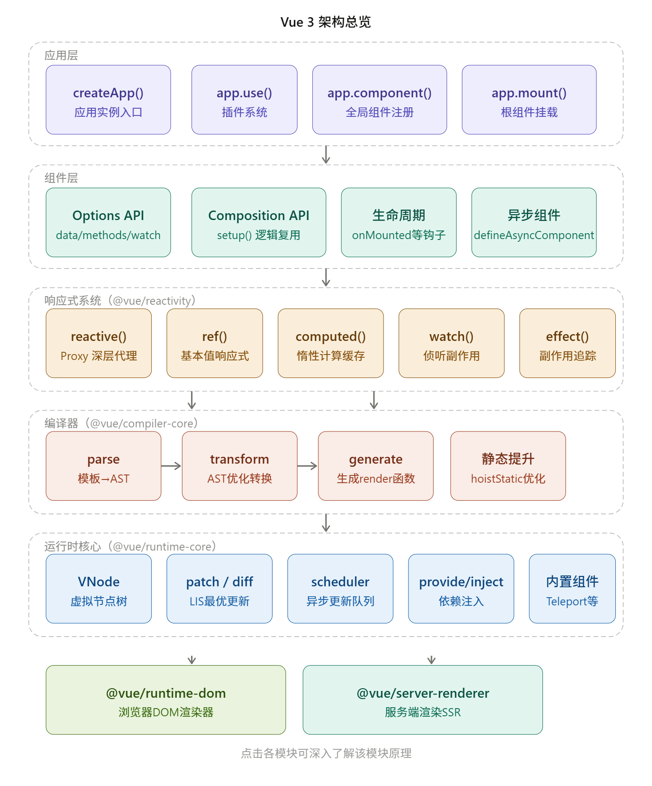

# Vue3架构图



这是 Vue3 的六层架构全景图，每个模块都可点击深入了解。下面是各层要点说明：

**应用层**是最顶层的用户 API，`createApp()` 创建应用实例，通过 `use/component/mount` 等方法完成插件注册、全局配置和挂载。

**组件层**支持 Options API 和 Composition API 两种风格，Vue3 的 `setup()` 函数是 Composition API 的入口，解决了 Vue2 代码逻辑分散难以复用的问题。

**响应式系统**（`@vue/reactivity`）是 Vue3 最大的重写亮点，用 `Proxy` 替代 `Object.defineProperty`，支持数组/Map/Set 等数据结构，`reactive`、`ref`、`computed`、`watch`、`effect` 构成完整的响应式闭环。

**编译器**（`@vue/compiler-core`）将模板编译为渲染函数，分三步走：`parse` 解析为 AST → `transform` 做静态提升等优化 → `generate` 生成 render 函数代码。

**运行时核心**（`@vue/runtime-core`）是平台无关的核心逻辑，包含 VNode 虚拟节点、基于最长递增子序列的 diff 算法、异步调度器、依赖注入等。

**最底层**分两个方向：`runtime-dom` 负责浏览器 DOM 渲染，`server-renderer` 负责 SSR 服务端渲染。这种分层设计让 Vue3 可以轻松支持跨平台渲染（如 uni-app、小程序等）。


# Vue3 面试题分类

## 一、Vue3 基础

- Vue3 vs Vue2 核心区别
- Composition API vs Options API
- `setup()` 函数
- `<script setup>` 语法糖
- 生命周期钩子变化

------

### 1. Vue3 vs Vue2 核心区别

#### 响应式系统重构

- Vue2 使用 `Object.defineProperty`，**无法检测属性新增/删除、数组索引变更**，需要 `$set` 补丁
- Vue3 使用 **`Proxy`** 代理整个对象，天然支持动态属性、数组索引、`Map/Set` 等数据结构

#### API 风格

- Vue2 只有 Options API（`data/methods/computed/watch` 分散配置）
- Vue3 引入 **Composition API**，逻辑按功能聚合，复用性更强

#### 性能提升

| 项目       | Vue2           | Vue3                   |
| ---------- | -------------- | ---------------------- |
| 打包体积   | 较大，全量引入 | Tree-shaking，按需引入 |
| 初始化速度 | —              | 提升约 55%             |
| 内存占用   | —              | 降低约 54%             |
| Diff 算法  | 全量比较       | 静态提升 + 靶向更新    |

#### 其他变化

- **Fragment**：组件模板支持多根节点
- **Teleport**：DOM 挂载到任意位置
- **Suspense**：异步组件加载状态管理
- 生命周期钩子重命名（`beforeDestroy` → `onBeforeUnmount`）
- `v-model` 支持多个绑定，废弃 `.sync` 修饰符
- 移除 `$children`、`EventBus ($on/$off/$emit)`、`filters`

------

### 2. Composition API vs Options API

#### Options API 问题

```javascript
// 同一个功能（用户搜索）的逻辑被强制分散在各选项中
export default {
  data() {
    return { query: '', results: [] }       // 数据在这里
  },
  computed: {
    filteredResults() { /* 计算在这里 */ }  // 计算在这里
  },
  methods: {
    search() { /* 方法在这里 */ }           // 方法在这里
  },
  watch: {
    query() { this.search() }              // 监听在这里
  }
}
```

#### Composition API 优势

```javascript
// 同一功能的逻辑完全聚合，可抽离为 useSearch.js 复用
function useSearch() {
  const query = ref('')
  const results = ref([])
  const filteredResults = computed(() => { /* ... */ })
  const search = async () => { /* ... */ }
  watch(query, search)
  return { query, results, filteredResults }
}
```

#### 对比总结

| 维度       | Options API                 | Composition API         |
| ---------- | --------------------------- | ----------------------- |
| 逻辑组织   | 按选项类型分散              | 按业务功能聚合          |
| 逻辑复用   | Mixin（命名冲突、来源不清） | Composable 函数（清晰） |
| TypeScript | 类型推导差                  | 原生友好                |
| 学习曲线   | 低，适合新手                | 略高                    |
| 适用场景   | 简单组件                    | 复杂组件、大型项目      |

> **两者可以共存**，Vue3 完全兼容 Options API，不强制迁移。

------

### Vue3 setup() 函数

> 
> setup 是 Vue3 **组合式API** 的入口函数，在组件创建之前执行，**this 指向 undefined**，不能用 `this`。
> 有两种写法：选项式的 `setup()` 函数 / `<script setup>` 语法糖（推荐）

#### 一、选项式 setup() 写法（原生函数形式）

```
<template>
  <div>{{ count }}</div>
  <button @click="add">+1</button>
</template>

<script>
import { ref } from 'vue'
export default {
  // setup 在 beforeCreate 之前执行
  setup() {
    // 定义响应式数据
    const count = ref(0)

    // 定义方法
    const add = () => {
      count.value++
    }

    // ✅ 必须 return，模板才能访问变量/方法
    return {
      count,
      add
    }
  }
}
</script>
```

##### setup 特点

1. **执行时机**：`beforeCreate` 生命周期钩子之前，组件实例还没创建，**没有 this**，不能访问 `data`、`methods`
2. **返回值**：`return` 的对象里面的属性、方法，会暴露给模板使用；不 return 模板拿不到
3. **不能使用 await**：普通 setup() 如果写 async，会返回 promise，模板无法正常渲染（async setup 只能搭配 Suspense）
4. 参数：`setup(props, context)`

```
setup(props, context) {
  // props：父组件传过来的属性，响应式，不能解构（会丢失响应式）
  console.log(props.name)

  // context 上下文对象，不是响应式，可以解构
  const { attrs, slots, emit, expose } = context
  // emit：触发自定义事件
  // attrs：非props属性
  // slots：插槽
  // expose：暴露属性给父组件通过 ref 获取

  return {}
}
```

##### props 注意点

```
// ❌ 错误，解构丢失响应式
const { name } = props
// ✅ 要解构且保留响应式，使用 toRefs
import { toRefs } from 'vue'
const { name } = toRefs(props)
```

#### 二、`<script setup>` 语法糖（项目最常用，本质还是setup）

> 
> 编译阶段语法糖，不用手动 return，变量函数直接在模板可用，代码更简洁

```
<template>
  <div>{{ count }}</div>
  <button @click="add">+1</button>
</template>

<script setup>
import { ref } from 'vue'
const count = ref(0)
const add = () => count.value++
</script>
```

##### script setup 额外能力

1. 自动暴露：不需要 return，顶层变量、函数直接给模板
2. 组件自动导入（IDE+插件），直接写标签不用 import
3. 顶层 await 支持，不需要 Suspense 也可以（Vue3.2+）

```
<script setup>
// 顶层await
const res = await fetch('/api/list')
</script>
```

4. 定义 props / emit：

```
<script setup>
import { defineProps, defineEmits } from 'vue'
// 声明props
const props = defineProps({
  title: String
})
// 声明自定义事件
const emit = defineEmits(['change'])

const handleClick = () => {
  emit('change', 'hello')
}
</script>
```

5. `defineExpose`：暴露属性给父组件 ref 获取

```
<script setup>
import { ref } from 'vue'
const msg = ref('子组件数据')
defineExpose({ msg }) // 父组件ref可以拿到msg
</script>
```

#### 三、setup 里面使用生命周期

组合式API生命周期，在setup内部调用：

```
import { onMounted, onUpdated, onUnmounted } from 'vue'
setup() {
  onMounted(() => {
    console.log('挂载完成')
  })
  onUnmounted(() => {
    console.log('组件销毁')
  })
}
```

> 
> 没有 `onBeforeCreate` / `onCreated`，因为setup本身就在这个阶段执行。

#### 四、ref 和 reactive 在 setup 区别

- `ref`：基本类型（数字、字符串），`.value` 修改；模板中自动解包不用写 `.value`
- `reactive`：对象/数组，不需要 `.value`；不能直接整体替换，会丢失响应式

```
const state = reactive({ name: '张三' })
state.name = '李四'
```

#### 五、setup 常见面试点总结

1. setup执行时机：`beforeCreate` 之前，没有this
2. setup两个参数：props（响应式，不可解构）、context（attrs、slots、emit、expose）
3. setup返回对象，属性暴露给模板；script setup语法糖省去return
4. setup不能用async（普通setup），`<script setup>`支持顶层await
5. 组合式生命周期钩子只能写在setup内部
6. defineProps / defineEmits / defineExpose 只能在 `<script setup>` 顶层使用，不能封装到函数里

#### 六、两种写法对比

| 写法 | 优点 | 缺点 |
| --- | --- | --- |
| setup() 选项式 | 好理解，Vue3刚出来的原生写法 | 需要手动return，代码冗余 |
| script setup | 简洁，自动暴露变量，顶层await | 语法糖，编译期转换，需要理解编译原理 |

> 
> 企业开发推荐：**`<script setup>`**

如果你需要，我可以给你写一个**setup完整综合示例（包含props、emit、ref、reactive、生命周期、watch、computed）**，或者整理一份setup面试简答版。


### Vue3 生命周期钩子变化

> 
> Vue3**选项式API还保留旧钩子名称，但销毁阶段改名；组合式API（setup）全部换成onXXX函数，**没有beforeCreate、created**，这两个阶段直接用setup本身替代

#### 一、Vue2 → Vue3 对照表

| Vue2选项式 | Vue3选项式 | Vue3组合式API（setup） | 执行时机 |
| --- | --- | --- | --- |
| beforeCreate | beforeCreate | **setup()内部代码** | 实例刚创建，data未初始化 |
| created | created | **setup()内部代码** | 数据初始化完成，DOM还没生成 |
| beforeMount | beforeMount | onBeforeMount | 模板编译完成，DOM还未挂载 |
| mounted | mounted | onMounted | DOM挂载完成，可以操作DOM |
| beforeUpdate | beforeUpdate | onBeforeUpdate | 响应式数据变化，DOM更新前 |
| updated | updated | onUpdated | DOM更新渲染完成 |
| beforeDestroy | **beforeUnmount** | onBeforeUnmount | 组件卸载前（**改名！**）清理定时器、事件监听 |
| destroyed | **unmounted** | onUnmounted | 组件卸载完成，实例销毁 |
| activated | activated | onActivated | keep-alive缓存组件激活 |
| deactivated | deactivated | onDeactivated | keep-alive缓存组件失活 |

✅ **核心改动1：销毁钩子改名**
`beforeDestroy` → `beforeUnmount`
`destroyed` → `unmounted`

> 
> 语义统一：unmount代表DOM卸载，更贴合虚拟DOM思想

✅ **核心改动2：组合式API不再有beforeCreate/created**
setup执行时机就是**beforeCreate和created之间**，所以初始化逻辑直接写在setup最前面，不需要这两个钩子函数。

> 
> ❗注意：组合式生命周期钩子**必须写在setup同步代码里，不能放在异步回调、if分支里面**

✅ **核心改动3：使用方式变化**

- Vue2：直接写在选项对象，不用导入
- Vue3组合式：需要`import`导入，在setup内部调用注册回调

```vue
<script setup>
import { onMounted, onUpdated, onBeforeUnmount, onUnmounted } from 'vue'

// 等价于 beforeCreate + created，直接写顶层
console.log('创建阶段')

onBeforeMount(() => {
  console.log('挂载前')
})
onMounted(() => {
  console.log('挂载完成，可操作DOM、发请求、初始化第三方图表')
})
onBeforeUpdate(() => {
  console.log('DOM更新前')
})
onUpdated(() => {
  console.log('DOM更新完成')  #  慎用：避免在此修改响应式数据（死循环风险）
})
onBeforeUnmount(() => {
  console.log('卸载前，清理定时器/事件监听，防止内存泄漏')
})
onUnmounted(() => {
  console.log('组件卸载完毕')  # 常用：清理副作用
})
</script>


```

#### 二、Vue3新增2个调试钩子（仅开发环境）

- `onRenderTracked`：追踪响应式依赖收集，渲染依赖被追踪触发
- `onRenderTriggered`：依赖变化触发渲染更新> 
> 开发调试用，生产环境无效，面试偶尔会问到

#### 三、选项式API 和 组合式API 共存时的执行顺序

**同一个生命周期，组合式API钩子优先执行，选项式后执行**

```
export default {
  mounted() {
    console.log('选项式mounted后执行')
  },
  setup() {
    onMounted(()=>{
      console.log('组合式onMounted先执行')
    })
    return {}
  }
}
```

#### 四、面试简答版（背这个）

1. Vue3选项式API大部分钩子名称不变，**销毁钩子改名：beforeDestroy→beforeUnmount，destroyed→unmounted**
2. 组合式API（setup）中，**移除beforeCreate、created**，初始化逻辑直接写在setup中；其余钩子全部改成`onXxx`形式，需要导入使用
3. 组合式生命周期钩子**必须写在setup顶层同步代码**，不能写在异步、条件分支
4. 新增`onRenderTracked`、`onRenderTriggered`用于调试响应式依赖
5. 同一个生命周期，组合式钩子**优先于选项式钩子执行**

#### 五、最佳实践

- 网络请求、DOM操作、初始化第三方库：`onMounted`
- 清除定时器、解绑全局事件、取消订阅：`onBeforeUnmount`（推荐，此时实例还在）
- 不要在`onBeforeUpdate/onUpdated`里修改响应式数据，容易死循环


### Vue3 父子组件生命周期执行顺序

> 
> 前提：默认是**子组件在父组件模板里直接渲染**，不是 v-if 延迟渲染；区分【挂载流程】、【更新流程】、【卸载流程】，Vue2 / Vue3 挂载顺序有**重大区别**！

#### ✅ 1. 挂载阶段（创建渲染，重点！Vue2 vs Vue3）

##### Vue2

父 beforeCreate → 父 created → 父 beforeMount
→ **子 beforeCreate → 子 created → 子 beforeMount → 子 mounted**
→ 父 mounted

> 
> Vue2：父挂载前，先把全部子组件挂载完成，最后父 mounted

##### Vue3（setup组合式）

**父 setup（beforeCreate+created）**
→ 父 onBeforeMount
→ **子 setup**
→ 子 onBeforeMount → 子 onMounted
→ **父 onMounted**

一句话总结挂载：

> 
> **父先开始挂载，然后完整走完子组件全部挂载流程，子挂载完毕，父才mounted**
> 口诀：**父先开工，子先完工**

```
父 setup
父 onBeforeMount
    ↓（进入子组件）
    子 setup
    子 onBeforeMount
    子 onMounted
    ↓（子全部挂载结束，回到父）
父 onMounted
```

---

#### ✅ 2. 更新阶段（数据更新，分两种场景）

##### 场景①：**父组件数据变化，引起子组件更新**

父 onBeforeUpdate
→ 子 onBeforeUpdate
→ 子 onUpdated
→ 父 onUpdated

> 
> 父触发更新 → 子先更新完毕，父才更新完成

##### 场景②：**仅子组件自身数据变化**

只执行子组件：`子 onBeforeUpdate → 子 onUpdated`，父不触发更新钩子

> 
> 口诀：谁变谁更新；父更新带动子更新：父先准备，子更新完，父结束更新

---

#### ✅ 3. 卸载阶段（销毁，v-if=false / 组件销毁）

**父 onBeforeUnmount**
→ 子 onBeforeUnmount
→ 子 onUnmounted
→ 父 onUnmounted

> 父开始卸载，先把所有子组件完整卸载，子卸载完，父再卸载。
> 口诀：**父先准备卸载，子先卸载完毕，最后父卸载**

```
父 onBeforeUnmount
    ↓
    子 onBeforeUnmount
    子 onUnmounted
    ↓
父 onUnmounted
```

#### ⚠️ 面试坑点（必背）

1. ❌ 误区：父mounted先执行，再子mounted
✅ 错！Vue3挂载：**子 onMounted 一定早于父 onMounted**

> 
> 原因：父的DOM包含子组件DOM，必须等子DOM渲染挂载完成，父的DOM才算挂载完成。
2. 如果子组件写了 `v-if="false"`，初始不会创建子组件，自然不会执行子生命周期；当v-if变为true时，才会走子的挂载流程。
3. keep-alive 包裹的子组件：不会走onMounted/onUnmounted，走`onActivated / onDeactivated`

#### 📝 面试简答一句话版

1. **挂载**：父先执行setup、onBeforeMount，然后执行子组件整套挂载，**子onMounted先执行，最后父onMounted**
2. **更新（父更新驱动子）**：父onBeforeUpdate → 子更新钩子 → 父onUpdated
3. **卸载**：父onBeforeUnmount → 子整套卸载钩子 → 父onUnmounted
核心规律：**父开启阶段，子先完成阶段**


------

## 二、响应式系统

- `ref` vs `reactive` 区别与使用场景
- `toRef` / `toRefs`
- `computed` 计算属性
- `watch` vs `watchEffect`
- 响应式原理：Proxy vs Object.defineProperty
- `shallowRef` / `shallowReactive`
- `readonly` / `shallowReadonly`

------

### 1. `ref` vs `reactive`

#### 本质区别

```javascript
import { ref, reactive } from 'vue'

// ref：任意类型，通过 .value 访问
const count = ref(0)
const user  = ref({ name: 'Tom' })
count.value++
user.value.name = 'Jerry'

// reactive：仅对象类型，直接访问属性
const state = reactive({ count: 0, name: 'Tom' })
state.count++
state.name = 'Jerry'
```

#### 底层实现差异

```javascript
// ref 内部：对象类型会自动调用 reactive 包装
// 基本类型则用 getter/setter 实现响应式
ref(0)        // → RefImpl { _value: 0 }
ref({ a: 1 }) // → RefImpl { _value: reactive({ a: 1 }) }

// reactive 内部：直接用 Proxy 代理对象
reactive({ a: 1 }) // → Proxy { a: 1 }
```

#### reactive 的限制 ⚠️

```javascript
const state = reactive({ count: 0 })

// ❌ 解构后丢失响应性
const { count } = state
count++ // 不会触发更新

// ❌ 直接替换整个对象，响应性丢失
let state = reactive({ count: 0 })
state = { count: 1 } // 引用断开，不再响应

// ✅ 解构用 toRefs 保持响应性
const { count } = toRefs(state)
```

#### 对比总结

| 维度     | `ref`                        | `reactive`   |
| -------- | ---------------------------- | ------------ |
| 适用类型 | 任意类型                     | 仅对象/数组  |
| 访问方式 | `.value`（模板自动解包）     | 直接访问     |
| 解构     | 解构丢失响应性，需 toRefs    | 同左         |
| 替换整体 | ✅ `count.value = newVal`     | ❌ 引用断开   |
| 模板使用 | 自动解包，不需要 `.value`    | 直接使用     |
| 推荐场景 | 基本类型、需要整体替换的对象 | 复杂嵌套对象 |

#### 使用建议

> 官方推荐**统一使用 `ref`**，避免 `reactive` 的限制带来的心智负担。`<script setup>` 中 `ref` 在模板自动解包，体验接近 `reactive`。

------

### 2. `toRef` / `toRefs`

#### toRef — 单个属性转换

```javascript
const state = reactive({ count: 0, name: 'Tom' })

// ✅ 保持响应性的单个属性引用
const count = toRef(state, 'count')
count.value++ // state.count 同步变化

// 常见场景：传递 props 单个属性给 Composable
function useCount(countRef) {
  watchEffect(() => console.log(countRef.value))
}
useCount(toRef(props, 'count')) // ✅
useCount(props.count)           // ❌ 普通值，无响应性
```

#### toRefs — 整个对象转换

```javascript
const state = reactive({ count: 0, name: 'Tom' })

// 将 reactive 对象的所有属性转为 ref
const { count, name } = toRefs(state)
count.value++ // 依然与 state 同步

// 最典型用法：setup 返回值解构
function useUser() {
  const state = reactive({ name: 'Tom', age: 18 })
  return toRefs(state) // ✅ 调用方可安全解构
}

const { name, age } = useUser() // 保持响应性
```

#### toRef vs toRefs 对比

|          | `toRef`              | `toRefs`                         |
| -------- | -------------------- | -------------------------------- |
| 转换范围 | 单个属性             | 所有属性                         |
| 返回值   | 单个 `Ref`           | `{ key: Ref }` 对象              |
| 场景     | 按需传递某个响应属性 | Composable 返回值、解构 reactive |

------

### 3. `computed` 计算属性

`computed` 是 Vue3 核心的**响应式计算属性**，用来**基于响应式数据做计算**，**有缓存、依赖变化才会重新计算**，比普通方法更高效。

#### 核心特点

1. **基于依赖缓存**：只有依赖的响应式数据变化时，才会重新计算；否则直接返回缓存结果
2. **只读/可写**：支持**只读计算属性**（常用）和**可写计算属性**
3. **组合式API**：Vue3 推荐在 `<script setup>` 中使用 `computed` 函数
4. **必须返回值**：计算属性的函数必须有 `return`

---

#### 一、基础用法（只读，最常用）

##### 1. 配合 ref 使用

```vue
<template>
  <div>
    <input v-model="num" type="number" placeholder="输入数字">
    <p>原始值：{{ num }}</p>
    <p>计算后（×2）：{{ doubleNum }}</p>
  </div>
</template>

<script setup>
// 1. 导入 computed
import { ref, computed } from 'vue'

// 2. 定义响应式数据
const num = ref(1)

// 3. 定义计算属性：依赖 num，返回计算结果
const doubleNum = computed(() => {
  console.log('计算属性执行了')
  return num.value * 2
})
</script>
```

##### 2. 配合 reactive 使用

```vue
<script setup>
import { reactive, computed } from 'vue'

const user = reactive({
  firstName: '张',
  lastName: '三'
})

// 计算全名
const fullName = computed(() => {
  return user.firstName + user.lastName
})
</script>

<template>
  <div>{{ fullName }}</div>
</template>
```

---

#### 二、可写计算属性（setter）

默认计算属性**不能直接赋值**，如果需要手动修改，要写成**对象形式**，包含 `get()` 和 `set()`：
```vue
<template>
  <div>
    <p>全名：{{ fullName }}</p>
    <button @click="fullName = '李 四'">修改全名</button>
  </div>
</template>

<script setup>
import { reactive, computed } from 'vue'

const user = reactive({
  firstName: '张',
  lastName: '三'
})

const fullName = computed({
  // 读取时执行（和普通计算属性一样）
  get() {
    return user.firstName + ' ' + user.lastName
  },
  // 赋值时执行（接收新值）
  set(newVal) {
    // 把新值拆分，修改原始数据
    const [first, last] = newVal.split(' ')
    user.firstName = first
    user.lastName = last
  }
})
</script>
```

---

#### 三、computed vs methods（关键区别）

| 特性     | `computed` 计算属性            | `methods` 方法                      |
| -------- | ------------------------------ | ----------------------------------- |
| 缓存     | **有缓存**，依赖不变不执行     | 无缓存，调用就执行                  |
| 使用方式 | 当作属性使用：`{{ fullName }}` | 当作方法调用：`{{ getFullName() }}` |
| 场景     | **数据计算、展示**             | 事件处理、业务逻辑                  |

**示例对比**：

```vue
<template>
  <p>计算属性：{{ fullName }}</p>
  <p>方法：{{ getFullName() }}</p>
</template>

<script setup>
import { ref, computed } from 'vue'
const firstName = ref('张')
const lastName = ref('三')

// computed：有缓存
const fullName = computed(() => firstName.value + lastName.value)

// methods：无缓存
const getFullName = () => firstName.value + lastName.value
</script>


```

---

#### 箭头函数

```js

1. `() => xxx` 语法就是箭头函数；
2. `const fn = ()=>{}`：变量接收箭头函数；
3. `computed( ()=>{} )`：把箭头函数作为回调参数传给 computed；

// 无参数
const fn1 = () => 100

// 一个参数，可以省略括号
const fn2 = x => x * 2

// 多个参数，必须括号
const fn3 = (a, b) => a + b

// 单行表达式：自动return，不能写大括号，箭头函数没有自己的变量作用域，在函数体内部使用 `a`、`b`，会沿着作用域链向外查找：
const fn4 = () => a + b

// 多行逻辑：必须 {}，必须手动 return
const fn5 = (a,b) => {
  const sum = a + b
  return sum
}

// 返回对象字面量，外面要加 ()
const fn6 = () => ({name:'张三'}) 
// ❌ 错误：const fn6 = () => {name:'张三'} 大括号会被解析成函数体
```


#### 四、注意事项

1. **不要在 computed 里做异步/副作用**
   计算属性只用于**纯计算**，异步请求、定时器、DOM 操作请用 `watch` 或生命周期。
2. **必须依赖响应式数据**
   如果依赖普通变量，计算属性**不会自动更新**。
3. **不要修改计算属性本身**
   只读计算属性赋值会报警告，需要修改请用 `setter`。

---

#### 总结

1. `computed` 用来**简化模板计算**，**自带缓存**，性能更好
2. 90% 场景用**只读计算属性**（函数形式）
3. 需要手动赋值时用**可写计算属性**（`get+set`）
4. 只做**纯计算**，不做异步/副作用操作

### computed  应用场景

> 核心一句话：**根据已有响应式数据，派生得到新的数据；有缓存，依赖不变不重新执行**
> 原则：**有缓存需求、数据由其他响应式推导而来 → 用 computed；事件触发、每次渲染都要执行 → 用普通函数**

#### ✅ 适合用 computed 的场景

##### 1. 简单数据拼接、格式化

姓名拼接、文本拼接、大小写转换
```js
const firstName = ref('张')
const lastName = ref('三')
const fullName = computed(() => firstName.value + lastName.value)
```

##### 2. 数值计算、统计汇总

总价、求和、平均值、折扣价格
```js
const list = ref([10,20,30])
const total = computed(()=>{
  return list.value.reduce((sum,item)=>sum+item,0)
})
```

##### 3. 数组过滤、筛选、排序

根据条件过滤列表（搜索、状态筛选）
```js
const allList = ref([{name:'a',status:1},{name:'b',status:0}])
const keyword = ref('')
const filterList = computed(()=>{
  return allList.value.filter(item=>item.name.includes(keyword.value))
})
```
> 注意：**不要直接在 computed 里修改原数组，只做返回新数组**

##### 4. 多条件布尔判断（开关、权限）

多个变量组合判断是否禁用、是否显示
```js
const formValid = ref(false)
const loading = ref(false)
const submitDisabled = computed(()=>{
  return !formValid.value || loading.value
})
```

##### 5. 复杂派生状态，多处复用

同一个派生值，模板多处使用，避免重复写同一套逻辑。
只计算一次，多处读取，利用缓存提升性能。

##### 6. 可写计算属性（get + set）

需要**修改派生值，反向更新原始响应式数据**
```js
const firstName = ref('张')
const lastName = ref('三')
const fullName = computed({
  get(){
    return firstName.value + lastName.value
  },
  set(val){
    const arr = val.split('')
    firstName.value = arr[0]
    lastName.value = arr.slice(1).join('')
  }
})
// 修改 fullName.value 会触发set，反向修改firstName、lastName
```

---

#### ❌ 不适合 computed 的场景（面试坑）

1. **无响应式依赖的实时值**
`computed(()=>Date.now())`、随机数，没有依赖，只会执行一次，不会更新。👉 用普通函数
2. **异步请求、接口调用**
computed 里面**不能放异步**（不能await），不能发请求。👉 用 onMounted / watch
3. **事件处理函数**
点击、输入等事件回调，不需要缓存。👉 普通函数
4. **有副作用（修改其他变量、定时器、dom操作）**
computed getter 要求**纯函数**，只计算返回值，不能修改外部数据、不能产生副作用。

> 纯函数：相同输入，一定得到相同输出，不修改外部变量，没有副作用。computed getter必须是纯函数。

#### 📌 computed vs 普通函数（模板调用）快速判断

- 数据由其他响应式推导出来，**多次读取，不想重复执行** → computed
- 没有依赖、每次渲染都要拿到最新结果、事件触发 → 普通函数

#### 📝 面试简答

computed用于**从已有响应式数据派生新数据**，自带缓存，只有依赖的响应式数据变化才重新计算。
适用场景：文本拼接、数值统计、数组过滤、多条件状态判断；还支持get+set实现可写计算属性。
**不适合：异步请求、带副作用逻辑、无响应依赖的实时值、事件处理函数。getter必须是纯函数。**

#### 拓展：computed 和 watch 的简单区分

- computed：**多对一，得到一个值，派生数据，有缓存**
- watch：**监听数据变化，执行一段逻辑，可异步，处理副作用**

要不要我继续讲 watch 和 watchEffect，对比三者区别？


### 4. `watch` vs `watchEffect`

---

#### 一、核心区别

- **`watch`**：**监听指定数据**，变了才执行（**惰性执行**）
- **`watchEffect`**：**自动追踪依赖**，**初始化立即执行一次**，依赖变了再执行（**立即执行 + 自动追踪**）

---

#### 二、基础用法对比

##### 1. watch（明确监听谁）

必须**明确指定要监听的数据源**。

```vue
<script setup>
import { ref, watch } from 'vue'
const count = ref(0)

// 明确监听 count
watch(count, (newVal, oldVal) => {
  console.log('count变了', newVal)
})
</script>
```

特点：
- 能拿到 **新值 + 旧值**
- 默认 **初始不执行**
- 必须**手动指定监听目标**

---

##### 2. watchEffect（自动追踪依赖）

**不用写监听谁**，代码里用到谁就自动监听谁。

```vue
<script setup>
import { ref, watchEffect } from 'vue'
const count = ref(0)

// 自动追踪内部使用的响应式数据
watchEffect(() => {
  console.log('count变了', count.value)
})
</script>
```

特点：
- **初始化立即执行一次**
- **自动收集依赖**，不用手动指定
- **拿不到旧值**

---

#### 三、最直观的区别（表格）

| 特性     | `watch`                        | `watchEffect`                |
| -------- | ------------------------------ | ---------------------------- |
| 执行时机 | **默认惰性执行**（初始不执行） | **立即执行一次**，再监听     |
| 依赖追踪 | **手动指定**监听谁             | **自动追踪**内部依赖         |
| 新值旧值 | 能获取 `newVal, oldVal`        | **只能获取当前值**           |
| 适用场景 | 监听特定值、执行逻辑复杂       | 简单监听、自动追踪、立即执行 |
| 代码量   | 稍多                           | 更少                         |

---

#### 四、实战场景怎么选？

##### ✅ 用 watch 的场景

1. 你需要**明确监听某个/某些变量**
2. 需要**新旧值对比**
3. 不想让它**一开始就执行**
4. 监听的逻辑**比较复杂**

```js
// 监听多个值
watch([a, b], ([newA, newB], [oldA, oldB]) => {})
```

##### ✅ 用 watchEffect 的场景

1. 代码里**用到谁就监听谁**，不想手动写
2. 需要**一开始就执行一次**（比如初始化请求）
3. 逻辑简单，依赖多且不确定
4. 不需要旧值

```js
watchEffect(() => {
  // 自动追踪 count、user.name 两个变量
  console.log(count.value, user.name)
})
```

---

#### 五、进阶：让 watch 也立即执行

`watch` 可以加 `immediate: true` 实现**立即执行**，变得和 `watchEffect` 一样：

```js
watch(count, (newVal) => {
  console.log(newVal)
}, {
  immediate: true  // 初始化立即执行一次
})
```

---

#### 六、进阶：停止监听

两个都可以停止：

```js
// watch
const stopWatch = watch(...)
stopWatch()

// watchEffect
const stopEffect = watchEffect(...)
stopEffect()
```

---

#### 七、最简单记忆口诀

- **想监听谁就写谁 → watch**
- **用到谁就自动监听谁 → watchEffect**
- **要旧值 → watch**
- **要立即执行 → watchEffect**

---

#### 总结

1. **watch**：手动指定、惰性执行、能拿新旧值 → **精准监听**
2. **watchEffect**：自动追踪、立即执行、无旧值 → **便捷监听**
3. 实际开发中：**简单逻辑用 watchEffect，复杂逻辑用 watch**

### 5. 响应式原理： Object.defineProperty VS Proxy

> 核心一句话：
> Vue2 使用 `Object.defineProperty` 劫持**属性**；Vue3 使用 `Proxy` 劫持**整个对象**。

- **Object.defineProperty**：Vue2 用的**对象属性拦截**，只能监听**单个属性**
- **Proxy**：Vue3 用的**对象整体代理**，能监听**整个对象 / 数组**

一句话结论：**Proxy 更强、更全、更快，是 Vue3 抛弃 defineProperty 的核心原因。**

#### 1. Object.defineProperty（Vue2）

##### 原理

对对象**单个属性**添加 getter / setter，读取属性触发get，修改触发set，从而收集依赖、派发更新。
```js
const obj = {}
let value = 10
Object.defineProperty(obj, 'name', {
  get() {
    console.log('读取name，收集依赖')
    return value
  },
  set(newVal) {
    console.log('修改name，派发更新')
    value = newVal
  }
})
```

##### ✅ 优点

- ES5 API，兼容性好（支持IE）

##### ❌ 缺点（面试必背缺陷）

1. **只能劫持单个属性，必须遍历对象所有属性进行劫持**，深层对象需要递归遍历（深度监听），初始化开销大
2. **无法监听新增属性**：后续 `obj.age = 18` 新增属性，不会触发get/set。Vue2需要 `$set`
3. **无法监听删除属性**：`delete obj.name` 无法捕获，需要 `$delete`
4. **无法监听数组下标修改、数组长度修改**
   ```js
   arr[0] = 999
   arr.length = 0
   ```
   Vue2 重写数组7个方法（push/pop/shift/unshift/splice/sort/reverse）来劫持数组。
5. 只能劫持对象属性，**不能监听Map、Set**这类集合类型

---

#### 2. Proxy（Vue3）

Proxy 代理**整个目标对象**，不是单个属性。拦截对象的各种操作。
```js
const target = { name: '张三' }
const proxyObj = new Proxy(target, {
  get(target, key) {
    console.log('读取属性，收集依赖')
    return Reflect.get(target, key)
  },
  set(target, key, val) {
    console.log('修改/新增属性，派发更新')
    return Reflect.set(target, key, val)
  },
  deleteProperty(target, key) {
    console.log('删除属性')
    return Reflect.deleteProperty(target, key)
  }
})
```
> 配套使用 `Reflect`：保证this指向、返回布尔值，行为更规范。

##### ✅ Proxy优势

1. **代理整个对象**，不用循环遍历所有属性
2. **监听新增属性、删除属性**，不需要$set
3. **监听数组下标、length修改**，不需要重写数组方法
4. 支持多种拦截操作：`get、set、deleteProperty、has、ownKeys`等13种捕获器
5. 支持 Map、Set、WeakMap、WeakSet 等集合类型的响应式

##### ❌ Proxy缺点

1. ES6新增API，**无法polyfill**，不支持IE浏览器
2. 只能代理对象，基本类型（string/number）不能直接代理 → Vue3用ref包装基础类型，包成对象

#### 3. 核心对比表

|对比项|Object.defineProperty（Vue2）|Proxy（Vue3）|
|---|---|---|
|劫持目标|**单个属性**|**整个对象**|
|新增属性|❌ 无法监听，需$set|✅ 自动监听|
|删除属性|❌ 无法监听，需$delete|✅ 自动监听|
|数组下标/长度|❌ 不能监听，重写7个数组方法|✅ 原生支持监听|
|支持集合Map/Set|❌ 不支持|✅ 支持|
|拦截操作|只有get、set|13种捕获器，功能更强|
|底层兼容性|ES5，可兼容IE|ES6，不能polyfill，不支持IE|
|初始化性能|递归遍历所有属性，大对象开销大|懒代理，访问到深层才代理|

#### 4. Vue3响应式补充：懒代理

Vue3的reactive不是一次性递归劫持所有深层属性。
**只有访问到深层对象的时候，才对它做Proxy代理**，也就是懒代理，提升初始化性能。
Vue2是一次性递归全部劫持，深层对象一开始就全部处理。

#### 5. 面试简答（直接背）

Vue2 使用`Object.defineProperty`劫持对象属性，通过getter收集依赖，setter派发更新。缺点：只能监听已有属性，无法监听新增、删除属性；数组下标、长度修改无法监听，需要$set和重写数组方法，不能支持Map/Set。

Vue3采用ES6 Proxy代理整个对象，配合Reflect。可以监听新增、删除属性，数组下标、长度修改，支持Map、Set；并且是懒代理，提升初始化性能。缺点是ES6 API，无法polyfill，不支持IE。

#### 6. 面试延伸提问

问：Vue3 ref为什么可以支持基本类型？
> Proxy只能代理对象，基础类型不能被Proxy代理。ref把基础类型包装成一个`{value:xxx}`对象，再用Proxy代理这个对象，修改`.value`触发响应式。reactive只接收对象类型。

问：为什么搭配Reflect？
1. 保证this指向正确
2. 返回布尔值，判断操作是否成功
3. 函数行为标准化。


### Proxy & Object.defineProperty 应用场景

> 核心区分：**Object.defineProperty 用来劫持单个属性；Proxy 劫持整个对象，拦截对象的全部操作**

#### 一、Object.defineProperty 适用场景

它是对**单个属性**进行描述符配置。
✅ 适合场景：
1. **简单对象，只需要监听少数几个属性**
   只需要对指定几个属性做get/set拦截，不需要监听新增、删除属性。
2. 给对象定义属性，配置属性特性（writable、enumerable、configurable）
   不一定是做响应式，单纯控制属性是否可枚举、可修改、可删除。
```js
const obj = {}
Object.defineProperty(obj, 'name', {
  value: '张三',
  writable: false, // 不可修改
  enumerable: true
})
```
3. Vue2 底层响应式（历史场景）
   局限：必须提前遍历所有属性，无法监听新增/删除属性，数组下标不行。

❌ 不适合：
- 需要监听动态新增、删除属性
- 需要监听数组下标、length修改
- 需要监听Map/Set集合
- 深层嵌套大对象（需要递归遍历，初始化性能差）

#### 二、Proxy 适用场景（Vue3 用它）

拦截**整个对象**的多种操作（读、写、删、in、遍历等）
✅ 适合场景：
1. **响应式系统（Vue3 reactive）**
   - 监听对象新增、删除属性
   - 监听数组下标赋值、数组length修改
   - 懒代理：深层对象**访问的时候才代理**，大对象初始化更快
   - 支持 Map、Set、WeakMap、WeakSet
2. 数据校验：统一拦截对象赋值，做参数校验
```js
const user = new Proxy({}, {
  set(target,key,val){
    if(key === 'age' && typeof val !== 'number'){
      throw new Error('年龄必须是数字')
    }
    return Reflect.set(target,key,val)
  }
})
```
3. 日志埋点：统一拦截对象读取/修改，自动打印日志、上报
4. 缓存、代理层：对象访问前置处理，只读对象、权限拦截
5. 状态管理、简易状态库

❌ 不适合：
1. 需要兼容IE浏览器（Proxy无法polyfill）
2. 基础类型（string/number/boolean）不能直接Proxy，必须包装成对象（ref就是这么做）

#### 三、一句话总结场景（面试背诵）

1. **Object.defineProperty**：针对**单个属性**配置描述符、简单属性劫持；Vue2响应式底层。缺点是不能监听新增删除属性，数组下标不行。
2. **Proxy**：代理**整个对象**，拦截多种对象操作，适合做完整响应式、数据校验、访问日志；Vue3 reactive底层。缺点不支持IE，只能代理对象类型。

#### 📌 面试延伸小问题

问：Vue3 为什么不用Object.defineProperty，改用Proxy？
答：因为`Object.defineProperty`只能劫持已存在属性，无法监听新增、删除属性，数组下标修改无法捕获，需要$set。Proxy代理整个对象，原生支持新增、删除、数组下标，还支持Map Set，懒代理优化性能。

---

#### 配套区分：Vue里什么时候用ref，什么时候reactive（顺带一起背）

- `ref`：**基础类型**（字符串、数字、布尔）；也可以存对象。底层会包装成`{value:xxx}`，再用Proxy代理。
- `reactive`：**对象/数组**，不能传基础类型，直接Proxy代理目标对象。

要不要继续：**依赖收集和派发更新（track / trigger）**？这是Vue3响应式下一个高频考点。


------

### 6. `shallowRef` / `shallowReactive`

这两个 API 是**性能优化神器**，专门用来**关闭深层响应式**，只让**第一层数据变成响应式**。

---

#### 一、一句话核心

- **shallowRef**：只监听 `.value` 的变化，**内部对象/数组不响应**
- **shallowReactive**：只监听**第一层属性**，**深层属性不响应**
- **作用**：提升大数据量场景的性能，减少不必要的响应式开销

---

#### 二、shallowRef（浅 ref）

##### 1. 特点

- 只有修改 **xxx.value** 整体替换时，才会触发视图更新
- 修改**内部属性**（对象、数组）**不会更新视图**
- 适合：**大列表、复杂数据、不需要修改内部属性**的场景

##### 2. 代码示例

```vue
<script setup>
import { shallowRef } from 'vue'

// 定义 shallowRef
const user = shallowRef({ name: '张三', age: 18 })

// 1. 修改内部属性 → 不响应（视图不更新）
const changeInner = () => {
  user.value.name = '李四'
  console.log(user.value.name) // 变了，但视图不变
}

// 2. 直接替换 .value → 响应（视图更新）
const changeValue = () => {
  user.value = { name: '王五', age: 20 }
}
</script>

<template>
  <div>{{ user.name }}</div>
  <button @click="changeInner">改内部属性（无效）</button>
  <button @click="changeValue">改 .value（有效）</button>
</template>
```

---

#### 三、shallowReactive（浅 reactive）

##### 1. 特点

- 只有**第一层属性**修改时响应
- **第二层及更深层**属性修改**不响应**
- 适合：**只需要操作第一层数据**的对象

##### 2. 代码示例

```vue
<script setup>
import { shallowReactive } from 'vue'

// 浅响应式对象
const obj = shallowReactive({
  name: '测试',
  info: {
    age: 18,
    address: '北京'
  }
})

// 1. 修改第一层 → 响应
const changeFirst = () => {
  obj.name = '修改第一层'
}

// 2. 修改深层 → 不响应
const changeDeep = () => {
  obj.info.age = 99
}
</script>

<template>
  <div>{{ name }}</div>
  <div>{{ info.age }}</div>
</template>
```

---

#### 四、完整对比表

| API               | 响应范围 | 触发更新条件         | 适用场景           |
| ----------------- | -------- | -------------------- | ------------------ |
| `ref`             | **深层** | 任意层级修改         | 常规数据           |
| `reactive`        | **深层** | 任意层级修改         | 常规对象           |
| `shallowRef`      | **浅层** | 仅 `.value` 整体替换 | 大数据、不修改内部 |
| `shallowReactive` | **浅层** | 仅**第一层属性**     | 浅层对象、性能优化 |

---

#### 五、使用场景（什么时候用？）

1. **性能优化**
   - 数据量巨大（长列表、万级数据）
   - 不需要修改内部属性，只整体替换
2. **第三方库集成**
   - 引入非 Vue 数据，不想被响应式劫持
3. **固定结构数据**
   - 只改第一层，深层数据只读

---

#### 六、重要注意

- **不要在业务代码滥用**：90% 场景用普通 `ref`/`reactive` 即可
- 浅层响应式数据**深层修改不更新视图**，容易出 bug
- 想让深层修改生效：可以配合 `triggerRef()` 手动触发更新

---

#### 总结

1. **shallowRef**：只响应 `.value` 替换，内部不响应
2. **shallowReactive**：只响应第一层属性，深层不响应
3. **核心目的**：**性能优化**，关闭不必要的深层响应式
4. **常规开发不用**，大数据/性能瓶颈时才用

需要我给你演示一下 `triggerRef` 手动触发更新的用法吗？

------

### 7. `readonly` / `shallowReadonly`

> 两者都是**生成只读Proxy代理**，尝试修改会在控制台抛出警告，**不能修改代理对象**；区别：**深度只读 vs 浅层只读**

#### 1. readonly（深层只读，常用）

对对象做**递归深层只读代理**，**所有层级属性全部只读**，嵌套对象也不能修改。
```js
import { readonly } from 'vue'
const state = readonly({
  foo: 1,
  nested: {
    bar: 2
  }
})

state.foo = 100 // ❌ 警告，禁止修改
state.nested.bar = 999 // ❌ 警告，嵌套对象同样只读
```
底层：访问嵌套对象时，自动递归给内部对象也生成readonly代理。

✅ **应用场景**
1. 封装自定义hooks，对外暴露只读数据，**防止外部组件修改内部状态**（最常用）
```js
// hook内部维护响应式，返回readonly，外部只能读不能改
function useUserInfo() {
  const user = reactive({name:'张三',age:20})
  return {
    user: readonly(user)
  }
}
```
2. 常量配置、字典、枚举，全局静态展示数据，全程不允许修改
3. 单向数据流约束：父传给子的数据，子组件不能修改

> 注意：readonly只是**代理层面只读**，如果拿到原始对象（toRaw）依然可以改。readonly**不会让原始对象变成只读**。

#### 2. shallowReadonly（浅层只读，不常用）

**只有根一级属性只读；深层嵌套对象不做只读代理，深层属性可以正常修改**
```js
import { shallowReadonly } from 'vue'
const state = shallowReadonly({
  foo:1,
  nested:{
    bar:2
  }
})
state.foo = 100 // ❌ 警告，根属性禁止修改
state.nested.bar = 999 // ✅ 可以修改！嵌套对象没有只读代理
```

✅ **应用场景**
1. 超大深度嵌套对象，**不想递归做深层只读，减少Proxy代理开销，优化性能**
2. 根属性不允许修改，但业务需要修改对象内部深层字段
> ⚠️ 坑：深层修改不会触发只读警告，容易造成数据不可预期变更，谨慎使用

#### 3. 核心对比表

| | readonly | shallowReadonly |
|---|---|---|
| 只读深度 | **深层递归**，所有层级只读 | **浅层**，仅根属性只读，嵌套对象可改 |
| 底层 | 读取嵌套对象自动包装readonly代理 | 嵌套对象原样返回，不包装只读代理 |
| 性能 | 大对象开销大，递归代理 | 开销小，不递归 |
| 修改嵌套属性 | ❌ 不能修改 | ✅ 可以修改 |

#### 4. 配套工具函数

- `isReadonly(obj)` 判断是否为readonly/shallowReadonly代理
- `isShallow(obj)` 判断是否浅层API（shallowReadonly/shallowReactive/shallowRef）
- `toRaw()` 获取代理对应的原始对象，绕过readonly限制

#### 5. 面试简答背诵

`readonly` 创建**深层只读代理**，对象所有层级属性都不可修改，常用于hooks对外暴露状态，防止外部篡改内部数据。
`shallowReadonly` 是浅层只读，**仅第一层属性只读，嵌套对象可修改**，适合大型深层对象，减少递归代理带来的性能开销。
> 共同点：只是Proxy代理层面只读，原始对象本身仍然可修改；修改只读代理会在控制台警告，不会成功修改。

#### 6. 面试延伸问题

问：readonly是响应式吗？
> readonly返回的是只读Proxy，可以**收集依赖**，原始数据变化，readonly代理页面会更新。只是**不能通过readonly代理去修改数据**。

> 举例：原始reactive对象修改，readonly包装后的视图会更新；但是不能直接修改readonly代理。
```js
const origin = reactive({name:'张三'})
const ro = readonly(origin)
origin.name = '李四' // ✅ 修改原始响应式，ro视图自动更新
ro.name = '王五' // ❌ 报错，不能通过readonly代理修改
```

要不要顺带把 shallowReactive / shallowRef 一起对比，把Vue所有浅层API一次性整理完？

### Vue2 / 3 选项式data VS Vue3组合式

**作用：创建组件响应式状态，数据驱动视图更新**

> 
> 重点一句话：**组合式API没有data配置项！** 选项式才有`data`。

#### 1. Vue2 选项式 data

```
export default {
  data() {
    return {
      query: '',
      results: []
    }
  }
}
```

- 语法：`data`是**配置项，必须是函数，返回普通对象**
- 底层：`Object.defineProperty`，一次性递归深度劫持
- 访问：模板直接写`query`；js中`this.query`
- 新增属性：非响应式，需要`$set`
- 逻辑组织：状态、计算、方法、监听分散在data/computed/methods/watch

#### 2. Vue3 选项式 data

```
export default {
  data() {
    return {
      query: '',
      results: []
    }
  }
}
```

- 语法：**和Vue2写法完全一样，data依然必须是函数，返回对象**
- 底层：交给`reactive`，`Proxy`代理整个对象（懒代理）
- 访问：模板`query`；js中`this.query`
- 新增属性：直接响应，不需要$set
- 逻辑组织：和Vue2一样，代码按类型拆分，业务逻辑分散

#### 3. Vue3 组合式（script setup）——**不存在data选项**

不再写`data()`，直接用`ref/reactive`定义响应式变量

```
<script setup>
import {ref, reactive} from 'vue'
// 等价于选项式data里的字段
const query = ref('')
const results = ref([])
// 或者用reactive一次性定义多个
const state = reactive({
  query: '',
  results: []
})
</script>
```

- 底层：ref/reactive同样基于Proxy响应式系统，和Vue3选项式data底层同一套
- 访问：模板直接写`query`；js中`query.value`；reactive直接`state.query`
- 逻辑组织：同一业务的状态、computed、watch、方法写在一起，按业务聚合
- 逻辑复用：自定义hooks

#### 4. 对比表格

|  | Vue2 Options data | Vue3 Options data | Vue3 Composition(ref/reactive) |
| --- | --- | --- | --- |
| 是否有data选项 | ✅ data(){} | ✅ data(){} | ❌ 无data选项 |
| 底层 | Object.defineProperty | Proxy(reactive) | Proxy（ref包装对象 / reactive） |
| 定义形式 | 函数返回对象 | 函数返回对象 | ref/reactive单独声明 |
| JS内取值 | this.xxx | this.xxx | ref需要`.value`，reactive直接访问 |
| 新增属性 | ❌ 需要$set | ✅ 直接生效 | ✅ 直接生效 |
| 递归 | 一次性深度劫持 | 懒代理 | 懒代理 |
| 代码组织 | 按类型拆分，逻辑分散 | 按类型拆分，逻辑分散 | 按业务聚合，代码放一块 |
| 逻辑复用 | mixin | mixin | 自定义hooks |

#### 5. 面试简答（背诵）

Vue2选项式和Vue3选项式都有`data`配置项，**data必须是函数返回对象**，保证多组件实例数据隔离；但底层响应式实现不同：Vue2是Object.defineProperty，Vue3选项式data底层是reactive+Proxy。

Vue3组合式API**没有data选项**，不再把所有状态统一放到一个data对象；使用ref、reactive直接声明响应式变量。可以把同一个业务相关的状态、计算、监听、方法写在一起，解决选项式业务逻辑分散的问题，复用使用自定义hooks。

> 
> 小坑：很多面试题会问：组合式有没有data？
> 答：**组合式没有data选项**，不要写data()。

#### 6. 等价转换示例

##### Vue3选项式

```
export default {
  data(){
    return {
      name:'张三',
      age:18
    }
  }
}
```

##### Vue3组合式两种等价写法

```
// 写法1：多个ref（推荐，简单字段）
const name = ref('张三')
const age = ref(18)

//写法2：reactive打包成一个对象（模拟选项式data）
const state = reactive({
  name:'张三',
  age:18
})
```

要不要继续讲 **mixin 的缺点**，选项式的复用方案，和组合式hooks做对比？

### methods（选项式API）

> 
> `methods` 是 Options API 的配置项，用来存放组件的**方法函数**，一般放事件处理、业务逻辑函数。Vue2、Vue3选项式都有。

#### 1. 基础写法

```js
export default {
  data() {
    return { query: '', results: [] }
  },
  methods: {
    // 定义方法
    search() {
      console.log(this.query) // this指向组件实例
      // 发请求，修改results
    },
    handleInput(val) {
      this.query = val
    }
  }
}
```

模板中使用：

```
<input @input="handleInput" />
<button @click="search">搜索</button>
```

#### 2. 核心特点（面试重点）

1. **methods里面函数的this自动绑定到Vue组件实例**
可以通过 `this` 访问 `data`、computed、其他methods。

> 
> ⚠️ methods 里面**不要写成箭头函数！**
> 箭头函数不绑定自己this，会继承外层this，拿不到组件实例。

```
methods:{
  bad: ()=>{ console.log(this.query) }, // ❌ this不是组件实例
  good(){ console.log(this.query) }    // ✅ 普通function，this指向vm
}
```
2. **methods的函数不会做缓存**
每次触发渲染，模板中如果调用 methods 函数，**每次都会重新执行**。

> 
> 和computed最大区别：computed有缓存，依赖不变不执行；methods无缓存，每次调用都执行。

```
<!-- 每次页面更新，getMsg()都会执行 -->
<div>{{ getMsg() }}</div>
```
3. 适合：**事件回调、需要手动触发的业务逻辑、异步请求**
   - 点击、输入等事件处理函数
   - 接口请求（异步逻辑）
   - 手动调用的业务方法

#### 3. methods vs computed（高频对比）

|  | methods | computed |
| --- | --- | --- |
| 缓存 | ❌ 无缓存，每次调用都执行 | ✅ 有缓存，依赖不变不重新计算 |
| 使用场景 | 事件、异步、手动调用 | 派生数据，模板直接展示 |
| 返回值 | 可选，可以没有return | 必须返回计算结果 |
| 调用 | 需要加 `()` 执行 | 直接当作属性使用，不加() |

模板示例：

```
<!-- methods，每次渲染执行 -->
<div>{{ getMessage() }}</div>

<!-- computed，缓存 -->
<div>{{ message }}</div>
```

#### 4. Vue3组合式里，没有methods选项

`<script setup>` 直接在顶层声明普通函数，替代methods

```vue
<script setup>
const query = ref('')
const results = ref([])

// 等价于methods里的方法
const search = () => {
  console.log(query.value)
}
const handleInput = (val) => {
  query.value = val
}
</script>
```

- 这里一般用箭头函数，**不需要this**
- 直接在模板使用 `@click="search"`

#### 5. 面试简答背诵

methods是选项式API的配置项，用来定义组件方法，多用于事件处理和业务逻辑。
methods内部普通function的this自动绑定组件实例；**禁止箭头函数**，否则this丢失。
methods没有缓存，每次调用都会执行；适合事件、异步逻辑。
Vue3组合式没有methods选项，直接在setup中定义函数来替代。

#### 延伸面试题

问：什么时候用methods，什么时候用computed？

> 
> 如果是**事件触发、异步、手动调用**，用methods；
> 如果是**根据响应式数据派生新值，模板多次使用，希望缓存**，用computed。

要不要继续讲选项式的 watch，和组合式watch做对比？


#### 全家桶速查

| API               | 深度 | 可写 | 典型场景           |
| ----------------- | ---- | ---- | ------------------ |
| `reactive`        | 深层 | ✅    | 常规响应式对象     |
| `shallowReactive` | 浅层 | ✅    | 大型对象、性能优化 |
| `readonly`        | 深层 | ❌    | provide 数据保护   |
| `shallowReadonly` | 浅层 | ❌    | 部分保护场景       |
| `ref`             | 深层 | ✅    | 基本类型、可替换值 |
| `shallowRef`      | 浅层 | ✅    | 大型列表、整体替换 |

------

## 三、组件系统

- Props / Emits 定义方式
- `defineProps` / `defineEmits` / `defineExpose`
- 组件通信方式（父子、兄弟、跨层级）
- `provide` / `inject`
- 动态组件与 `<component :is="">`
- 异步组件 `defineAsyncComponent`
- Teleport 传送门
- Suspense


### Props / Emits（父子组件通信）

> Props：**父 → 子传数据**；Emits：**子 → 父发送事件**
> Vue2、Vue3选项式支持；Vue3组合式`<script setup>`有专门语法。

#### 一、Props 父传子

##### 1. Vue2 / Vue3 选项式写法

子组件接收父传过来的数据

```js
// 子组件
export default {
  // 简单数组写法（不推荐，无校验）
  // props: ['title','count'],

  // 对象写法，支持类型校验、默认值、必填（推荐）
  props: {
    title: {
      type: String,
      required: true // 是否必填
    },
    count: {
      type: Number,
      default: 0 // 默认值
    }
  }
}
```

父组件使用：

```
<Child :title="'标题'" :count="num" />
```

✅ props特点：

1. **单向数据流**：props只读，子组件**不能直接修改props**。
   - 直接修改会控制台警告；
   - 如果要改：复制到本地data，或者用计算属性；
2. props会自动变成组件内部响应式数据，模板直接使用 `{{ title }}`；选项式js中 `this.title`；
3. 对象/数组类型的`default`必须写成**函数返回**，防止引用共享污染：

```js
props:{
  list:{
    type:Array,
    default(){
      return []
    }
  }
}
```

> 
> 单向数据流原因：防止子组件无意修改父状态，数据流来源唯一，便于调试。

##### 2. Vue3 <script‑setup 组合式

```vue
<script setup>
import { defineProps } from 'vue'
const props = defineProps({
  title: String,
  count:{
    type:Number,
    default:0
  }
})
// js中访问：props.title、props.count
</script>
```

#### 二、Emits 子向父触发自定义事件

##### 1. Vue2 选项式

Vue2**没有emits配置项**，直接`this.$emit(事件名, 参数)`

```js
//子组件 methods
methods:{
  handleChange(){
    this.$emit('update-count', 100) // 触发自定义事件，携带参数
  }
}
```

父组件监听：

```
<Child @update‑count="onUpdate" />
```

```js
//父 methods
methods:{
  onUpdate(val){
    console.log(val)
  }
}
```

##### 2. Vue3 选项式

Vue3新增`emits`选项，显式声明组件抛出的事件，做校验、文档提示

```js
export default {
  props:['count'],
  emits:['update‑count'], // 显式声明抛出哪些事件
  methods:{
    handle(){
      this.$emit('update‑count', 200)
    }
  }
}
```

##### 3. Vue3 <script‑setup

```vue
<script setup>
const emit = defineEmits(['update‑count'])

const handleChange = ()=>{
  emit('update‑count', 200)
}
</script>
```

##### 📌 .sync 与 v‑model（面试高频）

1. **Vue2：`.sync`修饰符**
实现“父传props，子通知父修改”语法糖

```
<Child :count.sync="num" />
<!--等价于-->
<Child :count="num" @update:count="num=$event"/>
```

2. **Vue3废弃 .sync，全部合并到 v‑model**

```
<!--Vue3-->
<Child v‑model:count="num"/>
```

子组件约定事件名 `update:属性名`

```
emit('update:count', newValue)
```

#### 三、重要坑点

1. props是只读，子不要直接修改props；
2. props中对象/数组default必须是函数返回；
3. Vue2没有emits配置，Vue3建议显式写emits/defineEmits；
4. 不要修改emit传过来的对象引用；单向数据流。

#### 四、面试简答背诵

> **props用于父组件向子组件传递数据，遵循单向数据流，子组件不能直接修改props；对象数组的default必须使用函数返回。**
> **emits（$emit）用于子组件向父组件触发自定义事件传递数据；Vue2没有emits配置项，Vue3支持emits选项、defineEmits显式声明事件。**
> Vue2的.sync语法糖在Vue3移除，统一使用v‑model:xxx。

|  | props | emits($emit) |
| --- | --- | --- |
| 方向 | 父 → 子 | 子 → 父 |
| 作用 | 传递数据 | 触发事件、传递参数 |
| Vue2 | props配置，无emits配置 | this.$emit() |
| Vue3选项式 | props配置 | emits配置 + this.$emit() |
| Vue3 script‑setup | defineProps() | defineEmits() |

要不要继续讲 `computed`选项式 vs 组合式，把选项式和组合式全套过完？


### 2. `defineProps` / `defineEmits` / `defineExpose`

> 
> 三者都是 **`<script setup>` 专属编译宏**，不需要 import，只能在 `<script setup>` 里面使用，**不是普通函数，是编译期语法糖**。

#### 1. defineProps 接收 props（父 → 子）

获取父组件传过来的属性，做类型、默认值、必填校验。

##### 写法1：对象校验写法（推荐，支持default/required）

```
<script setup>
const props = defineProps({
  name: {
    type: String,
    required: true
  },
  list: {
    type: Array,
    default() {
      return []
    }
  }
})
// JS中读取：props.name，props.list
// ❗不能直接 props.name = 'xxx'，props只读（单向数据流）
</script>
```

##### 写法2：TS类型写法（仅TS环境）

```
const props = defineProps<{
  name: string
  list?: number[]
}>()
// 带默认值TS：withDefaults
const props = withDefaults(defineProps<{name?:string}>(),{name:'默认'})
```

> 
> 特点：
> 
> 
> 1. 返回的 props 对象是**只读**，不能修改；
> 2. 底层和选项式props逻辑一致；
> 3. 编译宏，运行时不存在这个函数，**不能解构props**（解构会丢失响应式）

```
// ❌ 错误，丢失响应式
const { name } = props
// ✅ 正确，直接 props.name
```

> 
> 如果想解构还保留响应式：用 `toRefs`

```
import {toRefs} from 'vue'
const { name } = toRefs(props)
```

#### 2. defineEmits 定义自定义事件（子 → 父）

声明子组件可以抛出的事件，返回 `emit` 函数，用来触发事件传参。

```
<script setup>
const emit = defineEmits(['submit', 'update:value'])

const handleClick = () => {
  emit('submit', { id: 1 }) // 触发事件，携带参数
}
</script>
```

TS版本：

```
const emit = defineEmits<{
  (e:'submit', payload:{id:number}):void
}>()
```

父组件监听：

```
<Child @submit="handleSubmit"/>
```

> 
> 对比选项式：
> 选项式写 `emits:['submit']` + `this.$emit()`；
> script setup 用 `defineEmits` 获取 `emit`。

#### 3. defineExpose 向外暴露组件实例属性/方法

> `<script setup>` **默认封闭**：父组件通过 ref 获取子组件实例时，**默认拿不到子组件内部任何变量、函数**。
> 需要手动用 `defineExpose` 显式暴露，父组件才能访问。

子组件：

```
<script setup>
const msg = ref('hello')
const sayHi = () => {
  alert('hi')
}
// 暴露给父组件
defineExpose({
  msg,
  sayHi
})
</script>
```

父组件：

```
<template>
  <Child ref="childRef"/>
</template>
<script setup>
const childRef = ref(null)
// childRef.value.msg  childRef.value.sayHi()
</script>
```

> 
> 重点：**不写defineExpose，父ref拿不到setup内的任何内容**，这是`<script setup>`重要特性。

#### 三者对比表

| 宏 | 作用 | 通信方向 |
| --- | --- | --- |
| defineProps | 接收父组件传入props | 父→子 |
| defineEmits | 定义事件，子触发事件向父传数据 | 子→父 |
| defineExpose | 暴露内部属性/方法给父组件ref访问 | 子 → 父（实例直接访问） |

#### 面试简答背诵

`defineProps`、`defineEmits`、`defineExpose` 是`<script setup>`编译宏，无需导入，编译期处理。

1. **defineProps**：接收父组件props，支持类型校验、默认值；返回的props只读，直接解构会丢失响应式，要用toRefs。
2. **defineEmits**：声明自定义事件，返回emit函数，子组件触发事件向父传参。
3. **defineExpose**：`<script setup>`默认内部变量对外不可见，通过它显式暴露属性和方法，父组件通过ref拿到子实例后访问。

> 面试追问：为什么script setup里ref拿不到子组件变量？
> 答：`<script setup>`的作用域默认是封闭的，隔离内部状态，防止父组件随意操作子组件内部数据，必须通过defineExpose显式暴露。

> 追问：defineProps解构为什么丢失响应式？
> props是一个Proxy代理对象，直接解构会取出普通值，脱离代理；使用toRefs把props所有属性转为ref，解构后保留响应式。

要不要继续讲 **v-model 在 script setup 的实现**（和defineProps+defineEmits强相关）？

------

### 3. 组件通信方式

> 
> 先分类：**父子通信、跨级通信、兄弟/任意组件通信**

#### 一、父子组件通信（最常用）

##### 1. Props + $emit（Vue2） / defineProps + defineEmits（Vue3 script setup）

- 父 → 子：**props**，单向数据流，子不能直接修改props
- 子 → 父：**$emit** 触发自定义事件，传递数据> 
> Vue3中推荐显式声明`emits`；`<script setup>`用`defineProps`/`defineEmits`

##### 2. v-model（语法糖）

本质还是 props + emit(`update:xxx`)

- Vue2：`.sync`（Vue3移除，合并进v-model）

```
<!-- Vue3 多v-model -->
<Child v-model:name="name" v-model:age="age"/>
```

##### 3. $parent / $children + ref + defineExpose

- `ref`：父获取子组件实例，配合`defineExpose`（script setup必须暴露），父直接访问子的属性/方法
- `$parent`：子获取父实例；`$children`：父获取子实例数组（不推荐，不稳定）> 
> 缺点：直接操作实例，耦合高，业务尽量少用

#### 二、跨级组件通信（隔代，祖孙）

##### 1. Provide / Inject（依赖注入）

祖先组件`provide`提供数据，后代任意层级`inject`注入使用。
✅ 适合深层嵌套组件传值（主题、配置、全局状态）
❌ 缺点：

- 响应式需要手动维护；传普通对象不是响应式（传ref/reactive才保持响应）
- 耦合强，数据来源不清晰，**不适合做可修改的业务状态**

Vue2选项式：

```
//祖先
provide(){ return {theme:this.theme} }
//后代
inject:['theme']
```

Vue3 script setup：

```
//祖先
const theme = ref('dark')
provide('theme', theme)
//后代
const theme = inject('theme')
```

#### 三、兄弟组件 / 任意组件通信（无直接关系）

##### 1. 事件总线 EventBus（Vue2常用，Vue3不推荐）

Vue2：new Vue实例作为事件中心，`$on/$emit/$off`

> 
> 缺点：事件难以维护、容易内存泄漏；Vue3移除了`$on`，不再推荐

##### 2. 全局状态管理（Vue2 Vuex / Vue3 Pinia）

**大型项目首选**，全局单一状态仓库，任意组件读写状态。

- Vue2：Vuex
- Vue3：推荐Pinia（替代Vuex，更简洁，无mutations，TS友好）

##### 3. 全局变量（简单场景不推荐）

直接挂载全局对象，不属于响应式，改了不会更新视图，一般不用。

#### 四、一张总表

| 方式 | 适用场景 | 方向 | Vue2 | Vue3 |
| --- | --- | --- | --- | --- |
| props / $emit | 父子 | 父↔子 | ✅ | ✅ defineProps/defineEmits |
| v-model | 父子双向绑定语法糖 | 父↔子 | ✅(.sync) | ✅多v-model |
| ref + defineExpose | 父调用子实例方法/变量 | 父访问子 | ✅ | ✅（必须defineExpose） |
| $(parent/)$children | 父子实例访问 | 父子 | ✅ | ✅不推荐 |
| provide/inject | 跨层级祖孙组件 | 祖先→后代 | ✅ | ✅ |
| EventBus事件总线 | 任意组件 | 任意 | ✅ | ❌不推荐 |
| Vuex/Pinia | 全局、多组件共享状态 | 任意 | Vuex | Pinia推荐 |

#### 面试简答背诵（推荐口述）

1. **父子组件**：props父传子；子通过$emit（defineEmits）向父抛事件；v-model是props+emit的语法糖；ref+defineExpose父组件获取子实例。
2. **跨层级祖孙组件**：provide/inject依赖注入，祖先提供，后代注入；适合主题、配置，耦合较高。
3. **兄弟或任意组件**：Vue2可用EventBus，但是容易内存泄漏，Vue3不推荐；复杂项目用全局状态管理，Vue2用Vuex，Vue3推荐Pinia。

> 
> 面试高频追问
> 问：provide/inject是响应式吗？
> 
> 
> > 
> > 如果传入**ref/reactive**，则保持响应式；如果传普通原始值，不是响应式。
> 
> 
> 问：EventBus的缺点？
> 
> 
> > 
> > 没有命名空间，事件名容易冲突；组件销毁要手动解绑，容易内存泄漏；数据流向不直观。Vue3移除了实例$on，不再推荐。
> 
> 
> 问：Pinia对比Vuex优势？
> 
> 
> > 
> > 无mutations，直接修改状态；模块化扁平化，不需要嵌套modules；TS类型友好；支持多仓库，没有命名空间问题。

要不要我单独整理一份 **Pinia核心知识点**，面试常问？


------

### 4. `provide` / `inject`

#### 基本用法

```vue
<!-- 祖先组件 ─────────────────────────────────── -->
<script setup>
import { ref, provide, readonly } from 'vue'

const theme = ref('dark')
const user  = ref({ name: 'Tom' })

function setTheme(val) { theme.value = val }

// ✅ 用 readonly 保护数据，防止后代直接修改
provide('theme', readonly(theme))
provide('user',  readonly(user))
provide('setTheme', setTheme)       // 提供修改方法
</script>
<!-- 任意后代组件（不限层级）──────────────────── -->
<script setup>
import { inject } from 'vue'

// 第二参数为默认值（祖先未 provide 时使用）
const theme    = inject('theme', 'light')
const user     = inject('user')
const setTheme = inject('setTheme')

setTheme('light') // ✅ 通过方法修改，数据流清晰
theme.value = 'x' // ❌ readonly 警告
</script>
```

#### Symbol Key（推荐大型项目使用）

```typescript
// keys.ts — 统一管理注入键，避免字符串拼写错误
import type { InjectionKey, Ref } from 'vue'

export const ThemeKey: InjectionKey<Ref<string>> = Symbol('theme')
export const UserKey:  InjectionKey<Ref<User>>   = Symbol('user')

// 祖先
provide(ThemeKey, readonly(theme))

// 后代 — 自动推导类型，无需手动标注
const theme = inject(ThemeKey) // Ref<string> | undefined
const theme = inject(ThemeKey, ref('light')) // Ref<string>
```

#### provide/inject vs props 对比

| 维度     | Props        | provide/inject         |
| -------- | ------------ | ---------------------- |
| 传递层级 | 仅父子       | 任意深度               |
| 数据来源 | 显式，易追踪 | 隐式，需约定           |
| 响应性   | ✅            | ✅（传 ref/reactive）   |
| 适用场景 | 常规父子通信 | 主题、国际化、全局配置 |


#### `provide / inject` 穿透式通信

这是 Vue 专门解决**多层嵌套组件传值**的神器，也叫**祖孙通信**、**跨级传值**。

---

##### 一、一句话核心

- **provide**：在**祖先组件**提供数据/方法
- **inject**：在**后代组件**（子/孙/重孙...）注入使用
- **不用一层层 props 传递**，直接穿透所有中间组件

---

##### 二、适用场景

- 组件嵌套**2层以上**（父 → 子 → 孙）
- 不想用 Pinia 全局状态
- 主题、语言、全局配置、公共方法

---

##### 三、基础用法（最简单）

###### 1. 祖先组件（提供数据）

```vue
<script setup>
import { provide } from 'vue'

// 提供一个值
provide('name', '张三')

// 提供一个方法
provide('sayHello', () => alert('你好！'))
</script>
```

###### 2. 后代组件（任意子/孙组件）

```vue
<script setup>
import { inject } from 'vue'

// 注入使用
const name = inject('name')
const sayHello = inject('sayHello')
</script>
```

---

##### 四、响应式用法（重点！）

默认传过去的不是响应式的，**要传响应式数据必须用 ref/reactive**。

###### 祖先

```js
import { provide, ref } from 'vue'
const count = ref(0)

// 传递响应式数据
provide('count', count)
```

###### 后代

```js
import { inject } from 'vue'
// 直接用，就是响应式的
const count = inject('count')
```

---

##### 五、让后代不能修改（只读）

为了防止后代乱改数据，**祖先可以传递只读版本**：
```js
import { provide, ref, readonly } from 'vue'
const count = ref(0)

// 后代只能读，不能改
provide('count', readonly(count))
```

---

##### 六、默认值（防止找不到）

如果上层没 provide，inject 可以给默认值：
```js
// 找不到 name 时，用 '默认值'
const name = inject('name', '默认值')
```

---

##### 七、超级清晰对比

| 方式               | 优点                   | 缺点           |
| ------------------ | ---------------------- | -------------- |
| **Props**          | 简单清晰               | 多层嵌套太麻烦 |
| **Pinia**          | 全局通用               | 简单数据没必要 |
| **Provide/Inject** | **穿透跨级、代码干净** | 数据来源不直观 |

---

##### 八、记忆口诀

- **上层提供 provide**
- **下层注入 inject**
- **跨级传值不用愁**
- **响应式用 ref/reactive**

---

##### 总结

1. **provide** = 提供（祖先）
2. **inject** = 注入（后代）
3. 专门解决**多层组件传值**
4. 想响应式 → 传 `ref/reactive`
5. 想安全 → 传 `readonly`

需要我给你写一个**祖孙三层 + 响应式 + 只读**的完整 Demo 吗？


------

### 5. 动态组件与 `<component :is="">`

#### 1. 核心概念

`<component>` 是 Vue 内置**占位组件**，通过 `:is` 属性的值，动态渲染不同组件。

> 
> 本质：根据 `is` 的变量，切换当前挂载的组件，**组件切换会销毁/重建**（默认）。

```
<template>
  <!-- is绑定变量，变量值是组件名/组件实例 -->
  <component :is="currentComp"></component>

  <button @click="currentComp = 'CompA'">A组件</button>
  <button @click="currentComp = 'CompB'">B组件</button>
</template>

<script setup>
import CompA from './CompA.vue'
import CompB from './CompB.vue'
import { ref } from 'vue'
const currentComp = ref(CompA) // 也可以写字符串名字（需注册）
</script>
```

> 
> ✅ Vue3 `<script setup>` 推荐：`is` 直接绑定**导入的组件对象**，不用写字符串，无需额外注册。
> Vue2 旧写法：`is="CompA"` 字符串，需要组件全局/局部注册。

#### 2. 关键：keep-alive 缓存（高频考点）

默认切换组件：**销毁旧组件、重建新组件**，组件状态丢失（表单输入、滚动位置清空）。
套上 `<KeepAlive>` 缓存实例，**不销毁，仅隐藏**，保留状态：

```
<KeepAlive>
  <component :is="currentComp"></component>
</KeepAlive>
```

##### keep-alive 配套属性

- `include`：只有名称匹配的组件缓存
- `exclude`：匹配的组件不缓存
- `max`：最大缓存实例数量，超出自动淘汰

```
<KeepAlive include="CompA,CompB" max="3">
  <component :is="currentComp"></component>
</KeepAlive>
```

##### 缓存后的生命周期（面试必背）

- 首次进入：`onMounted`
- 切走（缓存，不销毁）：`onDeactivated`
- 再次切回来：`onActivated`> 
> ❗ 缓存的组件**不会再次执行 onMounted**，改用 `onActivated` 做每次激活的逻辑。

#### 3. 适用场景

1. 标签页切换（tab 页，不同tab渲染不同组件）⭐最常用
2. 根据后端返回类型，渲染不同业务卡片
3. 表单分步向导，每一步是独立组件
4. 弹窗内部根据类型切换内容组件

#### 4. 坑点 & 面试易错点

1. **`is` 值区分大小写**：模板中默认小写，`<script setup>` 直接传导入组件对象可以规避。
2. `KeepAlive` 只缓存**组件实例**，普通html标签无效。
3. 缓存组件**不会触发 onUnmounted**，组件离开触发 `onDeactivated`；真正销毁才会 `onUnmounted`。
4. 动态组件切换会触发**组件生命周期**，不加keep-alive就销毁重建，有性能开销。

#### 5. 对比：动态组件 vs v-if

- `v-if`：多个标签写死，条件渲染，适合少量组件；切换销毁重建。
- `<component :is>`：**组件数量不固定**，由变量驱动，适合大量组件动态切换，代码更简洁，配合keep-alive缓存。

#### 6. 面试一句话总结

`<component :is>` 是Vue内置动态组件，通过is绑定组件实现动态渲染；默认切换销毁重建，外层包裹`<KeepAlive>`可以缓存组件实例，保留组件状态，常用于Tab标签页场景；缓存组件使用`onActivated/onDeactivated`代替部分mounted逻辑。

要不要继续讲异步组件 `defineAsyncComponent`？


------

### 6. 异步组件 `defineAsyncComponent`

#### 1. 概念

`defineAsyncComponent` 是 Vue3 提供的API，用来**异步加载组件**。
组件不会在页面初始化时直接导入，**用到的时候才去请求加载组件代码**，属于代码分割，减少首屏打包体积。

> 
> Vue2 是 `()=>import()` 异步组件写法，Vue3 推荐用 `defineAsyncComponent` 封装，支持更多配置。

#### 2. 基础写法

```
<script setup>
import { defineAsyncComponent } from 'vue'
// 简单异步组件
const AsyncComp = defineAsyncComponent(() => import('./components/HeavyComp.vue'))
</script>

<template>
  <AsyncComp />
</template>
```

底层：`import()` 返回Promise，webpack/vite自动做代码分割，单独打包成一个js chunk。

#### 3. 完整配置写法（面试重点）

可以配置加载中组件、错误组件、超时、延迟：

```
<script setup>
import { defineAsyncComponent } from 'vue'

const AsyncComp = defineAsyncComponent({
  // 加载函数，返回Promise
  loader: () => import('./HeavyComp.vue'),
  // 加载时显示的组件（loading状态）
  loadingComponent: () => import('./Loading.vue'),
  // 加载失败显示的组件（网络报错）
  errorComponent: () => import('./Error.vue'),
  // 延迟多少ms显示loading，默认200ms；加载很快时不闪loading
  delay: 300,
  // 超时时间，超时展示error组件，默认Infinity永不超时
  timeout: 5000
})
</script>
```

#### 4. 两种使用场景

##### 场景1：单独使用，按需渲染

```
<AsyncComp v-if="show" />
```

只有`show=true`的时候，才会去请求组件js。

##### 场景2：搭配动态组件 `<component :is>`（高频组合考点）

```
<script setup>
import { ref, defineAsyncComponent } from 'vue'
const current = ref('A')
const CompA = defineAsyncComponent(()=>import('./CompA.vue'))
const CompB = defineAsyncComponent(()=>import('./CompB.vue'))
</script>
<template>
  <component :is="current === 'A' ? CompA : CompB"></component>
</template>
```

##### 场景3：路由懒加载（本质就是异步组件！）

```
// router/index.js
const Home = defineAsyncComponent(() => import('../views/Home.vue'))
const routes = [
  { path: '/home', component: Home }
]
```

> 
> 路由懒加载 = 异步组件 + 路由触发时机，这是面试常关联点。

#### 5. 核心特点 & 面试考点

1. **代码分割**：打包后组件单独chunk，首屏不需要加载该组件js，优化首屏加载速度。
2. 加载是**Promise异步**，加载期间可以展示loading组件，捕获网络异常。
3. 可以和 `<KeepAlive>` 一起使用：组件加载成功后，实例可以被缓存。
4. 对比 Vue2：Vue2异步组件只是简单Promise；Vue3 `defineAsyncComponent` 是专门API，支持loading、error、timeout等增强配置。

#### 6. 坑点

1. 异步组件**加载失败不会自动重试**，需要自己在error组件里写重试逻辑。
2. delay设置：如果网络很快，小于delay时间，loading组件不会展示，避免一闪而过的loading。
3. 异步组件**只有首次渲染时请求一次**，缓存之后不会重复请求chunk。

#### 7. 一句话面试总结

`defineAsyncComponent` 是Vue3用来定义异步组件的API，内部接收返回Promise的loader函数，实现代码分割；支持配置loading、错误提示、超时延迟，用到组件时才请求加载js，常用于路由懒加载、大组件按需引入，优化首屏性能。

#### 对比：异步组件 vs 动态组件

- 动态组件 `<component :is>`：**组件已经加载完毕**，只是切换渲染哪一个。
- 异步组件 `defineAsyncComponent`：**组件代码一开始不加载**，等到需要渲染的时候才去拉取js文件。

下一个：**Teleport传送组件**，要不要继续？


------

### 7. Teleport 传送门

Teleport 传送门（Vue3内置组件）

#### 1. 核心概念

`Teleport` 是Vue3内置组件，翻译叫**传送门**。
作用：**把组件内部的DOM结构，移动到DOM树别的位置，脱离当前组件模板所在的DOM层级**，但是组件的**逻辑、响应式、事件、作用域还保留在当前组件内**。

> 
> 一句话区分：**逻辑留在当前组件，DOM搬家到别的地方**。

#### 2. 基础语法

```
<template>
  <div class="box">
    <h3>当前组件DOM</h3>
    <!-- to：目标选择器，把内部DOM放到 #app 之外的 body 末尾 -->
    <Teleport to="body">
      <!-- 这部分DOM会被移动到body标签末尾 -->
      <div class="modal">弹窗内容</div>
    </Teleport>
  </div>
</template>
```

- `to` 属性：必填，CSS选择器（`body`、`#modal-container`）或者DOM元素
- 渲染后：`.box` 和 `.modal` **不在同一个DOM层级**，但是弹窗的数据、事件还是当前组件控制

#### 3. 常用场景（面试高频）

✅ **模态框、弹窗、抽屉、tooltip**

> 
> 经典痛点：如果弹窗写在父组件内部，父元素有 `overflow:hidden` / `z-index` 层级限制，弹窗会被截断或者层级失效。
> Teleport把DOM直接丢到body下，避开父容器样式限制。

#### 4. 关键属性

1. `to`：目标位置，`"body"` / `"#id"`
2. `disabled`：布尔值，关闭传送。`disabled="true"`，DOM就不搬家，留在原地渲染。

```
<Teleport to="body" :disabled="isMobile">
  <!-- 移动端不传送，留在当前DOM -->
</Teleport>
```

#### 5. 重要特点 & 面试考点

1. **逻辑不转移，仅移动DOM**
 里面的组件、props、事件、ref、响应式数据仍然属于当前组件，不是放到body就变成全局。
2. **多个Teleport可以传送到同一个目标节点**
 多个Teleport指向同一个`to`，DOM会追加在目标里面，**顺序按渲染顺序**。
3. 和 `v-if` 搭配：v-if控制Teleport是否渲染，销毁时DOM也会从目标节点移除。
4. **ref获取**：Teleport内部DOM/ref，在当前组件正常获取，不受DOM位置影响。

#### 6. 坑点

1. `to` 指向的DOM节点**必须提前存在**，不能等Teleport渲染后再创建目标节点。
2. `body` 上直接放Teleport内容，`body` 不要写 `overflow:hidden`，否则依旧会截断。
3. 配合组件库弹窗：很多UI库的modal底层就是Teleport实现。
4. 样式注意：scoped样式**不会作用到Teleport传送出去的DOM**！> 
> scoped靠属性选择器，DOM被移走后没有这个属性，样式失效。解决方案：
> 
> 
> - 写全局样式
> - 深度选择器 `:deep()`

#### 7. 面试一句话总结

Teleport是Vue3内置传送组件，可以将内部DOM移动到页面任意DOM节点，**组件逻辑和作用域保留在原组件**，主要解决弹窗被父容器样式截断、z-index层级问题；支持disabled关闭传送，scoped样式需要注意深度选择器。

#### 对比

- Teleport：DOM搬家，逻辑不变（解决DOM层级问题）
- component:is：同一个位置切换渲染不同组件
- defineAsyncComponent：组件代码按需加载

下一个讲 **Suspense**，继续吗？


### 8. Suspense

Suspense（Vue3 内置组件｜面试高频）

#### 1. 核心概念

`Suspense` 是 Vue3 内置组件，专门用来**处理异步依赖加载过程**。
当 Suspense 内部存在**异步组件 / async setup**的子组件时，在异步内容加载完成前，展示 `#fallback` 备用内容（loading）；加载完毕后，替换成真实组件内容。

> 一句话：**等待子组件异步就绪，加载中显示loading占位**
> ⚠️ 重要：Suspense 只捕获**子组件渲染阶段的异步依赖**，普通的异步请求（setup里await接口）默认不会触发Suspense，需要配合 `async setup`。

#### 2. 基础用法

```
<template>
  <Suspense>
    <!-- 加载成功后展示的内容 -->
    <template #default>
      <AsyncUser />
    </template>
    <!-- 加载中 fallback 占位 -->
    <template #fallback>
      <div>加载中...</div>
    </template>
  </Suspense>
</template>

<script setup>
import { defineAsyncComponent } from 'vue'
// 异步组件，加载时 Suspense 展示 fallback
const AsyncUser = defineAsyncComponent(() => import('./AsyncUser.vue'))
</script>
```

#### 3. 两种可以触发 Suspense 的场景

##### ① 异步组件 defineAsyncComponent（最常用）

子组件是异步组件，代码拉取过程中触发 fallback。

##### ② 子组件使用 async setup（`<script setup>` 支持async）

> 
> 注意：`async setup` 组件必须放在 Suspense 内部，否则直接报错！

```
<!-- Child.vue -->
<script setup>
// async setup，返回Promise
const res = await fetch('/api/user')
const data = await res.json()
</script>
```

父组件用Suspense包裹这个子组件，await接口期间，展示loading。

#### 4. 事件：@error / @pending

- `@pending`：进入加载等待状态触发
- `@error`：子组件加载失败触发（异步组件网络报错、async setup抛错）

```
<Suspense @pending="onPending" @error="onError">
  <template #default>
    <AsyncUser />
  </template>
  <template #fallback>加载中</template>
</Suspense>
```

#### 5. 关键考点 & 特性

1. **Suspense 会等待内部所有异步子组件全部就绪，才渲染default内容**。多个异步组件，全部加载完才替换loading。
2. 嵌套支持：Suspense可以嵌套，内层优先处理自己的异步依赖。
3. ❗ **普通setup里的await，不是async setup，不会触发Suspense！**

```
// ❌ 普通setup，不会被Suspense捕获
<script setup>
const data = ref(null)
// 普通异步请求，不会触发Suspense
fetch('/api').then(res=>data.value=res)
</script>
```

> 
> 只有**组件本身是async setup**或者**异步组件**才会被捕获。

#### 6. 坑点（面试常问）

1. `async setup` 组件**不能单独使用**，外层必须包 Suspense，否则控制台报错。
2. Suspense**不捕获模板内的异步事件**（点击后才发起的请求），只捕获**组件渲染阶段**的异步。
3. 和 `v-if` 一起：Suspense 被销毁，内部异步任务会被中断。
4. 和 `<KeepAlive>`：Vue3早期版本有兼容性问题，不建议直接嵌套，新版本可以，但要注意执行顺序。
5. 路由使用：可以在路由层面配合 Suspense，页面加载前展示全局loading。

#### 7. 一句话面试总结

Suspense是Vue3内置组件，用来等待子组件的异步依赖（异步组件、async setup组件），加载过程展示fallback占位内容；它只会捕获组件渲染阶段的异步，普通setup中的接口请求不会触发，async setup组件必须放在Suspense内才能正常使用。

#### 对比速记

- Teleport：DOM搬家，解决层级问题
- component:is：同一位置切换不同组件
- defineAsyncComponent：组件代码按需懒加载
- Suspense：等待内部异步组件就绪，统一展示loading

下一个：**自定义指令 directive**，继续吗？


------

#### 综合对比速查

| 通信方式       | 方向            | 适用场景             |
| -------------- | --------------- | -------------------- |
| Props          | 父→子           | 常规数据传递         |
| Emits          | 子→父           | 事件通知             |
| v-model        | 父↔子           | 双向绑定             |
| ref + expose   | 父→子（命令式） | 调用子组件方法       |
| provide/inject | 祖先→后代       | 主题、配置、跨层数据 |
| Pinia          | 任意            | 全局状态管理         |
| mitt           | 任意            | 轻量事件总线         |

| 高级特性             | 核心价值                   |
| -------------------- | -------------------------- |
| 动态组件             | 运行时切换组件类型         |
| KeepAlive            | 缓存组件状态，避免重复渲染 |
| defineAsyncComponent | 代码分割，按需加载         |
| Teleport             | DOM 位置与逻辑解耦         |
| Suspense             | 统一异步加载状态管理       |

------

## 四、模板语法与指令

- `v-model` 在 Vue3 中的变化（多个 v-model）
- 自定义指令
- `v-memo`
- 插槽：默认插槽、具名插槽、作用域插槽

------

### 1. model（Vue3 面试重点）

#### 1. 本质

`v-model` 是**语法糖**，并不是单独指令。
Vue2：`v-model` = `value` + `input` 事件
Vue3 组件上 `v-model`：`modelValue` props + `update:modelValue` 事件

```
<!-- 简写 -->
<Child v-model="msg" />

<!-- 完全等价展开 -->
<Child :modelValue="msg" @update:modelValue="msg = $event" />
```

> 
> 原生表单元素 v-model：底层还是 `value` + `input`，属于原生DOM层面。

#### 2. 单个 v-model 基础示例（子组件）

子组件 Child.vue

```
<template>
  <input :value="modelValue" @input="$emit('update:modelValue', $event.target.value)" />
</template>
<script setup>
defineProps(['modelValue'])
defineEmits(['update:modelValue'])
</script>
```

#### 3. Vue3 支持**多个 v-model**（Vue2不支持，高频考点）

原理：`v-model:xxx` ，对应 props `xxx` + 事件 `update:xxx`

```
<!-- 父组件 -->
<Child v-model:name="name" v-model:age="age"/>

<!-- 等价展开 -->
<Child 
  :name="name" 
  @update:name="name=$event"
  :age="age"
  @update:age="age=$event"
/>
```

子组件：

```
<script setup>
defineProps(['name','age'])
defineEmits(['update:name','update:age'])
</script>
```

#### 4. v-model 修饰符

##### 内置修饰符

- `.lazy`：不再input事件触发，改用`change`（失去焦点才更新）
- `.number`：自动转数字
- `.trim`：去除首尾空格

##### 自定义修饰符（Vue3新增）

父组件：

```
<Child v-model.capitalize="msg" />
```

子组件通过 `modelModifiers` 获取修饰符

```
<script setup>
const props = defineProps({
  modelValue: String,
  modelModifiers: {
    default: () => ({})
  }
})
const emit = defineEmits(['update:modelValue'])

// 判断是否有 capitalize 修饰符
if(props.modelModifiers.capitalize){
  // 处理逻辑
}
</script>
```

#### 5. 原生表单 vs 组件v-model区别

1. **原生input**：v-model 绑定value、监听input事件，直接操作DOM
2. **自定义组件**：是 props + emit 事件，**单向数据流**！子组件不能直接修改props，必须emit通知父改数据。

> 
> ⚠️ 重点面试坑：单向数据流，子组件**不要直接修改 modelValue**，必须触发 `update:modelValue` 事件交给父组件修改。

#### 6. v-model 和 .sync 区别（Vue2遗留考点）

Vue2 `.sync`：` :name.sync="name"` 等价 `:name="name" @update:name="name=$event"`
Vue3 **移除了 .sync**，全部合并到 `v-model:xxx` 语法。

#### 7. 一句话面试总结

v-model是语法糖，原生表单绑定value和input事件；Vue3自定义组件v-model底层是`modelValue`属性+`update:modelValue`事件；支持多v-model（`v-model:xxx`），支持自定义修饰符；子组件不能直接修改props，必须emit事件通知父更新，Vue3废弃了Vue2的.sync。

#### 对比速记

- v-model：双向绑定语法糖（本质单向数据流+事件）
- defineProps / defineEmits：组件通信基础，v-model底层依赖它们

下一个：**自定义指令 directives**，继续吗？


------

### 2.Vue3 自定义指令 directive

> 
> 什么时候用：直接操作DOM，Vue没封装的能力，比如：自动聚焦、按钮防抖、复制文本、权限控制、拖拽。
> 原则：**能用组件/组合式就不要用自定义指令，指令主要用来DOM底层操作**。

#### 1. 钩子函数（生命周期）

```
const vDemo = {
  // 元素挂载前
  beforeMount(el, binding, vnode) {},
  // ✅ 元素挂载完毕，可操作DOM（最常用）
  mounted(el, binding, vnode) {},
  // 更新前
  beforeUpdate(el, binding, vnode) {},
  // 更新完成
  updated(el, binding, vnode) {},
  // 卸载前
  beforeUnmount(el, binding, vnode) {},
  // 卸载完成
  unmounted(el, binding, vnode) {}
}
```

##### 参数说明

- `el`：真实DOM元素，可以直接操作
- `binding` 对象
  - `binding.value`：指令绑定的值 `v-demo="xxx"` 里的xxx
  - `binding.arg`：指令参数 `v-demo:abc` → `arg = "abc"`
  - `binding.modifiers`：修饰符对象 `v-demo.a.b` → `{a:true,b:true}`
- `vnode`：虚拟节点，一般很少用

#### 2. 局部自定义指令（script‑setup）

```
<template>
  <input v-focus />
</template>

<script setup>
// v‑focus 自动聚焦
const vFocus = {
  mounted(el) {
    el.focus()
  }
}
</script>
```

> 
> script‑setup中，变量名必须 `vXXX` 格式，Vue自动识别为自定义指令。

#### 3. 全局注册 main.js

```
import { createApp } from 'vue'
import App from './App.vue'
const app = createApp(App)

app.directive('focus',{
  mounted(el){
    el.focus()
  }
})
```

#### 4. 简写：对象只需要mounted/update，可以写成函数

```
const vColor = (el,binding) => {
  el.style.color = binding.value
}
```

等价于同时实现 `mounted` + `updated`。

#### 5. 实战示例：v‑copy复制

```
<template>
  <button v-copy="text">复制</button>
</template>
<script setup>
import { ref } from 'vue'
const text = ref('要复制的内容')

const vCopy = {
  mounted(el, binding) {
    el.addEventListener('click', async ()=>{
      await navigator.clipboard.writeText(binding.value)
      alert('复制成功')
    })
  },
  beforeUnmount(el){
    // 卸载记得移除事件监听，防止内存泄漏
    el.removeEventListener('click')
  }
}
</script>
```

#### 6. Vue2 vs Vue3 指令钩子变化（面试）

| Vue2钩子 | Vue3钩子 |
| --- | --- |
| bind → | beforeMount |
| inserted → | mounted |
| update → | beforeUpdate |
| componentUpdated → | updated |
| unbind → | unmounted |

> 
> Vue2全部改名，没有bind、inserted、unbind。

#### 7. 使用场景 & 不适合场景

✅适合：

- v‑focus 自动聚焦
- v‑copy 一键复制
- v‑debounce 按钮防抖
- v‑permission 按钮权限控制
- v‑drag 简单拖拽

❌不适合：

- 数据处理、业务逻辑 → 用组合式函数hooks
- 复杂UI渲染 → 封装组件

#### 8. 高频坑点

1. 指令拿到 `el` 是真实DOM，不要去改虚拟节点的数据；
2. 绑定事件一定要在`beforeUnmount`移除，避免内存泄漏；
3. script‑setup局部指令，变量名必须以 `v` 开头；
4. 指令无法访问组件实例 `this`，不要在指令里操作组件响应式数据，尽量通过binding.value传入。

#### 面试一句话总结

自定义指令用来封装底层DOM操作，提供一套DOM生命周期钩子；支持局部注册、全局注册；Vue3重命名了指令钩子；适合复制、聚焦、权限、防抖等DOM能力；注意卸载时清理事件监听防止内存泄漏，业务逻辑优先使用hooks，不要滥用指令。

---

下一个：**插槽 slot（默认插槽、具名插槽、作用域插槽）**，继续吗？


------

### 3. `v-memo`

v-memo（Vue3 性能优化指令｜面试考点）

#### 1. 作用

`v-memo` 用来**缓存一段模板子树**，只有当传入的依赖数组发生变化时，才重新渲染这一段模板；依赖不变，直接跳过渲染、diff对比。

> 
> 本质：**模板层面的缓存，跳过虚拟DOM diff**，属于**重度性能优化API**，日常业务很少用。

```
<!-- 基础语法：v-memo="依赖数组" -->
<div v-memo="[msg, list.length]">
  <p>{{ msg }}</p>
  <Child :list="list"/>
</div>
```

- 数组内是**响应式依赖**，只有里面的值发生变化，才会重新执行diff更新这段DOM
- 数组不变 → 完全跳过这一块的diff，哪怕组件内部其他数据更新，这块模板不动

#### 2. 重点规则

1. 依赖数组里面**必须是可序列化的值**（简单类型、对象），不能写函数、不能写ref对象本身（写`.value`）
2. `v-memo` 会缓存**当前元素+它所有子节点**（包含子组件）
3. ⚠️ 数组里面依赖**必须写全**，漏写依赖会造成页面不更新bug（和useMemo一样的坑）

#### 3. 使用场景（非常有限）

> 
> 官方明确：**v-memo是底层性能优化，绝大多数业务不要随便用，过早优化是万恶之源**
> ✅适合场景：

1. 超大列表渲染，列表项很复杂，每一项DOM节点很多，频繁更新但大部分条目不变
2. 模板渲染开销极大，大量静态内容，只有少量变量会变
3. 表格、复杂卡片，大量DOM结构，减少diff开销

❌不适合：简单模板、简单列表，用了反而增加对比依赖的开销，得不偿失。

#### 4. 和 v-once 的区别（面试高频对比）

- `v-once`：**只渲染1次**，之后永远不再更新，一次性静态内容。

```
<div v-once>{{ msg }}</div>
<!-- msg后续改变，页面不会更新 -->
```

- `v-memo`：**可多次更新**，依赖变才更新；依赖不变就不diff。

| 指令 | 更新策略 | 适用 |
| --- | --- | --- |
| v-once | 仅首次渲染，之后永久缓存不更新 | 完全静态不变内容 |
| v-memo | 依赖数组变化才重新diff渲染 | 内容偶尔变化、渲染开销巨大的大块模板 |

#### 5. 坑点

1. 依赖数组写错、少写变量，页面不会自动更新，很难排查bug；
2. 依赖数组里面不要放对象引用，对象引用不变，内部属性变了不会触发更新；

```
<!-- ❌ 错误写法：user是对象，引用不变，内部属性修改不会触发更新 -->
<div v-memo="[user]">
  {{ user.name }}
</div>
<!-- ✅ 正确：把用到的属性全部放进依赖 -->
<div v-memo="[user.name, user.age]">
  {{ user.name }} {{ user.age }}
</div>
```

3. 不要和 `v-for` 随便一起用，Vue3.2+支持，但必须保证key和v-memo依赖都正确；
4. 不要滥用，判断依赖是否变化本身有性能消耗，简单模板会负优化。

#### 6. 一句话面试总结

`v-memo` 是Vue3性能优化指令，接收依赖数组；仅当依赖数组的值改变时，才对该模板片段执行diff更新，依赖不变直接跳过diff；用于超大复杂模板优化，**慎用**；和v-once区别：v-once只渲染一次永不更新，v-memo可根据依赖多次更新。

#### 对比速记

- v-once：一次性渲染，永久不更新
- v-memo：条件式缓存，依赖变才更新
- v-if：条件销毁重建DOM
- v-show：css控制显示隐藏，DOM保留

下一个：**插槽 slot**，继续吗？

------

### 4. Vue3 插槽 slot（面试重点）

#### 1. 概念

插槽就是**子组件预留的DOM占位坑位**，由父组件传入模板内容，在子组件内部渲染。

> 
> 核心：**模板内容由父决定，渲染位置由子组件决定**。

#### 2. 默认插槽

##### 子组件 Child.vue

```
<template>
  <div class="card">
    <!-- 插槽占位，没有传入内容时，显示默认后备内容 -->
    <slot>默认文字</slot>
  </div>
</template>
```

##### 父组件使用

```
<Child>
  <p>父传进来的内容</p>
</Child>
```

不传内容时，`<slot>`内部的`默认文字`会展示。

#### 3. 具名插槽（多个坑位，指定名字）

> 
> 多个插槽，用`name`区分，默认插槽名字是`default`

子组件：

```
<template>
  <div class="card">
    <header>
      <slot name="header"></slot>
    </header>
    <main>
      <slot></slot> <!-- 默认插槽，等价 name="default" -->
    </main>
    <footer>
      <slot name="footer"></slot>
    </footer>
  </div>
</template>
```

父组件使用，必须用 `v-slot:xxx`，简写 `#xxx`

```
<Child>
  <template #header>
    <h2>标题</h2>
  </template>

  <!-- 默认插槽可以直接写，或者 #default -->
  <p>主体内容</p>

  <template #footer>
    <button>提交</button>
  </template>
</Child>
```

#### 4. 作用域插槽（⭐面试最高频）

> 
> 场景：**子组件有数据，父组件要拿到子组件的数据，来自定义渲染模板**
> 一句话：**子组件把数据传给插槽，父组件拿到数据自定义UI**

子组件（把数据传给slot）：

```
<!-- Child.vue -->
<template>
  <div>
    <!-- 子向外传递参数：user="item" -->
    <slot :user="item" />
  </div>
</template>
<script setup>
const item = { name:'张三', age:20 }
</script>
```

父组件接收，用`v-slot="scope"` 或者 `#default="scope"`

```
<Child #default="scope">
  <!-- scope 就是子传过来的对象 -->
  {{ scope.user.name }}
</Child>
```

解构写法（最常用）

```
<Child #default="{ user }">
  {{ user.name }}
</Child>
```

✅经典场景：表格组件、列表组件，子循环拿数据，父自定义每一行长什么样。

##### 具名+作用域插槽混合

```
<Child>
  <template #item="scope">
    {{ scope.row }}
  </template>
</Child>
```

#### 5. 插槽的编译作用域（必考！）

> 
> **父组件模板里的变量，在父作用域取值；插槽内容是父写的，访问父组件数据；子组件slot内部才访问子数据。**
> 一句话口诀：**插槽模板，父作用域；作用域插槽，子传数据给父。**

```
<!-- 父 -->
<Child>
  {{ msg }} <!-- msg 是父组件的变量！不是子的 -->
</Child>
```

如果父想要子的数据，**只能通过作用域插槽传出来**。

#### 6. Vue2 vs Vue3插槽变化

1. Vue2旧语法 `slot="header"` / `slot-scope` 在Vue3移除
2. Vue3统一使用 `v-slot` / `#` 简写，只能放在`<template>`上（默认插槽可省略template）
3. 作用域插槽统一用`v-slot="xxx"`接收

#### 7. 面试坑点

1. 普通插槽：**数据是父的**；作用域插槽：子把数据暴露给父模板。
2. slot是模板编译，不是简单的props；插槽传递的是**模板片段**，不是组件实例。
3. `<script setup>`中，插槽`$slots`可以通过`useSlots()`获取。

```
<script setup>
import { useSlots } from 'vue'
const slots = useSlots()
// slots.default() 拿到默认插槽虚拟节点
</script>
```

4. 作用域插槽性能：每次更新会重新执行插槽函数；大量渲染场景注意。

#### 8. 一句话面试总结

插槽是子组件预留的DOM占位，父组件传入模板；分为默认插槽、具名插槽、作用域插槽；普通插槽的模板使用父组件作用域数据；**作用域插槽允许子组件把数据传递给父组件，让父自定义渲染UI，常用于表格列表**；Vue3统一使用v-slot / #简写，废弃slot、slot-scope旧语法。

#### 速记对比

- 默认插槽：单个坑位
- 具名插槽：多个坑位，命名区分
- 作用域插槽：子向外抛数据，父自定义渲染

下一个：**虚拟DOM & Diff算法**，继续吗？


### `<template>`

在 Vue 2 和 Vue 3 中，`<template>` 标签主要有两种使用场景：一是作为**单文件组件（SFC）的根容器**，二是作为**逻辑分组和占位的不可见包装器**。此外，它还广泛用于**具名插槽**和**作用域插槽**。

虽然在 Vue 2 和 Vue 3 中 `<template>` 的基本概念相似，但 Vue 3 引入了一些重要的语法变更和优化。以下是详细的用法对比和解析：

---

#### 1. 作为单文件组件（SFC）的根模板

这是最常见的用法，每个 `.vue` 文件都有一个 `<template>` 块用来包裹 HTML 结构。

**Vue 2 与 Vue 3 的区别：多根节点**

*   **Vue 2**：`<template>` 内部**必须**有且只有一个根元素。
*   **Vue 3**：支持**多根节点**，这得益于 Vue 3 的 Fragment 特性。

```vue
<!-- Vue 2: 报错，必须有一个根元素包裹 -->
<template>
  <header>...</header>
  <main>...</main>
</template>

<!-- Vue 2: 正确 -->
<template>
  <div>
    <header>...</header>
    <main>...</main>
  </div>
</template>

<!-- Vue 3: 正确，支持多根节点 -->
<template>
  <header>...</header>
  <main>...</main>
</template>
```

---

#### 2. 作为不可见的包装器（条件渲染与列表渲染）

当你需要对多个元素同时使用 `v-if` 或 `v-for`，但**不想在 DOM 中生成额外的包裹元素**（如 `<div>`）时，可以使用 `<template>` 作为逻辑分组。渲染后 `<template>` 标签会消失。

**v-if 用法（Vue 2 和 Vue 3 一致）：**

```vue
<template>
  <div v-if="show">
    <!-- 使用 template 包裹多个元素，不产生多余 DOM -->
    <template v-if="items.length > 0">
      <h2>Items List</h2>
      <p>Total: {{ items.length }}</p>
    </template>
    <p v-else>No items found.</p>
  </div>
</template>
```

**v-for 用法（Vue 2 和 Vue 3 存在差异）：**
在循环中使用 `<template>` 时，`key` 的放置位置不同。

*   **Vue 2**：`key` 必须放在 `<template>` 内部的子元素上。
*   **Vue 3**：`key` 必须放在 `<template>` 标签本身上。

```vue
<!-- Vue 2 写法 -->
<template v-for="item in list">
  <div :key="item.id" class="item">{{ item.name }}</div>
  <span :key="'span-' + item.id">{{ item.desc }}</span>
</template>

<!-- Vue 3 写法 -->
<template v-for="item in list" :key="item.id">
  <div class="item">{{ item.name }}</div>
  <span>{{ item.desc }}</span>
</template>
```

---

#### 3. 插槽用法

`<template>` 在定义和使用插槽时非常关键。这是 Vue 2 到 Vue 3 语法变化最大的地方。

##### A. 具名插槽

*   **Vue 2**：使用 `slot="name"` 属性。
*   **Vue 3**：使用 `v-slot:name` 或简写 `#name`。

```vue
<!-- Vue 2 写法 -->
<template>
  <ChildComponent>
    <template slot="header">
      <h1>这是头部</h1>
    </template>
  </ChildComponent>
</template>

<!-- Vue 3 写法 -->
<template>
  <ChildComponent>
    <template #header>
      <h1>这是头部</h1>
    </template>
  </ChildComponent>
</template>
```

##### B. 作用域插槽

当子组件需要将数据传给插槽内容时使用。

*   **Vue 2**：在子组件标签上使用 `slot-scope="props"`，或者在 `<template>` 上使用 `slot="name" slot-scope="props"`。
*   **Vue 3**：统一使用 `v-slot:name="props"` 或 `#name="props"`。

```vue
<!-- Vue 2 写法 -->
<template>
  <ChildComponent>
    <template slot="item" slot-scope="props">
      <span>{{ props.text }}</span>
    </template>
  </ChildComponent>
</template>

<!-- Vue 3 写法 -->
<template>
  <ChildComponent>
    <template #item="props">
      <span>{{ props.text }}</span>
    </template>
    <!-- 也可以解构 props -->
    <template #item="{ text }">
      <span>{{ text }}</span>
    </template>
  </ChildComponent>
</template>
```

---

#### 4. Vue 3 独有：结合 `<script setup>` 的 `generic` 属性 (Vue 3.3+)

在 Vue 3.3 及更高版本中，如果使用 `<script setup lang="ts">` 编写泛型组件，可以使用 `<template>` 上的 `generic` 属性（但这实际上是作用在 script 上的，通常写在 `<script>` 标签上，这里作为扩展知识了解即可，与 template 关系不大，主要看 `<script setup> generic="T"`）。

#### 总结对比表

| 特性                   | Vue 2                            | Vue 3                                    |
| :--------------------- | :------------------------------- | :--------------------------------------- |
| **SFC 多根节点**       | ❌ 不支持                         | ✅ 支持                                   |
| **`v-for` 中的 `key`** | 放在 `<template>` 内部的子元素上 | 放在 `<template>` 标签本身上             |
| **具名插槽语法**       | `slot="name"`                    | `#name` 或 `v-slot:name`                 |
| **作用域插槽语法**     | `slot-scope="props"`             | `#name="props"` 或 `v-slot:name="props"` |
| **插槽默认内容**       | 支持在 `<slot>` 标签内写         | 同左，但更推荐使用 `$slots` 动态判断     |

**核心建议**：如果你正在使用 Vue 3，请尽量忘记 `slot` 和 `slot-scope` 这两个属性，全面拥抱 `v-slot`（或 `#`）简写。在写 `v-for` 循环包裹 `<template>` 时，务必记得把 `:key` 移到 `<template>` 上，否则 Vue 3 会报错。

### 插槽（Slots）使用场景

在 Vue 3 中，插槽（Slots）的应用场景非常广泛。虽然 Vue 3 引入了组合式函数（Composables，如 `useXxx`）来复用**逻辑**，但插槽依然是复用 **UI 结构（HTML 模板）** 的绝对主力。

以下是 Vue 3 中插槽最常见的几个使用场景，按实际开发中的频率排序：

---

#### 1. 封装通用容器组件（布局与样式复用）

**场景**：当你有一套固定的 UI 外壳，但内部内容随时变化时。
**经典案例**：卡片、对话框、抽屉、页面布局。

**为什么用插槽？** 如果不用插槽，你只能通过 `v-html` 传字符串（非常不安全且失去响应式），或者把内容拆成多个小组件传入（极其麻烦）。

```vue
<!-- 子组件：通用卡片 Card.vue -->
<template>
  <div class="card-shadow">
    <div class="card-header">
      <slot name="header">默认标题</slot>
    </div>
    <div class="card-body">
      <!-- 主体内容留给父组件填 -->
      <slot></slot> 
    </div>
  </div>
</template>

<!-- 父组件使用 -->
<Card>
  <template #header>用户信息</template>
  <div>
    <p>姓名：张三</p>
    <p>年龄：25</p>
  </div>
</Card>
```

---

#### 2. 表格/列表单元格自定义渲染（Element Plus 等 UI 库标配）

**场景**：表格组件只能渲染纯文本，但你的单元格里有按钮、图片、状态标签，或者需要对数据格式化（如金额、日期）。**最常见使用场景**
**关键点**：必须使用**作用域插槽**，因为子组件（表格）拥有数据（`row`），需要把数据传给父组件去渲染。

```vue
<!-- 父组件 -->
<el-table :data="tableData">
  <!-- 场景 A：格式化金额 -->
  <el-table-column prop="amount" label="金额">
    <template #default="{ row }">
      <span style="color: red">¥{{ row.amount.toFixed(2) }}</span>
    </template>
  </el-table-column>

  <!-- 场景 B：渲染操作按钮 -->
  <el-table-column label="操作">
    <template #default="{ row }">
      <el-button @click="edit(row)">编辑</el-button>
      <el-button @click="del(row)">删除</el-button>
    </template>
  </el-table-column>
</el-table>
```

---

#### 3. 构建高阶组件 / 透传组件

**场景**：你想对第三方组件进行二次封装，保留它原有的所有功能，只加一点点自己的逻辑，同时还要把第三方组件的插槽都透传出去。
**Vue 3 特有语法**：Vue 3 极大地简化了透传插槽的写法，不需要像 Vue 2 那样一个个手写 `v-for`。

```vue
<!-- 我的二次封装表格 MyTable.vue -->
<template>
  <div class="my-wrapper">
    <!-- 透传所有插槽给底层的 el-table -->
    <el-table v-bind="$attrs">
      <template v-for="(_, name) in $slots" #[name]="slotData">
        <slot :name="name" v-bind="slotData"></slot>
      </template>
    </el-table>
  </div>
</template>
```

---

#### 4. 无渲染组件（Headless Component）模式

**场景**：子组件负责处理复杂的逻辑（如防抖、搜索、拖拽状态），但**完全不负责写 HTML**。UI 结构完全交由父组件通过插槽决定。这是 Vue 3 中非常高级的用法。
**关键点**：子组件通过作用域插槽把处理好的状态和方法“吐”给父组件。

```vue
<!-- 子组件：SearchBox.vue (只管逻辑，不管 UI) -->
<script setup>
import { ref, watch } from 'vue'
const keyword = ref('')
const results = ref([])
const isSearching = ref(false)

// 模拟搜索逻辑...
watch(keyword, () => { /* 获取数据 */ })

// 把状态暴露给父组件
</script>

<template>
  <!-- 只留一个插槽，把数据和方法传出去 -->
  <slot 
    :keyword="keyword" 
    :results="results" 
    :isSearching="isSearching"
  ></slot>
</template>

<!-- 父组件：决定长什么样 -->
<SearchBox>
  <template #default="{ keyword, results, isSearching }">
    <input v-model="keyword" placeholder="请输入..." />
    <span v-if="isSearching">加载中...</span>
    <ul>
      <li v-for="item in results" :key="item.id">{{ item.name }}</li>
    </ul>
  </template>
</SearchBox>
```

*(注：在 Vue 3 中，这种模式很多时候会被 Composables 组合式函数替代，但无渲染组件在 UI 逻辑强绑定时依然很有用)*

---

#### 5. 动态组件与递归组件的灵活渲染

**场景**：在构建低代码平台、动态表单、树形控件时，每一层的渲染内容可能不确定。

**递归树形控件示例**：

```vue
<!-- TreeNode.vue -->
<template>
  <li>
    <!-- 自己决定当前节点显示什么，如果没有传，就显示默认的 data.name -->
    <slot :data="data">
      {{ data.name }}
    </slot>
    
    <ul v-if="data.children">
      <TreeNode v-for="child in data.children" :key="child.id" :data="child">
        <!-- 继续透传插槽给子节点 -->
        <template #default="slotProps">
          <slot :data="slotProps.data"></slot>
        </template>
      </TreeNode>
    </ul>
  </li>
</template>
```

---

#### 总结：什么时候该用插槽？

你可以用一个简单的原则来判断：

1.  **如果要传的是“数据”**（比如字符串、数字、对象、布尔值） $\rightarrow$ 用 **Props** (`:title="xxx"`)。
2.  **如果要传的是“行为”**（比如点击事件） $\rightarrow$ 用 **Emits** (`@click="xxx"`) 或暴露方法。
3.  **如果要传的是“一块 HTML 结构 / UI 模板”** $\rightarrow$ 用 **插槽** (`<template>...</template>`)。
    *   如果父组件自己有数据要渲染 $\rightarrow$ 用**默认插槽**。
    *   如果子组件有数据，需要父组件借来渲染 $\rightarrow$ 用**作用域插槽**。

## VUE3模板

💡 **一句话总结**

> **Vue模板 = HTML + Vue指令 + JavaScript表达式**

下面给你一张 **Vue.js Vue3 模板语法全景图（面试级别）**。
基本可以覆盖 **90% Vue 面试问题**。

我把 Vue 模板理解为一棵 **语法体系树**。

------

### Vue3 模板语法全景图

```mermaid
graph TD

A[Vue3 Template 模板语法] 

A --> B[模板插值]
A --> C[指令系统]
A --> D[事件系统]
A --> E[属性绑定]
A --> F[条件渲染]
A --> G[列表渲染]
A --> H[插槽系统]
A --> I[动态组件]
A --> J[修饰符系统]

B --> B1["{{ }} 文本插值"]
B --> B2["v-html 原始HTML"]

C --> C1["v-bind"]
C --> C2["v-on"]
C --> C3["v-model"]
C --> C4["v-if / v-show"]
C --> C5["v-for"]
C --> C6["v-slot"]

D --> D1["@click"]
D --> D2["@input"]
D --> D3["@submit"]

E --> E1[":src"]
E --> E2[":class"]
E --> E3[":style"]

F --> F1["v-if"]
F --> F2["v-else"]
F --> F3["v-else-if"]
F --> F4["v-show"]

G --> G1["v-for"]

H --> H1["<slot>"]
H --> H2["具名slot"]
H --> H3["作用域slot"]

I --> I1["component"]
I --> I2[":is"]

J --> J1[".stop"]
J --> J2[".prevent"]
J --> J3[".once"]
J --> J4[".lazy"]
J --> J5[".trim"]
J --> J6[".number"]
```



------

### 一、模板插值（数据渲染）

最基础语法。

#### 1 文本插值

```vue
<p>{{ message }}</p>
```

本质：

```
数据 → 模板 → DOM
```

#### 2 原始 HTML

```vue
<div v-html="html"></div>
```

渲染：

```
"<b>Hello</b>"
```

注意：**有 XSS 风险**

在 Vue 模板中，提到 **`v-html` 有 XSS 风险**，意思是：

> 当你直接把用户输入的 HTML 插入到页面时，如果不经过过滤，恶意用户可能会注入 **JavaScript 代码**，从而在用户浏览器上执行，造成安全问题。

------

### 二、属性绑定（v-bind）

用于绑定 HTML 属性。

#### 完整写法

```vue

```

#### 简写

```vue

```

常见绑定：

```vue
<div :id="id"></div>


<div :class="className"></div>

<div :style="styleObject"></div>
```

------

### 三、事件绑定（v-on）

#### 完整写法

```vue
v-on:click="add"
```

#### 简写

```vue
@click="add"
```

例子：

```vue
<button @click="count++">+</button>
```

------

### 四、条件渲染

#### 1 v-if

```vue
<div v-if="isLogin">
  欢迎
</div>
```

#### 2 v-else

```vue
<div v-else>
  请登录
</div>
```

#### 3 v-show

```vue
<div v-show="visible"></div>
```

区别：

| 指令   | 原理         |
| ------ | ------------ |
| v-if   | 创建/销毁DOM |
| v-show | display:none |

------

### 五、列表渲染

```vue
<li v-for="item in list" :key="item.id">
  {{ item.name }}
</li>
```

结构：

```
数据数组
   ↓
v-for
   ↓
生成多个DOM
```

完整写法：

```vue
v-for="(item,index) in list"
```

------

### 六、双向绑定 v-model

```vue
<input v-model="name">
```

本质：

```
v-model = v-bind + v-on
```

等价：

```vue
<input
 :value="name"
 @input="name = $event.target.value"
/>
```

------

### 七、插槽系统（组件通信）

#### 默认插槽

```vue
<slot></slot>
```

父组件：

```vue
<MyCard>
  hello
</MyCard>
```

------

#### 具名插槽

```vue
<slot name="header"></slot>
```

使用：

```vue
<template #header>
  标题
</template>
```

------

#### 作用域插槽

```vue
<slot :user="user"></slot>
```

父组件：

```vue
<template #default="{user}">
  {{user.name}}
</template>
```

------

### 八、动态组件

```vue
<component :is="componentName"></component>
```

例子：

```vue
<component :is="currentTab"></component>
```

实现：

```
tab切换
```

------

### 九、修饰符系统

Vue 有大量 **修饰符 modifier**

#### 1 事件修饰符

```vue
@click.stop
@click.prevent
@click.once
```

| 修饰符  | 作用       |
| ------- | ---------- |
| stop    | 阻止冒泡   |
| prevent | 阻止默认   |
| once    | 只执行一次 |

------

#### 2 v-model 修饰符

```vue
v-model.lazy
v-model.trim
v-model.number
```

| 修饰符 | 作用       |
| ------ | ---------- |
| lazy   | change触发 |
| trim   | 去空格     |
| number | 转数字     |

------

### 十、动态参数

```vue
:[attr]="value"
```

例子：

```vue
:[key]="value"
```

动态属性名。

------

### 十一、Vue模板 = 三层结构

Vue模板本质：

```
HTML
 + Vue指令
 + JavaScript表达式
```

例子：

```vue
<button 
  :class="btnClass"
  @click="add"
  v-if="visible"
>
  {{count}}
</button>
```

拆开：

| 部分      | 类型       |
| --------- | ---------- |
| button    | HTML       |
| :class    | Vue        |
| @click    | Vue        |
| v-if      | Vue        |
| {{count}} | Vue模板    |
| count     | JavaScript |

------

### 十二、Vue模板语法一句话总结

**Vue模板 = HTML + 指令系统 + JS表达式**

核心指令只有 **6个**

| 指令    | 作用     |
| ------- | -------- |
| v-bind  | 属性绑定 |
| v-on    | 事件     |
| v-model | 双向绑定 |
| v-if    | 条件     |
| v-for   | 循环     |
| v-slot  | 插槽     |

Vue 所有模板语法都是 **这些扩展出来的**。

------

如果你愿意，我可以再给你一张 **Vue3 + JavaScript + HTML 三者关系图（前端面试最重要的一张图）**，
那张图能 **一眼看懂 Vue 本质。**

### Vue3 模板示例

好的，我给你整理一份 **经典且尽量全面的 Vue3 模板示例**，涵盖：

- 模板插值
- 条件渲染
- 列表渲染
- 属性绑定
- 事件绑定
- 双向绑定
- 插槽（默认、具名、作用域）
- 动态组件
- 修饰符

这是一个可直接运行的 Vue3 单文件组件（SFC）示例：

------

```vue
<template>
  <div class="app">

    <!-- 1️⃣ 模板插值 -->
    <h1>欢迎, {{ user.name }}</h1>
    <p v-html="htmlContent"></p>

    <!-- 2️⃣ 条件渲染 -->
    <div v-if="isLoggedIn">你已登录</div>
    <div v-else>请登录</div>
    <div v-show="showMessage">显示消息</div>

    <!-- 3️⃣ 列表渲染 -->
    <ul>
      <li v-for="(item, index) in items" :key="item.id">
        {{ index + 1 }}. {{ item.name }}
      </li>
    </ul>

    <!-- 4️⃣ 属性绑定 -->
    
    <div :class="boxClass" :style="boxStyle">样式绑定示例</div>

    <!-- 5️⃣ 事件绑定 -->
    <button @click="increment">点击 +1</button>
    <button @click.stop="alertStop">阻止冒泡事件</button>

    <!-- 6️⃣ 双向绑定 -->
    <input v-model="inputText" placeholder="输入内容..." />
    <p>你输入了: {{ inputText }}</p>

    <!-- 7️⃣ 修饰符 -->
    <form @submit.prevent="handleSubmit">
      <input v-model.lazy="lazyText" placeholder="lazy 修饰符" />
      <input v-model.trim="trimText" placeholder="trim 修饰符" />
      <input v-model.number="numberText" type="number" placeholder="number 修饰符" />
      <button type="submit">提交</button>
    </form>

    <!-- 8️⃣ 插槽示例 -->
    <Card>
      <template #header>
        <h3>自定义头部</h3>
      </template>
      <p>默认插槽内容</p>
      <template #footer>
        <button @click="footerClick">Footer按钮</button>
      </template>
    </Card>

    <!-- 9️⃣ 动态组件 -->
    <component :is="currentComponent" />
  </div>
</template>

<script setup>
import { ref, reactive, defineComponent } from "vue";

// 用户数据
const user = reactive({ name: "张三" });
const htmlContent = "<b>加粗文本</b>";

// 条件渲染
const isLoggedIn = ref(true);
const showMessage = ref(false);

// 列表渲染
const items = ref([
  { id: 1, name: "苹果" },
  { id: 2, name: "香蕉" },
  { id: 3, name: "橙子" }
]);

// 属性绑定
const imageUrl = "https://via.placeholder.com/150";
const imageAlt = "占位图片";
const boxClass = ref("box");
const boxStyle = { color: "white", backgroundColor: "teal", padding: "10px" };

// 事件绑定
const count = ref(0);
function increment() {
  count.value++;
}
function alertStop(event) {
  alert("事件冒泡已阻止！");
}

// 双向绑定
const inputText = ref("");

// 修饰符
const lazyText = ref("");
const trimText = ref("");
const numberText = ref(0);
function handleSubmit() {
  console.log({ lazyText, trimText, numberText });
}

// 插槽组件
const Card = defineComponent({
  name: "Card",
  setup(_, { slots }) {
    return () => (
      <div class="card">
        <header>{slots.header ? slots.header() : "默认头部"}</header>
        <main>{slots.default ? slots.default() : "默认内容"}</main>
        <footer>{slots.footer ? slots.footer() : "默认底部"}</footer>
      </div>
    );
  }
});
function footerClick() {
  alert("Footer按钮点击");
}

// 动态组件
const ComponentA = defineComponent({
  template: "<p>我是组件 A</p>"
});
const ComponentB = defineComponent({
  template: "<p>我是组件 B</p>"
});
const currentComponent = ref(ComponentA);

// 模拟切换
setTimeout(() => currentComponent.value = ComponentB, 3000);

</script>

<style scoped>
.app {
  font-family: Arial, sans-serif;
  margin: 20px;
}
.box {
  margin: 10px 0;
}
.card {
  border: 1px solid #ccc;
  padding: 10px;
  margin-top: 20px;
}
.card header {
  font-weight: bold;
}
.card footer {
  margin-top: 10px;
}
</style>
```

------

这份示例覆盖了：

1. **插值渲染**：`{{ }}`, `v-html`
2. **条件渲染**：`v-if`, `v-else`, `v-show`
3. **列表渲染**：`v-for`, `:key`
4. **属性绑定**：`:src`, `:alt`, `:class`, `:style`
5. **事件绑定**：`@click`, `.stop`, `.prevent`
6. **双向绑定**：`v-model` + 修饰符 `.lazy` `.trim` `.number`
7. **插槽**：默认、具名、作用域（这里示例了默认 + 具名）
8. **动态组件**：`<component :is="...">`
9. **修饰符**：事件和 v-model 修饰符

⚡ 面试提示：**大多数 Vue 面试题都能从这份模板直接出题**。

------

## VUE 指令

### 一、Vue 内置指令（Directives）

Vue 指令是以 `v-` 开头的特殊属性，用于操作 DOM。

---

#### 1. **`v-bind`** - 动态绑定属性（简写 `:`）

```vue
<template>
  <!-- 绑定属性 -->
  
  
  <!-- 绑定 class -->
  <div :class="{ active: isActive, 'text-danger': hasError }">
    内容
  </div>
  
  <!-- 数组语法 -->
  <div :class="[baseClass, { active: isActive }]"></div>
  
  <!-- 绑定 style -->
  <div :style="{ color: activeColor, fontSize: fontSize + 'px' }"></div>
  
  <!-- 绑定对象 -->
  <div :style="styleObject"></div>
  
  <!-- 绑定完整对象 -->
  <button v-bind="buttonAttrs">点击</button>
  
  <!-- 布尔属性 -->
  <button :disabled="isDisabled">按钮</button>
  
  <!-- 动态属性名 -->
  <div :[attributeName]="value"></div>
</template>

<script setup>
import { ref } from 'vue'

const imageUrl = ref('/logo.png')
const altText = ref('Logo')
const isActive = ref(true)
const hasError = ref(false)
const baseClass = 'container'
const activeColor = ref('red')
const fontSize = ref(16)
const styleObject = ref({
  color: 'blue',
  fontSize: '14px'
})
const buttonAttrs = {
  id: 'myBtn',
  disabled: false,
  title: '按钮'
}
const isDisabled = ref(false)
const attributeName = ref('data-custom')
const value = ref('test')
</script>
```

---

#### 2. **`v-on`** - 事件监听（简写 `@`）

```vue
<template>
  <!-- 基本用法 -->
  <button @click="handleClick">点击</button>
  
  <!-- 内联处理器 -->
  <button @click="count++">+1</button>
  
  <!-- 传递参数 -->
  <button @click="handleClickWithParam(id)">操作</button>
  
  <!-- 事件修饰符 -->
  <form @submit.prevent="onSubmit">
    <a @click.stop="doSomething">链接</a>
    <a @click.once="doOnce">只触发一次</a>
    <form @submit.prevent.once="onSubmit">只提交一次</form>
  </form>
  
  <!-- 按键修饰符 -->
  <input @keyup.enter="onEnter" />
  <input @keyup.tab="onTab" />
  <input @keyup.esc="onEsc" />
  <input @keyup.space="onSpace" />
  <input @keyup.delete="onDelete" />
  
  <!-- 系统修饰符 -->
  <button @click.ctrl="onClick">Ctrl + Click</button>
  <button @click.alt="onClick">Alt + Click</button>
  <button @click.shift="onClick">Shift + Click</button>
  <button @click.meta="onClick">Meta + Click</button>
  
  <!-- 鼠标修饰符 -->
  <button @click.left="onLeftClick">左键</button>
  <button @click.right="onRightClick">右键</button>
  <button @click.middle="onMiddleClick">中键</button>
  
  <!-- 精确修饰符 -->
  <button @click.exact="onClick">精确点击（无修饰键）</button>
  <button @click.ctrl.exact="onCtrlClick">仅 Ctrl</button>
  
  <!-- 动态事件 -->
  <button @[eventName]="handler">动态事件</button>
  
  <!-- 多个事件 -->
  <button @click="onClick" @mouseenter="onEnter">多事件</button>
</template>

<script setup>
import { ref } from 'vue'

const count = ref(0)
const id = ref(1)
const eventName = ref('click')

const handleClick = () => {
  console.log('点击了')
}

const handleClickWithParam = (id) => {
  console.log('参数:', id)
}

const onSubmit = () => {
  console.log('提交表单')
}

const doSomething = () => {
  console.log('阻止了冒泡')
}

const onEnter = () => {
  console.log('按下了 Enter')
}

const onClick = (event) => {
  console.log('点击事件对象:', event)
}
</script>
```

**常用修饰符：**

| 修饰符     | 说明         | 示例              |
| ---------- | ------------ | ----------------- |
| `.stop`    | 阻止事件冒泡 | `@click.stop`     |
| `.prevent` | 阻止默认行为 | `@submit.prevent` |
| `.capture` | 使用捕获模式 | `@click.capture`  |
| `.self`    | 只在自身触发 | `@click.self`     |
| `.once`    | 只触发一次   | `@click.once`     |
| `.passive` | 改善滚动性能 | `@scroll.passive` |
| `.enter`   | Enter 键     | `@keyup.enter`    |
| `.tab`     | Tab 键       | `@keyup.tab`      |
| `.esc`     | Esc 键       | `@keyup.esc`      |
| `.space`   | 空格键       | `@keyup.space`    |
| `.ctrl`    | Ctrl 键      | `@click.ctrl`     |
| `.alt`     | Alt 键       | `@click.alt`      |
| `.shift`   | Shift 键     | `@click.shift`    |
| `.meta`    | Meta 键      | `@click.meta`     |
| `.exact`   | 精确匹配     | `@click.exact`    |
| `.left`    | 鼠标左键     | `@click.left`     |
| `.right`   | 鼠标右键     | `@click.right`    |
| `.middle`  | 鼠标中键     | `@click.middle`   |

---

#### 3. **`v-model`** - 双向绑定

```vue
<template>
  <!-- 文本输入 -->
  <input v-model="message" placeholder="输入文本" />
  <p>消息: {{ message }}</p>
  
  <!-- 多行文本 -->
  <textarea v-model="multiline"></textarea>
  
  <!-- 复选框（单个） -->
  <input type="checkbox" v-model="checked" />
  <label>{{ checked ? '选中' : '未选中' }}</label>
  
  <!-- 复选框（多个） -->
  <input type="checkbox" value="Apple" v-model="checkedNames" />
  <input type="checkbox" value="Banana" v-model="checkedNames" />
  <input type="checkbox" value="Orange" v-model="checkedNames" />
  <p>选中: {{ checkedNames }}</p>
  
  <!-- 单选按钮 -->
  <input type="radio" value="One" v-model="picked" />
  <input type="radio" value="Two" v-model="picked" />
  <p>选择: {{ picked }}</p>
  
  <!-- 下拉选择（单选） -->
  <select v-model="selected">
    <option disabled value="">请选择</option>
    <option>A</option>
    <option>B</option>
    <option>C</option>
  </select>
  <p>选中: {{ selected }}</p>
  
  <!-- 下拉选择（多选） -->
  <select v-model="multiSelected" multiple>
    <option>A</option>
    <option>B</option>
    <option>C</option>
  </select>
  
  <!-- 修饰符 -->
  <input v-model.lazy="message" />  <!-- lazy: change 事件同步 -->
  <input v-model.number="age" type="number" />  <!-- number: 转数字 -->
  <input v-model.trim="name" />  <!-- trim: 去除首尾空格 -->
  
  <!-- 自定义组件 v-model -->
  <CustomInput v-model="searchText" />
  <CustomInput v-model:searchText="text" />  <!-- 多个 v-model -->
</template>

<script setup>
import { ref } from 'vue'

const message = ref('')
const multiline = ref('')
const checked = ref(false)
const checkedNames = ref([])
const picked = ref('')
const selected = ref('')
const multiSelected = ref([])
const age = ref(0)
const name = ref('')
const searchText = ref('')
const text = ref('')
</script>
```

**自定义组件的 v-model：**

```vue
<!-- CustomInput.vue -->
<template>
  <input 
    :value="modelValue" 
    @input="$emit('update:modelValue', $event.target.value)" 
  />
</template>

<script setup>
defineProps(['modelValue'])
defineEmits(['update:modelValue'])
</script>

<!-- 使用 -->
<CustomInput v-model="searchText" />
```

**多个 v-model：**

```vue
<!-- CustomForm.vue -->
<template>
  <input :value="name" @input="$emit('update:name', $event.target.value)" />
  <input :value="age" @input="$emit('update:age', $event.target.value)" />
</template>

<script setup>
defineProps(['name', 'age'])
defineEmits(['update:name', 'update:age'])
</script>

<!-- 使用 -->
<CustomForm v-model:name="userName" v-model:age="userAge" />
```

---

#### 4. **`v-if` / `v-else-if` / `v-else`** - 条件渲染

```vue
<template>
  <!-- 基本用法 -->
  <div v-if="type === 'A'">类型 A</div>
  <div v-else-if="type === 'B'">类型 B</div>
  <div v-else-if="type === 'C'">类型 C</div>
  <div v-else>其他类型</div>
  
  <!-- 在 template 上使用 -->
  <template v-if="isLoggedIn">
    <h1>欢迎回来</h1>
    <p>这是您的仪表板</p>
  </template>
  <template v-else>
    <h1>请登录</h1>
    <button @click="login">登录</button>
  </template>
  
  <!-- v-if vs v-show -->
  <div v-if="show">v-if: 条件为假时不渲染</div>
  <div v-show="show">v-show: 条件为假时隐藏（display: none）</div>
</template>

<script setup>
import { ref } from 'vue'

const type = ref('A')
const isLoggedIn = ref(false)
const show = ref(true)

const login = () => {
  isLoggedIn.value = true
}
</script>
```

**`v-if` vs `v-show` 对比：**

| 特性         | `v-if`           | `v-show`              |
| ------------ | ---------------- | --------------------- |
| **DOM**      | 条件为假时不渲染 | 始终渲染，用 CSS 切换 |
| **性能**     | 切换开销大       | 初始渲染开销大        |
| **适用场景** | 不频繁切换       | 频繁切换              |
| **不支持**   | -                | `<template>` 元素     |

---

#### 5. **`v-for`** - 列表渲染

```vue
<template>
  <!-- 数组遍历 -->
  <ul>
    <li v-for="(item, index) in items" :key="item.id">
      {{ index + 1 }}. {{ item.name }}
    </li>
  </ul>
  
  <!-- 对象遍历 -->
  <ul>
    <li v-for="(value, key, index) in object" :key="key">
      {{ index }}. {{ key }}: {{ value }}
    </li>
  </ul>
  
  <!-- 数字遍历 -->
  <ul>
    <li v-for="n in 10" :key="n">{{ n }}</li>
  </ul>
  
  <!-- 在 template 上使用 -->
  <template v-for="item in items" :key="item.id">
    <div>{{ item.name }}</div>
    <span>{{ item.description }}</span>
  </template>
  
  <!-- 与 v-if 一起使用（不推荐） -->
  <li v-for="item in items" v-if="item.active" :key="item.id">
    {{ item.name }}
  </li>
  
  <!-- 推荐做法：先过滤再遍历 -->
  <template v-for="item in activeItems" :key="item.id">
    <li>{{ item.name }}</li>
  </template>
</template>

<script setup>
import { ref, computed } from 'vue'

const items = ref([
  { id: 1, name: '项目1', active: true },
  { id: 2, name: '项目2', active: false },
  { id: 3, name: '项目3', active: true }
])

const object = ref({
  title: '标题',
  author: '作者',
  date: '2024-01-01'
})

const activeItems = computed(() => {
  return items.value.filter(item => item.active)
})
</script>
```

**key 的重要性：**

```vue
<!-- ✅ 使用唯一 ID -->
<li v-for="item in items" :key="item.id">

<!-- ⚠️ 使用索引（仅当列表不会重排序时） -->
<li v-for="(item, index) in items" :key="index">

<!-- ❌ 不要使用对象或数组 -->
<li v-for="item in items" :key="item">  <!-- 错误 -->
```

---

#### 6. **`v-html`** - 渲染 HTML

```vue
<template>
  <!-- 渲染 HTML 内容 -->
  <div v-html="rawHtml"></div>
  
  <!-- ⚠️ XSS 风险：不要渲染用户输入的内容 -->
  <div v-html="trustedHtml"></div>
</template>

<script setup>
import { ref } from 'vue'

const rawHtml = ref('<p>这是 <strong>HTML</strong> 内容</p>')
const trustedHtml = ref('<h1>可信的 HTML</h1>')
</script>
```

**⚠️ 安全警告：**

```javascript
// ❌ 危险：渲染用户输入
const userInput = ref('<script>alert("XSS")</script>')
// <div v-html="userInput"></div>  // 会执行脚本！

// ✅ 安全：使用转义
import DOMPurify from 'dompurify'
const safeHtml = computed(() => DOMPurify.sanitize(userInput.value))
```

---

#### 7. **`v-text`** - 渲染文本（等价于 `{{ }}`）

```vue
<template>
  <!-- 两种写法等价 -->
  <span v-text="message"></span>
  <span>{{ message }}</span>
  
  <!-- v-text 会覆盖元素内容 -->
  <span v-text="message">这段文字会被覆盖</span>
</template>

<script setup>
import { ref } from 'vue'
const message = ref('Hello World')
</script>
```

---

#### 8. **`v-once`** - 只渲染一次

```vue
<template>
  <!-- 只渲染一次，后续数据变化不会更新 -->
  <div v-once>{{ message }}</div>
  
  <!-- 适用于静态内容 -->
  <div v-once>
    <h1>{{ staticTitle }}</h1>
    <p>{{ staticContent }}</p>
  </div>
</template>

<script setup>
import { ref } from 'vue'
const message = ref('初始值')
const staticTitle = ref('静态标题')

// 后续修改不会更新 DOM
message.value = '新值'  // DOM 不会变化
</script>
```

---

#### 9. **`v-cloak`** - 隐藏未编译的模板

```vue
<template>
  <!-- 在 CSS 中配合使用 -->
  <div v-cloak>{{ message }}</div>
</template>

<style>
[v-cloak] {
  display: none;
}
</style>

<script setup>
import { ref } from 'vue'
const message = ref('加载完成后显示')
</script>
```

---

#### 10. **`v-pre`** - 跳过编译

```vue
<template>
  <!-- 跳过编译，显示原始 Mustache 标签 -->
  <div v-pre>{{ 这段文字不会被编译 }}</div>
  
  <!-- 显示原始代码 -->
  <code v-pre>
    <div>{{ message }}</div>
  </code>
</template>
```

---

#### 11. **`v-memo`** - 缓存渲染结果（Vue 3.2+）

```vue
<template>
  <!-- 当依赖值不变时跳过重新渲染 -->
  <div v-memo="[selectedItem.id]">
    <h3>{{ selectedItem.name }}</h3>
    <p>{{ selectedItem.description }}</p>
    <ChildComponent :item="selectedItem" />
  </div>
  
  <!-- 数组项优化 -->
  <div v-for="item in list" :key="item.id" v-memo="[item.updatedAt]">
    {{ item.name }} - {{ item.updatedAt }}
  </div>
</template>

<script setup>
import { ref } from 'vue'

const selectedItem = ref({ id: 1, name: '项目1', description: '描述' })
const list = ref([
  { id: 1, name: '项目1', updatedAt: '2024-01-01' },
  { id: 2, name: '项目2', updatedAt: '2024-01-02' }
])
</script>
```

---

### 二、自定义指令

#### 1. **创建自定义指令**

```javascript
// directives/focus.js
export const vFocus = {
  // 在元素插入到 DOM 时调用
  mounted(el) {
    el.focus()
  }
}

// 或使用完整钩子
export const vFocus = {
  created(el, binding, vnode) {
    // 在绑定元素的属性或事件监听器被应用之前调用
  },
  beforeMount(el, binding, vnode) {
    // 在指令第一次绑定到元素之前调用
  },
  mounted(el, binding, vnode) {
    // 在绑定元素的父组件及他自己的所有子节点都挂载完成后调用
    el.focus()
  },
  beforeUpdate(el, binding, vnode, prevVnode) {
    // 在绑定元素的父组件及他自己的所有子节点都更新之前调用
  },
  updated(el, binding, vnode, prevVnode) {
    // 在绑定元素的父组件及他自己的所有子节点都更新之后调用
  },
  beforeUnmount(el, binding, vnode) {
    // 在绑定元素的父组件及他自己的所有子节点都卸载之前调用
  },
  unmounted(el, binding, vnode) {
    // 在绑定元素的父组件及他自己的所有子节点都卸载之后调用
  }
}
```

#### 2. **注册自定义指令**

##### 局部注册：

```vue
<script setup>
import { vFocus } from '@/directives/focus'

// 自动注册（vFocus -> v-focus）
</script>

<template>
  <input v-focus />
</template>
```

##### 全局注册：

```javascript
// main.js
import { createApp } from 'vue'
import App from './App.vue'

const app = createApp(App)

// 全局注册
app.directive('focus', {
  mounted(el) {
    el.focus()
  }
})

app.mount('#app')
```

---

#### 3. **自定义指令示例**

##### 示例 1：颜色指令

```javascript
// directives/color.js
export const vColor = {
  mounted(el, binding) {
    el.style.color = binding.value
  },
  updated(el, binding) {
    el.style.color = binding.value
  }
}

// 使用
<template>
  <p v-color="'red'">红色文字</p>
  <p v-color="textColor">动态颜色</p>
</template>

<script setup>
import { ref } from 'vue'
import { vColor } from '@/directives/color'

const textColor = ref('blue')
</script>
```

##### 示例 2：权限指令

```javascript
// directives/permission.js
export const vPermission = {
  mounted(el, binding) {
    const { value } = binding
    const permissions = ['admin', 'editor', 'viewer']
    
    if (value && !permissions.includes(value)) {
      el.parentNode && el.parentNode.removeChild(el)
    }
  }
}

// 使用
<template>
  <button v-permission="'admin'">删除</button>
  <button v-permission="'editor'">编辑</button>
  <button v-permission="'viewer'">查看</button>
</template>
```

##### 示例 3：防抖指令

```javascript
// directives/debounce.js
export const vDebounce = {
  mounted(el, binding) {
    if (typeof binding.value !== 'function') {
      console.warn('v-debounce 需要传入一个函数')
      return
    }
    
    let timer = null
    const delay = binding.arg || 300
    
    el.addEventListener(binding.modifiers.click ? 'click' : 'input', (e) => {
      if (timer) clearTimeout(timer)
      timer = setTimeout(() => {
        binding.value(e)
      }, delay)
    })
  },
  unmounted(el) {
    el.removeEventListener('input', () => {})
    el.removeEventListener('click', () => {})
  }
}

// 使用
<template>
  <input v-debounce.500="handleSearch" placeholder="搜索" />
  <button v-debounce.click.300="handleSubmit">提交</button>
</template>

<script setup>
import { vDebounce } from '@/directives/debounce'

const handleSearch = (e) => {
  console.log('搜索:', e.target.value)
}

const handleSubmit = () => {
  console.log('提交')
}
</script>
```

##### 示例 4：图片懒加载指令

```javascript
// directives/lazyload.js
export const vLazyload = {
  mounted(el, binding) {
    const observer = new IntersectionObserver((entries) => {
      entries.forEach(entry => {
        if (entry.isIntersecting) {
          el.src = binding.value
          observer.unobserve(el)
        }
      })
    })
    
    observer.observe(el)
    el.dataset.src = binding.value
  }
}

// 使用
<template>
  
</template>

<script setup>
import { ref } from 'vue'
import { vLazyload } from '@/directives/lazyload'

const imageUrl = ref('/images/large-image.jpg')
</script>
```

##### 示例 5：拖拽指令

```javascript
// directives/draggable.js
export const vDraggable = {
  mounted(el) {
    el.style.position = 'absolute'
    el.style.cursor = 'move'
    
    let isDragging = false
    let startX, startY, initialX, initialY
    
    el.addEventListener('mousedown', (e) => {
      isDragging = true
      startX = e.clientX
      startY = e.clientY
      initialX = el.offsetLeft
      initialY = el.offsetTop
      
      document.addEventListener('mousemove', onMouseMove)
      document.addEventListener('mouseup', onMouseUp)
    })
    
    function onMouseMove(e) {
      if (!isDragging) return
      
      const deltaX = e.clientX - startX
      const deltaY = e.clientY - startY
      
      el.style.left = `${initialX + deltaX}px`
      el.style.top = `${initialY + deltaY}px`
    }
    
    function onMouseUp() {
      isDragging = false
      document.removeEventListener('mousemove', onMouseMove)
      document.removeEventListener('mouseup', onMouseUp)
    }
  }
}

// 使用
<template>
  <div v-draggable class="draggable-box">
    拖拽我
  </div>
</template>

<style scoped>
.draggable-box {
  width: 200px;
  height: 200px;
  background: #3498db;
  color: white;
  display: flex;
  align-items: center;
  justify-content: center;
}
</style>
```

---

#### 4. **指令钩子参数**

```javascript
{
  mounted(el, binding, vnode, prevVnode) {
    // el: 指令绑定的 DOM 元素
    // binding: 包含以下属性
    //   - name: 指令名（不含 v-）
    //   - value: 指令的绑定值
    //   - oldValue: 之前的绑定值（仅 update 和 updated）
    //   - arg: 传给指令的参数（可选）
    //   - modifiers: 修饰符对象
    //   - instance: 组件实例
    // vnode: Vue 编译生成的虚拟节点
    // prevVnode: 上一个虚拟节点（仅 update 和 updated）
  }
}

// 示例
<div v-my-directive:arg.modifier="value"></div>

// binding 对象:
// {
//   name: 'my-directive',
//   value: 'value 的值',
//   oldValue: undefined,
//   arg: 'arg',
//   modifiers: { modifier: true },
//   instance: ComponentInstance
// }
```

---

#### 指令对比表

| 指令               | 用途           | 常用修饰符                   | 示例                   |
| ------------------ | -------------- | ---------------------------- | ---------------------- |
| **`v-bind` (`:`)** | 动态绑定属性   | `.prop`, `.attr`, `.camel`   | `:src="url"`           |
| **`v-on` (`@`)**   | 事件监听       | `.stop`, `.prevent`, `.once` | `@click="handler"`     |
| **`v-model`**      | 双向绑定       | `.lazy`, `.number`, `.trim`  | `v-model="value"`      |
| **`v-if`**         | 条件渲染       | -                            | `v-if="show"`          |
| **`v-show`**       | 显示/隐藏      | -                            | `v-show="visible"`     |
| **`v-for`**        | 列表渲染       | -                            | `v-for="item in list"` |
| **`v-html`**       | 渲染 HTML      | -                            | `v-html="rawHtml"`     |
| **`v-text`**       | 渲染文本       | -                            | `v-text="message"`     |
| **`v-once`**       | 只渲染一次     | -                            | `v-once`               |
| **`v-cloak`**      | 隐藏未编译模板 | -                            | `v-cloak`              |
| **`v-pre`**        | 跳过编译       | -                            | `v-pre`                |
| **`v-memo`**       | 缓存渲染       | -                            | `v-memo="[value]"`     |


------

## 五、路由（Vue Router 4）

- 路由配置与模式（history / hash）
- 动态路由与参数获取
- 路由守卫（全局、路由级、组件级）
- `useRouter` / `useRoute`
- 路由懒加载
- 嵌套路由

------

### 1. 路由配置与模式

Vue-Router 路由配置 + 路由模式（Vue2 vue-router@3 / Vue3 vue-router@4，面试完整版）

> 
> 核心一句话：**前端路由核心目标：URL变化，页面无刷新，匹配渲染对应组件**

#### 一、Vue2 vs Vue3 创建路由实例写法

##### Vue2（vue-router@3）

```js
import Vue from 'vue'
import VueRouter from 'vue-router'
Vue.use(VueRouter)

const router = new VueRouter({
  mode: 'history', // 路由模式：hash / history / abstract
  base: '/',       // 基础路径，项目部署在子目录时配置
  routes: [/*路由规则数组*/]
})
export default router
```

##### Vue3（vue-router@4）

不再使用`new`类实例，使用工厂函数`createRouter`；**移除mode字段，改用history函数**

```js
import { createRouter, createWebHistory } from 'vue-router'
const router = createRouter({
  history: createWebHistory(), // 模式函数
  routes: [/*路由规则数组*/]
})
export default router
```

> 
> 映射关系：
> 
> 
> - `mode:'hash'` → `createWebHashHistory()`
> - `mode:'history'` → `createWebHistory()`
> - `mode:'abstract'` → `createMemoryHistory()`（SSR/Node内存模式）

#### 二、routes 路由规则核心配置（RouteRecord）

`routes`是路由数组，每一条路由对象常用属性：

```js
{
  path: '/user/:id',          // 路由路径，动态参数 :id
  name: 'User',               // 命名路由，方便$router.push({name:'User'})
  component: ()=>import('@/views/User.vue'), // 路由懒加载（推荐，分包优化）
  redirect: '/home',          // 重定向：访问本路径自动跳转到目标路由
  alias: '/u',                // 别名，访问 /u 等价访问 /user
  children: [],               // 嵌套路由（子路由，搭配<router-view>嵌套）
  props: true,                // 将params参数转为组件props，解耦$route
  meta: { requiresAuth:true },// 自定义元信息，路由守卫做权限判断
  beforeEnter(to,from){}      // 路由独享守卫，仅进入当前路由触发
}
```

1. **路由懒加载**：`()=>import()`，打包拆分js，访问路由才加载组件，减少首屏包体积
2. **嵌套路由 children**：多用于后台管理系统侧边菜单，子路由渲染在父组件内`<router-view>`
3. **props**：`true`把params自动传入组件props；避免组件内大量`$route.params.id`，解耦路由依赖
4. **meta**：自定义信息，最常用`requiresAuth`标记是否需要登录鉴权，全局守卫读取

#### 三、三大路由模式（重点面试）

##### 1. Hash模式（`createWebHashHistory` / mode:'hash'）

URL示例：`[http://xxx.com/#/user](http://xxx.com/#/user)`

- 原理：监听浏览器`hashchange`事件；`#`后面的hash值改变，**不会向服务端发送请求**，页面不刷新
- ✅优点：**不需要后端配置**，部署简单；兼容老旧浏览器
- ❌缺点：URL带难看的`#`；不利于SEO；锚点滚动会和hash冲突
- 适用场景：静态服务器、简单项目，不想改后端配置

##### 2. History模式（HTML5 History，`createWebHistory` / mode:'history'）

URL示例：`[http://xxx.com/user](http://xxx.com/user)`，无#

- 原理：使用HTML5 `history.pushState()` / `replaceState()`，修改浏览器历史栈，**不刷新页面**；**没有#**，URL干净，SEO友好
- ⚠️巨大坑：**刷新页面会404！**> 
> 原因：直接访问`/user`，浏览器会把`/user`作为路径请求后端；后端没有这个静态资源，返回404。
> 后端需要配置：**所有不存在的路径全部返回 index.html**，交给前端路由解析。
> Nginx配置示例：

```js
location / {
  try_files $uri $uri/ /index.html;
}
```

- ✅优点：URL美观，无#，利于SEO
- ❌缺点：需要后端支持配置；低版本浏览器不支持pushState（Vue3已不兼容老浏览器）
- 适用：生产正式项目、需要SEO、后台管理系统

##### 3. Memory模式（原abstract模式，`createMemoryHistory`）

- 不依赖浏览器URL，路由状态保存在内存；**没有地址栏**
- 适用：Node环境、SSR服务端渲染、移动端内嵌webview
- ❌浏览器前端项目几乎不用

#### 四、$router 与 $route 区分（高频面试）

- `$router`：**路由实例对象**，全局路由器，用来做**跳转**

```js
// 编程式导航
$router.push('/home') // 新增历史栈，可以回退
$router.replace('/home') // 替换当前历史栈，不能回退
$router.go(-1) // 回退一页
```

- `$route`：**当前路由信息对象**，只读；存放当前路径、参数

```
$route.path / $route.params / $route.query / $route.meta / fullPath
```

> 
> Vue3组合式：`useRouter()`、`useRoute()`

#### 五、路由守卫（导航守卫，配套考点）

1. **全局守卫**
   - `router.beforeEach(to,from,next)`：全局前置守卫（登录鉴权最常用）
   - `router.beforeResolve`：解析后、组件确认前
   - `router.afterEach(to,from)`：全局后置，无next，多用于页面标题、埋点
2. **路由独享守卫**：写在路由配置 `beforeEnter`
3. **组件内守卫**：`beforeRouteEnter` / `beforeRouteUpdate` / `beforeRouteLeave`

> 
> 完整导航解析流程面试常问。

#### 六、路由模式对比表

| 模式 | API | URL | 原理 | 后端配置 | SEO |
| --- | --- | --- | --- | --- | --- |
| Hash | createWebHashHistory | `/#/xxx` | hashchange事件 | ❌不需要 | 差 |
| History | createWebHistory | `/xxx` | pushState | ✅必须配置，否则刷新404 | 好 |
| Memory | createMemoryHistory | 无地址栏 | 内存存储 | 不需要 | - |

#### 七、面试背诵简答

Vue2使用`new VueRouter({mode, routes})`；Vue3使用`createRouter({history:函数, routes})`，不再使用mode字符串配置。

1. **Hash模式**：基于`hashchange`，URL带#，hash部分不会发给后端，无需后端配置；URL不美观，不利于SEO。
2. **History模式**：基于HTML5 history.pushState，URL干净无#，SEO友好；**刷新404，后端必须配置所有请求返回index.html**。
3. Memory模式，路由保存在内存，用于SSR/Node环境，浏览器项目不用。

routes数组配置路由规则，支持path、name、component、redirect、alias、children嵌套路由、meta元信息、props；推荐路由懒加载分包优化。

- `$router`是路由实例，用于编程跳转；`$route`是当前路由信息，存放path、params、query。

> 面试追问：history模式为什么刷新404？
> 答：history模式URL是正常路径，刷新时浏览器直接向服务器请求该完整路径；后端没有这个静态资源，返回404；需要后端配置兜底，所有请求返回index.html，由前端vue-router解析路由。

> 
> 追问：hash模式为什么不会404？
> #后面内容属于浏览器hash，不会发给服务器，请求永远只请求基础的index.html。

要不要继续讲**导航守卫完整执行顺序**，面试高频手写 beforeEach 登录鉴权代码？

### Vue-Router 导航守卫完整执行顺序

（Vue2 vue-router3 / Vue3 vue-router4 官方标准流程）

> 
> 导航：路由跳转动作；**守卫是异步链式执行**，每一步都可以中断/重定向导航。
> 核心：**先离开旧页面 → 全局前置 → 复用组件更新守卫 → 路由独享守卫 → 加载异步组件 → 新组件进入守卫 → 全局解析守卫 → 确认导航 → 全局后置 → DOM渲染**

#### ✅ 完整流程（背诵版，面试直接口述）

1. **导航被触发**（点击`router-link` / `$router.push` / 地址栏改URL）
2. **失活组件：beforeRouteLeave**（旧页面组件内离开守卫，可做离开确认，比如未保存表单提示）
3. **全局前置守卫：router.beforeEach**（最常用，登录鉴权、权限判断）
4. **重用组件：beforeRouteUpdate**（路由参数变化，组件复用，比如`/user/1`→`/user/2`，组件实例不销毁重建）
5. **路由独享守卫：beforeEnter**（写在routes路由配置项里，只对当前路由生效）
6. **解析异步路由组件**：执行`()=>import()`，加载懒加载的页面组件
7. **激活的新组件：beforeRouteEnter**（新页面组件内进入守卫；**此时组件实例还没创建，拿不到this**，只能通过next(vm=>{})拿到实例）
8. **全局解析守卫：router.beforeResolve**> 
> 所有组件内守卫、异步组件全部解析完成，**导航确认之前最后一关**；适合做组件就绪后的校验
9. **导航被确认**（到此路由跳转不能再被取消）
10. **全局后置守卫：router.afterEach**（没有next，不能拦截跳转；用于页面标题、埋点、统计）
11. **触发DOM更新**，新组件挂载渲染
12. 执行`beforeRouteEnter`中`next(vm=>{})`的回调，此时组件实例vm可用

#### 守卫分类汇总

1. **全局守卫**（router实例上注册）

- `beforeEach`：全局前置（鉴权核心）
- `beforeResolve`：全局解析
- `afterEach`：全局后置（无next，不能拦截）

2. **路由独享守卫**（写在routes配置中）

- `beforeEnter`：仅当前这条路由生效

3. **组件内守卫**（写在页面组件内部，Vue2选项式 / Vue3选项式）

- `beforeRouteLeave`：离开当前组件
- `beforeRouteUpdate`：路由更新，组件复用
- `beforeRouteEnter`：进入当前组件

> 
> ⚠️注意：**`<script setup>`组合式默认没有组件内守卫**，要用`onBeforeRouteLeave`、`onBeforeRouteUpdate`导入使用；没有`beforeRouteEnter`（setup执行时组件实例已存在）

#### 三个参数 to / from / next

- `to`：目标路由对象（去哪里）
- `from`：当前路由对象（从哪来）
- `next`：放行函数（Vue-router4中也可以返回布尔/路由对象）
  - `next()`：放行，继续往下走
  - `next(false)`：终止导航，取消跳转
  - `next('/login')` / `next({name:'Login'})`：重定向到指定路由

> 
> Vue-router4 可以不写next，return false取消；return路由对象做重定向

#### 高频面试坑点

1. **beforeRouteEnter 没有this**：组件实例还未创建，只能在next回调拿到vm

```js
beforeRouteEnter(to,from,next){
  next(vm=>{
    // vm就是组件实例
  })
}
```

2. **beforeRouteUpdate 触发场景**：路由变化，**组件复用，不销毁重建**，动态路由参数变化时触发
3. **afterEach不能拦截路由**，没有next，导航已经确认，只能做后置操作
4. 只要任意守卫执行`next(false)`或者重定向，**整个导航链路直接中断，后面守卫不再执行**

#### 面试口述精简版（45秒）

导航触发后，首先执行旧组件`beforeRouteLeave`；然后全局`beforeEach`；如果组件复用执行`beforeRouteUpdate`；再执行路由独享`beforeEnter`；接着加载异步懒加载组件；执行新组件`beforeRouteEnter`；再执行全局解析守卫`beforeResolve`；导航确认；执行全局后置`afterEach`；DOM更新，最后执行beforeRouteEnter的next回调。

- beforeEach用于登录鉴权；afterEach做埋点、标题；beforeRouteEnter拿不到this；任意守卫可以中断导航。

#### 手写示例：全局登录鉴权 beforeEach

```js
router.beforeEach((to, from, next) => {
  const token = localStorage.getItem('token')
  if(to.meta.requiresAuth && !token){
    next('/login')
  }else{
    next()
  }
})
```

要不要我把**路由懒加载、路由元信息meta**的考点整理一下？


------

### 2. Vue-Router 动态路由 & 参数获取

（vue-router3 / vue-router4 面试完整版）

#### 一、动态路由是什么

**动态路由：路径中带可变参数，一条路由规则匹配多条相似URL**
例如用户详情页 `/user/1`、`/user/2`，`1/2`是动态id，不需要写多条路由。

##### 静态路由配置（基础声明）

```js
const routes = [
  {
    // :id 动态参数占位符
    path: '/user/:id',
    name: 'User',
    component: User,
    props: true // ✅ 把params参数自动注入组件props（推荐）
  }
]
```

- `:id`：动态参数；多个参数 `/article/:category/:aid`
- 可选参数：`/user/:id?`，`?`代表id可以不传
- 正则限制：`/user/:id(\\d+)`，限制id只能是数字

> 
> 访问：`/user/123`，`123`就是params参数

#### 二、两种参数：params 和 query

1. **params**：路径参数，放在url路径里 `/user/100`
2. **query**：查询参数，url问号后面 `/user?id=100`

|  | params | query |
| --- | --- | --- |
| URL | `/user/100` | `/user?id=100` |
| 读取 | `$route.params.id` | `$route.query.id` |
| 特点 | 属于路由路径一部分；**刷新页面，params会丢失（非命名路由）** | 刷新不丢失 |

#### 三、参数获取 3 种方式

##### 方式1：直接读取 $route（不推荐，组件和路由强耦合）

Vue2选项式

```js
export default {
  mounted() {
    const id = this.$route.params.id
    const q = this.$route.query.type
  }
}
```

Vue3组合式

```js
<script setup>
import { useRoute } from 'vue-router'
const route = useRoute()
const id = route.params.id
</script>
```

##### 方式2：props: true（推荐！解耦组件和路由）

路由配置写 `props:true`，params参数自动作为组件props传入

```jsx
//路由
{ path:'/user/:id', component:User, props:true }
```

子组件直接通过props接收，**组件不知道自己来自路由**，更容易单元测试

```json
//Vue2选项式
props:['id']
mounted(){
  console.log(this.id)
}
```

```js
<!--Vue3 script setup -->
<script setup>
const props = defineProps(['id'])
</script>
```

> 
> ⚠️ props:true **只对params生效，不处理query**

##### 方式3：props为函数（同时接收params+query，高级用法）

```js
{
  path:'/user/:id',
  component:User,
  props(route){
    return {
      id: route.params.id,
      type: route.query.type
    }
  }
}
```

#### 四、重点坑：动态路由切换，组件不会重新创建

> 
> 从 `/user/1` → `/user/2`
> **组件实例复用，不会执行created/mounted**，数据不会自动刷新！

✅ 解决方案：

1. **选项式：beforeRouteUpdate**

```js
beforeRouteUpdate(to,from,next){
  // to.params.id 新id，重新请求接口
  this.loadData(to.params.id)
  next()
}
```

2. **Vue3 script setup：onBeforeRouteUpdate**

```jsp
<script setup>
import {onBeforeRouteUpdate} from 'vue-router'
const loadData = (id)=>{}
onBeforeRouteUpdate((to)=>{
  loadData(to.params.id)
})
</script>
```

3. 监听route参数变化（watch）

```js
watch(()=>route.params.id,(newId)=>{
  loadData(newId)
})
```

#### 五、动态添加路由（动态路由，权限路由，面试高频！）

> 
> 上面是**静态声明动态路径参数**；这里是**运行时动态添加路由规则**（后台管理系统，根据用户权限，后端返回菜单，前端动态注册路由）

##### Vue2 vue-router3：`router.addRoutes()`（已废弃）

旧API：`router.addRoutes(routes)`，有缺陷，现在不推荐

##### Vue3 vue-router4：`router.addRoute()` ✅

```js
// 登录后，拿到后端返回的权限路由数组
const asyncRoutes = [
  {
    path: '/admin',
    name:'Admin',
    component: ()=>import('@/views/Admin.vue')
  }
]
// 动态添加路由
asyncRoutes.forEach(route=>{
  router.addRoute(route)
})
```

> 
> 嵌套子路由添加：`router.addRoute(parentName, routeRecord)`

##### 配套考点：路由权限流程

1. 用户登录，获取token
2. 请求后端接口，获取当前用户**可访问的菜单/路由列表**
3. 前端把后端返回的路由，调用`addRoute`动态注册
4. 存在404路由，**必须最后添加**，否则会拦截所有路由

```
// 404页面要在所有动态路由add完之后再添加
router.addRoute({
  path: '/:pathMatch(.*)*',
  redirect: '/404'
})
```

> 
> ⚠️坑：404路由过早注册，会覆盖动态路由，所有页面直接跳404！

##### 清除路由

- vue-router4没有直接删除全部路由API；一般方案：**记录动态添加的路由name，用removeRoute(name)逐个删除**

```
router.removeRoute('Admin')
```

#### 六、编程式导航传递参数

##### 1. params传参（命名路由！必须写name）

```js
// ✅ 必须使用name，path搭配params无效
router.push({
  name: 'User',
  params:{id:100}
})
```

> 
> ❌ 错误写法：`router.push({path:'/user', params:{id:1}})` params会丢失

##### 2. query传参，path/name都可以

```js
router.push({
  path:'/user',
  query:{id:100}
})
```

#### 七、面试简答背诵

动态路由分为两个概念：

1. **动态路径参数**：路由path用`:xxx`占位，匹配可变路径；参数分为params路径参数和query查询参数。获取参数三种方式：直接读取$route/useRoute；props:true把params注入组件props（推荐解耦）；props函数同时处理params+query。
动态路由切换，组件复用，不会重新mounted，需要beforeRouteUpdate/onBeforeRouteUpdate或watch监听参数变化，重新拉取数据。
2. **动态添加路由addRoute**：用于后台权限系统，登录后由后端返回用户菜单，前端运行时注册路由；404路由**必须在所有动态路由添加完成之后注册**，否则会拦截正常路由。
params编程式传参，**必须搭配命名路由name，path+params会丢失参数**；query没有这个限制。

> 
> 追问：params刷新页面丢失的原因？
> 答：params是路由内存中的参数，直接push命名路由传递的params不会编码到URL地址栏；刷新页面路由重新初始化，内存参数丢失；如果路径是`/user/1`这种路径上的params，刷新不会丢失。

> 
> 追问：addRoute和addRoutes区别？
> addRoutes是vue-router3旧API，一次性添加多个，存在缺陷；vue-router4移除，改用addRoute，一次添加一条路由。

> 
> 追问：props:true的好处？
> 解除组件对$route的依赖，组件接收参数像普通props，便于单元测试、组件复用。

要不要我继续讲**路由懒加载原理**？


### Vue-Router 导航守卫（路由守卫）

> 导航守卫本质：**路由跳转过程中，提供的一系列钩子函数，用来拦截、控制路由跳转**，常用来做登录鉴权、权限校验、页面离开确认、页面标题、埋点统计。
> 版本区分：
> 
> 
> - vue-router@3（Vue2）：`next` 是必传；组件内守卫 `beforeRouteEnter` / `beforeRouteUpdate` / `beforeRouteLeave`
> - vue-router@4（Vue3）：支持 return 替代 next；`<script setup>` 用组合式API `onBeforeRouteLeave` / `onBeforeRouteUpdate`，**移除了 beforeRouteEnter**

#### 一、守卫三大分类

1. **全局守卫**：作用于整个项目所有路由，注册在router实例上
2. **路由独享守卫**：只针对某一条路由规则，写在routes配置项里
3. **组件内守卫**：写在页面组件内部，只针对当前组件路由

#### 二、全局守卫（3个）

##### 1. router.beforeEach 全局前置守卫 ✅【最常用】

**跳转开始之前触发，鉴权、登录拦截写在这里**

```js
router.beforeEach((to, from, next) => {
  // to：目标路由，要去的页面
  // from：当前路由，从哪个页面来
  // next：放行函数（vue3可return代替next）
  const token = localStorage.getItem('token')
  if (to.meta.requiresAuth && !token) {
    next('/login') // 重定向到登录页
  } else {
    next() // 放行，继续导航
  }
})
```

> 
> Vue-router4简化写法，不用next

```js
router.beforeEach((to) => {
  const token = localStorage.getItem('token')
  if (to.meta.requiresAuth && !token) {
    return '/login'
  }
})
```

##### 2. router.beforeResolve 全局解析守卫

在**异步组件、所有组件内守卫全部解析完成后，导航确认之前**触发。

> 
> 区别 beforeEach：beforeEach 在最前面；beforeResolve 是确认跳转前最后一道全局关卡。
> 适合：在所有组件准备就绪后做校验。

##### 3. router.afterEach 全局后置守卫

导航**已经确认、跳转完成**后触发，**没有next，不能拦截路由**
常用于：修改页面标题、埋点、页面访问统计、滚动条重置

```js
router.afterEach((to, from) => {
  document.title = to.meta.title || '默认标题'
})
```

#### 三、路由独享守卫 beforeEnter

写在路由配置`routes`数组中，**只对当前这一条路由生效**，进入该路由触发。

```js
const routes = [
  {
    path: '/admin',
    component: Admin,
    meta: { requiresAuth: true },
    beforeEnter: (to, from, next) => {
      // 仅访问/admin才执行这个守卫
      // 角色权限校验
    }
  }
]
```

> 
> 适用场景：某一个页面单独做权限校验，不想写全局 beforeEach。

#### 四、组件内守卫

##### Vue2 / Vue3 选项式API 组件内3个守卫

```js
export default {
  beforeRouteLeave(to, from, next) {
    // 离开当前组件前触发
    // 场景：表单未保存，提示用户确认是否离开
    next()
  },
  beforeRouteUpdate(to, from, next) {
    // 当前组件被复用，路由参数变化触发
    // 场景：/user/1 → /user/2，页面组件不销毁重建，仅参数改变
    next()
  },
  beforeRouteEnter(to, from, next) {
    // 进入组件前触发，**此时组件实例vm还没创建，拿不到this**
    next(vm => {
      // 回调里面可以拿到vm组件实例
    })
  }
}
```

##### Vue3 `<script setup>`组合式

> 
> ❗重点：`<script setup>`**没有 beforeRouteEnter**，setup执行时组件实例已经创建。
> 需要手动导入两个组合式守卫：

```js
<script setup>
import { onBeforeRouteLeave, onBeforeRouteUpdate } from 'vue-router'

onBeforeRouteLeave((to, from) => {
  // 离开当前页面
})
onBeforeRouteUpdate((to, from) => {
  // 路由参数变化，组件复用
})
</script>
```

#### 五、完整导航执行顺序（回顾）

1. 导航触发
2. `beforeRouteLeave` 旧组件离开守卫
3. `router.beforeEach` 全局前置
4. `beforeRouteUpdate` 组件复用才触发
5. `beforeEnter` 路由独享守卫
6. 解析懒加载异步组件
7. `beforeRouteEnter` 新组件进入守卫（setup无）
8. `router.beforeResolve` 全局解析守卫
9. **导航确认**（不可撤销）
10. `router.afterEach` 全局后置
11. DOM更新渲染
12. 执行 `beforeRouteEnter(next(vm=>{}))` 回调

#### 六、参数说明 to / from / next

- `to`：目标路由Route对象（path、query、params、meta、fullPath）
- `from`：当前离开的路由Route对象
- `next`：导航控制函数
  - `next()`：放行，继续往下执行
  - `next(false)`：终止导航，停留在当前页面
  - `next('/login')` / `next({name:'Login'})`：重定向跳转> 
  > vue-router4：可以省略next，直接return：
  > return false 终止导航；return 路由对象/字符串，代表重定向

#### 七、高频面试考点&坑点

1. **beforeRouteEnter 拿不到this**
进入组件时实例还未创建，只能通过next回调获取vm实例。script setup不存在这个钩子。
2. **beforeRouteUpdate触发条件**
路由切换，但**组件实例复用**（动态路由 `/user/:id` id改变），组件不会销毁重建，不会执行onMounted，靠这个钩子更新数据。
3. afterEach**不能拦截路由**，导航已经确认，只能做后置操作。
4. 任何守卫中一旦终止导航(next(false)/重定向)，**整个导航链路直接中断，后面钩子不再执行**。
5. 守卫是**异步链式**，不是同步一次性执行。
6. meta元信息：配合守卫，标记页面是否需要登录、角色、页面标题。

```js
{
  path:'/home',
  component:Home,
  meta:{
    requiresAuth:true,
    title:'首页'
  }
}
```

#### 八、适用场景总结

| 守卫 | 使用场景 |
| --- | --- |
| beforeEach | 全局登录token校验、权限拦截 |
| beforeEnter | 单个页面独立权限校验 |
| beforeRouteLeave | 表单未保存，提示离开确认 |
| beforeRouteUpdate | 动态路由参数改变，重新请求接口 |
| beforeRouteEnter | 进入页面前预加载数据（vue3 setup不支持） |
| beforeResolve | 所有组件解析完成后校验 |
| afterEach | 设置页面标题、埋点、滚动条重置 |

#### 面试口述精简版

路由守卫分为全局守卫、路由独享守卫、组件内守卫。
全局守卫包含`beforeEach`全局前置（登录鉴权）、`beforeResolve`全局解析、`afterEach`全局后置，后置守卫不能拦截导航。
路由独享守卫`beforeEnter`，仅作用于单条路由。
组件内守卫：`beforeRouteLeave`离开页面、`beforeRouteUpdate`组件复用路由更新；Vue2有beforeRouteEnter，Vue3 script setup没有这个钩子。
路由跳转有固定执行顺序，任意守卫都可以中断导航。

> 追问：beforeEach 和 beforeResolve 的区别？
> beforeEach是导航最开始执行；beforeResolve在所有异步组件、组件内钩子全部解析完成之后，导航确认之前执行。

> 
> 追问：路由守卫和axios请求拦截器区别？
> 路由守卫控制**页面跳转权限**；axios拦截器控制**接口请求**。路由守卫拦截进页面；axios拦截拦截后端接口。

接下来，要不要讲 **Vue2/Vue3 响应式原理（Dep、Watcher、ReactiveEffect）**，面试核心重头戏？

### useRouter / useRoute 和 createRouter

> 
> 三者都属于 vue-router4，先理清定位：
> 
> 
> 1. **`createRouter`**：用来**创建路由实例**（全局，入口文件 main.js / router/index.js）
> 2. **`useRouter`**：**获取已经创建好的路由实例**，等价 vue2的`this.$router`，用于编程式导航
> 3. **`useRoute`**：**获取当前激活路由信息对象**，等价vue2的 `this.$route`，读取 path / params / query / meta

> ⚠️重要区分：
> `createRouter` 是**构建阶段创建路由器**；
>
> `useRouter/useRoute` 是**在setup中去使用路由**，不能在普通函数、定时器顶层外面直接调用。。

#### 一、createRouter（路由配置文件 router/index.js）

用来创建路由实例，搭配 `createWebHistory` / `createWebHashHistory` 配置路由模式，传入routes路由数组。

```js
// router/index.js
import { createRouter, createWebHistory } from 'vue-router'
import Home from '@/views/Home.vue'

const routes = [
  {
    path: '/',
    name: 'Home',
    component: Home
  }
]

// 创建路由实例
const router = createRouter({
  // history模式：无#；hash模式带# createWebHashHistory()
  history: createWebHistory(import.meta.env.BASE_URL),
  routes
})

// 全局路由守卫
router.beforeEach((to, from, next) => {
  next()
})

export default router
```

main.js 挂载路由实例

```js
import { createApp } from 'vue'
import App from './App.vue'
import router from './router'
const app = createApp(App)
app.use(router) // 把router实例挂载到全局
app.mount('#app')
```

##### createRouter参数说明

1. `history`：路由模式
   - `createWebHistory`：history模式，url不带`#`，**后端需要配置**，刷新404
   - `createWebHashHistory`：hash模式，url带`#`，不需要后端配置，#后面内容不会发给后端
2. `routes`：路由数组，path/component/children/redirect/alias等
3. 可选：`scrollBehavior` 控制页面切换滚动位置

#### 二、useRouter

> 在 `<script setup>` / setup函数中获取**全局路由实例**，用来做编程式跳转。
> 必须在setup上下文调用，不能在全局顶层、普通js文件直接调用。

获取全局路由实例，做页面跳转、回退、替换历史记录。

```js
<script setup>
import { useRouter } from 'vue-router'
const router = useRouter()

// push：新增一条历史记录，可以回退
router.push('/home')
router.push({ name: 'User', params: { id: 10 } })
router.push({ path: '/user', query: { id: 10 } })

// replace：替换当前历史，不能回退上一页
router.replace('/login')

// go(n) 历史操作
router.go(-1) // 返回上一页
router.go(1)  // 前进一页
router.go(0)  // 刷新当前页面
</script>
```

> 对应关系

- Vue2：`this.$router.push()`
- Vue3 setup：`const router = useRouter()`；`router.push()`

#### 三、useRoute

> 获取**当前激活的路由信息对象**，只读，响应式。读取path、fullPath、params、query、meta。

```js
<script setup>
import { useRoute } from 'vue-router'
const route = useRoute()

console.log(route.path)         // 当前路径
console.log(route.fullPath)      // 完整带query的路径
console.log(route.params.id)     // 动态路径参数
console.log(route.query.type)    // 查询参数
console.log(route.meta.requiresAuth) // 路由元信息
console.log(route.name)          // 当前路由命名
</script>
```

> 对应关系

- Vue2：`this.$route.params`
- Vue3 setup：`const route = useRoute()`；`route.params`

> 
> ❗坑：`route`是Proxy响应式对象，**不要直接解构route.params，会丢失响应式**

```js
import { toRef } from 'vue'
const id = toRef(route.params, 'id')
```

#### 四、三者关系总结

1. 在router/index.js，调用`createRouter`创建router实例，导出。
2. main.js `app.use(router)`，挂载到Vue全局。
3. 组件setup中：
   - `useRouter()`：拿到刚才创建的**router实例**，控制跳转
   - `useRoute()`：拿到**当前页面路由信息**，读取参数

|            | useRouter                                | useRoute                       |
| ---------- | ---------------------------------------- | ------------------------------ |
| 含义       | **路由器实例**（操作路由）               | **当前路由信息**（读取路由）   |
| 作用       | push / replace / go / addRoute，控制跳转 | 获取 path、params、query、meta |
| 是否响应式 | ❌不是响应式                              | ✅是响应式对象                  |
| Vue2等价   | `this.$router`                           | `this.$route`                  |

> 高频坑：
>
>
> 1. `useRoute()` 返回的 route 对象整体是响应式，**不要直接解构！解构出来的参数丢失响应式**。

```js
// ❌错误，id失去响应式，路由变化不会更新
const { id } = useRoute().params

// ✅方案1：直接 route.params.id
const route = useRoute()
const id = route.params.id

// ✅方案2：监听路由参数变化
watch(() => route.params.id, (newVal) => {
  // id改变重新请求数据
})

// ✅方案3：toRef 转为ref
import { toRef } from 'vue'
const route = useRoute()
const id = toRef(route.params, 'id')
```

#### 动态路由组件复用场景完整示例

访问 `/user/1` → `/user/2`，组件不销毁重建，不会触发onMounted，监听参数变化：

```js
<script setup>
import { useRoute } from 'vue-router'
import { watch } from 'vue'

const route = useRoute()

// 监听params.id变化
watch(() => route.params.id, (newId) => {
  fetchUserData(newId)
}, { immediate: true })

const fetchUserData = (id) => {
  console.log('请求用户数据', id)
}
</script>
```

也可以用路由守卫 `onBeforeRouteUpdate`：

```js
import { onBeforeRouteUpdate } from 'vue-router'
onBeforeRouteUpdate((to) => {
  fetchUserData(to.params.id)
})
```

#### 编程式导航传参坑回顾

```js
const router = useRouter()
// ✅params传参必须搭配 name，path + params 参数丢失
router.push({ name: 'User', params: { id: 1 } })

// ✅query path / name 都可以
router.push({ path: '/user', query: { id: 1 } })
```

#### 面试简答背诵

`useRouter` 获取路由实例，等价 `this.$router`，用于编程式导航 push/replace/go，做页面跳转。
`useRoute` 获取当前路由信息对象，等价 `this.$route`，读取 path、params、query、meta，对象本身是响应式。

> ⚠️不要直接解构 route.params，会丢失响应式；需要监听参数变化可以使用watch或者`onBeforeRouteUpdate`。
> 两个API只能在setup执行上下文调用，不能在普通全局函数直接执行。

> 追问：为什么不能直接解构 useRoute().params？
> route是Proxy代理对象，解构取出原始值，脱离代理，参数更新不会触发响应。可以使用toRef拿到响应式ref，或者直接访问`route.params.xxx`。

#### 五、高频面试题

##### 1. createWebHistory 和 createWebHashHistory区别

- hash模式：`#`，#后面不会提交给后端；刷新不会404；url不美观。
- history模式：无#，美观；刷新会请求后端地址，**后端必须配置，否则404**。

##### 2. useRouter和useRoute的区别

`useRouter` 路由器实例，**操作路由，跳转页面**；
`useRoute` 当前路由记录，**读取路由参数信息**。

##### 3. useRouter可以在router/index.js使用吗？

不行。`useRouter` 依赖vue的注入上下文，**只能在setup函数中调用**。路由守卫里面直接使用`to/from`，不用useRoute。

##### 4. 路由守卫里面的 to from 和 useRoute() 获取的route有什么区别？

守卫里`to`：即将要进入的路由；`from`：离开的路由。
`useRoute()` 获取的是**当前已经激活的路由**，守卫执行阶段，useRoute还没更新。

#### 面试口述精简版

`createRouter`用于创建路由实例，接收history模式和routes数组，在router配置文件定义，main.js挂载。
`useRouter`在setup中获取路由实例，用于编程式导航push/replace/go，等价this.$router。
`useRoute`获取当前路由信息对象，读取path、params、query、meta，等价this.$route。
`createWebHistory`history模式不带#，需要后端配置；`createWebHashHistory`hash带#，无需后端。

> 
> 追问：scrollBehavior的作用？
> 页面切换时控制滚动位置，例如回到顶部，或者保存滚动位置。

要不要我把**全局守卫、路由独享守卫、组件内守卫**整理给你？这也是vue-router面试高频。


------

### 5. 路由懒加载

路由懒加载（Vue-Router，面试完整版）

#### 1. 什么是路由懒加载

**懒加载（按需加载）**：打包的时候，把路由对应的页面组件拆分成独立的js chunk（代码分包）。
**不是一次性全部加载所有页面代码；只有访问到这个路由的时候，才去请求并加载对应组件的js文件。**

> 
> 目的：**减小首屏打包体积，加快首屏渲染速度，优化首屏性能**。
> 如果不做懒加载：所有页面组件打包进同一个`app.js`，项目大了首屏js巨大，白屏时间长。

#### 2. 写法

##### Vue2 / Vue3 通用写法（ES动态import，推荐）

```js
const routes = [
  {
    path: '/user',
    name: 'User',
    // 箭头函数返回 import()，懒加载
    component: () => import('@/views/User.vue')
  }
]
```

- `import()`是ES6动态导入语法，返回Promise；
- webpack/vite识别这个语法，自动做代码分割（code split）。

> 
> ❌ 非懒加载写法（一次性全部打包）

```js
import User from '@/views/User.vue'
component: User
```

###### 【webpack专属】命名分包（同一个chunk打包多个页面）

`/* webpackChunkName: "group-admin" */` 注释，webpack识别，多个路由打包到同一个js

```js
component: () => import(/* webpackChunkName: "group-admin" */ '@/views/admin/List.vue')
```

> 
> Vite不需要这个注释，vite自动分包。

#### 3. 底层原理

1. 构建阶段：webpack/vite遇到`import()`，**把里面的组件单独打包成一个chunk**（单独js文件）
2. 页面初始化：只加载入口js，**不会请求懒加载页面的chunk**
3. 路由跳转触发该路由：执行`import()`，浏览器发起网络请求，下载chunk
4. js加载完成，解析组件，渲染页面

> 
> 注意：`import()`是**浏览器原生ES模块能力**，不是Vue、vue-router提供的API。

#### 4. 加载失败处理（面试考点）

网络差的时候，懒加载请求js可能失败（404/断网），可以捕获异常，做降级处理

```js
component: () => import('@/views/User.vue').catch(err => {
  console.error('页面加载失败', err)
  return import('@/views/ErrorPage.vue')
})
```

#### 5. 搭配路由守卫的执行顺序回顾

导航链路中：

> 
> 路由独享守卫 beforeEnter → **解析异步组件（执行import()拉取懒加载代码）** → 组件内beforeRouteEnter

👉 **import()是在路由守卫执行过程中，才去请求资源**，不是页面初始化。

#### 6. 优缺点

✅优点

1. 减小首屏js体积，减少首屏下载资源，优化首屏加载速度
2. 分包，不访问的页面不会下载，节省带宽

❌缺点

1. 切换路由的时候，会有网络请求，**网络差会出现短暂空白**
2. 解决方案：骨架屏、loading加载提示、预加载

#### 路由预加载（补充考点）

预加载：在浏览器空闲的时候，提前加载后续可能访问的页面chunk。

```js
// 浏览器空闲时预加载用户页面
const preloadUser = () => import('@/views/User.vue')
```

也可以用`router-link`的`vite`预加载属性（`<router-link preload>`）

#### 7. 面试简答背诵

路由懒加载使用动态`import()`语法，打包工具（webpack/vite）会将路由组件单独分包。访问路由时才下载对应js，**减少首屏包体积，优化首屏性能**。
原理：`import()`返回Promise，路由跳转触发时才请求chunk；可以捕获import的异常，处理资源加载失败。
缺点：弱网环境下跳转路由会短暂空白；可以通过预加载、页面loading优化。

> 
> 追问：import 和 import() 的区别？
> `import xxx from 'xxx'` 静态导入，编译阶段就加载，打包进主bundle；
> `import('xxx')` 动态导入，运行时执行，返回Promise，用于代码分割懒加载。

> 
> 追问：懒加载是vue-router实现的吗？
> 不是。vue-router只是在路由解析的时候执行这个函数；**代码分割是打包工具webpack/vite + ES动态import实现**。

> 
> 追问：懒加载和预加载区别？
> 懒加载：用到才加载；预加载：浏览器空闲提前加载，提升后续页面打开速度。

接下来我们可以讲 **Vue2/Vue3 响应式原理**，这是秋招后端岗面试Vue最高频的核心考点，需要吗？


------

### 6. 嵌套路由

嵌套路由（Vue-Router 全面详解，面试版）

> 嵌套路由：页面结构多层级，**路由对应的组件内部还有子路由视图**，典型场景：后台管理系统，外层是侧边栏+顶部导航，中间区域是子页面。
> 核心关键点：**父组件必须写 `<router-view>`，用来渲染子路由组件**。

#### 1. 基础概念

路由存在父子层级关系，使用 `children` 配置子路由数组。

- 父路由渲染父组件，父组件内的 `<router-view>` 用来渲染匹配成功的子路由。
- 子路由的 `path` **不需要写 `/`**，写 `/` 代表根路径。

##### 示例代码

```js
const routes = [
  {
    path: '/admin',
    name: 'Admin',
    component: () => import('@/views/Admin.vue'),
    // 嵌套子路由
    children: [
      // 访问 /admin/dashboard
      {
        path: 'dashboard',
        component: () => import('@/views/Dashboard.vue')
      },
      // 访问 /admin/user
      {
        path: 'user',
        component: () => import('@/views/User.vue')
      },
      // 子路由重定向：访问 /admin 默认跳转到 /admin/dashboard
      {
        path: '',
        redirect: 'dashboard'
      }
    ]
  }
]
```

Admin.vue（父组件模板，**必须有router-view**）

```vue
<template>
  <div class="admin-wrap">
    <aside>侧边栏菜单</aside>
    <main>
      <!-- 子路由组件渲染在这里！ -->
      <router-view></router-view>
    </main>
  </div>
</template>
```

访问地址：

- `/admin` → 匹配父路由，触发子路由重定向到 `/admin/dashboard`
- `/admin/dashboard` → 渲染Admin父组件 + Dashboard子组件
- `/admin/user` → 渲染Admin父组件 + User子组件

#### 2. 重点规则

1. **子路由path不加 /**
如果写 `path:'/user'`，会被识别为根路由，不再是 `/admin/user`，直接变成 `/user`，脱离父路由。
2. 子路由可以继续嵌套，无限层级 `children` 里面继续写 `children`
3. 命名路由：子路由可以配置 `name`，编程式导航可以直接使用

```
router.push({name:'Dashboard'})
```

4. 子路由同样支持 `meta`、`beforeEnter`、`props`、懒加载。

#### 3. 嵌套路由的重定向

场景：进入父路由 `/admin`，希望默认展示某个子页面。

```vue
children:[
  {
    path:'', // 空path，代表父路由的默认子路由
    redirect:'dashboard'
  },
  {path:'dashboard',component:Dashboard}
]
```

#### 4. 编程式导航跳转嵌套路由

两种写法等价

```js
// 方式1：完整path
router.push('/admin/dashboard')
// 方式2：命名路由
router.push({name:'Dashboard'})
```

#### 5. 多层嵌套示例（二级以上）

```js
{
  path:'/admin',
  component:Admin,
  children:[
    {
      path:'user',
      component:User,
      children:[
        // /admin/user/detail
        {path:'detail',component:UserDetail}
      ]
    }
  ]
}
```

> 
> User组件内部，**还需要再写一个 `<router-view>`** 渲染UserDetail。

#### 6. 面试高频坑点

1. **忘记在父组件写 `<router-view>`**：子路由匹配成功，但是页面空白！最常见bug。
2. 子路由path前面加 `/`，变成根路由，嵌套失效。
3. 嵌套路由的守卫执行顺序：和普通路由一样，**父组件守卫先执行，再执行子组件守卫**。
4. 父路由切换，父组件会销毁重建；仅子路由切换，**父组件不会销毁，只会替换router-view里面的子组件**。

#### 7. 面试口述精简版

嵌套路由通过路由配置里的`children`属性实现，用于多层页面布局，典型后台管理系统。
父路由组件必须写`<router-view>`，用来渲染子路由。子路由path**不要加斜杠`/`**，否则变成根路由。
可以配置空path做默认子路由，实现访问父路径自动跳转到子页面。子路由切换不会销毁父组件，只会替换router-view内的内容。

> 
> 追问：父路由改变 和 子路由改变，组件生命周期有什么区别？
> 父路由切换：父组件销毁重建；
> 仅子路由切换：父组件保留，只替换子组件，父组件不会执行onMounted/created。

要不要继续讲 **别名 alias 和重定向 redirect**，路由这块收尾？

### redirect（重定向）与 alias（别名）

> 一句话区分：
> **redirect：A地址 → 跳转到B地址（URL会变）**
> **alias：A地址 和 B地址 指向同一个组件，URL不变，只是多了一个匹配路径**

#### 一、redirect 重定向

访问路由A，**自动跳转到目标路由B，浏览器URL会变成B**。
支持三种写法：字符串、对象、函数（动态重定向）

##### 1. 字符串写法（最简单）

```js
{
  path: '/',
  redirect: '/home'
}
```
访问 `/` → 自动跳转 `/home`，地址栏URL变为 `/home`

##### 2. 对象写法（命名路由）

```js
{
  path: '/',
  redirect: { name: 'Home' }
}
```

##### 3. 函数写法（动态重定向，可根据to动态返回目标）

适合根据登录状态、角色动态跳转
```js
{
  path: '/',
  redirect(to) {
    // 可以根据to、本地token判断返回不同路由
    const token = localStorage.getItem('token')
    if(token) return '/dashboard'
    else return '/login'
  }
}
```

###### 嵌套路由场景（最常用）

```js
{
  path: '/admin',
  component: Admin,
  children: [
    // 访问 /admin 直接重定向到 /admin/dashboard
    { path: '', redirect: 'dashboard' },
    { path: 'dashboard', component: Dashboard }
  ]
}
```

###### 重定向的特点

1. **URL会发生改变**，导航守卫会执行目标路由的守卫；
2. 重定向**不会触发进入原路由组件**，直接走向目标路由；
3. 重定向本身**不会渲染组件**，仅做跳转。

#### 二、alias 路由别名

**给当前路由额外起一个别名，多个URL访问同一个组件，地址栏URL保持不变！**
> 原路径 `/home`，别名 `/index`；访问 `/index`，地址栏依旧显示 `/index`，渲染Home组件。

```js
{
  path: '/home',
  component: Home,
  alias: '/index' // 单个别名
}
```
多个别名，写成数组
```js
{
  path: '/home',
  component: Home,
  alias: ['/index','/main']
}
```

##### 嵌套路由中使用alias

```js
{
  path: '/admin/dashboard',
  component: Dashboard,
  alias: '/dash'
}
```
访问 `/dash`，地址栏保持 `/dash`，渲染Dashboard组件。

##### alias核心特点

1. **地址栏URL不会改变**，只是多条路径匹配同一个路由记录；
2. 路由元信息、路由参数、守卫都和原路由一致；
3. 适合旧项目路径兼容，旧url直接复用当前页面，不跳转。

#### 三、redirect vs alias 对比（面试高频）

| | redirect 重定向 | alias 别名 |
|---|---|---|
| URL变化 | ✅ 会改变，跳转到目标地址 | ❌ 不变，保留输入的URL |
| 本质 | 触发一次新导航，路由跳转 | 同一组件，多条路径匹配规则 |
| 导航守卫 | 执行目标路由的守卫 | 执行当前路由自己的守卫 |
| 使用场景 | 默认页面跳转、权限跳转 | 多URL共用同一个页面、旧路径兼容 |

#### 四、面试坑点

1. redirect 是**跳转新导航**，所以原来的路由组件不会渲染；alias只是别名，直接渲染当前组件。
2. 嵌套路由写redirect，子路由path不要加`/`，否则变成根路由。
3. alias不要滥用，容易造成URL混乱，不利于埋点、统计。

#### 五、面试口述精简版

redirect为重定向，访问当前路径自动跳转到目标路由，浏览器URL更新，会触发目标路由的导航守卫，常用于首页默认跳转。
alias是路由别名，支持多个URL访问同一个组件，**地址栏URL保持不变**，仅做路径匹配，多用于旧路由地址兼容。
核心区别：redirect是跳转，alias只是同一个页面的多个访问入口。

> 追问：那`redirect:'404'`和alias能实现相同效果吗？
> 不能。redirect会改URL；alias不会。404一般用路由匹配`/:pathMatch(.*)*`+redirect。

路由基础知识点到此全部过完。接下来你想继续：
方案A：Vue2/Vue3响应式原理（核心面试重点）
方案B：Vue3组合式API全套考点（ref/reactive/computed/watch）
方案C：Pinia知识点

你选哪个？


------

#### 综合速查

##### 守卫类型速查

| 守卫                  | 注册位置 | 触发时机       | 能否取消导航 |
| --------------------- | -------- | -------------- | ------------ |
| `beforeEach`          | 全局     | 每次导航前     | ✅            |
| `beforeResolve`       | 全局     | 组件守卫解析后 | ✅            |
| `afterEach`           | 全局     | 导航完成后     | ❌            |
| `beforeEnter`         | 路由配置 | 进入该路由前   | ✅            |
| `onBeforeRouteLeave`  | 组件内   | 离开当前组件前 | ✅            |
| `onBeforeRouteUpdate` | 组件内   | 路由参数更新时 | ✅            |

##### 编程式导航速查

```typescript
router.push('/path')                          // 跳转（有历史）
router.replace('/path')                       // 跳转（无历史）
router.back() / router.forward() / router.go(n) // 历史操作
router.addRoute(route)                        // 动态添加路由
router.removeRoute(name)                      // 动态删除路由
```

------

## 六、状态管理（Pinia）

- Pinia vs Vuex 区别
- Store 定义（Options / Setup 两种风格）
- `state` / `getters` / `actions`
- 跨 Store 调用
- Pinia 持久化插件


### Pinia （Vue3 状态管理）

> Pinia 是 Vue 官方推荐新一代状态管理库，替代 Vuex；Vue2/Vue3 都可用，Vue3项目首选。
> 核心特点：**移除Mutation，直接修改state；扁平化无嵌套modules；天然TS友好；DevTools支持；多仓库，没有命名空间**

#### 一、Pinia 和 Vuex 的核心对比

| 特性        | Vuex                                      | Pinia                                                   |
| ----------- | ----------------------------------------- | ------------------------------------------------------- |
| 核心模块    | State / Getters / Mutations / Actions     | State / Getters / Actions（**无Mutation**）             |
| 修改state   | 必须通过mutation（同步），actions处理异步 | 直接修改state，或者在actions里修改，同步异步都放actions |
| 模块modules | 嵌套module，需要命名空间namespaced        | 每个store独立，扁平化，不需要命名空间                   |
| TS支持      | 较差，类型繁琐                            | 原生友好，类型自动推导                                  |
| 代码        | 模板代码多，结构重                        | 简洁，样板代码少                                        |
| 组合式写法  | 不支持                                    | 支持选项式(patch、)组合式两种写法                       |

> 一句话：Vuex强制同步放mutation，异步放action；Pinia**不再区分**，可以直接修改state，action里面同步异步都可以写。

##### 核心设计差异

```
Vuex 4（Vue3 配套）
  ├── 单一 Store（一个大树）
  ├── mutation + action 两层写法
  ├── 命名空间模块（namespaced module）
  ├── 没有类型推导
  └── 模板中需要 mapState / mapActions 辅助函数

Pinia（Vue 官方推荐替代）
  ├── 多个独立 Store（扁平结构）
  ├── 只有 action，直接修改 state
  ├── 天然模块化，无需命名空间
  ├── 完整 TypeScript 支持
  └── Composition API 风格，setup 中直接使用
```

#### 二、核心概念

##### 1. State：仓库的状态，响应式数据

两种写法：**选项式写法**(patch、)**组合式setup写法**

###### 选项式（最常用）

```js
// stores/user.js
import { defineStore } from 'pinia'
export const useUserStore = defineStore('user', {
  // state 函数，返回对象，避免多个实例共享状态
  state: () => ({
    token: '',
    name: '',
    userId: null
  }),
  getters: {},
  actions: {}
})
```

> state必须是**函数**，防止多个组件实例共享同一个state对象（和Vue组件data原理一样）

###### 组合式写法（setup风格）

```js
import { defineStore } from 'pinia'
import { ref } from 'vue'
export const useUserStore = defineStore('user', () => {
  const token = ref('')
  const name = ref('')
  return { token, name }
})
```

##### 2. Getters：类似计算属性，对state做派生、缓存，自动缓存，依赖变化才重新计算

```js
getters: {
  // 简写，state作为参数
  isLogin: (state) => !!state.token,
  fullName(state) {
    return '用户-' + state.name
  }
}
```

> 访问：`userStore.isLogin`，和computed一样，**自动缓存**，多次访问只执行一次。

##### 3. Actions：类似methods，业务逻辑、接口请求，同步异步都写在这里

✅ 可以直接修改state，不需要mutation！

```js
actions: {
  async login(account, pwd) {
    // 请求后端接口
    const res = await api.login(account, pwd)
    this.token = res.token
    this.name = res.name
  },
  logout() {
    this.token = ''
    this.name = ''
  }
}
```

#### 三、组件内使用store

```js
<script setup>
import { useUserStore } from '@/stores/user'
// 创建store实例
const userStore = useUserStore()

// 读取state
console.log(userStore.token)
// 读取getter
console.log(userStore.isLogin)

// ✅直接修改state（Pinia特色，Vuex不允许）
userStore.token = 'xxx'

// 调用action
userStore.logout()
</script>
```

#### 四、批量修改state、重置state

```js
const userStore = useUserStore()
// $patch 批量修改，推荐，减少多次响应式更新
userStore.$patch({
  name: '张三',
  userId: 100
})

// 函数形式patch，适合复杂修改
userStore.$patch((state) => {
  state.name = '李四'
  state.token = ''
})

// $reset 重置state为初始值（选项式store支持；setup组合式store不支持$reset）
userStore.$reset()
```

#### 五、store之间互相调用（多个仓库通信）

在一个store的action里面直接引入另一个store使用

```js
// stores/order.js
import { defineStore } from 'pinia'
import { useUserStore } from './user'
export const useOrderStore = defineStore('order',{
  actions:{
    getOrderList(){
      const userStore = useUserStore()
      console.log(userStore.userId)
    }
  }
})
```

> 注意：**只能在action内部调用其他store，不要写在顶层**。

#### 六、持久化（pinia-plugin-persistedstate 插件，面试高频业务考点）

Pinia本身**不自带持久化**，刷新页面state丢失，需要插件保存到localStorage

1. 安装：`npm i pinia-plugin-persistedstate`
2. main.js注册插件

```js
import { createPinia } from 'pinia'
import piniaPluginPersistedstate from 'pinia-plugin-persistedstate'
const pinia = createPinia()
pinia.use(piniaPluginPersistedstate)
```

3. store开启持久化

```js
export const useUserStore = defineStore('user',{
  state:()=>({token:''}),
  persist:true // 开启持久化
})
```

#### 七、Pinia完整main.js挂载

```js
import { createApp } from 'vue'
import { createPinia } from 'pinia'
import App from './App.vue'
const app = createApp(App)
app.use(createPinia())
app.mount('#app')
```

#### 八、高频面试坑点

1. defineStore第一个参数：**唯一id**，devtools用来区分仓库。
2. state必须是函数，防止多个组件共享同一个状态对象。
3. 组合式（setup写法）定义的store**没有$reset**，选项式才有。
4. getters有缓存，actions没有缓存。
5. 可以直接修改state，但**复杂业务逻辑建议封装在action**，方便复用(patch、)统一管理。
6. store是响应式对象，直接解构会丢失响应式！

```js
const userStore = useUserStore()
// ❌ 解构丢失响应式
const { token } = userStore
// ✅ 使用 storeToRefs 保留响应式解构
import { storeToRefs } from 'pinia'
const { token, name } = storeToRefs(userStore)
// actions可以直接解构，actions不是响应式
const { login } = userStore
```

> 重点：`storeToRefs`专门用来从store解构state/getter，保留响应式；actions可以直接解构。

#### 九、适用场景

- 全局共享状态：用户登录信息token、全局配置、购物车、主题
- 多个组件需要读写同一份数据，跨多层组件传值麻烦，就用Pinia

#### 面试口述精简版

Pinia是Vue官方推荐状态管理库，替代Vuex。分为state(patch、)getters(patch、)actions，**去掉mutation**，支持直接修改state。
state是返回对象的函数，保证实例隔离；getters是带缓存的派生状态；actions放同步异步业务逻辑。
组件使用defineStore定义仓库；使用storeToRefs解构state和getter，防止丢失响应式。
多个仓库可以互相导入调用；本身不支持持久化，需要pinia-plugin-persistedstate插件。
对比Vuex：无嵌套modules，不需要命名空间，TS友好，样板代码更少。

> 追问：storeToRefs作用？
> store是proxy代理对象，直接解构state会丢失响应式；storeToRefs把state(patch、)getter转为ref，解构后保持响应式；actions是普通函数，可以直接解构。

> 追问：Pinia可以直接修改state，为什么还要写actions？
> 直接修改简单场景方便；复杂逻辑(patch、)接口请求(patch、)多状态联动封装到action，复用(patch、)集中管理(patch、)方便调试。

> 追问：Pinia持久化原理？
> 插件监听$patch(patch、)$reset等状态变更，自动序列化state存入localStorage；页面初始化读取localStorage回填state。

Pinia到此结束，下一个：**ref / reactive / computed / watch**，Vue3响应式核心，


### Pinia Store 

> 
> `defineStore(id, 配置)`，第二个参数可以传**选项对象（Options）**或者**setup函数（Setup风格）**。
> 核心区别：
> 
> 
> - Options：类似Vue选项式API，固定`state/getters/actions`结构，上手简单，**自带$reset**
> - Setup：类似`<script setup>`，用`ref/reactive/computed`手动定义响应式变量，**无内置$reset**，TS更灵活

#### 一、Options 选项式写法（最常用，面试首选手写）

```
// stores/user.js
import { defineStore } from 'pinia'

// id: 'user' 仓库唯一标识，devtools识别
export const useUserStore = defineStore('user', {
  // state：必须是函数，返回对象，避免多实例共享同一个引用
  state: () => ({
    token: '',
    username: '',
    age: 18
  }),

  // getters：派生状态，自带缓存，依赖state自动更新
  getters: {
    isLogin: (state) => !!state.token,
    userInfoDesc(state) {
      return `${state.username}-${state.age}`
    }
  },

  // actions：业务逻辑，同步异步，直接修改state，无mutation
  actions: {
    async login(userInfo) {
      // 模拟接口
      // const res = await api.login()
      this.token = 'xxx-token'
      this.username = userInfo.name
    },
    logout() {
      // 重置state为初始值，Options风格支持 $reset()
      this.$reset()
    }
  }
})
```

##### Options风格特点

✅ 优点

1. 结构清晰，固定三段式 state/getters/actions，可读性好
2. **原生支持 $reset()** 一键重置仓库状态
3. 新手友好，从Vuex迁移更容易

❌缺点

1. 复杂派生逻辑，灵活性不如setup风格
2. TS类型推导略弱于setup

#### 二、Setup 组合式写法（setup函数风格）

> 
> 第二个参数传入**函数**，函数内部写ref/reactive/computed，最后return暴露变量和方法。

```
// stores/user.js
import { defineStore } from 'pinia'
import { ref, computed } from 'vue'

export const useUserStore = defineStore('user', () => {
  // state：用ref/reactive定义响应式
  const token = ref('')
  const username = ref('')
  const age = ref(18)

  // getters：使用computed，等价选项式getter
  const isLogin = computed(() => !!token.value)
  const userInfoDesc = computed(() => `${username.value}-${age.value}`)

  // actions：普通函数，等价actions
  const login = async (userInfo) => {
    token.value = 'xxx-token'
    username.value = userInfo.name
  }
  const logout = () => {
    token.value = ''
    username.value = ''
  }

  // ✅必须return暴露出去，外部才能访问
  return {
    token,
    username,
    age,
    isLogin,
    login,
    logout
  }
})
```

##### Setup风格特点

✅优点

1. 和`<script setup>`写法完全一致，逻辑可以拆分复用，可导入外部组合函数
2. TS类型自动推导，类型体验更好
3. 高度灵活，可自由组织代码

❌缺点

1. **没有内置 $reset()**，需要自己手动写重置函数

```
// setup风格手动实现reset
const reset = () => {
  token.value = ''
  username.value = ''
  age.value = 18
}
return {token, username, age, isLogin, login, logout, reset}
```

2. 结构不固定，多人协作代码风格容易混乱

#### 三、组件中使用：两种写法调用方式完全一致！

> 
> 不管是Options还是Setup定义的store，**组件使用代码一模一样，上层无感**

```
<script setup>
import { useUserStore } from '@/stores/user'
import { storeToRefs } from 'pinia'

const userStore = useUserStore()
// 解构state/getter，保留响应式
const { token, username, isLogin } = storeToRefs(userStore)
// actions可以直接解构
const { login, logout } = userStore

console.log(userStore.token)
userStore.login({name:'test'})
</script>
```

#### 四、核心对比表

| 项目 | Options选项式 | Setup组合式 |
| --- | --- | --- |
| 定义方式 | 传入对象，state/getters/actions | 传入函数，ref/reactive/computed |
| $reset | ✅原生支持 | ❌无，需手动实现 |
| 代码结构 | 固定结构，清晰 | 自由组织，灵活 |
| TS | 支持，一般 | ✅类型推导更友好 |
| 复用逻辑 | 不方便抽离 | 可导入外部composable |
| 适用场景 | 简单仓库、快速开发 | 复杂状态、强类型项目 |

#### 五、高频面试考点

1. **为什么Options的state必须是函数？**
如果state直接是对象，多个地方创建store实例，会**共享同一个对象引用**，状态互相污染；state写成函数，每次执行返回全新对象，隔离状态。

> 
> Setup风格天然不存在这个问题，每次调用useStore，函数内部ref都是新建。
2. Setup风格没有`this`，所有变量靠`.value`访问。
Options风格内部用`this`访问state/getters/actions。
3. 两种风格**不能混用**，一个store只能选一种。
4. storeToRefs 两种写法都适用，用来解构state/getter保留响应式，actions直接解构。

#### 面试口述精简版

Pinia定义Store有Options选项式和Setup组合式两种风格。
Options传入对象，分为state、getters、actions；state必须是函数，防止状态共享，原生支持`$reset`重置。
Setup传入setup函数，内部用ref/reactive定义状态，computed充当getter，普通函数充当action；**没有内置$reset，需要手动实现**，TS体验更好，逻辑更容易抽离复用。
两种写法在组件侧使用方式完全一致，外部调用无感知。

> 
> 追问：项目里选哪种？
> 简单全局仓库（用户、主题）优先Options；复杂业务、强TS项目选Setup。

要不要继续讲 **storeToRefs 原理与使用场景**？

### Pinia 数据修改、解构、reset 

#### 一、Pinia 修改 state 的 4 种方式

> 
> Pinia 支持**直接修改 state**（和Vuex最大区别，不需要mutation），但复杂业务推荐封装在action。

##### 1. 直接赋值（最简单，适合简单修改）

```
const userStore = useUserStore()
// 直接修改state属性
userStore.token = 'abc123'
userStore.username = '张三'
```

##### 2. $patch 批量修改（推荐！减少多次响应式触发）

`$patch` 有两种传参：**对象形式**、**函数形式**

```
const userStore = useUserStore()
// 对象形式：适合简单字段合并
userStore.$patch({
  username: '李四',
  age: 20
})

// 函数形式：适合复杂逻辑、数组push、条件修改
userStore.$patch((state) => {
  state.age += 1
  state.arr.push(100)
})
```

> 
> ✅ 优点：一次修改，只触发一次响应式更新，性能更好。

##### 3. 在 action 内部修改（业务首选，集中管理）

```
// store
actions:{
  updateUser(name,age){
    this.username = name
    this.age = age
    // 也可以this.$patch()
  }
}
// 组件调用
userStore.updateUser('王五',22)
```

##### 4. 替换整个 state（不推荐）

```
userStore.$state = {
  token:'',
  username:'默认'
}
```

> 
> 直接覆盖整个state对象，会丢掉原有state里没有的属性，慎用。

> 
> 小结：简单修改直接赋值；多个字段同时更新优先`$patch`；业务逻辑、接口请求放到actions。

#### 二、解构 store：重点！直接解构丢失响应式

> 
> Pinia的store是Proxy代理对象。**直接解构state/getter会丢失响应式；actions是普通函数，可以直接解构**。

##### ❌错误写法（丢失响应式）

```
const userStore = useUserStore()
// 解构出来的username、token不是响应式，state变化不会自动更新视图
const { username, token, login } = userStore
```

##### ✅正确方案：`storeToRefs`

`storeToRefs`：把state、getter转为ref，解构后保留响应式；actions直接解构即可。

```
<script setup>
import { useUserStore } from '@/stores/user'
import { storeToRefs } from 'pinia'

const userStore = useUserStore()
// state 和 getters 使用 storeToRefs
const { username, token, isLogin } = storeToRefs(userStore)
// actions 普通函数，直接解构
const { login, logout } = userStore
</script>
```

原理：
`storeToRefs` 内部遍历store，检测属性是不是响应式state/getter，调用`toRef`生成ref对象，保留代理关系。

> 
> 区分：`toRef` / `toRefs` 是Vue原生；`storeToRefs`是Pinia提供，专门针对store对象。

#### 三、$reset 重置状态

> 
> 作用：把state恢复到**定义时的初始默认值**。

##### 1. Options选项式Store：原生自带 `$reset()` ✅

```
// options store
export const useUserStore = defineStore('user',{
  state:()=>({token:'',username:''})
})
```

组件调用：

```
const userStore = useUserStore()
userStore.$reset() // state全部恢复初始值
```

##### 2. Setup组合式Store：**没有内置 $reset()** ❗

setup风格定义的store，Pinia不会自动生成`$reset`，需要**手动写重置函数**

```
// setup风格store
export const useUserStore = defineStore('user',()=>{
  const token = ref('')
  const username = ref('')

  // 手动写reset
  const reset = () => {
    token.value = ''
    username.value = ''
  }
  return {token,username,reset}
})
```

组件使用：

```
const userStore = useUserStore()
userStore.reset()
```

##### 常见场景：退出登录，重置用户仓库

```
// options风格
logout(){
  this.$reset()
}
```

#### 四、高频面试坑汇总

1. 直接解构store，state丢失响应式，必须用`storeToRefs`；actions可以直接解构。
2. `$patch`对象写法不能处理数组push、复杂逻辑；复杂修改用`$patch(函数)`。
3. $reset仅Options风格原生支持；setup风格需要自己实现重置。
4. `$state`可以直接替换整个状态，但风险高，容易丢失字段。
5. 虽然可以直接修改state，但项目中业务逻辑建议封装在actions，方便统一维护、日志、复用。

#### 面试口述精简版

Pinia修改state有四种方式：直接赋值、$patch批量修改、action内修改、直接替换$state；推荐$patch批量更新减少响应式触发，业务逻辑放actions。
store是Proxy对象，直接解构state/getter会丢失响应式，使用`storeToRefs`解构保留响应式；actions是普通函数，可直接解构。
$reset可以将state重置为初始值，**仅Options选项式store原生支持，Setup组合式store需要手动实现reset函数**。

> 
> 追问：storeToRefs 和 Vue 的 toRefs 的区别？
> toRefs 会把对象**所有属性全部转为ref，包括方法**；storeToRefs只会把state和getter转ref，自动忽略actions函数，更适合Pinia仓库。

> 追问：$patch函数写法和对象写法区别？
> 对象写法适合简单key-value覆盖；函数写法可以拿到state原始对象，可以做数组push、条件判断等复杂修改。

Pinia到此全部结束，接下来进入Vue3响应式核心：**ref / reactive / computed / watch**，开始吗？


### Pinia state / getters / actions 

> Pinia仓库三大核心组成，**没有Mutation**，这是和Vuex最大区别。

#### 一、State

> State 就是仓库的**响应式数据源**，存放全局共享状态。
##### Options风格

```js
export const useUserStore = defineStore('user', {
  // state必须是函数，返回对象
  state: () => ({
    token: '',
    username: '',
    list: []
  })
})
```
> 为什么必须是函数？
> 如果直接写对象，所有调用`useUserStore()`拿到的实例共用同一个对象引用，状态互相污染；函数每次调用返回全新对象，隔离状态。

##### Setup风格

```js
export const useUserStore = defineStore('user', () => {
  const token = ref('')
  const username = ref('')
  const list = ref([])
  return { token, username, list }
})
```

✅ 读取：`userStore.token`
✅ 修改：直接赋值 / `$patch` / action内修改

#### 二、Getters

> Getters 相当于仓库里的 **computed计算属性**，**带缓存**。
> 基于state派生新数据；依赖不变，多次访问不会重复执行。

##### Options风格

```js
getters: {
  // 简写：参数state
  isLogin: (state) => !!state.token,
  // 普通写法，可以用this访问其他getter
  welcomeText(state) {
    return `欢迎${state.username}`
  },
  // 传参：返回函数
  getUserById: (state) => (id) => {
    return state.list.find(item => item.id === id)
  }
}
```
访问：
```js
userStore.isLogin
userStore.welcomeText
userStore.getUserById(100)
```

##### Setup风格

用`computed`实现getter
```js
const isLogin = computed(() => !!token.value)
const welcomeText = computed(() => `欢迎${username.value}`)
return { token, username, isLogin, welcomeText }
```

##### Getters特点

1. 自动缓存，依赖不变，只执行一次；依赖改变自动重新计算
2. 可以访问state，也可以访问其他getter
3. 如果需要传参，返回一个函数（**这个写法没有缓存**）
4. 不能修改state，只做数据派生

#### 三、Actions

> Actions 相当于仓库的 methods，**放业务逻辑、接口请求、同步/异步代码**。
> ✅ Pinia中actions可以直接修改state，不再区分同步/异步，不需要mutation。

##### Options风格

```js
actions: {
  // 同步
  setName(name) {
    this.username = name
  },
  // 异步，请求后端接口
  async login(account, pwd) {
    // const res = await loginApi(account,pwd)
    this.token = 'mock_token'
    this.username = account
  },
  logout() {
    this.$reset()
  }
}
```
组件调用：
```js
userStore.login('admin','123456')
```

##### Setup风格

直接写普通函数，作为action
```js
const login = async (account, pwd) => {
  token.value = 'mock_token'
  username.value = account
}
const logout = () => {
  token.value = ''
  username.value = ''
}
return { token, username, login, logout }
```

##### Actions特点

1. 支持同步、异步，async/await直接写
2. 内部可以直接修改state，也可以调用其他action
3. 可以引入其他store，跨仓库调用
4. **没有缓存**，每次调用都会执行
5. 适合封装复用业务逻辑，统一管理接口请求

#### 四、三者对比表

| | State | Getters | Actions |
|---|---|---|---|
| 作用 | 原始响应式数据 | 派生、计算数据，缓存 | 业务逻辑、接口、修改状态 |
| 类比 | 组件data | 组件computed | 组件methods |
| 是否可修改 | ✅可修改 | ❌只读，不能修改state | ✅内部修改state |
| 缓存 | 无 | ✅自带缓存 | ❌无缓存 |
| 异步 | 不写逻辑 | 不能放异步 | ✅支持async异步 |

#### 五、高频面试题

1. getters传参为什么没有缓存？
getter本身是计算属性，只能基于state依赖自动缓存；返回函数的形式，每次调用都会执行，不会缓存结果。

2. actions和getters最大区别？
getters是**数据派生**，只读，带缓存，不能放异步；actions是**业务行为**，可以修改state，支持异步，无缓存。

3. 既然可以直接修改state，为什么要写actions？
简单场景直接赋值没问题；复杂业务：接口请求、多状态联动、日志、统一校验、复用逻辑，封装在action方便维护，便于统一拦截、单元测试。

4. 一个store调用另一个store写在哪里？
**只能写在action内部**，不能写在顶层。
```js
// order store
import { useUserStore } from './user'
actions:{
  getOrder(){
    const user = useUserStore()
    console.log(user.token)
  }
}
```

#### 面试口述精简版

state是仓库原始响应式数据，options风格state必须是函数防止状态共享；getters类似computed，基于state派生数据，自带缓存，传参形式无缓存；actions类似methods，存放业务逻辑，支持同步异步，可以直接修改state。
getters只做数据计算，不修改状态；actions负责行为和接口请求。

Pinia全部知识点到此结束，下一块：**ref / reactive / computed / watch**，Vue3响应式核心，直接开始吗？

### Pinia 跨 Store 调用

> 场景：一个仓库里面，需要读取/修改另外一个仓库的数据、调用另外一个仓库的action。
> ✅核心规则：**只能在 action 内部去 import + useStore()，不能在store顶层直接调用useStore！**

#### 1. 正确写法（Options风格store）

```
// stores/user.js
import { defineStore } from 'pinia'
export const useUserStore = defineStore('user', {
  state: () => ({
    userId: 100,
    token: 'xxx'
  })
})
```

```
// stores/order.js
import { defineStore } from 'pinia'
// 引入user仓库
import { useUserStore } from './user'

export const useOrderStore = defineStore('order', {
  state: () => ({
    orderList: []
  }),
  actions: {
    async fetchOrderList() {
      // ✅【重点】在action里面实例化其他store
      const userStore = useUserStore()
      // 读取别的store的state/getter
      console.log(userStore.userId)
      // 调用别的store的action
      // userStore.xxxAction()

      // 使用userId请求订单接口
      // const res = await api.getOrder(userStore.userId)
      // this.orderList = res.data
    }
  }
})
```

组件调用orderStore的action：

```
const orderStore = useOrderStore()
orderStore.fetchOrderList()
```

#### 2. Setup风格store跨store调用

```
// stores/order.js
import { defineStore } from 'pinia'
import { useUserStore } from './user'

export const useOrderStore = defineStore('order', () => {
  const orderList = ref([])

  const fetchOrderList = async () => {
    // 同样：在action函数内部获取实例
    const userStore = useUserStore()
    console.log(userStore.userId)
  }

  return { orderList, fetchOrderList }
})
```

#### 3. ❌错误写法（顶层直接调用useStore）

```
// stores/order.js
import { defineStore } from 'pinia'
import { useUserStore } from './user'

// ❌ 错误！顶层直接执行useUserStore，此时pinia还没初始化
const userStore = useUserStore()

export const useOrderStore = defineStore('order', {
  actions: {
    fetchOrder() {
      console.log(userStore.userId)
    }
  }
})
```

> 
> 报错原因：模块加载阶段，pinia还没有创建，`useUserStore()`执行会抛出异常。
> 原则：**useStore()必须在setup或者action函数运行时调用，模块顶层不能调用**。

#### 4. 双向互相引用（A store引入B，B引入A）

> 
> 循环依赖，JS模块导入会有问题，**不推荐**。
> 解决方案：

1. 尽量抽离公共逻辑到外部普通js工具函数，两个store都导入工具，避免互相引用
2. 实在需要互相调用：全部放到action内部实例化，不要顶层import实例

#### 5. 可以修改其他store的state吗？

✅语法上允许，但是**不推荐**

```
// order store action内部
const userStore = useUserStore()
userStore.userId = 999 // 语法可行
```

问题：状态变更分散在多个仓库，数据流混乱，难以追踪调试。
✅最佳实践：**优先调用对方store的action去修改对方state，不要直接修改别的仓库state**

```
// 推荐：调用userStore的action修改用户信息
userStore.setUserId(999)
```

#### 6. 组件中同时使用多个store（补充）

组件里跨store很简单，直接分别引入

```
<script setup>
import { useUserStore } from '@/stores/user'
import { useOrderStore } from '@/stores/order'
const userStore = useUserStore()
const orderStore = useOrderStore()
</script>
```

#### 7. 面试高频考点

1. 跨store调用，useStore()写在哪里？
**写在action内部**，不要写在模块顶层。顶层执行时pinia还未初始化，会报错。
2. 能不能直接修改别的store的state？
语法允许，但工程上不推荐；推荐调用对方仓库的action来修改状态，集中管理。
3. 如果两个store互相导入（循环依赖）怎么处理？
尽量抽离公共逻辑到外部工具文件；如果必须互相调用，两个仓库都只在action内部实例化对方store，不要顶层实例化。
4. 跨store调用，数据是否保持响应式？
是的，拿到的store是Proxy代理对象，state天然响应式。

#### 面试口述精简版

Pinia跨store调用，在当前store的action内部引入并执行useXXXStore获取另一个仓库实例，**不能在模块顶层调用useStore**，否则Pinia未初始化会报错。
可以读取其他仓库state/getter，语法上可以直接修改其他仓库state，但不推荐；优先调用对方仓库action修改状态，方便统一管理。仓库之间尽量避免循环依赖，公共逻辑抽离到外部工具函数。

> 
> 追问：跨store调用和组件里同时引入多个store有什么区别？
> 组件中使用多个store，是在setup中调用useStore；跨store调用是**仓库内部action**去引入别的仓库，业务逻辑在仓库层复用，而不是放在组件。

Pinia全部知识点结束，接下来开始Vue3响应式核心：**ref/reactive/computed/watch**，需要吗？


------

### 5. Pinia 持久化插件

> Pinia**本身不提供持久化**，页面刷新后内存中的state会丢失。持久化插件的作用：**自动监听state变化，序列化存入localStorage；页面初始化时读取localStorage回填state**。

#### 1. 安装

```bash
npm i pinia-plugin-persistedstate
# yarn add pinia-plugin-persistedstate
# pnpm add pinia-plugin-persistedstate
```

#### 2. 全局注册（main.js）

```js
import { createApp } from 'vue'
import { createPinia } from 'pinia'
import piniaPluginPersistedstate from 'pinia-plugin-persistedstate'
import App from './App.vue'

const app = createApp(App)
const pinia = createPinia()
// 注册持久化插件
pinia.use(piniaPluginPersistedstate)
app.use(pinia)
app.mount('#app')
```

#### 3. Store 开启持久化

##### Options风格

```js
import { defineStore } from 'pinia'
export const useUserStore = defineStore('user', {
  state: () => ({
    token: '',
    username: ''
  }),
  // 开启持久化
  persist: true
})
```

##### Setup风格写法完全一样

```js
export const useUserStore = defineStore('user', () => {
  const token = ref('')
  const username = ref('')
  return { token, username }
}, {
  persist: true // 第二个配置对象开启持久化
})
```

#### 4. 自定义配置（进阶考点）

`persist`除了布尔值，也可以传对象，自定义存储key、存储引擎、只持久化部分字段。
```js
export const useUserStore = defineStore('user', {
  state: () => ({
    token: '',
    username: '',
    age: 18
  }),
  persist: {
    // 存储在localStorage的key名称，默认是store的id
    key: 'my-user',
    // 只持久化指定字段，不写默认全部持久化
    paths: ['token', 'username'],
    // 存储引擎，默认localStorage；可替换sessionStorage
    storage: sessionStorage
  }
})
```
- `paths`：数组，只保存指定state字段；**不写paths默认持久化全部state**
- `storage`：`localStorage`刷新不丢失；`sessionStorage`关闭标签页清空

#### 5. 底层原理（面试高频）

1. 插件通过Pinia的`$subscribe`订阅state变化（state更新触发回调）
2. 状态变更时，把state中配置的字段JSON序列化，存入storage
3. 创建store实例时，读取storage里面的字符串，JSON.parse反序列化，覆盖state初始值
4. 本质是对`$subscribe`做封装，不用自己手写监听+localStorage读写

> 补充：`$subscribe` 是pinia原生API，可以监听state变化
```js
const userStore = useUserStore()
userStore.$subscribe((mutation, state) => {
  console.log('state改变了', mutation, state)
})
```

#### 6. 常见坑

1. **复杂对象、循环引用**：JSON序列化不支持，会报错。state尽量不要放循环引用、函数、Symbol。
2. 插件只在**客户端生效**，SSR环境需要额外配置。
3. paths写错字段名，持久化失效；字段名和state保持一致。
4. 多个store，每个store可以独立配置是否持久化。
5. 持久化的数据是**浅拷贝**，复杂嵌套对象注意。

#### 7. 手动持久化（不使用插件，面试会问）

如果不用插件，可以自己用`$subscribe`手动实现简易持久化
```js
const userStore = useUserStore()
// 监听state变化
userStore.$subscribe((mutation, state) => {
  localStorage.setItem('user', JSON.stringify({token:state.token}))
})
// 初始化回填
const local = localStorage.getItem('user')
if(local){
  const data = JSON.parse(local)
  userStore.$patch(data)
}
```

#### 8. 面试口述精简版

Pinia本身没有持久化能力，使用`pinia-plugin-persistedstate`插件实现。全局注册插件后，在store配置`persist:true`开启持久化。
可以自定义key、paths指定只持久化部分字段，切换localStorage/sessionStorage。底层原理是利用pinia原生`$subscribe`订阅状态变化，序列化存入存储；初始化读取storage回填state。

> 追问：localStorage和sessionStorage区别？
> localStorage永久保存，手动清除才消失；sessionStorage仅当前标签页，关闭标签页数据清空。两者存储容量都约5M，只能存字符串。

> 追问：paths的作用？
> 只持久化paths数组内声明的字段，其余字段不保存，减少存储体积，敏感数据按需保存。

> 追问：$subscribe是同步还是异步？
> state变更完成后触发，同步回调。

Pinia全部知识点到此结束。
接下来：**ref / reactive / computed / watch**，Vue3响应式核心，秋招Vue面试最高频，直接开始吗？


------

### 综合速查

#### Pinia 核心 API 一览

```typescript
// ── 定义 Store ────────────────────────────────
defineStore(id, options)
defineStore(id, setup)

// ── Store 实例 API ────────────────────────────
store.$state           // 完整 state
store.$patch({})       // 批量修改
store.$reset()         // 重置（Options Store）
store.$subscribe()     // 监听 state 变化
store.$onAction()      // 监听 action 调用
store.$dispose()       // 销毁 store

// ── 组件使用 ─────────────────────────────────
storeToRefs(store)     // 解构保持响应性
```

##### 常见面试追问

```
Q：Pinia 为什么不需要 mutation？
A：Vuex 的 mutation 设计是为了让 DevTools 能追踪每次 state 变更。
   Pinia 直接通过 Proxy 拦截 state 修改，DevTools 同样能追踪，
   因此不需要额外的 mutation 层。

Q：storeToRefs 和 toRefs 的区别？
A：storeToRefs 只处理 state 和 getters（跳过 actions）
   toRefs 会处理对象所有属性，actions 也会被转成 ref（不必要）
   所以 Pinia store 的解构必须用 storeToRefs。

Q：Pinia 如何在组件外使用？
A：在 pinia 实例创建后才能使用。
   路由守卫中直接调用 useXxxStore() 即可（pinia 已挂载）。
   在 main.ts 的 app.use(pinia) 之前不能使用。
```

------

## 七、性能优化

- `v-memo` 使用场景
- `KeepAlive` 缓存组件
- 异步组件与懒加载
- `computed` 缓存
- 虚拟列表
- Tree-shaking 支持

------

### 1. `v-memo` 使用场景

> 已在第四章模板语法中详细讲解，本章重点补充性能优化视角。

#### 核心原理

```
v-memo="[dep1, dep2]"

渲染时对比依赖数组中每个值是否与上次相同
全部相同 → 跳过整个子树的 VNode 创建和 diff
有任意变化 → 正常重新渲染

本质：用数组比较的微小开销换取跳过大型子树渲染的巨大收益
```

#### 最佳场景：大列表 + 选中状态

```vue
<template>
  <!--
    未优化：selectedId 变化时，列表所有行都重新渲染
    1000 条数据 → 1000 次 VNode 创建 + diff
  -->
  <div v-for="item in bigList" :key="item.id">
    <div :class="{ active: item.id === selectedId }">
      <HeavyRow :item="item" />
    </div>
  </div>

  <!--
    v-memo 优化：selectedId 变化时
    只有前后两次 selectedId 对应的行重新渲染（最多 2 行）
    其余 998 行直接复用缓存的 VNode
  -->
  <div
    v-for="item in bigList"
    :key="item.id"
    v-memo="[item, item.id === selectedId]"
  >
    <div :class="{ active: item.id === selectedId }">
      <HeavyRow :item="item" />
    </div>
  </div>
</template>
```

#### 量化收益分析

```
列表 1000 条，切换选中项：

未优化：
  1000 次 VNode 创建 + 1000 次 diff = 高开销

v-memo 优化：
  998 次数组比较（极低开销）
  +  2 次 VNode 创建 + diff（正常渲染）
  = 性能提升数十倍
```

#### 使用注意事项

```vue
<script setup>
// ❌ 误区1：过度使用（比较开销 > 渲染开销时得不偿失）
<div v-memo="[item]">
  <span>{{ item.name }}</span>   <!-- 简单节点不需要 v-memo -->
</div>

// ❌ 误区2：依赖数组遗漏响应式数据
<div v-memo="[item.id]">        <!-- item.name 变了也不会更新！-->
  {{ item.name }}
</div>

// ❌ 误区3：在组件上使用期望阻止子组件内部更新
// v-memo 只跳过 VNode 创建，子组件内部响应式仍会更新

// ✅ 正确：依赖数组包含所有影响子树的响应式值
<div v-memo="[item.id, item.name, item.id === selectedId]">
  <ComplexRow :item="item" :selected="item.id === selectedId" />
</div>
</script>
```

------

### 2. `KeepAlive` 缓存组件

#### 核心机制

```
不使用 KeepAlive：
  切换组件 → 旧组件销毁（unmounted）→ 新组件创建（mounted）
  每次切换都重新创建、重新请求数据、重新初始化状态

使用 KeepAlive：
  切换组件 → 旧组件停用（deactivated，保留在内存）
  切回旧组件 → 旧组件激活（activated，直接复用）
  状态、DOM、滚动位置全部保留
```

#### 基础用法

```vue
<template>
  <!-- 包裹动态组件 -->
  <KeepAlive>
    <component :is="currentTab" />
  </KeepAlive>

  <!-- 包裹路由视图（配合路由 meta 动态控制）-->
  <RouterView v-slot="{ Component, route }">
    <KeepAlive :include="cachedViews">
      <component :is="Component" :key="route.fullPath" />
    </KeepAlive>
  </RouterView>
</template>
```

#### 精细化控制缓存

```vue
<template>
  <!--
    include：只缓存匹配的组件
    exclude：排除匹配的组件（优先级高于 include）
    max：最大缓存实例数（LRU 策略淘汰最久未使用的）
    匹配规则：组件的 name 选项
  -->

  <!-- 字符串（逗号分隔）-->
  <KeepAlive include="Home,UserList" :max="10">
    <component :is="currentComp" />
  </KeepAlive>

  <!-- 正则 -->
  <KeepAlive :include="/^(Home|User)/">
    <component :is="currentComp" />
  </KeepAlive>

  <!-- 数组（最灵活）-->
  <KeepAlive :include="cachedComponents" :max="15">
    <component :is="currentComp" />
  </KeepAlive>
</template>

<script setup>
// 动态控制哪些组件被缓存
const cachedComponents = ref(['Home', 'UserList'])

function addCache(name: string)    { cachedComponents.value.push(name) }
function removeCache(name: string) {
  cachedComponents.value = cachedComponents.value.filter(n => n !== name)
}
</script>
```

#### 组件必须有 name

```vue
<!-- ❌ <script setup> 默认无 name，KeepAlive include 无法匹配 -->
<script setup>
// 无 name
</script>

<!-- ✅ 方案1：使用 defineOptions（Vue 3.3+）-->
<script setup>
defineOptions({ name: 'UserList' })
</script>

<!-- ✅ 方案2：额外的 <script> 块定义 name -->
<script>
export default { name: 'UserList' }
</script>
<script setup>
// Composition API 逻辑
</script>
```

#### 专属生命周期钩子

```vue
<script setup>
import { onActivated, onDeactivated } from 'vue'

onActivated(() => {
  // 每次从缓存激活时触发（含首次挂载）
  // 适合：刷新数据、重启定时器、恢复监听
  fetchLatestData()
  startPolling()
})

onDeactivated(() => {
  // 每次进入缓存时触发（非销毁）
  // 适合：暂停定时器、取消监听、保存草稿
  stopPolling()
  saveDraft()
})

// KeepAlive 组件的完整生命周期：
// 首次：setup → onBeforeMount → onMounted → onActivated
// 切走：onDeactivated（不触发 onUnmounted！）
// 切回：onActivated（不触发 onMounted！）
// 真正销毁（移出 include）：onBeforeUnmount → onUnmounted
</script>
```

#### 后台管理系统标签页缓存（实战）

```vue
<!-- Layout.vue -->
<script setup>
import { useTabStore } from '@/stores/tab'
const tabStore = useTabStore()
</script>

<template>
  <RouterView v-slot="{ Component, route }">
    <Transition name="fade-slide">
      <KeepAlive :include="tabStore.cachedTabs" :max="20">
        <!--
          key 用 route.fullPath 而非 route.name
          保证同路由不同参数（/user/1 和 /user/2）分别缓存
        -->
        <component
          :is="Component"
          :key="route.meta.usePathKey ? route.fullPath : route.name"
        />
      </KeepAlive>
    </Transition>
  </RouterView>
</template>
// stores/tab.ts
export const useTabStore = defineStore('tab', () => {
  const tabs       = ref<Tab[]>([])
  const cachedTabs = computed(() =>
    tabs.value
      .filter(tab => tab.meta?.keepAlive)
      .map(tab => tab.name)
  )

  function closeTab(name: string) {
    tabs.value = tabs.value.filter(t => t.name !== name)
    // 从 cachedTabs 移除后 KeepAlive 自动销毁该缓存实例
  }

  return { tabs, cachedTabs, closeTab }
})
```

------

### 3. 异步组件与懒加载

> 核心用法已在第三章组件系统中详解，本章聚焦性能优化策略。

#### 路由级懒加载（最重要）

```typescript
// router/index.ts
const routes = [
  // ✅ 每个页面独立 chunk，首屏只加载当前页
  { path: '/home',      component: () => import('@/views/Home.vue') },
  { path: '/dashboard', component: () => import('@/views/Dashboard.vue') },

  // 分组打包：相关页面合并为一个 chunk
  {
    path: '/user',
    component: () => import(/* webpackChunkName: "user" */ '@/views/user/Layout.vue'),
    children: [
      { path: 'list',   component: () => import(/* webpackChunkName: "user" */ '@/views/user/List.vue') },
      { path: 'detail', component: () => import(/* webpackChunkName: "user" */ '@/views/user/Detail.vue') }
    ]
  }
]
```

#### 组件级懒加载

```vue
<script setup>
import { defineAsyncComponent, shallowRef } from 'vue'

// 基础懒加载
const HeavyChart = defineAsyncComponent(
  () => import('@/components/HeavyChart.vue')
)

// 带加载状态
const HeavyTable = defineAsyncComponent({
  loader:           () => import('@/components/HeavyTable.vue'),
  loadingComponent: TableSkeleton,
  errorComponent:   TableError,
  delay:            200,     // 200ms 后才显示 loading（防闪烁）
  timeout:          8000
})

// 按需渲染（只有进入视口才加载）
const visible = ref(false)
const AsyncModal = defineAsyncComponent(
  () => import('@/components/Modal.vue')
)
</script>

<template>
  <!-- 进入视口才渲染 -->
  <div v-intersection-observer="([{ isIntersecting }]) => visible = isIntersecting">
    <AsyncModal v-if="visible" />
  </div>
</template>
```

#### Vite 分包策略

```typescript
// vite.config.ts
export default defineConfig({
  build: {
    rollupOptions: {
      output: {
        manualChunks(id) {
          // 第三方库单独分包
          if (id.includes('node_modules')) {
            if (id.includes('echarts'))  return 'vendor-echarts'
            if (id.includes('element-plus')) return 'vendor-element'
            return 'vendor'                   // 其他第三方
          }
          // 业务模块分包
          if (id.includes('src/views/user'))  return 'page-user'
          if (id.includes('src/views/order')) return 'page-order'
        }
      }
    },
    // chunk 大小超过 500KB 时警告
    chunkSizeWarningLimit: 500
  }
})
```

#### 预加载策略

```typescript
// 路由悬停预加载
const prefetch = (loader: () => Promise<any>) => {
  // requestIdleCallback：浏览器空闲时预加载
  if ('requestIdleCallback' in window) {
    requestIdleCallback(() => loader())
  } else {
    setTimeout(loader, 1000)
  }
}

// 登录成功后预加载核心页面
async function afterLogin() {
  await loginApi()
  // 空闲时预加载仪表盘
  prefetch(() => import('@/views/Dashboard.vue'))
}
```

------

### 4. `computed` 缓存

#### 缓存原理

```
computed 的缓存基于响应式依赖追踪：
  首次访问 → 执行计算函数，收集依赖，缓存结果
  再次访问 → 检查依赖是否变化
    未变化 → 直接返回缓存结果（不重新执行）
    已变化 → 重新执行，更新缓存

方法调用（methods）：每次渲染都执行，无缓存
```

#### computed vs method 选择

```vue
<script setup>
const list = ref(largeArray)  // 10000 条数据

// ❌ 方法：每次渲染都过滤 10000 条（模板中每次访问都执行）
function filteredList() {
  return list.value.filter(item => item.active)
}

// ✅ computed：list 不变则直接返回缓存
const filteredList = computed(() =>
  list.value.filter(item => item.active)
)

// ❌ 非响应式值：computed 永远缓存，无法更新
const now = computed(() => Date.now())     // 永远是首次的时间
const rand = computed(() => Math.random()) // 永远是首次的值

// ✅ 非响应式场景用方法
const getNow  = () => Date.now()
const getRand = () => Math.random()
</script>
```

#### 避免 computed 中的副作用

```typescript
// ❌ computed 中修改其他响应式数据（循环触发）
const total = computed(() => {
  count.value++           // 修改响应式数据 → 触发更新 → 重新计算 → 死循环
  log.value.push(total)   // 副作用
  return price.value * quantity.value
})

// ✅ computed 应是纯函数
const total = computed(() => price.value * quantity.value)

// 需要副作用 → 用 watch
watch(total, (val) => {
  log.value.push(val)     // 副作用放 watch 里
})
```

#### 大数据量计算优化

```typescript
const rawData = ref<DataItem[]>([])

// 多步骤计算拆分：每步 computed 独立缓存
// 好处：只有该步依赖变化时才重新计算
const filtered = computed(() =>
  rawData.value.filter(d => d.active)
)

const sorted = computed(() =>
  [...filtered.value].sort((a, b) => b.score - a.score)
)

const paginated = computed(() =>
  sorted.value.slice(
    (page.value - 1) * pageSize.value,
    page.value * pageSize.value
  )
)

// filtered 变化 → sorted 重算 → paginated 重算
// page 变化   → 只有 paginated 重算（filtered/sorted 缓存命中）
```

------

### 5. 虚拟列表

#### 核心原理

```
普通列表渲染 10000 条：
  DOM 节点：10000 个
  内存占用：极大
  渲染时间：数秒
  滚动性能：卡顿

虚拟列表（Virtual Scroll）：
  DOM 节点：固定数量（可见区域 + 缓冲区，约 30-50 个）
  内存占用：极小
  渲染时间：毫秒级
  滚动性能：流畅

核心思路：
  只渲染可见区域的条目
  通过 paddingTop/paddingBottom 撑开滚动容器
  监听 scroll 事件动态计算渲染起止索引
```

#### 手写定高虚拟列表

```vue
<!-- VirtualList.vue -->
<script setup lang="ts">
import { ref, computed } from 'vue'

interface Props {
  items:       any[]    // 全量数据
  itemHeight:  number   // 固定行高（px）
  containerH:  number   // 容器高度（px）
  buffer?:     number   // 上下缓冲条数
}

const props = withDefaults(defineProps<Props>(), { buffer: 5 })

const scrollTop  = ref(0)
const visibleCount = computed(() =>
  Math.ceil(props.containerH / props.itemHeight)
)

// 起始索引（加缓冲）
const startIndex = computed(() =>
  Math.max(0, Math.floor(scrollTop.value / props.itemHeight) - props.buffer)
)

// 结束索引（加缓冲）
const endIndex = computed(() =>
  Math.min(
    props.items.length,
    startIndex.value + visibleCount.value + props.buffer * 2
  )
)

// 当前渲染的数据切片
const visibleItems = computed(() =>
  props.items.slice(startIndex.value, endIndex.value)
)

// 撑开滚动容器的总高度
const totalHeight = computed(() =>
  props.items.length * props.itemHeight
)

// 可见区域的偏移（用 transform 性能优于 top）
const offsetY = computed(() =>
  startIndex.value * props.itemHeight
)

function onScroll(e: Event) {
  scrollTop.value = (e.target as HTMLElement).scrollTop
}
</script>

<template>
  <!-- 外层：固定高度，可滚动 -->
  <div
    :style="{ height: containerH + 'px', overflow: 'auto' }"
    @scroll="onScroll"
  >
    <!-- 内层：撑开真实高度 -->
    <div :style="{ height: totalHeight + 'px', position: 'relative' }">
      <!-- 渲染区：只渲染可见 + 缓冲条目 -->
      <div :style="{ transform: `translateY(${offsetY}px)` }">
        <div
          v-for="item in visibleItems"
          :key="item.id"
          :style="{ height: itemHeight + 'px' }"
        >
          <slot :item="item" />
        </div>
      </div>
    </div>
  </div>
</template>
```

#### 使用手写虚拟列表

```vue
<script setup>
const bigList = Array.from({ length: 100000 }, (_, i) => ({
  id: i,
  name: `用户 ${i}`,
  score: Math.random() * 100
}))
</script>

<template>
  <VirtualList :items="bigList" :item-height="56" :container-h="600">
    <template #default="{ item }">
      <div class="row">
        <span>{{ item.name }}</span>
        <span>{{ item.score.toFixed(2) }}</span>
      </div>
    </template>
  </VirtualList>
</template>
```

#### 生产推荐：vue-virtual-scroller

```bash
npm install vue-virtual-scroller
<script setup>
import { RecycleScroller } from 'vue-virtual-scroller'
import 'vue-virtual-scroller/dist/vue-virtual-scroller.css'
</script>

<template>
  <!-- 定高列表 -->
  <RecycleScroller
    :items="bigList"
    :item-size="56"
    key-field="id"
    style="height: 600px"
    v-slot="{ item }"
  >
    <div class="row">{{ item.name }}</div>
  </RecycleScroller>
</template>
```

#### 不定高虚拟列表（面试加分项）

```
不定高虚拟列表难点：
  无法预知每项高度 → 无法计算 offsetY 和 totalHeight

解决思路（预估高度法）：
  1. 初始化时用预估高度（estimatedHeight）占位
  2. 渲染后测量真实高度，更新缓存（heightCache[id] = realHeight）
  3. 根据缓存高度重新计算 offsetY 和 totalHeight
  4. 滚动时动态修正位置

推荐库：
  vue-virtual-scroller 的 DynamicScroller 组件（自动处理）
  virtua（现代轻量方案）
```

------

### 6. Tree-shaking 支持

#### Vue3 Tree-shaking 原理

```
Vue2：
  import Vue from 'vue'          // 全量引入，所有 API 打包进去
  Vue.nextTick / Vue.set 等挂载在 Vue 对象上
  即使不用某个 API，也会打包（无法 tree-shake）

Vue3：
  所有 API 按需具名导入
  构建工具（Rollup/Vite）分析 import，未使用的自动剔除
  Vue3 运行时核心：~10KB gzip（Vue2：~20KB）
```

#### API 按需引入

```typescript
// ❌ Vue2 风格：全量引入
import Vue from 'vue'
Vue.nextTick(() => {})
Vue.set(obj, 'key', val)

// ✅ Vue3：按需具名引入，支持 tree-shaking
import { nextTick, ref, computed, watch } from 'vue'
import { useRouter } from 'vue-router'
import { storeToRefs } from 'pinia'

// 未使用的 API 不会打包进最终产物
```

#### 组件库按需引入

```typescript
// ❌ 全量引入 Element Plus（约 1.5MB）
import ElementPlus from 'element-plus'
import 'element-plus/dist/index.css'
app.use(ElementPlus)

// ✅ 方案1：手动按需引入
import { ElButton, ElTable, ElForm } from 'element-plus'
import 'element-plus/es/components/button/style/css'

// ✅ 方案2：unplugin-vue-components 自动按需引入（推荐）
// vite.config.ts
import Components from 'unplugin-vue-components/vite'
import { ElementPlusResolver } from 'unplugin-vue-components/resolvers'

export default defineConfig({
  plugins: [
    Components({
      resolvers: [ElementPlusResolver()]
      // 模板中使用 <el-button> 自动引入，无需手动 import
    })
  ]
})
```

#### 自定义工具库的 Tree-shaking

```typescript
// ❌ 默认导出（无法 tree-shake）
// utils/index.ts
export default {
  formatDate,
  formatCurrency,
  debounce,
  throttle
  // ... 100 个工具函数
}
import utils from '@/utils'
utils.formatDate(date)    // 其他 99 个函数也被打包进去

// ✅ 具名导出（支持 tree-shake）
// utils/index.ts
export { formatDate }    from './date'
export { formatCurrency } from './currency'
export { debounce }      from './debounce'

// 只打包用到的函数
import { formatDate } from '@/utils'
```

#### Vite 生产构建分析

```typescript
// vite.config.ts
import { visualizer } from 'rollup-plugin-visualizer'

export default defineConfig({
  plugins: [
    visualizer({
      open:     true,       // 构建完自动打开分析页面
      filename: 'stats.html',
      gzipSize: true,
      brotliSize: true
    })
  ]
})
```

------

### 综合优化策略速查

#### 渲染优化

| 方案         | 场景                  | 收益                   |
| ------------ | --------------------- | ---------------------- |
| `v-memo`     | 大列表 + 局部状态变化 | 跳过无关行重渲染       |
| `KeepAlive`  | 频繁切换的页面/Tab    | 避免重复创建销毁       |
| `v-once`     | 纯静态内容            | 只渲染一次             |
| `computed`   | 复杂计算              | 依赖不变时缓存复用     |
| 虚拟列表     | 超长列表（1000+ 条）  | DOM 节点固定，性能线性 |
| `shallowRef` | 大型对象整体替换      | 避免深层响应式代理     |

#### 加载优化

| 方案         | 场景                    | 收益               |
| ------------ | ----------------------- | ------------------ |
| 路由懒加载   | 所有页面级组件          | 首屏体积减小       |
| 组件懒加载   | 重型组件（图表/编辑器） | 按需加载           |
| Tree-shaking | 工具函数、组件库        | 剔除未使用代码     |
| 分包策略     | 大型应用                | 并行加载、缓存复用 |
| 预加载       | 高概率访问的页面        | 提前加载，秒开     |

### 面试高频追问

```
Q：虚拟列表和分页哪个更好？
A：场景不同。分页适合数据量大但用户只关心当前页的场景（如搜索结果）。
   虚拟列表适合需要连续滚动浏览的场景（如聊天记录、无限滚动）。
   虚拟列表用户体验更流畅，分页实现更简单。

Q：KeepAlive 缓存多少合适？
A：用 :max 限制，通常 10-20 个。超出后 LRU 策略淘汰最久未访问的。
   需要结合业务：高频访问的页面（Dashboard）永久缓存，
   详情页根据 Tab 数量动态控制。

Q：computed 和 watch 怎么选？
A：需要基于响应式数据派生新值 → computed（有缓存，声明式）。
   需要在数据变化时执行副作用（请求、DOM操作）→ watch（命令式）。
```

------

## 八、TypeScript 集成

- `defineProps` 泛型写法
- 组件 Props 类型推导
- `ref` / `reactive` 类型标注
- Emit 类型定义
- `ComponentPublicInstance` 等内置类型

------

### 1. `defineProps` 泛型写法

#### 两种声明方式对比

```typescript
// ── 方式1：运行时声明（JS 风格）────────────────
const props = defineProps({
  title:  { type: String,  required: true },
  count:  { type: Number,  default: 0 },
  list:   { type: Array,   default: () => [] },
  user:   { type: Object,  required: true },
  status: {
    type:      String,
    validator: (val: string) => ['active', 'inactive'].includes(val)
  }
})
// 缺点：类型推导不精确，list 推导为 unknown[]，user 推导为 object

// ── 方式2：类型声明（TS 泛型，推荐）────────────
interface Props {
  title:  string
  count?: number
  list?:  string[]
  user:   User
  status: 'active' | 'inactive'
}

const props = defineProps<Props>()
// 优点：完整 TS 类型，精确推导，编译时校验
```

#### withDefaults 补充默认值

```typescript
interface Props {
  title:      string
  count?:     number
  list?:      string[]
  config?:    Record<string, any>
  callback?:  (val: string) => void
  modelValue?: string
}

const props = withDefaults(defineProps<Props>(), {
  // 基本类型直接赋值
  count:  0,
  // 引用类型必须用工厂函数（同 Options API 的 default: () => []）
  list:   () => [],
  config: () => ({ theme: 'dark' }),
  // 函数类型
  callback: (val) => console.log(val),
  // 可选 props 未传时的默认值
  modelValue: ''
})

// withDefaults 的返回类型：必填属性保持 required，有默认值的变为可选
// props.count   → number（不再是 number | undefined）
// props.title   → string（仍是 required）
```

#### 复杂 Props 类型

```typescript
// 枚举类型
type Size   = 'small' | 'medium' | 'large'
type Status = 'pending' | 'success' | 'error'

// 嵌套对象
interface TableColumn {
  key:      string
  label:    string
  width?:   number
  sortable?: boolean
  render?:  (val: any, row: any) => string
}

interface Props {
  // 联合类型
  size:    Size
  status?: Status

  // 泛型数组
  columns: TableColumn[]
  data:    Record<string, any>[]

  // 函数类型
  onRowClick?:   (row: Record<string, any>, index: number) => void
  rowClassName?: (row: Record<string, any>) => string

  // 插槽相关（不在 props 里，但类型上会遇到）
  // 复杂嵌套
  pagination?: {
    page:     number
    pageSize: number
    total:    number
  }
}

const props = withDefaults(defineProps<Props>(), {
  size:    'medium',
  columns: () => [],
  data:    () => []
})
```

#### Props 解构（Vue 3.5+）

```typescript
// Vue 3.5 之前：解构丢失响应性
const { title, count } = defineProps<Props>() // ❌ 丢失响应性

// Vue 3.5+：解构保持响应性（响应式 props 解构）
const { title, count = 0 } = defineProps<Props>()
// 等价于 withDefaults，且保持响应性 ✅
// 在模板和 watchEffect 中 title/count 仍是响应式的
```

------

### 2. 组件 Props 类型推导

#### 提取组件 Props 类型

```typescript
// ── 方式1：导出 Props 接口（推荐）────────────────
// components/MyButton.vue
export interface MyButtonProps {
  label:    string
  disabled?: boolean
  variant?: 'primary' | 'secondary' | 'danger'
  loading?: boolean
}

const props = withDefaults(defineProps<MyButtonProps>(), {
  disabled: false,
  variant:  'primary',
  loading:  false
})

// 其他文件使用
import type { MyButtonProps } from '@/components/MyButton.vue'
const buttonProps: MyButtonProps = { label: '提交', variant: 'primary' }
// ── 方式2：用 ComponentProps 工具类型提取 ──────
import type { ComponentPublicInstance } from 'vue'
import MyButton from '@/components/MyButton.vue'

// 提取组件实例的 $props 类型
type MyButtonProps = InstanceType<typeof MyButton>['$props']

// Vue 提供的工具类型（更简洁）
import type { ExtractPublicPropTypes, ExtractDefaultPropTypes } from 'vue'

// 提取对外的 props 类型（推荐）
type ButtonProps = ExtractPublicPropTypes<typeof MyButton>
```

#### Props 类型校验场景

```typescript
// 父组件传 props 时 TS 校验
import MyButton from '@/components/MyButton.vue'

// ✅ 正确使用
<MyButton label="提交" variant="primary" />

// ❌ TS 报错：variant 不在联合类型中
<MyButton label="提交" variant="ghost" />

// ❌ TS 报错：label 是 required，未传
<MyButton variant="primary" />
```

#### 泛型组件（高级）

```vue
<!-- GenericList.vue ── 支持泛型的列表组件 -->
<script setup lang="ts" generic="T extends { id: number }">
// generic 属性声明泛型参数（Vue 3.3+）

interface Props {
  items:      T[]
  keyField?:  keyof T
  renderItem?: (item: T) => string
}

const props = withDefaults(defineProps<Props>(), {
  keyField:   'id' as any,
  renderItem: (item) => String(item)
})

const emit = defineEmits<{
  select: [item: T]
  delete: [item: T, index: number]
}>()
</script>

<template>
  <ul>
    <li
      v-for="(item, index) in items"
      :key="String(item[keyField])"
      @click="emit('select', item)"
    >
      <slot :item="item" :index="index">
        {{ renderItem(item) }}
      </slot>
      <button @click.stop="emit('delete', item, index)">删除</button>
    </li>
  </ul>
</template>

<!-- 父组件使用泛型组件 -->
<GenericList :items="userList" @select="(user) => {
  // user 被推导为 User 类型 ✅
}">
  <template #default="{ item }">
    <!-- item 被推导为 User 类型 ✅ -->
    {{ item.name }}
  </template>
</GenericList>
```

------

### 3. `ref` / `reactive` 类型标注

#### ref 类型标注

```typescript
import { ref } from 'vue'

// ── 基本类型：自动推导，无需标注 ────────────────
const count  = ref(0)       // Ref<number>
const name   = ref('')      // Ref<string>
const active = ref(false)   // Ref<boolean>

// ── 复杂类型：需要泛型标注 ──────────────────────
interface User {
  id:    number
  name:  string
  roles: string[]
}

// 方式1：泛型参数
const user = ref<User | null>(null)
const list = ref<User[]>([])

// 方式2：as 断言（不推荐，丢失类型安全）
const user2 = ref(null as User | null)

// ── DOM 元素 ref ─────────────────────────────────
const inputRef  = ref<HTMLInputElement | null>(null)
const divRef    = ref<HTMLDivElement | null>(null)
const canvasRef = ref<HTMLCanvasElement | null>(null)

// 访问时需要判空（组件挂载前为 null）
onMounted(() => {
  inputRef.value?.focus()
  const width = divRef.value?.offsetWidth ?? 0
})

// ── 组件实例 ref ─────────────────────────────────
import MyComp from './MyComp.vue'
// InstanceType<typeof MyComp> 获取组件实例类型
const compRef = ref<InstanceType<typeof MyComp> | null>(null)

onMounted(() => {
  compRef.value?.someExposedMethod()  // TS 有提示 ✅
})
```

#### reactive 类型标注

```typescript
import { reactive } from 'vue'

// ── 自动推导（推荐，无需显式标注）──────────────
const state = reactive({
  count:   0,
  name:    '',
  loading: false,
  list:    [] as User[]    // 空数组需要标注元素类型
})
// state 类型自动推导为：
// { count: number; name: string; loading: boolean; list: User[] }

// ── 显式接口标注 ─────────────────────────────────
interface FormState {
  username:   string
  password:   string
  rememberMe: boolean
  errors:     Partial<Record<'username' | 'password', string>>
}

const form = reactive<FormState>({
  username:   '',
  password:   '',
  rememberMe: false,
  errors:     {}
})

// ❌ 不推荐：reactive<接口> 可能失去部分推导
// 因为 reactive 对 Ref 类型有解包，接口标注会阻止这个行为
```

#### computed 类型标注

```typescript
import { ref, computed } from 'vue'

const list = ref<User[]>([])
const page = ref(1)

// 自动推导：返回值类型由计算函数决定
const activeUsers = computed(() =>
  list.value.filter(u => u.active)
)
// 推导为：ComputedRef<User[]>

// 显式标注（当推导不准确时）
const total = computed<number>(() => {
  return list.value.reduce((sum, u) => sum + u.score, 0)
})

// 可写 computed 的类型
const fullName = computed<string>({
  get() {
    return `${firstName.value} ${lastName.value}`
  },
  set(val: string) {
    [firstName.value, lastName.value] = val.split(' ')
  }
})
```

#### 工具类型 Ref / UnwrapRef

```typescript
import type { Ref, UnwrapRef, MaybeRef, MaybeRefOrGetter } from 'vue'

// Ref<T>：ref 的类型
const count: Ref<number> = ref(0)

// UnwrapRef<T>：自动解包 ref 的类型
type T1 = UnwrapRef<Ref<number>>   // number
type T2 = UnwrapRef<number>        // number

// MaybeRef<T>：可能是 ref 也可能是普通值（Composable 参数常用）
function useDouble(val: MaybeRef<number>) {
  return computed(() => {
    const v = isRef(val) ? val.value : val
    return v * 2
  })
}
useDouble(10)         // 普通值 ✅
useDouble(ref(10))    // ref ✅

// Vue 3.3+ MaybeRefOrGetter：还支持 getter 函数
function useClamp(val: MaybeRefOrGetter<number>, min: number, max: number) {
  return computed(() => {
    const v = toValue(val)   // toValue 自动处理三种情况
    return Math.min(Math.max(v, min), max)
  })
}
useClamp(10, 0, 100)          // 普通值
useClamp(ref(10), 0, 100)     // ref
useClamp(() => count.value, 0, 100)  // getter
```

------

### 4. Emit 类型定义

#### 基础类型定义

```typescript
// ── 方式1：字符串数组（无类型约束）──────────────
const emit = defineEmits(['click', 'change', 'update:modelValue'])

// ── 方式2：对象语法（有运行时校验）─────────────
const emit = defineEmits({
  // null 表示无校验
  click: null,
  // 返回 boolean 表示是否校验通过
  change: (val: string) => {
    return val.length > 0
  },
  'update:modelValue': (val: string) => typeof val === 'string'
})

// ── 方式3：TS 类型声明（推荐）────────────────────
const emit = defineEmits<{
  // 具名元组：事件名: [参数类型列表]
  click:               []                           // 无参数
  change:              [value: string]               // 单参数
  'update:modelValue': [value: string]               // v-model
  submit:              [data: FormData, valid: boolean] // 多参数
  error:               [error: Error, source: string]
}>()
```

#### 常见 Emit 场景

```typescript
// ── 表单组件 v-model ─────────────────────────────
interface Emits {
  'update:modelValue': [value: string]
  'update:visible':    [visible: boolean]
  blur:  [event: FocusEvent]
  focus: [event: FocusEvent]
}
const emit = defineEmits<Emits>()

// 使用
emit('update:modelValue', newValue)
emit('blur', focusEvent)

// ── 列表组件 ─────────────────────────────────────
const emit = defineEmits<{
  select:       [item: User, index: number]
  delete:       [item: User]
  'sort-change': [field: string, order: 'asc' | 'desc']
  'page-change': [page: number, pageSize: number]
}>()

// ── 弹窗组件 ─────────────────────────────────────
const emit = defineEmits<{
  'update:visible': [visible: boolean]
  confirm: [data: ConfirmPayload]
  cancel:  []
  close:   []
}>()

function handleConfirm() {
  emit('confirm', { /* ConfirmPayload */ })
  emit('update:visible', false)
}
```

#### Emit 类型工具

```typescript
// 提取组件的 Emit 类型
import type { ComponentEmit } from 'vue'
import MyComp from './MyComp.vue'

// 获取组件 emits 的类型
type MyCompEmits = InstanceType<typeof MyComp>['$emit']

// 在父组件中有 TS 类型检查
<MyComp
  @change="(val: string) => { /* val 有类型 */ }"
  @submit="(data, valid) => { /* 类型推导正确 */ }"
/>
```

------

### 5. `ComponentPublicInstance` 等内置类型

#### 核心内置类型一览

```typescript
import type {
  // 组件实例类型
  ComponentPublicInstance,
  ComponentInternalInstance,

  // Props / Emit 工具类型
  ExtractPublicPropTypes,
  ExtractDefaultPropTypes,

  // Ref 相关
  Ref,
  ComputedRef,
  ShallowRef,
  UnwrapRef,
  MaybeRef,
  MaybeRefOrGetter,

  // 指令类型
  Directive,
  DirectiveBinding,

  // 插槽类型
  Slot,
  Slots,
  VNode,

  // App 类型
  App,
  Plugin,

  // 生命周期
  SetupContext
} from 'vue'
```

#### ComponentPublicInstance

```typescript
import type { ComponentPublicInstance } from 'vue'

// ComponentPublicInstance 是组件实例（this / ref.value）的类型
// 包含：$el / $refs / $emit / $props / $slots / $route 等

// 组件 ref 的基础类型
const compRef = ref<ComponentPublicInstance | null>(null)

// 访问通用属性
onMounted(() => {
  compRef.value?.$el          // HTMLElement
  compRef.value?.$props       // 组件 props
  compRef.value?.$emit('ev')  // 触发事件
})

// 更精确：用 InstanceType
import MyComp from './MyComp.vue'
const myRef = ref<InstanceType<typeof MyComp> | null>(null)
// myRef.value 有完整的 defineExpose 类型推导
```

### SetupContext 类型

```typescript
import type { SetupContext } from 'vue'

interface Props { title: string }

// 普通 setup 函数中使用
export default defineComponent({
  props: { title: String },
  setup(props: Props, ctx: SetupContext) {
    ctx.attrs    // 透传属性
    ctx.slots    // 插槽
    ctx.emit     // 触发事件
    ctx.expose   // 暴露内容
  }
})
```

#### Directive 指令类型

```typescript
import type { Directive, DirectiveBinding } from 'vue'

// 泛型参数：<元素类型, 绑定值类型>
const vHighlight: Directive<HTMLElement, string> = {
  mounted(el, binding) {
    // el:      HTMLElement（类型安全）
    // binding: DirectiveBinding<string>
    el.style.backgroundColor = binding.value
    binding.arg         // 指令参数
    binding.modifiers   // 修饰符对象
    binding.instance    // 组件实例
  },
  updated(el, binding) {
    el.style.backgroundColor = binding.value
  }
}

// 简写形式（mounted + updated）
const vFocus: Directive<HTMLElement> = (el) => el.focus()

// 复杂绑定值
interface TooltipOptions {
  content:   string
  placement?: 'top' | 'bottom' | 'left' | 'right'
  delay?:    number
}

const vTooltip: Directive<HTMLElement, TooltipOptions> = {
  mounted(el, { value }) {
    const { content, placement = 'top', delay = 0 } = value
    initTooltip(el, { content, placement, delay })
  },
  unmounted(el) {
    destroyTooltip(el)
  }
}

// 使用
<div v-tooltip="{ content: '提示', placement: 'top' }" />
```

#### Plugin 类型

```typescript
import type { App, Plugin } from 'vue'

// 定义插件
interface PluginOptions {
  prefix?: string
  debug?:  boolean
}

const MyPlugin: Plugin<PluginOptions> = {
  install(app: App, options: PluginOptions = {}) {
    const { prefix = 'My', debug = false } = options

    // 全局组件
    app.component(`${prefix}Button`, MyButton)

    // 全局属性
    app.config.globalProperties.$debug = debug

    // 全局 provide
    app.provide('pluginOptions', options)
  }
}

// 或者函数形式
const MyPlugin2: Plugin = (app, options) => {
  app.component('MyComp', MyComp)
}

// 使用插件
app.use(MyPlugin, { prefix: 'App', debug: true })
```

#### VNode / Slot 类型

```typescript
import type { VNode, Slot, Slots, FunctionalComponent } from 'vue'

// Slot：单个插槽函数类型
// Slots：所有插槽的集合

// 函数式组件
const MyFunctional: FunctionalComponent<{
  items: string[]
  renderItem?: (item: string) => VNode
}> = (props, { slots }) => {
  return h('ul', props.items.map(item =>
    h('li', slots.default?.({ item }) ?? item)
  ))
}

// 插槽内容的类型操作
function getSlotContent(slots: Slots, name = 'default'): VNode[] {
  const slot = slots[name]
  if (!slot) return []
  return slot()  // 调用插槽函数获取 VNode 数组
}
```

#### 扩展全局属性类型

```typescript
// types/global.d.ts
// 扩展 ComponentPublicInstance，使 this.xxx 有类型
declare module 'vue' {
  interface ComponentCustomProperties {
    $formatDate:     (date: Date) => string
    $formatCurrency: (val: number) => string
    $router:         Router         // 默认已有，无需声明
    $store:          Store          // Vuex
    $message:        MessageInstance
    $loading:        LoadingInstance
  }
}

// main.ts 中挂载对应属性
app.config.globalProperties.$formatDate = formatDate
app.config.globalProperties.$message    = ElMessage
```

#### 扩展路由 Meta 类型

```typescript
// types/router.d.ts
import 'vue-router'

declare module 'vue-router' {
  interface RouteMeta {
    title?:        string
    requiresAuth?: boolean
    keepAlive?:    boolean
    roles?:        string[]
    icon?:         string
    breadcrumb?:   { label: string; path?: string }[]
  }
}

// 使用时有完整类型提示
const route = useRoute()
route.meta.title        // string | undefined ✅
route.meta.requiresAuth // boolean | undefined ✅
route.meta.unknown      // TS 报错 ✅
```

------

### 综合速查

#### 常用类型速查表

| 场景         | 类型             | 示例                                          |
| ------------ | ---------------- | --------------------------------------------- |
| ref 基本类型 | 自动推导         | `ref(0)` → `Ref<number>`                      |
| ref 复杂类型 | 泛型标注         | `ref<User | null>(null)`                      |
| DOM ref      | HTMLElement 子类 | `ref<HTMLInputElement | null>(null)`          |
| 组件 ref     | InstanceType     | `ref<InstanceType<typeof Comp> | null>(null)` |
| reactive     | 自动推导         | `reactive({ count: 0 })`                      |
| computed     | 自动推导         | 返回值类型自动推导                            |
| props        | 泛型声明         | `defineProps<Props>()`                        |
| emits        | 具名元组         | `defineEmits<{ ev: [val: string] }>()`        |
| 指令         | Directive 泛型   | `Directive<HTMLElement, string>`              |
| 插件         | Plugin 泛型      | `Plugin<Options>`                             |

#### 面试高频追问

```
Q：defineProps 运行时声明和类型声明能同时用吗？
A：不能，二者互斥。类型声明在编译时处理，
   运行时声明在运行时处理，Vue 只能选其一。
   推荐 TS 项目统一用类型声明。

Q：withDefaults 和直接在接口里写默认值有何区别？
A：TS 接口只是类型定义，没有运行时值。
   withDefaults 才是真正设置运行时默认值，
   两者结合才能既有类型又有默认值。

Q：ref<T> 和 Ref<T> 的区别？
A：ref<T> 是函数调用时的泛型参数（小写，是函数）。
   Ref<T> 是类型（大写，是接口），用于类型标注场景
   如：const x: Ref<number> = ref(0)。

Q：为什么组件 ref 要用 InstanceType<typeof Comp>？
A：typeof Comp 是组件的构造函数类型（DefineComponent）。
   InstanceType 取其实例类型，即 $el/$props/exposed 方法等。
   直接用 typeof Comp 是构造函数类型，不是实例类型。
```

------

## 九、工程化（Vite）

- Vite vs Webpack 区别
- Vite 环境变量配置
- 代理配置（proxy）
- 插件机制
- 打包优化策略

------

### 1. Vite vs Webpack 区别

#### 核心架构差异

```
Webpack（Bundle-based）：
  启动时 → 分析所有模块依赖 → 打包成 bundle → 启动 DevServer
  改动文件 → 重新构建受影响的 bundle → 热更新
  项目越大，启动越慢（冷启动可能需要几十秒甚至数分钟）

Vite（ESM-based）：
  启动时 → 只做预构建（第三方库）→ 立即启动 DevServer
  浏览器请求某个文件 → Vite 按需编译该文件 → 返回 ESM 模块
  改动文件 → 只失效该模块的缓存 → 精准热更新（毫秒级）
```

#### 开发模式原理

```javascript
// ── Webpack Dev 模式 ────────────────────────────
// 1. 扫描所有入口，递归分析依赖
// 2. 用 Babel/TS 编译所有文件
// 3. 打包成 bundle.js
// 4. 启动服务，返回 bundle.js
// 问题：10000 个模块 → 编译 10000 次 → 慢

// ── Vite Dev 模式 ───────────────────────────────
// 1. 启动时只预构建 node_modules（esbuild，极快）
// 2. 浏览器请求 /src/main.ts
// 3. Vite 实时编译该文件，返回 ESM
// 4. 浏览器解析 import，继续请求其他模块
// 5. 按需编译，未访问的文件不编译
// 优势：启动时间恒定，不随项目规模增长
```

#### 预构建（依赖优化）

```javascript
// vite.config.ts
export default defineConfig({
  optimizeDeps: {
    // 强制预构建（Vite 自动检测通常已够用）
    include: [
      'lodash-es',
      'axios',
      '@vueuse/core'
    ],
    // 排除预构建
    exclude: ['your-local-package'],

    // esbuild 选项
    esbuildOptions: {
      target: 'es2020'
    }
  }
})

// 为什么要预构建？
// 1. 兼容性：将 CommonJS / UMD 模块转为 ESM
// 2. 性能：lodash-es 有 600+ 模块，合并为 1 个，减少网络请求
```

#### 生产模式对比

```
Vite 生产构建 使用 Rollup（非 esbuild）
原因：Rollup 对 Tree-shaking、代码分割、输出格式支持更成熟

Webpack 生产构建使用自身的构建系统

所以 Vite = 开发（ESM + esbuild）+ 生产（Rollup）的组合
```

#### 全面对比

| 维度         | Webpack          | Vite                 |
| ------------ | ---------------- | -------------------- |
| 开发启动速度 | 慢（全量打包）   | 快（按需编译）       |
| HMR 速度     | 较慢（重新打包） | 极快（模块精准替换） |
| 生产构建     | Webpack 自身     | Rollup               |
| 配置复杂度   | 高               | 低                   |
| 生态成熟度   | 非常成熟         | 成熟且快速增长       |
| CSS 处理     | 需要 loader      | 原生支持             |
| TypeScript   | 需要 ts-loader   | 原生支持（esbuild）  |
| 浏览器兼容   | 好（可兼容 IE）  | 默认现代浏览器       |
| 大型项目构建 | 稳定成熟         | 持续优化中           |

------

### 2. 环境变量配置

#### 文件约定

```bash
# 文件优先级（从高到低）：
.env.local              # 本地覆盖，不提交 git（所有环境）
.env.[mode].local       # 本地覆盖，不提交 git（指定环境）
.env.[mode]             # 指定环境
.env                    # 所有环境基础配置

# mode 对应：
.env.development        # vite dev（默认）
.env.production         # vite build（默认）
.env.staging            # vite build --mode staging（自定义）
.env.test               # vitest（测试）
```

#### 变量命名规则

```bash
# .env.development
# ✅ VITE_ 前缀：暴露给客户端代码（import.meta.env）
VITE_API_BASE_URL=http://localhost:3000
VITE_APP_TITLE=My App（开发版）
VITE_ENABLE_MOCK=true
VITE_OSS_URL=https://dev-oss.example.com

# ❌ 无 VITE_ 前缀：仅 Node.js 端可用（vite.config.ts 中）
DB_PASSWORD=secret123           # 不会暴露到浏览器
INTERNAL_API_KEY=xxx            # 安全变量

# .env.production
VITE_API_BASE_URL=https://api.example.com
VITE_APP_TITLE=My App
VITE_ENABLE_MOCK=false
VITE_OSS_URL=https://oss.example.com

# .env.staging
VITE_API_BASE_URL=https://staging-api.example.com
VITE_APP_TITLE=My App（测试版）
```

#### 在代码中使用

```typescript
// ── 客户端代码（.vue / .ts）────────────────────
const apiUrl  = import.meta.env.VITE_API_BASE_URL  // string
const title   = import.meta.env.VITE_APP_TITLE
const isProd  = import.meta.env.PROD                // boolean
const isDev   = import.meta.env.DEV                 // boolean
const mode    = import.meta.env.MODE                // 'development' | 'production' | 'staging'
const baseUrl = import.meta.env.BASE_URL            // 部署基础路径

// 内置变量（无需 VITE_ 前缀）：
// import.meta.env.MODE      当前模式
// import.meta.env.DEV       是否开发环境
// import.meta.env.PROD      是否生产环境
// import.meta.env.SSR       是否 SSR 环境
// import.meta.env.BASE_URL  base 配置值
```

#### TypeScript 类型补全

```typescript
// env.d.ts（放在 src/ 目录下）
/// <reference types="vite/client" />

interface ImportMetaEnv {
  // 自定义变量的类型声明
  readonly VITE_API_BASE_URL:  string
  readonly VITE_APP_TITLE:     string
  readonly VITE_ENABLE_MOCK:   string   // 环境变量都是字符串
  readonly VITE_OSS_URL:       string
  readonly VITE_APP_VERSION?:  string
}

interface ImportMeta {
  readonly env: ImportMetaEnv
}

// 使用时有完整类型提示
import.meta.env.VITE_API_BASE_URL  // string ✅
import.meta.env.VITE_UNKNOWN       // TS 报错 ✅
```

#### 在 vite.config.ts 中使用环境变量

```typescript
import { defineConfig, loadEnv } from 'vite'

export default defineConfig(({ command, mode }) => {
  // loadEnv 加载对应 mode 的环境变量
  // 第三个参数 '' 表示加载所有变量（含无 VITE_ 前缀的）
  const env = loadEnv(mode, process.cwd(), '')

  return {
    define: {
      // 注入到客户端代码的全局常量
      __APP_VERSION__: JSON.stringify(env.npm_package_version),
      __BUILD_TIME__:  JSON.stringify(new Date().toISOString())
    },
    server: {
      proxy: {
        '/api': env.VITE_API_BASE_URL  // 使用环境变量
      }
    }
  }
})
```

#### 自定义 mode

```bash
# package.json
{
  "scripts": {
    "dev":         "vite",
    "build":       "vite build",
    "build:staging": "vite build --mode staging",
    "build:test":  "vite build --mode test",
    "preview":     "vite preview"
  }
}
```

------

### 3. 代理配置（proxy）

#### 基础代理

```typescript
// vite.config.ts
export default defineConfig({
  server: {
    host: '0.0.0.0',  // 允许局域网访问
    port: 5173,
    open: true,        // 自动打开浏览器

    proxy: {
      // 简单字符串：代理到目标地址
      '/api': 'http://localhost:3000',
      // 请求 /api/user → http://localhost:3000/api/user

      // 对象配置：更多控制
      '/api': {
        target:      'http://localhost:3000',
        changeOrigin: true,   // 修改 Host 请求头为目标地址（跨域必须）
        // rewrite：重写路径
        rewrite: (path) => path.replace(/^\/api/, ''),
        // 请求 /api/user → http://localhost:3000/user
      }
    }
  }
})
```

#### 多接口代理

```typescript
export default defineConfig({
  server: {
    proxy: {
      // 业务接口
      '/api': {
        target:       'http://localhost:3000',
        changeOrigin: true,
        rewrite:      (path) => path.replace(/^\/api/, '')
      },

      // 上传接口（不同服务）
      '/upload': {
        target:       'http://localhost:3001',
        changeOrigin: true,
        rewrite:      (path) => path.replace(/^\/upload/, '/files')
      },

      // WebSocket 代理
      '/ws': {
        target:  'ws://localhost:3000',
        ws:       true,         // 开启 WebSocket 代理
        changeOrigin: true
      },

      // HTTPS 接口（忽略 SSL 证书）
      '/external': {
        target:  'https://api.external.com',
        changeOrigin: true,
        secure:  false,         // 忽略 HTTPS 证书验证
        rewrite: (path) => path.replace(/^\/external/, '')
      }
    }
  }
})
```

#### 动态代理（根据环境切换）

```typescript
import { defineConfig, loadEnv } from 'vite'

export default defineConfig(({ mode }) => {
  const env = loadEnv(mode, process.cwd(), '')

  // 根据环境决定是否启用代理
  const proxyConfig = mode === 'development'
    ? {
        '/api': {
          target:       env.VITE_API_BASE_URL || 'http://localhost:3000',
          changeOrigin: true,
          rewrite:      (path: string) => path.replace(/^\/api/, ''),
          // 调试：打印代理日志
          configure: (proxy: any) => {
            proxy.on('proxyReq', (proxyReq: any, req: any) => {
              console.log(`[Proxy] ${req.method} ${req.url}`)
            })
            proxy.on('error', (err: any) => {
              console.error('[Proxy Error]', err)
            })
          }
        }
      }
    : {}  // 生产环境不需要代理（Nginx 处理）

  return {
    server: { proxy: proxyConfig }
  }
})
```

#### 代理 vs Nginx（面试常问）

```
开发环境：Vite proxy（前端自行处理）
  浏览器 → localhost:5173/api/user
           → Vite proxy → localhost:3000/user
  跨域由 Vite 代理解决（changeOrigin 修改 Host）

生产环境：Nginx（服务器处理）
  浏览器 → example.com/api/user
           → Nginx → backend:3000/user

# Nginx 配置示例
location /api/ {
    proxy_pass         http://backend:3000/;
    proxy_set_header   Host $host;
    proxy_set_header   X-Real-IP $remote_addr;
}

location / {
    root   /usr/share/nginx/html;
    try_files $uri $uri/ /index.html;  # History 模式必须
}
```

------

### 4. 插件机制

#### 插件执行顺序

```typescript
export default defineConfig({
  plugins: [
    // enforce: 'pre'  → 在 Vite 核心插件之前
    // 不设置          → 在 Vite 核心插件之后（默认）
    // enforce: 'post' → 在构建插件之后

    prePlugin(),      // enforce: 'pre'
    vue(),            // 无 enforce（Vite 核心之后）
    postPlugin()      // enforce: 'post'
  ]
})
```

#### 常用官方/社区插件

```typescript
import { defineConfig } from 'vite'
import vue              from '@vitejs/plugin-vue'
import vueJsx           from '@vitejs/plugin-vue-jsx'
import AutoImport       from 'unplugin-auto-import/vite'
import Components       from 'unplugin-vue-components/vite'
import { ElementPlusResolver } from 'unplugin-vue-components/resolvers'
import Icons            from 'unplugin-icons/vite'
import { visualizer }   from 'rollup-plugin-visualizer'
import viteCompression  from 'vite-plugin-compression'
import { createSvgIconsPlugin } from 'vite-plugin-svg-icons'
import path             from 'path'

export default defineConfig({
  plugins: [
    // ── Vue 支持 ─────────────────────────────────
    vue(),
    vueJsx(),

    // ── API 自动导入（ref/computed 无需 import）──
    AutoImport({
      imports: ['vue', 'vue-router', 'pinia'],
      dts:     'src/auto-imports.d.ts',   // 生成类型声明文件
      eslintrc: { enabled: true }         // 生成 eslint 规则
    }),

    // ── 组件自动注册 ─────────────────────────────
    Components({
      resolvers: [
        ElementPlusResolver(),            // Element Plus 按需引入
      ],
      dts: 'src/components.d.ts'
    }),

    // ── 图标自动引入 ─────────────────────────────
    Icons({
      autoInstall: true,
      compiler:    'vue3'
    }),

    // ── SVG 雪碧图 ───────────────────────────────
    createSvgIconsPlugin({
      iconDirs:    [path.resolve(process.cwd(), 'src/icons')],
      symbolId:    'icon-[dir]-[name]'
    }),

    // ── Gzip 压缩（生产）────────────────────────
    viteCompression({
      algorithm:   'gzip',
      threshold:   10240,   // 10KB 以上才压缩
      ext:         '.gz'
    }),

    // ── 包体积分析 ───────────────────────────────
    visualizer({
      open:     true,
      filename: 'dist/stats.html',
      gzipSize: true
    })
  ]
})
```

#### 手写 Vite 插件

```typescript
// plugins/vite-plugin-banner.ts
import type { Plugin } from 'vite'

interface BannerOptions {
  content: string
}

export function viteBanner(options: BannerOptions): Plugin {
  return {
    // 插件名称（调试用）
    name: 'vite-plugin-banner',

    // enforce: 'pre' | 'post'（可选）
    enforce: 'post',

    // apply: 'build' | 'serve'（仅在特定命令生效）
    apply: 'build',

    // ── 钩子：类似 Rollup 插件钩子 ─────────────

    // 配置解析完成后调用
    configResolved(config) {
      console.log('当前模式：', config.mode)
    },

    // 开发服务器创建后调用
    configureServer(server) {
      server.middlewares.use((req, res, next) => {
        // 自定义中间件
        next()
      })
    },

    // 转换模块代码
    transform(code, id) {
      if (id.endsWith('.vue')) {
        // 对 .vue 文件进行代码转换
        return code
      }
    },

    // 生成阶段：每个 chunk 生成后调用
    generateBundle(_, bundle) {
      Object.keys(bundle).forEach(key => {
        const chunk = bundle[key]
        if (chunk.type === 'chunk' && key.endsWith('.js')) {
          // 在每个 JS chunk 顶部插入 banner 注释
          chunk.code = `/* ${options.content} */\n${chunk.code}`
        }
      })
    },

    // 构建结束
    closeBundle() {
      console.log('构建完成！')
    }
  }
}

// vite.config.ts 中使用
import { viteBanner } from './plugins/vite-plugin-banner'

export default defineConfig({
  plugins: [
    viteBanner({ content: `Build Time: ${new Date().toISOString()}` })
  ]
})
```

#### 虚拟模块插件（常见面试题）

```typescript
// 虚拟模块：运行时生成的模块，不对应真实文件
// 常用于：路由自动生成、配置注入

const virtualModuleId    = 'virtual:app-config'
const resolvedVirtualId  = '\0' + virtualModuleId  // Rollup 约定：\0 前缀

export function viteAppConfig(): Plugin {
  return {
    name: 'vite-plugin-app-config',

    // 解析模块 ID
    resolveId(id) {
      if (id === virtualModuleId) {
        return resolvedVirtualId  // 返回虚拟模块的解析 ID
      }
    },

    // 加载模块内容
    load(id) {
      if (id === resolvedVirtualId) {
        // 动态生成模块内容
        return `
          export const appConfig = {
            version: '${process.env.npm_package_version}',
            buildTime: '${new Date().toISOString()}',
            apiUrl: '${process.env.VITE_API_BASE_URL}'
          }
        `
      }
    }
  }
}

// 使用虚拟模块
import { appConfig } from 'virtual:app-config'
console.log(appConfig.version)

// TS 类型声明
// vite-env.d.ts
declare module 'virtual:app-config' {
  export const appConfig: {
    version:   string
    buildTime: string
    apiUrl:    string
  }
}
```

------

### 5. 打包优化策略

#### 完整 vite.config.ts 优化配置

```typescript
import { defineConfig, loadEnv } from 'vite'
import vue   from '@vitejs/plugin-vue'
import path  from 'path'

export default defineConfig(({ mode }) => {
  const env = loadEnv(mode, process.cwd(), '')

  return {
    // ── 路径别名 ─────────────────────────────────
    resolve: {
      alias: {
        '@':  path.resolve(__dirname, 'src'),
        '@c': path.resolve(__dirname, 'src/components'),
        '@v': path.resolve(__dirname, 'src/views')
      }
    },

    // ── 构建配置 ─────────────────────────────────
    build: {
      target:         'es2015',         // 兼容目标
      outDir:         'dist',
      assetsDir:      'assets',
      sourcemap:      mode !== 'production',  // 生产不生成 sourcemap

      // chunk 大小警告阈值
      chunkSizeWarningLimit: 500,       // 500KB

      // Rollup 配置
      rollupOptions: {
        output: {
          // 入口 chunk 命名
          entryFileNames:  'assets/js/[name]-[hash].js',
          // 普通 chunk 命名
          chunkFileNames:  'assets/js/[name]-[hash].js',
          // 静态资源命名
          assetFileNames:  'assets/[ext]/[name]-[hash].[ext]',

          // ── 分包策略（核心优化）────────────────
          manualChunks(id) {
            // Vue 生态单独打包
            if (id.includes('node_modules/vue') ||
                id.includes('node_modules/vue-router') ||
                id.includes('node_modules/pinia')) {
              return 'vue-vendor'
            }
            // UI 库单独打包（体积大，单独缓存）
            if (id.includes('node_modules/element-plus')) {
              return 'element-plus'
            }
            // 图表库
            if (id.includes('node_modules/echarts') ||
                id.includes('node_modules/zrender')) {
              return 'echarts'
            }
            // 工具库
            if (id.includes('node_modules/lodash') ||
                id.includes('node_modules/dayjs') ||
                id.includes('node_modules/axios')) {
              return 'utils'
            }
            // 其他第三方
            if (id.includes('node_modules')) {
              return 'vendor'
            }
          }
        }
      },

      // 混淆压缩
      minify:    'terser',
      terserOptions: {
        compress: {
          drop_console:  true,           // 生产删除 console
          drop_debugger: true,           // 生产删除 debugger
          pure_funcs:    ['console.log'] // 指定删除的函数
        }
      }
    },

    // ── CSS 配置 ─────────────────────────────────
    css: {
      preprocessorOptions: {
        scss: {
          // 全局注入 scss 变量/混入（无需每个文件 import）
          additionalData: `
            @use "@/styles/variables" as *;
            @use "@/styles/mixins" as *;
          `
        }
      },
      // CSS 模块配置
      modules: {
        localsConvention: 'camelCase'
      }
    }
  }
})
```

#### 资源处理优化

```typescript
export default defineConfig({
  build: {
    rollupOptions: {
      output: {
        // 小于 4KB 的资源转 base64 内联（减少请求数）
        // 通过 assetsInlineLimit 控制
      }
    },
    // 小于此大小（字节）的资源内联为 base64
    assetsInlineLimit: 4096   // 4KB
  }
})

// 在代码中强制内联/不内联
import imgUrl  from './img.png'           // 正常处理
import inlined from './small.png?inline'  // 强制 base64
import raw     from './data.txt?raw'      // 读取为字符串
import worker  from './heavy.ts?worker'  // Web Worker
```

#### CDN 外链优化

```typescript
// vite.config.ts
import { defineConfig } from 'vite'

export default defineConfig({
  build: {
    rollupOptions: {
      // 将大型库改为 CDN 引入，减小打包体积
      external: ['vue', 'vue-router', 'element-plus', 'echarts'],
      output: {
        globals: {
          'vue':           'Vue',
          'vue-router':    'VueRouter',
          'element-plus':  'ElementPlus',
          'echarts':       'echarts'
        }
      }
    }
  }
})
<!-- index.html 引入 CDN -->
<script src="https://cdn.jsdelivr.net/npm/vue@3/dist/vue.global.prod.js"></script>
<script src="https://cdn.jsdelivr.net/npm/vue-router@4/dist/vue-router.global.prod.js"></script>
<link rel="stylesheet" href="https://cdn.jsdelivr.net/npm/element-plus/dist/index.css" />
<script src="https://cdn.jsdelivr.net/npm/element-plus/dist/index.full.min.js"></script>
```

#### 预渲染与 SSG

```typescript
// vite-ssg（静态站点生成）
import { ViteSSG } from 'vite-ssg'
import App     from './App.vue'
import routes  from './router'

export const createApp = ViteSSG(App, { routes }, (ctx) => {
  // 安装插件
  ctx.app.use(pinia)
})
```

### 性能优化总览

```
构建体积优化：
  ✅ 路由懒加载              → 首屏减小
  ✅ 组件按需引入（Element）  → 剔除未用组件
  ✅ Tree-shaking            → 剔除未用函数
  ✅ manualChunks 分包       → 合理分割，利用缓存
  ✅ external + CDN          → 大库走 CDN
  ✅ Gzip/Brotli 压缩        → 传输体积减半
  ✅ 图片优化（WebP/AVIF）    → 图片体积减小
  ✅ assetsInlineLimit        → 小图内联，减少请求

加载性能优化：
  ✅ HTTP/2                  → 多路复用，并行加载
  ✅ 预加载（preload/prefetch）→ 提前加载关键资源
  ✅ 分包 + 长期缓存         → hash 不变则走缓存
  ✅ 骨架屏                  → 首屏视觉优化

开发体验优化：
  ✅ 路径别名（@）           → 简化导入
  ✅ 自动导入（unplugin）    → 减少手动 import
  ✅ 环境变量分离            → 多环境配置管理
  ✅ 代理配置               → 解决开发跨域
```

------

### 综合速查

#### Vite 核心配置结构

```typescript
export default defineConfig({
  root:       '',           // 项目根目录
  base:       '/',          // 部署基础路径
  mode:       '',           // 模式
  plugins:    [],           // 插件
  resolve:    { alias: {} },// 路径解析
  css:        {},           // CSS 配置
  server:     {             // 开发服务器
    host, port, proxy
  },
  build:      {             // 构建配置
    target, outDir, rollupOptions, minify
  },
  optimizeDeps: {},         // 依赖预构建
  define:     {}            // 全局常量替换
})
```

#### 面试高频追问

```
Q：Vite 为什么开发快，生产用 Rollup 而不是 esbuild？
A：开发快是因为 ESM 按需编译，esbuild 负责预构建和 TS 转译。
   生产用 Rollup 是因为 esbuild 对代码分割、CSS 处理、
   插件生态的支持不如 Rollup 成熟。
   Vite 团队在探索用 esbuild 或 Rolldown 替代 Rollup。

Q：manualChunks 分包策略的意义？
A：合理分包可以利用浏览器缓存：
   vue-vendor / element-plus 版本不变 → 缓存命中，不重新下载。
   业务代码频繁变动 → 只更新业务 chunk。
   避免单个 chunk 过大影响首屏加载。

Q：vite proxy 和 nginx 的区别？
A：vite proxy 只在开发环境生效（Node.js 中间件实现），
   生产环境部署后没有 Vite 进程，必须由 Nginx/服务器处理跨域和转发。

Q：unplugin-auto-import 的原理？
A：分析代码中使用的 API（如 ref/computed），
   在构建时自动在文件顶部插入对应的 import 语句，
   同时生成 .d.ts 类型声明文件让 TS 不报错。
```

------

## 十、原理与进阶

- 虚拟 DOM 与 Diff 算法（Vue3 vs Vue2）
- 编译优化：静态提升、Block Tree、靶向更新
- Composable（自定义 Hook）设计模式
- `effectScope`
- Vue3 的 Tree-shaking 实现原理
- SSR 与 `@vue/server-renderer`

------

### 1. 虚拟 DOM 与 Diff 算法

#### 虚拟 DOM 本质

```typescript
// 虚拟 DOM 就是描述真实 DOM 的 JS 对象
const vnode = {
  type:     'div',
  props:    { class: 'container', onClick: handler },
  children: [
    { type: 'h1',   props: null,          children: 'Hello' },
    { type: 'span', props: { id: 'sub' }, children: 'World' }
  ]
}

// Vue3 VNode 结构（简化）
interface VNode {
  type:       string | Component | Symbol  // 元素类型
  props:      Record<string, any> | null   // 属性
  children:   VNode[] | string | null      // 子节点
  key:        string | number | null       // diff key
  el:         Element | null               // 对应的真实 DOM
  shapeFlag:  number                       // 节点类型标志（位运算）
  patchFlag:  number                       // 编译优化标志
  dynamicChildren: VNode[] | null          // 动态子节点（Block Tree）
}
```

#### Vue2 Diff — 双端比较

```
Vue2 的 diff 策略：同层比较，深度优先

新旧列表各有头尾两个指针：
  oldStart  oldEnd
  newStart  newEnd

每轮比较：
  1. oldStart vs newStart  → 相同则两者都向中间移动
  2. oldEnd   vs newEnd    → 相同则两者都向中间移动
  3. oldStart vs newEnd    → 相同则 oldStart 节点移到末尾
  4. oldEnd   vs newStart  → 相同则 oldEnd   节点移到开头
  5. 以上都不匹配          → 遍历旧列表建 key→index map，查找

问题：
  最坏情况 O(n²)，中间插入时需要大量移动
// Vue2 diff 示意（简化）
function updateChildren(oldCh, newCh) {
  let oldStartIdx = 0, oldEndIdx = oldCh.length - 1
  let newStartIdx = 0, newEndIdx = newCh.length - 1

  while (oldStartIdx <= oldEndIdx && newStartIdx <= newEndIdx) {
    if (sameVnode(oldCh[oldStartIdx], newCh[newStartIdx])) {
      patch(oldCh[oldStartIdx++], newCh[newStartIdx++])
    } else if (sameVnode(oldCh[oldEndIdx], newCh[newEndIdx])) {
      patch(oldCh[oldEndIdx--], newCh[newEndIdx--])
    } else if (sameVnode(oldCh[oldStartIdx], newCh[newEndIdx])) {
      // 移动节点：oldStart → 末尾
      insertBefore(oldCh[oldStartIdx].el, oldCh[oldEndIdx].el.nextSibling)
      patch(oldCh[oldStartIdx++], newCh[newEndIdx--])
    } else if (sameVnode(oldCh[oldEndIdx], newCh[newStartIdx])) {
      // 移动节点：oldEnd → 开头
      insertBefore(oldCh[oldEndIdx].el, oldCh[oldStartIdx].el)
      patch(oldCh[oldEndIdx--], newCh[newStartIdx++])
    } else {
      // 全量查找
      const idxInOld = findIdxByKey(oldCh, newCh[newStartIdx].key)
      // ...
    }
  }
}
```

#### Vue3 Diff — 最长递增子序列

```
Vue3 的改进策略：

预处理阶段（快速路径）：
  1. 从头部开始比较，跳过相同前缀
  2. 从尾部开始比较，跳过相同后缀
  3. 处理简单的新增/删除（只剩一端）

核心阶段（复杂中间部分）：
  4. 建立 newChildren 的 key → index Map
  5. 遍历 oldChildren 中间部分，找到可复用节点
  6. 用最长递增子序列（LIS）算法确定不需移动的节点
  7. 只移动不在 LIS 中的节点

优势：最小化 DOM 移动次数
// Vue3 diff 核心：最长递增子序列
function patchKeyedChildren(c1: VNode[], c2: VNode[], container: Element) {
  let i = 0
  const l2 = c2.length
  let e1 = c1.length - 1  // 旧列表尾指针
  let e2 = l2 - 1         // 新列表尾指针

  // ── 1. 从头比较（跳过相同前缀）─────────────
  while (i <= e1 && i <= e2) {
    if (isSameVNodeType(c1[i], c2[i])) patch(c1[i], c2[i])
    else break
    i++
  }

  // ── 2. 从尾比较（跳过相同后缀）─────────────
  while (i <= e1 && i <= e2) {
    if (isSameVNodeType(c1[e1], c2[e2])) patch(c1[e1], c2[e2])
    else break
    e1--; e2--
  }

  // ── 3. 简单情况：只有新增或删除 ─────────────
  if (i > e1) {
    // 旧节点已处理完，新节点全部是新增
    while (i <= e2) { mount(c2[i++], container) }
  } else if (i > e2) {
    // 新节点已处理完，旧节点全部需要卸载
    while (i <= e1) { unmount(c1[i++]) }
  } else {
    // ── 4. 复杂情况：乱序中间部分 ───────────
    const s1 = i, s2 = i

    // 建立 newChild key → index 映射
    const keyToNewIndexMap = new Map<Key, number>()
    for (let i = s2; i <= e2; i++) {
      keyToNewIndexMap.set(c2[i].key, i)
    }

    // 遍历旧节点，找对应的新节点
    const newIndexToOldIndexMap = new Array(e2 - s2 + 1).fill(0)
    for (let i = s1; i <= e1; i++) {
      const newIndex = keyToNewIndexMap.get(c1[i].key)
      if (newIndex === undefined) {
        unmount(c1[i])  // 新列表中不存在 → 删除
      } else {
        newIndexToOldIndexMap[newIndex - s2] = i + 1
        patch(c1[i], c2[newIndex])
      }
    }

    // ── 5. 最长递增子序列：确定不需移动的节点 ──
    const increasingNewIndexSequence = getSequence(newIndexToOldIndexMap)
    // [1,2,3,0] → LIS = [1,2,3]，索引 0,1,2 对应的节点不需要移动

    let j = increasingNewIndexSequence.length - 1
    for (let i = e2 - s2; i >= 0; i--) {
      if (newIndexToOldIndexMap[i] === 0) {
        mount(c2[s2 + i], container)  // 新节点，挂载
      } else if (j < 0 || i !== increasingNewIndexSequence[j]) {
        move(c2[s2 + i], container)   // 不在 LIS 中，需要移动
      } else {
        j--  // 在 LIS 中，不需要移动
      }
    }
  }
}
```

#### Vue2 vs Vue3 Diff 对比

| 维度         | Vue2                 | Vue3                    |
| ------------ | -------------------- | ----------------------- |
| 算法         | 双端比较             | 预处理 + 最长递增子序列 |
| 时间复杂度   | O(n)均摊，最坏 O(n²) | O(n log n)              |
| DOM 移动次数 | 较多                 | 最小化                  |
| 前置优化     | 无                   | 头尾预处理快速跳过      |
| 静态跳过     | 无                   | patchFlag 跳过静态节点  |

------

### 2. 编译优化

#### 静态提升（Static Hoisting）

```vue
<!-- 模板源码 -->
<template>
  <div>
    <h1>静态标题</h1>          <!-- 静态节点 -->
    <p class="static">说明</p> <!-- 静态节点 -->
    <span>{{ count }}</span>   <!-- 动态节点 -->
  </div>
</template>
// ❌ 未优化（Vue2 行为）：每次渲染都创建所有 VNode
function render() {
  return createVNode('div', null, [
    createVNode('h1',  null, '静态标题'),     // 每次都创建
    createVNode('p', { class: 'static' }, '说明'), // 每次都创建
    createVNode('span', null, count.value)    // 动态，必须每次创建
  ])
}

// ✅ 静态提升（Vue3 编译结果）：静态节点提到 render 外部
const _hoisted_1 = createVNode('h1', null, '静态标题')
const _hoisted_2 = createVNode('p', { class: 'static' }, '说明')

function render() {
  return createVNode('div', null, [
    _hoisted_1,  // 直接复用，不重新创建
    _hoisted_2,  // 直接复用，不重新创建
    createVNode('span', null, count.value)   // 只有动态节点重新创建
  ])
}
// 优势：静态节点只创建一次，diff 时也可直接跳过
```

#### PatchFlag（靶向更新）

```vue
<template>
  <div
    :class="dynamicClass"
    :style="dynamicStyle"
    id="static-id"
  >
    {{ text }}
  </div>
</template>
// 编译结果：patchFlag 标记动态内容类型
import { PatchFlags } from 'vue'
// PatchFlags 枚举（位掩码）：
// TEXT          = 1       文本内容动态
// CLASS         = 2       class 动态
// STYLE         = 4       style 动态
// PROPS         = 8       props 动态（指定名称）
// FULL_PROPS    = 16      props 完全动态
// NEED_HYDRATION= 32      SSR hydration
// STABLE_FRAGMENT= 64     子节点顺序稳定
// KEYED_FRAGMENT = 128    有 key 的 Fragment
// UNKEYED_FRAGMENT= 256   无 key 的 Fragment
// DYNAMIC_SLOTS = 512     动态插槽

function render() {
  return createVNode('div', {
    class: dynamicClass,   // 动态
    style: dynamicStyle,   // 动态
    id: 'static-id'        // 静态，不参与更新
  },
  text,
  // patchFlag：CLASS | STYLE | TEXT = 2 | 4 | 1 = 7
  PatchFlags.CLASS | PatchFlags.STYLE | PatchFlags.TEXT
  )
}

// patch 时通过 patchFlag 跳过不必要检查
function patchElement(n1: VNode, n2: VNode) {
  const { patchFlag } = n2

  if (patchFlag & PatchFlags.CLASS) {
    patchClass(el, n2.props.class)    // 只更新 class
  }
  if (patchFlag & PatchFlags.STYLE) {
    patchStyle(el, n2.props.style)    // 只更新 style
  }
  if (patchFlag & PatchFlags.TEXT) {
    if (n1.children !== n2.children) {
      hostSetText(el, n2.children)    // 只更新文本
    }
  }
  // id 是静态的，完全不检查 ✅
}
```

#### Block Tree（区块树）

```vue
<template>
  <div>               <!-- Block Root -->
    <h1>{{ title }}</h1>
    <section>
      <p>{{ name }}</p>
      <span>静态文本</span>
    </section>
    <footer>版权信息</footer>
  </div>
</template>
// Block Tree 核心：
// Block 节点收集其子树中所有动态节点（跳过嵌套层级）
// diff 时只需遍历 dynamicChildren，而非整棵树

function render() {
  return (openBlock(), createBlock('div', null, [
    createVNode('h1', null, title, PatchFlags.TEXT),    // 动态
    createVNode('section', null, [
      createVNode('p', null, name, PatchFlags.TEXT),    // 动态
      createVNode('span', null, '静态文本')              // 静态
    ]),
    _hoisted_footer  // 静态提升
  ]))
  // Block 的 dynamicChildren = [h1 VNode, p VNode]
  // diff 时只比较这 2 个动态节点，忽略其余静态结构
}

// v-if / v-for 会创建新的 Block
// 原因：v-if/v-for 改变结构，需要独立追踪动态节点
```

#### 编译优化总结

```
Vue2 运行时：
  每次 render → 创建全量 VNode → 全量 diff

Vue3 编译时 + 运行时协同：
  编译阶段分析模板 ↓
  静态提升：静态节点只创建一次
  PatchFlag：标记动态内容类型（位掩码）
  Block Tree：只收集动态子节点
  运行时阶段 ↓
  只对 dynamicChildren 做 diff
  diff 时按 patchFlag 精准更新对应属性
  性能：与动态节点数量成正比，与总节点数无关
```

------

### 3. Composable 设计模式

#### 核心思想

```typescript
// Composable = 封装响应式逻辑的可复用函数
// 约定：
//   1. 函数名以 use 开头
//   2. 内部使用 Vue 响应式 API
//   3. 返回响应式状态和操作方法
//   4. 支持参数为 MaybeRef（兼容 ref 和普通值）
```

#### 基础模式

```typescript
// composables/useCounter.ts
import { ref, computed } from 'vue'

export function useCounter(initialValue = 0) {
  const count = ref(initialValue)

  const doubled  = computed(() => count.value * 2)
  const isZero   = computed(() => count.value === 0)

  function increment(step = 1) { count.value += step }
  function decrement(step = 1) { count.value -= step }
  function reset()              { count.value = initialValue }

  return {
    count:      readonly(count),  // 对外只读，防止外部直接修改
    doubled,
    isZero,
    increment,
    decrement,
    reset
  }
}

// 使用
const { count, increment, reset } = useCounter(10)
```

#### 异步数据请求模式

```typescript
// composables/useFetch.ts
import { ref, watchEffect, toValue, type MaybeRefOrGetter } from 'vue'

interface UseFetchOptions {
  immediate?: boolean
  onError?:   (error: Error) => void
}

export function useFetch<T>(
  url: MaybeRefOrGetter<string>,
  options: UseFetchOptions = {}
) {
  const data    = ref<T | null>(null)
  const loading = ref(false)
  const error   = ref<Error | null>(null)

  // AbortController：取消上一次未完成的请求
  let controller: AbortController | null = null

  async function execute() {
    const resolvedUrl = toValue(url)   // 自动处理 ref/getter/值
    if (!resolvedUrl) return

    // 取消上一次请求
    controller?.abort()
    controller = new AbortController()

    loading.value = true
    error.value   = null

    try {
      const res = await fetch(resolvedUrl, {
        signal: controller.signal
      })
      if (!res.ok) throw new Error(`HTTP ${res.status}`)
      data.value = await res.json() as T
    } catch (e) {
      if ((e as Error).name !== 'AbortError') {
        error.value = e as Error
        options.onError?.(error.value)
      }
    } finally {
      loading.value = false
    }
  }

  // url 变化时自动重新请求
  watchEffect(() => {
    if (options.immediate !== false) execute()
  })

  // 组件卸载时取消请求
  onUnmounted(() => controller?.abort())

  return { data, loading, error, execute, refresh: execute }
}

// 使用
const userId = ref(1)
const { data: user, loading } = useFetch<User>(
  () => `/api/users/${userId.value}` // getter 形式，响应 userId 变化
)
```

#### 事件监听模式

```typescript
// composables/useEventListener.ts
import { onMounted, onUnmounted, toValue, type MaybeRefOrGetter } from 'vue'

export function useEventListener<K extends keyof WindowEventMap>(
  target: MaybeRefOrGetter<EventTarget | null>,
  event:  K,
  handler: (e: WindowEventMap[K]) => void,
  options?: AddEventListenerOptions
) {
  onMounted(() => {
    toValue(target)?.addEventListener(event, handler as EventListener, options)
  })

  onUnmounted(() => {
    toValue(target)?.removeEventListener(event, handler as EventListener)
  })
}

// composables/useMouse.ts
export function useMouse() {
  const x = ref(0)
  const y = ref(0)

  useEventListener(window, 'mousemove', (e) => {
    x.value = e.clientX
    y.value = e.clientY
  })

  return { x: readonly(x), y: readonly(y) }
}
```

#### 状态共享模式（跨组件）

```typescript
// composables/useGlobalState.ts
// 模块级变量：在模块首次加载时创建，所有调用共享同一个实例
const globalCount = ref(0)
const globalUser  = ref<User | null>(null)

export function useGlobalState() {
  // 每次调用返回同一个响应式引用
  function setUser(user: User) { globalUser.value = user }
  function clearUser()         { globalUser.value = null  }

  return {
    count: globalCount,
    user:  readonly(globalUser),
    setUser,
    clearUser
  }
}

// 注意：与 Pinia 不同，这种方式没有 DevTools 支持
// 适合轻量跨组件共享，复杂场景用 Pinia
```

#### Composable 设计原则

```typescript
// ── 原则1：接收 MaybeRef 参数（灵活性）──────────
export function useTitle(title: MaybeRefOrGetter<string>) {
  watchEffect(() => {
    document.title = toValue(title)
  })
}
useTitle('固定标题')                // 普通值 ✅
useTitle(ref('响应式标题'))         // ref ✅
useTitle(() => `${user.value}的主页`) // getter ✅

// ── 原则2：生命周期管理（清理副作用）────────────
export function useInterval(fn: () => void, ms: number) {
  const timer = ref<ReturnType<typeof setInterval>>()

  onMounted(()   => { timer.value = setInterval(fn, ms) })
  onUnmounted(() => { clearInterval(timer.value) })  // 必须清理！

  return { pause: () => clearInterval(timer.value) }
}

// ── 原则3：可组合（Composable 调用 Composable）──
export function useUserProfile(userId: MaybeRefOrGetter<number>) {
  const url  = computed(() => `/api/users/${toValue(userId)}`)
  const { data, loading } = useFetch<User>(url)  // 组合 useFetch
  const { x, y }          = useMouse()           // 组合 useMouse

  return { user: data, loading, mouseX: x, mouseY: y }
}
```

------

### 4. `effectScope`

#### 核心概念

```typescript
// 问题：Composable 中创建的响应式副作用（watch/watchEffect/computed）
// 分散在各处，需要逐一手动停止

// effectScope：统一管理一组响应式副作用的生命周期
import { effectScope, ref, watch, computed } from 'vue'

const scope = effectScope()

scope.run(() => {
  // 在 scope 中创建的所有副作用都被追踪
  const count    = ref(0)
  const doubled  = computed(() => count.value * 2)

  watch(count, (val) => {
    console.log('count changed:', val)
  })

  watchEffect(() => {
    console.log('doubled:', doubled.value)
  })
})

// 一次性停止 scope 内所有副作用
scope.stop()
// watch 和 watchEffect 都停止了 ✅
// computed 也停止响应了 ✅
```

#### 在 Composable 中使用

```typescript
// composables/useRealtime.ts
import { effectScope, ref, watch, onScopeDispose } from 'vue'

export function useRealtime(roomId: Ref<string>) {
  const messages = ref<Message[]>([])
  const online   = ref(0)

  // 创建独立 scope 管理内部副作用
  const scope = effectScope()

  scope.run(() => {
    let ws: WebSocket

    watchEffect(() => {
      // roomId 变化时重连 WebSocket
      ws?.close()
      ws = new WebSocket(`wss://api/room/${roomId.value}`)

      ws.onmessage = (e) => {
        messages.value.push(JSON.parse(e.data))
      }
    })

    watch(online, (count) => {
      console.log(`在线人数：${count}`)
    })
  })

  // 组件卸载时停止所有副作用
  onScopeDispose(() => scope.stop())

  return { messages, online }
}
```

#### effectScope 的进阶用法

```typescript
// ── 嵌套 scope ───────────────────────────────────
const parentScope = effectScope()
let childScope: EffectScope

parentScope.run(() => {
  // 默认：child scope 是 parent 的子级
  // parent 停止时 child 也停止
  childScope = effectScope()

  // detached: true 独立 scope，不受父级影响
  const detachedChild = effectScope(true)
})

parentScope.stop() // childScope 也停止，detachedChild 不受影响

// ── 全局 Composable（Pinia 插件场景）────────────
// Pinia 内部用 effectScope 管理每个 store 的响应式副作用
// store 销毁时（$dispose）统一停止所有内部 effect

// ── getCurrentScope：获取当前活动 scope ─────────
import { getCurrentScope, onScopeDispose } from 'vue'

export function useCleanup(fn: () => void) {
  if (getCurrentScope()) {
    // 在 scope 中运行，注册清理函数
    onScopeDispose(fn)
  } else {
    // 不在 scope 中，手动管理
    console.warn('useCleanup 需要在 effectScope 或 setup 中调用')
  }
}
```

------

### 5. Vue3 的 Tree-shaking 实现原理

#### 为什么 Vue3 可以 Tree-shaking

```typescript
// ── Vue2：全局 API 挂载在 Vue 对象上 ────────────
import Vue from 'vue'
Vue.nextTick(cb)    // nextTick 是 Vue 对象的方法
Vue.set(obj, k, v)  // 无论用不用，Vue 对象都包含这些方法

// 构建工具无法分析 Vue.xxx 是否被使用
// → 所有 API 都打包进去（~20KB gzip）

// ── Vue3：全部具名导出 ────────────────────────
import { nextTick, ref, computed } from 'vue'
// 构建工具（Rollup/Webpack）分析 import 语句
// 只有被 import 的函数才打包
// → 按需打包，最小化体积（最小约 10KB gzip）
```

#### Tree-shaking 的技术基础

```typescript
// 1. ES Module 静态分析
//    import/export 在编译时确定，不能动态改变
//    构建工具可以静态分析依赖图

// ── 可以 Tree-shake（静态 import）────────────
import { ref } from 'vue'           // ✅ 静态，可分析

// ── 无法 Tree-shake（动态 import/require）────
const { ref } = require('vue')     // ❌ 运行时，无法静态分析
const api = 'ref'
import(api)                        // ❌ 动态

// 2. 副作用标记（/*#__PURE__*/）
//    告诉构建工具：这个函数调用没有副作用，可以安全删除

export const createApp = /*#__PURE__*/ defineComponent({/* ... */})

// 没有 /*#__PURE__*/ 时，构建工具保守处理：
// 函数调用可能有副作用（如修改全局状态），不敢删除
// 加了 /*#__PURE__*/ 后：明确无副作用，未使用则安全删除
```

#### Vue3 内部的 Tree-shaking 设计

```typescript
// vue/src/index.ts（简化）
// 所有 API 都是具名导出，没有默认导出聚合对象

export { ref, shallowRef, isRef, unref, toRef, toRefs }   from './reactivity'
export { reactive, shallowReactive, readonly }             from './reactivity'
export { computed, watch, watchEffect }                    from './reactivity'
export { nextTick, defineComponent, defineAsyncComponent } from './runtime'
export { h, createVNode, Fragment, Teleport, Suspense }    from './runtime'
export { onMounted, onUpdated, onUnmounted }               from './runtime'
// ... 每个 API 独立导出

// 项目只用了 ref 和 computed：
import { ref, computed } from 'vue'
// 最终产物只包含 ref 和 computed 的实现代码
// onMounted / watch / Teleport 等未使用的 API 被 Tree-shake
```

#### 应用层最佳实践

```typescript
// ── 组件库按需引入 ────────────────────────────
// ❌ 全量引入（约 1.5MB）
import ElementPlus from 'element-plus'
app.use(ElementPlus)

// ✅ 手动按需
import { ElButton, ElTable } from 'element-plus'

// ✅ 自动按需（unplugin-vue-components）
// vite.config.ts
Components({ resolvers: [ElementPlusResolver()] })

// ── 工具函数按需引入 ──────────────────────────
// ❌ lodash 全量（约 70KB）
import _ from 'lodash'
_.cloneDeep(obj)

// ✅ lodash-es 按需（Tree-shakeable）
import { cloneDeep } from 'lodash-es'
cloneDeep(obj)

// ✅ 或使用 babel-plugin-lodash 自动转换

// ── 自己的工具库设计 ──────────────────────────
// ❌ 默认导出对象（无法 Tree-shake）
export default { formatDate, formatNumber, debounce }

// ✅ 具名导出（支持 Tree-shake）
export { formatDate }   from './date'
export { formatNumber } from './number'
export { debounce }     from './debounce'
```

------

### 6. SSR 与 `@vue/server-renderer`

#### SSR 核心原理

```
CSR（客户端渲染）流程：
  服务器 → 返回空 HTML（只有 <div id="app">）
  浏览器 → 下载 JS → 执行 → 渲染 DOM → 可交互
  问题：首屏白屏时间长，SEO 差

SSR（服务端渲染）流程：
  服务器 → 执行 Vue → 生成 HTML 字符串 → 返回完整 HTML
  浏览器 → 显示 HTML（首屏秒开）→ 下载 JS → Hydration（激活）→ 可交互
  优势：首屏快，SEO 友好
  代价：服务器压力大，开发限制多
```

#### 基础 SSR 实现

```typescript
// ── 服务端代码（Node.js）────────────────────────
// server.ts
import { createSSRApp } from 'vue'
import { renderToString } from '@vue/server-renderer'
import express from 'express'

const server = express()

server.get('*', async (req, res) => {
  // 每次请求创建新的 App 实例（避免状态污染）
  const app = createSSRApp({
    data() {
      return { url: req.url, message: 'Hello SSR' }
    },
    template: `
      <div>
        <h1>{{ message }}</h1>
        <p>URL: {{ url }}</p>
      </div>
    `
  })

  try {
    // 将 Vue 应用渲染为 HTML 字符串
    const html = await renderToString(app)

    res.send(`
      <!DOCTYPE html>
      <html>
        <head><title>Vue SSR</title></head>
        <body>
          <div id="app">${html}</div>
          <script src="/client.js"></script>
        </body>
      </html>
    `)
  } catch (e) {
    res.status(500).send('渲染错误')
  }
})
// ── 客户端入口（Hydration）──────────────────────
// client.ts
import { createSSRApp } from 'vue'
import App from './App.vue'

// createSSRApp 而非 createApp
// 区别：createSSRApp 在客户端进行 hydration（激活已有 DOM）
//       而不是重新创建 DOM
const app = createSSRApp(App)
app.mount('#app')
// Hydration：将事件监听、响应式绑定附加到服务端渲染的 DOM 上
// 不会重新创建 DOM，避免闪烁
```

#### 完整 SSR 项目结构

```typescript
// ── 通用入口（isomorphic，同构代码）────────────
// src/app.ts
import { createSSRApp } from 'vue'
import { createRouter  } from './router'
import { createPinia   } from 'pinia'
import App from './App.vue'

// 每次调用返回全新实例（防止服务端状态共享）
export function createApp() {
  const app    = createSSRApp(App)
  const router = createRouter()
  const pinia  = createPinia()

  app.use(router)
  app.use(pinia)

  return { app, router, pinia }
}

// ── 服务端入口 ───────────────────────────────────
// src/entry-server.ts
import { renderToString }       from '@vue/server-renderer'
import { createApp }            from './app'

export async function render(url: string) {
  const { app, router, pinia } = createApp()

  // 设置路由
  await router.push(url)
  await router.isReady()

  // 服务端数据预取
  const matchedComponents = router.currentRoute.value.matched
    .flatMap(r => Object.values(r.components ?? {}))

  await Promise.all(
    matchedComponents.map(comp => {
      // 调用组件的数据预取方法
      const { asyncData } = comp as any
      return asyncData?.({ pinia, route: router.currentRoute.value })
    })
  )

  // 序列化 Pinia state（传给客户端）
  const piniaState = JSON.stringify(pinia.state.value)

  // 渲染为 HTML
  const html = await renderToString(app)

  return { html, piniaState }
}

// ── 客户端入口 ───────────────────────────────────
// src/entry-client.ts
import { createApp } from './app'

async function bootstrap() {
  const { app, router, pinia } = createApp()

  // 恢复服务端预取的 Pinia state（避免重新请求）
  const initialState = window.__PINIA_STATE__
  if (initialState) pinia.state.value = initialState

  await router.isReady()
  app.mount('#app')
}
bootstrap()
```

#### SSR 常见问题与解决

```typescript
// ── 问题1：服务端没有 window/document ────────────
// ❌
const width = window.innerWidth

// ✅ 判断环境
const isClient = typeof window !== 'undefined'
const width    = isClient ? window.innerWidth : 0

// ✅ 在 onMounted 中访问（只在客户端执行）
onMounted(() => {
  const width = window.innerWidth  // 安全 ✅
})

// ── 问题2：第三方库不支持 SSR ────────────────────
// ❌ 在顶层 import 不支持 SSR 的库
import Chart from 'chart.js'  // 访问 window

// ✅ 动态 import（只在客户端加载）
const Chart = defineAsyncComponent(() =>
  import('./ChartWrapper.vue')  // ChartWrapper 内部处理 SSR
)

// ✅ 或用 <ClientOnly> 组件包裹
// (Nuxt / ViteSSG 提供)
<ClientOnly>
  <HeavyClientSideComp />
</ClientOnly>

// ── 问题3：Hydration 不匹配 ──────────────────────
// 服务端和客户端渲染结果不一致时报错
// 常见原因：
//   - 使用 Math.random() / Date.now()
//   - 使用 window 宽度计算布局
//   - 第三方 cookie/localStorage

// ✅ 使用 v-if="isClient" 标记客户端专属内容
const isClient = ref(false)
onMounted(() => { isClient.value = true })
```

#### renderToString vs renderToNodeStream

```typescript
import {
  renderToString,       // 返回完整 HTML 字符串（简单）
  renderToNodeStream,   // 返回 Node.js Stream（流式，TTFB 更快）
  renderToWebStream,    // 返回 Web Stream（Edge Runtime）
  renderToSimpleStream  // 低级 API
} from '@vue/server-renderer'

// ── renderToString（适合小页面）──────────────────
const html = await renderToString(app)
res.send(fullPage(html))

// ── renderToNodeStream（适合大页面，流式传输）─────
import { renderToNodeStream } from '@vue/server-renderer'
import { pipeline } from 'stream'

server.get('*', (req, res) => {
  const { app } = createApp()
  const stream  = renderToNodeStream(app)

  res.write('<!DOCTYPE html><html><body><div id="app">')
  // 流式写入 HTML，浏览器边下载边渲染
  pipeline(stream, res, (err) => {
    if (err) console.error('Stream error:', err)
  })
  res.write('</div></body></html>')
})
```

#### SSR vs SSG vs ISR

| 方案 | 渲染时机          | 适用场景                  |
| ---- | ----------------- | ------------------------- |
| CSR  | 客户端每次        | 纯后台管理，SEO 不重要    |
| SSR  | 服务端每次请求    | 动态内容，SEO 重要        |
| SSG  | 构建时一次性      | 博客/文档，内容不频繁变化 |
| ISR  | 构建 + 定时重生成 | 内容定期更新（新闻/商品） |

```typescript
// SSG（Static Site Generation）
// 使用 ViteSSG 或 Nuxt generateRoutes
// 构建时预渲染所有路由为静态 HTML

// vite-ssg
import { ViteSSG } from 'vite-ssg'
export const createApp = ViteSSG(App, { routes }, (ctx) => {
  ctx.app.use(pinia)
})
```

------

### 综合速查

#### 核心原理关系图

```
Vue3 性能优化体系

编译时优化（模板编译器）
  ├── 静态提升      → 静态 VNode 只创建一次
  ├── PatchFlag     → 标记动态内容，精准 diff
  └── Block Tree    → 只收集动态子节点

运行时优化（渲染器）
  ├── 新 Diff 算法  → 最长递增子序列，最小化 DOM 移动
  ├── Proxy 响应式  → 懒代理，精准依赖追踪
  └── effectScope   → 批量管理副作用生命周期

工程时优化（构建工具）
  ├── Tree-shaking  → 具名导出 + 静态分析
  ├── 懒加载        → 按需分包
  └── Composable    → 逻辑复用，减少冗余代码
```

#### 面试高频追问

```
Q：Vue3 的 diff 为什么比 Vue2 快？
A：①头尾预处理跳过相同前后缀，减少需要 diff 的节点数。
   ②PatchFlag 跳过静态节点，diff 时只处理动态节点。
   ③最长递增子序列最小化 DOM 移动次数。
   ④Block Tree 使 diff 复杂度与动态节点数成正比。

Q：Composable 和 Mixin 的区别？
A：Mixin 的问题：命名冲突、来源不清、隐式依赖。
   Composable 优势：
   ①明确的输入输出（参数和返回值）
   ②无命名冲突（解构时可重命名）
   ③来源清晰（知道数据来自哪个 Composable）
   ④可以相互组合（Composable 调用 Composable）

Q：SSR 中为什么每次请求要创建新的 Vue 实例？
A：Node.js 是单进程，模块级变量是共享的。
   如果复用同一个 Vue 实例，不同用户的请求会共享状态，
   导致数据泄露（用户 A 看到用户 B 的数据）。
   每次请求创建新实例，保证状态隔离。

Q：Hydration 是什么？为什么需要它？
A：服务端返回的 HTML 是静态的字符串，没有事件监听和响应式。
   Hydration（激活）是客户端 JS 加载后，
   将响应式绑定和事件监听附加到已有 DOM 上的过程。
   不重新创建 DOM，避免页面闪烁，保留服务端渲染的首屏内容。
```


