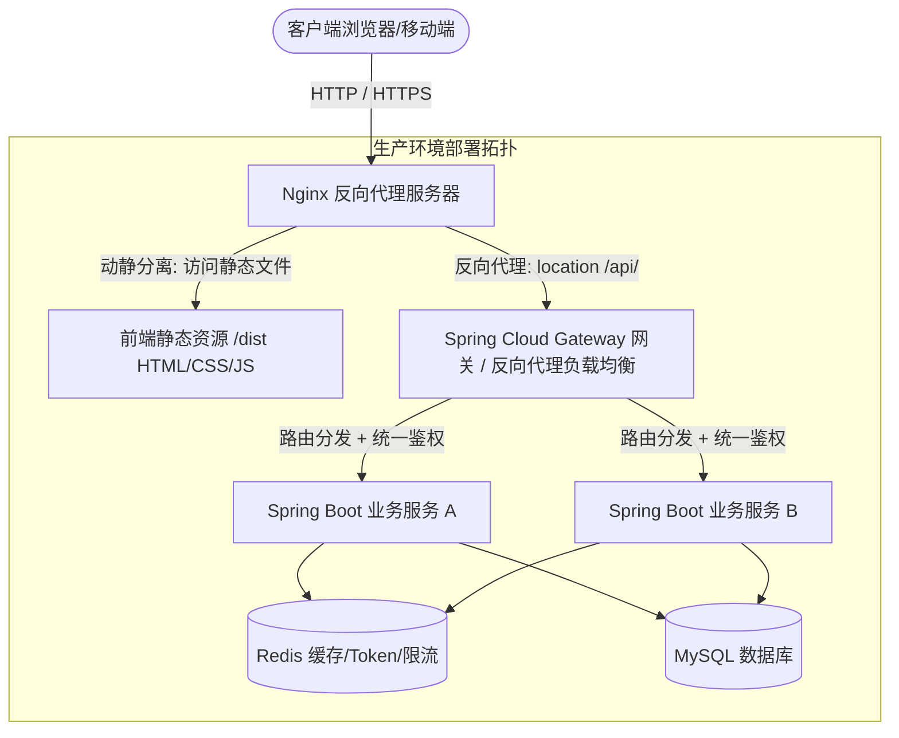
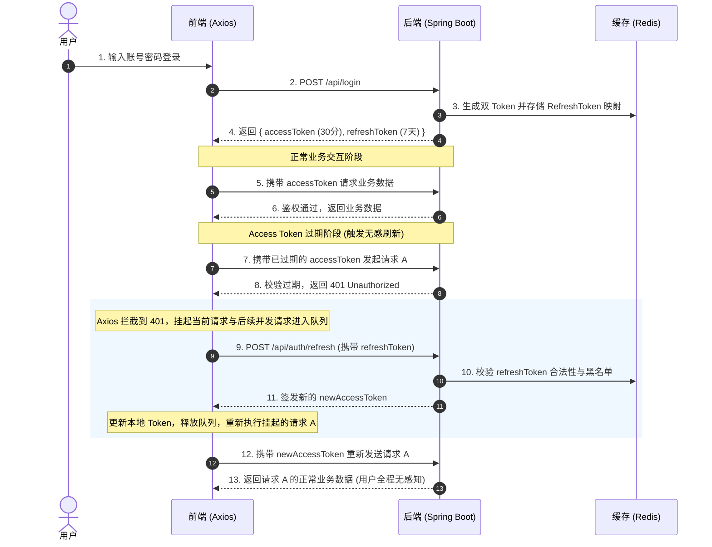
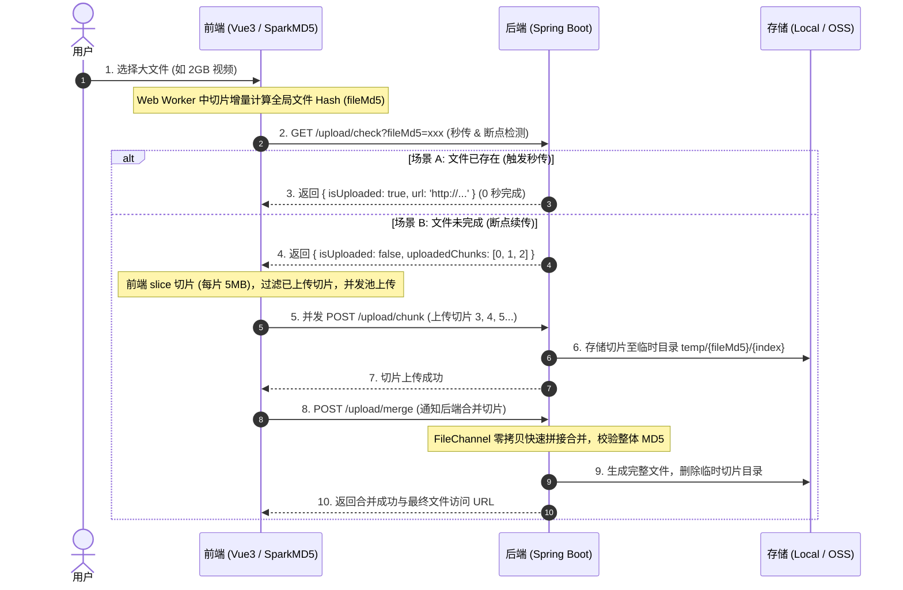

# Spring Boot + Vue3 前后端分离全景通关宝典

> 本文档专为 Java 后端工程师与全栈开发者打造，聚焦 **Java 后端为主轴、Vue3 为协同端** 的双向奔赴架构。系统化梳理了从职责边界、通信协议、CORS 跨域底牌、安全认证（JWT / 双 Token 无感刷新）、复杂业务交互（分页 / 大文件 / 防重幂等 / 实时流式）到全栈工程化交付（Docker 多阶段构建 / Trace-Id 贯通 / History 404）的全链路知识库。

---

## 目录导航

- [一、前后端分离心法导航与架构拓扑](#一前后端分离心法导航与架构拓扑)
  - [1.1 核心心智模型：“前端做体验，后端守安全”](#11-核心心智模型前端做体验后端守安全)
  - [1.2 前后端分离全景网络拓扑链路](#12-前后端分离全景网络拓扑链路)
  - [1.3 契约先行模式：Knife4j 与并行协同流](#13-契约先行模式knife4j-与并行协同流)
- [二、Vue3 极简速记与后端协同心法](#二vue3-极简速记与后端协同心法)
  - [2.1 Composition API 思想对后端模块化的启示](#21-composition-api-思想对后端模块化的启示)
  - [2.2 Vue2 Options API (data/computed/methods) 与 Vue3 对照全解](#22-vue2-options-api-datacomputedmethods-与-vue3-对照全解)
  - [2.3 响应式原理（Proxy）与数据交互避坑](#23-响应式原理proxy与数据交互避坑)
  - [2.4 致命踩坑：Java Long 雪花 ID 传给前端精度丢失](#24-致命踩坑java-long-雪花-id-传给前端精度丢失)
  - [2.5 Pinia 状态管理在前后端交互中的职责边界](#25-pinia-状态管理在前后端交互中的职责边界)
  - [2.6 全栈必考：Vue3 核心十大题深度手撕（防猝死手册）](#26-全栈必考vue3-核心十大题深度手撕防猝死手册)
- [三、前后端通信契约与数据交互规范 (Axios + Spring Boot)](#三前后端通信契约与数据交互规范-axios--spring-boot)
  - [3.1 企业级 Axios 统一封装手撕模板](#31-企业级-axios-统一封装手撕模板)
  - [3.2 Spring Boot 与前端参数绑定注解映射全解](#32-spring-boot-与前端参数绑定注解映射全解)
  - [3.3 统一响应契约 ResultVO 设计与规范](#33-统一响应契约-resultvo-设计与规范)
  - [3.4 全局异常拦截与接口契约兜底保障](#34-全局异常拦截与接口契约兜底保障)
  - [3.5 日期时间前后端统一格式化标准](#35-日期时间前后端统一格式化标准)
- [四、跨域 (CORS) 与反向代理终极破局](#四跨域-cors-与反向代理终极破局)
  - [4.1 跨域根源：浏览器同源策略与预检请求 (OPTIONS)](#41-跨域根源浏览器同源策略与预检请求-options)
  - [4.2 四大跨域解决方案对比与最佳实践](#42-四大跨域解决方案对比与最佳实践)
  - [4.3 大厂避坑杀手锏：Spring Security / 拦截器与 CORS 预检冲突](#43-大厂避坑杀手锏spring-security--拦截器与-cors-预检冲突)
- [五、企业级身份认证与安全防护 (JWT + RBAC)](#五企业级身份认证与安全防护-jwt--rbac)
  - [5.1 Token 认证 vs 传统 Session 机制的深度抉择](#51-token-认证-vs-传统-session-机制的深度抉择)
  - [5.2 核心硬核手撕：双 Token (Access + Refresh) 无感刷新时序与落地](#52-核心硬核手撕双-token-access--refresh-无感刷新时序与落地)
  - [5.3 动态路由与 RBAC 权限控制前后端协同](#53-动态路由与-rbac-权限控制前后端协同)
  - [5.4 前后端协同安全防线 (SQL注入 / XSS / CSRF)](#54-前后端协同安全防线-sql注入--xss--csrf)
- [六、复杂业务场景全景实战方案](#六复杂业务场景全景实战方案)
  - [6.1 表格分页标准交互契约 (MyBatis-Plus + Element Plus)](#61-表格分页标准交互契约-mybatis-plus--element-plus)
  - [6.2 文件上传与流式下载实战 (MultipartFile + Blob)](#62-文件上传与流式下载实战-multipartfile--blob)
  - [6.3 接口防刷限流与接口幂等性设计](#63-接口防刷限流与接口幂等性设计)
  - [6.4 大文件分片上传、断点续传与秒传（全栈终极手撕方案）](#64-大文件分片上传断点续传与秒传全栈终极手撕方案)
  - [6.5 实时双向通信：WebSocket vs SSE（流式打字机实战）](#65-实时双向通信websocket-vs-sse流式打字机实战)
  - [6.6 全链路追踪（Trace-Id）穿透与前端监控联动](#66-全链路追踪trace-id穿透与前端监控联动)
  - [6.7 前端虚拟列表（Virtual List）与后端深度分页协同优化](#67-前端虚拟列表virtual-list与后端深度分页协同优化)
  - [6.8 海量数据导出防 OOM：EasyExcel + 前端流式写入](#68-海量数据导出防-oom-easyexcel--前端流式写入)
- [七、工程化打包、部署与运维联调](#七工程化打包部署与运维联调)
  - [7.1 生产级 Nginx 动静分离完整配置手撕](#71-生产级-nginx-动静分离完整配置手撕)
  - [7.2 SPA History 模式刷新 404 根因与双重终极解法](#72-spa-history-模式刷新-404-根因与双重终极解法)
- [八、全栈工程化交付与高级架构考点 (Docker / CI/CD / BFF)](#八全栈工程化交付与高级架构考点-docker--cicd--bff)
  - [8.1 Docker 多阶段构建与容器化一键交付](#81-docker-多阶段构建与容器化一键交付)
  - [8.2 API 接口版本控制与灰度发布机制](#82-api-接口版本控制与灰度发布机制)
  - [8.3 BFF（Backend for Frontend）服务架构在微服务中的演进](#83-bffbackend-for-frontend服务架构在微服务中的演进)
- [九、前后端分离与全栈面试连环炮与满分自述模板](#九前后端分离与全栈面试连环炮与满分自述模板)
  - [9.1 全栈面试高频连环炮 15 问深度剖析](#91-全栈面试高频连环炮-15-问深度剖析)
  - [9.2 四大高频场景“满分自述模板”](#92-四大高频场景满分自述模板)

---

# 一、前后端分离心法导航与架构拓扑

## 1.1 核心心智模型：“前端做体验，后端守安全”
在现代前后端分离架构中，Java 后端工程师必须建立清晰的**防守意识与边界思维**：
1. **永远不要信任前端传来的任何数据**：
   - 前端表单校验（非空、手机正则、金额格式）纯粹是为了**提升用户交互体验与减少无效网络开销**，绝不能视为安全保障；
   - 任何黑客都可以绕过 Vue 页面，使用 Postman、cURL、抓包脚本直接向后端 Controller 发起攻击；
   - 后端必须使用 JSR-303 / Hibernate Validator（如 `@Valid`、`@NotBlank`）进行全量二次校验。
2. **永远不要依赖前端做权限安全控制**：
   - 前端根据角色通过 `v-if` 隐藏“删除用户”按钮、或者在路由守卫中限制页面访问，只是“防君子不防小人”；
   - 后端每个敏感接口必须在方法层级标注权限拦截（如 Spring Security 的 `@PreAuthorize`），对用户的每次数据访问做水平越权（IDOR）与垂直越权防范。

---

## 1.2 前后端分离全景网络拓扑链路



---

## 1.3 契约先行模式：Knife4j 与并行协同流
在企业级敏捷开发中，前后端严禁“口头对齐字段”或“后端边写边改、前端干等联调”：
1. **契约先行（Schema-First）**：需求评审后，后端根据原型输出规范的接口文档（字段名、类型、是否必传、错误码枚举）；
2. **工具链集成**：Spring Boot 集成 `knife4j-openapi3-jakarta-spring-boot-starter`，通过 `@Tag`、`@Operation`、`@Schema` 注解实现代码与文档强一致；
3. **并行开发**：前端使用 Mock.js 或 Apifox 本地模拟接口数据，先行完成组件与页面交互逻辑；后端同步编写 Service 与数据库操作；最终在测试环境完成快速联调。

---

# 二、Vue3 极简速记与后端协同心法

作为 Java 后端，无需深究 Vue3 编译器的 Diff 算法细节，但必须深刻理解其**代码组织、响应式边界与数据类型交互**。

## 2.1 Composition API 思想对后端模块化的启示

- **Options API（Vue2）**：逻辑按 `data`、`methods`、`computed` 碎片化拆分，大型组件中同一业务代码跳跃割裂。
- **Composition API（Vue3）**：以 `setup` 函数为入口，通过**组合式函数（Custom Hooks，如 `useUser()`、`useTablePagination()`）**将同一业务的状态与逻辑高度内聚。
- **后端思维映射**：Composition API 的 Hook 就相当于 Spring 中的服务层 `Service` 抽取与依赖注入，遵循**单一职责原则（SRP）**。

### **Custom Hook（组合式函数）**

Vue3 Composition API 里的 **Custom Hook（组合式函数）**：本质就是**抽离出来、可复用、自带状态的逻辑单元**，用普通函数封装「状态 + 操作该状态的方法」，可以在多个组件里导入复用。

> 注意区分：Vue 原生生命周期钩子 (onMounted/onWatch) ≠ 自定义 Hook（useXxx）；我们这里说的 `useUser()`、`useTablePagination()` 是**自定义组合式 Hook**。

#### 前端 Hook 本身（useXxx）

```js
// useUser.js 自定义Hook
import { ref } from 'vue'
export function useUser() {
  // 状态（数据）
  const userInfo = ref(null)
  // 逻辑（操作数据的方法）
  async function fetchUser(id) {
    userInfo.value = await api.getUser(id)
  }
  // 对外暴露状态和方法
  return { userInfo, fetchUser }
}
```

特点：

1. 同一个业务域的**数据 + 修改数据的业务逻辑打包在一起**；
2. 不是类、不是组件，就是普通函数，`use` 命名约定；
3. 可导入到任意组件，组件直接拿到状态和配套方法；
4. 解决 Options API 痛点：同一块业务散在 `data/methods/computed`，找代码来回跳。

---

## 2.2 Vue2 Options API (data/computed/methods) 与 Vue3 对照全解

全栈面试高频考查点：“你在 Vue2 中写惯了 `data`、`computed`、`methods`，换到 Vue3 中应该怎么写？底层调用机制有什么本质不同？”

### 1. 全景语法映射对照表

| 核心功能维度 | Vue2 Options API 传统写法 | Vue3 Composition API (`<script setup>`) 现代写法 | 核心底层机制与全栈差异 |
| :--- | :--- | :--- | :--- |
| **状态变量 (data)** | `data() { return { count: 0, form: {} }; }` | `const count = ref(0); const form = reactive({});` | Vue2 挂载在组件实例 `this` 上；Vue3 完全脱离 `this`，依靠闭包与 `RefImpl`/`Proxy` 响应式拦截 |
| **计算属性 (computed)** | `computed: { double() { return this.count * 2; } }` | `const double = computed(() => count.value * 2);` | Vue2 是配置对象中的方法，隐式依赖 `this`；Vue3 是顶层函数导入调用，返回只读/可写 Ref，支持泛型 |
| **方法定义 (methods)** | `methods: { submit() { this.fetch(); } }` | `const submit = () => { fetch(); };` | Vue2 必须挂在 `methods` 属性下受限于上下文；Vue3 就是原生普通 JavaScript 函数，无任何语法包裹 |
| **数据监听 (watch)** | `watch: { 'form.name'(newV, oldV) { ... } }` | `watch(() => form.name, (newV, oldV) => { ... });` | Vue2 基于配置对象与字符串路径；Vue3 函数式调用，支持精准 Getter 监听，支持 `watchEffect` 自动依赖收集 |
| **入参声明 (props)** | `props: { title: { type: String, default: '' } }` | `const props = defineProps<{ title?: string }>();` | Vue2 是运行时校验对象；Vue3 使用编译宏 `defineProps`，天然支持 TypeScript 静态类型推导 |
| **事件派发 (emit)** | `this.$emit('success', data);` | `const emit = defineEmits(['success']); emit('success', data);` | Vue2 挂在 `this.$emit`；Vue3 使用编译宏 `defineEmits`，可在 TS 中严格约束参数类型与事件名 |
| **生命周期 (mounted)** | `mounted() { this.initData(); }` | `onMounted(() => { initData(); });` | Vue2 是选项钩子；Vue3 为模块化函数，同一组件内可多次调用 `onMounted`，方便按功能模块拆分 |

---

### 2. 同一业务组件代码「左右对照实战」
以下通过一个典型的“**搜索框输入联动 + 动态计算总价 + 计数加减**”业务组件，展示两种写法的直观代码结构差异：

#### 方案 A：Vue2 Options API 写法（逻辑碎片化、强依赖 this）
```vue
<template>
  <div class="user-box">
    <input v-model="keyword" placeholder="搜索关键字" />
    <p>单价: {{ price }}，数量: {{ count }}</p>
    <p>计算总价: {{ totalPrice }}</p>
    <button @click="incrementCount">增加数量</button>
  </div>
</template>

<script>
export default {
  name: 'UserBox',
  data() {
    return {
      keyword: '',
      price: 100,
      count: 1
    };
  },
  computed: {
    // 必须通过 this 读取 data 变量
    totalPrice() {
      return this.price * this.count;
    }
  },
  watch: {
    // 监听 keyword 变化
    keyword(newVal, oldVal) {
      console.log('搜索词发生变化:', newVal);
      this.searchData();
    }
  },
  methods: {
    incrementCount() {
      // 必须通过 this 修改状态
      this.count++;
    },
    searchData() {
      // 必须注意异步回调中的 this 指向丢失问题
      const self = this;
      setTimeout(() => {
        console.log('执行搜索:', self.keyword);
      }, 300);
    }
  },
  mounted() {
    console.log('组件挂载完成');
  }
};
</script>
```

#### 方案 B：Vue3 Composition API (`<script setup>`) 现代写法（高内聚、无 this、天然 TS）
```vue
<template>
  <div class="user-box">
    <input v-model="keyword" placeholder="搜索关键字" />
    <p>单价: {{ price }}，数量: {{ count }}</p>
    <p>计算总价: {{ totalPrice }}</p>
    <button @click="incrementCount">增加数量</button>
  </div>
</template>

<script setup lang="ts">
import { ref, computed, watch, onMounted } from 'vue';

// 1. 状态定义 (替代 Vue2 data)：基础类型用 ref，对象可用 reactive
const keyword = ref<string>('');
const price = ref<number>(100);
const count = ref<number>(1);

// 2. 计算属性 (替代 Vue2 computed)：直接读取 .value，返回响应式 Ref
const totalPrice = computed(() => price.value * count.value);

// 3. 监听器 (替代 Vue2 watch)：直接监听 ref
watch(keyword, (newVal, oldVal) => {
  console.log('搜索词发生变化:', newVal);
  searchData();
});

// 4. 方法定义 (替代 Vue2 methods)：就是普通的函数声明，完全不存在 this
const incrementCount = () => {
  count.value++;
};

const searchData = () => {
  // 无需担心 this 丢失，直接闭包引用 keyword.value
  setTimeout(() => {
    console.log('执行搜索:', keyword.value);
  }, 300);
};

// 5. 生命周期 (替代 Vue2 mounted)
onMounted(() => {
  console.log('组件挂载完成');
});
</script>
```

---

### 3. 三大核心底层变革深度剖析（全栈面试满分采分点）

#### 变革一：彻底消灭“`this` 上下文地狱”
- **Vue2 的痛点**：所有的 `data`、`methods`、`computed` 全都挂载在同一个 Vue 实例的 `this` 上。在异步回调、事件监听器、`setTimeout`、`Promise.then` 中，普通函数的 `this` 会发生漂移（指向 `window` 或 `undefined`），开发者被迫频繁书写 `const that = this;` 或 `.bind(this)`；
- **Vue3 的解决**：`<script setup>` 处于闭包顶层作用域，**完全移除了组件实例 `this` 的概念**。所有变量与函数依托 JavaScript 的标准词法作用域（Lexical Scope）直接访问，消除了所有的上下文心智负担。

#### 变革二：逻辑碎片化散落 $\to$ 业务逻辑极致高内聚
- **Vue2 的痛点**：当一个复杂业务组件达到 800~1000 行代码时，一个“搜索过滤”功能的代码被生生切碎：变量定义在顶部的 `data`，计算逻辑在中间的 `computed`，触发接口在底部的 `methods`，监听在更下方的 `watch`。维护或改动该功能时，开发者需要在千行代码中上下剧烈翻滚跳转；
- **Vue3 的解决**：代码书写顺序完全不受限制。开发者可以把与“搜索过滤”相关的数据（`ref`）、计算（`computed`）、函数（`methods`）集中写在一起；甚至可以直接把这几十行代码原封不动剪切粘贴到一个独立的 `.ts` 文件中，成为一个独立的 **Custom Hook（如 `useSearch()`）**，实现跨组件 100% 逻辑复用！

#### 变革三：TypeScript 静态类型推导从“残疾”到“原生完美”
- **Vue2 的痛点**：Options API 基于对象字面量配置，TS 编译器根本无法在编译期静态感知 `this` 上究竟被挂载了哪些动态属性，类型报错频出，必须依赖复杂的 `vue-class-component` 装饰器修补；
- **Vue3 的解决**：Composition API 采用纯粹的函数式编程思想，参数类型与返回值类型天然透明，泛型、接口（Interface）、类型收窄（Type Narrowing）均可开箱即用，代码自动补全体验与 Java 的强类型 IDE（如 IntelliJ IDEA）几乎完全一致。

---

## 2.3 响应式原理（Proxy）与数据交互避坑
1. **Vue2 vs Vue3 响应式底层差异**：
   - Vue2：基于 `Object.defineProperty`，深度递归性能消耗大，且**无法监听对象新增/删除属性、无法直接监听数组下标变更**；
   - Vue3：基于 ES6 `Proxy` 原生代理，仅在访问深层属性时按需代理（惰性代理），原生支持属性增删与数组变更。
2. **`ref` 与 `reactive` 选型**：
   - `ref`：用于基本类型及一般对象，JS 中需通过 `.value` 操作，模板中自动解包；
   - `reactive`：直接代理对象，**致命陷阱：不能直接对其赋值新对象（如 `state = res.data` 会直接破坏 Proxy 引用导致失去响应式）**，应使用 `Object.assign(state, res.data)` 或改用 `ref`。
3. **解构响应式丢失与 `toRefs`**：
   - 直接对 `reactive` 对象解构（`const { name } = state`）会退化为普通变量失去响应式，必须通过 `toRefs(state)` 包裹。

---

## 2.4 致命踩坑：Java Long 雪花 ID 传给前端精度丢失

### 1. 现象与根本原因
- **后端**：使用雪花算法（Snowflake）生成的分布式主键是 Java `Long` 类型（64 位有符号整数，最大值为 $2^{63}-1 \approx 9.22 \times 10^{18}$），例如 `1845678901234567890`（19 位）。
- **前端**：JavaScript 的所有数字类型统一为 `Number`，底层基于 **IEEE 754 双精度浮点数（64 位）**，其安全整数范围为 $[-2^{53}+1, 2^{53}-1]$（最高 16 位，即 `9007199254740991`）。
- **灾难后果**：后端返回的 Long ID 传到前端后，最后 2~3 位直接被精度截断变为 `00`（如 `1845678901234567890` 变成 `1845678901234567800`）。前端拿错误的 ID 去调用修改/删除接口，导致报“数据不存在”或误删数据！

### 2. 企业级根治方案：Spring Boot 全局 Jackson 序列化转化
绝不让前端去手动适配大数解析库（如 `json-bigint`），应由后端统一在 JSON 序列化阶段将 `Long` 自动转为 `String` 返回给前端：

```java
package com.example.common.config;

import com.fasterxml.jackson.databind.ObjectMapper;
import com.fasterxml.jackson.databind.module.SimpleModule;
import com.fasterxml.jackson.databind.ser.std.ToStringSerializer;
import org.springframework.boot.autoconfigure.condition.ConditionalOnMissingBean;
import org.springframework.context.annotation.Bean;
import org.springframework.context.annotation.Configuration;
import org.springframework.context.annotation.Primary;
import org.springframework.http.converter.json.Jackson2ObjectMapperBuilder;

import java.math.BigInteger;

@Configuration
public class JacksonConfig {

    @Bean
    @Primary
    @ConditionalOnMissingBean(ObjectMapper.class)
    public ObjectMapper jacksonObjectMapper(Jackson2ObjectMapperBuilder builder) {
        ObjectMapper objectMapper = builder.createXmlMapper(false).build();
        
        SimpleModule simpleModule = new SimpleModule();
        // 将 Long、long 以及 BigInteger 统一序列化为 String
        simpleModule.addSerializer(Long.class, ToStringSerializer.instance);
        simpleModule.addSerializer(Long.TYPE, ToStringSerializer.instance);
        simpleModule.addSerializer(BigInteger.class, ToStringSerializer.instance);
        
        objectMapper.registerModule(simpleModule);
        return objectMapper;
    }
}
```

---

## 2.5 Pinia 状态管理在前后端交互中的职责边界
1. **前端职责**：
   - 登录成功后，将后端返回的 `token`、`userInfo`、`permissions` 存储在 Pinia 中；
   - 搭配 `pinia-plugin-persistedstate` 插件将关键状态自动同步到浏览器的 `localStorage`，防止刷新页面状态丢失。
2. **后端协同机制**：
   - Pinia 中的状态纯属前端客户端视图缓存，**严禁作为业务判断凭据**；
   - 后端只通过 HTTP Request Header 中携带的 Token 来校验真实身份。

---

## 2.6 全栈必考：Vue3 核心十大题深度手撕（防猝死手册）

> **全栈面试破局心法**：面试官考查 Java 候选人的 Vue3 水平，绝非为了考倒底层 AST 抽象语法树编译，而是考察你**是否真正在生产环境中独立写过 Vue3 组件、是否理解数据流向、是否能排查前端诡异 Bug**。以下 10 道题覆盖了 90% 的全栈面试前端考点：

### 题 1：`ref` vs `reactive` 底层机制差异？为什么 `ref` 必须带 `.value`？直接对 `reactive` 重新赋值为什么会失效？
- **底层差异**：
  - `reactive` 底层直接基于 ES6 `Proxy`，而 `Proxy` 只能代理引用对象类型（`Object`、`Array`、`Map`、`Set`），无法代理原始基础类型（`string`、`number`、`boolean`）；
  - `ref` 底层通过构造一个带有 getter/setter 的 `RefImpl` 包装类对象，将基础类型包裹为一个对象 `{ value: x }`。在读取和修改 `value` 属性时，通过 `trackRefValue` 收集依赖，通过 `triggerRefValue` 触发视图更新。
- **为什么在 JS 中必须写 `.value` 而在模板中不需要？**
  
  - 在 JavaScript 中，`ref` 是一个包含 `value` 属性的对象，必须显式通过 `.value` 访问；而在 `<template>` 编译阶段，Vue 编译器自动进行了“顶层属性解包（Unwrapping）”，因此模板中无需手写 `.value`。
- **踩坑：为什么直接给 `reactive` 赋值会丢失响应式？如何正确替换？**
  - **错误写法**：
    ```javascript
    let user = reactive({ name: 'Alice', age: 20 });
    // 错误！这样直接将变量 user 指向了新的内存普通对象，直接切断并破坏了原先 Proxy 的代理监听！
    user = res.data; 
    ```
  - **正确写法一**：改用 `ref`（推荐）：
    ```javascript
    const user = ref({ name: 'Alice', age: 20 });
    user.value = res.data; // 触发 RefImpl setter，完美响应
    ```
  - **正确写法二**：使用 `Object.assign` 保留原代理引用：
    ```javascript
    Object.assign(user, res.data);
    ```

---

### 题 2：Vue3 组件通信 5 大规范方案（全栈必背）
在 `<script setup>` 语法糖下，组件通信模式相比 Vue2 做了全面升级：
1. **父传子（Props）**：子组件使用编译宏 `defineProps` 声明入参：
   ```vue
   <script setup lang="ts">
   // 纯运行时声明或 TypeScript 类型声明
   const props = withDefaults(defineProps<{
     title: string;
     visible?: boolean;
   }>(), { visible: false });
   </script>
   ```
2. **子传父（Emits）**：子组件通过 `defineEmits` 声明并派发自定义事件：
   ```vue
   <script setup lang="ts">
   const emit = defineEmits<{
     (e: 'success', id: number): void;
     (e: 'update:visible', val: boolean): void;
   }>();
   const handleSave = () => emit('success', 1001);
   </script>
   ```
3. **父调子方法 / 暴露实例（`defineExpose`，大厂必考）**：
   - **核心特性**：在 `<script setup>` 中，组件默认处于**完全私有封闭状态（Closed）**。父组件通过 `ref="childRef"` 拿到子组件实例后，默认**无法读取其内部任何变量或方法**！
   - 子组件必须显式使用 `defineExpose` 暴露接口：
     ```vue
     <!-- 子组件 UserDialog.vue -->
     <script setup>
     const form = reactive({ name: '' });
     const resetForm = () => form.name = '';
     defineExpose({ resetForm }); // 显式暴露
     </script>

     <!-- 父组件 -->
     <template>
       <UserDialog ref="dialogRef" />
       <button @click="dialogRef.resetForm()">重置子表单</button>
     </template>
     ```
4. **祖孙跨级通信（`provide` / `inject`）**：
   - 祖先组件：`provide('appTheme', themeRef);`
   - 后代组件：`const theme = inject('appTheme', 'light');`（适合全局配置、主题、多层表单）
5. **全局状态管理（Pinia）**：跨页面/全局共享状态的最佳选择。

---

### 题 3：`watch`、`watchEffect` 与 `computed` 的核心区别与场景选型？
- **三者特性横向对比**：
  | 特性 | `computed` | `watch` | `watchEffect` |
  | :--- | :--- | :--- | :--- |
  | **设计目标** | 数据派生与计算 | 观察指定目标并触发副作用 | 自动追踪依赖并触发副作用 |
  | **返回值** | **必须有**（返回 Ref 计算结果） | 无返回值 | 无返回值 |
  | **缓存机制** | **有**（依赖未变时多次读取直接命中缓存） | 无 | 无 |
  | **执行时机** | 惰性计算（读取时才算） | 默认惰性（数据变了才执行） | **立即执行一次**收集依赖 |
  | **新旧值获取** | 无法获取 | **可以获取 `(newVal, oldVal)`** | 无法获取 |
  | **最佳场景** | 列表筛选总数、全名拼接、格式化 | 监听下拉框选项变化发起后端搜索接口 | 多状态联合监听、DOM 节点自动滚动底部 |
- **代码手撕**：
  ```typescript
  // 1. computed 派生
  const totalPrice = computed(() => goods.value.price * goods.value.count);

  // 2. watch 明确指定源，支持深层与新旧值
  watch(() => user.value.deptId, (newDept, oldDept) => {
    fetchUserListByDept(newDept); // 发起后端接口
  }, { immediate: true });

  // 3. watchEffect 自动收集依赖，立即执行
  watchEffect(() => {
    // 自动收集 currentTab.value 作为依赖，tab 变化自动触发
    console.log(`当前激活 Tab: ${currentTab.value}`);
  });
  ```

---

### 题 4：`nextTick` 的底层机制与 DOM 异步更新队列
- **痛点场景**：
  ```javascript
  const count = ref(1);
  count.value = 2;
  // 打印出的依然是 1！为什么不是 2？
  console.log(document.getElementById('number')?.innerText);
  ```
- **核心原理（异步微任务批处理）**：
  - Vue 的响应式数据更新是**同步的**，但 **DOM 渲染更新是异步批处理的**；
  - 如果一个事件循环中响应式数据改变了 100 次，Vue 不会执行 100 次 DOM 重绘，而是把这些 Watcher 放入一个异步队列去重，等到当前同步代码执行完毕，在微任务队列（Microtask）中统一刷新一次 DOM，极大节省浏览器重绘重排开销。
- **`nextTick` 底层机制**：
  - `nextTick` 本质上就是包装了一个 `Promise.resolve().then(...)` 微任务；
  - 当数据变更后调用 `nextTick`，你的回调函数会被排在 DOM 异步更新微任务之后执行，此时真实 DOM 已经完成渲染。
- **正确用法**：
  ```javascript
  count.value = 2;
  await nextTick(); // 等待 DOM 异步微任务渲染完成
  console.log(document.getElementById('number')?.innerText); // 输出 2
  ```

---

### 题 5：Vue3 中 `v-if` 与 `v-for` 优先级变化及踩坑防范
- **Vue2 vs Vue3 优先级反转**：
  - **Vue2**：`v-for` 优先级高于 `v-if`（循环 100 次，就会判定 100 次 v-if，严重浪费 CPU 性能）；
  - **Vue3**：**`v-if` 优先级高于 `v-for`**！
- **致命报错陷阱**：
  ```html
  <!-- 在 Vue3 中这样写会直接报错！ -->
  <li v-for="user in userList" v-if="user.isActive" :key="user.id">
    {{ user.name }}
  </li>
  ```
  - **报错原因**：因为在 Vue3 中 `v-if` 先行解析，此时循环变量 `user` 在当前作用域根本尚未被定义，浏览器直接抛出 `Uncaught TypeError: Cannot read properties of undefined (reading 'isActive')`！
- **企业级规范解法**：
  1. **首选方案（计算属性过滤）**：
     ```typescript
     const activeUsers = computed(() => userList.value.filter(u => u.isActive));
     ```
     ```html
     <li v-for="user in activeUsers" :key="user.id">{{ user.name }}</li>
     ```
  2. **次选方案（外层 template 包裹）**：
     ```html
     <template v-for="user in userList" :key="user.id">
       <li v-if="user.isActive">{{ user.name }}</li>
     </template>
     ```

---

### 题 6：Vue3 `v-model` 语法糖本质与多重双向绑定
- **Vue2 vs Vue3 变化**：
  - Vue2：`v-model` 默认等价于 `:value` + `@input`，单个组件只能有一个 v-model，其他参数需配合 `.sync` 修饰符；
  - Vue3：废弃 `.sync` 修饰符，统一重构成更强大的 `v-model`。
- **单个 `v-model` 本质**：
  ```html
  <CustomInput v-model="searchText" />
  <!-- 等价于以下展开语法 -->
  <CustomInput :modelValue="searchText" @update:modelValue="searchText = $event" />
  ```
- **多重 `v-model` 自定义组件手撕**（如封装姓名复合输入组件）：
  ```vue
  <!-- 父组件调用 -->
  <UserNameInput v-model:firstName="user.first" v-model:lastName="user.last" />

  <!-- 子组件 UserNameInput.vue 实现 -->
  <script setup lang="ts">
  defineProps<{
    firstName: string;
    lastName: string;
  }>();

  const emit = defineEmits<{
    (e: 'update:firstName', val: string): void;
    (e: 'update:lastName', val: string): void;
  }>();
  </script>

  <template>
    <input :value="firstName" @input="emit('update:firstName', $event.target.value)" />
    <input :value="lastName" @input="emit('update:lastName', $event.target.value)" />
  </template>
  ```

---

### 题 7：Vue3 编译期三大性能优化（为什么 Vue3 运行时比 Vue2 快几倍？）
Vue3 最大的飞跃不仅在响应式系统，更在于**编译器与运行时的联合优化（Compiler-informed Virtual DOM）**：
1. **PatchFlag（靶向动态节点更新）**：
   - 模板编译时，会对具有动态绑定的节点打上数字位运算掩码（PatchFlag，如 `1 /* TEXT */`、`2 /* CLASS */`）；
   - 运行时 Diff 算法无需递归对比整棵 DOM 树，只需进行位运算比对带 PatchFlag 的动态属性，**比对成本从全量树 $O(N)$ 直降为动态节点 $O(M)$**；
2. **静态提升（HoistStatic）**：
   - 未绑定任何动态变量的纯静态 DOM 节点，在编译期被直接提升到组件渲染函数外部只创建一次，后续不管组件更新多少次，直接复用同一个 VNode 内存对象，免除垃圾回收开销；
3. **事件侦听器缓存（CacheHandlers）**：
   - 行内 `@click="handleClick"` 会被编译器缓存为一个固定函数指针，避免每次父组件重新渲染时，把子组件误判为属性变更触发无谓重绘。

---

### 题 8：Pinia 相比 Vuex 核心架构改进？
1. **砍掉 `mutations`**：
   - Vuex 严格区分同步变更（Mutations）与异步操作（Actions），导致代码样板冗余；
   - Pinia 彻底移除了 Mutations，**所有同步与异步操作直接统一在 `actions` 中执行**，心智负担大大降低；
2. **天生支持完美 TypeScript 类型推导**：
   - Pinia 源码由 TS 编写，Store 内部属性与方法天生具备代码智能补全和严格类型检查，无需繁琐的包装声明；
3. **扁平化去中心化（扁平架构）**：
   - 告别 Vuex 单一根 Store 与复杂的 `modules: { ... }` 嵌套命名空间（`namespaced: true`）；每个 Pinia Store 都是一个独立的文件，按需 `import` 加载；
4. **轻量与灵活**：整体体积仅约 1KB，且完全支持使用 Composition API 风格声明（Setup Store：`defineStore('user', () => { ... })`）。

---

### 题 9：虚拟 DOM 与 Diff 算法演进（为什么采用最长递增子序列 LIS？）
1. **为什么需要虚拟 DOM（VDOM）？**
   - **全栈面试标准认知**：虚拟 DOM 并不一定比原生 JavaScript 操作 DOM 绝对更快；
   - 其根本价值在于：
     - **跨平台抽象能力**：解耦了底层渲染平台，使得同一套组件可以渲染在 Web DOM、小程序、iOS/Android 原生组件（Weex/UniApp）以及 SSR 服务端字符串中；
     - **防范性能地板**：在复杂的业务应用中，保证了无需手动微操 DOM 依然拥有稳定可靠的高性能。
2. **为什么 Vue3 Diff 算法引入了最长递增子序列（LIS）？**
   - **痛点**：对于子节点列表重排（如 `[A, B, C, D]` 变成 `[A, C, B, D]`），传统算法会频繁调用浏览器的 `insertBefore` 进行真实的 DOM 移动操作；
   - **Vue3 快速 Diff 优化**：
     - 先处理头部相同节点，再处理尾部相同节点；
     - 针对中间发生顺序错乱的子序列，通过贪心 + 二分查找计算其**最长递增子序列（Longest Increasing Subsequence）**；
     - 位于最长递增子序列中的 DOM 节点**位置保持绝对不动**，只对不在子序列中的节点执行移动操作，**将物理 DOM 节点操作次数降至数学理论上的极限最低点**。

---

### 题 10：企业级自定义 Hook（Composables）手撕：通用分页表格 `useTable` 封装
> **全栈加分亮点**：在企业级中后台系统开发中，有大量表格列表页面（用户列表、订单列表、日志列表）。每个页面如果都手写 `loading`、`tableData`、`pageNum`、`pageSize` 会产生数百行同质化重复代码。全栈工程师应该懂得封装通用 Hook：

```typescript
// src/hooks/useTable.ts
import { ref, reactive, onMounted } from 'vue';

export interface PageResult<T> {
  total: number;
  records: T[];
}

export function useTable<T>(
  apiFn: (params: any) => Promise<any>,
  defaultParams: Record<string, any> = {}
) {
  const loading = ref(false);
  const dataList = ref<T[]>([]);
  const total = ref(0);

  const pagination = reactive({
    pageNum: 1,
    pageSize: 10
  });

  const queryParams = reactive({ ...defaultParams });

  // 统一数据加载函数
  const loadData = async () => {
    loading.value = true;
    try {
      const res = await apiFn({
        ...pagination,
        ...queryParams
      });
      // 兼容后端返回结构
      dataList.value = res.records || [];
      total.value = res.total || 0;
    } finally {
      loading.value = false;
    }
  };

  // 搜索：重置到第 1 页
  const handleSearch = () => {
    pagination.pageNum = 1;
    loadData();
  };

  // 重置筛选条件
  const handleReset = () => {
    Object.keys(queryParams).forEach(key => delete queryParams[key]);
    Object.assign(queryParams, defaultParams);
    handleSearch();
  };

  // 换页事件
  const handlePageChange = (page: number) => {
    pagination.pageNum = page;
    loadData();
  };

  onMounted(() => {
    loadData();
  });

  return {
    loading,
    dataList,
    total,
    pagination,
    queryParams,
    loadData,
    handleSearch,
    handleReset,
    handlePageChange
  };
}
```

**在业务页面中的极简复用**：
```vue
<script setup lang="ts">
import { getUserPageApi } from '@/api/user';
import { useTable } from '@/hooks/useTable';

// 一行代码搞定分页状态、加载中、表格数据、重置与翻页
const { loading, dataList, total, pagination, queryParams, handleSearch, handlePageChange } = 
  useTable(getUserPageApi, { username: '' });
</script>

<template>
  <el-input v-model="queryParams.username" placeholder="请输入用户名" />
  <el-button @click="handleSearch">搜索</el-button>

  <el-table :data="dataList" v-loading="loading">
    <el-table-column prop="username" label="用户名" />
  </el-table>

  <el-pagination 
    :current-page="pagination.pageNum" 
    :page-size="pagination.pageSize" 
    :total="total" 
    @current-change="handlePageChange" 
  />
</template>
```

---

# 三、前后端通信契约与数据交互规范 (Axios + Spring Boot)

## 3.1 企业级 Axios 统一封装手撕模板
在企业级 Vue3 项目中，必须对 Axios 进行深度封装，实现 **单例维护、超时控制、Token 自动注入、统一解包与错误提示**：

```typescript
// src/utils/request.ts
import axios, { AxiosInstance, AxiosRequestConfig, AxiosResponse, InternalAxiosRequestConfig } from 'axios';
import { ElMessage } from 'element-plus';
import router from '@/router';

// 1. 统一接口响应结构
export interface ApiResponse<T = any> {
  code: number;
  message: string;
  data: T;
}

// 2. 创建 axios 实例
const service: AxiosInstance = axios.create({
  baseURL: import.meta.env.VITE_APP_BASE_API || '/api', // 配合 Vite Proxy
  timeout: 10000,                                      // 10 秒超时
  headers: {
    'Content-Type': 'application/json;charset=utf-8'
  }
});

// 3. 请求拦截器 (Request Interceptor)
service.interceptors.request.use(
  (config: InternalAxiosRequestConfig) => {
    const token = localStorage.getItem('ACCESS_TOKEN');
    if (token) {
      // 遵循 RFC 6750 标准，Bearer Token 规范
      config.headers['Authorization'] = `Bearer ${token}`;
    }
    // 注入链路追踪 Trace-Id (全栈链路监控)
    const traceId = localStorage.getItem('TRACE_ID') || `TRACE-${Date.now()}-${Math.random().toString(36).substring(2, 7)}`;
    config.headers['X-Trace-Id'] = traceId;

    return config;
  },
  (error) => {
    return Promise.reject(error);
  }
);

// 4. 响应拦截器 (Response Interceptor)
service.interceptors.response.use(
  (response: AxiosResponse<ApiResponse>) => {
    const res = response.data;
    
    // 如果返回的是二进制 Blob 数据（用于文件导出），直接放行
    if (response.config.responseType === 'blob') {
      return response.data;
    }

    // 业务状态码 200 表示业务执行成功
    if (res.code === 200) {
      return res.data; // 直接解包返回核心数据
    }

    // 处理常见业务错误
    ElMessage.error(res.message || '业务操作失败');

    // 处理认证失效 (401 未登录 / Token 过期)
    if (res.code === 401) {
      localStorage.removeItem('ACCESS_TOKEN');
      router.push(`/login?redirect=${encodeURIComponent(router.currentRoute.value.fullPath)}`);
    }

    return Promise.reject(new Error(res.message || 'Error'));
  },
  (error) => {
    // 处理 HTTP 协议层面的网络异常与状态码 (403, 404, 500)
    let errorMsg = '网络连接异常，请稍后重试';
    if (error.response) {
      switch (error.response.status) {
        case 401:
          errorMsg = '登录已过期，请重新登录';
          localStorage.removeItem('ACCESS_TOKEN');
          router.push('/login');
          break;
        case 403:
          errorMsg = '权限不足，拒绝访问';
          break;
        case 404:
          errorMsg = '请求的接口资源不存在';
          break;
        case 500:
          errorMsg = '服务器内部异常，请联系管理员';
          break;
        default:
          errorMsg = error.response.data?.message || `请求错误: ${error.response.status}`;
      }
    } else if (error.message.includes('timeout')) {
      errorMsg = '网络请求超时，请检查您的网络';
    }
    ElMessage.error(errorMsg);
    return Promise.reject(error);
  }
);

export default service;
```

---

## 3.2 Spring Boot 与前端参数绑定注解映射全解

前后端对接联调报错 80% 发生在**参数格式不匹配（400 Bad Request、415 Unsupported Media Type）**：

| 注解 | 数据来源位置 | HTTP 请求方法 | 典型 Content-Type | 适用场景与关键考点 |
| :--- | :--- | :--- | :--- | :--- |
| **`@RequestParam`** | Query String 或 Form 表单 | GET / POST | `application/x-www-form-urlencoded` | URL 查询参数、分页参数。默认必填，可用 `required=false`。 |
| **`@RequestBody`** | HTTP 请求体（Body） | POST / PUT / PATCH | `application/json;charset=utf-8` | 复杂对象、实体 DTO。**一个 Controller 方法内最多只能存在一个 `@RequestBody`**。 |
| **`@PathVariable`** | URI 路径变量 | GET / PUT / DELETE | 无特定限制 | 符合 RESTful 语义的资源标识，如 `/api/v1/users/{id}`。 |
| **`@RequestPart`** | 多部分表单体（Multipart） | POST | `multipart/form-data` | 文件上传（`MultipartFile`）搭配 JSON 元数据复合提交。 |

### 核心面试追问：GET 请求能否使用 `@RequestBody` 传参？
- **HTTP 规范层面（RFC 7231）**：GET 请求语义是幂等获取资源，规范未明文禁止 GET 包含 Body，但明确指出“GET 请求中的 Body 没有定义的语义”，许多实现会直接丢弃该 Body；
- **Web 容器与前端层面**：
  1. 浏览器原生 `fetch` 与早期的 `XMLHttpRequest` 发起 GET 时若携带 Body 会直接被忽略或报错；
  2. Tomcat 在解析 GET 请求时默认**不会读取请求体流**，Spring MVC 会抛出 `HttpMessageNotReadableException: Required request body is missing`；
  3. 网络链路中的反向代理（Nginx、网关、CDN）在缓存和转发 GET 请求时，普遍直接剥离 Body。
- **面试满分结论**：技术上某些特定客户端（如 cURL、Postman）搭配特定反代可以传，但**在工程实践中绝对禁止**！GET 必须通过 Query String 传参，若查询条件极其复杂（如长 JSON 筛选），应打破教条改用 `POST /api/search`。

---

## 3.3 统一响应契约 ResultVO 设计与规范
严禁 Controller 直接返回业务实体或原始数据，必须封装统一格式：

```java
package com.example.common.result;

import lombok.Data;
import java.io.Serializable;

@Data
public class ResultVO<T> implements Serializable {

    private static final long serialVersionUID = 1L;

    /** 业务状态码：200 成功，其他为业务错误码 */
    private Integer code;

    /** 响应描述信息 */
    private String message;

    /** 业务数据载体 */
    private T data;

    /** 响应时间戳（毫秒） */
    private long timestamp = System.currentTimeMillis();

    /** 全链路追踪 ID，便于前端报 Bug 时精准排查 */
    private String traceId;

    public static <T> ResultVO<T> success(T data) {
        ResultVO<T> result = new ResultVO<>();
        result.setCode(200);
        result.setMessage("操作成功");
        result.setData(data);
        return result;
    }

    public static <T> ResultVO<T> success() {
        return success(null);
    }

    public static <T> ResultVO<T> error(Integer code, String message) {
        ResultVO<T> result = new ResultVO<>();
        result.setCode(code);
        result.setMessage(message);
        result.setData(null);
        return result;
    }

    public static <T> ResultVO<T> error(String message) {
        return error(500, message);
    }
}
```

---

## 3.4 全局异常拦截与接口契约兜底保障
后端抛出未捕获异常时，若未配置全局拦截，Spring Boot 会返回默认的 Whitelabel 500 页面或将 Java 堆栈暴露，既破坏前端解析契约，又带来极大安全隐患：

```java
package com.example.common.exception;

import com.example.common.result.ResultVO;
import lombok.extern.slf4j.Slf4j;
import org.slf4j.MDC;
import org.springframework.validation.BindException;
import org.springframework.validation.FieldError;
import org.springframework.web.bind.MethodArgumentNotValidException;
import org.springframework.web.bind.annotation.ExceptionHandler;
import org.springframework.web.bind.annotation.RestControllerAdvice;

import java.util.stream.Collectors;

@Slf4j
@RestControllerAdvice
public class GlobalExceptionHandler {

    private String getTraceId() {
        return MDC.get("traceId");
    }

    /** 1. 拦截业务自定义异常 */
    @ExceptionHandler(BusinessException.class)
    public ResultVO<?> handleBusinessException(BusinessException e) {
        log.warn("业务异常触发: code={}, message={}", e.getCode(), e.getMessage());
        ResultVO<?> error = ResultVO.error(e.getCode(), e.getMessage());
        error.setTraceId(getTraceId());
        return error;
    }

    /** 2. 拦截 JSR-303 参数校验异常 (@Valid @RequestBody) */
    @ExceptionHandler(MethodArgumentNotValidException.class)
    public ResultVO<?> handleValidException(MethodArgumentNotValidException e) {
        String errorMsg = e.getBindingResult().getFieldErrors().stream()
                .map(FieldError::getDefaultMessage)
                .collect(Collectors.joining("; "));
        log.warn("参数校验不通过: {}", errorMsg);
        ResultVO<?> error = ResultVO.error(400, errorMsg);
        error.setTraceId(getTraceId());
        return error;
    }

    /** 3. 拦截参数绑定异常 (GET 查询参数校验) */
    @ExceptionHandler(BindException.class)
    public ResultVO<?> handleBindException(BindException e) {
        String errorMsg = e.getBindingResult().getFieldErrors().stream()
                .map(FieldError::getDefaultMessage)
                .collect(Collectors.joining("; "));
        ResultVO<?> error = ResultVO.error(400, errorMsg);
        error.setTraceId(getTraceId());
        return error;
    }

    /** 4. 兜底未知异常，防止暴露堆栈并保证契约统一 */
    @ExceptionHandler(Exception.class)
    public ResultVO<?> handleException(Exception e) {
        log.error("系统未知致命异常捕获: ", e);
        ResultVO<?> error = ResultVO.error(500, "系统繁忙，请联系管理员");
        error.setTraceId(getTraceId());
        return error;
    }
}
```

---

## 3.5 日期时间前后端统一格式化标准
- **强制规范**：统一为 `yyyy-MM-dd HH:mm:ss`，时区使用 `GMT+8`；
- **配置方案**：在 `application.yml` 中进行全局配置，避免在每个实体类字段上重复标注 `@JsonFormat`：

```yaml
spring:
  jackson:
    date-format: yyyy-MM-dd HH:mm:ss
    time-zone: GMT+8
    default-property-inclusion: non_null # 选配：过滤 null 字段减少带宽
```

---

# 四、跨域 (CORS) 与反向代理终极破局

## 4.1 跨域根源：浏览器同源策略与预检请求 (OPTIONS)
1. **同源策略（Same-Origin Policy）**：
   - 跨域限制纯属**浏览器单方面施加的安全沙箱**。
   - 只要 **协议（http/https）、域名、端口** 三者有任何一个不完全相同，浏览器就会判定为跨域。
   - **核心真相**：跨域发生时，HTTP 请求实际上已经发送给了后端服务器，后端也执行了业务并返回了数据，只是**浏览器在拿到响应头后，发现没有匹配的 CORS 许可，单方面拦截了数据并向控制台抛出报错**。
2. **简单请求 vs 复杂预检请求（Preflight Request）**：
   - 只要满足以下任一条件，即属于**复杂请求**：
     - 请求方式是 `PUT`、`DELETE`；
     - Content-Type 为 `application/json`；
     - 携带了自定义 Header（如 `Authorization: Bearer xxx`）。
   - **预检流程**：浏览器在发起真正业务请求前，会自动发送一个 `OPTIONS` 请求向服务器探路，询问服务器支持哪些源、哪些 HTTP 方法和哪些自定义请求头。收到 200/204 明确许可后，浏览器才会发起第二阶段真正的业务请求。

---

## 4.2 四大跨域解决方案对比与最佳实践

| 方案 | 适用环境 | 实现方式 | 优缺点分析 |
| :--- | :--- | :--- | :--- |
| **方案 1：Vite Dev Server 代理** | 本地开发环境 | `vite.config.ts` 中的 `server.proxy` | **开发首选**。借助 Node.js 服务端转发绕过浏览器同源策略，前端无需跨域。 |
| **方案 2：生产 Nginx 反向代理** | 生产/测试环境 | Nginx 配置 `location /api/` 转发后端 | **生产最优解**。前后端同域名同端口部署，彻底消除跨域，性能最高。 |
| **方案 3：Spring Boot 全局 CORS** | 开发联调/开放接口 | 配置 `WebMvcConfigurer.addCorsMappings` | 代码级生效，适合对外提供 Open API 或跨域微服务。 |
| **方案 4：Spring Cloud Gateway CORS** | 微服务集群 | 网关 `application.yml` 声明 globalcors | 网关层统一切面处理，下游业务微服务无感知。 |

### 生产 Nginx 与 本地 Vite 代理配置速撕：

```typescript
// vite.config.ts (开发环境代理)
export default defineConfig({
  server: {
    port: 5173,
    proxy: {
      '/api': {
        target: 'http://localhost:8080',
        changeOrigin: true,
        rewrite: (path) => path.replace(/^\/api/, '') // 转发时剥离 /api 前缀
      }
    }
  }
});
```

```nginx
# nginx.conf (生产环境反向代理)
server {
    listen 80;
    server_name www.example.com;

    # 1. 前端静态资源
    location / {
        root /usr/share/nginx/html;
        index index.html index.htm;
        try_files $uri $uri/ /index.html;
    }

    # 2. 接口反向代理至后端集群 (同域无跨域)
    location /api/ {
        proxy_pass http://backend-server:8080/;
        proxy_set_header Host $host;
        proxy_set_header X-Real-IP $remote_addr;
        proxy_set_header X-Forwarded-For $proxy_add_x_forwarded_for;
        proxy_set_header X-Forwarded-Proto $scheme;
    }
}
```

---

## 4.3 大厂避坑杀手锏：Spring Security / 拦截器与 CORS 预检冲突

### 1. 经典现场与诡异报错
在 Spring Boot 配置了 `WebMvcConfigurer.addCorsMappings`，前端带着 Token 发起请求依然报错：`Access to XMLHttpRequest at '...' blocked by CORS policy: Response to preflight request doesn't pass access control check: It does not have HTTP ok status (403/401)`。

### 2. 根因剖析：组件加载执行顺序的鸿沟
Spring 容器处理请求的流水线顺序为：
$$\text{Filter（过滤器链 / Spring Security）} \longrightarrow \text{DispatcherServlet} \longrightarrow \text{HandlerInterceptor（拦截器）} \longrightarrow \text{Controller}$$

- `WebMvcConfigurer` 配置的 CORS 拦截是在 **Spring MVC 的拦截器与 DispatcherServlet 阶段**才介入处理；
- 但浏览器的 `OPTIONS` 预检请求**不会携带任何认证 Header**；
- 当 `OPTIONS` 请求到达时，先被前置的 **Spring Security 过滤器链** 或自定义 `HandlerInterceptor` 拦截。拦截器发现没有 Token，直接判定“未登录”并抛出 401/403 响应中断执行；
- 该响应并没有附带 CORS 必需的 `Access-Control-Allow-Origin` 头，浏览器判定预检失败，抛出 CORS 跨域错误！

### 3. 根治方案代码

#### 方案 A：Spring MVC 场景下，使用高优先级 `CorsFilter` 替换 `addCorsMappings`
`CorsFilter` 位于所有过滤器链的最前端，确保在进入 Spring Security 或拦截器前就先行响应预检请求：

```java
package com.example.common.config;

import org.springframework.context.annotation.Bean;
import org.springframework.context.annotation.Configuration;
import org.springframework.core.Ordered;
import org.springframework.core.annotation.Order;
import org.springframework.web.cors.CorsConfiguration;
import org.springframework.web.cors.UrlBasedCorsConfigurationSource;
import org.springframework.web.filter.CorsFilter;

import java.util.Collections;

@Configuration
public class CorsConfig {

    @Bean
    @Order(Ordered.HIGHEST_PRECEDENCE) // 保证优先级最高，先于所有业务 Filter 执行
    public CorsFilter corsFilter() {
        CorsConfiguration config = new CorsConfiguration();
        // 允许凭证 (Cookie 等)
        config.setAllowCredentials(true);
        // 使用 allowedOriginPatterns 替代 allowedOrigins 避免与 credentials 冲突
        config.setAllowedOriginPatterns(Collections.singletonList("*"));
        config.addAllowedHeader("*");
        config.addAllowedMethod("*");
        // 预检请求缓存 1 小时，避免频繁发起 OPTIONS
        config.setMaxAge(3600L);

        UrlBasedCorsConfigurationSource source = new UrlBasedCorsConfigurationSource();
        source.registerCorsConfiguration("/**", config);
        return new CorsFilter(source);
    }
}
```

#### 方案 B：自定义拦截器放行 OPTIONS
```java
@Override
public boolean preHandle(HttpServletRequest request, HttpServletResponse response, Object handler) {
    // 关键：放行浏览器 OPTIONS 预检请求
    if ("OPTIONS".equalsIgnoreCase(request.getMethod())) {
        return true;
    }
    // 正常的 Token 提取与鉴权逻辑...
    return true;
}
```

---

# 五、企业级身份认证与安全防护 (JWT + RBAC)

## 5.1 Token 认证 vs 传统 Session 机制的深度抉择

| 维度 | 基于 Session + Cookie 的传统机制 | 基于 JWT Token 的无状态机制 |
| :--- | :--- | :--- |
| **存储位置** | 服务端内存 / Redis 集中存储 | 客户端存储（LocalStorage / 内存），服务端不存状态 |
| **分布式扩展性** | 微服务集群必须做 Session 共享（Spring Session + Redis） | **天然适合微服务**，各个服务只需利用公钥或同一 Secret 本地验签 |
| **跨域与多端** | Cookie 受浏览器同源策略限制，原生 APP / 小程序兼容繁琐 | Token 置于 HTTP Header 中，跨域原生无阻，完全适配 APP/小程序 |
| **CSRF 风险** | Cookie 随跨站请求自动携带，**天然面临 CSRF 攻击** | Token 手动放在 Header 中，**天然免疫传统 CSRF 跨站伪造请求** |
| **注销失效成本** | 服务端直接 `session.invalidate()` 即可秒级注销 | JWT 一旦签发在过期前全网有效，强行注销需配合 Redis 黑名单机制 |

---

## 5.2 核心硬核手撕：双 Token (Access + Refresh) 无感刷新时序与落地

### 1. 为什么工业级项目必须使用双 Token？
- 单 Token 的安全悖论：
  - 若 Token 过期时间设置太短（如 15 分钟），用户频繁被踢出重新登录，体验极差；
  - 若 Token 过期时间设置太长（如 7 天），一旦 Token 被黑客窃取，在此期间将完全失控。
- **双 Token 破局机制**：
  - **Access Token（访问令牌）**：有效时间极短（如 15~30 分钟），负责日常接口鉴权；
  - **Refresh Token（刷新令牌）**：有效时间较长（如 7~14 天），仅用于在 Access Token 过期时换取新的 Access Token。

### 2. 双 Token 无感刷新交互时序图



### 3. 前端 Axios 无感刷新手撕代码（带并发请求互斥锁与重试队列）
这是大厂前端与全栈面试中含金量极高的一道手撕题：**如果页面同时发出了 5 个接口，Token 突然过期，如何保证只发 1 次刷新请求，并让这 5 个接口全部重发成功？**

```typescript
// src/utils/refreshToken.ts
import axios from 'axios';
import service from './request';

// 是否正在刷新 Token 的互斥标志
let isRefreshing = false;
// 存储待重发的请求队列
let requestQueue: Array<(token: string) => void> = [];

export function handleTokenRefresh(failedConfig: any) {
  // 1. 如果当前正在刷新，将本次失败的请求挂起存入队列中
  if (isRefreshing) {
    return new Promise((resolve) => {
      requestQueue.push((newToken: string) => {
        failedConfig.headers['Authorization'] = `Bearer ${newToken}`;
        resolve(service(failedConfig));
      });
    });
  }

  isRefreshing = true;
  const refreshToken = localStorage.getItem('REFRESH_TOKEN');

  // 2. 调用刷新 Token 接口（注意：使用原生 axios 实例，避免触发当前拦截器死循环）
  return axios.post('/api/auth/refresh', { refreshToken })
    .then((res) => {
      const { accessToken, refreshToken: newRefreshToken } = res.data.data;
      // 更新本地存储
      localStorage.setItem('ACCESS_TOKEN', accessToken);
      if (newRefreshToken) {
        localStorage.setItem('REFRESH_TOKEN', newRefreshToken);
      }

      // 重放队列中挂起的所有请求
      requestQueue.forEach((callback) => callback(accessToken));
      requestQueue = [];

      // 重新执行本次引发 401 的原始请求
      failedConfig.headers['Authorization'] = `Bearer ${accessToken}`;
      return service(failedConfig);
    })
    .catch((err) => {
      // Refresh Token 也失效了，必须彻底清理本地状态并跳转登录
      requestQueue = [];
      localStorage.clear();
      window.location.href = '/login';
      return Promise.reject(err);
    })
    .finally(() => {
      isRefreshing = false;
    });
}
```

---

## 5.3 动态路由与 RBAC 权限控制前后端协同
1. **动态菜单生成闭环**：
   - 用户登录后，后端根据用户所属角色查询数据库，返回树形菜单列表（包含路由路径、组件映射标识、权限标识如 `sys:user:add`）；
   - 前端在 `router.beforeEach` 守卫中判断是否已加载过动态路由，若未加载，则递归转换路由结构并调用 `router.addRoute()` 动态挂载到路由表；
   - **注意**：动态添加路由后，必须执行 `next({ ...to, replace: true })`，否则由于路由表异步注入未完成会导致当前页面刷新报白屏。
2. **按钮级权限指令**：
   - 注册全局自定义指令 `v-permission="['sys:user:delete']"`；
   - 指令底层逻辑：在 `mounted` 生命周期中比对 Pinia 中的权限集合，若不包含该权限标识，则直接将其父节点的 DOM 移除：`el.parentNode && el.parentNode.removeChild(el)`。

---

## 5.4 前后端协同安全防线 (SQL注入 / XSS / CSRF)
1. **SQL 注入**：MyBatis 中所有动态参数强制使用 `#{param}` 预编译占位符，严禁使用 `${param}` 字符串直接拼接；
2. **XSS 跨站脚本攻击**：
   - Vue3 模板语法（如 `{{ message }}`）默认会对 HTML 字符做实体转义，天然免疫绝大多数 XSS；
   - 严禁对未经清洗的用户输入使用 `v-html`；若业务需要富文本（如博客内容），必须使用前端 DOMPurify 库进行脚本标签白名单清洗过滤。
3. **CSRF 跨站请求伪造**：
   - 前后端分离采用 JWT 机制，Token 不依赖浏览器的 Cookie 自动附带，黑客在第三方网站构造跨站请求时无法在请求头中生成合法的 `Authorization: Bearer <token>`，天然抵御 CSRF。

---

# 六、复杂业务场景全景实战方案

## 6.1 表格分页标准交互契约 (MyBatis-Plus + Element Plus)
分页交互是管理系统的基石。必须统一入参与回参对象规范：

### 1. 契约约定与后端 DTO/VO 封装
```java
// 分页查询基础入参 DTO
@Data
public class PageQueryDTO {
    private Integer pageNum = 1;
    private Integer pageSize = 10;
}

// 统一分页结果输出 VO
@Data
@AllArgsConstructor
@NoArgsConstructor
public class PageResult<T> {
    private Long total;      // 总记录数
    private List<T> records; // 当前页数据列表
}
```

### 2. Spring Boot Controller 实现
```java
@GetMapping("/page")
public ResultVO<PageResult<UserVO>> getUserPage(UserQueryDTO queryDTO) {
    IPage<User> page = new Page<>(queryDTO.getPageNum(), queryDTO.getPageSize());
    LambdaQueryWrapper<User> wrapper = new LambdaQueryWrapper<User>()
            .like(StringUtils.hasText(queryDTO.getUsername()), User::getUsername, queryDTO.getUsername())
            .orderByDesc(User::getCreateTime);
    
    IPage<User> userPage = userService.page(page, wrapper);
    
    // 转换为前端专属视图对象 VO
    List<UserVO> voList = userPage.getRecords().stream()
            .map(this::convertToVO)
            .collect(Collectors.toList());
            
    return ResultVO.success(new PageResult<>(userPage.getTotal(), voList));
}
```

---

## 6.2 文件上传与流式下载实战 (MultipartFile + Blob)

### 1. 文件上传的核心避坑点
1. **前端**：构造 `FormData` 对象追加文件，**严禁在 Axios 手动指定 `Content-Type: multipart/form-data`**！若手动设置会导致缺失 `boundary` 边界分隔符，后端将抛出 `the request was rejected because no multipart boundary was found`；
2. **后端配置**：Spring Boot 默认单个文件上传上限为 1MB，大文件必须在 `application.yml` 放开限制：
   ```yaml
   spring:
     servlet:
       multipart:
         max-file-size: 50MB
         max-request-size: 50MB
   ```
3. **文件安全性防御**：
   - 绝不信任 `file.getOriginalFilename()` 的后缀名（防止路径穿越与上传 `.jsp`/`.sh` 可执行后门）；
   - 使用 UUID 重命名文件，上传至对象存储 OSS / MinIO 并限制 MIME Type。

### 2. 导出 Excel / 文件流式下载与中文文件名乱码
```java
@GetMapping("/export")
public void exportUserExcel(HttpServletResponse response) throws IOException {
    response.setContentType("application/vnd.openxmlformats-officedocument.spreadsheetml.sheet");
    response.setCharacterEncoding("utf-8");
    // 对中文文件名进行 URL 编码，防止前端乱码
    String fileName = URLEncoder.encode("用户数据表.xlsx", StandardCharsets.UTF_8).replaceAll("\\+", "%20");
    response.setHeader("Content-Disposition", "attachment;filename*=utf-8''" + fileName);
    // 暴露 Content-Disposition 头给前端读取
    response.setHeader("Access-Control-Expose-Headers", "Content-Disposition");

    // 写入流数据 (如 EasyExcel)
    EasyExcel.write(response.getOutputStream(), UserExcelVO.class)
            .sheet("用户列表")
            .doWrite(userService.listForExport());
}
```

前端接收时必须声明 `responseType: 'blob'`：
```typescript
export async function downloadFile(url: string, defaultName: string) {
  const res = await axios.get(url, { responseType: 'blob' });
  const blob = new Blob([res.data]);
  const link = document.createElement('a');
  link.href = window.URL.createObjectURL(blob);
  link.download = defaultName;
  document.body.appendChild(link);
  link.click();
  document.body.removeChild(link);
  window.URL.revokeObjectURL(link.href);
}
```

---

## 6.3 接口防刷限流与接口幂等性设计
1. **前端防护**：
   - 按钮点击后立即触发 `loading = true` 置灰禁用，防止连续快速狂点；
   - 搜索输入框配合 Lodash 的 `debounce(fn, 300)` 防抖操作。
2. **后端幂等性 Token 机制（针对订单支付等核心提交）**：
   - 步骤一：前端进入页面时调用 `/api/token/idempotent` 接口，后端生成唯一全局 ID（UUID）存入 Redis 并设置 5 分钟有效；
   - 步骤二：前端提交表单时在 Header 携带 `X-Idempotent-Token`；
   - 步骤三：后端使用 **Redis Lua 脚本原子性校验并删除 Token**：
     ```lua
     if redis.call('get', KEYS[1]) == ARGV[1] then
         return redis.call('del', KEYS[1])
     else
         return 0
     end
     ```
   - 若返回 1 说明是首次有效提交，正常放行；若返回 0 说明是重复提交，直接拒绝。

---

## 6.4 大文件分片上传、断点续传与秒传（全栈终极手撕方案）

全栈面试大厂高频硬核考点：“如果让你设计百度网盘或 10GB 视频上传，前后端如何配合实现分片、断点续传和秒传？”

### 1. 全流程交互时序



### 2. 前端 Vue3 切片与断点过滤核心手撕
```typescript
import SparkMD5 from 'spark-md5';
import axios from 'axios';

const CHUNK_SIZE = 5 * 1024 * 1024; // 每个切片 5MB

// 1. 使用增量计算文件 Hash，防止大文件爆内存卡死页面
export function calculateFileHash(file: File): Promise<string> {
  return new Promise((resolve) => {
    const spark = new SparkMD5.ArrayBuffer();
    const fileReader = new FileReader();
    let currentChunk = 0;
    const totalChunks = Math.ceil(file.size / CHUNK_SIZE);

    fileReader.onload = (e) => {
      spark.append(e.target?.result as ArrayBuffer);
      currentChunk++;
      if (currentChunk < totalChunks) {
        loadNextChunk();
      } else {
        resolve(spark.end()); // 返回全局 Hash
      }
    };

    function loadNextChunk() {
      const start = currentChunk * CHUNK_SIZE;
      const end = Math.min(start + CHUNK_SIZE, file.size);
      fileReader.readAsArrayBuffer(file.slice(start, end));
    }
    loadNextChunk();
  });
}

// 2. 切片并发上传控制
export async function uploadBigFile(file: File) {
  const fileHash = await calculateFileHash(file);
  
  // 检查是否已存在（秒传）以及获取已上传切片列表（断点续传）
  const checkRes = await axios.get(`/api/upload/check?fileHash=${fileHash}&fileName=${file.name}`);
  if (checkRes.data.data.isUploaded) {
    return checkRes.data.data.url; // 秒传成功
  }
  const uploadedList: number[] = checkRes.data.data.uploadedChunks || [];

  // 构造所有切片
  const chunkList: { chunk: Blob; index: number }[] = [];
  let cur = 0;
  let index = 0;
  while (cur < file.size) {
    chunkList.push({ chunk: file.slice(cur, cur + CHUNK_SIZE), index });
    cur += CHUNK_SIZE;
    index++;
  }

  // 过滤已上传切片，只传缺失分片 (断点续传核心)
  const pendingChunks = chunkList.filter((item) => !uploadedList.includes(item.index));

  // 控制并发度（限制同时最多 3 个请求）
  const pool = [];
  const maxConcurrency = 3;
  for (const item of pendingChunks) {
    const formData = new FormData();
    formData.append('chunk', item.chunk);
    formData.append('hash', fileHash);
    formData.append('index', item.index.toString());

    const task = axios.post('/api/upload/chunk', formData);
    pool.push(task);
    if (pool.length >= maxConcurrency) {
      await Promise.race(pool);
      // 清理已完成的任务...
    }
  }
  await Promise.all(pool);

  // 通知后端合并
  const mergeRes = await axios.post('/api/upload/merge', {
    fileHash,
    fileName: file.name,
    totalChunks: chunkList.length
  });
  return mergeRes.data.data.url;
}
```

### 3. 后端 Spring Boot 零拷贝合并实现手撕
```java
@RestController
@RequestMapping("/api/upload")
public class BigFileUploadController {

    private final String TEMP_DIR = "/data/upload/temp/";
    private final String TARGET_DIR = "/data/upload/files/";

    @PostMapping("/chunk")
    public ResultVO<String> uploadChunk(@RequestParam("chunk") MultipartFile chunk,
                                        @RequestParam("hash") String hash,
                                        @RequestParam("index") Integer index) throws IOException {
        File dir = new File(TEMP_DIR + hash);
        if (!dir.exists()) dir.mkdirs();
        File chunkFile = new File(dir, String.valueOf(index));
        // 保存切片
        chunk.transferTo(chunkFile);
        return ResultVO.success("切片上传成功");
    }

    @PostMapping("/merge")
    public ResultVO<String> mergeChunks(@RequestBody MergeDTO dto) throws IOException {
        File chunkDir = new File(TEMP_DIR + dto.getFileHash());
        File[] chunks = chunkDir.listFiles();
        if (chunks == null || chunks.length < dto.getTotalChunks()) {
            return ResultVO.error("切片未完全上传，无法合并");
        }

        File targetFile = new File(TARGET_DIR + dto.getFileHash() + "_" + dto.getFileName());
        // 核心：使用 NIO FileChannel 追加合并，速度极快（零拷贝机制）
        try (FileChannel outChannel = new FileOutputStream(targetFile).getChannel()) {
            for (int i = 0; i < dto.getTotalChunks(); i++) {
                File chunk = new File(chunkDir, String.valueOf(i));
                try (FileChannel inChannel = new FileInputStream(chunk).getChannel()) {
                    inChannel.transferTo(0, inChannel.size(), outChannel);
                }
                chunk.delete(); // 合并完即删除
            }
        }
        chunkDir.delete(); // 删除临时目录
        return ResultVO.success("http://cdn.example.com/files/" + targetFile.getName());
    }
}
```

---

## 6.5 实时双向通信：WebSocket vs SSE（流式打字机实战）

### 1. 技术选型决策表

| 维度 | WebSocket | Server-Sent Events (SSE) | HTTP 长轮询 (Long Polling) |
| :--- | :--- | :--- | :--- |
| **协议模式** | 基于 TCP 的独立双工协议 (`ws://`, `wss://`) | 标准 HTTP 协议 (`http://`, `https://`) | 标准 HTTP 协议 |
| **数据流向** | **全双工**（客户端 $\leftrightarrow$ 服务端实时互发） | **单向**（仅服务端 $\rightarrow$ 客户端持续推送） | 伪单向（客户端频繁发起等待） |
| **断线重连** | 需前端代码手动写心跳 Ping/Pong 与重连 | **浏览器原生自带自动断线重连** | 需客户端手动重新发起请求 |
| **反向代理亲和性** | Nginx 需特殊配置 `Upgrade` 握手转换 | Nginx 只需关闭缓存 `proxy_buffering off;` | 天然兼容任何网关 |
| **代表场景** | 在线客服、实时协作文档、多人在线游戏 | **ChatGPT/DeepSeek 大模型流式输出**、扫码登录通知、监控大屏 | 降级兜底方案 |

### 2. 为什么大模型流式对话（AI 对话）全选 SSE 而非 WebSocket？
- **场景单一对称性**：用户发给 AI 的问题只是一个普通的 JSON 请求（带提示词、上下文），根本不需要双向高频交互；AI 回答是一个耗时数秒到几十秒的单向文字流；
- **连接开销极小**：SSE 遵循标准 HTTP 规范，无需额外占用独立的 WebSocket 端口和长连接握手，能够天然复用 HTTP/2 的多路复用连接；
- **防火墙与负载均衡友好**：很多企业内网防火墙会拦截非 80/443 的 TCP 自定义连接，甚至部分安全网关会中断长周期的 WebSocket，而 SSE 作为标准的 `Content-Type: text/event-stream` 请求，能够顺畅穿透各种网关。

### 3. Spring Boot + Vue3 大模型流式输出极简手撕

#### 后端 Spring Boot 实现：
```java
@GetMapping(value = "/ai/chat/stream", produces = MediaType.TEXT_EVENT_STREAM_VALUE)
public SseEmitter streamChat(@RequestParam String prompt) {
    // 设置 3 分钟超时
    SseEmitter emitter = new SseEmitter(180_000L);

    CompletableFuture.runAsync(() -> {
        try {
            String[] tokens = {"你好！", "我是", "DeepSeek", "大模型", "，很高兴", "为您解答", "前后端", "问题。"};
            for (String token : tokens) {
                // 向客户端持续推送 token 片段
                emitter.send(SseEmitter.event().data(token));
                Thread.sleep(150); // 模拟模型生成耗时
            }
            emitter.complete(); // 推送结束
        } catch (Exception e) {
            emitter.completeWithError(e);
        }
    });

    return emitter;
}
```

#### 前端 Vue3 流式打字机读取（使用 Fetch + ReadableStream）：
```typescript
// Vue3 中流式读取打字机效果
export async function streamAIChat(prompt: string, onToken: (text: string) => void) {
  const response = await fetch(`/api/ai/chat/stream?prompt=${encodeURIComponent(prompt)}`, {
    headers: {
      'Authorization': `Bearer ${localStorage.getItem('ACCESS_TOKEN')}`
    }
  });

  const reader = response.body?.getReader();
  const decoder = new TextDecoder('utf-8');
  if (!reader) return;

  while (true) {
    const { done, value } = await reader.read();
    if (done) break;
    const chunk = decoder.decode(value, { stream: true });
    // 解析 SSE 协议格式：data: token
    const lines = chunk.split('\n');
    for (const line of lines) {
      if (line.startsWith('data:')) {
        const text = line.replace('data:', '').trim();
        onToken(text); // 触发打字机更新 UI
      }
    }
  }
}
```

---

## 6.6 全链路追踪（Trace-Id）穿透与前端监控联动

### 1. 痛点：线上遇到 Bug，前后端如何 1 秒精准定位？
传统排查中，前端反馈“提交订单报错了”，后端面对海量集群日志无从下手。**全栈全链路可观测性方案**能让每次请求从前端发出到后端落盘拥有唯一追踪标识。

```mermaid
flowchart LR
    Vue[Vue3 前端] -->|1. Header 带 X-Trace-Id| Nginx
    Nginx -->|2. 透传 X-Trace-Id| Gateway
    Gateway -->|3. 透传 X-Trace-Id| Boot[Spring Boot 业务服务]
    Boot -->|4. 注入 MDC| Logback[Logback 日志打印 [%X{traceId}]]
    Boot -->|5. 失败响应 ResultVO 携带 traceId| Vue
    Vue -->|6. 弹窗提示: 错误码 TRACE-xxx| User([用户])
```

### 2. Spring Boot 过滤器拦截与 MDC 注入代码
```java
package com.example.common.filter;

import jakarta.servlet.*;
import jakarta.servlet.http.HttpServletRequest;
import jakarta.servlet.http.HttpServletResponse;
import org.slf4j.MDC;
import org.springframework.core.Ordered;
import org.springframework.core.annotation.Order;
import org.springframework.stereotype.Component;
import org.springframework.util.StringUtils;

import java.io.IOException;
import java.util.UUID;

@Component
@Order(Ordered.HIGHEST_PRECEDENCE)
public class TraceIdFilter implements Filter {

    public static final String TRACE_ID_HEADER = "X-Trace-Id";
    public static final String MDC_KEY = "traceId";

    @Override
    public void doFilter(ServletRequest request, ServletResponse response, FilterChain chain)
            throws IOException, ServletException {
        HttpServletRequest req = (HttpServletRequest) request;
        HttpServletResponse resp = (HttpServletResponse) response;

        String traceId = req.getHeader(TRACE_ID_HEADER);
        if (!StringUtils.hasText(traceId)) {
            traceId = UUID.randomUUID().toString().replace("-", "");
        }

        // 注入到 SLF4J 线程上下文
        MDC.put(MDC_KEY, traceId);
        // 回传给响应头，便于排查
        resp.setHeader(TRACE_ID_HEADER, traceId);

        try {
            chain.doFilter(request, response);
        } finally {
            MDC.remove(MDC_KEY); // 线程池必须在 finally 清理防内存泄露
        }
    }
}
```

---

## 6.7 前端虚拟列表（Virtual List）与后端深度分页协同优化

### 1. 前端痛点：10 万条数据页面直接卡死崩溃
- **根因**：浏览器渲染 10 万个 DOM 节点会造成巨大的内存占用、长任务（Long Task）引发主线程掉帧卡顿。
- **虚拟滚动（Virtual Scrolling）原理**：只渲染**可视视口（Viewport）**内的 20~30 个真实 DOM 节点。通过监听外层容器的 `scroll` 事件，动态计算 `startIndex` 与 `endIndex`，并通过绝对定位或 `transform: translateY(offsetTop)` 撑起外部总高度，达到“无限丝滑滚动”的效果。

### 2. 后端痛点：深度分页 `LIMIT 1000000, 20` 为什么卡顿数秒？
- **根因剖析**：MySQL 执行 `LIMIT 1000000, 20` 时，执行引擎必须先按顺序扫描并回表读取 1,000,020 条整行数据，然后再把前 1,000,000 条数据白白丢弃，导致海量无谓磁盘 I/O。
- **全栈协同两大优化方案**：
  1. **延迟关联（覆盖索引子查询）**：
     ```sql
     -- 优化前：回表 100 万次
     SELECT * FROM t_order WHERE status = 1 ORDER BY id ASC LIMIT 1000000, 20;

     -- 优化后：仅在二级索引覆盖扫描后，最后只回表 20 次
     SELECT o.* FROM t_order o
     INNER JOIN (
         SELECT id FROM t_order WHERE status = 1 ORDER BY id ASC LIMIT 1000000, 20
     ) tmp ON o.id = tmp.id;
     ```
  2. **游标分页（Cursor-based Pagination，最适合移动端无限下拉）**：
     - 前端在请求下一页时，带上上一页最后一条记录的唯一标识：`/api/order/cursor?lastId=1000020&pageSize=20`；
     - 后端 SQL：`SELECT * FROM t_order WHERE id > #{lastId} AND status = 1 ORDER BY id ASC LIMIT 20;`，直接走主键索引范围检索，毫秒级响应，性能不受页码深度影响。

---

## 6.8 海量数据导出防 OOM：EasyExcel + 前端流式写入
传统 Apache POI 将 Excel 的每个单元格都实例化为 Java 对象，百万行数据会瞬间吃掉 2~3GB 堆内存，极易导致 JVM `OutOfMemoryError: Java heap space`。

### 阿里 EasyExcel 内存优化原理与导出实战：
- **原理**：利用磁盘临时文件做数据缓存，通过 SAX 流式模型分批读取写入，内存恒定在 50MB 以内。
- **后端分批游标查库与流式写入**：
```java
@GetMapping("/export-huge")
public void exportHugeData(HttpServletResponse response) throws IOException {
    response.setContentType("application/vnd.openxmlformats-officedocument.spreadsheetml.sheet");
    response.setCharacterEncoding("utf-8");
    String fileName = URLEncoder.encode("海量订单表.xlsx", StandardCharsets.UTF_8).replaceAll("\\+", "%20");
    response.setHeader("Content-Disposition", "attachment;filename*=utf-8''" + fileName);

    try (ExcelWriter excelWriter = EasyExcel.write(response.getOutputStream(), OrderExportVO.class).build()) {
        WriteSheet writeSheet = EasyExcel.writerSheet("订单数据").build();
        
        long lastId = 0L;
        int batchSize = 5000;
        while (true) {
            // 分批游标查询，每次仅查 5000 条，防止数据库与 JVM 内存撑爆
            List<OrderExportVO> batchList = orderService.listNextBatch(lastId, batchSize);
            if (CollectionUtils.isEmpty(batchList)) break;
            
            excelWriter.write(batchList, writeSheet);
            lastId = batchList.get(batchList.size() - 1).getId();
        }
    }
}
```

---

# 七、工程化打包、部署与运维联调

## 7.1 生产级 Nginx 动静分离完整配置手撕
前后端打包后，在生产服务器上推荐采用标准的 **Nginx 动静分离 + 反向代理架构**：

```nginx
user nginx;
worker_processes auto;
error_log /var/log/nginx/error.log warn;
pid /var/run/nginx.pid;

events {
    worker_connections 10240;
}

http {
    include /etc/nginx/mime.types;
    default_type application/octet-stream;
    
    # 开启 Gzip 压缩，显著降低前端 JS/CSS 传输体积，提升加载首屏速度
    gzip on;
    gzip_min_length 1k;
    gzip_buffers 4 16k;
    gzip_comp_level 6;
    gzip_types text/plain application/javascript application/x-javascript text/css application/xml text/javascript application/json;
    gzip_vary on;

    upstream backend_cluster {
        server 192.168.1.100:8080 weight=1 max_fails=2 fail_timeout=10s;
        server 192.168.1.101:8080 weight=1 max_fails=2 fail_timeout=10s;
    }

    server {
        listen 80;
        server_name erp.example.com;

        # 1. 静态页面根路径
        location / {
            root /usr/share/nginx/html/dist;
            index index.html index.htm;
            # 解决 Vue Router History 模式刷新 404 的核心配置
            try_files $uri $uri/ /index.html;
        }

        # 2. 静态静态资源开启长期强缓存
        location ~* \.(js|css|png|jpg|jpeg|gif|ico|svg|woff2)$ {
            root /usr/share/nginx/html/dist;
            expires 30d;
            add_header Cache-Control "public, no-transform";
        }

        # 3. 动态业务接口反向代理至后端集群
        location /api/ {
            proxy_pass http://backend_cluster/;
            proxy_set_header Host $host;
            proxy_set_header X-Real-IP $remote_addr;
            proxy_set_header X-Forwarded-For $proxy_add_x_forwarded_for;
            proxy_set_header X-Forwarded-Proto $scheme;
            
            # 超时时间调整
            proxy_connect_timeout 60s;
            proxy_read_timeout 120s;
            proxy_send_timeout 60s;
        }
    }
}
```

---

## 7.2 SPA History 模式刷新 404 根因与双重终极解法

### 1. 为什么 Vue 页面在刷新时会报 404 Not Found？
- **Hash 模式**：URL 中包含 `#`（如 `http://domain.com/#/user/list`）。`#` 之后的内容纯属前端锚点，浏览器发起的 HTTP 请求永远只是 `GET /`，服务器总能找到 `index.html` 返回，绝不会报 404；
- **History 模式**：URL 中不含 `#`（如 `http://domain.com/user/list`），调用的是 HTML5 的 `history.pushState` API；
- **根因**：用户直接在 `/user/list` 页面按 F5 刷新时，浏览器会向 Web 服务器真实发起 `GET /user/list` 请求。而在前后端分离架构中，Nginx 或静态根目录下**根本不存在一个叫 `/user/list` 的物理文件或目录**，Web 服务器找不到对应文件，只能抛出 404 Not Found！

### 2. 解决方案一：Nginx 生产配置 `try_files`
在 Nginx 匹配根路径的 `location /` 下添加：
```nginx
try_files $uri $uri/ /index.html;
```
- **工作机制**：Nginx 接收到请求后，先检查物理文件 `$uri` 是否存在；不存在则检查目录 `$uri/` 是否存在；若都不存在，**自动内部重定向回退到 `/index.html`**；
- 前端拿到 `index.html` 后，Vue Router 启动并自行解析浏览器地址栏的 `/user/list`，从而渲染正确的组件。

### 3. 解决方案二：Spring Boot 嵌入式静态部署兜底
如果项目没有独立的 Nginx，而是直接将 Vue 打包生成的 `dist` 放在 Spring Boot 的 `src/main/resources/static` 目录下部署，可利用 Spring Boot 的 `ErrorViewResolver` 实现 404 兜底：

```java
package com.example.common.config;

import org.springframework.boot.autoconfigure.web.servlet.error.ErrorViewResolver;
import org.springframework.context.annotation.Configuration;
import org.springframework.http.HttpStatus;
import org.springframework.web.servlet.ModelAndView;

import jakarta.servlet.http.HttpServletRequest;
import java.util.Map;

@Configuration
public class SpaWebMvcConfig implements ErrorViewResolver {

    @Override
    public ModelAndView resolveErrorView(HttpServletRequest request, HttpStatus status, Map<String, Object> model) {
        // 如果是 404，且请求不是以 /api/ 开头的接口请求，将路由统一转交 index.html 处理
        if (status == HttpStatus.NOT_FOUND && !request.getRequestURI().startsWith("/api")) {
            return new ModelAndView("forward:/index.html");
        }
        return null;
    }
}
```

---

# 八、全栈工程化交付与高级架构考点 (Docker / CI/CD / BFF)

## 8.1 Docker 多阶段构建与容器化一键交付

### 1. 前端 Docker 多阶段构建（Multi-stage Build）
如果直接把 Node.js 和构建工具打包进镜像，前端 Docker 镜像往往超过 1.5GB。使用多阶段构建可将其**骤降至 25MB**：

```dockerfile
# ---- 阶段 1：构建阶段 (Build Stage) ----
FROM node:18-alpine AS builder
WORKDIR /app
COPY package*.json ./
RUN npm install --registry=https://registry.npmmirror.com
COPY . .
RUN npm run build

# ---- 阶段 2：生产运行阶段 (Production Stage) ----
FROM nginx:alpine
# 从构建阶段仅仅拷贝生成的 dist 目录到 Nginx 容器中
COPY --from=builder /app/dist /usr/share/nginx/html
COPY nginx.conf /etc/nginx/conf.d/default.conf
EXPOSE 80
CMD ["nginx", "-g", "daemon off;"]
```

### 2. Docker Compose 全栈一键编排启动
```yaml
version: '3.8'

services:
  # 前端 Vue3 + Nginx
  frontend:
    build:
      context: ./frontend
      dockerfile: Dockerfile
    ports:
      - "80:80"
    depends_on:
      - backend

  # 后端 Spring Boot 业务容器
  backend:
    build:
      context: ./backend
      dockerfile: Dockerfile
    ports:
      - "8080:8080"
    environment:
      - SPRING_PROFILES_ACTIVE=prod
      - SPRING_DATASOURCE_URL=jdbc:mysql://mysql:3306/db_mall?useUnicode=true&characterEncoding=utf-8
    depends_on:
      - mysql
      - redis

  mysql:
    image: mysql:8.0
    environment:
      MYSQL_ROOT_PASSWORD: root
      MYSQL_DATABASE: db_mall
    volumes:
      - mysql_data:/var/lib/mysql

  redis:
    image: redis:7-alpine

volumes:
  mysql_data:
```

---

## 8.2 API 接口版本控制与灰度发布机制
当 Vue3 前端更新发布新版时，如何兼容移动端老 App、微信小程序等未强制升级的客户端？

1. **URL 路径显式版本化**（工业级最推荐）：
   - `/api/v1/order` 与 `/api/v2/order`；
   - 语义明确，网关易于基于路由分发。
2. **Nginx 结合 Cookie / Header 灰度发布（金丝雀发布）**：
   ```nginx
   # 根据请求头或 Cookie 实现新旧前端与接口灰度分流
   split_clients "${http_x_user_id}" $upstream_variant {
       10%     backend_v2; # 10% 灰度测试新版
       *       backend_v1; # 90% 稳定运行旧版
   }

   location /api/ {
       proxy_pass http://$upstream_variant;
   }
   ```

---

## 8.3 BFF（Backend for Frontend）服务架构在微服务中的演进
在大厂微服务架构中，为什么前端往往不直接请求后端的通用基础微服务，而是由全栈/后端搭建一层 BFF？
1. **多端差异化裁剪**：
   - 同一个“商品详情”接口，PC 管理端需要 50 个详细字段；移动端只要 10 个轻量字段；手表端只要 3 个字段；
   - 由 BFF 负责字段按需裁剪，显著节省无线网络带宽。
2. **多微服务并行聚合（Scatter-Gather 模式）**：
   - 前端打开首页需要调用：用户微服务、订单微服务、推荐微服务、消息微服务；
   - 若由前端在浏览器发 4 次请求，在移动网络下延迟极高；
   - 由 BFF 服务在内网机房利用 `CompletableFuture.allOf()` **并行并发调用 4 个微服务**，汇总组装成 1 个聚合 JSON 返回给前端，极大缩短首屏等待时间。

---

# 九、前后端分离与全栈面试连环炮与满分自述模板

## 9.1 全栈面试高频连环炮 15 问深度剖析

### 1. 前端 Vue3 如何调用 Spring Boot 接口？
- **答**：使用基于 Promise 的 HTTP 客户端 **Axios**。在项目中进行二次封装，统一配置 `baseURL`、`timeout`；配置请求拦截器在 Header 注入 `Authorization: Bearer <token>`；配置响应拦截器根据状态码 200/401/403/500 进行统一解包与错误弹窗。业务层通过模块化的 API 文件暴露调用函数。

### 2. 跨域问题为什么会发生？在生产环境你们是怎么解决的？
- **答**：跨域是**浏览器同源策略**对 JavaScript 的安全限制，当协议、域名、端口任一不同即被触发。在开发环境，通过 Vite Dev Server 的 `server.proxy` 配置本地代理绕过浏览器限制；在生产环境，**首选 Nginx 反向代理**，让前端静态页面与后端 API 处于同一个域名与端口下（如 `/` 为前端，`/api/` 代理后端），从物理拓扑上彻底规避跨域。

### 3. 复杂请求的 OPTIONS 预检请求是什么？
- **答**：当请求方法为 PUT/DELETE、或者 Content-Type 为 `application/json`、或包含自定义 Header 时，属于复杂请求。浏览器在发起正式业务请求前，会自动发出一个轻量级的 `OPTIONS` 请求询问后端服务器是否支持该跨域访问（探测支持的方法、Header 和源）。只有收到 200/204 明确授权后，浏览器才会发起第二阶段的真实请求。

### 4. 为什么 Spring Boot 配了 CORS，依然会报跨域失败？
- **答**：最常见原因是 **Spring Security 过滤器链或自定义 HandlerInterceptor 先于 CORS 逻辑执行**。由于浏览器发起的 OPTIONS 预检请求**不会携带 Authorization Token**，拦截器或安全框架判定未登录直接抛出 401/403 异常中断了请求，导致响应中未附带 CORS 响应头，浏览器误报跨域。解决方案是在拦截器中对 `request.getMethod().equalsIgnoreCase("OPTIONS")` 提前放行，或使用最高优先级的 `CorsFilter`。

### 5. Java 后端 Long 类型雪花 ID 传给前端，为什么会出现后两位变 0 的情况？怎么解决？
- **答**：根本原因是 **JavaScript 的 Number 类型基于 IEEE 754 双精度浮点数，最大安全整数为 $2^{53}-1$（16位）**，而 Java 的 `Long` 为 64 位（最高 19 位），超过精度后会被截断为 `00`。解决方案是在后端 Spring Boot 中通过 Jackson 全局序列化配置，注册 `ToStringSerializer`，在将实体转为 JSON 时自动将 `Long` 转换为 `String` 传给前端。

### 6. 为什么企业级项目倾向于使用 Token 而非 Session？
- **答**：传统 Session 是服务端有状态的，微服务横向扩容时必须依赖分布式 Session 共享（如 Redis），且在跨域多端（小程序/APP）调用时受 Cookie 限制多；而 Token（如 JWT）是自包含、无状态的，天然免疫传统 CSRF 攻击，客户端把 Token 放在 Header 中即可实现跨域与分布式服务的无缝通信。

### 7. 双 Token（Access Token + Refresh Token）的刷新逻辑是什么？
- **答**：Access Token 时效短（如 30 分钟），用于日常高频鉴权；Refresh Token 时效长（如 7 天），存放在安全介质中。当前端请求接口收到 401 提示 Access Token 过期时，Axios 响应拦截器拦截该异常，开启互斥锁挂起当前及后续并发请求，使用 Refresh Token 请求刷新接口换取新的 Access Token。刷新成功后替换本地 Token，并自动重发队列中暂存的所有失败请求，实现用户零感知的无缝续期。

### 8. 前端做了表单校验和按钮权限隐藏，后端是否还需要做校验？
- **答**：**必须做**。前端的校验和按钮隐藏纯粹为了交互体验，防君子不防小人，黑客可轻易通过 Postman 绕过前端直接调用接口。后端必须使用 JSR-303 进行数据全量校验，并在敏感接口使用 Spring Security 的 `@PreAuthorize` 实施权限与越权控制。

### 9. Vue 项目打包部署后，使用 History 模式刷新出现 404，如何解决？
- **答**：因为 History 模式的 URL 是没有 `#` 的真实路径，浏览器刷新时向服务器发起物理路径请求，而服务器上并不存在该静态文件。在 Nginx 中配置 `try_files $uri $uri/ /index.html;`，让匹配不到物理文件的请求全部回退重定向给 `index.html`，由前端 Vue Router 重新解析当前路由。

### 10. 文件上传和导出时，前端和后端分别需要注意什么？
- **答**：上传时，前端用 `FormData` 包裹文件流，**绝对不能手动写 Content-Type**（由浏览器自动带上 boundary 分隔符）；后端用 `MultipartFile` 接收并配置最大上传大小，对文件名做 UUID 重命名并校验后缀防后门。导出时，前端需声明 `responseType: 'blob'` 接收流数据；后端需设置响应头 `Content-Disposition` 为 attachment，并对中文文件名做 URL 编码防止乱码。

### 11. 大文件分片上传与断点续传，前后端怎么配合？断网如何恢复？
- **答**：
  1. 前端使用 Web Worker 配合 SparkMD5 计算全文件唯一 Hash；
  2. 上传前先调后端 check 接口，若后端已存在该 Hash 则实现**秒传**；若未完成，后端返回已接收的切片序号列表；
  3. 前端利用 `Blob.slice()` 拆分为 5MB 切片，通过过滤只并发上传未完成的分片，实现**断点续传**；
  4. 分片全完成后前端发 merge 请求，后端使用 NIO `FileChannel` 零拷贝快速追加合并并校验 MD5。

### 12. 为什么 ChatGPT 等大模型流式打字机效果选用 SSE 而不是 WebSocket？
- **答**：大模型对话场景属于“客户端一次提问、服务端持续流式吐出 Token”，本质是单向推送而非双向高频交互。SSE（Server-Sent Events）基于标准 HTTP 协议，开销小、无需独立维护全双工长连接端口，浏览器原生支持自动断线重连，对企业内网防火墙、Nginx 和微服务网关天然亲和。

### 13. 前后端全链路追踪（Trace-Id）是如何贯通的？用户报 Bug 如何快速排查？
- **答**：前端 Axios 请求拦截器生成或透传 `X-Trace-Id` Header；后端通过自定义过滤器拦截，并压入 SLF4J / Logback 的 `MDC` 线程上下文；后端所有业务日志均自动打印 `[%X{traceId}]`；接口发生异常时，全局异常处理器将该 `traceId` 注入到统一返回对象 `ResultVO` 中；前端错误弹窗展示此追踪码。运维/研发只需拿着该 TraceId 到 Kibana / 日志中心检索，1 秒调出完整调用链日志。

### 14. 遇到 10 万条数据前端和后端如何配合协同优化？
- **答**：前端采用**虚拟列表（Virtual List）**技术，通过计算视口高度仅渲染可视区域内的 20~30 个真实 DOM 节点，避免页面崩溃；后端针对海量数据避免大 OFFSET 深度分页，采用**子查询延迟关联**或**基于上次最大 ID 的游标分页（Cursor-based Pagination）**，避免全表扫描与海量回表开销。

### 15. 海量数据导出 Excel 时后端如何防止 OOM？
- **答**：严禁使用传统的 Apache POI（每个 Cell 实例化为 Java 对象，百万行吃光几个 G 堆内存）。采用**阿里 EasyExcel**，其基于磁盘临时文件与 SAX 模型解析，内存恒定在 50MB 左右；后端采用游标分批查库，通过 `HttpServletResponse.getOutputStream()` 边查边向网络流写，搭配前端 Blob 对象流式下载。

---

## 9.2 四大高频场景“满分自述模板”

### 场景一：面试官问：“你们项目前后端是怎么交互与协同开发的？”
> **满分回答**：  
> “我们项目是标准的前后端分离架构，整体遵循**‘契约先行’**与**‘职责分明’**的协作模式：  
> 1. **文档契约先行**：需求评审后，我会在 Spring Boot 中通过集成 Knife4j 自动生成 OpenAPI 规范文档。明确接口路径、HTTP 动词、参数 DTO 和统一的 `ResultVO<T>` 返回结构。前端拿到文档后利用 Mock 工具并行开发页面，我同步编写业务逻辑与数据库交互，大幅缩减了联调沟通成本。  
> 2. **统一交互规范**：我们约定接口遵循 RESTful 语义，使用标准的 HTTP 状态码与业务 code 协同。前端通过 Axios 封装单例进行统一拦截，请求头统一注入 `Authorization: Bearer <token>`，响应拦截器统一做解包与错误提示；后端通过 `@RestControllerAdvice` 兜底全局异常，确保绝不外泄 500 页面或 Java 堆栈。  
> 3. **细节避坑把控**：我们统一了 `yyyy-MM-dd HH:mm:ss` 的日期时间格式，并对 Java 的雪花算法 `Long` ID 进行了 Jackson 全局 `ToStringSerializer` 转化，彻底规避了前端 JS 的 IEEE 754 精度丢失问题。”

---

### 场景二：面试官问：“前后端分离下的跨域、认证与权限控制你们是怎么闭环实现的？”
> **满分回答**：  
> “我们在安全与通信上建立了从网络层到代码层的全链路闭环：  
> 1. **跨域架构**：本地开发时利用 Vite 的 `server.proxy` 做正向代理开发；在生产环境部署时，我们通过 **Nginx 反向代理实现动静分离**，前端静态文件和后端 `/api/` 路由在同一域名端口下对外暴露，从网络拓扑上彻底消除了跨域。针对个别跨域接口，我使用高优先级的 `CorsFilter` 彻底解决了预检 `OPTIONS` 请求被拦截器误拦截的问题。  
> 2. **双 Token 无感认证**：我们采用基于 JWT 的**双 Token（Access + Refresh）机制**。Access Token 有效期设为 30 分钟，Refresh Token 设为 7 天。在前端 Axios 响应拦截器中引入互斥锁与暂存队列，一旦遇到 401 立即发起静默刷新，并将并发请求无缝重发，保证了系统安全性与用户无感体验的平衡。  
> 3. **RBAC 权限防守底线**：前端登录后拉取菜单树并用 `router.addRoute()` 动态加载路由，按钮通过 `v-permission` 自定义指令控制展示。但我始终坚持**‘前端做体验、后端守安全’**的原则，在后端每个 Controller 接口上强加 `@PreAuthorize` 鉴权注解，并对业务数据做用户级隔离，彻底杜绝了越权漏洞。”

---

### 场景三：面试官问：“项目上线部署与生产运维时，你排查过哪些前后端分离的典型疑难杂症？”
> **满分回答**：  
> “在生产环境联调和部署中，我重点解决过三个典型痛点：  
> 1. **SPA 刷新 404**：Vue3 采用 History 模式，直接刷新子路由页面会触发真实的 Web 路径请求。我在 Nginx 的虚拟主机中配置了 `try_files $uri $uri/ /index.html;`，将不存在的物理路由请求全部优雅回退给 `index.html`，交由 Vue Router 解析，彻底解决了白屏 404。  
> 2. **大文件导出中文乱码与流中断**：导出 Excel 时，针对不同浏览器中文字符集的问题，后端在 `Content-Disposition` 响应头中采用标准 `filename*=utf-8''` 编码规避乱码，并在 Nginx 代理层将 `proxy_read_timeout` 适当调大至 120s，防止长耗时流式导出被 Nginx 提前切断连接。  
> 3. **性能优化**：在 Nginx 层开启了 Gzip 压缩，对 JS、CSS、JSON 等文本资源压缩率达到 65% 以上，并对静态资源开启 30 天强缓存，将首屏加载耗时从 3 秒降至 0.8 秒以内。”

---

### 场景四：面试官问：“你们在处理复杂高阶业务（如大文件、实时流、全链路排障）时全栈是怎么落地的？”
> **满分回答**：  
> “我们在高阶业务场景中沉淀了三套工业级全栈方案：  
> 1. **大文件秒传与断点续传**：针对 GB 级大文件，前端在 Web Worker 中通过 SparkMD5 计算全文件唯一哈希，先调接口探活秒传；未命中则使用 `Blob.slice()` 拆解为 5MB 切片，结合已上传切片索引做差集断点续传，限制 3 路并发；后端切片到位后利用 NIO `FileChannel` 零拷贝瞬间合并，兼顾了吞吐量与极端弱网抗中断能力。  
> 2. **AI 流式打字机体验**：对接大模型生成时，我们选用了更轻量的 **SSE（Server-Sent Events）** 替代重型的 WebSocket。Spring Boot 通过 `SseEmitter` 异步推流，Vue3 使用原生 `Fetch` 搭配 `ReadableStream` 边收边解码，Nginx 关闭 `proxy_buffering`，实现了低延迟、高兼容、抗断网自动重连的流畅打字机效果。  
> 3. **全链路 Trace-Id 追踪**：前端 Axios 拦截器在每个请求头注入 `X-Trace-Id`，后端通过自研 Servlet Filter 将其压入 SLF4J 的 `MDC` 线程上下文，日志统一输出 TraceId，异常时透传给前端弹窗展示错误排查码。在线上出现任何疑难杂症时，通过 TraceId 能够在 ELK / 日志中心实现 1 秒全链路调用链精准溯源。”