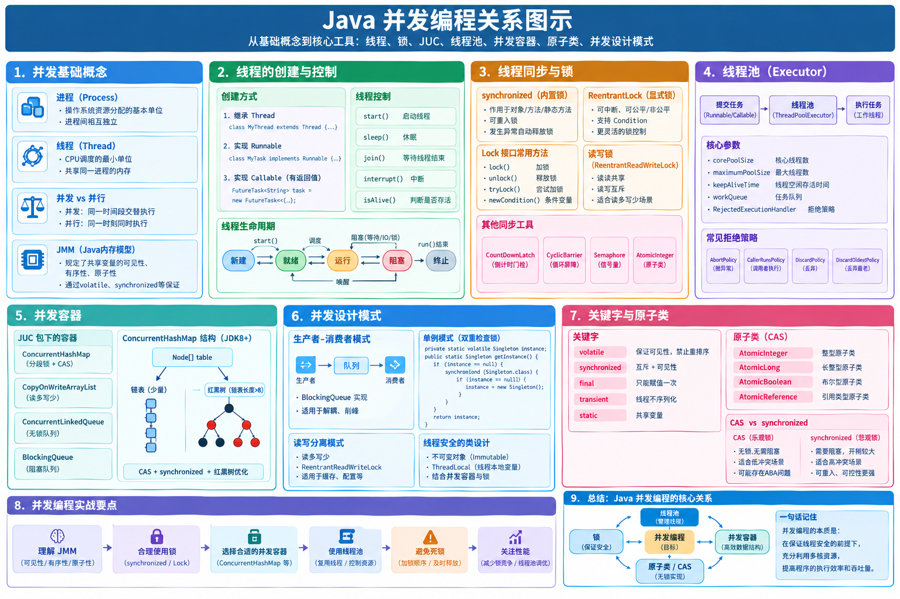
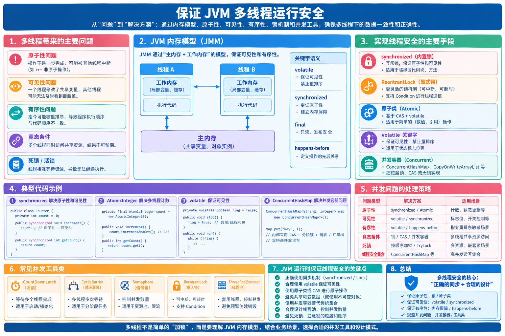
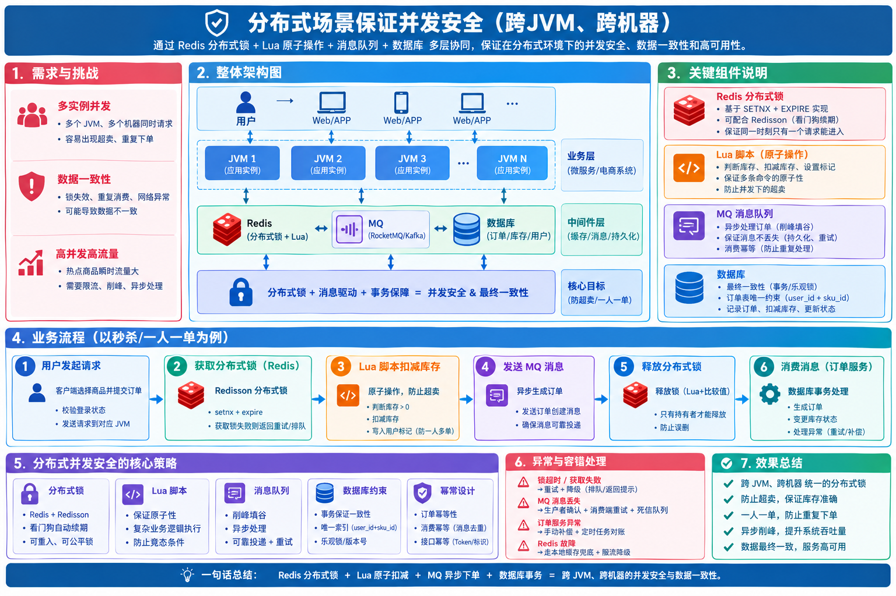
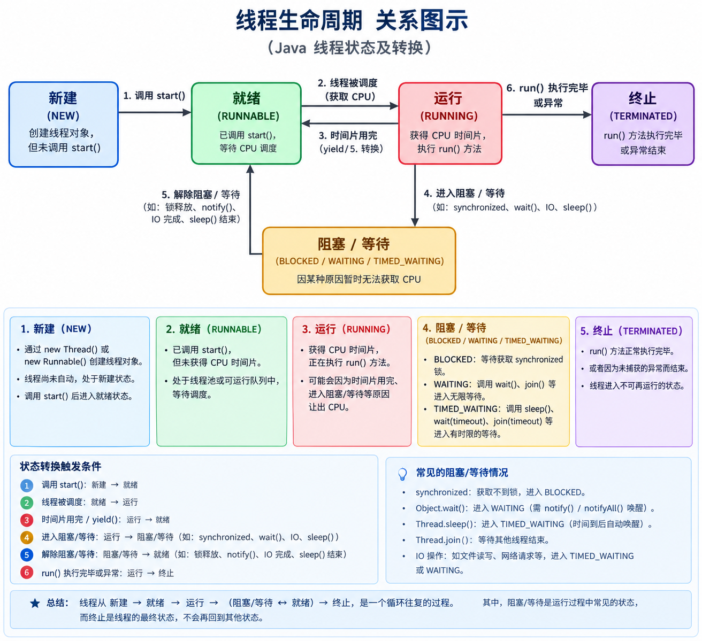
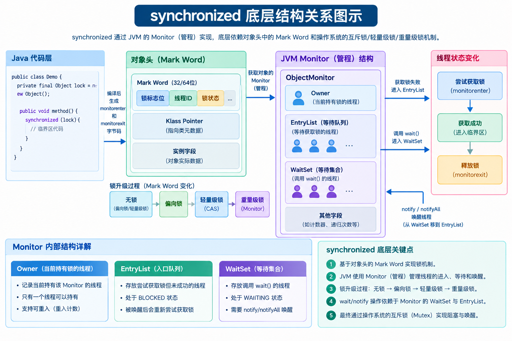
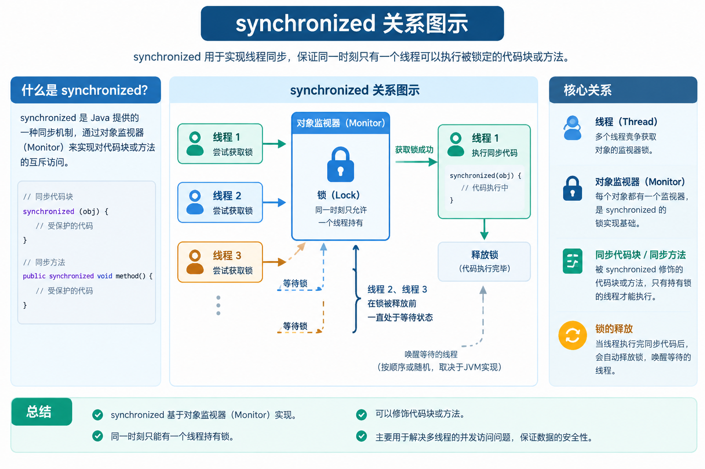
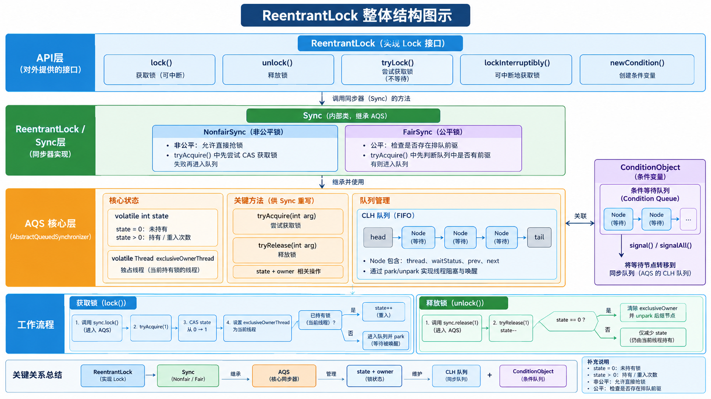
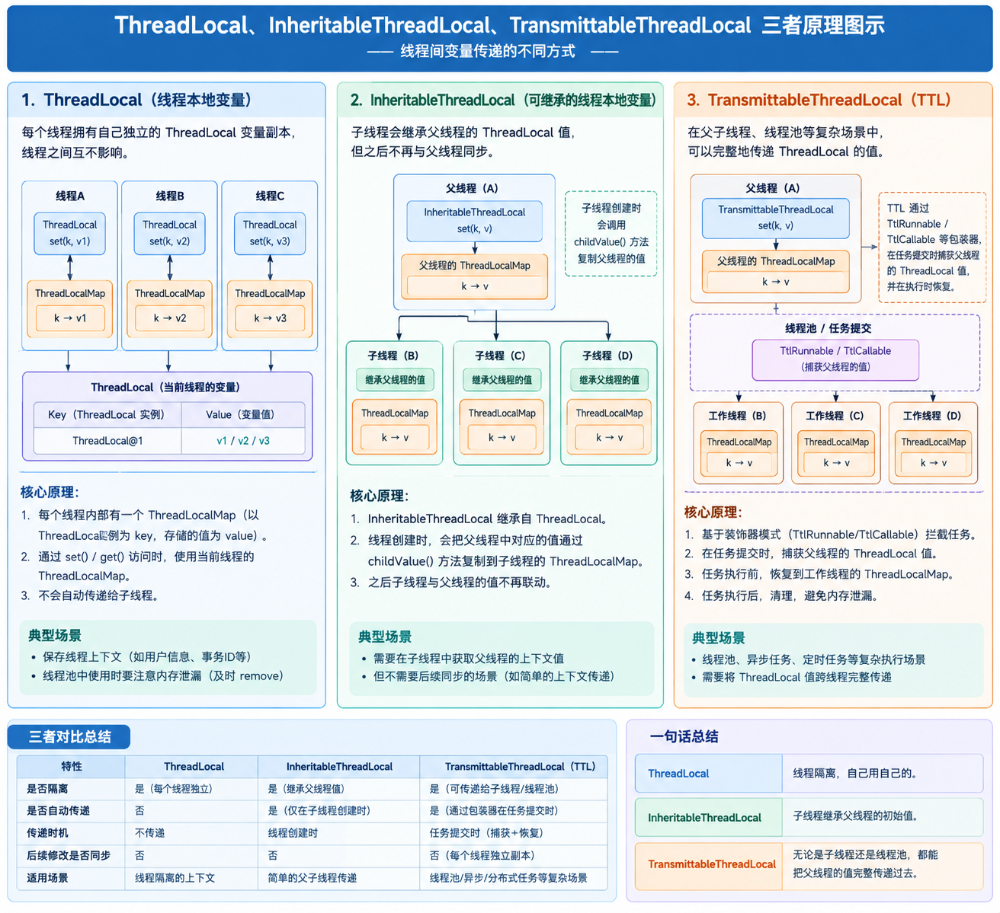
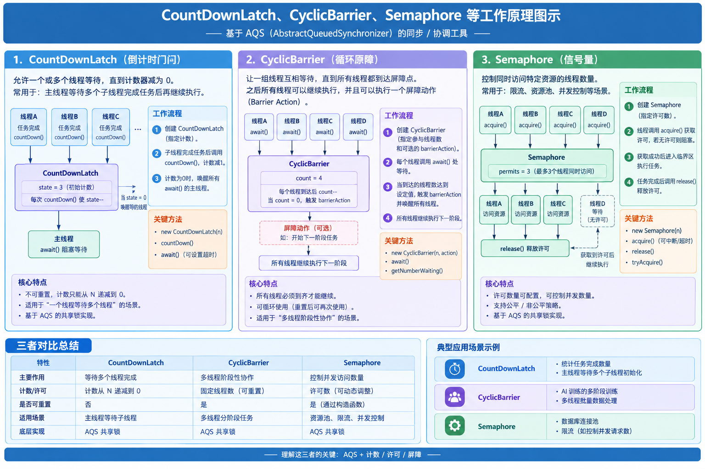

# Java 并发编程全景通关宝典（底层原理、源码拆解与工业实战）

> **导读与知识图谱**
> Java 并发编程是高级 Java 工程师与后端架构师的核心技术护城河。
> 本宝典系统整合 JVM 线程底层机制、Java 内存模型（JMM）、JUC 同步框架、线程池性能调优、并发容器与生产实战排错，构筑六维立体知识体系：
> 1. **第一部分：并发底座与 Java 内存模型 (JMM)**：从 OS/JVM 线程生命周期、竞态条件到 volatile 内存屏障与 CAS/Unsafe
> 2. **第二部分：锁机制与 JUC 同步架构体系**：synchronized 监视器锁升级机制、AQS 抽象队列同步器、ReentrantLock 与读写锁
> 3. **第三部分：线程池体系与异步编排全景**：ThreadPoolExecutor 核心参数、动态调优压测案例、SpringBoot 整合与 CompletableFuture
> 4. **第四部分：线程上下文与并发协作工具**：ThreadLocal 弱引用防漏、跨线程 TTL、wait/notify、Condition 与 JUC 协作三剑客
> 5. **第五部分：并发容器与无锁原子类**：ConcurrentHashMap 演进、CopyOnWrite、BlockingQueue、Atomic 与 LongAdder 分段累加
> 6. **第六部分：并发实战、设计模式与线上故障排查**：DCL 延迟加载、死锁检测、伪共享、ForkJoin、Disruptor 与线上排查方法论

---



---
## 一、并发底座与 Java 内存模型（JMM）

> **导读与知识图谱**
> 任何高级并发架构与复杂并发组件，都建立在底层的操作系统调度与 JVM 内存模型之上。
> 本模块涵盖：进程与线程本质、线程创建 4 种范式、线程 6 大状态全流程迁移与生命周期管理、守护线程、竞态条件与分布式安全、JMM 内存交互规范、volatile 内存屏障与禁止重排、happens-before 八大规则、以及无锁基石 CAS 与 Unsafe 机制。

---
### 1.1 进程与线程核心概念与底层区别
**进程（Process）**

- 是操作系统分配资源的基本单位。
- 每个进程有独立的内存空间和系统资源。

**线程（Thread）**

- 是 CPU 调度和执行的最小单位。
- 一个进程中可以有多个线程共享同一内存空间（堆、方法区）。

**区别**

| 项目     | 进程                  | 线程                     |
| -------- | --------------------- | ------------------------ |
| 内存空间 | 独立                  | 共享进程内存             |
| 通信方式 | IPC（管道、Socket等） | 共享内存                 |
| 切换开销 | 大                    | 小                       |
| 崩溃影响 | 一个崩溃互不影响      | 一个崩溃可能影响整个进程 |

### 1.2 并行与并发的本质区别
- **并发（Concurrency）**：**同一个 CPU 核心**，通过时间片轮转交替执行多个任务，**看起来同时运行**，实际是交替执行。
- **并行（Parallelism）**：**多个 CPU 核心**，**真正同时执行**多个任务。
- 一句话总结：**并发是交替做，并行是同时做**。

### 1.3 JVM 内部多线程运行安全保证机制
**线程安全本质：多个线程同时访问共享可变资源，不出现数据错乱、脏读、丢失更新。**
线程不安全发生三要素：**共享变量 + 可变（会修改） + 多线程并发访问**。

> 如果变量不共享，或者只读不可改，天然线程安全。

**JVM 进程内并发（单机多线程）** 

问题：同一个服务实例，多个线程争抢共享变量。 

解决方案：synchronized、Lock、AtomicXXX、ThreadLocal、ConcurrentHashMap、volatile。 

局限：只在当前这一个 JVM 实例生效；集群部署下完全失效。

#### 根本思路（4大类）

1. **不共享可变数据**：避免共享，从源头消除竞争
2. **共享但不可变**：只读，不能修改，天然安全
3. **共享可变数据：加锁同步，同一时刻只允许一个线程修改**
4. **线程本地私有数据：每个线程自己一份副本，互不干扰**




---

#### 1. 避免共享可变对象（无状态）

无状态对象：没有成员变量，所有数据放在方法局部变量。
局部变量在虚拟机栈，每个线程栈独立，天然线程安全。

```java
// 线程安全：没有成员变量，全部用方法参数
public class OrderService {
    public void createOrder(Long userId){
        int num = 0; // 局部变量，栈上，线程私有
        num++;
    }
}
```

> Spring的Controller、Service默认单例，**千万不要定义成员变量存业务数据**，会线程不安全。

#### 2. 使用不可变对象

对象一旦创建，状态不能修改，没有写操作，多线程随便读。

- `final`修饰成员变量，集合用`Collections.unmodifiableList()`
- String、Integer 都是不可变类

```java
final List<String> list = Collections.unmodifiableList(new ArrayList<>());
```

#### 3、共享可变数据：加锁同步，同一时刻只允许一个线程修改

**核心思想：数据还是多线程共享，允许读写；通过同步机制保护写操作，控制同一时间只能一个线程执行修改** 细分两类：悲观锁、乐观锁

- 悲观锁：`synchronized`、`ReentrantLock(Lock)`
- 乐观锁（CAS）：`AtomicInteger/AtomicLong` 等 AtomicXXX 原子类
- 并发容器：`ConcurrentHashMap`（内部分段锁 + CAS）
- `volatile`：保证可见性，**不保证原子性，适合标记位场景**

场景：计数、多线程同时修改同一个共享对象。

> 代价：锁会带来线程阻塞、上下文切换，带来性能损耗。

#### 3. 锁机制：访问共享变量做同步

##### ① synchronized 内置锁

- 修饰实例方法：锁当前对象`this`
- 修饰静态方法：锁类对象`Class`
- 代码块：手动指定锁对象

```java
// 实例方法锁 this
public synchronized void add(){
    count++;
}

// 代码块，粒度更小
public void add(){
    synchronized (this){
        count++;
    }
}
```

特性：可重入；非公平锁；锁自动释放；异常也会释放锁。

##### ② JUC显式锁 Lock（ReentrantLock）

比synchronized更灵活：可公平/非公平、尝试获取锁、超时中断。

```java
ReentrantLock lock = new ReentrantLock();
public void add(){
    lock.lock();
    try{
        count++;
    }finally {
        lock.unlock(); // 必须finally释放
    }
}
```

> 锁注意点：
>
>
> 1. 锁对象必须是同一个，不同对象锁无效；
> 2. 读写场景：读多写少，用`ReentrantReadWriteLock`读写锁；读共享、写互斥。

#### 4. 线程私有：ThreadLocal

每个线程拥有独立副本，线程之间互不干扰，**不共享数据**。

一台服务器（一个 JVM 进程），10 个请求过来，对应 10 个工作线程。

- 如果用普通成员变量：10 个线程**共用同一个对象**，大家读写同一块内存，会发生竞争，需要加锁`synchronized`。
- 如果用`ThreadLocal`：每个线程内部存一份自己的数据副本。
  - 线程 A 存的值，只有线程 A 能读到、修改；
  - 线程 B 存的值，只有线程 B 能读到、修改；
  - 线程 A 永远读不到线程 B 的数据，互不干扰。

✅ 没有共享，就没有竞争，**不需要锁就实现线程安全**。

> 适用：传递线程上下文，比如用户id、traceId。

```java
ThreadLocal<User> threadLocal = new ThreadLocal<>();
threadLocal.set(user);
threadLocal.get();
threadLocal.remove(); // 一定要remove，防止内存泄漏
```

⚠️ 注意：线程池场景，线程复用，不remove会出现脏数据、内存泄漏。

#### 5. 使用线程安全工具类（JUC）

代替普通非安全集合：

| 不安全    | 线程安全替代         |
| --------- | -------------------- |
| ArrayList | CopyOnWriteArrayList |
| HashMap   | ConcurrentHashMap    |
| HashSet   | CopyOnWriteArraySet  |

> CopyOnWrite：写时复制，读不加锁，写复制新数组；适合读多写少，写开销大。

##### 原子类 CAS（无锁）

`java.util.concurrent.atomic`包，基于CAS自旋，不加锁保证线程安全。
适合简单数值自增，`count++`复合操作线程不安全，替换为`AtomicInteger`

```
AtomicInteger count = new AtomicInteger(0);
count.incrementAndGet(); // 原子自增
```

> CAS缺点：ABA问题、自旋消耗CPU；解决ABA用`AtomicStampedReference`带版本号。

#### 6. 并发容器 & 线程池

1. 队列：`ArrayBlockingQueue`、`LinkedBlockingQueue`，内部已经做线程安全，多线程生产消费直接用。
2. 不要自己随便new Thread，用线程池管理线程。

#### 7. volatile关键字（面试高频）

**volatile不能保证原子性，只保证两点：可见性、禁止指令重排。**

- 可见性：一个线程修改，其他线程立刻读到最新值；
- 不能解决 `count++`（读‑改‑写三步，不是原子）。

适用场景：

1. 状态标记量，boolean开关；
2. DCL双重检查锁单例。

```
private volatile boolean stop = false;
```

❌错误：`volatile int count; count++`，依旧线程不安全。

---

#### 面试高频问题梳理

##### Q1：count++为什么线程不安全？

count++分为三步：读取count → +1 → 写回主内存。多线程下会发生指令交错，丢失更新。
解决：synchronized / ReentrantLock / AtomicInteger。

##### Q2：synchronized 和 ReentrantLock区别

1. synchronized是JVM内置，自动加解锁；Lock是API层面，手动lock/unlock；
2. Lock支持公平锁、非公平锁；synchronized只有非公平；
3. Lock支持tryLock超时获取锁、可中断；synchronized不行；
4. 异常时synchronized自动释放锁；Lock必须finally手动unlock；
5. Java16之后synchronized做了大量优化，性能差距已经很小。

##### Q3：volatile能替代锁吗？

不能。只能保证可见性、禁止重排，**不保证原子性**。适合标记位，不适合计数修改。

##### Q4：ThreadLocal原理和坑

每个Thread内部有ThreadLocalMap；key是ThreadLocal对象；
坑：①线程池复用线程不remove，脏数据；②内存泄漏，key弱引用，value强引用，必须调用remove。

##### Q5：ConcurrentHashMap原理（简单说）

JDK1.8：放弃分段锁，**CAS+synchronized锁Node节点**，只锁当前哈希桶；
读大部分无锁，并发性能高。

#### 生产选型总结

1. 尽量**无状态、局部变量**优先，不用锁最好；
2. 简单计数：Atomic原子类（CAS无锁）；
3. 普通同步：优先synchronized，简单不易出错；
4. 需要公平锁、超时、读写分离：ReentrantLock / ReentrantReadWriteLock；
5. 线程上下文传递：ThreadLocal，记得remove；
6. 集合并发：ConcurrentHashMap / CopyOnWriteArrayList；
7. 读多写少：读写锁；写多不建议CopyOnWrite。

> 锁的代价：上下文切换；尽量缩小锁粒度，不要锁整个大方法。

### 1.4 分布式架构下的并发安全保证（跨 JVM / 跨集群）
> 核心背景：多个服务实例/多台机器，内存互相隔离，`synchronized`、`Lock`、`Atomic` 这类JVM内部锁全部失效。
> 本质：**借助外部共享存储介质做并发协调**，解决多进程同时操作共享资源（数据库、库存、余额）带来的超卖、覆盖、脏写问题。

分为五大类：**数据库方案、分布式锁、乐观并发控制、幂等设计、架构层面规避并发**。



#### 一、数据库方案（最常用，不需要额外中间件）

##### 1. 悲观锁（数据库行排他锁 `for update`）

原理：事务内通过`select ... for update`给数据行加行锁，其他事务会阻塞等待锁释放。

```sql
-- 在事务中执行
begin;
select stock from goods where id = #{goodsId} for update;
update goods set stock = stock - 1 where id = #{goodsId};
commit;
```

⚠️坑点

1. **必须走索引**，否则会升级为**表锁**，整张表锁住，性能灾难；
2. 长事务会持有锁很久，造成大量阻塞；
3. InnoDB才支持行锁；MyISAM只有表锁。

适用：写竞争激烈、数据一致性要求高的场景。

##### 2. 乐观锁（版本号机制，无锁）

不阻塞，通过版本号检测冲突，发生冲突直接返回，业务层重试。
表增加字段 `version bigint`

```sql
update goods 
set stock = stock -1, version = version + 1 
where id=#{id} and version = #{oldVersion};
```

> update返回受影响行数，`0`代表已经被其他线程修改，发生并发冲突，需要重试/返回失败。

变种：使用时间戳代替version版本号。

优点：无锁，不会阻塞；
缺点：高并发下大量冲突，大量重试，适合**读多写少**。

##### 3. 数据库原生原子SQL（推荐优先用）

尽量把计算逻辑放到SQL内部，利用数据库自身原子性，避免“查询+修改”分开带来的并发问题。

```sql
-- 一条SQL完成扣减，数据库层面原子，不需要锁
update goods set stock = stock - 1 where id=#{id} and stock >= 1;
```

> 很多库存扣减直接用这条SQL，既不用悲观锁也不用分布式锁。返回0代表库存不足或者已经被扣完。

> 重点：**不要查出来到Java内存计算再写回去**，中间会有时间窗口，会出现超卖。

##### 4. 数据库唯一索引

用来防重复插入，实现简单幂等。
给业务唯一标识（订单号、请求id）建立唯一索引，重复插入直接抛异常，拦截重复请求。

---

#### 二、分布式锁（外部中间件实现锁，模拟跨机器互斥）

> 目标：保证同一时刻，只有一个JVM拿到锁执行业务逻辑。
> 注意：分布式锁只控制业务执行时序，**不能替代数据库事务**。

##### 1. Redis分布式锁（生产优先使用 Redisson，不要手写）

手写`SET key value NX EX`有一堆缺陷：锁超时、锁误释放、主从切换锁丢失、不可重入。
✅生产选 **Redisson**，已经封装全部问题：

- 可重入锁
- 看门狗自动续期（锁过期但业务还没执行完，自动延长过期时间）
- 锁释放安全，不会释放别人的锁
- 支持主从、Redlock模式

```java
RLock lock = redissonClient.getLock("lock:goods:1001");
try {
    // 获取锁
    boolean ok = lock.tryLock(10,30, TimeUnit.SECONDS);
    if(ok){
        // 执行业务：扣库存、创建订单
    }
}finally {
    if(lock.isHeldByCurrentThread()){
        lock.unlock();
    }
}
```

⚠️Redis锁风险：主从异步复制，主节点挂掉，锁还没同步到从节点，新主节点会产生锁丢失。解决方案：Redlock，或者强一致性组件Zookeeper。

##### 2. Zookeeper分布式锁

利用zk**临时有序节点**实现分布式锁。

- 客户端去创建临时节点；断开连接自动删除节点，不会死锁；
- 排队机制，未拿到锁的节点监听前一个节点。

优点：强一致性，不会出现锁丢失；支持可重入；会话断开自动释放锁。
缺点：性能比Redis低，zk适合并发量不极端高的场景。Curator框架封装好锁API。

##### 3. 数据库实现分布式锁（lock表）

建一张锁表，利用数据库行锁实现分布式锁。

```sql
create table distribute_lock(lock_key varchar primary key,lock_time datetime);
```

插入/占用key，成功代表拿到锁；事务结束释放锁。
性能差，并发高不推荐，适合低并发内部系统。

> 分布式锁通用注意点：

1. 锁过期时间 > 业务最大执行时间；
2. 必须保证**谁加锁，谁释放锁**，不能把别的线程的锁释放；
3. 分布式锁 + 数据库操作，要注意锁和事务的先后顺序：**先拿锁，再开事务**。

---

#### 三、幂等性（分布式必做，解决重复请求、重复消费）

并发安全不光是竞争写，还有重复调用带来的数据错乱。
常见实现手段：

1. **业务唯一号**：订单号、requestId，执行前先判断是否已处理；
2. 数据库唯一索引；
3. Token机制：前端获取token，请求携带token，用完作废；
4. MQ消费：消息id做幂等表。

> 即使有分布式锁，也要做幂等，网络超时重试会带来重复请求。

---

#### 四、架构层面规避并发冲突（治本方案）

##### 1. MQ异步削峰，串行化

高并发争抢场景，把并发请求丢进消息队列，消费者单线程串行消费，直接消除并发竞争。

> 缺点：业务变为异步，不能同步返回结果。

##### 2. 数据分片/业务分片

比如库存按用户id、商品id分片，不同分片互不干扰，降低锁冲突概率。

##### 3. 本地预扣 + 异步校准

大促场景：Redis预扣库存，数据库异步落库，定期核对Redis和DB数据，补偿差异。

---

#### 面试对比总结表

| 方案                   | 依赖组件  | 优点                 | 缺点                   | 适用场景               |
| ---------------------- | --------- | -------------------- | ---------------------- | ---------------------- |
| 数据库update原子SQL    | MySQL     | 无中间件，原子安全   | 数据库压力大           | 库存扣减，优先首选     |
| 数据库悲观锁for update | MySQL     | 强一致性，简单       | 长事务容易阻塞，性能差 | 并发不高，强一致业务   |
| 数据库乐观锁version    | MySQL     | 无阻塞               | 高并发大量重试失败     | 读多写少               |
| Redisson Redis锁       | Redis     | 高性能，支持重入续期 | 主从切换存在锁丢失风险 | 绝大多数分布式业务     |
| Zookeeper分布式锁      | Zookeeper | 强一致，自动释放锁   | 性能一般               | 对锁可靠性要求极高场景 |
| 数据库锁表             | MySQL     | 无需中间件           | 性能很差               | 低并发内部系统         |
| MQ串行消费             | MQ        | 消除并发竞争         | 业务异步化             | 大促高并发场景         |

#### 面试标准回答参考

> 分布式环境下JVM级别的锁全部失效，需要依赖外部共享存储做并发控制。
> 第一种是数据库方案：优先使用原子update语句；其次悲观锁for update，或者version版本号乐观锁；
> 第二种是分布式锁，借助Redis（Redisson）、Zookeeper，跨实例互斥；要注意锁续期、锁释放、主从切换锁丢失问题；
> 同时必须保障幂等，处理重试重复请求；
> 架构层面可以通过MQ串行、分片的方式从根源减少并发冲突。

> ⚠️面试高频坑：**分布式锁不能完全替代数据库锁**。拿到分布式锁之后，操作数据库依然要考虑事务、数据库层面的约束。网络抖动锁失效会出现并发问题。

如果你需要，我可以整理一份经典面试题：**分布式库存超卖问题完整分析，各个方案优缺点**。


### 1.5 竞态条件（Race Condition）深度剖析
#### 1、什么是竞态条件

> **多个线程同时访问、修改同一个共享可变变量，最终结果依赖于线程执行的时序（CPU调度顺序），不同的执行顺序得到不一样的结果，这就是竞态条件。**

关键点：
- 问题根源：**共享可变变量 + 没有合适同步保护**
- 结果不确定：同样的代码，有时候结果正确，有时候错误，复现很难，偶现bug。
- JVM层面的线程安全问题，集群环境无效。

##### 简单代码示例（计数器错误）

```java
private static int count = 0;

public static void main(String[] args) throws InterruptedException {
    Thread t1 = new Thread(() -> {
        for (int i = 0; i < 10000; i++) {
            count++;
        }
    });
    Thread t2 = new Thread(() -> {
        for (int i = 0; i < 10000; i++) {
            count++;
        }
    });
    t1.start();
    t2.start();
    t1.join();
    t2.join();
    // 预期20000，实际经常小于20000，出现错误，这就是竞态条件引发
    System.out.println(count);
}
```
`count++`不是原子操作，拆成三步：
1. 读取count
2. +1计算
3. 写回count

两个线程穿插执行，发生指令交错，就会丢失更新，产生错误结果。**线程调度时序决定最终结果，就是竞态条件。**

#### 2、产生竞态条件两个必要条件（缺一不可）

1. **共享可变资源**：多个线程操作同一个变量，并且变量会修改；
2. **非原子操作**：读写修改不是一步完成，中间可以被其他线程打断。

> 如果没有共享，或者变量不可修改，就不会产生竞态条件。

#### 3、怎么解决竞态条件（对应前面4大类并发思路）

1. **不共享可变数据**：每个线程使用局部变量，不共用对象；
2. **共享但不可变**：变量final，只可读，禁止修改；
3. **共享可变数据加同步保护**
    - 悲观锁：`synchronized`、`Lock`，保证操作整体原子性；
    - 乐观锁CAS：`AtomicInteger`，底层CAS保证原子操作；
4. **ThreadLocal线程私有副本**，线程之间不共享数据。

> volatile**不能解决竞态条件**！volatile只保证可见性、禁止指令重排，不保证原子性，count++这种复合操作依然会出现竞态。

#### 4、面试高频问答

##### Q：竞态条件和线程安全的关系？

竞态条件是现象；线程不安全是最终结果。出现竞态条件就会导致线程不安全。

##### Q：竞态条件bug有什么特点？

偶现，很难稳定复现；压力大、CPU繁忙更容易复现；本地测试没问题，线上高并发才暴露。

##### Q：volatile为什么解决不了竞态条件？

volatile只能保证每次读取拿到最新值，但是`count++`分为读‑改‑写三步，中间依旧会被其他线程打断，没有保证整个操作原子性。

#### 简短口述背诵版（40秒）

> 竞态条件，是多线程操作同一个共享可变变量，因为线程调度时序不确定，指令发生交错，最终结果不可预期。产生需要两个条件：共享可变资源、非原子操作。volatile无法解决，需要加锁或者原子类保证操作原子性；也可以通过不共享、不可变、ThreadLocal从源头规避。该bug属于偶现问题，线上高并发才容易暴露。

要不要整理 **原子性、可见性、有序性** 三大特性速记？


------

### 1.6 创建线程的 4 种方式与源码机制
Java 里创建线程**本质只有一种**：**new Thread()**，但**任务定义方式**有 4 种常见写法。

---

#### 一、方式1：继承 Thread 类

**步骤**

1. 自定义类 **extends Thread**
2. 重写 **run()** 方法
3. 创建实例，调用 **start()**（不是 run()）

```java
class MyThread extends Thread {
    @Override
    public void run() {
        System.out.println("线程执行：" + getName());
    }
}

// 使用
new MyThread().start();
```

**优点**：简单
**缺点**：

- Java 单继承，无法再继承其他类
- 任务与线程耦合，不利于线程池复用

---

#### 二、方式2：实现 Runnable 接口（无返回值）

**步骤**

1. 实现 **Runnable** 接口
2. 重写 **run()**
3. 传入 Thread 构造，调用 start()

```java
class MyTask implements Runnable {
    @Override
    public void run() {
        System.out.println("Runnable 任务执行");
    }
}

// 使用
new Thread(new MyTask()).start();
```

**优点**：

- 避免单继承局限
- 任务与线程解耦，适合线程池

**缺点**：**无返回值**、不能抛受检异常

---

#### 三、方式3：实现 Callable 接口（带返回值）

**步骤**

1. 实现 **Callable<V>**
2. 重写 **call()**，可返回值、抛异常
3. 用 **FutureTask** 包装
4. 传入 Thread 执行
5. 通过 **futureTask.get()** 获取结果

```java
class MyCallable implements Callable<Integer> {
    @Override
    public Integer call() throws Exception {
        return 100;
    }
}

// 使用
FutureTask<Integer> task = new FutureTask<>(new MyCallable());
new Thread(task).start();

// 获取返回值（阻塞）
Integer res = task.get();
```

**优点**：

- **有返回值**
- 可抛出异常
- 适合异步计算

**缺点**：get() 会阻塞

---

#### 四、方式4：使用线程池（企业开发标准方式）

通过 **ExecutorService** 提交任务，**不建议手动创建线程**。

```java
ExecutorService pool = Executors.newFixedThreadPool(3);

// 提交 Runnable
pool.execute(new Runnable() { ... });

// 提交 Callable（带返回值）
Future<Integer> future = pool.submit(new Callable<Integer>() { ... });
```

**优点**：

- 复用线程，减少创建销毁开销
- 控制并发数，防 OOM
- 管理任务生命周期

**企业规范**：**禁止用 Executors 创建线程池**，要用 **ThreadPoolExecutor** 手动构造。

---

#### 五、run() 和 start() 的区别（必问）

- **start()**：
  - 启动线程，进入就绪状态
  - 底层调用 native 方法，真正开启新线程
  - **一个线程只能调用一次**
- **run()**：
  - 只是普通方法调用
  - **不会开启新线程**，在当前线程执行

---

#### 六、4 种方式对比表

| 方式          | 核心接口 | 返回值 | 抛异常 | 继承限制 | 推荐度       |
| ------------- | -------- | ------ | ------ | -------- | ------------ |
| 继承 Thread   | Thread   | 无     | 不能   | 单继承 ❌ | 不推荐       |
| 实现 Runnable | Runnable | 无     | 不能   | 无 ✅     | 一般         |
| 实现 Callable | Callable | 有 ✅   | 能 ✅   | 无 ✅     | 推荐         |
| 线程池        | Executor | 可有无 | 可有无 | 无 ✅     | **生产首选** |

---

#### 七、总结

- 想**简单无返回值**：Runnable
- 想**有返回值**：Callable + FutureTask
- 企业**正式项目**：**线程池 ThreadPoolExecutor**
- 永远记住：**启动线程必须用 start()，不是 run()**

#### 面试高频问答

##### Q1：`start()` 和 `run()` 的区别

1. `run()`：只是普通成员方法，直接调用，**不会开启新线程，在当前主线程执行**；
2. `start()`：native方法，通知JVM向操作系统申请创建真正的OS线程，自动执行run方法；
3. 一个Thread对象**只能调用一次start()**，重复调用抛出 `IllegalThreadStateException`。

##### Q2：四种方式的本质区别

1. 继承Thread：线程和任务耦合在一起；
2. Runnable：分离任务与线程对象，无返回；
3. Callable+FutureTask：任务可以返回结果，能捕获异常；
4. 线程池：复用线程，避免频繁创建销毁线程开销，生产首选。

> 底层本质只有两类： ①继承Thread；②实现Runnable。Callable只是任务的增强，依靠FutureTask包装成Runnable交给Thread。

##### Q：四种创建线程方式的本质

> Thread 类的 start 才是真正创建操作系统线程。
>
> - 继承 Thread：重写 run
> - Runnable / FutureTask：作为参数传给 Thread，重写 run
> - 线程池：内部封装 Thread，批量管理任务

##### Q3：为什么生产不建议手动new Thread？

线程创建涉及操作系统内核资源，创建销毁开销大；无管控，大量创建会耗尽系统线程资源，导致OOM。应该使用线程池。

##### Q4：Runnable和Callable区别

| Runnable                   | Callable           |
| -------------------------- | ------------------ |
| void run()，无返回值       | V call()，有返回值 |
| 不能抛出checked异常        | 可以抛出Exception  |
| execute / submit都可以接收 | 只能submit提交     |

##### Q5：FutureTask状态

NEW → COMPLETING → NORMAL / EXCEPTIONAL / CANCELLED，支持取消任务cancel()。

#### 面试

> Java创建线程有四种：
>
> 1. 继承Thread类重写run；
> 2. 实现Runnable接口，传入Thread构造器；
> 3. Callable配合FutureTask，支持拿到线程返回结果；
> 4. 通过线程池ThreadPoolExecutor提交任务，项目中推荐使用。 注意调用start才是真正启动线程，run只是普通方法。

### 1.7 Java 线程 6 大生命周期状态与 jstack 排查
> 线程状态定义在 `Thread.State` 枚举，一共 **6种状态**：
> `NEW`、`RUNNABLE`、`BLOCKED`、`WAITING`、`TIMED_WAITING`、`TERMINATED`

> 注意：Java的`RUNNABLE`包含操作系统层面的**运行中 + 就绪**；Java没有单独的Running状态。
> `BLOCKED` 只和`synchronized`锁竞争有关；`wait/Lock.await()`进入的是`WAITING`，不是BLOCKED。



#### 1. NEW 新建

new Thread()之后，**还没有调用 start()**。
只是在JVM创建线程对象，操作系统内核线程还没有创建。

```java
Thread t = new Thread(); // NEW
```

> 注意：一个线程只能start一次；重复start抛异常。

#### 2. RUNNABLE 可运行状态

调用 `start()` 之后进入RUNNABLE。
包含两种情况：

1. CPU正在执行该线程（运行中）
2. 等待操作系统分配CPU时间片（就绪）

> 网络IO阻塞时，Java线程依然是 **RUNNABLE**，不是BLOCKED/WAITING。因为IO阻塞交给操作系统，线程等待IO事件，JVM层面认为它是可运行。

RUNNABLE 包括 **就绪（Ready） + 运行（Running）**，JVM 无法区分 OS 层的这两个状态，故合并。

#### 3. BLOCKED 阻塞

**仅在争抢 synchronized 监视器锁失败时进入BLOCKED。**

- 线程想去执行synchronized代码块，但是monitor锁被别的线程占有；
- 线程进入EntrySet，状态变为BLOCKED；
- 拿到锁之后，变回RUNNABLE。

> ⚠️重点：
> `ReentrantLock`显式锁阻塞，**线程状态不是BLOCKED，而是WAITING**（底层AQS）。
> BLOCKED只跟`synchronized`挂钩。

#### 4. WAITING 无限等待

线程主动释放锁，无限等待被其他线程唤醒。进入WAITING的方法：

- `obj.wait()`（无超时）
- `LockSupport.park()`
- `condition.await()`

唤醒条件：

- `notify() / notifyAll()`
- `LockSupport.unpark(thread)`
- `signal() / signalAll()`

被唤醒后，不会直接运行，去竞争锁，变为RUNNABLE/BLOCKED。

#### 5. TIMED_WAITING 限时等待

带超时时间的等待，超时自动唤醒。
进入方式：

- `Thread.sleep(ms)`
- `obj.wait(timeout)`
- `condition.await(time,unit)`
- `LockSupport.parkNanos()`

时间到或者被主动唤醒，转为RUNNABLE。

> 区分 WAITING vs TIMED_WAITING：一个无限等，一个带时间。

#### 6. TERMINATED 终止

线程执行完毕正常退出；或者异常终止。
线程结束，生命周期结束，**不能再次start**。


####  Java 线程的 6 种状态（JDK 5+）

| 状态（State）       | 说明         | 触发条件                                                     |
| ------------------- | ------------ | ------------------------------------------------------------ |
| **`NEW`**           | 新建状态     | 线程对象已创建，但尚未调用 `start()`                         |
| **`RUNNABLE`**      | 可运行状态   | 已调用 `start()`，正在 JVM 中运行 **或** 在操作系统就绪队列中等待 CPU |
| **`BLOCKED`**       | 阻塞状态     | 等待获取 **monitor 锁**（如进入 `synchronized` 块时锁被占用） |
| **`WAITING`**       | 无限等待状态 | 调用 `wait()`、`join()`、`LockSupport.park()`，**需其他线程显式唤醒** |
| **`TIMED_WAITING`** | 计时等待状态 | 调用 `sleep(time)`、`wait(timeout)`、`join(timeout)`、`parkNanos()` 等，**带超时时间** |
| **`TERMINATED`**    | 终止状态     | 线程执行完毕（正常结束或异常退出）                           |

---

#### 状态流转图

```
NEW → start() → RUNNABLE

RUNNABLE：
 ├─抢synchronized锁失败 → BLOCKED；抢到锁回到RUNNABLE
 ├─wait() / await() / park() → WAITING；被唤醒后竞争锁 → RUNNABLE/BLOCKED
 ├─sleep() / wait(timeout) → TIMED_WAITING；超时/唤醒回到RUNNABLE
 └─run方法执行结束 / 异常 → TERMINATED

BLOCKED：拿到synchronized锁 → RUNNABLE

WAITING / TIMED_WAITING：被唤醒/超时 → 去竞争锁 → RUNNABLE / BLOCKED

TERMINATED：终态，不可逆
==========================
新建（New）  
    ↓（调用 start()）  
就绪（Runnable）  
    ↓（获取 CPU 时间片）  
运行中（Runnable 的子状态）  
    ├─ 正常执行完毕 → 终止（Terminated）  
    ├─ 竞争锁失败 → 阻塞（Blocked）→（锁释放）→ 就绪（Runnable）  
    ├─ 调用 wait()/join() 等 → 等待（Waiting）→（被唤醒）→ 就绪（Runnable）  
    └─ 调用 sleep(long)/wait(long) 等 → 超时等待（Timed Waiting）→（超时/被唤醒）→ 就绪（Runnable）  
==========================
        new Thread()
             │
             ▼
           [NEW] 
             │
         start()
             ▼
       [RUNNABLE] ◄──────────────┐
         │    ▲                 │
         │    │ CPU调度         │
         ▼    │                 │
   ┌──────────┴──────────┐      │
   │ 进入 synchronized     │      │
   │ 但锁被占用           │      │
   ▼                     │      │
[BLOCKED]                │      │
   │                     │      │
   └─────────┬───────────┘      │
             │ 锁释放           │
             ▼                  │
       [RUNNABLE] ◄─────────────┘
         │
         │ 调用 wait(), join(), park()
         ▼
     [WAITING] ─── notify()/interrupt() ───► [RUNNABLE]
         ▲
         │
         │ 调用 wait(timeout), sleep(), join(timeout)
         ▼
 [TIMED_WAITING] ── timeout/notify/interrupt ─► [RUNNABLE]
         │
         │ run() 执行完毕 或 异常退出
         ▼
     [TERMINATED]
     
```

#### 高频面试对比

##### Q0：RUNNABLE 包括 **就绪（Ready） + 运行（Running）**

- JVM 无法区分 OS 层的这两个状态，故合并

##### Q1：BLOCKED 和 WAITING 的区别（超级高频）

1. **BLOCKED**：只发生在`synchronized`锁竞争。线程想要锁，拿不到，被动阻塞；**没有释放锁**。
2. **WAITING**：线程**主动释放锁**，主动等待其他线程信号（wait、await、park），等待被唤醒。

> ReentrantLock获取锁失败，线程状态是WAITING，不是BLOCKED，因为底层AQS用LockSupport.park()挂起线程。

##### Q2：sleep、wait、park分别进入什么状态

- `Thread.sleep()` → **TIMED_WAITING**，不释放锁
- `obj.wait()` → **WAITING**，释放monitor锁
- `LockSupport.park()` → **WAITING**

##### Q3：调用notify之后线程状态怎么变？

notify只是把WaitSet线程挪到竞争队列；线程从WAITING → RUNNABLE/BLOCKED，**不是立刻运行**，需要竞争锁。

##### Q4：IO阻塞的时候线程是什么状态？

网络IO阻塞，Java线程状态依旧是 **RUNNABLE**。操作系统层面阻塞，JVM不感知。

##### Q5：stop()为什么废弃？

`Thread.stop()`暴力终止线程，直接释放锁，会破坏对象一致性，出现数据错乱，不推荐。
正确：设置标记位（volatile boolean），让线程自己退出run方法。

#### jstack看线程状态（实战）

jstack 打印线程栈，可以看到真实状态：

- `BLOCKED`：waiting to lock monitor
- `WAITING`：waiting on condition / in Object.wait()
- `TIMED_WAITING`：sleeping

#### 如何查看线程状态？

```java
Thread t = new Thread(...);
t.start();
System.out.println(t.getState()); // 打印当前状态
```

或使用 **JVM 工具**：

- `jstack <pid>`：查看所有线程状态
- VisualVM / JConsole：图形化监控

#### 面试口述简短版

> Java线程一共6种状态：NEW、RUNNABLE、BLOCKED、WAITING、TIMED_WAITING、TERMINATED。
> NEW是new Thread还没start；调用start进入RUNNABLE，包含就绪和运行。
> BLOCKED只发生在synchronized锁竞争失败；
> WAITING无限等待，TIMED_WAITING带超时；wait、await、park进入等待状态；sleep进入TIMED_WAITING。
> 线程执行完毕进入TERMINATED，不可逆。
> 重点区分BLOCKED和WAITING：BLOCKED是抢synchronized锁拿不到，没有释放锁；WAITING是主动释放锁等待信号。
> ReentrantLock阻塞线程是WAITING，不是BLOCKED。

> 顺带记忆：
> wait() → WAITING；sleep() → TIMED_WAITING；synchronized抢锁失败 → BLOCKED。

如果你需要，我可以把 **AQS（AbstractQueuedSynchronizer）核心原理**整理出来，Lock、CountDownLatch、Semaphore底层都是AQS。


### 1.8 线程生命周期管理（优雅终止、中断机制与协作）
线程的生命周期管理，是指**如何正确地创建、启动、协调、监控和终止线程**，以确保程序的**正确性、健壮性与性能**。它不仅包括线程状态的流转（如 NEW → RUNNABLE → TERMINATED），更强调**开发者如何主动控制和干预这一过程**。

---

#### 一、核心目标

线程生命周期管理的核心目标是：

1. **避免资源泄漏**（如线程未终止、锁未释放）
2. **防止死锁/活锁**
3. **支持优雅关闭**（Graceful Shutdown）
4. **提供可观测性**（监控、日志、调试）
5. **保证线程安全与协作**

---

#### 二、生命周期各阶段的管理策略

##### 1️⃣ 创建阶段（NEW）

✅ **最佳实践**：
- 使用 **线程池**（`ExecutorService`）代替手动 `new Thread()`
  ```java
  ExecutorService executor = Executors.newFixedThreadPool(4);
  executor.submit(() -> { /* 任务 */ });
  ```
- 若必须手动创建，**命名线程**便于调试：
  ```java
  Thread t = new Thread(runnable, "OrderProcessor-Thread");
  ```

❌ **避免**：
- 频繁创建/销毁线程（开销大）
- 匿名线程（难以追踪）

---

##### 2️⃣ 启动与运行阶段（RUNNABLE）

✅ **关键管理点**：
- **异常处理**：线程内未捕获异常会导致线程静默退出！
  ```java
  Thread t = new Thread(() -> {
      try {
          // 业务逻辑
      } catch (Exception e) {
          log.error("线程异常", e);
          // 可选：通知监控系统
      }
  });
  ```
- 设置 **UncaughtExceptionHandler**（推荐）：
  ```java
  t.setUncaughtExceptionHandler((thread, ex) -> {
      System.err.println("线程 " + thread.getName() + " 崩溃: " + ex);
  });
  ```

---

##### 3️⃣ 等待与阻塞阶段（WAITING / TIMED_WAITING / BLOCKED）

✅ **协作管理**：
- 使用 **`wait/notify` 或 `Condition`** 实现线程协作
- 避免 **永久等待**：优先使用带超时的方法
  ```java
  lock.tryLock(5, TimeUnit.SECONDS); // 而非 lock.lock()
  queue.poll(1, TimeUnit.SECONDS);  // 而非 take()
  ```

✅ **中断机制**：支持外部取消
```java
while (!Thread.currentThread().isInterrupted()) {
    // 工作循环
    try {
        task = queue.take(); // 可中断阻塞
    } catch (InterruptedException e) {
        Thread.currentThread().interrupt(); // 恢复中断状态
        break; // 退出
    }
}
```

---

##### 4️⃣ 终止阶段（TERMINATED）

这是**最容易出错**的环节！必须区分：

| 终止方式                       | 是否推荐           | 说明                           |
| ------------------------------ | ------------------ | ------------------------------ |
| **自然结束**（run() 执行完毕） | ✅ 推荐             | 最安全                         |
| **抛出未捕获异常**             | ⚠️ 可接受（需日志） | 线程退出，但需监控             |
| **`Thread.stop()`**            | ❌ **禁止**         | 已废弃，会导致状态不一致、死锁 |
| **`Thread.interrupt()`**       | ✅ 推荐             | **协作式中断**，需代码配合     |

###### ✅ 正确的“优雅关闭”模式（生产者-消费者示例）：

```java
public class Worker implements Runnable {
    private volatile boolean running = true; // 关闭标志
    private final BlockingQueue<Task> queue = new LinkedBlockingQueue<>();

    public void shutdown() {
        running = false;
        Thread.currentThread().interrupt(); // 中断阻塞
    }

    @Override
    public void run() {
        while (running) {
            try {
                Task task = queue.poll(1, TimeUnit.SECONDS); // 带超时
                if (task != null) {
                    task.execute();
                }
            } catch (InterruptedException e) {
                // 被中断，退出循环
                Thread.currentThread().interrupt();
                break;
            }
        }
        // 清理资源（如关闭连接）
        cleanup();
    }

    private void cleanup() { /* 释放资源 */ }
}
```

> 💡 **关键**：**不要依赖 `stop()`，而是用“协作式关闭”**（标志位 + 中断）

---

#### 三、高级管理：使用线程池（ExecutorService）

手动管理线程生命周期复杂且易错，**强烈推荐使用 `ExecutorService`**：

##### ✅ 示例：优雅关闭线程池

```java
ExecutorService executor = Executors.newFixedThreadPool(4);

// 提交任务
executor.submit(task1);
executor.submit(task2);

// 关闭流程
executor.shutdown(); // 不再接受新任务
try {
    if (!executor.awaitTermination(60, TimeUnit.SECONDS)) {
        executor.shutdownNow(); // 强制中断正在执行的任务
        if (!executor.awaitTermination(60, TimeUnit.SECONDS)) {
            System.err.println("线程池无法正常关闭");
        }
    }
} catch (InterruptedException e) {
    executor.shutdownNow();
    Thread.currentThread().interrupt();
}
```

> ✅ `shutdown()` + `awaitTermination()` 是标准关闭模式

---

#### 四、监控与调试

##### 1. 获取线程状态

```java
Thread t = new Thread(runnable);
System.out.println(t.getState()); // NEW, RUNNABLE, etc.
```

##### 2. 使用 JVM 工具

- `jstack <pid>`：打印线程堆栈（查看 BLOCKED/WAITING）
- `jconsole` / `VisualVM`：图形化监控线程状态
- `ThreadMXBean`：程序化监控
  ```java
  ThreadMXBean mx = ManagementFactory.getThreadMXBean();
  long[] threadIds = mx.getAllThreadIds();
  for (long id : threadIds) {
      ThreadInfo info = mx.getThreadInfo(id);
      System.out.println(info.getThreadName() + " - " + info.getThreadState());
  }
  ```

---

#### 五、常见陷阱与规避

| 问题               | 风险         | 解决方案                                             |
| ------------------ | ------------ | ---------------------------------------------------- |
| 忘记 `unlock()`    | 死锁         | `try-finally` 保证释放                               |
| 无限 `wait()`      | 线程永久挂起 | 使用 `wait(timeout)`                                 |
| 忽略中断           | 无法关闭     | 检查 `isInterrupted()` 或捕获 `InterruptedException` |
| 线程泄漏           | OOM          | 使用线程池 + 正确关闭                                |
| 共享可变状态无同步 | 数据错乱     | 用 `synchronized` / `ReentrantLock` / `volatile`     |

---

#### ✅ 总结：线程生命周期管理最佳实践

| 阶段         | 推荐做法                                               |
| ------------ | ------------------------------------------------------ |
| **创建**     | 用 `ExecutorService`，命名线程                         |
| **运行**     | 捕获异常，设置 `UncaughtExceptionHandler`              |
| **协作**     | 用 `interrupt()` + 超时机制，避免永久阻塞              |
| **终止**     | **协作式关闭**（标志位 + 中断），**绝不使用 `stop()`** |
| **资源清理** | 在 `finally` 或关闭钩子中释放资源                      |
| **监控**     | 使用 `jstack`、`ThreadMXBean` 跟踪状态                 |

> 💡 **终极建议**：  
> **“除非特殊需求，否则永远不要手动管理线程生命周期——交给 `ExecutorService`！”**

通过合理的生命周期管理，你的多线程程序将更**稳定、可控、可观测**。


### 1.9 守护线程（Daemon Thread）工作机制与注意事项
守护线程（Daemon Thread）是 Java 中一种特殊的线程类型，主要用于为其他线程（用户线程）提供“后台支持服务”，其生命周期依赖于用户线程，当所有用户线程结束时，守护线程会自动终止。

#### 守护线程的核心特性

1. **后台服务角色**  
   守护线程通常用于执行辅助性任务，如：  
   - JVM 的垃圾回收线程（`GC`）：自动回收内存，为用户线程提供内存管理支持。  
   - 日志记录线程：在后台记录程序运行日志。  
   - 监控线程：实时监控系统状态（如 CPU 使用率、内存占用）。  

2. **生命周期依赖用户线程**  
   - 当 JVM 中**所有用户线程（非守护守护线程）执行完毕**，无论守护守护线程是否执行完毕，都会守护线程都会被强制终止，随后 JVM 退出。  
   - 反之，只要有一个用户线程在运行，守护线程就会持续工作。  

3. **默认优先级低**  
   守护线程的默认优先级通常低于用户线程，JVM 可能会优先调度用户线程（可通过 `setPriority()` 调整，但不建议）。  

#### 守护线程 vs 用户线程（核心区别）

| **对比项**       | 守护线程（Daemon Thread）               | 用户线程（User Thread）                 |
|------------------|-----------------------------------------|-----------------------------------------|
| **作用**         | 为用户线程提供后台支持（如 GC、日志）    | 执行程序核心业务逻辑（如主线程、任务线程）|
| **生命周期**     | 依赖用户线程，所有用户线程结束后自动终止 | 独立运行，需自行结束（或异常终止）       |
| **资源处理**     | 不保证资源释放（被强制终止）            | 可通过 `finally` 确保资源释放           |
| **创建方式**     | 需显式调用 `setDaemon(true)`            | 默认创建的线程均为用户线程              |

#### 总结

守护线程是 Java 中“默默付出”的后台角色，适用于不需要确保完成的辅助性任务。其核心价值在于：当程序的核心业务（用户线程）结束后，无需手动关闭后台服务，JVM 会自动清理，简化了资源管理。但需注意：**严禁用守护线程处理关键业务（如数据写入、事务提交）**，否则可能导致数据丢失或不一致。

### 1.10 Java 内存模型（JMM）与并发三大特性
**Java Memory Model (JMM)** 是一种抽象规范，定义了线程与主内存（主存、工作内存）之间的交互规则。用来**屏蔽各种硬件和操作系统的内存访问差异**，保证 Java 程序在**多线程环境下，对共享变量的读写是可预期、一致、安全**的。

**JMM 定义了线程和主内存之间的抽象关系，解决可见性、原子性、有序性问题。**

**三大问题：**

1. **原子性**：操作不可被中断（如 `i++` 不是原子操作）
2. **可见性**：一个线程修改变量，其他线程立即可见（`volatile`）
3. **有序性**：禁止指令重排（`volatile`、`synchronized` 可保证）

**核心机制：**

- 每个线程有工作内存（缓存变量副本）
- `volatile`、锁、final 可影响内存可见性与重排序规则

#### 一、先理解：JMM 要解决的底层问题

多线程环境下，CPU 和 JVM 的优化会破坏“共享变量访问的一致性”，这是 JMM 诞生的根本原因，具体有两个核心问题：

##### 1. CPU 缓存导致的“内存可见性”问题

- **现象**：线程操作共享变量时，会先将变量从主内存加载到 CPU 高速缓存（L1/L2/L3），操作后再刷回主内存。若其他线程未从主内存重新加载，会读取到缓存中的旧值。  
  例：线程 A 把 `flag=true` 写入 CPU 缓存但未刷回主内存，线程 B 一直从自己的缓存读 `flag`，始终得到 `false`，导致逻辑错误。
- **JMM 的解决思路**：定义“可见性规则”，强制特定场景下的变量读写必须直接操作主内存（如 `volatile` 关键字），确保一个线程的修改对其他线程可见。

##### 2. 指令重排导致的“执行有序性”问题

- **现象**：JVM 和 CPU 为提升性能，会在不影响单线程执行结果的前提下，调整代码执行顺序（如“创建对象”的 `new`、`init`、`assign` 三步可能重排）。多线程场景下，重排会破坏操作顺序。  
  例：线程 A 执行 `a=1; flag=true;`，指令重排后可能先执行 `flag=true`，线程 B 看到 `flag=true` 后读取 `a`，得到的是默认值 `0`（而非预期的 `1`）。
- **JMM 的解决思路**：定义“有序性规则”，禁止特定场景下的指令重排（如 `volatile` 禁止重排、`synchronized` 保证代码块内有序），或通过“happens-before 规则”明确操作的先后顺序。

#### 二、JMM 的核心作用：定义三大线程安全特性

JMM 不直接实现功能，而是通过规范约束 JVM 和 CPU 的行为，最终保证并发程序的三大核心特性（按需满足）：

| 特性         | 定义                                                                 | JMM 的保障手段                                                                 |
|--------------|----------------------------------------------------------------------|------------------------------------------------------------------------------|
| **原子性**   | 一个操作或多个操作，要么全部执行且不被中断，要么全部不执行。               | 依赖 `synchronized`（块/方法）、`volatile`（仅保证单个变量写操作原子性）、`Atomic` 原子类（CAS 实现）。 |
| **可见性**   | 一个线程对共享变量的修改，能被其他线程立即感知到。                         | 依赖 `volatile`（写后刷主内存、读后读主内存）、`synchronized`（释放锁刷主内存、获取锁清缓存）、`final`（初始化后不可变，天然可见）。 |
| **有序性**   | 程序执行的顺序按照代码的逻辑顺序执行（禁止不合理的指令重排）。             | 依赖 `volatile`（禁止重排屏障）、`synchronized`（代码块内有序）、`happens-before` 规则（定义操作先后顺序）。 |

#### 三、JMM 的核心规则：happens-before 规则

JMM 通过 `happens-before` 规则（共 8 条，核心为 6 条），明确“哪些操作的结果对后续操作可见”，是判断线程安全的核心依据，无需关心底层实现：

1. **程序次序规则**：单线程内，代码书写在前面的操作 `happens-before` 后面的操作（单线程内逻辑有序）。  
   例：线程 A 先执行 `a=1`，再执行 `b=a`，则 `a=1` 的结果对 `b=a` 可见。

2. **锁规则**：同一把锁的“释放锁操作” `happens-before` 后续的“获取锁操作”（锁保证跨线程有序）。  
   例：线程 A 释放 `synchronized` 锁，线程 B 之后获取同一把锁，则 A 的操作结果对 B 可见。

3. **volatile 变量规则**：对 `volatile` 变量的“写操作” `happens-before` 后续对该变量的“读操作”（volatile 保证可见性和有序性）。 
   例：线程 A 写 `volatile flag=true`，线程 B 之后读 `flag`，则 B 一定能读到 `true`。

4. **线程启动规则**：`Thread.start()` 操作 `happens-before` 线程内的所有操作（启动前的准备对线程可见）。  
   例：主线程调用 `t.start()` 前设置 `initData=10`，线程 t 启动后能读到 `initData=10`。

5. **线程 join 规则**：线程内的所有操作 `happens-before` 其他线程调用该线程 `join()` 方法的返回（子线程结果对主线程可见）。  
   例：主线程调用 `t.join()`，则线程 t 执行完的 `result=5` 对主线程可见。

6. **传递性规则**：若 A `happens-before` B，B `happens-before` C，则 A `happens-before` C（链式推导有序性）。

#### 四、总结：JMM 的核心价值

JMM 本质是“Java 为多线程共享内存访问制定的‘交通规则’”：
- **解决的问题**：屏蔽 CPU 缓存、指令重排的底层差异，统一多线程访问共享内存的行为，避免可见性、有序性问题。  
- **给开发者的意义**：无需关注硬件细节，只需通过 `volatile`、`synchronized` 或 `happens-before` 规则，即可写出线程安全的并发程序。

简单来说，JMM 是连接“底层硬件优化”和“上层并发编程”的桥梁，确保了 Java 并发程序在不同硬件和操作系统上的一致性和正确性。


------


### 1.11 volatile 关键字底层原理（可见性、指令重排与内存屏障）
> volatile 是 Java 并发里的轻量级同步机制，**不是锁，不保证原子性**。
> 主要两大作用：**保证可见性、禁止指令重排序**。
> 底层基于 CPU 的内存屏障（Memory Barrier）实现。

先回顾 Java 内存模型 JMM：
每个线程有自己的**工作内存（CPU高速缓存）**，共享变量存主内存。线程读变量会拷贝到本地缓存，修改先改本地缓存，再刷回主内存。
由此引出两个问题：

1. **可见性**：A线程修改变量，B线程迟迟看不到最新值（缓存没有刷新回主存）
2. **指令重排序**：CPU、JVM为性能，会打乱代码执行顺序。

> volatile 解决上面两个问题；**不解决原子性**。

---

#### 1. 保证可见性

被 volatile 修饰的共享变量：

1. 写 volatile 变量：**立刻把本地缓存刷新回主内存**；同时让其他CPU缓存里该变量失效。
2. 读 volatile 变量：**直接从主内存读取最新值，不从本地缓存拿旧副本**。

示例：停止线程标记

```java
private volatile boolean stop = false;

//线程1
public void stopWork(){
    stop = true;
}

//线程2循环执行
new Thread(()->{
    while(!stop){
        //循环执行业务
    }
    System.out.println("线程退出");
}).start();
```

- 如果不加 `volatile`：线程2会把stop缓存到寄存器，永远看不到stop=true，死循环。
- 加volatile：stop一被修改，其他线程立刻读到最新值，线程正常退出。

> ⚠️ volatile **不能保证原子性**

```java
volatile int count = 0;
count++; //线程不安全！
```

`count++` 分为三步：读 → +1 → 写回。
volatile只能保证每次读/写直接操作主存，但无法把这三步打包成原子操作。多线程下依然会丢失更新。

> 计数场景要用 `synchronized / Lock / AtomicInteger`。

---

#### 2. 禁止指令重排序

JVM、CPU为了性能优化，在不改变单线程语义前提下，可以调换指令执行顺序。

普通变量会重排序；**volatile变量会插入内存屏障，禁止跨屏障指令重排**。
内存屏障四种：LoadLoad、LoadStore、StoreStore、StoreLoad。

volatile写后面插入StoreLoad屏障：

> 写volatile之前的操作，不会重排序到volatile写之后；
> 读volatile之后的操作，不会重排序到volatile读之前。

#### 经典使用场景：DCL 双重检查锁单例

```java
public class Singleton {
    //必须加volatile
    private static volatile Singleton instance;

    private Singleton(){}

    public static Singleton getInstance(){
        if(instance == null){ //第一次检查
            synchronized (Singleton.class){
                if(instance == null){ //第二次检查
                    instance = new Singleton();
                }
            }
        }
        return instance;
    }
}
```

> `instance = new Singleton()` 底层分为3步：
>
> 1. 分配对象内存
> 2. 初始化对象（执行构造函数）
> 3. 将instance引用指向分配好的内存地址

**不加volatile会发生指令重排：顺序变成1‑3‑2**
线程A执行完1、3，instance不为null，但对象还没初始化完成；
此时线程B进来，发现`instance != null`直接返回，拿到一个半初始化的对象，出现NPE、数据错乱。

`volatile` 禁止上面的重排序，保证1‑2‑3顺序执行。

---

#### volatile 使用场景（只有两类）

volatile适合**一写多读**场景；多写场景不适用。

1. **状态标记位（boolean开关）**，上面停止线程例子。
2. **DCL双重检查锁单例，防止指令重排序**。

> ❌不要用于：计数、i++、多线程同时修改变量。

#### volatile vs synchronized 对比（面试必背）

| 特性           | volatile     | synchronized      |
| -------------- | ------------ | ----------------- |
| 保证可见性     | ✅            | ✅                 |
| 禁止指令重排序 | ✅            | ✅                 |
| 保证原子性     | ❌            | ✅                 |
| 锁             | 无锁，轻量   | 加锁，重量级      |
| 阻塞           | 不会阻塞线程 | 会阻塞竞争线程    |
| 作用范围       | 修饰**变量** | 修饰方法 / 代码块 |
| 底层           | 内存屏障     | Monitor锁对象     |

> 通俗理解：
> volatile：告诉大家变量是最新的，但不保护复合操作；
> synchronized：同一时刻只允许一个线程执行代码块，既保证可见、禁止重排，又保证原子。

#### 底层原理（可以口述）

1. JVM编译volatile变量，会给汇编指令加上`lock`前缀；
2. lock指令做两件事：
   - 将当前CPU缓存行的数据写回主内存；
   - 使其他CPU缓存中该变量缓存行失效；
3. 同时插入内存屏障，限制CPU指令重排序。

> 缓存行：CPU缓存最小存储单元，volatile也会有伪共享问题。

#### 高频面试坑点

1. Q：volatile可以替代synchronized吗？

> 不能。volatile只有可见性、禁止重排序；没有原子性。复合操作（i++）依旧线程不安全。

2. Q：AtomicInteger为什么不用volatile，还能保证自增安全？

> AtomicInteger底层value是volatile，保证可见性；**原子性靠CAS CPU指令保证**，不是volatile。

3. Q：volatile修饰数组、对象会怎么样？

```java
volatile int[] arr = new int[10];
arr[0]=10; // 这个写操作不受volatile保护！
arr = new int[20]; //引用的赋值才受volatile保护
```

volatile修饰的是**引用**，不是对象内部元素。修改对象内部字段，不会触发volatile语义。

4. Q：volatile变量可以被线程缓存吗？

> 写的时候强制刷主存；读的时候强制从主存拿，不会驻留寄存器缓存。


#### 简短口述版（面试直接背）

> volatile是Java轻量级并发机制，修饰成员变量。
> 两大作用：第一保证可见性，一个线程修改，其他线程立刻读到主内存最新值；第二禁止指令重排序，底层依靠CPU内存屏障。
> **但是不保证原子性，i++这种复合操作依然线程不安全。**
> 典型场景：状态标记位开关、DCL双重检查锁单例。
> 和synchronized对比：volatile无锁不阻塞；synchronized是互斥锁，可以保证原子性。

如果你需要，我可以把CAS、AtomicInteger一起串讲，这三个经常一起考。

------

### 1.12 happens-before 规则与内存可见性实战案例
- **概念**：保证一个线程对共享变量的修改对其他线程可见，并规定操作顺序
- **关键点**：
  - `volatile`：保证可见性、禁止指令重排
  - `synchronized`：保证可见性和原子性
  - JMM happens-before 规则：写→读顺序、锁释放→锁获取、线程 start/join 等


#### 一、先搞懂：为什么会有“内存可见性问题”？

根本原因是 **CPU缓存与指令重排** 导致线程间共享变量读取不一致，具体流程如下：
1. **CPU缓存机制**：线程操作共享变量时，会先将变量从主内存加载到CPU高速缓存（如L1/L2/L3），操作完成后再刷回主内存。若其他线程未从主内存重新加载，就会读取到旧值。
2. **指令重排优化**：JVM和CPU为提升性能，会在不影响单线程执行结果的前提下，调整代码执行顺序（如“创建对象”的三步操作可能被重排），但多线程场景下会破坏执行顺序。

例如：线程A修改共享变量`flag=true`后，未及时刷回主内存；线程B一直从自己的CPU缓存读取`flag`，始终得到`false`，这就是内存可见性问题。

#### 二、解决内存可见性的核心手段

##### 1. `volatile` 关键字

- **核心作用**：保证可见性 + 禁止指令重排（**不保证原子性**，如`volatile int i++;`仍可能线程不安全）。
- **实现原理**：
  1. **可见性**：线程修改`volatile`变量后，会立即将CPU缓存中的新值刷回主内存；其他线程读取时，会强制从主内存加载最新值（跳过CPU缓存）。
  2. **禁止指令重排**：通过在变量操作前后添加“内存屏障”（如`StoreLoad`屏障），阻止JVM和CPU对该变量的指令重排。
- **适用场景**：变量赋值操作不依赖自身（如`flag=true`）、单线程写多线程读（如状态标记、双重检查锁单例）。

##### 2. `synchronized` 关键字

- **核心作用**：保证可见性 + 保证原子性 + 间接禁止指令重排（通过“锁的释放-获取”逻辑）。
- **实现原理（可见性）**：
  1. 线程释放锁时，会将CPU缓存中的共享变量刷回主内存。
  2. 线程获取锁时，会清空自己的CPU缓存，强制从主内存加载最新的共享变量。
- **与`volatile`的区别**：`synchronized`能解决原子性问题（如`i++`），但开销比`volatile`大；`volatile`开销小，但仅适用于非原子操作。

#### 三、happens-before 规则：定义“操作顺序”的官方规范

JMM（Java内存模型）通过happens-before规则，明确“哪些操作的结果对后续操作可见”，无需关心底层实现，直接判断即可。满足以下规则的操作，前一个操作的结果一定对后一个操作可见：

| 规则类别                | 具体场景                                                                 | 示例                                                                 |
| ----------------------- | ------------------------------------------------------------------------ | -------------------------------------------------------------------- |
| 1. 程序次序规则         | 单线程内，代码书写在前面的操作 happens-before 书写在后面的操作           | 线程A中先执行`a=1`，再执行`b=a`，则`a=1`的结果对`b=a`可见。         |
| 2. 锁规则               | 同一把锁的“释放锁操作” happens-before 后续的“获取锁操作”                 | 线程A释放`synchronized`锁，线程B之后获取同一把锁，则A的操作结果对B可见。 |
| 3. `volatile`变量规则   | 对`volatile`变量的“写操作” happens-before 后续对该变量的“读操作”         | 线程A写`volatile flag=true`，线程B之后读`flag`，则B一定能读到`true`。 |
| 4. 线程启动规则         | `Thread.start()`操作 happens-before 线程内的所有操作                     | 主线程调用`t.start()`，则`start()`前的准备工作（如`initData=10`）对线程t可见。 |
| 5. 线程 join 规则       | 线程内的所有操作 happens-before 其他线程调用该线程的`join()`方法返回后   | 主线程调用`t.join()`，则线程t执行完的所有操作（如`result=5`）对主线程可见。 |
| 6. 传递性规则           | 若A happens-before B，B happens-before C，则A happens-before C           | 线程A写`volatile x=1`（A），线程B读`x=1`（B），线程B写`y=2`（C），则A的操作对C可见。 |

#### 四、关键注意事项

1. **`volatile`不保证原子性**：例如`volatile int count=0;`，多线程执行`count++`时，仍可能因“读取-自增-写入”三步操作被打断，导致结果错误（需配合`AtomicInteger`或`synchronized`解决）。
2. **happens-before不是“时间先后”**：是“逻辑可见性先后”，即使操作A在物理时间上后执行，若满足规则，A的结果仍可能对之前的操作可见。
3. **单线程无需担心可见性**：JMM保证单线程内操作的“串行一致性”，CPU缓存和指令重排不会影响单线程执行结果。


简单来说，`volatile`和`synchronized`是解决可见性的“工具”，happens-before是判断可见性的“规则”，日常开发中可通过规则快速排查并发问题（如“线程A的操作是否对线程B可见”）。

#### 内存可见性问题的典型案例分析


以下是内存可见性问题的典型案例分析，包含问题代码、错误原因及修复方案，以非表格形式呈现：

##### 1. 状态标记位（多线程通信场景）

**问题代码**：

```java
public class FlagDemo {
    private boolean flag = false;  // 共享状态标记

    // 线程A：修改标记为true
    public void setFlag() {
        flag = true;
    }

    // 线程B：循环等待标记变为true
    public void checkFlag() {
        while (!flag) {
            // 若flag始终为false，会陷入死循环
        }
        System.out.println("flag已变为true");
    }
}
```

**错误原因**：  
线程A修改`flag`后，CPU缓存中的新值可能未及时刷回主内存；线程B始终从自己的CPU缓存读取`flag`，导致一直获取旧值（`false`），无法退出循环。这是典型的“修改不可见”问题。

**修复方案**：  
给`flag`添加`volatile`关键字，强制线程修改后立即刷回主内存，且读取时必须从主内存加载最新值：

```java
private volatile boolean flag = false;  // 保证可见性
```

##### 2. 双重检查锁单例模式

**问题代码**：
```java
public class Singleton {
    private static Singleton instance;  // 单例实例

    public static Singleton getInstance() {
        if (instance == null) {  // 第一次检查（无锁）
            synchronized (Singleton.class) {  // 加锁
                if (instance == null) {  // 第二次检查（加锁后）
                    instance = new Singleton();  // 问题点
                }
            }
        }
        return instance;
    }
}
```

**错误原因**：  
`instance = new Singleton()`实际分为三步：① 分配内存；② 初始化对象；③ 赋值给`instance`。JVM可能因指令重排将②和③颠倒，导致线程B在第一次检查时，看到`instance`非null但对象未初始化（不完整），进而返回错误实例。

**修复方案**：  
给`instance`添加`volatile`关键字，禁止指令重排，确保对象初始化完成后再赋值：

```java
private static volatile Singleton instance;  // 禁止指令重排
```


##### 3. 非原子计数器（volatile局限性）

**问题代码**：
```java
public class Counter {
    private volatile int count = 0;  // 用volatile保证可见性

    // 多线程并发调用
    public void increment() {
        count++;  // 问题点：非原子操作
    }

    public int getCount() {
        return count;
    }
}
```

**错误原因**：  
`count++`是“读取原值→加1→写入新值”三步操作（非原子）。`volatile`仅保证可见性，但无法阻止多线程同时读取旧值：例如线程A和B同时读取`count=5`，分别加1后写入，最终结果可能为6（而非预期7），导致计数错误。

**修复方案**：  
方案1：用`synchronized`保证原子性（同时保证可见性）：
```java
public synchronized void increment() {  // 同步方法，原子操作
    count++;
}
```
方案2：用原子类`AtomicInteger`（基于CAS无锁实现，更高效）：
```java
private AtomicInteger count = new AtomicInteger(0);

public void increment() {
    count.incrementAndGet();  // 原子自增
}
```

##### 4. 共享变量读写（无同步机制）

**问题代码**：
```java
public class SharedData {
    private int data = 0;  // 共享数据

    // 线程A写入数据
    public void setData(int value) {
        data = value;
    }

    // 线程B读取数据
    public int getData() {
        return data;
    }
}
```

**错误原因**：  
线程A写入`data`后，若未刷回主内存，线程B会从自己的CPU缓存读取旧值，导致“写后读不一致”。例如线程A调用`setData(10)`，线程B随后调用`getData()`可能返回0（旧值）。

**修复方案**：  
方案1：若场景为“单线程写、多线程读”，且写入不依赖当前值，可加`volatile`：
```java
private volatile int data = 0;  // 保证写操作对读操作可见
```
方案2：若涉及复杂读写（如写入依赖当前值），用`synchronized`修饰读写方法：
```java
public synchronized void setData(int value) { data = value; }
public synchronized int getData() { return data; }
```

##### 5. 线程启动前的初始化操作

**问题代码**：
```java
public class ThreadInitDemo {
    private int initValue;  // 需要初始化的变量

    public void startThread() {
        Thread t = new Thread(() -> {
            System.out.println("初始化值：" + initValue);  // 可能输出0
        });
        initValue = 100;  // 初始化操作在start()之后
        t.start();
    }
}
```

**错误原因**：  
主线程的`initValue = 100`与线程t的`start()`操作无happens-before关系，指令重排可能导致线程t启动后，`initValue`尚未被赋值（仍为默认值0），违背“初始化完成后再使用”的预期。

**修复方案**：  
利用“线程启动规则”（`Thread.start()` happens-before 线程内所有操作），确保初始化在`start()`前完成：
```java
public void startThread() {
    initValue = 100;  // 先初始化
    Thread t = new Thread(() -> {
        System.out.println("初始化值：" + initValue);  // 一定输出100
    });
    t.start();  // 后启动线程
}
```

##### 总结

内存可见性问题的核心是“CPU缓存与主内存同步延迟”或“指令重排”，解决手段需根据场景选择：
- `volatile`：适用于状态标记（单写多读）、禁止指令重排（如单例模式），但不保证原子性。
- `synchronized`：适用于需要原子性的操作（如计数器），同时保证可见性和有序性。
- 原子类（如`AtomicInteger`）：适用于简单累加/计数场景，性能优于`synchronized`。

通过上述案例可见，解决内存可见性问题的关键是：让“写操作”的结果能被后续“读操作”正确感知，或通过同步机制保证操作的原子性和有序性。


------

### 1.13 CAS 底层原理、Unsafe 机制与 ABA 问题解决方案
**CAS（Compare-And-Swap）（比较并交换）**
 是一种无锁（lock-free）原子操作机制。

```java
do {
    oldValue = atomic.get();
    newValue = oldValue + 1;
} while (!atomic.compareAndSet(oldValue, newValue));
```

**原理：**

- 比较内存值是否与期望值相等
- 相等则更新，否则重试

**优点：** 高效，无锁化
 **缺点：** ABA 问题、自旋耗时高
 **典型应用：** `AtomicInteger`、`ConcurrentHashMap`、`AQS`

CAS（Compare-And-Swap，比较并交换）是一种**硬件级别的原子操作**，核心是通过一条CPU指令完成“比较变量当前值与预期值、符合则更新为新值”的逻辑，无需加锁即可保证操作原子性，是无锁并发编程的基础。

#### 一、CAS 的核心原理

##### 1. 三个核心参数

CAS 操作需明确三个要素，缺一不可：
- **内存地址 V**：要操作的共享变量在主内存中的地址（需精准定位变量位置）。
- **预期值 A**：线程认为变量当前应该有的值（即操作前读取到的旧值）。
- **新值 B**：线程希望将变量更新为的值（基于旧值计算出的结果）。

##### 2. 执行逻辑（原子性由 CPU 保证）

1. 线程从内存地址 V 中读取变量的当前值，记为“实际值 C”。
2. 比较“实际值 C”与“预期值 A”：
   - 若 C == A：说明变量未被其他线程修改，将新值 B 写入内存地址 V，操作成功。
   - 若 C != A：说明变量已被其他线程修改，放弃写入，操作失败（线程可选择重试或退出）。

整个过程由 CPU 单条指令完成（如 x86 架构的 `cmpxchg` 指令），不会被中断，天然保证原子性。

#### 二、CAS 在 Java 并发中的核心使用场景

Java 中不直接暴露 CAS 接口，而是通过 `sun.misc.Unsafe` 类封装 CPU 指令，再基于 `Unsafe` 实现上层并发工具，主要用于以下场景：

##### 1. 原子变量（AtomicXXX 系列）

`java.util.concurrent.atomic` 包下的类（如 `AtomicInteger`、`AtomicReference`），底层完全依赖 CAS 实现线程安全的原子操作，无需加锁。  
**示例**：`AtomicInteger` 的自增方法 `getAndIncrement()`  

```java
public class AtomicInteger extends Number implements Serializable {
    private static final Unsafe unsafe = Unsafe.getUnsafe();
    private static final long valueOffset; // 变量 value 在内存中的偏移量（定位 V）

    static {
        valueOffset = unsafe.objectFieldOffset(AtomicInteger.class.getDeclaredField("value"));
    }

    private volatile int value; // 共享变量（volatile 保证可见性，避免读取旧值）

    public final int getAndIncrement() {
        // 调用 Unsafe 的 CAS 方法：循环重试直到成功
        return unsafe.getAndAddInt(this, valueOffset, 1);
    }
}

// Unsafe 中 CAS 逻辑的简化实现
public final int getAndAddInt(Object o, long offset, int delta) {
    int expected; // 预期值 A
    do {
        // 1. 读取变量当前值（内存地址 V = o + offset），作为预期值 A
        expected = unsafe.getIntVolatile(o, offset);
        // 2. CAS 比较：若实际值 == 预期值，更新为 expected + delta（新值 B）
    } while (!unsafe.compareAndSwapInt(o, offset, expected, expected + delta));
    return expected; // 返回更新前的旧值
}
```
**核心逻辑**：通过 `do-while` 循环重试 CAS 操作，直到成功（自旋 CAS），确保自增操作原子性。

##### 2. 并发容器（如 ConcurrentHashMap）

JDK 1.8 后的 `ConcurrentHashMap` 放弃了分段锁，改用“CAS + synchronized”实现高效并发：
- 新增元素时，通过 CAS 尝试直接插入节点（无竞争时无需加锁）。
- 若 CAS 失败（存在竞争），再对当前节点加 `synchronized` 锁，避免大规模锁竞争。

##### 3. 同步工具（如 AQS 框架）

`AbstractQueuedSynchronizer`（AQS）是 `ReentrantLock`、`CountDownLatch` 等同步工具的底层框架，其核心状态变量 `state` 的修改完全依赖 CAS：

- 线程获取锁时，通过 CAS 尝试将 `state` 从 0 改为 1（独占锁）。
- 释放锁时，通过 CAS 将 `state` 从 1 改回 0，唤醒等待线程。

#### 三、CAS 的局限性与解决方案

##### 1. ABA 问题

- **问题**：变量值从 A 改为 B 再改回 A，CAS 会误认为“未被修改”而成功更新，可能导致逻辑错误（如链表节点复用场景）。  
- **解决方案**：给变量加“版本号”，通过“值 + 版本号”共同判断（如 `AtomicStampedReference`），示例：
  
  ```java
  // 用“值 + 版本号”封装变量
  AtomicStampedReference<Integer> stampedRef = new AtomicStampedReference<>(100, 1);
  // CAS 时同时比较值和版本号：预期值 100，预期版本 1，更新为 200，版本 2
  boolean success = stampedRef.compareAndSet(100, 200, 1, 2);
  ```

##### 2. 自旋开销

- **问题**：高并发下，CAS 可能多次失败并自旋重试，导致 CPU 资源浪费（线程空转）。  
- **解决方案**：
  - 限制重试次数（如重试 3 次后放弃，改用其他策略）。
  - 自适应自旋：JVM 根据历史重试成功率动态调整自旋次数（成功率高则多自旋，反之少自旋）。

##### 3. 仅支持单个变量原子性

- **问题**：CAS 只能保证单个变量操作的原子性，无法直接实现多变量组合操作的原子性（如“更新变量 a 同时更新变量 b”）。  
- **解决方案**：将多个变量合并为一个对象（如用 `AtomicReference` 包裹自定义对象），通过 CAS 更新整个对象，间接实现多变量原子性。

#### 四、总结

- **本质**：CAS 是 CPU 提供的原子指令，是无锁并发的“基石”，避免了锁机制的上下文切换开销。  
- **Java 中的应用**：通过 `Unsafe` 封装 CAS 操作，支撑原子变量、并发容器、AQS 等上层工具，实现高效线程安全。  
- **权衡**：CAS 适合竞争不激烈的场景（自旋开销小），高竞争场景需结合锁或其他优化（如限制自旋），避免 CPU 浪费。

简单来说，CAS 的核心价值是“无锁实现原子操作”，让 Java 并发编程在保证安全的同时，尽可能降低性能损耗。

#### 四、sun.misc.Unsafe：Java 底层操作引擎


`Unsafe` 是 Java 中一个特殊的底层工具类（位于 `sun.misc` 包，Java 9 后迁移至 `jdk.internal.misc`），它绕过了 Java 语言的安全检查和内存管理机制，直接提供对内存、线程、CAS 等底层操作的访问能力，是许多并发工具（如 `AtomicInteger`、`ReentrantLock`）和框架的核心依赖。

##### 一、`Unsafe` 的核心特性

1. **直接操作内存**  
   绕过 JVM 的堆内存管理，像 C 语言一样直接分配、释放和访问内存，例如：  
   
   - `allocateMemory(long size)`：直接分配堆外内存（不受 JVM 垃圾回收管理）。  
   - `freeMemory(long address)`：释放堆外内存。  
- `getInt(long address)` / `putInt(long address, int value)`：直接读写指定内存地址的整数。  
  

这一特性常用于需要高性能或避免 GC 影响的场景（如 Netty 的内存池）。

2. **CAS 原子操作**  
   提供硬件级别的 CAS（Compare-And-Swap）操作，是无锁编程的基础，例如：  
   
- `compareAndSwapInt(Object o, long offset, int expected, int update)`：对对象 `o` 中偏移量为 `offset` 的字段，若当前值等于 `expected`，则更新为 `update`，返回操作是否成功。  
  

JUC 中的原子类（如 `AtomicInteger`）的 `getAndIncrement()` 等方法，底层均依赖此操作。

3. **线程调度**  
   直接控制线程的挂起与唤醒，是 AQS（抽象队列同步器）的核心依赖：  
   - `park(boolean isAbsolute, long time)`：阻塞当前线程（可指定超时时间）。  
   - `unpark(Thread thread)`：唤醒指定线程。  

   `ReentrantLock`、`CountDownLatch` 等同步工具的等待/唤醒逻辑均基于此实现。

4. **获取对象字段偏移量**  
   通过 `objectFieldOffset(Field f)` 方法获取对象中字段的内存偏移量，结合 CAS 可实现对任意字段的原子操作。例如 `AtomicInteger` 就是通过该方法定位 `value` 字段的偏移量，再用 CAS 更新值。

5. **操作数组元素**  
   提供 `getIntArrayElement`、`putIntArrayElement` 等方法，直接通过数组地址和索引访问元素，比普通数组操作更高效（省去边界检查）。

##### 二、`Unsafe` 的使用限制与风险

1. **非公开 API**  
   `Unsafe` 不是 Java 标准 API，且构造方法是私有的，通常通过反射获取实例（`Unsafe.getUnsafe()` 仅允许 Bootstrap 类加载器加载的类调用）。不同 JDK 版本实现可能差异较大，存在兼容性风险。

2. **安全隐患**  
   直接操作内存可能导致 JVM 崩溃（如释放非法内存地址），或破坏对象的一致性（如修改 `final` 字段的值），绕过了 Java 的安全模型。

3. **内存管理风险**  
   堆外内存分配后需手动释放，若忘记释放会导致内存泄漏，且不受 JVM 垃圾回收控制，增加了内存管理复杂度。

##### 三、典型应用场景

- **JUC 原子类**：`AtomicInteger`、`AtomicReference` 等通过 `Unsafe` 的 CAS 方法实现原子更新。  
- **并发工具**：`ReentrantLock`（基于 `park`/`unpark` 实现等待队列）、`ConcurrentHashMap`（CAS 操作节点）。  
- **堆外内存框架**：Netty、Hadoop 等通过 `Unsafe` 管理堆外内存，提升 IO 性能。  
- **对象序列化/反序列化**：直接读写对象内存，实现高效序列化（如 Kryo 框架）。

##### 总结

`Unsafe` 是 Java 访问底层硬件和操作系统的“后门”，为高性能并发和底层操作提供了可能，但也因绕过安全机制而存在风险。**开发者应避免直接使用 `Unsafe`**，而是优先依赖 JUC 等封装好的工具类（如原子类、并发集合），这些类已通过 `Unsafe` 实现了安全高效的底层逻辑。


---

## 二、锁机制与 JUC 同步架构体系

> **导读与知识图谱**
> 锁是解决临界区多线程数据竞争的最直接手段。Java 锁演进经历了从早期的重量级内置锁，到 JIT 锁升级优化，再到 JUC 显式锁与 AQS 队列同步器的宏大历程。
> 本模块涵盖：JUC 体系全景架构、synchronized 底层原理（Monitor、Mark Word 与字节码）、JVM 锁升级（偏向锁/轻量级锁/重量级锁）与编译期优化（锁消除/锁粗化）、AQS 核心设计思想、ReentrantLock 深度剖析（公平/非公平锁、可中断、Condition）、synchronized vs ReentrantLock 对比选型、以及读写锁 ReentrantReadWriteLock 与 StampedLock 乐观读。

---
### 2.1 JUC 同步架构体系概览与 Lock 接口生态
JUC 是 **java.util.concurrent** 包的缩写，它是 Java 提供的高级并发编程工具包，专门用于解决多线程环境下的同步、线程管理、并发集合等复杂问题，是实现高效并发程序的核心基础。

JUC 包在 JDK 1.5 中引入，弥补了早期 `synchronized` 和 `Thread` 类在复杂并发场景下的不足，提供了更灵活、更高效的并发控制能力。

#### 一、JUC 包的核心组成模块

JUC 包内容丰富，可按功能分为 5 大核心模块，覆盖并发编程的主要场景：

##### 1. 线程池与线程管理

提供线程的创建、复用和管理能力，避免频繁创建线程的开销，核心类包括：
- `ThreadPoolExecutor`：线程池核心实现类，支持自定义核心参数（核心线程数、队列、拒绝策略等）。
- `Executors`：线程池工具类，提供快捷创建线程池的静态方法（如 `newFixedThreadPool`）。
- `ScheduledExecutorService`：定时线程池接口，支持定时/周期执行任务（如 `scheduleAtFixedRate`）。
- `Future`/`FutureTask`：用于获取异步任务的执行结果，解决“主线程等待子线程结果”的问题。

##### 2. 锁与同步工具

提供比 `synchronized` 更灵活的锁机制和同步控制，核心类/接口包括：
- `Lock` 接口：显式锁顶层接口，核心实现类 `ReentrantLock`（可重入锁），支持公平锁、可中断、超时获取。
- `Condition` 接口：配合 `Lock` 使用，实现多条件等待（如生产者-消费者模型中的“队列满”“队列空”两个条件）。
- `ReadWriteLock` 接口：读写锁，实现“读-读共享、读-写互斥、写-写互斥”，提升读多写少场景的性能（核心实现 `ReentrantReadWriteLock`）。
- `StampedLock`：JDK 1.8 新增的乐观读写锁，支持乐观读模式，进一步优化读多写少场景的吞吐量。

##### 3. 并发集合

线程安全的集合类，替代非线程安全的 `ArrayList`、`HashMap` 等，核心类包括：
- `ConcurrentHashMap`：线程安全的哈希表，JDK 1.8 后基于“CAS +  synchronized”实现，性能优于早期的分段锁。
- `CopyOnWriteArrayList`：写时复制的ArrayList，读操作无锁（高效），写操作复制新数组（适合读多写少场景）。
- `ConcurrentLinkedQueue`：无界线程安全队列，基于 CAS 实现，适用于高并发场景下的任务排队。
- `BlockingQueue` 接口：阻塞队列，支持“满时阻塞写、空时阻塞读”，是线程池和生产者-消费者模型的核心组件（如 `ArrayBlockingQueue`、`LinkedBlockingQueue`）。

##### 4. 原子操作类

基于 CAS（Compare and Swap，比较并交换）实现的线程安全变量操作，避免使用锁，核心类包括：
- `AtomicInteger`/`AtomicLong`：原子整数/长整数，支持 `getAndIncrement`（原子自增）、`compareAndSet`（CAS 操作）等。
- `AtomicReference`：原子引用，支持对对象引用的原子操作（如原子更新对象属性）。
- `AtomicStampedReference`：带版本号的原子引用，解决 CAS 的“ABA 问题”。

##### 5. 同步辅助工具

用于协调多个线程的执行流程，核心类包括：
- `CountDownLatch`：倒计时门闩，让主线程等待多个子线程执行完毕后再继续（如“主线程等待 5 个任务线程都完成”）。
- `CyclicBarrier`：循环屏障，让多个线程到达屏障点后再一起继续执行（可重复使用，如“3 个线程都准备好后才开始计算”）。
- `Semaphore`：信号量，控制同时访问某个资源的线程数量（如“限制 10 个线程同时访问数据库连接池”）。
- `Exchanger`：线程交换器，让两个线程在指定点交换数据（如“生产者线程和消费者线程交换数据缓冲区”）。

#### 二、JUC 的核心价值

1. **提升并发性能**：相比早期 `synchronized`，JUC 提供的锁（如 `ReentrantLock`）、并发集合（如 `ConcurrentHashMap`）和原子类，在高并发场景下有更优的性能和吞吐量。
2. **增强灵活性**：支持公平锁、可中断锁、超时获取、多条件等待等 `synchronized` 不具备的特性，能应对更复杂的业务场景。
3. **简化开发**：封装了线程池、阻塞队列等复杂组件，开发者无需重复实现底层逻辑，直接调用 API 即可实现高效并发程序。

#### 三、Lock 接口体系全景树状图

```txt
java.util.concurrent.locks 包
├─ 核心顶层接口
│  ├─ Lock 接口 【所有锁实现的核心契约】
│  │  ├─ ReentrantLock 类 【独占式可重入锁】
│  │  │  ├─ Sync 内部类 (继承 AQS) 【锁逻辑核心】
│  │  │  │  ├─ NonfairSync 子类 【非公平锁，默认】
│  │  │  │  └─ FairSync 子类 【公平锁】
│  │  │  └─ ConditionObject 内部类 (实现 Condition) 【条件队列】
│  │  ├─ ReentrantReadWriteLock 类 【读写分离锁】
│  │  │  ├─ ReadLock 内部类 (实现 Lock) 【共享读锁】
│  │  │  ├─ WriteLock 内部类 (实现 Lock) 【独占写锁】
│  │  │  └─ Sync 内部类 (继承 AQS) 【读写锁核心逻辑】
│  │  │     ├─ NonfairSync 子类 【非公平读写锁】
│  │  │     └─ FairSync 子类 【公平读写锁】
│  │  └─ StampedLock 类 【乐观锁(JDK8+)，不依赖AQS】
│  └─ Condition 接口 【锁的条件等待/唤醒机制】
│     └─ ConditionObject 类 (AQS内部类) 【Condition默认实现】
└─ 底层同步框架
   ├─ AbstractOwnableSynchronizer (AOS) 【AQS父类，管理独占线程】
   │  └─ AbstractQueuedSynchronizer (AQS) 【并发同步核心骨架】
   │     ├─ 核心属性：state(同步状态)、head/tail(等待队列)
   │     └─ 核心方法：acquire/release(模板方法)、tryAcquire/tryRelease(子类实现)
   └─ Node 类 (AQS内部类) 【等待队列节点，封装线程+状态】
```

##### 补充说明（纯文本适配）

1. 核心依赖关系（纯文本描述）：
   - ReentrantLock/ReentrantReadWriteLock 均通过「内部 Sync 类继承 AQS」实现锁逻辑；
   - AQS 是所有基于队列同步的锁的底层支撑，封装了“状态管理、队列操作、线程阻塞/唤醒”；
   - Condition 接口的实现全部依赖 AQS 内部的 ConditionObject 类；
   - StampedLock 是特例，不依赖 AQS，独立实现乐观锁机制。

##### 总结

1. Lock 接口体系的核心层级为：顶层接口（Lock/Condition）→ 具体实现类（ReentrantLock 等）→ 内部 Sync 类（继承 AQS）→ 底层 AQS 框架。
2. ReentrantLock/ReentrantReadWriteLock 均基于 AQS 实现，区别仅在于独占/共享模式的定制化逻辑；StampedLock 是独立实现的高性能锁。
3. AQS 是整个 Lock 体系的核心骨架，所有队列同步的锁都依赖其封装的通用逻辑。

------
### 2.2 synchronized 底层原理与 Monitor 监视器机制
`synchronized` 是基于 **对象监视器（Monitor）** 的同步机制。

**底层实现：**

- 对象头中有 Mark Word，记录锁状态
- 依赖 JVM 的 **MonitorEnter / MonitorExit 指令**

**锁升级过程：**

1. 偏向锁（Biased Lock）
2. 轻量级锁（Lightweight Lock）
3. 重量级锁（Heavyweight Lock）

> 锁会随着竞争程度自动升级，提升性能。

`synchronized` 的底层实现依赖 **JVM 内置锁机制**，核心是通过 **对象头（Mark Word）** 和 **监视器锁（Monitor）** 协作完成，不同锁状态（偏向锁、轻量级锁、重量级锁）对应不同的实现逻辑，以平衡性能与线程安全。



#### 一、核心基础：对象头与 Monitor

要理解 `synchronized`，首先要明确两个关键概念：

##### 1. 对象头（Mark Word）

Java 中每个对象都有对象头（占 8 字节，64 位 JVM），其中 **Mark Word** 是核心字段，用于存储对象的锁状态、持有线程 ID 等信息。  
Mark Word 的结构会随锁状态变化，例如：

- 无锁状态：存储对象哈希码、分代年龄。  
- 偏向锁状态：存储偏向线程 ID、偏向时间戳。  
- 轻量级锁状态：存储指向线程栈中“锁记录”的指针。  
- 重量级锁状态：存储指向“Monitor”的指针。  

`synchronized` 加锁的本质，就是修改对象头中 Mark Word 的锁状态信息。

##### 2. 监视器锁（Monitor）

Monitor 是 JVM 内部的一个 **同步工具**（也叫管程），每个对象都关联一个 Monitor（可理解为“锁的实体”）。  
Monitor 内部有三个核心结构：

- **Entry Set（入口集）**：等待获取锁的线程队列（线程竞争锁失败时进入）。  
- **Owner（所有者）**：当前持有锁的线程（同一时间只有一个线程能成为 Owner）。  
- **Wait Set（等待集）**：调用 `wait()` 后释放锁的线程队列（需 `notify()` 唤醒）。  

当线程通过 `synchronized` 竞争锁时，本质是竞争对象关联的 Monitor 的 Owner 资格。

#### 二、synchronized 的两种使用形式与底层关联

`synchronized` 有“同步代码块”和“同步方法”两种形式，底层实现略有差异，但核心都依赖 Mark Word 和 Monitor：

##### 1. 同步代码块（`synchronized (obj) {}`）

- **底层指令**：通过 `monitorenter` 和 `monitorexit` 两个 JVM 指令实现。  
  - 线程进入同步代码块时，执行 `monitorenter`：尝试获取 obj 关联的 Monitor 的 Owner 资格（若成功则成为 Owner，失败则进入 Entry Set 阻塞）。  
  - 线程退出同步代码块时（正常执行或抛异常），执行 `monitorexit`：释放 Monitor 的 Owner 资格，唤醒 Entry Set 中等待的线程。  
- **锁对象**：显式指定的 `obj`，锁状态存储在 `obj` 的 Mark Word 中。

##### 2. 同步方法（`public synchronized void method()`）

- **底层标记**：无需 `monitorenter`/`monitorexit` 指令，而是在方法的 **访问标志（access_flags）** 中添加 `ACC_SYNCHRONIZED` 标记。  
  - 线程调用同步方法时，JVM 会检查该标记：若存在，需先获取方法所属对象（非静态方法）或类对象（静态方法）关联的 Monitor。  
- **锁对象**：  
  - 非静态方法：锁对象是 `this`（当前实例），Mark Word 存在于实例的对象头。  
  - 静态方法：锁对象是 `类名.class`（类对象），Mark Word 存在于类对象的对象头。

#### 三、关键优化：锁的升级流程（偏向锁 → 轻量级锁 → 重量级锁）

JVM 为提升 `synchronized` 性能，引入了“锁升级”机制：从低开销的偏向锁开始，仅在存在竞争时逐步升级为重量级锁，避免一开始就使用高开销的锁。

##### 1. 偏向锁（Biased Locking）：无竞争场景优化

- **核心假设**：多数情况下，锁由同一线程重复获取，无多线程竞争。  
- **实现逻辑**：  
  1. 线程第一次获取锁时，JVM 将对象头 Mark Word 的“锁状态”设为偏向锁，并记录当前线程 ID（偏向线程 ID）。  
  2. 线程再次获取该锁时，无需竞争 Monitor，只需判断 Mark Word 中的线程 ID 是否为当前线程：若是，直接进入同步代码（几乎零开销）。  
- **升级触发**：当其他线程尝试获取该锁时，偏向锁会被“撤销”，升级为轻量级锁。

##### 2. 轻量级锁（Lightweight Locking）：低竞争场景优化

- **核心思路**：用“CAS 操作”替代 Monitor 竞争，避免线程阻塞（阻塞属于内核态操作，开销大）。  
- **实现逻辑**：  
  1. 线程获取锁时，先在自己的线程栈中创建“锁记录（Lock Record）”，存储对象头 Mark Word 的拷贝（称为 Displaced Mark Word）。  
  2. 通过 CAS 操作，将对象头 Mark Word 替换为“指向当前线程栈中锁记录的指针”：  
     - CAS 成功：获取轻量级锁，进入同步代码。  
     - CAS 失败：说明存在竞争，轻量级锁升级为重量级锁。  
- **升级触发**：多线程同时竞争锁，CAS 操作频繁失败时，升级为重量级锁。

##### 3. 重量级锁（Heavyweight Locking）：高竞争场景

- **实现逻辑**：完全依赖 Monitor 锁机制，线程竞争失败时会进入 Entry Set 阻塞（由操作系统内核调度，开销大）。  
- **特点**：  
  - 线程阻塞/唤醒需要切换内核态，性能较低，但能保证线程安全（完全互斥）。  
  - 此时对象头 Mark Word 存储的是“指向 Monitor 的指针”，线程通过争夺 Monitor 的 Owner 资格获取锁。

#### 四、总结：synchronized 底层核心逻辑

1. **锁的载体**：以对象为锁载体，锁状态存储在对象头的 Mark Word 中，每个对象关联一个 Monitor。  
2. **实现指令/标记**：同步代码块用 `monitorenter`/`monitorexit`，同步方法用 `ACC_SYNCHRONIZED` 标记，最终都指向 Monitor 竞争。  
3. **性能优化**：通过“锁升级”（偏向锁→轻量级锁→重量级锁）适配不同竞争场景，平衡开销与安全性。  

简单来说，`synchronized` 的底层是“对象头记录锁状态 + Monitor 控制线程竞争”的组合，JVM 通过锁升级优化，让它在单线程、低竞争场景下性能接近无锁，高竞争场景下保证安全。


#### 五、synchronized 修饰语法与使用方式
`synchronized` 是 Java 内置关键字，**对象监视器锁（Monitor）**，属于JVM层面实现，用来保证原子性、可见性、禁止指令重排序。

> 三大特性：**原子性、可见性、有序性**。
> Java1.6做锁优化：偏向锁 → 轻量级锁 → 重量级锁，锁升级，**锁只能升级不能降级**。



#### 1. 修饰实例方法

锁对象是**当前实例对象 this**

```java
// 实例方法锁，锁this
public synchronized void test(){
    
}
```

> 同一个对象调用，互斥；不同对象，互不阻塞。

#### 2. 修饰静态方法

锁对象是**类的Class对象**

```java
// 静态方法，锁 User.class
public static synchronized void test(){

}
```

> 所有实例共用同一把class锁。

#### 3. 修饰代码块（指定锁对象，推荐）

```java
Object lock = new Object();
synchronized (lock) {
    //临界区
}
```

> 锁括号内传入的对象，粒度可控。

> ⚠️注意：不要用String常量、Integer包装类当锁对象，容易对象复用导致诡异锁竞争。

#### Monitor监视器原理（重量级锁）

每一个Java对象都自带一个Monitor监视器对象。

```
Object对象头 → MarkWord → 指向Monitor指针
```

Monitor内部关键：

1. **Owner**：持有锁的线程；
2. **Entry Set**：锁竞争失败的线程，阻塞在这里，线程状态 **BLOCKED**；
3. **Wait Set**：调用 `wait()` 的线程，进入等待集合，线程状态 **WAITING**。

流程：

1. 线程获取Monitor，把Owner设置为自己；
2. 其他线程抢锁失败进入Entry Set，BLOCKED；
3. 线程调用`wait()`：释放Monitor，线程移入Wait Set；
4. `notify/notifyAll`把WaitSet线程移到EntrySet重新竞争锁；
5. 同步代码执行完毕/抛出异常，自动释放Monitor锁。

> 重点：
>
> - 竞争`synchronized`锁失败线程状态：**BLOCKED**
> - wait之后线程状态：**WAITING**
> - synchronized**自动释放锁**，正常执行完或者异常退出都会释放。

#### 对象头 MarkWord（锁升级基础）

对象头MarkWord存储：哈希码、分代年龄、**锁状态标记位**。
锁状态标记：

- 01：无锁 / 偏向锁；
- 00：轻量级锁；
- 10：重量级锁；
- 11：GC标记。

#### 锁升级流程（Java1.6优化，高频面试）

锁只能升级，**不能降级**：`无锁 → 偏向锁 → 轻量级锁 → 重量级锁`

##### 1. 偏向锁（01，偏向模式）

> 场景：**只有一个线程频繁获取锁，几乎没有竞争**。
> 偏向锁：消除CAS操作，偏向第一个拿到锁的线程。

- 第一次线程获取锁，把MarkWord记录线程ID；之后该线程再来拿锁，不需要CAS，直接拿到锁。
- 当出现第二个线程来竞争锁，**偏向锁撤销（revoke）**，升级为轻量级锁。

> JDK15默认关闭偏向锁，开启需要JVM参数。

##### 2. 轻量级锁（00）

> 适用：多线程交替访问锁，竞争不激烈，线程不同时抢锁；基于自旋CAS。

1. 线程在栈帧创建锁记录(Lock Record)，保存对象MarkWord副本；
2. CAS尝试把对象MarkWord指向当前线程的Lock Record；CAS成功拿到轻量级锁；
3. 如果CAS失败，自旋重试；
4. 自旋消耗CPU；自旋多次抢不到，膨胀升级为重量级锁。

> 轻量级锁：自旋，不阻塞操作系统线程，用户态；**没有阻塞队列**。

##### 3. 重量级锁（10，Monitor）

真正依赖操作系统互斥锁，线程竞争失败进入EntrySet阻塞队列，线程BLOCKED。
内核态，会发生用户态↔内核态切换，开销大。

> 竞争激烈的时候进入重量级锁。

> 重点区分：
> 偏向锁：偏向单线程，无CAS；
> 轻量级锁：自旋CAS，不阻塞；
> 重量级锁：操作系统Monitor，线程阻塞BLOCKED。

#### 可重入性

`synchronized`支持锁重入：同一个线程多次获取同一把锁，不会死锁。

- 轻量级锁：栈帧中会积累多个Lock Record；
- 重量级Monitor：Monitor内部记录重入计数。

#### 锁消除 & 锁粗化（JVM编译器优化）

1. **锁消除**：JVM逃逸分析，如果锁对象不会逃逸出方法，不存在多线程竞争，直接把synchronized删掉。

```java
public void test(){
    Object o = new Object();
    synchronized(o){
        //o是局部对象，不会被其他线程访问，锁消除
    }
}
```

2. **锁粗化**：连续多次加锁解锁，合并成一大段锁，减少加解锁开销。

```java
for(int i=0;i<100;i++){
    synchronized(lock){
        //循环里反复加锁解锁
    }
}
//JVM锁粗化，把锁提到循环外面
```

#### synchronized vs ReentrantLock（必背）

| 特性             | synchronized               | ReentrantLock                               |
| ---------------- | -------------------------- | ------------------------------------------- |
| 实现             | JVM底层Monitor             | JDK代码 AQS                                 |
| 可重入           | ✅支持                      | ✅支持                                       |
| 锁升级           | 偏向→轻量级→重量级         | 无锁升级，只有公平/非公平                   |
| 公平锁           | ❌只有非公平                | ✅支持公平、非公平                           |
| 锁获取           | 阻塞，不可中断             | lockInterruptibly可中断；tryLock超时/非阻塞 |
| 条件队列         | 1个WaitSet                 | 多个Condition条件队列                       |
| 释放锁           | 自动释放（正常/异常）      | 手动unlock，必须finally；异常不会自动释放   |
| 竞争失败线程状态 | BLOCKED                    | WAITING（park）                             |
| 性能             | JDK1.6后优化，性能接近Lock | 高灵活度                                    |

> 选型：

1. 简单同步、方法/代码块，优先`synchronized`，简单不容易出错；
2. 需要公平锁、超时获取锁、中断、多条件队列，选ReentrantLock。

#### wait/notify 和 synchronized

wait、notify、notifyAll必须在synchronized同步块中调用，操作对象Monitor的WaitSet。

- wait：释放锁，进入WaitSet，WAITING；
- notify：唤醒WaitSet一个线程；notifyAll全部唤醒；

> notify不会立刻释放锁，退出synchronized块才释放Monitor。

#### 常见坑

1. 锁对象变了！synchronized(变量)，变量引用被修改，等于两把锁，失效；

```java
Object lock = new Object();
synchronized (lock){
    lock = new Object(); //锁对象引用改变！
}
```

2. 锁字符串常量池对象，不同地方拿到同一个字符串，意外锁竞争；
3. 实例方法synchronized锁this；静态synchronized锁class，两者互不阻塞；
4. 轻量级锁自旋消耗CPU；竞争激烈直接膨胀重量级锁。

#### 面试口述版

> synchronized是JVM内置锁，修饰实例方法锁this，静态方法锁Class对象，也可以锁代码块指定对象。
> Java1.6引入锁升级机制：无锁→偏向锁→轻量级锁→重量级锁，锁只能升级不能降级。
> 偏向锁适合单线程；轻量级锁依靠CAS自旋，不阻塞线程；竞争激烈膨胀为重量级锁Monitor。
> Monitor有EntrySet竞争队列、WaitSet等待队列；抢锁失败线程BLOCKED；wait之后进入WaitSet为WAITING。
> 支持可重入，代码执行完毕或者异常自动释放锁。JVM还有锁消除、锁粗化优化。
> 和ReentrantLock对比：synchronized简单自动释放锁；Lock提供更多能力，手动unlock，支持公平锁、tryLock、多Condition。

需要的话我可以整理 **AQS完整总览**，把ReentrantLock、CountDownLatch、Semaphore串起来。


### 2.3 JVM 锁升级全流程与 JIT 编译期锁优化
- **应用**：高并发场景下提升性能

1. **偏向锁、轻量级锁、自旋锁**
   - 偏向锁：减少无竞争场景下锁开销
   - 轻量级锁：自旋 + CAS 获取锁
   - 自旋锁：忙等待减少线程挂起开销
2. **锁消除与锁粗化**
   - JIT 优化，减少不必要的锁或合并连续加锁
3. **减少锁竞争区域**
   - 缩短临界区，读写分离，数据分区
4. **使用高性能锁结构**
   - `StampedLock` 乐观读
   - `ConcurrentHashMap` 分段/无锁操作

#### 一、偏向锁（Biased Locking）：减少无竞争场景的锁开销

##### 原理：

- **核心假设**：多数情况下，锁由同一线程多次获取，且无多线程竞争。  
- **实现逻辑**：  
  1. 当线程第一次获取锁时，JVM 在对象头的 `Mark Word` 中记录该线程 ID（偏向线程 ID），并设置“偏向模式”标记。  
  2. 后续该线程再次获取锁时，无需通过 CAS 或操作系统互斥量（`Monitor`）竞争，只需判断对象头的线程 ID 是否为当前线程：  
     - 是：直接获得锁（几乎零开销）。  
     - 否：触发偏向锁撤销，升级为轻量级锁或重量级锁。  

##### 适用场景：

- 单线程重复获取锁的场景（如单线程操作同步集合）。  
- 无多线程竞争的场景（若存在竞争，偏向锁会频繁撤销，反而增加开销）。  

##### 效果：

- 消除了无竞争时的锁申请开销（省去 CAS 操作和 `Monitor` 调用），提升单线程同步性能。  

#### 二、锁消除（Lock Elimination）：移除不必要的锁

##### 原理：

JIT 编译器在编译时，通过“逃逸分析”判断同步代码块中使用的锁对象是否为“线程私有”（即不会被其他线程访问）。若确认锁对象无逃逸，则直接移除该锁操作（无需加锁/解锁）。  

##### 典型案例：

```java
public String concat(String a, String b) {
    StringBuffer sb = new StringBuffer();  // StringBuffer 的方法默认加 synchronized 锁
    sb.append(a);
    sb.append(b);
    return sb.toString();
}
```
- 分析：`sb` 是方法内局部变量，不会被其他线程访问（无逃逸），其 `append` 方法的 `synchronized` 锁完全多余。  
- 优化后：JIT 会消除 `sb` 的锁，等价于使用 `StringBuilder`（非同步），减少锁开销。  

##### 适用场景：

- 锁对象为局部变量且无逃逸（仅当前线程可见）。  
- 同步代码块内无共享资源访问（锁存在但无实际意义）。  

##### 效果：

- 避免无意义的锁竞争，减少上下文切换和 `Monitor` 操作开销。  

#### 三、锁粗化（Lock Coarsening）：合并连续的锁操作

##### 原理：

当 JVM 检测到多个连续的加锁/解锁操作针对同一把锁时，会将这些操作合并为一次“范围更大的锁”，减少锁的申请/释放次数。  

##### 典型案例：

```java
public void loopAdd(List<Integer> list) {
    for (int i = 0; i < 1000; i++) {
        synchronized (list) {  // 循环内重复加锁/解锁
            list.add(i);
        }
    }
}
```
- 问题：循环内每次 `add` 都加锁/解锁，导致 1000 次锁操作，开销大。  
- 优化后：JIT 会将锁粗化到循环外部，只加锁一次：  
  ```java
  synchronized (list) {  // 粗化后：一次锁操作覆盖整个循环
      for (int i = 0; i < 1000; i++) {
          list.add(i);
      }
  }
  ```

##### 适用场景：

- 短时间内对同一锁进行多次连续操作（如循环内加锁、相邻同步代码块）。  
- 锁竞争不激烈（若竞争激烈，粗化可能导致其他线程等待时间变长，需权衡）。  

##### 效果：

- 减少锁的申请/释放次数（从 N 次变为 1 次），降低 `Monitor` 操作和上下文切换开销。  

#### 总结：三种优化的核心目标

- **偏向锁**：优化“无竞争”场景，让单线程获取锁的成本趋近于零。  
- **锁消除**：移除“多余锁”，避免无意义的同步开销。  
- **锁粗化**：减少“频繁锁操作”，降低锁的申请/释放成本。  

这些优化由 JVM 自动完成（无需开发者手动干预），核心是在保证线程安全的前提下，最大化减少锁带来的性能损耗。在高并发场景中，合理利用这些优化（如避免锁对象逃逸以触发锁消除）能显著提升程序吞吐量。


------

### 2.4 AQS (AbstractQueuedSynchronizer) 核心架构剖析
（AbstractQueuedSynchronizer）

#### 1. 是什么

`AbstractQueuedSynchronizer` 抽象队列同步器，**JUC锁与同步工具的底层基础框架**。
`ReentrantLock、CountDownLatch、CyclicBarrier、Semaphore` 底层全部基于AQS实现。

> 核心三要素：
1. **state 同步状态变量（volatile int）**：核心标记
    - ReentrantLock：state=0无锁；state>0代表持有锁，可重入，重入一次+1
    - CountDownLatch：state是倒计时计数
    - Semaphore：state代表可用许可数量
2. **CLH双向阻塞队列（FIFO）**：抢锁失败的线程封装成Node节点，进入队列排队，自旋+阻塞等待唤醒
3. **独占/共享两种模式**
    - 独占（Exclusive）：同一时间只能一个线程获取，如ReentrantLock
    - 共享（Shared）：多个线程可同时获取，如CountDownLatch、Semaphore

#### 2. 核心原理

AQS把**获取资源、释放资源**的逻辑做成模板方法，子类只需要重写少量方法：
- `tryAcquire(int arg)`：独占模式尝试获取资源
- `tryRelease(int arg)`：独占模式释放资源
- `tryAcquireShared(int arg)`：共享模式尝试获取
- `tryReleaseShared(int arg)`：共享模式释放

> 模板方法（AQS已经写好，子类不要重写）
`acquire()` / `release()` / `acquireShared()` / `releaseShared()`

##### 获取资源流程（独占acquire）

1. 调用`tryAcquire()`尝试获取锁；成功直接返回，线程继续跑
2. 获取失败 → 封装成Node节点，加入CLH阻塞队列尾部
3. 节点自旋：不断看前驱节点是否是头结点，尝试再次抢锁
4. 抢不到，调用`LockSupport.park()`阻塞线程，等待被唤醒
5. 其他线程释放锁后，唤醒后继节点，被唤醒的线程继续自旋抢锁

> 阻塞和唤醒底层：`LockSupport.park() / unpark()`，底层调用Unsafe，比wait/notify更灵活。

#### 3. 两种模式对比

- **独占模式（Exclusive）**：ReentrantLock
  只有一个线程拿到state；其他线程排队。支持可重入。
- **共享模式（Shared）**：CountDownLatch、Semaphore、CyclicBarrier
  多个线程可以同时获取资源；释放的时候会向后传播唤醒后续等待节点。

#### 4. 重要概念：可重入锁

ReentrantLock基于AQS实现可重入：同一个线程多次获取锁，state累加；释放时必须释放对应次数，state归零才算真正释放锁。

#### 5. AQS 面试高频坑 & 问答

##### Q：CLH队列是什么？

CLH是双向链表，每个Node保存线程、等待状态。抢锁失败线程入队，FIFO排队，自旋+park阻塞。

##### Q：AQS的state为什么要用volatile修饰？

保证多线程间**可见性**，一个线程修改state，其他线程立刻读到最新值；AQS修改state用CAS保证原子性。

##### Q：AQS和synchronized区别

- AQS：Java代码层面实现，可扩展，可公平/非公平锁，支持独占+共享；需要手动封装。
- synchronized：JVM底层C++实现，重量级锁、偏向锁、轻量级锁，自动释放锁（退出同步块）。

##### Q：LockSupport.park() 和 wait()区别

1. park不需要提前获取锁；wait必须在synchronized内
2. park/unpark是以**线程**为目标；wait/notify以**对象监视器**为目标
3. unpark可以提前调用，先放行，后续park不会阻塞；notify必须等wait之后才生效

#### 精简口述背诵（60秒）

> AQS全称AbstractQueuedSynchronizer，是JUC同步组件底层框架。核心是volatile修饰的state状态变量 + CLH双向FIFO阻塞队列。分独占、共享两种模式。
> AQS提供模板方法，子类重写tryAcquire、tryRelease等方法。抢锁失败线程封装Node入队，自旋+LockSupport.park阻塞；释放锁时唤醒后继节点。
> ReentrantLock用独占模式；CountDownLatch、Semaphore用共享模式。state由CAS修改保证原子性。


### 2.5 ReentrantLock 底层原理与源码拆解
包含：可重入、公平/非公平、AQS 队列、state 状态、lock/unlock 流程。



#### 一、ReentrantLock 整体结构（顶层图）

```
ReentrantLock
   ├─ 内部持有一个 Sync（继承 AQS）
   │    ├─ NonfairSync（非公平锁，默认）
   │    └─ FairSync（公平锁）
   └─ 核心：AQS（AbstractQueuedSynchronizer）
         ├─ state：int（0=无锁，≥1=加锁次数）
         ├─ exclusiveOwnerThread：持有锁的线程
         └─ CLH 队列：双向链表，存储等待线程
```

#### 二、AQS 核心变量图示

```
AQS
├─ state = 0     → 无锁
├─ state = 1     → 已加锁1次
├─ state = 2     → 可重入2次
├─ exclusiveOwnerThread = 当前持有锁的线程
└─ 等待队列（CLH）
     ┌───────┐    ┌───────┐    ┌───────┐
     │ Node1 │ ←→ │ Node2 │ ←→ │ Node3 │
     └───────┘    └───────┘    └───────┘
      (线程A)      (线程B)      (线程C)
```

#### 三、可重入机制图示（最关键）

同一个线程多次 lock，**state 累加**，unlock 递减，直到 0 才释放锁。
```
线程第一次 lock() → state 0 → 1
线程第二次 lock() → state 1 → 2（可重入成功）
线程第一次 unlock() → state 2 → 1
线程第二次 unlock() → state 1 → 0（真正释放锁）
```

#### 四、公平锁 vs 非公平锁 流程对比图

##### 1. 非公平锁（默认）

上来就抢，不管队列有没有人：
```
线程调用 lock()
     ↓
尝试 CAS state: 0→1
     ↓
成功 → 占有锁
失败 → 进入 CLH 队列排队
```

##### 2. 公平锁

先看队列，有人排队就必须排：
```
线程调用 lock()
     ↓
判断：队列是否有等待线程？
     ├─ 有 → 直接进队
     └─ 无 → 尝试 CAS 抢锁
```

#### 五、lock() 完整流程（流程图）

```
lock()
  ↓
尝试 CAS state 0→1
  ↓
成功？→ 持有锁，exclusiveOwnerThread=当前线程
  ↓
失败？→ 判断是否是**同一个线程重入**
  ↓
是重入？→ state++
  ↓
不是？→ 加入 CLH 队列，阻塞（park）
```

#### 六、unlock() 流程

```
unlock()
  ↓
state--
  ↓
state == 0？
  ├─ 否 → 只是减少重入次数
  └─ 是 → 释放锁，唤醒队列第一个节点（unpark）
```

#### 七、内存结构总图示（最强总结）

```
┌─────────────────────────────────────────────┐
│              ReentrantLock                  │
│                                              │
│  ┌─────────────────┐       ┌─────────────┐  │
│  │   Sync(AQS)     │       │  等待队列   │  │
│  │                 │       │  CLH 双向链表│  │
│  │  state = 2      │ ←────→ ┌───┐ ┌───┐  │  │
│  │  ownerThread=T1 │       │ T2│ │T3 │  │  │
│  └─────────────────┘       └───┘ └───┘  │  │
└─────────────────────────────────────────────┘
```

#### 二、ReentrantLock AQS 独占模式与源码流程
> 核心：**ReentrantLock 只是外壳，真正逻辑全部交给 AQS（AbstractQueuedSynchronizer 抽象队列同步器）**。
> ReentrantLock 内部定义了两个AQS子类：`NonfairSync`（非公平锁，默认）、`FairSync`（公平锁）。

AQS核心三要素：

1. `volatile int state`：同步状态，代表锁的持有计数；
2. `exclusiveOwnerThread`：记录当前持有锁的线程；
3. **双向FIFO同步队列(Node链表)**：抢锁失败的线程封装成Node，排队；`LockSupport.park()`挂起线程。

> ReentrantLock是**排他锁（独占锁）**，同一时刻只允许一个线程持有锁。

#### state含义（可重入关键）

- `state = 0`：锁空闲，没有线程持有；
- `state > 0`：锁被占用；**同一个线程再次加锁，state ++（重入）**；
- 每次unlock，state --；state回到0，才算真正释放锁。

> 例：重入2次 → state=2；必须unlock两次，state降到0，锁释放。

#### Node节点（同步队列）

AQS队列是双向链表，每个Node封装等待线程：

```java
static final class Node {
    // 等待状态：SIGNAL、CANCELLED、CONDITION、PROPAGATE
    volatile int waitStatus;
    volatile Node prev;   //前驱
    volatile Node next;   //后继
    Thread thread;        //阻塞的线程
    Node nextWaiter;      //Condition条件队列使用
}
```

- 抢锁失败的线程构建Node，加入队列尾部；
- 队列头结点是**虚节点（dummy）**，不存业务线程，用来唤醒后继。

---

#### 一、非公平锁源码流程（new ReentrantLock() 默认）

`NonfairSync extends Sync extends AbstractQueuedSynchronizer`

##### 1. lock() 获取锁

```java
final void lock() {
    // 非公平锁上来先直接CAS抢锁，尝试插队
    if (compareAndSetState(0, 1))
        setExclusiveOwnerThread(Thread.currentThread());
    else
        acquire(1); // CAS失败，进入AQS排队逻辑
}
```

1. 上来直接CAS：`state 0 → 1`，抢到锁，设置当前线程为持有线程；
2. CAS失败调用 `acquire(1)`，AQS模板方法。

##### acquire(1) 模板方法

```java
public final void acquire(int arg) {
    // tryAcquire：尝试获取锁；失败则addWaiter入队；再park阻塞
    if (!tryAcquire(arg) &&
        acquireQueued(addWaiter(Node.EXCLUSIVE), arg))
        selfInterrupt();
}
```

三步：

1. `tryAcquire(1)`：再次尝试获取锁（非公平逻辑）；
2. 获取失败：`addWaiter(Node.EXCLUSIVE)` 创建Node，加入AQS同步队列尾部；
3. `acquireQueued(node,arg)`：在队列中自旋，符合条件就`LockSupport.park(this)`挂起线程。

##### tryAcquire 非公平实现 nonfairTryAcquire

```java
final boolean nonfairTryAcquire(int acquires) {
    final Thread current = Thread.currentThread();
    int c = getState();
    if (c == 0) {
        //锁空闲，再次CAS抢锁（非公平，不看队列，直接抢）
        if (compareAndSetState(0, acquires)) {
            setExclusiveOwnerThread(current);
            return true;
        }
    }
    // 可重入：当前线程就是持有锁的线程
    else if (current == getExclusiveOwnerThread()) {
        int nextc = c + acquires;
        if (nextc < 0) // 溢出
            throw new Error("Maximum lock count exceeded");
        setState(nextc); // state直接累加，不需要CAS，已经是自己线程
        return true;
    }
    return false; //抢锁失败
}
```

> 非公平特点：锁释放那一刻，新来线程可以直接CAS抢锁，**不排队，插队**；队列里等待的线程可能抢不过新来线程，产生线程饥饿。

##### addWaiter：构建Node，入队尾

如果队列未初始化，先创建dummy头节点，再把当前线程Node加到链表尾部，CAS保证线程安全。

##### acquireQueued：队列内自旋+park

节点进入队列后，循环自旋：

- 如果自己是head的后继节点，尝试tryAcquire抢锁；抢到就把自己设置为新head，返回；
- 抢不到，调用`shouldParkAfterFailedAcquire`把前驱节点waitStatus设为`SIGNAL`，表示“我后面有线程需要你唤醒”；
- 调用`parkAndCheckInterrupt()` → `LockSupport.park(this)`，**线程挂起，状态变为WAITING**。

> ⚠️这里：ReentrantLock抢锁失败线程是WAITING，**不是BLOCKED**。BLOCKED只属于synchronized monitor。

被唤醒之后从park处恢复，继续循环尝试抢锁。

##### 2. unlock() 释放锁

`unlock()`调用AQS的`release(1)`

```java
public final boolean release(int arg) {
    if (tryRelease(arg)) {
        Node h = head;
        if (h != null && h.waitStatus != 0)
            unparkSuccessor(h); //唤醒后继节点
        return true;
    }
    return false;
}
```

tryRelease（ReentrantLock自己实现）

```java
protected final boolean tryRelease(int releases) {
    int c = getState() - releases;
    if (Thread.currentThread() != getExclusiveOwnerThread())
        throw new IllegalMonitorStateException();
    boolean free = false;
    if (c == 0) {
        free = true;
        setExclusiveOwnerThread(null);
    }
    setState(c); //state减1，重入时c不为0，锁不释放
    return free;
}
```

- state做减法；
- **只有state减到0，才清空持有线程，锁才算真正释放**；重入场景unlock一次state>0，锁依旧被占用。

释放成功后，`unparkSuccessor(head)`：找到head有效后继节点，`LockSupport.unpark(node.thread)`唤醒线程。

> 唤醒不等于拿到锁，被唤醒线程回到acquireQueued自旋，继续竞争锁。

---

#### 二、公平锁 FairSync 的区别

```java
final void lock() {
    acquire(1); //公平锁上来不CAS插队，直接进acquire
}
```

核心差异在`tryAcquire`：

```java
protected final boolean tryAcquire(int acquires) {
    final Thread current = Thread.currentThread();
    int c = getState();
    if (c == 0) {
        // hasQueuedPredecessors()：判断队列前面有没有等待线程
        if (!hasQueuedPredecessors() &&
            compareAndSetState(0, acquires)) {
            setExclusiveOwnerThread(current);
            return true;
        }
    }
    else if (current == getExclusiveOwnerThread()) {
        //重入逻辑和非公平完全一样
        int nextc = c + acquires;
        if (nextc < 0)
            throw new Error("Maximum lock count exceeded");
        setState(nextc);
        return true;
    }
    return false;
}
```

`hasQueuedPredecessors()`：判断同步队列是否有排在前面的节点。

> 公平锁：锁空闲时，如果队列已经有等待线程，**新来线程不许插队，必须进队列尾部排队**。

> 代价：大量线程排队，CPU上下文切换多，吞吐量低于非公平锁。

---

#### 三、lockInterruptibly()、tryLock底层简要

1. **lockInterruptibly()**：调用`acquireInterruptibly(1)`。
   获取锁过程中，如果线程被interrupt，直接抛出InterruptedException，不再继续抢锁。
   普通`lock()`即使被interrupt，依然会完成抢锁，仅仅补上中断标记。

2. **tryLock()**：直接调用`nonfairTryAcquire(1)`，只做一次尝试，不入队、不park，拿到返回true，否则false。

   > 注意：无参tryLock**不受公平锁配置影响，永远是非公平的**。

3. **tryLock(time,unit)**：带超时的acquire，超时时间内自旋，超时直接返回false，支持中断。

#### 四、Condition 和 AQS关系

`lock.newCondition()`返回`ConditionObject`，是AQS内部类。

- Condition维护**独立的条件单向链表（条件队列）**；
- `await()`：把线程封装Node加入**Condition条件队列**，释放锁，park；
- `signal()`：把条件队列的Node迁移到**AQS同步队列**，等待竞争锁；

> 条件队列 ≠ AQS同步队列。

#### 五、关键面试点总结

1. ReentrantLock底层基于AQS，state记录锁计数，支持重入；state=0锁释放。
2. 非公平锁：抢锁可以插队，性能高；公平锁检查队列前置，禁止插队。
3. 获取锁失败线程封装Node进入AQS双向同步队列，`LockSupport.park()`挂起，线程状态WAITING。
4. unlock只是state递减；state=0才真正释放锁，unpark唤醒后继；唤醒后线程仍要竞争锁。
5. 重入：同一个线程多次lock，state累加；lock次数必须等于unlock次数。
6. Condition拥有独立条件队列，和AQS同步队列相互转换。

#### 面试口述版

> ReentrantLock底层基于AQS抽象队列同步器。AQS用volatile的state代表锁状态，0空闲，大于0代表被占用，支持重入，同一个线程多次加锁state累加。
> 内部分公平锁和非公平锁两个实现，默认非公平，新来线程允许CAS插队抢锁，吞吐量高；公平锁会检查队列前面是否有等待线程，不允许插队。
> 获取锁失败的线程封装成Node加入AQS双向同步队列，通过LockSupport.park挂起，线程状态WAITING。
> unlock会减少state，只有state归0才真正释放锁，唤醒队列后继线程；被唤醒之后不会直接执行，需要重新竞争锁。
> Condition是AQS内部类，维护独立条件队列，await将线程放到条件队列，signal把节点迁移回AQS同步队列。

> 坑：tryLock()不受公平锁开关影响，永远是非公平；重入lock和unlock次数必须匹配；unlock不会自动释放锁，必须写finally。


#### 三、ReentrantLock 核心 API 与高级特性实战
`ReentrantLock` 实现了 `Lock` 接口，**可重入显式锁**，基于 **AQS(AbstractQueuedSynchronizer)** 实现。用来替代`synchronized`，功能更丰富。

> 可重入：同一个线程可以多次获取同一把锁，不会自己把自己堵死。synchronized也是可重入。

#### Lock接口核心方法

```java
void lock();                          // 获取锁，拿不到就阻塞
boolean tryLock();                    // 尝试获取锁，拿不到立刻返回false，不阻塞
boolean tryLock(long time, TimeUnit unit) throws InterruptedException; // 带超时尝试获取
void unlock();                        // 释放锁，必须写在finally
Condition newCondition();             // 生成Condition条件对象
void lockInterruptibly() throws InterruptedException; // 获取锁，允许被interrupt中断
```

#### 基础使用模板

> ⚠️ 规范：`lock()`放try外面，`unlock()`一定要放在`finally`

```java
ReentrantLock lock = new ReentrantLock();

lock.lock();
try {
    // 临界区业务
} finally {
    lock.unlock(); // 保证一定释放锁
}
```

#### 几种获取锁方式区别

1. **lock()**：拿不到锁就一直阻塞，**不响应中断**。别的线程调用interrupt，它依旧继续抢锁。
2. **lockInterruptibly()**：阻塞等待锁期间，可以响应中断，抛出`InterruptedException`。
3. **tryLock()**：非阻塞尝试，立刻返回true/false，不阻塞线程。
4. **tryLock(time,unit)**：等待指定时间，时间内拿到返回true；超时返回false；等待过程支持中断。

```java
// tryLock示例
if(lock.tryLock(3, TimeUnit.SECONDS)){
    try{
        //业务
    }finally {
        lock.unlock();
    }
}else{
    //3秒没拿到锁，做降级处理
}
```

#### 构造方法：公平锁 / 非公平锁

```java
// 默认：非公平锁
public ReentrantLock()
// true=公平锁；false=非公平锁
public ReentrantLock(boolean fair)
```

#### 非公平锁（默认）

线程来抢锁，会先尝试直接CAS抢占锁，不一定排队。

- 优点：吞吐量高，性能好；
- 缺点：会出现线程饥饿，老的线程一直抢不到锁。

#### 公平锁

严格按照线程来到顺序排队，先到先得。新线程来了先去AQS队列尾部排队，不会插队抢锁。

- 优点：不会饥饿；
- 缺点：大量上下文切换，吞吐量下降。

> 绝大多数业务使用**非公平锁**。

#### 可重入特性

同一个线程可以多次`lock()`，state计数累加；每一次lock要对应一次unlock。
AQS内部`state`状态变量：

- state=0：锁空闲；
- state>0：已持有锁；**同一个线程再次lock，state++**；
- unlock一次state--；state回到0锁才真正释放。

```java
ReentrantLock lock = new ReentrantLock();
lock.lock();
lock.lock(); //重入，state变成2

lock.unlock(); //state=1，锁还没释放
lock.unlock(); //state=0，锁释放
```

> ❗注意：lock几次就要unlock几次；少unlock，state不为0，锁不会释放，其他线程永远拿不到锁。

#### Condition 条件等待

`lock.newCondition()`，一把锁可以生成多个Condition，多个独立等待队列。

```java
Condition condition = lock.newCondition();
condition.await();   //释放锁，等待，对应wait()
condition.signal();  //唤醒一个，对应notify()
condition.signalAll(); //唤醒全部，对应notifyAll()
```

> 必须先获取lock，才能调用await，否则抛异常。

#### ReentrantLock 底层AQS简要原理

ReentrantLock内部有两个AQS实现子类：`NonfairSync`、`FairSync`。

1. AQS用`volatile int state`表示锁状态；
2. 线程抢锁：CAS修改state。成功，把当前持有线程记录下来；
3. 获取锁失败：封装成Node节点，加入AQS双向同步队列，调用`LockSupport.park()`挂起线程，线程状态变为`WAITING`；
4. 锁释放unlock()：state递减；state=0，唤醒队列头部节点，`LockSupport.unpark()`唤醒后继线程。

> 重点：ReentrantLock抢锁失败，线程状态是 **WAITING**，**不是BLOCKED**。BLOCKED只属于synchronized。

#### ReentrantLock vs synchronized（面试高频）

| 对比项   | synchronized                 | ReentrantLock                                |
| -------- | ---------------------------- | -------------------------------------------- |
| 实现     | JVM内置，对象Monitor         | JDK代码，AQS，API层面                        |
| 可重入   | ✅支持                        | ✅支持                                        |
| 公平锁   | ❌只有非公平                  | ✅支持公平/非公平切换                         |
| 锁获取   | 阻塞拿锁，不能中断           | 支持lockInterruptibly中断；tryLock超时非阻塞 |
| 条件队列 | 只有1个waitSet               | 支持多个Condition条件队列                    |
| 锁释放   | 自动释放（代码执行完/异常）  | 手动unlock，必须finally；忘记unlock会死锁    |
| 异常处理 | 异常自动释放锁               | 异常不会自动释放锁，必须finally unlock       |
| 性能     | Java16之后优化，性能接近Lock | 高性能，灵活                                 |

> 选型建议：

1. 简单同步场景优先`synchronized`，简单，不会忘记释放锁；
2. 需要公平锁、超时获取锁、可中断、多条件队列 → 使用`ReentrantLock`。

#### 常用API辅助方法（调试监控）

```java
lock.isHeldByCurrentThread(); // 判断当前线程是否持有锁
lock.getHoldCount();          // 当前线程重入次数
lock.isLocked();              // 锁是否被任意线程持有
lock.hasQueuedThreads();      // 是否有排队等待线程
```

#### 常见坑

1. unlock不写在finally，发生异常锁不释放，死锁；
2. 重入的时候lock次数和unlock次数不一致，锁无法释放；
3. tryLock拿到锁，异常跳出，忘记unlock；
4. Condition.await前没有获取lock，抛出`IllegalMonitorStateException`；
5. 误以为ReentrantLock阻塞线程状态是BLOCKED，实际是WAITING；
6. 公平锁不要随便用，吞吐量会明显下降。

#### 面试口述简短版

> ReentrantLock是显式可重入锁，底层基于AQS实现，支持公平锁和非公平锁，默认非公平。
> 相比synchronized，提供更多能力：tryLock超时获取、lockInterruptibly可中断获取锁、多个Condition条件队列。
> 支持重入，依靠AQS的state计数器；lock几次就要unlock几次。unlock必须放在finally，手动释放锁。
> 注意：获取锁失败线程进入AQS队列park挂起，线程状态WAITING，不是BLOCKED。
> 简单场景用synchronized；需要高级特性才选ReentrantLock。

---

#### 拓展：读写锁 ReentrantReadWriteLock

读锁共享，写锁互斥。读多写少场景优化。

```java
ReentrantReadWriteLock rwLock = new ReentrantReadWriteLock();
rwLock.readLock().lock();  //读锁，多个线程可以同时拿到
rwLock.writeLock().lock(); //写锁，排他，读写互斥
```

> 坑：读锁不能升级为写锁；写锁可以降级为读锁。

如果你需要，我可以继续讲 **AQS抽象队列同步器完整原理**。


### 2.6 synchronized 与 ReentrantLock 全方位对比与场景选型
> 核心原则：

- **简单同步优先用 `synchronized`**，JVM托管，自动释放锁，不容易死锁；
- 需要**高级锁能力**（超时、可中断、公平锁、多条件队列）才选用 `ReentrantLock`。

#### synchronized 适用场景

`synchronized`：JVM Monitor实现，自动加解锁，锁升级优化，代码简洁。

✅适合场景：

1. **简单临界区同步，代码块/普通方法同步**
   少量代码，只是保证多线程互斥，不需要复杂锁控制。

```java
// 计数、简单共享变量保护
public synchronized void add(){
    count++;
}
```

2. **方法级别的同步，业务逻辑不长**
   实例方法锁this、静态方法锁Class，开发代码量少，不容易漏释放锁。

3. **不需要公平锁、不需要超时等待、不需要中断抢锁**
   大部分普通业务并发场景，90%业务都够用。

4. **配合 wait / notify / notifyAll 做简单线程通信**
   简单生产者‑消费者，一锁一个等待队列。

❌不适合场景：

1. 需要超时获取锁，拿不到就降级，synchronized做不到，会永久阻塞；
2. 需要可中断获取锁；
3. 需要公平锁；
4. 需要多个独立等待队列；
5. 锁需要跨方法传递（A方法lock，B方法unlock，synchronized做不到，作用域是块/方法）。

> 注意：synchronized锁作用域是语法块，进入加锁，出块自动释放，不能跨方法。

---

#### ReentrantLock 适用场景

显式锁，基于AQS；手动lock/unlock，支持公平/非公平、tryLock、lockInterruptibly、多Condition。

✅适合场景

##### 1. 需要**超时获取锁 tryLock(time,unit)**

不想无限阻塞，拿不到锁直接降级、返回报错。

> 比如：防止死锁；下游资源保护，最多等待3秒，拿不到执行降级逻辑。

```java
if(lock.tryLock(3, TimeUnit.SECONDS)){
    try{
        //业务
    }finally { lock.unlock(); }
}else{
    //超时，降级处理
}
```

##### 2. 需要**可中断获取锁 lockInterruptibly()**

等待锁过程中，可以响应线程interrupt中断，取消抢锁。
synchronized抢锁时不响应中断，只会标记中断位。

##### 3. 需要**公平锁**

要求线程先来先服务，避免线程饥饿。

> 注意公平锁吞吐量下降，不要随便用。

##### 4. **多条件队列 Condition**

一把锁，多个等待队列，生产者、消费者分开等待，减少无效唤醒。
典型：`ArrayBlockingQueue`底层就是ReentrantLock + 两个Condition(notFull/notEmpty)。

> synchronized只有一个WaitSet，notifyAll会唤醒全部线程，大量无效竞争。

##### 5. 锁需要**跨方法、跨代码块控制**

lock在A方法，unlock在B方法；锁的生命周期不完全受语法块约束。

> 注意：业务尽量少这么写，容易漏unlock死锁。

##### 6. 需要监控锁状态

API可以查询：是否持有锁、重入次数、是否有排队线程。

```java
lock.isHeldByCurrentThread();
lock.getHoldCount();
lock.hasQueuedThreads();
```

❌不适合场景

1. 简单同步场景，为了用Lock而用Lock；多写finally unlock，容易遗忘引发死锁；
2. 代码很短的同步，增加代码复杂度。

---

#### 选型速查表

| 需求                                 | 选哪个              |
| ------------------------------------ | ------------------- |
| 普通互斥，代码简洁，自动释放锁       | synchronized        |
| 需要超时获取锁 tryLock               | ReentrantLock       |
| 抢锁过程允许被中断 lockInterruptibly | ReentrantLock       |
| 需要公平锁                           | ReentrantLock(true) |
| 多个独立等待队列 Condition           | ReentrantLock       |
| 锁跨方法使用                         | ReentrantLock       |
| 简单wait‑notify线程通信              | synchronized        |

> 重要提醒：
> ReentrantLock 必须 `unlock()`写在`finally`；发生异常不会自动释放锁。
> synchronized代码异常会自动释放锁。

#### 实际开发经验

1. JDK1.6之后`synchronized`经过锁升级优化，性能和ReentrantLock差距很小。**不要以性能作为选型依据，以功能需求选型。**
2. 大部分业务优先`synchronized`；遇到上面ReentrantLock特有能力时，再切换Lock。
3. `tryLock()`很实用，很多业务防止死锁、防止线程无限阻塞优先考虑。

#### 面试口述版

> synchronized适合绝大多数简单互斥场景，代码简单，JVM自动释放锁，不会忘记解锁；支持wait‑notify做简单线程通信。
> ReentrantLock适合需要高级特性：超时tryLock、可中断获取锁、公平锁、多个Condition条件队列、锁状态监控。
> synchronized锁作用域受语法块限制；ReentrantLock手动控制锁，注意finally unlock，否则会发生死锁。
> 性能上JDK1.6之后两者差距不大，选型看业务功能，而不是看性能。

#### 三、synchronized 典型工程应用场景
#### 一、核心

**synchronized 是 JVM 级别的独占锁，保证同一时刻只有一个线程执行一段代码，解决：原子性、可见性、有序性。  
但它**只在单个JVM（单体）有效，集群/微服务下无效！

**synchronized 是单机内置锁，适合简单并发安全场景；  
分布式、高并发、集群下无效，必须用分布式锁。**

---

#### 二、synchronized **最经典、最常用的 6 大实际场景**

##### 1. 单例模式 —— DCL 双重校验锁（最经典）

防止多线程同时创建多个实例。

```java
public class Singleton {
    private static volatile Singleton instance;
    private Singleton() {}

    public static Singleton getInstance() {
        if (instance == null) {
            synchronized (Singleton.class) { // 锁类
                if (instance == null) {
                    instance = new Singleton();
                }
            }
        }
        return instance;
    }
}
```

**面试必考！**

---

##### 2. 简单的**计数、自增**操作（单体环境）

`i++` 非原子，多线程会丢数。

```java
private int count = 0;

public synchronized void add() {
    count++;
}
```

适用：**单机简单计数、接口访问次数统计、本地操作**  
不适用：集群（会计数不准）

---

##### 3. **操作非线程安全的集合**

ArrayList、HashMap、StringBuilder 都**非线程安全**。
多线程同时操作会：**数据错乱、并发修改异常、死循环**。

```java
List<String> list = new ArrayList<>();

public void add(String s) {
    synchronized (this) {
        list.add(s);
    }
}
```

当然实际开发用 `CopyOnWriteArrayList` 更多，但 **synchronized 是最原始方案**。

---

##### 4. **操作共享资源（文件、IO、设备）**

防止多线程同时写文件导致：**内容覆盖、乱码、文件损坏**。

```java
public void writeFile(String content) {
    synchronized (this) {
        // 文件写入操作
    }
}
```

---

##### 5. **局部简单安全控制（单体项目）**

比如：

- 防止用户**重复提交**（单机）
- 秒杀/减库存**单机简化版**
- 敏感操作（抽奖、扣款）串行化

```java
public synchronized void reduceStock() {
    if (stock > 0) stock--;
}
```

⚠️ 注意：**高并发、集群、秒杀正式环境必须用 Redis 锁，不能用 synchronized！**

---

##### 6. **Thread.sleep 不能释放锁，wait 可以释放锁**

这个是**面试必考场景**：生产者消费者。

```java
synchronized (lock) {
    while (queue.isEmpty()) {
        lock.wait(); // 释放锁
    }
    queue.take();
    lock.notifyAll();
}
```

---

#### 三、synchronized **绝对不能用的场景**

1. **微服务集群（多实例）**  
   → 锁只在当前JVM有效，**集群无效！**
2. **高并发秒杀、库存扣减**  
   → 性能差，必须用 Redis 分布式锁
3. **需要超时、尝试获取锁**  
   → synchronized 不支持超时，会**无限阻塞**
4. **需要公平锁**  
   → synchronized 是非公平锁

---

#### 四、synchronized 使用总结（面试满分回答）

synchronized 用于单机多线程安全，保证原子性、可见性、有序性。  
常见场景：  

1. DCL单例  
2. 简单计数i++  
3. 保护非线程安全集合（ArrayList/HashMap）  
4. 文件/IO共享资源互斥  
5. 单机防止重复提交  
6. 生产者消费者模型  

但它只在单体JVM有效，集群、高并发、分布式场景必须使用分布式锁（Redis/Redisson/ZooKeeper），不能用synchronized。

#### 四、ReentrantLock 核心高级应用场景
#### 一、核心

**ReentrantLock = 可重入锁（API级锁，比synchronized功能更强）**
比 synchronized 多**3个核心能力**：

1. **支持公平锁**
2. **支持尝试获取锁、超时获取锁（不会死等）**
3. **支持多个 Condition 等待队列（精准唤醒）**

---

#### 二、ReentrantLock **最标准 6 大应用场景（必考）**

##### 1. 需要 **公平锁** 的场景

synchronized **只能是非公平**。
场景：

- 调度系统
- 订单排队
- 任务必须**先来先服务**，不能插队

```java
ReentrantLock lock = new ReentrantLock(true); // true=公平锁
```

##### 2. 需要 **尝试获取锁、超时放弃**（最常用！）

synchronized 拿不到锁会**一直阻塞（死等）**。
ReentrantLock 可以：

- 尝试拿锁
- 拿不到立即返回
- 超时放弃

**场景：**

- 防止大量线程阻塞
- 秒杀、库存锁定**失败快速返回**
- 避免锁等待导致系统雪崩

```java
if (lock.tryLock()) {
    try {
        // 执行业务
    } finally {
        lock.unlock();
    }
} else {
    // 直接返回：系统繁忙、请稍后再试
}
```

##### 3. 需要 **带超时控制的锁**

```java
boolean ok = lock.tryLock(3, TimeUnit.SECONDS);
```

**场景：**

- 分布式任务、资源锁定
- 防止死锁、防止长时间占锁
- 支付、交易类业务

##### 4. 支持 **中断响应**

等待锁的线程可以被中断，避免**假死、死锁**。
synchronized 不可中断。

```java
lock.lockInterruptibly();
```

##### 5. **多 Condition 等待/唤醒（精准唤醒）**

**这是 ReentrantLock 吊打 synchronized 的核心场景！**

synchronized 只有**一个等待队列**，`notifyAll()` 会惊群。
ReentrantLock 可以**多个等待队列**：

- 生产者等待队列
- 消费者等待队列
  **只唤醒指定队列，不浪费资源**

→ **生产者 - 消费者模型最优方案**

```java
Lock lock = new ReentrantLock();
Condition produce = lock.newCondition();
Condition consume = lock.newCondition();
```

##### 6. 高并发下 **更细粒度的锁控制**

- 手动加锁、手动释放
- 跨方法、跨代码块加锁
- 复杂业务流程中灵活控制锁范围

synchronized 是语法糖，不够灵活。

---

#### 三、ReentrantLock 最典型业务场景（真实项目）

1. **秒杀扣库存（避免大量线程阻塞）**
   tryLock 失败直接返回“已抢完”。

2. **限流、防重复提交**
   同一用户同一操作串行。

3. **生产者 - 消费者（阻塞队列）**
   精准唤醒，性能极高。

4. **公平任务调度（排队任务）**

5. **需要防止死锁、支持超时的复杂并发**

6. **替代 synchronized，但需要更多锁功能**

---

#### 四、ReentrantLock vs synchronized 区别

- **synchronized：** JVM内置、简单、自动加解锁、非公平、不可中断、不可超时、**单个等待队列**。
- **ReentrantLock：** API级、手动加解锁、**公平/非公平、tryLock超时、可中断、多Condition精准唤醒**。

---

#### 五、满分面试回答（背这段就够）

ReentrantLock是可重入锁，功能比synchronized更强大。
主要应用场景：

1. 需要公平锁；
2. 需要尝试获取锁、超时获取锁，避免线程无限阻塞；
3. 需要中断等待锁的线程；
4. 多Condition实现生产者-消费者，实现精准唤醒；
5. 高并发下需要更灵活、更细粒度的锁控制。
   它适合复杂并发场景，synchronized适合简单场景。
### 2.7 ReadWriteLock 读写锁与 StampedLock 乐观读演进
**答案：**

- **原理**：
  - 分为 **读锁（共享锁）** 和 **写锁（独占锁）**
  - 多个线程可同时持有读锁
  - 写锁独占，阻塞其他读写锁
- **应用场景**：
  - 读多写少的数据访问，如缓存、配置表
  - 可以提高并发读取性能，减少写操作的阻塞

**实现类**：`ReentrantReadWriteLock`


---


### 2.8 高并发场景下减少锁竞争的工业级策略
**答案：**

1. **分段锁/分区锁**
   - 将共享数据拆分多段，减少单锁竞争（如 ConcurrentHashMap）
2. **读写分离**
   - 多读单写场景使用 `ReentrantReadWriteLock` 或 `StampedLock`
3. **无锁结构 / CAS**
   - 原子类、LongAdder 等
4. **减少临界区长度**
   - 锁只保护必要代码，避免长时间占用

**示例**：

- ConcurrentHashMap（分段 + CAS）
- LongAdder（Cell 数组分散累加）
- StampedLock（乐观读）

---

## 三、线程池体系与异步编排全景

> **导读与知识图谱**
> “池化”是操作系统与高并发系统中最经典的时间与空间置换思想。合理运用线程池不仅能控制资源、消除频繁创建线程的性能损耗，还能构建高度弹性的系统。
> 本模块涵盖：线程池核心设计思想与使用反模式、ThreadPoolExecutor 7 大核心参数详细解析与提交流程图解、任务队列与拒绝策略（内置 vs 生产自定义日志告警/MQ补偿）、线程池动态监控调优实战（订单查询压测全流程案例与面试官满分攻防话术）、SpringBoot @Async 整合与优雅停机、异步任务基石 Callable/Future、以及 CompletableFuture 异步编排全景通关（电商商品聚合实战）。

---
### 3.1 线程池核心设计思想、优势与适用/禁用场景
#### 一、什么是线程池

简单说：**事先创建好一批线程，反复利用，避免频繁创建/销毁线程**。
核心思想：**池化思想**，类似数据库连接池。

##### 线程池体系结构（基于 `Executor` 框架）

```
java.util.concurrent
├─ 顶层接口：Executor（定义执行任务的规范）
│  └─ 核心接口：ExecutorService（扩展 Executor，提供线程池生命周期管理）
│     ├─ 抽象类：AbstractExecutorService（实现 ExecutorService 基础方法）
│     │  └─ 核心实现类：ThreadPoolExecutor（线程池核心实现，可自定义参数）
│     │     └─ 内部类：Worker（管理线程与任务的绑定）
│     │
│     └─ 定时任务接口：ScheduledExecutorService（扩展 ExecutorService，支持定时任务）
│        └─ 定时线程池实现类：ScheduledThreadPoolExecutor（继承 ThreadPoolExecutor，实现定时任务）
│
├─ 线程池工具类：Executors（提供线程池快捷创建方法）
│  ├─ 创建方法对应 ThreadPoolExecutor 的封装：
│  │  ├─ newFixedThreadPool() → 固定大小线程池
│  │  ├─ newCachedThreadPool() → 缓存线程池
│  │  └─ newSingleThreadExecutor() → 单线程池
│  │
│  └─ 创建方法对应 ScheduledThreadPoolExecutor 的封装：
│     ├─ newScheduledThreadPool() → 定时线程池
│     └─ newSingleThreadScheduledExecutor() → 单线程定时池
│
├─ 任务接口：
│  ├─ Runnable（无返回值任务）
│  └─ Callable<V>（有返回值任务，可抛异常）
│
└─ 任务结果封装：Future<V>（获取异步任务结果）
   └─ 实现类：FutureTask（实现 RunnableFuture，可作为 Runnable 提交给线程池）
```

##### 核心组件说明：

1. **`Executor` 接口**：最顶层抽象，仅定义 `execute(Runnable command)` 方法，标志“执行任务”的能力。  
2. **`ExecutorService` 接口**：扩展 `Executor`，增加线程池生命周期管理（`shutdown()`、`shutdownNow()`）、任务提交（`submit()`）等核心方法。  
3. **`ThreadPoolExecutor` 类**：线程池核心实现，通过七大参数（核心线程数、最大线程数等）控制线程池行为，是自定义线程池的基础。  
4. **`ScheduledExecutorService` 接口**：专门用于定时/周期任务，提供 `schedule()`、`scheduleAtFixedRate()` 等方法。  
5. **`Executors` 工具类**：通过静态方法快速创建线程池，但因默认参数存在 OOM 风险，**推荐直接使用 `ThreadPoolExecutor` 自定义**。  

该体系通过接口抽象与实现分离，既保证了扩展性（如自定义线程池），又提供了便捷的默认实现（如定时任务池）。

---

#### 二、为什么要用线程池

1. **降低资源消耗**：避免频繁 `new Thread()` 销毁线程
2. **提高响应速度**：任务来了直接用已有线程，不用新建
3. **提高线程可管理性**：统一控制并发数、线程名、拒绝策略
4. **防止OOM**：无限制创建线程会耗尽内存

---

#### 三、Java 线程池体系结构

```
Executor
  ↳ ExecutorService
      ↳ ThreadPoolExecutor（核心实现类）
      ↳ ScheduledThreadPoolExecutor（定时线程池）
```

日常说的“线程池”，基本都指 **ThreadPoolExecutor**。

---

#### 四、ThreadPoolExecutor 核心参数

```java
new ThreadPoolExecutor(
    int corePoolSize,         // 核心线程数
    int maximumPoolSize,      // 最大线程数
    long keepAliveTime,       // 非核心线程空闲时间
    TimeUnit unit,            // 时间单位
    BlockingQueue<Runnable> workQueue,  // 任务队列
    ThreadFactory threadFactory,        // 线程工厂（命名、优先级）
    RejectedExecutionHandler handler     // 拒绝策略
);
```

1. **corePoolSize**
   常驻核心线程数，即使空闲也不会被回收（默认）。
2. **maximumPoolSize**
   队列满了以后，最多能开到多少线程。
3. **keepAliveTime**
   非核心线程空闲多久会被回收。
4. **unit**
   时间单位：秒/毫秒等。
5. **workQueue**
   核心线程都忙时，新任务进队列排队。
   常用：
   - `ArrayBlockingQueue` 有界队列
   - `LinkedBlockingQueue` 无界/有界
   - `SynchronousQueue` 不存元素，直接提交
6. **threadFactory**
   自定义线程名、优先级、守护线程等。
7. **handler**
   任务满到 **maxPoolSize + 队列满** 时的拒绝策略。


##### 线程池中的任务队列（Work Queue）

线程池的任务队列是 `ThreadPoolExecutor` 七大核心参数之一，用于存储当线程池所有核心线程都在工作时，新提交的任务。队列的类型直接影响线程池的任务处理策略，常见类型如下：

###### 一、核心任务队列类型及特点

```
线程池任务队列（均为 BlockingQueue 接口实现）
├─ 无界队列（队列长度理论上无限制）
│  ├─ LinkedBlockingQueue（链表结构，optioally-bounded）
│  │  ├─ 特点：默认容量为 Integer.MAX_VALUE（几乎无界），可指定容量变为有界
│  │  ├─ 适用场景：任务提交速度稳定，且任务执行时间较短（如 newFixedThreadPool 使用）
│  │  └─ 风险：任务过多时可能导致 OOM（队列无限扩容）
│  │
│  └─ PriorityBlockingQueue（优先级队列）
│     ├─ 特点：按任务优先级排序，无界（容量可指定但会自动扩容）
│     ├─ 适用场景：需要按优先级处理的任务（如紧急任务优先执行）
│     └─ 注意：需任务实现 Comparable 接口
│
├─ 有界队列（队列长度固定）
│  └─ ArrayBlockingQueue（数组结构）
│     ├─ 特点：容量必须在创建时指定，FIFO 顺序，底层为数组（查询快）
│     ├─ 适用场景：任务数量可控，需限制队列大小（自定义线程池常用）
│     └─ 优势：避免 OOM，配合拒绝策略可控制资源上限
│
└─ 同步队列（不存储任务，直接传递，有界队列）
   └─ SynchronousQueue（无缓冲队列）
      ├─ 特点：队列本身不存储任务，提交的任务需立即被线程接收（否则阻塞或创建新线程）
      ├─ 适用场景：任务提交后需快速处理，线程数可动态调整（如 newCachedThreadPool 使用）
      └─ 注意：需配合 maximumPoolSize 较大的线程池使用
```

###### 二、队列与线程池的协作逻辑

当新任务提交到线程池时，处理流程如下：

1. 若当前线程数 < 核心线程数（`corePoolSize`）：直接创建核心线程执行任务。
2. 若当前线程数 ≥ 核心线程数：任务进入队列等待。
3. 若队列已满且当前线程数 < 最大线程数（`maximumPoolSize`）：创建临时线程执行任务。
4. 若队列已满且当前线程数 ≥ 最大线程数：触发**拒绝策略**（如抛出异常、丢弃任务等）。

###### 三、队列选择建议

1. **避免无界队列**：`LinkedBlockingQueue` 等无界队列在高并发下可能因任务堆积导致 OOM，除非能严格控制任务提交速率。
2. **优先有界队列**：`ArrayBlockingQueue` 可明确设置容量（如 `new ArrayBlockingQueue(1000)`），配合合理的 `maximumPoolSize` 和拒绝策略（如 `CallerRunsPolicy` 让提交者线程执行任务，缓解压力），更适合生产环境。
3. **特殊场景用同步队列**：`SynchronousQueue` 适合任务执行速度快、临时并发高的场景（如处理瞬时请求峰值），但需注意控制最大线程数避免线程爆炸。

---

#### 五、线程池执行流程

1. 任务进来
2. **核心线程未满** → 创建核心线程执行
3. **核心线程满** → 任务进入 **workQueue 排队**
4. **队列满** → 创建 **非核心线程** 执行
5. **非核心线程也达到 maxPoolSize** → 执行 **拒绝策略**

一句话记忆：
**核心线程 → 队列 → 最大线程 → 拒绝策略**

##### 执行流程：

1. 当前线程数 < corePoolSize → 创建新线程
2. 队列未满 → 加入队列
3. 队列满 & 线程数 < max → 创建新线程
4. 超出最大 → 执行拒绝策略

---

#### 六、四大拒绝策略

1. **AbortPolicy（默认）**
   直接抛异常 `RejectedExecutionException`

2. **CallerRunsPolicy**
   让**提交任务的主线程自己执行**（最常用、最安全）

3. **DiscardPolicy**
   默默丢掉任务，不抛异常

4. **DiscardOldestPolicy**
   丢掉队列里**最老的任务**，再尝试提交

生产常用：**CallerRunsPolicy**，不会丢任务、不会炸服务。

---

#### 七、Executors 提供的四种快捷线程池（面试必问坑）

##### 1. newFixedThreadPool

```java
Executors.newFixedThreadPool(n);
```

- 固定线程数
- 队列：`LinkedBlockingQueue` 无界队列
  **坑**：队列无限长，高并发下会 **OOM**

##### 2. newSingleThreadExecutor

单线程线程池，顺序执行。
**坑**：同上，无界队列 OOM。

##### 3. newCachedThreadPool

- 核心线程 0，最大线程无限
- 队列：`SynchronousQueue`
  **坑**：线程无限创建，直接 OOM。

##### 4. newScheduledThreadPool

定时、周期性执行任务。
**坑**：最大线程数无限，OOM 风险。

| 方法                        | 类型           | 特点                   |
| --------------------------- | -------------- | ---------------------- |
| `newFixedThreadPool(n)`     | 固定大小线程池 | 任务多时排队           |
| `newCachedThreadPool()`     | 缓存线程池     | 动态创建、复用空闲线程 |
| `newSingleThreadExecutor()` | 单线程池       | 顺序执行任务           |
| `newScheduledThreadPool(n)` | 定时线程池     | 支持定时/周期任务      |

✅ **推荐使用**：`ThreadPoolExecutor`（可自定义参数）
 因为 `Executors` 默认策略可能导致 OOM（无界队列）。

| 方法                                 | 底层核心参数（基于 `ThreadPoolExecutor`）                    | 特点与适用场景                                               |
| ------------------------------------ | ------------------------------------------------------------ | ------------------------------------------------------------ |
| `newFixedThreadPool(n)`              | 核心线程数=最大线程数=n，队列用 `LinkedBlockingQueue`（无界） | - 线程数量固定，任务队列无界<br>- 适用于任务数量已知、长期稳定运行的场景（如服务器后台任务） |
| `newCachedThreadPool()`              | 核心线程数=0，最大线程数=Integer.MAX_VALUE，队列用 `SynchronousQueue`（同步队列，不存储任务） | - 线程动态创建（60秒空闲后销毁），任务直接提交给线程<br>- 适用于短期、突发且耗时短的任务（如临时并发请求） |
| `newSingleThreadExecutor()`          | 核心线程数=最大线程数=1，队列用 `LinkedBlockingQueue`（无界） | - 单线程串行执行任务，保证任务顺序<br>- 适用于需要按顺序执行的任务（如日志写入、单线程事务） |
| `newScheduledThreadPool(n)`          | 核心线程数=n，最大线程数=Integer.MAX_VALUE，队列用 `DelayedWorkQueue`（延迟队列） | - 支持定时执行（`schedule`）、周期执行（`scheduleAtFixedRate`）<br>- 适用于定时任务（如定时备份、心跳检测） |
| `newSingleThreadScheduledExecutor()` | 核心线程数=1，最大线程数=Integer.MAX_VALUE，队列用 `DelayedWorkQueue` | - 单线程执行定时任务，保证顺序<br>- 适用于需要串行执行的定时任务 |

##### **关键注意事项**

1. **`Executors` 的隐患**：  

   - `newFixedThreadPool`/`newSingleThreadExecutor` 使用无界队列，任务过多时可能导致 OOM（队列无限扩容）。  
   - `newCachedThreadPool`/`newScheduledThreadPool` 最大线程数为 `Integer.MAX_VALUE`，高并发下可能创建大量线程导致 OOM。  

2. **推荐用法**：  
   直接使用 `ThreadPoolExecutor` 构造方法自定义参数，核心参数包括：  

   ```java
   new ThreadPoolExecutor(
       corePoolSize,    // 核心线程数（常驻线程）
       maximumPoolSize, // 最大线程数（核心+临时线程）
       keepAliveTime,   // 临时线程空闲存活时间
       unit,            // 时间单位
       workQueue,       // 任务队列（有界队列更安全，如 ArrayBlockingQueue）
       threadFactory,   // 线程创建工厂（自定义线程名、优先级等）
       handler          // 拒绝策略（任务满时的处理方式，如 AbortPolicy、CallerRunsPolicy 等）
   );
   ```

通过自定义线程池，可以更灵活地控制资源上限，避免 OOM 风险，尤其在高并发场景下更可靠。


---

#### 八、阿里巴巴规范：禁止使用 Executors！

必须手动 **new ThreadPoolExecutor(...)**，理由：

- 无界队列 OOM
- 无限制线程创建 OOM
- 无法自定义线程名，排查困难
- 拒绝策略不可控

---

#### 九、线程池常用提交方式

1. **execute(Runnable)**
   无返回值，异常直接抛出。

2. **submit(Runnable/Callable)**
   返回 Future，可获取结果/异常。

3. **invokeAll、invokeAny**
   批量执行任务。

---

#### 十、关闭线程池

- `shutdown()`：温和关闭，不接受新任务，执行完已有任务
- `shutdownNow()`：立刻关闭，尝试中断正在执行的任务
- `isShutdown() / isTerminated()`：判断状态

---

#### 十一、如何合理设置线程池大小（经典公式）

##### 1. CPU 密集型

任务：计算、逻辑处理
核心数：**CPU核心数 + 1**

```java
int core = Runtime.getRuntime().availableProcessors() + 1;
```

##### 2. IO 密集型

任务：RPC、HTTP、DB、Redis
核心数：**CPU核心数 * 2**
或更精准：

```
核心数 = CPU核心数 * (1 + 平均等待时间/平均CPU时间)
```

生产一般：**IO 密集 20~200，CPU 密集 5~20**

---

#### 十二、线程池状态（了解）

1. RUNNING 运行
2. SHUTDOWN 关闭中
3. STOP 停止
4. TIDYING 整理
5. TERMINATED 终止

---

#### 十三、面试高频问答

##### 1）核心线程会被回收吗？

默认不会。
可以通过 `allowCoreThreadTimeOut(true)` 允许核心线程超时回收。

##### 2）submit 和 execute 区别？

- execute：无返回值，异常直接抛出
- submit：返回 Future，异常被吞，需 get() 才抛出

##### 3）线程池线程是懒加载吗？

是。默认任务来了才创建核心线程，不会初始化就创建。

##### 4）为什么不允许用 Executors？

因为容易 OOM：

- Fixed/Single：无界队列
- Cached：无限线程

---

#### 十四、一句话总结

线程池 = **核心线程 + 任务队列 + 最大线程 + 拒绝策略**
执行顺序：**核心线程 → 队列 → 最大线程 → 拒绝**
生产必须手写 **ThreadPoolExecutor**，拒绝 Executors，拒绝策略用 **CallerRunsPolicy**。

### 3.2 线程池 7 大核心参数与动态调优全景
线程池是 Java 并发编程中提升性能、控制系统资源的关键组件。合理配置和调优线程池的核心参数，不仅能**避免系统过载**，还能**最大化 CPU 和 I/O 资源利用率**。

------

#### 一、线程池核心参数（以 `ThreadPoolExecutor` 为例）

Java 中最常用的线程池实现是 `java.util.concurrent.ThreadPoolExecutor`，其构造函数包含 **7 个核心参数**：

```java
public ThreadPoolExecutor(
    int corePoolSize,          // 核心线程数
    int maximumPoolSize,       // 最大线程数
    long keepAliveTime,        // 空闲线程存活时间
    TimeUnit unit,             // 时间单位
    BlockingQueue<Runnable> workQueue, // 任务队列
    ThreadFactory threadFactory,       // 线程工厂
    RejectedExecutionHandler handler   // 拒绝策略
)
```

##### 关键参数解释

1. **corePoolSize**：线程池长期维持的线程数，即使空闲也不会销毁（除非设置 `allowCoreThreadTimeOut=true`）。
2. **maximumPoolSize**：线程池的“上限”，当任务队列满时，会创建新线程直到达到该值。
3. **workQueue**：任务排队的缓冲区，常见类型：
   - `ArrayBlockingQueue`：有界数组队列（推荐），能控制队列长度，避免内存溢出。
   - `LinkedBlockingQueue`：无界链表队列（慎用），任务过多会导致 OOM。
   - `SynchronousQueue`：无缓冲队列，直接传递任务，需配合较大的 maximumPoolSize。
4. **拒绝策略**：队列满且线程数达 maximumPoolSize 时的处理方式：
   - `AbortPolicy`：抛出异常（默认）。
   - `CallerRunsPolicy`：由提交任务的线程执行（兜底策略，适合低并发）。
   - `DiscardOldestPolicy`：丢弃队列最老的任务。
   - `DiscardPolicy`：直接丢弃新任务。

------

#### 二、核心参数详解与调优策略

##### 1. **corePoolSize（核心线程数）**

- **含义**：线程池中**长期存活的最小线程数**，即使空闲也不会被回收（除非设置 `allowCoreThreadTimeOut(true)`）。

- 调优建议：

  - CPU 密集型任务（如计算、加密）：

    ```text
corePoolSize ≈ CPU 核数（或 +1 防 I/O 阻塞）
    Runtime.getRuntime().availableProcessors()
    ```
  - I/O 密集型任务（如数据库查询、HTTP 请求）：
  
  ```text
  corePoolSize ≈ CPU 核数 × (1 + 平均等待时间 / 平均工作时间)
  ```


    > 例如：CPU 4 核，I/O 等待时间是计算时间的 3 倍 → `4 × (1 + 3) = 16`

✅ **经验公式**（来自《Java 并发编程实战》）：

```java
int corePoolSize = Runtime.getRuntime().availableProcessors() * (1 + avgWaitTime / avgWorkTime);
```

------

##### 2. **maximumPoolSize（最大线程数）**

- **含义**：线程池允许创建的**最大线程数量**。

- **触发条件**：当**任务队列已满**且当前线程数 < `maximumPoolSize` 时，才会创建新线程。

- 调优建议：

  - 不宜过大：线程过多会导致**上下文切换开销剧增**，反而降低吞吐量；
- 可设为 `corePoolSize` 的 1.5~2 倍（I/O 密集型可更高）；
  - 若使用**无界队列**（如 `LinkedBlockingQueue` 默认无界），此参数**无效**（因为队列永远不会满）。

> ⚠️ **重要**：若队列有界，`maximumPoolSize` 才有意义！

------

##### 3. **workQueue（任务队列）**

决定任务如何排队，直接影响线程创建行为。

| 队列类型                    | 特点                     | 适用场景                                         |
| --------------------------- | ------------------------ | ------------------------------------------------ |
| **`ArrayBlockingQueue`**    | 有界队列，FIFO           | 控制内存，防止 OOM；需配合合理 `maximumPoolSize` |
| **`LinkedBlockingQueue`**   | 无界（默认）或有界       | 任务量稳定、可接受延迟；**慎用无界！易 OOM**     |
| **`SynchronousQueue`**      | 不存储任务，直接交给线程 | 高吞吐、短任务；要求 `maximumPoolSize` 足够大    |
| **`PriorityBlockingQueue`** | 优先级队列               | 任务有优先级需求                                 |

###### ✅ 推荐策略：

- **拒绝无界队列**：生产环境应使用**有界队列**（如 `new LinkedBlockingQueue<>(1000)`）；

- 队列大小：根据 TPS、平均处理时间估算：

  ```text
队列容量 ≈ (峰值 TPS × 平均响应时间) - corePoolSize
  ```

------

##### 4. **keepAliveTime + unit（空闲线程存活时间）**

- **含义**：当线程数 > `corePoolSize` 时，多余空闲线程的存活时间。

- 调优建议：

  - I/O 密集型：可适当增大（如 60 秒），避免频繁创建/销毁线程；
- CPU 密集型：可设小（如 10 秒）；
  - 若启用 `allowCoreThreadTimeOut(true)`，核心线程也会超时回收（适用于突发流量场景）。

------

##### 5. **threadFactory（线程工厂）**

- **作用**：自定义线程名称、优先级、是否守护线程等。

- 最佳实践：

  ```java
new ThreadFactoryBuilder()
      .setNameFormat("order-pool-%d")
      .setDaemon(false)
      .build();
  ```
  
  > 命名规范便于排查问题（如 jstack 日志）。

------

##### 6. **handler（拒绝策略）**

当**队列满 + 线程数达上限**时触发。

| 策略                      | 行为                              | 适用场景                     |
| ------------------------- | --------------------------------- | ---------------------------- |
| **`AbortPolicy`**（默认） | 抛出 `RejectedExecutionException` | 快速失败，避免雪崩           |
| **`CallerRunsPolicy`**    | 由提交任务的线程执行该任务        | 降低新任务提交速度，保护系统 |
| **`DiscardPolicy`**       | 静默丢弃任务                      | 允许丢失非关键任务           |
| **`DiscardOldestPolicy`** | 丢弃队列中最旧的任务，重试提交    | 尽可能保留新任务             |

###### ✅ 推荐：

- **核心业务**：用 `AbortPolicy` + 监控告警；
- **非关键任务**（如日志上报）：用 `DiscardPolicy`；
- **弹性降级**：用 `CallerRunsPolicy`（但注意主线程阻塞风险）。

------

#### 三、不同类型任务的线程池配置示例

##### 1. **CPU 密集型任务**（如图像处理、科学计算）

```java
int cpuCores = Runtime.getRuntime().availableProcessors();
ExecutorService executor = new ThreadPoolExecutor(
    cpuCores,           // corePoolSize
    cpuCores,           // maximumPoolSize（等于 core，避免切换）
    10L,                // keepAliveTime
    TimeUnit.SECONDS,
    new LinkedBlockingQueue<>(100), // 小队列缓冲突发
    new ThreadFactoryBuilder().setNameFormat("cpu-task-%d").build(),
    new ThreadPoolExecutor.AbortPolicy()
);
```

##### 2. **I/O 密集型任务**（如 Web 请求、DB 查询）

```java
int ioThreads = Runtime.getRuntime().availableProcessors() * 8; // 假设 I/O 等待时间远大于计算
ExecutorService executor = new ThreadPoolExecutor(
    ioThreads / 2,      // corePoolSize
    ioThreads,          // maximumPoolSize
    60L,                // keepAliveTime 较长
    TimeUnit.SECONDS,
    new ArrayBlockingQueue<>(2000), // 有界队列防 OOM
    new ThreadFactoryBuilder().setNameFormat("io-task-%d").build(),
    new ThreadPoolExecutor.CallerRunsPolicy() // 降级处理
);
```

##### 3. **高吞吐短任务**（如 RPC 调用）

```java
// 使用 SynchronousQueue，无队列，直接交由线程处理
ExecutorService executor = new ThreadPoolExecutor(
    10,
    100,
    30L,
    TimeUnit.SECONDS,
    new SynchronousQueue<>(), // 不排队
    new ThreadFactoryBuilder().setNameFormat("rpc-pool-%d").build(),
    new ThreadPoolExecutor.AbortPolicy()
);
```

#### 线程池配置的核心原则

配置线程池的核心是**根据任务类型和系统资源计算关键参数**，先明确任务的两个核心属性：

##### 1. 任务类型分类

| 任务类型   | 特点                                                         | 配置思路                                                 |
| ---------- | ------------------------------------------------------------ | -------------------------------------------------------- |
| CPU 密集型 | 任务主要消耗 CPU（如计算、排序），线程数过多会导致上下文切换频繁 | 线程数 = CPU 核心数 + 1（或 2），减少上下文切换          |
| IO 密集型  | 任务主要等待 IO（如数据库、网络请求），线程空闲时间长        | 线程数 = CPU 核心数 × 2（或更高，如 4~10），充分利用 CPU |
| 混合型     | 既有 CPU 计算，又有 IO 等待                                  | 拆分任务为 CPU 密集 + IO 密集，分别配置线程池            |

##### CPU密集 vs IO密集 线程数经验值

1. **CPU密集（大量计算）**
   `线程数 ≈ CPU核心数 +1`，减少上下文切换。
2. **IO密集（DB、RPC、网络等待）**
   `线程数 = CPU核心数 * 2 ~ 2*CPU核心数`，或者更大，根据IO阻塞时间调整。> 

> 注意：只是经验值，线上需要压测调优。

##### 2. 核心参数计算方法

###### （1）CPU 密集型任务

```
corePoolSize = Runtime.getRuntime().availableProcessors() + 1
maximumPoolSize = corePoolSize （无需更多线程，避免上下文切换）
workQueue = 有界队列（长度适中，如 100~500）
```

示例（4 核 CPU）：

```java
int core = Runtime.getRuntime().availableProcessors() + 1; // 5
ThreadPoolExecutor cpuExecutor = new ThreadPoolExecutor(
    core,
    core,
    0L,
    TimeUnit.MILLISECONDS,
    new ArrayBlockingQueue<>(200), // 有界队列，控制任务堆积
    new ThreadFactoryBuilder().setNameFormat("cpu-task-%d").build(),
    new ThreadPoolExecutor.CallerRunsPolicy() // 兜底策略
);
```

###### （2）IO 密集型任务

经典公式：

```
线程数 = CPU 核心数 × (1 + 平均等待时间 / 平均工作时间)
```

示例（4 核 CPU，等待时间 100ms，工作时间 10ms）：

```
线程数 = 4 × (1 + 100/10) = 44
```

配置示例：

```java
int core = Runtime.getRuntime().availableProcessors() * 10; // 40
int max = core + 4; // 44
ThreadPoolExecutor ioExecutor = new ThreadPoolExecutor(
    core,
    max,
    60L, // 非核心线程空闲 60 秒销毁
    TimeUnit.SECONDS,
    new ArrayBlockingQueue<>(1000), // 较大的有界队列
    new ThreadFactoryBuilder().setNameFormat("io-task-%d").build(),
    new ThreadPoolExecutor.DiscardOldestPolicy() // 丢弃最老任务（适合非核心任务）
);
// 允许核心线程超时销毁（空闲时释放资源）
ioExecutor.allowCoreThreadTimeOut(true);
```

---

##### 三、线程池调优的实战方法

###### 1. 监控先行（关键指标）

调优前必须监控线程池状态，推荐通过 `ThreadPoolExecutor` 的内置方法获取：

```java
// 核心监控指标
executor.getPoolSize(); // 当前线程数
executor.getActiveCount(); // 活跃线程数（正在执行任务）
executor.getCompletedTaskCount(); // 已完成任务数
executor.getQueue().size(); // 队列等待任务数
executor.getRejectedExecutionCount(); // 被拒绝的任务数
```

**异常信号**：

- 队列等待任务数持续增长 → 线程数不足或队列太小。
- 被拒绝任务数 > 0 → 拒绝策略触发，需扩容线程池或队列。
- 活跃线程数长期等于核心线程数 → 核心线程数可适当增加。

##### 2. 分步调优（从易到难）

###### 步骤 1：调整队列大小（优先）

- 无界队列（`LinkedBlockingQueue`）→ 改为有界队列（`ArrayBlockingQueue`），避免 OOM。
- 队列长度从“适中”开始（如 1000），根据监控调整：
  - 队列空 → 队列太大，可减小。
  - 队列满 → 队列太小，可增大（或增加线程数）。

###### 步骤 2：调整核心/最大线程数

- CPU 密集型：从 `CPU 核心数 + 1` 开始，逐步增加，直到性能不再提升（再增加会下降）。
- IO 密集型：从公式计算值开始，根据活跃线程数调整：
  - 活跃线程数 < 核心线程数 → 核心线程数可减小。
  - 活跃线程数 = 最大线程数且队列满 → 适当增加最大线程数（但不超过 CPU 核心数 × 20）。

###### 步骤 3：调整空闲超时时间

- 非核心线程：IO 密集型任务可设置较长超时（如 60 秒），CPU 密集型可设置较短（如 10 秒）。
- 核心线程：通过 `allowCoreThreadTimeOut(true)` 让核心线程空闲时销毁，适合波动大的任务场景。

###### 步骤 4：优化拒绝策略

- 核心任务：避免 `DiscardPolicy`/`DiscardOldestPolicy`，改用 `CallerRunsPolicy`（兜底）或自定义拒绝策略（如记录日志 + 放入消息队列重试）。
- 非核心任务：可使用 `DiscardOldestPolicy`，但需记录被拒绝的任务数。

##### 3. 避坑指南（常见错误）

❌ 错误 1：设置过大的最大线程数（如 1000）→ 导致上下文切换频繁，CPU 利用率下降。
❌ 错误 2：使用无界队列 → 任务堆积导致 OOM，系统崩溃。
❌ 错误 3：所有任务共用一个线程池 → 不同类型任务互相干扰（如 IO 密集型阻塞 CPU 密集型）。
✅ 正确做法：按任务类型拆分线程池（如 CPU 池、IO 池、定时任务池）。


------

#### 四、监控与动态调优

##### 1. **关键监控指标**

- `getActiveCount()`：活跃线程数
- `getQueue().size()`：队列积压任务数
- `getCompletedTaskCount()`：已完成任务数
- 拒绝任务次数（需自定义 `RejectedExecutionHandler` 计数）

##### 2. **动态调整（谨慎！）**

`ThreadPoolExecutor` 支持运行时调整：

```java
executor.setCorePoolSize(20);
executor.setMaximumPoolSize(50);
```

> ⚠️ 注意：调小 `corePoolSize` 不会立即杀死线程，需配合 `purge()` 或等待超时。

------

#### 五、常见错误与避坑指南

| 错误                                  | 后果                       | 正确做法                            |
| ------------------------------------- | -------------------------- | ----------------------------------- |
| 使用 `Executors.newFixedThreadPool()` | 内部用无界队列 → **OOM**   | 自定义有界队列                      |
| `corePoolSize = 0` + 无界队列         | 所有任务入队，永不创建线程 | 至少设 `corePoolSize ≥ 1`           |
| 拒绝策略用默认但不处理异常            | 任务静默失败               | 显式指定策略 + 告警                 |
| 线程池未关闭                          | 资源泄漏，JVM 无法退出     | `shutdown()` + `awaitTermination()` |

------

#### 六、总结：配置口诀

> 🔧 **“CPU 密集看核数，I/O 密集看等待；
> 队列有界防 OOM，拒绝策略要显配；
> 线程命名好排查，监控告警不能少。”**

| 场景     | corePoolSize  | maximumPoolSize | 队列             | 拒绝策略           |
| -------- | ------------- | --------------- | ---------------- | ------------------ |
| CPU 密集 | N（CPU 核数） | = core          | 小有界           | Abort              |
| I/O 密集 | N×(1+W/C)     | 1.5~2×core      | 有界（1k~10k）   | CallerRuns / Abort |
| 突发流量 | 较小          | 较大            | SynchronousQueue | Abort              |

通过结合**业务特性 + 压测数据 + 实时监控**，才能配置出真正高效的线程池。

---

#### 生产环境最佳实践示例

下面是一个适配大多数后端场景的通用配置模板（Spring Boot 环境）：

```java
@Configuration
public class ThreadPoolConfig {

    // CPU 密集型线程池
    @Bean("cpuThreadPool")
    public Executor cpuThreadPool() {
        int core = Runtime.getRuntime().availableProcessors() + 1;
        ThreadPoolTaskExecutor executor = new ThreadPoolTaskExecutor();
        executor.setCorePoolSize(core);
        executor.setMaxPoolSize(core);
        executor.setQueueCapacity(200);
        executor.setKeepAliveSeconds(10);
        executor.setThreadNamePrefix("cpu-task-");
        // 拒绝策略：提交任务的线程执行
        executor.setRejectedExecutionHandler(new ThreadPoolExecutor.CallerRunsPolicy());
        // 线程池关闭时等待所有任务完成
        executor.setWaitForTasksToCompleteOnShutdown(true);
        executor.setAwaitTerminationSeconds(60);
        executor.initialize();
        return executor;
    }

    // IO 密集型线程池
    @Bean("ioThreadPool")
    public Executor ioThreadPool() {
        int core = Runtime.getRuntime().availableProcessors() * 10;
        int max = core + 4;
        ThreadPoolTaskExecutor executor = new ThreadPoolTaskExecutor();
        executor.setCorePoolSize(core);
        executor.setMaxPoolSize(max);
        executor.setQueueCapacity(1000);
        executor.setKeepAliveSeconds(60);
        executor.setThreadNamePrefix("io-task-");
        // 允许核心线程超时销毁
        executor.setAllowCoreThreadTimeOut(true);
        // 自定义拒绝策略：记录日志 + 兜底执行
        executor.setRejectedExecutionHandler((r, executor1) -> {
            log.error("任务被拒绝，线程池状态：{}", getThreadPoolStatus(executor1));
            new Thread(r, "rejected-task-").start(); // 兜底执行
        });
        executor.setWaitForTasksToCompleteOnShutdown(true);
        executor.setAwaitTerminationSeconds(60);
        executor.initialize();
        return executor;
    }

    // 辅助方法：获取线程池状态
    private String getThreadPoolStatus(ThreadPoolExecutor executor) {
        return String.format(
            "当前线程数：%d，活跃线程数：%d，队列任务数：%d，已完成任务数：%d",
            executor.getPoolSize(),
            executor.getActiveCount(),
            executor.getQueue().size(),
            executor.getCompletedTaskCount()
        );
    }
}
```

---

#### 总结

1. **核心配置原则**：CPU 密集型线程数 = CPU 核心数 + 1，IO 密集型按 `CPU 核心数 × (1 + 等待时间/工作时间)` 计算，优先使用有界队列。
2. **调优步骤**：先监控线程池关键指标（活跃线程数、队列长度、拒绝数），再分步调整队列大小 → 线程数 → 超时时间 → 拒绝策略。
3. **避坑要点**：避免无界队列和过大的线程数，按任务类型拆分线程池，核心任务慎用丢弃类拒绝策略。

通过以上方法，你可以根据业务场景精准配置线程池，既保证系统性能，又避免资源浪费和稳定性问题。如果需要针对具体业务场景（如定时任务、高并发接口）的调优细节，我可以进一步补充。


### 3.3 线程池拒绝策略与生产级自定义拒绝策略
> 面试标准答案：**业务中大部分场景不会直接用JDK内置4种，优先自定义拒绝策略；简单测试、非核心任务可以直接用内置。**

#### JDK内置4种拒绝策略 `RejectedExecutionHandler`

| 策略                 | 类                  | 行为                                     | 适用场景                           | 缺点                                       |
| -------------------- | ------------------- | ---------------------------------------- | ---------------------------------- | ------------------------------------------ |
| 中止策略（**默认**） | AbortPolicy         | 直接抛 `RejectedExecutionException`      | 核心业务，希望快速发现过载         | 不捕获异常任务直接丢失，线上容易炸         |
| 丢弃策略             | DiscardPolicy       | 默默丢掉任务，无异常                     | 无关紧要、可丢弃任务（日志、埋点） | 任务无声丢失，无法感知                     |
| 丢弃最老             | DiscardOldestPolicy | 丢弃队列头部最老未执行任务，尝试提交当前 | 消息类，新任务优先级更高           | 老任务丢失，不可控                         |
| 调用者运行           | CallerRunsPolicy    | 由提交任务的线程自己执行任务             | 流量削峰，不丢任务                 | **阻塞提交线程**，上游接口卡顿、吞吐量暴跌 |

> 现实业务：这4个都有明显短板，生产环境**很少直接裸用**。

---

#### 什么时候用内置，什么时候自定义？

##### 1）直接使用内置策略（少）

1. 测试环境、离线小任务；
2. 埋点日志，允许丢任务 → `DiscardPolicy`
3. 流量削峰，允许提交线程变慢 → `CallerRunsPolicy`
4. 希望过载立刻抛出异常，上层捕获处理 → `AbortPolicy`（但必须try‑catch）

> 注意：**默认AbortPolicy线上非常危险**，队列+线程满了直接抛异常，如果没有捕获，线程池提交任务处就异常，业务报错。

##### 2）生产环境：优先自定义拒绝策略 ✅

**为什么自定义？**
内置策略只有3种结局：抛异常 / 丢任务 / 阻塞调用者。
生产我们想要：

1. **拒绝时打印日志 + 告警**（监控感知线程池打满）
2. 任务持久化：落库 / 写入MQ，后续补偿重试，**不丢任务**
3. 自定义降级逻辑
4. 拒绝指标埋点（metrics计数，监控大盘看拒绝数）

内置策略做不到日志、告警、持久化，所以生产大多自定义。

#### 自定义拒绝策略代码示例（面试可以写）

实现 `RejectedExecutionHandler`

```java
public class CustomRejectHandler implements RejectedExecutionHandler {

    @Override
    public void rejectedExecution(Runnable r, ThreadPoolExecutor executor) {
        // 1.打印日志
        log.error("线程池已满发生拒绝！core:{},max:{},queueSize:{}",
                executor.getCorePoolSize(),
                executor.getMaximumPoolSize(),
                executor.getQueue().size());
        // 2.埋点计数，监控告警
        // metric.counter("threadpool.reject").increment();

        // 方案A：抛自定义业务异常，上层处理（适合核心业务）
        throw new BusinessException("系统繁忙，请稍后重试");

        // 方案B：任务存入MQ/数据库，后台补偿消费（不丢失任务，重要业务）
        // saveTaskToMq(r);
    }
}
```

使用：

```java
ThreadPoolExecutor pool = new ThreadPoolExecutor(
        10,
        20,
        60L,
        TimeUnit.SECONDS,
        new ArrayBlockingQueue<>(100),
        new CustomRejectHandler() // 传入自定义拒绝策略
);
```

#### 面试高频追问

##### Q1：CallerRunsPolicy有坑吗？

> 有。任务交给调用线程执行，如果是Tomcat线程提交任务，**Tomcat工作线程被占满，整个服务接口全部卡死**。高并发接口慎用。

##### Q2：拒绝策略什么时候触发？

> 两个条件同时满足：
>
> 1. 核心线程已满；
> 2. 阻塞队列已满；
> 3. 最大线程数已满；
>    再来新任务，触发拒绝策略。

> ⚠️ 如果队列是无界队列 `LinkedBlockingQueue()`，队列永远不会满，**拒绝策略永远不会执行！！！会OOM**。

##### Q3：如果我不想丢任务除了自定义存MQ还有别的办法？

1. 使用有界队列 + 自定义拒绝落MQ；
2. 不要用无界队列；
3. 做好监控：队列长度、活跃线程数、拒绝任务数。

#### 面试总结话术（背）

> 线程池JDK提供4种内置拒绝策略，默认AbortPolicy抛出异常。内置策略要么丢任务，要么抛异常，要么阻塞调用线程，缺少日志告警和任务补偿。**线上生产一般自定义拒绝策略，拒绝的时候打印日志、埋点监控告警，核心业务可以把拒绝任务持久化到MQ或者数据库做补偿，避免任务丢失；简单非核心任务才直接使用内置策略。**

### 3.4 案例实战：订单查询服务线程池压测调优全流程
以下是一个典型的综合案例(订单查询场景)，完整走一遍“压测 → 定位 → 调参 → 再压测 → 瓶颈转移 → 再调优”的迭代过程。

#### 0. 背景与目标

- **服务**：订单查询 API,聚合 DB + 用户 RPC + 库存 RPC + 优惠券 RPC
- **机器**：8C16G 容器
- **SLO**:峰值 1000 QPS,P99 < 300ms,错误率 ≈ 0
- **现状**：代码里一行祖传配置 `Executors.newFixedThreadPool(50)`

#### 1. 第一轮压测：暴露问题

**压测方法**：JMeter 阶梯加压，每档 300/600/1000 QPS,**每档稳态跑 5 分钟**(短测会骗人，队列问题需要时间积累)，预热 2 分钟后采集。

| 目标 QPS | 实际完成 QPS   | P50   | P99   | CPU  | 队列深度       |
| -------- | -------------- | ----- | ----- | ---- | -------------- |
| 200      | 200            | 128ms | 175ms | 12%  | 0              |
| 300      | 300            | 132ms | 190ms | 19%  | 0              |
| 400      | **≈400(封顶)** | 220ms | 1.4s  | 25%  | 350 且持续增长 |
| 600      | ≈410           | 1.1s  | 5.8s  | 25%  | 2600+          |
| 800      | ≈400           | 3.2s  | 10s+  | 25%  | 9000+          |

**三个关键信号：**

1. **完成 QPS 封顶在 ~400**，无论怎么加压都上不去
2. **CPU 卡死在 25%**，机器很闲，但吞吐不动 → 不是 CPU 瓶颈
3. **队列深度随时间线性增长** → 到达率 > 处理率，且无界队列在默默吞任务

错误全部来自**上游调用方超时**，本服务一个异常都没抛——这就是无界队列的危害：它把“失败”转换成了“延迟”，问题被掩盖到雪崩。

#### 2. 定位：先给任务画像，再算数

**用 jstack 采样确认任务性质**(每 2 秒 dump 一次，采 20 次)：

```
"pool-3-thread-12" ... RUNNABLE
   at java.net.SocketInputStream.socketRead0(Native Method)   ← 85% 的样本停在这
```

85% 时间在等网络/DB → **IO 密集型**，线程加多才有意义。

**从链路追踪拿到任务耗时分解：**

| 环节               | 耗时       | 类型       |
| ------------------ | ---------- | ---------- |
| DB 查询            | 25ms       | IO         |
| 用户 RPC           | 30ms       | IO         |
| 库存 RPC           | 50ms       | IO         |
| 优惠券 RPC         | 15ms       | IO         |
| JSON 组装/业务逻辑 | ~5ms       | CPU        |
| **合计**           | **~126ms** | W=120, C=5 |

**用 Little's Law 算目标容量：**

```
所需线程 = 目标QPS × RT = 1000 × 0.126 ≈ 126 个
验证CPU水位 = 1000 × 5ms / 8000ms = 62%  ✓ 有余量
```

公式法验证:`8 × (1 + 120/5) = 200`——这是“打满 CPU”的上限，对应吞吐 1500+ QPS,超出需求。**结论：Little's Law 定容量，公式定上限，压测定真值。**

**连带检查发现第二个坑**：HikariCP 默认 10 个连接，128 个线程会全堵在等连接上。顺手调到 40(1000 QPS × 25ms = 25 连接 + 余量)。

#### 3. 第二轮：按公式调参

```java
core = 128, max = 160, queue = ArrayBlockingQueue(500),
keepAlive = 60s, 自定义拒绝策略(记日志 + 返回降级数据)
```

| 目标 QPS | P50       | P99      | CPU  | 活跃线程  | 队列              |
| -------- | --------- | -------- | ---- | --------- | ----------------- |
| 600      | 132ms     | 185ms    | 37%  | 76        | 0                 |
| 800      | 138ms     | 220ms    | 50%  | 101       | 0                 |
| 1000     | **310ms** | **1.2s** | 62%  | 160(打满) | 涨满 500,开始拒绝 |

**前两档完美，第三档崩了，而且崩得很有教育意义：**

监控发现是**库存服务的 RT 从 50ms 劣化到了 220ms**——我把它打满了。于是出现死亡螺旋：

```
下游RT↑ → 单任务RT↑(126→296ms) → 需要更多线程(1000×0.296=296 > 160)
→ 队列堆积 → 继续压下游 → RT再↑ ...
```

**核心教训：线程池调优不能只看自己。你把池子开大，本质是把流量洪峰转嫁给下游；下游扛不扛得住，决定你的参数上限。**

#### 4. 第三轮：跳出线程池本身

两个动作：

1. **库存数据加 Caffeine 本地缓存**(TTL 5s，命中率 85%)→ 库存平均耗时 50ms → 10ms
2. **RPC 加 100ms 超时 + Sentinel 熔断**，熔断时返回兜底数据，不让慢调用拖垮线程

**重新画像**：RT = 25 + 30 + 10 + 15 = 80ms IO + 5ms CPU ≈ **86ms**

**关键反转——线程要调少，不是调多：**

```
所需线程 = 1000 × 0.086 ≈ 86
128 线程的产能 = 128 / 0.086 ≈ 1488 QPS —— 远超下游承受力
```

池子开太大 = 没有背压，下游 DB 会先于你的 CPU 挂掉。**把池子收缩到“自己 CPU 打到 ~80% 时恰好是设计容量”**，让瓶颈出现在自己可控的地方，还能 fail-fast:

```java
core = 96, max = 128, queue = ArrayBlockingQueue(200)
```

队列为什么缩小到 200?**在线服务里队列不是产能，是延迟**——排 500 个队 = 用户多等几秒，不如快速拒绝走降级。队列大只适合离线任务。

#### 5. 终验

| 目标 QPS        | P50   | P99   | CPU  | 峰值线程 | 队列峰值 | 结果                  |
| --------------- | ----- | ----- | ---- | -------- | -------- | --------------------- |
| 500             | 88ms  | 120ms | 31%  | 46       | 0        | ✅                     |
| 1000            | 90ms  | 165ms | 62%  | 88       | 0        | ✅ 达标                |
| 1300(3分钟突发) | 105ms | 240ms | 81%  | 126      | ~150     | ✅ 撑住,仅 0.8% 走降级 |

1300 QPS 就是拐点(128 线程 ÷ 0.095s ≈ 1347 QPS 产能)，日常工作在拐点的 ~75%,留出突发余量。

#### 6. 收尾：动态化 + 监控

- 参数接入 Nacos,平时 core=96,大促前推 core=128,**不重启生效**
- Grafana 看板四件套：活跃线程数、队列深度、任务 RT 分布、拒绝次数
- 告警：队列使用率 > 80%、连续拒绝 > 10 次、峰值线程数打满

#### 7. 可复用的方法论

1. **先画像再调参**：jstack 采样看 W/C 比例，链路追踪拆 RT 组成
2. **Little's Law 定容量**(`QPS × RT`),公式定上限，**最终以压测拐点为准**，日常容量设在拐点的 70~80%
3. **有界队列 + 在线服务小队列**：延迟敏感场景，拒绝优于排队
4. **检查所有池子**：DB 连接池、HTTP 连接池经常才是真瓶颈
5. **警惕瓶颈转移**：每次调参后压到极限，确认新的瓶颈在哪，别把下游当保险丝
6. **RT 变好之后回头收缩线程数**，池子过大 = 失去背压
7. **动态参数 + 监控告警兜底**，参数永远没有“一劳永逸”

整个调优链路一句话：**50 个线程无界队列 → 128 个线程有界队列 → 缓存降 RT → 线程数反向收缩到 96**，每一步都是被真实压测和监控数据推着走的。

---

#### 8. 💡 面试官核心追问：“你是如何进行线程池配置调优的？项目中有真实使用过吗？”满分回答范式

> **❓ 面试官提问**：  
> “我看你简历里写到了线程池调优/高并发开发，你在实际项目中是如何进行线程池配置调优的？有没有在项目中真实使用和调优过？遇到过什么问题，最后怎么解决的？”

##### 🗣️ 你的标准应答话术（建议分四步层层递进）

> “**面试官您好，在实际项目中，我们团队坚决反对‘CPU 密集型 $N+1$、IO 密集型 $2N$’这种拍脑袋死记硬背的套路。** 因为生产环境的任务耗时、网络抖动和下游承受能力千差万别，静态公式根本无法解决高并发洪峰。  
>
> 我在**企业级微服务（中台核心聚合服务 / HRMS 月末算薪批处理）**中主导过多次真实的线程池容量规划与压测调优，我们总结出了一套可复用的**‘任务画像 $\to$ 利特尔法则算基准 $\to$ 阶梯压测摸拐点 $\to$ 动态配置原地热更与监控闭环’**的落地方法论，具体经历了以下四个阶段：
>
> ---
>
> **第一步：精细化任务画像，绝不拍脑袋（W/C 比例与耗时拆解）**  
> 调优前必须先弄清楚线程到底在‘干什么’。我们在一台 **8核 16G** 的生产容器上，通过链路追踪（SkyWalking）和 `jstack` 连续采样分析线程栈：  
>
> 1. 发现任务有 85% 以上的样本停留在 `SocketInputStream.socketRead0`，耗时拆解为：DB 查询 25ms + 多个 RPC 调用 95ms + 本地内存数据聚合 5ms，单任务总耗时 $\text{RT} \approx 126\text{ms}$；  
> 2. 这表明这是极度典型的 **I/O 密集型任务**，等待时间 $W \approx 121\text{ms}$，计算时间 $C \approx 5\text{ms}$（$W/C \approx 24$）。
>
> ---
>
> **第二步：利特尔法则算基准容量，公式定上限（验证 CPU 水位）**  
> 针对业务设定的目标吞吐量（峰值 1000 QPS，SLO 要求 P99 < 200ms）：  
>
> 1. **计算基准线程需求（利特尔法则）**：$\text{Threads} = \text{Target QPS} \times \text{RT} = 1000 \times 0.126\text{s} \approx 126$ 个；  
> 2. **校验 CPU 理论消耗**：$1000 \times 5\text{ms} / (8 \text{核} \times 1000\text{ms}) \approx 62.5\%$，处于健康的 60%~70% 黄金区间，留有充分的突发余量；  
> 3. 初步设立基准参数：`core = 128, max = 160`，有界队列暂设 `ArrayBlockingQueue(500)`。
>
> ---
>
> **第三步：阶梯压测暴露瓶颈，迎来高光反转（警惕瓶颈转移与反向收缩）**  
> 当用 JMeter 阶梯加压到 1000 QPS 时，我们遇到了非常经典的生产踩坑：  
>
> 1. **下游库存服务被打满**：下游响应时间从 50ms 激增至 220ms，形成**‘下游慢 $\to$ 单任务 RT 变长 $\to$ 需要更多线程 $\to$ 队列打满 500 开始拒绝’**的死亡螺旋；同时协同检查发现 HikariCP 默认只有 10 个连接，128 个线程全在争抢数据库连接。  
> 2. **跳出线程池本身做系统级优化**：  
>    - 我们顺手将 DB 连接池扩容至 40；  
>    - 对下游热点数据引入 **Caffeine 本地缓存**（5s TTL，命中率 85%），并配置 Sentinel 熔断保护；  
>    - 优化后单任务 RT 骤降至 **86ms**。  
> 3. **反直觉的关键反转——线程数不仅不能扩，反而必须反向收缩！**  
>    因为 RT 降到 86ms 后，承接 1000 QPS 所需的线程数变为 $1000 \times 0.086 \approx 86$ 个。如果继续保留 160 个线程，池子太大就会失去对下游的背压保护。因此我们将参数果断**收缩为 `core = 96, max = 128`，队列收紧至 200**（在线服务的队列不是产能，而是延迟，大队列会把失败变成超时，拒绝反而优于排队）。
>
> ---
>
> **第四步：动态线程池运行时原地热更与监控闭环（生产护城河）**  
> 生产环境大促或突发流量时，系统绝不能停机改配置重启发版，因此我们在架构上实现了**弹性动态线程池组件**：  
>
> 1. **Nacos 原地热更，严禁 `@RefreshScope`**：避免 Spring 销毁重建单例 Bean 导致任务中断；基于 JUC 原生 `setCorePoolSize()` / `setMaximumPoolSize()` 原地更新；  
> 2. **扩缩容状态机**：扩容时先调 max 再调 core，缩容时先调 core 再调 max，规避 JDK 校验互斥异常；  
> 3. **自研可变容量阻塞队列**：重写 `ResizableCapacityLinkedBlockingQueue` 突破 JDK 原生队列 `capacity` 为 `final` 的限制，支持队列容量秒级动态升降；  
> 4. **Grafana 看板四件套监控**：实时监控‘活跃线程数、队列积压深度、任务耗时、拒绝次数’，队列占用 > 80% 或连续拒绝触发告警与自动降级。
>
> 最终压测终验：在 1000 QPS 峰值下，P99 稳定在 **165ms**，CPU 水位 62%，面对 1300 QPS 短暂突发也能稳稳扛住。整个过程让我深刻体会到：**线程池调优绝非孤立改数字，它是上下游依赖、缓存策略、熔断降级与动态配置的系统工程。**”

---

##### 💡 线程池配置调优高频追问与绝杀防守表

| 面试官极大概率追问 | 核心考察点 | 绝杀答辩底牌 |
| :--- | :--- | :--- |
| **为什么在线高并发实时服务严禁使用大队列？** | 延迟敏感场景下的队列本质理解 | **在线服务中，队列本质上不是‘系统产能’，而是‘延迟放大器’**。如果队列堆积了 1000 个任务，按单个耗时 50ms 计算，排在队尾的任务要等待 50 秒，上游网关早就 504 超时了！对于在线 Web 接口，宁可配置**小容量有界队列（如 100~300）快速失败走降级**，也绝不能让请求在队列中无意义空耗。大队列只适合日志归档、离线计算等对延迟不敏感的批处理。 |
| **JDK 原生线程池核心线程数能够动态缩容吗？空闲核心线程怎么被回收的？** | JUC 源码底层机制 | **可以动态缩容**。当调用 `setCorePoolSize(newCore)` 时，JUC 底层会判断如果新 core 小于旧 core，会遍历工作线程 Worker 并调用 `interruptIdleWorkers()` 发起空闲线程中断；Worker 在从阻塞队列 `workQueue.poll(keepAliveTime, unit)` 获取任务超时后，会自动退出 `runWorker()` 循环并销毁。此外，如果配置了 `allowCoreThreadTimeOut(true)`，核心线程在空闲达到 keepAliveTime 后也会自动被回收。 |
| **`CallerRunsPolicy` 拒绝策略在生产环境有什么潜在危险？** | 线程池反压与架构安全边界 | 很多同学以为 `CallerRunsPolicy` 零丢弃很安全，但在 Web 架构中存在**致命隐患**：如果提交任务的线程是 **Tomcat 的 HTTP 接收线程** 或 **Netty 的 EventLoop I/O 线程**，当线程池打满时，`CallerRuns` 会让 Netty 甚至主 I/O 线程亲自去执行这个耗时的阻塞任务，导致**整个服务器的网络 I/O 吞吐瞬间归零，卡死所有外部请求**！因此在网关和 RPC 网络层，必须自定义拒绝策略（落库补偿/降级打标），严禁直接占用 I/O 线程。 |
| **为什么线程池动态热更不能直接使用 Spring Cloud 的 `@RefreshScope`？** | Spring 底层原理与生产避坑 | `@RefreshScope` 的刷新原理是在配置变更时清空缓存中的 Bean 实例，下次调用时重新执行 `@Bean` 方法创建一个全新的线程池。这会导致：1. **旧线程池中的排队任务直接丢失或线程泄漏**；2. **创建新线程池带来短暂的并发锁竞争与吞吐毛刺**。生产规范要求线程池必须保持 **单例常驻**，只通过 JUC 原生 Setter 内存级原地调参。 |

##### 线程计算公式

这两行公式是**分布式高并发容量规划**中最经典、最硬核的数学推导。很多人初看会觉得抽象，其实只要结合**日常生活模型（做奶茶）**和**物理时间片定义**，就能瞬间理解透彻：

---

###### 一、 公式 1：为什么 `Threads = QPS × RT`？（利特尔法则）

```text
计算基准线程需求：Threads = 1000 (QPS) × 0.126s (RT) ≈ 126 个
```

**1. 生活通俗类比：奶茶店模型**

* 假设一家奶茶店，**每秒钟有 10 位顾客进店点单**（这就是到达率，$\text{QPS} = 10$）。
* 店员做完一杯奶茶平均需要 **2 秒钟**（这就是响应时间，$\text{RT} = 2\text{s}$）。
* **请问：店里同一时刻，至少需要多少个店员同时做奶茶，顾客才不会排队堆积？**
  * 答案：$10 \text{ 人/秒} \times 2 \text{ 秒} = \mathbf{20 \text{ 个店员}}$！
  * **为什么？** 因为第 1 秒来的 10 杯奶茶，要到第 2 秒末才做好；在整个这 2 秒的处理周期内，店内永远有 $10 \times 2 = 20$ 杯奶茶正在制作中。一个店员同一时刻只能做一杯，所以必须有 20 个活跃店员。

**2. 回到高并发系统**

* 系统要求支撑 **1000 QPS**（每秒进来 1000 个请求）；
* 每个请求平均需要 **$126\text{ms} = 0.126\text{s}$** 才能处理完；
* 在任意一个时间横截面上，系统内正处于“处理中（In-Flight）”的请求数恒等于：
  $$\text{系统并发在途请求数} = 1000 \times 0.126 = \mathbf{126 \text{ 个}}$$
* 因为一个线程同一时刻只能处理一个请求，所以系统**至少需要 126 个线程**，才能保证 1000 个请求无需排队、一进来就能立刻被线程接走执行。

> 💡 **换个角度验证**：
>
> * 1 个线程处理 1 个请求耗时 0.126 秒，那么 1 个线程 1 秒内能处理 $1 / 0.126 \approx 7.94$ 个请求。
> * 现在 1 秒内要搞定 1000 个请求，需要多少个线程？$1000 / 7.94 \approx \mathbf{126 \text{ 个}}$。两者完全一致！

---

###### 二、 公式 2：为什么 CPU 水位是 `(1000 × 5ms) / (8核 × 1000ms)`？

```text
校验 CPU 理论消耗：(1000 × 5ms) / (8核 × 1000ms) = 5000ms / 8000ms = 62.5%
```

这个公式本质上是**计算“1 秒钟内 CPU 时间的供需平衡”**：

$$\text{CPU 使用率} = \frac{\text{1 秒内业务实际消耗的 CPU 计算时间（需求端）}}{\text{1 秒内 8 核 CPU 能提供的最大计算时间（供给端）}}$$

**1. 先看分母（供给端：8 核机器在 1 秒内能提供多少 CPU 时间？）**

* 1 个 CPU 核心在 1 秒内，最大有 $1000\text{ms}$ 的计算时间片。
* 机器一共有 **8 个 CPU 核心**，所以 8 个核心在 1 秒内总共能提供：
  $$\text{分母} = 8 \text{ 核} \times 1000\text{ms} = \mathbf{8000\text{ms 的纯 CPU 时间}}$$

**2. 再看分子（需求端：1000 个请求在 1 秒内真正需要消耗多少 CPU 时间？）**

* 之前任务画像测出：一个请求总耗时是 $126\text{ms}$，但其中 **$121\text{ms}$ 都在等网络 I/O（等数据库、等第三方 RPC 接口返回）**，线程在等 I/O 时是被操作系统挂起的，**根本不占 CPU 计算时间**！
* 真正让 CPU 满载干活的（JSON 序列化、字段比对、内存拼装）**只有 5ms**。
* 那么 1 秒钟内来了 1000 个请求，总共需要吃掉多少 CPU 时间？
  $$\text{分子} = 1000 \text{ 个请求} \times 5\text{ms} = \mathbf{5000\text{ms 纯 CPU 计算时间}}$$

**3. 两者相除**

$$\text{CPU 使用率} = \frac{5000\text{ms}}{8000\text{ms}} = \mathbf{62.5\%}$$

**4. 为什么要算这个？意义在哪？**

* **如果算出来 $> 100\%$（比如算出来是 120%）**：说明你的 8 核 CPU 算力根本承载不了 1000 QPS，线程池开再大也没用，CPU 会被直接跑崩（瓶颈在 CPU 算力，必须优化代码逻辑或加机器扩容）。
* **算出来是 $62.5\%$**：说明 8 核完全能喂饱 1000 QPS，而且处于 **60%~70% 的黄金健康区间**（既充分利用了机器资源，又留出了 37.5% 的安全缓冲，不怕短时的网络抖动或毛刺流量）。

---


###### 三、 总结：两个公式的完美配合

```text
┌──────────────────────────────────────────────────────────────┐
│  利特尔法则 (Threads = QPS × RT)                              │
│  ➜ 告诉你：需要开 126 个线程去“占位”（因为 85% 时间在等网络 I/O）│
└──────────────────────────────┬───────────────────────────────┘
                               │ 紧接着
                               ▼
┌──────────────────────────────────────────────────────────────┐
│  CPU 水位校验 (5000ms / 8000ms = 62.5%)                      │
│  ➜ 告诉你：开这么多线程安全吗？CPU 扛得住吗？（验证 8 核算力底子） │
└──────────────────────────────────────────────────────────────┘
```

已经在 [01-并发编程.md#L4648](file:///e:/Desktop/JAVA面试/JAVA-Interview-Self/01-%E5%B9%B6%E5%8F%91%E7%BC%96%E7%A8%8B-%E7%BD%91%E7%BB%9C%E7%BC%96%E7%A8%8B-%E8%AE%A1%E7%AE%97%E6%9C%BA%E7%BD%91%E7%BB%9C-%E6%93%8D%E4%BD%9C%E7%B3%BB%E7%BB%9F/01-%E5%B9%B6%E5%8F%91%E7%BC%96%E7%A8%8B.md#L4648) 中为这两个公式同步补充了极简的物理推导注释，面试时按这个逻辑向面试官解释，既通俗又充满严谨的技术说服力！


### 3.5 Spring Boot 企业级线程池整合与规范落地
SpringBoot 整合线程池**无需手动创建线程池对象**，官方提供了**注解式 + 配置化**的标准方案，简单、优雅且符合生产规范。

1. **注解异步 + 配置线程池**（推荐，90% 场景用这个）
2. **手动注入 ThreadPoolTaskExecutor**（灵活控制）

---

#### 一、最简方案：@Async + 配置文件（推荐）

##### 1. 核心依赖

SpringBoot 自带 spring-context，**无需额外依赖**。

##### 2. 开启异步支持（关键）

在启动类添加 `@EnableAsync`：
```java
import org.springframework.boot.SpringApplication;
import org.springframework.boot.autoconfigure.SpringBootApplication;
import org.springframework.scheduling.annotation.EnableAsync;

@EnableAsync // 开启 Spring 异步线程池
@SpringBootApplication
public class ThreadPoolApplication {
    public static void main(String[] args) {
        SpringApplication.run(ThreadPoolApplication.class, args);
    }
}
```

##### 3. 自定义线程池配置（推荐）

新建配置类，覆盖 Spring 默认线程池：
```java
import org.springframework.context.annotation.Bean;
import org.springframework.context.annotation.Configuration;
import org.springframework.scheduling.concurrent.ThreadPoolTaskExecutor;

import java.util.concurrent.Executor;
import java.util.concurrent.ThreadPoolExecutor;

@Configuration
public class ThreadPoolConfig {

    @Bean("taskExecutor") // 线程池的 bean 名称，使用时指定
    public Executor taskExecutor() {
        ThreadPoolTaskExecutor executor = new ThreadPoolTaskExecutor();
        
        // 核心线程数：一直存活的线程
        executor.setCorePoolSize(5);
        // 最大线程数：队列满了才会创建到最大
        executor.setMaxPoolSize(20);
        // 队列容量：缓冲任务的队列大小
        executor.setQueueCapacity(100);
        // 空闲线程存活时间
        executor.setKeepAliveSeconds(60);
        // 线程名称前缀（方便日志排查）
        executor.setThreadNamePrefix("async-thread-");
        
        // 拒绝策略：队列满了如何处理
        // CallerRunsPolicy：由调用线程（主线程）执行任务
        executor.setRejectedExecutionHandler(new ThreadPoolExecutor.CallerRunsPolicy());
        
        // 初始化
        executor.initialize();
        return executor;
    }
}
```

##### 4. 使用线程池（@Async）

在**Service 方法**上直接加注解：
```java
import org.springframework.scheduling.annotation.Async;
import org.springframework.stereotype.Service;

@Service
public class AsyncService {

    // 使用我们自定义的线程池执行
    @Async("taskExecutor")
    public void asyncTask() {
        System.out.println("异步任务执行，线程名：" + Thread.currentThread().getName());
        // 执行业务：发送短信、日志、消息、导出等
    }
}
```

##### 5. 测试调用

```java
import org.junit.jupiter.api.Test;
import org.springframework.beans.factory.annotation.Autowired;
import org.springframework.boot.test.context.SpringBootTest;

@SpringBootTest
public class AsyncTest {

    @Autowired
    private AsyncService asyncService;

    @Test
    public void testAsync() {
        System.out.println("主线程：" + Thread.currentThread().getName());
        asyncService.asyncTask(); // 异步执行，不阻塞主线程
    }
}
```

---

#### 二、进阶方案：手动注入线程池（灵活控制）

如果你不想用注解，想**直接注入线程池对象**手动提交任务：

```java
@Autowired
@Qualifier("taskExecutor")
private ThreadPoolTaskExecutor executor;

// 使用
@Test
public void testExecutor() {
    executor.execute(() -> {
        System.out.println("手动提交异步任务：" + Thread.currentThread().getName());
    });
}
```

---

#### 三、application.yml 配置线程池（简化版）

如果你不想写配置类，也可以用配置文件：
```yaml
spring:
  task:
    execution:
      pool:
        core-size: 5        # 核心线程
        max-size: 20        # 最大线程
        queue-capacity: 100 # 队列容量
        keep-alive: 60s     # 空闲时间
      thread-name-prefix: async-thread- # 线程前缀
```
> 注意：yml 配置是**默认线程池**，无法自定义拒绝策略，生产环境建议用**配置类**。

---

#### 四、线程池核心参数（必懂）

| 参数                     | 含义             | 建议值                                                   |
| ------------------------ | ---------------- | -------------------------------------------------------- |
| corePoolSize             | 核心线程数       | CPU 密集型：CPU 核心数 + 1<br>I/O 密集型：CPU 核心数 * 2 |
| maxPoolSize              | 最大线程数       | 20~50（根据业务调整）                                    |
| queueCapacity            | 队列容量         | 100~500（不要设无限大）                                  |
| keepAliveSeconds         | 空闲线程存活时间 | 60 秒                                                    |
| threadNamePrefix         | 线程前缀         | 必须设置，日志排查神器                                   |
| RejectedExecutionHandler | 拒绝策略         | CallerRunsPolicy（主线程执行，不丢任务）                 |

---

#### 五、注意事项（避坑）

1. **@Async 必须用在 public 方法上**
2. **同类内部调用 @Async 无效**（必须从外部注入调用）
3. 线程池**不要用 Executors 创建**（容易 OOM）
4. 生产环境必须**自定义线程池**，不要用 Spring 默认的
5. 异步方法尽量**捕获异常**，避免线程池崩溃

---

#### 总结

1. 启动类加 `@EnableAsync`
2. 写配置类自定义 `ThreadPoolTaskExecutor`
3. 业务方法加 `@Async("线程池bean名")`
4. 优先使用**注解方式**，简单高效

这就是 SpringBoot 整合线程池**最标准、最稳定**的方案，直接复制就能用。

------

### 3.6 异步任务计算演进：Callable、Future 到 CompletableFuture
| 对象                | 特点               | 局限                   |
| ------------------- | ------------------ | ---------------------- |
| `Callable`          | 带返回值的任务接口 | 无法直接异步组合       |
| `Future`            | 获取任务结果的句柄 | 只能阻塞 `get()`       |
| `CompletableFuture` | 异步编排、链式回调 | JDK 1.8 引入，功能强大 |

```java
CompletableFuture.supplyAsync(() -> task1())
    .thenApply(result -> task2(result))
    .thenAccept(System.out::println);
```


`Future`、`Callable`、`CompletableFuture` 都是 Java 中用于处理异步任务的工具，但它们的功能和使用场景有显著区别，具体如下：

#### 1. **Callable：异步任务的"执行者"**

- **本质**：是一个**函数式接口**，表示一个**有返回值的异步任务**。
- **核心方法**：`V call()`，执行任务并返回结果，可抛出受检异常。
- **特点**：
  - 必须配合线程池（`ExecutorService`）使用，通过 `executor.submit(callable)` 提交任务。
  - 本身不负责结果的获取，仅定义"要执行的任务"。
- **示例**：
  ```java
  Callable<Integer> task = () -> {
      Thread.sleep(1000);
      return 1 + 1; // 有返回值
  };
  ```

#### 2. **Future：异步结果的"持有者"**

- **本质**：是一个**接口**，表示**异步任务的结果容器**，用于获取 `Callable` 或 `Runnable` 的执行结果。
- **核心方法**：
  - `V get()`：阻塞当前线程，直到任务完成并返回结果。
  - `V get(long timeout, TimeUnit unit)`：超时阻塞获取结果。
  - `boolean isDone()`：判断任务是否完成。
  - `boolean cancel(boolean mayInterruptIfRunning)`：取消任务执行。
- **特点**：
  - 是 `Callable` 的"配套工具"，提交 `Callable` 后会返回 `Future` 对象。
  - 只能**被动等待结果**（通过 `get()` 阻塞），无法主动回调或链式处理。
  - 功能简单，适合简单的异步场景，但不支持复杂的异步流程编排。
- **示例**：
  ```java
  ExecutorService executor = Executors.newSingleThreadExecutor();
  Future<Integer> future = executor.submit(task); // 提交Callable，返回Future
  try {
      Integer result = future.get(); // 阻塞等待结果
  } catch (InterruptedException | ExecutionException e) {
      e.printStackTrace();
  }
  ```

#### 3. **CompletableFuture：异步编程的"增强版"**

- **本质**：是 `Future` 接口的**实现类**，但扩展了丰富的异步回调和流程编排能力（Java 8 引入）。
- **核心能力**：
  
  - **非阻塞获取结果**：通过回调函数（如 `thenAccept`、`whenComplete`）处理结果，无需阻塞。
  - **链式操作**：支持多个异步任务的串联（`thenApply`）、并行组合（`allOf`/`anyOf`）。
  - **异常处理**：提供 `exceptionally`、`handle` 等方法处理异步任务中的异常。
  - **自主完成**：可手动触发任务完成（`complete()`、`completeExceptionally()`）。
- **特点**：
  - 无需依赖线程池（可自建线程执行），但通常配合线程池使用。
  - 支持**复杂的异步流程**（如先执行 A，再用 A 的结果执行 B，最后汇总结果）。
  - 功能全面，是 Java 异步编程的推荐方案。
- **示例**：
  ```java
  // 异步执行任务，并在完成后回调处理结果
  CompletableFuture.supplyAsync(() -> {
          Thread.sleep(1000);
          return 1 + 1;
      })
      .thenAccept(result -> System.out.println("结果：" + result)) // 非阻塞回调
      .exceptionally(e -> { // 异常处理
          e.printStackTrace();
          return null;
      });
  ```

#### 三者核心区别总结

| 特性                | `Callable`               | `Future`                   | `CompletableFuture`               |
|---------------------|--------------------------|----------------------------|-----------------------------------|
| 角色                | 定义有返回值的异步任务   | 持有异步任务的结果         | 增强版 `Future`，支持回调和编排   |
| 核心能力            | 执行任务并返回结果       | 阻塞获取结果、判断状态     | 非阻塞回调、链式操作、异常处理等   |
| 是否依赖线程池      | 是                       | 是（配合 `Callable` 使用） | 可选（可自建线程）                 |
| 适用场景            | 简单的有返回值异步任务   | 简单获取异步结果           | 复杂异步流程（如链式、并行任务）   |


简单来说：`Callable` 定义"做什么"，`Future` 负责"拿结果"，而 `CompletableFuture` 则是更强大的"异步流程控制器"。


---

### 3.7 CompletableFuture 异步编排底层原理与高阶实战

> **核心定位**：Java 异步编程的核心利器

CompletableFuture 是 Java 8 引入的异步编程工具，同时实现 **Future**（异步结果载体）与 **CompletionStage**（任务编排契约）接口，彻底解决了传统 Future 阻塞获取、多任务编排弱、无回调、异常处理简陋的痛点，是高并发、异步化业务场景的核心选型。

#### 3.7.1 核心优势与设计理念

##### 1. 对比传统 Future 的核心差异

| 能力维度     | 传统 Future                      | CompletableFuture                                            |
| :----------- | :------------------------------- | :----------------------------------------------------------- |
| **结果获取** | 阻塞式 `get()` / 轮询 `isDone()` | 非阻塞回调（`thenApply`/`thenAccept`），不阻塞主线程         |
| **任务编排** | 手动管理多任务依赖，代码冗余     | 链式调用（`thenCompose`/`thenCombine`）、多任务组合（`allOf`/`anyOf`） |
| **异常处理** | 无统一回调，需手动捕获           | 链式异常处理（`exceptionally`/`handle`），支持异常恢复与兜底 |
| **扩展性**   | 仅支持基础取消与结果获取         | 支持手动完成（`complete`/`completeExceptionally`）、超时控制（`orTimeout`） |

##### 2. 核心设计思想

- **观察者模式**：任务完成后自动触发回调链，无需主动轮询或阻塞等待；
- **函数式编程**：基于 Lambda 表达式简化异步逻辑，代码更简洁易维护；
- **无锁并发**：通过 `CAS` 操作更新任务状态（`result` 字段），保证线程安全；
- **状态驱动**：内部通过 `volatile Object result` 管理状态（未完成/正常完成/异常完成），状态变更时自动通知回调。

##### 3. 核心特点

1. **异步执行**：支持在后台线程池（默认或自定义）中执行任务，无需阻塞主线程。
2. **链式操作**：通过一系列方法（如 `thenApply`、`thenAccept`、`thenCompose` 等）实现任务的串联或组合。
3. **多任务协作**：支持并行执行多个任务，并对结果进行聚合（如 `allOf`、`anyOf`）。
4. **异常处理**：提供专门的异常处理方法（如 `exceptionally`、`handle`），避免异常被吞噬。
5. **非阻塞获取结果**：可通过回调函数处理结果，无需主动调用 `get()` 阻塞等待。

#### 3.7.2 核心 API 分类与实战编排

##### 1. 任务创建：启动异步任务

核心方法分**无返回值**（`runAsync`）与**有返回值**（`supplyAsync`）两类，生产环境**必须指定自定义线程池**，避免共享 `ForkJoinPool.commonPool()` 导致 IO 密集任务阻塞。

| 方法                              | 特征                   | 适用场景                       | 代码示例                                                     |
| :-------------------------------- | :--------------------- | :----------------------------- | :----------------------------------------------------------- |
| `runAsync(Runnable)`              | 无返回值，默认线程池   | 异步日志、清理等无结果任务     | `CompletableFuture.runAsync(() -> log.info("异步任务执行"));` |
| `runAsync(Runnable, Executor)`    | 无返回值，自定义线程池 | 生产环境 IO 密集型无结果任务   | `ExecutorService executor = Executors.newFixedThreadPool(10);`<br>`CompletableFuture.runAsync(() -> log.info("自定义线程池任务"), executor);` |
| `supplyAsync(Supplier)`           | 有返回值，默认线程池   | 数据查询、接口调用等有结果任务 | `CompletableFuture<String> future = CompletableFuture.supplyAsync(() -> "查询结果");` |
| `supplyAsync(Supplier, Executor)` | 有返回值，自定义线程池 | 生产环境 IO 密集型有结果任务   | `CompletableFuture<User> userFuture = CompletableFuture.supplyAsync(() -> userService.getById(1), executor);` |

###### (1) 异步执行有返回值的任务（`supplyAsync`）

```java
// 使用默认线程池（ForkJoinPool.commonPool()）
CompletableFuture<String> future = CompletableFuture.supplyAsync(() -> {
    return "任务结果";
});

// 使用自定义线程池（生产推荐）
ExecutorService executor = Executors.newFixedThreadPool(2);
CompletableFuture<Integer> future2 = CompletableFuture.supplyAsync(() -> 1 + 1, executor);
```

- `supplyAsync(Supplier<T>)`：接收一个无参函数（`Supplier`），返回带结果的 `CompletableFuture<T>`。

###### (2) 异步执行无返回值的任务（`runAsync`）

```java
CompletableFuture<Void> future = CompletableFuture.runAsync(() -> {
    System.out.println("执行无返回值异步任务（如记录审计日志）");
}, executor);
```

- 适用于仅需异步触发动作，无需等待返回结果的场景。

###### (3) 直接创建已完成的任务（`completedFuture`）

常用于缓存命中、测试 Mock 或降级预置常量的场景，直接返回已就绪的结果对象：

```java
CompletableFuture<String> completedFuture = CompletableFuture.completedFuture("已完成/兜底值");
```

##### 2. 结果获取：join() 与 get() 的深度对比

在 `CompletableFuture` 中，阻塞获取异步计算结果有两个核心方法：`join()` 与 `get()`。两者在面试中经常被深度对比：

| 对比维度 | `future.join()` | `future.get()` |
| :--- | :--- | :--- |
| **所属接口** | `CompletableFuture` 独有方法 | `Future` 接口定义的标准规范方法 |
| **异常类型** | 抛出**非受检异常（Unchecked）**<br>`CompletionException`（继承自 `RuntimeException`） | 抛出**受检异常（Checked）**<br>强制声明抛出 `InterruptedException`, `ExecutionException` |
| **代码体验** | **无需显式 `try-catch`**，与 Stream / Lambda 完美契合 | **必须强制 `try-catch`**，在 Lambda 中极其冗长臃肿 |
| **响应中断** | **不响应中断**（被中断后仅保留中断标志，继续等待） | **响应中断**（抛出 `InterruptedException` 退出阻塞） |
| **超时控制** | 无超时重载方法（需搭配 Java 9+ 的 `orTimeout`） | 原生支持超时重载：`get(long timeout, TimeUnit unit)` |

**代码直观对比：为什么 Stream 中优先使用 `join()`？**

```java
List<CompletableFuture<User>> futures = ...;

// ✅ 推荐：使用 join()，流式无锁聚合，零 try-catch 污染
List<User> users = futures.stream()
    .map(CompletableFuture::join)
    .collect(Collectors.toList());

// ❌ 不推荐：使用 get()，受检异常导致代码严重变形
List<User> users = futures.stream()
    .map(f -> {
        try {
            return f.get();
        } catch (InterruptedException | ExecutionException e) {
            throw new RuntimeException(e);
        }
    })
    .collect(Collectors.toList());
```

##### 3. 任务编排：串联与组合异步逻辑

`CompletableFuture` 的核心威力在于通过声明式链式方法进行任务编排与无锁组合。

**常用编排方法速查表：**

| 方法 | 类型 | 核心作用 |
| :--- | :--- | :--- |
| `thenApply(Function)` | 串行同步转换 | 接收前序结果，同步转换并返回新结果 `R`（map 操作） |
| `thenApplyAsync(Function, Executor)` | 串行异步转换 | 切换线程池异步执行结果转换，不阻塞前序线程 |
| `thenCompose(Function)` | 串联异步依赖 | 接收前序结果，返回新的 `CompletableFuture<R>`（flatMap 操作），防止嵌套 |
| `thenAccept(Consumer)` | 结果消费 | 消费前序结果，无返回值（用于数据落库、事件打印等） |
| `thenRun(Runnable)` | 收尾执行 | 不关心前序结果，仅在前序完成后触发收尾动作 |
| `thenCombine(other, BiFunction)` | 双任务合并 | 两个独立的异步任务均完成后，聚合二者结果并产生新结果 |
| `allOf(futures...)` | 批量栅栏 | 等待所有并发任务全部完成（返回 `CompletableFuture<Void>`） |
| `anyOf(futures...)` | 快速响应 | 任意一个任务完成即可继续，返回最快就绪的结果 |

###### (1) 串行任务：基于前序结果执行后续逻辑

> **经典面试题：`thenApply` vs `thenCompose` 的区别？**  
> - **`thenApply`（相当于 Stream 的 `map`）**：输入值返回普通对象 `R`，若函数内部返回 `CompletableFuture`，会导致双重嵌套 `CompletableFuture<CompletableFuture<R>>`；  
> - **`thenCompose`（相当于 Stream 的 `flatMap`）**：输入值必须返回新的 `CompletableFuture<R>`，底层自动解包扁平化，用于串联存在前后数据依赖的异步调用。

**常用基础语法演示：**

```java
// 1. thenApply：结果链式转换
CompletableFuture<String> future1 = CompletableFuture.supplyAsync(() -> "hello")
    .thenApply(s -> s + " world")
    .thenApply(String::toUpperCase); // 输出: HELLO WORLD

// 2. thenAccept：消费结果无返回值
CompletableFuture.supplyAsync(() -> "hello")
    .thenAccept(s -> System.out.println("收到结果：" + s));

// 3. thenCompose：串联两个有依赖的异步任务（避免嵌套）
CompletableFuture<String> future2 = CompletableFuture.supplyAsync(() -> 1001)
    .thenCompose(userId -> CompletableFuture.supplyAsync(() -> "User:" + userId));
```

**业务全流程串行编排实战（用户查询 $\to$ 权限校验 $\to$ 日志记录）：**

```java
ExecutorService executor = Executors.newFixedThreadPool(10);

CompletableFuture.supplyAsync(() -> userService.getById(1), executor) // 1. 异步查询用户
    .thenApplyAsync(user -> authService.checkPermission(user.getId()), executor) // 2. 异步校验权限
    .thenAccept(hasPermission -> { // 3. 消费校验结果
        if (hasPermission) {
            log.info("用户权限校验通过");
        } else {
            log.warn("用户权限校验失败");
        }
    })
    .thenRun(() -> log.info("权限校验流程完成")); // 4. 无依赖收尾动作
```

###### (2) 双任务并行组合：thenCombine

当两个任务相互独立且需要合并其结果时，使用 `thenCombine` 并行执行并在两方均就绪后触发合并回调：

```java
CompletableFuture<User> userFuture = CompletableFuture.supplyAsync(() -> userService.getById(1), executor);
CompletableFuture<List<Order>> orderFuture = CompletableFuture.supplyAsync(() -> orderService.listByUserId(1), executor);

// 两个任务并行执行完毕后，无锁聚合为 VO
CompletableFuture<UserOrderVO> resultFuture = userFuture.thenCombine(orderFuture, (user, orders) -> {
    UserOrderVO vo = new UserOrderVO();
    vo.setUser(user);
    vo.setOrders(orders);
    return vo;
});

UserOrderVO vo = resultFuture.join();
```

###### (3) 批量并行聚合：allOf 与 anyOf 栅栏

- **`allOf`**：等待所有任务全部完成，常用于大批量微服务多接口调用汇总；
- **`anyOf`**：任一任务完成即返回，常用于主备冗余多机房竞速查询。

```java
List<CompletableFuture<?>> futureList = Arrays.asList(
    CompletableFuture.supplyAsync(() -> productService.getById(1), executor),
    CompletableFuture.supplyAsync(() -> stockService.getByProductId(1), executor),
    CompletableFuture.supplyAsync(() -> commentService.listByProductId(1), executor)
);

// 等待所有任务完成
CompletableFuture.allOf(futureList.toArray(new CompletableFuture[0])).join();

// 逐一提取已就绪的结果（此时 join() 立即返回，零耗时）
Product product = (Product) futureList.get(0).join();
Stock stock = (Stock) futureList.get(1).join();
List<Comment> comments = (List<Comment>) futureList.get(2).join();
```

##### 4. 异常处理：链式捕获与恢复

`CompletableFuture` 支持以声明式方式链式处理异常，避免传统 `try-catch` 嵌套冗余，核心提供 3 个方法：

| 异常处理方法 | 入参类型 | 返回值 | 核心使用场景 |
| :--- | :--- | :--- | :--- |
| **`exceptionally`** | `Function<Throwable, T>` | 返回兜底值 `T` | 仅在发生异常时触发，返回降级结果 |
| **`handle`** | `BiFunction<T, Throwable, U>` | 可返回任意新类型 `U` | **推荐优先使用**：无论成功还是异常均进入，能灵活包装或熔断 |
| **`whenComplete`** | `BiConsumer<T, Throwable>` | 无返回值（保持原结果） | 仅用于感知回调（记录审计日志、指标监控、资源释放） |

**示例：`handle` 局部容错与降级**

```java
CompletableFuture.supplyAsync(() -> {
    if (true) {
        throw new UserNotFoundException("用户ID不存在");
    }
    return userService.getById(1);
}, executor)
    .handle((user, ex) -> { // 同时接收正常结果与异常
        if (ex != null) {
            log.error("用户查询异常，触发降级兜底", ex);
            return new User(-1L, "未知/降级用户"); // 返回保底对象，阻断异常扩散
        }
        return user;
    })
    .thenAccept(user -> log.info("最终用户信息：{}", user.getName()));
```

##### 5. 超时控制与手动完成

###### (1) 超时控制：避免任务无限等待

- **`orTimeout(long timeout, TimeUnit unit)`**：若超时未完成则抛出 `TimeoutException`（Java 9+ 原生支持）；
- **`completeOnTimeout(T value, long timeout, TimeUnit unit)`**：若超时未完成则自动以指定默认值完成（不抛出异常）。

```java
CompletableFuture.supplyAsync(() -> remoteRpcService.call(), executor)
    .orTimeout(3, TimeUnit.SECONDS) // 3 秒超时强行熔断
    .exceptionally(ex -> {
        log.error("RPC 调用超时，走本地降级缓存", ex);
        return "默认兜底快照响应";
    });
```

###### (2) 手动完成：灵活控制任务状态

通过 `complete(T)` 或 `completeExceptionally(Throwable)` 手动推动 Future 状态跃迁，适用于异步网络长轮询、MQ 事件消费完成等场景：

```java
CompletableFuture<String> future = new CompletableFuture<>();

// 后台长任务执行完毕后手动完成
new Thread(() -> {
    try {
        String result = businessService.process();
        future.complete(result); // 手动正常完成
    } catch (Exception e) {
        future.completeExceptionally(e); // 手动异常完成
    }
}).start();

future.thenAccept(res -> log.info("处理完成: {}", res));
```

##### 6. 高阶综合实战：多任务异步流水线（supplyAsync + thenApplyAsync + handle + allOf）

在企业级高并发场景（如微服务批量试算、账单核算、商品多维信息聚合）中，通常需要将多个任务并发调度、分阶段异步加工、局部容错降级并统一收网。

以下是一个完整的生产级企业实战示例，展示如何将 **`supplyAsync`（异步IO拉取） $\to$ `thenApplyAsync`（异步CPU密集计算） $\to$ `.handle()`（单任务局部容错熔断） $\to$ `allOf().join()`（树状并发聚合栅栏） $\to$ `Stream.map(CompletableFuture::join)`（无锁安全收割与双轨分流）** 串联成高可用无锁流水线：

```java
import lombok.AllArgsConstructor;
import lombok.Data;
import lombok.NoArgsConstructor;
import lombok.extern.slf4j.Slf4j;

import java.math.BigDecimal;
import java.math.RoundingMode;
import java.util.Arrays;
import java.util.List;
import java.util.Map;
import java.util.concurrent.*;
import java.util.stream.Collectors;

@Slf4j
public class CompletableFuturePipelineDemo {

    // 1. 物理隔离线程池：IO 密集型线程池（负责查库、RPC 等网络阻塞任务）
    private static final ExecutorService IO_EXECUTOR = new ThreadPoolExecutor(
            8, 16, 60L, TimeUnit.SECONDS,
            new LinkedBlockingQueue<>(1000),
            new ThreadFactory() {
                private int count = 1;
                @Override
                public Thread newThread(Runnable r) {
                    return new Thread(r, "io-task-thread-" + count++);
                }
            },
            new ThreadPoolExecutor.CallerRunsPolicy() // 柔性反压降速
    );

    // 2. 物理隔离线程池：CPU 密集型线程池（负责精密计算、税费折算等纯内存运算）
    private static final ExecutorService CALC_EXECUTOR = new ThreadPoolExecutor(
            Runtime.getRuntime().availableProcessors() + 1,
            Runtime.getRuntime().availableProcessors() * 2,
            60L, TimeUnit.SECONDS,
            new LinkedBlockingQueue<>(500),
            new ThreadFactory() {
                private int count = 1;
                @Override
                public Thread newThread(Runnable r) {
                    return new Thread(r, "cpu-calc-thread-" + count++);
                }
            },
            new ThreadPoolExecutor.CallerRunsPolicy()
    );

    // 结果载体对象：包含状态、数据与异常信息
    @Data
    @AllArgsConstructor
    @NoArgsConstructor
    public static class TaskResult {
        private Long userId;
        private BigDecimal finalAmount;
        private boolean success;
        private String errorMessage;

        public static TaskResult success(Long userId, BigDecimal amount) {
            return new TaskResult(userId, amount, true, null);
        }

        public static TaskResult failure(Long userId, String error) {
            return new TaskResult(userId, BigDecimal.ZERO, false, error);
        }
    }

    public static void main(String[] args) {
        // 模拟一批待处理的用户 ID 列表
        List<Long> userIds = Arrays.asList(1001L, 1002L, 1003L, 1004L);

        // =========================================================================
        // 核心编排：supplyAsync -> thenApplyAsync -> handle 组成单任务封闭流水线
        // =========================================================================
        List<CompletableFuture<TaskResult>> futures = userIds.stream()
                .map(userId ->
                        // 阶段一：supplyAsync 异步提交至 IO 线程池拉取用户基础数据
                        CompletableFuture.supplyAsync(() -> {
                            log.info("【阶段1-IO】拉取用户 {} 账目基础数据...", userId);
                            if (userId == 1003L) {
                                // 模拟单个用户发生脏数据/网络抖动异常
                                throw new IllegalArgumentException("用户 " + userId + " 基础账目缺失/脏数据非法");
                            }
                            // 模拟耗时拉取并返回底薪或基础金额
                            return new BigDecimal("10000.00");
                        }, IO_EXECUTOR)

                        // 阶段二：thenApplyAsync 切换到独立的 CPU 计算线程池，执行精密计算与税率折算
                        .thenApplyAsync(baseAmount -> {
                            log.info("【阶段2-Calc】用户 {} 正在执行利息核算与税率折算...", userId);
                            // 模拟金融级四舍五入精密计算（扣减 20% 费用）
                            return baseAmount.multiply(new BigDecimal("0.80"))
                                             .setScale(2, RoundingMode.HALF_UP);
                        }, CALC_EXECUTOR)

                        // 阶段三：.handle() 局部容错与熔断（关键防御！）
                        // 无论上游成功还是抛出异常，都会进入 handle。拦截异常并返回失败对象，绝不让未捕获异常击穿外层 allOf
                        .handle((amount, ex) -> {
                            if (ex != null) {
                                log.error("【阶段3-容错】用户 {} 执行失败，触发局部捕获: {}", userId, ex.getMessage());
                                return TaskResult.failure(userId, ex.getMessage());
                            }
                            return TaskResult.success(userId, amount);
                        })
                )
                .collect(Collectors.toList());

        // =========================================================================
        // 阶段四：CompletableFuture.allOf 树状并发聚合栅栏
        // =========================================================================
        log.info("【阶段4-栅栏】主线程调用 allOf 等待全员并发任务完成...");
        CompletableFuture<Void> allOfFence = CompletableFuture.allOf(
                futures.toArray(new CompletableFuture[0])
        );

        // 主线程在此挂起等待，直到所有任务全部执行结束（因内部有 handle 兜底，绝不会异常崩溃）
        allOfFence.join();
        log.info("【阶段4-栅栏】所有任务已就绪，聚合栅栏放行！");

        // =========================================================================
        // 阶段五：Stream 安全收网与业务双轨分流 (Lock-Free 收割)
        // =========================================================================
        // 此时全部 Future 均已完成，调用 .join() 瞬间返回（耗时 0ms，无需 try-catch）
        Map<Boolean, List<TaskResult>> partitionedResults = futures.stream()
                .map(CompletableFuture::join)
                .collect(Collectors.partitioningBy(TaskResult::isSuccess));

        List<TaskResult> successList = partitionedResults.get(true);
        List<TaskResult> failureList = partitionedResults.get(false);

        log.info("================ 结算完成 ================");
        log.info("成功处理名单 ({} 人): {}", successList.size(), successList);
        log.info("异常失败名单 ({} 人): {}", failureList.size(), failureList);

        // 成功列表批量写入流水推进主流程；失败列表记录 error_log 并通知 HR/运营单人精准重试
    }
}
```

##### 核心设计要点解析（面试/实战防守底牌）：
1. **线程池按需隔离（Stage-level ThreadPool Isolation）**：
   - 阶段 1 是 I/O 操作（查库/调用第三方服务），绑定 `IO_EXECUTOR`；
   - 阶段 2 是 CPU 密集型计算（利息算法、BigDecimal 税率折算），通过 `thenApplyAsync(..., CALC_EXECUTOR)` 切换到计算线程池，**彻底杜绝 CPU 运算占用 I/O 线程**。
2. **`.handle()` 拦截熔断，保障 `allOf` 栅栏坚固性**：
   - 如果不加 `.handle()`，只要某一个任务（如 `1003L`）抛出运行时异常，外层的 `allOf.join()` 就会立刻抛出 `CompletionException` 导致**整个批处理直接全盘崩溃**；
   - 在子链路末尾使用 `.handle((res, ex) -> ...)` 捕获异常并转为带有错误标记的业务载体（如 `TaskResult.failure`），**实现了“单人脏数据不崩溃批处理，其余用户正常产出”**。
3. **`join()` 配合 Stream 双轨分流**：
   - 在 `allOf().join()` 执行完后，所有 Future 已经完成，此时 `Stream.map(CompletableFuture::join)` **零阻塞、零锁竞争**，且不需要显式书写 `try-catch`；
   - 结合 `Collectors.partitioningBy(TaskResult::isSuccess)` 一键将结果分为成功流与失败流，成功流正常推进主流程，失败流进行异常台账落库与精准重试闭环。

#### 3.7.3 核心底层原理与源码机制

##### 1. 核心数据结构（状态机与回调栈）

- **状态管理**：内部通过 `volatile Object result` 存储结果/异常，`result != null` 表示任务已完成（未完成时为 `null`，异常时封装为 `AltResult`）；
- **回调链**：通过 `Completion stack` 链表存储回调任务（观察者），任务完成时依次弹栈执行回调，保证顺序性；
- **线程模型**：支持默认线程池（`ForkJoinPool.commonPool()`）与自定义线程池，**生产环境必须用自定义线程池**（IO 密集任务避免共享线程池阻塞）。

##### 2. 状态跃迁与执行流程

1. 调用 `supplyAsync/runAsync` 提交任务到线程池；
2. 线程池执行任务，完成后通过 CAS 更新 `result` 状态；
3. 若存在回调（如 `thenApply`），检查状态是否已完成：
   - 已完成：直接在当前线程或异步线程池执行回调；
   - 未完成：将回调包装为 `Completion` 节点压入 `stack` 栈顶，待任务完成后自动触发弹栈执行；
4. 回调执行完成后，将结果传递到下一个流水线节点，形成响应式链路。

#### 3.7.4 生产环境最佳实践与避坑指南

##### 1. 线程池配置规范（严禁 commonPool / 物理隔离）

- **拒绝使用默认 `ForkJoinPool.commonPool()`**：IO 密集任务（RPC、DB、Redis）会导致线程池耗尽，系统响应变慢；
- **按业务物理隔离**：核心业务必须配置独立的线程池，参数针对任务画像精细化调优；
- **示例（Spring Boot 线程池配置）**：

```java
@Bean
public ThreadPoolTaskExecutor customExecutor() {
    ThreadPoolTaskExecutor executor = new ThreadPoolTaskExecutor();
    executor.setCorePoolSize(20); // 核心线程数
    executor.setMaxPoolSize(50); // 最大线程数
    executor.setQueueCapacity(100); // 队列容量
    executor.setRejectedExecutionHandler(new ThreadPoolExecutor.CallerRunsPolicy()); // 柔性反压
    executor.setThreadNamePrefix("completable-future-");
    executor.initialize();
    return executor;
}
```

> **高频陷阱题：CompletableFuture 默认用什么线程池？有什么问题？**  
> 默认使用 `ForkJoinPool.commonPool()`，它是 JVM 全局共享的，默认并行度为 CPU 核心数 - 1。若某个异步任务发生 I/O 阻塞或死循环，会导致整个 JVM 的 `parallelStream()` 和其他异步任务全部饥饿卡死。**生产环境必须强制传入自定义专有线程池**。

##### 2. 异常治理与熔断规范

- **所有异步链路必须闭环容错**：优先使用 `.handle((res, ex) -> ...)` 或 `.exceptionally()`，避免未受检异常击穿外层 `allOf` 栅栏；
- **异常上下文完整留痕**：在 catch/handle 中必须打印入参快照与堆栈信息，便于排查与后续增量补算重试；
- **超时控制是必须的**：慢任务必须挂载 `orTimeout` 或 `completeOnTimeout` 保护，避免慢服务拖垮整条调用链。

##### 3. 阻塞获取与超时规范

- 优先使用非阻塞回调（`thenAccept`/`thenApply`），避免在主线程盲目调用阻塞方法；
- 若必须阻塞同步收割结果，必须在聚合栅栏 `allOf().join()` 之后再进行批量收割，或者显式指定超时等待时间，杜绝无限死等。

##### 4. 生产高频避坑自查清单

1. **线程池滥用**：未指定线程池导致全局 commonPool 耗尽 $\to$ **强制传入自定义线程池**；
2. **异常静默丢失**：未挂载异常回调导致任务静默失败 $\to$ **所有异步任务挂载 handle/exceptionally**；
3. **`thenCompose` 误用**：用 `thenApply` 接收异步方法导致产生双重 Future 嵌套 $\to$ **有依赖的异步任务统一使用 thenCompose**；
4. **`allOf` 结果遗漏**：`allOf` 本身返回 `Void`，无法直接拿数据 $\to$ **在 allOf.join() 之后通过 Stream.map(CompletableFuture::join) 安全提取**；
5. **提交即 join 导致退化**：循环内部 `supplyAsync(...).join()` $\to$ **先批量提交收集 List，最后统一 allOf().join() 聚合**。

#### 3.7.5 典型企业业务场景实战

##### 1. 电商场景：商品详情页多维信息异步聚合

商品详情页需并发加载商品基本信息、库存、评论、促销信息，通过 CompletableFuture 并行查询，将总耗时从累加串行的 600ms 压缩至最大单一查询耗时的 120ms：

```java
@Autowired
private ThreadPoolTaskExecutor executor;

public ProductDetailVO getProductDetail(Long productId) {
    // 1. 并行发起多个异步查询
    CompletableFuture<Product> productFuture = CompletableFuture.supplyAsync(() -> productService.getById(productId), executor);
    CompletableFuture<Stock> stockFuture = CompletableFuture.supplyAsync(() -> stockService.getByProductId(productId), executor);
    CompletableFuture<List<Comment>> commentFuture = CompletableFuture.supplyAsync(() -> commentService.listByProductId(productId, 0, 10), executor);
    CompletableFuture<Promotion> promotionFuture = CompletableFuture.supplyAsync(() -> promotionService.getByProductId(productId), executor);

    // 2. 等待所有任务完成
    CompletableFuture.allOf(productFuture, stockFuture, commentFuture, promotionFuture).join();

    // 3. 聚合结果
    ProductDetailVO vo = new ProductDetailVO();
    vo.setProduct(productFuture.join());
    vo.setStock(stockFuture.join());
    vo.setComments(commentFuture.join());
    vo.setPromotion(promotionFuture.join());
    return vo;
}
```

##### 2. 高并发场景：Redisson 分布式锁 + 异步任务流水线

结合 CompletableFuture 与 Redisson 分布式锁，实现高并发场景下的安全异步流水线（如扣库存、发券等）：

```java
@Autowired
private RedissonClient redissonClient;
@Autowired
private ThreadPoolTaskExecutor executor;

public CompletableFuture<Boolean> deductStock(Long productId, Integer quantity) {
    RLock lock = redissonClient.getLock("stock_lock_" + productId);
    return CompletableFuture.supplyAsync(() -> {
        try {
            lock.lock(10, TimeUnit.SECONDS); // 分布式锁
            Stock stock = stockService.getByProductId(productId);
            if (stock.getCount() < quantity) {
                return false; // 库存不足
            }
            stock.setCount(stock.getCount() - quantity);
            stockService.updateById(stock);
            return true;
        } finally {
            if (lock.isHeldByCurrentThread()) {
                lock.unlock();
            }
        }
    }, executor);
}
```

##### 3. 核心总结与面试决胜卡片

`CompletableFuture` 的精髓在于**“非阻塞回调 + 声明式流水线编排 + 多阶段响应式组合”**：
1. **牢记三大原则**：生产强制自定义物理隔离线程池、全链路挂载局部异常处理、善用 `allOf().join()` 配合 Stream 双轨分流；
2. **理解底层机制**：依托 `volatile Object result` 作为状态机，未完成时基于 Treiber 栈串联 `Completion` 回调节点，完成时 CAS 跃迁并弹栈驱动下游执行。
---

## 四、线程上下文与并发协作工具

> **导读与知识图谱**
> 在复杂的分布式链路调用、多任务协同流转中，线程上下文隔离与线程协同通信不可或缺。
> 本模块涵盖：ThreadLocal 核心底层原理（ThreadLocalMap、弱引用 Entry、内存泄漏成因与防范红线）、InheritableThreadLocal (ITL) 父子线程透传缺陷、阿里 TransmittableThreadLocal (TTL) 线程池复用透传机制与 Agent 增强、线程通信经典原语（wait/notify 虚假唤醒防范）、Condition 精准唤醒与生产者-消费者阻塞队列实战、以及 JUC 协作三剑客（CountDownLatch 倒计时、CyclicBarrier 回环栅栏、Semaphore 信号量限流）的深度剖析与对比选型。

---
### 4.1 ThreadLocal 底层原理、内存泄漏防范与源码剖析


#### 一、ThreadLocal 是什么？

**ThreadLocal = 线程本地变量**
作用：**让每个线程拥有自己独立的变量副本，线程之间完全隔离，互不干扰。**

核心特点：

- **线程私有**，不存在多线程竞争
- 不需要加锁，性能极高
- 常用于：存储用户会话、数据库连接、Request上下文、事务上下文、TraceID等

一句话总结：
**ThreadLocal 让变量只属于当前线程，别的线程访问不到。**

##### 核心API

```java
void set(T value);      // 设置当前线程的副本值
T get();                // 获取当前线程的副本值
void remove();          // 删除当前线程的副本，重点！防止内存泄漏
protected T initialValue(); // 初始值，返回null，可重写
```

示例简单用法：

```java
ThreadLocal<String> tl = new ThreadLocal<>();

//线程A
tl.set("A的数据");
System.out.println(tl.get()); //A的数据

//线程B
tl.set("B的数据");
System.out.println(tl.get()); //B的数据
```

> 线程A get拿不到B设置的值，互相隔离。

---

#### 二、底层原理（最重要）

##### 核心结构（必须背下来）

1. **每个 Thread 内部都有一个变量：**

```java
ThreadLocal.ThreadLocalMap threadLocals = null;
```

2. **ThreadLocalMap 是 ThreadLocal 的静态内部类**，本质是一个 **Entry[] 数组**
3. **Entry 结构：**

```java
static class Entry extends WeakReference<ThreadLocal<?>> {
    Object value;
    Entry(ThreadLocal<?> k, Object v) {
        super(k);  // key = WeakReference(ThreadLocal)
        value = v;
    }
}
```

##### 结构关系（超级关键）

```
Thread
   ↓
ThreadLocalMap (threadLocals)
   ↓
Entry[]
   ↓
Entry(WeakReference(ThreadLocal), value)
```

**重点：**

- **Key 是 ThreadLocal 对象，且是弱引用**
- **Value 是我们存的数据，强引用**
- **一个线程可以有多个 ThreadLocal，存在同一个 Map 里**

---

#### 三、执行流程（get/set 原理）

##### set() 流程

1. 获取**当前线程 Thread**
2. 获取线程内部的 **ThreadLocalMap**
3. 如果 Map 为空，则创建
4. 以 **当前 ThreadLocal 为 key**，存入 value

##### get() 流程

1. 获取当前线程
2. 获取线程的 ThreadLocalMap
3. 以当前 ThreadLocal 为 key，获取 value
4. 没有则返回初始化值

---

#### 四、为什么 ThreadLocal 会发生 **内存泄漏**？

这是**高频面试题**，我用最简单的话讲清楚：

##### 内存泄漏根源：

1. **ThreadLocal 被 GC 回收**（因为 key 是弱引用）
2. **Entry 中的 key = null**
3. 但 **value 仍然是强引用**
4. 这条引用链永远不断：

```
Thread → ThreadLocalMap → Entry → value（强引用）
```

5. 只要**线程不死亡**（线程池线程是复用的，永远不死）
   **value 永远无法被 GC → 内存泄漏！**

##### 总结泄漏原因（标准答案）

**Key 是弱引用会被回收，但 Value 是强引用，不会自动清理。
线程池中的线程长期存活，导致 Entry 越来越多，无法释放 → 内存泄漏。**

---

#### 五、如何避免 ThreadLocal 内存泄漏？（标准答案）

##### 核心方案：**使用完必须手动 remove()**

```java
threadLocal.set(user);
try {
    // 业务逻辑
} finally {
    threadLocal.remove(); // 必须手动删除！
}
```

##### 为什么 remove 能解决？

- `remove()` 会：
  1. 根据 ThreadLocal 找到 Entry
  2. **将 value 置为 null**
  3. **删除 Entry**
- 这样 value 就失去强引用，可以被 GC

#### 最佳实践（必须遵守）

1. **ThreadLocal 必须 static final**

```java
private static final ThreadLocal<User> USER = new ThreadLocal<>();
```

让 ThreadLocal 生命周期与类一致，避免 key 被意外回收。

2. **必须 try-finally 中 remove()**
3. **不要在 ThreadLocal 存大对象**

---

#### 六、常见面试题（必问）

##### 1. 为什么 Key 要设计成弱引用？

**如果 Key 是强引用：**
即使 ThreadLocal 外部不再使用，只要线程不死，**Key 永远不会被 GC**
→ **更严重的内存泄漏**

弱引用至少能保证 **Key 能被回收**，只是 Value 需要手动清理。

**结论：弱引用是为了减少内存泄漏，不是制造内存泄漏。**

##### 2. 父子线程如何共享 ThreadLocal？

使用 **InheritableThreadLocal**
原理：

- 子线程创建时，会把父线程的 `inheritableThreadLocals` 复制过去

##### 3. ThreadLocal 为什么线程安全？

因为**变量是每个线程自己独立的副本，不存在竞争**。

---

#### 七、极简总结（面试直接背）

1. **ThreadLocal 是线程本地变量，实现线程间隔离。**
2. 每个 Thread 内部持有 **ThreadLocalMap**。
3. Map 的 **Key 是弱引用的 ThreadLocal，Value 强引用**。
4. **内存泄漏原因：Key 被回收，Value 强引用无法释放，线程长期存活。**
5. **解决方案：使用完必须调用 remove()。**
6. 最佳实践：**static final + try-finally remove**

#### ThreadLocalMap 开放寻址法小知识点

ThreadLocalMap不使用链表，使用**线性探测（开放寻址）**解决hash冲突。
hash冲突，就向后找下一个空槽位存放；扩容阈值是数组长度2/3。
遇到key为null的过期槽位，会做探测式清理，尝试清理泄漏的entry。但是清理不保证一定全部清理干净，所以业务上必须remove。

#### 面试口述版

> ThreadLocal实现线程隔离，每个线程拥有变量副本，线程之间互不影响。
> 底层数据存储在线程Thread对象内部的ThreadLocalMap，不是ThreadLocal对象。
> ThreadLocalMap的key是包装ThreadLocal的弱引用，value是强引用。
> 内存泄漏：当ThreadLocal外部引用置空，key弱引用可以被GC，但value还是强引用；尤其线程池线程复用，线程不会销毁，value无法回收，造成泄漏。**所以用完必须调用remove()。**
> InheritableThreadLocal可以让子线程继承父线程的值，但是线程池场景失效，要用TransmittableThreadLocal。
> 典型场景：保存请求上下文、非线程安全工具类每个线程一份副本。
> 注意：ThreadLocal不是解决多线程共享安全，它让数据不共享。

> 拓展：面试经常问：Spring RequestContextHolder，Mybatis的SqlSession工具类，底层都是ThreadLocal。


### 4.2 跨线程传递机制（一）：InheritableThreadLocal 及其局限性
`InheritableThreadLocal` 继承自 `ThreadLocal`，**实现父线程向子线程传递本地变量**。
普通`ThreadLocal`：父子线程完全隔离，子线程拿不到父线程set的值；
`InheritableThreadLocal`：创建子线程的时候，把父线程的变量拷贝一份给到子线程。

#### 底层存储

`Thread`类里面有两个成员变量：

```java
// 普通ThreadLocal
ThreadLocalMap threadLocals;
// InheritableThreadLocal 使用这个map
ThreadLocalMap inheritableThreadLocals;
```

- `ThreadLocal` 读写操作访问 `threadLocals`；
- `InheritableThreadLocal` 重写方法，全部读写 `inheritableThreadLocals`。

> 两个是完全独立的Map，互不干扰。

#### 拷贝发生时机：new Thread() 创建子线程的时候

看`Thread`构造器源码片段：

```java
private void init(ThreadGroup g, Runnable target, String name,long stackSize, AccessControlContext acc,boolean inheritLocals) {
    // ...
    if (inheritLocals) {
        Thread parent = currentThread();
        if (parent.inheritableThreadLocals != null) {
            // 把父线程 inheritableThreadLocals 拷贝，赋值给子线程
            this.inheritableThreadLocals = ThreadLocalMap.createInheritedMap(parent.inheritableThreadLocals);
        }
    }
}
```

**关键点：拷贝只发生在线程对象初始化（new Thread）这一瞬间。**

1. new Thread()，父线程是当前运行线程；
2. JVM把父线程`inheritableThreadLocals`里面所有Entry复制一份，给到新子线程；
3. 之后父线程再set/remove修改，**子线程不会同步更新**；只是创建时刻一次性拷贝。

#### 简单示例

```java
public class InheritableDemo {
    public static void main(String[] args) {
        InheritableThreadLocal<String> itl = new InheritableThreadLocal<>();
        itl.set("父线程的数据");

        // 创建子线程，发生拷贝
        Thread child = new Thread(() -> {
            System.out.println("子线程获取：" + itl.get()); //输出：父线程的数据
        });
        child.start();
    }
}
```

> ⚠️拷贝是**浅拷贝**：
> map的key、value对象引用直接复制，不会深度克隆对象。
> 如果存的是引用类型，父子线程拿到同一个对象引用；子线程修改对象内部属性，父线程也会看到变化。

```
class User{
    String name;
}

InheritableThreadLocal<User> itl = new InheritableThreadLocal<>();
itl.set(new User("张三"));
//子线程拿到同一个User对象，修改属性，父线程也被影响。
```

#### 重大缺陷：线程池场景完全失效（面试高频）

> 线程池中的线程是提前创建好、复用的，不会每次提交任务都new Thread()。
> `InheritableThreadLocal` 的拷贝逻辑只在`new Thread()`时执行。
> 线程池线程已经初始化完毕，后续`execute/submit`提交任务，**不会再执行拷贝逻辑**。

示例问题：

```java
InheritableThreadLocal<String> itl = new InheritableThreadLocal<>();
ExecutorService pool = Executors.newFixedThreadPool(1);

itl.set("业务A的用户信息");
pool.submit(()->{
    // ❗拿不到 "业务A的用户信息"，返回null
    System.out.println(itl.get());
});

itl.set("业务B的用户信息");
pool.submit(()->{
    // ❗也拿不到业务B的值
    System.out.println(itl.get());
});
```

原因：线程池的工作线程在初始化的时候拷贝一次；之后多次提交任务，不会重新复制父线程的`inheritableThreadLocals`。

> 这就是为什么web服务线程池环境，直接用`InheritableThreadLocal`无法透传traceId、用户上下文。

✅解决方案：**阿里开源 `TransmittableThreadLocal(TTL)`**

- 解决线程池、异步线程池场景下父子线程上下文传递；
- 提交任务时捕获父线程上下文，任务执行前把上下文设置给池子里的线程，执行完恢复清理。

#### InheritableThreadLocal 源码重写了哪几个方法

```java
public class InheritableThreadLocal<T> extends ThreadLocal<T> {
    // 获取map，返回inheritableThreadLocals
    protected ThreadLocalMap getMap(Thread t) {
       return t.inheritableThreadLocals;
    }
    // 创建map，赋值给inheritableThreadLocals
    void createMap(Thread t, T firstValue) {
        t.inheritableThreadLocals = new ThreadLocalMap(this, firstValue);
    }
}
```

仅仅重写获取map、创建map两个方法，全部操作落到`inheritableThreadLocals`，其余逻辑复用ThreadLocal。

#### 内存泄漏问题

和普通`ThreadLocal`一模一样：

- key是弱引用，value强引用；
- 如果线程长期存活（线程池），用完不调用`remove()`，value会内存泄漏。> 

> 使用完依旧必须 `itl.remove()`。

#### 可选扩展方法：childValue

```java
protected T childValue(T parentValue) {
    return parentValue;
}
```

拷贝父线程value到子线程的时候回调，可以在这里做加工转换，默认直接返回父对象（浅拷贝）。
可以重写这个方法做深拷贝。

```java
InheritableThreadLocal<User> itl = new InheritableThreadLocal<User>(){
    @Override
    protected User childValue(User parentValue) {
        //深拷贝，子线程拿到新对象，互不干扰
        return new User(parentValue.name);
    }
};
```

#### InheritableThreadLocal vs ThreadLocal vs TransmittableThreadLocal

| 工具                     | 父子线程传值       | 线程池复用线程 | 拷贝时机                                           |
| ------------------------ | ------------------ | -------------- | -------------------------------------------------- |
| ThreadLocal              | ❌不能继承          | ❌              | 无拷贝，线程私有                                   |
| InheritableThreadLocal   | ✅ new Thread时拷贝 | ❌失效          | 线程实例化一次性拷贝                               |
| TransmittableThreadLocal | ✅                  | ✅支持线程池    | 提交任务时捕获父上下文，执行任务前设置，执行后恢复 |

#### 使用场景

1. **简单新建线程场景**：手动new Thread，需要把父线程上下文传递给子线程；
2. ❌不要直接在线程池、ThreadPoolExecutor、Spring @Async场景使用，会拿不到上下文；
3. web链路traceId、登录用户上下文、@Async异步：用`TransmittableThreadLocal`。

#### 常见坑总结

1. 拷贝只发生`new Thread()`，线程池复用线程不会拷贝，直接失效；
2. 默认是**浅拷贝**，引用类型父子线程共享同一个对象实例；
3. 同样存在内存泄漏，用完必须`remove()`；
4. 不要和普通ThreadLocal混用，操作的是Thread里面两套不同的Map。

#### 面试口述版

> InheritableThreadLocal继承ThreadLocal，支持父线程把本地变量传递给子线程。
> 它读写Thread中的`inheritableThreadLocals`，拷贝发生在new Thread创建子线程那一刻，一次性复制父线程map。
> 默认浅拷贝，如果存引用对象，父子线程共用同一个对象。
> 最大缺陷：线程池场景失效，因为线程池线程提前创建好，提交任务不会重新拷贝。线程池环境需要使用阿里的TransmittableThreadLocal。
> 同样存在内存泄漏，使用完成需要调用remove。

如果你需要，我可以讲下 **TransmittableThreadLocal核心原理**。

### 4.3 跨线程传递机制（二）：TransmittableThreadLocal（TTL）阿里开源方案
> 阿里开源工具，继承`InheritableThreadLocal`，**解决线程池复用线程场景下父子线程上下文透传问题**。

- `ThreadLocal`：子线程拿不到父线程值；
- `InheritableThreadLocal`：仅`new Thread()`新建线程时拷贝；**线程池复用线程完全失效**；
- `TransmittableThreadLocal`：**任务提交那一刻捕获父线程上下文，任务执行前注入，执行完恢复**，支持线程池、`@Async`、Dubbo异步等场景。

Maven依赖：

```xml
<dependency>
    <groupId>com.alibaba</groupId>
    <artifactId>transmittable-thread-local</artifactId>
    <version>2.14.3</version>
</dependency>
```

#### 两种使用方式

##### 方式1：包装任务（TtlRunnable / TtlCallable）

```java
TransmittableThreadLocal<String> traceIdTtl = new TransmittableThreadLocal<>();

traceIdTtl.set("trace‑123456");

//包装Runnable，提交普通线程池
Runnable ttlTask = TtlRunnable.get(() -> {
    System.out.println(traceIdTtl.get()); //拿到 trace‑123456
});
executor.submit(ttlTask);
```

##### 方式2：包装线程池（TtlExecutors）

不需要每次手动包装Runnable，直接包装线程池，submit/execute自动做包装。

```java
ExecutorService pool = Executors.newFixedThreadPool(4);
//包装线程池
ExecutorService ttlPool = TtlExecutors.getTtlExecutorService(pool);

traceIdTtl.set("trace‑789");
ttlPool.submit(() -> {
    System.out.println(traceIdTtl.get()); //可拿到上下文
});
```

> 还有零侵入方案：Java Agent方式，不需要改业务代码，启动时加载agent自动包装线程池。

#### 核心原理：三阶段模型 Capture‑Replay‑Restore

> 装饰器模式，**拷贝时机不再是new Thread，而是【任务提交的时候】**。

1. **Capture（捕获，任务提交时，父线程执行）**
   `TtlRunnable.get()`内部调用 `Transmitter.capture()`。

- 把当前父线程所有TTL变量做快照，保存到`captured`；
- TTL内部有一个静态`holder`（`InheritableThreadLocal<WeakHashMap>`），记录当前线程所有TTL实例，遍历做快照。

2. **Replay（重放/注入，线程池工作线程执行任务前）**
   线程池线程执行`TtlRunnable.run()`：

- 先把当前池子里线程原本的TTL状态备份`backup`；
- 将`captured`快照设置到当前工作线程；此时业务代码`get()`拿到提交任务时父线程的值。

3. **Restore（恢复，任务执行完finally）**

- 把工作线程的TTL恢复成执行任务之前的`backup`状态；> 

> ✅关键：**防止线程复用带来上下文污染（串数据）**。任务结束，线程归还线程池，不会残留上一个任务的上下文给下一个任务。

> 时序：
> 父线程提交任务 → capture快照 → 任务入队列 → 池线程执行 → replay注入快照 → 执行业务 → restore恢复原始状态 → 线程归还池。

#### 内部关键类

1. `TransmittableThreadLocal`：继承`InheritableThreadLocal`；set的时候会把自己加入全局holder。
2. `Transmitter`：静态工具类，提供`capture()`、`replay()`、`restore()`，实现上下文快照、回放、恢复。
3. `TtlRunnable / TtlCallable`：装饰器，封装原始任务，实现三阶段逻辑。
4. `TtlExecutors`：包装线程池，对submit/execute的任务自动包装成TtlRunnable。

> ⚠️默认是**浅拷贝**：快照保存的是对象引用。
> 如果子线程修改对象内部属性，会影响父线程；建议存不可变对象（String、不可变DTO），或者重写`copyValue()`做深拷贝。

重写`copyValue()`实现深拷贝：

```java
TransmittableThreadLocal<User> ttl = new TransmittableThreadLocal<User>(){
    @Override
    protected User copyValue(User parentValue) {
        //返回新对象，深拷贝
        return new User(parentValue.getId(), parentValue.getName());
    }
};
```

#### ThreadLocal / InheritableThreadLocal / TTL对比

| 工具                     | 父子传值 | 线程池复用线程 | 拷贝时机                           | 自动清理上下文                      |
| ------------------------ | -------- | -------------- | ---------------------------------- | ----------------------------------- |
| ThreadLocal              | ❌        | ❌              | 无拷贝                             | 无                                  |
| InheritableThreadLocal   | ✅        | ❌失效          | `new Thread()`线程实例化一次性拷贝 | 无，线程复用会污染                  |
| TransmittableThreadLocal | ✅        | ✅支持线程池    | **任务提交时capture快照**          | 任务执行完自动restore恢复，避免污染 |

#### 典型业务场景

1. **链路追踪traceId透传**：主线程MDC/TraceId，异步线程池任务拿到同一个traceId打印日志。
2. **登录用户上下文、多租户ID透传**：web请求主线程拿到userId，线程池异步任务拿到用户信息。
3. Spring `@Async`异步方法透传上下文（需要包装线程池）。

> ❗注意：**不能传递Spring事务**。事务绑定的Connection是普通ThreadLocal，TTL不会处理Spring内部的ThreadLocal，异步子线程无法继承数据库事务。

#### 高频坑（面试重点）

1. **忘记包装Runnable/线程池，TTL完全不生效**
   直接把普通Runnable丢进原生线程池，没有TtlRunnable/TtlExecutors包装，capture‑replay逻辑不会执行，拿不到上下文。
2. **浅拷贝问题**
   存入引用对象，子线程修改对象字段，父线程也被篡改；优先存不可变对象，必要重写`copyValue()`深拷贝。
3. **不要混用Agent和代码包装线程池**
   使用TTL Agent就不要再手动`TtlExecutors.getTtlExecutorService()`，避免多层包装，性能损耗。
4. **内存泄漏风险**
   TTL底层依然基于ThreadLocal，线程池线程长期存活；虽然任务结束会restore恢复，业务代码如果手动`set()`没有remove，依然有泄漏风险。业务请求结束建议`remove()`。
5. **只传递TransmittableThreadLocal自己的实例**
   普通`ThreadLocal`对象TTL不会捕获，透传无效。


#### 面试口述版

> TransmittableThreadLocal(TTL)阿里开源，继承InheritableThreadLocal，解决线程池复用线程场景上下文传递。
> InheritableThreadLocal只在new Thread新建线程拷贝；TTL是**任务提交时capture捕获父线程上下文快照**；任务在线程池执行前replay注入快照；执行完restore恢复线程原有状态，避免线程复用上下文污染串数据。
> 使用方式：包装Runnable/Callable，或者用TtlExecutors包装线程池；也可以Java Agent零侵入。
> 默认浅拷贝，如果存引用类型，子线程修改对象会影响父线程，可以重写copyValue做深拷贝。
> 典型场景traceId、用户上下文、多租户ID在线程池异步透传；注意它只处理TTL自己的实例，普通ThreadLocal、Spring事务不会透传。

> 补充：MDC（slf4j日志上下文）底层是普通ThreadLocal，线程池异步traceId丢失，可以搭配TTL‑MDC适配器。

---

### 4.4 线程协作原语（一）：wait() / notify() / notifyAll() 底层与经典模式
> 这三个是 **Object 的实例方法**，不是 Thread 的方法。
> 必须在 **synchronized 同步块/同步方法内部调用**，否则直接抛出 `IllegalMonitorStateException`。
> 作用：实现**条件等待**，线程释放锁、进入等待队列；别的线程唤醒，实现线程间通信。

#### 1. wait()

```java
public final void wait() throws InterruptedException
public final void wait(long timeout)
public final void wait(long timeout, int nanos)
```

1. 当前线程**必须持有该对象的monitor锁**；
2. 调用 `wait()`：**立刻释放对象锁**，线程进入该对象的**等待队列（Wait Set）**；
3. 线程阻塞，不再继续执行，等待被其它线程唤醒；
4. 被唤醒之后，**不会立刻执行**，需要重新竞争拿到锁，才会继续往下执行；
5. `wait()` 可以被 `interrupt()` 打断，抛出 `InterruptedException`。> 

> `wait(timeout)`：带超时时间，时间到自动唤醒，不用等notify。

> ⚠️关键点：**wait会释放锁；sleep不会释放锁**（高频面试对比）。

#### 2. notify()

```java
public final void notify()
```

- 在synchronized内调用；
- 唤醒该对象等待队列中**随机一个**等待线程；
- **调用notify不会立刻释放锁**，执行完整个synchronized代码块之后锁才释放。

#### 3. notifyAll()

```java
public final void notifyAll()
```

- 唤醒该对象等待队列里**全部**等待的线程；
- 所有被唤醒线程去竞争锁，只有一个拿到锁执行，其余继续阻塞。

> 开发中**优先用 notifyAll()**；notify随机唤醒，容易出现信号丢失、线程“假死”。

---

#### 经典示例：生产者‑消费者

```java
// 共享锁对象
Object lock = new Object();
List<String> queue = new ArrayList<>();
int MAX_SIZE = 5;

// 生产者
new Thread(() -> {
    for (int i = 0; i < 10; i++) {
        synchronized (lock) {
            // 队列满，等待
            while (queue.size() >= MAX_SIZE) {
                try {
                    lock.wait(); // 释放锁，等待
                } catch (InterruptedException e) {
                    e.printStackTrace();
                }
            }
            queue.add("data-" + i);
            System.out.println("生产：" + i);
            lock.notifyAll(); // 通知消费者
        }
    }
}).start();

// 消费者
new Thread(() -> {
    for (int i = 0; i < 10; i++) {
        synchronized (lock) {
            // 队列为空，等待
            while (queue.isEmpty()) {
                try {
                    lock.wait();
                } catch (InterruptedException e) {
                    e.printStackTrace();
                }
            }
            String val = queue.remove(0);
            System.out.println("消费：" + val);
            lock.notifyAll(); // 通知生产者
        }
    }
}).start();
```

> ✅为什么用 `while` 判断条件，不能用 `if`？（超级高频面试）
> 被唤醒之后，线程只是重新去抢锁，抢到锁之后，**条件可能又已经被别的线程改变了**。

- 如果用`if`：唤醒后直接往下执行，不会再次校验条件，会出现逻辑错误；
- 如果用`while`：唤醒拿到锁之后，再次循环判断条件，不满足继续wait。> 

> 标准范式：`while(条件不满足) { obj.wait(); }`

---

#### wait / sleep 对比（必考题）

|          | wait()                         | sleep()                |
| -------- | ------------------------------ | ---------------------- |
| 所属     | Object方法                     | Thread静态方法         |
| 锁行为   | **释放monitor锁**              | **不释放锁**           |
| 使用位置 | 必须在synchronized内部         | 任意位置都可以调用     |
| 唤醒     | notify / notifyAll / interrupt | 时间到 / interrupt     |
| 作用     | 线程间通信，条件等待           | 单纯让线程休眠一段时间 |

> sleep只是让线程暂停，锁还攥手里，别的线程拿不到锁；wait主动把锁交出去。

#### notify() vs notifyAll()

1. `notify()`：随机唤醒一个等待线程。
   风险：如果唤醒的线程条件依然不满足，又继续wait，没有其他线程被唤醒，会发生**线程假死**。
2. `notifyAll()`：唤醒全部等待线程，大家重新竞争锁，虽然会有竞争开销，但安全。> 

> 业务开发，优先 notifyAll。

#### 底层原理（synchronized Monitor）

每个Java对象都有一个Monitor监视器：

1. **Entry Set（入口集）**：竞争锁失败的线程，阻塞在这里；
2. **Wait Set（等待集）**：调用`wait()`的线程，放到这里；

- notify：把Wait Set中一个线程移到Entry Set去竞争锁；
- notifyAll：把Wait Set全部线程移动到Entry Set。

> wait被唤醒 ≠ 立刻运行，只是进入锁竞争队列，需要抢到monitor锁才继续执行。

#### 常见坑总结

1. ❌不在synchronized块内调用wait/notify → `IllegalMonitorStateException`；
2. ❌用if代替while做条件判断，唤醒后条件失效，业务异常；
3. ❌调用notify之后以为锁马上释放，锁要出synchronized块才释放；
4. ❌滥用notify，出现线程假死；优先notifyAll；
5. ❌wait()之后忘记处理InterruptedException；
6. wait对象和synchronized锁对象必须是同一个对象。

#### 面试口述简短版

> wait、notify、notifyAll是Object的方法，必须在synchronized同步块中使用。
> wait会释放锁，让线程进入对象等待队列阻塞；notify随机唤醒一个等待线程，notifyAll唤醒全部。
> 注意调用notify不会立刻释放锁，要退出同步块锁才释放。
> 条件判断要用while，不能if，因为线程被唤醒后条件可能已经变化。
> wait和sleep最大区别：wait释放锁，sleep不释放锁。
> 这组API是底层的线程通信，实际开发一般不直接手写，JUC的Lock、Condition替代它。

#### 拓展：Condition

`Lock`锁体系下的替代品，`condition.await() / signal() / signalAll()`，语义等价 wait/notify/notifyAll，支持多个等待队列，功能更强。

如果你需要，我可以对比 `Condition` 和 wait‑notify，顺带梳理AQS，AQS是面试重中之重。


### 4.5 线程协作原语（二）：Condition await() / signal() 精准唤醒
> `Condition` 是 **JUC Lock体系** 的条件等待工具，等价于 `synchronized + wait/notify/notifyAll` 的升级版。
> `await()` 对应 `wait()`；`signal()` 对应 `notify()`；`signalAll()` 对应 `notifyAll()`。
> 必须先获取对应的 `Lock` 锁，才能调用await，否则抛异常。
> `wait/notify`依附于对象Monitor；**Condition依附于Lock锁，可以创建多个等待队列**，这是最大优势。

#### 核心API

```java
// 使当前线程释放锁，进入等待队列，被唤醒/中断后重新竞争锁
void await() throws InterruptedException;
// 超时等待
boolean await(long time, TimeUnit unit);
// 不响应中断
void awaitUninterruptibly();

// 唤醒该Condition上一个等待的线程
void signal();
// 唤醒该Condition上全部等待线程
void signalAll();
```

#### 关键行为

1. 调用`await()`：**释放当前Lock锁**，线程加入Condition的等待队列，阻塞；
2. 被`signal/signalAll`唤醒后，**不会立刻执行**，需要重新去竞争获取Lock锁，拿到锁之后才从`await()`返回；
3. `await()`支持中断，被interrupt会抛出`InterruptedException`；
4. `signal()`、`signalAll()` **不会立刻释放锁**；执行完`lock.unlock()`锁才真正释放。

#### 生产者消费者示例（ReentrantLock + Condition）

```java
import java.util.ArrayList;
import java.util.List;
import java.util.concurrent.locks.Condition;
import java.util.concurrent.locks.ReentrantLock;

public class ConditionDemo {
    public static void main(String[] args) {
        ReentrantLock lock = new ReentrantLock();
        // 创建两个条件队列：队列满、队列空，分开等待
        Condition notFull = lock.newCondition();
        Condition notEmpty = lock.newCondition();

        List<String> queue = new ArrayList<>();
        int MAX = 5;

        // 生产者
        new Thread(() -> {
            for (int i = 0; i < 10; i++) {
                lock.lock();
                try {
                    // while循环判断条件，范式，不能用if
                    while (queue.size() >= MAX) {
                        notFull.await(); // 队列满，在notFull队列等待
                    }
                    queue.add("item-" + i);
                    System.out.println("生产：" + i);
                    notEmpty.signal(); // 唤醒消费者
                } catch (InterruptedException e) {
                    e.printStackTrace();
                } finally {
                    lock.unlock();
                }
            }
        }).start();

        // 消费者
        new Thread(() -> {
            for (int i = 0; i < 10; i++) {
                lock.lock();
                try {
                    while (queue.isEmpty()) {
                        notEmpty.await(); // 队列为空，在notEmpty队列等待
                    }
                    String item = queue.remove(0);
                    System.out.println("消费：" + item);
                    notFull.signal(); // 唤醒生产者
                } catch (InterruptedException e) {
                    e.printStackTrace();
                } finally {
                    lock.unlock();
                }
            }
        }).start();
    }
}
```

> ✨对比synchronized+wait：
> synchronized只有**一个等待集合**；不管是队列满还是空，全部挤在同一个WaitSet。notifyAll会把生产者、消费者全部唤醒，产生大量无效竞争。
> Condition可以创建**多个独立等待队列**：生产者等`notFull`，消费者等`notEmpty`。唤醒只唤醒对应类型线程，减少无效竞争，性能更好。

#### Condition vs Object wait‑notify

| 特性     | Object wait/notify                | Condition await/signal                            |
| -------- | --------------------------------- | ------------------------------------------------- |
| 依赖     | synchronized Monitor监视器        | Lock锁（ReentrantLock）                           |
| 等待队列 | **只能1个等待队列**               | **可以创建多个Condition，多个独立等待队列**       |
| 释放锁   | wait释放monitor锁                 | await释放Lock锁                                   |
| 唤醒     | notify随机一个，notifyAll全部唤醒 | signal唤醒一个，signalAll全部唤醒                 |
| 中断     | wait响应interrupt抛异常           | await()响应中断；awaitUninterruptibly()不响应中断 |
| 超时     | wait(long)                        | await(long,TimeUnit)                              |
| 伪唤醒   | 需要while循环校验条件             | 同样需要while循环校验条件                         |

> 伪唤醒：即使没有signal，线程也可能被操作系统虚假唤醒，**所以必须while循环判断业务条件，不能if**。

#### 底层原理（AQS）

`Condition`是AQS内部实现：

1. 每个Condition对象维护自己的**条件队列（单向链表）**，存放等待的线程节点Node；
2. `await()`：把当前线程封装Node加入Condition条件队列，释放锁，阻塞；
3. `signal()`：将条件队列的Node节点移动到**AQS同步队列**，去竞争锁；> 

> ⚠️注意：条件队列 ≠ AQS同步队列。
> await：同步队列 → 条件队列；
> signal：条件队列 → 同步队列；
> 线程要回到同步队列抢到锁，才可以继续执行业务。

> 面试常问：调用signal之后线程为什么不马上跑？
> signal只是把节点从条件队列挪到AQS同步队列；线程还需要排队竞争锁，拿到锁才会从await返回执行。

#### 常见坑

1. ❌没有先`lock.lock()`直接调用`await()` → 抛出`IllegalMonitorStateException`；
2. ❌使用`if`做条件判断，伪唤醒后直接执行业务逻辑；必须`while(条件){await()}`；
3. ❌忘记`finally unlock()`，锁无法释放，线程永久卡死；
4. ❌signal之后认为锁立刻释放，锁要执行unlock才释放；
5. ❌不同Condition混用：await在A条件，用B条件signal，永远唤不醒。

#### 面试口述版

> Condition配合Lock使用，是wait‑notify的增强版本。await释放锁进入条件队列阻塞；signal唤醒一个等待线程，signalAll唤醒全部。
> 最大优势：**一个Lock可以生成多个Condition，拥有多个独立等待队列**。
> 比如生产者消费者，可以分开生产者、消费者两个等待队列，唤醒的时候只唤醒对应角色，避免notifyAll把所有线程全部唤醒带来无效竞争。
> await被signal之后不会立刻运行，节点转移到AQS同步队列，需要重新竞争锁；同样必须while循环判断业务条件，防止伪唤醒。

> 拓展：JDK很多工具类底层就是Condition，例如`ArrayBlockingQueue`，内部就是一把锁+两个Condition(notFull、notEmpty)实现阻塞队列。

如果你需要，我可以继续梳理 **AQS核心原理**，AQS是Lock、CountDownLatch、Semaphore底层核心。


### 4.6 CountDownLatch 倒计时器原理与生产实战
**CountDownLatch（倒计时门闩）** 是 JUC 包下的核心同步工具，用于让**一个/多个线程等待其他线程执行完毕**再继续。它基于 **AQS 共享锁** 实现，是一次性、不可重置的计数器，核心是 **countDown() 减计数 + await() 阻塞等待**。



---

#### 一、核心概念与原理

##### 1. 基本定义

- **作用**：允许一个或多个线程阻塞等待，直到其他 N 个线程完成任务（计数器减至 0）。
- **本质**：基于 **AQS（AbstractQueuedSynchronizer）共享模式**，用 `state` 变量作为计数器。
- **关键特性**：**一次性不可复用**——计数器归 0 后永久失效，无法重置。

##### 2. 核心工作流程

1. **初始化**：`new CountDownLatch(int N)`，将 AQS 的 `state` 设为 N（需等待的任务数）。
2. **等待阻塞**：调用 `await()` 的线程检查 `state` > 0，进入 AQS 等待队列阻塞。
3. **计数递减**：完成任务的线程调用 `countDown()`，CAS 原子将 `state` 减 1。
4. **唤醒放行**：`state` 减至 0 时，自动唤醒所有等待线程，继续执行。

##### 3. 核心 API（4 个）

| 方法                                             | 功能                         | 异常                                  |
| :----------------------------------------------- | :--------------------------- | :------------------------------------ |
| **`CountDownLatch(int count)`**                  | 构造器，指定初始计数         | `IllegalArgumentException`（count<0） |
| **`void await()`**                               | 阻塞等待，直到计数为 0       | `InterruptedException`（线程被中断）  |
| **`boolean await(long timeout, TimeUnit unit)`** | 带超时的等待，超时返回 false | `InterruptedException`、超时          |
| **`void countDown()`**                           | 计数器减 1（为 0 时不再减）  | 无                                    |
| **`long getCount()`**                            | 获取当前剩余计数             | 无                                    |

---

#### 二、经典使用场景（2 大类）

##### 场景 1：主线程等待 N 个子线程完成（最常用）

服务启动时，主线程等待 DB、缓存、MQ 等组件初始化完毕再启动。
```java
public class AppStartup {
    public static void main(String[] args) throws InterruptedException {
        // 需等待3个组件初始化
        CountDownLatch latch = new CountDownLatch(3);

        // 线程1：初始化DB
        new Thread(() -> {
            try {
                System.out.println("DB初始化...");
                Thread.sleep(1000);
            } catch (InterruptedException e) {
                e.printStackTrace();
            } finally {
                latch.countDown(); // 完成减1
            }
        }).start();

        // 线程2：初始化Redis
        new Thread(() -> {
            try {
                System.out.println("Redis初始化...");
                Thread.sleep(1500);
            } catch (InterruptedException e) {
                e.printStackTrace();
            } finally {
                latch.countDown();
            }
        }).start();

        // 线程3：初始化MQ
        new Thread(() -> {
            try {
                System.out.println("MQ初始化...");
                Thread.sleep(2000);
            } catch (InterruptedException e) {
                e.printStackTrace();
            } finally {
                latch.countDown();
            }
        }).start();

        // 主线程阻塞等待
        System.out.println("主线程等待组件初始化...");
        latch.await();
        System.out.println("所有组件初始化完成，主线程启动服务！");
    }
}
```

##### 场景 2：并发压测——同时启动 N 个线程

所有线程先 `await()` 等待，主线程 `countDown()` 一次，所有线程同时开始执行，模拟并发。
```java
public class ConcurrentTest {
    public static void main(String[] args) throws InterruptedException {
        // 计数1：主线程发令
        CountDownLatch startLatch = new CountDownLatch(1);
        int threadNum = 5;

        for (int i = 0; i < threadNum; i++) {
            int finalI = i;
            new Thread(() -> {
                try {
                    // 所有线程等待开始信号
                    startLatch.await();
                    System.out.println("线程" + finalI + "开始执行压测任务：" + System.currentTimeMillis());
                } catch (InterruptedException e) {
                    e.printStackTrace();
                }
            }).start();
        }

        Thread.sleep(1000);
        System.out.println("主线程发令，所有线程同时开始！");
        startLatch.countDown(); // 减1，所有线程唤醒
    }
}
```

---

#### 三、底层实现（AQS 核心）

CountDownLatch 内部定义 **Sync 类** 继承 AQS，重写共享模式方法：
1. **`tryAcquireShared(int acquires)`**
   - 判断 `state` 是否为 0：是则返回 1（获取成功），否则返回 -1（阻塞）。
2. **`tryReleaseShared(int releases)`**
   - CAS 自旋将 `state` 减 1。
   - 减到 0 时返回 true，唤醒 AQS 队列中所有等待线程。

**关键特点**：
- **线程安全**：全程 CAS 无锁，保证多线程下计数原子性。
- **不可重置**：无 `reset()` 方法，`state` 归 0 后无法恢复。

---

#### 四、CountDownLatch vs CyclicBarrier（面试高频）

| 维度         | **CountDownLatch**                 | **CyclicBarrier**                     |
| :----------- | :--------------------------------- | :------------------------------------ |
| **设计目标** | 1个/多个线程 **等待其他线程** 完成 | N 个线程 **互相等待**，全部到齐再执行 |
| **复用性**   | **一次性**，计数归0即失效          | **可重复使用**，`reset()` 重置        |
| **线程角色** | 等待线程、计数线程（角色分离）     | 所有线程平等，既是等待也是计数        |
| **底层实现** | AQS 共享模式                       | ReentrantLock + Condition             |
| **回调支持** | 无                                 | 支持 `barrierAction`（到齐后执行）    |
| **适用场景** | 主线程等待子任务、并发启动         | 多阶段并行计算、分组汇总              |

---

#### 五、生产最佳实践与避坑

1. **必须在 `finally` 中 `countDown()`**
   确保任务异常也能减计数，避免**永久阻塞**。
   ```java
   try {
       // 业务逻辑
   } finally {
       latch.countDown(); // 必须放finally
   }
   ```

2. **避免重复 `countDown()`**
   计数归 0 后再调用无效果，但不抛错；**初始计数必须准确**。

3. **超时等待**
   生产环境用 `await(3, TimeUnit.SECONDS)`，防止死锁导致线程挂死。

4. **不可复用**
   需循环等待时，**必须新建实例**，或改用 `CyclicBarrier`。

5. **中断处理**
   `await()` 会响应中断，需捕获 `InterruptedException` 并处理线程退出。

---

#### 六、总结

- **核心定位**：**一次性倒计时同步器**，主线程等待子线程完成的首选工具。
- **核心 API**：`countDown()` 减计数、`await()` 阻塞等待。
- **底层**：AQS 共享锁，CAS 无锁高效。
- **选型**：一次性等待选 CountDownLatch；多阶段循环同步选 CyclicBarrier。

### 4.7 CyclicBarrier 循环栅栏原理与分治汇总实战
详解：循环栅栏，一组线程互相等待到齐再一起走

`CyclicBarrier` 翻译就是**循环栅栏**，属于 JUC 同步工具。
核心作用：**让一组线程互相等待，全部到达栅栏位置后，再一起继续执行**，并且可以**重复使用**。

---

#### 一、核心概念

##### 1. 一句话理解

- 一组线程各自跑，跑到一个点就**停下来等同伴**
- 等**所有线程都到齐**，栅栏打开，大家一起继续跑
- 跑完这一轮，栅栏**可以重置继续用**（这就是 Cyclic 的含义）

##### 2. 核心特点

- **线程互相等待**，不是一个线程等其他线程
- **可循环使用**，不像 CountDownLatch 一次性用完就废
- 支持**栅栏任务**：所有线程到齐后，优先执行一个回调任务
- 底层基于 `ReentrantLock + Condition` 实现

##### 3. 典型场景

- 多线程计算，最后汇总结果
- 并发测试，所有线程准备好后同时开始
- 分阶段任务：每阶段必须全员到位再进入下一阶段

---

#### 二、核心 API

| 方法                                                 | 作用                             |
| ---------------------------------------------------- | -------------------------------- |
| `CyclicBarrier(int parties)`                         | 指定需要多少个线程一起到达栅栏   |
| `CyclicBarrier(int parties, Runnable barrierAction)` | 指定线程数 + 到齐后执行的任务    |
| `await()`                                            | 线程到达栅栏，开始等待；抛出异常 |
| `await(timeout, unit)`                               | 带超时的等待                     |
| `getParties()`                                       | 返回需要的总线程数               |
| `getNumberWaiting()`                                 | 当前在等待的线程数               |
| `isBroken()`                                         | 栅栏是否被破坏（中断/超时）      |
| `reset()`                                            | 手动重置栅栏                     |

---

#### 三、最简单示例：4 个线程互相等待

```java
public class CyclicBarrierDemo {
    public static void main(String[] args) {
        // 4 个线程互相等待
        CyclicBarrier barrier = new CyclicBarrier(4);

        for (int i = 0; i < 4; i++) {
            int finalI = i;
            new Thread(() -> {
                try {
                    System.out.println("线程 " + finalI + " 到达栅栏，等待其他线程...");
                    // 等待所有线程到位
                    barrier.await();

                    System.out.println("线程 " + finalI + " 开始继续执行");
                } catch (Exception e) {
                    e.printStackTrace();
                }
            }).start();
        }
    }
}
```

结果：
- 所有线程先打印“到达栅栏”
- 等 4 个都到齐，才一起打印“开始继续执行”

---

#### 四、高级用法：带栅栏任务（到齐后执行汇总）

```java
public class CyclicBarrierWithActionDemo {
    public static void main(String[] args) {
        // 3 个线程 + 到齐后执行一个汇总任务
        CyclicBarrier barrier = new CyclicBarrier(3, () -> {
            System.out.println("===== 所有线程到齐，执行汇总任务 =====");
        });

        for (int i = 0; i < 3; i++) {
            int finalI = i;
            new Thread(() -> {
                try {
                    System.out.println("线程" + finalI + " 计算完成");
                    barrier.await();
                    System.out.println("线程" + finalI + " 后续处理");
                } catch (Exception e) {
                    e.printStackTrace();
                }
            }).start();
        }
    }
}
```

---

#### 五、底层原理

- 内部用 `ReentrantLock` 保证线程安全
- 用 `Condition` 实现线程等待/唤醒
- 维护一个 `count` 计数，每来一个线程 `count--`
- 当 `count == 0`：
  - 执行 `barrierAction`
  - 唤醒所有等待线程
  - **自动重置 count**，进入下一轮循环

---

#### 六、高频面试对比

##### 1. CyclicBarrier vs CountDownLatch（最重要）

| 特性           | CyclicBarrier                   | CountDownLatch                  |
| -------------- | ------------------------------- | ------------------------------- |
| **是否可复用** | 可循环使用                      | 一次性，用完失效                |
| **等待关系**   | 线程**互相等待**                | 一个/多个线程等其他线程         |
| **计数方式**   | 线程到达 count-1，到 0 自动重置 | countDown() 减 1，到 0 永久打开 |
| **额外功能**   | 支持 barrierAction 回调         | 无                              |
| **底层**       | ReentrantLock + Condition       | AQS 共享模式                    |

##### 2. CyclicBarrier vs Semaphore

- Semaphore：控制**并发线程数量**
- CyclicBarrier：让一组线程**互相等待同步**

---

#### 七、常见坑与最佳实践

1. **await() 必须捕获异常**
   中断、超时都会抛异常，不捕获会导致栅栏 broken，其他线程一直等。

2. **线程数量必须等于 parties**
   少一个线程，所有线程都会**永久阻塞**。

3. **reset() 使用要谨慎**
   会把正在等待的线程抛出 `BrokenBarrierException`。

4. **生产建议用带超时的 await**
   ```java
   barrier.await(5, TimeUnit.SECONDS);
   ```

---

#### 八、一句话总结

- **CyclicBarrier = 循环栅栏 = 一组线程互相等齐再一起走**
- 可复用、支持回调、适合分阶段并行计算
- 和 CountDownLatch 最大区别：**可循环 + 线程互相等待**

### 4.8 Semaphore 信号量限流与并发控制
详解：信号量，控制并发线程数的神器

Semaphore（信号量）是 **java.util.concurrent(JUC)** 里的核心同步工具，用来**控制同时访问某个资源的线程数量**，可以理解成“许可证”：
- 线程要执行，必须先**获取许可证**
- 执行完必须**归还许可证**
- 没有许可证时，线程阻塞等待

非常适合做**限流、池化资源控制、接口并发保护**。

---

#### 一、核心概念

##### 1. 作用

- **限制同一时间最多 N 个线程并发执行**
- 用于保护**有限资源**：数据库连接、文件句柄、接口调用、连接池等
- 可实现**公平/非公平**抢占

##### 2. 核心思想

- 初始化时指定**许可证数量 permits**
- `acquire()`：获取许可证，没有则阻塞
- `release()`：释放许可证，唤醒等待线程
- 底层基于 **AQS 共享锁** 实现

##### 3. 两种模式

- **非公平（默认）**：线程抢占式获取许可证，性能高
- **公平**：按线程等待顺序获取，避免线程饥饿

```java
// 非公平（常用）
Semaphore semaphore = new Semaphore(3);

// 公平
Semaphore semaphore = new Semaphore(3, true);
```

---

#### 二、核心 API

| 方法                                      | 作用                          |
| ----------------------------------------- | ----------------------------- |
| `Semaphore(int permits)`                  | 指定许可证数量                |
| `Semaphore(int permits, boolean fair)`    | 指定数量+是否公平             |
| `acquire()`                               | 获取1个许可证，阻塞直到获取到 |
| `acquire(int permits)`                    | 获取多个许可证                |
| `tryAcquire()`                            | 尝试获取，立即返回 true/false |
| `tryAcquire(long timeout, TimeUnit unit)` | 带超时尝试获取                |
| `release()`                               | 释放1个许可证                 |
| `release(int permits)`                    | 释放多个                      |
| `availablePermits()`                      | 返回当前可用许可证数          |
| `getQueueLength()`                        | 返回等待的线程数              |

---

#### 三、最简单示例：限制最多 3 个线程同时执行

```java
public class SemaphoreDemo {
    public static void main(String[] args) {
        // 最多 3 个线程同时执行
        Semaphore semaphore = new Semaphore(3);

        for (int i = 0; i < 10; i++) {
            int finalI = i;
            new Thread(() -> {
                try {
                    // 获取许可证
                    semaphore.acquire();
                    System.out.println("线程 " + finalI + " 开始执行");
                    Thread.sleep(1000);
                    System.out.println("线程 " + finalI + " 执行完毕");
                } catch (InterruptedException e) {
                    e.printStackTrace();
                } finally {
                    // 必须释放！
                    semaphore.release();
                }
            }).start();
        }
    }
}
```

结果：
- 同一时间最多 3 个线程在运行
- 执行完一个，才会进入下一个

---

#### 四、典型使用场景

##### 1. 接口限流（最常用）

控制某个接口/方法**最多同时多少请求进入**，防止打垮下游服务。

```java
// 每秒最多 20 个并发
private static final Semaphore SEMAPHORE = new Semaphore(20);

public void api() {
    if (!SEMAPHORE.tryAcquire()) {
        throw new RuntimeException("系统繁忙，请稍后重试");
    }
    try {
        // 业务逻辑
    } finally {
        SEMAPHORE.release();
    }
}
```

##### 2. 数据库连接池/连接限流

限制同时获取 DB 连接的线程数。

##### 3. 资源池控制

文件句柄、Socket 连接、打印机等有限资源的并发访问控制。

##### 4. 实现互斥锁（permits=1）

`Semaphore(1)` 相当于 **独占锁（类似 synchronized）**，但更灵活。

---

#### 五、底层原理（AQS 共享模式）

Semaphore 内部类 **Sync 继承 AQS**：
- `state` 表示**剩余许可证数量**
- `acquire()` → 尝试减少 state，不够则阻塞进入队列
- `release()` → 增加 state，唤醒等待线程
- 全程 **CAS 无锁操作**，高并发性能好

---

#### 六、Semaphore 高频对比（面试必问）

##### 1. Semaphore vs synchronized

- `synchronized`：只能 1 个线程执行
- `Semaphore(n)`：可指定 N 个线程并发

##### 2. Semaphore vs CountDownLatch

- CountDownLatch：**倒计时，一次性**，等待 N 个任务完成
- Semaphore：**控制并发数**，可重复获取/释放

##### 3. Semaphore vs CyclicBarrier

- CyclicBarrier：一组线程互相等待，凑齐一起执行
- Semaphore：限流，不等待彼此，只抢许可证

##### 4. Semaphore vs Lock

- Lock：独占
- Semaphore：可共享（共享锁）

---

#### 七、生产最佳实践（非常重要）

1. **release 必须放在 finally**
   否则许可证泄露，最终耗尽导致所有线程阻塞。

2. **尽量使用 tryAcquire 避免无限阻塞**
```java
if (semaphore.tryAcquire(1, TimeUnit.SECONDS)) {
    try {
        // 业务
    } finally {
        semaphore.release();
    }
} else {
    // 降级/拒绝
}
```

3. **不要重复 release**
   会导致许可证“变多”，限流失效。

4. **高并发场景优先非公平模式**
   吞吐量更高。

---

#### 八、一句话总结

- **Semaphore = 许可证机制 = 控制并发数**
- `acquire()` 拿证，`release()` 还证
- 底层 AQS 共享锁，高性能
- 适合限流、资源池、接口并发保护
- 必须 `finally` 释放，否则死锁风险

### 4.9 JUC 并发协作三大工具全景对比与选型指南
#### 一、一句话区分核心作用

- **CountDownLatch：倒计时门闩，一次性，线程等待其他线程完成。**
- **CyclicBarrier：循环栅栏，可复用，一组线程互相等待到齐再一起执行。**
- **Semaphore：信号量，许可证，控制同一时间最多多少线程并发。**

---

#### 二、核心对比表（直接背）

| 特性           | CountDownLatch               | CyclicBarrier             | Semaphore            |
| -------------- | ---------------------------- | ------------------------- | -------------------- |
| **核心作用**   | 等待一组任务完成             | 一组线程互相等待          | 控制并发线程数       |
| **是否可复用** | ❌ 一次性                     | ✅ 可循环使用              | ✅ 可重复获取释放     |
| **等待关系**   | 一方等另一方                 | 线程之间互相等            | 抢许可证，不等彼此   |
| **计数方式**   | countDown() 递减             | await() 递减，到0自动重置 | acquire/release 加减 |
| **额外功能**   | 无                           | 支持 barrierAction 回调   | 公平/非公平模式      |
| **底层**       | AQS 共享模式                 | ReentrantLock+Condition   | AQS 共享模式         |
| **典型场景**   | 主线程等子线程、启动并发压测 | 分阶段计算、多线程汇总    | 接口限流、资源池控制 |

---

#### 三、详细区别

##### 1. CountDownLatch（倒计时）

- **作用**：一个或多个线程等待，直到 N 个操作完成。
- **特点**：
  - 一次性，计数器到 0 就废，不能重置。
  - 线程角色分**等待方**和**执行方**，不对称。
- **示例**：
  - 主线程等待 5 个初始化线程完成。
  - 压测时所有线程准备好，主线程发令同时执行。

##### 2. CyclicBarrier（循环栅栏）

- **作用**：一组线程互相等待，全部到达后再一起继续执行。
- **特点**：
  - 可复用，一轮结束自动重置。
  - 所有线程地位平等，互相等待。
  - 支持**到齐后执行一个汇总任务**。
- **示例**：
  - 10 个线程分别计算，全部算完再汇总。
  - 多阶段任务，每阶段都要等齐所有人。

##### 3. Semaphore（信号量）

- **作用**：限制同一时间最多 N 个线程同时执行。
- **特点**：
  - 许可证机制，可重复获取、释放。
  - 不等待彼此，只抢许可证。
  - 可做**共享锁/限流**。
- **示例**：
  - 接口限流 20 并发。
  - 数据库连接池控制。
  - Semaphore(1) 相当于独占锁。

---

#### 四、最经典场景一句话记忆

- **CountDownLatch：**
  主线程说：你们先跑，跑完了我再走。
- **CyclicBarrier：**
  线程们互相说：大家都到齐了，我们一起出发。
- **Semaphore：**
  管理员说：一次只能进 3 个人，出来一个才能进一个。

---


#### 五、面试高频题标准答案

问：CountDownLatch 和 CyclicBarrier 区别？
答：

1. CountDownLatch 是**一次性**的，CyclicBarrier **可循环使用**。
2. CountDownLatch 是**一方等待另一方**，CyclicBarrier 是**线程互相等待**。
3. CountDownLatch 没有回调任务，CyclicBarrier 支持 barrierAction。

问：Semaphore 和前两者区别？
答：
Semaphore 不做线程等待同步，而是**控制并发数量**，用于限流和资源保护。


---

## 五、并发容器与无锁原子类

> **导读与知识图谱**
> 相比粗暴的方法级全局互斥锁，JUC 并发容器与原子类通过精细化的细粒度锁、写时复制、分段锁以及 CAS 硬件原子操作，大幅提升了容器的并发吞吐能力。
> 本模块涵盖：并发容器体系知识图谱、ConcurrentHashMap 源码蜕变（JDK 1.7 Segment 分段锁 vs JDK 1.8 CAS+synchronized+红黑树，扩容 transfer 机制与并发安全遍历）、读写分离容器 CopyOnWriteArrayList（写时复制、弱一致性迭代器）、阻塞队列全家族 BlockingQueue（Array/Linked/Synchronous/Delay/Priority）、非阻塞队列 ConcurrentLinkedQueue（Michael-Scott CAS 算法）、并发跳表 ConcurrentSkipListMap、原子变量全家族、以及高并发累加器 LongAdder vs AtomicLong（Cell 分段累加与伪共享解决）。

---
### 5.1 ConcurrentHashMap 深度解析（JDK 1.7 Segment vs JDK 1.8 CAS+synchronized）
**答案：**

- **JDK 1.7**
  - 使用 **Segment 分段锁**：Map 被分为若干段，每段一个锁，保证并发修改时只锁住段
  - 链表存储冲突的 key-value
  - 优点：降低锁竞争；缺点：扩容复杂
- **JDK 1.8**
  - 使用 **CAS + synchronized** 替代 Segment
  - 数据结构：链表 + 红黑树（当链表长度超过 8 转为红黑树）
  - 优点：减少锁粒度（只锁节点而非整个段）、提高扩容效率
  - CAS 用于无锁更新，链表/树化用 synchronized 锁节点

**应用场景**：高并发场景下的线程安全 Map，如缓存、统计计数

| 特性       | JDK 1.7                         | JDK 1.8                        |
| ---------- | ------------------------------- | ------------------------------ |
| 锁机制     | Segment 分段锁（ReentrantLock） | CAS + synchronized             |
| 数据结构   | Segment + HashEntry 链表        | Node + 红黑树（hash 冲突多时） |
| 并发度     | 由 segment 数量控制             | 无固定并发度，更灵活           |
| 遍历安全性 | 弱一致性（允许并发修改）        | 同上                           |

**JDK 1.8 核心改进：**

- 使用 **CAS + synchronized** 替代锁分段
- 链表过长自动转为红黑树（优化查询）
- 采用 **Node、TreeNode、TreeBin** 结构


------

### 5.2 JUC 常用并发容器生态与分类选型概览
#### 1. 为什么要使用并发容器？有哪些常见类型？**

**问题背景：**

- 普通集合（如 `ArrayList`、`HashMap`）在多线程下是**非线程安全**的。
- `Collections.synchronizedList()` 虽然安全，但是**全局锁**，性能低。

**JUC 提供的并发容器：**

| 分类       | 类名                                        | 特点                  |
| ---------- | ------------------------------------------- | --------------------- |
| 并发 List  | `CopyOnWriteArrayList`                      | 读多写少，写时复制    |
| 并发 Map   | `ConcurrentHashMap`                         | 分段锁 / CAS 高性能   |
| 并发 Queue | `ConcurrentLinkedQueue`                     | 无界非阻塞队列        |
| 阻塞队列   | `ArrayBlockingQueue`、`LinkedBlockingQueue` | 支持生产者-消费者模型 |
| 跳表       | `ConcurrentSkipListMap`                     | 有序并发 Map          |

✅ **总结**：读多写少 → CopyOnWrite；
 频繁写操作 → ConcurrentXXX。

------

### 5.3 CopyOnWriteArrayList 写时复制与读写分离实战
**原理：**

- 写操作时不修改原数组，而是**复制一份新数组**并修改。
- 写操作完成后再替换旧数组引用。
- 读操作无需加锁（因为数组不会被修改）。

```java
public boolean add(E e) {
    final ReentrantLock lock = this.lock;
    lock.lock();
    try {
        Object[] elements = getArray();
        Object[] newElements = Arrays.copyOf(elements, elements.length + 1);
        newElements[elements.length] = e;
        setArray(newElements);
        return true;
    } finally {
        lock.unlock();
    }
}
```

**优点：**

- 读操作无锁，性能高；
- 线程安全；
- 遍历时不会抛 `ConcurrentModificationException`。

**缺点：**

- 写操作需要复制整个数组（高开销）；
- 不适合写频繁场景。

**应用场景：**

- 读多写少，如黑名单、系统配置、观察者列表。

------

### 5.4 阻塞队列 BlockingQueue 核心实现与生产者消费者模型
| 类名                    | 有界性 | 底层结构 | 典型用途                   |
| ----------------------- | ------ | -------- | -------------------------- |
| `ArrayBlockingQueue`    | 有界   | 数组     | 固定大小任务队列           |
| `LinkedBlockingQueue`   | 可选界 | 链表     | 默认无界，常用于线程池     |
| `PriorityBlockingQueue` | 无界   | 堆       | 优先级任务调度             |
| `DelayQueue`            | 无界   | 优先队列 | 定时任务（延迟队列）       |
| `SynchronousQueue`      | 零容量 | 无       | 任务直接交接（线程间传递） |

**使用示例：**

```java
BlockingQueue<Integer> queue = new LinkedBlockingQueue<>(5);

// Producer
new Thread(() -> {
    try { queue.put(1); } catch (Exception ignored) {}
}).start();

// Consumer
new Thread(() -> {
    try { System.out.println(queue.take()); } catch (Exception ignored) {}
}).start();
```

------

### 5.5 无界非阻塞队列 ConcurrentLinkedQueue 底层原理
**核心特征：**

- 基于 **CAS（Compare-And-Swap）** 实现的无锁队列。
- 内部结构为 **单向链表（Node）**，通过 `head` 与 `tail` 两个指针维护。

**入队逻辑（简化伪码）：**

```java
do {
    Node tail = this.tail;
    Node next = tail.next;
    if (next == null) {
        if (CAS(tail.next, null, newNode)) {
            CAS(this.tail, tail, newNode);
            return true;
        }
    } else {
        CAS(this.tail, tail, next);
    }
} while (true);
```

✅ **优点：**

- 无锁，高并发性能；
- 弱一致性（允许遍历过程中被修改）。

**适用场景：**

- 高并发日志缓冲、任务异步提交。

------

### 5.6 高并发有序映射 ConcurrentSkipListMap 与跳表原理
**核心结构：跳表（Skip List）**

- 多层链表 + 随机索引，用于高效查找；
- 类似平衡树，查找复杂度 O(log n)。

**并发实现：**

- 基于 **CAS + 局部锁**；
- 不同层级节点可并发修改；
- 天然有序，支持范围查询（如子区间）。

**适用场景：**

- 高并发下的有序数据结构；
- 排序、区间统计、排行榜。

------

### 5.7 原子类体系（AtomicInteger 底层 CAS 机制与 API）
**原子类族（java.util.concurrent.atomic）：**

| 分类           | 类                                             |
| -------------- | ---------------------------------------------- |
| 基本类型原子类 | `AtomicInteger`, `AtomicLong`, `AtomicBoolean` |
| 引用类型原子类 | `AtomicReference`, `AtomicMarkableReference`   |
| 数组原子类     | `AtomicIntegerArray`                           |
| 对象字段更新器 | `AtomicIntegerFieldUpdater`                    |

**原理：**

- 基于 **CAS + volatile** 实现原子更新。

```java
public final int incrementAndGet() {
    return unsafe.getAndAddInt(this, valueOffset, 1) + 1;
}
```

**Unsafe 类作用：**

- 提供 `compareAndSwapInt()` 等底层原子操作。

**ABA 问题：**

- 两次 CAS 可能在中间被其他线程修改后又恢复原值。
   ✅ 解决：使用 `AtomicStampedReference`（带版本号）。

------

### 5.8 高性能累加器 LongAdder 底层分段累加与伪共享解决
| 对比项   | `AtomicLong`     | `LongAdder`           |
| -------- | ---------------- | --------------------- |
| 实现方式 | 单一变量 CAS     | 分段累加（Cell 数组） |
| 并发性能 | 高冲突下性能下降 | 冲突时分散到不同 Cell |
| 适用场景 | 低并发统计       | 高并发计数、监控统计  |

```java
LongAdder counter = new LongAdder();
counter.increment();
System.out.println(counter.sum());
```

✅ **原理：**

- 通过分桶（Striped64）降低 CAS 竞争；
- 最终统计时聚合每个 Cell 的值。

------

### 5.9 小结：并发容器与原子类知识图谱
```
并发容器
 ├─ CopyOnWriteArrayList → 读多写少
 ├─ ConcurrentHashMap → 高性能 Map
 ├─ ConcurrentLinkedQueue → 无锁队列
 ├─ BlockingQueue → 生产者-消费者模型
 └─ ConcurrentSkipListMap → 有序结构

原子类
 ├─ 基本类型原子类（AtomicInteger）
 ├─ 高性能累加类（LongAdder）
 ├─ 引用类型原子类（AtomicReference）
 └─ 版本控制类（AtomicStampedReference）

锁机制
 └─ StampedLock → 乐观读、读多写少
```


------


---

## 六、并发实战、设计模式与线上故障排查

> **导读与知识图谱**
> 并发编程理论的终极检验在于高并发生产环境下的稳定性保障与故障排查能力。
> 本模块涵盖：线程安全延迟加载与单例模式（DCL 双重检查锁、volatile 防止指令重排、Holder 模式）、死锁（Deadlock）4 个必要条件、线上检测排查（jstack、jconsole、VisualVM）与预防策略、活锁与饥饿、伪共享（False Sharing）底层原理与 CPU 缓存行（64 字节）对齐、典型并发设计模式（生产者-消费者、Worker Thread、Guarded Suspension）、ForkJoin 并行计算与 ParallelStream（工作窃取）、Disruptor 高性能队列核心思想、线上并发故障排查与性能调优方法论（CPU 100%、线程暴涨 OOM 排查）、以及并发高频面试答题方法论。

---
### 6.1 单例模式与延迟加载的线程安全演进（饿汉式、DCL、静态内部类）
在 Java 并发编程中，延迟加载（Lazy Loading）是一种优化技术，指的是在**首次使用时才初始化对象**，而非提前创建，从而节省资源（尤其适合初始化成本高的对象）。但在多线程环境下，延迟加载可能引发线程安全问题（如对象未完全初始化就被其他线程访问），因此需要特殊处理。

#### 一、线程不安全的延迟加载（单例模式为例）

最直观的延迟加载实现（如单例模式的懒汉式）在多线程下存在风险：

```java
public class LazySingleton {
    private static LazySingleton instance;

    private LazySingleton() {} // 私有构造，防止外部实例化

    // 线程不安全的延迟加载
    public static LazySingleton getInstance() {
        if (instance == null) { // 1. 检查是否为null
            instance = new LazySingleton(); // 2. 初始化对象
        }
        return instance;
    }
}
```

**问题**：多线程同时进入 `if (instance == null)` 时，可能多次创建实例，破坏单例性。

#### 二、线程安全的延迟加载方案

##### 1. 加锁（synchronized 方法）

最简单的修复方式是对获取实例的方法加锁：

```java
public static synchronized LazySingleton getInstance() {
    if (instance == null) {
        instance = new LazySingleton();
    }
    return instance;
}
```

**优点**：绝对线程安全。  
**缺点**：每次调用 `getInstance()` 都会加锁，性能开销大（尤其高并发场景）。

##### 2. 双重检查锁定（Double-Checked Locking, DCL）

优化加锁范围，仅在首次初始化时加锁，后续访问无需锁：

```java
public class LazySingleton {
    // 关键：使用 volatile 修饰实例变量
    // volatile 关键字的作用是防止指令重排序导致的 “半初始化” 问题，确保多线程环境下对象的完整初始化。
    private static volatile LazySingleton instance;

    // 防止反射破坏
    private LazySingleton() {}

    public static LazySingleton getInstance() {
        if (instance == null) { // 第一次检查（无锁，快速判断）
            synchronized (LazySingleton.class) { // 加锁
                if (instance == null) { // 第二次检查（防止多线程竞争时重复初始化）
                    instance = new LazySingleton(); 
                }
            }
        }
        return instance;
    }
}
```

**核心要点**：  
- **双重检查**：第一次无锁检查避免每次加锁，第二次加锁内检查防止多线程同时通过第一次检查后重复初始化。  
- **volatile 修饰**：防止 `instance = new LazySingleton()` 指令重排序导致的“半初始化”问题（即对象引用已赋值，但构造方法未执行完，其他线程获取到不完整对象）。

###### `volatile` 关键字的作用

在双重检查锁定（DCL）的延迟加载实现中，`volatile` 关键字的作用是**防止指令重排序导致的“半初始化”问题**，确保多线程环境下对象的完整初始化。

**具体原因：`new` 操作的指令重排序风险**

当执行 `instance = new LazySingleton();` 时，看似是一个单一操作，实际上 JVM 会分解为以下步骤：
1. **分配内存空间**（为对象开辟内存）。
2. **初始化对象**（调用构造方法，初始化成员变量）。
3. **将对象引用赋值给变量**（`instance` 指向刚分配的内存地址）。

正常情况下，这三步按 1→2→3 执行，`instance` 只有在对象完全初始化后才会被赋值，其他线程看到的 `instance` 要么是 `null`，要么是完整的对象。

但是，**JVM 可能会对指令进行重排序优化**（在单线程下不影响结果，但多线程下可能出问题）。重排序后，步骤可能变为：
1. 分配内存空间。
2. **将对象引用赋值给变量**（此时 `instance` 已非 `null`，但对象还未初始化）。
3. 初始化对象。

**若没有 `volatile`，多线程会出现什么问题？**

假设线程 A 执行到 `instance = new LazySingleton();` 时，JVM 重排序了指令，先执行了步骤 2（`instance` 非 `null`）但未执行步骤 3（对象未初始化）。  
此时线程 B 进入 `getInstance()` 方法，第一次检查 `instance == null` 时发现 `instance` 已非 `null`，直接返回该引用。但此时对象尚未完成初始化，线程 B 使用这个“半初始化”的对象可能导致**程序崩溃**（如访问未初始化的成员变量）。

**`volatile` 的作用：禁止指令重排序**

`volatile` 关键字的一个核心语义是**禁止指令重排序**（JDK 1.5 及以上版本对 `volatile` 进行了增强，支持此特性）。  
当 `instance` 被 `volatile` 修饰后，JVM 会保证 `new LazySingleton()` 的三步操作不会被重排序，必须严格按 1→2→3 执行。  
这意味着：只有当对象**完全初始化**后，`instance` 才会被赋值为非 `null`，其他线程不会获取到“半初始化”的对象。

**总结**

`volatile` 在 DCL 中是**必不可少的**，它通过禁止对象初始化过程中的指令重排序，确保多线程环境下，任何线程获取到的 `instance` 要么是 `null`，要么是完全初始化后的完整对象，从而避免了“半初始化”导致的线程安全问题。

- `synchronized` 解决的是**多线程竞争创建实例**的问题（保证同步代码块只能被一个线程执行，避免重复初始化）；
- `volatile` 解决的是**指令重排序导致的半初始化**问题（确保其他线程不会获取到未初始化完成的对象）。

两者作用不同，缺一不可：没有 `synchronized` 会导致多线程重复创建实例；没有 `volatile` 会导致线程可能获取到未初始化的对象。

##### 3. 静态内部类（Initialization-on-Demand Holder）

利用 Java 类加载机制的线程安全性实现延迟加载，是更推荐的方式：

先结论：这段代码**不是饿汉式**，而是「静态内部类实现的懒汉式」（也叫**延迟初始化占位符模式**），是懒汉式的一种更优雅、线程安全的实现方式。

```java
public class LazySingleton {
    private LazySingleton() {}

    // 静态内部类，仅在被调用时才会加载
    private static class Holder {
        private static final LazySingleton INSTANCE = new LazySingleton();
    }

    public static LazySingleton getInstance() {
        return Holder.INSTANCE; // 触发内部类加载，初始化实例
    }
}
```

**原理**：  
- 静态内部类 `Holder` 在 `getInstance()` 被调用前不会加载，实现延迟加载。  
- 类加载过程由 JVM 保证线程安全，多个线程同时触发 `Holder` 加载时，JVM 会确保仅初始化一次 `INSTANCE`。  

**优点**：无锁、线程安全、性能优，是单例模式延迟加载的最佳实践之一。

#### 三、总结

- **线程不安全场景**：简单的延迟加载（如未加锁的懒汉式）在多线程下可能重复初始化。  
- **解决方案**：  
  - 若允许性能损耗，可用 `synchronized` 方法。  
  - 高并发场景推荐 **双重检查锁定（DCL + volatile）** 或 **静态内部类**，两者均能兼顾延迟加载、线程安全和性能。  
  - 静态内部类方式更简洁，且无需处理 volatile 细节，优先推荐。

#### 单例模式：饿汉式/懒汉式

##### 一、先结论：饿汉式**天然线程安全**，但懒汉式（未加同步）存在并发问题

饿汉式的核心是「类加载时就完成实例化」，而类加载过程由 JVM 保证线程安全（类的初始化阶段是线程安全的），因此不存在多线程并发问题；而懒汉式（懒加载）是「第一次调用时才实例化」，多线程同时调用时可能创建多个实例。

##### 二、详细对比与代码示例

###### 1. 饿汉式（线程安全）

**原理**：利用 `static` 静态变量的特性——**类加载阶段（初始化阶段）**就完成实例化，JVM 在类加载时会保证只有一个线程执行类的 `<clinit>()` 方法**（类初始化方法）**，因此天然避免并发问题。

**代码实现**：
```java
// 饿汉式单例（线程安全，无并发问题）
public class HungrySingleton {
    // 1. 私有静态实例：类加载时直接初始化（饿汉式核心）
    private static final HungrySingleton INSTANCE = new HungrySingleton();

    // 2. 私有构造器：禁止外部new
    private HungrySingleton() {}

    // 3. 公有获取方法：直接返回已初始化的实例
    public static HungrySingleton getInstance() {
        return INSTANCE;
    }
}
```

**优点**：
- 线程安全，无需额外同步开销；
- 实现简单，无并发风险。

**缺点**：

- 类加载时就创建实例，若实例较大且长时间未使用，会浪费内存（“饿汉”即提前创建，不管是否需要）；
- 无法实现懒加载，不能延迟初始化。

###### 2. 懒汉式（未加同步：线程不安全）

**问题场景**：多线程同时调用 `getInstance()` 时，可能都进入 `if (instance == null)` 判断，导致创建多个实例。

**错误示例**：
```java
// 懒汉式（未加同步，多线程下不安全）
public class LazySingleton {
    private static LazySingleton instance;

    private LazySingleton() {}

    public static LazySingleton getInstance() {
        // 多线程同时进入此处，会创建多个实例
        if (instance == null) {
            instance = new LazySingleton(); 
        }
        return instance;
    }
}
```

**懒汉式的线程安全改造方案**：
```java
// 懒汉式（双重检查锁 + volatile，线程安全且懒加载）
public class SafeLazySingleton {
    // 1. volatile 禁止指令重排，避免半初始化对象被读取
    private static volatile SafeLazySingleton instance;

    private SafeLazySingleton() {}

    public static SafeLazySingleton getInstance() {
        // 2. 第一次检查：避免每次调用都加锁（提升性能）
        if (instance == null) {
            // 3. 加锁：保证只有一个线程进入初始化
            synchronized (SafeLazySingleton.class) {
                // 4. 第二次检查：防止加锁期间其他线程已创建实例
                if (instance == null) {
                    instance = new SafeLazySingleton();
                }
            }
        }
        return instance;
    }
}
```

##### 三、饿汉式 vs 懒汉式（核心对比）

| 特性       | 饿汉式                       | 懒汉式（未改造）         | 懒汉式（双重检查锁）         |
| ---------- | ---------------------------- | ------------------------ | ---------------------------- |
| 线程安全   | ✅ 天然安全（JVM 类加载保证） | ❌ 并发创建多个实例       | ✅ 线程安全                   |
| 懒加载     | ❌ 类加载时初始化             | ✅ 第一次调用时初始化     | ✅ 第一次调用时初始化         |
| 性能       | ✅ 无同步开销，获取实例速度快 | ❌ 并发问题 + 无性能优化  | ✅ 仅第一次加锁，后续无开销   |
| 内存占用   | ❌ 提前初始化，可能浪费内存   | ✅ 按需初始化，内存占用少 | ✅ 按需初始化，内存占用少     |
| 实现复杂度 | ✅ 最简单                     | ✅ 简单但不安全           | ❗ 需注意 volatile 和双重检查 |

##### 四、补充：饿汉式的其他实现形式（均线程安全）

除了静态变量初始化，饿汉式还可通过「静态代码块」实现（本质还是类加载时初始化）：
```java
// 饿汉式（静态代码块版，同样线程安全）
public class HungrySingleton2 {
    private static final HungrySingleton2 INSTANCE;

    // 静态代码块初始化（类加载时执行，线程安全）
    static {
        INSTANCE = new HungrySingleton2();
    }

    private HungrySingleton2() {}

    public static HungrySingleton2 getInstance() {
        return INSTANCE;
    }
}
```

##### 总结

1. **饿汉式**：类加载时完成实例化，JVM 保证类初始化的线程安全，因此天然无并发问题，但无法懒加载，可能浪费内存；
2. **懒汉式**：未加同步时存在并发问题（多线程创建多个实例），需通过「双重检查锁 + volatile」改造才能保证线程安全，同时保留懒加载特性；
3. 选型建议：若实例占用内存小、启动后大概率会使用，选饿汉式（简单安全）；若实例大、希望延迟加载，选「双重检查锁的懒汉式」（兼顾安全和性能）。

### 6.2 伪共享（False Sharing）底层原理与 @Contended 优化
**答案：**

- **伪共享**：多个线程访问不同变量，但这些变量位于同一个缓存行（Cache Line），导致 CPU 缓存频繁同步，性能下降。

**解决方法：**

1. 使用 `@sun.misc.Contended` 注解（JDK 8+）
2. 数据填充（Padding）使不同线程变量跨缓存行
3. 尽量避免多个热变量在同一对象内紧密排列

**示例：**

```java
class Counter {
    volatile long a; // 线程1
    volatile long b; // 线程2
}
```

- `a` 和 `b` 在同一缓存行 → 伪共享
- 解决：加填充或分散到不同对象

### 6.3 死锁（Deadlock）的产生原因、必要条件与预防策略

#### 一、什么是死锁

多个线程**互相持有对方需要的锁**，且都不释放，导致线程无限阻塞，程序无法执行。

#### 二、死锁产生的四个必要条件与排查防御

**答案：**

- **死锁四个必要条件**：
  1. 互斥条件
  2. 请求与保持条件
  3. 不可剥夺条件
  4. 循环等待条件
- **检测工具**：
  - `jstack` 分析线程栈
  - VisualVM / JConsole 查看线程阻塞情况
- **避免策略**：
  - 按固定顺序加锁
  - 使用 tryLock + 超时机制
  - 使用死锁检测线程或监控机制

**死锁示例：**

```java
class Deadlock {
    Object a = new Object();
    Object b = new Object();

    void task1() {
        synchronized(a) {
            synchronized(b) {
                System.out.println("Task1");
            }
        }
    }

    void task2() {
        synchronized(b) {
            synchronized(a) {
                System.out.println("Task2");
            }
        }
    }
}
```

------

### 6.4 活锁（Livelock）与线程饥饿（Starvation）
**答案：**

- **活锁**：线程持续响应，但无法取得进展（状态不断改变）。
- **饥饿**：某线程长期无法获取 CPU 或锁资源，无法执行。

**解决策略：**

- 使用公平锁（`ReentrantLock(true)`）
- 随机重试或延迟策略
- 控制线程优先级（谨慎使用）

------

### 6.5 经典并发设计模式精要（生产者-消费者、Future、Balking、Guarded Suspension）
1. **生产者-消费者模式**：BlockingQueue
2. **Future 模式**：异步计算，等待结果
3. **Balking 模式**：状态检测，条件不满足则立即返回
4. **Guarded Suspension**：线程等待条件满足再执行
5. **Read-Write 模式**：读多写少，提高并发读效率
6. **Thread-Per-Message**：每条消息分配线程处理（如 Netty 异步模型）

------


### 6.6 ForkJoin 框架与并行流（ParallelStream）底层原理与避坑指南
- **ForkJoinPool**：基于工作窃取（work-stealing）的线程池
- **适用场景**：可拆分任务，递归计算，CPU 密集型任务
- **ParallelStream**：Stream API 并行化实现，底层依赖 ForkJoinPool
- **注意事项**：
  - 小任务或 IO 密集任务并行化可能适得其反
  - 合理划分任务粒度，避免频繁线程切换

Fork/Join 是 Java 7 引入的并行计算框架，基于**分治思想**和**工作窃取算法**，专为 CPU 密集型、可递归拆分的任务设计，核心目标是最大化利用多核 CPU 提升计算效率。

#### 核心原理

##### 1. 分治思想（Divide and Conquer）

框架将大任务递归拆分为更小的子任务，直到子任务足够小（达到阈值）可直接执行，最终合并所有子任务结果得到最终结果，分为 3 个核心步骤：
- **Fork**：递归拆分任务为多个独立子任务
- **执行**：子任务并行执行
- **Join**：阻塞等待所有子任务完成，合并结果

##### 2. 工作窃取算法（Work-Stealing）

这是框架的核心优化手段，解决传统线程池负载不均问题：
- 每个工作线程维护独立双端队列（Deque），存储自身任务
- 线程优先从队列**头部**取任务执行（LIFO 策略，提升缓存局部性）
- 空闲线程从其他线程队列**尾部**窃取任务（FIFO 策略），减少竞争
- 核心优势：降低线程竞争、自动负载均衡、充分利用 CPU 资源

#### 核心组件

| 组件     | 作用                   | 关键类                                |
| -------- | ---------------------- | ------------------------------------- |
| 线程池   | 管理工作线程、调度任务 | `ForkJoinPool`（核心，Doug Lea 编写） |
| 任务抽象 | 定义任务拆分与合并逻辑 | `ForkJoinTask`（抽象类）              |
| 具体任务 | 无返回值任务           | `RecursiveAction`                     |
| 具体任务 | 有返回值任务           | `RecursiveTask<V>`                    |

#### 关键参数

- **并行度**：默认等于 CPU 核心数（`Runtime.getRuntime().availableProcessors()`），可通过构造函数指定
- **阈值**：任务拆分停止的临界值，需根据任务特性调整（过细增加调度开销，过粗无法利用多核）

#### 实战示例

##### 1. 有返回值任务（数组求和）

```java
import java.util.concurrent.RecursiveTask;
import java.util.concurrent.ForkJoinPool;

// 继承 RecursiveTask（有返回值）
public class SumTask extends RecursiveTask<Long> {
    private static final int THRESHOLD = 10_000; // 拆分阈值
    private final int[] array;
    private final int start;
    private final int end;

    public SumTask(int[] array, int start, int end) {
        this.array = array;
        this.start = start;
        this.end = end;
    }

    @Override
    protected Long compute() {
        // 任务足够小，直接计算
        if (end - start <= THRESHOLD) {
            long sum = 0;
            for (int i = start; i < end; i++) {
                sum += array[i];
            }
            return sum;
        }

        // 拆分任务
        int mid = (start + end) / 2;
        SumTask leftTask = new SumTask(array, start, mid);
        SumTask rightTask = new SumTask(array, mid, end);

        // 异步执行子任务（Fork）
        leftTask.fork();
        rightTask.fork();

        // 合并结果（Join）
        return leftTask.join() + rightTask.join();
    }

    // 测试
    public static void main(String[] args) {
        int[] array = new int[1_000_000];
        for (int i = 0; i < array.length; i++) {
            array[i] = 1;
        }

        ForkJoinPool pool = new ForkJoinPool();
        SumTask task = new SumTask(array, 0, array.length);
        Long result = pool.invoke(task); // 提交任务并获取结果
        System.out.println("总和：" + result); // 输出 1000000
    }
}
```

##### 2. 无返回值任务（并行打印）

```java
import java.util.concurrent.RecursiveAction;
import java.util.concurrent.ForkJoinPool;

public class PrintTask extends RecursiveAction {
    private static final int THRESHOLD = 100;
    private final int start;
    private final int end;

    public PrintTask(int start, int end) {
        this.start = start;
        this.end = end;
    }

    @Override
    protected void compute() {
        if (end - start <= THRESHOLD) {
            for (int i = start; i < end; i++) {
                System.out.println(Thread.currentThread().getName() + "：" + i);
            }
        } else {
            int mid = (start + end) / 2;
            PrintTask left = new PrintTask(start, mid);
            PrintTask right = new PrintTask(mid, end);
            left.fork();
            right.fork();
        }
    }

    public static void main(String[] args) {
        ForkJoinPool pool = new ForkJoinPool();
        pool.invoke(new PrintTask(0, 1000));
    }
}
```

##### 与传统线程池的区别

| 特性     | ForkJoinPool                   | ThreadPoolExecutor           |
| -------- | ------------------------------ | ---------------------------- |
| 任务类型 | 递归可拆分的计算密集型任务     | 独立的 IO 密集型/普通任务    |
| 调度算法 | 工作窃取（主动窃取）           | 任务排队（被动分配）         |
| 队列结构 | 每个线程双端队列               | 全局阻塞队列                 |
| 适用场景 | 归并排序、矩阵运算、大数据计算 | 文件读写、网络请求、异步处理 |
| 核心优势 | 多核利用率高、自动负载均衡     | 配置灵活、适合 IO 阻塞场景   |

#### 最佳实践

1. **任务阈值优化**：确保任务执行时间 > 100 微秒再拆分，避免过度拆分增加调度开销
2. **CPU 密集型优先**：仅用于纯计算任务，IO 密集型任务建议用普通线程池，避免线程阻塞
3. **避免嵌套使用**：不要在 `ForkJoinTask` 中提交其他 `ForkJoinTask`，可能导致死锁
4. **并行流替代**：Java 8+ 可使用 `Stream.parallel()`，底层基于 ForkJoinPool，简化开发
5. **自定义线程池**：避免使用公共 ForkJoinPool（并行流共享），关键业务用自定义线程池隔离资源

#### 常见误区

- ❌ 认为可替代所有线程池：仅适合分治任务，IO 任务不适用
- ❌ 阈值设置过小：拆分过多会导致调度开销超过计算收益
- ❌ 忽略异常：`ForkJoinTask` 异常会被抑制，需通过 `get()` 或 `join()` 主动捕获

#### 适用场景

- 大数据集计算（如数组/集合聚合、统计）
- 递归算法并行化（归并排序、快速排序、斐波那契数列）
- 矩阵运算、图像/视频处理
- 分布式任务拆分（如 MapReduce 思想的本地实现）

需要我补充**并行流与ForkJoinPool的对比**、**常见异常处理方案**，或提供**1000万数据排序**的实战代码吗？

#### 6.6.2 并行流 parallelStream vs ForkJoinPool 深度对比
---

#### 一、并行流（parallelStream）与 ForkJoinPool 关系

**结论先行：**
**Java 并行流底层 = 公共 ForkJoinPool（commonPool）**
parallelStream 只是 ForkJoinPool 的**语法糖**。

##### 核心区别对比表

| 维度           | parallelStream                     | 手动 ForkJoinPool          |
| :------------- | :--------------------------------- | :------------------------- |
| **底层线程池** | 共用 **ForkJoinPool.commonPool()** | 自定义独立池               |
| **并行度**     | 默认 = CPU核心数                   | 可自定义并行度             |
| **线程隔离**   | ❌ 所有并行流共用一个池             | ✅ 完全隔离，互不影响       |
| **使用复杂度** | 极简，一行代码                     | 较繁琐，需写RecursiveTask  |
| **控制粒度**   | 粗粒度                             | 细粒度（拆分逻辑完全可控） |
| **适用场景**   | 简单并行计算                       | 复杂递归分治、大计算量     |
| **阻塞风险**   | 高（一个慢任务拖垮所有并行流）     | 低（自定义池隔离）         |
| **异常处理**   | 同普通流，会抛出                   | 需手动捕获，join会包装异常 |

---

#### 二、关键细节（面试高频）

##### 1. 公共池 commonPool 全局唯一

所有 `parallelStream()`、`Arrays.parallelSort()` 都**共用同一个 ForkJoinPool**。

**风险：**
如果一个任务**慢/阻塞**，所有并行流都会卡住。

##### 2. 并行流不能修改并行度

并行流**无法直接指定并行数**，只能通过 JVM 参数修改：
```
-Djava.util.concurrent.ForkJoinPool.common.parallelism=8
```
但这是**全局修改**，影响所有地方。

##### 3. 如何让并行流使用自定义ForkJoinPool？（经典 trick）

```java
ForkJoinPool customPool = new ForkJoinPool(4);

// 提交到自定义池执行并行流
int sum = customPool.submit(() -> 
    list.parallelStream().mapToInt(Integer::intValue).sum()
).get();
```
✅ 这样并行流**不会使用公共池**，完全隔离。

---

#### 三、什么时候用 parallelStream，什么时候手动 ForkJoinPool？

##### ✔ 使用 parallelStream 场景

- 简单计算：求和、过滤、映射、统计
- 代码简洁优先
- 任务**无阻塞、纯CPU计算**

##### ✔ 使用手动 ForkJoinPool 场景

- 递归分治（归并排序、斐波那契、大规模计算）
- 需要**自定义阈值、拆分逻辑**
- 需要**独立线程池、隔离风险**
- 大任务、长任务、避免污染公共池

---

#### 四、Fork/Join 与并行流 **异常处理方案（非常重要）**

Fork/Join 的异常机制**很特殊**，很多人踩坑。

##### 1. 核心规则

- `fork()` 不会抛出异常
- `join()` / `get()` 会把异常包装成 **CompletionException**
- 子任务抛出异常 → 调用 join 时才抛出
- 一旦异常，**其他任务不会自动取消**

---

##### 2. 并行流异常处理（简单）

和普通流一样：
```java
try {
    list.parallelStream().forEach(x -> {
        if (x < 0) throw new RuntimeException("异常");
    });
} catch (RuntimeException e) {
    // 捕获到包装后的异常
}
```

---

##### 3. ForkJoinTask 标准异常处理（推荐写法）

###### 方式1：compute 内部 try-catch（最安全）

```java
protected Long compute() {
    try {
        // 执行逻辑
    } catch (Exception e) {
        // 处理或记录
        throw new RuntimeException(e);
    }
}
```

###### 方式2：外部捕获 join 异常（标准用法）

```java
try {
    task.fork();
    Long res = task.join();
} catch (CompletionException e) {
    // 真实异常在 cause 中
    Throwable realCause = e.getCause();
}
```

###### 方式3：isCompletedAbnormally() 判断异常

```java
if (task.isCompletedAbnormally()) {
    Throwable ex = task.getException();
}
```

---

##### 4. 最佳实践模板（企业级）

```java
protected Long compute() {
    if (end - start <= THRESHOLD) {
        try {
            return computeDirectly();
        } catch (Exception e) {
            throw new RuntimeException("计算失败", e);
        }
    }

    // 拆分...
    left.fork();
    right.fork();

    try {
        return left.join() + right.join();
    } catch (CompletionException e) {
        throw new RuntimeException("子任务失败", e.getCause());
    }
}
```

---

#### 五、最容易踩的3个坑

1. **并行流使用公共池，阻塞导致整个应用并行能力雪崩**
2. **join() 异常被包装，不getCause()找不到真实错误**
3. **递归拆分不合理 → 栈溢出 / 性能反而更差**

---

#### 六、最终总结一句话

- **parallelStream = 简易版 ForkJoinPool（公共池）**
- **手动ForkJoinPool = 功能完整、可隔离、可精细控制**
- **异常都被 CompletionException 包装，必须 getCause()**

---

需要我给你整理一份**Fork/Join 面试连环问（含答案）**吗？
包括：工作窃取、commonPool、线程数量、异常、性能陷阱、适用场景。

------

### 6.7 Disruptor 高性能无锁环形队列（RingBuffer 与内存屏障）
- **背景**：高性能低延迟消息传递（适合金融、交易系统）
- **核心思想**：
  - 使用 **环形数组 + sequence** 实现无锁队列
  - 避免多线程竞争和缓存行伪共享
  - 单生产者/多消费者模式高效
- **优点**：比 BlockingQueue 延迟低、吞吐高

------

### 6.8 线上并发故障排查实战与性能调优（jstack / async-profiler / CPU 100% 定位）
**答案：**

1. **线程状态分析**：
   - jstack、VisualVM、JConsole
   - async-profiler 分析锁争用、热点方法
2. **性能优化策略**：
   - 避免共享变量，减少锁竞争
   - 使用无锁或分段并发数据结构（ConcurrentHashMap、LongAdder）
   - 控制线程数量，减少上下文切换
   - 使用乐观锁（StampedLock）或 CAS 机制
3. **指标评估**：
   - TPS（吞吐量）、延迟、响应时间
   - CPU 占用率与锁等待时间

---

### 6.9 并发高频面试核心考察模块与答题方法论

------

**一、线程基础**

面试官常问：线程的生命周期、创建方式、`sleep` vs `wait` 的区别。

回答要点：

- 创建方式说三种：继承 `Thread`、实现 `Runnable`、实现 `Callable`（有返回值）
- `sleep` 不释放锁，`wait` 释放锁并进入等待队列
- 线程状态：NEW → RUNNABLE → BLOCKED/WAITING/TIMED_WAITING → TERMINATED

------

**二、synchronized 关键字**

面试官常问：锁的升级过程、与 `ReentrantLock` 的区别。

回答模板：

> "synchronized 在 JDK 6 之后做了优化，引入了偏向锁 → 轻量级锁 → 重量级锁的升级机制。偏向锁针对单线程反复进入的场景，轻量级锁通过 CAS 自旋避免阻塞，竞争激烈时才膨胀为重量级锁。"

与 `ReentrantLock` 区别：

| 特性     | synchronized | ReentrantLock  |
| -------- | ------------ | -------------- |
| 可中断   | 不支持       | 支持           |
| 公平锁   | 不支持       | 支持           |
| 条件变量 | 单一         | 多个 Condition |
| 自动释放 | 是           | 需手动 unlock  |

------

**三、volatile 关键字**

高频考点：可见性 + 禁止指令重排，但**不保证原子性**。

回答要点：

- 底层通过内存屏障（Memory Barrier）实现

- 经典场景：DCL 双重检查锁单例中为什么要加 

  ```
  volatile
  ```

  - 防止对象创建时的指令重排（分配内存 → 初始化 → 赋引用，后两步可能重排）

------

**四、JUC 工具类（高频）**

面试官很爱考具体使用场景：

- **CountDownLatch**：一次性，主线程等待多个子线程完成
- **CyclicBarrier**：可重用，多线程互相等待到达屏障点
- **Semaphore**：限流、控制并发数量
- **ThreadLocal**：线程隔离变量，注意内存泄漏（key 为弱引用，value 强引用，用完需 `remove()`）

------

**五、线程池（必考）**

面试官必问：核心参数 + 拒绝策略 + 为什么不用 `Executors`。

七大核心参数：

```
corePoolSize      // 核心线程数
maximumPoolSize   // 最大线程数
keepAliveTime     // 空闲线程存活时间
unit              // 时间单位
workQueue         // 工作队列
threadFactory     // 线程工厂
handler           // 拒绝策略
```

四种拒绝策略：

- `AbortPolicy`：抛异常（默认）
- `CallerRunsPolicy`：调用者线程执行
- `DiscardPolicy`：静默丢弃
- `DiscardOldestPolicy`：丢弃队列最旧任务

为什么不用 `Executors`：`FixedThreadPool` 队列无界（`LinkedBlockingQueue`），可能 OOM；`CachedThreadPool` 最大线程数为 `Integer.MAX_VALUE`，可能创建大量线程。

------

**六、CAS 与 AQS**

CAS 回答：

> "CAS 是乐观锁的实现，通过比较内存值与期望值是否一致来决定是否更新，底层依赖 `Unsafe` 类的 CPU 原子指令。存在 ABA 问题，可用 `AtomicStampedReference` 加版本号解决。"

AQS 回答：

> "AQS 是 JUC 锁的核心框架，维护一个 volatile int state 和 CLH 队列。`ReentrantLock`、`Semaphore`、`CountDownLatch` 都基于 AQS 实现，通过重写 `tryAcquire/tryRelease` 定制锁语义。"

------

**七、常见并发集合**

- `ConcurrentHashMap`：JDK 8 之后用 CAS + synchronized 锁单个桶，取消分段锁
- `CopyOnWriteArrayList`：写时复制，适合读多写少，注意数据一致性延迟
- `BlockingQueue`：`ArrayBlockingQueue`（有界）vs `LinkedBlockingQueue`（可无界）

------

#### 八、面试答题方法论与复习思维
1. **先说结论**，再展开原理，最后补充使用场景
2. **画图辅助**（锁升级、线程池流程、AQS 队列），面试官印象深刻
3. **主动关联实践**：说你用过线程池处理异步任务、用 `ConcurrentHashMap` 做缓存等
4. **承认边界**：比如 CAS 的 ABA 问题、`volatile` 不能替代锁，体现扎实性


