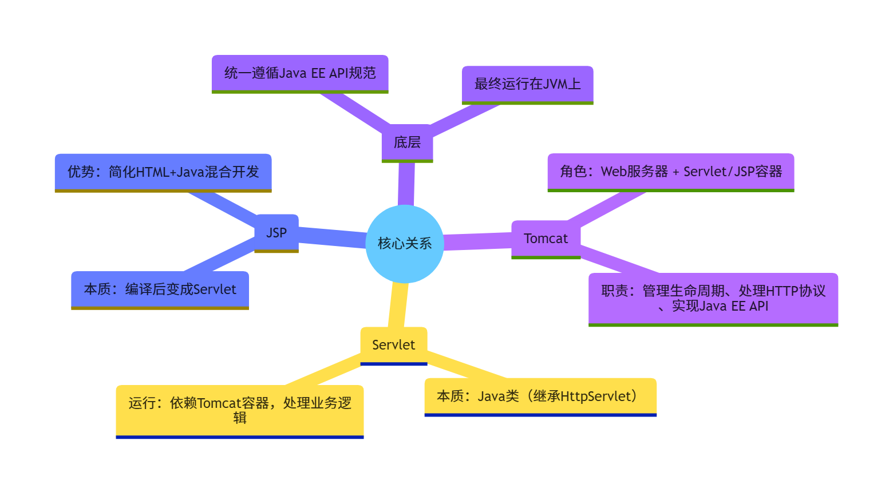
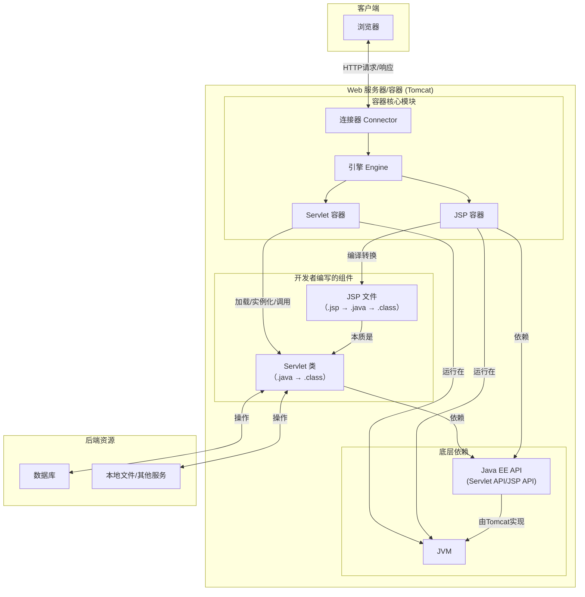
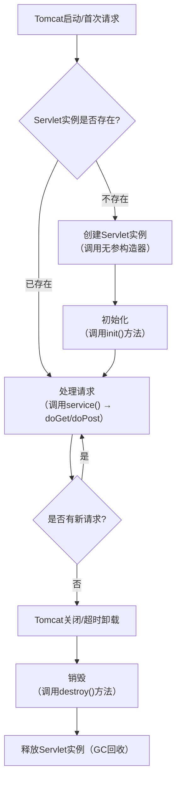
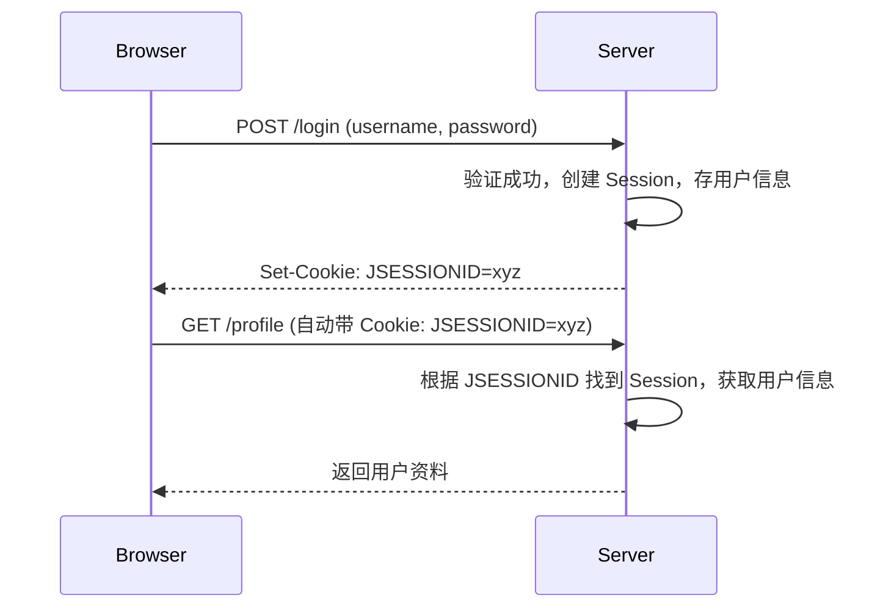
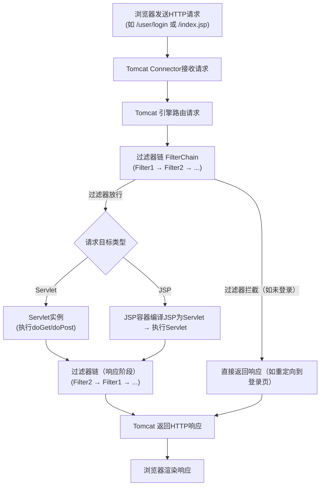

# Java 网络编程全景通关宝典（底层协议、I/O 模型、Netty 架构与生产实战）

> **导读与知识图谱**
> 网络编程是 Java 分布式系统、微服务架构与高性能中间件的底座核心技术。
> 本宝典系统梳理网络通信协议栈、I/O 演进模型、Netty 反应器设计模式、Web 容器核心对象、现代化 HTTP 客户端、全双工实时通信与分布式 RPC 框架，构筑七维立体知识体系：
> 1. **第一部分：网络通信协议底座与 HTTP/HTTPS 协议体系**：OSI/TCP-IP 分层映射、TCP/UDP 传输特性、HTTP/1.0~3.0 演进、方法/状态码/报文头规范与 TLS 握手
> 2. **第二部分：Java Socket 编程与 I/O 演进模型（BIO / NIO / AIO）**：InetAddress/Socket 编程、多线程 BIO、Channel/Buffer/Selector 核心机制与 Linux epoll 映射
> 3. **第三部分：高性能网络通信框架：Netty 全景与底层机制**：Reactor 线程模型、EventLoop、ChannelPipeline 责任链、ByteBuf 池化与零拷贝、高可用心跳/粘包拆包
> 4. **第四部分：Java Web 容器与 Servlet 核心体系**：Tomcat/Servlet/Spring 演进、Servlet 生命周期、HttpServletRequest/Response 源码对象模型、Cookie/Session 分布式存储与 Filter/Interceptor 协作
> 5. **第五部分：Java HTTP 客户端开发与通信实战**：HttpURLConnection、Java 11 HttpClient 异步、Apache HttpClient 连接池复用、Square OkHttp 与 Spring WebClient
> 6. **第六部分：全双工与实时通信架构（WebSocket / STOMP / SSE / 轮询）**：轮询演进、WebSocket 协议帧、Spring Boot WebSocket 原生集成、STOMP 消息代理、鉴权心跳、Redis 集群与 SSE
> 7. **第七部分：分布式 RPC 通信框架与微服务调用**：RPC 原理与手写实现、Dubbo3 vs OpenFeign 2026 技术选型、网络通信超时重试与防雪崩保障

---



---


## 一、网络通信协议底座与 HTTP/HTTPS 协议体系

> **导读与知识图谱**
> 应用层的所有网络通信，最终都依赖传输层与网络层的协议契约。
> 本模块涵盖：计算机网络体系与协议分层模型、TCP 与 UDP 本质差异、HTTP/1.0 至 HTTP/3.0 协议演进、HTTP 请求方法（GET/POST 深度对比）、HTTP 状态码与核心请求/响应头规范、以及 HTTPS 混合加密与 TLS 握手全流程。

---

### 1.1 计算机网络体系与协议分层模型（OSI 7层 vs TCP/IP 4层及 Java 映射）

**答：**
 Java 网络编程是指利用 Java 提供的 `java.net` 包实现不同主机间通过网络进行通信的过程。核心目标是**在进程间传输数据**。

常见网络通信协议：

- **TCP（Transmission Control Protocol）**：面向连接、可靠传输；
- **UDP（User Datagram Protocol）**：无连接、速度快；
- **HTTP / HTTPS**：应用层协议，基于 TCP；
- **FTP**：文件传输；
- **SMTP / POP3**：邮件传输。

**关键类：**

- `Socket` / `ServerSocket`：TCP 通信；
- `DatagramSocket` / `DatagramPacket`：UDP 通信；
- `InetAddress`：IP 解析；
- `URL`、`URLConnection`：HTTP 通信。

#### 一、常见协议及应用场景补充

不同协议因特性差异，适用场景截然不同，具体如下：

1. **TCP**：适用于对数据可靠性要求高的场景，如文件下载、即时通讯、银行转账等。它通过三次握手建立连接，四次挥手断开连接，能确保数据不丢失、不重复。
2. **UDP**：适用于对实时性要求高于可靠性的场景，如视频通话、语音聊天、网络广播等。它无需建立连接，直接发送数据，传输效率高但可能存在丢包。
3. **HTTP/HTTPS**：HTTP常用于普通网页浏览、API接口调用；HTTPS在HTTP基础上增加了SSL/TLS加密，适用于敏感数据传输，如电商支付、用户登录。
4. **FTP**：专门用于服务器与客户端之间的文件上传和下载，比如网站管理员向服务器上传网页文件。
5. **SMTP/POP3**：SMTP负责将邮件从发件人服务器发送到收件人服务器；POP3负责收件人从服务器下载邮件到本地客户端。

#### 二、关键类工作逻辑说明

1. **Socket/ServerSocket**：ServerSocket负责在服务端监听指定端口，等待客户端连接；Socket在客户端发起连接请求，与服务端的ServerSocket建立TCP连接后，双方即可通过输入流和输出流传输数据。
2. **DatagramSocket/DatagramPacket**：DatagramSocket用于发送和接收UDP数据报；DatagramPacket则封装了要发送或接收的数据、目标地址和端口，数据以数据包的形式在网络中传输。
3. **InetAddress**：无法通过new关键字创建实例，需通过`getByName(String host)`等静态方法获取，可用于获取主机的IP地址（如`getHostAddress()`）和主机名（如`getHostName()`）。
4. **URL、URLConnection**：URL代表统一资源定位符，如`http://www.example.com`，可直接打开连接；URLConnection是URL打开连接后的实例，能设置请求头、获取响应头，并通过流读取服务器返回的数据。

#### Java 网络编程 TCP 与 UDP 核心类体系

```
├─ TCP 通信（面向连接，可靠传输）
│  ├─ 服务端核心类：ServerSocket（监听端口，接收客户端连接）
│  │  ├─ 核心方法：accept()（阻塞等待，返回与客户端通信的 Socket）
│  │  ├─ 核心方法：bind()（绑定指定端口，也可通过构造方法直接绑定）
│  │  └─ 核心方法：close()（关闭服务端，释放端口资源）
│  │
│  └─ 客户端与服务端通信类：Socket（建立连接，传输数据）
│     ├─ 构造方法：Socket(String host, int port)（指定服务端 IP 和端口，发起连接）
│     ├─ 核心方法：getInputStream()（获取输入流，读取对方数据）
│     ├─ 核心方法：getOutputStream()（获取输出流，向对方发送数据）
│     └─ 核心方法：close()（关闭连接，释放资源）
│
└─ UDP 通信（无连接，不可靠传输）
   ├─ 发送与接收统一类：DatagramSocket（发送、接收数据报，绑定端口）
   │  ├─ 构造方法：DatagramSocket()（不绑定端口，系统分配临时端口，常用于发送端）
   │  ├─ 构造方法：DatagramSocket(int port)（绑定指定端口，常用于接收端）
   │  ├─ 核心方法：send(DatagramPacket p)（发送封装好的数据报）
   │  ├─ 核心方法：receive(DatagramPacket p)（阻塞等待，接收数据报存入参数）
   │  └─ 核心方法：close()（关闭，释放端口资源）
   │
   └─ 数据封装类：DatagramPacket（封装数据、目标地址、端口，承载 UDP 数据）
      ├─ 构造方法（接收用）：DatagramPacket(byte[] buf, int length)（创建空数据包，接收数据存入 buf）
      ├─ 构造方法（发送用）：DatagramPacket(byte[] buf, int length, InetAddress addr, int port)（封装数据、目标地址和端口）
      ├─ 核心方法：getData()（获取数据包中的字节数组数据）
      └─ 核心方法：getLength()（获取实际存储的数据长度，避免缓冲区空字符干扰）

```


---

#### 在Java中如何实现TCP网络编程？

在 Java 中实现 TCP 网络编程需基于 `Socket`（客户端）和 `ServerSocket`（服务端），核心流程是**建立连接→传输数据→关闭连接**。以下是详细步骤和代码示例：

##### **一、TCP 通信核心流程**

1. **服务端**：  
   - 创建 `ServerSocket` 并绑定端口，监听客户端连接。  
   - 调用 `accept()` 阻塞等待客户端连接，返回 `Socket` 对象（与客户端的连接）。  
   - 通过 `Socket` 获取输入流/输出流，读取/发送数据。  
   - 通信结束后关闭流和 `Socket`、`ServerSocket`。  

2. **客户端**：  
   - 创建 `Socket` 并指定服务端 IP 和端口，发起连接。  
   - 通过 `Socket` 获取输入流/输出流，发送/读取数据。  
   - 通信结束后关闭流和 `Socket`。  

##### **二、代码示例（单客户端通信）**

###### 1. 服务端（Server）

```java
import java.io.*;
import java.net.ServerSocket;
import java.net.Socket;

public class TCPServer {
    public static void main(String[] args) {
        ServerSocket serverSocket = null;
        Socket socket = null;
        BufferedReader in = null;
        PrintWriter out = null;

        try {
            // 1. 创建ServerSocket，绑定端口8888
            serverSocket = new ServerSocket(8888);
            System.out.println("服务端启动，等待客户端连接...");

            // 2. 阻塞等待客户端连接（返回与客户端的Socket）
            socket = serverSocket.accept();
            System.out.println("客户端已连接：" + socket.getInetAddress().getHostAddress());

            // 3. 获取输入流（读取客户端数据）
            in = new BufferedReader(
                new InputStreamReader(socket.getInputStream(), "UTF-8")
            );

            // 4. 获取输出流（向客户端发送数据）
            out = new PrintWriter(
                new OutputStreamWriter(socket.getOutputStream(), "UTF-8"), 
                true  // 自动刷新缓冲区
            );

            // 5. 通信过程：读取客户端消息并回复
            String clientMsg;
            while ((clientMsg = in.readLine()) != null) {
                System.out.println("收到客户端消息：" + clientMsg);
                if ("exit".equals(clientMsg)) { // 约定退出指令
                    out.println("服务端已收到退出请求，断开连接");
                    break;
                }
                out.println("服务端已收到：" + clientMsg); // 回复客户端
            }

        } catch (IOException e) {
            e.printStackTrace();
        } finally {
            // 6. 关闭资源（逆序关闭）
            try {
                if (out != null) out.close();
                if (in != null) in.close();
                if (socket != null) socket.close();
                if (serverSocket != null) serverSocket.close();
                System.out.println("服务端关闭");
            } catch (IOException e) {
                e.printStackTrace();
            }
        }
    }
}
```

###### 2. 客户端（Client）

```java
import java.io.*;
import java.net.Socket;

public class TCPClient {
    public static void main(String[] args) {
        Socket socket = null;
        BufferedReader in = null;
        PrintWriter out = null;
        BufferedReader consoleIn = null;

        try {
            // 1. 创建Socket，连接服务端（IP为localhost，端口8888）
            socket = new Socket("localhost", 8888);
            System.out.println("已连接服务端");

            // 2. 获取输入流（读取服务端回复）
            in = new BufferedReader(
                new InputStreamReader(socket.getInputStream(), "UTF-8")
            );

            // 3. 获取输出流（向服务端发送数据）
            out = new PrintWriter(
                new OutputStreamWriter(socket.getOutputStream(), "UTF-8"), 
                true  // 自动刷新
            );

            // 4. 从控制台读取用户输入并发送
            consoleIn = new BufferedReader(new InputStreamReader(System.in));
            String userInput;
            while (true) {
                System.out.print("请输入消息（输入exit退出）：");
                userInput = consoleIn.readLine();
                out.println(userInput); // 发送到服务端

                // 读取服务端回复
                String serverMsg = in.readLine();
                System.out.println("服务端回复：" + serverMsg);

                if ("exit".equals(userInput)) {
                    break;
                }
            }

        } catch (IOException e) {
            e.printStackTrace();
        } finally {
            // 5. 关闭资源
            try {
                if (consoleIn != null) consoleIn.close();
                if (out != null) out.close();
                if (in != null) in.close();
                if (socket != null) socket.close();
                System.out.println("客户端关闭");
            } catch (IOException e) {
                e.printStackTrace();
            }
        }
    }
}
```

##### **三、多客户端通信（服务端优化）**

上述示例仅支持单客户端连接。若需同时处理多个客户端，服务端需为每个连接启动**独立线程**：

```java
// 多线程服务端（核心修改）
public class MultiThreadTCPServer {
    public static void main(String[] args) throws IOException {
        ServerSocket serverSocket = new ServerSocket(8888);
        System.out.println("多线程服务端启动，等待客户端连接...");

        while (true) { // 循环接收客户端
            Socket socket = serverSocket.accept(); // 阻塞等待新连接
            // 为每个客户端创建线程处理通信
            new Thread(() -> {
                try (
                    BufferedReader in = new BufferedReader(
                        new InputStreamReader(socket.getInputStream(), "UTF-8")
                    );
                    PrintWriter out = new PrintWriter(
                        new OutputStreamWriter(socket.getOutputStream(), "UTF-8"), 
                        true
                    )
                ) {
                    System.out.println("新客户端连接：" + socket.getInetAddress());
                    String msg;
                    while ((msg = in.readLine()) != null) {
                        System.out.println("客户端" + socket.getPort() + "：" + msg);
                        out.println("已收到：" + msg);
                        if ("exit".equals(msg)) break;
                    }
                } catch (IOException e) {
                    e.printStackTrace();
                } finally {
                    try {
                        socket.close();
                        System.out.println("客户端" + socket.getPort() + "断开连接");
                    } catch (IOException e) {
                        e.printStackTrace();
                    }
                }
            }).start();
        }
    }
}
```

##### **四、关键注意事项**

1. **流的关闭顺序**：先关闭输出流，再关闭输入流，最后关闭 `Socket`/`ServerSocket`。  
2. **编码问题**：使用 `InputStreamReader`/`OutputStreamWriter` 时指定编码（如 UTF-8），避免乱码。  
3. **异常处理**：网络操作可能抛出 `IOException`，必须捕获或声明抛出。  
4. **多线程资源**：多客户端场景需注意线程安全（如共享数据需加锁）。  

通过以上方式，即可实现基于 TCP 的可靠网络通信。如果需要更复杂的场景（如 BIO/NIO 模型对比），可以进一步探讨。


#### 在Java中如何实现UDP网络编程？


在 Java 中实现 UDP 网络编程需基于 `DatagramSocket`（用于发送和接收数据报）和 `DatagramPacket`（封装数据、地址和端口），核心特点是**无连接、数据以数据包形式传输**。以下是详细步骤和代码示例：

##### **一、UDP 通信核心流程**

1. **发送端**：  
   - 创建 `DatagramSocket`（无需绑定端口，也可指定端口）。  
   - 准备要发送的数据（字节数组），封装为 `DatagramPacket`（需指定目标 IP 和端口）。  
   - 通过 `DatagramSocket` 发送数据包。  
   - 关闭 `DatagramSocket`。  

2. **接收端**：  
   - 创建 `DatagramSocket` 并绑定固定端口（用于监听数据）。  
   - 创建空的 `DatagramPacket`（用于接收数据，需指定缓冲区大小）。  
   - 调用 `receive()` 阻塞等待接收数据包，数据会存入缓冲区。  
   - 从 `DatagramPacket` 中解析数据、发送方地址和端口。  
   - 关闭 `DatagramSocket`。  

##### **二、代码示例（单向通信）**

###### 1. 接收端（Receiver）

```java
import java.net.DatagramPacket;
import java.net.DatagramSocket;

public class UDPReceiver {
    public static void main(String[] args) {
        DatagramSocket socket = null;
        try {
            // 1. 创建DatagramSocket，绑定端口9999（固定端口用于接收）
            socket = new DatagramSocket(9999);
            System.out.println("接收端启动，等待数据...");

            // 2. 创建缓冲区（字节数组）和空数据包
            byte[] buffer = new byte[1024]; // 缓冲区大小（根据实际需求设置）
            DatagramPacket packet = new DatagramPacket(buffer, buffer.length);

            // 3. 阻塞等待接收数据（数据存入buffer，packet会记录发送方信息）
            socket.receive(packet);

            // 4. 解析数据：从packet中提取字节数组，转为字符串
            String data = new String(
                packet.getData(), 
                0, 
                packet.getLength() // 实际接收的字节数（避免缓冲区空字符）
            );

            // 5. 打印发送方信息和数据
            System.out.println("收到来自 " + 
                packet.getAddress().getHostAddress() + ":" + 
                packet.getPort() + " 的数据：" + data);

        } catch (Exception e) {
            e.printStackTrace();
        } finally {
            // 6. 关闭Socket
            if (socket != null) {
                socket.close();
            }
        }
    }
}
```

##### 2. 发送端（Sender）

```java
import java.net.DatagramPacket;
import java.net.DatagramSocket;
import java.net.InetAddress;

public class UDPSender {
    public static void main(String[] args) {
        DatagramSocket socket = null;
        try {
            // 1. 创建DatagramSocket（不指定端口，系统会分配临时端口）
            socket = new DatagramSocket();

            // 2. 准备要发送的数据（转为字节数组）
            String msg = "Hello, UDP!";
            byte[] data = msg.getBytes("UTF-8"); // 指定编码，避免乱码

            // 3. 封装数据包：指定目标IP（localhost）、端口（9999）和数据
            DatagramPacket packet = new DatagramPacket(
                data, 
                data.length, 
                InetAddress.getByName("localhost"), 
                9999
            );

            // 4. 发送数据包
            socket.send(packet);
            System.out.println("数据发送完成");

        } catch (Exception e) {
            e.printStackTrace();
        } finally {
            // 5. 关闭Socket
            if (socket != null) {
                socket.close();
            }
        }
    }
}
```

##### **三、双向通信示例（模拟对话）**

UDP 也可实现双向通信，只需在接收端收到数据后，根据数据包中的发送方地址和端口，回复数据即可。

###### 1. 服务端（既能接收也能回复）

```java
import java.net.DatagramPacket;
import java.net.DatagramSocket;

public class UDPServer {
    public static void main(String[] args) throws Exception {
        DatagramSocket socket = new DatagramSocket(8888);
        byte[] buffer = new byte[1024];

        while (true) { // 循环接收
            // 接收客户端数据
            DatagramPacket receivePacket = new DatagramPacket(buffer, buffer.length);
            socket.receive(receivePacket); // 阻塞等待

            // 解析客户端数据和地址
            String clientMsg = new String(
                receivePacket.getData(), 0, receivePacket.getLength(), "UTF-8"
            );
            System.out.println("客户端说：" + clientMsg);

            // 准备回复数据
            String reply = "服务端收到：" + clientMsg;
            byte[] replyData = reply.getBytes("UTF-8");

            // 回复客户端（使用客户端的地址和端口）
            DatagramPacket replyPacket = new DatagramPacket(
                replyData,
                replyData.length,
                receivePacket.getAddress(), // 客户端IP
                receivePacket.getPort()     // 客户端端口
            );
            socket.send(replyPacket);

            // 约定退出条件
            if ("exit".equals(clientMsg)) {
                System.out.println("服务端退出");
                break;
            }
        }
        socket.close();
    }
}
```

###### 2. 客户端（发送并接收回复）

```java
import java.net.DatagramPacket;
import java.net.DatagramSocket;
import java.net.InetAddress;
import java.util.Scanner;

public class UDPClient {
    public static void main(String[] args) throws Exception {
        DatagramSocket socket = new DatagramSocket(); // 临时端口
        Scanner scanner = new Scanner(System.in);

        while (true) {
            // 从控制台输入消息
            System.out.print("请输入消息（输入exit退出）：");
            String msg = scanner.nextLine();

            // 发送给服务端（IP：localhost，端口：8888）
            byte[] data = msg.getBytes("UTF-8");
            DatagramPacket sendPacket = new DatagramPacket(
                data, data.length, InetAddress.getByName("localhost"), 8888
            );
            socket.send(sendPacket);

            // 接收服务端回复
            byte[] replyBuffer = new byte[1024];
            DatagramPacket replyPacket = new DatagramPacket(replyBuffer, replyBuffer.length);
            socket.receive(replyPacket); // 阻塞等待回复

            String serverReply = new String(
                replyPacket.getData(), 0, replyPacket.getLength(), "UTF-8"
            );
            System.out.println("服务端回复：" + serverReply);

            // 退出条件
            if ("exit".equals(msg)) {
                break;
            }
        }
        scanner.close();
        socket.close();
    }
}
```

##### **四、UDP 关键特性与注意事项**

1. **无连接**：发送端和接收端无需建立连接，直接发送数据包，效率高但不可靠（可能丢包、乱序）。  
2. **数据包大小限制**：`DatagramPacket` 缓冲区大小有限制（通常不超过 65535 字节），过大的数据需分片传输。  
3. **阻塞与线程**：`receive()` 是阻塞方法，若需同时处理发送和接收，需使用多线程。  
4. **编码一致性**：发送和接收时需使用相同的字符编码（如 UTF-8），否则会出现乱码。  
5. **端口绑定**：接收端必须绑定固定端口，发送端可使用系统分配的临时端口。  


UDP 适用于实时性要求高（如视频通话、游戏数据）但可容忍少量丢包的场景。如果需要更深入的内容（如 UDP 可靠性优化），可以进一步探讨。

------


适合后端面试，分层讲、核心考点、三次握手、四次挥手、滑动窗口、拥塞控制一次性整理好。

#### 一、TCP/IP 四层模型（必背）

从上到下：
1. **应用层**：HTTP、HTTPS、FTP、DNS、SMTP
2. **传输层**：**TCP、UDP**
3. **网络层**：IP、ICMP、ARP
4. **网络接口层**：以太网、网卡、MAC帧

对比七层OSI不用细背，面试只记**TCP/IP四层**就行。

---

#### 二、TCP 和 UDP 核心区别（高频必问）

| 特性     | TCP                                | UDP                       |
| -------- | ---------------------------------- | ------------------------- |
| 连接     | **面向连接**（三次握手）           | 无连接                    |
| 可靠性   | **可靠传输**，不丢包、不乱序       | 不可靠，可能丢包、乱序    |
| 控制机制 | 确认应答、重传、拥塞控制、流量控制 | 无                        |
| 速度     | 慢                                 | 快                        |
| 适用场景 | 文件传输、HTTP、数据库、接口调用   | 直播、语音通话、游戏、DNS |

一句话总结：
**TCP 可靠慢、UDP 不可靠快。**

---

#### 三、TCP 三次握手（面试必考）

##### 目的

**建立可靠连接、同步双方序列号、协商初始窗口大小**

##### 流程（背诵版）

1. **第一次握手**：客户端 → 服务端，**SYN** 报文（请求建立连接）
2. **第二次握手**：服务端 → 客户端，**SYN + ACK**（同意连接，并确认客户端）
3. **第三次握手**：客户端 → 服务端，**ACK**（确认服务端，连接建立）

##### 为什么不能两次握手？

防止**失效的SYN报文**延迟到达，导致服务端一直维护无效连接，浪费资源。

---

#### 四、TCP 四次挥手（面试必考）

##### 目的

**双向断开连接，TCP是全双工，两边都要单独关闭**

##### 流程

1. **第一次挥手**：主动方发 **FIN**，请求关闭自己的发送通道
2. **第二次挥手**：被动方回 **ACK**，确认关闭，还能继续发数据
3. **第三次挥手**：被动方数据发完，发 **FIN**
4. **第四次挥手**：主动方回 **ACK**，等待超时后彻底关闭

##### 为什么要四次？

TCP **全双工**，收和发通道独立，不能一次性关完，需要各自单独关闭。

##### TIME_WAIT 作用

主动关闭方等待 **2MSL**：
1. 保证最后一次 ACK 能被对方收到
2. 防止残留报文在下一次连接被接收

---

#### 五、TCP 可靠传输怎么保证？

1. **确认应答 ACK**：每发一段数据，对方回确认
2. **超时重传**：超时没收到 ACK，自动重发
3. **序列号 + 去重**：按序接收，重复包直接丢弃
4. **滑动窗口**：流量控制，控制收发速率

---

#### 六、流量控制 & 拥塞控制

##### 1. 流量控制

**解决：发送方发太快，接收方缓冲区满了**
机制：**滑动窗口**，接收方告知自己剩余窗口大小，发送方严格控制发送量。

##### 2. 拥塞控制

**解决：网络链路拥堵，路由器丢包**
四个阶段：
1. 慢启动
2. 拥塞避免
3. 快重传
4. 快恢复

---

#### 七、常见面试连环题

##### 1. TCP 为什么可靠，UDP 不可靠？

TCP 有连接、ACK确认、超时重传、序列号排序、流量拥塞控制；UDP 无连接，只管发不管收。

##### 2. 三次握手、四次挥手分别干嘛？

三次握手：**建立可靠连接**
四次挥手：**全双工断开连接**

##### 3. 了解粘包拆包吗？

TCP 是**流式协议**，无边界，会发生粘包拆包。
解决：
- 固定长度
- 分隔符
- 包头+包体（约定长度）

##### 4. HTTP 为什么基于 TCP？

HTTP 要**文本完整、不丢包、不乱序**，必须依赖 TCP 可靠传输。

---

我可以给你整理**极简一页纸背诵版**，适合面试前快速突击，要不要我帮你压缩成极简口诀版？

------

### 1.2 传输层核心协议对比：TCP vs UDP 本质区别与应用场景


| 对比项   | TCP                              | UDP                        |
| -------- | -------------------------------- | -------------------------- |
| 连接方式 | 面向连接（三次握手）             | 无连接                     |
| 可靠性   | 可靠传输（校验、重传、流量控制） | 不可靠，可能丢包           |
| 速度     | 较慢                             | 较快                       |
| 开销     | 较大                             | 较小                       |
| 适用场景 | 文件传输、邮件、HTTP、数据库通信 | 视频流、语音通话、实时游戏 |

#### 1.TCP和UDP的概念：

- **TCP**：通过三次握手**建立连接**，提供**端到端的可靠传输**，确保数据无差错、不丢失、按序到达。
- **UDP**：直接发送数据包，**不建立连接**，**不保证传输质量**，但延迟极低，适用于**实时性要求高**的场景。

#### 2.TCP和UDP的区别：

- **连接方式**：
  **TCP**：TCP需先通过**三次握手建立连接**（SYN、SYN-ACK、ACK），数据传输完成后，再通过**四次挥手释放连接**（FIN、ACK、FIN-ACK、ACK）。
  **UDP**：UDP直接发送数据包，**无需握手和挥手**。
- **可靠性**：
  **TCP**：TCP通过确认应答（ACK）、超时重传、数据校验（校验和）**确保数据可靠**。
  **UDP**：UDP无重传机制，发送即丢弃，**可靠性由应用层处理**（如视频丢帧不影响整体）。
- **传输顺序**：
  **TCP**：TCP通过序列号（Sequence Number）保证接收端**按序**重组数据。
  **UDP**：UDP不维护数据顺序，接收端**可能乱序接收**（如VoIP通话中语音包顺序错乱）。
- **传输速度**：
  **TCP**：TCP因连接管理、流量控制、重传等机制，**传输延迟较高**。
  **UDP**：UDP无控制开销，**传输速度极快**，适合实时应用（如在线游戏、直播）。
- **头部开销**：
  **TCP**：TCP**头部最小20字节**（含选项字段可扩展），包含序列号、确认号、窗口大小等字段。
  **UDP**：UDP**头部固定8字节**（仅源/目标端口、长度、校验和）。
- **流量控制**：
  **TCP**：TCP通过**滑动窗口**动态调整发送速率，避免接收方缓冲区溢出。
  **UDP**：UDP**无流量控制**，可能因接收方处理不及时导致丢包。
- **拥塞控制**：
  **TCP**：TCP通过**慢启动、拥塞避免、快重传**等算法避免网络拥堵。
  **UDP**：UDP**无拥塞控制**，可能加剧拥塞（如P2P下载中的UDP Flood攻击）。
- **应用场景**：
  **TCP**：HTTP/HTTPS、SMTP（邮件）、FTP（文件传输）。
  **UDP**：DNS查询、视频会议（Zoom）、在线游戏（UDP+应用层可靠性增强）。


------

### 1.3 HTTP/1.0 到 HTTP/3.0 协议演进历程与核心特性

#### 二、HTTP 核心面试点

##### 1. HTTP 1.0 / 1.1 / 2.0 区别（高频）

| 特性       | HTTP 1.0                   | HTTP 1.1                             | HTTP 2.0                   |
| ---------- | -------------------------- | ------------------------------------ | -------------------------- |
| 连接       | 短连接（一次请求一次连接） | **长连接**（Connection: keep-alive） | 多路复用（单连接并发请求） |
| 并发       | 串行请求                   | 浏览器限制6-8个并行请求              | 无队头阻塞，多路复用       |
| 数据格式   | 明文文本                   | 明文文本                             | **二进制分帧**             |
| 头部压缩   | 无                         | 无                                   | HPACK 头部压缩             |
| 服务端推送 | 无                         | 无                                   | 支持服务端主动推送资源     |

**面试必背核心：**
- HTTP1.1 最大改进：**长连接、管道化、缓存优化**
- HTTP2.0 最大改进：**多路复用、二进制分帧、头部压缩**


##### 4. HTTP 3.0 了解吗？

答：HTTP3.0 基于 **QUIC 协议（UDP）**，解决了HTTP2.0的队头阻塞问题，连接更快、弱网更稳定，是未来趋势。

---

### 1.4 HTTP 请求方法全景解析（GET vs POST 核心区别、幂等性与安全规范）

##### HTTP/1.1 最初定义的 8种核心请求方法

1. GET：
   - **作用**：请求指定资源，参数通过URL传递。
   - **特点**：**安全**（不修改服务器资源）、**幂等**（多次请求结果一致）、**可缓存**（响应可被浏览器或代理缓存）。
   - **场景**：数据查询、页面加载。
2. POST：
   - **作用**：提交数据（请求体携带数据）。
   - **特点**：**不安全**（可能修改服务器状态，eg: 新增订单）、**不幂等**（重复提交可能产生不同结果，eg: 多次创建订单）。
   - **场景**：表单提交、触发业务逻辑。
3. PUT：
   - **作用**：全量更新资源（客户端需提供完整数据）。
   - **特点**：**幂等**（多次更新结果一致，如重复更新同一资源）、**不安全**（可能覆盖其他用户的修改）。
   - **场景**：用户信息全量更新。
4. DELETE：
   - **作用**：删除指定资源。
   - **特点**：**幂等**（多次删除同一资源效果相同，如资源不存在时返回相同状态）、**不安全**（直接修改服务器状态）。
   - **场景**：删除文章、用户等资源。
5. HEAD：
   - **作用**：与GET类似，但服务器不返回响应体，仅返回响应头。
   - **特点**：**轻量**（节省带宽，用于检查资源是否存在或是否更新，如**Last-Modified**）、**安全**、**幂等**。
   - **场景**：检查资源是否存在或更新，eg: 验证链接有效性、资源缓存状态。
6. OPTIONS：
   - **作用**：查询服务器支持的请求方法，或检查跨域请求权限。
   - **特点**：**预检请求**：浏览器自动发送OPTIONS请求进行CORS验证。
   - **场景**：跨域API调用前的预检请求。
7. TRACE：
   - **作用**：回显客户端请求（用于调试）。
   - **特点**：**易引发安全风险**（如XST攻击），通常禁用。
8. CONNECT：
   - **作用**：建立代理隧道（如HTTPS）。
   - **特点**：由服务器/代理处理，**不直接暴露给业务层**。

#### 扩展方法（非HTTP/1.1原生）

1. PATCH：
   - **说明**：来自RFC 5789（2010），注意，RFC 5789（2010）是独立扩展规范，仅新增PATCH方法，需显式支持，不涉及HTTP版本更新。
   - **作用**：局部更新资源，需定义数据格式（如JSON Patch），客户端仅提交需修改的字段。
   - **特点**：**非幂等**（多次局部更新可能导致不同结果）、**灵活**（需定义数据格式）。
   - **场景**：修改用户的部分信息（如昵称）。


`GET` 和 `POST` 是 HTTP 协议中**最常用的两种请求方法**，核心区别是：**GET 用于「获取数据」，POST 用于「提交/修改数据」**，在使用场景、数据传输、安全性等方面有明确差异。

我整理了**最实用、面试常考、开发必懂**的区别，不绕弯子：

---

#### 一、核心区别速查表

| 对比项        | GET                                        | POST                                 |
| ------------- | ------------------------------------------ | ------------------------------------ |
| **核心用途**  | **查询、获取数据**（只读）                 | **提交、新增、修改数据**（写操作）   |
| **数据位置**  | 拼接在 **URL 地址栏** 中                   | 放在 **请求体（body）** 里           |
| **数据大小**  | 有限制（浏览器/服务器限制，约 2KB）        | 无大小限制（可传大文件、大数据）     |
| **安全性**    | 低（数据明文可见）                         | 相对高（数据不直接暴露）             |
| **缓存**      | 会被浏览器**自动缓存**                     | 默认**不缓存**                       |
| **书签/历史** | 可收藏为书签、保留在历史记录               | 不可收藏、不保留                     |
| **后退/刷新** | **无影响**（无害）                         | 会**重新提交数据**（浏览器会提示）   |
| **编码类型**  | 只支持 `application/x-www-form-urlencoded` | 支持多种编码（可传文件、JSON、表单） |
| **幂等性**    | 幂等（多次请求结果一致）                   | 非幂等（多次请求可能重复提交）       |

---

#### 二、关键区别详细解释

##### 1. 数据传输位置（最直观区别）

- **GET**：数据直接拼在 URL 后面  
  示例：`https://api.com/search?keyword=手机&page=1`
- **POST**：数据放在**请求体**中，地址栏看不到  
  适合传密码、表单、JSON、文件等隐私/大量数据

##### 2. 安全性

- **GET 绝对不能传敏感信息**  
  密码、token、身份证号用 GET 会直接暴露在地址栏、历史记录、服务器日志里。
- **POST 相对安全**  
  数据不暴露，但**不是加密**，抓包依然能看到，真正安全需要用 **HTTPS**。

##### 3. 数据大小限制

- **GET**：受 URL 长度限制，一般**不能超过 2KB**。
- **POST**：理论无限制，可传图片、视频、大表单。

##### 4. 缓存与历史记录

- **GET**：浏览器会自动缓存结果，适合查询接口（如列表、详情）。
- **POST**：默认不缓存，适合提交订单、登录、发布内容。

##### 5. 后退/刷新行为

- 页面用 GET 请求：刷新/后退**不会重复提交**，安全无害。
- 页面用 POST 请求：刷新会弹出**「确认重新提交表单」**，容易重复下单、重复发布。

---

#### 三、最标准的使用场景

##### ✅ 什么时候用 GET？

- 查询数据、搜索、分页、获取详情
- 页面跳转、接口获取静态数据
- 可被缓存、可收藏为书签的请求

##### ✅ 什么时候用 POST？

- 登录、注册（传密码）
- 提交表单、发布文章、下单支付
- 上传文件、传 JSON 大数据
- 会修改服务器数据的操作

---

#### 四、两个重要误区（面试常问）

1. **误区：POST 比 GET 更安全，是因为加密了**  
   ❌ 错！两者都是明文传输，**POST 只是不暴露在地址栏**，真正加密必须用 HTTPS。

2. **误区：GET 只能传文本，POST 能传所有类型**  
   ❌ 错！本质是协议设计用途不同，不是技术能力限制。

3. **误区：GET 比 POST 性能更好**  
   ⚠️ 半对：GET 可以缓存，所以**重复请求更快**，但单次请求速度几乎无差别。

---

#### 五、一句话总结

**GET 是「查数据」，把参数放地址栏，不安全、有大小限制、会缓存；  
POST 是「交数据」，把参数放请求体，相对安全、无限制、不缓存。**

---

#### 总结

1. **核心用途**：GET 查数据，POST 交数据；
2. **数据位置**：GET 在 URL，POST 在请求体；
3. **安全禁忌**：密码/隐私绝对不能用 GET；
4. **开发原则**：查询用 GET，修改/提交用 POST。


---

### 1.5 HTTP 响应状态码分类与高频必背考点（2xx / 3xx / 4xx / 5xx）

HTTP 状态码分为**5大类**，**第一位数字代表类型**，非常好记。我给你整理**最常考、最常用**的，不废话、直接背。

#### 一、状态码分类（记住第一位即可）

- **1xx**：信息性 — 请求正在处理
- **2xx**：成功 — 请求正常处理完毕
- **3xx**：重定向 — 需要进一步操作
- **4xx**：客户端错误 — 前端/请求方问题
- **5xx**：服务器错误 — 后端/服务问题

---

#### 二、高频必背状态码（面试必考）

##### 2xx 成功

###### **200 OK**

- 请求**完全成功**，正常返回数据。
- GET 请求最常见。

###### **201 Created**

- 创建资源成功（如：注册、新建文章、新增数据）。
- RESTful 接口常用。

###### **204 No Content**

- 请求成功，但**没有返回内容**（如删除接口）。

---

#### 3xx 重定向

###### **301 Moved Permanently**

- **永久重定向**。
- 旧网址废弃，浏览器会缓存新地址。

###### **302 Found / 307 Temporary Redirect**

- **临时重定向**。
- 本次跳过去，以后还能用原地址。

###### **304 Not Modified**

- **资源未修改**，使用缓存。
- 协商缓存命中，非常常见。

---

##### 4xx 客户端错误（前端/用户问题）

###### **400 Bad Request**

- **请求参数错误**、格式不对、后端无法理解。

###### **401 Unauthorized**

- **未认证**：没登录、token 无效/过期。

###### **403 Forbidden**

- **已登录，但无权限**（禁止访问）。
- 注意：401=没登录；403=登录了但没权限。

###### **404 Not Found**

- 资源不存在、接口不存在、路径错误。

###### **405 Method Not Allowed**

- 请求方法不允许（如接口只支持 POST，你用 GET）。

###### **429 Too Many Requests**

- 请求过多，**限流**。

---

##### 5xx 服务器错误（后端问题）

###### **500 Internal Server Error**

- **服务器内部错误**（代码报错、空指针、异常）。

###### **502 Bad Gateway**

- 网关错误（Nginx 转发失败、服务挂了）。

###### **503 Service Unavailable**

- 服务不可用（过载、维护中）。

###### **504 Gateway Timeout**

- 网关超时（后端接口响应太慢）。

---

### 1.6 HTTP 核心报文首部全解（请求头、响应头与通用头）

我直接给你**最常用、最常问**的，分类清晰、一看就懂、背完就能面试。

#### 一、通用头（请求+响应都能用）

1. **Content-Type**
    数据类型（格式）。
    例：`application/json`、`form`、`text/html`
2. **Content-Length**
    数据长度（字节）。
3. **Connection**
    连接管理：`keep-alive` 长连接 / `close` 关闭。
4. **Cache-Control**
    缓存控制：`no-cache`、`max-age=xxx`、`no-store`。

#### 二、请求头 Request Headers（客户端→服务器）

##### 1. 客户端标识

- **User-Agent**
    浏览器/设备信息（手机、Chrome、版本）。
- **Host**
    目标主机域名+端口（**HTTP/1.1 必须带**）。

##### 2. 认证权限

- **Authorization**
    存放 Token、Bearer 令牌、身份凭证。

##### 3. 缓存相关（高频）

- **If-Modified-Since**
    问服务器：文件从某个时间后改过吗？
- **If-None-Match**
    带上 ETag，问资源是否变化。

##### 4. 内容格式

- **Accept**
    客户端希望接收的数据类型：`application/json`
- **Accept-Encoding**
    支持压缩：`gzip, deflate`
- **Accept-Language**
    语言：`zh-CN, en`

##### 5. 跨域相关（必问）

- **Origin**
    当前源（协议+域名+端口），跨域时必带。
- **Access-Control-Request-Headers**
    预检请求：告诉我允许哪些头。
- **Access-Control-Request-Method**
    预检请求：我要用什么方法（GET/POST）。

##### 6. 其他

- **Referer**
    从哪个页面跳转过来的（防盗链常用）。
- **Cookie**
    携带本地 Cookie。

#### 三、响应头 Response Headers（服务器→客户端）

##### 1. 缓存相关（必问）

- **Cache-Control**
    强制缓存策略。
- **Expires**
    过期时间（老版本）。
- **Last-Modified**
    资源最后修改时间。
- **ETag**
    资源唯一标识（比 Last-Modified 更准确）。

##### 2. 跨域（超级高频）

- **Access-Control-Allow-Origin**
    允许哪些源跨域（`*` 或具体域名）。
- **Access-Control-Allow-Headers**
    允许携带哪些头。
- **Access-Control-Allow-Methods**
    允许哪些请求方法 GET/POST/PUT/DELETE。
- **Access-Control-Allow-Credentials**
    是否允许携带 Cookie。

##### 3. Cookie 相关

- **Set-Cookie**
    服务器种下 Cookie。

##### 4. 服务信息

- **Server**
    服务器软件 Nginx、Apache。
- **Content-Encoding**
    响应压缩方式 gzip。
- **Location**
    重定向地址（配合 301/302）。


------

### 1.7 HTTPS 安全通信底层原理：对称/非对称加密与 SSL/TLS 握手全流程

##### 2. HTTPS 是什么？

HTTPS = HTTP + SSL/TLS 加密层，是 HTTP 的安全版本，默认端口 **443**。
作用：对传输数据**加密、身份验证、数据完整性校验**，防止窃听、篡改、劫持。


#### 三、HTTPS 核心面试点（重中之重）

##### 1. HTTPS 工作原理（面试必背流程）

HTTPS 采用**对称加密 + 非对称加密**结合的混合加密机制：
1. **客户端发起请求**：支持的SSL/TLS版本、加密套件列表
2. **服务端响应**：确认加密套件、返回**数字证书**（含公钥、域名、有效期、CA签名）
3. **客户端验证证书**：校验CA合法性、域名、有效期，防止伪造
4. **客户端生成随机密钥**：用**服务端公钥加密**后传给服务端
5. **对称加密通信**：双方用随机密钥做**对称加密**传输数据（速度快）

##### 2. 对称加密 vs 非对称加密

- **对称加密**：加密解密用同一个密钥，速度快，不安全（密钥传输易泄露）
- **非对称加密**：公钥加密、私钥解密，速度慢，安全（密钥不传输）
- HTTPS 设计：**非对称加密交换对称密钥，对称加密传输数据**，兼顾安全与性能

##### 3. 数字证书 & CA 机构

- CA（证书颁发机构）：权威第三方，验证服务器身份
- 证书内容：服务器公钥、域名、有效期、CA签名
- 作用：**防止公钥被掉包**，确认服务器真实身份

##### 4. HTTP 与 HTTPS 核心区别

1. 端口：80 / 443
2. 传输：明文 / 加密（SSL/TLS）
3. 安全：易窃听篡改 / 防窃听、篡改、劫持
4. 性能：HTTPS 握手耗时更长，消耗CPU更高
5. 部署：HTTP 无需证书 / HTTPS 需要CA证书

---

#### 四、高频面试题直接背版

##### 1. 说一下HTTPS的加密过程？

答：HTTPS 用混合加密：
1. 客户端请求，服务端下发带公钥的数字证书；
2. 客户端验证证书合法性，生成**随机对称密钥**，用服务端公钥加密传给服务端；
3. 服务端用私钥解密得到对称密钥；
4. 后续所有数据都用**对称密钥**加密传输，既安全又高效。

##### 2. HTTPS 是绝对安全的吗？

答：不是。
- 证书伪造、私钥泄露、中间人攻击（伪造证书）、弱加密套件都会导致不安全；
- 但正规CA证书+现代TLS协议，能保证传输层绝对安全。

##### 3. 为什么不全程用非对称加密？

答：非对称加密算法复杂，**加解密速度慢**，不适合大量数据传输；对称加密速度快，适合传输数据，所以结合使用。


## 二、Java Socket 编程与 I/O 演进模型（BIO / NIO / AIO）

> **导读与知识图谱**
> Socket 是应用层访问传输层（TCP/UDP）的统一门面。理解从传统阻塞式 BIO 到基于多路复用的 NIO，再到异步 AIO 的演进历程，是掌握高性能服务端架构的必经之路。
> 本模块涵盖：Java 传统 Socket 编程基础、TCP 多线程 BIO 编程实战、UDP 数据报通信、I/O 模型演进全景（BIO vs NIO vs AIO）、Java NIO 核心三剑客（Channel/Buffer/Selector）、以及 Linux 底层 epoll 机制与 Java 的映射。

---

### 2.1 Java 传统 Socket 编程基础（InetAddress、Socket 与 ServerSocket）


**答：**
 `InetAddress` 用于表示 IP 地址（IPv4 或 IPv6）。

**常用方法：**

```java
InetAddress local = InetAddress.getLocalHost();
System.out.println(local.getHostName());     // 主机名
System.out.println(local.getHostAddress());  // IP 地址

InetAddress remote = InetAddress.getByName("www.google.com");
System.out.println(remote.getHostAddress());
```

------


**Java 单体项目、微服务项目中，99.9% 不会手动写原生 Socket（TCP API）！**
**业务开发永远不会自己 new Socket() / ServerSocket()！**

---

#### 一、为什么绝对不用原生 Socket？

1. **原生 Socket 太底层**
   要自己处理：**粘包、拆包、断连、重连、心跳、序列化、并发、缓冲区**……
   写起来极其复杂，容易出BUG。

2. **HTTP 已经封装好一切**
   Tomcat、Jetty、Undertow 内部**已经用 Socket 实现了 HTTP 服务器**
   → 我们只需要写 `@RestController` 就行。

3. **微服务通信全是 HTTP/gRPC**
   用 Feign、RestTemplate、OkHttp、Retrofit
   **底层都是框架封装好的 Socket，开发者完全无感知**。

4. **就算要长连接、实时通信**
   也是用 **WebSocket 标准 API**，**不是原生 Socket**
   Spring 直接提供：`@OnOpen`、`@OnMessage` 等注解。

---

#### 二、那**谁才会写原生 Socket**？

只有**底层框架开发者**才会用：
- Tomcat、Jetty 内核
- Netty、Mina 框架
- MySQL、Redis、RocketMQ 客户端底层
- 网关（Spring Cloud Gateway 底层用 Netty）
- 自研RPC框架

**普通Java后端、业务开发、微服务开发，一辈子都不会手写原生Socket。**

---

#### 三、真实情况总结（超级重要）

你在**实际工作**中会遇到的网络技术只有这4个，按频率排序：

1. **HTTP（最常用）**
2. **WebSocket（实时推送）**
3. **OkHttp/Feign/Retrofit（调用接口）**
4. **Netty（极少数底层项目）**

✅ **原生 Socket（TCP API）：业务代码中几乎不存在！**

---

#### 四、面试标准答案（背这句就够）

**原生 Socket 是对 TCP 的底层 API，过于底层且复杂，需要处理粘包拆包、断连重连等问题。
在 Java 单体和微服务的业务开发中，几乎不会手动实现；
我们都是基于 HTTP、WebSocket 或 OkHttp、Feign 等封装好的框架进行网络通信，
底层 Socket 已经被服务器或框架自动处理，开发者无需关心。**

---

#### 五、你现在的知识体系完全正确了（最终图谱）

```
应用层：HTTP、WebSocket（业务开发用）
↑
框架层：OkHttp、Feign、Tomcat、SpringMVC（封装好）
↑
传输层：TCP、UDP（协议）
↑
API 层：Socket（底层API，业务不用）
```

---

### 2.2 TCP 编程实战：从单线程阻塞到多线程线程池模型（BIO）

> TCP：面向连接、可靠传输、字节流、三次握手建立连接、四次挥手断开连接；全双工。
> Java 基础TCP编程使用 `ServerSocket`（服务端）、`Socket`（客户端），属于**BIO 阻塞IO**。

#### 核心概念

1. **ServerSocket**：服务端，监听指定端口，等待客户端连接。
2. **Socket**：代表一个TCP通信端点，客户端Socket，服务端accept返回Socket，代表和某一个客户端的连接。
3. 通信基于IO流：
- `getInputStream()`：读取对方发来的数据
- `getOutputStream()`：向对方发送数据

> TCP是字节流，没有消息边界；需要自己定义协议区分消息（换行、定长、长度+内容）。

#### 一、TCP服务端代码（BIO）

```java
public class TcpServer {
    public static void main(String[] args) throws IOException {
        // 绑定监听端口
        ServerSocket serverSocket = new ServerSocket(8888);
        System.out.println("服务端启动，监听8888端口");

        while(true){
            // 阻塞等待客户端连接，没有客户端就卡住
            Socket socket = serverSocket.accept();
            System.out.println("客户端已连接：" + socket.getInetAddress());

            // BIO模型：每一个客户端开一个新线程处理
            new Thread(()->{
                try(InputStream is = socket.getInputStream();
                    OutputStream os = socket.getOutputStream()){

                    byte[] buffer = new byte[1024];
                    int len;
                    // 阻塞读取客户端数据
                    while((len = is.read(buffer)) != -1){
                        String msg = new String(buffer,0,len);
                        System.out.println("收到客户端：" + msg);
                        // 回写数据
                        os.write("服务端收到\n".getBytes(StandardCharsets.UTF_8));
                        os.flush();
                    }
                } catch (IOException e) {
                    e.printStackTrace();
                }finally {
                    try {
                        socket.close();
                    } catch (IOException ignored) {}
                }
            }).start();
        }
    }
}
```
> BIO特点：`accept()`、`read()`都是阻塞；**一个客户端一条线程**，客户端多线程爆炸，不适合高并发。

#### 二、TCP客户端代码

```java
public class TcpClient {
    public static void main(String[] args) throws IOException {
        // 建立TCP连接，连接服务端IP+端口，内部完成三次握手
        Socket socket = new Socket("127.0.0.1",8888);

        OutputStream os = socket.getOutputStream();
        InputStream is = socket.getInputStream();

        // 发送数据
        os.write("你好，TCP服务端\n".getBytes(StandardCharsets.UTF_8));
        os.flush();

        // 读取响应
        byte[] buf = new byte[1024];
        int len = is.read(buf);
        String resp = new String(buf,0,len);
        System.out.println("客户端收到："+resp);

        socket.close(); // 四次挥手断开连接
    }
}
```

#### 三、TCP关键特性（面试必背）

1. **面向连接**：通信前必须建立连接（三次握手）；UDP无连接。
2. **可靠传输**：超时重传、确认应答、滑动窗口、拥塞控制；保证数据有序、不丢包、不重复。
3. **字节流**：没有数据包边界。
> 问题：粘包/拆包。多条数据粘在一起，或者一条被拆分多次到达。
> 解决方案：
> ① 换行符分割 ② 定长报文 ③ 【最常用】**长度字段 + 实际内容**（Netty解码器用的方案）
4. **全双工**：两端可以同时收发数据。
5. 连接需要释放：四次挥手。

#### 四、BIO 存在的问题

1. `accept()`、`read()`阻塞，没有数据线程就挂住。
2. 每一个客户端占用一个线程；大量客户端，线程数量暴涨，CPU上下文切换高，资源耗尽。
3. 线程空闲也占用内存。
> 引出：NIO（非阻塞IO）、Netty。

#### 五、高频面试问答

##### Q：Socket.close()做了什么？

触发TCP四次挥手，关闭连接；关闭输入输出流，释放端口资源。

##### Q：TCP粘包拆包是什么？为什么会发生？

TCP是字节流协议，只负责传输字节，不区分业务消息边界。
- 粘包：多个业务消息合并到一个TCP报文到达
- 拆包：一个业务消息被分成多个TCP报文
> 根源：操作系统TCP缓冲区、MSS限制。**TCP层不会解决，需要应用层自定义协议。**

##### Q：ServerSocket 和 Socket区别

- ServerSocket：服务端，绑定端口，只负责监听、接受连接，不做数据读写。
- Socket：代表一条TCP连接，用来读写数据。`accept()`阻塞，有客户端接入才返回Socket对象。

##### Q：read返回-1代表什么？

对端执行了socket.close()，连接正常关闭。

##### Q：BIO为什么并发性能差？

每个客户端独占一个线程；阻塞等待IO，大量线程，内存占用高，上下文切换开销大，不适合上万连接场景。

#### ✅精简背诵版

Java TCP BIO使用`ServerSocket`服务端监听端口，`Socket`代表TCP连接；accept阻塞等待客户端接入，每个客户端开启独立线程处理IO。
TCP特点：面向连接、可靠、字节流、全双工；存在粘包拆包，应用层需要自定义消息边界。
BIO缺点：阻塞IO，一连接一线程，高并发下线程爆炸性能差；后续NIO/Netty解决该问题。

> 下一部分可以继续：**UDP网络编程 / Java NIO 三大组件(Selector、Channel、Buffer)**，需要继续吗？


---

### 2.3 UDP 数据报通信编程实战（DatagramSocket 与 DatagramPacket）


**答：**

- `DatagramSocket`：用于发送和接收 UDP 数据包；
- `DatagramPacket`：表示一个具体的 UDP 数据报。

**示例：**

```java
// 发送端
DatagramSocket socket = new DatagramSocket();
byte[] data = "Hello UDP".getBytes();
InetAddress address = InetAddress.getByName("localhost");
DatagramPacket packet = new DatagramPacket(data, data.length, address, 8888);
socket.send(packet);

// 接收端
DatagramSocket receiver = new DatagramSocket(8888);
byte[] buf = new byte[1024];
DatagramPacket recvPacket = new DatagramPacket(buf, buf.length);
receiver.receive(recvPacket);
```

------


> UDP：**无连接、不可靠、数据报、面向报文**。不需要三次握手四次挥手；只管发送，不保证对方收到；速度快。
> Java UDP核心类：`DatagramSocket`（套接字）、`DatagramPacket`（数据包，封装接收/发送的数据、地址端口）。

#### TCP与UDP核心对比

|特性|TCP|UDP|
|---|---|---|
|连接|面向连接，三次握手建立|无连接，直接发报|
|可靠性|可靠，超时重传、确认应答|不可靠，丢包、乱序都有可能|
|传输形式|字节流，有粘包拆包|数据报，一条报文一个包，**不会粘包**|
|开销|大|小，速度快|
|适用场景|文件传输、HTTP、RPC、数据库|直播、语音视频、DNS、游戏实时帧|

> UDP是**面向报文**：应用层给一个DatagramPacket，底层就一个UDP包；不会拆分合并报文。

#### UDP服务端代码

```java
public class UdpServer {
    public static void main(String[] args) throws IOException {
        // 服务端绑定端口
        DatagramSocket socket = new DatagramSocket(9999);
        byte[] buf = new byte[1024];

        while(true){
            // 封装接收数据包
            DatagramPacket receivePacket = new DatagramPacket(buf, buf.length);
            // 阻塞等待接收数据报
            socket.receive(receivePacket);

            // 取出收到的数据
            String msg = new String(receivePacket.getData(),0,receivePacket.getLength());
            System.out.println("收到客户端消息：" + msg);

            // 获取发送方地址、端口，回包给客户端
            InetAddress clientAddr = receivePacket.getAddress();
            int clientPort = receivePacket.getPort();
            byte[] respBytes = "UDP服务端收到".getBytes();
            DatagramPacket sendPacket = new DatagramPacket(respBytes,respBytes.length,clientAddr,clientPort);
            socket.send(sendPacket);
        }
    }
}
```

#### UDP客户端代码

```java
public class UdpClient {
    public static void main(String[] args) throws IOException {
        DatagramSocket socket = new DatagramSocket();
        String content = "hello UDP";
        byte[] bytes = content.getBytes(StandardCharsets.UTF_8);

        // 指定服务端IP、端口，构造发送报文
        InetAddress serverAddr = InetAddress.getByName("127.0.0.1");
        DatagramPacket sendPacket = new DatagramPacket(bytes,bytes.length,serverAddr,9999);
        socket.send(sendPacket);

        // 接收服务端应答
        byte[] buf = new byte[1024];
        DatagramPacket respPacket = new DatagramPacket(buf,buf.length);
        socket.receive(respPacket);
        String resp = new String(respPacket.getData(),0,respPacket.getLength());
        System.out.println("客户端收到："+resp);

        socket.close();
    }
}
```

#### 重点API说明

1. `DatagramSocket`：UDP套接字。服务端绑定端口；客户端可以不指定端口，系统自动分配随机端口。
2. `DatagramPacket`：数据报包，**既用于接收，也用于发送**。
   - 接收：只填缓冲区、长度
   - 发送：需要填充数据、目标IP+端口
3. `socket.receive(packet)`：**阻塞方法**，没有数据包就阻塞等待。
4. UDP没有输入输出流 `InputStream/OutputStream`，全部靠DatagramPacket收发。

#### UDP重要知识点（面试高频）

1. **无连接**：通信双方不维护连接状态；同一个socket可以给多个不同目标发送报文。
2. **不可靠**：发送完不知道对方有没有收到；没有ACK确认，会丢包。
> 如果业务需要可靠UDP：应用层自己实现序号、ACK确认、超时重传（如QUIC协议）。
3. **面向报文，不会粘包**
   每次send一个packet就是一个UDP报文；对方receive拿到完整报文，不会出现TCP那种字节流粘包问题。
   ⚠️但是：**UDP报文有大小限制**，超过MTU会IP分片，分片丢失整个报文就全部丢失。
4. UDP服务端不需要像TCP一样accept，不需要为每个客户端新建线程；同一个socket接收所有客户端的数据包。

#### 高频面试题

##### Q：UDP为什么不可靠？

UDP协议本身没有确认应答、超时重传、滑动窗口、拥塞控制机制。发送只管把数据包交给内核，不关心是否到达对端。

##### Q：UDP会不会粘包？

**不会。** UDP是数据报模型，应用层发送多少就是一个报文；接收端一次receive拿到完整一条报文。
> 注意：缓冲区要足够，如果接收缓冲区比报文小，会发生**报文截断，多余字节直接丢弃**。

##### Q：UDP可以实现可靠传输吗？

可以，**在应用层实现**：序列号、ACK应答、超时重传、流量控制。QUIC就是基于UDP实现可靠传输。

##### Q：DatagramPacket getData()注意点

缓冲区数组是复用的，getData返回整个byte数组；一定要用`getLength()`取有效数据长度，不能直接用数组长度。

##### Q：UDP适合什么场景？

直播、音视频通话、游戏实时状态同步、DNS查询；可以容忍少量丢包，追求低延迟。

#### ✅精简背诵版

UDP基于`DatagramSocket`、`DatagramPacket`；无连接、不可靠、面向报文，没有IO流。
不需要建立连接，没有accept；收发全部使用数据包。UDP不会粘包，但报文不能过大；丢包协议层不处理，需要业务层做ACK重传实现可靠。
适合低延迟可容忍丢包场景；TCP面向连接可靠字节流，会出现粘包拆包。

> 接下来可以继续：**Java NIO 三大核心 Buffer、Channel、Selector**，要继续吗？

------

### 2.4 Java I/O 模型演进全景：BIO（阻塞）vs NIO（非阻塞多路复用）vs AIO（异步）


| 模式                        | 描述                                     | Java 实现                                     |
| --------------------------- | ---------------------------------------- | --------------------------------------------- |
| **BIO（Blocking I/O）**     | 每次 I/O 调用阻塞线程，直到完成          | `Socket` / `ServerSocket`                     |
| **NIO（Non-blocking I/O）** | 线程可同时监控多个通道，I/O 就绪时再操作 | `java.nio`                                    |
| **AIO（Asynchronous I/O）** | 完全异步回调机制，操作系统完成后通知应用 | `java.nio.channels.AsynchronousSocketChannel` |

------


| 项目     | NIO                         | AIO                                              |
| -------- | --------------------------- | ------------------------------------------------ |
| 模式     | 非阻塞                      | 异步                                             |
| 线程模型 | 主动轮询 Selector           | 回调通知 CompletionHandler                       |
| 系统支持 | 所有 Java 平台              | JDK7+，需 OS 支持异步 IO                         |
| 使用类   | `SocketChannel`, `Selector` | `AsynchronousSocketChannel`, `CompletionHandler` |

**AIO 示例：**

```java
AsynchronousServerSocketChannel server =
    AsynchronousServerSocketChannel.open().bind(new InetSocketAddress(8080));

server.accept(null, new CompletionHandler<AsynchronousSocketChannel, Void>() {
    @Override
    public void completed(AsynchronousSocketChannel ch, Void att) {
        ByteBuffer buf = ByteBuffer.allocate(1024);
        ch.read(buf, buf, new CompletionHandler<Integer, ByteBuffer>() { ... });
    }
    public void failed(Throwable exc, Void att) { exc.printStackTrace(); }
});
```


> IO模型本质：**线程等待数据的方式**，分为阻塞、非阻塞、同步、异步。
> 两个阶段：①等待内核准备数据 ②把内核数据拷贝到用户进程。

|IO模型|Java实现|同步/异步|阻塞/非阻塞|线程模型|操作系统支持|
|---|---|---|---|---|---|
|BIO|ServerSocket/Socket|同步|阻塞|一连接一线程|全部操作系统|
|NIO(Non‑blocking IO，同步非阻塞)|java.nio（Channel、Buffer、Selector）|同步|非阻塞|少量线程处理大量连接|全部操作系统|
|AIO(Asynchronous IO，异步非阻塞)|java.nio.channels.AsynchronousXXX|异步|非阻塞|回调，不需要轮询|Windows完成端口；Linux内核支持有限，实际很少用|

#### 1、BIO 阻塞IO（Blocking IO）

##### 核心特点

同步阻塞。线程调用`accept()`、`read()`，**没有数据就线程阻塞挂起**。
- 服务端模型：`ServerSocket.accept()`阻塞；每来一个客户端Socket，新开一个线程负责读写。
- 代码：就是前面TCP BIO示例。

**缺点：**
1. 每一个连接占用一个独立线程，大量客户端 → 线程暴涨，内存高、CPU上下文切换严重。
2. 线程大部分时间在阻塞等待IO，CPU利用率低。
3. 适合连接数少的场景，高并发不适用。

> 一句话：**连接多，线程就多，性能瓶颈明显。**

#### 2、NIO 同步非阻塞IO（New IO / Non‑blocking IO）

> Java NIO 三大核心组件：**Channel通道、Buffer缓冲区、Selector选择器（多路复用器）**

##### 核心思想

**一个或者少量线程，管理成千上万个TCP连接。**
- Channel：双向通道，替代Socket；可以设置为**非阻塞模式**。
- Buffer：缓冲区，数据读写必须经过Buffer。
- Selector（多路复用器）：线程注册多个Channel到Selector，线程只阻塞在Selector上；当某个Channel有事件（连接就绪、读就绪、写就绪），Selector返回就绪的Channel，线程再去处理。

> 注意：**NIO是同步非阻塞！IO拷贝动作还是应用线程自己做，不是操作系统帮你做完回调。**

##### 事件类型（Selector监听）

1. `SelectionKey.OP_ACCEPT`：接收连接事件
2. `OP_READ`：读就绪，通道有数据可读
3. `OP_WRITE`：写就绪，通道可以发送数据

##### NIO 优势

1. 少量线程就可以管理上万连接，线程不会随连接数膨胀。
2. 连接没有数据的时候，线程不会阻塞在该连接上，转而处理其他就绪连接。

##### NIO原生编程痛点（面试常考）

- 代码极其繁琐，需要处理：粘包拆包、异常、断线、读写缓冲区、多线程问题。
- 会出现**空轮询bug（JDK NIO epoll bug）**，Selector一直空循环消耗CPU。
> 所以生产不用原生NIO，直接使用 **Netty框架封装NIO**。

#### 3、AIO 异步非阻塞IO（Asynchronous IO）

Java：`AsynchronousServerSocketChannel`、`AsynchronousSocketChannel`
- 真正异步：发起IO请求之后，线程直接返回，去做别的事；**操作系统内核完成全部IO（等待+拷贝到用户缓冲区）之后，主动回调通知应用程序**。
- 不需要线程轮询。

##### 现实使用情况

Linux下AIO内核实现不完善，性能差；Windows上IOCP完成端口性能好。
**Java后端开发几乎不会使用AIO，Netty也放弃AIO的支持。**

#### 4、同步IO vs 异步IO（面试必区分）

- **同步IO**：由**应用线程**亲自完成数据从内核缓冲区拷贝到用户缓冲区。BIO、NIO都属于同步IO。
- **异步IO**：内核完成「等待数据 + 拷贝数据」全部工作，完成后通知应用回调，应用不需要参与拷贝，AIO才是异步。

> 误区：NIO叫Non‑blocking IO，**不是异步IO！很多人搞混。** NIO只是不阻塞等待数据，拷贝还是自己干。

#### 5、BIO/NIO/AIO对比总结

1. **BIO 同步阻塞**
一连接一线程；简单；并发连接一多线程爆炸；适合小并发。

2. **NIO 同步非阻塞（多路复用）**
少量线程管理大量连接；开发复杂，有空轮询bug；**Netty底层基于NIO**，互联网高并发主流。

3. **AIO 异步非阻塞**
操作系统内核回调；Linux支持差，Java项目几乎不用。

#### 高频面试题

##### Q：NIO为什么叫同步非阻塞？

非阻塞：没有数据的时候read不会阻塞线程，直接返回。
同步：当数据就绪，**还是Java应用线程自己执行内核→用户空间的数据拷贝动作**，所以是同步。

##### Q：多路复用是什么？

Selector(epoll/kselect/poll)，一个线程监控很多socket，只返回已经就绪的socket，不用每个socket一个线程。Linux下NIO底层使用epoll。

##### Q：epoll、poll、select区别（简要）

1. select：文件描述符有上限，每次轮询全部fd。
2. poll：没有数量上限，依旧全部轮询。
3. epoll：事件驱动，只返回就绪的fd，性能高，大量连接场景首选。Java NIO在Linux使用epoll。

##### Q：为什么不用JDK原生NIO，要用Netty？

原生NIOAPI复杂；要手动处理粘包拆包、断线、异常；存在epoll空轮询bug；Netty做了封装，解决bug，提供编解码器、线程模型。

##### Q：AIO为什么在Java后端很少使用？

Linux操作系统AIO实现不成熟，性能差；Windows平台IOCP好，但服务器大多是Linux，所以几乎不用。

#### ✅精简背诵版

BIO同步阻塞，一连接一线程，并发差。
NIO同步非阻塞，三大组件Channel、Buffer、Selector多路复用；少量线程处理大量连接；拷贝由应用线程执行，不是异步；原生API复杂，有空轮询bug，生产使用Netty。
AIO异步非阻塞，内核完成IO后回调；Linux支持差，实际项目几乎不用。
同步/异步看**谁做数据拷贝**；阻塞/非阻塞看**等待数据时线程是否卡住**。


------

### 2.5 Java NIO 核心三剑客深度解析（Channel 通道、Buffer 缓冲区、Selector 选择器）


| 组件         | 作用                                                      |
| ------------ | --------------------------------------------------------- |
| **Channel**  | 双向数据通道，替代流（如 `FileChannel`, `SocketChannel`） |
| **Buffer**   | 数据缓冲区（如 `ByteBuffer`），支持读写模式切换           |
| **Selector** | 多路复用器，单线程可监控多个通道事件（如读、写、连接）    |

**示例：**

```java
Selector selector = Selector.open();
ServerSocketChannel server = ServerSocketChannel.open();
server.configureBlocking(false);
server.register(selector, SelectionKey.OP_ACCEPT);
```

------

### 2.6 I/O 多路复用底层机制：select、poll 与 epoll 原理及其在 Java NIO 中的映射


**答：**
 利用 `Selector` 监听多个 `Channel` 的事件：

1. `register()` 注册通道；
2. `select()` 阻塞等待事件；
3. `selectedKeys()` 获取就绪事件；
4. 轮询处理。

**底层机制：**

- Windows → `select/poll`
- Linux → `epoll`
- macOS → `kqueue`

------


## 三、高性能网络通信框架：Netty 全景与底层机制

> **导读与知识图谱**
> 原生 Java NIO 的复杂性与著名 Epoll 空轮询 Bug，催生了 Netty 这一事实上的工业级网络通信标准。
> 本模块涵盖：Netty 相比原生 NIO 的核心优势、主从 Reactor 多线程架构模型、ChannelPipeline 责任链机制、ByteBuf 内存池化与零拷贝（Zero-Copy）底层原理、以及生产级心跳保活与粘包拆包解决方案。

---

### 3.1 为什么原生 NIO 不足？Netty 的核心优势与诞生背景


**答：**
 Netty 是一个基于 **NIO 的高性能异步网络框架**，用于快速开发可扩展的网络服务器和客户端。

**相比原生 NIO 的优势：**

- ✅ 更易用的抽象（`ChannelHandler`, `Pipeline`）；
- ✅ 高效线程模型（事件循环 + Reactor）；
- ✅ 零拷贝支持（DirectBuffer、CompositeBuffer）；
- ✅ 内置心跳、重连、超时等机制；
- ✅ 支持多种协议（HTTP、WebSocket、TCP、自定义协议）。

------


#### 1️⃣ Netty

最常用网络框架：

- **Netty**

特点：

- 高性能
- NIO实现
- 支持TCP/UDP/WebSocket

很多系统基于它：

- Dubbo
- RocketMQ
- Elasticsearch

------

#### 2️⃣ Mina

早期网络框架：

- **Apache MINA**

现在用得少。

------

### 3.2 Netty 核心架构与 Reactor 线程模型（单/多/主从 Reactor 线程模型）


#### 一、Netty 是什么

Netty 是**基于 Java NIO** 的**高性能、异步事件驱动**网络通信框架，
用来快速开发**高并发、高可用**的 TCP/UDP 服务端、客户端，替代原生 NIO 复杂编码。

**定位**：封装 JDK 原生 NIO 繁琐 API，解决空轮询、BUG、开发复杂度，高性能网络编程首选。

#### 二、Netty 核心设计思想（必背）

1. **异步非阻塞**
基于 NIO 多路复用，一个线程可管理**大量连接**，不用每条连接开一个线程，高并发低资源占用。

2. **事件驱动模型**
所有IO行为（连接接入、读数据、写数据、异常）都封装成**事件**，由处理器回调处理。

3. **Reactor 反应器模式**
Netty 整体架构基于 **主从 Reactor**：
- BossGroup：负责**接收客户端连接**
- WorkerGroup：负责**读写数据、业务处理**

4. **责任链模式（Pipeline + ChannelHandler）**
每个 Channel 绑定一条 **Pipeline**，流水线串起多个 Handler；
请求/响应按顺序经过多个处理器，**编解码、业务逻辑分层解耦**，可插拔。

5. **零拷贝思想**
- 内存缓冲区 `ByteBuf` 优化
- 减少内核态与用户态数据拷贝
- 文件传输 `FileRegion` 直接传输，提升吞吐

6. **内存池化**
Netty 实现 **ByteBuf 内存池**，循环复用缓冲区，减少频繁创建销毁，**降低GC开销**。

7. **高可扩展、可定制**
线程模型、编解码、协议、空闲检测、重连都可自定义扩展，开箱即用。

#### 三、Netty 核心组件（面试必问）

1. **EventLoop / EventLoopGroup**
线程组，负责轮询IO事件、执行任务；
BossGroup 接连接，WorkerGroup 处理读写。

2. **Channel**
代表一条**网络连接**，封装底层Socket，负责读写、关闭、绑定端口。

3. **ChannelPipeline**
责任链流水线，存放多个 ChannelHandler，数据流经流水线处理。

4. **ChannelHandler**
事件处理器，分入站（Inbound）、出站（Outbound）；
如：编解码、心跳检测、业务处理。

5. **ByteBuf**
Netty 自定义缓冲区，替代 JDK ByteBuffer；
支持动态扩容、读写指针分离、内存池、零拷贝。

6. **Bootstrap / ServerBootstrap**
启动引导类，简化服务端/客户端配置、绑定端口、装配组件。

#### 四、Netty 线程模型三种（必背）

1. **单线程模型**
一个 EventLoop 同时负责 连接接入 + 读写 + 业务，适合低并发。

2. **多线程模型**
一个 Boss 线程接连接，多个 Worker 线程处理读写。

3. **主从多线程模型（Netty默认）**
- BossGroup：多个线程监听端口、接收连接
- WorkerGroup：大量线程处理IO读写、业务
**生产环境标准用法**

#### 五、Netty 解决了 JDK 原生 NIO 什么问题

1. 屏蔽 NIO 底层复杂 API，编码极简
2. 解决 NIO **空轮询 Bug**
3. 自带编解码、心跳、断线重连、半包/粘包处理
4. 内存池 + ByteBuf 优化，GC压力小
5. 事件驱动+责任链，架构清晰易扩展

#### 六、面试高频简答

##### 1. Netty 核心思想一句话

**基于NIO异步非阻塞、事件驱动、主从Reactor线程模型，通过Pipeline责任链做业务分层，配合内存池与零拷贝实现高并发高性能网络通信。**

##### 2. Netty 为什么高性能？

- 异步非阻塞多路复用
- 主从Reactor线程模型
- Pipeline责任链解耦
- ByteBuf内存池 + 零拷贝
- 减少线程数量、减少上下文切换、降低GC

##### 3. Netty 怎么处理 TCP 粘包半包？

自带多种拆包器：
- 固定长度拆包器
- 分隔符拆包器
- **长度域字段拆包器**（最常用）

需要我给你整理 **Netty 高频面试题合集**（粘包、ByteBuf、事件循环、断线重连）吗？

------

### 3.3 Netty 核心组件深度拆解（Channel, ChannelHandler, ChannelPipeline, ChannelHandlerContext）


**答：**

- **ChannelHandler**：事件处理器，用于处理入站（Inbound）或出站（Outbound）事件；
- **ChannelPipeline**：由多个 `ChannelHandler` 组成的责任链，按顺序处理数据流。

**数据流方向：**

```
Inbound:  Socket → Decoder → BusinessHandler
Outbound: Encoder → Socket
```

**示例：**

```java
public class EchoServerHandler extends ChannelInboundHandlerAdapter {
    @Override
    public void channelRead(ChannelHandlerContext ctx, Object msg) {
        ctx.write(msg); // Echo back
    }
    @Override
    public void channelReadComplete(ChannelHandlerContext ctx) {
        ctx.flush();
    }
}
```

------

### 3.4 Netty 零拷贝（Zero-Copy）底层原理与 ByteBuf 内存池化


**答：**
 零拷贝（Zero-Copy）指的是**减少用户态与内核态之间的数据复制**，提升 I/O 性能。

Netty 的零拷贝机制：

1. **DirectBuffer**：直接内存分配（非 JVM 堆内存），避免复制到用户空间；
2. **CompositeByteBuf**：逻辑拼接多个 ByteBuf，而非复制；
3. **FileRegion**：文件直接从磁盘传输到 Socket（利用 `sendfile()` 系统调用）。

------

### 3.5 Netty 生产级高可靠特性（心跳检测、粘包拆包编解码器、断线重连）

#### 一、TCP 粘包与拆包解决方案
由于 TCP 是面向字节流的协议，没有消息边界，在网络传输中常发生粘包或拆包。Netty 提供了开箱即用的编解码器：
1. **定长解码器 (`FixedLengthFrameDecoder`)**：每个消息包固定长度，不足用空格/填充符补齐。
2. **行分隔符 / 自定义分隔符 (`LineBasedFrameDecoder` / `DelimiterBasedFrameDecoder`)**：以 `\n` 或特定字符作为消息结束标志。
3. **基于长度字段的帧解码器 (`LengthFieldBasedFrameDecoder`，工业界最常用)**：在协议头中定义消息体长度字段，灵活支持复杂私有协议。

#### 二、心跳检测与空闲连接剔除
利用 Netty 内置的 `IdleStateHandler` 实现心跳与保活：
- 监测 `READER_IDLE`（读空闲）、`WRITER_IDLE`（写空闲）或 `ALL_IDLE`。
- 在 `userEventTriggered` 回调中发送心跳 Ping/Pong 包；若多次心跳超时未响应，主动调用 `ctx.close()` 释放服务端长连接资源。

#### 三、客户端断线自动重连机制
- 在客户端 `ChannelInboundHandlerAdapter` 的 `channelInactive` 方法中捕获连接断开事件。
- 利用 Netty 的 `EventLoop` 定时任务（`schedule`）配合**指数退避算法（Exponential Backoff）**进行异步重新连接，避免服务端重启瞬间大量客户端涌入导致雪崩。


## 四、Java Web 容器与 Servlet 核心体系

> **导读与知识图谱**
> Servlet 是 Java 早期乃至现代 Spring MVC 底层的 Web 规范基石。理解 Web 容器的请求生命周期与上下文对象，是透彻掌握后端 API 交互的关键。
> 本模块涵盖：B/S 架构演进与 Tomcat/Servlet 容器角色、Servlet 核心接口体系与生命周期、HttpServletRequest 与 HttpServletResponse 对象模型、Cookie 与 Session 状态跟踪机制及分布式演进、以及 Filter 与 Interceptor 的边界协作。

---

### 4.1 B/S 架构与 Servlet 容器角色（Tomcat、Servlet、Spring MVC 与 Spring Boot 关系演进）

#### 1、什么是C/S架构

**C/S：Client / Server，客户端‑服务端架构**
- Client（客户端）：安装在用户设备上，负责交互、发起请求。
- Server（服务端）：部署在服务器，持续监听端口，提供服务、处理业务。
通信模式：**客户端主动发起连接请求，服务端被动等待接收连接**。

> 典型例子：
> QQ、微信PC客户端、游戏客户端、FTP、TCP聊天程序、数据库客户端(MySQL Navicat)。
> 对比 B/S：Browser/Server 浏览器‑服务端，浏览器充当客户端，不用安装专门客户端。

#### 2、C/S架构通信流程（以TCP为例）

1. 服务端启动，`ServerSocket`绑定端口，持续监听，等待客户端连接。
2. 客户端启动，主动向服务端IP:端口发起TCP连接（三次握手）。
3. 连接建立完成，客户端发送请求数据给服务端。
4. 服务端接收数据，执行业务逻辑，返回响应。
5. 反复收发数据；通信结束，关闭Socket，四次挥手释放连接。

```
客户端(Client)                        服务端(Server)
    ────发起TCP连接请求──────────>
                                    监听端口，accept接收连接
    <────连接建立响应────────────
    ────业务请求数据────────────>
                                    处理业务
    <────返回响应数据────────────
    （循环交互）
    ────关闭连接────────────────>
                                    释放资源
```

##### UDP版本C/S

UDP无连接：客户端直接发送DatagramPacket数据包，不需要建立连接；服务端绑定端口接收数据包。

#### 3、C/S 和 B/S 的对比（面试高频）

|对比维度|C/S 客户端/服务端|B/S 浏览器/服务端|
|---|---|---|
|客户端|需要安装独立客户端程序|只需要浏览器，无需安装软件|
|开发|客户端 + 服务端两套开发|只开发后端+网页前端|
|网络|可以做长连接，实时通信好|默认HTTP短连接；长连接靠WebSocket|
|性能|客户端可以做本地计算，体验流畅|大量计算在服务端，依赖网络|
|升级维护|客户端版本升级，需要用户更新程序|服务端更新，浏览器直接访问新版本|
|跨平台|需要做Windows、Mac多端版本|浏览器天然跨平台|
|协议|TCP/UDP自定义私有协议|HTTP/HTTPS、WebSocket|

> 注意：**B/S本质上也是C/S的一种特殊实现，浏览器就是通用客户端。**

#### 4、C/S架构常见问题（网络编程角度）

1. **服务端端口固定**，客户端必须知道服务端IP+端口才能通信。
2. 并发问题：大量客户端同时接入，服务端IO模型选择 BIO/NIO/Netty。
3. **自定义通信协议**：TCP字节流，要解决粘包拆包；定义消息格式（长度+内容、protobuf等）。
4. 断线处理：客户端网络断开，服务端需要检测连接状态，释放资源。
5. 内网穿透、NAT：客户端在内网，公网服务端可访问；客户端不能作为服务端被公网访问。

#### 5、C/S两种交互模式

1. **一问一答模式**：客户端发请求，服务端返回响应，类似HTTP。
2. **长连接双向推送**：连接建立后不断开，服务端可以主动向客户端推送消息，例如游戏、IM即时通讯。

#### 6、代码视角回顾（Java TCP C/S）

- Server端：`ServerSocket`监听端口，等待客户端Socket接入。
- Client端：`Socket(IP,port)`主动连接服务端。
> 就是前面BIO TCP那套代码，就是最简单C/S程序。

#### 高频面试问答

##### Q：C/S架构一定是TCP吗？

不一定。可以TCP，也可以UDP；游戏很多用UDP做实时帧。

##### Q：C/S架构和分布式区别？

C/S是**客户端与服务端的交互架构**；分布式是**服务端内部多节点拆分**。C/S的Server本身也可以是一套分布式系统。

##### Q：为什么C/S要自定义协议，B/S用HTTP？

B/S浏览器强制使用HTTP协议；C/S客户端可以自己设计私有二进制协议，体积更小、性能更高。

##### Q：什么是长连接、短连接？

- 短连接：一次请求完成就关闭Socket，下次通信重新建立连接（HTTP1.0）。
- 长连接：Socket连接建立后不关闭，多次业务交互复用同一条TCP连接，适合C/S即时通讯。

#### ✅精简背诵版

C/S即客户端‑服务端架构，客户端主动发起请求，服务端监听端口被动接收连接。
C/S需要安装专用客户端，可以使用TCP/UDP自定义私有协议，支持长连接双向推送；B/S属于特殊C/S，浏览器充当客户端，使用HTTP。
C/S优点：交互体验好，可长连接实时通信；缺点：客户端多端开发、版本升级麻烦。

> 接下来可以看：**HTTP协议基础 / WebSocket**，需要继续吗。


#### B/S 架构 面试背诵版

> B/S：**Browser / Server 浏览器‑服务端架构**。
客户端不需要安装专门软件，只依靠浏览器；所有业务逻辑主要放在服务端，浏览器只负责页面渲染、用户交互。
> 本质：**B/S是C/S的一个特例，浏览器就是通用客户端**。通信底层大多基于HTTP/HTTPS协议。

#### 1、整体工作流程

1. 用户打开浏览器，输入URL。
2. 浏览器封装HTTP请求，通过网络发送给后端服务器。
3. 服务端接收HTTP请求，执行业务逻辑（访问数据库、缓存）。
4. 服务端返回HTTP响应（HTML、CSS、JS、JSON）。
5. 浏览器解析渲染页面，展示给用户。

```
浏览器(Browser)                    服务端(Server)
      ───HTTP请求──────────>
                                 Controller处理业务，查DB/Redis
      <───HTTP响应(html/json)───
   浏览器渲染页面，展示数据
```

#### 2、B/S架构分层

##### 传统B/S（前后端不分离）

- 浏览器层：接收页面
- 服务端：Servlet / SpringMVC，后端直接渲染HTML页面返回给浏览器。
> 缺点：后端要写页面代码，前后端耦合严重。

##### 现代前后端分离B/S（主流）

1. **前端层**：Vue / React，浏览器运行，负责页面渲染、交互。
2. **后端服务层**：SpringBoot，只返回JSON数据接口，不返回页面。
3. **数据层**：MySQL、Redis等存储。

浏览器通过AJAX、Fetch发送HTTP接口请求，拿到JSON，前端JS渲染页面。

#### 3、B/S 与 C/S 对比（高频考点）

|对比项|B/S（浏览器‑服务端）|C/S（客户端‑服务端）|
|---|---|---|
|客户端|浏览器，无需安装程序|需要下载安装专用客户端|
|开发|后端 + Web前端；一套前端多浏览器运行|客户端（Windows/Mac/移动端）+后端，多端要分别开发|
|协议|HTTP/HTTPS，WebSocket做长连接|TCP/UDP，可以自定义私有二进制协议|
|升级维护|服务端更新即可，浏览器刷新就拿到新版本|客户端必须下载更新安装|
|跨平台|天然跨平台，只要有浏览器|各操作系统要单独做客户端|
|性能|大量计算放在服务端；受HTTP协议限制|可本地做计算；可做高性能私有协议|
|长连接|HTTP默认短连接；需要长连接使用WebSocket|原生TCP长连接，双向推送方便|

> 面试一句话：**B/S属于特殊的C/S，浏览器充当通用客户端。**

#### 4、B/S架构优缺点

##### 优点

1. **免安装**，用户直接浏览器访问，部署发布简单。
2. **升级方便**：只更新服务端代码，用户刷新浏览器就生效，不用更新客户端。
3. 天然跨平台：Windows、Mac、Linux、手机浏览器都可以访问。
4. 标准化HTTP协议，兼容性好。

##### 缺点

1. 浏览器能力有限，本地硬件操作受限。
2. 默认HTTP是短连接，做实时推送需要WebSocket。
3. 所有请求走网络，网络差体验下降；大量请求会给后端带来压力。
4. 浏览器有安全沙箱限制。

#### 5、B/S常见技术点

1. **短连接**：HTTP1.0默认一次请求就断开；HTTP1.1支持keep‑alive复用TCP连接，但依然是一问一答模式。
2. **实现服务端推送**：B/S要做实时聊天、消息推送，需要：`WebSocket`、SSE。
3. 会话保持：HTTP是无状态协议，依靠 **Cookie、Session、Token(JWT)** 记住用户登录状态。
4. 前后端分离：前端Vue/React，后端提供Restful JSON接口。

#### 6、高频面试问答

##### Q：B/S架构一定是HTTP协议吗？

绝大多数是HTTP/HTTPS；升级WebSocket也是基于HTTP握手之后升级协议。

##### Q：HTTP无状态是什么意思？

服务器不会记住两次请求是不是同一个用户；每次请求相互独立。所以要用Cookie、Session、Token维持会话。

##### Q：前后端分离属于B/S吗？

属于。只是把页面渲染工作从后端移到浏览器JS执行；依旧是浏览器访问后端接口。

##### Q：B/S能不能做长连接？

原生HTTP做不到双向推送；使用WebSocket，由HTTP握手升级为长连接TCP通道，实现双向通信。

##### Q：C/S、B/S如何选型？

- B/S：后台管理系统、官网、电商网页端，追求快速迭代、免安装。
- C/S：游戏、IM客户端、专业工具软件，追求高性能、强实时、本地硬件交互。

#### ✅精简背诵版

B/S浏览器‑服务端架构，浏览器充当客户端，基于HTTP协议访问服务端，不需要安装客户端。
现代主流是前后端分离：前端Vue/React在浏览器渲染，后端只输出JSON接口。
优点：免安装、升级简单、跨平台；缺点：浏览器能力受限，HTTP无状态，长连接需要WebSocket。
B/S本质是特殊C/S；C/S需要独立客户端，可以自定义TCP/UDP私有协议。

> 下一个可以继续：**HTTP1.1 / HTTP2 / HTTP3、WebSocket**，需要继续吗？


------


要清晰理解 Java 中 JSP、Tomcat、Servlet 的关系，我会先用 **Mermaid 流程图** 可视化核心层级和交互逻辑，再分模块解释图示中的关键关联，让你既能直观看到整体架构，又能理解底层原理。

#### 一、核心关系图示（Mermaid 语法，可直接渲染）



#### 二、图示核心关系解释

##### 1. 层级定位（从外到内）

| 层级     | 组件            | 核心作用                                                     |
| -------- | --------------- | ------------------------------------------------------------ |
| 客户端   | 浏览器          | 发送 HTTP 请求（如访问 `.jsp`/`.do` 地址），接收并渲染响应（HTML/JSON） |
| 核心容器 | Tomcat          | 既是 **Web 服务器**（处理 HTTP 协议），又是 **Servlet/JSP 容器**（管理组件生命周期） |
| 开发组件 | Servlet/JSP     | 开发者编写的业务逻辑组件，运行在 Tomcat 内部                 |
| 底层依赖 | Java EE API/JVM | Servlet/JSP 遵循统一的 API 规范，最终通过 JVM 执行字节码     |

##### 2. 关键交互逻辑（重点）

###### （1）Tomcat 与 Servlet 的关系

- Tomcat 是 **Servlet 容器**（Servlet Container），实现了 Java EE 定义的 `Servlet API`（如 `javax.servlet.http.HttpServlet`）；
- 开发者编写的 Servlet 类（继承 `HttpServlet`），**不能独立运行**，必须部署到 Tomcat 中；
- Tomcat 负责 Servlet 的「生命周期管理」：加载类 → 实例化 → 调用 `init()` → 处理请求（`doGet()`/`doPost()`）→ 销毁（`destroy()`）；
- Tomcat 的 `Connector` 模块接收浏览器的 HTTP 请求，解析后交给 `Engine` 引擎，再路由到对应的 Servlet 实例。

###### （2）JSP 与 Servlet 的关系

- JSP 是 **Servlet 的“语法糖”**，本质上就是 Servlet：
  1. 浏览器首次访问 `.jsp` 文件时，Tomcat 的 `JSP 容器` 会先将 JSP 文件**编译成 Java 源文件**（比如 `index.jsp` → `index_jsp.java`）；
  2. 再将 Java 文件编译成 `.class` 字节码文件；
  3. 这个生成的 `.class` 文件本质是继承 `HttpServlet` 的 Servlet 类，后续请求直接执行该 Servlet；
- JSP 的核心语法（如 `<% %>` 脚本、`${}` EL 表达式），编译后都会转换成 Servlet 的 `service()` 方法中的 Java 代码，最终输出 HTML 响应。

###### （3）Tomcat 与 JSP 的关系

- Tomcat 内置 `JSP 容器`（基于 Jasper 引擎），负责 JSP 的编译、加载和运行；
- Tomcat 同时实现了 `JSP API`（如 `javax.servlet.jsp.PageContext`），让 JSP 能调用内置对象（`request`/`response`/`session` 等）；
- JSP 的编译结果（Servlet 类），依然由 Tomcat 的 Servlet 容器管理生命周期。

##### 3. 简化版交互流程（浏览器→Tomcat→JSP/Servlet）

```
浏览器请求 http://localhost:8080/test.jsp
  ↓
Tomcat Connector 接收 HTTP 请求，解析路径
  ↓
Tomcat 引擎判断是 JSP 文件，交给 JSP 容器
  ↓
JSP 容器编译 test.jsp → test_jsp.class（Servlet 类）
  ↓
Servlet 容器加载并执行 test_jsp.class，调用 service() 方法
  ↓
Servlet 生成 HTML 响应，通过 Tomcat 回传给浏览器
  ↓
浏览器渲染 HTML 页面
```

#### 三、补充：核心关联总结


#### 总结

1. **层级关系**：浏览器 → Tomcat（Web服务器/容器）→ Servlet/JSP（业务组件）→ 后端资源，所有组件最终运行在 JVM 上；
2. **本质关系**：JSP 是 Servlet 的语法糖，编译后均为 Servlet 类；
3. **依赖关系**：Servlet/JSP 不能独立运行，必须部署到 Tomcat（Servlet/JSP 容器）中，Tomcat 实现了对应的 Java EE API 并管理其生命周期。


------

#### 一、四者关系概览

```text
Browser
   │
   ▼
HTTP Request
   │
   ▼
【Web Server / Servlet Container】
   └─ Tomcat (Servlet 容器)
        │
        └─ Servlet (核心处理单元)
             │
             └─ HttpServletRequest / HttpServletResponse
                     │
                     ▼
             Spring MVC DispatcherServlet (基于 Servlet)
                     │
                     ▼
             Controller -> Service -> Repository
                     │
                     ▼
                  数据库 / 业务逻辑
```

------

#### 二、文字说明

| 名称            | 作用              | 备注                                                         |
| --------------- | ----------------- | ------------------------------------------------------------ |
| **Tomcat**      | Web 容器 / 服务器 | 负责接收 HTTP 请求，启动 Servlet，管理线程                   |
| **Servlet**     | 核心处理单元      | 用于处理请求和生成响应，是 Java Web 的基础                   |
| **Spring MVC**  | Web 框架          | 基于 Servlet（DispatcherServlet），封装路由、控制器、视图解析等 |
| **Spring Boot** | 框架 / 快速启动   | 自动配置 Tomcat 容器 + Spring MVC + Spring 应用，开发者只需关注业务 |

------

#### 三、层级总结

1. **Tomcat** 是运行环境
   - 类似 “容器” 或 “中间件”
   - 底层处理网络（Socket / HTTP）
   - 启动 Servlet
2. **Servlet** 是核心接口
   - 所有请求都要经过 Servlet
   - DispatcherServlet 本质上也是一个 Servlet
3. **Spring MVC** 是 Servlet 之上的框架
   - 提供路由映射、控制器、数据绑定、视图解析
   - 开发者不需要直接处理 HttpServletRequest / Response
4. **Spring Boot** 是 Spring MVC 的增强和快速启动
   - 内置 Tomcat（或 Jetty/Undertow）
   - 自动配置 DispatcherServlet、Spring MVC、Bean
   - 开发者只写业务代码即可

------

#### 四、HTTP 请求处理流程（结合四者）

```text
Browser
   │
   ▼
HTTP Request
   │
   ▼
Tomcat Server (容器)
   │
   ▼
Servlet (DispatcherServlet)
   │
   ▼
Spring MVC Controller
   │
   ▼
Service -> Repository -> Database
   │
   ▼
Response -> HttpServletResponse
   │
   ▼
Browser
```

------

#### 五、理解方式

- **Servlet**：Java Web 核心接口
- **Tomcat**：Servlet 容器（运行环境）
- **Spring MVC**：Servlet 上的 Web 框架（开发框架）
- **Spring Boot**：快速开发平台（自动集成 Tomcat + Spring MVC + 配置）

一句话总结：

> **Servlet 是核心，Tomcat 提供运行环境，Spring MVC 基于 Servlet 封装框架，Spring Boot 自动集成和简化部署。**

------

如果你愿意，我可以帮你画一张 **一眼看懂 Servlet/Tomcat/Spring MVC/Spring Boot 关系图（带请求流程 + 层级 + 对应对象）**，可以直接贴到笔记或面试手册里。

你希望我帮你画吗？


---

### 4.2 Servlet 核心接口体系与生命周期管理（init, service, destroy 机制）

Servlet 规范中定义的核心对象接口围绕请求处理、会话管理、应用上下文等核心功能构建，以下是其核心接口的体系关系图（简化版），展示主要接口的层级和关联：


```
java.lang.Object
  ├─ ServletContext         （Web应用全局上下文，应用域对象）
  ├─ ServletConfig          （Servlet组件的配置信息）
  ├─ HttpServletRequest     （HTTP请求封装，请求域对象）
  │   └─ 继承自 ServletRequest （通用请求接口，HTTP无关）
  ├─ HttpServletResponse    （HTTP响应封装）
  │   └─ 继承自 ServletResponse （通用响应接口，HTTP无关）
  └─ HttpSession            （HTTP会话管理，会话域对象，无父接口）
```

#### 关键说明：

1. **根类**：所有接口最终间接关联 `java.lang.Object`（Java 所有类/接口的根）。
   
2. **请求/响应体系**：
   - `ServletRequest`：通用请求接口（定义与协议无关的请求方法，如获取参数、输入流等）。
   - `HttpServletRequest`：继承 `ServletRequest`，增加 HTTP 协议特有的方法（如获取请求头、Cookie、Session 等）。
   - `ServletResponse`：通用响应接口（定义与协议无关的响应方法，如获取输出流、设置内容类型等）。
   - `HttpServletResponse`：继承 `ServletResponse`，增加 HTTP 协议特有的方法（如设置响应码、添加 Cookie、重定向等）。

3. **其他核心接口**：
   - `ServletContext`：独立接口，代表整个 Web 应用的上下文，全局唯一，用于共享应用级数据。
   - `ServletConfig`：独立接口，每个 Servlet 对应一个实例，用于获取 Servlet 的初始化参数。
   - `HttpSession`：独立接口，无父接口，专注于 HTTP 会话管理，存储用户会话级数据。

这些接口由 Web 容器（如 Tomcat）实现，共同支撑 Servlet 处理请求、管理状态、共享数据的核心功能，是 Java Web 应用的基础。


Servlet规范中核心接口（`ServletContext`、`ServletConfig`、`HttpServletRequest`、`HttpServletResponse`、`HttpSession`）各自承担不同职责，共同支撑Java Web应用的请求处理、数据共享和生命周期管理。以下是各接口的详细功能介绍：

#### 1. `ServletContext`（应用上下文对象）

- **核心定位**：代表整个Web应用的全局上下文，是Web应用的“大管家”，全局唯一，生命周期与Web应用一致（从应用启动到停止）。
- **主要功能**：
  - **应用级数据共享**：通过`setAttribute`/`getAttribute`存储全局共享数据（如系统配置、全局计数器），所有用户、所有请求均可访问。
  - **资源访问**：获取Web应用内的资源（如配置文件、静态资源），例如：
    ```java
    // 读取Web-INF下的config.properties文件
    InputStream is = getServletContext().getResourceAsStream("/WEB-INF/config.properties");
    ```
  - **获取初始化参数**：获取`web.xml`中定义的应用级初始化参数（`<context-param>`），例如：
    ```xml
    <context-param>
        <param-name>appName</param-name>
        <param-value>MyWebApp</param-value>
    </context-param>
    ```
    通过`getInitParameter("appName")`获取参数值。
  - **获取Servlet信息**：获取所有Servlet的注册信息（如名称、映射路径）。
  - **域范围**：应用域（整个Web应用生命周期），是范围最大的域对象。

#### 2. `ServletConfig`（Servlet配置对象）

- **核心定位**：每个Servlet实例对应一个`ServletConfig`，用于封装当前Servlet的专属配置信息，生命周期与所属Servlet一致。
- **主要功能**：
  - **获取Servlet初始化参数**：获取`web.xml`中为当前Servlet配置的私有参数（`<init-param>`），例如：
    ```xml
    <servlet>
        <servlet-name>UserServlet</servlet-name>
        <servlet-class>com.example.UserServlet</servlet-class>
        <init-param>
            <param-name>encoding</param-name>
            <param-value>UTF-8</param-value>
        </init-param>
    </servlet>
    ```
    通过`getInitParameter("encoding")`获取参数值，仅当前Servlet可见。
  - **关联`ServletContext`**：通过`getServletContext()`方法获取应用上下文对象，实现Servlet与全局资源的交互。
  - **获取Servlet名称**：通过`getServletName()`获取当前Servlet在`web.xml`中配置的名称（`<servlet-name>`）。

#### 3. `HttpServletRequest`（HTTP请求对象）

- **核心定位**：封装客户端发送的HTTP请求信息，是Servlet处理请求的“输入源”，生命周期与一次请求一致（从请求到达服务器到响应返回客户端）。
- **主要功能**：
  - **获取请求行/头信息**：
    - 请求行：`getMethod()`（获取请求方法，如GET/POST）、`getRequestURI()`（获取请求路径）、`getProtocol()`（获取协议版本，如HTTP/1.1）。
    - 请求头：`getHeader("User-Agent")`（获取浏览器信息）、`getIntHeader("Content-Length")`（获取请求体长度）等。
  - **获取请求参数**：
    - `getParameter("username")`：获取表单或URL参数（单个值）。
    - `getParameterValues("hobby")`：获取多值参数（如复选框）。
    - `getParameterMap()`：获取所有参数的键值对映射（用于参数封装）。
  - **操作Cookie**：`getCookies()`获取客户端发送的所有Cookie。
  - **会话管理**：`getSession()`获取当前用户的`HttpSession`对象（若不存在则创建），`getSession(false)`仅获取已存在的会话。
  - **请求转发**：通过`getRequestDispatcher("target.jsp").forward(request, response)`实现服务器内部跳转，共享请求域数据。
  - **域范围**：请求域（一次请求周期），用于在请求转发的多个资源（Servlet/JSP）间共享数据。

`HttpServletRequest` 是 Java Servlet API 中封装 HTTP 请求信息的核心接口，提供了获取请求行、请求头、请求参数、会话信息等各类请求相关数据的方法。以下按功能分类详解其常用方法：

##### 一、获取请求行信息

请求行包含 **请求方法（GET/POST等）、请求URL、协议版本**，是HTTP请求的第一行数据。

| 方法签名 | 功能描述 | 示例 |
|----------|----------|------|
| `String getMethod()` | 获取请求方法（如 `GET`、`POST`、`PUT`、`DELETE`） | `if ("POST".equals(request.getMethod())) { ... }` |
| `String getRequestURI()` | 获取请求URI（不包含协议、域名、端口，如 `/user/login`） | `String uri = request.getRequestURI(); // 结果：/app/user` |
| `StringBuffer getRequestURL()` | 获取完整请求URL（包含协议、域名、端口，如 `http://localhost:8080/app/user`） | `String url = request.getRequestURL().toString();` |
| `String getContextPath()` | 获取当前Web应用的上下文路径（部署路径，如 `/app`） | 项目部署在 `/shop` 时，返回 `"/shop"` |
| `String getServletPath()` | 获取当前Servlet的映射路径（如 `/loginServlet`） | 若Servlet映射为 `/user/*`，请求 `/user/add` 时返回 `"/user/add"` |
| `String getProtocol()` | 获取请求协议及版本（如 `HTTP/1.1`） | `String protocol = request.getProtocol();` |

##### 二、获取请求头信息

请求头是客户端发送的键值对元信息（如浏览器类型、请求数据类型等）。

| 方法签名 | 功能描述 | 示例 |
|----------|----------|------|
| `String getHeader(String name)` | 获取指定名称的请求头值 | `String userAgent = request.getHeader("User-Agent"); // 浏览器信息` |
| `Enumeration<String> getHeaders(String name)` | 获取指定名称的所有请求头值（可能多个，如 `Accept`） | 遍历获取所有 `Accept` 头的值 |
| `Enumeration<String> getHeaderNames()` | 获取所有请求头的名称 | 遍历所有请求头键值对 |
| `int getIntHeader(String name)` | 获取整数类型的请求头值（如 `Content-Length`） | `int length = request.getIntHeader("Content-Length");` |
| `long getDateHeader(String name)` | 获取日期类型的请求头值（如 `If-Modified-Since`，返回毫秒时间戳） | `long lastModified = request.getDateHeader("If-Modified-Since");` |

##### 三、获取请求参数（表单/URL参数）

请求参数是客户端传递的数据（如表单提交的 `username`、URL中的 `?id=1`）。

| 方法签名 | 功能描述 | 适用场景 |
|----------|----------|----------|
| `String getParameter(String name)` | 获取指定名称的参数值（单个值，如文本框） | `String username = request.getParameter("username");` |
| `String[] getParameterValues(String name)` | 获取指定名称的多值参数（如复选框、下拉框多选） | `String[] hobbies = request.getParameterValues("hobby");` |
| `Map<String, String[]> getParameterMap()` | 获取所有参数的键值对映射（键为参数名，值为参数值数组） | 用于参数封装（如封装到JavaBean） |
| `Enumeration<String> getParameterNames()` | 获取所有参数的名称 | 遍历所有请求参数 |

##### 注意事项：

- **编码问题**：GET请求参数默认随URL解码（依赖服务器配置，如Tomcat的 `URIEncoding`），POST请求需通过 `request.setCharacterEncoding("UTF-8")` 手动设置解码编码（需在 `getParameter()` 前调用）。
- **参数存在性**：若参数不存在，`getParameter()` 返回 `null`，`getParameterValues()` 返回 `null`。

##### 四、操作请求域数据（共享数据）

`HttpServletRequest` 作为**请求域对象**，可在一次请求的多个资源（如Servlet转发到JSP）间共享数据。

| 方法签名 | 功能描述 | 示例 |
|----------|----------|------|
| `void setAttribute(String name, Object value)` | 向请求域中存储数据（键值对） | `request.setAttribute("user", userObj);` |
| `Object getAttribute(String name)` | 从请求域中获取指定名称的数据 | `User user = (User) request.getAttribute("user");` |
| `void removeAttribute(String name)` | 从请求域中移除指定名称的数据 | `request.removeAttribute("tempData");` |
| `Enumeration<String> getAttributeNames()` | 获取请求域中所有数据的名称 | 遍历请求域中的所有属性 |

##### 五、请求转发与包含

服务器内部资源跳转，共享同一请求对象（与重定向 `sendRedirect` 不同）。

| 方法签名 | 功能描述 | 特点 |
|----------|----------|------|
| `RequestDispatcher getRequestDispatcher(String path)` | 获取请求调度器，用于转发或包含资源 | `path` 以 `/` 开头表示相对于上下文路径，否则相对于当前Servlet路径 |
| `void forward(ServletRequest request, ServletResponse response)` | 转发请求到目标资源（如JSP、Servlet） | 1. 服务器内部跳转，客户端URL不变；<br>2. 共享请求域数据；<br>3. 示例：`request.getRequestDispatcher("/success.jsp").forward(request, response);` |
| `void include(ServletRequest request, ServletResponse response)` | 包含目标资源的输出到当前响应中 | 常用于复用页面片段（如导航栏、页脚），目标资源的响应被合并到当前响应 |

##### 六、会话管理（获取 HttpSession）

通过请求对象获取用户会话（`HttpSession`），实现跨请求数据共享。

| 方法签名 | 功能描述 | 示例 |
|----------|----------|------|
| `HttpSession getSession()` | 获取当前会话，若不存在则创建新会话 | `HttpSession session = request.getSession();`（常用） |
| `HttpSession getSession(boolean create)` | 若 `create=true`，则同 `getSession()`；若 `create=false`，不存在则返回 `null` | `HttpSession session = request.getSession(false); // 仅获取已存在的会话` |

##### 七、获取客户端与服务器信息

| 方法签名 | 功能描述 | 示例 |
|----------|----------|------|
| `String getRemoteAddr()` | 获取客户端IP地址 | `String clientIp = request.getRemoteAddr();` |
| `int getRemotePort()` | 获取客户端端口号（随机分配） | `int clientPort = request.getRemotePort();` |
| `String getLocalAddr()` | 获取服务器IP地址 | `String serverIp = request.getLocalAddr();` |
| `int getLocalPort()` | 获取服务器端口号（如8080） | `int serverPort = request.getLocalPort();` |

##### 八、获取输入流（处理非表单数据）

用于获取请求体的原始字节流（如上传文件、接收JSON/XML数据）。

| 方法签名 | 功能描述 | 适用场景 |
|----------|----------|----------|
| `ServletInputStream getInputStream()` | 获取请求体的字节输入流 | 处理二进制数据（文件上传）、非表单数据（JSON/XML） |
| `BufferedReader getReader()` | 获取请求体的字符输入流（已解码） | 接收纯文本数据（如JSON字符串） |

##### 注意事项：

- 输入流与参数方法（`getParameter()` 等）互斥：调用 `getInputStream()` 或 `getReader()` 后，不能再调用 `getParameter()`，反之亦然（会抛异常）。
- 需手动关闭流（或通过 `try-with-resources` 自动关闭）。

##### 核心使用场景

- 获取用户提交的表单数据或URL参数；
- 在Servlet与JSP之间通过请求域共享数据；
- 实现服务器内部跳转（请求转发）；
- 获取客户端信息（IP、浏览器类型）；
- 处理非表单请求（如接收JSON、文件上传）。

掌握这些方法是处理HTTP请求的基础，需注意编码、流的互斥性等细节，避免常见错误（如乱码、流已关闭异常）。


#### 4. `HttpServletResponse`（HTTP响应对象）

- **核心定位**：封装服务器向客户端返回的HTTP响应信息，是Servlet处理请求的“输出端”，生命周期与一次请求一致。
- **主要功能**：
  - **设置响应行/头信息**：
    - 响应行：`setStatus(200)`设置响应状态码（如200成功、404未找到、500服务器错误）。
    - 响应头：`setHeader("Content-Type", "text/html;charset=UTF-8")`设置内容类型和编码；`setHeader("Refresh", "3;url=index.jsp")`实现3秒后自动跳转。
  - **输出响应体**：
    - 通过`getWriter()`获取字符输出流（输出文本内容，如HTML、JSON）。
    - 通过`getOutputStream()`获取字节输出流（输出二进制数据，如图片、文件）。
  - **操作Cookie**：`addCookie(cookie)`向客户端写入Cookie（如存储会话ID、用户偏好）。
  - **重定向**：`sendRedirect("login.jsp")`通知客户端跳转到新URL（本质是返回302状态码和Location头，属于客户端跳转，不共享请求域数据）。
  - **设置缓存**：通过`setHeader("Cache-Control", "no-store")`禁止浏览器缓存响应内容（如敏感页面）。


`HttpServletResponse` 是 Java Servlet API 中封装 HTTP 响应的核心接口，其方法主要围绕 **设置响应信息**、**输出响应内容**、**控制客户端行为** 三大核心功能设计，以下按功能分类详解常用方法：

##### 一、设置 HTTP 响应状态码

用于向客户端告知请求处理结果（成功、错误、重定向等），状态码遵循 HTTP 协议规范（如 2xx 成功、3xx 重定向、4xx 客户端错误、5xx 服务器错误）。

| 方法签名 | 功能描述 | 示例 |
|----------|----------|------|
| `void setStatus(int sc)` | 设置响应状态码（适用于 2xx、3xx 等非重定向场景） | `response.setStatus(200);`（请求成功） |
| `void sendError(int sc)` | 发送错误状态码，并返回默认错误页面 | `response.sendError(404);`（资源未找到） |
| `void sendError(int sc, String msg)` | 发送错误状态码，并自定义错误提示信息 | `response.sendError(500, "服务器内部错误，请联系管理员");` |

##### 二、设置 HTTP 响应头

响应头用于传递额外的响应元信息（如内容类型、缓存策略、跳转目标等），通过键值对形式设置。

| 方法签名 | 功能描述 | 示例 |
|----------|----------|------|
| `void setHeader(String name, String value)` | 设置指定名称的响应头（覆盖已有同名头） | `response.setHeader("Content-Type", "text/html;charset=UTF-8");`（设置响应内容类型和编码） |
| `void addHeader(String name, String value)` | 添加指定名称的响应头（不覆盖，可存在多个同名头） | `response.addHeader("Set-Cookie", "username=test; Path=/");`（添加 Cookie 头） |
| `void setIntHeader(String name, int value)` | 设置值为整数的响应头（避免类型转换） | `response.setIntHeader("Content-Length", 1024);`（设置响应体长度） |
| `void addIntHeader(String name, int value)` | 添加值为整数的响应头 | `response.addIntHeader("Max-Age", 3600);`（设置缓存有效期） |
| `void setContentType(String type)` | 简化设置 `Content-Type` 头（常用，推荐优先使用） | `response.setContentType("application/json;charset=UTF-8");`（返回 JSON 数据） |
| `void setCharacterEncoding(String charset)` | 设置响应体的字符编码（通常与 `setContentType` 配合使用） | `response.setCharacterEncoding("UTF-8");` |

##### 三、输出 HTTP 响应体

响应体是服务器返回给客户端的实际内容（如 HTML 页面、JSON 数据、二进制文件等），通过流对象输出。

| 方法签名 | 功能描述 | 适用场景 |
|----------|----------|----------|
| `PrintWriter getWriter()` | 获取**字符输出流**，用于输出文本内容（如 HTML、JSON、纯文本） | 返回网页、接口 JSON 数据 |
| `ServletOutputStream getOutputStream()` | 获取**字节输出流**，用于输出二进制内容（如图片、文件、Excel） | 下载文件、返回图片资源 |

##### 注意事项：

1. 一个响应中**只能使用一种流**（`getWriter()` 和 `getOutputStream()` 不能同时调用），否则会抛出 `IllegalStateException`。
2. 输出前需确保响应头（如 `Content-Type`、编码）已设置，避免乱码或内容解析错误。
3. 流对象无需手动关闭，Web 容器会自动处理，但建议通过 `flush()` 强制刷新缓冲区（尤其是大文件输出）。

##### 四、控制客户端跳转

通过设置响应头或状态码，引导客户端跳转到新 URL，分为**重定向**（客户端跳转）和**刷新跳转**两种场景。

| 方法签名 | 功能描述 | 特点 |
|----------|----------|------|
| `void sendRedirect(String location)` | 发送 302 重定向状态码，告知客户端跳转到 `location` 指定的 URL | 1. 客户端发起新请求，原请求域（`request`）数据失效；<br>2. URL 可跨域（如跳转到百度）；<br>3. 示例：`response.sendRedirect("/login.jsp");` |
| `void setHeader("Refresh", "n;url=xxx")` | 设置刷新头，让客户端 `n` 秒后自动跳转（或刷新当前页） | 1. 可实现延迟跳转（如“3秒后返回首页”）；<br>2. 不设置 `url` 则刷新当前页；<br>3. 示例：`response.setHeader("Refresh", "3;url=/index.jsp");` |

##### 五、操作 Cookie

通过响应头向客户端写入 Cookie（用于存储用户会话标识、偏好设置等），配合 `HttpServletRequest` 的 `getCookies()` 实现 Cookie 读写。

| 方法签名 | 功能描述 | 示例 |
|----------|----------|------|
| `void addCookie(Cookie cookie)` | 向响应中添加 Cookie（本质是设置 `Set-Cookie` 响应头） | ```java<br>Cookie cookie = new Cookie("JSESSIONID", "123456");<br>cookie.setPath("/"); // 设置 Cookie 生效路径<br>response.addCookie(cookie);<br>``` |

##### 六、其他常用方法

| 方法签名 | 功能描述 | 应用场景 |
|----------|----------|----------|
| `void setContentLength(int len)` | 设置响应体的长度（字节数），优化传输效率 | 下载文件时明确文件大小，便于客户端显示进度 |
| `void setContentLengthLong(long len)` | 同上，支持大文件（长度超过 `int` 最大值） | 处理 GB 级大文件下载 |
| `boolean isCommitted()` | 判断响应是否已“提交”（即响应头/状态码已发送给客户端） | 避免在响应提交后修改头或状态码（会抛异常） |
| `void reset()` | 重置响应（清空已设置的头、状态码和缓冲区），仅在响应未提交时可用 | 处理异常时，重置响应后返回错误页面 |

##### 核心使用原则

1. **响应头优先设置**：所有头信息（如 `Content-Type`、`Redirect`）必须在响应体输出前设置，否则头已发送，无法修改。
2. **编码一致性**：响应体编码（`setCharacterEncoding`）需与前端页面/接口预期编码一致，避免中文乱码。
3. **流的正确选择**：文本内容用 `getWriter()`，二进制内容用 `getOutputStream()`，严格避免混用。

要不要我帮你整理一份 **`HttpServletResponse` 常用方法速查表**？包含方法分类、功能、示例和注意事项，方便你日常开发查阅。

#### 5. `HttpSession`（HTTP会话对象）

- **核心定位**：管理单个用户的会话状态，在多次请求间保持用户数据，生命周期从会话创建到超时/销毁（默认30分钟，可配置）。
- **主要功能**：
  - **会话级数据存储**：通过`setAttribute("user", userObj)`存储用户登录信息、购物车等数据，仅当前用户可见。
  - **会话标识与管理**：
    - `getId()`获取唯一会话ID（`JSESSIONID`，通常通过Cookie或URL重写传递）。
    - `isNew()`判断会话是否为新创建（用户首次访问时为`true`）。
  - **生命周期控制**：
    - `setMaxInactiveInterval(1800)`设置会话超时时间（单位：秒，1800=30分钟），-1表示永不超时。
    - `invalidate()`立即销毁会话（如用户退出登录时），清除所有属性。
  - **域范围**：会话域（用户会话周期），用于跨请求保存用户专属数据，避免重复提交或验证（如登录状态维持）。

#### 总结

这些接口分工明确，协同支撑Java Web应用的核心流程：  
- `HttpServletRequest`和`HttpServletResponse`处理单次请求-响应交互；  
- `HttpSession`维护用户跨请求的会话状态；  
- `ServletContext`管理应用全局资源和配置；  
- `ServletConfig`负责单个Servlet的私有配置。  

它们共同构成了Java Web的基础骨架，是理解Servlet工作原理的核心。


Servlet 的生命周期管理是 Java Web 面试的核心考点，本质是 **Tomcat（Servlet 容器）对 Servlet 实例从「创建→初始化→处理请求→销毁」的全生命周期管控**。下面我会按「生命周期阶段拆解+流程图+代码验证+面试高频考点」的逻辑讲解，让你既懂原理又能精准回答。

#### 一、Servlet 生命周期核心流程（可视化）

先通过 Mermaid 流程图明确整体阶段，再逐个拆解：


#### 二、生命周期四大核心阶段（逐阶段拆解）

##### 1. 实例化（创建 Servlet 对象）

- **触发时机**：
  - 「懒加载（默认）」：客户端**首次访问**该 Servlet 时触发；
  - 「预加载」：Tomcat 启动时触发（需配置 `loadOnStartup = 0/正数`）。
- **核心操作**：Tomcat 通过反射调用 Servlet 的 **无参构造器** 创建实例。
- **关键特性**：
  - Servlet 是**单例多线程**：一个 Servlet 类在 Tomcat 中只有一个实例，处理所有请求（因此绝不能在 Servlet 中定义成员变量存储用户状态，会导致线程安全问题）；
  - 构造器仅执行**一次**，是生命周期的起点。

##### 2. 初始化（init() 方法）

- **触发时机**：实例化后立即执行，且**仅执行一次**。
- **核心方法**：`void init(ServletConfig config) throws ServletException`
- **核心作用**：
  - 初始化 Servlet 配置（如读取 web.xml 中的初始化参数）；
  - 加载资源（如数据库连接池、配置文件）。
- **代码示例**：
  ```java
  import javax.servlet.*;
  import javax.servlet.annotation.WebInitParam;
  import javax.servlet.annotation.WebServlet;

  // 配置初始化参数 + 预加载（loadOnStartup=1，Tomcat启动时初始化）
  @WebServlet(
      urlPatterns = "/demo",
      initParams = {@WebInitParam(name = "db.url", value = "jdbc:mysql://localhost:3306/test")},
      loadOnStartup = 1
  )
  public class DemoServlet extends HttpServlet {
      private String dbUrl;

      // 初始化方法（仅执行一次）
      @Override
      public void init(ServletConfig config) throws ServletException {
          super.init(config); // 必须调用父类方法，否则ServletConfig无法使用
          // 获取初始化参数
          dbUrl = config.getInitParameter("db.url");
          System.out.println("DemoServlet 初始化，db.url = " + dbUrl);
          // 初始化数据库连接池等资源
      }
  }
  ```

##### 3. 处理请求（service() → doGet/doPost）

- **触发时机**：每次客户端请求该 Servlet 时触发（实例化+初始化完成后）。
- **核心流程**：
  1. Tomcat 封装请求为 `HttpServletRequest`、响应为 `HttpServletResponse`；
  2. 调用 Servlet 的 `service()` 方法（由 `HttpServlet` 实现）；
  3. `service()` 方法根据请求方式（GET/POST/PUT 等）自动路由到对应的 `doGet()`/`doPost()` 等方法；
  4. 开发者重写 `doGet()`/`doPost()` 处理具体业务逻辑。
- **关键特性**：
  - `service()` 方法**每次请求都执行**，且是**多线程**执行（每个请求对应一个线程）；
  - 若未重写 `doGet()`/`doPost()`，默认返回 405 错误（Method Not Allowed）。
- **代码示例**：
  ```java
  @Override
  protected void doGet(HttpServletRequest req, HttpServletResponse resp) throws ServletException, IOException {
      // 处理GET请求逻辑
      resp.getWriter().write("Hello Servlet! db.url = " + dbUrl);
      System.out.println("处理GET请求，线程ID：" + Thread.currentThread().getId());
  }

  @Override
  protected void doPost(HttpServletRequest req, HttpServletResponse resp) throws ServletException, IOException {
      // 处理POST请求逻辑
      doGet(req, resp); // 复用GET逻辑
  }
  ```

##### 4. 销毁（destroy() 方法）

- **触发时机**：
  - Tomcat 正常关闭时；
  - Servlet 被卸载时（如应用重新部署）；
  - Tomcat 检测到 Servlet 长时间无请求且配置了超时卸载。
- **核心方法**：`void destroy()`
- **核心作用**：释放资源（如关闭数据库连接池、释放文件句柄）。
- **关键特性**：仅执行**一次**，执行后 Servlet 实例被标记为可回收，最终由 GC 回收。
- **代码示例**：
  ```java
  @Override
  public void destroy() {
      super.destroy();
      // 释放数据库连接池、关闭文件流等
      System.out.println("DemoServlet 销毁，释放资源");
  }
  ```

#### 三、面试高频考点（核心问答）

##### 1. Servlet 是单例还是多例？为什么？

- 答：**单例**（一个 Servlet 类只有一个实例）。
- 原因：Tomcat 为了减少内存开销，避免频繁创建/销毁 Servlet 实例，因此采用单例模式管理 Servlet；但需注意：单例导致成员变量是线程不安全的，因此绝不能在 Servlet 中定义用户相关的成员变量（如 `private String username;`）。

##### 2. init() 方法执行几次？可以重载 init() 吗？

- 答：`init(ServletConfig config)` 是 Servlet 规范定义的初始化方法，**仅执行一次**；
- 可以重载无参的 `init()` 方法（`HttpServlet` 已提供默认实现），Tomcat 会先调用 `init(ServletConfig)`，再调用无参 `init()`，推荐重载无参 `init()` 做初始化（避免覆盖 `ServletConfig` 传递逻辑）。

##### 3. loadOnStartup 作用是什么？

- 答：控制 Servlet 的初始化时机：
  - `loadOnStartup < 0`（默认）：懒加载，首次请求时初始化；
  - `loadOnStartup = 0` 或 正数：预加载，Tomcat 启动时初始化，数字越小优先级越高（如 1 比 2 先初始化）；
  - 适用场景：核心 Servlet（如权限校验）需提前初始化，避免首次请求延迟。

##### 4. Servlet 生命周期由谁管理？开发者能手动控制吗？

- 答：Servlet 生命周期**完全由 Tomcat（Servlet 容器）管控**，开发者无法手动调用 `init()`/`destroy()`/`service()` 方法（这些方法由容器调用）；开发者只能通过重写这些方法实现自定义逻辑。

#### 四、关键注意事项

1. **线程安全**：Servlet 单例导致成员变量线程不安全，如需存储请求相关数据，应使用 `request`/`session` 域，而非 Servlet 成员变量；
2. **资源释放**：必须在 `destroy()` 中释放重量级资源（如数据库连接池），否则 Tomcat 关闭时会导致资源泄漏；
3. **ServletConfig**：`init(ServletConfig config)` 中必须调用 `super.init(config)`，否则 `getServletConfig()` 会返回 null。

#### 总结

1. Servlet 生命周期分为 **实例化（构造器）→ 初始化（init()）→ 处理请求（service()/doGet/doPost）→ 销毁（destroy()）** 四个阶段，仅处理请求阶段会多次执行，其余阶段均只执行一次；
2. Tomcat 是 Servlet 生命周期的管理者，Servlet 采用单例多线程模式，需注意成员变量的线程安全问题；
3. `loadOnStartup` 控制初始化时机，`init()` 初始化资源，`destroy()` 释放资源是核心开发要点。


---

### 4.3 HttpServletRequest 核心接口与常用 API 解析

在 Java Web 开发（尤其是 Servlet 编程）中，**`HttpServletRequest`** 和 **`HttpServletResponse`** 是两个最核心的接口，分别代表 **客户端的 HTTP 请求** 和 **服务器对客户端的 HTTP 响应**。它们由 Servlet 容器（如 Tomcat）在每次 HTTP 请求到达时自动创建，并传递给 `doGet()`、`doPost()` 等方法。

------

#### ✅ 一、`HttpServletRequest` —— 封装客户端请求

##### 主要作用：

获取客户端发送的所有信息，包括：

- 请求行（方法、URL、协议）
- 请求头（Headers）
- 请求参数（Query String / Form Data / JSON Body）
- 会话（Session）、Cookie、用户认证信息等

##### 常用方法示例：

```java
// 获取请求方法
String method = request.getMethod(); // "GET", "POST"

// 获取请求参数
String username = request.getParameter("username");
String[] hobbies = request.getParameterValues("hobby");

// 获取请求头
String userAgent = request.getHeader("User-Agent");

// 获取 Cookie
Cookie[] cookies = request.getCookies();

// 获取 Session（自动创建或复用）
HttpSession session = request.getSession();
session.setAttribute("user", user);

// 获取请求体（用于 JSON、XML 等）
BufferedReader reader = request.getReader();
String body = reader.lines().collect(Collectors.joining("\n"));
```

> 📌 注意：`getParameter()` 只能获取 **表单数据**（`application/x-www-form-urlencoded` 或 `multipart/form-data`），不能直接读取 JSON。读 JSON 需用 `getInputStream()` 或 `getReader()`。

------

#### ✅ 二、`HttpServletResponse` —— 构建服务器响应

##### 主要作用：

设置返回给客户端的内容，包括：

- 响应状态码（200、404、500 等）
- 响应头（Content-Type、Cache-Control 等）
- 响应体（HTML、JSON、文件等）

##### 常用方法示例：

```java
// 设置状态码
response.setStatus(HttpServletResponse.SC_OK); // 200

// 设置响应头
response.setContentType("application/json;charset=UTF-8");
response.setHeader("Cache-Control", "no-cache");

// 写入响应体（文本）
PrintWriter out = response.getWriter();
out.print("{\"status\":\"success\"}");

// 重定向（302）
response.sendRedirect("/login");


#### **`HttpServletRequest`** 和 **`HttpServletResponse`** 的树状图

以下是 **`HttpServletRequest`** 和 **`HttpServletResponse`** 的核心功能结构 **树状图（层级化分类）**，便于理解、记忆和面试/笔试时系统化作答：

#### HttpServletRequest

```
HttpServletRequest（客户端 → 服务器）
├── 1. 请求基本信息
│   ├── getMethod()          // GET / POST / PUT ...
│   ├── getRequestURI()      // /app/login
│   ├── getQueryString()     // ?id=123&name=abc
│   ├── getProtocol()        // HTTP/1.1
│   └── getContextPath()     // /myapp
│
├── 2. 请求头（Headers）
│   ├── getHeader(String name)
│   ├── getHeaders(String name) → Enumeration
│   └── getHeaderNames() → Enumeration
│
├── 3. 请求参数（Parameters）
│   ├── getParameter(String name)       // 单值
│   ├── getParameterValues(String name) // 多值（如 checkbox）
│   ├── getParameterMap()               // Map<String, String[]>
│   └── getParameterNames()             // Enumeration
│
├── 4. 请求体（Body）
│   ├── getInputStream() → ServletInputStream  // 二进制（文件、JSON）
│   └── getReader() → BufferedReader           // 文本（JSON、XML）
│
├── 5. Cookie 相关
│   └── getCookies() → Cookie[]
│
├── 6. 会话（Session）管理
│   ├── getSession()          // 获取或创建 Session
│   ├── getSession(boolean create)
│   └── isRequestedSessionIdValid()
│
├── 7. 客户端信息
│   ├── getRemoteAddr()       // 客户端 IP
│   ├── getRemoteHost()
│   └── getLocale() / getLocales()
│
└── 8. 转发与属性（用于 include/forward）
    ├── setAttribute(String, Object)
    ├── getAttribute(String)
    ├── getAttributeNames()
    └── removeAttribute(String)

```

#### HttpServletResponse

```
HttpServletResponse（服务器 → 客户端）
├── 1. 响应状态码
│   ├── setStatus(int sc)


##### 1. 获取请求行信息（请求方式、URL、URI、协议）

```
// 请求方式 GET / POST
String method = request.getMethod();
// 完整请求URL http://xxx/xxx/xxx
String url = request.getRequestURL().toString();
// 不带域名的请求路径 /api/user/list
String uri = request.getRequestURI();
// 上下文路径，项目根路径，如 /demo
String contextPath = request.getContextPath();
// 获取查询参数（url?后面的内容）
String queryStr = request.getQueryString();
```

##### 2. 获取请求参数（GET/POST表单参数）

```
// 获取单个参数，返回String
String name = request.getParameter("name");
// 一个参数多个值（复选框）
String[] hobbies = request.getParameterValues("hobby");
// 获取所有参数Map
Map<String,String[]> paramMap = request.getParameterMap();
```

> 
> ⚠️注意：`getParameter` 同时获取**GET查询串 + application/x-www-form-urlencoded表单**；**不能读取JSON请求体**。
> JSON请求体（post json）必须手动读取 `getInputStream()`。

##### 3. 获取请求头

```
String userAgent = request.getHeader("User-Agent");
String token = request.getHeader("token");
// 遍历所有header
Enumeration<String> headers = request.getHeaderNames();
```

##### 4. 获取客户端信息

```
// 获取客户端IP
String ip = request.getRemoteAddr();
// 端口
int port = request.getRemotePort();
```

> 
> 面试坑：**如果经过Nginx反向代理，getRemoteAddr拿到的是Nginx地址，不是真实客户端IP。需要Nginx配置X-Forwarded-For，再从header中取真实IP。**

##### 5. 获取Cookie

```
Cookie[] cookies = request.getCookies();
```

##### 6. 请求域（request作用域，一次请求内共享）

```
// 存数据
request.setAttribute("user",userObj);
// 取数据
Object user = request.getAttribute("user");
// 删除
request.removeAttribute("user");
```

> 
> 生命周期：**一次请求，转发有效；重定向失效**。转发是同一个request；重定向是新请求。

##### 7. 获取请求体输入流（读取JSON、文件上传）

```
ServletInputStream inputStream = request.getInputStream();
```

> 
> 重点坑点：**输入流只能读取一次！读完之后流关闭，后续再读拿不到数据。**
> Spring中如果拦截器/过滤器读取了request的body，后面controller就拿不到json，解决方案：**包装request，缓存body**。

#### 三、转发 vs 重定向（高频对比，和request强相关）

1. **请求转发：request.getRequestDispatcher("/xxx").forward(request,response)**
   - 服务端内部跳转，**同一个HttpServletRequest对象**
   - 浏览器地址栏URL不变
   - 可以共享request域属性
   - 一次HTTP请求
2. **重定向：response.sendRedirect("/xxx")**
   - 服务端返回302，浏览器发起新请求
   - 浏览器地址栏变化
   - **全新request对象，不能共享request域数据**
   - 两次HTTP请求

#### 四、高频面试追问

##### Q：request的生命周期？

一次HTTP请求到达容器 → 创建HttpServletRequest；请求处理完毕，响应返回客户端 → 对象销毁。**一次请求一个request，线程不共享。**

##### Q：getParameter 和 getAttribute 的区别？

1. `getParameter`：获取**客户端提交的请求参数**（url参数、表单），只能String，客户端传过来的。
2. `getAttribute`：获取**服务端代码手动set到request域的对象**，Object类型，仅当前请求内使用，客户端无法设置。

##### Q：为什么POST JSON不能用getParameter获取？

getParameter只解析`application/x-www-form-urlencoded`表单；JSON是放在请求体，Content-Type为`application/json`，需要通过`getInputStream`读取流手动解析。

##### Q：request输入流只能读一次怎么解决？

自定义`HttpServletRequestWrapper`包装类，读取body并存到内存，重写getInputStream，重复读取缓存好的body。在过滤器中替换原生request。

##### Q：getRemoteAddr拿不到真实客户端IP怎么办？

Nginx反向代理时，在nginx配置添加`X-Forwarded-For`请求头，后端从header中解析真实IP。

#### ✅精简背诵版

HttpServletRequest封装一次HTTP请求全部信息，由web容器创建。
常用功能：获取请求方式、URL、请求头、请求参数、Cookie、客户端IP；可以在request域存放对象（setAttribute/getAttribute）。
getParameter获取表单/url参数，无法读取json；json需要读取getInputStream，**输入流只能读取一次**。
转发：服务端内部跳转，共用同一个request；重定向是两次请求，生成新request。
反向代理场景getRemoteAddr只能拿到代理服务器IP，需要从X-Forwarded-For头获取真实IP。

要不要继续讲 **HttpServletResponse**？


---

### 4.4 HttpServletResponse 核心接口与重定向/转发机制

OutputStream os = response.getOutputStream();
os.write(fileBytes);
```

> ⚠️ 注意：一旦调用了 `getWriter()` 或 `getOutputStream()`，就不能再调用另一个（否则抛异常）。

------

#### ✅ 三、关键对比总结

| 特性            | `HttpServletRequest`                            | `HttpServletResponse`              |
| --------------- | ----------------------------------------------- | ---------------------------------- |
| **方向**        | 客户端 → 服务器                                 | 服务器 → 客户端                    |
| **主要用途**    | 读取请求数据                                    | 写入响应数据                       |
| **参数获取**    | `getParameter()`, `getHeader()`, `getCookies()` | ❌ 不适用                           |
| **内容输出**    | ❌ 不适用                                        | `getWriter()`, `getOutputStream()` |
| **会话管理**    | `getSession()`                                  | ❌（但可通过 Set-Cookie 间接影响）  |
| **重定向/转发** | 用于 `RequestDispatcher.forward()`              | `sendRedirect()`                   |

------

#### ✅ 四、典型使用场景（Servlet 示例）

```java
@WebServlet("/login")
public class LoginServlet extends HttpServlet {
    @Override
    protected void doPost(HttpServletRequest request, HttpServletResponse response) 
            throws IOException {
        // 1. 读取请求参数
        String username = request.getParameter("username");
        String password = request.getParameter("password");

        // 2. 业务处理（略）

        // 3. 设置响应
        response.setContentType("application/json;charset=UTF-8");
        if (isValid(username, password)) {
            HttpSession session = request.getSession();
            session.setAttribute("user", username);
            response.getWriter().print("{\"code\":200, \"msg\":\"登录成功\"}");
        } else {
            response.setStatus(401);
            response.getWriter().print("{\"code\":401, \"msg\":\"用户名或密码错误\"}");
        }
    }
}
```

------

#### ✅ 五、常见面试考点

1. **`getParameter()` 能否获取 JSON？**
   → 不能！需用 `getReader()` 手动解析。
2. **`forward()` 和 `sendRedirect()` 的区别？**  
   - `forward()`：服务器内部跳转，**URL 不变**，共享 `request` 对象  
   - `sendRedirect()`：客户端重定向，**URL 改变**，发起新请求
3. **如何防止中文乱码？**  
   - 请求：`request.setCharacterEncoding("UTF-8")`（仅对 POST 有效）  
   - 响应：`response.setContentType("text/html;charset=UTF-8")`
4. **`getWriter()` 和 `getOutputStream()` 能同时用吗？**
   → 不能！二者互斥，只能选其一。

------

#### ✅ 总结（一句话高分回答）

> `HttpServletRequest` 用于**获取客户端的 HTTP 请求数据**（如参数、头、Cookie），而 `HttpServletResponse` 用于**构建并发送服务器的 HTTP 响应**（如状态码、响应体、重定向）。二者是 Java Web 开发中处理 HTTP 通信的基础，贯穿于 Servlet、Filter、MVC 框架等核心流程。

掌握这两个对象，就掌握了 Java Web 的“输入”与“输出”！


#### 一、三大组成部分操作

HTTP响应分为：**响应状态行、响应头、响应体**

##### 1. 设置响应状态码

```java
// 设置状态码
response.setStatus(200);
// 发送错误状态+提示
response.sendError(404,"资源找不到");
response.sendError(500,"服务器内部异常");
```
常见状态码：
- 200 OK 成功
- 302 临时重定向
- 400 参数错误；401未认证；403无权限；404不存在
- 500 服务端异常

##### 2. 设置响应头

```java
// 设置响应头
response.setHeader("Content‑Type","application/json;charset=utf‑8");
// 添加Cookie
response.addCookie(new Cookie("token","xxx"));
// 设置缓存
response.setHeader("Cache‑Control","no‑cache");
// 设置跨域头
response.setHeader("Access‑Control‑Allow‑Origin","*");
```

> setHeader：覆盖原有值；addHeader：追加多个同名头。

##### 3. 输出响应体（两种输出流）

###### ① 字符输出流 PrintWriter（输出字符串、html、json）

```java
// 设置编码，防止中文乱码
response.setContentType("application/json;charset=UTF‑8");
PrintWriter writer = response.getWriter();
writer.write("{\"code\":200,\"msg\":\"ok\"}");
writer.flush();
writer.close();
```

###### ② 字节输出流 ServletOutputStream（下载文件、二进制数据、图片）

```java
ServletOutputStream out = response.getOutputStream();
// 输出字节数组，比如文件流
out.write(bytes);
out.flush();
out.close();
```

> ⚠️**重要坑：getWriter() 和 getOutputStream() 二者互斥，不能同时调用，调用会抛异常。**

#### 二、核心常用方法

##### 1. 重定向 sendRedirect

```java
// 302重定向，浏览器发起全新请求
response.sendRedirect("/login");
```
特点：
1. 返回302状态码 + Location响应头
2. 浏览器地址栏改变
3. 两次http请求，**会生成新的HttpServletRequest，request域数据丢失**

> 对比转发：`request.getRequestDispatcher().forward()` 服务端跳转，一次请求，地址栏不变。

##### 2. 设置Cookie

```java
Cookie cookie = new Cookie("username","zhangsan");
cookie.setMaxAge(60*60); // 有效期秒，负数浏览器会话cookie，0立即删除
cookie.setPath("/");
cookie.setHttpOnly(true); // 禁止js读取，防XSS
response.addCookie(cookie);
```

#### 三、中文乱码问题（高频面试）

乱码根源：服务器输出编码 和 浏览器解析编码不一致。
正确写法，**写输出之前设置**：
```java
// 方式1：同时设置服务端编码+告诉浏览器用什么编码解析
response.setContentType("application/json;charset=UTF‑8");

// 等价分开写
response.setCharacterEncoding("UTF‑8"); // 服务端输出编码
response.setHeader("Content‑Type","application/json;charset=utf‑8");
```
> 注意：**必须在获取writer/outputStream之前设置，否则失效。**

#### 四、response生命周期

和request一一对应，一次HTTP请求创建；响应输出完毕、请求结束，对象销毁。**每个请求独立，多线程互不干扰。**

#### 五、高频面试问答

##### Q：forward转发 和 sendRedirect重定向区别

|  | forward(转发) | sendRedirect(重定向) |
|---|---|---|
| 属于 | request对象方法 | response对象方法 |
| 请求次数 | 1次请求 | 2次请求 |
| 地址栏 | 不变 | 改变 |
| request域 | 共享同一个request，可以取attribute | 新request，域数据丢失 |
| 跳转范围 | 只能本项目内资源 | 可以跳外部网址（https://xxx） |

##### Q：getWriter 和 getOutputStream 为什么不能同时使用？

一个response响应只有一个输出缓冲区，两种流会争夺缓冲区，同时调用抛出`IllegalStateException`。文本用PrintWriter；文件/二进制下载用ServletOutputStream。

##### Q：response输出流需要手动close吗？

一般不需要，请求处理完成后容器自动关闭；业务下载大文件建议手动flush刷出缓冲区。

##### Q：SpringMVC为什么Controller直接返回对象，不用自己写writer？

SpringMVC的消息转换器`MappingJackson2HttpMessageConverter`底层拿到response，自动把对象序列化为json，调用printWriter输出，封装了底层response操作。

##### Q：HttpServletResponse可以在子线程异步使用吗？

不可以！主线程请求结束后response对象会被回收销毁；异步场景要使用`AsyncContext`。

#### ✅精简背诵版

HttpServletResponse封装HTTP响应，包含状态码、响应头、响应体。
输出有两套流：PrintWriter输出字符串JSON/HTML；ServletOutputStream输出二进制文件，**二者互斥不能同时调用**。
`sendRedirect()`实现302重定向，两次请求，地址栏变化；转发是request的方法，一次请求。
中文乱码：调用输出流前设置`setContentType("xxx;charset=UTF‑8")`。
可以addCookie向浏览器写Cookie；response生命周期同request，一次请求一个实例。

> 接下来可以继续：**Servlet、Filter过滤器、Interceptor拦截器，三者对比，面试超级高频。**


---

### 4.5 会话跟踪技术：Cookie 与 Session 本质区别及分布式 Session 演进（Spring Session + Redis）

------

#### 🧩 一、基本概念

| 项目     | Cookie                                                       | Session                                                      |
| -------- | ------------------------------------------------------------ | ------------------------------------------------------------ |
| **定义** | 服务器发送到用户浏览器并保存的一小段数据，浏览器下次请求时自动携带 | 服务器为每个用户创建的会话对象，用于在多次请求间保存用户状态 |
| **目的** | 在客户端保存少量状态信息（如偏好设置、跟踪 ID）              | 在服务端维护用户会话状态（如登录信息、购物车）               |

> ✅ 简单说：  
>
> - **Cookie 是“客户端记事本”**  
> - **Session 是“服务端记事本”**

------

#### 📊 二、核心区别（分类详解）

##### 1. **存储位置**

|                | Cookie                                   | Session                                                 |
| -------------- | ---------------------------------------- | ------------------------------------------------------- |
| **存储在哪？** | 用户的**浏览器**（硬盘或内存）           | 服务器的**内存 / Redis / 数据库**等                     |
| **示例**       | 浏览器开发者工具 → Application → Cookies | Tomcat 的 `HttpSession` 对象；Spring Session 存入 Redis |

> 🔍 即使关闭浏览器，持久化 Cookie 仍存在；而 Session 通常随会话超时销毁。

------

##### 2. **安全性**

|                | Cookie                                      | Session                                                      |
| -------------- | ------------------------------------------- | ------------------------------------------------------------ |
| **是否安全？** | ❌ 较低（明文存储，可被窃取、篡改）          | ✅ 较高（敏感数据在服务端，客户端仅存 ID）                    |
| **风险**       | XSS 攻击可窃取 Cookie；中间人攻击可劫持会话 | 若 Session ID 被窃（如通过 Cookie），仍可能被冒用（需配合 HTTPS + HttpOnly） |

> ✅ 安全建议：
>
> - 敏感信息（如密码、权限）**绝不存 Cookie**
> - Cookie 设置 `HttpOnly=true`（防 JS 窃取）、`Secure=true`（仅 HTTPS 传输）

------

##### 3. **生命周期**

|              | Cookie                                                       | Session                                                      |
| ------------ | ------------------------------------------------------------ | ------------------------------------------------------------ |
| **默认行为** | 会话 Cookie：关闭浏览器即失效 持久化 Cookie：可设置 `Expires` 或 `Max-Age` | 默认 30 分钟无活动超时（Tomcat 默认），可配置                |
| **控制方式** | 服务端通过 `Set-Cookie: name=value; Max-Age=3600` 控制       | 服务端调用 `session.setMaxInactiveInterval(1800)` 或配置 `web.xml` |

------

##### 4. **存储容量**

|              | Cookie                                        | Session                                         |
| ------------ | --------------------------------------------- | ----------------------------------------------- |
| **大小限制** | 单个 ≤ **4KB**，每个域名通常最多 **20~50 个** | 理论上只受**服务器内存/存储限制**（但不宜过大） |
| **影响**     | 不适合存大量数据（如用户头像、订单列表）      | 可存复杂对象（如 User 对象、购物车 List）       |

------

##### 5. **工作原理**

| 步骤              | Cookie                                     | Session                                                      |
| ----------------- | ------------------------------------------ | ------------------------------------------------------------ |
| **1. 首次访问**   | 服务器响应头：`Set-Cookie: theme=dark`     | 服务器创建 `HttpSession`，生成唯一 ID（如 `JSESSIONID=abc123`） |
| **2. 后续请求**   | 浏览器自动在请求头加：`Cookie: theme=dark` | 浏览器自动携带：`Cookie: JSESSIONID=abc123`                  |
| **3. 服务端识别** | 直接读取 Cookie 值                         | 根据 `JSESSIONID` 查找对应的 Session 对象                    |

> 💡 注意：**Session 依赖 Cookie 传递 ID**！
> 若浏览器禁用 Cookie，可通过 **URL 重写**（如 `?JSESSIONID=abc123`）维持 Session。

------

##### 6. **性能与网络开销**

|                | Cookie                                  | Session                                       |
| -------------- | --------------------------------------- | --------------------------------------------- |
| **网络传输**   | 每次 HTTP 请求都携带 Cookie（增加带宽） | 仅传递 Session ID（很小，通常几十字节）       |
| **服务器压力** | 无（数据在客户端）                      | 有（需维护 Session 存储，集群需共享 Session） |

> ✅ 集群环境下：Session 需用 **Redis / 数据库** 共享，否则用户切换节点会“掉登录”。

------

##### 7. **典型应用场景**

| 场景                 | 推荐方案                                |
| -------------------- | --------------------------------------- |
| 记住用户名（非密码） | ✅ Cookie                                |
| 自动登录（Token）    | ✅ Cookie（设 HttpOnly + Secure）        |
| 用户登录状态         | ✅ Session（或 JWT Token）               |
| 购物车（未登录）     | ⚠️ Cookie（简单数据） ✅ 登录后转 Session |
| 网站主题/语言偏好    | ✅ Cookie                                |
| 验证码、临时令牌     | ✅ Session（防止伪造）                   |

------

#### 🔄 三、协同工作示例（登录流程）



> 🔑 关键：**Session ID 通过 Cookie 传递**，但用户数据本身在服务端。

------

#### ✅ 四、总结对比表

| 维度         | Cookie           | Session               |
| ------------ | ---------------- | --------------------- |
| **存储位置** | 客户端（浏览器） | 服务端                |
| **安全性**   | 低（可篡改）     | 高（数据不暴露）      |
| **生命周期** | 可持久化         | 通常短期（会话级）    |
| **存储大小** | ≤4KB             | 无硬限制              |
| **依赖关系** | 独立             | 默认依赖 Cookie 传 ID |
| **网络开销** | 每次请求都传     | 仅传 ID               |
| **适用数据** | 非敏感、小数据   | 敏感、结构化数据      |

------

#### 💡 最佳实践建议

1. **敏感信息永远不要放 Cookie**

2. Cookie 设置安全属性：

   ```http
Set-Cookie: token=abc; HttpOnly; Secure; SameSite=Strict
   ```
   
3. **Session 超时时间合理设置**（如 30 分钟）

4. **分布式系统用 Redis 存 Session**

5. **现代应用可考虑用 JWT 替代 Session**（无状态，适合微服务）

------


`HttpSession`是Java Servlet规范中定义的核心接口，用于在服务器端管理用户**会话状态**，是实现用户跨请求数据共享的关键机制。它允许在多个请求之间存储和获取与特定用户相关的数据，常用于保存登录状态、购物车信息、用户偏好等会话级数据。

#### 核心特性

1. **会话唯一性**  
   每个用户会话对应一个唯一的`HttpSession`实例，通过会话ID（`JSESSIONID`）标识，通常以Cookie形式存储在客户端，或通过URL重写传递。

2. **生命周期**  
   - **创建**：当用户首次访问服务器（或调用`request.getSession()`）时，服务器自动创建`HttpSession`，并生成唯一会话ID。  
   - **销毁**：  
     - 会话超时（默认通常为30分钟，可通过`setMaxInactiveInterval(int seconds)`设置）；  
     - 手动调用`invalidate()`方法销毁；  
     - 服务器关闭或Web应用卸载。

3. **作用范围**  
   属于**会话域**，数据仅在当前用户的会话生命周期内有效，不同用户的`HttpSession`数据相互隔离，保证安全性。

#### 常用方法

| 方法签名                          | 功能描述                                  |
|-----------------------------------|-------------------------------------------|
| `void setAttribute(String name, Object value)` | 向会话中存储属性（键值对）                |
| `Object getAttribute(String name)`          | 获取会话中指定名称的属性值                |
| `void removeAttribute(String name)`        | 移除会话中指定名称的属性                  |
| `String getId()`                          | 获取当前会话的唯一ID（`JSESSIONID`）       |
| `void setMaxInactiveInterval(int seconds)` | 设置会话超时时间（秒），-1表示永不超时    |
| `int getMaxInactiveInterval()`             | 获取当前会话的超时时间（秒）              |
| `void invalidate()`                       | 立即销毁当前会话，清除所有属性            |
| `boolean isNew()`                          | 判断会话是否为新创建（用户首次访问时）    |

#### 典型使用场景

- 保存用户登录状态（如用户名、权限信息），避免每次请求重复验证；  
- 存储用户在会话期间的临时操作数据（如购物车、表单填写进度）；  
- 跟踪用户行为（如浏览历史）。

#### 注意事项

- **会话安全**：敏感数据（如密码）不应存入`HttpSession`，建议仅存储用户标识等非敏感信息；  
- **性能影响**：`HttpSession`存储在服务器内存中，大量活跃会话可能占用资源，需合理设置超时时间；  
- **分布式环境**：集群部署时，需通过会话共享机制（如Redis、数据库）保证`HttpSession`在多节点间同步。

`HttpSession`是Java Web中维护用户状态的核心工具，与`HttpServletRequest`（请求域）、`ServletContext`（应用域）共同构成数据共享的域对象体系，但其作用范围限定于单个用户的会话周期。


---

### 4.6 Web 核心组件协作与边界划分：Servlet、Filter 与 Interceptor 深度对比

要理清 Java 中**过滤器（Filter）、Servlet、JSP** 的关系，我会先通过「核心定位+交互流程图」建立整体认知，再拆解各自的角色、执行顺序和实际应用场景，最后结合代码示例和面试高频考点讲解，让你既懂原理又会落地。

#### 一、核心定位（先明确各自“分工”）

| 组件             | 核心角色                                       | 运行位置                         | 核心作用                                                     |
| ---------------- | ---------------------------------------------- | -------------------------------- | ------------------------------------------------------------ |
| 过滤器（Filter） | 「请求/响应拦截器」，属于 Servlet 规范的一部分 | Tomcat 容器中，Servlet 之前/之后 | 统一处理通用逻辑（如登录校验、编码统一、日志记录），可拦截多个 Servlet/JSP |
| Servlet          | 「核心业务处理器」，Java EE 核心组件           | Tomcat 容器中                    | 处理具体的业务逻辑（如接收参数、操作数据库、返回 JSON/HTML），是请求的最终处理者之一 |
| JSP              | 「Servlet 的语法糖」，本质是编译后的 Servlet   | Tomcat 容器中                    | 简化 HTML + Java 混合开发（如页面渲染），编译后与普通 Servlet 无本质区别 |

#### 二、核心交互流程（可视化执行顺序）

##### 1. 流程图（Mermaid 语法）



##### 2. 执行顺序关键说明

- **请求阶段**：过滤器 → Servlet/JSP（过滤器先执行，可拦截/修改请求，甚至直接返回响应，不让请求到达 Servlet/JSP）；
- **响应阶段**：Servlet/JSP → 过滤器（响应返回前，过滤器可修改响应内容，如统一添加响应头）；
- **过滤器链**：多个过滤器按配置顺序执行（请求时正序，响应时逆序）；
- **JSP 特殊点**：JSP 会先被 Tomcat 编译为 Servlet，再按「过滤器→Servlet」的流程执行，因此 JSP 的执行顺序和 Servlet 完全一致。

#### 三、代码示例（落地理解）

##### 1. 过滤器示例（登录校验 + 编码统一）

```java
import javax.servlet.*;
import javax.servlet.annotation.WebFilter;
import javax.servlet.http.HttpServletRequest;
import javax.servlet.http.HttpServletResponse;
import java.io.IOException;

// 拦截所有请求（urlPatterns = "/*"）
@WebFilter(urlPatterns = "/*")
public class LoginFilter implements Filter {
    // 过滤器初始化（Tomcat启动时执行一次）
    @Override
    public void init(FilterConfig filterConfig) throws ServletException {
        System.out.println("LoginFilter 初始化");
    }

    // 核心拦截方法（每次请求都会执行）
    @Override
    public void doFilter(ServletRequest request, ServletResponse response, FilterChain chain) throws IOException, ServletException {
        // 1. 统一设置请求/响应编码（通用逻辑）
        request.setCharacterEncoding("UTF-8");
        response.setCharacterEncoding("UTF-8");
        response.setContentType("text/html;charset=UTF-8");

        // 2. 登录校验（业务拦截逻辑）
        HttpServletRequest req = (HttpServletRequest) request;
        HttpServletResponse resp = (HttpServletResponse) response;
        String requestURI = req.getRequestURI();
        
        // 排除登录页、静态资源等无需校验的路径
        if (!requestURI.contains("/login") && !requestURI.contains("/static/")) {
            Object user = req.getSession().getAttribute("user");
            if (user == null) {
                // 未登录，直接重定向到登录页，不执行后续过滤器/Servlet
                resp.sendRedirect("/login.jsp");
                return;
            }
        }

        // 3. 放行：让请求继续到下一个过滤器/Servlet/JSP
        chain.doFilter(request, response);

        // 4. 响应阶段逻辑（放行后，响应返回前执行）
        System.out.println("响应返回前：" + requestURI);
    }

    // 过滤器销毁（Tomcat关闭时执行）
    @Override
    public void destroy() {
        System.out.println("LoginFilter 销毁");
    }
}
```

##### 2. Servlet 示例（处理登录请求）

```java
import javax.servlet.annotation.WebServlet;
import javax.servlet.http.HttpServlet;
import javax.servlet.http.HttpServletRequest;
import javax.servlet.http.HttpServletResponse;
import java.io.IOException;

@WebServlet("/login")
public class LoginServlet extends HttpServlet {
    @Override
    protected void doPost(HttpServletRequest req, HttpServletResponse resp) throws IOException {
        // 1. 获取请求参数（过滤器已统一编码）
        String username = req.getParameter("username");
        String password = req.getParameter("password");

        // 2. 模拟登录校验
        if ("admin".equals(username) && "123456".equals(password)) {
            // 登录成功，存入Session
            req.getSession().setAttribute("user", username);
            // 重定向到首页
            resp.sendRedirect("/index.jsp");
        } else {
            // 登录失败，返回提示
            resp.getWriter().write("用户名或密码错误！");
        }
    }
}
```

##### 3. JSP 示例（首页渲染）

```jsp
<%@ page contentType="text/html;charset=UTF-8" language="java" %>
<html>
<head>
    <title>首页</title>
</head>
<body>
    <%-- 从Session中获取用户信息（过滤器已校验登录） --%>
    <h1>欢迎你，${user}！</h1>
    <a href="/logout">退出登录</a>
</body>
</html>
```

#### 四、面试高频考点（核心区别与应用）

##### 1. Filter vs Servlet 核心区别

| 维度       | 过滤器（Filter）                    | Servlet                          |
| ---------- | ----------------------------------- | -------------------------------- |
| 执行时机   | 请求到达 Servlet/JSP 前/后          | 过滤器放行后执行                 |
| 核心目的   | 通用逻辑拦截（如编码、登录校验）    | 具体业务逻辑处理（如登录、查询） |
| 配置粒度   | 可拦截多个路径（/*、/user/*）       | 对应单个路径（/login、/query）   |
| 方法核心   | doFilter() + 放行（chain.doFilter） | doGet()/doPost() 处理请求        |
| 是否可拦截 | 可主动拦截请求（不放行）            | 被动接收请求，无法拦截其他组件   |

##### 2. JSP vs Servlet 核心区别

| 维度     | JSP                              | Servlet                          |
| -------- | -------------------------------- | -------------------------------- |
| 开发方式 | HTML + Java 混合编写             | 纯 Java 代码编写                 |
| 编译时机 | 首次访问时编译为 Servlet         | 启动时加载（或首次访问时）       |
| 适用场景 | 页面渲染（如展示数据、HTML页面） | 业务逻辑处理（如接口、数据操作） |
| 内置对象 | 自带 request/response/session 等 | 需要手动获取                     |

##### 3. 典型应用场景

- **过滤器**：登录校验、跨域处理、请求日志、参数加密/解密、编码统一；
- **Servlet**：RESTful 接口、表单提交处理、后台数据查询；
- **JSP**：后端渲染页面（如管理后台、静态页面+动态数据）。

#### 五、关键注意事项

1. **过滤器放行**：必须调用 `chain.doFilter(request, response)`，否则请求会被拦截，无法到达 Servlet/JSP；
2. **过滤器顺序**：多个过滤器的执行顺序可通过 `@WebFilter` 的 `order` 属性（数字越小越先执行）或 web.xml 配置顺序控制；
3. **JSP 性能**：首次访问 JSP 会编译，生产环境可提前编译 JSP 为 Servlet 避免首次延迟；
4. **现代开发趋势**：JSP 逐渐被前后端分离替代（Servlet 作为接口层，前端用 Vue/React 渲染），Filter 仍广泛用于网关/拦截逻辑。

#### 总结

1. **执行顺序**：浏览器请求 → 过滤器链（请求阶段）→ Servlet/JSP（JSP 编译为 Servlet）→ 过滤器链（响应阶段）→ 浏览器；
2. **核心分工**：Filter 做通用拦截，Servlet 做业务处理，JSP 简化页面渲染（本质是 Servlet）；
3. **关键特性**：Filter 可拦截/修改请求响应，Servlet 处理具体业务，JSP 适合 HTML + Java 混合开发。


#### 一、基础概念

1. **Servlet**
JavaWeb最底层组件，**处理请求、生成响应**；Tomcat容器负责实例化、调用Servlet。
- 核心方法：`init()`初始化、`service()`处理请求、`destroy()`销毁
- 所有请求最终都会落到Servlet，SpringMVC的`DispatcherServlet`就是一个Servlet。
- 生命周期：`init(只一次) → service(每次请求) → destroy(容器关闭)`

2. **Filter 过滤器（Servlet规范，web容器层面）**
属于Servlet规范，**在Servlet执行之前/之后执行**。
作用：对请求做预处理、响应后处理。
> 典型场景：编码设置、跨域、登录校验、请求日志、敏感词过滤、包装request body。
- 核心方法：`init()`初始化、`doFilter()`核心、`destroy()`销毁
- 链式调用：`filterChain.doFilter(request,response)`放行；不调用就直接阻断请求。
- **运行在Tomcat容器，在Servlet之前执行**

3. **Interceptor 拦截器（SpringMVC组件，Spring框架层面）**
不属于Servlet规范，**SpringMVC内部机制，只能拦截SpringMVC的Controller请求**。
作用：Controller执行前后做增强。
- 核心方法：
  - `preHandle`：Controller执行**之前**；返回true放行，false中断
  - `postHandle`：Controller执行完，视图渲染**之前**
  - `afterCompletion`：整个请求全部完成（视图渲染完毕）之后执行
- 依赖SpringMVC的DispatcherServlet，**只能拦截进入Controller的请求**；静态资源默认不拦截（可配置）

#### 二、执行顺序（超级重点，面试必背）

**请求进来：Filter → DispatcherServlet → Interceptor.preHandle → Controller → Interceptor.postHandle → 视图渲染 → Interceptor.afterCompletion → 返回Servlet → Filter返回段**
```
客户端请求
↓
Filter1.doFilter 前置
↓
Filter2.doFilter 前置
↓
DispatcherServlet（Servlet）
↓
Interceptor.preHandle
↓
Controller执行
↓
Interceptor.postHandle
↓
视图渲染
↓
Interceptor.afterCompletion
↓
Filter2 后置代码（doFilter之后）
↓
Filter1 后置代码
↓
响应返回客户端
```

> 一句话记：**Filter在容器层，比Interceptor更早；Interceptor在SpringMVC内部，Controller前后。**

#### 三、核心对比表

|对比项|Filter过滤器|Interceptor拦截器|Servlet|
| ---- | ---- | ---- | ---- |
|所属规范|Servlet规范（javax.servlet）|SpringMVC框架，Spring自己|Servlet规范|
|运行位置|Tomcat/Web容器|Spring容器内，DispatcherServlet之后|Web容器|
|拦截对象|所有进入web容器的请求（静态资源、Servlet、图片等）|**只拦截SpringMVC Controller**，不拦截静态资源（默认）|接收请求，执行业务逻辑|
|依赖|Servlet容器|需要SpringMVC环境|Servlet容器|
|拿到对象|HttpServletRequest / HttpServletResponse|HttpServletRequest、HttpServletResponse、HandlerMethod|HttpServletRequest、HttpServletResponse|
|能否拿到Controller方法信息|❌不能|✅preHandle可以拿到HandlerMethod（方法、注解）|❌|
|作用|全局过滤，编码、跨域、request包装、限流|登录校验、token校验、日志、权限、方法级注解处理|核心业务处理|

#### 四、高频面试问答

##### Q：Filter和Interceptor的区别？

1. **层面不同**：Filter是Servlet规范，运行在Tomcat；Interceptor是SpringMVC组件，在Spring内部。
2. **拦截范围**：Filter拦截所有请求（静态资源、图片、jsp、servlet）；Interceptor只拦截Controller。
3. **获取信息**：Interceptor可以拿到Controller方法、注解；Filter拿不到。
4. **执行时机**：Filter更早，在DispatcherServlet之前执行。

##### Q：Filter中 `chain.doFilter()` 作用？

放行。如果不调用doFilter，请求终止，不会走到后面的Servlet/Controller。
doFilter()**前面代码是请求预处理；doFilter()之后的代码，是响应回来后的后置处理**。

##### Q：为什么读取request body要在Filter做包装（HttpServletRequestWrapper）？

Filter在最外层，在这里把body读取并缓存，包装request；后续Interceptor、Controller可以重复读取body。
如果在Interceptor读取body，此时输入流已经被Spring解析，后面Controller拿不到JSON。

##### Q：Interceptor三个方法执行时机？

1. preHandle：Controller执行**前**，返回false直接中断请求；
2. postHandle：Controller执行成功返回，**视图渲染之前**；如果Controller抛异常，postHandle不会执行；
3. afterCompletion：**视图渲染完成之后**，无论是否异常都会执行，适合资源释放、日志记录。

> 重点坑：Controller抛出异常，postHandle不会执行，但afterCompletion仍然执行。

##### Q：能不能在Interceptor中修改response返回结果？

可以，但麻烦；一般做响应修改、重写body优先放在Filter。

##### Q：DispatcherServlet是什么？

DispatcherServlet本质是**Servlet**，SpringMVC的入口Servlet，接收所有请求，分发到各个Controller。

#### ✅精简背诵版

Servlet是底层组件，处理HTTP请求；Filter属于Servlet规范，容器层，在Servlet之前执行，拦截全部请求；Interceptor是SpringMVC组件，在DispatcherServlet之后，仅拦截Controller。
执行顺序：Filter → DispatcherServlet → Interceptor.preHandle → Controller → postHandle →视图渲染 → afterCompletion → Filter后置。
Filter适合全局处理：编码、跨域、requestBody包装；Interceptor适合Controller层权限、token、方法注解校验。
Interceptor抛异常场景：postHandle不执行，afterCompletion一定会执行。

下一个：**SpringMVC执行流程**，面试必考，要不要？


---

### 4.7 Servlet 域对象体系（Request, Session, ServletContext）与数据传递

在Java Web中，**域对象（Domain Object）** 是指用于在不同组件（如Servlet、JSP、过滤器等）之间共享数据的对象，其核心特征是拥有自己的“域范围”（即数据的有效生命周期和访问范围）。域对象通过`setAttribute(String name, Object value)`存储数据，通过`getAttribute(String name)`获取数据，通过`removeAttribute(String name)`移除数据。


Java Web中定义了4个核心域对象，按**域范围从小到大**排序如下：


1. **`pageContext`（页面域）**  
   - 所属范畴：JSP内置对象（仅在JSP页面中有效）。  
   - 域范围：当前JSP页面。数据仅在当前JSP页面内可见，页面跳转后失效。  
   - 主要作用：  
     - 存储当前页面的临时数据；  
     - 作为访问其他域对象（如`request`、`session`）的入口（通过`pageContext.getRequest()`等方法）；  
     - 提供页面内的属性操作和资源访问功能。  


2. **`request`（请求域）**  
   - 接口类型：`HttpServletRequest`（Servlet规范定义）。  
   - 域范围：一次请求的完整生命周期（从客户端发送请求到服务器返回响应）。若通过`请求转发（forward）`跳转页面，数据可在转发链的多个资源（Servlet/JSP）中共享；若使用`重定向（redirect）`，数据会失效（因为重定向是两次独立请求）。  
   - 主要作用：存储与当前请求相关的数据，例如表单提交的参数、请求处理过程中的临时结果等。  


3. **`session`（会话域）**  
   - 接口类型：`HttpSession`（Servlet规范定义）。  
   - 域范围：用户会话的生命周期（从用户首次访问服务器创建会话，到会话超时、手动销毁或关闭浏览器结束）。数据仅对当前用户的所有请求可见，不同用户的会话数据相互隔离。  
   - 主要作用：存储用户的会话状态数据，例如登录信息、购物车数据、用户偏好设置等。  


4. **`application`（应用域）**  
   - 接口类型：`ServletContext`（Servlet规范定义）。  
   - 域范围：整个Web应用的生命周期（从Web应用启动到停止）。数据对所有用户的所有请求可见，是全局共享的。  
   - 主要作用：存储应用级的共享数据，例如系统配置信息、全局计数器、缓存的公共数据等。  

#### 域对象的核心特点：

- **范围限定**：数据仅在自身域范围内有效，超出范围自动失效，避免内存浪费。  
- **组件通信**：解决Servlet、JSP等组件之间的数据传递问题，无需通过方法参数显式传递。  
- **使用原则**：尽量使用**范围最小的域对象**存储数据（例如，仅需在一次请求中共享的数据，优先用`request`而非`session`），以提高资源利用率和安全性。  


总结：域对象是Java Web中数据共享的核心机制，通过不同的域范围满足从页面内临时数据到全局应用数据的各种共享需求。


## 五、Java HTTP 客户端开发与通信实战

> **导读与知识图谱**
> 在微服务架构中，服务间经常需要通过 HTTP 协议进行远程通信与第三方 API 调用。
> 本模块涵盖：原生 HttpURLConnection 与 URL/URI 体系、Java 11+ 原生 HttpClient 异步实战、工业级第三方客户端（Apache HttpClient 与 Square OkHttp）深度对比、以及 Spring 生态中的 RestTemplate 与响应式 WebClient。

---

### 5.1 Java 原生 HTTP 通信：HttpURLConnection 与 URL / URI 核心体系

**答：**

1. 创建 `URL` 对象；
2. 调用 `openConnection()`；
3. 设置请求方法（GET/POST）、头信息；
4. 发送数据（如 POST body）；
5. 读取响应；
6. 关闭流。

**示例：**

```java
URL url = new URL("https://example.com/api");
HttpURLConnection conn = (HttpURLConnection) url.openConnection();
conn.setRequestMethod("GET");
conn.setRequestProperty("User-Agent", "JavaClient");
conn.connect();

int code = conn.getResponseCode();
InputStream in = conn.getInputStream();
BufferedReader reader = new BufferedReader(new InputStreamReader(in));
String line;
while ((line = reader.readLine()) != null) System.out.println(line);

reader.close();
conn.disconnect();
```

------


**答：**

| 项目     | URL（Uniform Resource Locator）  | URI（Uniform Resource Identifier） |
| -------- | -------------------------------- | ---------------------------------- |
| 含义     | 统一资源定位符，**包含访问协议** | 统一资源标识符，仅标识资源         |
| 包含内容 | 协议、主机、端口、路径等         | 仅表示资源标识（可能无协议）       |
| Java 类  | `java.net.URL`                   | `java.net.URI`                     |

**示例：**

```java
URI uri = new URI("https://example.com/index.html");
URL url = uri.toURL();
System.out.println(url.getProtocol()); // https
System.out.println(url.getHost());     // example.com
```

------


**答：**
 通过 `URL.openStream()` 或 `URLConnection` 获取输入流，然后写入文件。

**示例：**

```java
URL url = new URL("https://example.com/image.png");
InputStream in = url.openStream();
FileOutputStream out = new FileOutputStream("image.png");

byte[] buffer = new byte[1024];
int bytesRead;
while ((bytesRead = in.read(buffer)) != -1) {
    out.write(buffer, 0, bytesRead);
}
out.close();
in.close();
System.out.println("Download complete!");
```


在 Java 中获取网络资源（如下载文件）是高频开发需求，核心有 **传统 IO 方式**（JDK 原生 API）和 **NIO 方式**（高效异步），还可以结合第三方库简化开发。下面按「基础实现→进阶优化→第三方库」的逻辑讲解，覆盖面试和实际开发场景，代码可直接运行。

#### 一、基础实现：JDK 原生 IO（URL + HttpURLConnection）

这是最基础的方式，依赖 JDK 自带的 `java.net` 包，无需额外依赖，适合简单场景。

##### 核心思路

1. 通过 `URL` 类封装网络资源地址；
2. 打开 `HttpURLConnection` 连接，设置请求方式、超时等参数；
3. 读取服务器响应流，写入本地文件流完成下载。

##### 完整代码示例

```java
import java.io.*;
import java.net.HttpURLConnection;
import java.net.URL;

public class HttpDownloader {
    // 下载文件的核心方法
    public static void downloadFile(String urlStr, String savePath) throws IOException {
        // 1. 封装网络地址
        URL url = new URL(urlStr);
        // 2. 打开 HTTP 连接
        HttpURLConnection conn = (HttpURLConnection) url.openConnection();
        
        // 3. 设置连接参数（关键）
        conn.setRequestMethod("GET"); // 请求方式：GET
        conn.setConnectTimeout(5000); // 连接超时：5秒
        conn.setReadTimeout(10000); // 读取超时：10秒
        conn.setDoInput(true); // 允许读取输入流（响应流）
        
        // 4. 检查响应状态码（200 表示成功）
        if (conn.getResponseCode() != HttpURLConnection.HTTP_OK) {
            throw new IOException("请求失败，状态码：" + conn.getResponseCode());
        }
        
        // 5. 获取响应流（网络资源的输入流）
        try (InputStream in = conn.getInputStream();
             OutputStream out = new FileOutputStream(savePath)) {
            
            // 6. 缓冲区读写（8KB 缓冲区，减少 IO 次数）
            byte[] buffer = new byte[8192];
            int len;
            while ((len = in.read(buffer)) != -1) {
                out.write(buffer, 0, len); // 写入本地文件
            }
            System.out.println("文件下载完成，保存路径：" + savePath);
        } finally {
            conn.disconnect(); // 关闭连接，释放资源
        }
    }

    // 测试方法
    public static void main(String[] args) {
        // 示例：下载一张图片（替换为实际可访问的资源地址）
        String resourceUrl = "https://img.example.com/test.jpg";
        String savePath = "D:/download/test.jpg";
        try {
            downloadFile(resourceUrl, savePath);
        } catch (IOException e) {
            e.printStackTrace();
            System.out.println("下载失败：" + e.getMessage());
        }
    }
}
```

##### 关键说明

- **状态码检查**：必须判断 `getResponseCode()` 是否为 `200`（HTTP_OK），避免下载错误页面；
- **资源关闭**：使用 `try-with-resources` 自动关闭流（JDK 7+ 特性），无需手动 `close()`；
- **缓冲区**：8KB 是平衡性能和内存的常用大小，避免单次读写1字节导致的低效。

#### 二、进阶实现：NIO 方式（Files.copy + URL）

JDK 7+ 提供的 NIO（`java.nio.file`）简化了文件操作，代码更简洁，底层优化了 IO 效率。

##### 完整代码示例

```java
import java.io.IOException;
import java.net.URI;
import java.net.URISyntaxException;
import java.net.URL;
import java.nio.file.Files;
import java.nio.file.Paths;
import java.nio.file.StandardCopyOption;

public class NioDownloader {
    public static void downloadWithNio(String urlStr, String savePath) throws IOException, URISyntaxException {
        URL url = new URL(urlStr);
        // NIO 方式：直接将网络输入流复制到本地文件
        Files.copy(
            url.openStream(), // 网络资源输入流
            Paths.get(savePath), // 本地文件路径
            StandardCopyOption.REPLACE_EXISTING // 覆盖已存在的文件
        );
        System.out.println("NIO 方式下载完成：" + savePath);
    }

    public static void main(String[] args) {
        String resourceUrl = "https://img.example.com/test.jpg";
        String savePath = "D:/download/test_nio.jpg";
        try {
            downloadWithNio(resourceUrl, savePath);
        } catch (Exception e) {
            e.printStackTrace();
        }
    }
}
```

##### 优势

- 代码极简，无需手动处理缓冲区和流关闭；
- `Files.copy` 底层采用 NIO 的零拷贝（Zero-Copy）机制，大文件下载效率更高。

#### 三、更高效：第三方库（Apache HttpClient）

原生 API 处理复杂场景（如 HTTPS、重定向、请求头定制）较繁琐，实际开发中常用 **Apache HttpClient**（成熟的 HTTP 客户端库）。

##### 前置条件

在 Maven 中引入依赖：
```xml
<!-- Apache HttpClient -->
<dependency>
    <groupId>org.apache.httpcomponents.client5</groupId>
    <artifactId>httpclient5</artifactId>
    <version>5.3</version>
</dependency>
```

##### 完整代码示例

```java
import org.apache.hc.client5.http.classic.methods.HttpGet;
import org.apache.hc.client5.http.impl.classic.CloseableHttpClient;
import org.apache.hc.client5.http.impl.classic.CloseableHttpResponse;
import org.apache.hc.client5.http.impl.classic.HttpClients;
import org.apache.hc.core5.http.HttpEntity;
import org.apache.hc.core5.http.io.entity.EntityUtils;

import java.io.FileOutputStream;
import java.io.IOException;
import java.io.InputStream;

public class HttpClientDownloader {
    public static void downloadWithHttpClient(String urlStr, String savePath) throws IOException {
        // 1. 创建 HttpClient 实例（可复用）
        try (CloseableHttpClient httpClient = HttpClients.createDefault()) {
            // 2. 创建 GET 请求
            HttpGet httpGet = new HttpGet(urlStr);
            // 可选：设置请求头（如 User-Agent，模拟浏览器）
            httpGet.setHeader("User-Agent", "Mozilla/5.0 (Windows NT 10.0; Win64; x64) Chrome/120.0.0.0");
            
            // 3. 执行请求，获取响应
            try (CloseableHttpResponse response = httpClient.execute(httpGet)) {
                // 4. 检查响应状态
                if (response.getCode() != 200) {
                    throw new IOException("请求失败，状态码：" + response.getCode());
                }
                
                // 5. 获取响应实体（网络资源）
                HttpEntity entity = response.getEntity();
                if (entity != null) {
                    // 6. 读取实体流，写入本地文件
                    try (InputStream in = entity.getContent();
                         FileOutputStream out = new FileOutputStream(savePath)) {
                        byte[] buffer = new byte[8192];
                        int len;
                        while ((len = in.read(buffer)) != -1) {
                            out.write(buffer, 0, len);
                        }
                    }
                    // 释放实体资源
                    EntityUtils.consume(entity);
                    System.out.println("HttpClient 下载完成：" + savePath);
                }
            }
        }
    }

    public static void main(String[] args) {
        String resourceUrl = "https://img.example.com/test.jpg";
        String savePath = "D:/download/test_httpclient.jpg";
        try {
            downloadWithHttpClient(resourceUrl, savePath);
        } catch (IOException e) {
            e.printStackTrace();
        }
    }
}
```

##### 优势

- 自动处理 HTTPS、重定向、Cookie 等复杂场景；
- 支持连接池、异步请求，适合高并发场景；
- 丰富的 API 可定制请求头、超时、代理等参数。

#### 四、面试加分点：关键注意事项

1. **异常处理**：必须捕获 `IOException`（网络中断、文件权限不足等），并做容错（如重试机制）；
2. **资源释放**：流和连接必须关闭，否则会导致资源泄漏（优先用 `try-with-resources`）；
3. **大文件处理**：避免将整个文件读入内存，必须用「流+缓冲区」的方式逐段读写；
4. **HTTPS 支持**：原生 `HttpURLConnection` 可直接处理 HTTPS，HttpClient 也内置了 SSL 支持；
5. **超时设置**：必须设置连接/读取超时，避免程序卡死在网络请求上。

#### 总结

1. 基础场景：用 JDK 原生 `URL + HttpURLConnection`，无需依赖，代码直观；
2. 简洁高效：用 NIO 的 `Files.copy`，代码极简，大文件下载更优；
3. 生产环境：优先用 Apache HttpClient，处理复杂 HTTP 场景更稳定；
4. 核心原则：流资源必须关闭、设置超时、逐段读写大文件、检查响应状态码。


---

### 5.2 现代化原生客户端：Java 11+ HttpClient 异步通信实战

**答：**
 Java 提供多种方式发送 HTTP 请求：

| 方式                            | 特点                           | 适用场景             |
| ------------------------------- | ------------------------------ | -------------------- |
| `HttpURLConnection`（JDK 自带） | 轻量级、底层原生支持           | 简单请求、系统内置   |
| `HttpClient`（Java 11+）        | 支持异步、流式 API、标准化     | 现代 HTTP 调用       |
| **Apache HttpClient**           | 功能强大、支持连接池、超时控制 | 企业应用             |
| **OkHttp**                      | 轻量高性能、链式调用           | Android/微服务客户端 |

**示例（Java 11 HttpClient）：**

```java
HttpClient client = HttpClient.newHttpClient();
HttpRequest request = HttpRequest.newBuilder()
    .uri(URI.create("https://example.com"))
    .GET()
    .build();
HttpResponse<String> response = client.send(request, HttpResponse.BodyHandlers.ofString());
System.out.println(response.body());
```

------

### 5.3 工业级第三方客户端选型：Apache HttpClient 与 Square OkHttp 对比

> Java程序作为**HTTP客户端**调用外部接口，常用4套方案：`HttpURLConnection`、`Apache HttpClient`、`OkHttp`、`Spring的RestTemplate`，微服务还有Feign（一般单独拿出来讲）

#### 1. HttpURLConnection（JDK原生，无第三方依赖）

- 来源：JDK自带 `java.net.HttpURLConnection`，不需要引入任何jar包
- 特点：
  1. 原生API，底层基于Socket封装HTTP协议
  2. API老旧，代码繁琐；不支持连接池，每次请求新建TCP连接，性能差
  3. 不支持异步，只支持同步调用
- 适用：简单小请求、工具脚本，生产项目很少用
```java
URL url = new URL("[http://localhost:8080/test](http://localhost:8080/test)");
HttpURLConnection conn = (HttpURLConnection) url.openConnection();
conn.setRequestMethod("GET");
```

#### 2. Apache HttpClient（Apache开源组件）

- 包名：`org.apache.http.client`
- 特点：
  1. 支持**连接池**，复用TCP连接，性能优于HttpURLConnection
  2. API相对复杂，版本较多（旧版HttpClient4.x，新版HttpClient5）
  3. 支持同步、代理、超时、https证书配置
- 缺点：API比较笨重，代码量大；现在新项目用的变少
> 注意：Spring早期RestTemplate底层默认就是HttpClient

#### 3. OkHttp（Square出品，目前最流行）

- 包名：`okhttp3`
- 特点：
  1. **自带高性能连接池**，自动复用连接，支持HTTP/2
  2. API简洁优雅，支持同步、异步回调
  3. 支持超时控制、重试、https、拦截器Interceptor
- 生产首选，很多组件底层默认OkHttp（Feign可配置OkHttp）
```java
OkHttpClient client = new OkHttpClient();
Request request = new Request.Builder().url("http://xxx").build();
```

#### 4. RestTemplate（Spring提供的HTTP客户端）

- Spring框架封装，底层可切换：HttpURLConnection / HttpClient / OkHttp
- 特点：
  1. 封装了序列化，直接返回对象，不用手动解析json
  2. 模板方法，`getForObject`、`postForEntity`
  3. SpringBoot项目直接使用；**Spring6之后官方推荐改用WebClient**
- 缺点：默认是阻塞同步API；高并发场景容易有线程阻塞问题

> 补充：OpenFeign 属于**声明式HTTP客户端**，不属于基础4种，一般单独介绍。底层可以选用OkHttp、HttpClient作为通信实现。

#### 对比表

|方式|依赖|连接池|异步|特点|
|---|---|---|---|---|
|HttpURLConnection|JDK原生|❌无|❌|无依赖，代码繁琐，少用于生产|
|Apache HttpClient|引入apache http包|✅|✅|老牌，API笨重|
|OkHttp|okhttp3依赖|✅|✅|性能好，API简洁，推荐|
|RestTemplate|Spring|取决于底层驱动|❌(阻塞)|Spring封装，方便对象序列化|

#### 高频面试问答

##### Q：RestTemplate底层默认是什么？

SpringBoot2.x 默认底层是 `HttpURLConnection`（无连接池）；可以手动替换成HttpClient或OkHttp，开启连接池提升性能。

##### Q：OkHttp的连接池作用？

复用TCP连接，避免每次请求三次握手，减少开销，提升QPS。

##### Q：WebClient是什么？

Spring5引入，非阻塞响应式HTTP客户端，Spring6推荐替代RestTemplate，适合WebFlux。

##### Q：OpenFeign属于这4种里面吗？

不属于。Feign只是**接口层封装**，本身不做网络IO，底层复用上面三种通信组件（HttpURLConnection/HttpClient/OkHttp）。

#### ✅精简背诵版

Java客户端HTTP编程4种：
1. HttpURLConnection：JDK原生，无依赖，无连接池，代码繁琐。
2. Apache HttpClient：老牌，支持连接池，API笨重。
3. OkHttp：现代主流，自带连接池、支持HTTP2，同步异步都支持。
4. RestTemplate：Spring封装，阻塞模板，底层可切换通信实现。
OpenFeign是声明式客户端，不属于基础4种，底层依赖上面的http组件。

> 要不要继续讲 OpenFeign？


---

### 5.4 Spring 生态 HTTP 通信：RestTemplate 与响应式 WebClient 实战

#### 一、Spring RestTemplate 同步阻塞式客户端
`RestTemplate` 是 Spring 经典提供的同步 HTTP 客户端工具，基于模板方法设计模式，封装了底层连接、数据序列化与响应反序列化。
- **底层支持适配器**：默认使用 JDK 原生 `HttpURLConnection`，生产环境推荐切换为 `HttpComponentsClientHttpRequestFactory`（基于 Apache HttpClient 连接池）或 `OkHttp3ClientHttpRequestFactory`。
- **常用方法**：`getForObject`、`getForEntity`、`postForObject`、`exchange`（支持通用泛型与复杂请求头配置）。

#### 二、Spring WebClient 异步非阻塞响应式客户端
在 Spring 5 / Spring Boot 2.0 中引入，基于 Project Reactor 与 Netty 实现完全异步非阻塞的响应式通信：
- **优势**：极低的线程占用即可处理高并发连接，天然支持 SSE（Server-Sent Events）与流式数据传输。
- **演进趋势**：官方推荐在新项目中使用 `WebClient` 或 Spring 6 的声明式 HTTP 接口（`@HttpExchange`）全面替代传统的 `RestTemplate`。


## 六、全双工与实时通信架构（WebSocket / STOMP / SSE / 轮询）

> **导读与知识图谱**
> 现代 Web 应用对于实时性（如即时消息、实时监控、状态推送、弹幕、协同编辑）的要求越来越高。传统 HTTP 请求-响应模型难以满足低延迟双向通信需求。
> 本模块涵盖：实时通信技术演进全景（短轮询/长轮询/SSE/WebSocket）、WebSocket 协议升级与帧规范、Spring Boot 原生 WebSocket 落地、STOMP 消息编排实战、生产级鉴权/心跳/断线重连、分布式 WebSocket 集群方案（Redis Pub/Sub 广播）、以及轻量级 SSE 与物联网 MQTT 方案。

---

### 6.1 实时通信演进：短轮询、长轮询、SSE 到 WebSocket 全景对比

#### 一、核心方案选型（优先背+面试必问）

| 方案                       | 协议          | 方向           | 适用场景                     | 优点                        | 缺点                       |
| -------------------------- | ------------- | -------------- | ---------------------------- | --------------------------- | -------------------------- |
| **原生 WebSocket**         | WS/WSS        | 双向全双工     | 聊天、实时通知、弹幕、游戏   | 性能高、开销小、通用        | 需自研粘包、心跳、重连     |
| **Spring STOMP+WebSocket** | STOMP over WS | 双向           | 后台系统、简单IM、消息订阅   | 开箱即用、订阅/广播、低代码 | 协议较重、高并发性能一般   |
| **SSE**                    | HTTP          | 服务端单向推   | 系统通知、公告、日志实时输出 | 兼容好、自动重连、极简      | 只能下行、无法客户端发消息 |
| **MQTT**                   | MQTT(TCP)     | 双向、订阅模式 | IoT设备、硬件上报、智能家居  | 弱网优化、低功耗、遗嘱消息  | 业务系统对接少、前端生态弱 |
| **Netty 自定义TCP**        | 私有TCP       | 高性能双向     | 高并发IM、手游、百万长连接   | 极致性能、高吞吐            | 开发成本极高、维护复杂     |

#### 最终选型建议

1. **后台管理/运营系统、站内信、简单实时通知**
👉 Spring WebSocket + STOMP（最快落地）
2. **APP/小程序/公众号 IM聊天、实时订单、状态推送**
👉 原生 WebSocket + 自研心跳 + 断线重连 + 集群
3. **纯服务端下发、无需客户端上行**
👉 SSE 最优（替代轮询）
4. **IoT硬件、设备上下线、传感器数据**
👉 MQTT + EMQ X 服务端
5. **百万级长连接、高并发IM大厂场景**
👉 Netty 自研服务端

---


#### 一、先讲清楚：三种「服务端主动给前端发数据」的方式

#### 1. 短轮询（普通轮询）

#### 2. 长轮询

#### 3. WebSocket / STOMP / SSE 长连接

你前面看到的 **轮询**，特指：**短轮询、长轮询**，都是**基于普通HTTP**、没有长连接。

---

#### 二、普通短轮询（最基础）

#### 原理

1. 前端每隔固定时间（比如 3s）主动发 HTTP 请求
2. 后端立刻返回：有新消息就返回数据，没消息就返回空
3. 不管有无数据，请求马上结束，下次定时再来

#### 伪流程

```js
setInterval(() => {
  axios.get("/api/msg/pull")
}, 3000)
```

#### 特点

- 实现最简单
- **浪费极大**：大量无效请求、服务端压力大、实时性差
- 无连接保持，纯短HTTP

#### 适用

简单消息、低频更新、对实时性没要求

---

#### 三、长轮询（Long Polling）

#### 原理（重点，面试常问）

1. 前端发 HTTP 请求到后端
2. **后端不立即响应**，挂起请求、hold 住连接
3. 等到：有消息到达 / 超时时间到，才返回结果
4. 前端收到响应后，**立刻再发起下一次请求**，循环往复

#### 流程

前端 → 发请求
后端：无数据 → 阻塞等待
有消息/超时 → 响应
前端拿到结果 → 马上再建下一条请求

#### 特点

- 实时性接近 WebSocket
- 请求数远少于短轮询，压力更小
- 依然是**HTTP短连接模型**，只是人为hold住
- 网关、Nginx、防火墙容易超时断开

---

#### 四、短轮询 / 长轮询 / WebSocket 对比

| 方式            | 底层   | 连接模型             | 实时性         | 服务压力       |
| --------------- | ------ | -------------------- | -------------- | -------------- |
| 短轮询          | HTTP   | 每次都是新短连接     | 差（定时间隔） | 大，无效请求多 |
| 长轮询          | HTTP   | 请求挂起、串行复用   | 较好           | 中等           |
| WebSocket/STOMP | WS协议 | 一次握手，永久长连接 | 实时           | 小             |

---


#### 六、一句话极简总结

1. **短轮询**：定时无脑刷接口，垃圾方案，实时差、请求爆炸。
2. **长轮询**：发请求后端卡住，有数据再返回，准实时、HTTP 实现。
3. **WebSocket/STOMP**：真正长连接，双向通信，最优解。
4. SockJS 兜底降级 = 不支持WS时自动切**长轮询**。

---

### 6.2 WebSocket 协议核心原理（HTTP 升级握手、协议帧与双向通信）

> 
> **WebSocket 是基于HTTP握手升级的全双工通信协议**，解决HTTP只能一问一答、服务端无法主动推送消息的痛点。
> 底层：**先发送HTTP请求完成握手，成功之后升级为TCP长连接，之后不再使用HTTP协议，直接传输自定义帧数据**。
> 适用场景：聊天、实时通知、弹幕、在线协同、实时监控、股票行情。

#### 一、核心特点

1. **全双工**：客户端和服务端可以互相主动发消息。HTTP只能客户端主动请求。
2. **一次握手，永久长连接**：只第一次走HTTP；握手成功后复用同一条TCP连接。
3. 基于TCP，可靠传输。
4. 协议标识：`ws://`（明文），`wss://`（加密，TLS，对应https）。
5. 没有HTTP的重复请求头开销，数据传输开销很小。

##### 握手流程

1. 浏览器发送一个特殊的 **HTTP GET请求**，头里面携带：
`Upgrade: websocket`、`Connection: Upgrade`，还有`Sec‑WebSocket‑Key`。
2. 服务端返回 `101 Switching Protocols` 状态码，代表协议切换成功。
3. TCP连接保留，**后续全部是WebSocket二进制/文本帧，不再是HTTP报文**。

> 
> ⚠️101不是错误，是协议切换成功。

```
客户端                                服务端
----HTTP GET(Upgrade:websocket)---->
                                   校验key，返回101 Switching Protocols
<----HTTP 101 响应----------------
=====TCP长连接建立，双向收发消息=====
```

#### 二、Java服务端实现（SpringBoot）

依赖

```
<dependency>
    <groupId>org.springframework.boot</groupId>
    <artifactId>spring‑boot‑starter‑websocket</artifactId>
</dependency>
```

配置类开启websocket

```
@Configuration
@EnableWebSocket
public class WebSocketConfig implements WebSocketConfigurer {
    @Override
    public void registerWebSocketHandlers(WebSocketHandlerRegistry registry) {
        registry.addHandler(myHandler(), "/ws/chat")
                .setAllowedOrigins("*"); //允许跨域
    }
    @Bean
    public WebSocketHandler myHandler(){
        return new ChatWebSocketHandler();
    }
}
```

自定义处理器

```
public class ChatWebSocketHandler implements WebSocketHandler {
    //连接建立
    @Override
    public void afterConnectionEstablished(WebSocketSession session) throws Exception {
        System.out.println("客户端连接成功："+session.getId());
    }
    //收到客户端消息
    @Override
    public void handleMessage(WebSocketSession session, WebSocketMessage<?> message) throws Exception {
        String msg = message.getPayload().toString();
        System.out.println("收到消息："+msg);
        //服务端回写消息

#### 一、先给结论

**有关系，但不是同一个东西**：
1. **Socket 是底层通信接口（套接字）**，是**TCP/UDP 网络通信的底层端点**；
2. **WebSocket 是应用层协议**，**基于 Socket（TCP）实现**；
3. 关系：**WebSocket 底层就是封装了 TCP Socket**。

---

#### 二、通俗理解

- **Socket**：好比**电话线**，是底层通信通道，只要是网络通信底层都离不开它；
- **WebSocket**：好比**电话里约定好的通话规则**，基于电话线（Socket）实现**全双工实时通信**。

---

#### 三、核心关系

1. WebSocket **底层依赖 TCP 协议**，而 TCP 通信靠 **Socket 套接字** 完成；
2. WebSocket 握手阶段**先基于 HTTP 协议**，握手成功后**升级为 TCP 长连接**，本质就是一条 **持久化的 TCP Socket 连接**；
3. 普通 HTTP 是**短连接**，每次请求都新建/复用 Socket；
   WebSocket 是**长连接**，一次握手后，**复用同一个 Socket 通道双向通信**。

---

#### 四、Socket vs WebSocket 关键区别

| 对比       | Socket                         | WebSocket                              |
| ---------- | ------------------------------ | -------------------------------------- |
| 层级       | 底层传输接口                   | 应用层协议                             |
| 基于       | TCP/UDP                        | **基于 TCP Socket + HTTP 握手升级**    |
| 通信方向   | 可自定义双向                   | **全双工**浏览器<->服务端实时通信      |
| 使用场景   | 后端TCP服务、Netty、自定义协议 | 网页实时聊天、弹幕、在线协推、实时告警 |
| 浏览器支持 | 浏览器不能直接用原生Socket     | 浏览器原生支持 WebSocket API           |

---

#### 五、和 HTTP 的关联顺带记

1. **HTTP**：基于Socket，**一问一答、短连接、只能客户端主动发请求**
2. **WebSocket**：先HTTP握手，再升级为**长连接、全双工、服务端可主动推消息**

---

#### 六、面试4一句话背诵

**Socket是TCP网络通信底层套接字接口，WebSocket是基于TCP Socket、借助HTTP握手升级而来的应用层全双工长连接协议，WebSocket底层本质就是一条持久化的TCP Socket连接。**

我可以顺便给你整理：**HTTP、Socket、WebSocket、Netty 四者关系总图**，一眼看懂，要吗？


| 特性         | HTTP                           | WebSocket                        |
| ------------ | ------------------------------ | -------------------------------- |
| **连接方式** | 短连接（请求完即断开）         | **长连接**（一次握手，持久保持） |
| **通信方向** | 单向（客户端发起，服务端响应） | **全双工**（双方均可主动发送）   |
| **头部开销** | 大（每次请求带完整 Header）    | **小**（握手后仅需少量帧头）     |
| **实时性**   | 低（需轮询或长轮询）           | **高**（服务端可即时推送）       |
| **适用场景** | 网页加载、API 调用             | 聊天室、游戏、实时监控、推送通知 |

------

### 6.3 Spring Boot 原生 WebSocket 快速落地与核心事件处理

我给你写**最简单、最实用、企业级标准**的用法，一步到位，不用踩坑！

#### 一、先引入依赖（必须）

在 `pom.xml` 中加入 WebSocket 启动器：
```xml
<dependency>
    <groupId>org.springframework.boot</groupId>
    <artifactId>spring-boot-starter-websocket</artifactId>
</dependency>
```

---

#### 二、创建配置类（开启 WebSocket）

新建 `WebSocketConfig.java`
```java
import org.springframework.context.annotation.Bean;
import org.springframework.context.annotation.Configuration;
import org.springframework.web.socket.server.standard.ServerEndpointExporter;

/**
 * WebSocket 配置类
 */
@Configuration
public class WebSocketConfig {

    /**
     * 注入ServerEndpointExporter，自动注册使用@ServerEndpoint的Bean
     */
    @Bean
    public ServerEndpointExporter serverEndpointExporter() {
        return new ServerEndpointExporter();
    }
}
```

---

#### 三、核心：WebSocket 服务类（最关键）

新建 `WebSocketServer.java`
```java
import lombok.extern.slf4j.Slf4j;
import org.springframework.stereotype.Component;
import javax.websocket.*;
import javax.websocket.server.PathParam;
import javax.websocket.server.ServerEndpoint;
import java.util.concurrent.ConcurrentHashMap;
import java.util.concurrent.CopyOnWriteArraySet;

/**
 * WebSocket 服务
 * /ws/1001  1001是用户ID
 */
@Slf4j
@Component
@ServerEndpoint("/ws/{userId}")  // 连接地址
public class WebSocketServer {

    // 静态变量，用来记录当前在线连接数（线程安全）
    private static int onlineCount = 0;

    // 线程安全的Set，用来存放每个客户端对应的 WebSocket 对象
    private static CopyOnWriteArraySet<WebSocketServer> webSocketSet = new CopyOnWriteArraySet<>();

    // 存储用户与Session的映射（根据userId发消息）
    private static ConcurrentHashMap<String, Session> sessionMap = new ConcurrentHashMap<>();

    // 与某个客户端的会话，需要通过它来给客户端发送数据
    private Session session;

    private String userId;

    /**
     * 连接建立成功调用的方法
     */
    @OnOpen
    public void onOpen(Session session, @PathParam("userId") String userId) {
        this.session = session;
        this.userId = userId;
        sessionMap.put(userId, session);
        addOnlineCount();
        log.info("用户【{}】连接成功！当前在线人数：{}", userId, getOnlineCount());
        sendMessage("连接成功！");
    }

    /**
     * 连接关闭调用的方法
     */
    @OnClose
    public void onClose() {
        sessionMap.remove(userId);
        webSocketSet.remove(this);
        subOnlineCount();
        log.info("用户【{}】断开连接！当前在线人数：{}", userId, getOnlineCount());
    }

    /**
     * 收到客户端消息后调用的方法
     */
    @OnMessage
    public void onMessage(String message, Session session) {
        log.info("收到用户【{}】消息：{}", userId, message);
        // 可以在这里处理消息、转发、广播等
    }

    /**
     * 发生错误时调用
     */
    @OnError
    public void onError(Session session, Throwable error) {
        log.error("用户【{}】发生错误", userId);
        error.printStackTrace();
    }

    /**
     * 发送消息（服务器 -> 客户端）
     */
    public void sendMessage(String message) {
        try {
            this.session.getBasicRemote().sendText(message);
        } catch (Exception e) {
            log.error("发送消息失败：{}", e.getMessage());
        }
    }

    /**
     * 【工具方法】指定发消息给某个用户
     */
    public static void sendToUser(String userId, String message) {
        Session session = sessionMap.get(userId);
        if (session != null && session.isOpen()) {
            try {
                session.getBasicRemote().sendText(message);
            } catch (Exception e) {
                e.printStackTrace();
            }
        }
    }

    /**
     * 【工具方法】群发消息
     */
    public static void sendToAll(String message) {
        for (WebSocketServer item : webSocketSet) {
            item.sendMessage(message);
        }
    }

    public static synchronized int getOnlineCount() {
        return onlineCount;
    }

    public static synchronized void addOnlineCount() {
        WebSocketServer.onlineCount++;
    }

    public static synchronized void subOnlineCount() {
        WebSocketServer.onlineCount--;
    }
}
```

---

#### 四、如何使用？（业务代码中发消息）

在你的 **Controller / Service** 里直接调用：
```java
// 给指定用户发消息
WebSocketServer.sendToUser("1001", "你有一条新消息！");

// 给所有人发消息
WebSocketServer.sendToAll("系统公告：服务器维护中");
```

---

#### 五、前端连接测试（JS 代码）

```javascript
// 连接 WebSocket
let userId = 1001;
let socket = new WebSocket("ws://localhost:8080/ws/" + userId);

// 连接成功
socket.onopen = function () {
    console.log("连接成功");
};

// 收到服务端消息
socket.onmessage = function (evt) {
    console.log("收到消息：" + evt.data);
};

// 断开连接
socket.onclose = function () {
    console.log("断开连接");
};
```

---

#### 核心功能总结（你直接用）

1. **用户连接**：`ws://localhost:8080/ws/用户ID`
2. **单发消息**：`sendToUser(userId, content)`
3. **群发消息**：`sendToAll(content)`
4. **在线人数统计**
5. **心跳、异常处理**

---

#### 你可能遇到的坑（我提前告诉你）

1. **nginx 部署需要配置 WebSocket 支持**
2. **分布式环境**要用 Redis + RabbitMQ 转发消息
3. **SpringBoot 内置 tomcat 直接支持，无需额外配置**

---

#### 超简总结

SpringBoot 使用 WebSocket 只需要 3 步：
**引依赖 → 加配置 → 写服务端**
就能实现**消息实时推送、聊天室、在线通知**等功能。

需要我给你写**分布式 WebSocket** 或者**心跳重连**方案吗？

------


#### 第一步：引入依赖

在 `pom.xml` 中添加 WebSocket 启动器：

```xml
<dependency>
    <groupId>org.springframework.boot</groupId>
    <artifactId>spring-boot-starter-websocket</artifactId>
</dependency>
```

#### 第二步：配置 WebSocket

创建一个配置类，注册 `ServerEndpointExporter`（如果是内嵌 Tomcat 容器，这一步是必须的；如果是部署到外部独立 Tomcat 则不需要）。

```java
@Configuration
public class WebSocketConfig {

    @Bean
    public ServerEndpointExporter serverEndpointExporter() {
        return new ServerEndpointExporter();
    }
}
```

#### 第三步：创建 WebSocket 服务端端点

使用 `@ServerEndpoint` 注解定义一个 WebSocket 服务。这个类类似于 Controller，但专门处理 WebSocket 连接。

```java
@Component
@ServerEndpoint("/ws/{userId}") // 路径参数，可用于区分用户
@Slf4j
public class MyWebSocketServer {

    // 用于存储所有在线连接，key为userId，value为Session
    private static final ConcurrentHashMap<String, Session> SESSION_POOL = new ConcurrentHashMap<>();
    
    // 当前连接的用户ID
    private String userId;
    private Session session;

    /**
     * 连接建立成功调用的方法
     */
    @OnOpen
    public void onOpen(Session session, @PathParam("userId") String userId) {
        this.session = session;
        this.userId = userId;
        SESSION_POOL.put(userId, session);
        log.info("用户 [{}] 连接成功，当前在线人数: {}", userId, SESSION_POOL.size());
        
        // 可选：连接成功后立即推送一条欢迎消息
        sendMessage("欢迎加入，" + userId + "!");
    }

    /**
     * 连接关闭调用的方法
     */
    @OnClose
    public void onClose() {
        if (userId != null) {
            SESSION_POOL.remove(userId);
            log.info("用户 [{}] 退出连接，当前在线人数: {}", userId, SESSION_POOL.size());
        }
    }

    /**
     * 收到客户端消息后调用的方法
     * @param message 客户端发送的消息
     */
    @OnMessage
    public void onMessage(String message) {
        log.info("收到用户 [{}] 的消息: {}", userId, message);
        // 这里可以处理业务逻辑，比如转发给其他人
    }

    /**
     * 发生错误时调用
     */
    @OnError
    public void onError(Session session, Throwable error) {
        log.error("用户 [{}] 连接发生错误: {}", userId, error.getMessage(), error);
    }

    /**
     * 封装的发送消息方法
     */
    public void sendMessage(String message) {
        if (this.session != null && this.session.isOpen()) {
            try {
                this.session.getBasicRemote().sendText(message);
            } catch (IOException e) {
                log.error("发送消息失败", e);
            }
        }
    }

    /**
     * 群发消息工具方法
     */
    public static void broadcast(String message) {
        for (Session s : SESSION_POOL.values()) {
            if (s.isOpen()) {
                try {
                    s.getBasicRemote().sendText(message);
                } catch (IOException e) {
                    log.error("群发失败", e);
                }
            }
        }
    }
    
    /**
     * 指定发送给某用户
     */
    public static void sendToUser(String userId, String message) {
        Session session = SESSION_POOL.get(userId);
        if (session != null && session.isOpen()) {
            try {
                session.getBasicRemote().sendText(message);
            } catch (IOException e) {
                log.error("点对点发送失败", e);
            }
        }
    }
}
```

#### 第四步：前端连接测试

可以使用简单的 HTML/JS 进行测试：

```html
<!DOCTYPE html>
<html>
<body>
    <h2>WebSocket 测试</h2>
    <div id="messages"></div>
    <input type="text" id="msgInput" placeholder="输入消息">
    <button onclick="send()">发送</button>

    <script>
        // 替换为你的实际地址和 userId
        const ws = new WebSocket("ws://localhost:8080/ws/user123");

        ws.onopen = function() {
            log("连接已打开");
        };

        ws.onmessage = function(event) {
            log("收到消息: " + event.data);
        };

        ws.onclose = function() {
            log("连接已关闭");
        };

        function send() {
            const input = document.getElementById("msgInput");
            ws.send(input.value);
            input.value = "";
        }

        function log(msg) {
            document.getElementById("messages").innerHTML += "<p>" + msg + "</p>";
        }
    </script>
</body>
</html>
```

------

### 6.4 高级消息编排：STOMP 协议实战（发布/订阅、点对点与广播）

#### 一、核心概念

1. **WebSocket**：底层双向长连接协议，只规定传输层，无业务语义。
2. **STOMP**：**基于 WebSocket 的文本消息协议**，提供标准化能力：
   - 消息订阅、发布
   - 一对一、广播、分组
   - 消息路由、目的地匹配
3. 适用场景
后台管理系统、站内通知、订单状态推送、简单IM、大屏实时数据；
**快速开发、少造轮子**，优先选 `Spring WebSocket + STOMP`。

---

#### 二、整体架构流程

1. 前端通过 `ws/wss` 或 `SockJS` 建立连接
2. 握手鉴权（拦截器校验Token）
3. 客户端订阅目标地址 `/topic /queue`
4. 服务端通过 `SimpMessagingTemplate` 推送消息
5. 支持：**全局广播 + 指定用户点对点 + 分组推送**

---

#### 三、依赖引入

```xml
<dependency>
    <groupId>org.springframework.boot</groupId>
    <artifactId>spring-boot-starter-websocket</artifactId>
</dependency>
```

---

#### 四、核心配置（启用STOMP）

```java
import org.springframework.context.annotation.Configuration;
import org.springframework.messaging.simp.config.MessageBrokerRegistry;
import org.springframework.web.socket.config.annotation.EnableWebSocketMessageBroker;
import org.springframework.web.socket.config.annotation.StompEndpointRegistry;
import org.springframework.web.socket.config.annotation.WebSocketMessageBrokerConfigurer;

@Configuration
@EnableWebSocketMessageBroker // 开启STOMP消息代理
public class StompWebSocketConfig implements WebSocketMessageBrokerConfigurer {

    /**
     * 1. 注册连接端点：前端连接地址
     * ws://127.0.0.1:8080/ws
     */
    @Override
    public void registerStompEndpoints(StompEndpointRegistry registry) {
        registry.addEndpoint("/ws")
                .setAllowedOriginPatterns("*") // 跨域
                .withSockJS(); // 兼容低版本浏览器、http降级
    }

    /**
     * 2. 消息代理配置
     */
    @Override
    public void configureMessageBroker(MessageBrokerRegistry registry) {
        // 内置简单消息代理：客户端订阅前缀
        // /topic：广播
        // /queue：点对点
        registry.enableSimpleBroker("/topic", "/queue");

        // 客户端发送消息到服务端的统一前缀
        registry.setApplicationDestinationPrefixes("/app");

        // 点对点用户前缀
        registry.setUserDestinationPrefix("/user");
    }
}
```

---

#### 五、三种消息模式 + 服务端推送

#### 1. 全局广播（所有人接收）

```java
import org.springframework.beans.factory.annotation.Autowired;
import org.springframework.messaging.simp.SimpMessagingTemplate;
import org.springframework.web.bind.annotation.GetMapping;
import org.springframework.web.bind.annotation.RestController;

@RestController
public class MsgPushController {

    @Autowired
    private SimpMessagingTemplate messagingTemplate;

    // 广播推送
    @GetMapping("/push/broadcast")
    public String broadcast(String content) {
        // 订阅 /topic/notice 的所有客户端收到
        messagingTemplate.convertAndSend("/topic/notice", content);
        return "广播发送成功";
    }
}
```

#### 2. 点对点推送（指定单个用户）

配合 Spring Security 或自定义用户标识，通过 `convertAndSendToUser`
```java
// 推送给指定用户：userId
public void sendToUser(String userId, String msg) {
    // 前端订阅：/user/queue/private
    messagingTemplate.convertAndSendToUser(userId, "/queue/private", msg);
}
```

#### 3. 客户端发消息、服务端监听

前端发送地址：`/app/chat`
```java
@Controller
public class ChatController {

    // 接收客户端STOMP发送的消息
    @MessageMapping("/chat")
    @SendTo("/topic/chat") // 收到后广播转发
    public String chat(String msg) {
        return "服务端收到：" + msg;
    }
}
```

---

#### 六、前端完整代码（SockJS + Stomp）

```html
<script src="https://cdn.jsdelivr.net/npm/sockjs-client@1/dist/sockjs.min.js"></script>
<script src="https://cdn.jsdelivr.net/npm/stompjs@6/dist/esm5/index.min.js"></script>

<script>
// 1. 建立连接
const socket = new SockJS("/ws");
const stompClient = Stomp.over(socket);

// 2. 连接
stompClient.connect({}, frame => {
    console.log("STOMP连接成功", frame);

    // 订阅全局广播
    stompClient.subscribe("/topic/notice", res => {
        console.log("全局通知：", res.body);
    });

    // 订阅点对点消息
    stompClient.subscribe("/user/queue/private", res => {
        console.log("私聊消息：", res.body);
    });
});

// 前端主动发消息给服务端
function sendMsg() {
    stompClient.send("/app/chat", {}, "Hello STOMP");
}
</script>
```

---

### 6.5 生产级关键能力落地（握手鉴权拦截器、心跳保活与断线重连）

#### 七、生产必备：握手鉴权（拦截器）

连接建立时拦截，校验Token，防止非法连接
```java
@Component
public class StompHandshakeInterceptor implements HandshakeInterceptor {

    @Override
    public boolean beforeHandshake(ServerHttpRequest request, ServerHttpResponse response, WebSocketHandler wsHandler, Map<String, Object> attributes) {
        // 从header/param获取token
        String token = request.getHeaders().getFirst("token");
        // 校验token、解析userId
        // 校验失败 return false 拒绝连接
        attributes.put("userId", "10001");
        return true;
    }

    @Override
    public void afterHandshake(ServerHttpRequest request, ServerHttpResponse response, WebSocketHandler wsHandler, Exception exception) {
    }
}
```
注册到配置：
```java
@Override
public void addInterceptors(WebSocketHandlerRegistry registry) {
    registry.addInterceptors(new StompHandshakeInterceptor());
}
```

---

#### 八、心跳 + 断线重连（生产必加）

1. **服务端**
```yaml
spring:
  websocket:
    stomp:
      broker:
        # 服务端心跳 读写超时
        heartbeat:
          client: 10000
          server: 10000
```
2. **前端**
- 监听 `onclose`、`onerror`
- 定时器**指数退避重连**，避免频繁重连打垮服务

---

### 6.6 分布式 WebSocket 集群架构方案（多实例共享与 Redis Pub/Sub 广播机制）

#### 九、集群解决方案（多实例关键）

原生内置 `simpleBroker` 是单机内存级，**多节点无法跨机器推送**。

#### 方案：外部消息中间件

Spring 支持无缝切换 **RabbitMQ / Redis** 作为 STOMP 外部Broker
- 所有WS节点订阅同一队列/Topic
- 消息统一由中间件转发，实现集群互通

```java
// 替换内置简单broker，使用RabbitMQ
registry.enableStompBrokerRelay("/topic","/queue")
       .setRelayHost("127.0.0.1")
       .setRelayPort(61613);
```

---

### 6.7 轻量级服务端推送方案：SSE（Server-Sent Events）实战

#### 五、SSE 单向推送 极简实现

适合：系统公告、日志、大屏实时数据
```java
@GetMapping(value = "/sse/notice", produces = MediaType.TEXT_EVENT_STREAM_VALUE)
public SseEmitter sseConnect() {
    SseEmitter emitter = new SseEmitter(0L);
    // 保存emitter，定时推送
    return emitter;
}
```
特点：零长连接开发成本、浏览器原生支持、自动重连。

---

### 6.8 物联网场景实时通信：MQTT 方案简述与选型总结

#### 六、MQTT 物联网方案简述

- 服务端：EMQ X / Mosquitto
- 核心：主题订阅、遗嘱消息、离线缓存、QOS1/QOS2消息可靠
- 适用：设备上下线、传感器上报、远程控制

---

#### 七、架构分层（企业级完整架构）

1. **接入层**
Nginx/网关：WS协议升级、负载均衡、SSL解密、ip_hash
2. **长连接层**
WebSocket服务：心跳管理、会话存储、消息编解码
3. **消息中转层**
MQ/Redis Pub/Sub：集群跨实例消息同步
4. **业务层**
消息存储、离线消息、好友关系、权限校验
5. **存储层**
MySQL（历史消息）、Redis（在线会话、离线缓存）

---

#### 八、高频面试总结

1. **WebSocket 和 HTTP 区别**
HTTP 短连接单向；WebSocket 一次握手、持久长连接、双向全双工。
2. **为什么需要心跳？**
防火墙/网关会自动掐断空闲长连接，心跳保活+清理无效连接。
3. **集群 WebSocket 如何通信？**
借助 MQ/Redis 发布订阅做跨节点消息广播。
4. **SSE 和 WebSocket 选择？**
只下行用SSE；双向交互必用WebSocket。
5. **STOMP 作用**
在WebSocket基础上封装订阅、广播、点对点，降低开发成本。

---


## 七、分布式 RPC 通信框架与微服务调用

> **导读与知识图谱**
> RPC（远程过程调用）是微服务分布式架构的基石，屏蔽了底层的网络通信细节，使远程调用如同调用本地方法一样自然。
> 本模块涵盖：RPC 核心架构原理、手写简易 Java RPC 框架、主流 RPC 框架选型对比（Dubbo vs gRPC vs OpenFeign）、Dubbo3 与 OpenFeign 深度技术对比、以及分布式网络通信高可用保障（超时重试、幂等性、防雪崩与熔断降级）。

---

### 7.1 RPC 核心架构与通信原理（动态代理、序列化、服务注册与发现）


**答：**
 RPC（远程过程调用）实现原理：

1. **服务注册与发现**；
2. **客户端 Stub 封装调用请求（方法名、参数）**；
3. **通过 Socket/HTTP 发送序列化后的数据**；
4. **服务端反序列化并调用目标方法**；
5. **返回结果给客户端。**

**核心技术点：**

- 通信：Socket、Netty；
- 序列化：Java Serializable、JSON、Protobuf；
- 动态代理：屏蔽远程调用细节。

**简单示例：**

```java
public interface HelloService { String sayHello(String name); }

public class HelloServiceImpl implements HelloService {
    public String sayHello(String name) { return "Hello, " + name; }
}
```

客户端通过动态代理发送调用请求（RPC Stub），服务端通过反射调用 `HelloServiceImpl`，再返回结果。

------


> RPC：**Remote Procedure Call，远程过程调用**。简单理解：像调用本地方法一样，调用部署在另一台机器上的服务方法，屏蔽底层网络通信细节。
> 核心目标：**屏蔽网络、序列化、编解码，让远程调用和本地方法调用写法几乎一致**。

#### 一、RPC整体核心流程

```
客户端（调用方 / 服务消费者）
1. 调用本地接口方法（看起来像本地方法）
2. 客户端Stub（代理）拦截方法调用
3. 序列化：方法名、参数、参数类型打包成二进制
4. 网络传输（TCP）发送给服务端
====网络====
服务端（提供方 / 服务提供者）
5. 网络接收二进制数据
6. 反序列化得到方法名、参数
7. 反射调用本地真实业务方法
8. 拿到返回结果，序列化
9. 通过网络回传给客户端
====网络====
客户端
10. 收到结果，反序列化，返回给调用代码
```

> 关键组件：**Stub代理、序列化器、网络传输器、服务注册发现、负载均衡、超时、重试、熔断**

#### 二、Java里RPC常见实现方式（面试重点）

##### 1. 原生Socket手写RPC（BIO/NIO，面试手写Demo思路）

底层直接使用Socket做TCP通信，Java原生序列化。
缺点：代码繁琐、不支持服务发现、负载均衡，**仅学习演示，生产不用**。

##### 2. RMI（Java原生RPC）

RMI：Remote Method Invocation，JDK自带远程调用，**Java语言专属**。

- 底层：Socket + Java原生序列化
- 特点：
  1. 只支持Java语言，跨语言不行
  2. 使用JDK序列化，有安全漏洞，序列化性能差
  3. 自带简单注册中心

> 结论：**生产几乎废弃**。

##### 3. Dubbo（阿里开源，国内微服务主流RPC框架）

- 底层默认协议：**Dubbo协议（TCP+自定义二进制协议）**
- 网络：Netty NIO
- 序列化：Hessian2（默认），也支持protobuf、json
- 注册中心：Nacos / Zookeeper / Redis
- 能力：服务注册发现、负载均衡、超时、重试、熔断、限流、多版本、隐式传参

> 国内后端面试高频，SpringCloud Alibaba生态。

##### 4. gRPC（Google开源）

- 协议：HTTP/2 + Protobuf
- 序列化：Protobuf（高性能、跨语言、IDL定义接口）
- 特点：强类型、跨语言、流式通信（stream）
- 适合：跨语言微服务、云原生、网关、服务mesh；Java、Go、Python互通。

> 缺点：需要写protobuf IDL文件。

##### 5. Thrift（Facebook）

- 底层TCP，自研二进制协议
- IDL定义接口，跨语言
- 现在使用量少于gRPC。

##### 6. HTTP方式的RPC（Rest风格，常叫Rest RPC）

---

### 7.2 Java 手写简易 RPC 框架原型（Socket + 反射 + JDK 序列化）

#### 一、RPC 核心调用流程
1. **客户端（Client）**：通过动态代理（JDK Proxy 或 CGLIB）拦截接口调用。
2. **序列化（Serialization）**：将调用的类名、方法名、参数类型、参数值封装为传输对象（如 `RpcRequest`），序列化为字节流。
3. **网络传输（Transport）**：通过 Socket / Netty 发送到服务端。
4. **服务端（Server）**：接收字节流并反序列化为 `RpcRequest`。
5. **反射执行（Execution）**：在服务端根据类名从 Spring 容器或本地注册表找到具体实现类，通过反射调用目标方法。
6. **回写响应（Response）**：将执行结果封装为 `RpcResponse`，序列化后通过网络写回客户端，客户端反序列化得到返回值。

#### 二、极简手写 RPC 实现（Socket + 反射 + 动态代理）

##### 1. 客户端动态代理
```java
public class RpcClientProxy {
    @SuppressWarnings("unchecked")
    public static <T> T getProxy(Class<T> serviceInterface, String host, int port) {
        return (T) Proxy.newProxyInstance(
            serviceInterface.getClassLoader(),
            new Class<?>[]{serviceInterface},
            (proxy, method, args) -> {
                try (Socket socket = new Socket(host, port);
                     ObjectOutputStream output = new ObjectOutputStream(socket.getOutputStream());
                     ObjectInputStream input = new ObjectInputStream(socket.getInputStream())) {
                    
                    // 1. 发送接口名、方法名、参数类型、参数值
                    output.writeUTF(serviceInterface.getName());
                    output.writeUTF(method.getName());
                    output.writeObject(method.getParameterTypes());
                    output.writeObject(args);
                    output.flush();
                    
                    // 2. 接收执行结果
                    return input.readObject();
                }
            }
        );
    }
}
```

##### 2. 服务端接收并反射执行
```java
public class RpcServer {
    public static void start(int port, Object serviceImpl) throws IOException {
        ServerSocket serverSocket = new ServerSocket(port);
        System.out.println("RPC 服务端已在端口 " + port + " 启动...");
        
        while (true) {
            Socket socket = serverSocket.accept();
            new Thread(() -> {
                try (ObjectInputStream input = new ObjectInputStream(socket.getInputStream());
                     ObjectOutputStream output = new ObjectOutputStream(socket.getOutputStream())) {
                    
                    String interfaceName = input.readUTF();
                    String methodName = input.readUTF();
                    Class<?>[] parameterTypes = (Class<?>[]) input.readObject();
                    Object[] arguments = (Object[]) input.readObject();
                    
                    // 反射调用本地服务实现
                    Method method = serviceImpl.getClass().getMethod(methodName, parameterTypes);
                    Object result = method.invoke(serviceImpl, arguments);
                    
                    output.writeObject(result);
                    output.flush();
                } catch (Exception e) {
                    e.printStackTrace();
                }
            }).start();
        }
    }
}
```


---

### 7.3 企业级 RPC 框架选型对比（Dubbo vs gRPC vs OpenFeign）


> 本质是HTTP接口，**严格来说属于HTTP调用，不是传统RPC**。

- OpenFeign、RestTemplate，基于HTTP+JSON
- 优点：简单，跨语言，调试方便；
- 缺点：HTTP头开销大，JSON序列化性能差；基于HTTP/1.1无长连接。

> 区分：Dubbo/gRPC是TCP二进制RPC；Feign是HTTP的API调用。

#### 三、RPC核心组成模块（面试必背）

1. **客户端代理Stub**：动态代理（JDK/CGLIB），拦截接口方法，封装请求。
2. **序列化 / 反序列化**：对象 ↔ 二进制。
   常见：JDK序列化、Hessian2、Protobuf、JSON。
3. **传输层**：Netty（TCP）、HTTP/2。
4. **注册中心**：服务提供者注册地址，消费者订阅服务列表（Nacos/ZK）。
5. **负载均衡**：随机、轮询、加权轮询、最小连接数。
6. **容错机制**：超时、重试、熔断、降级、失败转移。

#### 四、RPC vs HTTP（高频面试对比）

| 对比     | RPC(Dubbo/gRPC)                            | HTTP接口(Feign/REST)       |
| -------- | ------------------------------------------ | -------------------------- |
| 传输协议 | 自定义TCP二进制协议 / HTTP2                | HTTP/1.1文本协议           |
| 序列化   | Hessian2、Protobuf（二进制，体积小速度快） | JSON文本，体积大           |
| 性能     | 高，头部开销很小                           | 偏低，HTTP头开销大         |
| 接口定义 | IDL/Java接口，强类型                       | JSON弱类型                 |
| 跨语言   | gRPC/thrift支持；Dubbo偏Java               | 天然跨语言，浏览器直接调试 |

> 一句话区分：RPC追求**高性能，像本地调用**；HTTP Rest追求**简单通用、可读性好**。

#### 五、序列化方案对比

1. JDK序列化：Java专属，性能差，安全漏洞，不推荐
2. Hessian2：Dubbo默认，二进制，跨语言，性能不错
3. Protobuf：谷歌，高性能，压缩小，需要IDL，gRPC默认
4. JSON：可读性好，体积大，反射开销大

#### 六、高频面试问答

##### Q：RPC为什么用TCP而不是HTTP？

TCP可以自定义二进制协议，报文精简，减少头部开销；长连接复用，减少握手开销，性能更高。HTTP协议头部冗余大。

##### Q：Dubbo和gRPC的区别？

Dubbo：Java生态，开箱即用，服务治理能力强；默认Dubbo私有TCP协议。
gRPC：跨语言，基于HTTP2+Protobuf，云原生，流式能力强；服务治理弱，需要配合其他组件。

##### Q：RMI为什么不用在生产？

仅支持Java，JDK序列化有安全漏洞，扩展性差，服务治理能力弱。

##### Q：OpenFeign是RPC框架吗？

广义上可以叫HTTP-RPC；狭义RPC一般指TCP二进制RPC（Dubbo/gRPC）。Feign底层是HTTP调用。

##### Q：RPC的粘包拆包怎么解决？

自定义协议，使用**长度字段 + 消息体**，Netty的LengthFieldBasedFrameDecoder解码器。

#### ✅精简背诵版

RPC远程过程调用，目标是像调用本地方法调用远程服务；流程：动态代理拦截、序列化、网络传输、服务端反序列化反射调用，返回结果。
实现方案：原生Socket、RMI（废弃）、Dubbo(TCP二进制)、gRPC(HTTP2+Protobuf)、Thrift；HTTP方式OpenFeign属于http接口调用。
核心模块：动态代理、序列化、网络传输、注册中心、负载均衡、容错。
RPC相比HTTP：二进制协议，报文更小，性能更高；HTTP可读性好，调试方便。

> 下一个：Dubbo核心原理，要不要继续？


---

### 7.4 Dubbo3 与 OpenFeign 深度对比与 2026 技术选型口诀

**Apache Dubbo3 是高性能、全功能的 Java RPC 框架；OpenFeign 是 Spring Cloud 生态中的声明式 HTTP 客户端。二者定位不同：Dubbo3 主打性能与服务治理，Feign 主打便捷与通用性。**

#### 一、核心定位与本质区别
- **Apache Dubbo3 (RPC)**
  - **定位**：**一站式、高性能微服务 RPC 框架**。
  - **本质**：基于 **TCP 长连接（Netty）** 的二进制 RPC 调用。
  - **核心**：服务治理、高性能、面向接口、Java 生态优先。
- **Spring Cloud OpenFeign (HTTP)**
  - **定位**：**声明式 RESTful HTTP 客户端**。
  - **本质**：对 **HTTP/1.1 短连接** 的封装，简化 HTTP 调用。
  - **核心**：简单易用、无缝整合 Spring Web、跨语言友好。

#### 二、核心技术对比（2026 最新）
| 维度         | **Apache Dubbo3**                            | **Spring Cloud OpenFeign**                        |
| :----------- | :------------------------------------------- | :------------------------------------------------ |
| **通信模型** | **RPC (远程过程调用)**                       | **RESTful HTTP (资源调用)**                       |
| **底层协议** | **Triple (HTTP/2, 兼容 gRPC)**、Dubbo (TCP)  | **HTTP/1.1 (默认)**、HTTP/2                       |
| **连接方式** | **长连接 (Netty NIO)**，一次建立多次复用     | **短连接**，每次请求新建连接                      |
| **序列化**   | **Hessian2, Protobuf, Kryo** (二进制高效)    | **JSON (Jackson)** (文本, 冗余)                   |
| **服务发现** | **应用级服务发现** (百万集群)                | 依赖注册中心 (Nacos/Eureka)                       |
| **服务治理** | **内置全功能**：负载、熔断、限流、灰度、路由 | **依赖集成**：Sentinel/Resilience4j, LoadBalancer |
| **跨语言**   | **强 (Triple 兼容 gRPC)**                    | **天然支持** (HTTP 标准)                          |
| **性能**     | **极高** (低延迟, 高吞吐)                    | **一般** (HTTP 开销大)                            |
| **开发体验** | 接口定义 + 实现, 需 Dubbo 注解               | **极简**：接口 + Spring MVC 注解                  |
| **生态**     | **Spring Cloud Alibaba** 主导                | **Spring Cloud** 原生核心组件                     |
| **适用场景** | 高性能内部微服务, 大数据量, 高并发           | 轻量级调用, 跨团队/跨语言, 对外API                |

#### 三、核心原理与流程
#### 1. Dubbo3 核心流程
1. **服务提供方**：实现接口，用 `@DubboService` 暴露服务，注册到注册中心。
2. **服务消费方**：用 `@DubboReference` 注入远程接口代理。
3. **调用**：
   - 代理通过 Netty 建立**长连接**。
   - 参数用 **Hessian2/Protobuf** 序列化。
   - 数据通过 TCP 高速传输。
   - 服务端反序列化，执行方法，返回结果。

#### 2. OpenFeign 核心流程
1. **消费方**：定义接口，添加 `@FeignClient` 和 `@GetMapping` 等注解。
2. **启动**：Spring 扫描接口，生成 **JDK 动态代理**。
3. **调用**：
   - 代理解析注解，**构建 HTTP 请求**。
   - 从注册中心获取服务地址，**负载均衡**。
   - 发送 **HTTP 请求**，参数转为 JSON。
   - 接收 HTTP 响应，解析 JSON 为对象。

#### 四、适用场景（关键）
#### 选择 **Dubbo3** 的场景
- **追求极致性能**：高并发、低延迟、大数据量传输。
- **纯 Java 内部微服务**：公司内部系统，无跨语言需求。
- **需要完整服务治理**：灰度发布、流量管控、复杂路由。
- **大规模集群**：实例数多，对注册中心压力敏感。
- **云原生/Service Mesh**：Triple 协议友好支持。

#### 选择 **OpenFeign** 的场景
- **Spring Cloud 标准栈**：项目已用 Eureka/Sentinel/Spring Cloud Gateway。
- **跨语言/跨团队**：调用第三方服务、前端 BFF 层、对外提供 API。
- **快速开发**：简单业务，不想引入复杂 RPC 框架。
- **兼容老旧系统**：只提供 HTTP 接口的遗留系统。

#### 五、一句话总结（选型口诀）
**内部高性能、大规模集群、Java 全家桶 → 选 Dubbo3；
轻量便捷、跨语言、Spring Cloud 标准 → 选 OpenFeign。**

---

要不要我分别提供 **Dubbo3 和 OpenFeign 的最简可运行代码示例**（服务端 + 客户端），方便你直接对比上手？


---

### 7.5 分布式网络通信高可用保障（超时重试、幂等控制、防雪崩与熔断降级）


**答：**

**常见重试机制：**

- 固定间隔重试；
- 指数退避（Exponential Backoff）；
- 随机抖动（Jitter）；
- 最大重试次数限制。

**防雪崩措施：**

- **熔断机制**：连续失败时短路请求；
- **限流与降级**：保护下游系统；
- **缓存与批量请求**：减少调用频率。

**示例伪代码：**

```java
int retries = 0;
while (retries < 3) {
    try {
        callRemoteService();
        break;
    } catch (Exception e) {
        Thread.sleep((long) (Math.pow(2, retries) * 100)); // 指数退避
        retries++;
    }
}
```

