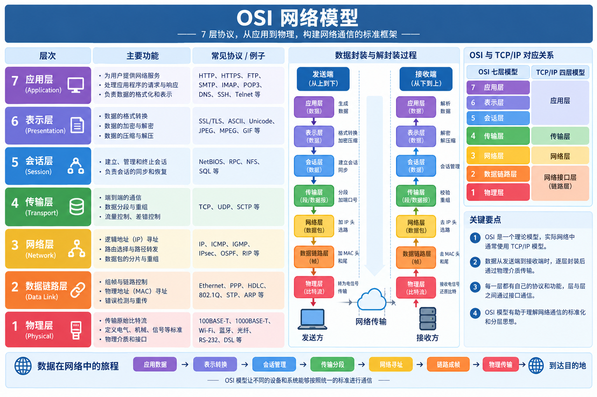
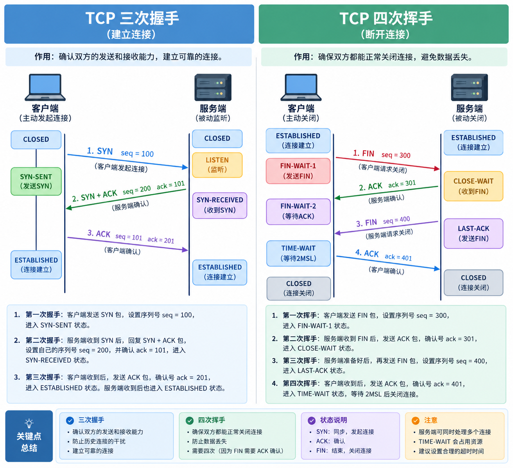
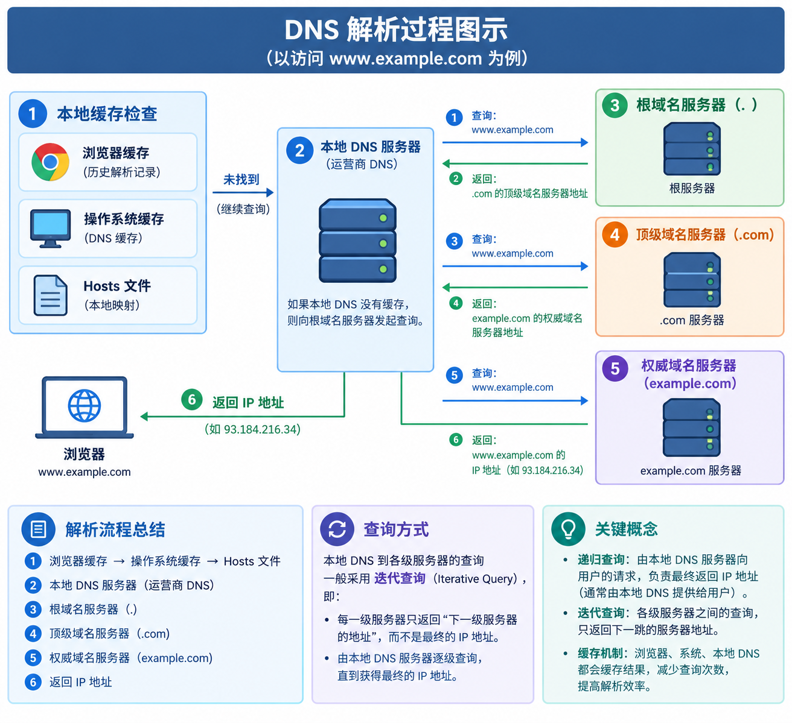

# 计算机网络核心体系与高频面试深度解析

> **文档定位与知识图谱**：
> 本文档全面系统地梳理计算机网络核心技术栈，横跨 OSI 七层与 TCP/IP 四层分层体系、底层链路寻址（MAC/ARP/IP/ICMP）、传输层核心协议（TCP 三次握手/四次挥手/滑动窗口/拥塞控制/TIME_WAIT 治理/SYN Flood 防御）、应用层核心协议（HTTP 1.0-3.0 演进/HTTPS 握手/Cookie-Session-JWT/OAuth 2.0）、网络接入架构（DNS/CDN/反向代理/LVS-Nginx 负载均衡/CORS 跨域全套方案）、OS 与 Java 网络 I/O 演进（5 种 I/O 模型/epoll 机制/Reactor 线程模型/零拷贝）、分布式微服务网络通信（服务发现/RPC 架构/熔断重试/分布式链路追踪/WebSocket），以及架构师高频生产排查场景（URL 到页面展示全流程/百万长连接调优/网络慢请求排查/Wireshark 抓包/容器网络）。

---

## 一、网络分层架构与底层网络协议（物理层、数据链路层与网络层）

### 1.1 OSI 七层模型与 TCP/IP 四层模型深度对比与演进

#### 1. 体系架构深度对比

在计算机网络体系中，OSI（Open System Interconnection，开放系统互连）参考模型是由国际标准化组织（ISO）制定的理论模型；而 TCP/IP（Transmission Control Protocol/Internet Protocol）体系结构则是工业界事实上的国际标准。

| 层次划分 | OSI 七层模型 | TCP/IP 四层体系 | 五层协议体系（教学体系） | 核心功能与职责 | 对应典型协议 | 传输数据单元（PDU） | 对应硬件/系统边界 |
| :--- | :--- | :--- | :--- | :--- | :--- | :--- | :--- |
| **第 7 层** | **应用层 (Application)** | rowspan="3" | **应用层** | **应用层** | 为操作系统应用程序提供直接的网络服务接口 | HTTP, HTTPS, FTP, DNS, SMTP, SSH, WebSocket | 报文 (Message) | 应用程序 / 用户空间 (User Space) |
| **第 6 层** | **表示层 (Presentation)** | 数据格式转换、加密解密、压缩解压缩（如 ASCII、JSON、SSL/TLS） | — | 报文 (Message) | 应用程序 / 类库 |
| **第 5 层** | **会话层 (Session)** | 建立、管理和终止不同主机进程之间的通信会话 | — | 报文 (Message) | 应用程序 / 系统调用 |
| **第 4 层** | **传输层 (Transport)** | **传输层** | **传输层** | 提供端到端（End-to-End，进程到进程）的可靠或不可靠数据传输服务 | TCP, UDP | 数据段 (Segment) / 数据报 (Datagram) | 操作系统内核态 (Kernel / Socket 缓冲区) |
| **第 3 层** | **网络层 (Network)** | **网络层 (网际层)** | **网络层** | 负责逻辑寻址、路径选择（路由选择）与跨网段数据转发 | IP (IPv4/IPv6), ICMP, ARP, RARP, OSPF, BGP | 数据包 (Packet) / IP 分组 | 路由器 (Router)、三层交换机 |
| **第 2 层** | **数据链路层 (Data Link)** | rowspan="2" | **网络接口层** | **数据链路层** | 负责物理寻址（MAC）、在相邻节点间无差错地传输帧（成帧、差错检验、流量控制） | Ethernet, Wi-Fi (802.11), PPP, ARP | 帧 (Frame) | 网卡 (NIC)、网桥、二层交换机 (Switch) |
| **第 1 层** | **物理层 (Physical)** | **物理层** | 利用传输介质传输原始比特流，定义机械、电气、功能和过程规范 | RJ-45, 光纤, 同轴电缆 | 比特 (Bit) | 中继器 (Repeater)、集线器 (Hub)、网线/光纤 |

#### 2. 各层通俗理解（记忆口诀）

- **口诀记忆法**（从下往上）：**“物链网输会示用”**（首字母联想：物理、链路、网络、传输、会话、表示、应用）。
  - **物理层**：铺路造路修马路，负责搬砖走电流。只管把 0 和 1 比特流从一端送到另一端。
  - **数据链路层**：确认左右相邻邻居是谁，给每辆车装上车牌号（MAC 地址），防止同一小段路上追尾。
  - **网络层**：全国导航地图（IP 地址），寻找从出发地城市到目的地城市的最佳行驶路径（路由规划）。
  - **传输层**：快递物流承运商，决定是派顺丰专车（TCP：确保包裹完好无损送到指定门牌号房间）还是发普通平邮（UDP：只管投递不管签收）。
  - **会话层**：前台接待员，负责打电话接通、维持通话、挂断电话。
  - **表示层**：专业多国语言翻译官与保险柜押运员，负责把数据翻译成标准语言（格式转换）、加密防偷看、压缩体积。
  - **应用层**：具体的办事业务员，决定拿到数据后要做什么具体业务（看网页 HTTP、发邮件 SMTP、传文件 FTP）。

#### 3. 为什么 TCP/IP 最终战胜了 OSI 模型？（工业标准 vs 理论空想）

1. **协议设计与实现的实用性差异**：
   - OSI 模型由纯理论学者制定，在没有任何实际工程实现和硬件验证的前提下先行制定了庞大繁冗的标准，许多层的功能存在严重重叠（如会话层和表示层功能薄弱，而差错控制与流量控制在数据链路层、网络层、传输层重复出现）。
   - TCP/IP 模型是“先有代码和实践，后出标准协议”。它诞生于美国国防部 ARPANET 工程实践中，遵循 Unix 哲学的实用主义，去除了繁冗的会话层和表示层，直接将这两层交由应用程序灵活实现。
2. **市场推进时机与生态壁垒**：
   - TCP/IP 协议栈很早就与当时高校和企业广泛使用的 BSD UNIX 操作系统深度绑定（内核级实现了标准 Socket 编程接口），免费开放并迅速扩散，形成了不可逆转的庞大工业软件生态。
   - 当 OSI 委员会完成标准化制定时，全球互联网骨干网络已经基于 TCP/IP 稳定运转多年，替换成本极其高昂。

---

### 1.2 端到端数据封装与解封装全流程

#### 1. 数据的封装与解封装原理

在网络通信中，发送端的数据必须自顶向下逐层添加协议首部（Header，数据链路层还会添加尾部 FCS 校验码），称为**封装（Encapsulation）**；接收端收到物理比特流后，必须自底向上逐层剥离协议首部，提取有效载荷（Payload），称为**解封装（Decapsulation）**。



#### 2. 封装层级流水线全景图

```
发送端主机                                                          接收端主机
+-------------------------------------------------------------------------+
| [应用层]       HTTP 请求数据 (Data)                                     |
+-------------------------------------------------------------------------+
                                    | 封装 (添加 TCP 头部)
                                    v
+-------------------------------------------------------------------------+
| [传输层]       [TCP 首部] + [HTTP 数据]                   -> TCP 数据段   |
+-------------------------------------------------------------------------+
                                    | 封装 (添加 IP 头部)
                                    v
+-------------------------------------------------------------------------+
| [网络层]       [IP 首部] + [TCP 首部] + [HTTP 数据]        -> IP 数据包    |
+-------------------------------------------------------------------------+
                                    | 封装 (添加 MAC 帧头与 FCS 帧尾)
                                    v
+-------------------------------------------------------------------------+
| [数据链路层]   [MAC 帧头] + [IP 包] + [FCS 校验尾]         -> 以太网帧     |
+-------------------------------------------------------------------------+
                                    | 物理层编码
                                    v
[物理层传输]     01010101010101001010101110001010101... -> 物理介质 (网线/光纤)
                                    |
                                    v 接收端逐层解封装 (剥离帧头尾 -> 剥离 IP 头 -> 剥离 TCP 头 -> 交付应用)
```

---

### 1.3 物理寻址与逻辑寻址：MAC 地址 vs IP 地址

#### 1. 核心属性对比

| 对比维度 | MAC 地址（Media Access Control） | IP 地址（Internet Protocol） |
| :--- | :--- | :--- |
| **所属层级** | 数据链路层（第二层） | 网络层（第三层） |
| **地址属性** | **物理地址 / 硬件地址**，刻录在网卡 ROM 芯片中，理论上全球唯一且不可变 | **逻辑地址 / 软件地址**，由网络管理员分配或 DHCP 动态获取，随接入网络位置改变 |
| **长度与格式** | 48 位（6 字节），十六进制表示，如 `00:1A:2B:3C:4D:5E` | IPv4 为 32 位（4 字节，点分十进制）；IPv6 为 128 位（16 字节） |
| **寻址范围** | **局域网内部（同一广播域 / 局域网二层寻址）**，无法跨路由器寻址 | **全局互联网（跨网段 / 广域网三层路由寻址）** |
| **路由器行为** | 数据包每经过一个路由器（跳），**源 MAC 和目的 MAC 会被彻底重写更替** | 在无 NAT 转换下，数据包跨路由器转发时，**源 IP 和目的 IP 保持不变** |

#### 2. 为什么有了 IP 地址还需要 MAC 地址？（深度解析）

1. **分层解耦与独立性设计原则**：
   - 数据链路层负责直接相连的两个相邻物理节点之间的传输，它不需要也不应该理解上层复杂的网络拓扑。如果直接用 IP 地址寻址，链路层就必须与网络层深度耦合，无法适配以太网、Wi-Fi、光纤等不同底层物理链路标准。
2. **寻址效率与拓扑聚合（最根本原因）**：
   - **IP 地址是层次化编址（具有网络号与主机号）**，可以像邮政编码一样进行路由聚合（CIDR），使得全球核心路由器的路由表项能够收敛到可控量级。
   - **MAC 地址是平面化编址（由厂家分配，无地理和网络拓扑结构规律）**。若在全球范围直接基于 MAC 寻址，每个路由器都必须记录数十亿个 MAC 地址的路由映射，没有任何一台路由器的内存和 CPU 能够承受这种量级的广播与路由表爆炸。
3. **分工协作**：**IP 地址决定了终点站在哪里（去哪座城市的哪个小区），而 MAC 地址决定了下一站具体踩向哪个石头（下一跳相邻网卡接口）。**

---

### 1.4 地址解析协议 ARP 深度剖析（工作原理与 ARP 欺骗防范）

#### 1. ARP 协议核心使命与工作机制

**ARP（Address Resolution Protocol，地址解析协议）** 位于网络层与数据链路层之间，负责**将已知的 32 位 IP 地址解析为对应的 48 位 MAC 地址**。

**完整解析步骤**：
1. **查询本地 ARP 缓存表**：
   - 当主机 A（IP_A, MAC_A）需要向主机 B（IP_B）发送数据时，首先检查本地的 ARP 高速缓存表（`arp -a`）。若存在 `IP_B -> MAC_B` 的映射，直接封装成以太网帧发送。
2. **广播发送 ARP 请求（ARP Request）**：
   - 若本地缓存未命中，主机 A 在本地局域网内以**广播（Broadcast）**形式发送 ARP 请求帧：
     - 源 IP: `IP_A`，源 MAC: `MAC_A`
     - 目的 IP: `IP_B`，目的 MAC: `FF:FF:FF:FF:FF:FF`（全网广播）
   - 局域网内的所有主机（网卡）都会接收该广播帧，并交由网络协议栈比对自身 IP 地址。
3. **单播回复 ARP 应答（ARP Reply）**：
   - 主机 B 发现目的 IP 与自身一致，首先将主机 A 的 `IP_A -> MAC_A` 记录到自己的 ARP 缓存中；随后以**单播（Unicast）**形式向主机 A 返回 ARP 应答帧，携带自己的 `MAC_B`。
   - 其余非目标主机发现目的 IP 不匹配，直接静默丢弃该请求。
4. **更新缓存并发送数据帧**：
   - 主机 A 收到应答后，将 `IP_B -> MAC_B` 写入本地 ARP 缓存表，并完成真正的数据报文封装与发送。

#### 2. ARP 欺骗（ARP Spoofing）与中间人攻击机制

- **漏洞根源**：ARP 协议是无状态、无身份鉴权认证机制的协议。任何主机收到 ARP 应答都会无条件信任并直接刷新本地缓存表，即便它从未主动发送过对应的 ARP 请求（此特性被称为 **免费 ARP（Gratuitous ARP）**）。
- **攻击实施**：
  - 黑客主机 C 持续向受害者主机 A 发送伪造的 ARP 应答报文：声称“网关 IP 的 MAC 地址是我 C”；
  - 同时向网关发送伪造 ARP 应答：声称“主机 A 的 IP 对应的 MAC 是我 C”；
  - 结果：主机 A 与网关之间的所有流量都会被悄然重定向到主机 C。主机 C 窃听、篡改数据后再代为转发，形成经典**中间人攻击（MITM）**，或直接丢弃流量导致拒绝服务（DoS）。
- **企业级防御方案**：
  1. **静态 ARP 绑定**：在客户端和核心网关上配置静态 IP-MAC 映射表，拒绝动态修改覆盖。
  2. **交换机动态 ARP 检查（DAI，Dynamic ARP Inspection）**：现代企业级交换机开启 DAI，并结合 DHCP Snooping 监听表，对所有 ARP 请求与应答进行合法性校验，非法伪造的报文在交换机物理端口层直接丢弃。

---

### 1.5 IP 体系与网络寻址（IPv4 分类、子网掩码、CIDR 与 NAT）

#### 1. 传统 IPv4 地址分类

IPv4 地址共 32 位（4 字节），传统分类法将其分为五类：

| 类别 | 首字节二进制前缀 | 地址范围 | 网络号 / 主机号位数 | 默认子网掩码 | 说明与用途 |
| :--- | :--- | :--- | :--- | :--- | :--- |
| **A 类** | `0` | `1.0.0.0` ~ `126.255.255.255` | 8 位网络号 / 24 位主机号 | `255.0.0.0` (/8) | 适用于超大型网络（单个网络支持约 1677 万台主机） |
| **B 类** | `10` | `128.0.0.0` ~ `191.255.255.255` | 16 位网络号 / 16 位主机号 | `255.255.0.0` (/16) | 适用于中型网络（每个网络支持 65534 台主机） |
| **C 类** | `110` | `192.0.0.0` ~ `223.255.255.255` | 24 位网络号 / 8 位主机号 | `255.255.255.0` (/24) | 适用于小型局域网（每个网络支持 254 台主机） |
| **D 类** | `1110` | `224.0.0.0` ~ `239.255.255.255` | 不分网络号和主机号 | 无 | **多播 / 组播地址（Multicast）** |
| **E 类** | `1111` | `240.0.0.0` ~ `255.255.255.255` | 不分网络号和主机号 | 无 | 保留用于科研与实验 |

> **特殊与保留地址**：
> - `127.0.0.0/8`：本地环回地址（Loopback），如 `127.0.0.1` 用于本机进程间网络测试，报文不会流经物理网卡。
> - `0.0.0.0`：表示本网络内的任何未知主机，或在服务端监听时绑定本机所有网卡接口。
> - `255.255.255.255`：受限广播地址，不会被路由器跨网段转发。

#### 2. 私有 IP 地址范围（RFC 1918 规范）

在互联网公网路由器上不可路由的专用地址块：
- A 类私有：`10.0.0.0` ~ `10.255.255.255`（1 个 A 类网络）
- B 类私有：`172.16.0.0` ~ `172.31.255.255`（16 个 B 类网络）
- C 类私有：`192.168.0.0` ~ `192.168.255.255`（256 个 C 类网络）

#### 3. 子网划分与 CIDR（无类别域间路由）

- **子网划分（Subnetting）**：借用主机号的高位充当子网号，从而将一个大的网络划分成若干个规模较小的物理子网，减少 IP 地址浪费并隔离广播域。
- **CIDR（Classless Inter-Domain Routing）**：消除了传统的 A/B/C 类划分，采用斜杠记法表示网络前缀位数（如 `192.168.1.0/26`）。
  - `/26` 代表前 26 位为网络前缀，后 6 位为主机号；
  - 子网掩码为 `255.255.255.192`；
  - 每个子网的主机数量为 $2^6 - 2 = 62$ 台（减去全 0 的网络地址与全 1 的子网广播地址）。
- **路由聚合（超网路由 Supernetting）**：CIDR 允许将多个连续的子网聚合成一条更粗粒度的路由表项（最长前缀匹配原则），极大地遏制了全球核心骨干路由器路由表的恶性膨胀。

#### 4. NAT 网络地址转换（Network Address Translation）

- **诞生背景**：IPv4 总共仅约 43 亿个地址，公网 IP 极度匮乏。NAT 技术使得成千上万台局域网主机能够共享少量甚至单个公网 IP 访问外部互联网。
- **NAPT（网络地址端口转换 / 端口复用 NAT）原理**：
  - 当内网主机 `192.168.1.10:8080` 向外网 Web 服务 `203.0.113.5:80` 发送请求时；
  - 出口路由器（NAT 网关）将 IP 首部的源地址替换为路由器的公网 IP `198.51.100.1`，并动态分配一个随机端口（如 `45231`），同时在 NAT 转换表中记录：`192.168.1.10:8080 <-> 198.51.100.1:45231`；
  - 外部服务端回包到 `198.51.100.1:45231` 时，NAT 网关查表将目的 IP 和端口还原替换为 `192.168.1.10:8080`，交付给内网机器。

---

### 1.6 网络探测与诊断控制协议：ICMP 机制（Ping 与 Traceroute 原理）

#### 1. ICMP 协议定位与核心能力

**ICMP（Internet Control Message Protocol，网际控制报文协议）** 是网络层协议，封装在 IP 数据报内部传输。它不用于传输用户业务数据，而是专用于**传递网络控制管理信息、差错报告与网络连通性探测**。

**常见 ICMP 报文类型**：
- **差错报告报文**：终点不可达（Destination Unreachable）、源点抑制（Source Quench）、超时（Time Exceeded，TTL 递减为 0）、参数问题、重定向。
- **询问报文**：回送请求（Echo Request，类型 8）与回送回答（Echo Reply，类型 0）、时间戳请求与回答。

#### 2. Ping 命令工作原理

`ping` 命令是排查网络连通性最常用的工具：
1. 本地主机向目标 IP 发送一个 ICMP 回送请求报文（Type=8, Code=0），报文中携带序列号与发送时间戳。
2. 目标主机收到后，操作系统网络协议栈内核自动构建并回复一个 ICMP 回送回答报文（Type=0, Code=0），将原请求的时间戳和数据原样返回。
3. 发送端根据收到回包计算出往返时间（RTT）与丢包率。
> **注意**：Ping 是直接基于网络层 ICMP 协议运作的，**不涉及传输层的 TCP 或 UDP，因此 Ping 没有任何端口号的概念**。如果某个机器禁 Ping，通常是系统防火墙直接屏蔽了 ICMP Echo 请求报文。

#### 3. Traceroute / Tracert 路由路径追踪实现原理

Traceroute 用于探测从源主机到目标主机经过的所有中间路由器节点。其巧妙地利用了 **IP 首部的生存时间（TTL，Time To Live）** 与 **ICMP 超时差错报文（Time Exceeded）**：
1. **第一轮探测（TTL = 1）**：
   - 发送端发出一个 IP 数据包，将 TTL 设置为 1；
   - 第一个路由器收到后，将 TTL 减 1，发现 TTL 变为 0，按照 IP 规范必须丢弃该数据包，并向源主机回送一个 ICMP 超时报文（Type=11, Code=0）；
   - 发送端由此捕获第一个跳点的路由器 IP，并测出第一跳延时。
2. **逐跳递增探测（TTL = 2, 3, 4...）**：
   - 发送端将 TTL 依次设置为 2、3... 逐跳引诱后续的路由器回复 ICMP 超时报文，从而描绘出整条完整路由转发路径。
3. **探测终止机制**：
   - **Linux（Traceroute）实现**：默认发送一个高端口号的 UDP 数据包（如 33434 以上）。当数据包最终到达目标主机时，由于目标主机并没有该端口的监听服务，目标主机协议栈会返回一个 **ICMP 端口不可达报文（Port Unreachable，Type=3, Code=3）**，发送端收到后得知已达目的地，探测结束。
   - **Windows（Tracert）实现**：默认直接发送标准的 ICMP 回送请求报文，最终目标主机直接回复正常的 ICMP 回送回答（Echo Reply），探测完成。

---

## 二、传输层核心基石：TCP 与 UDP 协议深度解密（绝对重点）

### 2.1 TCP vs UDP 核心全方位对比与技术选型

#### 1. 核心特性矩阵全景对比

| 对比维度 | TCP（Transmission Control Protocol，传输控制协议） | UDP（User Datagram Protocol，用户数据报协议） |
| :--- | :--- | :--- |
| **连接机制** | **面向连接（Connection-oriented）**：传输前必须经三次握手建立连接，通信结束需四次挥手释放连接 | **无连接（Connectionless）**：发送数据前无需握手，直接打包发送，无连接维护成本 |
| **可靠性保障** | **可靠传输（Reliable）**：保证数据无差错、不丢失、不重复且按序到达（依赖确认应答、超时重传、流量控制、拥塞控制） | **不可靠传输（Best-Effort）**：尽最大努力交付，不保证送达，不保证顺序，无重传机制 |
| **传输模式** | **面向字节流（Byte Stream）**：将应用层数据视为无边界的一连串无结构字节序列（引发粘包/拆包） | **面向报文（Datagram-oriented）**：保留应用层报文边界，既不拆分也不合并，完整交付 |
| **首部开销** | **首部较大**：标准最小头部 **20 字节**，携带可选项时最大可达 60 字节 | **首部极小**：固定 **8 字节**（源端口、目的端口、长度、校验和） |
| **通信目标模式** | **仅支持点对点（1对1）** 单播通信 | 支持 **一对一（单播）、一对多（多播/组播）、全员（广播）** 通信 |
| **传输效率与延迟** | 首部开销大、确认机制与拥塞控制限制速率，传输延迟较高 | 首部极小、无握手挥手开销，传输速度快，实时性极高 |
| **拥塞与流量控制** | 拥有严密完善的滑动窗口（流量控制）与慢启动/拥塞避免机制 | **无任何拥塞控制与流量控制**，即使网络拥堵也不会降低发送速率 |
| **典型应用场景** | Web 浏览（HTTP/HTTPS）、文件传输（FTP）、远程登录（SSH）、邮件（SMTP）、数据库连接（MySQL/Redis） | 实时音视频通话（VoIP/WebRTC）、在线网络游戏、直播推流、DNS 查询、广播发现、视频监控 |

#### 2. 常见面试误区澄清与技术选型剖析

1. **“TCP 一定比 UDP 慢吗？”**
   - 不一定。在极其优良的网络环境（如高带宽、极低延迟的数据中心内网）中，TCP 的滑动窗口可以迅速扩大，带宽利用率极高，吞吐量并不逊色于 UDP。
   - UDP 的“快”主要体现在**建立连接的首包零延迟（0-RTT）**、**弱网环境下不因丢包而触发全局降速（拥塞避免）**。
2. **“UDP 如何实现可靠传输？”（典型追问）**
   - 依赖**应用层自行实现可靠性机制**：在应用层引入序列号、确认应答（ACK）、超时重传、滑动窗口与丢包恢复。
   - 典型工业级实现：**QUIC 协议（HTTP/3 的底座）**、**KCP 协议**。QUIC 既继承了 UDP 的无握手延迟、无队头阻塞与连接迁移特性，又在应用层实现了比 TCP 更优雅的可靠传输与安全加密。

---

### 2.2 TCP 报文段首部结构剖析

TCP 报文段首部的固定长度为 20 字节，可选字段长度为 0~40 字节，因而头部总长度在 20~60 字节之间。

```
 0                   1                   2                   3
 0 1 2 3 4 5 6 7 8 9 0 1 2 3 4 5 6 7 8 9 0 1 2 3 4 5 6 7 8 9 0 1
+-+-+-+-+-+-+-+-+-+-+-+-+-+-+-+-+-+-+-+-+-+-+-+-+-+-+-+-+-+-+-+-+
|          源端口 (Source Port)         |       目的端口 (Destination Port)   |
+-+-+-+-+-+-+-+-+-+-+-+-+-+-+-+-+-+-+-+-+-+-+-+-+-+-+-+-+-+-+-+-+
|                        序号 (Sequence Number)                 |
+-+-+-+-+-+-+-+-+-+-+-+-+-+-+-+-+-+-+-+-+-+-+-+-+-+-+-+-+-+-+-+-+
|                    确认号 (Acknowledgment Number)             |
+-+-+-+-+-+-+-+-+-+-+-+-+-+-+-+-+-+-+-+-+-+-+-+-+-+-+-+-+-+-+-+-+
| 数据偏移 | 保留  |U|A|P|R|S|F|            窗口大小 (Window)          |
| (4 bits) |(4bits)|R|C|S|S|Y|I|                               |
|          |       |G|K|H|T|N|N|                               |
+-+-+-+-+-+-+-+-+-+-+-+-+-+-+-+-+-+-+-+-+-+-+-+-+-+-+-+-+-+-+-+-+
|          校验和 (Checksum)            |       紧急指针 (Urgent Pointer)     |
+-+-+-+-+-+-+-+-+-+-+-+-+-+-+-+-+-+-+-+-+-+-+-+-+-+-+-+-+-+-+-+-+
|                    选项 (Options, 0~40 字节, 可选)             |
+-+-+-+-+-+-+-+-+-+-+-+-+-+-+-+-+-+-+-+-+-+-+-+-+-+-+-+-+-+-+-+-+
|                             数据载荷 (Data)                   |
+-+-+-+-+-+-+-+-+-+-+-+-+-+-+-+-+-+-+-+-+-+-+-+-+-+-+-+-+-+-+-+-+
```

#### 核心关键字段深度解读：
1. **源端口（16 位） / 目的端口（16 位）**：
   - 标识发送进程与接收进程。IP 地址 + 端口号构成了唯一的网络通信端点（Socket）。
2. **序号（Sequence Number，32 位）**：
   - 本报文段所发送的数据的**第一个字节的顺序号**。TCP 是面向字节流的，每个字节都有唯一编号，用于实现按序接收与去重。
3. **确认号（Acknowledgment Number，32 位）**：
   - 期望收到对方下一个报文段的数据的第一个字节的序号。**若确认号为 N，则表明到序号 N-1 为止的所有数据均已正确无误接收**。
4. **数据偏移 / 首部长度（Data Offset，4 位）**：
   - 指出 TCP 报文段的首部长度，以 4 字节为单位计算。最大值为 15（$15 \times 4 = 60$ 字节）。
5. **6 个控制标志位（Control Flags，极其重要）**：
   - **URG（Urgent）**：紧急指针有效，表明此报文段中有紧急数据，优先传送。
   - **ACK（Acknowledgment）**：确认标志位。**当 ACK=1 时，确认号字段才真正有效**。TCP 规定，在连接建立后的所有正常通信报文中，ACK 均必须置为 1。
   - **PSH（Push）**：推送标志位。接收端协议栈应尽快将本段交付给上层应用程序，而不是留在缓冲区等待填满。
   - **RST（Reset）**：复位标志位。表明 TCP 连接出现严重差错（如端口未监听、主机崩溃重启），必须强制释放并重建连接。
   - **SYN（Synchronize）**：同步标志位。在建立连接时用来同步双方的初始序列号（ISN）。**SYN=1, ACK=0 表示连接请求；SYN=1, ACK=1 表示连接同意**。
   - **FIN（Finish）**：终止标志位。表明本端数据已发送完毕，请求释放单向数据传输通道。
6. **窗口（Window，16 位）**：
   - 接收端告诉发送端：从本报文段确认号算起，接收端当前允许发送端发送的数据量（字节数）。用于**滑动窗口流量控制**。

---

### 2.3 TCP 三次握手全生命周期（状态机、半连接与全连接队列、三次握手丢包排查）

#### 1. 三次握手全流程图解与状态变迁

三次握手（Three-Way Handshake）是 TCP 客户端与服务端在正式传输应用层数据前，建立可靠全双工通信信道并协商初始序列号（ISN，Initial Sequence Number）的核心机制。



```text
客户端                                                    服务端
[CLOSED]                                                 [LISTEN]
   |                                                        |
   | ------------- 1. SYN=1, seq=x -----------------------> |
[SYN_SENT]                                             [SYN_RCVD]
   |                                                        |
   | <------------ 2. SYN=1, ACK=1, seq=y, ack=x+1 -------- |
[ESTABLISHED]                                               |
   |                                                        |
   | ------------- 3. ACK=1, seq=x+1, ack=y+1 ------------> |
   |                                                   [ESTABLISHED]
   v                                                        v
   ======================= 正常双向数据传输 ========================
```

#### 2. 三次握手每一步核心职责与内核行为

1. **第一次握手（Client -> Server）**：
   - **客户端报文**：发送 `SYN=1`，随机生成客户端初始序列号 `seq = x`。
   - **内核状态**：客户端进入 `SYN_SENT` 状态；服务端收到后，从 `LISTEN` 状态转换为 `SYN_RCVD` 状态。
   - **证明能力**：服务端确认了“客户端的发送能力正常，服务端的接收能力正常”。
2. **第二次握手（Server -> Client）**：
   - **服务端报文**：发送 `SYN=1, ACK=1`，确认号 `ack = x + 1`，并随机生成服务端初始序列号 `seq = y`。
   - **内核状态**：服务端进入 `SYN_RCVD` 状态；客户端收到后进入 `ESTABLISHED` 状态。
   - **证明能力**：客户端确认了“服务端的发送与接收能力均正常，客户端的发送与接收能力也均正常”。
3. **第三次握手（Client -> Server）**：
   - **客户端报文**：发送 `ACK=1, seq = x + 1, ack = y + 1`。（注意：第三次握手报文**可以携带应用层数据**，如 HTTP 请求头）。
   - **内核状态**：服务端收到 ACK 报文后，进入 `ESTABLISHED` 状态。
   - **证明能力**：服务端确认了“客户端的接收能力正常”。双方信道正式打通。

#### 3. 为什么必须是三次握手？不能是两次或四次？

1. **为什么两次握手不行？（核心原因：防止历史失效的连接请求突然到达服务端造成资源死锁）**
   - **网络滞留报文复活场景**：
     - 假设客户端发送了一个 SYN 报文 A，由于网络拥堵在某个路由器长时间滞留。
     - 客户端超时重传，发送 SYN 报文 B，正常完成连接，传输完毕后关闭连接。
     - 此时滞留的 SYN 报文 A 终于脱困到达服务端。若只需两次握手，服务端收到 SYN A 后立刻建立新连接，进入 `ESTABLISHED` 状态并分配 Socket 资源等待接收数据。
     - 但客户端此时早已处于 `CLOSED` 状态，对服务端的确认置之不理。服务端将永远单向挂起等待，导致**内存与端口资源被严重泄露**。
   - **三次握手解决机制**：在三次握手下，服务端回传 ACK 后，客户端发现该回包针对的是一个旧的已失效序列号，客户端会发送 `RST` 报文通知服务端终止连接，避免资源空耗。
2. **为什么不是四次握手？（优化合并）**
   - 第二次握手中，服务端将“对客户端 SYN 的 ACK 确认”与“服务端自身的 SYN 同步”合并到了同一个报文段中发送（Piggybacking 捎带机制）。拆分成两次多余且降低握手性能。

#### 4. 内核级深水区：半连接队列（SYN Queue）与全连接队列（Accept Queue）

在 Linux 内核与 Java `ServerSocket` 底层，服务端为处理连接维护了两个队列：
1. **半连接队列（SYN Queue / Incomplete Connection Queue）**：
   - 存放收到客户端第一步 SYN、处于 `SYN_RCVD` 状态的未完成三次握手的连接。
   - 大小受内核参数 `/proc/sys/net/ipv4/tcp_max_syn_backlog` 控制。
2. **全连接队列（Accept Queue / Complete Connection Queue）**：
   - 存放已经完成三次握手、进入 `ESTABLISHED` 状态，但尚未被上层应用程序调用 `accept()` 取出的就绪连接。
   - 大小由 `min(backlog, /proc/sys/net/core/somaxconn)` 决定（其中 `backlog` 为 Java 中 `new ServerSocket(port, backlog)` 传入的参数）。
   - **线上故障**：如果全连接队列被填满（例如后端 Java 线程池被打满，无法及时 `accept()`），默认情况下，服务端收到客户端第三次握手的 ACK 会静默丢弃（由内核参数 `tcp_abort_on_overflow` 控制，为 0 时丢弃 ACK 引诱客户端重传，为 1 时直接发送 RST 复位）。

#### 5. 经典面试追问：“第三次握手的 ACK 报文丢失了会怎样？”

1. **服务端表现**：
   - 服务端因未收到第三次握手的 ACK，依然停留在 `SYN_RCVD` 状态。
   - 服务端会启动**超时重传机制**，重新发送第二步的 `SYN+ACK` 报文。重传次数由内核参数 `/proc/sys/net/ipv4/tcp_synack_retries` 决定（默认通常为 5 次，按指数退避重传 1s, 2s, 4s, 8s, 16s）。若重传耗尽仍未收到 ACK，服务端自动关闭该半连接并从半连接队列中剔除。
2. **客户端表现**：
   - 客户端在发送完第三次 ACK 后已经单方面进入 `ESTABLISHED` 状态。
   - 若客户端立刻发送业务数据，数据报文段本身携带了 `ACK` 标志位。服务端收到该数据包后，直接借此完成第三次握手并进入 `ESTABLISHED`。
   - 若客户端长时间不发数据，当服务端重传超时放弃连接后，客户端稍后若尝试发送数据，服务端会直接回复 `RST` 报文，强制客户端关闭连接。

---

### 2.4 TCP 四次挥手与连接终止（状态机变迁与断开细节）

#### 1. 四次挥手全流程图解与状态流转

TCP 是全双工通信协议，两个方向上的数据通道彼此独立。因此释放连接时，两个方向必须分别独立发送终止报文（FIN）并分别进行确认（ACK），共需四次交互。

```text
客户端（主动关闭方）                                      服务端（被动关闭方）
[ESTABLISHED]                                            [ESTABLISHED]
   |                                                           |
   | ------------- 1. FIN=1, seq=u --------------------------> |
[FIN_WAIT_1]                                              [CLOSE_WAIT]
   |                                                           |
   | <------------ 2. ACK=1, seq=v, ack=u+1 ------------------ |
[FIN_WAIT_2]                                                   |
   |                                                    (被动方处理残留数据)
   |                                                           |
   | <------------ 3. FIN=1, ACK=1, seq=w, ack=u+1 ----------- |
[TIME_WAIT]                                               [LAST_ACK]
   |                                                           |
   | ------------- 4. ACK=1, seq=u+1, ack=w+1 ---------------> |
[等待 2MSL]                                                 [CLOSED]
   |
[CLOSED]
```

#### 2. 四次挥手每一步详细状态与动作

1. **第一次挥手（主动方 -> 被动方）**：
   - 主动关闭方调用 `close()`，发出 `FIN=1, seq=u` 报文，停止发送应用数据。
   - 主动方进入 `FIN_WAIT_1` 状态。表明“主动方没有新数据要发送了”。
2. **第二次挥手（被动方 -> 主动方）**：
   - 被动关闭方收到 FIN，立刻内核回复 `ACK=1, seq=v, ack=u+1`。
   - 被动方进入 `CLOSE_WAIT` 状态；主动方收到此 ACK 后，进入 `FIN_WAIT_2` 状态。
   - **此时连接进入半关闭（Half-Close）状态**：主动方到被动方的通路关闭，但被动方若仍有缓存数据要发，主动方依然可以接收。
3. **第三次挥手（被动方 -> 主动方）**：
   - 被动方将所有待发送的残留数据全部发送完毕后，调用 `close()`，发出 `FIN=1, ACK=1, seq=w, ack=u+1`。
   - 被动方进入 `LAST_ACK` 状态。表明“被动方的数据也全发完了，准备彻底关闭”。
4. **第四次挥手（主动方 -> 被动方）**：
   - 主动方收到被动方的 FIN 后，必须对此进行确认，发送 `ACK=1, seq=u+1, ack=w+1`。
   - 主动方进入 `TIME_WAIT` 状态，并在**等待 2MSL（Maximum Segment Lifetime）时间后才真正进入 `CLOSED`**。
   - 被动方收到此 ACK 后，立刻进入 `CLOSED` 状态。

#### 3. 为什么握手是三次，而挥手必须是四次？

- **原因在于全双工通信与数据缓冲区的被动关闭机制**：
  - 在三次握手时，服务端处于空闲就绪状态，可以将 `SYN` 与 `ACK` 合并在一个报文中同步发出。
  - 在四次挥手时，当服务端收到客户端的 `FIN` 时，仅代表**客户端不再发数据**；但服务端自身可能还有大量的业务数据在 Socket 发送缓冲区中排队等待发送，或者正在执行未完成的计算任务。
  - 因此，服务端必须**先立刻回复一个 ACK**（第二次挥手），防止客户端超时重传 FIN；待服务端自身业务逻辑执行完毕、确认所有数据均已发送完成后，才能单独再发出 `FIN` 报文（第三次挥手）。所以中间两步不能合并，必须四次。

---

### 2.5 TIME_WAIT 与 CLOSE_WAIT 深度剖析与线上治理

#### 1. TIME_WAIT 状态的核心作用（为什么必须等待 2MSL？）

**MSL（Maximum Segment Lifetime，最大报文段生存时间）** 是任何 TCP 报文段在网络中能够存活的最大时间，RFC 规范建议为 2 分钟，实际 Linux 内核一般固定为 30 秒（即 2MSL = 60 秒）。

**主动关闭方在 TIME_WAIT 状态等待 2MSL 的两大不可替代的原因**：
1. **保证被动关闭方能够正确关闭连接（防止最后一次 ACK 丢失）**：
   - 假设主动方发送的第四次挥手 ACK 报文在网络中丢失；
   - 被动方在超时后会重新发送第三次挥手的 FIN 报文；
   - 若主动方不等待 2MSL 而是直接 CLOSED，主动方在收到这个重传的 FIN 时会认为连接不存在而直接返回 `RST` 报文，导致被动方异常报错（Connection Reset by Peer），无法优雅完成四次挥手。
   - 预留 2MSL（1 个 MSL 保证 ACK 到达对方，1 个 MSL 保证对方重传的 FIN 到达主动方）可以确保在这个周期内能够处理重传的 FIN，并再次补发 ACK。
2. **彻底消灭网络中滞留的“历史迷途报文段”（防止旧连接报文污染新连接）**：
   - 经过 2MSL 时间后，本连接产生的所有报文段都在网络路由器中由于 TTL 超时而彻底消亡；
   - 这样可以确保当相同的源 IP、源端口、目的 IP、目的端口（四元组）被重新分配创建新的连接时，绝不会收到来自旧连接的迟到数据包，避免数据错乱。

#### 2. 线上大量 TIME_WAIT 产生的危害与排查治理

1. **产生根因**：
   - **谁主动调用 `close()` 关闭连接，谁就会最终进入 `TIME_WAIT` 状态**。
   - 常见场景：高并发 HTTP 短连接（如未开启 Keep-Alive 的客户端或服务端）、反向代理（如 Nginx 反向代理后端 Tomcat 时，默认使用 HTTP 1.0 短连接，导致 Nginx 成为主动关闭方，积压大量 TIME_WAIT）。
2. **潜在危害**：
   - 操作系统为每个 TIME_WAIT 连接保持一个 TCP 控制块（TCB），占用约几 KB 内核内存。
   - 更致命的是**大量占用本地临时端口号（0~65535）**。如果一台机器作为客户端高频请求外部服务，端口号被 TIME_WAIT 占满后，会导致 `java.net.BindException: Address already in use`，无法再发起新连接。
3. **排查诊断命令**：
```bash
# 统计当前系统所有 TCP 连接状态分布
netstat -n | awk '/^tcp/ {++S[$NF]} END {for(a in S) print a, S[a]}'

# 或使用现代高效的 ss 工具
ss -s
```
4. **系统级与应用级优化治理方案**：
   - **开启连接复用（Linux 内核调优）**：
```bash
# /etc/sysctl.conf
# 允许将处于 TIME_WAIT 状态的套接字重新用于新的 TCP 连接（极其安全有效）
netstat.ipv4.tcp_tw_reuse = 1

# 调小 FIN 超时时间（默认 60s，可缩减至 15~30s）
net.ipv4.tcp_fin_timeout = 30

# 限制系统同时允许存在的 TIME_WAIT 套接字最大数量，超出时系统直接清空并打印警告
net.ipv4.tcp_max_tw_buckets = 20000

# 生效配置
sysctl -p
```
   > **避坑警告**：**千万不要开启 `net.ipv4.tcp_tw_recycle = 1`**（Linux 4.12 已彻底移除）。在 NAT 网络环境下开启此参数会导致全网多台共用公网 IP 的客户端因时间戳混乱而无法握手！
   - **架构级解决方案（最彻底方案）**：
     - **全面开启 HTTP Keep-Alive 长连接**（包括客户端与 Nginx 之间、Nginx 与后端服务之间），减少高频连接创建与释放；
     - 引入连接池（如 Apache HttpClient 连接池、HikariCP 数据库连接池）。

#### 3. 线上大量 CLOSE_WAIT 产生根因与代码级排查

1. **CLOSE_WAIT 的本质**：
   - 被动关闭方收到对方的 FIN 并回复了 ACK，正在等待**本端应用程序主动关闭连接**。
   - 如果系统出现成千上万个 CLOSE_WAIT，**100% 是本端应用层代码出现了严重 Bug，没有在被动收到关闭信号后显式调用 `socket.close()` 释放资源**！
2. **常见代码 Bug 根因**：
   - 读写数据异常后，`catch` 块中没有在 `finally` 块显式调用 `close()`；
   - 响应式编程或 HTTP 客户端未正确消费/关闭 `InputStream` 响应流；
   - 业务线程池被打满，负责处理连接关闭事件的线程被完全阻塞挂起（如死锁、慢 SQL 调用），导致关闭动作无法被执行调度。
3. **排查手段**：
   - 使用 `lsof -p <PID>` 找出占用大量连接的文件描述符；
   - 使用 `jstack <PID>` 导出线程堆栈，排查哪些线程正长时间阻塞在 I/O 操作、数据库连接或锁竞争上。

---

### 2.6 SYN Flood 洪水攻击原理与系统级防御

#### 1. 攻击原理

SYN Flood 是一种经典的**分布式拒绝服务攻击（DDoS）**，专门利用 TCP 三次握手的协议设计缺陷：
1. 攻击者使用伪造的虚假 IP 地址，持续向目标服务端口成千上万地发送 `SYN` 握手报文。
2. 目标服务端收到后，为每一个请求分配一个传输控制块（TCB），将连接挂入**半连接队列（SYN Queue）**，并向伪造的 IP 回复 `SYN+ACK`。
3. 由于源 IP 是虚构的，服务端永远收不到第三步的 `ACK` 确认。服务端必须持续超时重传 SYN+ACK 并保持挂起。
4. 在极短时间内，服务端的**半连接队列被完全耗尽**，正常的合法用户发送 SYN 握手请求被系统直接静默丢弃，导致对外服务瘫痪。

#### 2. 系统防御体系与 SYN Cookies 技术

1. **启用 Linux 内核 SYN Cookies 机制（最核心防御策略）**：
```bash
# 开启 SYN Cookies
sysctl -w net.ipv4.tcp_syncookies = 1
```
   - **SYN Cookies 工作机制**：
     - 当半连接队列被填满后，内核**不再在内存中为 SYN 请求分配 TCB 结构体**；
     - 内核利用客户端的源 IP、源端口、目的 IP、目的端口、时间戳以及一个内核秘钥，通过 Hash 算法计算出一个特殊的初始序列号（称为 Cookie，即特殊的 ISN）回复给客户端；
     - 正常的合法客户端在发送第三次 ACK 时，会带上 `ack_seq = Cookie + 1`；
     - 服务端收到后，通过计算公式直接校验 Cookie 的合法性。一旦校验通过，直接在内存中建立连接并移入全连接队列。
     - **防御效果**：完全避免了半连接队列在握手阶段对内存的无底线消耗。
2. **增大半连接队列与全连接队列深度**：
```bash
net.ipv4.tcp_max_syn_backlog = 8192
net.core.somaxconn = 8192
```
3. **减少半连接重传次数以快速释放无效连接**：
```bash
net.ipv4.tcp_synack_retries = 1
```
4. **网络基础设施层防护**：
   - 在高防机房入口部署抗 DDoS 防火墙，利用反向探测校验真实客户端（如 TCP 代理校验、首包丢弃重传校验）。

---

### 2.7 TCP 可靠传输机制（校验和、序列号、超时重传、快重传与 SACK）

TCP 能够在不可靠的 IP 网络层之上构筑百分之百可靠的传输管道，依赖于以下五大核心可靠性支柱：

```
+--------------------------------------------------------------------------+
|                        TCP 可靠传输保障五大支柱                           |
+-------------------+-------------------+------------------+---------------+
| 1. 差错检验       | 2. 序列号与确认   | 3. 重传机制      | 4. 流量控制   | 5. 拥塞控制
| (首部校验和检验)  | (按序到达、去重)  | (超时重传/快重传)| (滑动窗口控制)| (慢启动/避免)
+-------------------+-------------------+------------------+---------------+
```

1. **差错检验（Checksum 校验和）**：
   - 发送端在首部计算校验和（涵盖伪首部、TCP 首部和数据）；接收端校验，一旦数据在物理传输中发生比特翻转，直接丢弃且不发确认，等待发送端重传。
2. **序列号与累计确认机制（Sequence & ACK）**：
   - TCP 的每一个字节都有连续递增的序列号。
   - 接收端通过序列号实现：**按序重组应用层数据、自动识别并丢弃网络中由于重传产生的重复报文**。
   - 采用**累计确认（Cumulative ACK）**：接收端返回确认号 $N$，意味着 $N-1$ 之前的所有字节均已完整安全收到。
3. **超时重传（RTO，Retransmission TimeOut）**：
   - 发送端为每一个发出的报文段维护一个重传定时器。若在超时时间 RTO 内未收到对应的 ACK，发送端判定报文丢包并立即重新发送。
   - **动态 RTT 估算**：RTO 绝非固定值，而是基于网络往返时间（RTT）通过 Jacobson/Karels 算法动态加权平均计算得出：$RTO = SRTT + 4 \times RTTVAR$。
4. **快速重传机制（Fast Retransmit）**：
   - 超时重传必须等待定时器超时，延迟较大。快速重传以**数据包驱动**：
   - 当接收端收到一个失序的报文段（如收到报文 1、3、4，缺失了报文 2），接收端每收到一个乱序包，就**立即重复回复缺失位置的 ACK（此处为 ACK 2）**；
   - 当发送端连续收到 **3 次重复的冗余 ACK（Dup ACK）** 时，发送端明确获知报文 2 已丢包，立即在定时器超时之前抢先重传报文 2。
5. **选择性确认机制（SACK，Selective Acknowledgment）**：
   - 传统累计确认只知道缺失报文 2，但不知道报文 3 和 4 是否收到。发送端可能把 2、3、4 全部重传一遍，浪费带宽。
   - 在 TCP 选项中开启 SACK：接收端在回复 ACK 2 的同时，在首部选项中明确告知发送端自己已经收到了哪些不连续的数据块（如 `[3~4]`、`[6~8]`）。发送端便**只重传缺失的数据段**，大幅提升吞吐效率。

---

### 2.8 TCP 流量控制与滑动窗口机制（窗口探测、糊涂窗口与 Nagle 算法）

#### 1. 流量控制（Flow Control）核心机制

流量控制旨在**解决发送端发送速率与接收端应用程序处理速率不匹配的问题**，防止发送过快导致接收端 Socket 缓冲区溢出丢包。

- TCP 采用**基于可变大小的滑动窗口（Sliding Window）**协议实现流量控制。
- 接收端在每次回复的 TCP 首部中携带 `Window` 字段，动态通告自己当前的接收缓冲区剩余可用大小（通告窗口，Advertised Window）。
- 发送端严格限制自身的发送窗口不超过接收端通告的窗口大小。

```text
发送端窗口视角：
+-----------------------+-----------------------+-----------------------+
| 1. 已发送并收到 ACK   | 2. 已发送未收到 ACK   | 3. 允许发送但尚未发送 | 4. 暂时不允许发送
+-----------------------+-----------------------+-----------------------+
                        | <-------- 发送窗口 (SND.WND) --------> |
```

#### 2. 零窗口（Zero Window）与持续定时器（Persistence Timer）

- 当接收端应用层处理变慢、Socket 缓冲区被完全占满时，接收端会向发送端通告 `Window = 0`（零窗口通知）。发送端收到后立刻暂停数据发送。
- **死锁风险**：后续当接收端应用程序读取了数据、缓冲区腾出空间后，接收端会发送一个 `Window > 0` 的窗口更新报文。若该报文在网络中不幸丢包，发送端在苦等窗口更新，接收端在等待数据输入，两者陷入相互等待的**死锁状态**。
- **解决方案：持续定时器（Persistence Timer）**：
  - 发送端一旦收到零窗口通知，立即启动持续定时器；
  - 定时器到期后，发送端主动向接收端发送一个仅携带 1 字节数据的**零窗口探测报文（Zero Window Probe）**；
  - 接收端收到探测报文后，必须立即回复当前的实际窗口大小。若依然为 0，重置定时器并指数退避等待；若大于 0，死锁破除，正常传输恢复。

#### 3. 糊涂窗口综合征（Silly Window Syndrome）与 Nagle 算法

- **问题场景**：接收端处理慢，每次只腾出几个字节的缓冲区，就迫不及待通告给发送端；发送端收到后立刻发送几个字节的数据。每个极小的报文为了传输几个字节的载荷，却必须携带 40 字节的 IP+TCP 首部，严重消耗网络带宽（有效载荷极低）。
- **发送端防御：Nagle 算法**：
  - 规定：如果发送端有未确认的在途数据（In-flight data），且新要发送的数据小于最大报文段长度（MSS），则发送端必须先在本地缓冲区暂存累积数据，直到“收到前一个报文的 ACK”或“累积数据达到一个 MSS”时才发送。
  - **Java 调优注意**：对于高实时性、小数据包交互的系统（如游戏移动指令、金融高频交易），Nagle 算法会引入几十到几百毫秒的累积延迟。在 Java 中可通过调用 `socket.setTcpNoDelay(true)` 彻底禁用 Nagle 算法。

---

### 2.9 TCP 拥塞控制四大核心算法（慢启动、拥塞避免、快重传与快恢复）

流量控制是为了防止“撑死接收端”；而**拥塞控制（Congestion Control）** 则是为了防止“拥塞整个互联网骨干路由器”。

发送端维护一个**拥塞窗口（cwnd，Congestion Window）**，真实的发送窗口实际由拥塞窗口与接收端通告窗口共同决定：
$$\text{Effective Window} = \min(\text{cwnd}, \text{rwnd})$$

```text
拥塞窗口变化曲线全景图：
cwnd
  ^
  |                                 / 拥塞避免 (线性增长)
  |                                /
16|             +-- ssthresh -----+
  |            /                 /
 8|           / 慢启动          /
  |          / (指数增长)      / 快恢复 (重设 ssthresh = cwnd/2)
 4|         /                 /
 2|        /                 +
 1|       +---------------------------------------------> 时间
```

#### 四大核心算法运转流程：
1. **慢启动（Slow Start）**：
   - 刚建立连接或丢包复位后，将 `cwnd` 初始化为一个较小值（如 1~10 个 MSS）。
   - **每经过一个往返时间 RTT，cwnd 翻倍（指数级增长：1 -> 2 -> 4 -> 8 -> 16...）**。
   - 迅速探测网络当前的空闲带宽吞吐能力。
2. **拥塞避免（Congestion Avoidance）**：
   - 慢启动不可能无休止翻倍。系统预设一个**慢启动门限（ssthresh）**。
   - 当 `cwnd >= ssthresh` 时，停止指数膨胀，进入拥塞避免算法：**每经过一个 RTT，cwnd 仅增加 1 个 MSS（加法增大，线性平缓增长）**。
3. **快重传（Fast Retransmit）**：
   - 当发送端连续收到 3 个冗余 ACK 时，判定个别报文丢包，立即重传该报文。
4. **快恢复（Fast Recovery）**：
   - 收到 3 个重复 ACK 说明网络虽然有轻微丢包，但大部分数据仍能正常流动，网络没有发生灾难性全面崩溃。
   - 此时**不把 cwnd 断崖式直接重置回 1**（避免性能暴跌）；
   - 而是执行快恢复：将 `ssthresh` 减半为当前 cwnd 的一半，令新的 `cwnd = ssthresh`，随后直接继续执行拥塞避免算法（加法增大）。
   > **对比**：如果发生的是**重传定时器彻底超时（Timeout）**，说明网络发生了严重的持续拥堵，此时系统必须采取严酷惩罚：直接将 `ssthresh` 砍半，并将 `cwnd` 暴力清空重置为 1，重新从慢启动开始。

---

### 2.10 TCP 粘包与拆包（成因剖析、四大解决方案与 Netty FrameDecoder 实战）

#### 1. 粘包与拆包的底层物理成因

TCP 是**面向无界字节流（Stream-based）**的协议，在 TCP 看来，所有数据只是一串无首无尾的原始二进制流。**TCP 并不理解业务层的“消息（Packet）”边界**。

```
粘包现象： 客户端发了两条消息 [ABC] 和 [DEF]，服务端单次读取到了 [ABCDEF]
拆包现象： 客户端发了一条消息 [ABCDEF]，服务端分两次读取到了 [ABC] 和 [DEF]
混合现象： 客户端发了两条消息 [ABC] 和 [DEF]，服务端读取到了 [ABCD] 和 [EF]
```

**底层根因剖析**：
1. **MTU / MSS 限制导致拆包**：网络链路层有最大传输单元（MTU，通常 1500 字节）。若单个应用层报文体积超出 TCP 最大分段大小（MSS，通常 1460 字节），TCP 必须强制在传输层将其切分成多个数据段发送，接收端分批收到即为拆包。
2. **Nagle 算法与 Socket 缓冲区累积导致粘包**：发送端开启 Nagle 算法时，多个体积很小的应用层数据会被合并到同一个 TCP 报文段中发送；或者接收端应用程序未能及时读取 Socket 接收缓冲区中的数据，多个先后到达的 TCP 报文在缓冲区中堆叠在一起，应用层单次 `read()` 一并读出。

#### 2. 四大工业级解决方案对比

| 解决方案 | 实现机制 | 优缺点分析 | 适用场景 |
| :--- | :--- | :--- | :--- |
| **固定长度（Fixed Length）** | 每个业务消息规定固定长度（如 100 字节），不足的部分用空白字符填充 | 极易实现；但报文较短时浪费大量网络带宽，报文过长时无法支持 | 硬件遥测、固定指令协议 |
| **特殊分隔符（Delimiter）** | 在每条业务消息末尾追加特定分隔符（如换行符 `\r\n` 或 `$_$`） | 实现直观；但消息体内不能随意出现分隔符，否则需要繁琐转义 | 早期 HTTP 文本行、FTP、Redis RESP |
| **自定义协议头携带长度字段（Length-Field，工业界最广泛推荐）** | 消息格式划分为：**协议头（Header） + 消息体（Body）**。Header 中包含固定长度的整数字段，指明 Body 的实际字节数 | 无任何字符转义限制，空间利用率高，性能优异，通用性极强 | **绝大多数高性能 RPC（Dubbo、gRPC）、Netty 生产通信** |
| **应用层短连接** | 每次发送一个业务消息后，主动关闭连接 | 性能低下，握手挥手开销巨大，无法高并发 | 简单 HTTP 1.0 下载 |

#### 3. Netty 中 `LengthFieldBasedFrameDecoder` 实战配置

在 Java 高性能网络编程中，Netty 提供了工业级的开箱即用解码器 `LengthFieldBasedFrameDecoder`：

```java
// Netty ChannelPipeline 编解码器链装配示例
pipeline.addLast(new LengthFieldBasedFrameDecoder(
    65535, // maxFrameLength: 单个数据帧的最大允许长度（防止恶意超大报文撑爆内存）
    0,     // lengthFieldOffset: 长度字段在报文中的起始偏移量（本例位于首部第0字节）
    4,     // lengthFieldLength: 长度字段所占的字节数（4字节 int）
    0,     // lengthAdjustment: 长度字段与消息体之间的填充调整值
    4      // initialBytesToStrip: 跳过的字节数（从结果中剥离前4字节的长度头，业务Handler直接拿Body）
));
// 配合字节数组反序列化器使用
pipeline.addLast(new ByteArrayDecoder());
pipeline.addLast(new BusinessServerHandler());
```

---

### 2.11 TCP 保活机制（TCP Keep-Alive vs 应用层心跳探活与 Netty IdleStateHandler）

#### 1. TCP 协议自带 Keep-Alive 机制与内核参数

TCP Keep-Alive 是操作系统内核提供的底层链路保活探测机制。当一个 TCP 连接在一段时间内没有发生任何数据交换时，内核会自动发送一个空的探活报文段。

```bash
# Linux 内核三个核心 Keep-Alive 参数
# 1. 空闲多长时间后开始启动保活探测报文（默认高达 7200 秒，即整整 2 小时！）
net.ipv4.tcp_keepalive_time = 7200

# 2. 保活探测报文发送的时间间隔（默认 75 秒）
net.ipv4.tcp_keepalive_intvl = 75

# 3. 连续发送多少次探测均无响应才判定连接断开（默认 9 次）
net.ipv4.tcp_keepalive_probes = 9
```

#### 2. 为什么工业界绝不能单纯依赖 TCP Keep-Alive，必须自研应用层心跳？

1. **默认探测周期过长，无法满足业务高可用秒级感知需求**：
   - 默认需要等待 2 小时无流量才开始探测，整套探测流程走完耗时数十分钟。在线 IM 聊天系统、微服务 RPC 网关要求秒级感知客户端离线，内核参数过钝。
2. **无法探测“应用层假死 / 线程池死锁”故障**：
   - **TCP Keep-Alive 是在操作系统内核协议栈层面运转的**。如果服务端的 Java 进程发生 FullGC 长期 STW、或者业务处理线程全线死锁导致服务完全丧失业务响应能力，但此时**操作系统的内核依然健康，内核依然会自动回复 TCP Keep-Alive 探测包**！
   - 此时客户端会误以为服务端完好，导致业务请求持续沉底堆积超时。
3. **中间网络代理设备（NAT/防火墙）的静默超时切断**：
   - 大多数公网防火墙和运营商 NAT 路由器的连接映射表项在数分钟无数据交互后就会被强制剔除，而内核 Keep-Alive 周期太长，无法阻止映射被切断，导致“半开连接（Half-Open Connection）”。

#### 3. Netty 生产级双向心跳检测最佳实践

在生产环境中，通常结合 Netty 的 `IdleStateHandler` 实现应用层心跳探活：
- **服务端**：配置**读空闲检测**（如 60 秒未收到任何数据，触发 `READER_IDLE` 事件，主动释放该僵尸连接）；
- **客户端**：配置**写空闲检测**（如 30 秒未向服务端发数据，触发 `WRITER_IDLE` 事件，主动向服务端发送轻量级 Ping 心跳包）；
- **服务端收到 Ping**：回复 Pong，客户端重置计时；双方维持真实活跃的链路通信。

---

## 三、应用层协议体系：HTTP 与 HTTPS 演进史与安全机制

### 3.1 HTTP 协议基础与报文规范（请求行/头/体、响应状态码 2xx/3xx/4xx/5xx 精准语义）

#### 1. HTTP 报文基本结构

HTTP（HyperText Transfer Protocol，超文本传输协议）是构建在 TCP 之上的应用层无状态请求/响应式协议。

```text
HTTP 请求报文结构：                      HTTP 响应报文结构：
+-------------------------------+      +-------------------------------+
| 请求行: GET /api/v1/user HTTP/1.1|   | 状态行: HTTP/1.1 200 OK       |
+-------------------------------+      +-------------------------------+
| 请求头 (Request Headers):     |      | 响应头 (Response Headers):    |
| Host: example.com             |      | Content-Type: application/json|
| User-Agent: Mozilla/5.0...    |      | Content-Length: 1024          |
| Accept: application/json      |      | Cache-Control: no-cache       |
+-------------------------------+      +-------------------------------+
| 空行 (CRLF: \r\n)            |      | 空行 (CRLF: \r\n)            |
+-------------------------------+      +-------------------------------+
| 请求体 (Request Body / Payload)|      | 响应体 (Response Body)        |
| {"id": 1001, "name": "Tom"}   |      | {"code": 0, "data": {...}}    |
+-------------------------------+      +-------------------------------+
```

#### 2. HTTP 核心响应状态码精准语义剖析

HTTP 状态码由 3 位数字组成，首位数字定义了响应类别：

| 状态码区间 | 类别 | 核心语义与代表性场景 |
| :--- | :--- | :--- |
| **1xx** | 信息提示（Informational） | 接收的请求正在处理，协议协商中。如 `101 Switching Protocols`（协议切换，如 HTTP 升级为 WebSocket）。 |
| **2xx** | 成功（Success） | 请求已成功被服务器接收、理解并接受处理。 |
| **3xx** | 重定向（Redirection） | 需要客户端采取进一步的操作才能完成请求。通常要求资源定位。 |
| **4xx** | 客户端错误（Client Error） | 客户端请求包含语法错误或无法完成请求。 |
| **5xx** | 服务器错误（Server Error） | 服务器在处理看似合法的请求时发生内部错误。 |

##### 极其高频的状态码细节与面试辨析：
- **200 OK**：请求正常成功返回，响应体包含目标数据。
- **204 No Content**：请求处理成功，但响应报文**不包含任何实体主体（Body）**，常用于纯状态变更的 PUT/DELETE 操作。
- **206 Partial Content**：客户端发送了带有 `Range` 范围请求头的数据分段请求（如大文件断点续传、音视频拖拽播放），服务器成功返回指定分段数据。
- **301 Moved Permanently（永久重定向）**：
  - 请求的资源已被永久分配了新的 URI。**浏览器与搜索引擎会将书签和 SEO 权重永久重写为新地址**，后续请求直接命中本地缓存跳转新 URL。
- **302 Found / Moved Temporarily（临时重定向）**：
  - 资源临时移至新地址，客户端应继续使用原 URI 发起后续请求。旧版浏览器在处理 302 时存在普遍将 POST 错误转变为 GET 的行为。
- **304 Not Modified（资源未修改 / 协商缓存命中）**：
  - 客户端携带缓存校验条件（`If-Modified-Since` 或 `If-None-Match`）访问服务端；服务端比对后发现资源未发生任何变化，**直接返回 304 且不携带任何响应体（节省网络带宽）**，指示客户端直接使用本地强缓存。
- **307 Temporary Redirect（严格临时重定向）**：
  - HTTP 1.1 引入，作为 302 的严格规范化版本。**强制要求客户端重定向时绝不能更改原请求的方法与请求体**（原请求是 POST，重定向目标地址也必须继续以 POST 发送）。
- **400 Bad Request**：客户端请求报文格式语法有误（如 JSON 结构损坏、参数类型无法反序列化）。
- **401 Unauthorized**：请求要求用户的身份认证未通过（未登录、未携带 Token 或 Token 无效）。
- **403 Forbidden**：服务器理解请求但**拒绝执行**（无权限访问，如普通用户越权访问超级管理员接口）。
- **404 Not Found**：服务器无法根据客户端请求的 URI 找到对应的资源路由。
- **405 Method Not Allowed**：请求方法不被当前路由支持（如后端仅提供了 `@PostMapping`，前端却使用了 `GET` 请求）。
- **415 Unsupported Media Type**：不支持的媒体类型（如服务端要求 `Content-Type: application/json`，客户端传递了 `application/x-www-form-urlencoded`）。
- **500 Internal Server Error**：服务端内部未知异常（如 Java 抛出未捕获的 NullPointerException、运行时崩溃）。
- **502 Bad Gateway（网关错误）**：作为网关或反向代理（如 Nginx）的服务器在尝试执行请求时，从上游被代理服务器（如 Tomcat、Spring Boot）收到了**无效或异常的响应**（上游服务直接挂死或连接被重置）。
- **503 Service Unavailable（服务不可用）**：服务器当前处于超载状态或正在停机维护，暂时无法处理请求（通常结合 `Retry-After` 头部告知重试时延，常用于限流降级）。
- **504 Gateway Timeout（网关超时）**：作为网关或反向代理（Nginx）在规定时间内**未收到上游后端微服务的响应**（通常因后端执行了超长慢 SQL、复杂死锁或网络链路阻塞超时）。

---

### 3.2 HTTP 请求方法核心语义（GET vs POST 本质区别、幂等性与安全性标准）

#### 1. 常见 HTTP 方法与 RESTful 规范

| 方法 | 核心业务语义 | 安全性（Safe） | 幂等性（Idempotent） | 是否可缓存（Cacheable） |
| :--- | :--- | :--- | :--- | :--- |
| **GET** | 获取指定资源的表示形式 | **是** | **是** | 是 |
| **POST** | 向服务器提交数据，创建新资源或触发副作用处理 | **否** | **否** | 仅在有显式缓存头时 |
| **PUT** | 完整替换/更新目标资源（全量更新），若不存在则创建 | **否** | **是** | 否 |
| **DELETE** | 删除指定资源 | **否** | **是** | 否 |
| **PATCH** | 对资源进行部分修改（增量更新） | **否** | **否**（特定逻辑下） | 否 |
| **HEAD** | 仅请求资源的响应头，不返回响应实体（探测资源是否存在或大小） | **是** | **是** | 是 |
| **OPTIONS** | 查询服务器支持的通信选项与方法（**CORS 跨域预检请求**） | **是** | **是** | 否 |

> **核心规范标准定义**：
> - **安全性（Safe）**：连续调用该方法，**不会改变服务器端的数据状态**（只读操作，如 GET、HEAD）。
> - **幂等性（Idempotent）**：执行一次与连续执行多次该请求，**对服务器端资源状态所产生的影响是完全一致的**（如 `f(x) == f(f(x))`）。
>   - GET 是幂等的（多次查询数据不变）；
>   - DELETE 是幂等的（删除 ID 为 10 的记录，执行一次是删除，连续执行 10 次记录依然是不存在状态）；
>   - PUT 是幂等的（将年龄设置为 20，连续执行 10 次年龄依然是 20）；
>   - POST 是非幂等的（连续调用 10 次可能产生 10 笔新的订单记录）。

#### 2. GET 与 POST 的核心本质区别全解析

1. **协议设计初衷与语义定位**：
   - GET 设计初衷为“幂等安全的资源读取”；POST 设计初衷为“非幂等的资源提交与修改”。
2. **参数传递位置与可见性**：
   - GET 参数拼接在 URL 的 Query String 中（明文暴露在浏览器地址栏、Web 服务器访问日志和历史记录中）；
   - POST 参数放置在 HTTP 请求体（Body）中，支持 `application/json`、`multipart/form-data`、`x-www-form-urlencoded` 等复杂结构。
3. **数据长度限制**：
   - **HTTP 协议规范本身未对 URL 长度和 Body 长度做任何限制**。
   - 实践中的限制来源于**浏览器与 Web 服务器的工程实现**（如老版 IE 限制 URL 为 2083 字符，Nginx 默认限制 URL 为几十 KB，避免恶意超大 URL 挤占服务器内存缓冲区）；POST Body 大小则由服务器配置决定（如 Spring Boot 的 `spring.servlet.multipart.max-file-size`）。
4. **安全性能对比（GET 真的比 POST 更不安全吗？）**：
   - **从传输安全角度看：如果基于纯明文 HTTP，GET 和 POST 的安全性完全没有差异**。抓包工具（Wireshark/Fiddler）能轻而易举抓取 POST 请求体中的明文密码；真正的安全取决于是否采用 **HTTPS 加密**。
   - 但从隐私泄露角度看：GET 请求参数容易被代理缓存记录日志、浏览器历史记录沉淀，甚至在跳转第三方页面时通过 `Referer` 请求头泄漏用户敏感数据（如手机号、Token）。
5. **底层 TCP 数据包行为差异（网传“POST 产生两个数据包”辨析）**：
   - 网传部分浏览器对 POST 发送时先发 Header（带 `Expect: 100-continue`），收到服务器响应 100 后再发送 Body。
   - 实际上：**这取决于具体的 HTTP 客户端实现与网络配置，并非 HTTP 规范的硬性标准**。现代绝大多数客户端和高并发框架（如 OkHttp、Netty、现代 Chrome）在 Body 较小时直接将 Header 和 Body 合并在同一个 TCP 报文段中发送。

---

### 3.3 常用 HTTP 请求头与响应头深度解析（缓存控制 Cache-Control、ETag 协商缓存）

#### 1. 核心首部字段分类概览

- **通用首部**：`Connection: keep-alive`（连接保持）、`Date`。
- **请求首部**：`Host: www.example.com`（虚拟主机定位，HTTP 1.1 必填）、`User-Agent`、`Accept`、`Accept-Encoding: gzip, deflate, br`（客户端支持的压缩算法）。
- **响应首部**：`Server`、`Content-Type: application/json; charset=utf-8`、`Content-Length`、`Location`（301/302 重定向目标 URL）。

#### 2. HTTP 缓存机制全景体系（强缓存 vs 协商缓存）

HTTP 缓存是现代 Web 性能优化的基石，分为**强缓存**与**协商缓存**两大阶段：

```
客户端发起请求 -> 本地是否存在缓存？
      |
      +--- 否 ----------------------------------------------> 向服务端发起完整请求
      |
      +--- 是 -> 强缓存是否有效？ (Cache-Control / Expires)
                   |
                   +--- 有效 (命中强缓存) -> 直接读取本地缓存 (Status 200, from memory/disk cache)
                   |
                   +--- 失效 -> 向服务端发起协商缓存校验 (携带 If-None-Match / If-Modified-Since)
                                  |
                                  +--- 服务端比对有效 (未修改) -> 返回 304 Not Modified (不带 Body，读取本地缓存)
                                  |
                                  +--- 服务端比对失效 (已修改) -> 返回 200 OK + 最新 Body + 刷新缓存标识
```

##### 强缓存（不与服务器交互，直接使用本地缓存）：
- **`Expires`（HTTP 1.0）**：表示缓存到期绝对时间戳（如 `Wed, 21 Oct 2026 07:28:00 GMT`）。缺点：依赖客户端本地时钟，若客户端时间不准则缓存失效。
- **`Cache-Control`（HTTP 1.1，优先级高于 Expires）**：采用相对时间，核心取值：
  - `max-age=3600`：缓存从生成起在 3600 秒内有效；
  - `no-cache`：**极其重要常考点**。**并不代表“不缓存”，而是指示“每次使用缓存前，必须先向服务端发起协商缓存校验”**；
  - `no-store`：**绝不缓存任何数据到磁盘或内存**（每次彻底重新下载，常用于银行、敏感凭据接口）；
  - `public`：响应可被任何中间节点（客户端、CDN、代理服务器）缓存；
  - `private`：仅允许最终客户端浏览器缓存，不允许中间 CDN 代理缓存。

##### 协商缓存（强缓存失效后，向服务器咨询资源是否已变更）：
1. **基于最后修改时间：`Last-Modified`（响应头）与 `If-Modified-Since`（请求头）**：
   - 服务端首次响应时返回 `Last-Modified: <时间戳>`；
   - 缓存过期后，客户端再次请求时携带 `If-Modified-Since: <之前收到的时间戳>`；
   - 局限性：时间精度只到秒级（毫秒内的修改无法察觉）；文件若内容未变但更新了修改时间也会导致缓存穿透。
2. **基于唯一内容指纹：`ETag`（响应头）与 `If-None-Match`（请求头，优先级更高）**：
   - 服务端根据文件内容生成唯一的 Hash 摘要作为 `ETag`；
   - 客户端下次请求时携带 `If-None-Match: <之前的 ETag 值>`；
   - 服务端计算当前资源最新摘要并进行字符串比对。若匹配一致，直接返回 `304 Not Modified`；若不匹配，返回 `200 OK` 并附带新内容与新 ETag。

---

### 3.4 HTTP 协议版本演进史（HTTP 1.0 / 1.1 / 2.0 / 3.0 QUIC 核心机制与队头阻塞破除）

#### 1. HTTP 各版本核心特性演进对比

| 对比维度 | HTTP 1.0 | HTTP 1.1 | HTTP 2.0 | HTTP 3.0 (QUIC) |
| :--- | :--- | :--- | :--- | :--- |
| **底层传输协议** | TCP | TCP | TCP | **UDP（基于 QUIC 协议）** |
| **连接模型** | 默认短连接（每次请求新建 TCP 连接，三次握手） | 默认长连接（`Connection: keep-alive`），支持管道化（Pipelining） | 单一 TCP 连接上的**多路复用（Multiplexing）** | 单一 UDP 连接上的**多路独立流传输** |
| **报文传输格式** | 纯文本 ASCII 编码 | 纯文本 ASCII 编码 | **二进制分帧（Binary Framing）** | 二进制分帧 |
| **首部压缩** | 不支持首部压缩 | 不支持首部压缩（冗余文本重复传输） | **HPACK 算法**（静态字典 + 动态字典 + Huffman 编码） | **QPACK 算法**（专为无序传输优化的字典编码） |
| **服务端主动推送** | 不支持 | 不支持 | **支持（Server Push）** | 支持 |
| **队头阻塞解决程度** | 无解决方案 | 仅应用层管道化（依然存在严格响应队头阻塞） | **彻底解决 HTTP 应用层队头阻塞；但无法解决 TCP 传输层队头阻塞** | **彻底在传输层与应用层彻底根除队头阻塞** |
| **连接迁移能力** | 不支持 | 不支持 | 不支持（依赖 TCP 四元组，IP 切换需重新握手） | **原生支持（基于 64 位 Connection ID，网络切换零感知）** |

#### 2. HTTP 各版本痛点演进与突破机制

##### HTTP 1.1 的长连接与“应用层队头阻塞”：
- HTTP 1.1 引入了 `keep-alive`，使得多个 HTTP 请求可以复用同一个 TCP 连接。
- **管道化尝试与队头阻塞（HOL Blocking）**：HTTP 1.1 尝试支持管道化（Pipelining，允许客户端连续发出多个请求而无需等待前一个请求的响应）。**但协议强制规定：服务端的响应顺序必须严格按照客户端请求发送的顺序返回！**
- **结果**：如果队列中的第一个请求由于后端数据库慢查询而耗时几秒，后续所有已经处理完毕的资源请求都必须在服务端队列中排队死等，导致管道化在生产中几乎不可用。浏览器最终只能通过并发建立 6 个 TCP 连接来缓解此问题。

##### HTTP 2.0 的二进制分帧与多路复用：
- **二进制分帧（Binary Framing）**：HTTP 2.0 将报文拆解为独立的二进制帧（Headers 帧、Data 帧），并赋予每个帧一个唯一的**流标识符（Stream ID）**。
- **多路复用（Multiplexing）**：在一个 TCP 连接上，客户端和服务端可以同时无序交织发送来自不同请求的帧，接收端通过 Stream ID 在内存中重组即可。**彻底瓦解了 HTTP 应用层的队头阻塞**。
- **HPACK 头部压缩**：高频重复的请求头（User-Agent、Cookie）通过静态与动态字典维护，后续通信只传递数字索引即可，传输开销降低 80% 以上。
- **痛点残留：TCP 传输层队头阻塞**：
  - HTTP 2.0 所有的多路复用流都强依赖**同一个底层的 TCP 连接**。
  - 由于 TCP 协议对“可靠按序交付”的执念，一旦底层网络发生微弱丢包（如丢了第 3 个包），**TCP 协议栈就会停止向应用层递交后续所有收到的数据包，直到重传成功将第 3 个包补齐为止**！这导致 HTTP 2.0 中该 TCP 连接承载的所有几十个并发 Stream 全部被集体冻结挂起。在弱网环境下，HTTP 2.0 的吞吐表现甚至不如 HTTP 1.1 的多连接模式。

##### HTTP 3.0 基于 UDP 的 QUIC 架构革命：
- **颠覆底座：转投 UDP**：为了彻底破除 TCP 在操作系统内核固化几十年难以更改的缺陷，Google 与 IETF 联合推出了 **QUIC（Quick UDP Internet Connections）** 协议，将 HTTP 3.0 构建于 UDP 之上。
- **真正的多流无阻塞传输**：QUIC 在 UDP 之上自行实现了可靠传输与重传。**QUIC 的不同 Stream 之间在传输层完全解耦独立**，Stream A 丢包重传期间，Stream B 和 Stream C 可以正常向应用层交付，彻底终结了任何维度的队头阻塞。
- **0-RTT 极速建连**：QUIC 深度整合了 TLS 1.3，将传输层握手与加密握手合二为一，正常情况仅需 1-RTT，对于重连复用连接直接实现 **0-RTT 数据首包直达**。
- **平滑连接迁移（Connection Migration）**：TCP 连接绑定“源 IP、源端口、目的 IP、目的端口”四元组。当手机从 Wi-Fi 切换为 5G 基站移动网络时，客户端 IP 发生突变，TCP 连接全线断开，必须重新进行三次握手与 TLS 协商。QUIC 引入唯一的 **Connection ID（连接标识符）**，无论底层网络 IP 与端口如何变幻，只要 Connection ID 匹配，通信无感持续进行。

---

### 3.5 HTTPS 安全通信体系与加解密原理（对称与非对称混合加密机制）

#### 1. HTTP 明文传输的三大安全隐患

HTTP 报文是以纯文本 ASCII 形式在公网链路上裸奔传输的，面临三大致命风险：
1. **窃听风险（Eavesdropping）**：任何中间路由节点、代理服务器或同局域网嗅探者均可捕获通信内容（账号密码、个人隐私）。
2. **篡改风险（Tampering）**：中间节点可肆意修改报文（如电信运营商往网页中强行插入弹窗广告，中间人篡改交易金额）。
3. **冒充风险（Impersonation）**：攻击者可以伪造虚假服务器骗取用户登录凭证（钓鱼欺诈）。

#### 2. HTTPS 的加解密核心设计：混合加密机制（Hybrid Cryptography）

HTTPS 本质为 **HTTP over SSL/TLS**（在 HTTP 与 TCP 之间插入了 SSL/TLS 安全传输层，默认端口 443）。

```
+-------------------------------------------------------------+
|                     HTTPS 混合加密体系                      |
+-------------------------------------------------------------+
| 握手阶段 (建立连接) -> 使用【非对称加密】安全协商出临时【对称密钥】
| 数据通信 (传输内容) -> 使用该临时【对称密钥】进行高效【对称加密】传输
+-------------------------------------------------------------+
```

##### 为什么必须采用“对称加密 + 非对称加密”混合设计？
- **对称加密（Symmetric Encryption）**：
  - 特点：加密与解密使用相同的密钥（如 AES、ChaCha20）。
  - 优点：计算速度极快，CPU 消耗低，适合传输超大体积的业务载荷。
  - 缺点：**密钥分发难题**。客户端与服务端若直接在公网传递对称密钥，密钥本身一旦被黑客截获，后续所有加密形同虚设。
- **非对称加密（Asymmetric Encryption）**：
  - 特点：拥有成对的**公钥（Public Key）**与**私钥（Private Key）**。公钥公开发送给所有人，私钥由服务端秘密保存。公钥加密的数据**只有对应的私钥才能解密**（如 RSA、ECC）。
  - 优点：解决了公网密钥安全分发的死穴。
  - 缺点：算法基于复杂的数论运算（大数质因数分解或椭圆曲线），**计算性能极其缓慢，开销通常比对称加密高出两个数量级以上**，无法承受海量 HTTP 数据报文的实时高并发加解密。
- **终极设计结论**：**兼收并蓄——在连接建立之初，用非对称加密来安全传递一个随机生成的对称会话密钥（Pre-Master Secret）；一旦双方安全拥有该密钥后，后续所有庞大的 HTTP 数据传输全部切换为极速的对称加密。**

---

### 3.6 SSL/TLS 握手全流程与 CA 数字证书（证书链校验、中间人攻击 MITM 防范与 mTLS）

#### 1. 为什么单纯的非对称加密仍然不安全？（中间人劫持攻击 MITM）

假设服务端将自己的公钥明文发给客户端：
1. 中间人黑客在网络链路上拦截了服务端的公钥 $Pub_{Server}$；
2. 黑客伪造了一对自己的公钥 $Pub_{Hacker}$ 和私钥 $Pri_{Hacker}$，并将 $Pub_{Hacker}$ 冒充服务端发送给客户端；
3. 客户端毫不知情，用 $Pub_{Hacker}$ 加密了对称密钥发回；
4. 黑客拦截并用 $Pri_{Hacker}$ 解密得到对称密钥，然后用真实的 $Pub_{Server}$ 重新加密发给服务端。
5. **结果**：黑客完全掌控了对称密钥，完成了神不知鬼不觉的**中间人攻击（Man-in-the-Middle Attack）**。
- **破局之策**：客户端如何确信收到的公钥真的是它声称的那个合法的服务器，而不是李鬼？**必须引入全球公认的权威第三方中介机构——CA（Certificate Authority，数字证书认证机构）！**

#### 2. CA 数字证书的构成与链式校验机制

服务端首先生成密钥对，将公钥及域名、公司信息提交给权威 CA 机构申请证书：
- **CA 颁发过程**：CA 机构使用权威的 Hash 算法（如 SHA-256）对申请者的信息（包含服务端公钥）计算出**数字摘要**，然后**使用 CA 机构自身的私钥对该摘要进行加密，生成“数字签名（Digital Signature）”**。最后将服务端信息、公钥与数字签名打包成一张 **数字证书（Digital Certificate，X.509 标准）**。
- **客户端校验过程**：
  1. 现代操作系统与浏览器内部，已经**出厂内置了全球根 CA 机构（Root CA）的根证书及其公钥**。
  2. 客户端收到服务端的证书后，取出证书中的签发者信息，找到对应的 CA 公钥；
  3. **用 CA 的公钥解密证书上的数字签名**，得到摘要明文 $D_1$；
  4. 客户端用相同的 Hash 算法对证书中的服务端信息自行重新计算摘要 $D_2$；
  5. 比对 $D_1 == D_2$。若完全相等，确信：① 此证书确由正规 CA 签发；② 证书内容（尤其是服务端公钥）在传输途中未遭到任何黑客篡改！
  6. 校验域名是否与访问 URL 匹配、校验证书是否在有效期内、校验 CRL/OCSP 证书吊销状态。

#### 3. 经典 TLS 1.2 握手全流程拆解（基于 RSA 密钥交换）

```text
客户端                                                    服务端
[ClientHello] --------------------------------------------->
(支持的 TLS 版本, 密码套件列表, 客户端随机数 Random_C)
                                                    [ServerHello]
<--------------------------------------------- [Certificate]
                                               [ServerHelloDone]
(选定的 TLS 版本与密码套件, 服务端随机数 Random_S, CA 数字证书)

(客户端校验证书有效性)
(生成预主密钥 Pre-Master Secret, 用证书公钥加密)
[ClientKeyExchange]
[ChangeCipherSpec]
[Finished (EncryptedHandshakeMessage)] ------------>
                                                    (用服务端私钥解密得到 Pre-Master)
                                                    (双方根据 Random_C + Random_S + Pre-Master
                                                     共同计算得出最终会话对称密钥 Master Secret)
                                                    [ChangeCipherSpec]
<-------------------------------------------------- [Finished]
======================= 基于 Master Secret 的对称加密通信 =======================
```

#### 4. 双向认证（mTLS，Mutual TLS）架构

- **单向认证（常见 Web 网站）**：仅客户端校验证书确认服务端的合法真实身份；服务端对客户端的身份不进行证书校验（依赖后续的应用层账号密码或 Token）。
- **双向认证（金融支付、微服务网格 Service Mesh、RPC 专线）**：
  - 服务端在握手阶段发出 `CertificateRequest`，要求客户端也必须呈递客户端自身的 CA 数字证书；
  - 服务端校验证书合法性并提取客户端身份标识（如指纹或 CN）。只有双向证书均验通过，连接才允许建立，具备军工级抗嗅探与抗仿冒能力。

---

### 3.7 Cookie 与 Session 会话追踪机制（实现原理对比、分布式 Session 跨节点解决方案与 Redis 实践）

#### 1. 核心原理与机制对比

HTTP 协议本身是**无状态的（Stateless）**，单次请求之间互无记忆。为了在多次请求间识别并追踪同一个用户会话，引入了 Cookie 与 Session 机制。

| 对比维度 | Cookie | Session |
| :--- | :--- | :--- |
| **存储物理位置** | **客户端（浏览器本地磁盘或内存中）** | **服务端（服务器内存、Session 对象、Redis 中）** |
| **安全性** | **较低**：明文保存在客户端，易遭受 XSS 跨站脚本窃取或 CSRF 伪造攻击 | **较高**：核心敏感数据存储于服务端，客户端仅持有随机的 SessionID |
| **存储数据容量** | **较小**：单个 Cookie 大小通常被限制在 **4 KB** 左右，单个域名下一般限制 20~50 个 | **较大**：受限于服务器内存或集中式存储上限，理论无严格硬性大小限制 |
| **存储数据类型** | 仅支持 ASCII 字符串类型 | 支持任意 Java 对象（Object）、集合等 |
| **生命周期控制** | 由 `Max-Age` 或 `Expires` 控制；未设置则为会话 Cookie（浏览器关闭即清除） | 由服务端超时时间控制（如 `session.setMaxInactiveInterval(1800)`），超时自动销毁 |

#### 2. Cookie 核心安全防御属性

为了防止前端 Cookie 被恶意窃取或伪造，服务端在 `Set-Cookie` 响应头中必须配置以下关键安全标志：
- **`HttpOnly`**：指示浏览器**禁止通过 JavaScript 脚本（如 `document.cookie`）读取该 Cookie**，是抵御 **XSS 窃取会话 Cookie** 最强有力的护盾。
- **`Secure`**：指示浏览器**仅允许在加密的 HTTPS 协议链路上附带传输该 Cookie**，防止在非加密 HTTP 环境被中间人窃听。
- **`SameSite`**：控制跨站请求时 Cookie 的携带策略，是防御 **CSRF（跨站请求伪造）** 的现代利器：
  - `Strict`：最为严格，任何第三方网站跨站发起的请求均禁止携带此 Cookie；
  - `Lax`（现代浏览器默认）：允许从第三方网站通过普通链接跳转、GET 导航时携带，但跨站 POST 表单提交与 Ajax 跨站请求禁止携带；
  - `None`：允许所有跨站请求携带（此时必须同时声明 `Secure` 属性）。

#### 3. 分布式集群架构下的分布式 Session 终极解决方案

在微服务集群环境下，用户请求经由 Nginx 负载均衡到不同后端实例节点，产生**分布式 Session 共享难题**：

```text
用户登录请求 -----> Nginx 负载均衡 -----> 实例 A (生成 Session 保存内存)
用户第二次请求 ---> Nginx 负载均衡 -----> 实例 B (无此 Session，导致用户“被迫登出”！)
```

##### 常见解决方案全景对比：
1. **客户端 Session（如完全依赖 Cookie 或客户端 Token）**：
   - 数据全放客户端；缺点是安全性低、占用带宽。
2. **Session 复制（Tomcat Session Replication）**：
   - 各实例通过局域网组播广播互相全量同步 Session。
   - 优缺点：单机挂掉不丢数据；但节点数量多时组播广播引发网络广播风暴，内存开销严重，**已被工业界彻底淘汰**。
3. **粘性 Session（Sticky Session / IP Hash 负载均衡）**：
   - Nginx 配置 `ip_hash`，将相同 IP 的请求始终定向路由到同一台后端服务器。
   - 优缺点：无需改造代码；但某台机器宕机时其上所有用户的 Session 全部丢失，且各实例负载严重不均。
4. **集中式缓存持久化（Spring Session + Redis，工业界最广泛标准落地）**：
   - 所有的业务实例完全无状态化（Stateless），统一将 Session 的创建、查询、更新委托给高可用的 Redis 集群。
   - 优势：水平伸缩极其弹性，服务重启不丢登录态。

##### 经典面试追问：“如果集中式 Redis 宕机了，系统该如何应对与容灾？”
1. **基础设施高可用**：采用 **Redis Sentinel（哨兵）** 或 **Redis Cluster 集群** 架构，开启主从自动故障转移与持久化（AOF+RDB）。
2. **多级容灾降级与双写机制**：
   - 关键业务采用双 Redis 集群容灾；
   - 一旦 Redis 发生持续不可用故障，系统熔断降级切换为**基于本地无状态 JWT Token 解析**进行基础权限兜底；
   - 配合降级公告拦截写操作，保障已登录用户的核心只读链路不至于全盘雪崩。

---

### 3.8 Token 机制与现代身份认证（JWT 原理、Token 泄露应对与 OAuth 2.0 授权码模式流程）

#### 1. JWT（JSON Web Token）原理与三大构成组件

JWT 是一种开放标准（RFC 7519），用于在通信各方之间以紧凑的、自包含的 JSON 格式安全地传输身份认证信息。

一个标准的 JWT 字符串由由英文句号（`.`）分割的三段 Base64URL 编码字符构成：
$$\text{JWT} = \text{Base64URL(Header)} + "." + \text{Base64URL(Payload)} + "." + \text{Signature}$$

```
+--------------------------------------------------------------------------+
|                                JWT 三部分结构                            |
+-------------------+-------------------+----------------------------------+
| 1. Header (头部)  | 2. Payload (负载) | 3. Signature (签名)              |
| {"alg": "HS256",  | {"sub": "1001",   | HMACSHA256(                      |
|  "typ": "JWT"}    |  "name": "Admin", |   base64UrlEncode(Header) + "." +|
|                   |  "exp": 17999999} |   base64UrlEncode(Payload),      |
|                   |                   |   secretKey)                     |
+-------------------+-------------------+----------------------------------+
```

##### 核心关键理解与面试避坑：
- **Header 与 Payload 仅仅是 Base64URL 编码，绝不是加密！任何人解码都可以看到明文！** 因此，**绝对严禁在 Payload 中存放密码、银行卡等核心敏感数据！**
- **数字签名（Signature）保证防篡改**：签名使用服务端的私有密钥（Secret Key）参与哈希运算。攻击者即便在前端篡改了 Payload（例如把普通用户 ID 改成了管理员 ID），但由于没有服务端的密钥，攻击者无法伪造出合法的签名，服务端验签时立即拦截拒绝。

#### 2. JWT 的核心优缺点剖析

- **优点**：
  1. **完全无状态（Stateless）**：服务端无需保存任何会话信息，横向扩展扩容极其轻松，跨微服务节点只需用统一密钥验签即可。
  2. **跨域与移动端友好**：放置在 HTTP 请求头 `Authorization: Bearer <Token>` 中传输，不受同源策略及 Cookie 限制。
- **缺点**：
  1. **无法在服务端主动即时失效（吊销难题）**：一旦签发，在其到期时间（`exp`）到来之前始终有效。用户若主动修改密码或被管理员封号，纯无状态的 JWT 无法单方面将其踢下线。
  2. **载荷开销大**：包含大量元数据信息，每次请求体积显著大于 32 字节的普通 SessionID。

#### 3. 经典面试追问：“JWT 的 Token 泄露了怎么办？如何解决主动注销与被盗风险？”

1. **双 Token 体系机制（Access Token + Refresh Token，最佳工程实践）**：
   - **Access Token（访问令牌）**：有效期设置得极短（如 10~15 分钟），即使泄露，攻击者窗口期也极短；
   - **Refresh Token（刷新令牌）**：有效期较长（如 7 天），专门存放在带 `HttpOnly` 的安全 Cookie 或由服务端 Redis 监管；Access Token 过期后前端用 Refresh Token 无感换取新 Access Token。
2. **服务端引入 Redis 黑名单机制（主动失效）**：
   - 当用户主动登出或修改密码时，将该 Token 的 JTI（JWT 唯一 ID）或完整 Token 写入 Redis 黑名单，并设置该 Key 的 TTL 为该 Token 的剩余有效期；
   - 网关或过滤器每次验签时先查一次 Redis 黑名单。虽然破坏了绝对纯无状态，但在高性能与强管控之间找到了最佳工业平衡点。
3. **绑定客户端环境指纹（防盗用）**：
   - 签发 Token 时在 Payload 中记录客户端的设备指纹哈希（User-Agent、客户端 IP 网段）。请求验证时比对当前环境与签发环境是否发生突变。

#### 4. OAuth 2.0 授权体系与授权码模式（Authorization Code）全流程

OAuth 2.0 是开放的授权标准，允许第三方应用在**不获取用户账号密码的前提下**，获得对用户受保护资源的受限访问权限（如微信登录、GitHub 快捷授权）。

```text
用户浏览器                  第三方应用客户端             授权认证服务器 (Auth Server)
   |                               |                                |
   | 1. 点击“使用 GitHub 登录” ----> |                                |
   | 2. 重定向到授权页 <------------ |                                |
   | 3. 用户在授权页面登录并确认授权 ------------------------------> |
   | 4. 授权成功，重定向回第三方应用的回调地址 (携带授权码 Code) <--- |
   | 5. 带着 Code 访问第三方客户端后端                                |
   |                               | 6. 后端用 ClientId + ClientSecret
   |                               |    + Code 向 Auth Server 发起 POST 换取 Token
   |                               | -----------------------------> |
   |                               | 7. 校验成功，返回 Access_Token <- |
   | 8. 客户端后端完成登录，向用户签发自身系统的业务登录态            |
```

##### 为什么授权码模式（Authorization Code）是最安全、应用最广泛的模式？
- 授权码（Code）是通过前端浏览器重定向公开流转的；但**真正的核心敏感凭据（Client Secret 与换取到的 Access Token）完全是在第三方应用的后端服务器与认证服务器之间通过内网/HTTPS 接口直接交互的，前端浏览器完全接触不到！** 彻底杜绝了前端脚本嗅探攻击的风险。

---

## 四、网络架构组件与接入层技术（DNS / CDN / 负载均衡 / 代理 / CORS）

### 4.1 域名系统 DNS 解析全流程（递归与迭代查询、DNS 过程图解、TCP 与 UDP 机制）

#### 1. DNS 协议定位与树状分层命名体系

**DNS（Domain Name System，域名系统）** 是互联网的应用层核心基础设施，负责将人类易于记忆的字符域名（如 `www.baidu.com`）与计算机底层路由通信所需的 IP 地址（如 `180.101.50.242`）进行双向映射。

**全球 DNS 树状命名结构**：
```text
                  . (根域 Root Domain, 全球 13 组根域名服务器)
               /     \           \
            .com     .net        .org  (顶级域名 TLD, Top-Level Domain)
           /    \
      baidu.com  google.com            (权威二级域名 SLD, Second-Level Domain)
      /
 www.baidu.com                         (三级域名 / 完整主机名 FQDN)
```

#### 2. DNS 解析的完整八步全流程剖析

当用户在浏览器地址栏输入 `www.example.com` 并按下回车时，完整的域名解析路径如下：



```text
[用户浏览器]
   | (1) 查询浏览器自身 DNS 缓存
   v (未命中)
[操作系统内核]
   | (2) 查询本地 OS 缓存 (hosts 文件与系统 DNS 缓存)
   v (未命中)
[本地 DNS 服务器 (Local DNS / 本地域名服务器，如 114.114.114.114、8.8.8.8 或运营商分配的网关)]
   |  ====================== 递归查询 (Recursive Query) ======================
   |
   | (4) Local DNS 查无缓存，代表客户端向【根域名服务器 (Root DNS)】求助
   +--------------------------------------------------------> [根域名服务器]
   <--------------------------------------------------------+
   | (5) 根域名服务器回复：“我不清楚，但我知道 .com 顶级域服务器的 IP”
   |
   | (6) Local DNS 转向向【.com 顶级域名服务器 (TLD DNS)】发起查询
   +--------------------------------------------------------> [顶级域名服务器]
   <--------------------------------------------------------+
   | (7) 顶级域名服务器回复：“我不清楚，但我知道 example.com 权威服务器的 IP”
   |
   | (8) Local DNS 最终向【example.com 权威域名服务器 (Authoritative DNS)】发起查询
   +--------------------------------------------------------> [权威域名服务器]
   <--------------------------------------------------------+
   | (9) 权威服务器查表命中，向 Local DNS 返回 www.example.com 的真实 A 记录 IP
   |
   | (10) Local DNS 缓存该映射并返回给客户端 OS，OS 写入缓存并最终交由浏览器
   v
[浏览器发起 TCP 握手]
```

##### 递归查询 vs 迭代查询深度辨析：
- **递归查询（Recursive Query）**：
  - “一路包办到底”。客户端（主机）向 Local DNS 发起的查询通常是**递归查询**。客户端只发一次请求，Local DNS 负责搞定所有的下游交互，最终必须明确回复客户端“IP 是多少”或“域名不存在报错”。
- **迭代查询（Iterative Query）**：
  - “指路，你自己去问下一个”。Local DNS 向根域名服务器、顶级域名服务器、权威域名服务器发起的查询通常是**迭代查询**。根域名服务器不会亲自去帮 Local DNS 查结果，而是直接返回“下一个更有希望的服务器地址”，由 Local DNS 自己一环一环跑腿推进。

#### 3. 经典面试追问：“DNS 解析到底基于 UDP 还是 TCP？为什么？”

- **核心结论**：**DNS 同时使用了 UDP 和 TCP 两种协议，默认端口均为 53**！
1. **绝大多数客户端日常查询使用 UDP（端口 53）**：
   - 客户端进行普通的域名解析请求和响应时，报文载荷通常很小（UDP 报文限制在 512 字节以内）。UDP **无需三次握手和连接开销，速度极快，开销极低**，能够支撑全球数十亿主机每秒天量的高频并发域名查询。
2. **在以下两种关键特殊场景下，DNS 强制自动切换使用 TCP（端口 53）**：
   - **主从 DNS 服务器之间的区域传送（Zone Transfer）**：为了实现高可用，从 DNS 服务器需要定期从主 DNS 服务器全量或增量同步整套域名解析数据库。数据量极大，且数据准确性要求百分之百，因此**必须使用可靠的 TCP 协议保证同步完整性**。
   - **响应报文长度超出 512 字节（截断 TC 标志位）**：当域名包含多条 IPv6（AAAA 记录）或携带 DNSSEC 加密数字签名时，响应报文大小超出 512 字节。DNS 首部中的 `TC`（Truncation，截断标志）会被置为 1，指示客户端：报文已被截断，必须**立即退回并重新使用 TCP 协议重新发起一次完整传输**。

---

### 4.2 CDN 内容分发网络原理与加速架构（边缘节点缓存、DNS 智能解析 CNAME 与回源策略）

#### 1. CDN 诞生背景与核心加速理念

**CDN（Content Delivery Network，内容分发网络）** 的核心思想是将原本集中在源站（Origin Server）的网站静态资源（图片、CSS、JS、音视频文件、大安装包）分发部署到遍布全国乃至全球各地的**边缘接入节点（Edge Nodes / PoP）**。

- **核心目标**：**让用户在最近的地理网络物理节点就近获取所需内容，避开骨干网网络拥堵与高延迟，实现毫秒级内容访问。**

```text
传统访问模式：
[北京用户] ---------------- 跨越 2000 公里公网骨干网络 ----------------> [深圳源站服务器] (延迟 80ms)

CDN 加速模式：
[北京用户] ---- 局域骨干网 5 公里 ----> [北京海淀 CDN 边缘节点] (命中缓存，延迟 5ms)
                                                | (若未命中缓存)
                                                v 回源拉取并缓存
                                       [深圳源站服务器]
```

#### 2. CDN 工作与就近调度机制全流程

CDN 的智能流量调度主要依托 **DNS 的 CNAME（别名记录）** 与 **智能 DNS（GSLB，全局负载均衡系统）** 实现：
1. **CNAME 重定向**：
   - 网站管理员在域名管理后台将静态资源域名（如 `static.example.com`）配置一个 CNAME 解析别名，指向 CDN 厂商的调度域名（如 `static.example.com.w.kunlun.com`）。
2. **智能 DNS（GSLB）解析与调度**：
   - 当用户查询 `static.example.com` 时，Local DNS 最终会被指引向 CDN 厂商的 GSLB 权威服务器发起解析；
   - GSLB 根据**发起请求的 Local DNS 来源 IP 所在地、所属运营商（电信/联通/移动）、以及各个边缘节点的实时负载和网络健康状况**，智能计算出综合评分最高的最佳边缘节点 IP（例如为北京联通用户匹配北京联通边缘节点机房 IP）返回给客户端。
3. **缓存命中与回源（Origin-pull）策略**：
   - 用户携带请求访问该边缘节点。若边缘节点已缓存该静态文件且未过期，直接以 200 响应交付客户端（**缓存命中，Cache Hit**）；
   - 若边缘节点未缓存该资源或缓存已过期，边缘节点主动向源站服务器发起 HTTP 请求拉取资源，返回给用户的同时在本地建立缓存（**回源，Cache Miss**）。

---

### 4.3 代理技术与高性能负载均衡（正向 vs 反向代理、四层 LVS vs 七层 Nginx、负载均衡算法与一致性 Hash）

#### 1. 正向代理 vs 反向代理深度区别

代理服务器充当客户端与目标服务端之间的中间转发网关：

```text
正向代理 (Forward Proxy)： 客户端与代理服务器处于同一阵营，对外隐藏真实客户端
[客户端 A] [客户端 B] ---> [正向代理服务器 (如企业网关 / 梯子)] ------------------> [公网目标服务器]
[客户端 C] /                                                   (只知道代理的 IP，不知道谁在访问)

反向代理 (Reverse Proxy)： 代理服务器与后端服务器处于同一阵营，对外隐藏真实服务端
[公网客户端 A] [公网客户端 B] ---> [反向代理服务器 (如 Nginx / 网关)] --------------> [后端微服务集群 1, 2, 3...]
[公网客户端 C] /  (客户端以为反向代理就是真实服务器)                    (对外隐藏了内网拓扑与真实 IP)
```

| 对比维度 | 正向代理（Forward Proxy） | 反向代理（Reverse Proxy） |
| :--- | :--- | :--- |
| **代理对象** | **代理客户端**（客户端主动配置代理地址） | **代理服务端**（客户端对此完全透明无感知） |
| **部署位置** | 靠近客户端，通常部署在局域网内网网关或客户端宿主机 | 靠近服务端，通常部署在机房入口接入层、内网服务器集群前置入口 |
| **核心用途** | 突破访问限制（外网翻墙）、内部安全审计监控、加速局域网访问（共享上网） | **反向路由、高性能负载均衡、SSL/TLS 统一卸载、隐藏内网结构与安全防护 WAF** |

#### 2. 四层负载均衡（LVS） vs 七层负载均衡（Nginx）深度对比

根据负载均衡器依据的网络分层决策依据，工业界将其划分为四层与七层负载均衡：

| 对比维度 | 四层负载均衡（Layer 4 Load Balancing） | 七层负载均衡（Layer 7 Load Balancing） |
| :--- | :--- | :--- |
| **核心代表** | **LVS（Linux Virtual Server）、F5 硬件负载均衡、HAProxy** | **Nginx、HAProxy、Envoy、Apache** |
| **依据信息** | 基于**传输层信息（IP + 端口号）**，无需解析应用层数据 | 基于**应用层信息（HTTP URL、Host 域名、请求头 Header、Cookie）** |
| **工作原理** | 仅修改数据包的源/目的 IP 和端口（NAT 或 DR 直接路由），**在内核态直接转发 TCP 数据包，不与客户端建立真正完整的应用层会话** | **必须先与客户端完成完整的 TCP 三次握手与 HTTP 请求行/头解析**，再根据内容匹配规则转发至上游 |
| **处理性能** | **吞吐量极其巨大（数十万到数百万 QPS）**，CPU 消耗低，直接在 Linux 内核空间处理 | 性能受限（通常单机几万 QPS），CPU 消耗高（需解析 HTTP 文本与解压缩、加解密 TLS） |
| **灵活性与智能化** | 较低：无法根据 URL 路径转发，无法根据 Cookie 实现会话保持 | **极高：支持路径动静分离、灰度发布分流、WAF 防火墙防注入、Gzip 压缩等** |
| **大型架构实践** | **“LVS + Nginx” 组合双层架构**：前端以 LVS 集群作为第一层硬核扛流量入口，后端挂载多台 Nginx 实例做业务灵活路由与 TLS 卸载。 |

#### 3. 常见负载均衡调度算法全面横评

1. **轮询算法（Round Robin）**：按请求顺序依次逐一分配给各个后端实例。适用于机器硬件配置完全相同的对等集群。
2. **加权轮询算法（Weighted Round Robin）**：根据实例配置高低分配不同的权重（Weight），高配置机器承担更高比例的请求。
3. **随机算法（Random）与加权随机**：按照概率或加权概率分发。
4. **最小连接数算法（Least Connections）**：优先将新请求分配给当前活跃并发 TCP 连接数最少的实例。非常适合长连接或单次请求执行耗时波动极大的复杂业务场景。
5. **源地址哈希算法（IP Hash）**：根据客户端 IP 计算哈希值取模：`hash(client_ip) % N`。相同 IP 始终路由至同一台实例，可实现无共享框架下的粘性 Session 保持。缺点：一旦某台实例下线或发生缩容，**全局 Hash 环崩溃，几乎所有用户的 Session 路由全量失效**！

#### 4. 一致性哈希算法（Consistent Hashing）及其虚拟节点优化

为了解决普通取模 Hash 在节点动态扩容、缩容时导致的全量缓存雪崩与路由漂移难题，引入了一致性哈希算法：

```text
                      0 (Node 0)
                     /   \
           Node 4  /       \  Node 1
                  |         |  <--- 逻辑一致性哈希环 (0 ~ 2^32 - 1)
           Node 3  \       /  Node 2
                     \   /
```

- **工作机制**：
  1. 将整个哈希值空间组织成一个首尾相接的闭合圆环（从 0 到 $2^{32} - 1$）；
  2. 将后端各个真实服务器节点的 IP 或名称通过哈希计算，映射到环上的某个物理位置；
  3. 当客户端发起请求时，计算客户端 Key 的哈希值映射到环上，**顺时针方向沿环向前寻找，碰到的第一台服务器节点即为目标处理节点**。
- **动态扩缩容优势**：
  - 当新增或下线一台节点时，**受影响的仅仅是环上该节点与逆时针相邻节点之间的这一小段局部数据，其他绝大多数节点的映射完全保持不变**。
- **数据倾斜（Hash Skew）与虚拟节点（Virtual Nodes）终极破局**：
  - **痛点**：若物理服务器节点较少，它们在环上的分布极难做到绝对均匀，容易造成某台节点承担 80% 流量的“数据倾斜”严重失衡。
  - **解决方案**：引入**虚拟节点**机制。为每台真实物理机生成几十到几百个带编号的虚拟节点（如 `NodeA#1`, `NodeA#2`, `NodeA#3`...），将海量虚拟节点散列映射到环上。流量命中虚拟节点后，统一转发映射到真实的物理服务器。大幅提升哈希分布的平滑均衡度。

---

### 4.4 跨域问题（CORS）与全套企业级解决方案（同源策略产生原因、OPTIONS 预检、SpringBoot / Nginx / Vue 四大方案全套配置）

#### 1. 什么是跨域？同源策略（Same-Origin Policy）产生的根因

**跨域问题完全是由浏览器的核心安全机制——同源策略（Same-Origin Policy）强行限制引起的！**

- **“同源”的三大严格要素**：
  - **协议（Protocol）相同**
  - **域名（Domain / Host）相同**
  - **端口（Port）相同**
  - 只要上述三项中有**任何一项不同**，浏览器均判定为**跨域请求**！

```text
示例源地址：http://www.example.com:8080/index.html
1. https://www.example.com:8080/api       -> 跨域 (协议不同: http vs https)
2. http://api.example.com:8080/api        -> 跨域 (域名不同: 主域相同但二级子域名不同)
3. http://www.example.com:8081/api        -> 跨域 (端口不同: 8080 vs 8081)
4. http://www.example.com:8080/other/test -> 同源 (协议、域名、端口完全一致)
```

##### 核心面试避坑常识：
- **跨域限制是“浏览器端”的行为，不是“服务端”拒绝！**
- 事实上，当发生跨域 Ajax/Fetch 请求时，**浏览器的请求已经确确实实发送到了后端服务器，后端服务也正常执行完毕并输出了响应！但当响应返回到浏览器时，浏览器安全引擎发现响应头没有合法声明允许跨域，浏览器当场强行把数据拦截扣留，并在 Console 控制台抛出 CORS 红色拦截报错！**
- 纯服务端之间（如 Java 微服务之间通过 OpenFeign、HttpClient 调用）**绝不存在任何跨域问题**，因为没有浏览器同源策略的存在。

#### 2. CORS 机制工作原理：简单请求 vs 预检请求（Preflight Request）

CORS（Cross-Origin Resource Sharing，跨域资源共享）是 W3C 标准，通过在服务端响应中添加一系列特定的 HTTP 响应头，指示浏览器放行跨域访问。

##### 简单请求（Simple Request，直接发送，无预检）：
同时满足以下两大条件的请求为简单请求：
1. 请求方法只能是：`GET`、`POST`、`HEAD`；
2. HTTP 请求头不得超出以下范围：`Accept`、`Accept-Language`、`Content-Language`、`Content-Type`（仅限于 `text/plain`、`multipart/form-data`、`application/x-www-form-urlencoded`）。

##### 非简单请求与预检请求（Preflight Request，必须先发 OPTIONS 探测）：
凡是不同时满足上述简单请求条件的请求（例如：**请求方法是 PUT/DELETE、或者 `Content-Type: application/json`、或者携带了自定义认证请求头 `Authorization`**），浏览器在正式发送实际业务请求之前，**强制自动先发送一次 `OPTIONS` 探测请求**！

```http
// 1. 浏览器自动发送的 OPTIONS 预检请求探测
OPTIONS /api/v1/orders HTTP/1.1
Host: api.example.com
Origin: http://localhost:8080
Access-Control-Request-Method: POST
Access-Control-Request-Headers: Authorization, Content-Type

// 2. 服务端合法放行的预检响应
HTTP/1.1 200 OK
Access-Control-Allow-Origin: http://localhost:8080
Access-Control-Allow-Methods: GET, POST, PUT, DELETE, OPTIONS
Access-Control-Allow-Headers: Authorization, Content-Type
Access-Control-Max-Age: 3600
```

只有当预检响应状态码为 200/204 且包含上述合法授权头时，浏览器才会真正发出第二次的真实业务 POST 请求；否则直接在客户端扼杀拦截。

#### 3. 企业级全套跨域解决方案实战（按推荐优先级排序）

##### 方案 1：Spring Boot 控制器使用 `@CrossOrigin`（适合单个接口或测试调试）
```java
@RestController
@RequestMapping("/api/user")
// 加在Controller类或者具体方法上
@CrossOrigin(origins = "http://localhost:8080", maxAge = 3600)
public class UserController {
    @GetMapping("/{id}")
    public User getById(@PathVariable Long id) {
        return userService.getById(id);
    }
}
```

##### 方案 2：Spring Boot 全局 CORS 配置（推荐单体/后端服务统一配置）
方式 A：实现 `WebMvcConfigurer` 接口（常规 MVC 项目）：
```java
@Configuration
public class CorsConfig implements WebMvcConfigurer {
    @Override
    public void addCorsMappings(CorsRegistry registry) {
        registry.addMapping("/**") // 匹配所有路径
                .allowedOriginPatterns("*") // 允许所有来源（Spring Boot 2.4+ 推荐，代替 allowedOrigins）
                .allowedMethods("GET", "POST", "PUT", "DELETE", "OPTIONS")
                .allowedHeaders("*")
                .allowCredentials(true) // 允许携带 Cookie 凭据
                .maxAge(3600); // 预检请求缓存1小时，避免频繁发 OPTIONS
    }
}
```

方式 B：注入高优先级 `CorsFilter` Bean（**强烈推荐，能解决 Spring Security 拦截器先于 MVC 生效导致跨域失效的致命问题**）：
```java
@Configuration
public class GlobalCorsFilterConfig {
    @Bean
    public CorsFilter corsFilter() {
        CorsConfiguration config = new CorsConfiguration();
        config.addAllowedOriginPattern("*"); // 允许任何来源域名
        config.addAllowedHeader("*");        // 允许任何请求头
        config.addAllowedMethod("*");        // 允许任何 HTTP 方法
        config.setAllowCredentials(true);    // 允许携带 Cookie
        config.setMaxAge(3600L);             // 预检缓存时长

        UrlBasedCorsConfigurationSource source = new UrlBasedCorsConfigurationSource();
        source.registerCorsConfiguration("/**", config);
        return new CorsFilter(source);
    }
}
```

##### 方案 3：Nginx 反向代理（前后端分离生产架构最标准、最推荐方案）
前后端通过同一个 Nginx 反向代理对外暴露服务，**彻底消除跨域的物理存在**：
```nginx
server {
    listen 80;
    server_name example.com;

    # 前端静态资源
    location / {
        root /usr/share/nginx/html;
        index index.html;
        try_files $uri $uri/ /index.html;
    }

    # 后端业务接口代理转发，保持同源
    location /api/ {
        proxy_pass http://127.0.0.1:8080/;
        proxy_set_header Host $host;
        proxy_set_header X-Real-IP $remote_addr;
        proxy_set_header X-Forwarded-For $proxy_add_x_forwarded_for;
        proxy_set_header X-Forwarded-Proto $scheme;
    }
}
```

##### 方案 4：Vue / 前端开发环境本地代理（仅限本地开发，上线打包无效）
```javascript
// vue.config.js
module.exports = {
  devServer: {
    port: 8080,
    proxy: {
      '/api': {
        target: 'http://localhost:8081', // 后端真实服务地址
        changeOrigin: true,              // 虚拟伪造请求源
        pathRewrite: {
          '^/api': ''                    // 路径替换
        }
      }
    }
  }
};
```

#### 4. 面试踩坑防雷重点总结
1. **`allowedOrigins("*")` 与 `allowCredentials(true)` 互斥冲突**：
   - 根据 W3C CORS 规范：**当响应头声明允许携带凭据凭据 `Access-Control-Allow-Credentials: true` 时，`Access-Control-Allow-Origin` 绝对不能设置为全通配符 `*`！** 否则浏览器会直接报错拒绝。在 Spring Boot 2.4+ 中必须改用 `allowedOriginPatterns("*")`。
2. **Spring Security 权限拦截器导致 OPTIONS 预检请求报 401/403**：
   - 预检 OPTIONS 请求是不携带 `Authorization` 认证头的。如果 Security 默认拦截所有请求要求登录，OPTIONS 预检会被判定未授权而拦截，导致前端跨域直接崩溃。
   - 解决：在 Security 配置中明确配置放行所有 OPTIONS 探测：`http.authorizeRequests().antMatchers(HttpMethod.OPTIONS, "/**").permitAll()`。

---

## 五、网络 I/O 演进模型与高性能通信底座（OS 与 Java 桥接）

### 5.1 操作系统视角下的 5 种 I/O 模型深度剖析（阻塞、非阻塞、多路复用、信号驱动、异步 I/O）

#### 1. Linux 内核 I/O 读写两个核心阶段

在 Unix/Linux 操作系统内核视角下，一次标准的网络 Socket 读取操作（`read/recv`）在底层必须经历两个物理阶段：
- **阶段一：等待数据就绪（Wait for data to be ready）**：网卡收到物理层比特流，经过 DMA 拷贝到操作系统内核 Socket 接收缓冲区。
- **阶段二：将数据从内核拷贝到用户进程（Copy data from kernel to user space）**：操作系统将内核缓冲区中的数据拷贝到应用程序的用户空间缓冲区中。

```
阶段一：数据准备 (网卡 -> 内核缓冲区)           阶段二：数据拷贝 (内核缓冲区 -> 用户空间)
[网络数据到达] ----DMA 拷贝----> [内核 Socket 缓冲区] ----CPU 拷贝----> [应用程序内存]
```

#### 2. Unix 5 种 I/O 模型全景横向对比

| I/O 模型 | 阶段一（等待数据就绪）状态 | 阶段二（数据自内核向用户空间拷贝）状态 | 核心特征与系统调用 | 适用场景 |
| :--- | :--- | :--- | :--- | :--- |
| **1. 阻塞 I/O (Blocking I/O)** | **进程完全阻塞挂起**，等待数据到达内核 | **进程继续阻塞挂起**，等待内核拷贝完成 | 简单直观；调用 `recvfrom()` 直到数据拷贝完成才返回 | 早期传统低并发网络编程（Java 原生 BIO） |
| **2. 非阻塞 I/O (Non-blocking I/O)** | **进程不阻塞**；若数据未就绪立即返回 `EWOULDBLOCK`，需**忙轮询（Polling）** | **进程阻塞挂起**，等待内核拷贝完成 | 轮询消耗大量 CPU，空转效率低；调用 `fcntl(O_NONBLOCK)` | 极少单独直接使用 |
| **3. I/O 多路复用 (I/O Multiplexing)** | **进程阻塞在多路复用器系统调用上**（`select/poll/epoll`），单个线程同时监听成千上万个描述符 | **进程阻塞挂起**，等待内核拷贝完成 | **单线程/少量线程支撑海量连接高并发** | **现代高并发服务器事实标准（Linux epoll、Nginx、Redis、Netty）** |
| **4. 信号驱动 I/O (Signal Driven I/O)** | **进程不阻塞**；向内核注册 `SIGIO` 信号处理函数后立即返回继续执行其他任务 | **进程阻塞挂起**，在收到信号后调用 `recvfrom` 等待拷贝 | 阶段一异步通知，阶段二仍同步阻塞；编程极其复杂 | 极少使用（如特定 UDP 应用） |
| **5. 异步 I/O (Asynchronous I/O - AIO)** | **进程完全不阻塞** | **进程完全不阻塞**（操作系统内核负责将数据直接拷入用户空间后通过回调通知） | **全程绝对无阻塞，真正的异步非阻塞**；调用 `aio_read()` | Windows IOCP、Linux io_uring |

> **同步与异步、阻塞与非阻塞的本质界定**：
> - **阻塞 vs 非阻塞**：关注的是进程在**第一阶段（等待数据就绪）**时，是否会被挂起等待。
> - **同步 vs 异步**：关注的是进程在**第二阶段（数据拷贝阶段）**是否必须亲自参与等待。**前 4 种 I/O 模型在第二阶段都必须阻塞等待数据拷贝，因此它们全都是“同步 I/O”！只有第 5 种 AIO 才是真正的“异步 I/O”！**

---

### 5.2 I/O 多路复用底层机制（select vs poll vs epoll 深度对比、LT 与 ET 触发模式）

#### 1. select、poll 与 epoll 的演化矩阵对比

I/O 多路复用使得单个线程可以同时监视多个文件描述符（FD）。一旦某个 FD 就绪（读或写就绪），便能通知程序进行相应读写。

| 对比维度 | `select` | `poll` | `epoll`（Linux 2.6+ 核心之光） |
| :--- | :--- | :--- | :--- |
| **底层核心数据结构** | **定长位图数组（Bitmap: `fd_set`）** | **链表结构（数组）**：结构体 `struct pollfd` | **红黑树（增删改查找 O(log N)）+ 双向就绪就绪链表（Ready List）** |
| **最大连接数限制** | 存在系统硬性上限，通常 **1024**（由内核 `FD_SETSIZE` 常量决定） | **无上限**（仅受限于系统最大可用文件描述符数量） | **无上限**（1GB 内存约可支持 10 万个连接） |
| **FD 拷贝开销** | 每次调用均需将整个 `fd_set` **全量从用户态深拷贝至内核态** | 每次调用均需将整个数组结构体**全量从用户态深拷贝至内核态** | **无需重复拷贝**：通过 `epoll_ctl` 增量注册进入内核红黑树，`epoll_wait` 零拷贝/共享内存返回 |
| **工作与查找效率** | **$O(N)$ 轮询**：内核通过线性遍历检查所有 FD，返回后用户态也必须遍历所有 FD | **$O(N)$ 轮询**：内核与用户态必须全量线性遍历整个链表 | **$O(1)$ 常数级复杂度**：基于**内核网卡中断回调机制**，就绪的 FD 自动加入就绪链表，直接返回就绪项 |
| **触发工作模式** | 仅支持水平触发（LT） | 仅支持水平触发（LT） | **同时支持水平触发（LT）与边缘触发（ET）** |

#### 2. epoll 核心三步系统调用与内核架构

```text
[用户空间]
   |
   | (1) epoll_create(int size)
   v 在内核创建 epoll 专有实例 (返回一个 epfd 文件描述符)
[Linux 内核空间]
   +-----------------------------------------------------------------------+
   |  [红黑树 (RB-Tree)]                  [双向就绪链表 (Ready List)]       |
   |  存放所有通过 epoll_ctl 注册的        存放当前已被网卡中断激活、        |
   |  海量长连接 Socket FD                 确实有数据可读写的活跃就绪 FD     |
   +-----------------------------------------------------------------------+
        ^                                      |
        | (2) epoll_ctl(epfd, EPOLL_CTL_ADD, fd)| 网卡数据到达触发硬中断
        |     仅需注册一次，长久高效常驻       | 中断处理函数将该 FD 挂入就绪链表
        |                                      v
   [应用程序调用 (3) epoll_wait(epfd, events, maxevents, timeout)]
   -> 不扫描整棵红黑树！只检查【就绪链表】是否为空！
   -> 链表有就绪项立即将这批活跃 FD 拷贝给用户态并返回，复杂度绝对 O(1)！
```

#### 3. 水平触发（LT，Level Triggered） vs 边缘触发（ET，Edge Triggered）

- **水平触发（LT，默认模式）**：
  - **“只要条件满足就一直通知”**：如果 Socket 接收缓冲区有数据可读，只要你没有读完，每次调用 `epoll_wait` 内核都会**持续不断地通知你**该 FD 就绪。
  - 优点：编程简单容错率高，不易丢失事件。Java NIO 原生的 Selector 默认就是水平触发模式。
- **边缘触发（ET，极速高性能模式）**：
  - **“只在状态跃迁的边缘通知一次”**：当 Socket 缓冲区从“无数据”跃迁为“有数据”的那一瞬间，内核**仅通知你一次**！后续即使缓冲区中还有残留未读数据，只要没有新数据到达，内核绝不再发送任何通知！
  - 核心要求：**必须配合非阻塞 I/O（O_NONBLOCK），并在一个 `while` 循环中连续读取直到返回 `EAGAIN` 错误为止**，否则未读完的残留数据将永久沉底挂死！
  - 优势：极大降低系统调用被重复触发唤醒的次数，Nginx 默认采用 ET 模式榨干性能。

---

### 5.3 高性能网络设计模式（Reactor 反应器模式三种变体 vs Proactor 前摄器模式）

#### 1. Reactor 反应器模式核心思想

Reactor 模式基于**事件驱动（Event-Driven）**机制，通过一个或多个输入分发器（Dispatcher）利用 I/O 多路复用统一监听海量连接，当事件到达时派发给对应的处理器（Handler）处理。

```text
1. 单 Reactor 单线程模型：
[Reactor (同时负责监听连接请求 Accept 与数据读写 Read/Write)]
   |--> Acceptor 处理连接
   |--> Handler 执行数据解码 -> 业务计算 -> 编码写出 (全部挤在单一线程！)
(缺陷：若某个业务计算耗时稍长，整条服务链路全线卡死，无法利用多核 CPU)

2. 单 Reactor 多线程模型：
[Reactor 线程 (负责监听连接与 I/O 读写)]
   |--> Acceptor 处理连接
   |--> Handler 仅负责读写网络数据
          |-- 将业务计算任务提交给 --> [业务工作线程池 (Worker Thread Pool)]
(缺陷：单一 Reactor 既要扛千军万马的连接握手，又要扛海量数据吞吐，依然是瓶颈)

3. 主从 Reactor 多线程模型 (Master-Slave Reactor，业界最高性能标准，Netty/Tomcat 采用)：
[MainReactor 主线程池 (BossGroup)]  ---> 专职处理客户端连接接入 (OP_ACCEPT)
        | 握手成功建立 Channel
        v 注册派发给
[SubReactor 从线程池 (WorkerGroup)]  ---> 专职监听读写事件 (OP_READ / OP_WRITE)
        | 数据读写就绪
        v
[业务工作线程池 (Business Thread Pool)] ---> 异步解耦执行真正的复杂业务逻辑
```

#### 2. Reactor vs Proactor 模式的本质区别

- **Reactor（同步 I/O 反应器模式）**：
  - **“来了事件告诉我，我自己去读”**。操作系统负责通知“数据**已就绪**”，应用程序必须亲自调用系统调用从内核缓冲区把数据读取出来。
- **Proactor（异步 I/O 前摄器模式）**：
  - **“读好了直接给我结果”**。应用程序直接向内核发起异步读取请求并提供用户缓冲区地址；操作系统内核在后台静默完成“等待数据就绪”和“拷贝数据到用户内存”全流程后，直接通知应用程序“数据**已全部读取完成**”。以 Windows IOCP 为典型代表。

---

### 5.4 操作系统与网络零拷贝（Zero-Copy）技术（mmap、sendfile 与 Netty 零拷贝）

#### 1. 传统文件网络传输的性能瓶颈（4 次上下文切换 + 4 次数据拷贝）

在没有零拷贝技术之前，将本地磁盘文件通过网络发送给客户端（如典型静态文件下载、Kafka 消息消费），代码逻辑为：`File.read()` 紧接着 `Socket.write()`。

```text
[用户空间]          read() 系统调用                     write() 系统调用
+--------------------------------------------------------------------------+
                    | 上下文切换 1 -> 2                 | 上下文切换 3 -> 4
[内核空间]          v                                   v
+--------------------------------------------------------------------------+
| 磁盘文件 --(1)DMA 拷贝--> [内核页缓存 PageCache] --(2)CPU 拷贝--> [用户缓冲区]
|                                                                    |
| 网卡发送 <--(4)DMA 拷贝-- [Socket 发送缓冲区] <--(3)CPU 拷贝-------+
+--------------------------------------------------------------------------+
```
- **核心代价**：
  - **4 次用户态与内核态的上下文切换（Context Switch）**；
  - **4 次昂贵的数据拷贝**（2 次由硬件 DMA 控制器完成，2 次必须由 CPU 全程深度参与搬运内存）。CPU 沦为纯粹的“内存搬运工”。

#### 2. 主流零拷贝解决方案技术剖析

##### 方案一：`mmap` + `write`（内存映射）
- 通过系统调用 `mmap()` 代替 `read()`，**直接将内核的 PageCache 页面物理地址映射到用户进程的虚拟地址空间**。
- 应用程序写入时，CPU 直接将数据从内核 PageCache 拷贝到 Socket 发送缓冲区。
- **性能提升**：减少为 **3 次数据拷贝**（2 次 DMA + 1 次 CPU 拷贝），上下文切换仍为 4 次。适合小文件高频并发读写（如 RocketMQ 存储机制）。

##### 方案二：`sendfile`（Linux 2.1+）
- 通过调用 `sendfile(socket_fd, file_fd, ...)`，数据在操作系统内核空间**直接从 PageCache 拷贝到 Socket 缓冲区**，完全不经过用户空间中转！
- **性能提升**：减少为 **2 次上下文切换**，**3 次数据拷贝**（2 次 DMA + 1 次 CPU 拷贝）。用户态完全不分配任何临时 Buffer。

##### 方案三：`sendfile` + 带有分散-收集功能的 DMA（SG-DMA，Linux 2.4+ 真正意义上的零 CPU 拷贝）
- 现代网卡硬件支持 Scatter-Gather（分散-收集）DMA。
- `sendfile` 时内核**不再把数据完整拷贝到 Socket 缓冲区**，而仅仅将文件描述符与数据长度位置等**指针元数据**写入 Socket 缓冲区。
- 网卡控制器通过 DMA 直接从内核 PageCache 抓取数据打包发出！
- **终极形态**：**仅 2 次上下文切换，2 次纯硬件 DMA 拷贝，0 次 CPU 拷贝！实现真正的零 CPU 参与纯硬件直通！**
- **Java 落地**：Java NIO 的 `FileChannel.transferTo()` 和 `transferFrom()` 在 Linux 底层直接调用 `sendfile`。Kafka 能够实现单机百万吞吐的核心功臣正在于此。

#### 3. Netty 维度的应用层零拷贝实现

在 Java 应用层面，Netty 的“零拷贝（Zero-Copy）”与 OS 零拷贝定位不同，主要体现在**极力避免 JVM 堆内存与堆外内存之间的无效字节拷贝**：
1. **`ByteBuf` 复合切片（CompositeByteBuf）**：将多个独立的 `ByteBuf` 逻辑组合成一个整体，无需在内存中真正进行字节合并拷贝。
2. **`ByteBuf.slice()` 内存切片**：共享同一段底层物理内存，无内存复制。
3. **`DirectByteBuf` 堆外直接内存**：直接使用操作系统本地内存，避免 JVM 堆向内核拷贝过程中的多重冗余复制。
4. **`FileRegion` 包装**：Netty 的 `DefaultFileRegion` 底层直接调用 Java NIO 的 `FileChannel.transferTo()` 触发 OS 级零拷贝。

---

### 5.5 Java I/O 演进体系与实战落地（BIO / NIO / AIO 对比、Channel/Buffer/Selector 组件、Netty 核心架构与线程模型）

#### 1. Java BIO、NIO 与 AIO 核心全景对比

| 对比维度 | BIO (Blocking I/O) | NIO (New / Non-blocking I/O) | AIO (Asynchronous I/O) |
| :--- | :--- | :--- | :--- |
| **JDK 版本** | JDK 1.0 引入 | JDK 1.4 引入 | JDK 1.7 (NIO 2.0) 引入 |
| **编程模型** | 同步阻塞（One Thread Per Connection） | 同步非阻塞（I/O 多路复用，Reactor） | 异步非阻塞（Proactor 模式，基于回调） |
| **底层核心抽象** | 流（Stream: `InputStream`/`OutputStream`），面向单向字节/字符流 | 缓冲区与通道（`Buffer`, `Channel`, `Selector`），面向块 | 异步通道（`AsynchronousChannel`, `CompletionHandler`） |
| **并发承载上限** | 极低（数百到数千），线程受限于 JVM 栈内存与 CPU 切换 | **极高（数万到数十万）**，少量线程支撑海量连接 | 理论极高，但在 Linux 底层仍依赖 epoll 模拟，工业采用少 |

#### 2. Java NIO 三大核心组件协同机制

```text
[Java NIO Selector (多路复用选择器)]
        |
        |---> 注册管理多个 SocketChannel (配置为非阻塞模式: channel.configureBlocking(false))
        |
        +--- SocketChannel 1 (关心 OP_READ 事件) <---> ByteBuffer (读写数据容器)
        +--- SocketChannel 2 (关心 OP_WRITE 事件) <---> ByteBuffer
        +--- ServerSocketChannel (关心 OP_ACCEPT 连接)
```
- **Channel（通道）**：双向数据通道（既可读也可写），类似操作系统文件描述符（FD）。常用实现：`SocketChannel`、`ServerSocketChannel`、`FileChannel`。
- **Buffer（缓冲区）**：实质是一个内存数组，提供结构化的数据读写操作。三大核心指针：
  - `capacity`（容量，不可变）；
  - `position`（当前读写操作指针）；
  - `limit`（可操作数据的上限）；
  - `flip()` 方法用于**从写模式切换为读模式**（令 `limit = position; position = 0;`）。
- **Selector（选择器）**：Java NIO 的核心多路复用引擎，包装了底层操作系统的 `epoll`。通过 `selector.select()` 阻塞轮询，仅当发生关注的四种事件（`OP_ACCEPT`、`OP_CONNECT`、`OP_READ`、`OP_WRITE`）时才唤醒线程返回就绪的 `SelectionKey` 集合。

#### 3. 生产级网络通信框架 Netty 架构优势与线程模型

虽然 JDK 原生提供了 NIO，但原生 NIO 存在三大致命痛点：
1. 原生 API 极其晦涩复杂（Buffer 的读写切换逻辑繁琐，粘包半包需自研维护）；
2. 可靠性挑战严峻（断线重连、半包处理、网络闪断恢复实现极其艰深）；
3. **臭名昭著的 JDK Epoll Bug**：Linux 内核触发假就绪唤醒，Selector 不会阻塞而陷入空轮询死循环，导致 CPU 瞬间被打满到 100%。

**Netty 的优雅架构解法**：
- **Reactor 线程模型封装**：通过 `EventLoopGroup` 完美落地主从 Reactor 多线程模式：
  - `BossGroup`：专职处理客户端连接接入；
  - `WorkerGroup`：专职处理所有 Channel 的数据 I/O 与流水线过滤。
- **责任链流水线设计（ChannelPipeline）**：通过有序的双向链表将解码器（`ByteToMessageDecoder`）、业务处理器（`SimpleChannelInboundHandler`）、编码器（`MessageToByteEncoder`）进行极致解耦。

#### 4. 高频实战代码示例

##### 实战一：原生 Java BIO 服务端与客户端通信
```java
// BIO 服务端示例
public class BioServer {
    public static void main(String[] args) throws IOException {
        ServerSocket serverSocket = new ServerSocket(8080);
        System.out.println("BIO 服务端启动，监听端口 8080...");
        ExecutorService threadPool = Executors.newCachedThreadPool();

        while (true) {
            // 阻塞等待客户端连接
            Socket socket = serverSocket.accept();
            System.out.println("收到新连接: " + socket.getRemoteSocketAddress());
            // 为每个连接分配独立线程处理
            threadPool.execute(() -> {
                try (InputStream in = socket.getInputStream();
                     OutputStream out = socket.getOutputStream()) {
                    byte[] buffer = new byte[1024];
                    int len;
                    while ((len = in.read(buffer)) != -1) {
                        String msg = new String(buffer, 0, len, StandardCharsets.UTF_8);
                        System.out.println("收到客户端消息: " + msg);
                        out.write(("服务端已确认收到: " + msg).getBytes(StandardCharsets.UTF_8));
                        out.flush();
                    }
                } catch (IOException e) {
                    e.printStackTrace();
                }
            });
        }
    }
}
```

##### 实战二：原生 Java NIO 多路复用服务端核心框架
```java
// Java NIO 服务端核心结构
public class NioChatServer {
    public static void main(String[] args) throws IOException {
        Selector selector = Selector.open();
        ServerSocketChannel serverChannel = ServerSocketChannel.open();
        serverChannel.bind(new InetSocketAddress(8888));
        serverChannel.configureBlocking(false); // 必须配置为非阻塞
        // 注册连接接收事件
        serverChannel.register(selector, SelectionKey.OP_ACCEPT);

        System.out.println("NIO 服务端已就绪，等待事件触发...");
        while (true) {
            selector.select(); // 阻塞监听就绪事件 (底层触发 epoll_wait)
            Set<SelectionKey> selectedKeys = selector.selectedKeys();
            Iterator<SelectionKey> iterator = selectedKeys.iterator();

            while (iterator.hasNext()) {
                SelectionKey key = iterator.next();
                iterator.remove(); // 必须显式移除，防止重复处理

                if (key.isAcceptable()) {
                    ServerSocketChannel server = (ServerSocketChannel) key.channel();
                    SocketChannel client = server.accept();
                    client.configureBlocking(false);
                    // 注册读事件
                    client.register(selector, SelectionKey.OP_READ);
                    System.out.println("客户端接入: " + client.getRemoteAddress());
                } else if (key.isReadable()) {
                    SocketChannel client = (SocketChannel) key.channel();
                    ByteBuffer buffer = ByteBuffer.allocate(1024);
                    int readBytes = client.read(buffer);
                    if (readBytes > 0) {
                        buffer.flip(); // 切换为读模式
                        byte[] data = new byte[buffer.remaining()];
                        buffer.get(data);
                        System.out.println("收到数据: " + new String(data, StandardCharsets.UTF_8));
                    } else if (readBytes < 0) {
                        client.close(); // 客户端主动关闭
                    }
                }
            }
        }
    }
}
```

##### 实战三：Netty 生产级心跳保活与自定义编解码器装配
```java
// Netty 客户端核心引导与 Handler 配置
public class NettyClient {
    public static void main(String[] args) throws InterruptedException {
        EventLoopGroup group = new NioEventLoopGroup();
        try {
            Bootstrap b = new Bootstrap();
            b.group(group)
             .channel(NioSocketChannel.class)
             .option(ChannelOption.TCP_NODELAY, true) // 禁用 Nagle 算法
             .handler(new ChannelInitializer<SocketChannel>() {
                 @Override
                 protected void initChannel(SocketChannel ch) {
                     ChannelPipeline p = ch.pipeline();
                     // 添加空闲状态处理器: 客户端 30 秒无写操作时触发 WRITER_IDLE
                     p.addLast(new IdleStateHandler(0, 30, 0, TimeUnit.SECONDS));
                     // 长度字段解码器解决 TCP 粘包拆包
                     p.addLast(new LengthFieldBasedFrameDecoder(65535, 0, 4, 0, 4));
                     // 自定义协议编码器
                     p.addLast(new LengthFieldPrepender(4));
                     // 业务心跳探活与断线重连处理器
                     p.addLast(new ChannelInboundHandlerAdapter() {
                         @Override
                         public void userEventTriggered(ChannelHandlerContext ctx, Object evt) {
                             if (evt instanceof IdleStateEvent) {
                                 IdleStateEvent event = (IdleStateEvent) evt;
                                 if (event.state() == IdleState.WRITER_IDLE) {
                                     // 发送应用层心跳 Ping
                                     ctx.writeAndFlush(Unpooled.copiedBuffer("PING", StandardCharsets.UTF_8));
                                 }
                             }
                         }
                     });
                 }
             });
            ChannelFuture future = b.connect("127.0.0.1", 8888).sync();
            future.channel().closeFuture().sync();
        } finally {
            group.shutdownGracefully();
        }
    }
}
```

---

## 六、分布式网络与微服务通信架构

### 6.1 现代服务发现机制（Client 端发现 vs Server 端发现、Nacos vs Eureka vs Consul 架构对比）

#### 1. 为什么微服务架构中必须引入服务注册与发现？

在传统的单体或固定 IP 架构中，客户端可以通过写死 IP 地址或通过单一域名解析访问服务端。但在云原生与动态弹性伸缩的微服务集群中：
- 服务的 IP 和端口经常因为容器销毁、K8s Pod 漂移、动态水平扩缩容而**每分每秒都在动态剧烈变化**。
- **服务注册中心（Service Registry）** 充当分布式系统的“动态通信录”，服务提供者（Provider）启动时主动向其注册自身网络坐标，服务消费者（Consumer）向其动态订阅与拉取最新的健康可用实例列表。

#### 2. 客户端服务发现 vs 服务端服务发现

```text
客户端服务发现 (Client-side Discovery，Spring Cloud / Dubbo 典型模式)：
[服务消费者 (Consumer)] ---(1) 查询可用实例列表---> [注册中心 (Nacos / Eureka)]
        |
        |---(2) 本地负载均衡 (Ribbon / LoadBalancer 选定一个 IP:Port)
        v
[服务提供者 Provider A] 或 [服务提供者 Provider B]

服务端服务发现 (Server-side Discovery，AWS ELB / K8s ClusterIP 模式)：
[服务消费者 (Consumer)] ---> [前置网络负载均衡器 / 路由器 (Proxy/Router)] ---> 目标实例集群
                                     ^ 监听注册中心事件
```

#### 3. 主流服务发现注册中心深度选型对比

| 对比维度 | Nacos（阿里开源，国内工业首选） | Eureka（Netflix 开源，已闭源维护） | Consul（HashiCorp） | ZooKeeper（Apache 经典协调器） |
| :--- | :--- | :--- | :--- | :--- |
| **CAP 定理取舍** | **同时支持 AP 与 CP 模式**（可动态自由切换，默认 AP） | **严格遵循 AP 模式**（高可用，允许短暂数据不一致） | **严格遵循 CP 模式**（强一致性，基于 Raft 共识协议） | **严格遵循 CP 模式**（强一致性，基于 ZAB 协议） |
| **实例健康检查机制** | 心跳上报（临时实例）+ 服务端主动探活探测（持久实例） | 客户端定时心跳续约（默认 30 秒一次，自我保护机制） | TCP / HTTP / 脚本动态主动探测 | 客户端与服务端维持长连接会话（Session）与临时节点 |
| **变更通知机制** | **长轮询（Long Polling）+ UDP 推送（秒级快速感知）** | 客户端定时轮询拉取（默认 30 秒，变更感知延迟高） | HTTP 长轮询机制（Watch） | 树状节点变更 Watcher 监听机制 |
| **雪崩与容灾表现** | 实例规模大时平稳，支持服务流量保护与元数据灰度 | 极高：即使集群全线网络分区，仍尽可能返回旧列表提供服务 | 节点发生 Leader 选举时，短期内集群处于只读不可写入状态 | Leader 挂掉重新选举时（耗时数十秒），**整个注册中心完全不可用** |

---

### 6.2 高性能 RPC 通信体系（RPC 核心流程、序列化协议、Dubbo vs gRPC 选型对比）

#### 1. 什么是 RPC？底层核心通信调用全生命周期

**RPC（Remote Procedure Call，远程过程调用）** 的核心目标是：**使得调用远程服务器上的函数/方法，就像调用本地进程内的本地函数一样透明、无感！**

```text
[客户端进程]                                                    [服务端进程]
   | (1) 调用本地接口代理: orderService.getById(101)
   v
[客户端存根 (Client Stub / Proxy)]
   | (2) 序列化 (Serialization): 将方法名、参数类型、入参组装并打包为二进制流
   v
[客户端网络传输层 (Netty / Socket)]
   | (3) 网络发送: 经 TCP 报文段发送至服务端网络接口
   +----------------------- 物理网络专线传输 ----------------------->+
                                                                    v
                                                     [服务端网络传输层 (Netty / Socket)]
                                                                    | (4) 接收二进制流并交付
                                                                    v
                                                     [服务端存根 (Server Stub / Skeleton)]
                                                                    | (5) 反序列化 (Deserialization)
                                                                    v
                                                     [真正的业务实现类 (ServiceImpl)]
                                                                    | (6) 反射执行真实业务逻辑
                                                                    v
   <----------------------- 结果逆向封装、序列化回传 <------------------+
```

#### 2. RPC vs RESTful（HTTP API）深度对比

- **RESTful**：基于成熟通用的 HTTP/1.1 或 2.0 协议，数据多采用纯文本 JSON 格式。通用性无敌，极度适合前后端分离交互与跨企业异构系统互通；但文本 JSON 冗余大，解析性能较差。
- **RPC**：专为数据中心内网高并发、低延迟设计。底层直接基于高效定制的 TCP 协议，数据采用极致压缩的二进制序列化（Protobuf、Hessian），省去了大量 HTTP 无效头开销，吞吐量高出数倍。

#### 3. 常见高性能序列化协议对比

- **Java 原生原生序列化（`java.io.Serializable`）**：严重缺点——生成码流极其庞大（携带大量冗余类元信息），性能低下，存在重大反序列化漏洞，**严禁在生产级分布式 RPC 中使用**！
- **Protobuf（Google）**：基于二进制压缩与 Varint 变长编码，码流极小，序列化与反序列化速度登峰造极，跨语言支持完美（gRPC 的底座）。
- **Hessian2**：经典的跨语言二进制序列化框架，Java 支持极好，Dubbo 早期默认首选。
- **JSON / Kryo**：Kryo 是 Java 平台专有的极速高性能序列化框架，但缺乏跨语言支持。

#### 4. Dubbo vs gRPC 架构与工业选型剖析

| 对比维度 | Apache Dubbo（阿里开源） | gRPC（Google 开源） |
| :--- | :--- | :--- |
| **设计定位** | **一站式微服务全治理治理框架**（内置集群容错、路由规则、服务降级、负载均衡） | **纯粹轻量级的高性能通信协议底座**（服务治理需依赖外部 Service Mesh 等外挂） |
| **通信底层协议** | 早期为定制 TCP（Dubbo 协议）；Dubbo 3.0 全面进化为基于 HTTP/2 的 Triple 协议 | **强绑定 HTTP/2 协议**，原生深度利用 HTTP/2 的多路复用与流式传输 |
| **接口定义语言（IDL）** | 原生 Java 接口类即为契约，对 Java 开发者心智负担极低（侵入性小） | **必须先编写 `.proto` 接口描述文件**，再通过编译器生成各语言代码 |
| **跨语言能力** | 早期重度偏向 Java 生态；Dubbo 3 逐步支持 Go 等多语言 | **天然一流的跨语言基因**（C++、Go、Python、Java、Node.js 完美互通） |
| **典型适用场景** | 国内以 Java 为核心技术栈的中大型互联网企业微服务体系 | **多语言异构微服务交互、云原生基础架构（K8s 内部通信）、移动端直连后端** |

---

### 6.3 分布式服务间高可用保护（调用超时、重试风暴应对、降级与熔断机制设计）

#### 1. 调用超时（Timeout）与重试风暴（Retry Storm）防范

- **超时时间设置原则**：
  - 微服务间必须设置合理的超时时间（如 1~3 秒）。超时时间太长会导致客户端线程被持续挂起，引发线程池耗尽雪崩；超时时间太短则容易误判网络抖动。
  - **链路超时递减设计**：用户端超时时间必须大于内层微服务调用的总超时时间（例如：网关设 5s，业务服务 A 设 3s，底层服务 B 设 1s），防止外层已经超时切断，底层仍在徒劳空耗计算。
- **重试风暴防御策略**：
  - **仅对具有幂等性的操作（如 GET 查询、指定主键的更新）开启重试**；绝对严禁对非幂等的插入或支付接口开启盲目重试！
  - **指数退避重试（Exponential Backoff）+ 抖动随机因子（Jitter）**：每次重试间隔成倍延长（100ms, 200ms, 400ms...）并叠加随机延迟，防止成千上万个失败节点在同一微秒发起重试，将下游刚刚勉强恢复的服务瞬间再次打瘫！

#### 2. 分布式熔断器（Circuit Breaker）三态状态机模型

熔断机制（如 Sentinel、Resilience4j、Hystrix）旨在防止分布式微服务体系中的**级联雪崩故障（Cascading Failure）**。

```text
               +----------------------------------+
               |                                  |
        异常比率超出阈值                          成功率达到要求
               |                                  |
               v                                  |
        +--------------+   经过等待睡眠窗口时间   +--------------+
------->| Closed (闭合) | ---------------------> |   Half-Open  |
        |  正常处理流量 |                        |  (半开尝试)  |
        +--------------+                        +--------------+
               ^                                       |
               |                                       v
               +-------------------------------- 超时或再度失败
                               (立即再次跳闸回退)
```

1. **Closed（闭合状态，正常状态）**：所有流量正常通行。熔断器在滑动窗口内统计请求总数与慢调用/异常比率。
2. **Open（打开状态，熔断断开）**：当失败率或慢调用比例超出预设阈值（如最近 10 秒内失败率 > 50%），熔断器跳闸切断。**后续所有新请求直接被快速失败（Fast-Fail），立刻执行本地 Fallback 降级逻辑，绝不向不可用的下游发起网络调用**！保护自身与下游服务。
3. **Half-Open（半开状态，恢复尝试）**：在熔断开启经过预设的静默休眠期（如 10 秒）后，熔断器进入半开状态，**小心翼翼放行极少量的探测请求去访问下游服务**：
   - 若这批探测请求全部成功，熔断器认为下游服务已健康恢复，自动切回 Closed 状态；
   - 若探测请求依然失败，熔断器再次跳闸回到 Open 状态，进入下一个冷却周期。

---

### 6.4 分布式全链路追踪体系（SkyWalking / OpenTelemetry 原理、TraceId / SpanId 跨进程透传）

#### 1. 分布式链路追踪（Distributed Tracing）解决的核心痛点

在大型微服务架构中，一个看似简单的用户下单点击，底层可能跨越网关、鉴权中心、订单中心、库存中心、账户中心数十个微服务节点，并夹杂着各种异步消息队列与多线程池。
- **痛点**：线上某笔交易突然卡死或报错，如何能在毫秒级定位出到底是哪台物理机上的哪个微服务的哪个 SQL 或网络调用拖慢了整条链路？
- **标准规范**：以 Google Dapper 论文为基石，演进为 **OpenTelemetry / W3C Trace Context** 国际标准。

#### 2. TraceId 与 SpanId 的跨进程透传机制

```text
[用户请求]
   | (网关生成全局唯一 TraceId: a1b2c3d4)
   v
[API 网关] (TraceId: a1b2c3d4, SpanId: 0, ParentId: -1)
   |
   | HTTP 请求头注入: traceparent: 00-a1b2c3d4-00000001-01
   v
[订单服务 OrderService] (TraceId: a1b2c3d4, SpanId: 0.1, ParentId: 0)
   |
   | RPC 协议头 (Dubbo Attachment) 透传
   v
[库存服务 StockService] (TraceId: a1b2c3d4, SpanId: 0.1.1, ParentId: 0.1)
```

- **TraceId（全局链路标识符）**：一个请求从进入系统边界起到所有子调用结束，**TraceId 在整条调用树中全局唯一且保持完全不变**。
- **SpanId（调用节点标识符）**：代表链路中某一个具体的微服务调用单元或方法调用块。通过 `ParentId` 串联起调用树的父子层级血缘关系。
- **透传落地方式**：
  - **HTTP 调用**：通过 HTTP 请求头（Header）透传（W3C 规范标准为 `traceparent`）；
  - **RPC 调用**：通过 RPC 协议隐式上下文（如 Dubbo 的 `RpcContext.getContext().setAttachment()`、gRPC 的 `Metadata`）透明传递；
  - **线程内传递**：依靠 Java 的 `ThreadLocal` 保持上下文；若跨线程池异步执行，通过包装 `Runnable`/`Callable` 或使用阿里开源的 `TransmittableThreadLocal`（TTL）实现跨线程变量复制。

---

### 6.5 全双工与实时通讯架构（长轮询 vs SSE vs WebSocket 深度对比与握手升级过程）

#### 1. 实时 Web 通信演进技术全景大比拼

在 Web 端实现“服务端有新消息时实时推给前端浏览器”，历经了四代技术演进：

| 通信模式 | 实现原理与技术机制 | 优点与适用场景 | 致命缺点与局限性 |
| :--- | :--- | :--- | :--- |
| **短轮询（Short Polling）** | 前端通过 `setInterval` 每隔 1~2 秒向服务端发一次普通 Ajax GET 请求 | 极易实现，兼容所有浏览器；适合更新频率极低的看板 | 产生海量无效 HTTP 请求，99% 为空数据，极度浪费网络带宽与服务器 CPU |
| **长轮询（Long Polling）** | 前端发起请求，**服务端若无数据不立即返回，而是将连接挂起保持（挂起 30~60 秒）**；有新数据到达或超时才返回并关闭。前端收到响应后**立刻重新发起下一次长轮询** | 数据实时性显著提升，无数据时不频繁打扰服务端；**典型代表：Nacos 配置中心动态监听、Apollo** | 连接仍频繁断开与重连，每次均需携带冗余 HTTP 请求头；本质仍是单向请求 |
| **SSE (Server-Sent Events)** | 基于标准 HTTP 协议的长连接（`Content-Type: text/event-stream`）。客户端发一次请求后，**服务端保持连接单向持续向客户端推流（流式传输）** | **原生基于 HTTP，防火墙穿透好，支持断线自动重连**；天然完美契合 **ChatGPT / AI 大模型流式打字机输出** | **单向通信（仅支持服务端推向客户端）**，不支持全双工客户端上行推流 |
| **WebSocket (全双工通信)** | 基于 TCP 的独立协议（`ws://` 或 `wss://`）。**仅需一次 HTTP 协议升级握手，随后脱离 HTTP，转化为持久的全双工二进制通道** | **真正的低延迟双向即时通信，协议头仅 2 字节，性能极高**；适合 **IM 在线聊天、联机游戏、大盘行情、协同编辑** | 维持长连接消耗服务器内存与文件描述符，需自研心跳探活与断线重连 |

#### 2. WebSocket 握手升级全流程（Protocol Upgrade）

WebSocket 连接建立的精妙之处在于：**先借助 HTTP 协议跑完端口与代理防火墙，在 HTTP 响应中当场变身为 WebSocket！**

```http
// 1. 客户端发起 HTTP 升级请求
GET /chat HTTP/1.1
Host: server.example.com
Upgrade: websocket                    <-- 核心声明: 请求将协议升级为 websocket
Connection: Upgrade                   <-- 核心声明: 这是一个协议升级连接
Sec-WebSocket-Key: dGhlIHNhbXBsZSBub25jZQ==  <-- 客户端生成的随机 Base64 字符串
Sec-WebSocket-Version: 13

// 2. 服务端响应 101 状态码确认升级
HTTP/1.1 101 Switching Protocols      <-- 101 状态码: 确认同意切换协议
Upgrade: websocket
Connection: Upgrade
Sec-WebSocket-Accept: s3pPLMBiTxaQ9kYGzzhZRbK+xOo= <-- 签名校验防伪造

// 3. 握手结束！后续双方直接在底层的 TCP Socket 信道上收发 WebSocket 二进制数据帧！
```

##### `Sec-WebSocket-Key` 与 `Sec-WebSocket-Accept` 的防忽悠防串防劫持校验：
服务端收到 `Sec-WebSocket-Key` 后，将其与全局固定的 GUID 字符串（`258EAFA5-E914-47DA-95CA-C5AB0DC85B11`）拼接，计算 SHA-1 摘要并进行 Base64 编码，生成 `Sec-WebSocket-Accept` 返回给客户端。
- **作用**：确保响应确实来自一个真正懂得 WebSocket 协议规范的服务器，而不是一个将请求缓存下来的旧版 HTTP 代理服务器。

---

## 七、综合网络实战、高频场景题与线上排查（架构师与高薪分水岭）

### 7.1 终极高频场景：从浏览器输入 URL 到页面完整展示全链路剖析

这是计算机网络在互联网大厂面试中被考察频次最高、综合跨度最广的“史诗级全景题”，完整横跨了应用层、传输层、网络层、链路层以及浏览器渲染引擎：

```text
+----------------------------------------------------------------------------------------------------+
|                         从输入 URL 到页面渲染展示：全生命周期七大阶段全景图                          |
+----------------------------------------------------------------------------------------------------+
| 1. URL 解析与本地缓存检查  -> 协议分析、编码转义、浏览器强缓存判断 (200 from cache)
| 2. DNS 域名解析定位 IP    -> 浏览器缓存 -> 系统 Hosts -> 本地 DNS -> 根域/顶级域/权威域迭代解析
| 3. 建立传输层连接         -> TCP 三次握手 (SYN -> SYN+ACK -> ACK) 协商初始序列号与窗口
| 4. TLS 安全加密握手协商   -> ClientHello -> 证书链验证 -> 协商会话对称密钥 (Master Secret)
| 5. 发送 HTTP 请求报文     -> 浏览器组装 HTTP GET/POST -> 操作系统封装为 TCP/IP 以太网帧并发出
| 6. 服务器处理与反向网关   -> 外部 LVS -> 反向代理 Nginx -> 负载均衡至后端 Tomcat/Spring Boot 微服务
| 7. 浏览器接收并渲染呈现   -> 解析 HTML 构建 DOM 树 -> 解析 CSS 构建 CSSOM -> 合成渲染树 (Reflow/Repaint)
+----------------------------------------------------------------------------------------------------+
```

#### 完整详细执行步骤拆解：
1. **阶段一：URL 输入解析与强缓存探测**：
   - 浏览器对用户输入的字符进行语法分析（识别是搜索关键字还是合法 URL，如 `https://www.example.com/index.html`）；
   - 对非法非 ASCII 字符进行 URL 编码（Percent-Encoding，如中文转 `%E4%BD...`）；
   - 检查浏览器强缓存：比对 `Cache-Control: max-age` 或 `Expires`。若强缓存命中且未过期，**直接拦截请求，跳过后续所有网络链路交互，直接在本地读取缓存页面进行秒开渲染（Status 200 from disk cache）**。
2. **阶段二：DNS 域名解析获取服务器目标 IP**：
   - 若本地无缓存，依次查询：浏览器 DNS 缓存 -> 操作系统 DNS 缓存 -> 本地 `hosts` 文件 -> 路由器网关缓存；
   - 若均未命中，向 Local DNS 递归查询；Local DNS 经由根域名服务器（Root）、顶级域名服务器（`.com`）、权威域名服务器（`example.com`）迭代查询，最终解析出服务器真实 IP 地址（若配置了 CDN，则解析为 CNAME 经由 GSLB 分配就近边缘节点 IP）。
3. **阶段三：建立 TCP 传输层连接**：
   - 客户端操作系统内核向目标 IP 的 443（HTTPS）或 80（HTTP）端口发起 **TCP 三次握手**；
   - 双方动态协商序列号（ISN）、最大报文段大小（MSS）、窗口缩放因子（Window Scale）等关键参数，打通全双工通信管道。
4. **阶段四：TLS/SSL 安全加密协商（HTTPS 专有）**：
   - 客户端发送 `ClientHello`；服务端响应 `ServerHello` 并呈递 **CA 数字证书**；
   - 客户端操作系统校验证书链真实性、有效期与域名匹配度；
   - 双方通过非对称密钥交换算法（RSA 或 ECDHE）安全协商出后续数据通信专用的对称密钥（Master Secret）。
5. **阶段五：发送 HTTP 请求报文与网络逐层转发**：
   - 浏览器构建 HTTP 请求报文（请求行、请求头、Cookie、请求体）；
   - 报文自顶向下流经操作系统协议栈：经传输层封装 TCP 首部、网络层封装 IP 首部、链路层通过 ARP 协议解析本地局域网网关 MAC 地址并封装以太网帧首尾；
   - 数据通过网卡转换为物理电/光信号流，经由交换机、核心路由器、宽带运营商骨干网，一路经由路由选路转发至服务端机房。
6. **阶段六：服务端架构处理与响应回传**：
   - 数据包抵达服务端 IDC 机房，首先经由硬件防火墙与 **LVS 四层负载均衡**；
   - 分发至 **Nginx 七层反向代理集群**，Nginx 执行 SSL 证书卸载与动静分离路由；
   - 动态接口被反向代理转发至内网 **Tomcat / Spring Boot 微服务集群**；
   - 业务代码执行（经过 Spring MVC 拦截器、Service 业务逻辑、MySQL 数据库读写、Redis 缓存查询），组装生成 HTTP 响应报文（状态行、响应头、HTML/JSON 数据载荷）；
   - 响应报文逆向沿网络链路原路回传给客户端浏览器。
7. **阶段七：浏览器解析渲染展示页面**：
   - 浏览器边接收 HTML 边进行流式解析，构建 **DOM 树（Document Object Model）**；
   - 遇到 `<link rel="stylesheet">` 并行发起异步请求下载 CSS，解析构建 **CSSOM 树（CSS Object Model）**；
   - 将 DOM 树与 CSSOM 树合并计算，生成**渲染树（Render Tree）**；
   - **布局计算（Layout / 重排 Reflow）**：计算每个渲染节点的几何尺寸和在屏幕上的绝对物理位置；
   - **分层绘制（Painting / 重绘 Repaint）**：调用 GPU 绘制各个图层；
   - **合成显示（Composite）**：将各图层合成最终图像并投影渲染到用户显示屏上；
   - 遇到 `<script>` 标签若无 `async`/`defer` 属性则阻塞 HTML 解析并交由 V8 引擎执行 JavaScript。

---

### 7.2 百万级长连接服务架构设计与系统调优（文件句柄、TCP 缓冲区、epoll 事件驱动、心跳保活）

在支撑大规模在线 IM 聊天系统、物联网（IoT）设备采集平台、或大盘推送服务时，单机支撑 **100 万并发 TCP 长连接（C1000K 问题）** 是架构师的核心硬核指标。

```text
+--------------------------------------------------------------------------+
|                       单机百万并发长连接四大核心设计要素                   |
+--------------------+--------------------+-------------------+------------+
| 1. OS 文件句柄放开 | 2. TCP 内存缓冲区  | 3. I/O 线程模型   | 4. 连接保活
| (突破 1024 默认限制| (调小单连接内存占用| (Netty + epoll    | (应用层心跳
|  调大至 100万+ fd) |  防止物理内存撑爆) |  少量线程驱动海量)|  防半开死连接)
+--------------------+--------------------+-------------------+------------+
```

#### 1. 操作系统级内核调优（Linux Kernel Tuning）

1. **破除文件描述符（FD）上限**：
   - Linux 下“一切皆文件”，每个 Socket 连接对应一个独立的文件描述符。Linux 默认单进程限制仅为 1024 个 fd。
```bash
# /etc/security/limits.conf
* soft nofile 1048576
* hard nofile 1048576

# /etc/sysctl.conf (系统全局总句柄上限)
fs.file-max = 2097152
```
2. **极力压缩单 Socket 内存开销（防止 100 万连接直接挤爆物理 RAM）**：
   - 若系统默认 Socket 读写缓冲区各为 128 KB，则 100 万长连接仅缓冲区就将耗费：$10^6 \times 256\text{KB} \approx 256\text{GB}$ 物理内存！
   - **必须调小长连接的默认读写缓冲区**（长连接通常消息体较小）：
```bash
# /etc/sysctl.conf
# 读缓冲区: 最小 4KB, 默认 8KB, 最大 64KB
net.ipv4.tcp_rmem = 4096 87380 65536
# 写缓冲区: 最小 4KB, 默认 8KB, 最大 64KB
net.ipv4.tcp_wmem = 4096 65536 65536
```
   - 调整后单连接内存开销压降至约 10~15 KB，100 万连接仅需约 15 GB 内存，主流 32G/64G 内存服务器即可轻松承载。
3. **扩大端口范围与连接跟踪数**：
```bash
net.ipv4.ip_local_port_range = 1024 65535
net.netfilter.nf_conntrack_max = 1048576
```

#### 2. Java / Netty 架构层设计落地

1. **绝对弃用原生 BIO，全面拥抱 Netty + Linux Native Epoll**：
   - 在 Linux 生产环境上，使用 Netty 针对 Linux 定制编译的 `EpollEventLoopGroup` 和 `EpollServerSocketChannel`，相比纯 JDK NIO，具备更低的 GC 开销和真正的边缘触发（ET）性能。
2. **连接接入（Boss）与 I/O 读写（Worker）深度隔离**：
   - 1 个 Boss 线程专职负责极速 `accept()`；
   - Worker 线程数通常配置为 `CPU 核心数 * 2`，支撑百万只监听读写事件的空闲 Socket，避免线程上下文切换开销。
3. **业务逻辑必须异步化解耦**：
   - 严禁在 Netty 的 I/O 线程中执行耗时的数据库查询、RPC 调用或复杂加解密！必须将业务任务提交给独立的业务线程池处理，绝不阻塞 I/O 线程。

---

### 7.3 高性能 IM 即时通讯系统架构设计（连接层、路由层、消息存储、多端同步）

一个能够承载亿级用户、百万在线的现代化高性能 IM 系统，必须采用**分层解耦的分布式架构**：

```text
[客户端 1 (PC)] [客户端 2 (App)] ---> [接入网关层 Connector 集群] (维持百万 WebSocket / TCP 长连接，无状态)
                         | (RPC 内部高速通信)
                         v
                      [路由层 Router 集群] <---> [Redis 集中式在线路由表 (UID -> ServerIP)]
                         |
                         v
                      [逻辑业务层 Logic 集群] ---> [Kafka 消息削峰缓冲队列]
                                                         |
                                                         v
                                              [存储层: HBase/MySQL/ES]
```

#### 四大核心分层架构设计：
1. **连接接入层（Connector 集群）**：
   - **纯无状态长连接代理**，仅负责维持与客户端的 TCP/WebSocket 连接、协议加解密、心跳保活与数据编解码；
   - 接入层本身不包含任何业务逻辑，可随在线用户量增长任意水平线性扩容。
2. **在线状态与路由层（Router 集群 + Redis）**：
   - 维护全网用户的“在线状态”与“连接位置映射”：`UserID -> Connector_Server_IP`。
   - 当用户 A 要向用户 B 发送消息时：
     - Connector A 收到消息，转交 Router 查询 Redis，获知用户 B 的长连接正挂载在 Connector B 节点上；
     - Router 通过 RPC 将消息精准派发至 Connector B，由 Connector B 顺着用户 B 的长连接推送下去。
3. **消息削峰与可靠存储（Kafka + 存储层）**：
   - 所有即时消息先写入 Kafka 消息队列进行削峰填谷；
   - 异步消费后持久化至分布式存储：
     - 单聊/群聊历史记录写入适合超大规模海量吞吐的分布式 NoSQL（如 HBase / Cassandra）；
     - 消息检索索引写入 Elasticsearch；
     - 好友关系与会话元数据存储在 MySQL 分库分表中。
4. **消息投递可靠性保障（应用层 ACK 与消息去重）**：
   - **消息不丢失**：采用“端到端应用层确认机制”——服务端推送消息给接收方，接收方必须回复一个应用层业务 ACK；若服务端在一定时间内未收到 ACK，启动重试推送机制。
   - **消息不重复**：每条消息分配全局唯一的分布式 ID（Snowflake 雪花算法）。客户端本地维护已接收消息的最大 SequenceID，若收到重复推过来的消息直接比对去重。

---

### 7.4 线上 Java 服务网络响应变慢与超时全链路排查方案（TCP 延迟、丢包重传、Wireshark 抓包实战）

#### 1. 线上网络故障分类与现象定位

线上微服务经常出现“某接口平均耗时由 20ms 突然飙升至 3000ms”，排查时遵循“由外及内、逐层排查”的黄金步骤：

```text
[排查步骤流水线]
第 1 步: 客户端观察 -> 检查响应状态码分布 (502 网关错误? 504 响应超时? 还是 200 但延时极大?)
第 2 步: 操作系统排查 -> 检查 CPU、内存、负载、网络连接状态 (netstat / ss / top)
第 3 步: JVM 层排查   -> 检查 GC 暂停时间 (jstat / GC 日志是否有 FullGC STW) 与线程堆栈 (jstack)
第 4 步: 网络链路排查 -> Ping 测延时、traceroute 查路由跳点、sar / ifstat 查带宽丢包
第 5 步: 终极底层抓包 -> tcpdump 抓取真实流量，Wireshark 进行重传与握手耗时图解分析
```

#### 2. 系统与网络常用排查命令武器库

1. **查看网络接口丢包与流量峰值**：
```bash
# 查看网卡是否有大量丢包 (RX-ERR / RX-DRP)
ifconfig -a
# 或
ip -s link

# 实时查看网络吞吐带宽 (需要安装 iftop 或 nload)
iftop -P
```
2. **分析当前系统连接状态瓶颈**：
```bash
# 检查当前系统连接状态汇总
ss -s
# 重点关注: 是否有大量连接积压在 SYN-RECV (SYN Flood) 或 TIME-WAIT / CLOSE-WAIT
```
3. **定位网络各跳节点延迟**：
```bash
# 使用 mtr (结合了 ping 与 traceroute 的极品动态追踪神器)
mtr --report -c 100 目标IP
# 可以清晰看到骨干链路上到底是哪一个中间路由跳点的丢包率飙到了 10% 以上！
```

#### 3. Wireshark / tcpdump 实战分析

当应用层日志一切正常但网络依然卡顿时，终极排错利器是**抓包分析**：

1. **Linux 服务器生产抓包命令**：
```bash
# 在 eth0 网卡上抓取 8080 端口的所有 TCP 数据包，保存为 capture.pcap
tcpdump -i eth0 -nn -s 0 tcp port 8080 -w /tmp/capture.pcap
```
2. **将 `.pcap` 文件导入本地 Wireshark 分析高频网络故障**：
   - **过滤重传与丢包（Retransmission）**：
     - 在过滤器输入：`tcp.analysis.retransmission`
     - 若看到大量重传提示，表明底层物理网络或云厂商路由器发生严重丢包。
   - **分析 TCP 三次握手耗时与 ACK 延迟**：
     - 过滤：`tcp.flags.syn == 1`
     - 观察从 SYN 到 ACK 的往返时间。如果三次握手就耗时 500ms 以上，说明服务端全连接队列溢出（Accept Queue Full）或系统底层 CPU 调度严重延迟。
   - **定位零窗口与客户端瓶颈**：
     - 过滤：`tcp.analysis.zero_window`
     - 出现此报文说明**接收端应用程序性能已经达到极限，处理不过来导致缓冲区全满**，反向压制了发送端的发送速率。

---

### 7.5 深分页与高并发接口的网络与全链路性能优化（网络载荷、数据库回表、游标分页）

#### 1. 传统深分页（`LIMIT 1000000, 10`）的网络与性能瓶颈

在大型电商或社交系统中，当用户或爬虫访问深分页时：
- **数据库层面**：MySQL 必须扫描并读取 1,000,010 条记录，执行 1,000,010 次主键索引回表，最后抛弃前 1,000,000 条，仅保留最后 10 条，I/O 开销巨大。
- **网络层面**：若微服务架构中分页查询涉及多服务间的数据传输，大批量无效记录序列化通过网络传输，造成严重的**网络带宽打满与 CPU 序列化过载**。

#### 2. 全链路性能优化方案

1. **子查询延迟关联（基于覆盖索引）**：
   - 优化前：`SELECT * FROM t_order LIMIT 1000000, 10;`
   - 优化后：
```sql
SELECT * FROM t_order t 
INNER JOIN (
    SELECT id FROM t_order LIMIT 1000000, 10
) tmp ON t.id = tmp.id;
```
   - 原理：子查询利用覆盖索引只扫描 ID（无需回表），主查询仅针对最终的 10 条真实记录回表，I/O 开销压降 90% 以上。
2. **游标分页（Seek Method / 滚动分页，工业界强烈推荐）**：
   - 彻底禁用 `OFFSET`，采用基于前一次最后一条记录 ID 的条件过滤：
```sql
-- 每次请求携带上一页最后一条记录的 id
SELECT * FROM t_order WHERE id > 1000000 ORDER BY id ASC LIMIT 10;
```
   - 原理：直接命中主键 B+ 树索引的精准范围定位，查询时间绝对稳定在毫秒级，无论翻到第 1 页还是第 1000 万页性能完全恒定。
3. **网络与业务产品级设计妥协**：
   - 产品层面限制最大允许翻页深度（如百度、淘宝只允许用户翻到前 100 页）；
   - 超大批量导出时采用流式导出（Stream）结合数据压缩（Gzip）。

---

### 7.6 接口幂等性设计与防重防刷（Token 机制、唯一业务索引、Redis 分布式锁、状态机乐观锁）

#### 1. 为什么接口必须具备幂等性？

在分布式网络环境中，由于**网络抖动引发的客户端重试、弱网环境下用户的重复点击、或者消息队列的至少一次投递（At Least Once）**，相同的写请求极大概率被重复多次发送给服务端。
- **目标**：**无论接口被调用多少次，对系统资源和业务数据产生的状态变更只生效一次，绝不能产生重复扣款、重复下多笔订单等严重灾难！**

#### 2. 四大工业级幂等性方案实战

```text
+-------------------------------------------------------------------------------+
|                             接口幂等性四大核心方案                            |
+-------------------+-------------------+-------------------+-------------------+
| 1. Token 防重机制 | 2. 数据库唯一索引 | 3. Redis 分布式锁 | 4. 状态机版本控制 |
| (前端先取 Token， | (业务唯一主键兜底 | (加锁限制同参数短 | (乐观锁 CAS 控制  |
|  提交时原子删除)  |  DuplicateKeyEx)  |  时间内仅执行一次)|  状态单向流转)    |
+-------------------+-------------------+-------------------+-------------------+
```

1. **Token 机制（适用于前端表单提交、防重复下单）**：
   - 用户进入提交页面前，前端先向服务端发起请求获取一个全局唯一的 Token（UUID）；
   - 服务端将该 Token 存入 Redis 并设置短暂过期时间（如 5 分钟）；
   - 用户点击提交表单时，请求头必须附带该 Token；
   - 服务端接收后，使用 **Lua 脚本原子执行：比对存在并立即删除**（`redis.call('del', KEYS[1])`）；
   - 若删除成功（返回 1），说明是首次合法提交，放行执行业务；若删除失败（返回 0），说明已被消费过，直接判定为重复提交予以拦截。
2. **数据库唯一索引（底层最坚实的最终兜底护盾）**：
   - 利用关系型数据库的唯一索引（`UNIQUE KEY`）。
   - 例如支付流水表将“商户订单号 + 支付渠道”建立唯一联合索引。即便网络重发了 10 次扣款请求，只有第 1 笔能成功插入，后续 9 笔数据库直接抛出 `DuplicateKeyException`，业务捕获该异常直接返回成功即可。
3. **Redis 分布式锁（基于 `SET key value NX PX`）**：
   - 以核心业务参数（如 `user_id + order_id`）为 Key 进行加锁：
```java
Boolean lock = redisTemplate.opsForValue().setIfAbsent(lockKey, "1", 5, TimeUnit.SECONDS);
if (Boolean.FALSE.equals(lock)) {
    throw new BusinessException("请勿频繁重复操作！");
}
```
4. **状态机与乐观锁（适用于状态单向流转的业务更新）**：
   - 订单状态流转：`待支付(1) -> 已支付(2) -> 已发货(3)`。
   - 更新时带上先决条件：
```sql
UPDATE t_order SET status = 2, update_time = NOW() WHERE id = 1001 AND status = 1;
```
   - 若重复调用，`status = 1` 条件已不再满足，`affected_rows = 0`，天然具备百分之百幂等性。

---

### 7.7 云原生与容器网络通信（Docker Bridge 桥接模式、Host 模式与 K8s Pod 网络通信机制）

#### 1. Docker 单机容器两大主流网络模式

1. **Bridge 桥接模式（Docker 默认网络模式）**：
   - Docker 守护进程在宿主机上虚拟创建一个网络网桥 `docker0`（默认 IP `172.17.0.1/16`）；
   - 每创建一个新容器，Docker 会创建一对 **veth pair（虚拟以太网设备对）**；
   - 一端插在容器内部作为容器的 `eth0` 网卡，另一端插在宿主机的 `docker0` 网桥上；
   - 容器与外部通信通过宿主机内核开启的 **iptables SNAT（网络地址转换）** 实现；外部访问容器端口通过 `-p 8080:80` 的 **iptables DNAT** 端口转发实现。
2. **Host 模式**：
   - 容器不再拥有自己独立的网络命名空间（Network Namespace）；
   - **容器直接共享宿主机的网络命名空间、网卡和 IP 地址**。容器内部监听 8080 端口，等同于直接占用宿主机的 8080 端口；
   - 性能损耗绝对最低（零 NAT 损耗），但存在严重的端口冲突风险。

#### 2. Kubernetes（K8s）Pod 网络通信核心三大原则

K8s 对网络方案提出了三条铁律硬性规范（**K8s IP-per-Pod 扁平网络模型**）：
1. **所有 Pod 之间均可以直接通信，无需通过 NAT 显式地址转换**；
2. **所有宿主机节点 Node 与所有 Pod 之间均可以直接通信，无需 NAT**；
3. **Pod 看到自己的 IP，与其它所有 Pod 看到该 Pod 的 IP 是完全一致的**。

##### 主流 K8s 网络插件实现方案：
- **Flannel（经典 Overlay 覆盖网络模式）**：
  - 基于 **VXLAN（Virtual eXtensible LAN）** 技术；
  - 将 Pod 发出的二层以太网帧直接包装封装在宿主机之间的普通三层 UDP 数据包中传输，穿透跨机网络到达目标节点后解包拆封交给目标 Pod。简单通用，对底层物理网络拓扑无任何要求；但二次封包带来一定 CPU 消耗。
- **Calico（高性能直接路由 / BGP 模式）**：
  - 不进行任何 Overlay 封包；
  - **将每台 Kubernetes Node 节点都视为一台真正的 BGP 路由器**；
  - 各节点通过 BGP 路由协议在集群内部全网广播同步各 Pod 的网段路由表项，数据包在宿主机物理链路上直接裸奔路由转发！**网络性能近乎完全逼近宿主机物理原生性能**，在大规模生产集群中占据统治地位。

---

### 7.8 经典面试追问与连环攻防（三次握手第三次丢包、Token 泄露、Redis Session 崩溃、Netty 粘包 Handler 等）

#### 追问 1：“你说完了三次握手，那如果第三次握手报文丢失了会怎样？”
- **回答要点**：
  1. 服务端未收到第三次 ACK，维持 `SYN_RCVD` 状态，触发指数退避重传 `SYN+ACK`（默认 5 次）；
  2. 客户端单方面认为连接已是 `ESTABLISHED`；
  3. 若客户端此时向服务端发送业务数据，该数据包自带 ACK 标记，服务端收到该数据包后直接完成握手接入并处理数据；
  4. 若客户端一直不发数据，服务端重传耗尽后主动释放连接；当客户端稍后尝试发送数据时，服务端将直接回复 `RST` 报文通知客户端重置关闭。

#### 追问 2：“你提到 JWT，那如果 JWT 的 Token 泄露了怎么办？”
- **回答要点**：
  1. 架构上推行“双 Token 机制”：Access Token 有效期极短（15分钟），被盗窗口极窄；长生命周期的 Refresh Token 由服务端安全监管；
  2. 结合服务端 Redis 黑名单机制：一旦发生盗用或用户修改密码，将该 Token 写入 Redis 黑名单立即可靠拦截；
  3. 客户端载荷绑定硬件/网络指纹（IP 段、User-Agent），验证上下文异常时直接强制二次短信风控验证。

#### 追问 3：“Netty 解决了 TCP 粘包半包，那你具体在项目里用了哪个 Handler？底层原理是什么？”
- **回答要点**：
  1. 生产级推荐首选 **`LengthFieldBasedFrameDecoder`**（基于长度字段的帧解码器）；
  2. 协议设计采用“协议头 + 协议体”，Header 中包含 4 字节的整数说明 Body 真实长度；
  3. 配置参数包括 `maxFrameLength`（最大帧保护）、`lengthFieldOffset`（偏移量）、`lengthFieldLength`（长度字段字节数）、`lengthAdjustment`（长度补偿值）、`initialBytesToStrip`（跳过剥离的首部长度）；
  4. 解码器在底层 `ByteBuf` 累积数据，只有当可读字节数达到 Header 标明的长度时，才切片生成一个完整的业务帧递交给下游的业务 Handler，彻底根除粘包半包。

#### 追问 4：“你用了 Redis 做分布式 Session 共享，那如果 Redis 集群挂了怎么办？”
- **回答要点**：
  1. 架构高可用防范：采用 Redis Cluster 集群或 Redis Sentinel 哨兵模式，配合主从异步复制与 AOF 持久化，保障秒级自动故障转移；
  2. 业务级容灾降级：
     - 若 Redis 全面故障瘫痪，接入层网关可熔断降级切换至**基于本地解析无状态 JWT 凭证的兜底模式**，维持核心只读业务正常运行；
     - 写操作或重资产交易提示友好排队或系统维护公告，防止脏数据入库。
