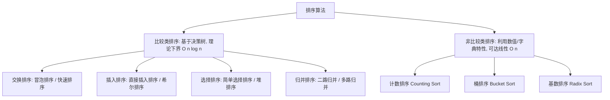
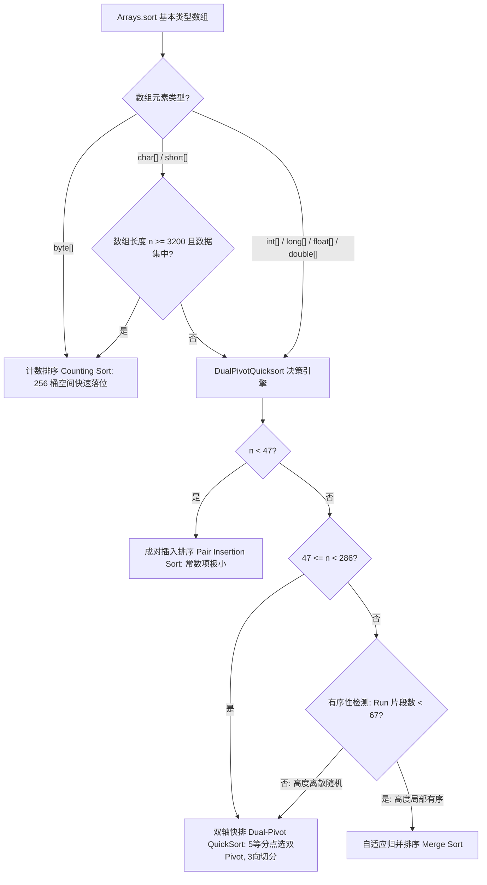
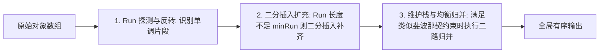

# Java 经典十大排序算法与集合排序全攻略

> 本文档系统整理了计算机科学中经典的**十大内部排序算法**（7 种比较类排序 + 3 种非比较类排序）以及 **Java 集合框架排序机制**。全篇涵盖核心思想、动画级步进推导、规范带注释 Java 手撕代码、复杂度与稳定性数学证明、JDK 源码实现选型机制（DualPivotQuickSort & TimSort）与大厂面试高频追问。

---

## 目录导航

- [一、排序算法全景图与复杂度天梯榜](#一排序算法全景图与复杂度天梯榜)
  - [1.1 顶层分类与理论下界](#11-顶层分类与理论下界)
  - [1.2 十大经典排序复杂度与稳定性全景总表](#12-十大经典排序复杂度与稳定性全景总表)
  - [1.3 什么是稳定性？为什么工业级对象排序必须保证稳定？](#13-什么是稳定性为什么工业级对象排序必须保证稳定)
- [二、比较类排序深度手撕与源码剖析](#二比较类排序深度手撕与源码剖析)
  - [2.1 交换排序族](#21-交换排序族)
    - [① 冒泡排序（Bubble Sort）](#-冒泡排序bubble-sort)
    - [② 快速排序（Quick Sort）](#-快速排序quick-sort)
  - [2.2 插入排序族](#22-插入排序族)
    - [① 直接插入排序（Insertion Sort）](#-直接插入排序insertion-sort)
    - [② 希尔排序（Shell Sort）](#-希尔排序shell-sort)
  - [2.3 选择排序族](#23-选择排序族)
    - [① 简单选择排序（Selection Sort）](#-简单选择排序selection-sort)
    - [② 堆排序（Heap Sort）](#-堆排序heap-sort)
  - [2.4 归并排序族](#24-归并排序族)
    - [归并排序（Merge Sort）](#归并排序merge-sort)
- [三、非比较类排序（突破线性时间复杂度）](#三非比较类排序突破线性时间复杂度)
  - [3.1 计数排序（Counting Sort）](#31-计数排序counting-sort)
  - [3.2 桶排序（Bucket Sort）](#32-桶排序bucket-sort)
  - [3.3 基数排序（Radix Sort）](#33-基数排序radix-sort)
- [四、Java 集合与标准库排序体系深度解密（Arrays.sort & Collections.sort）](#四java-集合与标准库排序体系深度解密arrayssort--collectionssort)
  - [4.1 Arrays.sort 与 Collections.sort 核心 API 全景与重载矩阵](#41-arrayssort-与-collectionssort-核心-api-全景与重载矩阵)
  - [4.2 Collections.sort 与 List.sort 源码演进与实现内幕](#42-collectionssort-与-listsort-源码演进与实现内幕)
  - [4.3 比较器体系规范与生产避坑禁忌](#43-比较器体系规范与生产避坑禁忌)
  - [4.4 Arrays.sort 基本类型引擎：DualPivotQuicksort 源码分流状态机](#44-arrayssort-基本类型引擎dualpivotquicksort-源码分流状态机)
  - [4.5 Arrays.sort 对象类型引擎：TimSort 源码深度剖析](#45-arrayssort-对象类型引擎timsort-源码深度剖析)
  - [4.6 多核并发排序：Arrays.parallelSort 原理与适用边界](#46-多核并发排序arraysparallelsort-原理与适用边界)
  - [4.7 Java 数组与集合逆序反转全攻略（4 大主流方案与底层剖析）](#47-java-数组与集合逆序反转全攻略4-大主流方案与底层剖析)
- [五、排序算法面试连环炮与深度速答](#五排序算法面试连环炮与深度速答)

---

## 一、排序算法全景图与复杂度天梯榜

### 1.1 顶层分类与理论下界

排序算法在计算机体系中主要按照**是否依赖元素间的相互比较**划分为两大门派：



- **比较类排序的理论下界**：任何基于比较的排序算法都可以抽象为一棵**二叉决策树**（Decision Tree）。对于 $n$ 个互不相同的元素，全排列共有 $n!$ 种可能。高度为 $h$ 的二叉树最多有 $2^h$ 个叶子节点，因此 $2^h \ge n!$。由斯特林公式推导得出 $h \ge \log_2(n!) = \Omega(n \log n)$。因此**任何比较排序算法的最坏时间复杂度不可能突破 $O(n \log n)$**。
- **非比较类排序**：不通过两两比较，而是利用数字在哈希桶、数位空间或桶分布中的统计学特性，能够在线性时间 $O(n)$ 内完成排序。

---

### 1.2 十大经典排序复杂度与稳定性全景总表

| 排序算法 | 最好时间复杂度 | 平均时间复杂度 | 最坏时间复杂度 | 额外空间复杂度 | 稳定性 | 原地排序 | 核心思想 / 机制 |
| :--- | :--- | :--- | :--- | :--- | :---: | :---: | :--- |
| **冒泡排序** | $O(n)$（加标记优化）| $O(n^2)$ | $O(n^2)$ | $O(1)$ | **稳定** | 是 | 相邻交换，大值后浮 |
| **直接插入排序** | $O(n)$（初始有序）| $O(n^2)$ | $O(n^2)$ | $O(1)$ | **稳定** | 是 | 有序区探测插入，小规模极快 |
| **简单选择排序** | $O(n^2)$ | $O(n^2)$ | $O(n^2)$ | $O(1)$ | **不稳定** | 是 | 遍历选最值放末尾 |
| **希尔排序** | $O(n)$ | $O(n^{1.3})$ | $O(n^2)$ | $O(1)$ | **不稳定** | 是 | 步长缩小组内插入 |
| **快速排序** | $O(n \log n)$ | $O(n \log n)$ | $O(n^2)$（完全有序）| $O(\log n)$ 递归栈 | **不稳定** | 是 | 基准划分，分治递归 |
| **归并排序** | $O(n \log n)$ | $O(n \log n)$ | $O(n \log n)$ | $O(n)$ 辅助数组 | **稳定** | 否 | 递归拆分，有序双指针合并 |
| **堆排序** | $O(n \log n)$ | $O(n \log n)$ | $O(n \log n)$ | $O(1)$ | **不稳定** | 是 | 构建大/小顶堆，堆顶下沉 |
| **计数排序** | $O(n + k)$ | $O(n + k)$ | $O(n + k)$ | $O(k)$ 计数桶 | **稳定** | 否 | 频次统计 + 前缀和倒序回填 |
| **桶排序** | $O(n)$（数据均匀）| $O(n + k)$ | $O(n^2)$（数据倾斜）| $O(n + k)$ | **稳定**（视桶内而定）| 否 | 区间分桶，桶内排序后级联 |
| **基数排序** | $O(d \cdot n)$ | $O(d \cdot n)$ | $O(d \cdot n)$ | $O(n + k)$ | **稳定** | 否 | LSD 低位优先按位计数排序 |

---

### 1.3 什么是稳定性？为什么工业级对象排序必须保证稳定？

- **定义**：假定待排序记录序列中存在多个具有相同关键字的记录，若经过排序后，**这些记录的相对次序保持不变**（即若 $A = B$，且排序前 $A$ 在 $B$ 前面，排序后 $A$ 仍在 $B$ 前面），则称该算法是**稳定的（Stable）**；否则称为**不稳定的（Unstable）**。
- **工业级场景中的深远意义**：
  在实际企业级业务中，我们很少对孤立的原始数字排序，绝大部分是对**复合业务对象**进行多维度排序。
  - **典型电商案例**：订单列表要求“先按【下单时间】升序排列，再按【订单金额】降序排列”。
  - 若第二轮按金额排序的算法**具有稳定性**：金额相同的一批订单，其先前按照下单时间的先后次序会被完美保留；
  - 若第二轮排序**不稳定**：金额相同的订单之间的下单时间相对顺序会被打乱，破坏了业务的复合排序诉求！
  - **结论**：这就是为什么在 JDK 源码中，`Arrays.sort(primitive[])`（基本类型数组）选用**不稳定但极快的双轴快排**，而 `Arrays.sort(Object[])` / `List.sort()`（对象类型）必须选用**稳定排序 TimSort** 的根本原因。

---

## 二、比较类排序深度手撕与源码剖析

### 2.1 交换排序族

#### ① 冒泡排序（Bubble Sort）
- **核心思想**：相邻两个元素两两比较，若逆序则交换，每一轮比较后，未排序区域的最大元素就像气泡一样“浮”到最后。
- **优化点**：引入 `boolean swapped` 标记。若某一整轮遍历中**未发生任何一次交换**，说明整个数组已自然有序，提前 `break` 退出，最好时间复杂度优化至 $O(n)$。

```java
public class BubbleSort {
    /**
     * 优化版冒泡排序：最好时间复杂度 O(n)，空间复杂度 O(1)
     */
    public static void bubbleSort(int[] arr) {
        if (arr == null || arr.length <= 1) return;
        int n = arr.length;
        
        for (int i = 0; i < n - 1; i++) {
            boolean swapped = false; // 标记本轮是否发生交换
            // 每轮沉底一个最大值，末尾 i 个元素无需再比
            for (int j = 0; j < n - 1 - i; j++) {
                if (arr[j] > arr[j + 1]) {
                    int temp = arr[j];
                    arr[j] = arr[j + 1];
                    arr[j + 1] = temp;
                    swapped = true;
                }
            }
            // 若整轮无交换，提前终止
            if (!swapped) break;
        }
    }
}
```

---

#### ② 快速排序（Quick Sort）
- **核心思想**：基于分治思想（Divide and Conquer）。
  1. 选取一个基准元素（Pivot）；
  2. **分区（Partition）**：通过双指针移动，将比 Pivot 小的移到左侧，比 Pivot 大的移到右侧，并将 Pivot 归位到最终下标；
  3. 递归排序左子区间和右子区间。
- **三大主流分区方法对比**：
  1. **首尾指针交换法（Hoare 分区）**：双指针向中间靠拢，左边找大的、右边找小的，互换两数；
  2. **挖坑填补法**：将 Pivot 取出留下“坑”，右边找到小于 Pivot 的数填入左坑，左边找到大于 Pivot 的数填入右坑，交替填坑；
  3. **Lomuto 单向分区法**：维护单个慢指针跟踪小于 Pivot 的区域边界，快指针单向遍历。

```java
import java.util.Random;

public class QuickSort {
    private static final Random RAND = new Random();

    public static void sort(int[] arr) {
        if (arr == null || arr.length <= 1) return;
        quickSort(arr, 0, arr.length - 1);
    }

    private static void quickSort(int[] arr, int left, int right) {
        // 小区间优化：当区间长度较小（如 <= 16）时，切换为插入排序更高效
        if (right - left <= 16) {
            insertionSort(arr, left, right);
            return;
        }

        int pivotIndex = partition(arr, left, right);
        quickSort(arr, left, pivotIndex - 1);
        quickSort(arr, pivotIndex + 1, right);
    }

    /**
     * 核心分区算法：挖坑/双指针交换法 + 随机 Pivot 优化
     */
    private static int partition(int[] arr, int left, int right) {
        // 随机基准优化：彻底防御已排序数组退化为 O(n^2) 的最坏情况
        int randomIndex = left + RAND.nextInt(right - left + 1);
        swap(arr, left, randomIndex);

        int pivot = arr[left];
        int l = left, r = right;

        while (l < r) {
            // 从右往左找第一个小于 pivot 的数
            while (l < r && arr[r] >= pivot) r--;
            // 从左往右找第一个大于 pivot 的数
            while (l < r && arr[l] <= pivot) l++;
            if (l < r) swap(arr, l, r);
        }
        // 基准元素归位
        swap(arr, left, l);
        return l;
    }

    private static void insertionSort(int[] arr, int left, int right) {
        for (int i = left + 1; i <= right; i++) {
            int current = arr[i];
            int j = i - 1;
            while (j >= left && arr[j] > current) {
                arr[j + 1] = arr[j];
                j--;
            }
            arr[j + 1] = current;
        }
    }

    private static void swap(int[] arr, int i, int j) {
        int t = arr[i]; arr[i] = arr[j]; arr[j] = t;
    }
}
```

---

### 2.2 插入排序族

#### ① 直接插入排序（Insertion Sort）
- **核心思想**：类似于打扑克牌时抓牌理牌。整个数组分为前端的【已排序有序区】和后端的【未排序无序区】。每次从未排序区取出第一个元素，自后向前扫描有序区，找到相应位置并插入。
- **特性**：在数组**基本有序**或**数据规模极小（$n < 50$）**时，常数项极小，运行速度甚至超越快速排序与归并排序。

```java
public class InsertionSort {
    public static void sort(int[] arr) {
        if (arr == null || arr.length <= 1) return;
        
        for (int i = 1; i < arr.length; i++) {
            int current = arr[i]; // 待插入值
            int j = i - 1;
            // 只要有序区元素比待插入值大，就向后挪位
            while (j >= 0 && arr[j] > current) {
                arr[j + 1] = arr[j];
                j--;
            }
            // 找到合适位置，空位归位
            arr[j + 1] = current;
        }
    }
}
```

---

#### ② 希尔排序（Shell Sort）
- **核心思想**：直接插入排序的进阶改良版（分组插入排序）。
  - 普通插入排序在待插入元素较小时，需要频繁一步一步单格搬移；
  - 希尔排序引入**步长序列（Gap）**，将相隔某个增量的记录组成一个子序列，分别在子序列内部执行直接插入排序；
  - 逐渐缩小组距（如 $n/2 \to n/4 \to \dots \to 1$），每次大跨度交换使得数组整体宏观趋向有序；当最后一次 $gap = 1$ 时，整个数组已经非常接近有序，只需常数级微调。
- **为什么不稳定**：相同元素若被分在不同的增量分组中，跨步移动会直接破坏它们原有的相对前后顺序。

```java
public class ShellSort {
    public static void sort(int[] arr) {
        if (arr == null || arr.length <= 1) return;
        int n = arr.length;

        // 初始步长为 n / 2，逐步折半缩小，直至 gap = 1
        for (int gap = n / 2; gap > 0; gap /= 2) {
            // 对每个子序列进行直接插入排序
            for (int i = gap; i < n; i++) {
                int current = arr[i];
                int j = i;
                while (j >= gap && arr[j - gap] > current) {
                    arr[j] = arr[j - gap];
                    j -= gap;
                }
                arr[j] = current;
            }
        }
    }
}
```

---

### 2.3 选择排序族

#### ① 简单选择排序（Selection Sort）
- **核心思想**：每一轮遍历从【未排序区间】中搜索出最小（或最大）的一个元素，将其与未排序区间的首位元素交换，使已排序区间递增 1 位。
- **与插入排序的本质区别**：插入排序是通过不断挪动元素来寻找归宿；而选择排序是**每轮只做一次元素交换**。
- **为什么不稳定**：例如序列 `[5a, 5b, 2]`，第一轮搜索到最小值 `2` 与第一位的 `5a` 交换，序列变为 `[2, 5b, 5a]`，两个 5 的相对次序被翻转！

```java
public class SelectionSort {
    public static void sort(int[] arr) {
        if (arr == null || arr.length <= 1) return;
        int n = arr.length;

        for (int i = 0; i < n - 1; i++) {
            int minIndex = i;
            for (int j = i + 1; j < n; j++) {
                if (arr[j] < arr[minIndex]) {
                    minIndex = j;
                }
            }
            if (minIndex != i) {
                int temp = arr[i];
                arr[i] = arr[minIndex];
                arr[minIndex] = temp;
            }
        }
    }
}
```

---

#### ② 堆排序（Heap Sort）
- **核心思想**：利用完全二叉树的物理数组表示构造**大顶堆**（升序排序使用大顶堆，降序使用小顶堆）。
  1. **建堆**：自底向上从最后一个非叶子节点 `(n/2 - 1)` 开始逐个执行下沉调整 `siftDown`，时间复杂度为 $O(n)$；
  2. **排序**：将堆顶元素（全局最大值）与末尾未排序元素交换，堆有效大小减 1，然后对堆顶执行单点 `siftDown` 下沉维护堆序；循环执行直到堆大小为 1。
- **优势**：时间复杂度严格 $O(n \log n)$，无论原始数据是否有序，且空间复杂度严格为 $O(1)$（原地排序）。

```java
public class HeapSort {
    public static void sort(int[] arr) {
        if (arr == null || arr.length <= 1) return;
        int n = arr.length;

        // 1. 构建大顶堆：从最后一个非叶子节点逆序向上调整
        for (int i = n / 2 - 1; i >= 0; i--) {
            siftDown(arr, n, i);
        }

        // 2. 依次将堆顶最大值置换到末尾，并重新下沉堆顶
        for (int i = n - 1; i > 0; i--) {
            swap(arr, 0, i);     // 堆顶最大值归位到末尾
            siftDown(arr, i, 0); // 调整剩余 i 个元素的堆结构
        }
    }

    /**
     * 核心下沉算法：调整以 index 为根节点的子树为大顶堆
     */
    private static void siftDown(int[] arr, int size, int index) {
        int largest = index;
        int left = 2 * index + 1;
        int right = 2 * index + 2;

        if (left < size && arr[left] > arr[largest]) largest = left;
        if (right < size && arr[right] > arr[largest]) largest = right;

        if (largest != index) {
            swap(arr, index, largest);
            siftDown(arr, size, largest); // 递归下沉
        }
    }

    private static void swap(int[] arr, int i, int j) {
        int t = arr[i]; arr[i] = arr[j]; arr[j] = t;
    }
}
```

---

### 2.4 归并排序族

#### 归并排序（Merge Sort）
- **核心思想**：经典分治策略。
  1. **分（Divide）**：将数组从中间下标 `mid` 切分为左右两半，递归向下分解直到子数组大小为 1；
  2. **治（Conquer）**：递归对左半段和右半段分别排序；
  3. **合（Merge）**：使用双指针比对左右两个有序子区间，从小到大灌入临时辅助数组，最后整体拷贝回原数组。
- **特性**：
  - **严格 $O(n \log n)$**：不受原始数据分布影响；
  - **绝对稳定**：在合并时，只要 `arr[i] <= arr[j]`，优先选择左半段的元素，保持相等元素的前后时序；
  - **缺点**：需要额外分配一个与原数组等长的辅助空间 $O(n)$。

```java
public class MergeSort {
    public static void sort(int[] arr) {
        if (arr == null || arr.length <= 1) return;
        // 关键优化：全局只分配一次辅助数组，避免递归内高频 new 产生 GC 压力
        int[] temp = new int[arr.length];
        mergeSort(arr, 0, arr.length - 1, temp);
    }

    private static void mergeSort(int[] arr, int left, int right, int[] temp) {
        if (left >= right) return;
        
        int mid = left + (right - left) / 2; // 安全计算中点防溢出
        mergeSort(arr, left, mid, temp);
        mergeSort(arr, mid + 1, right, temp);

        // 小优化：若已经天然有序（arr[mid] <= arr[mid + 1]），跳过本次 merge
        if (arr[mid] > arr[mid + 1]) {
            merge(arr, left, mid, right, temp);
        }
    }

    private static void merge(int[] arr, int left, int mid, int right, int[] temp) {
        int i = left;     // 左子数组起点
        int j = mid + 1;  // 右子数组起点
        int t = left;     // 临时数组填充指针

        while (i <= mid && j <= right) {
            if (arr[i] <= arr[j]) { // <= 保持稳定性
                temp[t++] = arr[i++];
            } else {
                temp[t++] = arr[j++];
            }
        }

        while (i <= mid) temp[t++] = arr[i++];
        while (j <= right) temp[t++] = arr[j++];

        // 将排好序的数据批量拷回原数组对应区间
        System.arraycopy(temp, left, arr, left, right - left + 1);
    }
}
```

---

## 三、非比较类排序（突破线性时间复杂度）

### 3.1 计数排序（Counting Sort）
- **核心思想**：利用数组下标本身天然具备的有序性。
  1. 统计数组中最大值与最小值的跨度区间；
  2. 统计每个元素出现的频次，存入 `count` 数组；
  3. **前缀和转化**：将 `count[i]` 累加转化为“小于等于元素 $i$ 的总个数”，这代表了元素 $i$ 在最终有序数组中的**最终落位下标**；
  4. **倒序遍历原数组回填**：从后向前遍历原数组，依据前缀和下标放入结果数组并将计数减 1，**倒序是保证算法稳定性的核心关键**。
- **复杂度与限制**：时间 $O(n + k)$，空间 $O(k)$。只适用于范围较小且非极度稀疏的整数排序（如高考分数、年龄分布）。

```java
public class CountingSort {
    public static void sort(int[] arr) {
        if (arr == null || arr.length <= 1) return;

        int min = arr[0], max = arr[0];
        for (int num : arr) {
            min = Math.min(min, num);
            max = Math.max(max, num);
        }

        int range = max - min + 1;
        int[] count = new int[range];
        int[] result = new int[arr.length];

        // 1. 频次统计
        for (int num : arr) count[num - min]++;

        // 2. 计算前缀和，定位落位索引
        for (int i = 1; i < range; i++) count[i] += count[i - 1];

        // 3. 倒序遍历原数组，确保稳定性
        for (int i = arr.length - 1; i >= 0; i--) {
            int num = arr[i];
            result[count[num - min] - 1] = num;
            count[num - min]--;
        }

        // 4. 拷贝回原数组
        System.arraycopy(result, 0, arr, 0, arr.length);
    }
}
```

---

### 3.2 桶排序（Bucket Sort）
- **核心思想**：计数排序的延展进阶。
  1. 建立若干个连续区间的“桶（Buckets）”；
  2. 通过映射函数将数据均匀分流到各个桶内；
  3. 对每个桶内部进行单独排序（通常借助 `Collections.sort` 或插入排序）；
  4. 遍历各个桶按顺序拼接回原数组。
- **时间复杂度分析**：若数据高度均匀分布在 $k$ 个桶中，每个桶包含 $n / k$ 个元素，总耗时为 $O(n + k \cdot (n/k \log(n/k)))$。当 $k \approx n$ 时，平均复杂度趋近于极致的 $O(n)$。但若数据严重倾斜（全部挤入同一个桶），会退化至 $O(n^2)$。

```java
import java.util.ArrayList;
import java.util.Collections;
import java.util.List;

public class BucketSort {
    public static void sort(int[] arr) {
        if (arr == null || arr.length <= 1) return;

        int min = arr[0], max = arr[0];
        for (int x : arr) {
            min = Math.min(min, x);
            max = Math.max(max, x);
        }
        if (min == max) return;

        int n = arr.length;
        int bucketCount = n; // 桶数量默认与数组长度一致
        List<List<Integer>> buckets = new ArrayList<>(bucketCount);
        for (int i = 0; i < bucketCount; i++) buckets.add(new ArrayList<>());

        // 1. 数据映射分流到各个桶
        for (int num : arr) {
            int idx = (int) (((long) num - min) * (bucketCount - 1) / ((long) max - min));
            buckets.get(idx).add(num);
        }

        // 2. 桶内排序并回写
        int targetIdx = 0;
        for (List<Integer> bucket : buckets) {
            Collections.sort(bucket); // 桶内排序
            for (int val : bucket) {
                arr[targetIdx++] = val;
            }
        }
    }
}
```

---

### 3.3 基数排序（Radix Sort）
- **核心思想**：多关键字排序思想（LSD，次位优先 Least Significant Digit）。
  - 对于非负整数，从最低位（个位）开始，依次向高位（十位、百位...）遍历；
  - 每一轮按当前数位（$0 \sim 9$）执行一次**稳定的计数排序**；
  - 当最高位排序完毕后，全局自然有序。
- **复杂度**：时间 $O(d \cdot (n + k))$，其中 $d$ 为最大数值的十进制位数，$k = 10$ 为基数（0~9）。

```java
public class RadixSort {
    public static void sort(int[] arr) {
        if (arr == null || arr.length <= 1) return;

        int max = arr[0];
        for (int val : arr) max = Math.max(max, val);

        // 按个位(exp=1)、十位(exp=10)、百位(exp=100)...轮询基数排序
        for (int exp = 1; max / exp > 0; exp *= 10) {
            countingSortByDigit(arr, exp);
        }
    }

    private static void countingSortByDigit(int[] arr, int exp) {
        int n = arr.length;
        int[] result = new int[n];
        int[] count = new int[10]; // 基数 0~9

        // 1. 统计当前数位的数字出现次数
        for (int val : arr) {
            int digit = (val / exp) % 10;
            count[digit]++;
        }

        // 2. 计算前缀和
        for (int i = 1; i < 10; i++) count[i] += count[i - 1];

        // 3. 倒序回填确保稳定性
        for (int i = n - 1; i >= 0; i--) {
            int digit = (arr[i] / exp) % 10;
            result[count[digit] - 1] = arr[i];
            count[digit]--;
        }

        System.arraycopy(result, 0, arr, 0, n);
    }
}
```

---

## 四、Java 集合与标准库排序体系深度解密（Arrays.sort & Collections.sort）

### 4.1 Arrays.sort 与 Collections.sort 核心 API 全景与重载矩阵

在 Java 开发中，我们几乎每天都在调用 `Arrays.sort` 与 `Collections.sort`。但很多人不知道，JDK 针对不同的数据类型（基本数据类型 vs 对象引用类型）、不同的数据规模以及不同的计算环境，设计了截然不同且极度精妙的底层排序引擎。

| API 方法签名 | 适用数据类型 | JDK 底层核心算法 | 平均时间复杂度 | 额外空间复杂度 | 稳定性 | 引入版本 |
| :--- | :--- | :--- | :---: | :---: | :---: | :---: |
| `Arrays.sort(primitive[])` | 基本类型数组 (`int, long, short, char, byte, float, double`) | **Dual-Pivot QuickSort**（双轴快排）/ 计数排序 | $O(n \log n)$ / $O(n)$ | $O(\log n)$ | **不稳定** | JDK 7+ |
| `Arrays.sort(Object[])` | 对象数组（元素实现 `Comparable`） | **ComparableTimSort**（自适应归并） | $O(n \log n)$ | $O(n)$ | **稳定** | JDK 7+ |
| `Arrays.sort(T[], Comparator<? super T>)` | 对象数组（外部自定义比较器） | **TimSort**（自适应归并） | $O(n \log n)$ | $O(n)$ | **稳定** | JDK 7+ |
| `Arrays.parallelSort(...)` | 基本类型数组 / 对象数组 | **并行双轴快排 / 并行 TimSort**（ForkJoinPool） | $O(n \log n)$ | $O(n)$ | 视对象/基本类型而定 | JDK 8+ |
| `Collections.sort(List<T>)` | 列表（元素实现 `Comparable`） | 委托 `list.sort(null)` $\to$ `Arrays.sort` $\to$ **TimSort** | $O(n \log n)$ | $O(n)$ | **稳定** | JDK 1.2+ |
| `Collections.sort(List<T>, Comparator<? super T>)` | 列表（外部比较器） | 委托 `list.sort(c)` $\to$ `Arrays.sort` $\to$ **TimSort** | $O(n \log n)$ | $O(n)$ | **稳定** | JDK 1.2+ |
| `List.sort(Comparator<? super E>)` | List 实例方法（推荐现代写法） | 内部 `toArray()` $\to$ `Arrays.sort` $\to$ `ListIterator` 回填 | $O(n \log n)$ | $O(n)$ | **稳定** | JDK 8+ |

---

### 4.2 Collections.sort 与 List.sort 源码演进与实现内幕

#### 1. Java 8 架构演进：`Collections.sort` 彻底退居幕后
在 Java 8 之前，排序逻辑由 `Collections.sort` 静态方法直接承载；而从 Java 8 开始，由于引入了接口默认方法（Default Method），`Collections.sort` 源码已全面被改写为**直接委托给 `List.sort`**：

```java
// java.util.Collections 源码 (JDK 8+)
public static <T extends Comparable<? super T>> void sort(List<T> list) {
    list.sort(null); // 直接委托给 List 自身的 default sort 方法
}

public static <T> void sort(List<T> list, Comparator<? super T> c) {
    list.sort(c);    // 同样直接委托
}
```

#### 2. `List.sort` 源码揭秘
打开 `java.util.List` 接口，查看其 `sort` 默认方法实现：
```java
// java.util.List 源码 (JDK 8+)
default void sort(Comparator<? super E> c) {
    Object[] a = this.toArray(); // 1. 将 List 拷贝为对象数组 Object[]
    Arrays.sort(a, (Comparator) c); // 2. 调用 Arrays.sort 进行 TimSort 排序
    ListIterator<E> i = this.listIterator();
    for (Object e : a) {         // 3. 利用迭代器顺序写回原 List
        i.next();
        i.set((E) e);
    }
}
```

#### 3. 核心面试追问：为什么 `List.sort` 要多此一举拷贝成数组排完再写回？
> **答**：
> 1. **保护链表结构的访问效率（防止 $O(n^2)$ 甚至 $O(n^3)$ 灾难）**：如果传入的是 `LinkedList`，链表并不支持高效的随机访问。如果在链表上直接做基于下标的快速排序或归并切分，每次 `list.get(index)` 都要从表头遍历 $O(n)$，整体排序将恶化为不可接受的 $O(n^2)$。
> 2. **CPU 缓存行与连续内存优势**：连续内存的 `Object[]` 数组在 CPU 缓存局部性（Cache Locality）上完胜散落在 JVM 堆内存各处的链表 Node 节点。
> 3. **复用极致优化的 TimSort**：`Arrays.sort(Object[], c)` 底层的 TimSort 是经过十年工业级打磨的最高性能稳定排序，转为数组后直接复用，比在 List 接口层面单独实现一套排序引擎快得多且易于维护。
> 4. **子类特化优化**：对于 `ArrayList`，它重写了 `sort(c)` 方法，直接在它内部的连续数组 `elementData` 上调用 `Arrays.sort(elementData, 0, size, c)`，**连 `toArray()` 和迭代器回填的开销都直接省掉了**！

---

### 4.3 比较器体系规范与生产避坑禁忌

#### 1. `Comparable<T>` vs `Comparator<T>` 对比与选型
- **`Comparable<T>`（内部比较器 / 自然序）**：
  - 位于 `java.lang` 包；定义在类的内部，重写 `compareTo(T o)`；
  - 语义：表示该类的对象“**天然具备大小关系**”（如 `String` 的字典序、`Integer` 的数值序、`Date` 的时间先后）；
- **`Comparator<T>`（外部比较器 / 策略模式）**：
  - 位于 `java.util` 包；由外部独立传入，重写 `compare(T o1, T o2)`；
  - 语义：表示“**第三方的、临时的排序策略**”。当原始类没有实现 `Comparable`，或者默认自然序不满足当前业务需要时（例如有时要按年龄升序，有时要按入职时间降序），解耦灵活。

#### 2. Java 8+ 函数式复合排序优雅实践
```java
import java.util.Comparator;
import java.util.List;

public class SortPractice {
    public static void sortEmployees(List<Employee> list) {
        list.sort(
            Comparator.comparing(Employee::getDepartment)                     // 1. 部门字典序升序
                .thenComparingInt(Employee::getAge)                          // 2. 年龄升序
                .thenComparing(Comparator.comparingDouble(Employee::getSalary).reversed()) // 3. 薪水降序
                .thenComparing(Employee::getName, Comparator.nullsLast(String::compareTo)) // 4. 姓名空值垫底
        );
    }
}
```

#### 3. 生产避坑禁忌 ①：减法溢出致命隐患
- **常见错误代码**：
  ```java
  // 危险代码：绝对禁止在生产环境中直接做相减比较！
  (a, b) -> a.getValue() - b.getValue()
  ```
- **Bug 根源**：若 $a = -2147483648$（`Integer.MIN_VALUE`），$b = 1$。
  $a - b = -2147483648 - 1 = 2147483647$（发生整型下溢，反转为极大正数），比较器判定 $a > b$，导致排序逻辑彻底颠倒！
- **正确规范**：统一使用包装类的静态方法 `Integer.compare(a, b)`、`Long.compare(a, b)`、`Double.compare(a, b)`。

#### 4. 生产避坑禁忌 ②：`Comparison method violates its general contract!` 契约违背异常
- **异常现象**：在线上环境偶发抛出 `java.lang.IllegalArgumentException: Comparison method violates its general contract!`。
- **产生根源**：JDK 7 引入 TimSort 后，对比较器的**数学自洽性（严格弱序 Strict Weak Ordering）**进行了严格断言校验。比较器必须满足三大约束：
  1. **自反性**：$compare(x, x) == 0$；
  2. **反对称性**：$sgn(compare(x, y)) == -sgn(compare(y, x))$；
  3. **传递性**：若 $compare(x, y) > 0$ 且 $compare(y, z) > 0$，则必须满足 $compare(x, z) > 0$。
- **翻车典型代码**：
  ```java
  // 错误写法：遗漏了相等时的 0 分支！
  (o1, o2) -> o1.getScore() > o2.getScore() ? 1 : -1
  ```
  当两个对象的 `score` 相等时，`compare(A, B)` 返回 `-1`（判定 $A < B$），而反过来 `compare(B, A)` 也返回 `-1`（判定 $B < A$），自反性和反对称性双重破产，TimSort 在二分插入或栈平衡检测时触发该运行时异常。
- **防范对策**：始终涵盖 `== 0` 的情况，推荐直接使用 `Integer.compare` 或 Java 8 的 `Comparator.comparing` 构建。

---

### 4.4 Arrays.sort 基本类型引擎：DualPivotQuicksort 源码分流状态机

对于基本数据类型（如 `int[]`, `long[]`, `char[]` 等），JDK 认为**基本类型的数值相同即完全等价，不需要保证排序稳定性**，因此一切以追求**极致执行速度与硬件吞吐**为第一目标，默认采用 `DualPivotQuicksort`。



#### 1. 为什么极小数组（$n < 47$）采用“成对插入排序”？
在长度很短时，快排的递归入栈出栈开销与分支预测失败惩罚远大于简单排序。JDK 使用了改进版的**成对插入排序（Pair Insertion Sort）**：每次从未排序区同时取出两个连续元素，先比较两数大小，较大的数先向前扫描插入，较小的数紧随其后在更靠前的位置插入。相比于单元素插入，数组元素整体后移的指令周期减少了近 30%。

#### 2. 为什么 $47 \le n < 286$ 采用“双轴快速排序”？
- **传统快排**：选择 1 个基准值 $P$，划分出 2 个区间（$< P$ 与 $> P$）；
- **双轴快排**：从数组中选取两个基准值 $P_1, P_2$（满足 $P_1 \le P_2$），通过三向切分将数组分为 3 个区域：
  - 左区间：$< P_1$
  - 中区间：$P_1 \le x \le P_2$
  - 右区间：$> P_2$
- **CPU 级性能飞跃**：在现代多核计算机体系架构下，内存总线速度远远落后于 CPU 运算速度。双轴快排将数据切分成三份后，每一次分区操作在 L1/L2 缓存中的局部性大幅提高，减少了 CPU 向主存（RAM）请求读取缓存行（Cache Line）的次数，整体吞吐量相比单轴快排提升 10%~20%。

#### 3. 为什么 $n \ge 286$ 要先探测有序性？
当数组长度超过 286 时，JDK 会先进行一轮线性扫描，统计数组中连续升序或连续降序的片段数（Run 计数）：
- 若片段数少于 67：说明原始数据并不是随机分布，而是**局部高度有序**。此时调用针对已排序序列高度优化的归并排序；
- 若片段数达到或超过 67：说明数据高度杂乱无章，直接切换为双轴快排。

#### 4. float / double 特殊处理
浮点数包含 `-0.0f`、`+0.0f` 以及特殊的 `Float.NaN`：
- `-0.0f` 与 `+0.0f` 在数值比较 `==` 下相等，但在底层 IEEE 754 字节表示中不同（`-0.0f < +0.0f`）；
- `NaN` 与任何数字（包括其自身）比较均为 `false`；
- JDK 在排序前，会专门线性扫描将所有 `-0.0f` 归集在 `+0.0f` 前，并将所有的 `NaN` 挪到数组的最末尾，再对有效数值区间执行双轴快排。

---

### 4.5 Arrays.sort 对象类型引擎：TimSort 源码深度剖析

对于对象类型（`Object[]` 或 `List<T>`），业务往往要求多维度复合排序，因此**必须使用绝对稳定的排序算法**。自 JDK 7 起，Java 全面采用源自 Python 的顶级工业级稳定排序——**TimSort**。

#### 1. TimSort 核心三大运行阶段


1. **Run 探测与逆序就地反转**：
   - 现实业务中的数据绝大多数不是纯随机数，往往局部天然有序。
   - TimSort 从前往后扫描，找出严格递增或严格递减的连续序列；
   - 若发现严格递减片段（$a[i] > a[i+1]$），**立刻在原数组上双指针首尾翻转**，将其秒变为递增序列（称为一个 Run）。
2. **计算 `minRun` 与二分插入排序扩充**：
   - 为避免归并时的二叉树极度不平衡，TimSort 会计算一个基准片段长度 `minRun`（通常介于 $16 \sim 32$ 之间，取 $n$ 的最高 6 位）；
   - 若探测到的 Run 长度小于 `minRun`，直接使用 **二分插入排序（Binary Sort）** 将后续元素插入该 Run，强制将其补齐至 `minRun` 长度。
3. **归并栈与 Invariant（不变式）约束**：
   - 将排好的各个 Run 依次压入专门的运行栈，栈中跟踪记录各 Run 的起始下标与长度。
   - 为确保后续二路归并的树结构均衡，栈顶的三个连续 Run 长度（记为 $A, B, C$）必须严格满足以下两条不变式：
     1. $A > B + C$
     2. $B > C$
   - 只要任何一条被打破，TimSort 就强制将较短的相邻两个 Run 进行归并，归并时还会开启 **Galloping（飞奔模式）** 借助二分查找成块跳跃复制，使得复杂度在最坏情况下严格受控于 $O(n \log n)$，而在天然有序数据下趋近于极致的 **$O(n)$**。

---

### 4.6 多核并发排序：Arrays.parallelSort 原理与适用边界

随着多核 CPU 普及，Java 8 推出了 `Arrays.parallelSort` 静态方法，利用多核算力大幅提升大数组排序效率。

#### 1. 架构原理与源码关键阈值
- **底层驱动**：基于 Java 7 引入的 `ForkJoinPool.commonPool()` 公共线程池工作窃取框架；
- **分界粒度常量**：
  ```java
  // java.util.DualPivotQuicksort 源码
  private static final int MIN_ARRAY_SORT_GRAN = 1 << 13; // 8192
  ```
- **工作机制**：
  1. 计算任务划分的最小粒度 `gran = Math.max(n / (NCPUS << 2), 8192)`；
  2. 若待排序数组长度 $n \le gran$ 或者当前机器仅有单核 CPU，`parallelSort` 直接退化为单线程的 `Arrays.sort`；
  3. 若 $n > gran$，通过 `CountedCompleter` 递归将数组对半拆分生成子任务提交给各工作线程；
  4. 各工作线程并发对其负责的子区间排序（基本类型走双轴快排，对象走 TimSort）；
  5. 各子任务完成后，自底向上由工作线程并行执行归并合并（Parallel Merge）。

#### 2. 生产实测与选型指南
| 数据规模（元素个数 $n$） | 推荐使用 API | 性能对比与原理解析 |
| :--- | :--- | :--- |
| **$n < 10,000$（小规模）** | `Arrays.sort` | **强烈不推荐 parallelSort**。单线程快排已在几个微秒内完成，调用 `parallelSort` 产生的子任务拆分、线程调度和上下文切换（Context Switch）开销反而比单线程慢 2~5 倍。 |
| **$10,000 \le n \le 100,000$** | 二者相近 | 性能差异不明显，单线程快排常数项极小。 |
| **$n > 100,000$（十万至千万级）** | `Arrays.parallelSort` | **多核加速效果显著**。在 8 核或 16 核服务器上，多线程并发排序与并发归并可获得 **2.5 倍 ~ 4 倍**的吞吐量提升。 |

---
### 4.7 Java 数组与集合逆序反转全攻略（4 大主流方案与底层剖析）

在 Java 实际业务开发与算法面试中，“逆序/反转”与“降序排序”是极高频出现的场景。首先必须确立一个基本认知：**JDK 标准库的 `java.util.Arrays` 工具类并没有提供 `reverse()` 方法**（因为数组元素类型众多且双指针原地交换逻辑极轻量，官方更提倡通过集合或原地算法处理）。

同时，必须严格厘清两个核心概念：
- **物理逆序反转（Reverse / Mirror Flip）**：将容器中现有的元素前后顺序直接颠倒对调，**不改变相对内容，也不要求元素本身具备可比性**（原本无序反转后依然无序）。
- **大小降序排序（Descending Sort）**：根据元素大小或比较规则，将元素按照从大到小重新排列。

---

#### 1. Java 数组逆序反转（Reverse）的 4 大主流实现方案

针对数组本身的逆序反转，根据数据类型（基本类型 vs 对象数组）与技术选型，业界主要有以下 4 种实现方案：

##### 方案一：手写双指针首尾对调（原地修改，性能巅峰，零额外 GC，大厂手撕标准）
无论对于基本类型数组（`int[]`、`long[]` 等）还是对象数组（`String[]`、`T[]`），手写双指针都是性能最极致的解法。
- **时间复杂度**：$O(n)$ 单次线性遍历（实际比较交换次数为 $n / 2$）；
- **额外空间复杂度**：严格 $O(1)$，纯栈上操作，产生零堆内存垃圾；
- **规范实现代码**：
```java
public class ArrayReverseUtil {
    /**
     * 基本类型 int[] 原地双指针反转
     */
    public static void reverse(int[] arr) {
        if (arr == null || arr.length <= 1) return;
        int left = 0, right = arr.length - 1;
        while (left < right) {
            int temp = arr[left];
            arr[left] = arr[right];
            arr[right] = temp;
            left++;
            right--;
        }
    }

    /**
     * 泛型对象数组 T[] 原地双指针反转
     */
    public static <T> void reverse(T[] arr) {
        if (arr == null || arr.length <= 1) return;
        int left = 0, right = arr.length - 1;
        while (left < right) {
            T temp = arr[left];
            arr[left] = arr[right];
            arr[right] = temp;
            left++;
            right--;
        }
    }
}
```

##### 方案二：利用 `Collections.reverse(Arrays.asList(arr))`（对象数组最佳语法糖）
对于引用对象数组（如 `String[]`、`Integer[]`、自定义类数组），可巧妙结合 `Arrays.asList` 与 `Collections.reverse` 实现一行代码原地反转。
- **核心原理**：`Arrays.asList(arr)` 返回的是内部私有类 `Arrays$ArrayList`，该类只是一个**包装视图（View Wrapper）**，底层直接持有原数组的引用。因此对该 List 调用 `Collections.reverse()` 时，所有的 `set()` 操作都会**直接修改原对象数组**，无需额外拷贝。
- **示例代码**：
```java
String[] strArr = {"Apple", "Banana", "Cherry"};
Collections.reverse(Arrays.asList(strArr));
// 此时 strArr 原数组已被原地反转为: ["Cherry", "Banana", "Apple"]
```
- **⚠️ 致命避坑警告**：
  **基本类型数组绝对不能使用此方法！**
  若执行 `int[] nums = {1, 2, 3}; Collections.reverse(Arrays.asList(nums));`，Java 泛型机制会将整个 `int[]` 当作单个元素封装为 `List<int[]>`（长度为 1），不仅无法反转，还会产生逻辑 Bug。

##### 方案三：Java 8+ Stream 流式倒序映射（函数式编程，生成新数组，原数组不变）
如果业务要求保持原数组不变，生成一个新的逆序数组，可以使用 Stream API：
```java
// 1. 基本类型 int[] 生成逆序新数组
int[] original = {1, 2, 3, 4, 5};
int[] reversedInts = java.util.stream.IntStream.range(0, original.length)
        .map(i -> original[original.length - 1 - i])
        .toArray();

// 2. 对象数组 String[] 生成逆序新数组
String[] words = {"A", "B", "C"};
String[] reversedWords = java.util.stream.IntStream.range(0, words.length)
        .mapToObj(i -> words[words.length - 1 - i])
        .toArray(String[]::new);
```
- **优缺点**：符合函数式无副作用思想，但会新开辟数组空间并产生装箱/流水线开销，性能略逊于双指针。

##### 方案四：工业级第三方工具类（开箱即用，代码极简）
在企业级工程项目中，为了提高代码复用率和可读性，广泛采用主流开源工具库：
- **Apache Commons Lang**：
  ```java
  import org.apache.commons.lang3.ArrayUtils;
  
  int[] arr = {1, 2, 3, 4};
  ArrayUtils.reverse(arr); // 原地反转，支持全部基本类型及 Object 数组
  ```
- **Google Guava**：
  ```java
  import com.google.common.primitives.Ints;
  
  int[] arr = {1, 2, 3, 4};
  Ints.reverse(arr); // 原地反转
  ```

---

#### 2. `Collections.reverse(List<?> list)` 源码级运行机制

打开 `java.util.Collections` 源码，观察其内部实现：
```java
// java.util.Collections 源码
public static void reverse(List<?> list) {
    int size = list.size();
    if (size < REVERSE_THRESHOLD || list instanceof RandomAccess) {
        // 场景 A：支持随机访问（如 ArrayList）或元素规模很小（<18）
        for (int i = 0, mid = size >> 1, j = size - 1; i < mid; i++, j--)
            swap(list, i, j);
    } else {
        // 场景 B：链表结构（如 LinkedList），避免 O(n^2) 下标访问！
        ListIterator fwd = list.listIterator();
        ListIterator rev = list.listIterator(size);
        for (int i = 0, mid = list.size() >> 1; i < mid; i++) {
            Object tmp = fwd.next();
            fwd.set(rev.previous());
            rev.set(tmp);
        }
    }
}
```

- **源码精妙设计点（高频面试追问）**：
  - 常量阈值：`REVERSE_THRESHOLD = 18`；
  - **为什么非 `RandomAccess` 列表要采用双向 `ListIterator`？**
    如果对 `LinkedList` 简单粗暴地调用 `list.get(i)` 和 `list.set(i, val)`，由于链表每次按索引查找都要从头节点顺着指针遍历，单次访问耗时 $O(n)$，整体反转将急剧恶化为灾难级的 **$O(n^2)$**！
    而通过创建一个正向迭代器 `fwd` 和一个反向迭代器 `rev` 同时向中间推进，能在单次遍历中以 **严格 $O(n)$ 线性时间** 就地交换所有元素！

---

#### 3. 数组与集合「大小降序排序（Descending Sort）」方案与避坑指南

如果业务目标不是物理颠倒，而是“**从大到小按数值/规则降序排序**”，应使用比较器反转系列 API：

##### 1. 降序比较器利器对比
| API 方法 | 所属类 / 接口 | 引入版本 | 功能定义 | 典型生产写法 |
| :--- | :--- | :---: | :--- | :--- |
| `Collections.reverseOrder()` | `java.util.Collections` | JDK 1.2 | 返回强加**自然顺序反向**的比较器（对象必须实现 `Comparable`） | `Collections.sort(list, Collections.reverseOrder())` |
| `Collections.reverseOrder(cmp)` | `java.util.Collections` | JDK 1.5 | 将传入的自定义比较器 `cmp` 反转（若传 `null` 等同于自然序反向） | 反转已有自定义策略 |
| `Comparator.reverseOrder()` | `java.util.Comparator` | JDK 8 | 静态工厂方法，返回**自然顺序反向**的比较器（泛型类型推导更优） | `list.sort(Comparator.reverseOrder())` |
| `comparator.reversed()` | `java.util.Comparator` | JDK 8 | 实例默认方法，将**当前自定义比较器整体反向** | `Comparator.comparing(User::getScore).reversed()` |

##### 2. 经典避坑：基本类型数组 `int[]` 降序排序编译报错
```java
int[] arr = {3, 1, 4, 1, 5, 9};
// ❌ 编译直接报错：The method sort(int[]) in the type Arrays is not applicable for the arguments (int[], Comparator<Object>)
Arrays.sort(arr, Collections.reverseOrder());
```
- **报错根源**：Java 泛型机制不支持基本数据类型（Primitive Types），`Comparator<T>` 只接受对象，而 `Arrays.sort(T[], Comparator)` 只能接收对象数组 `T[]`，无法匹配基本类型 `int[]`。
- **3 种标准降序解决方案**：
  1. **方案 A（官方最推荐，速度最快，零额外内存）**：先升序排序，再原地双指针反转
     ```java
     Arrays.sort(arr);        // 1. 底层双轴快排升序 O(n log n)
     ArrayReverseUtil.reverse(arr); // 2. 双指针原地反转 O(n)
     ```
  2. **方案 B（直接使用对象包装类数组）**：
     ```java
     Integer[] arr = {3, 1, 4, 1, 5, 9};
     Arrays.sort(arr, Collections.reverseOrder()); // 或 Comparator.reverseOrder()
     ```
  3. **方案 C（Java 8+ Stream 流式装箱，代码简洁但有装箱开销）**：
     ```java
     int[] descArr = Arrays.stream(arr)
                           .boxed()
                           .sorted(Comparator.reverseOrder())
                           .mapToInt(Integer::intValue)
                           .toArray();
     ```

---

#### 4. Java 数组逆序/降序实现方案综合选型矩阵

| 实现方案 | 适用数据类型 | 是否原地修改 | 时间复杂度 | 额外空间 / GC 压力 | 推荐场景 |
| :--- | :--- | :---: | :---: | :---: | :--- |
| **手写双指针首尾交换** | 基本类型数组 (`int[]` 等) / 对象数组 (`T[]`) | **是** | $O(n)$ | $O(1)$ / **零 GC** | **最推荐**。算法手撕、高频交易、高性能后端服务 |
| **`Collections.reverse(Arrays.asList(arr))`** | **仅限引用对象数组** (`String[]` 等) | **是** | $O(n)$ | 极小（仅微量视图包装） | 对象数组需极简一行代码原地反转 |
| **Java 8+ `IntStream.range`** | 基本类型 / 对象数组 | **否（生成新数组）** | $O(n)$ | $O(n)$ / 产生新数组 | 函数式不可变编程、原数组不能被修改 |
| **Apache Commons / Guava 工具类** | 基本类型 / 对象数组 | **是** | $O(n)$ | $O(1)$ / **零 GC** | 企业级大型工程快速开发 |
| **升序排序 + 双指针反转** | 基本类型数组 (`int[]` 等) | **是** | $O(n \log n)$ | $O(1)$ | 基本类型需要**数值大小降序排序** |
| **`Arrays.sort(arr, reverseOrder)`** | **仅限引用对象数组** (`Integer[]` 等) | **是** | $O(n \log n)$ | $O(n)$（TimSort 运行栈） | 对象数组需要**规则大小降序排序** |

---

## 五、排序算法面试连环炮与深度速答

### Q1：为什么在工业界通用场景中，快速排序实测比归并排序和堆排序更快？
> **答**：
> 1. **CPU 缓存行与空间局部性**：快速排序是**连续内存自两端向中心扫描**，预取器（Hardware Prefetcher）能大块命中 L1/L2 缓存；而堆排序发生跳跃式的节点访问（$i \to 2i+1$），Cache Miss 极高；
> 2. **常数项小且原地排序**：归并排序每次合并都需要在外部分配或拷贝辅助数组，内存占用与数据搬运的 CPU 指令常数项远大于快排的原地交换。

---

### Q2：为什么说归并排序是处理“海量数据外排序（磁盘排序）”的唯一基石？
> **答**：
> 当数据量极大（如 100 GB 甚至 TB 级别）而系统物理内存只有 4 GB 时，快排和堆排序都无法在内存中建立完整的下标索引。
> 此时必须采用**多路外部归并排序（External Merge Sort）**：
> 1. 每次从磁盘读取 4 GB 数据进内存，排好序后写回磁盘作为一个临时有序文件（Block）；
> 2. 将这 25 个有序小文件同时打开，利用败者树（或优先队列小顶堆）在内存中仅维护各个文件当前指针的最小值，每次将全局最小值流式写出到最终大文件。这一过程本质就是多路归并。

---

### Q3：编写 `Comparator` 时写 `(a, b) -> a.getValue() - b.getValue()` 为什么是生产事故级禁忌？
> **答**：
> **存在严重的整型减法溢出漏洞**。
> 假设 $a = -2147483648$（`Integer.MIN_VALUE`），$b = 1$。
> 计算 $a - b = -2147483648 - 1 = 2147483647$（正溢出）。
> 比较器返回了正数，错误地判定 $a > b$！
> **正确规范**：必须使用 `Integer.compare(a, b)` 或 `Double.compare(a, b)`。

---

### Q4：手写快排如何证明能够将空间复杂度严格控制在 $O(\log n)$？
> **答**：
> 普通快排在递归极度不均匀时，递归栈深度最坏可达 $O(n)$。
> **尾递归优化策略**：在执行完 partition 划分后，**先递归调用长度较短的那一半子数组，将较长的那一半转为 `while` 循环迭代**。由于每次压栈的分区长度至少减半，递归栈深度在任何极端最坏情况下都能被强制约束在不超过 $\log_2 n$。
