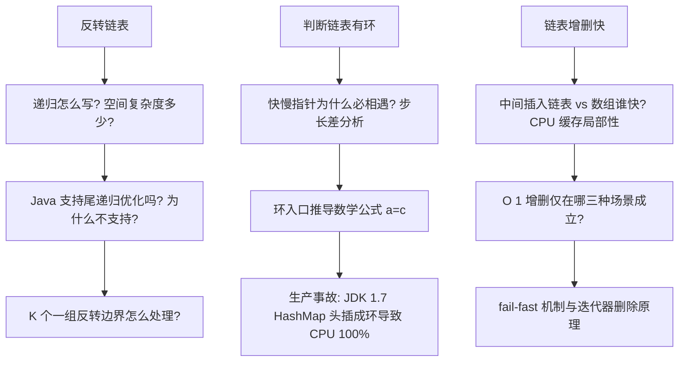
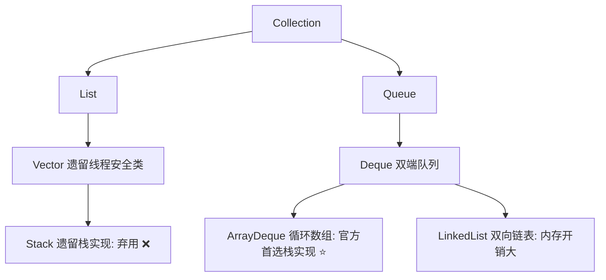
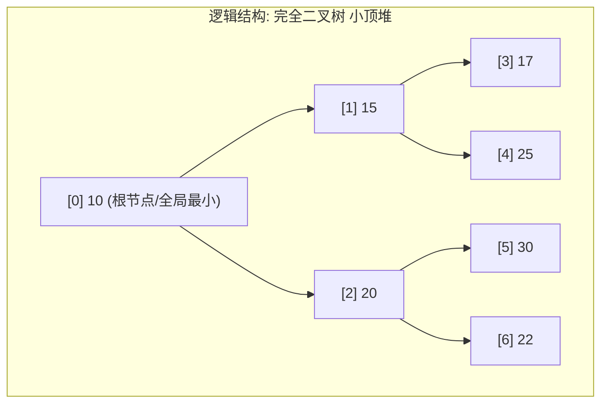
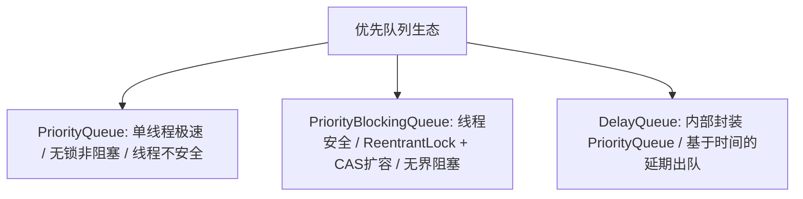

# Java 算法与数据结构面试通关宝典

> 本文档由原「算法.md」、「算法代码.md」与「算法总结.md」深度融合重构而成。全面整合了**高维考点大纲、解题心法与记忆口诀**，以及**Java 语言底层/JDK 源码剖析、大厂手撕题规范模板、面试连环炮追问与 1 分钟口述总结**。全篇采用统一的「四层递进式」架构，去除所有同质化冗余，助力高效通关大厂技术面试。

---

## 目录导航

- [模块一：链表专题 (Linked List)](#模块一链表专题-linked-list)
  - [一、链表心法导航与记忆口诀](#一链表心法导航与记忆口诀)
  - [二、底层原理与 Java 特性联动](#二底层原理与-java-特性联动)
  - [三、高频经典题型与手撕模板 (Java)](#三高频经典题型与手撕模板-java)
  - [四、链表面试连环炮与避坑指南](#四链表面试连环炮与避坑指南)
- [模块二：二分查找与排序专题 (Binary Search & Sorting)](#模块二二分查找与排序专题-binary-search--sorting)
  - [一、二分与排序心法导航与记忆口诀](#一二分与排序心法导航与记忆口诀)
  - [二、底层原理与 Java 特性联动](#二二分与排序底层原理与-java-特性联动)
  - [三、高频经典题型与手撕模板 (Java)](#三二分与排序高频经典题型与手撕模板-java)
  - [四、面试连环炮与避坑指南](#四二分与排序面试连环炮与避坑指南)
- [模块三：二叉树专题 (Binary Tree)](#模块三二叉树专题-binary-tree)
  - [一、二叉树心法导航与记忆口诀](#一二叉树心法导航与记忆口诀)
  - [二、底层原理与 Java 特性联动](#二二叉树底层原理与-java-特性联动)
  - [三、高频经典题型与手撕模板 (Java)](#三二叉树高频经典题型与手撕模板-java)
  - [四、面试连环炮与避坑指南](#四二叉树面试连环炮与避坑指南)
- [模块四：堆 / 栈 / 队列专题 (Heap, Stack, Queue)](#模块四堆--栈--队列专题-heap-stack-queue)
  - [一、堆栈队列心法导航与记忆口诀](#一堆栈队列心法导航与记忆口诀)
  - [二、底层原理与 Java 特性联动](#二堆栈队列底层原理与-java-特性联动)
  - [三、高频经典题型与手撕模板 (Java)](#三堆栈队列高频经典题型与手撕模板-java)
  - [四、面试连环炮与避坑指南](#四堆栈队列面试连环炮与避坑指南)
- [模块五：哈希表专题 (Hash Table)](#模块五哈希表专题-hash-table)
  - [一、哈希心法导航与记忆口诀](#一哈希心法导航与记忆口诀)
  - [二、底层原理与 Java 特性联动](#二哈希底层原理与-java-特性联动)
  - [三、高频经典题型与手撕模板 (Java)](#三哈希高频经典题型与手撕模板-java)
  - [四、面试连环炮与避坑指南](#四哈希面试连环炮与避坑指南)
- [模块六：递归与回溯专题 (Recursion & Backtracking)](#模块六递归与回溯专题-recursion--backtracking)
  - [一、递归回溯心法导航与记忆口诀](#一递归回溯心法导航与记忆口诀)
  - [二、底层原理与 Java 特性联动](#二递归回溯底层原理与-java-特性联动)
  - [三、高频经典题型与手撕模板 (Java)](#三递归回溯高频经典题型与手撕模板-java)
  - [四、面试连环炮与避坑指南](#四递归回溯面试连环炮与避坑指南)
- [模块七：双指针与滑动窗口专题 (Two Pointers & Sliding Window)](#模块七双指针与滑动窗口专题-two-pointers--sliding-window)
  - [一、双指针心法导航与记忆口诀](#一双指针心法导航与记忆口诀)
  - [二、核心理论与滑动窗口模型](#二核心理论与滑动窗口模型)
  - [三、高频经典题型与手撕模板 (Java)](#三双指针高频经典题型与手撕模板-java)
  - [四、面试连环炮与避坑指南](#四双指针面试连环炮与避坑指南)
- [模块八：字符串专题 (String & JVM 常量池)](#模块八字符串专题-string--jvm-常量池)
  - [一、字符串心法导航与记忆口诀](#一字符串心法导航与记忆口诀)
  - [二、底层原理与 Java 特性联动](#二字符串底层原理与-java-特性联动)
  - [三、高频经典题型与手撕模板 (Java)](#三字符串高频经典题型与手撕模板-java)
  - [四、面试连环炮与避坑指南](#四字符串面试连环炮与避坑指南)
- [模块九：模拟类题目专题 (Simulation)](#模块九模拟类题目专题-simulation)
  - [一、模拟题心法导航与记忆口诀](#一模拟题心法导航与记忆口诀)
  - [二、五大模拟题型与解题套路](#二五大模拟题型与解题套路)
  - [三、高频经典题型与手撕模板 (Java)](#三模拟题高频经典题型与手撕模板-java)
  - [四、面试连环炮与避坑指南](#四模拟题面试连环炮与避坑指南)
- [模块十：贪心算法专题 (Greedy)](#模块十贪心算法专题-greedy)
  - [一、贪心心法导航与记忆口诀](#一贪心心法导航与记忆口诀)
  - [二、核心证明思想与失效场景](#二核心证明思想与失效场景)
  - [三、高频经典题型与手撕模板 (Java)](#三贪心高频经典题型与手撕模板-java)
  - [四、面试连环炮与避坑指南](#四贪心面试连环炮与避坑指南)
- [模块十一：动态规划专题 (Dynamic Programming)](#模块十一动态规划专题-dynamic-programming)
  - [一、DP 心法导航与记忆口诀](#一dp-心法导航与记忆口诀)
  - [二、解题五步法与背包专题深度模型](#二解题五步法与背包专题深度模型)
  - [三、高频经典题型与手撕模板 (Java)](#三dp-高频经典题型与手撕模板-java)
  - [四、面试连环炮与避坑指南](#四dp-面试连环炮与避坑指南)

---

# 模块一：链表专题 (Linked List)

## 一、链表心法导航与记忆口诀

### 1.1 核心本质与特性
- **数据结构形态**：由节点组成的离散线性结构，每个节点包含「数据值 + 指针引用」。
  - **单链表**：只有 `next` 指针，单向移动。
  - **双向链表**：包含 `prev` 与 `next`，可双向移动，**能够 O(1) 访问前驱节点**（这是双向链表一切优势的核心源泉）。
  - **循环链表**：尾节点指向头节点，可从任意位置开始遍历全表。
- **复杂度画像**：
  - 随机访问：$O(n)$（无法通过下标寻址，必须从头逐个跳跃）。
  - **已知位置插入/删除**：$O(1)$（只需改变指针指向，无需整体数据搬移）。
  - **未知位置插入/删除**：$O(n)$（本质是被定位成本拖累）。
  - 内存分配：堆内存离散按需分配，无动态扩容开销，但存在额外的指针对象引用开销。

### 1.2 四大解题心法
1. **虚拟头节点（Dummy Head）**：
   - 解决痛点：当头节点本身可能被删除、被反转或头部需要插入时，普通节点与头节点逻辑不对等。
   - 核心作用：设立一个“永远不动的前驱”，让头节点拥有与其他节点一致的操作逻辑，消除特判边界分支。
2. **快慢双指针（Fast & Slow Pointers）**：
   - 找中点（快2慢1）、判环与找环入口（Floyd 判圈算法）、找倒数第 K 个（快指针先走 K 步建立固定间距）。
3. **迭代三指针（Prev / Curr / Next）**：
   - 处理链表反转、局部重排的标准配置，严格按照“暂存后继 → 修改指向 → 前驱推进 → 当前推进”四步推进。
4. **递归化解（Recursion）**：
   - 适用于反转链表、合并有序链表等具备自相似子结构的问题。但需警惕 JVM 栈深度限制。

### 1.3 绝杀记忆口诀
> **环用快慢指针，中点快慢同走；**  
> **倒数前后定距，反转三针暂存；**  
> **删除多用dummy，回文中点反转；**  
> **重排拆分交错，成环必防死圈。**

---

## 二、底层原理与 Java 特性联动

### 2.1 链表 vs 数组深度对比（必考区分度）

| 维度 | 数组 (`ArrayList`) | 链表 (`LinkedList`) |
| :--- | :--- | :--- |
| **内存布局** | 连续物理内存 | 离散物理堆内存 |
| **随机访问** | $O(1)$（基地址 + 下标 * 元素大小） | $O(n)$（顺序寻道） |
| **头部插入/删除** | $O(n)$（需要搬移后续所有元素） | $O(1)$（仅修改引用） |
| **中间插入/删除** | $O(n)$（内存拷贝耗时） | $O(n)$（寻址定位耗时） |
| **尾部插入/删除** | 摊还 $O(1)$（遇扩容需数据整体搬迁） | $O(1)$（持有 `tail/last` 引用时） |
| **额外空间开销** | 预留扩容容量（约 1.5 倍） | 每个节点额外 1~2 个对象引用指针 |
| **CPU 缓存友好性** | **极高**（空间局部性强，硬件预取命中率高） | **极低**（Cache Miss 频繁，产生指针追逐） |

> [!IMPORTANT]
> **面试高频坑：为什么实际工程中，中间插入链表依然大幅慢于数组？**
> 复杂度同为 $O(n)$ 时，必须比拼**常数项**与**硬件底层执行机制**：
> 1. **数组搬移**：调用底层的 `System.arraycopy`（C++ `memmove`），连续物理内存支持 CPU 缓存行（Cache Line 64字节）批量加载，甚至触发 SIMD 向量指令加速，耗时极短。
> 2. **链表遍历**：发生经典的“指针追逐（Pointer Chasing）”。每个节点散落在堆的不同区域，CPU 预取器失效，每次解引用几乎都会引发 L1/L2/L3 Cache Miss，访问主存产生上百纳秒延迟。

### 2.2 JDK 源码机制：`LinkedList` 深度剖析
1. **底层结构**：
   ```java
   private static class Node<E> {
       E item;
       Node<E> next;
       Node<E> prev;
   }
   ```
2. **多重接口实现**：
   
   - `LinkedList` 同时实现了 `List<E>` 和 `Deque<E>`（双向队列），具备列表、队列、双端队列和栈的多重身份。
3. **`get(index)` 寻址优化（折半探测）**：
   ```java
   Node<E> node(int index) {
       // 判断 index 落在前半段还是后半段，离哪头近从哪头遍历，平均遍历 n/4 步
       if (index < (size >> 1)) {
           Node<E> x = first;
           for (int i = 0; i < index; i++) x = x.next;
           return x;
       } else {
           Node<E> x = last;
           for (int i = size - 1; i > index; i--) x = x.prev;
           return x;
       }
   }
   ```
4. **工程选型结论**：
   实际 Java 生产开发中**几乎不推荐使用 `LinkedList`**：
   - 需要列表/随机访问：首选 `ArrayList`；
   - 需要队列/双端队列/栈：首选 `ArrayDeque`（基于循环数组实现，无扩容搬迁代价且缓存友好，性能全面碾压 `LinkedList`）。

### 2.3 集合遍历中的 `fail-fast` 机制
- **异常现象**：在使用 `foreach`（增强 for 循环）或 `Iterator` 遍历集合时，若直接调用集合自带的 `list.remove()` 或 `list.add()`，会抛出 `ConcurrentModificationException`。
- **底层原理**：
  - 集合内部维护全局修改计数器 `modCount`；
  - 迭代器初始化时捕获快照 `expectedModCount = modCount`；
  - 每次调用 `iterator.next()` 时首先校验：
    ```java
    final void checkForComodification() {
        if (modCount != expectedModCount)
            throw new ConcurrentModificationException();
    }
    ```
- **安全删除姿势**：必须使用 `iterator.remove()`。其内部在移除节点后，会同步执行 `expectedModCount = modCount`，保证状态一致性。

### 2.4 HashMap 与链表的生产级联动
1. **JDK 1.7 并发扩容死循环（头插法成环事故）**：
   - JDK 1.7 采用**头插法**转移链表节点，在扩容后链表内节点的顺序会被**逆序**。
   - 两个线程并发扩容时，线程 A 暂存了节点引用关系后被挂起；线程 B 完成扩容使节点指向反转；线程 A 恢复后继续操作指针，导致节点间相互引用形成**环形链表**。
   - 后续任何命中该 Hash 桶的 `get()` 操作都会在死循环中耗尽 CPU，导致生产服务器 CPU 飙升至 100%。
   - **JDK 1.8 解决方案**：改用**尾插法**，保持节点的原始相对顺序，彻底消除了扩容反转成环的条件（但多线程操作 HashMap 仍可能发生数据覆盖，并发场景必须使用 `ConcurrentHashMap`）。
2. **JDK 1.8 树化机制（Treeify）**：
   - **树化阈值**：桶内链表长度 $\ge 8$ **且** 数组总容量 $\ge 64$ 时转化为红黑树。
   - **阈值 8 的来源**：在理想的随机哈希分布下，桶中节点的频次服从**泊松分布**（Poisson Distribution）。一个桶中节点数达到 8 的概率约为千万分之六（$0.0000006$），树化属于极端哈希碰撞的防御性兜底。
   - **退化阈值 6**：在扩容剪枝或删除节点后，当树节点降至 6 时退化回普通链表。保留 6 与 8 之间的差值可有效防止在阈值边缘反复震荡重构。

---

## 三、高频经典题型与手撕模板 (Java)

### 3.1 基础节点定义（面试手撕第一步）
```java
public class ListNode {
    public int val;
    public ListNode next;
    public ListNode() {}
    public ListNode(int val) { this.val = val; }
    public ListNode(int val, ListNode next) { this.val = val; this.next = next; }
}
```

### 3.2 题型 1：反转链表（LeetCode 206）⭐⭐⭐⭐⭐
- **核心思路**：维护 `prev`、`curr`、`next` 三个指针，逐个翻转指向。
- **复杂度**：时间 $O(n)$，空间 $O(1)$。
```java
// 迭代法（推荐首选，面试直接默写）
public ListNode reverseList(ListNode head) {
    ListNode prev = null;
    ListNode curr = head;
    while (curr != null) {
        ListNode next = curr.next; // 1. 暂存后继节点
        curr.next = prev;          // 2. 反转当前指针
        prev = curr;               // 3. prev 指针前移
        curr = next;               // 4. curr 指针前移
    }
    return prev; // prev 即为新链表的头节点
}

// 递归法（追问时展现）
public ListNode reverseListRecursive(ListNode head) {
    if (head == null || head.next == null) return head;
    ListNode newHead = reverseListRecursive(head.next);
    head.next.next = head; // 后继节点的 next 指向当前节点
    head.next = null;      // 断开当前节点原有指向，防止成环
    return newHead;
}
```

### 3.3 题型 2：环形链表 I & II（LeetCode 141 & 142）⭐⭐⭐⭐⭐
- **核心思路**：
  1. **判环**：快指针走 2 步，慢指针走 1 步。快慢指针在环内相对速度为 1，必然在 $O(n)$ 时间内相遇。
  2. **找入口**：设头节点到环入口距离为 $a$，环入口到相遇点为 $b$，相遇点绕回入口为 $c$。
     - 慢指针路程：$S_{slow} = a + b$
     - 快指针路程：$S_{fast} = a + b + k(b + c)$
     - 由 $2 \cdot S_{slow} = S_{fast}$ 可推导得出：$a = (k - 1)(b + c) + c$。当 $k = 1$ 时，$a = c$。
     - **结论**：相遇后，将一个指针重置到头节点，另一个指针保留在相遇点，两指针同速（每次1步）前进，再次相遇之处即为**环的入口**。
```java
public ListNode detectCycle(ListNode head) {
    if (head == null || head.next == null) return null;
    ListNode slow = head, fast = head;
    
    // 步骤一：寻找相遇点
    while (fast != null && fast.next != null) {
        slow = slow.next;
        fast = fast.next.next;
        if (slow == fast) { // 确认有环
            // 步骤二：定位环入口
            ListNode ptr1 = head;
            ListNode ptr2 = slow;
            while (ptr1 != ptr2) {
                ptr1 = ptr1.next;
                ptr2 = ptr2.next;
            }
            return ptr1; // 再次相遇点即入口
        }
    }
    return null; // 无环
}
```

### 3.4 题型 3：寻找链表的中间节点（LeetCode 876）⭐⭐⭐⭐
- **核心思路**：快慢指针。快指针走 2 步，慢指针走 1 步。
- **细节差异**：
  - 若 `fast = head, fast.next != null && fast.next.next != null`：偶数节点时停在**前中点**（用于归并排序断链）；
  - 若 `fast = head, fast != null && fast.next != null`：偶数节点时停在**后中点**。
```java
public ListNode middleNode(ListNode head) {
    ListNode slow = head, fast = head;
    while (fast != null && fast.next != null) {
        slow = slow.next;
        fast = fast.next.next;
    }
    return slow;
}
```

### 3.5 题型 4：删除链表的倒数第 N 个节点（LeetCode 19）⭐⭐⭐⭐⭐
- **核心思路**：虚拟头节点 + 固定滑动窗口间距。快指针先走 $N + 1$ 步，随后快慢指针同速前进，快指针到达末尾 `null` 时，慢指针恰好停在**被删节点的前驱节点**上。
```java
public ListNode removeNthFromEnd(ListNode head, int n) {
    ListNode dummy = new ListNode(0, head);
    ListNode fast = dummy, slow = dummy;
    
    // 快指针先走 n + 1 步
    for (int i = 0; i <= n; i++) {
        fast = fast.next;
    }
    // 快慢指针同步推进
    while (fast != null) {
        fast = fast.next;
        slow = slow.next;
    }
    // 此时 slow 正处于待删节点的前驱
    slow.next = slow.next.next;
    return dummy.next;
}
```

### 3.6 题型 5：合并两个有序链表 & 合并 K 个有序链表（LeetCode 21 & 23）⭐⭐⭐⭐⭐
- **核心思路**：
  - 合并两个：使用 `dummy` 头节点，双指针比大小串联。
  - 合并 K 个：借助**小顶堆（PriorityQueue）**维护每个链表的当前头节点，全局每次弹出最小节点接入，再将其后继推入堆中。时间复杂度 $O(N \log K)$，其中 $N$ 为总节点数。
```java
// 合并两个有序链表
public ListNode mergeTwoLists(ListNode l1, ListNode l2) {
    ListNode dummy = new ListNode(0);
    ListNode curr = dummy;
    while (l1 != null && l2 != null) {
        if (l1.val <= l2.val) {
            curr.next = l1;
            l1 = l1.next;
        } else {
            curr.next = l2;
            l2 = l2.next;
        }
        curr = curr.next;
    }
    curr.next = (l1 != null) ? l1 : l2;
    return dummy.next;
}

// 合并 K 个有序链表（堆优先队列法）
public ListNode mergeKLists(ListNode[] lists) {
    if (lists == null || lists.length == 0) return null;
    PriorityQueue<ListNode> pq = new PriorityQueue<>(lists.length, (a, b) -> a.val - b.val);
    
    // 初始化堆
    for (ListNode head : lists) {
        if (head != null) pq.offer(head);
    }
    
    ListNode dummy = new ListNode(0);
    ListNode tail = dummy;
    while (!pq.isEmpty()) {
        ListNode node = pq.poll();
        tail.next = node;
        tail = tail.next;
        if (node.next != null) {
            pq.offer(node.next);
        }
    }
    return dummy.next;
}
```

### 3.7 题型 6：回文链表（LeetCode 234）⭐⭐⭐⭐
- **核心思路**：组合拳思维（找中点 + 反转后半段 + 双向比对）。时间复杂度 $O(n)$，空间复杂度严格 $O(1)$。
```java
public boolean isPalindrome(ListNode head) {
    if (head == null || head.next == null) return true;
    
    // 1. 快慢指针找前半段尾部（前中点）
    ListNode slow = head, fast = head;
    while (fast.next != null && fast.next.next != null) {
        slow = slow.next;
        fast = fast.next.next;
    }
    
    // 2. 反转后半段链表
    ListNode secondHalfHead = reverseList(slow.next);
    
    // 3. 前后两段比对
    ListNode p1 = head, p2 = secondHalfHead;
    boolean palindrome = true;
    while (palindrome && p2 != null) {
        if (p1.val != p2.val) palindrome = false;
        p1 = p1.next;
        p2 = p2.next;
    }
    
    // 4. 还原链表（工程良好习惯）
    slow.next = reverseList(secondHalfHead);
    return palindrome;
}
```

### 3.8 题型 7：K 个一组翻转链表（LeetCode 25，Hard 大厂高频）⭐⭐⭐⭐⭐
- **核心思路**：
  1. 探测本组是否有 $K$ 个节点，不足 $K$ 个则直接返回原头节点；
  2. 满足 $K$ 个节点，切断与外部的连接，对该组进行标准链表翻转；
  3. 递归或迭代将翻转后的链表尾部与下一组结果拼接。
```java
public ListNode reverseKGroup(ListNode head, int k) {
    ListNode dummy = new ListNode(0, head);
    ListNode pre = dummy;
    
    while (head != null) {
        ListNode tail = pre;
        // 探测本组长度是否达到 k
        for (int i = 0; i < k; i++) {
            tail = tail.next;
            if (tail == null) return dummy.next; // 不足 k 个，保持原样返回
        }
        
        ListNode nextGroupHead = tail.next; // 暂存下一组的起始节点
        
        // 翻转当前 [head, tail] 区间
        ListNode[] reversed = reverseSubList(head, tail);
        head = reversed[0];
        tail = reversed[1];
        
        // 拼接回主链
        pre.next = head;
        tail.next = nextGroupHead;
        
        // 指针滑向下一组的前驱位置
        pre = tail;
        head = nextGroupHead;
    }
    return dummy.next;
}

// 翻转子链表，返回 [newHead, newTail]
private ListNode[] reverseSubList(ListNode head, ListNode tail) {
    ListNode prev = tail.next;
    ListNode curr = head;
    while (prev != tail) {
        ListNode next = curr.next;
        curr.next = prev;
        prev = curr;
        curr = next;
    }
    return new ListNode[]{tail, head};
}
```

### 3.9 题型 8：排序链表（LeetCode 148，要求 $O(n \log n)$ 且常数空间）⭐⭐⭐⭐
- **核心思路**：链表上最适合的排序算法是**归并排序**（因为快排对链表难以快速定位 pivot，而链表归并可以在 $O(1)$ 额外空间下合并两个子链）。
```java
public ListNode sortList(ListNode head) {
    if (head == null || head.next == null) return head;
    
    // 1. 快慢指针定位中点并断链
    ListNode slow = head, fast = head.next; // fast 从 head.next 出发保证两节点时正确断开
    while (fast != null && fast.next != null) {
        slow = slow.next;
        fast = fast.next.next;
    }
    ListNode mid = slow.next;
    slow.next = null; // 必须断链切分为两条子链
    
    // 2. 递归排序左右两半
    ListNode left = sortList(head);
    ListNode right = sortList(mid);
    
    // 3. 有序合并
    return mergeTwoLists(left, right);
}
```

### 3.10 题型 9：手撕 LRU 缓存机制（LeetCode 146）⭐⭐⭐⭐⭐
- **核心思路**：
  - 单一结构困境：`HashMap` 可以 $O(1)$ 定位但无时间顺序；单双链表具有时序但查询定位为 $O(n)$。
  - **组合设计**：`HashMap` 负责 $O(1)$ 定位节点；**双向链表**维护访问时序并在 $O(1)$ 内完成节点的摘取与插入。
  - 规定：链表头部为最常用（Most Recently Used），尾部为最久未用（Least Recently Used）。
```java
public class LRUCache {
    class DLinkedNode {
        int key, value;
        DLinkedNode prev, next;
        DLinkedNode() {}
        DLinkedNode(int k, int v) { key = k; value = v; }
    }
    
    private final Map<Integer, DLinkedNode> cache = new HashMap<>();
    private int size;
    private final int capacity;
    private final DLinkedNode head, tail; // 虚拟头尾哨兵
    
    public LRUCache(int capacity) {
        this.size = 0;
        this.capacity = capacity;
        head = new DLinkedNode();
        tail = new DLinkedNode();
        head.next = tail;
        tail.prev = head;
    }
    
    public int get(int key) {
        DLinkedNode node = cache.get(key);
        if (node == null) return -1;
        moveToHead(node); // 访问后提升至头部
        return node.value;
    }
    
    public void put(int key, int value) {
        DLinkedNode node = cache.get(key);
        if (node == null) {
            DLinkedNode newNode = new DLinkedNode(key, value);
            cache.put(key, newNode);
            addToHead(newNode);
            size++;
            if (size > capacity) {
                DLinkedNode tailNode = removeTail();
                cache.remove(tailNode.key); // 同步从哈希表中剔除
                size--;
            }
        } else {
            node.value = value;
            moveToHead(node);
        }
    }
    
    private void addToHead(DLinkedNode node) {
        node.prev = head;
        node.next = head.next;
        head.next.prev = node;
        head.next = node;
    }
    
    private void removeNode(DLinkedNode node) {
        node.prev.next = node.next;
        node.next.prev = node.prev;
    }
    
    private void moveToHead(DLinkedNode node) {
        removeNode(node);
        addToHead(node);
    }
    
    private DLinkedNode removeTail() {
        DLinkedNode res = tail.prev;
        removeNode(res);
        return res;
    }
}
```

> [!TIP]
> **追问：Java 现成方案如何三行实现 LRU？**
> 继承 `LinkedHashMap`，设置构造参数 `accessOrder = true`（基于访问顺序排序），并重写 `removeEldestEntry` 方法：
> ```java
> class LRUCacheMap extends LinkedHashMap<Integer, Integer> {
>     private final int capacity;
>     public LRUCacheMap(int capacity) {
>         super(capacity, 0.75f, true);
>         this.capacity = capacity;
>     }
>     @Override
>     protected boolean removeEldestEntry(Map.Entry<Integer, Integer> eldest) {
>         return size() > capacity;
>     }
> }
> ```

---

## 四、链表面试连环炮与避坑指南

### 4.1 大厂面试追问线路图


### 4.2 易错陷阱清单
1. **断链丢失引用**：在修改指针指向之前，必须预先用局部变量暂存 `next`，否则一旦指向被更改，后续所有链表节点直接脱离引用被 GC。
2. **两两拼接后未断尾（导致成环死循环）**：在重排链表、奇偶链表分割、或按值划分两链拼接时，大链的末尾节点若仍保留原有的旧 `next` 指向，极易形成环状死循环。**拼接后末尾节点的 `next` 必须显式置为 `null`**。
3. **两数相加最高位进位丢失**：循环条件必须包含 `carry != 0`。若仅写 `while (l1 != null || l2 != null)`，则像 `999 + 1 = 1000` 这样的情况，最高位的 1 会被直接丢弃。
4. **尾递归陷阱**：明确告知面试官，Java 编译器和 HotSpot JVM **不支持尾调用/尾递归消除**（Tail Call Optimization），因为 JVM 需要保留完整的栈帧调用栈来保障反射权限安全和异常日志打印。因此 Java 中任何递归实现的深度都是 $O(n)$ 内存开销，存在 `StackOverflowError` 风险。

---

# 模块二：二分查找与排序专题 (Binary Search & Sorting)

## 一、二分与排序心法导航与记忆口诀

### 1.1 二分查找本质
- **单调性与二段性**：二分查找并不严格要求全局有序，**只要问题存在“二段性”（即区间能根据某种性质划分为满足与不满足的两半）**，即可使用二分。
- **三大应用场景**：
  1. 有序数组查找目标值（标准二分）；
  2. 寻找左边界 / 右边界（下界与上界）；
  3. **二分答案**（把最优化问题转化为判定问题，如“分割数组的最大值最小”）。

### 1.2 排序算法核心画像
- **内部排序三大主力**：
  - **快速排序**：分治思想、原地排序、平均 $O(n \log n)$、常数极小，但不稳定。
  - **归并排序**：分治思想、非原地（需 $O(n)$ 辅助空间）、严格 $O(n \log n)$、**稳定排序**，是链表排序与多级排序首选。
  - **堆排序**：利用堆结构、原地排序、严格 $O(n \log n)$，不稳定，适合海量数据 TopK。

### 1.3 绝杀记忆口诀
> **有序查找用二分，边界死记闭与开；**  
> **旋转看清半段序，答案二分求极值。**  
> **快排分治选基准，随机取中防退化；**  
> **归并稳定耗空间，链表排序必归并。**

---

## 二、二分与排序底层原理与 Java 特性联动

### 2.1 整型溢出避坑与计算优化
- **经典 BUG**：计算中点时若直接写 `mid = (left + right) / 2`，当 `left + right > Integer.MAX_VALUE`（$2^{31}-1$）时会发生**整型符号位溢出**，产生负数导致数组越界。
- **安全高效写法**：
  ```java
  // 推荐写法一：减法防溢出
  int mid = left + (right - left) / 2;
  // 推荐写法二：无符号右移（运算符优先级极低，必须加外括号）
  int mid = (left + right) >>> 1;
  ```

### 2.2 JDK 源码机制：`Arrays.sort()` 与 `Collections.sort()` 内部策略
大厂高频区分度考点：JDK 内部究竟用了什么排序算法？
1. **基本数据类型（`int[]`, `char[]`, `double[]` 等）**：
   - 采用 **Dual-Pivot QuickSort（双轴快速排序，Vladimir Yaroslavskiy 实现）**。
   - **设计考量**：基本类型没有“相等元素相对顺序”的概念，无需保证稳定性，追求极致的执行速度。双轴快排将区间划分为 3 段，减少了数据比较次数并提升了 CPU 缓存局部性。
   - 内部包含策略降级：小数组（长度 $< 47$）采用**插入排序**；极小区间采用计数排序。
2. **引用对象类型（`Object[]`, `List<T>`）**：
   - 采用 **TimSort（自适应归并与插入混合排序）**。
   - **设计考量**：对象排序**必须保证稳定性**（例如电商订单先按金额排、再按时间排，后序排序不能打乱前序排序中相同键值的相对顺序）。
   - TimSort 先探测数据中已经自然有序的连续块（Run），短块用二分插入排序扩展至固定长度，长块采用优化归并栈合并，最好时间复杂度可达 $O(n)$。

### 2.3 `Arrays.binarySearch()` 的精妙返回值设计
```java
// JDK 源码解析
private static int binarySearch0(int[] a, int fromIndex, int toIndex, int key) {
    int low = fromIndex;
    int high = toIndex - 1;
    while (low <= high) {
        int mid = (low + high) >>> 1;
        int midVal = a[mid];
        if (midVal < key) low = mid + 1;
        else if (midVal > key) high = mid - 1;
        else return mid; // key found
    }
    return -(low + 1);  // key not found.
}
```
> [!NOTE]
> **设计亮点**：当未找到目标值时，返回 `-(low + 1)` 而非 `-1`。
> 1. 返回负数明确代表“未找到”；
> 2. `low` 恰好是目标值应该被插入的位置（保持数组有序的 Insertion Point）。通过 `(-返回值 - 1)` 可以直接还原出该插入点，避免为插入新元素而重复搜索。

---

## 三、二分与排序高频经典题型与手撕模板 (Java)

### 3.1 三大必背二分查找模板（直接默写）

#### 模板 1：标准二分查找（寻找确切存在的目标值）
- **区间定义**：左闭右闭 `[left, right]`，`left <= right`。
```java
public int binarySearch(int[] nums, int target) {
    int left = 0, right = nums.length - 1;
    while (left <= right) {
        int mid = left + (right - left) / 2;
        if (nums[mid] == target) {
            return mid;
        } else if (nums[mid] < target) {
            left = mid + 1;
        } else {
            right = mid - 1;
        }
    }
    return -1;
}
```

#### 模板 2：寻找左边界 / 第一个 $\ge target$ 的位置（Lower Bound）
- **区间定义**：左闭右开 `[left, right)`，循环终止时 `left == right`。
```java
public int searchLowerBound(int[] nums, int target) {
    int left = 0, right = nums.length;
    while (left < right) {
        int mid = left + (right - left) / 2;
        if (nums[mid] >= target) {
            right = mid; // 目标在左侧或就是当前 mid，收缩右边界
        } else {
            left = mid + 1;
        }
    }
    return left; // 范围 [0, nums.length]，若等于 length 说明全小于 target
}
```

#### 模板 3：寻找右边界 / 最后一个 $\le target$ 的位置（Upper Bound）
- **防死循环关键**：计算 `mid` 时必须**向上取整** `(left + right + 1) / 2`，否则当 `right = left + 1` 且走 `left = mid` 分支时会导致死循环。
```java
public int searchUpperBound(int[] nums, int target) {
    int left = 0, right = nums.length - 1;
    while (left < right) {
        int mid = left + (right - left + 1) / 2; // 关键：+1 向上取整
        if (nums[mid] <= target) {
            left = mid; // 目标在右侧或就是当前 mid
        } else {
            right = mid - 1;
        }
    }
    return nums[left] <= target ? left : -1;
}
```

### 3.2 排序算法必背手撕模板

#### 模板 4：快速排序（QuickSort，含随机基准优化）⭐⭐⭐⭐⭐
```java
public class QuickSort {
    private static final Random RAND = new Random();

    public static void sort(int[] nums) {
        if (nums == null || nums.length <= 1) return;
        quickSort(nums, 0, nums.length - 1);
    }

    private static void quickSort(int[] nums, int left, int right) {
        if (left >= right) return;
        int pivotIndex = partition(nums, left, right);
        quickSort(nums, left, pivotIndex - 1);
        quickSort(nums, pivotIndex + 1, right);
    }

    private static int partition(int[] nums, int left, int right) {
        // 随机选择基准值，与最左侧元素交换，杜绝已排序数组退化为 O(n^2)
        int randomIndex = left + RAND.nextInt(right - left + 1);
        swap(nums, left, randomIndex);
        
        int pivot = nums[left];
        int l = left, r = right;
        while (l < r) {
            // 从右向左找第一个小于 pivot 的数
            while (l < r && nums[r] >= pivot) r--;
            // 从左向右找第一个大于 pivot 的数
            while (l < r && nums[l] <= pivot) l++;
            if (l < r) swap(nums, l, r);
        }
        // 将基准元素归位
        swap(nums, left, l);
        return l;
    }

    private static void swap(int[] nums, int i, int j) {
        int tmp = nums[i]; nums[i] = nums[j]; nums[j] = tmp;
    }
}
```

#### 模板 5：归并排序（MergeSort，稳定排序）⭐⭐⭐⭐⭐
```java
public class MergeSort {
    public static void sort(int[] nums) {
        if (nums == null || nums.length <= 1) return;
        int[] temp = new int[nums.length];
        mergeSort(nums, 0, nums.length - 1, temp);
    }

    private static void mergeSort(int[] nums, int left, int right, int[] temp) {
        if (left >= right) return;
        int mid = left + (right - left) / 2;
        mergeSort(nums, left, mid, temp);
        mergeSort(nums, mid + 1, right, temp);
        merge(nums, left, mid, right, temp);
    }

    private static void merge(int[] nums, int left, int mid, int right, int[] temp) {
        int i = left, j = mid + 1, t = 0;
        while (i <= mid && j <= right) {
            if (nums[i] <= nums[j]) { // <= 保持稳定性
                temp[t++] = nums[i++];
            } else {
                temp[t++] = nums[j++];
            }
        }
        while (i <= mid) temp[t++] = nums[i++];
        while (j <= right) temp[t++] = nums[j++];
        
        // 拷贝回原数组
        System.arraycopy(temp, 0, nums, left, t);
    }
}
```

### 3.3 经典面试真题精选

#### 题 1：搜索旋转排序数组（LeetCode 33）⭐⭐⭐⭐⭐
- **核心思路**：旋转数组虽然整体无序，但根据 `mid` 切分后，**左半段或右半段必有一半是严格单调有序的**。优先判断哪半段有序，再根据 `target` 是否落在该有序区间内决定二分收缩方向。
```java
public int search(int[] nums, int target) {
    int left = 0, right = nums.length - 1;
    while (left <= right) {
        int mid = left + (right - left) / 2;
        if (nums[mid] == target) return mid;
        
        // 前半部分有序
        if (nums[left] <= nums[mid]) {
            if (nums[left] <= target && target < nums[mid]) {
                right = mid - 1;
            } else {
                left = mid + 1;
            }
        } else { // 后半部分有序
            if (nums[mid] < target && target <= nums[right]) {
                left = mid + 1;
            } else {
                right = mid - 1;
            }
        }
    }
    return -1;
}
```

#### 题 2：在排序数组中查找元素的第一个和最后一个位置（LeetCode 34）⭐⭐⭐⭐
- **核心思路**：通过模板 2 寻找左边界，再寻找 `target + 1` 的左边界减 1 作为右边界。
```java
public int[] searchRange(int[] nums, int target) {
    int leftIdx = findBound(nums, target);
    if (leftIdx == nums.length || nums[leftIdx] != target) {
        return new int[]{-1, -1};
    }
    int rightIdx = findBound(nums, target + 1) - 1;
    return new int[]{leftIdx, rightIdx};
}

private int findBound(int[] nums, int target) {
    int left = 0, right = nums.length;
    while (left < right) {
        int mid = left + (right - left) / 2;
        if (nums[mid] >= target) right = mid;
        else left = mid + 1;
    }
    return left;
}
```

#### 题 3：数组中的逆序对（剑指 Offer 51）⭐⭐⭐⭐⭐
- **核心思路**：归并排序的绝妙应用。在合并两个有序子数组时，当左指针元素 `nums[i] > nums[j]` 时，说明左半段从 `i` 到 `mid` 的所有元素都大于 `nums[j]`，直接累加逆序对数量：`count += (mid - i + 1)`。时间复杂度 $O(n \log n)$。
```java
public class ReversePairs {
    private int count = 0;

    public int reversePairs(int[] nums) {
        if (nums == null || nums.length <= 1) return 0;
        int[] temp = new int[nums.length];
        mergeSort(nums, 0, nums.length - 1, temp);
        return count;
    }

    private void mergeSort(int[] nums, int left, int right, int[] temp) {
        if (left >= right) return;
        int mid = left + (right - left) / 2;
        mergeSort(nums, left, mid, temp);
        mergeSort(nums, mid + 1, right, temp);
        merge(nums, left, mid, right, temp);
    }

    private void merge(int[] nums, int left, int mid, int right, int[] temp) {
        int i = left, j = mid + 1, t = 0;
        while (i <= mid && j <= right) {
            if (nums[i] <= nums[j]) {
                temp[t++] = nums[i++];
            } else {
                temp[t++] = nums[j++];
                count += (mid - i + 1); // 核心：累加逆序对贡献
            }
        }
        while (i <= mid) temp[t++] = nums[i++];
        while (j <= right) temp[t++] = nums[j++];
        System.arraycopy(temp, 0, nums, left, t);
    }
}
```

---

## 四、二分与排序面试连环炮与避坑指南

### 4.1 核心追问
1. **快排最坏情况何时发生？如何避免？**
   - **发生条件**：数组本身已完全升序或降序，且算法每次机械选择最左或最右元素作为 pivot。每次分区只能减少 1 个元素，递归深度退化为 $n$，时间复杂度恶化至 $O(n^2)$。
   - **优化手段**：随机化选取 pivot；三数取中法（取头、尾、中点三者的中位数作为 pivot）；双轴快排。
2. **为什么 Java 内部对对象类型排序必须使用稳定排序？**
   - 商业系统经常需要“多维度联动排序”。例如学生成绩表，先按学号升序排，再按总分降序排。若按总分排序时不具备稳定性，则总分相同的学生原有的学号升序会被完全打乱，破坏业务逻辑预期。

---

# 模块三：二叉树专题 (Binary Tree)

## 一、二叉树心法导航与记忆口诀

### 1.1 遍历体系四象限
- **前序遍历（Pre-order）**：根 → 左 → 右（常用于树的序列化、拷贝、自顶向下传值）；
- **中序遍历（In-order）**：左 → 根 → 右（**二叉搜索树 BST 的中序遍历序列必为严格递增序列**）；
- **后序遍历（Post-order）**：左 → 右 → 根（**二叉树最强解法，自底向上子树依赖**）；
- **层序遍历（Level-order）**：BFS 队列自顶向下逐层遍历（求最短路径、层宽、视图）。

### 1.2 绝杀记忆口诀
> **遍历递归最基础，迭代栈队要熟练；**  
> **高度直径平衡树，全靠后序来搞定；**  
> **BST 必用中序升，构造二叉找根分；**  
> **路径总和LCA，分治思想走天下。**

---

## 二、二叉树底层原理与 Java 特性联动

### 2.1 平衡二叉树（AVL）vs 红黑树（Red-Black Tree）选型真相
- **AVL 树**：追求极致平衡，任何节点的左右子树高度差绝对值 $\le 1$。查询效率接近极限 $O(\log n)$，但插入和删除时频繁触发多次单旋/双旋平衡调整。
- **红黑树**：通过 5 大着色性质（根黑、叶黑、红不相邻、黑高相同）维持一种“大致平衡”（最长路径不超过最短路径的 2 倍）。
- **选型结论**：
  - Java 中 `TreeMap`、`TreeSet` 以及 JDK 1.8 `HashMap` 的树化容器**统一选用红黑树**。
  - **原因**：工程场景中增删改查混合并发频繁，红黑树插入最多只需 2 次旋转，删除最多只需 3 次旋转，综合性能和吞吐量远胜 AVL 树。

### 2.2 DFS（深度优先）vs BFS（广度优先）底层执行机制与 Java 特性联动
1. **DFS（深度优先）底层执行机制**：
   - **调用载体**：隐式依赖 **JVM 虚拟机栈（Call Stack）** 的方法栈帧，或在迭代版中采用显式栈（`Deque<TreeNode> stack = new ArrayDeque<>()`）。
   - **空间复杂度**：严格取决于树的高度 $H$。平衡二叉树时为 $O(\log n)$，极端倾斜单链表树恶化为 $O(n)$。
   - **JVM 隐患与调优**：JVM 默认单个线程栈大小有限（`-Xss` 通常默认为 1MB，大约可容纳 5000~10000 层方法调用）。树深度过大时，递归调用会直接引发 `java.lang.StackOverflowError`。因 Java 编译器暂不支持自动尾调用优化（Tail Call Optimization），高可靠性高深度的工业场景必须将递归改写为显式栈迭代。
2. **BFS（广度优先）底层执行机制**：
   - **调用载体**：依赖堆内存分配的 **队列（Queue）**。
   - **空间复杂度**：严格取决于二叉树的最大宽度 $W$（单层最多节点数）。在满二叉树底层，节点数高达 $\lceil n/2 \rceil$，空间复杂度为 $O(n)$。
   - **Java 容器选型天平：`ArrayDeque` vs `LinkedList`**：
     - BFS 队列实现**首选 `ArrayDeque`**，严禁无脑使用 `LinkedList`。
     - **原因**：`ArrayDeque` 底层是连续的循环数组，内存局部性极佳，极大提升 CPU L1/L2 Cache 命中率；而 `LinkedList` 是双向链表，每次入队出队都要经历节点对象 `Node` 的动态内存分配与回收，引发严重内存碎片和年轻代 GC 压力。在千万级循环压测下，`ArrayDeque` 吞吐量比 `LinkedList` 高出 2~3 倍。
3. **DFS vs BFS 核心选型决策矩阵**：
   | 对比维度 | DFS（深度优先搜索） | BFS（广度优先搜索） |
   | :--- | :--- | :--- |
   | **底层数据结构** | 系统调用栈 / 用户显式栈 `Deque`（LIFO） | 堆内存队列 `Queue`（FIFO） |
   | **遍历扩展形态** | 一路向深处扎到底，碰壁回溯 | 涟漪水波纹扩散，逐层由浅入深 |
   | **空间复杂度瓶颈** | 受制于树的**最大高度** $O(H)$ | 受制于树的**最大宽度** $O(W)$ |
   | **最强适配场景** | 连通性判断、全路径列举、子树自底向上依赖汇总、回溯剪枝 | **无权图/树的最短路径**、最小步数、层级划分、二叉树视图 |
   | **提前终止能力** | 最短路径问题中无法提前终止（必须搜遍全局找最优） | 最短路径问题中**首次命中目标层即可直接 return**，性能极致剪枝 |

---

## 三、二叉树高频经典题型与手撕模板 (Java)

### 3.1 基础结构定义
```java
public class TreeNode {
    public int val;
    public TreeNode left;
    public TreeNode right;
    public TreeNode() {}
    public TreeNode(int val) { this.val = val; }
    public TreeNode(int val, TreeNode left, TreeNode right) {
        this.val = val; this.left = left; this.right = right;
    }
}
```

### 3.2 遍历与搜索全能手撕模板（先序/中序/后序/层序/BFS/DFS）

#### 3.2.1 先序遍历（Pre-order Traversal：根 → 左 → 右）⭐⭐⭐⭐⭐
- **核心逻辑**：优先访问根节点，再递归/迭代处理左子树，最后处理右子树。常用于树的序列化、拷贝、自顶向下路径传值。
- **递归版手撕模板**：
```java
public List<Integer> preorderTraversalRecursive(TreeNode root) {
    List<Integer> res = new ArrayList<>();
    preorderDfs(root, res);
    return res;
}

private void preorderDfs(TreeNode node, List<Integer> res) {
    if (node == null) return;
    res.add(node.val);             // 访问根
    preorderDfs(node.left, res);   // 遍历左
    preorderDfs(node.right, res);  // 遍历右
}
```
- **显式栈迭代版手撕模板**：
  
  > **避坑要点**：栈是后进先出（LIFO）。为了保证左孩子比右孩子先出栈访问，入栈时**必须先压右孩子，后压左孩子**！
```java
public List<Integer> preorderTraversalIterative(TreeNode root) {
    List<Integer> res = new ArrayList<>();
    if (root == null) return res;
    
    Deque<TreeNode> stack = new ArrayDeque<>();
    stack.push(root);
    
    while (!stack.isEmpty()) {
        TreeNode curr = stack.pop();
        res.add(curr.val); // 访问当前根节点
        
        // 关键：先压右后压左，出栈顺序才会是先左后右
        if (curr.right != null) stack.push(curr.right);
        if (curr.left != null) stack.push(curr.left);
    }
    return res;
}
```

---

#### 3.2.2 中序遍历（In-order Traversal：左 → 根 → 右）⭐⭐⭐⭐⭐
- **核心逻辑**：左子树处理完毕才访问当前根节点，最后处理右子树。**二叉搜索树（BST）的中序遍历序列严格单调递增**。
- **递归版手撕模板**：
```java
public List<Integer> inorderTraversalRecursive(TreeNode root) {
    List<Integer> res = new ArrayList<>();
    inorderDfs(root, res);
    return res;
}

private void inorderDfs(TreeNode node, List<Integer> res) {
    if (node == null) return;
    inorderDfs(node.left, res);   // 遍历左
    res.add(node.val);            // 访问根
    inorderDfs(node.right, res);  // 遍历右
}
```
- **显式栈迭代版手撕模板**：
  
  > **经典口诀**：“指针扎到底，空时弹栈访，右转继续探”。
```java
public List<Integer> inorderTraversalIterative(TreeNode root) {
    List<Integer> res = new ArrayList<>();
    Deque<TreeNode> stack = new ArrayDeque<>();
    TreeNode curr = root;
    
    while (curr != null || !stack.isEmpty()) {
        // 1. 一路向左扎到底，沿途所有根节点入栈
        while (curr != null) {
            stack.push(curr);
            curr = curr.left;
        }
        // 2. 左侧到底，弹栈访问最左节点（当前子树根）
        curr = stack.pop();
        res.add(curr.val);
        
        // 3. 转向右子树
        curr = curr.right;
    }
    return res;
}
```

---

#### 3.2.3 后序遍历（Post-order Traversal：左 → 右 → 根）⭐⭐⭐⭐⭐
- **核心逻辑**：必须等左右子树全部处理完毕，才能处理当前根节点。这是**自底向上信息汇总（树高、直径、最近公共祖先 LCA、子树有效性）的基石**。
- **递归版手撕模板**：
```java
public List<Integer> postorderTraversalRecursive(TreeNode root) {
    List<Integer> res = new ArrayList<>();
    postorderDfs(root, res);
    return res;
}

private void postorderDfs(TreeNode node, List<Integer> res) {
    if (node == null) return;
    postorderDfs(node.left, res);   // 遍历左
    postorderDfs(node.right, res);  // 遍历右
    res.add(node.val);              // 访问根
}
```
- **迭代版 - 解法一：双栈法 / 根右左翻转法（面试最高效好记）**：
  > **推导原理**：
  > - 前序遍历顺序为：`根 → 左 → 右`
  > - 稍作调整，先压左再压右，可轻松得到：`根 → 右 → 左`
  > - 将上述结果逆序（通过链表头插 `addFirst` 或反转），正好得到后序遍历：`左 → 右 → 根`！
```java
public List<Integer> postorderTraversalTwoStacks(TreeNode root) {
    LinkedList<Integer> res = new LinkedList<>(); // 利用链表 addFirst 头插法实现逆序
    if (root == null) return res;
    
    Deque<TreeNode> stack = new ArrayDeque<>();
    stack.push(root);
    
    while (!stack.isEmpty()) {
        TreeNode curr = stack.pop();
        res.addFirst(curr.val); // 逆序收集：先放的后出，最终呈现 [左, 右, 根]
        
        // 注意顺序：先压左、后压右，出栈先右后左，形成 [根, 右, 左]
        if (curr.left != null) stack.push(curr.left);
        if (curr.right != null) stack.push(curr.right);
    }
    return res;
}
```
- **迭代版 - 解法二：单栈 + `prev` 指针记录法（大厂硬核高频手撕）**：
  > **核心难点**：从栈顶看一个节点时，如何确定它的右子树已经访问过了？
  > **判据**：若 `curr.right == null` 或 `curr.right == prev`（上一个被访问弹出的节点正是自己的右孩子），说明右子树已处理完毕，此时当前节点方可出栈访问并标记 `prev = curr`！
```java
public List<Integer> postorderTraversalSingleStack(TreeNode root) {
    List<Integer> res = new ArrayList<>();
    Deque<TreeNode> stack = new ArrayDeque<>();
    TreeNode curr = root;
    TreeNode prev = null; // 记录上一个已完全访问并出栈的节点
    
    while (curr != null || !stack.isEmpty()) {
        // 1. 一路扎向左子树底端入栈
        while (curr != null) {
            stack.push(curr);
            curr = curr.left;
        }
        
        TreeNode peekNode = stack.peek();
        // 2. 若右子树存在且未被访问过，必须先转向右子树
        if (peekNode.right != null && peekNode.right != prev) {
            curr = peekNode.right;
        } else {
            // 3. 右子树为空或已被访问完成，此时可以访问根节点并出栈
            stack.pop();
            res.add(peekNode.val);
            prev = peekNode; // 标记已访问
        }
    }
    return res;
}
```

---

#### 3.2.4 统一迭代标记法（颜色标记 / 空指针法：一套模板通杀前中后序）⭐⭐⭐⭐⭐
- **痛点**：传统迭代写法中，前序、中序、后序的代码逻辑差异极大，面试时容易紧张手忙脚乱。
- **统一思想**：将“节点入栈”与“节点处理”解耦。
  - 遇到节点时，将其及其子节点按**目标访问顺序的逆序**压入栈中；
  - 同时，在**真正需要处理访问的目标节点**后面紧跟一个 `null` 标记（相当于打上“待打印”标签）；
  - 遇到 `null` 时，说明下一个栈顶节点已被处理完子树，立即弹出并收集数值！
```java
public class UnifiedTraversal {
    // 统一迭代：中序遍历（左 -> 根 -> 右）
    // 逆序压栈顺序：右 -> 根(带null) -> 左
    public List<Integer> inorderTraversal(TreeNode root) {
        List<Integer> res = new ArrayList<>();
        if (root == null) return res;
        Deque<TreeNode> stack = new ArrayDeque<>();
        stack.push(root);
        
        while (!stack.isEmpty()) {
            TreeNode node = stack.pop();
            if (node != null) {
                // 逆序压入：右 -> 根 -> 左
                if (node.right != null) stack.push(node.right);
                stack.push(node);
                stack.push(null); // 标记当前根节点后续出栈时直接访问
                if (node.left != null) stack.push(node.left);
            } else {
                // 遇到 null，下一个弹出的节点即为待访问目标
                res.add(stack.pop().val);
            }
        }
        return res;
    }
    
    // 统一迭代：先序遍历（根 -> 左 -> 右）只需改变压栈顺序：右 -> 左 -> 根(带null)
    // 统一迭代：后序遍历（左 -> 右 -> 根）只需改变压栈顺序：根(带null) -> 右 -> 左
}
```

---

#### 3.2.5 层序遍历（Level-order Traversal / BFS 逐层扫描）⭐⭐⭐⭐⭐

##### 模板 1：标准分层 BFS（`levelSize` 批量出队法）
> **核心机制**：在每次外层 `while` 开始时固定 `int size = queue.size()`，保证循环仅消费当前层的节点，子节点入队不会干扰当前层的统计。
```java
public List<List<Integer>> levelOrder(TreeNode root) {
    List<List<Integer>> result = new ArrayList<>();
    if (root == null) return result;
    
    Queue<TreeNode> queue = new ArrayDeque<>();
    queue.offer(root);
    
    while (!queue.isEmpty()) {
        int levelSize = queue.size(); // 当前层的严格节点数
        List<Integer> currentLevel = new ArrayList<>(levelSize);
        
        for (int i = 0; i < levelSize; i++) {
            TreeNode node = queue.poll();
            currentLevel.add(node.val);
            if (node.left != null) queue.offer(node.left);
            if (node.right != null) queue.offer(node.right);
        }
        result.add(currentLevel);
    }
    return result;
}
```

##### 模板 2：二叉树锯齿形 / 之字形层序遍历（LeetCode 103）
> **变体考点**：奇数层从左到右，偶数层从右到左。利用 `LinkedList` 的 `addFirst` / `addLast` 或布尔标志位切换方向。
```java
public List<List<Integer>> zigzagLevelOrder(TreeNode root) {
    List<List<Integer>> res = new ArrayList<>();
    if (root == null) return res;
    
    Queue<TreeNode> queue = new ArrayDeque<>();
    queue.offer(root);
    boolean leftToRight = true;
    
    while (!queue.isEmpty()) {
        int size = queue.size();
        LinkedList<Integer> levelList = new LinkedList<>();
        
        for (int i = 0; i < size; i++) {
            TreeNode node = queue.poll();
            if (leftToRight) {
                levelList.addLast(node.val);  // 顺序入尾
            } else {
                levelList.addFirst(node.val); // 逆序插头
            }
            if (node.left != null) queue.offer(node.left);
            if (node.right != null) queue.offer(node.right);
        }
        res.add(levelList);
        leftToRight = !leftToRight; // 每层翻转方向
    }
    return res;
}
```

##### 模板 3：二叉树的右视图 / 左视图（LeetCode 199）
> **技巧**：分层 BFS 中，当 `i == levelSize - 1` 时，取出的正是当前层从右侧看过去唯一可见的节点。
```java
public List<Integer> rightSideView(TreeNode root) {
    List<Integer> res = new ArrayList<>();
    if (root == null) return res;
    
    Queue<TreeNode> queue = new ArrayDeque<>();
    queue.offer(root);
    
    while (!queue.isEmpty()) {
        int size = queue.size();
        for (int i = 0; i < size; i++) {
            TreeNode node = queue.poll();
            // 当前层的最后一个节点即为右视图可见节点
            if (i == size - 1) res.add(node.val);
            if (node.left != null) queue.offer(node.left);
            if (node.right != null) queue.offer(node.right);
        }
    }
    return res;
}
```

##### 模板 4：DFS 递归实现层序遍历（面试高频反向追问）
> **追问**：“如果不允许用队列 BFS，你能用 DFS 递归写出按层分组的层序遍历吗？”  
> **破解之道**：传入递归深度 `depth`。当 `res.size() == depth` 时说明初次到达该深度，新增一层列表；直接通过 `res.get(depth).add(node.val)` 收集。
```java
public List<List<Integer>> levelOrderByDfs(TreeNode root) {
    List<List<Integer>> res = new ArrayList<>();
    dfsHelper(root, 0, res);
    return res;
}

private void dfsHelper(TreeNode node, int depth, List<List<Integer>> res) {
    if (node == null) return;
    // 首次进入该层，初始化对应的层列表
    if (depth == res.size()) {
        res.add(new ArrayList<>());
    }
    res.get(depth).add(node.val);
    dfsHelper(node.left, depth + 1, res);
    dfsHelper(node.right, depth + 1, res);
}
```

---

#### 3.2.6 BFS 与 DFS 核心体系与通用搜索实战框架

##### 1. 二叉树 DFS 深度优先通用两大范式
二叉树中的所有深度优先算法，本质上都可以归类为以下两类范式：
- **范式一：自顶向下传递状态（Top-Down）**
  - 父节点将当前累积的状态（如路径值、当前深度、前驱极值）传递给子节点，常配合回溯或边界判定。
  - **典型场景**：路径总和（LeetCode 112）、从根到叶节点路径（LeetCode 257）、验证二叉搜索树（LeetCode 98）。
  ```java
  // 范式：自顶向下判断是否存在路径和等于 targetSum
  public boolean hasPathSum(TreeNode root, int targetSum) {
      if (root == null) return false;
      // 叶子节点终止判定
      if (root.left == null && root.right == null) {
          return targetSum == root.val;
      }
      return hasPathSum(root.left, targetSum - root.val) 
          || hasPathSum(root.right, targetSum - root.val);
  }
  ```
- **范式二：自底向上分治汇总（Bottom-Up，后序思想）**
  - 先递归求出左右子树的属性（高度、包含目标与否、最大贡献），在当前根节点合并归纳后向上返回。
  - **典型场景**：二叉树的最大深度（LeetCode 104）、二叉树直径（LeetCode 543）、最近公共祖先 LCA（LeetCode 236）。

##### 2. BFS 最短路径 / 最小步数通用模板（提前剪枝神技）
- **代表题目**：二叉树的最小深度（LeetCode 111）
- **核心对比：为什么求最短路径 / 最小深度 BFS 完胜 DFS？**
  - **DFS**：即使左子树第 2 层就有一个叶子节点，DFS 也必须遍历右子树深达 1000 层的全部节点后，才能比较得出最小值。
  - **BFS**：按水波纹逐层扩散。**一旦遇到第一个左右孩子皆为 null 的叶子节点，当前层数必定是最短路径，立即 `return depth` 终止搜索**！在非平衡树上性能可提升数个数量级。
```java
public int minDepthBfs(TreeNode root) {
    if (root == null) return 0;
    
    Queue<TreeNode> queue = new ArrayDeque<>();
    queue.offer(root);
    int depth = 1; // 根节点本身算作深度 1
    
    while (!queue.isEmpty()) {
        int size = queue.size();
        for (int i = 0; i < size; i++) {
            TreeNode node = queue.poll();
            // 核心特性：遇到的第一个叶子节点必定是最近的，直接提前返回！
            if (node.left == null && node.right == null) {
                return depth;
            }
            if (node.left != null) queue.offer(node.left);
            if (node.right != null) queue.offer(node.right);
        }
        depth++;
    }
    return depth;
}
```

##### 3. 二叉树 vs 图 / 网格矩阵搜索的关键分水岭（Visited 机制）
面试官非常喜欢考察从二叉树扩展到图搜索的认知迁移：
- **树结构（Tree）**：是有向无环图（DAG）的特化形式。父节点指向子节点，指针单向流动，永不可能形成环路。因此，**二叉树遍历绝对不需要维护 `visited` 集合**。
- **图与网格矩阵（Graph / Grid）**：如岛屿问题（LeetCode 200）、单词搜索、无向图遍历等。由于相邻节点可以互相指向（双向边）或存在回环回路，**必须使用 `boolean[] visited` 数组或原地修改（如网格中把 `'1'` 置为 `'0'`）记录已访问节点**。若漏掉防重机制，BFS 队列将无限膨胀导致 OOM，DFS 递归将无限循环触发 `StackOverflowError`！

### 3.3 经典面试真题精选

#### 题 1：二叉树的最大深度 & 平衡二叉树判断（LeetCode 104 & 110）⭐⭐⭐⭐⭐
- **核心思路**：自底向上的后序遍历。一旦发现某子树不平衡立即返回 `-1` 提前剪枝，时间复杂度严格 $O(n)$。
```java
public boolean isBalanced(TreeNode root) {
    return checkHeight(root) != -1;
}

private int checkHeight(TreeNode root) {
    if (root == null) return 0;
    int leftH = checkHeight(root.left);
    if (leftH == -1) return -1;
    int rightH = checkHeight(root.right);
    if (rightH == -1) return -1;
    
    if (Math.abs(leftH - rightH) > 1) return -1; // 不平衡
    return 1 + Math.max(leftH, rightH);
}
```

#### 题 2：二叉树中的最大路径和（LeetCode 124，Hard 高频）⭐⭐⭐⭐⭐
- **核心思路**：后序遍历自底向上。
  - 函数返回值：当前节点作为端点，向其父节点提供的**单边最大贡献值** `val + max(0, max(left, right))`；
  - 全局最大值：在当前节点作为“最高拐角点”时更新 `val + max(0, left) + max(0, right)`。
```java
public class MaxPathSum {
    private int maxSum = Integer.MIN_VALUE;

    public int maxPathSum(TreeNode root) {
        maxGain(root);
        return maxSum;
    }

    private int maxGain(TreeNode node) {
        if (node == null) return 0;
        // 小于 0 的子树贡献直接舍弃（视为 0）
        int leftGain = Math.max(0, maxGain(node.left));
        int rightGain = Math.max(0, maxGain(node.right));
        
        // 更新全局拐角路径最大和
        int currentPath = node.val + leftGain + rightGain;
        maxSum = Math.max(maxSum, currentPath);
        
        // 向上层父节点返回单边最大贡献
        return node.val + Math.max(leftGain, rightGain);
    }
}
```

#### 题 3：二叉树的最近公共祖先（LCA，LeetCode 236）⭐⭐⭐⭐⭐
- **核心思路**：后序分治，极简四句口诀：
  1. 当前节点为 `null` 或等于 `p` 或 `q`，直接返回当前节点；
  2. 递归查找左右子树；
  3. 若左右子树均返回非空，说明 `p`、`q` 分居两侧，当前节点即为 LCA；
  4. 否则返回有结果的那一侧。
```java
public TreeNode lowestCommonAncestor(TreeNode root, TreeNode p, TreeNode q) {
    if (root == null || root == p || root == q) return root;
    TreeNode left = lowestCommonAncestor(root.left, p, q);
    TreeNode right = lowestCommonAncestor(root.right, p, q);
    
    if (left != null && right != null) return root; // 左右各一，当前即祖先
    return (left != null) ? left : right;
}
```

#### 题 4：从前序与中序遍历序列构造二叉树（LeetCode 105）⭐⭐⭐⭐⭐
- **核心思路**：
  - 前序序列的首个元素必然是**根节点**；
  - 在中序序列中定位该根节点，其左侧所有元素即为**左子树区间**，右侧所有元素即为**右子树区间**；
  - 递归构造左右子树。
```java
public class BuildTree {
    private final Map<Integer, Integer> inMap = new HashMap<>();

    public TreeNode buildTree(int[] preorder, int[] inorder) {
        for (int i = 0; i < inorder.length; i++) {
            inMap.put(inorder[i], i);
        }
        return build(preorder, 0, preorder.length - 1, 0, inorder.length - 1);
    }

    private TreeNode build(int[] pre, int preL, int preR, int inL, int inR) {
        if (preL > preR || inL > inR) return null;
        int rootVal = pre[preL];
        TreeNode root = new TreeNode(rootVal);
        
        int rootIndexIn = inMap.get(rootVal);
        int leftTreeSize = rootIndexIn - inL;
        
        root.left = build(pre, preL + 1, preL + leftTreeSize, inL, rootIndexIn - 1);
        root.right = build(pre, preL + leftTreeSize + 1, preR, rootIndexIn + 1, inR);
        return root;
    }
}
```

---

## 四、二叉树面试连环炮与避坑指南
1. **前序 + 后序能唯一确定二叉树吗？**
   - **不能**。因为当一个节点只有单侧子节点时，前序序列为 `[根, 左]`，后序序列为 `[左, 根]`，无法区分该子节点究竟是左孩子还是右孩子。唯一确定的充要条件是：**必须包含中序遍历序列**（前序+中序 或 中序+后序）。
2. **为什么平衡二叉树判断绝对不能自顶向下递归？**
   - 若自顶向下调用 `depth(root.left)` 和 `depth(root.right)`，上层节点计算过的深度在下层会被重复全量遍历，时间复杂度会劣化为 $O(n^2)$。必须采用后序遍历，自底向上返回深度并在发现不平衡时以 `-1` 提前终止，维持 $O(n)$。
3. **二叉树 BFS 遍历时，队列为什么强烈推荐 `ArrayDeque` 而非 `LinkedList`？**
   - **内存分配开销**：`LinkedList` 内部每次入队都需要在堆上 `new Node(item)` 分配对象，出队时丢弃产生大量短命对象，加剧年轻代 GC 垃圾回收压力；而 `ArrayDeque` 基于连续的一维对象数组（循环数组），扩容按倍数进行，几乎没有额外对象创建开销。
   - **CPU 缓存亲和性（Cache Locality）**：`ArrayDeque` 连续物理内存极大提高了 CPU L1/L2 缓存行预取命中率；`LinkedList` 节点在堆内存中离散分布，指针跳跃导致 Cache Miss 频繁。工业基准测试中，`ArrayDeque` 在队列场景下吞吐量比 `LinkedList` 高 150%~300%。
4. **DFS 遍历深层二叉树时抛出 `StackOverflowError`，有哪些工程化优化方案？**
   - **显式栈迭代改造**：使用堆内存中分配的 `Deque<TreeNode> stack = new ArrayDeque<>()` 显式模拟调用栈，绕开线程私有的虚拟机栈（默认只有 1MB）限制。
   - **Morris 遍历（线索二叉树）**：利用叶子节点的空闲左右指针构建临时回溯索引，达到真正的 $O(1)$ 额外空间复杂度与 $O(n)$ 时间复杂度，完全免除栈开销。
   - **JVM 参数临时调优**：通过增大 `-Xss` 参数（如 `-Xss4m`）扩大线程栈容量，但该方案会显著减少操作系统可创建的线程并发总数，治标不治本。
5. **为什么后序遍历的迭代写法公认为四种遍历中最难的？**
   - **本质冲突**：前序和中序中，根节点与左子树的处理时机很直接；而**后序遍历要求左、右子树全部访问完毕后才能访问根节点**。
   - **单栈法的状态歧义**：当我们弹栈回溯到父节点时，无法仅凭节点自身区分“当前是从左子树回溯上来的”还是“刚从右子树处理完回溯上来的”。若不加区分，直接转向右子树会导致无限循环。因此必须引入 `prev` 记录上一个完成访问的节点，仅当 `curr.right == null || curr.right == prev` 时方可安心出栈。
   - **面试取巧选型**：现场面试如果对单栈法细节不够笃定，优先推荐**双栈法（根右左翻转法）**或**统一迭代标记法**，逻辑简单对称，零心智负担且 100% 不会死循环。

---

# 模块四：堆 / 栈 / 队列专题 (Heap, Stack, Queue)

## 一、堆栈队列心法导航与记忆口诀

### 1.1 四大结构核心功能画像与特性对比

| 数据结构 | 存取规则 | 核心操作 | 典型应用场景 |
| :--- | :--- | :--- | :--- |
| **栈（Stack）** | **LIFO**（后进先出，Last In First Out） | 入栈 `push`、出栈 `pop`、查顶 `peek` | 符号/括号成对匹配、函数调用栈模拟、逆波兰表达式、**单调栈（寻找左右侧第一个更大/更小元素）**、DFS（深度优先搜索） |
| **队列（Queue）** | **FIFO**（先进先出，First In First Out） | 入队 `offer`/`enqueue`、出队 `poll`/`dequeue`、查头 `peek` | 广度优先搜索（BFS）、层序遍历、生产者-消费者模型、线程池任务排队 |
| **双端队列（Deque）** | 两端均可进出（既可 FIFO 又可 LIFO） | `addFirst`/`addLast`、`removeFirst`/`removeLast` | 既可做高性能栈（替代遗留 `Stack`），又可做**单调队列（维护滑动窗口极值）** |
| **堆（Heap / 优先队列）** | 按优先级极值出队（堆序性） | 入堆 `offer`（上浮）、出堆 `poll`（下沉）、查顶 `peek` | 动态极值维护、海量数据 TopK、双堆对顶维护动态流中位数、多路归并、延迟任务调度 |

### 1.2 绝杀记忆口诀
> **成对匹配必用栈，左右极值单调栈；**  
> **层序最短用队列，滑动窗口双端队；**  
> **出队防移环形做，双栈均摊亦称绝；**  
> **Java选型弃遗留，ArrayDeque占鳌头；**  
> **TopK用堆极值算，求大用小求小用大；**  
> **动态中位数对顶堆，大顶左半小顶右。**

---

## 二、堆栈队列底层原理与 Java 特性联动

### 2.1 栈（Stack）在 Java 集合中的实现对比



#### 1. 遗留类 `java.util.Stack`（为什么强烈不推荐使用？）
- **继承体系**：`public class Stack<E> extends Vector<E>`
- **底层原理**：基于动态对象数组 `Object[] elementData`，初始容量为 10，默认扩容翻倍（2倍）。
- **三大致命缺陷**：
  1. **破坏封装与 LIFO 语义**：由于继承了 `Vector`，`Stack` 暴露了诸如 `add(int index, E element)`、`get(int index)`、`remove(int index)` 等按索引操作的方法，允许外界在栈底或栈中间任意插入或删除元素，违背了栈严格只允许在栈顶操作的抽象数据类型定义。
  2. **严重的无谓同步开销**：`Stack` 的核心方法（`push`、`pop`、`peek`）全部直接或间接带有 `synchronized` 关键字进行方法级独占加锁。在 99% 的单线程算法或业务场景下，存在巨大的无用锁竞争与性能损耗。
  3. **迭代顺序反直觉**：使用迭代器遍历 `Stack` 时，输出顺序是从栈底到栈顶（与数组索引一致），而不是从栈顶到栈底。

#### 2. 现代推荐栈实现：`ArrayDeque`（首选，基于循环数组）
- **接口实现**：实现了 `Deque<E>`（双端队列接口）。
- **底层原理**：
  ```java
  transient Object[] elements; // 环形数组
  transient int head;          // 头指针
  transient int tail;          // 尾指针
  ```
- **核心操作映射**：
  - 入栈：`push(e)`  $\\to$  实际调用 `addFirst(e)`；
  - 出栈：`pop()`  $\\to$  实际调用 `removeFirst()`；
  - 查顶：`peek()`  $\\to$  实际调用 `peekFirst()`。
- **性能优势**：
  1. **数组连续内存**：CPU 缓存行（Cache Line）极度友好，无指针跳跃；
  2. **零节点额外开销**：无需像链表那样为每个元素创建包装节点（节约 24 字节对象头与前后驱指针）；
  3. **容量必须为 $2^n$**：利用位运算 `(head - 1) & (elements.length - 1)` 实现无除法的高性能回绕寻址；
  4. **严格防空**：禁止添加 `null` 元素（底层用 `null` 标识空槽位），一旦插入直接抛 `NullPointerException`。

#### 3. 链表栈实现：`LinkedList`（基于双向链表）
- **特点**：同样实现 `Deque<E>`，以 `first` 节点作为栈顶。
- **缺点**：离散堆内存分配导致高频 Cache Miss；每个元素占用额外对象开销；性能全面落后于 `ArrayDeque`。

#### 4. 现代推荐栈/双端队列实现横向对比：`ArrayDeque` vs `LinkedList`

| 对比维度 | `ArrayDeque`（首选 ⭐️） | `LinkedList` |
| :--- | :--- | :--- |
| **底层实现** | 循环数组（`Object[] elements`）+ 双指针（`head`/`tail`） | 双向链表（`Node` 节点包含 `item`/`prev`/`next`） |
| **CPU 缓存亲和度** | **高**（连续物理内存，极佳的 Cache Line 命中率） | **低**（离散堆内存指针跳跃，高频 Cache Miss） |
| **内存与 GC 压力** | **低**（仅维护一个连续数组，无多余包装对象） | **高**（每个元素都需要包装成 `Node` 节点，占用额外 24 字节开销，增加 GC 标记压力） |
| **寻址优化** | 容量强制为 $2^n$，通过位运算 `(tail + 1) & (len - 1)` 回绕，无除法取模开销 | 指针引用跳转 |
| **null 元素支持** | **严格禁止插入 `null`**（底层用 `null` 标记空槽位，插入直接报 NPE） | 允许存入 `null`（但与 `poll()` 返回 `null` 判空产生混淆） |
| **总结** | **绝大多数单线程算法与高性能场景首选** | 仅在频繁在集合中间插入/删除且无需扩容时考虑 |

---

### 2.2 队列（Queue & Deque）在 Java 集合中的实现体系

Java 集合中的队列体系划分为两大阵营：**非阻塞队列** 与 **并发阻塞队列（JUC）**。

#### 1. 队列接口核心契约：两套方法设计
| 操作类型 | 抛出异常（阻断型） | 返回特殊值（容错型，推荐） | 阻塞等待（`BlockingQueue`） | 超时退出（`BlockingQueue`） |
| :--- | :--- | :--- | :--- | :--- |
| **插入队尾** | `add(e)` | `offer(e)`（成功返回 true，满返回 false） | `put(e)`（阻塞直到有空位） | `offer(e, timeout, unit)` |
| **移除队头** | `remove()` | `poll()`（成功返回元素，空返回 null） | `take()`（阻塞直到有元素） | `poll(timeout, unit)` |
| **检查队头** | `element()` | `peek()`（返回元素，空返回 null） | 不支持 | 不支持 |

#### 2. 非阻塞队列核心实现
1. **`ArrayDeque`**：
   - 双端循环队列，既能做单向队列（`offer` 进队尾，`poll` 出队头），又能做栈；
   - 扩容时数组翻倍（`doubleCapacity()`），将原数组两段数据重新规整拷贝到新数组，均摊时间复杂度为严格的 $O(1)$。
2. **`LinkedList`**：
   - 双向链表实现，支持在头部和尾部以 $O(1)$ 插入和删除；
   - 允许存入 `null`，但容易与 `poll()` 返回 `null` 表示“队列为空”产生语义歧义。
3. **`ConcurrentLinkedQueue`（并发无锁队列，基于 CAS）**：
   - 底层为单向单向链表，基于经典 **Michael & Scott 无锁算法** 实现；
   - 内部仅依靠 `Unsafe` 的 CAS 操作更新 `head` 与 `tail`，不加任何互斥锁；
   - **Hopping 优化（惰性推进指针）**：`tail` 指针并不保证每次 `offer` 后都严格指向最后一个节点，而是每隔两次以上才推进一次，显著降低了多线程并发 CAS 竞争的频率；
   - 迭代器具有**弱一致性**，不会抛出 `ConcurrentModificationException`。

#### 3. 并发阻塞队列（`BlockingQueue` 家族，线程池的核心支柱）

| 阻塞队列实现类 | 底层结构 | 容量特征 | 锁机制设计 | 典型应用场景 |
| :--- | :--- | :--- | :--- | :--- |
| **`ArrayBlockingQueue`** | 循环数组 | 严格有界（构造时必须指定容量） | **单把全局锁**：1 个 `ReentrantLock` + 2 个 `Condition`（notEmpty, notFull） | 生产消费速率相近的稳健缓冲 |
| **`LinkedBlockingQueue`** | 单向链表 | 可选有界（默认 `Integer.MAX_VALUE` 视为无界，**生产易 OOM**） | **双锁分离设计**：`takeLock` 与 `putLock` 独立，读写完全并行 | 吞吐量要求高的大多数业务线程池 |
| **`PriorityBlockingQueue`** | 动态堆数组 | 无界（可自动扩容至 `MAX_ARRAY_SIZE`） | 单锁 `ReentrantLock` 保护堆操作；扩容时通过 `allocationSpinLock` 自旋锁释放主锁 | 带优先级的异步离线任务调度 |
| **`DelayQueue`** | 封装优先队列 | 无界 | 内部封装 `PriorityQueue`，出队需判断 `getDelay(TimeUnit) <= 0` | 订单超时未支付自动取消、延迟重试 |
| **`SynchronousQueue`** | 双重栈/队列 | 容量为 0（不存储任何元素） | 无锁 CAS 移交（或公平模式下的等待队列） | `Executors.newCachedThreadPool()` |

> [!IMPORTANT]
> **大厂高频深度追问：`ArrayBlockingQueue` vs `LinkedBlockingQueue` 锁设计差异**
> 1. **单锁 vs 双锁分离**：
>    - `ArrayBlockingQueue` 中不管是入队 `put()` 还是出队 `take()`，抢占的都是同一把 `lock`。这意味着生产者和消费者无法同时操作，存在锁竞争。
>    - `LinkedBlockingQueue` 采用了极为精妙的**双锁分离（Two-Lock Concurrent Queue）**：维护 `putLock`（入队锁）和 `takeLock`（出队锁）。由于链表头部出队只改动 `head.next`，尾部入队只改动 `last.next`，两端互不干扰，生产者与消费者完全可以并发执行！
> 2. **计数器的一致性保障**：
>    - `LinkedBlockingQueue` 读写锁分离后，必须通过一个线程安全的 `AtomicInteger count` 维护队列长度，防止并发操作下长度计数错乱。

---

### 2.3 堆（Heap / `PriorityQueue`）在 Java 集合体系中的底层实现深度解密

#### 1. 核心定位与二叉堆物理映射原理
- **优先队列 vs 普通 FIFO 队列**：普通队列遵循先进先出（按入队时间顺序出队），而优先队列（`PriorityQueue`）每次出队的都是**当前队列中优先级最高（或最低）的元素**，元素在内部按照权重动态重排。
- **物理存储与逻辑结构**：
  - 逻辑上是一棵**完全二叉树（Complete Binary Tree）**，满足堆序性（任意节点均小于等于其子节点——小顶堆；或大于等于其子节点——大顶堆）；
  - 物理上采用**紧凑连续的对象数组 `Object[] queue`** 存储，没有左右子树指针的额外开销，空间利用率极高且 CPU 缓存局部性（Cache Locality）极佳。



- **数组下标映射数学公式（面试手撕二叉堆必备）**：
  若当前节点在数组中的索引为 $i$：
  - **父节点索引**：`parent(i) = (i - 1) >>> 1`；
  - **左孩子索引**：`leftChild(i) = (i << 1) + 1`；
  - **右孩子索引**：`rightChild(i) = (i << 1) + 2`；
  - **最后一个非叶子节点索引**：`(size >>> 1) - 1`（自底向上批量建堆的关键起点）；
  - **第一个叶子节点索引**：`size >>> 1`（所有非叶子节点均在 `[0, (size >>> 1) - 1]` 之间）。
- **默认极值属性与声明方式**：
  - **Java 的 `PriorityQueue` 默认是小顶堆（Min-Heap）**，堆顶元素为最小值！
  - **构造大顶堆（Max-Heap）的标准规范写法**：
    ```java
    // 方式 1: Java 8+ 静态方法（最推荐，类型安全）
    PriorityQueue<Integer> maxHeap1 = new PriorityQueue<>(Comparator.reverseOrder());
    
    // 方式 2: Collections 遗留反向比较器
    PriorityQueue<Integer> maxHeap2 = new PriorityQueue<>(Collections.reverseOrder());
    
    // 方式 3: Lambda 表达式（必须使用 Integer.compare 防溢出！）
    PriorityQueue<Integer> maxHeap3 = new PriorityQueue<>((a, b) -> Integer.compare(b, a));
    ```

---

#### 2. 核心类结构、成员变量与构造初始化内幕
打开 OpenJDK / Oracle JDK 源码，核心成员变量如下：
```java
public class PriorityQueue<E> extends AbstractQueue<E> implements java.io.Serializable {
    // 默认初始物理容量为 11（经验值，兼顾小对象分配与避免频繁扩容）
    private static final int DEFAULT_INITIAL_CAPACITY = 11;

    // 底层物理数组，transient 避免直接默认序列化
    transient Object[] queue;

    // 当前二叉堆中存储的有效元素个数
    int size = 0;

    // 自定义外部比较器；为 null 时表示必须使用元素自身的 Comparable 自然序
    private final Comparator<? super E> comparator;

    // fail-fast 快速失败机制修改计数器
    transient int modCount = 0;
}
```

- **构造方法体系与隐藏的高性能优化**：
  - `PriorityQueue()`：默认容量 11，自然序；
  - `PriorityQueue(int initialCapacity, Comparator<? super E> comparator)`：指定初容与比较器；
  - **`PriorityQueue(Collection<? extends E> c)` 源码初始化分流机制**：
    1. **直接浅拷贝分支（$O(n)$ 免建堆优化）**：若传入的集合本身也是 `PriorityQueue` 或 `SortedSet`，底层判定该集合**已经天然有序或已经符合堆序**，直接通过物理数组拷贝或迭代顺序填充，**完全跳过建堆过程**；
    2. **常规批量建堆分支**：若传入的是普通 `List` 或 `HashSet`，先将其转为数组 `queue`，然后调用一次 `heapify()` 自底向上批量下沉建堆（耗时 $O(n)$）。

---

#### 3. 核心 API 方法契约与时空复杂度全景矩阵

| API 方法 | 功能描述 | 队列空时行为 | 元素限制 | 时间复杂度 | 额外空间复杂度 |
| :--- | :--- | :--- | :--- | :---: | :---: |
| `offer(E e)` | 元素入队并执行上浮调整（首选推荐） | 正常入队 | **严禁为 null**（抛 NPE） | $O(\log n)$ | 均摊 $O(1)$ |
| `add(E e)` | 元素入队（内部直接调用 `offer(e)`） | 正常入队 | **严禁为 null**（抛 NPE） | $O(\log n)$ | 均摊 $O(1)$ |
| `poll()` | 获取并移除堆顶极值元素，触发下沉 | **返回 null** | 无 | $O(\log n)$ | $O(1)$ |
| `remove()` | 获取并移除堆顶极值元素，触发下沉 | **抛 NoSuchElementException** | 无 | $O(\log n)$ | $O(1)$ |
| `peek()` | 仅查看堆顶极值元素，不移除 | **返回 null** | 无 | **$O(1)$** | $O(1)$ |
| `element()` | 仅查看堆顶极值元素，不移除 | **抛 NoSuchElementException** | 无 | **$O(1)$** | $O(1)$ |
| `remove(Object o)` | 查找并删除任意指定元素 | 返回 false | 允许传入 null（匹配返回 false） | **$O(n)$**（需线性遍历查找） | $O(1)$ |
| `contains(Object o)` | 查找元素是否存在 | 返回 false | 允许传入 null | **$O(n)$**（非二叉搜索树） | $O(1)$ |
| `size()` | 获取当前元素数量 | 返回 0 | 无 | **$O(1)$** | $O(1)$ |
| `clear()` | 循环将数组各槽位清空为 null，重置 size 为 0 | 正常清空 | 无 | $O(n)$（协助 GC） | $O(1)$ |

---

#### 4. 动态扩容机制（`grow` 源码精读）

当调用 `offer()` 时若 `size >= queue.length`，会触发动态扩容：
```java
// java.util.PriorityQueue 源码
private void grow(int minCapacity) {
    int oldCapacity = queue.length;
    // 双段动态扩容策略：
    // 当容量较小 (< 64) 时，快速扩容 (oldCapacity + 2)，增幅超过 100%；
    // 当容量较大 (>= 64) 时，平缓扩容 50% (与 ArrayList 策略一致，防内存激增)
    int newCapacity = oldCapacity + ((oldCapacity < 64) ?
                                     (oldCapacity + 2) :
                                     (oldCapacity >> 1));
    // 数组边界安全检查
    if (newCapacity - MAX_ARRAY_SIZE > 0)
        newCapacity = hugeCapacity(minCapacity);
    queue = Arrays.copyOf(queue, newCapacity);
}
```

- **设计思考**：
  - **为什么分界线定在 64？** 在容量很小时（如 11），翻倍扩容可以快速适应小规模数据连续入队的吞吐；当数组变大后，50% 扩容能有效避免过量分配引起的 JVM 堆内存浪费；
  - `MAX_ARRAY_SIZE = Integer.MAX_VALUE - 8`：为部分虚拟机保留 8 个字长的对象头元数据空间，防止抛出 `OutOfMemoryError: Requested array size exceeds VM limit`。

---

#### 5. 堆的核心操作源码逐行解密：上浮（`siftUp`）与下沉（`siftDown`）

##### ① 入队上浮算法：`siftUp`（时间复杂度 $O(\log n)$）
当新元素插入到数组末尾（下标 `k = size`）时，需要沿着父节点链向上冒泡，找到合规位置。
```java
private void siftUpComparable(int k, E x) {
    Comparable<? super E> key = (Comparable<? super E>) x;
    while (k > 0) {
        int parent = (k - 1) >>> 1; // 定位父节点下标
        Object e = queue[parent];
        // 若待插入值已经 >= 父节点，堆序性满足，停止上浮
        if (key.compareTo((E) e) >= 0)
            break;
        queue[k] = e; // 关键优化：父节点单向覆盖下移，空穴上提
        k = parent;
    }
    queue[k] = key;   // 最终空穴落位（仅单次赋值！）
}
```
> [!TIP]
> **源码极佳优化点：空穴填补法（Hole / Shift Assignment）**
> 很多人自己写堆排序时喜欢用 `swap(arr, i, parent)`。传统 `swap` 每次向上冒泡都需要 3 次赋值（产生一个临时变量），若树高为 10，则需要 30 次内存读写。
> JDK 采用了**空穴填补优化**：新元素暂存进局部变量 `key`，上浮时仅将父节点**单向覆盖下移（每次 1 次赋值）**，直到找到归宿位置时**一次性填入**。指令周期减少了近 60%！

---

##### ② 出队下沉算法：`siftDown`（时间复杂度 $O(\log n)$）
当调用 `poll()` 时，取出堆顶 `queue[0]`。为了填补根节点空缺，取数组末尾元素 `x = queue[--size]` 暂放到根节点空穴，然后自顶向下下沉。
```java
private void siftDownComparable(int k, E x) {
    Comparable<? super E> key = (Comparable<? super E>)x;
    int half = size >>> 1; // 关键边界：只需遍历非叶子节点！
    while (k < half) {
        int child = (k << 1) + 1; // 默认指向左孩子
        Object c = queue[child];
        int right = child + 1;    // 右孩子
        
        // 若存在右孩子，且右孩子比左孩子更小，则选右孩子作为更小者
        if (right < size && ((Comparable<? super E>) c).compareTo((E) queue[right]) > 0)
            c = queue[child = right];
            
        // 如果末尾待下沉元素比左右孩子中较小的一个还要小，说明已就位，退出下沉
        if (key.compareTo((E) c) <= 0)
            break;
            
        queue[k] = c; // 将较小的孩子上提，空穴下移
        k = child;
    }
    queue[k] = key;   // 最终空穴落位
}
```
- **关键细节**：
  - `while (k < half)`：`half = size >>> 1`。叶子节点本身没有孩子，根本不可能发生下沉，因此循环条件严格限制在**非叶子节点区间**，提前减少分支判断。

---

##### ③ 任意位置删除：`remove(Object o)` 与 `removeAt(int i)`（大厂阿里面试顶级考题）
> **面试官提问**：*“`PriorityQueue` 支持删除中间任意一个指定元素吗？从二叉堆中间删除一个节点时，底层是执行下沉还是上浮？”*

打开 JDK 源码查看 `removeAt(int i)`：
```java
// java.util.PriorityQueue 源码
E removeAt(int i) {
    modCount++;
    int s = --size;
    if (s == i) // 删除的是最后一个元素，直接置空即可
        queue[i] = null;
    else {
        E moved = (E) queue[s]; // 取出末尾元素
        queue[s] = null;
        siftDown(i, moved);     // 步骤 1: 先尝试向下下沉！
        if (queue[i] == moved) { // 步骤 2: 核心！若元素根本没有下沉
            siftUp(i, moved);   // 则必须反过来向上上浮！
            if (queue[i] != moved)
                return moved;
        }
    }
    return null;
}
```
- **核心答案解析（99% 开发者不清楚的底层盲区）**：
  1. 当删除中间下标 $i$ 时，堆结构出现空洞，我们用末尾元素 `moved` 来填补这个空洞；
  2. **为什么既可能下沉又可能上浮？**
     - 因为末尾元素 `moved` 原本处于堆的底层（数值相对较大），填到中间位置后，**通常情况下**它比子节点大，需要执行 `siftDown` 下沉维护堆序；
     - **但极端情况下**：`moved` 可能比该位置的父节点还要小！此时它在 `siftDown` 中不会发生任何移动（`queue[i] == moved`），此时**必须反过来执行 `siftUp` 向上冒泡**，否则二叉堆的父子偏序关系将彻底损坏！

---

#### 6. 批量建堆（`heapify()`）的 $O(n)$ 复杂度数学级推导与几何直观

当使用已有集合初始化 `PriorityQueue` 时，JDK 调用的是 `heapify()` 自底向上构建算法：
```java
private void heapify() {
    // 从最后一个非叶子节点开始，逆序向前执行下沉
    for (int i = (size >>> 1) - 1; i >= 0; i--)
        siftDown(i, (E) queue[i]);
}
```

##### 为什么逐个 `offer` 建堆是 $O(n \log n)$，而批量 `heapify` 只要 $O(n)$？
- **方式 A（逐个插入自顶向下建堆）**：
  - 树的底层（叶子节点）包含了整棵树最多节点（约占 $50\%$ 的节点数 $n/2$）；
  - 每一个叶子节点入堆时，都要沿着树干自底向上爬满整棵树，最坏需要向上冒泡 $h = \log_2 n$ 步；
  - 节点最多的层，移动路径最长，总计算量为 $\sum \text{节点数} \times \text{深度} \approx O(n \log n)$。
- **方式 B（自底向上批量下沉 `heapify`，JDK 选用策略）**：
  - **最底层的叶子节点（约 $n/2$ 个）根本不下沉**（下沉步数为 0）；
  - 倒数第二层节点（约 $n/4$ 个）最多下沉 1 步；
  - 倒数第三层节点（约 $n/8$ 个）最多下沉 2 步；
  - 唯独只有根节点（仅 1 个）才最多下沉 $h$ 步。
  - **几何直观**：**节点数量极多的底层节点，下沉距离极短；下沉距离极长的节点，数量极少（只有 1 个根）！权重严重倒挂，使得总和被约束在线性时间内。**

##### 严谨数学错位相减法证明
设满二叉树的高度为 $h = \log_2 n$。所有节点的总下沉步数 $S$ 为各层节点数乘以最大下沉高度：
$$S = \sum_{i=1}^{h} \frac{n}{2^{i+1}} \cdot i = \frac{n}{4} \cdot 1 + \frac{n}{8} \cdot 2 + \frac{n}{16} \cdot 3 + \dots + 1 \cdot h$$
将两边同乘 2：
$$2S = \frac{n}{2} \cdot 1 + \frac{n}{4} \cdot 2 + \frac{n}{8} \cdot 3 + \dots + 2 \cdot h$$
用第二式减去第一式（错位相减）：
$$S = 2S - S = \frac{n}{2} + \frac{n}{4} + \frac{n}{8} + \dots + \frac{n}{2^h} - h$$
提取公因式 $n$，括号内为公比为 $1/2$ 的等比数列求和：
$$S = n \left( \frac{1}{2} + \frac{1}{4} + \frac{1}{8} + \dots + \frac{1}{2^h} \right) - h < n \cdot 1 - h < n$$
$$\therefore S = O(n)$$
**证明完毕！批量建堆时间复杂度严格为 $O(n)$。**

---

#### 7. 并发替代方案与 PriorityQueue 家族生态体系

`PriorityQueue` 是单线程结构，非线程安全。多线程高并发环境下，JDK 提供了对应的并发堆体系：



1. **`PriorityBlockingQueue`（线程安全阻塞堆）**：
   - 内部由单一一把可重入互斥锁 `ReentrantLock` 保护堆的读写；
   - 堆为空时，消费者通过 `Condition notEmpty` 进入等待阻塞状态；
   - **巧妙的无锁扩容设计**：在扩容时，为了不阻塞正在消费的线程，它释放主锁，通过 `allocationSpinLock`（CAS 自旋锁）在无锁状态下创建新数组，创建完成后再重新获取主锁将数据拷贝过去，极大提升了并发吞吐量。
2. **`DelayQueue`（延期任务调度队列）**：
   - 元素必须实现 `Delayed` 接口并重写 `getDelay(TimeUnit unit)` 和 `compareTo`；
   - 内部封装了一个 `PriorityQueue`，堆顶始终是**最早到期**的任务；
   - 只有当堆顶任务的延迟时间 `<= 0` 时，调用 `poll()` 才能获取成功，否则返回 null 或线程阻塞等待（Leader-Follower 模式）；
   - **典型应用**：ScheduledThreadPoolExecutor 定时线程池底层、电商订单 30 分钟未支付自动超时关单、分布式心跳超时检测。

---

#### 8. 实战：大厂算法面试三大核心场景与手撕模板

##### 场景一：Top-K 极值问题（LeetCode 215 / 347）
> **高频面试灵魂提问**：*“求海量数据中前 K 个最大的元素，为什么**必须建小顶堆**而不是大顶堆？”*
> **答**：
> 1. **空间复杂度降维打击**：小顶堆的堆顶是当前这 $K$ 个数里的**最小值（即当前 Top-K 的及格线/门槛）**。遍历新元素时，只要新元素比堆顶大，就把堆顶剔除并放入新元素。整个堆的大小被**严格锁定为 $K$**，空间复杂度仅为 **$O(K)$**，极其适合海量流式数据（即使数据量有 100 亿，内存也只需要存 $K$ 个元素）；
> 2. 若使用大顶堆，为了找到前 K 个最大值，必须把海量全部 $N$ 个数据全部压入大顶堆（空间 $O(N)$），完全丧失了流式计算的意义。

```java
public class TopKDemo {
    public int[] getTopK(int[] nums, int k) {
        // 维护大小为 k 的小顶堆
        PriorityQueue<Integer> minHeap = new PriorityQueue<>(k);
        for (int num : nums) {
            if (minHeap.size() < k) {
                minHeap.offer(num);
            } else if (num > minHeap.peek()) { // 突破门槛，淘汰堆顶
                minHeap.poll();
                minHeap.offer(num);
            }
        }
        int[] result = new int[k];
        for (int i = 0; i < k; i++) result[i] = minHeap.poll();
        return result;
    }
}
```

---

##### 场景二：数据流的中位数（LeetCode 295，对顶堆模型）
- **核心架构**：利用两个堆“对顶”拼接：
  - **大顶堆 `maxHeap`**：存储较小的一半数字（堆顶为较小半的最大值）；
  - **小顶堆 `minHeap`**：存储较大的一半数字（堆顶为较大半的最小值）；
  - 动态维持平衡：`maxHeap.size() == minHeap.size()` 或 `maxHeap.size() == minHeap.size() + 1`；
  - 读取中位数耗时仅为严格的 **$O(1)$**！

```java
class MedianFinder {
    private final PriorityQueue<Integer> maxHeap = new PriorityQueue<>(Comparator.reverseOrder());
    private final PriorityQueue<Integer> minHeap = new PriorityQueue<>();

    public void addNum(int num) {
        maxHeap.offer(num);
        minHeap.offer(maxHeap.poll()); // 大顶堆最大值流入小顶堆
        // 维持平衡：maxHeap 数量始终 >= minHeap
        if (minHeap.size() > maxHeap.size()) {
            maxHeap.offer(minHeap.poll());
        }
    }

    public double findMedian() {
        if (maxHeap.size() > minHeap.size()) return maxHeap.peek();
        return (maxHeap.peek() + minHeap.peek()) / 2.0;
    }
}
```

---

##### 场景三：合并 K 个升序链表（LeetCode 23，多路归并）
- 将 $K$ 个链表的当前头节点推入小顶堆；每次弹出堆顶最小节点连接到结果链表，并将其 `next` 节点推入堆。
- 时间复杂度：$O(N \log K)$（其中 $N$ 为总节点数，$K$ 为链表条数），空间复杂度 $O(K)$。

```java
public ListNode mergeKLists(ListNode[] lists) {
    if (lists == null || lists.length == 0) return null;
    PriorityQueue<ListNode> pq = new PriorityQueue<>(lists.length, 
        Comparator.comparingInt(node -> node.val));
        
    for (ListNode node : lists) {
        if (node != null) pq.offer(node);
    }
    
    ListNode dummy = new ListNode(0), cur = dummy;
    while (!pq.isEmpty()) {
        ListNode minNode = pq.poll();
        cur.next = minNode;
        cur = cur.next;
        if (minNode.next != null) pq.offer(minNode.next);
    }
    return dummy.next;
}
```

---

#### 9. `PriorityQueue` 生产环境五大高频踩雷与避坑指南

1. **陷阱一：直接遍历并不保证有序！**
   ```java
   // ❌ 错误做法：直接 for-each 遍历
   for (int x : pq) System.out.print(x + " "); // 输出顺序完全错乱！
   // ✅ 正确做法：必须循环 poll()
   while (!pq.isEmpty()) System.out.print(pq.poll() + " ");
   ```
   - **原因**：`iterator()` 与 for-each 遍历的是底层物理数组的线性索引顺序（`queue[0] ~ queue[size-1]`）。二叉堆只保证父子有序，兄弟节点之间是完全无序的。
2. **陷阱二：修改堆内已有对象的属性，堆序不会自动重排！**
   - 若向堆中插入了实体对象 `task`，随后在外部调用了 `task.setPriority(99)`，**`PriorityQueue` 完全无感知，不会自动触发下沉或上浮**，导致堆序彻底紊乱。
   - **解决策略**：修改前先 `pq.remove(task)`，修改后重新 `pq.offer(task)`。
3. **陷阱三：严禁存入 `null` 元素**
   
   - 插入 `null` 在比较大小时会直接抛出 `NullPointerException`（`key.compareTo((E) e)` 无法执行）。
4. **陷阱四：比较器减法溢出致命事故**
   
   - 自定义大顶堆切勿写 `(a, b) -> b - a`，在出现极端负数（如 `Integer.MIN_VALUE`）时减法溢出直接颠倒排序，必须使用 `Integer.compare(b, a)` 或 `Comparator.reverseOrder()`。
5. **陷阱五：元素未实现 `Comparable` 导致运行期 `ClassCastException`**
   
   - 若构造方法没有传入 `Comparator`，元素类又没有实现 `Comparable` 接口，在插入第 2 个元素需要比较时，强转代码 `(Comparable<? super E>)x` 会立即抛出 `ClassCastException` 异常。

---
### 2.4 Java 集合中「堆/栈/队列」选型决策指南

```
【要用栈 LIFO】
 ├── 单线程 / 高性能 ──────> 首选 ArrayDeque (push / pop)
 └── 遗留类 (Stack) ───────> 淘汰不用 (存在锁竞争与封装破坏)

【要用单向队列 FIFO】
 ├── 单线程 / 无锁场景 ────> 首选 ArrayDeque (offer / poll)
 ├── 高并发非阻塞 ─────────> ConcurrentLinkedQueue (基于 CAS 无锁)
 └── 生产者-消费者阻塞 ────> LinkedBlockingQueue (双锁分离高吞吐) / ArrayBlockingQueue (严格有界)

【要用双端队列 Deque】
 ├── 多数常规场景 ─────────> 首选 ArrayDeque
 └── 高并发场景 ───────────> ConcurrentLinkedDeque

【要按优先级排序 Heap】
 ├── 单线程 / 本地算法 ────> PriorityQueue (默认小顶堆，动态数组)
 ├── 线程安全阻塞队列 ─────> PriorityBlockingQueue
 └── 延迟定时消费 ─────────> DelayQueue
```

---

### 2.5 队列 $O(1)$ 入队、$O(1)$ 出队 三大底层实现方案（手撕常考）

> **痛点剖析**：普通数组实现队列如果只用单头单尾，**出队时删除头部元素需要整体向左平移后续数组元素，时间复杂度退化为 $O(n)$**。  
> **三大标准解决方案**：**循环数组（环形队列）**、**双栈实现队列**、**带头尾指针的单向链表**。

#### 方案 1：循环数组（环形队列，最推荐，读写均为严格 $O(1)$）
- **核心原理**：底层使用定长数组存储，维护两个指针 `front`（队头下标）和 `rear`（队尾的下一个位置），入队出队只移动下标回绕，不搬移任何元素。
- **判断“队空”与“队满”的三种技巧（面试必问）**：
  1. **牺牲一个存储位置（最常用）**：
     - **队空条件**：`front == rear`
     - **队满条件**：`(rear + 1) % capacity == front`
     - **有效元素个数**：`(rear - front + capacity) % capacity`
  2. **维护独立计数变量 `size`**：`size == 0` 为空，`size == capacity` 为满，数组空间利用率 100%。
  3. **维护布尔标记 `flag`**：记录上一次操作是入队（`flag = true`）还是出队（`flag = false`），配合 `front == rear` 区分空满。

```java
public class CircularQueue<T> {
    private final Object[] data;
    private int front; // 队头下标
    private int rear;  // 队尾的下一个位置
    private final int capacity;

    public CircularQueue(int capacity) {
        // 牺牲一个位置区分空满，实际最多可存元素 = capacity - 1
        this.capacity = capacity;
        this.data = new Object[capacity];
        this.front = 0;
        this.rear = 0;
    }

    /** 入队：严格 O(1) */
    public boolean enqueue(T val) {
        if (isFull()) {
            return false;
        }
        data[rear] = val;
        rear = (rear + 1) % capacity;
        return true;
    }

    /** 出队：严格 O(1) */
    @SuppressWarnings("unchecked")
    public T dequeue() {
        if (isEmpty()) {
            return null;
        }
        T res = (T) data[front];
        data[front] = null; // 显式置空，协助 GC 回收
        front = (front + 1) % capacity;
        return res;
    }

    @SuppressWarnings("unchecked")
    public T peek() {
        if (isEmpty()) return null;
        return (T) data[front];
    }

    public boolean isEmpty() {
        return front == rear;
    }

    public boolean isFull() {
        return (rear + 1) % capacity == front;
    }

    public int size() {
        return (rear - front + capacity) % capacity;
    }
}
```

#### 方案 2：双栈实现队列（均摊 $O(1)$，LeetCode 232 原题）
- **核心思路**：
  - `inStack`（输入栈）：专门负责入队（`push`）；
  - `outStack`（输出栈）：专门负责出队（`pop`）与查队头（`peek`）；
  - **铁律**：仅当 `outStack` **为空**时，才一次性把 `inStack` 的全部元素弹出并压入 `outStack`；若 `outStack` 不为空，**绝不可中途倒入**，否则会打乱 FIFO 顺序！
- **为什么出队是均摊 $O(1)$？（高频追问）**
  - 虽然单次 `pop()` 触发倾倒转移时耗时 $O(n)$，但从**每个元素的全生命周期**来看，它最多只经历 4 次基本操作：入 `inStack`（1 次）+ 出 `inStack`（1 次）+ 入 `outStack`（1 次）+ 出 `outStack`（1 次）。$n$ 个元素的总操作次数严格为 $4n$，分摊到每次操作上**均摊时间复杂度为 $O(1)$**。

```java
public class MyQueue<T> {
    private final Deque<T> inStack = new ArrayDeque<>();
    private final Deque<T> outStack = new ArrayDeque<>();

    // 入队：严格 O(1)
    public void push(T x) {
        inStack.push(x);
    }

    // 出队：均摊 O(1)
    public T pop() {
        dumpInToOut();
        return outStack.pop();
    }

    // 查队首：均摊 O(1)
    public T peek() {
        dumpInToOut();
        return outStack.peek();
    }

    public boolean empty() {
        return inStack.isEmpty() && outStack.isEmpty();
    }

    // 核心辅助方法：仅在 outStack 为空时全量转移
    private void dumpInToOut() {
        if (outStack.isEmpty()) {
            while (!inStack.isEmpty()) {
                outStack.push(inStack.pop());
            }
        }
    }
}
```

#### 方案 3：单向链表实现队列（头尾双指针，严格 $O(1)$）
- **核心原理**：维护 `head`（队头，负责 $O(1)$ 出队）和 `tail`（队尾，负责 $O(1)$ 入队），按需动态分配节点，无需预先指定容量上限。

```java
public class LinkedQueue<T> {
    private static class Node<T> {
        T val;
        Node<T> next;
        Node(T val) { this.val = val; }
    }

    private Node<T> head; // 队头，出队
    private Node<T> tail; // 队尾，入队
    private int size;

    public void enqueue(T val) {
        Node<T> newNode = new Node<>(val);
        if (tail == null) {
            head = tail = newNode;
        } else {
            tail.next = newNode;
            tail = newNode;
        }
        size++;
    }

    public T dequeue() {
        if (head == null) return null;
        T val = head.val;
        head = head.next;
        if (head == null) {
            tail = null; // 关键：队列排空时，尾指针必须同步置空！
        }
        size--;
        return val;
    }

    public T peek() {
        return head == null ? null : head.val;
    }

    public boolean isEmpty() {
        return head == null;
    }

    public int size() {
        return size;
    }
}
```

#### 四大队列底层实现方案对比总结

| 实现方式 | 入队复杂度 | 出队复杂度 | 空间特性 | 说明与适用场景 |
| :--- | :---: | :---: | :--- | :--- |
| **循环数组（环形队列）** | **严格 $O(1)$** | **严格 $O(1)$** | 固定容量（或翻倍扩容），预分配连续内存 | **最推荐**，CPU Cache 友好，零 GC 节点开销，常用于 `ArrayDeque`、RingBuffer、Disruptor |
| **双栈队列** | **严格 $O(1)$** | **均摊 $O(1)$** | 动态扩容 | 面试高频手撕题，逻辑精妙；但单次 `pop` 存在最坏 $O(n)$ 延迟抖动 |
| **单向链表队列** | **严格 $O(1)$** | **严格 $O(1)$** | 动态按需分配 | 头尾双指针，无容量上限；但有额外 `Node` 对象头与指针内存开销 |
| **普通数组单端队列** | **$O(1)$** | **$O(n)$** | 连续数组 | 出队必须向左平移所有后续元素，不满足 $O(1)$ 出队要求 ❌ |

---

### 2.6 算法高阶利器：单调栈与单调队列核心理论（大厂压轴必考）

#### 1. 单调栈（Monotonic Stack）
- **核心使命**：在一维数组中寻找任一元素**左边或右边第一个比它大（或比它小）的元素**，将暴力嵌套枚举的 $O(n^2)$ 降维至线性 **$O(n)$**（每个元素最多入栈一次、出栈一次）。
- **单调性选择法则**：
  - **单调递增栈（从栈底到栈顶递增）**：新元素比栈顶大才入栈，比栈顶小则弹出栈顶结算。用于寻找元素**左/右侧第一个比它小的元素**（典型代表：**柱状图中最大的矩形 LeetCode 84**，遇到更矮柱子时触发结算，弹出柱子作为高，当前下标与新栈顶确定左右宽度）。
  - **单调递减栈（从栈底到栈顶递减）**：新元素比栈顶小才入栈，比栈顶大则弹出栈顶结算。用于寻找元素**左/右侧第一个比它大的元素**（典型代表：**每日温度 LeetCode 739**、**接雨水 LeetCode 42** 横向按层累加水坑体积）。
- **黄金准则**：**单调栈内强烈建议存储「数组下标」而非元素数值！** 存下标既能通过 `nums[idx]` O(1) 拿到原数值，又能直接通过 `i - stack.peek()` 计算宽度跨度，还能天然区分相等的重复元素。

#### 2. 单调队列（Monotonic Queue）与单调栈本质区别
- **单调队列核心机制**：基于双端队列 `Deque`，维护**滑动窗口内的动态最大值/最小值**：
  1. **队尾入队（维护单调性）**：新元素入队前，从队尾循环淘汰所有 `<= nums[i]` 的元素（它们既比新元素小，又比新元素更早过期，永无出头之日）；
  2. **队头出队（维护窗口有效性）**：当队头下标滑出窗口左边界（`< i - k + 1`）时，从队头弹出；
  3. **队头查极值**：队头元素永远是当前滑动窗口内的极值，查询耗时 $O(1)$。
- **单调栈 vs 单调队列本质区分**：
  - **单调栈**：**单端操作**（仅栈顶进出），解决**元素间相对边界定位问题**（左/右第一个更大或更小值）；
  - **单调队列**：**双端操作**（队尾淘汰次优解维持单调，队头淘汰滑出窗口的过期解），解决**固定或可变滑动窗口内的局部极值动态维护问题**。

---

## 三、堆栈队列高频经典题型与手撕模板 (Java)


### 3.1 题型 1：有效的括号（LeetCode 20）⭐⭐⭐⭐⭐
```java
public boolean isValid(String s) {
    Deque<Character> stack = new ArrayDeque<>();
    for (char c : s.toCharArray()) {
        if (c == '(') stack.push(')');
        else if (c == '[') stack.push(']');
        else if (c == '{') stack.push('}');
        else {
            if (stack.isEmpty() || stack.pop() != c) return false;
        }
    }
    return stack.isEmpty();
}
```

### 3.2 题型 2：单调栈标准模板 —— 每日温度（LeetCode 739）⭐⭐⭐⭐⭐
- **核心思路**：求“下一个更大元素”，维护一个**从栈底到栈顶单调递减**的单调栈（栈内存放数组下标）。当新元素大于栈顶元素时，栈顶元素找到了右侧第一个更大值，弹出并记录下标差。
```java
public int[] dailyTemperatures(int[] temperatures) {
    int n = temperatures.length;
    int[] ans = new int[n];
    Deque<Integer> stack = new ArrayDeque<>(); // 存下标，维持单调递减
    
    for (int i = 0; i < n; i++) {
        while (!stack.isEmpty() && temperatures[i] > temperatures[stack.peek()]) {
            int prevIndex = stack.pop();
            ans[prevIndex] = i - prevIndex;
        }
        stack.push(i);
    }
    return ans;
}
```

### 3.3 题型 3：接雨水（LeetCode 42，Hard 标杆）⭐⭐⭐⭐⭐
- **解法一：双指针对撞法（空间 $O(1)$ 最优）**
  - 水位高度取决于左右两端短板。当 `leftMax < rightMax` 时，左侧雨水高度必然由 `leftMax` 决定，移动左指针；反之移动右指针。
```java
public int trap(int[] height) {
    int left = 0, right = height.length - 1;
    int leftMax = 0, rightMax = 0;
    int totalWater = 0;
    
    while (left < right) {
        if (height[left] < height[right]) {
            if (height[left] >= leftMax) leftMax = height[left];
            else totalWater += (leftMax - height[left]);
            left++;
        } else {
            if (height[right] >= rightMax) rightMax = height[right];
            else totalWater += (rightMax - height[right]);
            right--;
        }
    }
    return totalWater;
}
```

### 3.4 题型 4：单调队列模板 —— 滑动窗口最大值（LeetCode 239，Hard）⭐⭐⭐⭐⭐
- **核心思路**：使用双端队列 `Deque` 维护下标，确保队内对应数值**严格单调递减**。
  - 队列头即为当前窗口最大值；
  - 新元素入队前，循环弹出队尾所有小于当前值的下标；
  - 检查队头是否已滑出窗口（`headIndex <= i - k`），若滑出则弹出队头。
```java
public int[] maxSlidingWindow(int[] nums, int k) {
    if (nums == null || nums.length == 0) return new int[0];
    int n = nums.length;
    int[] result = new int[n - k + 1];
    Deque<Integer> deque = new ArrayDeque<>(); // 存下标
    
    for (int i = 0; i < n; i++) {
        // 1. 移出窗口外的元素
        while (!deque.isEmpty() && deque.peekFirst() <= i - k) {
            deque.pollFirst();
        }
        // 2. 保持单调递减性质，弹出比当前数小的元素
        while (!deque.isEmpty() && nums[deque.peekLast()] < nums[i]) {
            deque.pollLast();
        }
        // 3. 当前下标入队
        deque.offerLast(i);
        
        // 4. 窗口形成后记录结果
        if (i >= k - 1) {
            result[i - k + 1] = nums[deque.peekFirst()];
        }
    }
    return result;
}
```

### 3.5 题型 5：数组中的第 K 个最大元素（LeetCode 215）⭐⭐⭐⭐⭐
- **解法一：小顶堆（PriorityQueue），时间 $O(n \log k)$，空间 $O(k)$**
```java
public int findKthLargest(int[] nums, int k) {
    PriorityQueue<Integer> minHeap = new PriorityQueue<>(k);
    for (int num : nums) {
        minHeap.offer(num);
        if (minHeap.size() > k) {
            minHeap.poll(); // 弹出最小的，保留前 k 大
        }
    }
    return minHeap.peek();
}
```

- **解法二：快速选择算法（QuickSelect），平均时间 $O(n)$，空间 $O(1)$ 最优手撕**
```java
public class QuickSelect {
    private static final Random RAND = new Random();

    public int findKthLargest(int[] nums, int k) {
        int targetIndex = nums.length - k; // 转化为求第 (n - k) 小的数（升序索引）
        int left = 0, right = nums.length - 1;
        while (left <= right) {
            int pivotIndex = partition(nums, left, right);
            if (pivotIndex == targetIndex) return nums[pivotIndex];
            else if (pivotIndex < targetIndex) left = pivotIndex + 1;
            else right = pivotIndex - 1;
        }
        return -1;
    }

    private int partition(int[] nums, int left, int right) {
        int randIdx = left + RAND.nextInt(right - left + 1);
        swap(nums, left, randIdx);
        int pivot = nums[left];
        int l = left, r = right;
        while (l < r) {
            while (l < r && nums[r] >= pivot) r--;
            while (l < r && nums[l] <= pivot) l++;
            if (l < r) swap(nums, l, r);
        }
        swap(nums, left, l);
        return l;
    }

    private void swap(int[] nums, int i, int j) {
        int t = nums[i]; nums[i] = nums[j]; nums[j] = t;
    }
}
```

### 3.6 题型 6：数据流的中位数（LeetCode 295，Hard 对顶堆）⭐⭐⭐⭐⭐
- **核心思路**：
  - `maxHeap`（大顶堆）：存储较小的一半元素；
  - `minHeap`（小顶堆）：存储较大的一半元素；
  - 维持平衡：`maxHeap.size() == minHeap.size()` 或 `maxHeap.size() == minHeap.size() + 1`。
```java
public class MedianFinder {
    private final PriorityQueue<Integer> maxHeap; // 存左半小值
    private final PriorityQueue<Integer> minHeap; // 存右半大值

    public MedianFinder() {
        maxHeap = new PriorityQueue<>(Comparator.reverseOrder());
        minHeap = new PriorityQueue<>();
    }
    
    public void addNum(int num) {
        if (maxHeap.isEmpty() || num <= maxHeap.peek()) {
            maxHeap.offer(num);
        } else {
            minHeap.offer(num);
        }
        // 动态调整平衡
        if (maxHeap.size() > minHeap.size() + 1) {
            minHeap.offer(maxHeap.poll());
        } else if (minHeap.size() > maxHeap.size()) {
            maxHeap.offer(minHeap.poll());
        }
    }
    
    public double findMedian() {
        if (maxHeap.size() > minHeap.size()) {
            return maxHeap.peek();
        }
        return (maxHeap.peek() + minHeap.peek()) / 2.0;
    }
}
```

### 3.7 题型 7：用队列实现栈（LeetCode 225，单队列就地旋转法）⭐⭐⭐⭐⭐
- **核心思路**：队列是 FIFO，栈是 LIFO。为了让后进的元素先出，有两种解法：
  - **思路 A（双队列法）**：新元素入空队列 `q2`，然后将 `q1` 元素全部移到 `q2`，最后交换两队列引用。
  - **思路 B（单队列就地旋转法 —— 强烈推荐，最优雅）**：只需一个队列！新元素入队后，先记录入队前元素个数 `size`，然后将前面的 `size` 个元素依次出队并重新入队到末尾，在队列内部完成就地旋转，使最新元素直接位于队首！
```java
public class MyStack {
    private final Queue<Integer> queue = new ArrayDeque<>();

    // 入栈 O(n)：入队后将前面所有元素依次出队重新入队到末尾
    public void push(int x) {
        int size = queue.size();
        queue.offer(x);
        for (int i = 0; i < size; i++) {
            queue.offer(queue.poll());
        }
    }

    // 出栈 O(1)
    public int pop() {
        return queue.poll();
    }

    // 查栈顶 O(1)
    public int top() {
        return queue.peek();
    }

    public boolean empty() {
        return queue.isEmpty();
    }
}
```

### 3.8 题型 8：最小栈 MinStack（LeetCode 155，$O(1)$ 检索最小值）⭐⭐⭐⭐⭐
- **方案 A：双栈同步维护（经典首选）**
  - 主栈 `dataStack` 存全量数据；辅助栈 `minStack` 同步存储**当前栈内对应深度的最小值**（新元素入栈时压入 `Math.min(val, minStack.peek())`，出栈时两栈同步出栈）。
- **方案 B：单栈存二元组 / 差值法（进阶省空间）**
  - **二元组法**：栈内元素定义为 `class Node { int val; int min; }`，每个节点自带当前历史最小值；
  - **差值法**：栈内只存 `val - min` 的差值（使用 `long` 防止减法溢出），无需额外辅助栈。
```java
public class MinStack {
    private final Deque<Integer> dataStack = new ArrayDeque<>();
    private final Deque<Integer> minStack = new ArrayDeque<>();

    public void push(int val) {
        dataStack.push(val);
        if (minStack.isEmpty() || val <= minStack.peek()) {
            minStack.push(val);
        } else {
            minStack.push(minStack.peek()); // 同步维护当前栈深度的最小值
        }
    }

    public void pop() {
        dataStack.pop();
        minStack.pop();
    }

    public int top() {
        return dataStack.peek();
    }

    public int getMin() {
        return minStack.peek();
    }
}
```

### 3.9 题型 9：逆波兰表达式求值（LeetCode 150，后缀表达式求值）⭐⭐⭐⭐
- **核心思路**：后缀表达式无需括号指定优先级。遇到数字直接压栈；遇到运算符则弹出栈顶两个数字计算后将结果压回栈顶。
- **⚠️ 关键陷阱**：**先出栈的是右操作数，后出栈的是左操作数**（对于减法 `-` 和除法 `/` 顺序极度关键，颠倒即算错！）。
```java
public class EvalRPN {
    public int evalRPN(String[] tokens) {
        Deque<Integer> stack = new ArrayDeque<>();
        for (String t : tokens) {
            switch (t) {
                case "+":
                    stack.push(stack.pop() + stack.pop());
                    break;
                case "-": {
                    int b = stack.pop(); // 先出栈：右操作数
                    int a = stack.pop(); // 后出栈：左操作数
                    stack.push(a - b);
                    break;
                }
                case "*":
                    stack.push(stack.pop() * stack.pop());
                    break;
                case "/": {
                    int b = stack.pop(); // 先出栈：右操作数
                    int a = stack.pop(); // 后出栈：左操作数
                    stack.push(a / b);
                    break;
                }
                default:
                    stack.push(Integer.parseInt(t));
            }
        }
        return stack.pop();
    }
}
```

---

## 四、堆栈队列面试连环炮与避坑指南

### 4.1 高频面试连环炮（Q1 ~ Q10）

1. **Q1：求海量数据前 K 大元素，为什么选用小顶堆而不是大顶堆？**
   - **若用小顶堆**：堆容量只需维持为 $K$，堆顶是当前前 $K$ 大元素的最小值（守门员门槛）。遍历过程中一旦新元素大于堆顶，弹出堆顶并放入新元素，最终堆内保留全局前 $K$ 大元素。空间复杂度仅为 $O(K)$，极其适合海量数据流（例如 10 亿个数找前 100 大，内存只需存 100 个元素）。
   - **若用大顶堆**：必须把所有 $N$ 个元素全放进堆，空间复杂度为 $O(N)$，在大数据场景下直接触发 OOM。

2. **Q2：Java 中实现栈，为什么官方推荐 `ArrayDeque` 而不是 `Stack` 类？**
   - `Stack` 继承了 `Vector`，对外暴露了 `add(index)`、`remove(index)` 等按索引随机修改的方法，严重破坏栈 LIFO 封装语义；
   - `Stack` 所有核心方法均使用 `synchronized` 独占加锁，在单线程与无竞争环境下存在巨大的锁开销；
   - `Stack` 使用迭代器遍历时是从栈底到栈顶，反直觉；
   - `ArrayDeque` 底层是连续的循环数组，CPU 缓存行亲和度极高、零节点对象开销，综合性能全面碾压 `Stack` 与 `LinkedList`。

3. **Q3：`ArrayDeque` 为什么底层数组容量必须是 2 的幂次方（$2^n$）？**
   - `ArrayDeque` 采用循环数组实现。为了避免开销较大的除法取模运算 `%`，JDK 利用位运算 `(head - 1) & (elements.length - 1)` 代替取模进行下标回绕寻址。只有当数组长度为 $2^n$ 时，`length - 1` 的二进制低位全为 `1`，位与操作 `&` 才严格等价于取模运算且达到单周期指令级性能。

4. **Q4：双栈实现队列，出队为什么是均摊 $O(1)$？**
   - 每个元素在整个生命周期中，只被压入 `inStack` 一次、弹出 `inStack` 一次、压入 `outStack` 一次、弹出 `outStack` 一次，总共固定经历 4 次常数级操作。将 $n$ 个元素共 $4n$ 次操作平均分摊到每一次出入队调用上，均摊时间复杂度严格为 $O(1)$。

5. **Q5：两个队列如何实现栈？单队列能否实现？**
   - **双队列法**：新元素入空队列 `q2`，然后将 `q1` 中所有元素移入 `q2`，再交换两队列引用；
   - **单队列法（更优）**：新元素入队后，获取入队前的队列大小 `size`，将前面的 `size` 个元素依次出队再重新入队，原地旋转队列使得最新元素排在队首。

6. **Q6：最小栈 `MinStack` 怎么做到 $O(1)$ 取最小值？**
   - 经典方案是使用**辅助栈**。入栈时主栈存数据，辅助栈同步压入当前深度的全局最小值（`Math.min(val, minStack.peek())`）；出栈时两栈同步弹出；`getMin()` 直接 $O(1)$ 读取辅助栈顶。也可通过差值法或自定义 `(val, min)` 节点实现。

7. **Q7：单调栈解决什么问题？栈里存数值还是存下标？**
   - 单调栈用于在数组中寻找每个元素**左边或右边第一个比它大（或小）的元素**，将 $O(n^2)$ 嵌套比对优化到 $O(n)$。栈内**强烈建议存储数组下标**，因为存下标既能直接通过 `nums[i]` 获取数值，又能计算元素之间的距离与区间跨度。

8. **Q8：单调队列与单调栈有什么本质区别？**
   - **单调栈**：单端操作（只能在栈顶进出），用于寻找**两两元素之间的相对边界**（如每日温度、接雨水、柱状图最大矩形）；
   - **单调队列**：双端操作（队尾淘汰次优解维持单调，队头淘汰滑出窗口的过期解），用于维护**滑动窗口范围内的全局动态极值**（如滑动窗口最大值）。

9. **Q9：环形队列如何区分“队空”还是“队满”？**
   - **牺牲一个存储单元（最常用）**：空为 `front == rear`；满为 `(rear + 1) % capacity == front`；
   - **维护计数器 `size`**：空为 `size == 0`；满为 `size == capacity`（空间利用率 100%）；
   - **维护布尔标志 `flag`**：记录最后一次操作是入队还是出队。

10. **Q10：`ArrayBlockingQueue` 与 `LinkedBlockingQueue` 在锁机制与内存上有何本质区别？**
    - **锁机制**：`ArrayBlockingQueue` 内部只有**一把 `ReentrantLock`**，生产和消费互斥；`LinkedBlockingQueue` 采用**双锁分离**设计（`putLock` 和 `takeLock`），配合 `AtomicInteger count`，生产入队和消费出队完全并行，高并发吞吐量显著更高。
    - **内存与 GC**：`ArrayBlockingQueue` 预分配连续数组，零节点创建开销；`LinkedBlockingQueue` 动态创建 `Node` 节点，且无参构造默认容量为 `Integer.MAX_VALUE`，生产过快时极易引发 OOM。

---

### 4.2 1分钟口述面试版（直接背）

> “栈是后进先出（LIFO），队列是先进先出（FIFO），堆是维护动态极值的完全二叉树。在 Java 编程中，实现栈官方首选推荐使用 `ArrayDeque` 而不是传统的 `Stack`，因为 `Stack` 继承自 `Vector`，存在方法级无用 `synchronized` 锁开销且破坏了 LIFO 封装；`ArrayDeque` 基于 $2^n$ 容量的循环数组，通过位运算 `(tail + 1) & (len - 1)` 高效回绕寻址，CPU 缓存局部性好且零节点内存开销。
> 队列实现 $O(1)$ 出入队通常用环形数组（通过牺牲一位或 `size` 变量区分空满）或带头尾指针的单向链表；双栈实现队列可以通过将倾倒操作延迟到 `outStack` 为空时执行，做到均摊 $O(1)$ 的出队。
> 算法进阶方面，单调栈常用于 $O(n)$ 复杂度寻找左右第一个更大或更小值（如每日温度、接雨水、最大矩形），栈内必须存下标；单调队列通过双端队列队尾淘汰劣解、队头淘汰过期解来维护滑动窗口动态极值；Top-K 问题遵循‘求大用小顶堆、求小用大顶堆’以锁定 $O(K)$ 空间。在并发场景下，`ArrayBlockingQueue` 使用单锁互斥，而 `LinkedBlockingQueue` 使用读写双锁分离提升并发吞吐量。”

---

### 4.3 常见避坑指南

1. **`ArrayDeque` 与 `PriorityQueue` 严禁插入 `null`**：`ArrayDeque` 底层使用 `null` 标记空槽位，`PriorityQueue` 需要对元素执行比较，插入 `null` 均会立即抛出 `NullPointerException`。
2. **双栈队列的转移时机铁律**：出队或查看队头时，必须在 **`outStack` 为空时**才能全量倒入 `inStack`；若 `outStack` 还有元素就转移，会彻底打乱 FIFO 顺序！
3. **单调栈必须存下标**：存下标既能查值又能算跨度距离，还能天然处理重复元素问题。
4. **逆波兰表达式运算顺序**：弹出元素时，**第一个弹出的是右操作数，第二个弹出的是左操作数**，减法 `-` 和除法 `/` 顺序颠倒会导致计算错误。
5. **环形队列 `capacity` 混淆**：若采用“牺牲一个空间”区分空满，长度为 $C$ 的数组最多只能存放 $C - 1$ 个有效元素。
6. **`LinkedBlockingQueue` 默认无界引发 OOM**：无参构造默认容量为 `Integer.MAX_VALUE`，在生产远快于消费的生产环境中必须显式指定有界容量。

---

# 模块五：哈希表专题 (Hash Table)

## 一、哈希心法导航与记忆口诀

### 1.1 哈希本质与应用
- **核心本质**：空间换时间，通过 Hash 函数将键映射至数组槽位，实现 $O(1)$ 增删改查。
- **八大常见解题套路**：
  1. 两数之和（查差值）；2. 元素去重；3. 字符/数字频次统计；4. 异位词分组；
  5. **前缀和 + 哈希**（解决子数组和问题）；6. 滑动窗口 + 哈希（最长无重复子串）；
  7. LRU / LFU 复合缓存设计；8. 哈希计数 + 堆组合。

### 1.2 绝杀记忆口诀
> **查找去重哈希表，两数存值查差值；**  
> **异位排序或计数，前缀求和存次数；**  
> **滑动窗口记下标，频次统计堆配合；**  
> **LRU双链表加哈希，O 1效率最无敌。**

---

## 二、哈希底层原理与 Java 特性联动

### 2.1 `hashCode()` 与 `equals()` 核心契约（必考）
1. **约定法则**：
   - 若两对象通过 `equals()` 比较相等，则两者的 `hashCode()` 必须产生相同的整型值；
   - 若两对象的 `hashCode()` 相等，两对象通过 `equals()` 比较**不一定相等**（哈希冲突）。
2. **违背约定的灾难**：
   - 若自定义类仅重写了 `equals()` 而未重写 `hashCode()`：即使两个对象的业务属性完全相同，但因使用默认继承自 `Object` 的内存地址哈希码，计算出的散列槽位可能完全不同。存入 `HashMap` 后执行 `get(new Key(...))` 会直接返回 `null`，导致哈希表索引功能彻底失效。

### 2.2 HashMap 底层机制深度解构（JDK 1.8）
1. **核心参数**：
   - 默认初始容量：$16$（必须为 $2^n$）；
   - 默认负载因子：$0.75$（兼顾空间利用率与碰撞概率的泊松数学平衡点）；
   - 树化条件：链表长 $\ge 8$ 且 数组总容量 $\ge 64$；退化条件：树节点数 $\le 6$。
2. **扰动函数（Hash Function）**：
   ```java
   static final int hash(Object key) {
       int h;
       return (key == null) ? 0 : (h = key.hashCode()) ^ (h >>> 16);
   }
   ```
   **设计意图**：将高 16 位与低 16 位进行异或。因为在数组容量较小时（例如 16），寻址索引计算 `(n - 1) & hash` 只能用到 hash 的低几位。通过高位向低位渗透，大幅降低了由于散列分布不均导致的碰撞。
3. **寻址计算与 2 的幂次规律**：
   - 为什么容量必须是 $2^n$？
   - 当 $n = 2^k$ 时，$hash \% n$ 等价于位运算 `(n - 1) & hash`。位运算效率远高于除法取模。
4. **2 倍扩容的高低位指针链表拆分**：
   - 扩容后数组容量翻倍（$n  \\to  2n$），新的掩码在高位多出 1 位（二进制最高权位为 `oldCap`）。
   - 节点的新槽位取决于 `hash & oldCap` 是否为 0：
     - 若为 0：保持在**原索引位置** `index`；
     - 若为 1：移动至**新索引位置** `index + oldCap`。
   - 该设计无需重新执行复杂的 Hash 运算，只需按原序划分为低位链表（loHead/loTail）与高位链表（hiHead/hiTail）整体转移，极其高效。

### 2.3 `ConcurrentHashMap` 演进（JDK 1.7 vs 1.8）
- **JDK 1.7**：采用 **Segment 分段锁**（每个 Segment 继承自 `ReentrantLock`），内部包含一个小型 HashEntry 数组。并发度受限于 Segment 数量。
- **JDK 1.8**：废弃 Segment 分段锁，改用 **Node 数组 + CAS + synchronized 锁桶节点**。锁粒度精确细化到每一个哈希桶的首节点（Node 头节点或红黑树根），大幅提高了高并发读写的吞吐能力。

---

## 三、哈希高频经典题型与手撕模板 (Java)

### 3.1 题型 1：两数之和（LeetCode 1）⭐⭐⭐⭐⭐
- **核心思路**：边查边存，空间换时间。
```java
public int[] twoSum(int[] nums, int target) {
    Map<Integer, Integer> map = new HashMap<>();
    for (int i = 0; i < nums.length; i++) {
        int complement = target - nums[i];
        if (map.containsKey(complement)) {
            return new int[]{map.get(complement), i};
        }
        map.put(nums[i], i);
    }
    return new int[0];
}
```

### 3.2 题型 2：最长连续序列（LeetCode 128，要求 $O(n)$ 时间）⭐⭐⭐⭐⭐
- **核心思路**：将所有数字存入 `HashSet`。遍历时，**只有当 `num - 1` 不在集合中时，才以 `num` 作为起点开始向后累加探测**。这保证了每个连续序列只会被从起点处遍历一次，总时间严格为 $O(n)$。
```java
public int longestConsecutive(int[] nums) {
    Set<Integer> numSet = new HashSet<>();
    for (int num : nums) numSet.add(num);
    
    int longestStreak = 0;
    for (int num : numSet) {
        // 关键剪枝：只有当前数是序列起点时才开始计算
        if (!numSet.contains(num - 1)) {
            int currentNum = num;
            int currentStreak = 1;
            
            while (numSet.contains(currentNum + 1)) {
                currentNum++;
                currentStreak++;
            }
            longestStreak = Math.max(longestStreak, currentStreak);
        }
    }
    return longestStreak;
}
```

### 3.3 题型 3：前缀和 + 哈希 —— 和为 K 的子数组（LeetCode 560）⭐⭐⭐⭐⭐
- **核心思路**：子数组和公式：`sum[i..j] = preSum[j] - preSum[i - 1] = k`。
  等价于在遍历到位置 $j$ 时，寻找之前出现过多少次 `preSum[i - 1] == preSum[j] - k`。使用 HashMap 记录每个前缀和出现的频次。
```java
public int subarraySum(int[] nums, int k) {
    int count = 0, preSum = 0;
    Map<Integer, Integer> map = new HashMap<>();
    map.put(0, 1); // 边界：前缀和本身恰好等于 k
    
    for (int num : nums) {
        preSum += num;
        if (map.containsKey(preSum - k)) {
            count += map.get(preSum - k);
        }
        map.put(preSum, map.getOrDefault(preSum, 0) + 1);
    }
    return count;
}
```

---

## 四、哈希面试连环炮与避坑指南
1. **将自定义对象作为 HashMap 的 Key，如果对象属性在 put 后被修改，会发生什么？**
   - **后果**：会产生隐蔽的**内存泄漏与数据丢失**。因为对象的属性被修改后，其 `hashCode()` 发生改变。后续通过该对象执行 `get()` 或 `remove()` 时，计算出的哈希槽位与当初 `put()` 时的槽位不再一致，导致永远找不到旧节点，既读不出来也删不掉，永久驻留堆内存导致泄漏。
   - **防御手段**：作为 Map 键的对象必须设计为**不可变对象（Immutable）**，所有属性均声明为 `final`（如 `String`、`Integer`）。

---

# 模块六：递归与回溯专题 (Recursion & Backtracking)

## 一、递归回溯心法导航与记忆口诀

### 1.1 递归 vs DFS vs 回溯本质辨析

#### 1. 什么是递归（Recursion）？
- **核心定义**：方法直接或间接调用自身，把一个大规模问题拆解成**规模更小、逻辑完全相同的同类子问题**，直到子问题简单到可以直接给出答案（基线条件），再逐层向上返回并合并结果（**“大事化小，小事解决后再合并结果”**）。
- **递归两大硬性条件（缺一不可）**：
  1. **基线条件（终止条件 Base Case）**：最小子问题的出口，直接 `return` 结果，不再继续递归，**防止无限递归引发 `StackOverflowError` 栈溢出**；
  2. **递归递推条件（Recursive Case）**：将原问题规模缩小，向基线条件不断靠近。
- **递归标准伪代码模板**：
  ```java
  public int f(int n) {
      // 1. 基线条件：最小子问题直接返回结果，不再递归
      if (满足停止条件) {
          return 最小子问题结果;
      }
      // 2. 递归递推条件：问题规模缩小，调用自身
      return 合并逻辑(f(更小的 n));
  }
  ```

#### 2. 递归 vs DFS（深度优先搜索） vs 回溯（Backtracking）三者区分（面试必问）
1. **递归（Recursion）**：是一种**代码实现形式与编程技巧**（函数调用自己）。
2. **DFS（深度优先搜索）**：是一种**图/树的搜索思想**（一条路走到黑，撞南墙再回头），既可以用递归实现，也可以用手动栈（`Deque`）迭代实现。
3. **回溯（Backtracking）**：是**带有「做选择」与「撤销选择」的 DFS**，属于递归与 DFS 的特化子集，专门用来穷举搜索树中的所有可行方案。
- **一句话区分普通 DFS 与回溯**：
  - **普通二叉树 DFS（如前序遍历）**：只访问节点，**不需要撤销选择**，只是递归 DFS，不属于回溯；
  - **子集 / 组合 / 全排列 / 棋盘搜索**：显式包含 **「做选择 $\to$ 递归深入 $\to$ 撤销选择（恢复现场）」**，属于标准回溯。

#### 3. 回溯三要素与万能代码框架
- **回溯三要素**：
  1. **路径（`path`）**：已经做出的选择（如当前已选的数字序列，通常用 `List` 或 `Deque` 保存）；
  2. **选择列表**：当前递归层级可以选取的候选集合（通过 `for` 循环横向遍历）；
  3. **结束条件**：`path` 满足题目要求或到达搜索树叶子节点，收集结果快照并 `return` 停止继续深入。
- **回溯 4 个核心动作**：**终止判定 $\to$ 横向枚举候选（剪枝） $\to$ 做选择 $\to$ 纵向递归 $\to$ 撤销选择**。
- **回溯万能代码框架（所有题通用的骨架）**：
  ```java
  void backtrack(参数, 状态路径 path, 选择列表) {
      // 1. 终止条件：收集合法结果，return
      if (满足结束终止条件) {
          result.add(new ArrayList<>(path)); // 关键：必须深拷贝快照，不可直接 add 引用
          return;
      }
      // 2. for 循环：横向遍历当前层所有可选候选
      for (选择 : 选择列表) {
          if (不合法 / 剪枝条件) continue; // 剪枝：提前过滤无效分支
          
          path.add(选择);                              // 【做选择】
          backtrack(..., path, 更新后的选择列表);        // 【递归深入】纵向进入下一层
          path.remove(path.size() - 1);               // 【撤销选择 / 回溯】恢复现场，供下一轮循环复用
      }
  }
  ```

---

### 1.2 写递归的四步方法论（面试手撕写题神器）
1. **明确递归函数语义**：先想清楚这个函数到底要干什么，输入参数和返回值分别代表什么（例：`int fact(int n)` 表示计算并返回 $n$ 的阶乘）。
2. **最优先写基线条件（Base Case）**：最小规模子问题直接返回什么？**永远在第一行优先写终止条件！** 很多人先写递推逻辑、忘写终止条件，一运行直接栈溢出。
3. **拆解等价递推关系**：把大问题拆成同类更小的子问题，写出递归调用与结果合并逻辑（例：$n! = n \times (n - 1)! \implies \text{return } n \times \text{fact}(n - 1)$）。
4. **小规模用例验证**：用 $n = 1, 2, 3$ 手动走查压栈与弹栈返回值是否正确。

---

### 1.3 子集 / 组合 / 全排列 / 组合总和 四大经典题型核心对比矩阵

| 题型维度 | 子集问题（Subsets） | 组合问题（Combinations） | 组合总和（Combination Sum） | 全排列问题（Permutations） |
| :--- | :--- | :--- | :--- | :--- |
| **顺序是否敏感** | 否（`[1,2]` 与 `[2,1]` 相同） | 否（`[1,2]` 与 `[2,1]` 相同） | 否（组合内顺序无关） | **是**（`[1,2]` 与 `[2,1]` 不同） |
| **控制变量** | `startIndex`（不回头） | `startIndex`（不回头） | `startIndex`（不回头） | **`boolean[] used` 标记数组** |
| **for 循环起点** | `int i = startIndex` | `int i = startIndex` | `int i = startIndex` | **`int i = 0`（每次从头扫描）** |
| **下一层递归传参** | `i + 1`（元素不可复用） | `i + 1`（元素不可复用） | **`i`（允许无限次复用当前元素）** | `used` 数组控制占用状态 |
| **结果收集时机** | **进入每个节点立即收集**（整棵树所有节点均为子集） | `path.size() == k`（叶子节点） | `sum == target`（满足目标和节点） | `path.size() == nums.length`（叶子节点） |
| **含重复元素去重** | 排序 + `i > startIndex && nums[i] == nums[i-1]` | 排序 + `i > startIndex && nums[i] == nums[i-1]` | 排序 + `sum + nums[i] > target` 剪枝 | 排序 + `i > 0 && nums[i] == nums[i-1] && !used[i-1]` |
| **时间复杂度** | $O(n \cdot 2^n)$ | $O(k \cdot C_n^k)$ | 指数级（受剪枝显著收敛） | $O(n \cdot n!)$ |

---

### 1.4 绝杀记忆口诀
> **递归终止是前提，拆小问题再合并；**  
> **回溯就是做选择，加完递归再撤销；**  
> **for管横向递管纵，同步返回再下轮；**  
> **排列used组合start，重复先排再去重；**  
> **子集步步存结果，切割棋盘全靠它。**

---

## 二、递归回溯底层原理与 Java 特性联动

### 2.1 JVM 虚拟机栈执行过程（“递”与“归”逐步拆解）与深浅拷贝细节

#### 1. JVM 虚拟机栈帧压栈（递）与弹栈（归）全过程
Java 方法全部运行在线程私有的 **JVM 虚拟机栈（Java Virtual Machine Stacks）** 上。每调用一次方法，JVM 就会创建一个**栈帧（Stack Frame，保存局部变量表、方法参数、操作数栈、动态链接、方法返回地址）**并压入虚拟机栈。

以阶乘 `fact(3) = 3 * fact(2)` 为例：
```java
public static int fact(int n) {
    if (n == 1) return 1;      // 基线条件
    return n * fact(n - 1);    // 递归递推条件
}
```
- **第一阶段：压栈过程（“递” —— 向下拆解大问题）**
  1. 主线程调用 `fact(3)` $\to$ **栈帧 1（`n = 3`）入栈**，等待 `fact(2)` 的结果；
  2. `fact(3)` 内部调用 `fact(2)` $\to$ **栈帧 2（`n = 2`）入栈**，等待 `fact(1)` 的结果；
  3. `fact(2)` 内部调用 `fact(1)` $\to$ **栈帧 3（`n = 1`）入栈**；
  4. `n == 1` 触发基线条件，直接 `return 1`，不再继续向下调用。
- **第二阶段：弹栈过程（“归” —— 逐层向上返回并合并结果）**
  1. `fact(1)` 返回 `1` $\to$ **栈帧 3 出栈销毁**；
  2. `fact(2)` 收到返回值计算 `2 * 1 = 2` 并返回 $\to$ **栈帧 2 出栈销毁**；
  3. `fact(3)` 收到返回值计算 `3 * 2 = 6` 并返回 $\to$ **栈帧 1 出栈销毁**。
- **风险与 JVM 参数限制**：虚拟机栈容量受 **`-Xss` 参数**限制（64 位 JVM 默认通常为 `1024KB` 即 1MB）。若递归深度过深（通常达到几千层），栈帧数量超过线程栈内存上限，立即抛出 **`java.lang.StackOverflowError`（栈溢出错误，属于 Error 而非 Exception）**。

#### 2. Java 集合结果保存必须深拷贝
- **典型翻车点**：`result.add(path);` ❌
- **底层原因**：Java 中对象变量传递的是堆内存引用地址。`path` 在整棵递归搜索树中始终复用同一个 `ArrayList`/`LinkedList` 实例；若直接 `add(path)`，存入 `result` 的只是指向同一个列表的多个引用，当回溯全部结束、`path` 被 `removeLast()` 清空为 `[]` 后，`result` 中所有元素都会变成空列表 `[[], [], ...]`！
- **正确写法**：必须新建集合拷贝一份当前时刻的元素快照：
  ```java
  result.add(new ArrayList<>(path)); // ✅ 拷贝当前快照
  ```

---

### 2.2 递归的五大分类与尾递归 / 记忆化核心考点

#### 1. 直接递归
方法内部直接调用自身：`void f() { f(); }`。

#### 2. 间接递归（相互递归）
方法 `A` 调用方法 `B`，方法 `B` 又调用方法 `A`（实际业务极少使用，边界控制不当极易死循环栈溢出）。

#### 3. 尾递归（Tail Recursion —— 高频面试陷阱！）
- **定义**：**递归调用是整个方法体执行的最后一步操作，返回值直接就是递归调用本身，后续没有任何额外的算术运算或合并操作。**
- **普通递归 vs 尾递归代码对比**：
  ```java
  // ❌ 普通递归（非尾递归）：拿到 fact(n - 1) 返回值后还要与 n 做乘法，乘法才是最后一步！
  public static int fact(int n) {
      if (n <= 1) return 1;
      return n * fact(n - 1);
  }

  // ✅ 尾递归写法：通过累加器参数 acc 传递中间结果，最后一步纯粹是递归调用自身
  public static int factTail(int n, int acc) {
      if (n <= 1) return acc;
      return factTail(n - 1, n * acc); // 调用入口：factTail(3, 1)
  }
  ```
- **⚠️ 大厂核心考点：Java 支持尾递归优化（Tail Call Optimization, TCO）吗？**
  - **不支持！** 在支持尾递归优化的语言（如 Scala `@tailrec`、Kotlin `tailrec`、C++ 开启 O2、Scheme）中，编译器会将尾递归优化为底层 `goto` 循环并**直接复用当前栈帧**，栈空间复杂度降为 $O(1)$；
  - **为什么 Java/JVM 不支持自动尾递归消除？** 因为 JDK 底层安全模型（如过去的 `SecurityManager` 权限检查、异常堆栈追踪 `Throwable.getStackTrace()`、反射获取调用者 `Reflection.getCallerClass()`）高度依赖完整的栈帧调用链计数。如果 JVM 偷偷抹掉或复用了栈帧，会导致堆栈回溯和权限校验失真。因此在 Java 中，**即使写成尾递归，JVM 依然会不断压入新栈帧，深度过大照样抛出 `StackOverflowError`！**

#### 4. 记忆化递归（Memoization / 带备忘录递归）
- **核心痛点**：朴素递归（如斐波那契数列 $f(n) = f(n-1) + f(n-2)$）存在指数级 $O(2^n)$ 的海量重复子问题计算。
- **解决原理**：使用数组 `int[] memo` 或 `HashMap` 缓存已经计算过的子问题结果；每次进入递归先查备忘录，若已计算过则直接 $O(1)$ 返回，将时间复杂度从 $O(2^n)$ 直接降维至线性 **$O(n)$**。这本质上就是**动态规划（DP）的自顶向下（Top-Down）实现写法**。
  ```java
  public class FibonacciMemo {
      public int fib(int n) {
          if (n <= 1) return n;
          int[] memo = new int[n + 1];
          return dfs(n, memo);
      }

      private int dfs(int n, int[] memo) {
          if (n <= 1) return n;
          if (memo[n] != 0) return memo[n]; // 命中备忘录，直接返回，剪断重复递归子树
          memo[n] = dfs(n - 1, memo) + dfs(n - 2, memo);
          return memo[n];
      }
  }
  ```

#### 5. 回溯递归（`for` 循环 + 递归）
一层 `for` 循环横向枚举当前层候选，递归纵向深入下一层，配合撤销选择恢复现场，专治组合、子集、全排列、棋盘搜索。

---

### 2.3 递归时空复杂度分析、优缺点对比与递归转迭代

#### 1. 时空复杂度计算法则
- **时间复杂度**：等于**递归函数被调用的总次数 $\times$ 单次调用内部的操作耗时**：
  - 阶乘、单链表递归、二叉树遍历（每个节点访问 1 次）：**$O(n)$**；
  - 二分查找递归：**$O(\log n)$**；
  - 归并排序、快速排序平均：**$O(n \log n)$**；
  - 无备忘录朴素斐波那契、子集枚举：**$O(2^n)$**；
  - 全排列、N 皇后回溯：**$O(n!)$**（指数/阶乘级复杂度要求数据规模通常 $n \le 20$，否则必然超时）。
- **空间复杂度**：由两部分组成：
  1. **递归调用栈的最大深度（主要开销）**：如求 $n!$ 递归深度为 $n$，栈空间 $O(n)$；平衡二叉树递归深度为 $O(\log n)$；
  2. **额外开辟的集合或备忘录空间**（如 `memo` 数组、`path` 列表）。
  - *对比迭代（`for`/`while` 循环）*：纯循环不需要压入方法调用栈帧，额外栈空间为 **$O(1)$**。

#### 2. 递归优缺点与选型决策
- **✅ 优点**：代码极度简洁优雅，天然契合树形结构、分治算法（归并/快排）、DFS 与回溯问题。
- **❌ 缺点**：
  1. **函数调用开销**：频繁创建/销毁栈帧、保存/恢复寄存器与返回地址，常数性能弱于纯循环；
  2. **栈溢出风险（`StackOverflowError`）**：递归深度不可控或数据量极大时绝不可直接裸写递归；
  3. **重复计算陷阱**：未加备忘录时易产生指数级重复调用。
- **通用改写铁律**：**任何递归算法在理论上都可以 100% 改写为非递归迭代算法**——只需在堆内存中显式创建一个 `Deque<Frame> stack = new ArrayDeque<>()` 手动模拟 JVM 虚拟机栈帧的压栈与弹栈即可（如二叉树前/中/后序的迭代遍历）。

---

### 2.4 `for` 循环 + 递归结合机制（横向枚举 + 纵向深入）

> **核心思想**：**`for` 循环负责同一层横向遍历（控制分支数量/树的宽度），递归负责纵向往下一层深入（控制搜索深度/树的高度）**。两者结合专门解决**「多层决策、每层有多个候选分支」**的搜索问题。

#### 1. 三种代码结构能力对比
1. **单纯 `for` 循环**：只有横向单层扫描，无法动态深入未知层数（除非写死 $k$ 层嵌套 `for` 循环，但 $k$ 是变量时无法写死）；
2. **单纯递归**：每层只有固定一两个分支（如单链表递归、二叉树 `dfs(root.left)` + `dfs(root.right)`）；
3. **`for` 循环 + 递归**：每层动态枚举任意数量候选分支，每个分支又能递归深入任意层数 $\implies$ **多叉树遍历与回溯算法的标准形态**。

#### 2. 经典示例：多叉树的深度优先遍历（DFS）
二叉树本质上只是 `children.size() == 2` 的多叉树特例（把 `for` 循环展开成了两行显式调用）：
```java
class Node {
    int val;
    List<Node> children;
}

public void dfs(Node root) {
    if (root == null) return;          // 1. 基线终止条件
    System.out.println(root.val);      // 前序访问当前节点
    // 2. for 循环横向遍历当前节点的所有子节点
    for (Node child : root.children) {
        dfs(child);                    // 3. 递归纵向深入子树
    }
}
```
> [!IMPORTANT]
> **高频面试认知误区澄清：`for` 循环里面调用递归，`for` 循环会等递归执行完吗？**
> **绝对会！递归是 100% 同步阻塞执行的！**
> 在同一层 `for` 循环中，一旦调用 `backtrack()` 进入下一层递归，当前层的 `for` 循环就会暂停在调用点，直到下层递归子树**全部执行完毕并 `return` 返回到当前栈帧**后，才会执行后续的“撤销选择”代码以及 `i++` 进入当前层的下一轮循环！回溯算法正是严格依赖这一同步特性才能正确复原现场。

---

### 2.5 树层去重 vs 树枝去重（高难度区分度核心）与递归树图解

#### 1. 核心去重原理
- **前提铁律**：包含重复元素的排列/组合/子集问题（如全排列 II、子集 II、组合总和 II），**第一步必须先排序 `Arrays.sort(nums)`**，唯有让相等的数字在数组中相邻，`nums[i] == nums[i - 1]` 的相邻比对才有意义！
- **全排列 II 树层去重核心判定**：
  ```java
  if (i > 0 && nums[i] == nums[i - 1] && !used[i - 1]) {
      continue; // 树层去重（强烈推荐！）
  }
  ```
- **深度解析：为什么是 `!used[i - 1]` 而不是 `used[i - 1]`？**
  - **当 `used[i - 1] == true` 时**：说明前一个相等数字 `nums[i - 1]` **正处于当前正在向下延伸的递归路径（纵向树枝）上**，当前下标 `i` 是它的下一层合法选择（例如 `[1, 1, 2]` 中选完第一个 `1` 后紧接着选第二个 `1`），**绝不能剪枝**，必须放行；
  - **当 `used[i - 1] == false` 时**：说明前一个相等数字 `nums[i - 1]` 已经在**同一层 `for` 循环的前一轮分支**中被选取、递归搜索完一整棵子树、并且刚刚执行完回溯撤销（重置为 `false`）！此时在同一层再次以相等的值 `nums[i]` 开启新子树，必然生成 100% 重复的排列结果，必须果断 `continue` **横向树层剪枝**！
  - *注：如果写成 `used[i - 1]`（树枝去重），虽然最终也能凑出不重复结果，但会在底层走大量无效递归分支，效率远低于 `!used[i - 1]` 树层去重。*

#### 2. 文字版递归搜索树与树层剪枝全流程可视化（以 `nums = [1, 1, 2]` 为例）
```
根节点 path = [], used = [F, F, F]
├── i = 0 (选第一个 1) ✅ 【允许向下走】
│   path = [1], used = [T, F, F]
│   ├── i = 0: used[0] == true，跳过
│   ├── i = 1 (选第二个 1) ✅ 【纵向树枝放行！虽然 nums[1]==nums[0]，但 used[0]==true，不剪枝】
│   │   path = [1, 1], used = [T, T, F]
│   │   └── i = 2 (选 2) ✅ ──> 收集结果 [1, 1, 2]
│   └── i = 2 (选 2) ✅
│       path = [1, 2], used = [T, F, T]
│       └── i = 1 (选第二个 1) ✅ ──> 收集结果 [1, 2, 1]
│
├── i = 1 (选第二个 1) ❌ 【第一层横向直接树层剪枝！nums[1]==nums[0] 且 !used[0]==true，直接 continue！】
│
└── i = 2 (选 2) ✅
    path = [2], used = [F, F, T]
    ├── i = 0 (选第一个 1) ✅
    │   path = [2, 1], used = [T, F, T]
    │   └── i = 1 (选第二个 1) ✅ ──> 收集结果 [2, 1, 1]
    └── i = 1 (选第二个 1) ❌ 【第二层横向被树层剪枝！!used[0]==true，continue】
```

#### 3. 含重复元素回溯四大高频注意点总结
1. **`Arrays.sort(nums)` 绝不可漏**：不排序则重复元素不相邻，`nums[i] == nums[i - 1]` 完全失效；
2. **`res.add(new ArrayList<>(path))` 必须 new 新集合**：防止引用被后续回溯清空；
3. **优先使用 `!used[i - 1]` 树层剪枝**：在分叉源头直接砍掉整棵重复子树，性能最优；
4. **回溯撤销选择对称性**：先做选择 `used[i] = true; path.addLast(nums[i]);`，递归返回后严格对称撤销 `path.removeLast(); used[i] = false;`，清晰规范、绝不遗漏。

---

## 三、递归回溯高频经典题型与手撕模板 (Java)

### 3.1 题型 1：全排列 I（无重复，LeetCode 46）与 全排列 II（含重复，LeetCode 47）⭐⭐⭐⭐⭐

#### 1. 全排列 I（无重复数字，基础 `used` 数组回溯模板）
- **执行流程（以 `[1, 2, 3]` 为例）**：
  - 第一层 `for`：依次选 `1`、`2`、`3`；
  - 选 `1` $\to$ 递归进入第二层 `for`（跳过已占用的 `1`，可选 `2`、`3`）$\to$ 选 `2` $\to$ 递归进入第三层 `for`（只剩 `3` 可选）$\to$ 触发终止条件保存 `[1, 2, 3]` $\to$ 回溯退回第二层选 `3` 得到 `[1, 3, 2]` $\to$ 退回第一层继续选 `2`...
```java
public class Permutations {
    private final List<List<Integer>> res = new ArrayList<>();
    private final Deque<Integer> path = new ArrayDeque<>();

    public List<List<Integer>> permute(int[] nums) {
        boolean[] used = new boolean[nums.length];
        backtrack(nums, used);
        return res;
    }

    private void backtrack(int[] nums, boolean[] used) {
        // 1. 递归终止条件：路径长度等于数组长度
        if (path.size() == nums.length) {
            res.add(new ArrayList<>(path));
            return;
        }
        // 2. for 循环：横向枚举每一个可选数字
        for (int i = 0; i < nums.length; i++) {
            if (used[i]) continue; // 当前路径已选用该下标，跳过

            // 做选择
            used[i] = true;
            path.addLast(nums[i]);

            // 递归：纵向进入下一层
            backtrack(nums, used);

            // 撤销选择（回溯恢复现场，供下一轮循环使用）
            path.removeLast();
            used[i] = false;
        }
    }
}
```

#### 2. 全排列 II（含重复元素，经典排序 + `!used[i - 1]` 树层去重模板）
```java
public class PermutationsII {
    private final List<List<Integer>> result = new ArrayList<>();
    private final List<Integer> path = new ArrayList<>();

    public List<List<Integer>> permuteUnique(int[] nums) {
        Arrays.sort(nums); // ❗必须先排序，使相等数字相邻
        boolean[] used = new boolean[nums.length];
        backtrack(nums, used);
        return result;
    }

    private void backtrack(int[] nums, boolean[] used) {
        if (path.size() == nums.length) {
            result.add(new ArrayList<>(path)); // 必须深拷贝快照
            return;
        }
        for (int i = 0; i < nums.length; i++) {
            if (used[i]) continue;
            // ✨ 树层去重核心剪枝：前一个相同元素刚回溯释放 (!used[i-1])，同层不可再次开启相同子树
            if (i > 0 && nums[i] == nums[i - 1] && !used[i - 1]) {
                continue;
            }
            
            used[i] = true;
            path.add(nums[i]);
            backtrack(nums, used);
            path.remove(path.size() - 1); // 撤销选择
            used[i] = false;
        }
    }
}
```

---

### 3.2 题型 2：子集 I（无重复，LeetCode 78）与 子集 II（含重复，LeetCode 90）⭐⭐⭐⭐⭐

- **核心思路**：
  - 子集问题不计较顺序（`[1, 2]` 与 `[2, 1]` 是同一个子集），因此使用 **`startIndex`** 控制下一层只能从 `i + 1` 往后选，绝不回头；
  - **收集时机**：在递归树中，**每一个节点（每一条路径状态）本身就是一个合法子集**，因此一进入 `backtrack` 方法就立即执行 `result.add(new ArrayList<>(path))`，无需等待特定长度。

#### 1. 子集 I（无重复元素，LeetCode 78）
```java
public class Subsets {
    private final List<List<Integer>> result = new ArrayList<>();
    private final Deque<Integer> path = new ArrayDeque<>();

    public List<List<Integer>> subsets(int[] nums) {
        backtrack(nums, 0);
        return result;
    }

    private void backtrack(int[] nums, int startIndex) {
        // 每一条路径都是合法子集，进入节点立即保存快照
        result.add(new ArrayList<>(path));

        for (int i = startIndex; i < nums.length; i++) {
            path.addLast(nums[i]);          // 做选择
            backtrack(nums, i + 1);         // 纵向递归：下一层只能从 i + 1 开始，不回头
            path.removeLast();              // 撤销选择
        }
    }
}
```

#### 2. 子集 II（含重复元素，LeetCode 90）
```java
public class SubsetsII {
    private final List<List<Integer>> result = new ArrayList<>();
    private final List<Integer> path = new ArrayList<>();

    public List<List<Integer>> subsetsWithDup(int[] nums) {
        Arrays.sort(nums); // 必须先排序
        backtrack(nums, 0);
        return result;
    }

    private void backtrack(int[] nums, int startIndex) {
        result.add(new ArrayList<>(path)); // 节点一进栈立即收集
        
        for (int i = startIndex; i < nums.length; i++) {
            // 树层去重：同一层（i > startIndex）遇到相邻重复元素直接跳过
            if (i > startIndex && nums[i] == nums[i - 1]) continue;
            path.add(nums[i]);
            backtrack(nums, i + 1);
            path.remove(path.size() - 1);
        }
    }
}
```

---

### 3.3 题型 3：组合总和（LeetCode 39，允许元素重复使用 + 提前剪枝）⭐⭐⭐⭐⭐
- **核心思路**：
  1. 同一个数字可以无限次被选取，因此递归调用时传入 **`i`** 而非 `i + 1`；
  2. **排序 + 提前剪枝优化**：先对数组升序排序；在 `for` 循环中一旦发现 `sum + candidates[i] > target`，由于后续元素更大，直接 `break` 砍掉本层后续所有分支！
```java
public class CombinationSum {
    private final List<List<Integer>> result = new ArrayList<>();
    private final List<Integer> path = new ArrayList<>();

    public List<List<Integer>> combinationSum(int[] candidates, int target) {
        Arrays.sort(candidates); // 排序以便提前 break 剪枝
        backtrack(candidates, target, 0, 0);
        return result;
    }

    private void backtrack(int[] candidates, int target, int sum, int startIndex) {
        if (sum == target) {
            result.add(new ArrayList<>(path));
            return;
        }
        for (int i = startIndex; i < candidates.length; i++) {
            if (sum + candidates[i] > target) break; // 剪枝：后续数字更大，无需继续尝试
            path.add(candidates[i]);
            backtrack(candidates, target, sum + candidates[i], i); // 传入 i，允许重复选取当前元素
            path.remove(path.size() - 1);
        }
    }
}
```

---

### 3.4 题型 4：单词搜索（LeetCode 79，二维网格四向回溯）⭐⭐⭐⭐⭐
```java
public class WordSearch {
    public boolean exist(char[][] board, String word) {
        int m = board.length, n = board[0].length;
        char[] chars = word.toCharArray();
        for (int i = 0; i < m; i++) {
            for (int j = 0; j < n; j++) {
                if (dfs(board, chars, i, j, 0)) return true;
            }
        }
        return false;
    }

    private boolean dfs(char[][] board, char[] word, int r, int c, int k) {
        if (r < 0 || r >= board.length || c < 0 || c >= board[0].length || board[r][c] != word[k]) {
            return false;
        }
        if (k == word.length - 1) return true;
        
        char temp = board[r][c];
        board[r][c] = '#'; // 做选择：原地标记已访问，省去额外 boolean[][] 空间
        
        boolean found = dfs(board, word, r + 1, c, k + 1) ||
                        dfs(board, word, r - 1, c, k + 1) ||
                        dfs(board, word, r, c + 1, k + 1) ||
                        dfs(board, word, r, c - 1, k + 1);
                        
        board[r][c] = temp; // 撤销选择：回溯恢复网格现场
        return found;
    }
}
```

---

## 四、递归回溯面试连环炮与避坑指南

### 4.1 递归与 `for` + 递归高频面试追问（Q1 ~ Q9）

1. **Q1：递归为什么会抛出 `StackOverflowError`？受什么 JVM 参数控制？**
   - 每一次方法递归调用，JVM 虚拟机栈都会创建一个新的栈帧保存参数、局部变量表与返回地址；当递归深度过大或缺少基线条件时，栈帧总内存超过当前线程虚拟机栈上限，即抛出 `StackOverflowError`。栈大小由 JVM 参数 **`-Xss`** 控制（默认约 1MB）。

2. **Q2：递归和迭代（`for`/`while` 循环）如何取舍？如何避免栈溢出？**
   - **递归优势**：处理树遍历、DFS 回溯、分治算法时代码极度简短直观；局限是有方法调用开销与栈溢出风险。
   - **迭代优势**：无栈溢出风险，常数性能更高；缺点是在复杂树/图回溯场景下需手动维护栈状态，代码较繁琐。
   - **选型与避坑**：深度可控（如平衡树、小规模回溯 $n \le 20$）优先写递归；**深度不可控或海量数据场景，必须改写为基于 `ArrayDeque` 手动模拟栈帧的迭代实现**。

3. **Q3：什么是尾递归？Java 支持尾递归优化吗？**
   - **尾递归**：递归调用是函数体的最后一步操作，返回值直接是递归调用结果，不含任何后续计算（如 `return factTail(n - 1, n * acc)`）。
   - **Java 不支持尾递归优化！** 由于 JVM 安全校验与堆栈追踪需要保留完整栈帧链，Java 编译器和 JIT 不会自动将尾递归消除为循环复用栈帧，深度过大依旧会栈溢出（Scala、Kotlin、Go 等支持）。

4. **Q4：什么是记忆化递归？它解决什么问题？与动态规划是什么关系？**
   - 记忆化递归使用数组或 `HashMap` 作为备忘录，缓存已经计算完成的子问题结果，避免像朴素斐波那契那样产生 $O(2^n)$ 级别的重复递归计算。它本质上就是**动态规划（DP）的自顶向下（Top-Down）实现形式**。

5. **Q5：写递归的三要素是什么？**
   1. 明确递归函数的语义（输入参数与返回值含义）；
   2. 明确基线终止条件（Base Case，最小子问题直接返回）；
   3. 明确等价递推关系（Recursive Case，缩小问题规模向基线条件收敛）。

6. **Q6：递归中的“递”和“归”分别指什么？**
   - **递**：向下调用自身、栈帧不断压栈、将大问题逐层拆解为小问题的过程；
   - **归**：触达基线终止条件后，逐层向上返回计算结果、栈帧依次出栈销毁的过程。

7. **Q7：什么时候需要把 `for` 循环和递归结合起来用？**
   - 当问题具有**「多层决策，且每一层有多个候选分支」**的特征时，必须使用 `for` + 递归：`for` 循环负责横向枚举本层的所有候选选项，递归负责纵向深入下一层（典型如：组合、子集、全排列、多叉树 DFS、棋盘迷宫搜索）。

8. **Q8：`for` 循环里面调用递归，`for` 循环会等待递归执行结束吗？**
   - **会！完全同步执行！** 只有当 `backtrack()` 递归子树全部执行完毕并 `return` 返回到当前层后，才会继续往下执行“撤销选择”和 `for` 循环的 `i++` 进入下一轮横向分支。

9. **Q9：如果题目只需要找到「一个」合法解（而不是所有解），回溯代码该如何优化？**
   - 将 `backtrack` 的返回值由 `void` 改为 `boolean`（如单词搜索 LeetCode 79 或解数独 LeetCode 37）。一旦在某条分支触发终止条件找到合法解，立即层层 `return true` 提前终止整棵搜索树，无需再继续无意义的穷举。

---

### 4.2 回溯算法高频面试追问（Q1 ~ Q6）

1. **Q1：回溯算法的核心本质是什么？**
   - 核心是**「做选择 $\to$ 递归深入搜索 $\to$ 撤销选择（恢复现场）」**。`for` 循环横向枚举候选，递归纵向深入；递归返回后撤销刚才的选择，保证同一层下一轮循环面对的是干净的初始状态。

2. **Q2：回溯中为什么要“撤销选择”？不撤销会怎样？**
   - 因为状态容器 `path`（列表）和 `used`（标记数组）是贯穿整棵递归树共享复用的**引用类型对象**。如果不撤销，上一条分支加入的元素和占用标记会一直残留在对象中，导致后续所有兄弟分支的数据彻底错乱。

3. **Q3：组合/子集问题与全排列问题的本质区别体现在代码的哪一行？**
   - **组合/子集问题（顺序无关）**：通过在 `for` 循环中使用 `int i = startIndex` 参数，并在递归时传入 `i + 1`，强制下一层只能往后选、绝不回头，从而避免 `[1, 2]` 和 `[2, 1]` 重复。
   - **全排列问题（顺序相关）**：每次 `for` 循环都从 `int i = 0` 开始全量扫描，并通过 `boolean[] used` 数组记录哪些下标已被当前路径占用。

4. **Q4：回溯算法的时间复杂度为什么通常很高？如何优化？**
   - 因为回溯本质是暴力穷举搜索树的所有可行路径，时间复杂度通常为指数级 $O(2^n)$ 或阶乘级 $O(n!)$。核心优化手段是**剪枝（Pruning）**——通过提前排序、边界判断（如 `sum + nums[i] > target` 直接 `break`）或树层去重（`!used[i - 1]`），在分叉早期直接砍掉不可能产生合法解或会产生重复解的整棵子树。

---

### 4.3 1分钟口述面试版（直接背）

#### 口述模板一：递归与 `for` + 递归原理篇
> “递归就是函数调用自身，核心由**基线条件**和**递推条件**组成：基线条件负责终止递归防止栈溢出，递推条件把大问题拆解为规模更小的同类子问题。在 JVM 底层，每次方法调用都会创建栈帧压入虚拟机栈，‘递’的过程不断压栈拆解，遇到终止条件后‘归’的过程逐层弹栈合并结果。
> 递归非常适合树遍历、分治和 DFS 回溯，代码简洁；缺点是有函数调用开销，且深度过大会触发 `StackOverflowError`。需要注意 **Java 虚拟机不支持尾递归优化**，深度不可控时必须用 `ArrayDeque` 手动模拟栈改写为迭代；遇到像斐波那契那样的重复计算，可以用**记忆化递归**缓存子问题结果，即自顶向下的动态规划。当每层有多个分支时，常将 `for` 循环与递归结合：`for` 循环负责横向枚举本层候选，递归负责纵向深入下一层。”

#### 口述模板二：回溯算法篇
> “回溯算法本质上是**带有‘撤销选择’的深度优先搜索（DFS）**，标准实现是 `for` 循环加递归。`for` 循环横向枚举当前层所有可选候选，递归纵向往下一层搜索。每次循环先做选择更新状态，然后调用递归深入；递归返回后必须立即撤销选择恢复现场，以便 `for` 循环继续尝试下一个候选。
> 解决组合和子集问题时，用 `startIndex` 控制只往后选以避免重复组合；解决全排列问题时，每次从 0 遍历并用 `used` 数组标记已用元素；若包含重复数字，则先排序再用 `!used[i - 1]` 进行树层剪枝。回溯的时间复杂度多为指数级，工程与算法中常配合提前剪枝来大幅降低搜索分支。”

---

### 4.4 常见避坑指南

1. **收集结果直接 `res.add(path)`（头号杀手）**：直接添加引用会导致回溯结束时所有结果全变为空列表 `[]`，必须写成 **`res.add(new ArrayList<>(path))`**！
2. **忘记写或写错“撤销选择”**：在 `backtrack` 调用后漏写 `path.removeLast()` 或 `used[i] = false`，或网格回溯中忘记将 `board[r][c]` 还原，会导致后续所有分支状态污染。
3. **含重复元素去重时忘记先 `Arrays.sort(nums)`**：不排序则相等元素不相邻，`nums[i] == nums[i - 1]` 的树层去重判断完全失效。
4. **组合/子集问题漏传 `startIndex`**：或者把递归参数写成了 `startIndex + 1` 而不是 **`i + 1`**（写成 `startIndex + 1` 会导致重复选取前面已选过的元素！）。
5. **把树层去重 `!used[i - 1]` 误写或漏掉 `i > 0` 边界检查**：漏掉 `i > 0` 会直接触发 `ArrayIndexOutOfBoundsException`。

---

# 模块七：双指针与滑动窗口专题 (Two Pointers & Sliding Window)

## 一、双指针心法导航与记忆口诀

### 1.1 双指针三大流派
1. **对撞指针（左右指针）**：一头一尾向中间收缩。适用于有序数组的两数求和、回文串验证、盛水容器等具有单调收敛特性的场景。
2. **快慢指针（同向双指针）**：同向而行，一快一慢。适用于数组原地去重、移除元素、链表判环与中点探测。
3. **滑动窗口（Sliding Window）**：左右双指针划定动态区间。适用于连续子串、子数组求极值（最长、最短、定长）。

### 1.2 绝杀记忆口诀
> **数组有序用左右，去重移除快慢走；**  
> **链表环与中点找，快慢指针必出手；**  
> **子串长短求极值，滑动窗口最拿手。**

---

## 二、核心理论与滑动窗口模型

### 2.1 滑动窗口万能代码模板
```java
int left = 0, right = 0;
while (right < s.length()) {
    char c = s.charAt(right);
    right++; // 扩大窗口
    // 进行窗口内数据的一系列更新...
    
    // 判断左侧窗口是否要收缩
    while (window needs shrink) {
        char d = s.charAt(left);
        left++; // 缩小窗口
        // 进行窗口内数据的一系列更新...
    }
}
```

---

## 三、双指针高频经典题型与手撕模板 (Java)

### 3.1 题型 1：盛最多水的容器（LeetCode 11）⭐⭐⭐⭐⭐
- **核心思路**：容器容量公式为 `(right - left) * min(h[left], h[right])`。容量受限于短板，若移动长板，宽度必然缩小且高度至多不变，容量绝不可能增大；**因此每次必须贪心移动短板指针**。
```java
public int maxArea(int[] height) {
    int left = 0, right = height.length - 1;
    int maxWater = 0;
    while (left < right) {
        int h = Math.min(height[left], height[right]);
        maxWater = Math.max(maxWater, h * (right - left));
        if (height[left] < height[right]) {
            left++;
        } else {
            right--;
        }
    }
    return maxWater;
}
```

### 3.2 题型 2：三数之和（LeetCode 15，大厂必出手撕题）⭐⭐⭐⭐⭐
- **核心思路**：
  1. 数组先排序；
  2. 外层循环固定基准数 `nums[i]`，若 `nums[i] > 0` 后面不可能凑出 0，直接终止；
  3. 双向双指针在 `[i + 1, n - 1]` 范围内对撞夹逼；
  4. **全方位去重**：第一层跳过相同 `nums[i]`，内层双指针命中后跳过所有相邻相同元素。
```java
public List<List<Integer>> threeSum(int[] nums) {
    List<List<Integer>> ans = new ArrayList<>();
    if (nums == null || nums.length < 3) return ans;
    Arrays.sort(nums);
    
    for (int i = 0; i < nums.length - 2; i++) {
        if (nums[i] > 0) break; // 提前退出
        if (i > 0 && nums[i] == nums[i - 1]) continue; // 第一层去重
        
        int l = i + 1, r = nums.length - 1;
        while (l < r) {
            int sum = nums[i] + nums[l] + nums[r];
            if (sum == 0) {
                ans.add(Arrays.asList(nums[i], nums[l], nums[r]));
                // 双指针内部去重
                while (l < r && nums[l] == nums[l + 1]) l++;
                while (l < r && nums[r] == nums[r - 1]) r--;
                l++;
                r--;
            } else if (sum < 0) {
                l++;
            } else {
                r--;
            }
        }
    }
    return ans;
}
```

### 3.3 题型 3：删除有序数组中的重复项（LeetCode 26）⭐⭐⭐⭐
- **核心思路**：快慢同向双指针。慢指针 `slow` 记录有效放置位置，快指针 `fast` 探路。
```java
public int removeDuplicates(int[] nums) {
    if (nums.length == 0) return 0;
    int slow = 0;
    for (int fast = 1; fast < nums.length; fast++) {
        if (nums[fast] != nums[slow]) {
            slow++;
            nums[slow] = nums[fast];
        }
    }
    return slow + 1;
}
```

### 3.4 题型 4：无重复字符的最长子串（LeetCode 3，不定长滑动窗口）⭐⭐⭐⭐⭐
- **核心思路**：维护一个哈希表或整数数组存储字符最后出现的索引位置。当出现重复字符时，左指针直接瞬移跳跃至 `max(left, lastPos + 1)`，避免单步慢速收缩。
```java
public int lengthOfLongestSubstring(String s) {
    int[] lastIndex = new int[128];
    Arrays.fill(lastIndex, -1);
    int maxLen = 0, left = 0;
    
    for (int right = 0; right < s.length(); right++) {
        char c = s.charAt(right);
        if (lastIndex[c] >= left) {
            left = lastIndex[c] + 1; // 快速跳跃收缩
        }
        lastIndex[c] = right;
        maxLen = Math.max(maxLen, right - left + 1);
    }
    return maxLen;
}
```

### 3.5 题型 5：最小覆盖子串（LeetCode 76，Hard 滑动窗口巅峰）⭐⭐⭐⭐⭐
```java
public class MinWindow {
    public String minWindow(String s, String t) {
        if (s == null || t == null || s.length() < t.length()) return "";
        
        int[] need = new int[128];
        for (char c : t.toCharArray()) need[c]++;
        
        int count = t.length(); // 尚需匹配的字符总数
        int left = 0, right = 0;
        int minLen = Integer.MAX_VALUE, start = 0;
        
        while (right < s.length()) {
            char rChar = s.charAt(right);
            if (need[rChar] > 0) count--;
            need[rChar]--; // 进窗
            right++;
            
            // 当窗口已完全覆盖目标串 t 时，开始收缩左边界求最小
            while (count == 0) {
                if (right - left < minLen) {
                    minLen = right - left;
                    start = left;
                }
                char lChar = s.charAt(left);
                if (need[lChar] == 0) count++;
                need[lChar]++; // 出窗
                left++;
            }
        }
        return minLen == Integer.MAX_VALUE ? "" : s.substring(start, start + minLen);
    }
}
```

---

## 四、双指针面试连环炮与避坑指南
1. **三数之和能直接用哈希表做吗？为什么不如排序双指针？**
   - 两数之和可以用哈希表将时间降至 $O(n)$。但三数之和若用哈希表，固定一个数后内层仍需哈希匹配，时间同为 $O(n^2)$，并且非常难以处理复杂的三元组去重逻辑（容易产生大量重复列表），空间开销也更高。排序后双指针不仅能 $O(1)$ 额外空间完成，且去重逻辑极其清晰优美。

---

# 模块八：字符串专题 (String & JVM 常量池)

## 一、字符串心法导航与记忆口诀

### 1.1 核心考查维度
- **语言底层与 JVM 机制**：不可变性实现、紧凑字符串（Compact Strings）、字符串常量池演进、`intern()` 语义、编译期常量折叠。
- **算法核心题型**：
  1. 双指针（反转、验证回文）；
  2. 中心扩散（最长回文子串）；
  3. 滑动窗口（最长无重复、最小覆盖）；
  4. KMP 算法（模式串匹配与 next 数组）；
  5. 大数模拟运算（字符串加减乘）。

### 1.2 绝杀记忆口诀
> **反转回文双指针，最长最短滑动窗；**  
> **异位频次哈希算，匹配最优用KMP；**  
> **回文也可中心扩，括号分割栈回溯；**  
> **大数模拟逐位算，常量池底不可变。**

---

## 二、字符串底层原理与 Java 特性联动

### 2.1 String 不可变性（Immutability）深度考查
1. **源码演进**：
   - **JDK 8**：底层为 `private final char[] value;`（每个字符占用 2 字节 16 位，即便全是 ASCII 字符也占 2 字节）；
   - **JDK 9+**：底层重构为 `private final byte[] value;` 并引入 `private final byte coder;` 标志。若字符串内均为 Latin-1 字符则只占 1 字节（内存占用减半），含有中文等宽字符时才启用 UTF-16 编码。
2. **为什么设计为不可变？**
   - **安全与性能基石**：String 广泛用作类加载器、网络 Socket 端口、文件路径参数，若可变易引发严重的安全攻击漏洞；
   - **HashCode 缓存**：创建时哈希码计算一次后永久缓存，极速支撑 HashMap/HashSet 作为 Key；
   - **字符串常量池共享**：只有不可变，多个引用指向同一个字面量时才绝对安全，无需担心被其他代码串改。

### 2.2 字符串常量池（String Pool）全景机制
1. **内存区域演进**：
   - **JDK 6 及之前**：常量池位于**永久代（PermGen）**。永久代大小固定且极难被垃圾回收，大规模使用 `intern()` 极易发生 `java.lang.OutOfMemoryError: PermGen space`；
   - **JDK 7 及之后**：字符串常量池被正式移入**普通 Java 堆（Java Heap）**，垃圾回收器能够有效回收无引用的字符串字面量。
2. **`String s = new String("abc");` 创建了几个对象？**
   - **情况一（常规面试标准答法：2 个对象）**：
     - 若常量池中此前没有 `"abc"`：首先在常量池创建 1 个 `"abc"` 字符串对象，随后在普通堆中通过 `new` 分配 1 个 String 实例，共 2 个对象。
   - **情况二（1 个对象）**：
     - 若常量池中此前已存在 `"abc"`：只在堆中通过 `new` 分配 1 个 String 实例。
3. **`intern()` 底层语义差异**：
   - **JDK 6**：若常量池不存在该字符串，会**把堆中的对象完整拷贝一份复制到永久代**，返回永久代对象的引用；
   - **JDK 7+**：若常量池不存在该字符串，**不再复制完整对象，而仅在常量池中记录堆中该对象的引用地址**，显著节省堆内存。

### 2.3 `String` vs `StringBuilder` vs `StringBuffer`
| 类名 | 可变性 | 线程安全性 | 性能与场景 |
| :--- | :--- | :--- | :--- |
| **`String`** | 不可变（`final byte[]`） | 绝对线程安全 | 少量拼接、常量传递、Map 键 |
| **`StringBuilder`** | 可变（动态扩容数组） | 线程不安全（无锁） | 单线程大量拼接（首选，速度最快） |
| **`StringBuffer`** | 可变（动态扩容数组） | 线程安全（方法带 `synchronized`） | 多线程并发拼接共享字符串 |

---

## 三、字符串高频经典题型与手撕模板 (Java)

### 3.1 题型 1：反转字符串中的单词（LeetCode 151）⭐⭐⭐⭐⭐
- **核心思路**：倒序双指针遍历。从后往前扫描，跳过空格，锁定单词边界截取拼接。
```java
public String reverseWords(String s) {
    if (s == null) return "";
    StringBuilder sb = new StringBuilder();
    int right = s.length() - 1;
    
    while (right >= 0) {
        // 跳过尾部空格
        while (right >= 0 && s.charAt(right) == ' ') right--;
        if (right < 0) break;
        
        // 寻找单词的起始位置
        int left = right;
        while (left >= 0 && s.charAt(left) != ' ') left--;
        
        // 截取单词
        sb.append(s, left + 1, right + 1).append(' ');
        right = left;
    }
    return sb.length() == 0 ? "" : sb.substring(0, sb.length() - 1);
}
```

### 3.2 题型 2：最长回文子串（LeetCode 5，中心扩散法）⭐⭐⭐⭐⭐
- **核心思路**：每个字符分别作为**奇数长度中心（1个字符）**和**偶数长度中心（2个字符）**向两侧扩散比较。时间复杂度 $O(n^2)$，空间复杂度严格 $O(1)$。
```java
public class LongestPalindrome {
    private int maxLen = 0;
    private int start = 0;

    public String longestPalindrome(String s) {
        if (s == null || s.length() < 2) return s;
        for (int i = 0; i < s.length(); i++) {
            extendPalindrome(s, i, i);     // 奇数长度中心
            extendPalindrome(s, i, i + 1); // 偶数长度中心
        }
        return s.substring(start, start + maxLen);
    }

    private void extendPalindrome(String s, int j, int k) {
        while (j >= 0 && k < s.length() && s.charAt(j) == s.charAt(k)) {
            j--;
            k++;
        }
        // 退出循环时有效回文区间为 [j + 1, k - 1]，长度为 k - j - 1
        int len = k - j - 1;
        if (len > maxLen) {
            maxLen = len;
            start = j + 1;
        }
    }
}
```

### 3.3 题型 3：KMP 模式匹配算法（LeetCode 28 实现 strStr()）⭐⭐⭐⭐⭐
- **核心思路**：求模式串的 **next 数组（最长相等前后缀长度）**。主串指针永不回退，模式串指针根据 next 数组跳跃。时间复杂度 $O(m + n)$。
```java
public class KMP {
    public int strStr(String haystack, String needle) {
        if (needle.length() == 0) return 0;
        int[] next = getNext(needle);
        int j = 0;
        
        for (int i = 0; i < haystack.length(); i++) {
            while (j > 0 && haystack.charAt(i) != needle.charAt(j)) {
                j = next[j - 1]; // 不匹配，根据 next 数组回退
            }
            if (haystack.charAt(i) == needle.charAt(j)) {
                j++;
            }
            if (j == needle.length()) {
                return i - needle.length() + 1; // 匹配成功
            }
        }
        return -1;
    }

    private int[] getNext(String pattern) {
        int[] next = new int[pattern.length()];
        int j = 0;
        next[0] = 0;
        
        for (int i = 1; i < pattern.length(); i++) {
            while (j > 0 && pattern.charAt(i) != pattern.charAt(j)) {
                j = next[j - 1];
            }
            if (pattern.charAt(i) == pattern.charAt(j)) {
                j++;
            }
            next[i] = j;
        }
        return next;
    }
}
```

### 3.4 题型 4：字符串相加（LeetCode 415，大数加法）⭐⭐⭐⭐⭐
```java
public String addStrings(String num1, String num2) {
    StringBuilder sb = new StringBuilder();
    int i = num1.length() - 1, j = num2.length() - 1;
    int carry = 0;
    
    while (i >= 0 || j >= 0 || carry != 0) {
        int x = (i >= 0) ? num1.charAt(i) - '0' : 0;
        int y = (j >= 0) ? num2.charAt(j) - '0' : 0;
        int sum = x + y + carry;
        sb.append(sum % 10);
        carry = sum / 10;
        i--;
        j--;
    }
    return sb.reverse().toString();
}
```

---

## 四、字符串面试连环炮与避坑指南
1. **密码等机密敏感信息，为什么推荐使用 `char[]` 而不是 `String` 存储？**
   - **核心安全问题**：`String` 对象是不可变对象，其字面量会被存入常量池或堆中，生命周期由 JVM 垃圾回收器（GC）异步控制。在 GC 发生前，内存中的密码明文会一直滞留，若此时发生黑客攻击、进程 Crash 或 Dump 内存快照，明文密码会直接泄露。
   - 使用 `char[]` 可以在使用完成后，手动执行 `Arrays.fill(password, '0')` 立即覆写清零内存。

---

# 模块九：模拟类题目专题 (Simulation)

## 一、模拟题心法导航与记忆口诀

### 1.1 模拟题核心特征
- **本质**：不依赖复杂冷门的数学算法，**完全考察将复杂业务需求转化为严谨、无 Bug 代码的编码内功**。
- **面试考核点**：
  1. 复杂边界判定能力（防越界、空值防御）；
  2. 循环方向与状态机转换；
  3. 变量命名的规范性与步骤拆解逻辑。

### 1.2 绝杀记忆口诀
> **题目长，不要慌，步骤拆清逐行上；**  
> **矩阵转圈定边界，每走一步缩一行；**  
> **区间先排左端点，大数逐位算进位；**  
> **栈算表达式最强，边界防御保万全。**

---

## 二、五大模拟题型与解题套路

| 题型分类 | 代表题目 | 核心套路与模板 |
| :--- | :--- | :--- |
| **矩阵转圈遍历** | 螺旋矩阵 I / II | 设定 `top, bottom, left, right` 四边界，按“右→下→左→上”循环移动并持续收缩边界 |
| **区间合并与调度** | 合并区间、插入区间 | **先按左端点升序排序**，维护当前活动区间的最大右端点，遇重叠更新右端点，不重叠收集 |
| **文本与大数模拟** | 字符串转整数 atoi | 拆解：1. 去空格；2. 读符号；3. 逐位转换并做溢出防御提前判断 |
| **栈与计算器模拟** | 基本计算器 II | 维护运算符号，乘除直接与栈顶算完压回，加减按正负数压栈，最后对栈元素统一求和 |
| **状态机与生命模拟** | 细胞生命游戏 | 使用额外状态码（如 2 代表死复活，-1 代表生变死）实现原地更新，最后统一状态还原 |

---

## 三、模拟题高频经典题型与手撕模板 (Java)

### 3.1 题型 1：螺旋矩阵 I & II（LeetCode 54 & 59）⭐⭐⭐⭐⭐
- **核心模板**：维护四个边界变量，顺时针方向遍历，每走完一条边即收缩该边界，一旦边界交叉立即跳出。
```java
// LeetCode 54 螺旋矩阵遍历
public List<Integer> spiralOrder(int[][] matrix) {
    List<Integer> result = new ArrayList<>();
    if (matrix == null || matrix.length == 0) return result;
    
    int top = 0, bottom = matrix.length - 1;
    int left = 0, right = matrix[0].length - 1;
    
    while (true) {
        // 从左到右
        for (int j = left; j <= right; j++) result.add(matrix[top][j]);
        if (++top > bottom) break;
        
        // 从上到下
        for (int i = top; i <= bottom; i++) result.add(matrix[i][right]);
        if (--right < left) break;
        
        // 从右到左
        for (int j = right; j >= left; j--) result.add(matrix[bottom][j]);
        if (--bottom < top) break;
        
        // 从下到上
        for (int i = bottom; i >= top; i--) result.add(matrix[i][left]);
        if (++left > right) break;
    }
    return result;
}

// LeetCode 59 螺旋矩阵生成
public int[][] generateMatrix(int n) {
    int[][] matrix = new int[n][n];
    int top = 0, bottom = n - 1;
    int left = 0, right = n - 1;
    int num = 1;
    
    while (num <= n * n) {
        for (int j = left; j <= right; j++) matrix[top][j] = num++;
        top++;
        for (int i = top; i <= bottom; i++) matrix[i][right] = num++;
        right--;
        for (int j = right; j >= left; j--) matrix[bottom][j] = num++;
        bottom--;
        for (int i = bottom; i >= top; i--) matrix[i][left] = num++;
        left++;
    }
    return matrix;
}
```

### 3.2 题型 2：合并区间（LeetCode 56）⭐⭐⭐⭐⭐
- **核心思路**：
  1. 按区间的起点升序排列；
  2. 遍历区间：若当前区间的起点 $\le$ 上一个合并区间的终点，说明重叠，将上一个终点更新为 `max(end1, end2)`；
  3. 否则不重叠，作为新区间加入。
```java
public int[][] merge(int[][] intervals) {
    if (intervals == null || intervals.length <= 1) return intervals;
    
    // 关键第一步：按左端点升序排序
    Arrays.sort(intervals, (a, b) -> Integer.compare(a[0], b[0]));
    
    List<int[]> merged = new ArrayList<>();
    int[] current = intervals[0];
    merged.add(current);
    
    for (int i = 1; i < intervals.length; i++) {
        int[] next = intervals[i];
        if (next[0] <= current[1]) { // 发生重叠
            current[1] = Math.max(current[1], next[1]); // 扩张右端点
        } else { // 无重叠
            current = next;
            merged.add(current);
        }
    }
    return merged.toArray(new int[merged.size()][]);
}
```

### 3.3 题型 3：字符串转换整数 atoi（LeetCode 8）⭐⭐⭐⭐⭐
- **核心思路**：溢出防御公式。在乘以 10 之前，校验是否 `ans > Integer.MAX_VALUE / 10` 或 `(ans == Integer.MAX_VALUE / 10 && digit > 7)`。
```java
public int myAtoi(String s) {
    if (s == null || s.length() == 0) return 0;
    int i = 0, n = s.length();
    
    // 1. 去除前导空格
    while (i < n && s.charAt(i) == ' ') i++;
    if (i == n) return 0;
    
    // 2. 判断正负号
    int sign = 1;
    char firstChar = s.charAt(i);
    if (firstChar == '+') {
        i++;
    } else if (firstChar == '-') {
        sign = -1;
        i++;
    }
    
    // 3. 逐位转换并防御溢出
    int total = 0;
    while (i < n) {
        char c = s.charAt(i);
        if (c < '0' || c > '9') break;
        int digit = c - '0';
        
        // 关键：乘 10 前的溢出检查
        if (total > Integer.MAX_VALUE / 10 || 
            (total == Integer.MAX_VALUE / 10 && digit > Integer.MAX_VALUE % 10)) {
            return (sign == 1) ? Integer.MAX_VALUE : Integer.MIN_VALUE;
        }
        total = total * 10 + digit;
        i++;
    }
    return total * sign;
}
```

### 3.4 题型 4：基本计算器 II（LeetCode 227，带加减乘除）⭐⭐⭐⭐⭐
```java
public int calculate(String s) {
    if (s == null || s.length() == 0) return 0;
    Deque<Integer> stack = new ArrayDeque<>();
    int num = 0;
    char sign = '+'; // 记录前一个运算符
    
    for (int i = 0; i < s.length(); i++) {
        char c = s.charAt(i);
        if (Character.isDigit(c)) {
            num = num * 10 + (c - '0');
        }
        // 当到达运算符或字符串末尾时结算
        if ((!Character.isDigit(c) && c != ' ') || i == s.length() - 1) {
            if (sign == '+') {
                stack.push(num);
            } else if (sign == '-') {
                stack.push(-num);
            } else if (sign == '*') {
                stack.push(stack.pop() * num);
            } else if (sign == '/') {
                stack.push(stack.pop() / num);
            }
            sign = c;
            num = 0;
        }
    }
    
    int result = 0;
    while (!stack.isEmpty()) {
        result += stack.pop();
    }
    return result;
}
```

---

## 四、模拟题面试连环炮与避坑指南
1. **螺旋矩阵在遍历时如何彻底杜绝重复访问或越界？**
   - 必须坚持**“走完一侧，立即缩界，并在每一侧收缩后立即判退出”**的原子化逻辑。如果仅在最外层 `while (left <= right && top <= bottom)` 校验，在奇数行或奇数列的单线矩阵中，执行到向左或向上遍历时，已被收缩过的边界会导致重复访问已填充元素。

---

# 模块十：贪心算法专题 (Greedy)

## 一、贪心心法导航与记忆口诀

### 1.1 贪心本质与两大基石
- **核心本质**：每一步都做出当前看起来最优的局部决策，期望通过局部最优累积最终达成全局最优。
- **两大成立基石**：
  1. **贪心选择性质**：所求问题的全局最优解可以通过一系列局部最优的选择来达到；
  2. **无后效性（最优子结构）**：某个状态以前的过程不会影响以后的状态，只与当前状态有关。

### 1.2 绝杀记忆口诀
> **区间问题先排尾，跳跃维护最远距；**  
> **分配饼干小对小，股票上升就累加；**  
> **字典最小用单调栈，局部最优推全局。**

---

## 二、核心证明思想与失效场景

### 2.1 什么时候贪心会失效？（必考区分度）
- **典型案例：零钱兑换**
  - 给定面额 `[1, 3, 4]`，需要凑出 `6` 元：
    - 若按贪心策略：优先选择最大面额 `4`，随后剩下 `2`，只能选 `1 + 1`，共需 `3` 枚硬币（`4 + 1 + 1`）；
    - 但全局最优解为：`3 + 3`，只需 `2` 枚硬币。
  - **失效根源**：选择了面额 `4` 之后，剥夺了后续凑出更优组合的可能性，产生了**后效性**。此时必须转用**动态规划（DP）**穷举子结构。

### 2.2 常见区间贪心排序法则
- **求“互不重叠区间的最大数量”**：**必须按区间的终点（end）升序排序**。选结束最早的区间，能为后面的区间腾出最多的可用时间窗口。
- **求“合并所有重叠区间”**：**必须按区间的起点（start）升序排序**。起点有序后，只需线性比对相邻两区间的右端点即可确定重叠关系。

---

## 三、贪心高频经典题型与手撕模板 (Java)

### 3.1 题型 1：无重叠区间（LeetCode 435，区间调度）⭐⭐⭐⭐⭐
- **核心思路**：求“最少需要移除的区间数量”等价于求“全局最多能保留多少个互不重叠的区间”。按右端点升序排序，贪心选取右端点最小且不重叠的区间。
```java
public int eraseOverlapIntervals(int[][] intervals) {
    if (intervals == null || intervals.length == 0) return 0;
    
    // 按结束时间（右端点）升序排序
    Arrays.sort(intervals, (a, b) -> Integer.compare(a[1], b[1]));
    
    int count = 1; // 记录保留的互不重叠区间数量
    int end = intervals[0][1];
    
    for (int i = 1; i < intervals.length; i++) {
        if (intervals[i][0] >= end) { // 找到下一个不重叠区间
            count++;
            end = intervals[i][1];
        }
    }
    return intervals.length - count; // 总数减去保留数即为需移除数量
}
```

### 3.2 题型 2：跳跃游戏 I & II（LeetCode 55 & 45）⭐⭐⭐⭐⭐
```java
// LeetCode 55：能否到达最后一个位置
public boolean canJump(int[] nums) {
    int maxReach = 0;
    for (int i = 0; i < nums.length; i++) {
        if (i > maxReach) return false; // 当前位置超出最远可达范围
        maxReach = Math.max(maxReach, i + nums[i]);
        if (maxReach >= nums.length - 1) return true;
    }
    return true;
}

// LeetCode 45：到达末尾的最少跳跃次数
public int jump(int[] nums) {
    int jumps = 0, currentEnd = 0, farthest = 0;
    // 注意遍历至 n - 2，避免在末尾多跳一次
    for (int i = 0; i < nums.length - 1; i++) {
        farthest = Math.max(farthest, i + nums[i]);
        if (i == currentEnd) { // 到达当前一步能跳的最远边界
            jumps++;
            currentEnd = farthest; // 开启新的一跳
        }
    }
    return jumps;
}
```

### 3.3 题型 3：买卖股票的最佳时机 II（LeetCode 122）⭐⭐⭐⭐⭐
- **核心思路**：贪心累加所有上升波段。由于交易次数无限制，只要 `prices[i] > prices[i - 1]`，就可以在前一天买入、当天卖出，累加利润。
```java
public int maxProfit(int[] prices) {
    int totalProfit = 0;
    for (int i = 1; i < prices.length; i++) {
        if (prices[i] > prices[i - 1]) {
            totalProfit += (prices[i] - prices[i - 1]);
        }
    }
    return totalProfit;
}
```

### 3.4 题型 4：移掉 K 位数字（LeetCode 402，单调栈贪心）⭐⭐⭐⭐⭐
- **核心思路**：贪心原则：高位的数字越小，整体数值越小。使用单调栈（或双端队列）维护从左到右递增的序列，遇到比栈顶小的数字且 $k > 0$ 时，果断弹出栈顶。
```java
public String removeKdigits(String num, int k) {
    if (num.length() == k) return "0";
    Deque<Character> deque = new ArrayDeque<>();
    
    for (char c : num.toCharArray()) {
        while (!deque.isEmpty() && k > 0 && deque.peekLast() > c) {
            deque.pollLast();
            k--;
        }
        deque.offerLast(c);
    }
    
    // 若 k 仍大于 0，从尾部剔除剩余的多余大数
    while (k > 0) {
        deque.pollLast();
        k--;
    }
    
    // 构造结果并去除前导 0
    StringBuilder sb = new StringBuilder();
    boolean leadingZero = true;
    while (!deque.isEmpty()) {
        char c = deque.pollFirst();
        if (leadingZero && c == '0') continue;
        leadingZero = false;
        sb.append(c);
    }
    return sb.length() == 0 ? "0" : sb.toString();
}
```

---

## 四、贪心面试连环炮与避坑指南
1. **如何向面试官证明一道题可以用贪心算法？**
   - 证明通常无需写出严密的学术数学公式，面试中最加分的证明方法是**“微调反证法（Exchange Argument）”**：
     - 假设存在一个非贪心的全局最优解 $OPT$；
     - 找到该最优解中第一个与贪心策略选择不一致的决策步；
     - 将该决策步替换为贪心决策，证明替换后解的总价值不会降低；
     - 依次替换完所有步骤，得出贪心解至少与最优解同样优秀，因此贪心成立。

---

# 模块十一：动态规划专题 (Dynamic Programming)

## 一、DP 心法导航与记忆口诀

### 1.1 DP 本质与思维框架
- **核心本质**：动态规划本质是**带有记忆化备忘录的穷举**。通过表格记录重叠子问题的最优解，将原本指数级复杂度 $O(2^n)$ 降至多项式级别 $O(n)$ 或 $O(n^2)$。
- **解题五步法（答题标准框架 ⭐）**：
  1. **明确 `dp` 数组及下标的物理含义**（最关键一步，含义不清方程必错）；
  2. **推导状态转移方程**（从前序历史状态如何递推至当前状态）；
  3. **确定边界条件与初始化**（防止数组越界与脏数据蔓延）；
  4. **确定遍历顺序**（保证转移方程右侧的状态在当前轮次计算前已被正确求出）；
  5. **举例推导验证**。

### 1.2 绝杀记忆口诀
> **子序列看转移，背包分01完全；**  
> **股票持与不持，打劫隔家取最大；**  
> **路径只看左上，区间从小到大；**  
> **定义dp写转移，初始化别忘记。**

---

## 二、解题五步法与背包专题深度模型

### 2.1 01 背包 vs 完全背包的核心差异与遍历方向
大厂常考灵魂拷问：为什么 01 背包内层必须倒序遍历，而完全背包必须正序遍历？
```java
// 01 背包（每个物品只能选一次）
for (int i = 0; i < n; i++) {
    for (int j = target; j >= weight[i]; j--) { // 必须倒序！
        dp[j] = Math.max(dp[j], dp[j - weight[i]] + value[i]);
    }
}

// 完全背包（每个物品可选无限次）
for (int i = 0; i < n; i++) {
    for (int j = weight[i]; j <= target; j++) { // 必须正序！
        dp[j] = Math.max(dp[j], dp[j - weight[i]] + value[i]);
    }
}
```
> [!IMPORTANT]
> **底层数学原理**：
> - **01 背包倒序**：当压缩到一维滚动数组时，计算 `dp[j]` 依赖的是上一轮物品的 `dp[j - weight[i]]`。若正序计算，较小的容量 `j - weight[i]` 在本轮中会先被更新，导致计算较大的 `dp[j]` 时引用了已被本轮污染的数据，相当于**同一个物品被多次放入**。倒序遍历保证了被引用的左侧状态依然是上一轮的干净历史。
> - **完全背包正序**：完全背包的规则恰恰允许物品被多次放入，因此它正需要基于本轮已经放入该物品的状态继续累加推导，必须正序遍历。

---

## 三、DP 高频经典题型与手撕模板 (Java)

### 3.1 题型 1：最大子数组和（LeetCode 53，Kadane 算法）⭐⭐⭐⭐⭐
- **dp 含义**：`dp[i]` 表示以 `nums[i]` 为结尾的连续子数组的最大和。
- **转移方程**：`dp[i] = max(nums[i], dp[i - 1] + nums[i])`。空间优化后仅需单变量。
```java
public int maxSubArray(int[] nums) {
    int maxSoFar = nums[0];
    int currentMax = nums[0];
    
    for (int i = 1; i < nums.length; i++) {
        currentMax = Math.max(nums[i], currentMax + nums[i]);
        maxSoFar = Math.max(maxSoFar, currentMax);
    }
    return maxSoFar;
}
```

### 3.2 题型 2：分割等和子集（LeetCode 416，01背包转化）⭐⭐⭐⭐⭐
- **核心思路**：能否将数组分成两个等和子集，等价于：**能否从数组中挑出若干元素，使其总和恰好等于 `sum / 2`**。典型的 01 背包存在性问题。
```java
public boolean canPartition(int[] nums) {
    int sum = 0;
    for (int n : nums) sum += n;
    if ((sum & 1) == 1) return false; // 奇数不可等分
    
    int target = sum / 2;
    boolean[] dp = new boolean[target + 1];
    dp[0] = true;
    
    for (int num : nums) {
        for (int j = target; j >= num; j--) { // 01 背包倒序
            dp[j] = dp[j] || dp[j - num];
        }
    }
    return dp[target];
}
```

### 3.3 题型 3：零钱兑换（LeetCode 322，完全背包求最少硬币数）⭐⭐⭐⭐⭐
- **转移方程**：`dp[j] = min(dp[j], dp[j - coin] + 1)`。
- **初始化避坑**：求最小值，数组除 `dp[0] = 0` 外其余初始化为 `amount + 1`，避免使用 `Integer.MAX_VALUE` 导致 `+1` 溢出变负数。
```java
public int coinChange(int[] coins, int amount) {
    int max = amount + 1;
    int[] dp = new int[amount + 1];
    Arrays.fill(dp, max);
    dp[0] = 0;
    
    for (int coin : coins) {
        for (int j = coin; j <= amount; j++) { // 完全背包正序
            dp[j] = Math.min(dp[j], dp[j - coin] + 1);
        }
    }
    return dp[amount] > amount ? -1 : dp[amount];
}
```

### 3.4 题型 4：最长递增子序列 LIS（LeetCode 300）⭐⭐⭐⭐⭐
- **解法一：动态规划 $O(n^2)$**
```java
public int lengthOfLIS(int[] nums) {
    if (nums == null || nums.length == 0) return 0;
    int[] dp = new int[nums.length];
    Arrays.fill(dp, 1);
    int maxLen = 1;
    
    for (int i = 1; i < nums.length; i++) {
        for (int j = 0; j < i; j++) {
            if (nums[i] > nums[j]) {
                dp[i] = Math.max(dp[i], dp[j] + 1);
            }
        }
        maxLen = Math.max(maxLen, dp[i]);
    }
    return maxLen;
}
```

- **解法二：贪心 + 二分查找优化 $O(n \log n)$（大厂核心加分项）**
```java
public int lengthOfLISBinarySearch(int[] nums) {
    int[] tails = new int[nums.length]; // tails[k] 存储长度为 k+1 的递增子序列的末尾元素的最小值
    int len = 0;
    
    for (int x : nums) {
        int i = 0, j = len;
        while (i < j) {
            int m = (i + j) / 2;
            if (tails[m] < x) i = m + 1;
            else j = m;
        }
        tails[i] = x;
        if (i == len) len++;
    }
    return len;
}
```

### 3.5 题型 5：最长公共子序列 LCS（LeetCode 1143）⭐⭐⭐⭐⭐
- **dp 含义**：`dp[i][j]` 表示 `text1[0..i-1]` 与 `text2[0..j-1]` 的最长公共子序列长度。
```java
public int longestCommonSubsequence(String text1, String text2) {
    int m = text1.length(), n = text2.length();
    int[][] dp = new int[m + 1][n + 1];
    
    for (int i = 1; i <= m; i++) {
        char c1 = text1.charAt(i - 1);
        for (int j = 1; j <= n; j++) {
            char c2 = text2.charAt(j - 1);
            if (c1 == c2) {
                dp[i][j] = dp[i - 1][j - 1] + 1;
            } else {
                dp[i][j] = Math.max(dp[i - 1][j], dp[i][j - 1]);
            }
        }
    }
    return dp[m][n];
}
```

### 3.6 题型 6：打家劫舍 I & II（LeetCode 198 & 213）⭐⭐⭐⭐⭐
```java
// 打家劫舍 I（线性）
public int rob(int[] nums) {
    if (nums == null || nums.length == 0) return 0;
    if (nums.length == 1) return nums[0];
    
    int prev2 = 0, prev1 = 0;
    for (int num : nums) {
        int curr = Math.max(prev1, prev2 + num);
        prev2 = prev1;
        prev1 = curr;
    }
    return prev1;
}

// 打家劫舍 II（环形：首尾相连不能同时偷）
// 核心拆解：分别计算 [0, n-2] 和 [1, n-1] 两个单向区间的最大值
public int robII(int[] nums) {
    int n = nums.length;
    if (n == 0) return 0;
    if (n == 1) return nums[0];
    return Math.max(robRange(nums, 0, n - 2), robRange(nums, 1, n - 1));
}

private int robRange(int[] nums, int start, int end) {
    int prev2 = 0, prev1 = 0;
    for (int i = start; i <= end; i++) {
        int curr = Math.max(prev1, prev2 + nums[i]);
        prev2 = prev1;
        prev1 = curr;
    }
    return prev1;
}
```

### 3.7 题型 7：买卖股票的最佳时机（LeetCode 121，状态机模型）⭐⭐⭐⭐⭐
- **核心状态定义**：
  - `dp[0]`：当前不持有股票的最大现金；
  - `dp[1]`：当前持有股票的最大现金。
```java
public int maxProfit(int[] prices) {
    if (prices == null || prices.length == 0) return 0;
    int hold = -prices[0]; // 持有股票状态
    int notHold = 0;       // 不持有股票状态
    
    for (int i = 1; i < prices.length; i++) {
        notHold = Math.max(notHold, hold + prices[i]); // 卖出
        hold = Math.max(hold, -prices[i]);             // 仅限一次买入
    }
    return notHold;
}
```

### 3.8 题型 8：编辑距离（LeetCode 72，Hard 终极大招）⭐⭐⭐⭐⭐
- **dp 含义**：`dp[i][j]` 表示将 `word1[0..i-1]` 转换为 `word2[0..j-1]` 所需的最少操作次数。
- **状态转移**：
  - 若当前字符相同：`dp[i][j] = dp[i-1][j-1]`；
  - 若不同，取增、删、改三者最小加 1：`min(dp[i-1][j], dp[i][j-1], dp[i-1][j-1]) + 1`。
```java
public int minDistance(String word1, String word2) {
    int m = word1.length(), n = word2.length();
    int[][] dp = new int[m + 1][n + 1];
    
    // 初始化边界：变成空串需要执行的操作数
    for (int i = 0; i <= m; i++) dp[i][0] = i;
    for (int j = 0; j <= n; j++) dp[0][j] = j;
    
    for (int i = 1; i <= m; i++) {
        for (int j = 1; j <= n; j++) {
            if (word1.charAt(i - 1) == word2.charAt(j - 1)) {
                dp[i][j] = dp[i - 1][j - 1];
            } else {
                dp[i][j] = Math.min(
                    dp[i - 1][j - 1], // 替换
                    Math.min(dp[i - 1][j], // 删除
                             dp[i][j - 1]) // 插入
                ) + 1;
            }
        }
    }
    return dp[m][n];
}
```

---

## 四、DP 面试连环炮与避坑指南
1. **初始化为最大值时，为什么千万不能写 `Arrays.fill(dp, Integer.MAX_VALUE)`？**
   - **典型灾难**：在求最小值问题中（如零钱兑换），状态转移方程通常为 `Math.min(dp[j], dp[j - coin] + 1)`。如果 `dp[j - coin]` 是 `Integer.MAX_VALUE`，那么 `+ 1` 会立刻触发**整型符号位溢出**，直接变成负数 `Integer.MIN_VALUE`（$-2147483648$）。接下来的 `Math.min` 会全部取到这个负数，导致最终计算结果彻底错误。
   - **防御手段**：初始化一个逻辑上的不可能极大值（如 `amount + 1`）或者 `Integer.MAX_VALUE - 1`，并在累加前做有效性校验。
