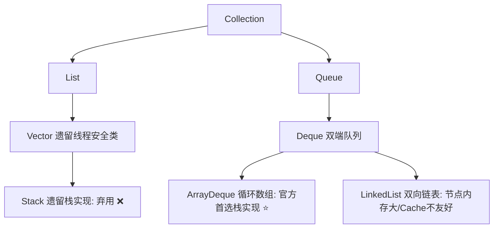

# 栈/队列

## 一、栈与队列核心心法与特性对比

### 1. 核心特性对比

| 数据结构 | 存取规则 | 核心操作 | 典型应用场景 |
| :--- | :--- | :--- | :--- |
| **栈（Stack）** | **LIFO**（后进先出，Last In First Out） | 入栈 `push`、出栈 `pop`、查顶 `peek` | 符号/括号成对匹配、函数调用栈模拟、逆波兰表达式、**单调栈（寻找左右侧第一个更大/更小元素）**、DFS（深度优先搜索） |
| **队列（Queue）** | **FIFO**（先进先出，First In First Out） | 入队 `offer`/`enqueue`、出队 `poll`/`dequeue`、查头 `peek` | 广度优先搜索（BFS）、层序遍历、生产者-消费者模型、**单调队列（滑动窗口极值）**、线程池任务排队 |
| **双端队列（Deque）** | 两端均可进出（既可 FIFO 又可 LIFO） | `addFirst`/`addLast`、`removeFirst`/`removeLast` | 既可做高性能栈（替代遗留 `Stack`），又可做队列与滑动窗口结构 |

### 2. 绝杀记忆口诀
> **成对匹配必用栈，左右极值单调栈；**  
> **层序最短用队列，滑动窗口双端队；**  
> **出队防移环形做，双栈均摊亦称绝；**  
> **Java选型弃遗留，ArrayDeque占鳌头。**

---

## 二、Java 集合体系与技术选型（面试必考）

### 1. 为什么强烈不推荐使用 `java.util.Stack`？（阿里规范）



1. **继承体系破坏封装与 LIFO 语义**：
   - `public class Stack<E> extends Vector<E>`
   - `Stack` 继承了 `Vector`，对外暴露了 `add(int index, E element)`、`get(int index)`、`remove(int index)` 等按索引操作的方法，允许外界在栈底或栈中间任意插入或删除元素，违背了栈严格只允许在栈顶操作的抽象数据类型定义。
2. **无谓的锁竞争开销（性能低下）**：
   - `Stack` 的所有核心方法（`push`、`pop`、`peek`）全部带有 `synchronized` 关键字进行方法级独占锁控制。在 99% 的单线程算法或无并发竞争场景下，白白浪费锁竞争与上下文开销。
3. **迭代顺序反直觉**：
   - 使用迭代器 `for (E e : stack)` 遍历时，输出顺序是从**栈底到栈顶**（与 Vector 数组下标一致），而不是从栈顶到栈底。
4. **官方首选替代方案**：
   ```java
   Deque<Integer> stack = new ArrayDeque<>();
   stack.push(1);
   int top = stack.pop();
   ```

---

### 2. 现代推荐栈实现：`ArrayDeque` vs `LinkedList`

| 对比维度 | `ArrayDeque`（首选 ⭐️） | `LinkedList` |
| :--- | :--- | :--- |
| **底层实现** | 循环数组（`Object[] elements`）+ 双指针（head/tail） | 双向链表（Node 节点包含 item/prev/next） |
| **CPU 缓存亲和度** | **高**（连续物理内存，极佳的 Cache Line 命中率） | **低**（离散堆内存指针跳跃，高频 Cache Miss） |
| **内存与 GC 压力** | **低**（仅维护一个连续数组，无多余包装对象） | **高**（每个元素都需要包装成 Node 节点，占用额外 24 字节开销，增加 GC 标记压力） |
| **寻址优化** | 容量强制为 $2^n$，通过位运算 `(tail + 1) & (len - 1)` 回绕，无除法取模开销 | 指针移动 |
| **null 元素支持** | **严格禁止插入 `null`**（底层用 `null` 标记空槽位，插入直接报 NPE） | 允许存入 `null`（但与 `poll()` 返回 `null` 判空产生混淆） |
| **总结** | **绝大多数单线程算法与高性能场景首选** | 仅在频繁在集合中间插入/删除且无需扩容时考虑 |

---

## 三、队列 O(1) 入队、O(1) 出队 三大实现思路

> 普通数组实现队列如果只用单头单尾，**出队时删除头部元素会移动数组，是 O(n)**。  
> 解决方案：**循环数组（环形队列）**、**双栈实现队列**、**带尾指针的单向链表**。

### 方案1：循环数组（环形队列，推荐，读写都是严格 O(1)）

原理：用数组存储，维护两个指针 `front`（队头）、`rear`（队尾下一个位置），不移动元素，只移动下标。  
判断空/满的三种技巧：
1. **牺牲一个位置（最常用）**：
   - 空：`front == rear`
   - 满：`(rear + 1) % capacity == front`
   - 有效元素个数：`(rear - front + capacity) % capacity`
2. **维护独立变量 `size`**：`size == 0` 为空，`size == capacity` 为满，空间利用率 100%。
3. **维护布尔标记 `flag`**：记录上一次操作是入队还是出队。

##### Java 完整代码（牺牲一个位置法）

```java
public class CircularQueue<T> {
    private final Object[] data;
    private int front; // 队头下标
    private int rear;  // 队尾的下一个位置
    private final int capacity;

    public CircularQueue(int capacity) {
        // 牺牲一个位置，实际可存元素 = capacity - 1
        this.capacity = capacity;
        data = new Object[capacity];
        front = 0;
        rear = 0;
    }

    /**
     * 入队 O(1)
     */
    public boolean enqueue(T val) {
        if (isFull()) {
            return false;
        }
        data[rear] = val;
        rear = (rear + 1) % capacity;
        return true;
    }

    /**
     * 出队 O(1)
     */
    @SuppressWarnings("unchecked")
    public T dequeue() {
        if (isEmpty()) {
            return null;
        }
        T res = (T) data[front];
        data[front] = null; // 置空帮助 GC
        front = (front + 1) % capacity;
        return res;
    }

    public T peek() {
        if (isEmpty()) return null;
        return (T) data[front];
    }

    public boolean isEmpty() {
        return front == rear;
    }

    public boolean isFull() {
        return (rear + 1) % capacity == front;
    }

    public int size() {
        return (rear - front + capacity) % capacity;
    }

    public static void main(String[] args) {
        CircularQueue<Integer> q = new CircularQueue<>(5);
        q.enqueue(1);
        q.enqueue(2);
        q.enqueue(3);
        System.out.println(q.dequeue()); // 1
        q.enqueue(4);
        System.out.println(q.dequeue()); // 2
    }
}
```

---

### 方案2：双栈实现队列（均摊 O(1)，LeetCode 232 原题）

思路：
- `inStack`：专门负责入队（`push`）
- `outStack`：专门负责出队（`pop`）与查队头（`peek`）
- **核心原则**：当 `outStack` 为空时，一次性把 `inStack` 全部元素倒入 `outStack`；若 `outStack` 不为空，**绝不可转移**，否则打破 FIFO 顺序。

> ⚠️ **为什么是均摊 O(1)？**  
> 单次 `pop()` 触发栈转移时是 $O(n)$，但每个元素在整个生命周期中只经历：入 `inStack`（1次） + 出 `inStack`（1次） + 入 `outStack`（1次） + 出 `outStack`（1次），总共 4 次操作。$n$ 个元素的总操作次数是 $4n$，分摊到每次操作上**均摊为 O(1)**。

##### Java 完整代码

```java
import java.util.ArrayDeque;
import java.util.Deque;

public class MyQueue<T> {
    private final Deque<T> inStack;
    private final Deque<T> outStack;

    public MyQueue() {
        inStack = new ArrayDeque<>();
        outStack = new ArrayDeque<>();
    }

    // 入队 O(1)
    public void push(T x) {
        inStack.push(x);
    }

    // 出队，均摊 O(1)
    public T pop() {
        dumpInToOut();
        return outStack.pop();
    }

    // 查队首，均摊 O(1)
    public T peek() {
        dumpInToOut();
        return outStack.peek();
    }

    public boolean empty() {
        return inStack.isEmpty() && outStack.isEmpty();
    }

    // 辅助方法：仅在 outStack 为空时转移
    private void dumpInToOut() {
        if (outStack.isEmpty()) {
            while (!inStack.isEmpty()) {
                outStack.push(inStack.pop());
            }
        }
    }
}
```

---

### 方案3：单向链表实现队列（头尾指针，严格 O(1)）

利用单向链表，维护 `head`（队头，出队）和 `tail`（队尾，入队），无需预先分配容量，也是严格 $O(1)$：

```java
public class LinkedQueue<T> {
    static class Node<T> {
        T val;
        Node<T> next;
        Node(T val) { this.val = val; }
    }

    private Node<T> head; // 队头，出队
    private Node<T> tail; // 队尾，入队
    private int size;

    public void enqueue(T val) {
        Node<T> newNode = new Node<>(val);
        if (tail == null) {
            head = tail = newNode;
        } else {
            tail.next = newNode;
            tail = newNode;
        }
        size++;
    }

    public T dequeue() {
        if (head == null) return null;
        T val = head.val;
        head = head.next;
        if (head == null) {
            tail = null; // 队列为空，尾指针同步置空
        }
        size--;
        return val;
    }

    public T peek() {
        return head == null ? null : head.val;
    }

    public boolean isEmpty() {
        return head == null;
    }

    public int size() {
        return size;
    }
}
```

##### 队列实现方案对比总结

| 实现方式 | 入队复杂度 | 出队复杂度 | 空间特性 | 说明与适用场景 |
| :--- | :--- | :--- | :--- | :--- |
| **循环数组（环形队列）** | **严格 O(1)** | **严格 O(1)** | 固定容量，预分配连续内存 | **最推荐**，CPU Cache 友好，零 GC 开销，常用于 RingBuffer、Disruptor、线程池有界队列 |
| **双栈队列** | **严格 O(1)** | **均摊 O(1)** | 动态扩容 | 面试高频手撕题，逻辑精妙；但单次 pop 存在最坏 $O(n)$ 抖动 |
| **链表队列** | **严格 O(1)** | **严格 O(1)** | 动态按需分配 | 头尾指针，无容量上限；但有额外 Node 节点对象开销与指针内存占用 |
| **普通数组单端队列** | **O(1)** | **O(n)** | 连续数组 | 出队必须向左平移所有后续元素，不满足 $O(1)$ 出队要求 ❌ |

---

## 四、高频经典手撕题型与代码模板（LeetCode 必刷）

### 1. 两个队列实现栈（LeetCode 225）

**核心思想**：
队列是先进先出，栈是后进先出。为了让后进的元素先出，有两种解法：
- **思路 A（双队列法）**：入队放入空队列 `q2`，然后将 `q1` 元素全部移到 `q2`，最后交换两队列引用。
- **思路 B（单队列旋转法 - 强烈推荐，最优雅）**：只需一个队列！新元素入队后，将该元素之前的所有元素依次出队并重新入队，在队列内部完成就地旋转，使新元素位于队首！

##### 单队列旋转实现栈完整代码：
```java
import java.util.ArrayDeque;
import java.util.Queue;

public class MyStack {
    private final Queue<Integer> queue = new ArrayDeque<>();

    // 入栈 O(n)：入队后将前面所有元素依次出队重新入队到末尾
    public void push(int x) {
        int size = queue.size();
        queue.offer(x);
        for (int i = 0; i < size; i++) {
            queue.offer(queue.poll());
        }
    }

    // 出栈 O(1)
    public int pop() {
        return queue.poll();
    }

    // 查栈顶 O(1)
    public int top() {
        return queue.peek();
    }

    public boolean empty() {
        return queue.isEmpty();
    }
}
```

---

### 2. 最小栈 MinStack（LeetCode 155）

**目标**：常数时间 $O(1)$ 内检索到栈中的最小元素（`getMin()`）。

#### 方案 A：双栈同步维护（经典首选）
- 主栈 `dataStack` 存全量数据；
- 辅助栈 `minStack` 同步存储**当前栈内对应深度的最小值**：
  - 新元素入栈时，`minStack` 压入 `Math.min(val, minStack.peek())`；
  - 出栈时两栈同步出栈；
  - `getMin()` 直接读取辅助栈顶。

```java
import java.util.ArrayDeque;
import java.util.Deque;

public class MinStack {
    private final Deque<Integer> dataStack = new ArrayDeque<>();
    private final Deque<Integer> minStack = new ArrayDeque<>();

    public void push(int val) {
        dataStack.push(val);
        if (minStack.isEmpty() || val <= minStack.peek()) {
            minStack.push(val);
        } else {
            minStack.push(minStack.peek()); // 同步维护当前栈深度的最小值
        }
    }

    public void pop() {
        dataStack.pop();
        minStack.pop();
    }

    public int top() {
        return dataStack.peek();
    }

    public int getMin() {
        return minStack.peek();
    }
}
```

#### 方案 B：单栈存差值 / 封装自定义二元组
- **二元组法**：栈内元素定义为 `class Node { int val; int min; }`，直接记录节点当前的历史最小值。
- **差值法**：栈内只存 `val - min` 的差值（使用 `long` 防止溢出），能进一步节约辅助栈空间。

---

### 3. 有效的括号匹配（LeetCode 20）

**核心思想**：
遇到左括号时，将**对应的右括号**压入栈中；遇到右括号时，如果栈为空或者弹出的字符不等于当前字符，说明不合法；遍历结束后栈为空则合法。

```java
import java.util.ArrayDeque;
import java.util.Deque;

public class ValidParentheses {
    public boolean isValid(String s) {
        if (s == null || s.length() % 2 != 0) return false;
        Deque<Character> stack = new ArrayDeque<>();
        for (char c : s.toCharArray()) {
            if (c == '(') stack.push(')');
            else if (c == '[') stack.push(']');
            else if (c == '{') stack.push('}');
            else {
                // 遇到右括号，出栈比对
                if (stack.isEmpty() || stack.pop() != c) {
                    return false;
                }
            }
        }
        return stack.isEmpty();
    }
}
```

---

### 4. 逆波兰表达式求值（LeetCode 150）

**核心思想**：
后缀表达式无需括号指定优先级。
- 遇到数字直接压栈；
- 遇到运算符，从栈顶弹出两个数字进行计算；
- **⚠️ 关键陷阱**：**先出栈的是右操作数，后出栈的是左操作数**（对于减法 `-` 和除法 `/` 顺序极度关键！）；
- 计算结果重新压入栈顶。

```java
import java.util.ArrayDeque;
import java.util.Deque;

public class EvalRPN {
    public int evalRPN(String[] tokens) {
        Deque<Integer> stack = new ArrayDeque<>();
        for (String t : tokens) {
            switch (t) {
                case "+":
                    stack.push(stack.pop() + stack.pop());
                    break;
                case "-": {
                    int b = stack.pop(); // 右操作数
                    int a = stack.pop(); // 左操作数
                    stack.push(a - b);
                    break;
                }
                case "*":
                    stack.push(stack.pop() * stack.pop());
                    break;
                case "/": {
                    int b = stack.pop(); // 右操作数
                    int a = stack.pop(); // 左操作数
                    stack.push(a / b);
                    break;
                }
                default:
                    stack.push(Integer.parseInt(t));
            }
        }
        return stack.pop();
    }
}
```

---

## 五、算法高阶利器：单调栈与单调队列（大厂面试高频压轴）

### 1. 单调栈（Monotonic Stack）

> **核心口诀**：寻找元素**左边/右边第一个更大或更小元素**，时间复杂度从 $O(n^2)$ 暴力降为 $O(n)$，**必用单调栈**！

#### 核心法则：
- **单调递增栈（从栈底到栈顶递增）**：新元素比栈顶大才入栈，比栈顶小则弹出栈顶。用于找元素**左/右侧第一个比它小的元素**。
- **单调递减栈（从栈底到栈顶递减）**：新元素比栈顶小才入栈，比栈顶大则弹出栈顶。用于找元素**左/右侧第一个比它大的元素**。
- **核心经验**：**栈内强烈建议存数组下标**。存下标既可以查到原始数值 `nums[i]`，又能计算两元素之间的距离跨度 `i - stack.peek()`。

#### 经典模板实战：每日温度（LeetCode 739）
> 题目：给定每天温度 `temperatures`，返回一个数组，对应位置输出需要等待多少天才有更高的温度。

```java
import java.util.ArrayDeque;
import java.util.Deque;

public class DailyTemperatures {
    public int[] dailyTemperatures(int[] temperatures) {
        int n = temperatures.length;
        int[] res = new int[n];
        // 单调递减栈：存储下标
        Deque<Integer> stack = new ArrayDeque<>();

        for (int i = 0; i < n; i++) {
            // 当前温度高于栈顶温度，说明找到了栈顶那天的下一个更高温度
            while (!stack.isEmpty() && temperatures[i] > temperatures[stack.peek()]) {
                int prevIndex = stack.pop();
                res[prevIndex] = i - prevIndex; // 计算间隔天数
            }
            stack.push(i);
        }
        return res;
    }
}
```

> **高频进阶题型延伸**：
> - **接雨水（LeetCode 42，Hard）**：维护单调递减栈。遇到更高元素时形成凹槽，弹出栈底元素作为坑底，当前元素为右边界，新栈顶为左边界，横向累加水坑体积。
> - **柱状图中最大的矩形（LeetCode 84，Hard）**：维护单调递增栈。遇到更矮柱子时触发结算，弹出柱子作为高，当前下标与新栈顶确定左右宽度。

---

### 2. 单调队列（Monotonic Queue）

> **核心场景**：**维护滑动窗口内的动态最大值 / 最小值**（动态极值问题）。

普通队列出队只能按 FIFO 顺序，单调队列维护一个**双端队列（Deque）**，保证队列元素**严格保持单调递减（或单调递增）**：
1. **入队规则**：新元素入队前，把队尾所有小于等于新元素的元素全部从队尾弹出（因为这些元素既比新元素小、又比新元素更早过期，永远不可能成为窗口最大值）；
2. **出队规则**：当队头元素的下标滑出当前滑动窗口左边界时，从队头弹出；
3. **极值获取**：**队头元素永远是当前窗口内的最大值！**

#### 经典模板实战：滑动窗口最大值（LeetCode 239，Hard）

```java
import java.util.ArrayDeque;
import java.util.Deque;

public class SlidingWindowMaximum {
    public int[] maxSlidingWindow(int[] nums, int k) {
        if (nums == null || nums.length == 0) return new int[0];
        int n = nums.length;
        int[] res = new int[n - k + 1];
        // 双端队列，存储数组下标，维护严格单调递减
        Deque<Integer> deque = new ArrayDeque<>();

        for (int i = 0; i < n; i++) {
            // 1. 移除滑出窗口左边界的过期元素
            if (!deque.isEmpty() && deque.peekFirst() < i - k + 1) {
                deque.pollFirst();
            }
            // 2. 淘汰队尾所有 <= 当前值的元素（保持单调递减）
            while (!deque.isEmpty() && nums[deque.peekLast()] <= nums[i]) {
                deque.pollLast();
            }
            // 3. 将当前下标推入队尾
            deque.offerLast(i);

            // 4. 窗口大小达到 k 时，队头就是当前窗口最大值
            if (i >= k - 1) {
                res[i - k + 1] = nums[deque.peekFirst()];
            }
        }
        return res;
    }
}
```

---

## 六、Java 并发阻塞队列（BlockingQueue）深度考点（后端架构特色）

在多线程高并发、生产者-消费者模型以及线程池（`ThreadPoolExecutor`）底层，阻塞队列是核心支柱。

### 1. 队列接口方法对比表（4套 API 契约）

| 行为模式 | 抛出异常（阻断） | 返回特殊值（容错） | 阻塞等待（挂起） | 超时退出 |
| :--- | :--- | :--- | :--- | :--- |
| **入队（插入）** | `add(e)`（队满抛 `IllegalStateException`） | `offer(e)`（队满返回 `false`） | `put(e)`（队满阻塞直到有空位） | `offer(e, timeout, unit)` |
| **出队（移除）** | `remove()`（队空抛 `NoSuchElementException`） | `poll()`（队空返回 `null`） | `take()`（队空阻塞直到有元素） | `poll(timeout, unit)` |
| **查队头** | `element()`（队空抛异常） | `peek()`（队空返回 `null`） | 不支持 | 不支持 |

---

### 2. 核心阻塞队列横向对比

| 队列名称 | 底层数据结构 | 容量边界 | 锁实现机制 | 适用与线程池场景 |
| :--- | :--- | :--- | :--- | :--- |
| **`ArrayBlockingQueue`** | 循环数组 | **强制有界** | **单一把 `ReentrantLock`**（生产与消费共用同一把锁，读写互斥） | 内存受限、高负载资源敏感型业务 |
| **`LinkedBlockingQueue`** | 单向链表 | **默认无界**（默认 `Integer.MAX_VALUE`，可指定界限） | **双锁分离**（`putLock` 入队锁 + `takeLock` 出队锁，读写并行） | `FixedThreadPool`、`SingleThreadExecutor` 默认队列（⚠️ 注意无界引发 OOM） |
| **`SynchronousQueue`** | 无缓冲队列（内部 Transferer） | **容量为 0** | 基于 CAS / 线程配对传输，不存储元素 | `CachedThreadPool`（任务即来即走，高吞吐并发） |
| **`PriorityBlockingQueue`** | 动态二叉小顶堆 | **无界**（支持扩容） | 单把 `ReentrantLock` + 自旋 CAS 扩容 | 优先级调度任务 |
| **`DelayQueue`** | 内部持有 `PriorityQueue` | **无界** | 元素需实现 `Delayed` 接口，到期才能出队 | 定时任务调度、缓存过期清理、超时订单自动关闭 |

---

### 3. 重点高频剖析：`ArrayBlockingQueue` vs `LinkedBlockingQueue`

```
ArrayBlockingQueue (单锁):
   [ put() / take() ] ----> [ ReentrantLock ] (竞争同一把锁，锁冲突高)

LinkedBlockingQueue (双锁分离):
   [ put() ] ---------> [ putLock  ] (只锁队尾入队)
   [ take() ] --------> [ takeLock ] (只锁队头出队)  --> 生产与消费完全并发！
```

1. **锁分离机制**：
   - `ArrayBlockingQueue` 读写使用**同一把 `ReentrantLock`**，生产者和消费者互相竞争锁；
   - `LinkedBlockingQueue` 采用**双锁分离设计**（`putLock` 与 `takeLock`），分别配合 `notFull` 与 `notEmpty` 条件变量，生产者和消费者可以完全并行，吞吐量显著更高。
2. **内存与 GC 差异**：
   - `ArrayBlockingQueue` 预先分配整块连续数组内存，运行期间无额外对象分配，GC 友好；
   - `LinkedBlockingQueue` 每次入队动态创建 `Node` 包装对象，高吞吐并发下对年轻代 GC 产生一定压力。
3. **OOM 隐患**：
   - `LinkedBlockingQueue` 若使用无参构造函数，容量默认为 `Integer.MAX_VALUE`，在生产速度远大于消费速度时容易堆积大量任务导致内存溢出（OOM）。

---

## 七、高频面试问题整理

### Q1：Java 中实现栈，为什么官方推荐 `ArrayDeque` 而不是 `Stack` 类？
> 1. `Stack` 继承了 `Vector`，对外暴露了 `add(index)`、`remove(index)` 等破坏栈抽象语义的方法；
> 2. `Stack` 所有方法均使用 `synchronized` 独占加锁，在单线程与无竞争环境下存在巨大的锁开销；
> 3. `Stack` 使用迭代器遍历时是从栈底到栈顶，反直觉；
> 4. `ArrayDeque` 底层是连续的循环数组，缓存亲和度高、零节点对象开销，综合性能最优。

### Q2：`ArrayDeque` 为什么底层数组容量必须是 2 的幂次方？
> `ArrayDeque` 采用循环数组实现。为了避免开销较大的除法取模运算 `%`，利用位运算 `(head - 1) & (elements.length - 1)` 代替取模回绕寻址。只有当数组长度为 $2^n$ 时，`length - 1` 的低位全为 1，位与操作才严格等价于取模且性能极高。

### Q3：双栈实现队列，出队为什么是均摊 O(1)？
> 每个元素在整个生命周期中，只被压入 `inStack` 一次、弹出 `inStack` 一次、压入 `outStack` 一次、弹出 `outStack` 一次。每个元素总共经历 4 次常数时间的操作。将这 4 次操作平均分摊到每一次出队入队上，均摊时间复杂度依然是稳定的 $O(1)$。

### Q4：两个队列如何实现栈？单队列能否实现？
> - 双队列法：新元素入空队列 `q2`，然后将 `q1` 中所有元素移入 `q2`，再交换两队列引用；
> - 单队列法（更优）：新元素入队后，获取当前队列大小 `size`，将前面的 `size` 个元素依次出队再重新入队，原地旋转队列使得最新元素排在队首。

### Q5：最小栈 MinStack 怎么做到 O(1) 取最小值？
> 经典方案是使用**辅助栈**。入栈时主栈存数据，辅助栈存当前深度的全局最小值（新值与辅助栈顶较小者）；出栈时两栈同步弹出；`getMin()` 直接读取辅助栈顶。也可以通过差值法或自定义 `(val, min)` 节点实现。

### Q6：单调栈解决什么问题？栈里存数值还是存下标？
> 单调栈用于在数组中寻找每个元素**左边或右边第一个比它大（或小）的元素**，将 $O(n^2)$ 嵌套比对优化到 $O(n)$。栈内**强烈建议存储数组下标**，因为存下标既能直接通过 `nums[i]` 获取数值，又能计算元素之间的距离与区间跨度。

### Q7：单调队列与单调栈有什么本质区别？
> - **单调栈**：单端操作（只能在栈顶进出），用于寻找**两两元素之间的相对边界**（如每日温度、接雨水）；
> - **单调队列**：双端操作（队尾淘汰次优解维持单调，队头淘汰滑出窗口的过期解），用于维护**滑动窗口范围内的全局动态极值**（如滑动窗口最大值）。

### Q8：环形队列如何区分“队空”还是“队满”？
> 常用三种方案：
> 1. **牺牲一个单元（最常用）**：空为 `front == rear`；满为 `(rear + 1) % capacity == front`；
> 2. **维护计数器 `size`**：空为 `size == 0`；满为 `size == capacity`（空间利用率 100%）；
> 3. **维护状态标志 `flag`**：记录最后一次操作是入队还是出队。

### Q9：`ArrayBlockingQueue` 与 `LinkedBlockingQueue` 在锁机制上有何本质区别？
> - `ArrayBlockingQueue` 内部只有**一把 `ReentrantLock`**，入队和出队共用同一把锁，生产和消费互斥；
> - `LinkedBlockingQueue` 采用**双锁分离**设计（`putLock` 和 `takeLock`），生产入队和消费出队互不干扰，显著提高了高并发场景下的并发吞吐量。

---

## 八、1分钟口述面试版（直接背）

> 栈是后进先出（LIFO），队列是先进先出（FIFO）。在 Java 编程中，实现栈官方首选推荐使用 `ArrayDeque` 而不是传统的 `Stack`，因为 `Stack` 继承了 `Vector` 存在方法级无用 `synchronized` 锁开销且破坏了封装；`ArrayDeque` 基于 $2^n$ 容量的循环数组，通过位运算高效寻址，缓存局部性好且无节点开销。
> 队列在常数时间出入队通常用环形数组（通过牺牲一位或 size 变量区分空满）或者单向链表实现；双栈可以通过将转移操作延迟到出栈栈为空时，做到均摊 $O(1)$ 的出队。
> 算法进阶方面，单调栈常用于 $O(n)$ 复杂度寻找左右第一个更大或更小值（如每日温度、接雨水）；单调队列通过双端队列淘汰无效解维护滑动窗口动态极值。在并发场景下，`BlockingQueue` 的 `ArrayBlockingQueue` 使用单锁互斥，而 `LinkedBlockingQueue` 使用读写双锁分离提高吞吐量。

---

## 九、常见避坑指南

1. **`ArrayDeque` 严禁插入 `null`**：底层使用 `null` 标记空槽位，插入 `null` 立即抛出 `NullPointerException`。
2. **双栈队列的转移时机**：出队或查看队头时，必须在 **`outStack` 为空时**才能全量倒入 `inStack`；若 `outStack` 还有元素就转移，会打乱 FIFO 顺序！
3. **单调栈必须存下标**：存下标既能查值又能算跨度距离，还能天然处理重复值问题。
4. **逆波兰表达式运算顺序**：弹出元素时，**第一个弹出的是右操作数，第二个弹出的是左操作数**，除法和减法顺序颠倒会导致计算错误。
5. **环形队列 capacity 混淆**：若采用“牺牲一个空间”区分空满，长度为 $C$ 的数组最多只能存放 $C - 1$ 个元素。
6. **`LinkedBlockingQueue` 默认无界引发 OOM**：默认容量为 `Integer.MAX_VALUE`，在生产远快于消费的场景下必须显式指定容量有界。


# 递归

## 一、什么是递归

**递归：方法调用自己本身，把一个大问题，拆解成规模更小、逻辑完全相同的子问题，直到子问题简单到可以直接给出答案，再逐层向上返回结果。**

> 通俗说：**自己调用自己，大事化小，小事解决后再合并结果。**

递归两大硬性条件，缺一不可：

1. **基线条件（终止条件 base case）**：最小子问题，直接return，**防止无限递归栈溢出**
2. **递归递推条件（recursive case）**：把原问题缩小，向基线条件靠近

伪代码模板：

```
public int f(int n){
    // 基线条件：直接返回结果，不再递归
    if(满足停止){
        return 值;
    }
    // 递归条件：规模缩小，调用自身
    return f(更小的n);
}
```

------

## 二、底层原理：JVM虚拟机栈执行过程

Java方法全部跑在**虚拟机栈**上，每调用一次方法，就创建一块**栈帧**压入栈。

> 栈帧：保存局部变量、方法参数、返回地址。

以阶乘 `fact(3) = 3 * fact(2)` 举例

```java
public static int fact(int n){
    if(n == 1) return 1;
    return n * fact(n - 1);
}
fact(3);
```

压栈过程（递：向下拆解）

1. 调用fact(3) →栈帧1入栈
2. fact(3)内部调用fact(2) →栈帧2入栈
3. fact(2)内部调用fact(1) →栈帧3入栈
4. n=1触发基线条件，return 1，不再调用

弹栈过程（归：向上返回结果）

1. fact(1) return 1 →栈帧3出栈
2. fact(2) = 2 * 1 =2 →栈帧2出栈
3. fact(3) =3 *2 =6 →栈帧1出栈

✅ **递：不断压栈；归：得到结果逐层出栈**

⚠️风险：递归深度太深，栈帧过多，超过JVM栈大小（-Xss）抛出 **`StackOverflowError`栈溢出**。 每个线程栈默认几百KB，一般递归深度几千就炸。

------

## 三、递归分类

### 1.直接递归

方法内部直接调用自己

```
public void f(){
    f();
}
```

### 2.间接递归（相互递归）

A调用B，B又调用A

```
void a(){ b(); }
void b(){ a(); }
```

实际业务极少用，容易死循环。

### 3.尾递归

> **递归调用是方法的最后一步执行，没有额外计算，直接返回递归调用结果。**

普通递归（非尾递归）

```
return n * fact(n‑1);
// 先调用fact(n‑1)拿到返回值，再做乘法，乘法在返回之后，不是最后一步
```

尾递归写法：把计算结果通过参数传递，返回直接就是递归调用

```java
// acc：accumulator累加器，保存中间结果
public static int factTail(int n, int acc){
    if(n ==1) return acc;
    return factTail(n-1, n*acc);
}
//调用 factTail(3,1)
```

> ⚠️重点面试考点：**Java不支持尾递归优化！** 即使写尾递归，JVM不会复用当前栈帧，依旧不断压栈，深度大依旧栈溢出。Scala、Kotlin、Go支持尾递归优化。

### 4.记忆化递归（带备忘录递归）

普通递归存在大量重复计算（斐波那契），用数组/HashMap缓存已经算过结果，避免重复递归。 属于**动态规划的自顶向下写法**。

```java
//斐波那契 f(n)=f(n‑1)+f(n‑2)
int[] memo;
public int fib(int n){
    if(n<=2) return 1;
    if(memo[n] !=0) return memo[n]; //查备忘录，已经算过直接返回
    memo[n] = fib(n-1)+fib(n-2);
    return memo[n];
}
```

### 5.回溯递归（for循环+递归）

> 一层for横向枚举选择，递归纵向深度搜索，配合撤销选择。 用于组合、子集、全排列、多叉树、迷宫。 前面讲过，核心：做选择→递归→撤销选择。

```java
for(每一个候选){
    做选择
    dfs(...) //递归深入
    撤销选择 //回溯恢复现场
}
```

------

## 四、递归时间复杂度 & 空间复杂度分析

### 时间复杂度：看一共调用多少次递归函数

1.阶乘、求和：递归n次 →O(n) 2.二叉树遍历：每个节点访问1次 →O(n) 3.普通斐波那契无备忘录：指数级 O(2ⁿ)，大量重复计算 4.全排列回溯：O(n!)

### 空间复杂度：两部分

1. **递归调用栈深度（主要）** 比如求n阶乘递归深度n，空间O(n)
2. 额外开辟集合、备忘录占用空间

> 对比迭代for循环：迭代不需要调用栈，空间O(1)。

------

## 五、递归优缺点

✅优点

1. 代码简洁优雅，逻辑贴合问题本身（树、DFS、分治）
2. 分治算法天然适合递归：归并排序、快速排序
3. 处理树形、嵌套、层级结构非常舒服

❌缺点

1. **函数调用开销**：压栈、弹栈、保存返回地址，性能比循环差
2. **栈溢出风险**，深度不可控场景不能直接递归
3. 容易忘记基线条件，死递归
4. 朴素递归容易大量重复计算（斐波那契）

> 什么时候用递归？ 适合：树遍历、DFS回溯、分治，递归深度不大。 不适合：深度不可预测、数据量巨大，优先迭代（for+手动栈）。

> 所有递归**都可以改写为迭代**：自己用Stack集合模拟虚拟机栈帧。

示例：递归二叉树前序遍历 →用`Deque<Node>`手动栈实现迭代版前序遍历。

------

## 六、写递归的四步方法论（面试写题神器）

1. **确定递归函数语义：这个函数到底要干什么，输入输出是什么**

   > 例：`int fact(int n)`：计算n的阶乘

2. **写基线条件：最小子问题，直接返回，一定要最先写！防止漏写栈溢出**

   > if(n ==1) return 1;

3. **拆解问题：把大问题拆成同类更小的子问题，写出递归逻辑**

   > n! = n * (n‑1)! → return n * fact(n‑1);

4. **验证：小规模测试，比如n=2、n=3看结果是否正确**

> 很多人写递归先写递归逻辑，忘记终止条件，直接栈溢出。**永远优先写基线条件。**

------

## 七、经典递归场景与代码

### 场景1：阶乘

```java
//n! = n*(n‑1)!
public static int fact(int n){
    if(n == 1) return 1;
    return n * fact(n‑1);
}
```

### 场景2：二叉树前序遍历

```java
void preOrder(TreeNode root){
    if(root == null) return; //基线条件
    System.out.println(root.val);
    preOrder(root.left);
    preOrder(root.right);
}
```

### 场景3：分治：归并排序

把数组拆两半，分别递归排序，最后合并。

### 场景4：回溯（for+递归）全排列、子集、组合

### 场景5：记忆化递归：斐波那契

------

## 八、高频面试题整理

### Q1：递归为什么会栈溢出 StackOverflowError？

> 每一次递归调用，JVM虚拟机栈都会生成栈帧保存参数局部变量；递归深度过大，栈帧数量超过线程栈内存上限，抛出栈溢出。栈大小由‑Xss参数控制。

### Q2：递归和迭代（for循环）怎么选？

- 递归优势：树、DFS回溯、分治，代码简短，逻辑直观；局限：深度大栈溢出，函数调用开销。

- 迭代优势：没有栈溢出风险，性能更高；缺点：复杂场景代码繁琐，比如树DFS要手动维护栈。

  > 深度可控选递归；深度不可控、大数据用迭代。递归都可以转迭代，用集合Stack模拟栈帧。

### Q3：什么是尾递归？Java支持尾递归优化吗？

> 尾递归：递归调用是函数最后一步操作，没有后续计算。Java虚拟机没有实现尾递归优化，即使写成尾递归，依旧不断压栈，无法避免栈溢出。

### Q4：记忆化递归是什么？解决什么问题？

> 备忘录缓存已经计算完成子问题结果，避免递归大量重复计算，属于自顶向下动态规划。典型：斐波那契。

### Q5：递归三要素是什么？

1. 确定递归函数功能，输入输出；
2. 基线终止条件；
3. 递归拆解，缩小问题规模。

### Q6：for循环里面写递归，for循环会等递归执行完吗？

**会，同步执行，递归全部return返回之后，才执行i++，进入下一轮循环。回溯算法就是依赖这个特性。**

### Q7：递归递和归是什么？

**递：向下调用，压栈，拆解大问题；归：碰到终止条件，逐层向上返回结果，栈帧出栈。**

------

#### 九、口述

> 递归就是函数调用自身，核心分为基线条件和递归条件。基线条件用来终止递归防止栈溢出，递归条件把大问题拆解成更小的同类子问题。底层JVM每一次方法调用都会生成栈帧压入虚拟机栈，递的过程不断压栈，遇到终止条件之后归的过程逐层返回结果弹栈。 递归适合树遍历、DFS回溯、分治算法，代码简洁；缺点是存在函数调用开销，深度过大会栈溢出。Java不支持尾递归优化。递归都可以转为迭代，使用集合手动模拟栈帧。遇到重复计算可以使用记忆化递归，缓存子问题结果优化性能。回溯场景经常for循环搭配递归，for做横向枚举，递归纵向深度搜索。

如果你需要，我可以给：递归转迭代示例代码，或者几道递归面试题（带解析）。

## for循环 + 递归结合

> 核心思想：**递归负责深度方向往下走，for循环负责同一层横向遍历**
> 最典型场景：**回溯算法、多叉树遍历、子集组合、全排列**。
> 递归往下钻深度，for循环枚举当前层所有可选元素，两者搭配解决「多层、每层多个选择」的问题。

### 经典模型伪代码

```java
void backtrack(参数){
    // 1.递归终止条件
    if(满足条件){
        保存结果;
        return;
    }

    // 2.for循环：遍历当前层所有候选（横向）
    for(选择 : 当前层可选集合){
        做选择;          // 标记选了这个
        backtrack(下一层参数); // 递归：往下深度探索（纵向）
        撤销选择;        // 回溯，恢复现场
    }
}
```

- **for：横向遍历本层所有选项**
- **递归：纵向进入下一层**
- 撤销选择：回溯的灵魂，for循环下一轮要复用状态

### 示例1：求全排列（Java）

给定数组`[1,2,3]`输出全部排列

```java
import java.util.*;

public class Test {
    List<List<Integer>> res = new ArrayList<>();
    public List<List<Integer>> permute(int[] nums) {
        boolean[] used = new boolean[nums.length];
        LinkedList<Integer> path = new LinkedList<>();
        backtrack(nums, used, path);
        return res;
    }

    void backtrack(int[] nums, boolean[] used, LinkedList<Integer> path){
        // 递归终止：路径长度等于数组长度
        if(path.size() == nums.length){
            res.add(new ArrayList<>(path));
            return;
        }

        // for循环：横向枚举每一个可以选的数字
        for(int i = 0; i < nums.length; i++){
            if(used[i]) continue;

            // 做选择
            used[i] = true;
            path.addLast(nums[i]);

            // 递归：进入下一层，继续选下一个数（深度往下）
            backtrack(nums, used, path);

            // 撤销选择，回溯，给for循环下一轮使用
            path.removeLast();
            used[i] = false;
        }
    }
}
```

执行流程：

```
第一层for：选1、选2、选3
├─选1 →递归进入第二层
    第二层for：遍历，跳过1，可选2、3
    ├─选2 →递归第三层
        第三层for：只剩3可选 →递归触发终止条件保存[1,2,3]，返回，回溯
    └─选3 →得到[1,3,2]
└─回到第一层for，继续下一个选项
```


### 示例1-2：求有重复数字的全排列（Java）

```java
import java.util.*;
public class Solution {
    // 保存最终所有不重复的排列结果
    ArrayList<ArrayList<Integer>> res = new ArrayList<>();

    /**
     * permuteUnique 入口方法：含重复数字的数组全排列，返回所有不重复排列
     * @param num 输入的可能含有重复数字的数组
     * @return 所有不重复的全排列
     */
    public ArrayList<ArrayList<Integer>> permuteUnique (int[] num) {
        //❗必须先排序，使相等的数字在数组中相邻；后续的剪枝判断才能够生效
        Arrays.sort(num);
        // list：保存当前递归路径上已经选择的数字（一条正在构建的排列）
        LinkedList<Integer> list = new LinkedList<>();
        // used标记数组：标记数组中下标i的元素是否已经被当前路径选用
        boolean[] used = new boolean[num.length];
        // 启动回溯递归
        backTrack(num, list, used);
        return res;
    }

    /**
     * 回溯递归方法
     * @param num 原排序之后的数字数组
     * @param list 当前正在构建的排列路径
     * @param used 下标是否被使用的标记数组
     */
    public void backTrack(int[] num, LinkedList<Integer> list, boolean[] used) {
        // 递归终止条件：当前路径的元素个数等于原数组长度，说明得到一条完整排列
        if (list.size() == num.length) {
            // 注意！要new ArrayList<>(list)保存快照；直接add(list)后续回溯修改list会改变结果！
            res.add(new ArrayList<>(list));
            return ; // 当前分支结束，直接返回开始回溯
        }

        // for循环横向遍历：在当前递归层级，依次尝试选取每一个下标上的数字
        for (int i = 0; i < num.length; i++) {
            // 如果下标i的数字已经在当前路径中被选用，则直接跳过，不能再次选同一个下标
            if (used[i]) {
                continue;
            }

            /*
             * ✨树层去重剪枝（核心逻辑！解决数组存在重复数字产生重复排列的问题）
             * i > 0：保证i‑1下标不越界；
             * num[i] == num[i‑1]：当前数字和前一个数字值相等；
             * !used[i‑1]：前一个相同下标的元素标记为false，说明它已经回溯释放完毕；
             *            代表【同一层横向for循环】中前面已经拿过这个值开启过子树；
             * 如果继续拿当前i这个相同的值往下递归，就会生成完全重复的排列结果；
             * 满足全部条件就continue，直接剪掉这条搜索分支！
             *
             * 补充：如果used[i‑1]==true，代表前一个相同数字还处在当前递归路径上（纵向往下深入）；
             *      此时不触发剪枝，允许路径内部再次选取相同数字（例如[1,1,2]里面连续两个1）
             */
            if (i > 0 && num[i] == num[i - 1] && !used[i - 1]) {
                continue;
            }

            // ---------------- 做选择 ----------------
            used[i] = true;         // 将当前下标标记为已占用，本路径后续不能再选该下标
            list.add(num[i]);       // 将当前数字加入路径list末尾

            // ---------------- 深度递归向下搜索 ----------------
            backTrack(num, list, used);

            // ---------------- 回溯！撤销选择，恢复现场！顺序不能颠倒！ ----------------
            list.removeLast();      // 路径删除末尾刚加入的数字，回退
            used[i] = false;        // 解除下标占用标记，释放出来，供本层后续循环的其他分支使用
        }
    }
}

```

#### 面试高频注意点总结

1. **`Arrays.sort(num)` 不能删掉！** 重复元素必须相邻，`num[i]==num[i‑1]` 的判断才有意义；
2. `res.add(new ArrayList<>(list));` **一定要 new 新集合！** 如果直接 add (list)，后面回溯修改 list，res 里面存的引用会跟着一起变，最后 res 全部是空集合；
3. `used[i‑1]`和`!used[i‑1]`区别：
   - `!used[i‑1]`：**树层去重（推荐），横向剪枝，减少递归分支，效率更高**；
   - `used[i‑1]`：树枝去重，虽然结果也对，但是会走很多无效递归；
4. **回溯撤销顺序：先移除路径末尾元素，再把 used 置 false，顺序不能反过来。**

> 和前面字符串版本`Permutation`的回溯逻辑是完全一套思想：
> 排序 + boolean [] 标记下标 + `i>0 && num[i]==num[i‑1] && !used[i‑1]`树层剪枝。


#### 递归树简单画文字版

```
[]
├─i=0(1) ✅ 【允许向下走】
│   list=[1]
│   ├─i=0 skip(used)
│   ├─i=1(1) ✅【纵向放行！used[0]=true，不剪】
│   │    list=[1,1] → i=2(2) → [1,1,2]
│   └─i=2(2) ✅
│        list=[1,2] → i=1(1) → [1,2,1]
├─i=1(1) ❌【第一层横向直接剪枝！!used[0]==true，continue】
└─i=2(2) ✅
    list=[2]
    ├─i=0(1) ✅
    │   list=[2,1] → i=1(1) → [2,1,1]
    └─i=1(1) 第二层横向被剪
```


### 示例2：多叉树遍历

多叉树，一个节点有多个子节点：

```java
class Node{
    int val;
    List<Node> children;
}

void dfs(Node root){
    if(root == null) return;
    System.out.println(root.val);
    // for循环遍历当前节点所有子节点（横向）
    for(Node child : root.children){
        dfs(child); //递归深度向下
    }
}
```

二叉树其实是多叉树特例：手动写两次递归代替for循环。

### 时间&空间关键点

1. for循环控制**分支数量**，递归控制**深度**
2. 时间复杂度 = 每层分支数的深度次方，比如全排列 O(n!)
3. 空间：递归栈深度；for循环本身不占栈，递归深度过大依然会`StackOverflowError`

### 面试高频问题

#### 1.什么时候要for+递归一起用？

当**同一层有多个候选，每一个候选又需要继续往下搜索**。

- 组合、子集、全排列、回溯
- 多叉树DFS
- 迷宫、棋盘搜索

> 二叉树：没有显式for，直接两次递归；等价于for循环遍历两个子节点。

#### 2.for循环里面递归，for会等待递归结束吗？

**会！**
`backtrack()`递归全部执行完return之后，才会执行for循环i++，进入下一轮循环。

> 很多人误区：以为递归会异步，实际同步执行，递归完全返回，才走for下一次。

#### 3.为什么要撤销选择？

for循环一轮结束，状态要复原，供本层下一次循环使用。
不撤销：上一轮选择残留，结果错乱。

#### 4.如何避免栈溢出？

如果深度不可控：把递归+for，改成**手动栈+for循环迭代实现DFS**。

### 对比三种写法

1. 单纯for：只有横向，不能深度往下
2. 单纯递归：每层只有一条路径，没有多个分支
3. for + 递归：每层多个分支，每个分支继续深度向下 →回溯/DFS标准写法


### 面试口述1分钟版本

> for循环和递归结合，最常见就是回溯算法。for循环用来横向遍历当前层所有可选候选，递归实现纵向深度向下搜索。每次循环中先做选择，调用递归向下探索，递归返回后撤销选择，恢复现场，让for循环继续枚举下一个选项。递归设置终止条件收集结果。多叉树深度优先遍历也是这个思路，for循环遍历子节点，递归访问子节点。注意递归深度过大依然会栈溢出。

如果你需要，我可以给子集、组合问题的简短代码示例。

# 回溯算法

## 一、一句话定义

**回溯是暴力搜索的一种，本质是「深度优先DFS + 做选择 + 递归深入 + 撤销选择」，经常是 for循环 + 递归组合。**
尝试每一个候选选项，走到底；发现这条路不行，就**撤销上一步的选择，回到上一层，试下一个选项**。

> 
> 通俗理解：走迷宫，往前走，死路就退回去，换一条路继续试。

✅ 回溯属于**DFS的一种应用**；DFS不一定是回溯（普通二叉树遍历没有撤销选择，不算回溯）。
**回溯标志性特征：有「做选择」和「撤销选择」。**

## 二、回溯核心模板（重中之重，面试必背）

```java
void backtrack(参数){
    // 1. 终止条件：收集合法结果，return
    if(满足条件){
        res.add(新集合); // 注意要拷贝，不能直接add引用
        return;
    }

    // 2. for循环：横向遍历当前层所有可选候选
    for(候选 : 候选集合){
        // 剪枝：提前过滤无效选项，减少递归（优化，非必需）
        if(不合法) continue;

        // 【做选择】
        path.add(候选);

        // 【递归】纵向进入下一层，继续选
        backtrack(新参数);

        // 【撤销选择 / 回溯】恢复现场，给for下一轮使用
        path.remove(path.size()-1);
    }
}
```

4个核心动作：**终止 → 枚举候选 → 做选择 → 递归 → 撤销选择**

> 
> for循环：**横向**遍历本层所有选项
> 递归：**纵向**往下一层搜索
> 撤销选择：回溯灵魂，**恢复状态**，保证同一层下一次循环不受上一次选择的影响

## 三、回溯三要素

1. **路径 path**：已经做出的选择（比如已经选的数字，用List保存）
2. **选择列表**：当前这一层可以选的候选集合（for循环遍历）
3. **结束条件**：path满足要求，记录结果，停止继续递归

## 四、经典场景（面试高频）

1. 子集、子集Ⅱ（含重复元素）
2. 组合、组合总和
3. 全排列、全排列Ⅱ（含重复元素）
4. 棋盘问题：N皇后、解数独
5. 字符串分割：分割回文串
6. 迷宫、单词搜索

> 
> 共同点：**需要枚举所有可行方案，找到全部/部分符合条件的组合**

## 五、示例1：子集问题（最简单回溯）

题目：数组`[1,2,3]`，输出所有子集：`[], [1],[2],[3],[1,2],[1,3],[2,3],[1,2,3]`

```java
List<List<Integer>> result = new ArrayList<>();
public List<List<Integer>> subsets(int[] nums) {
    LinkedList<Integer> path = new LinkedList<>();
    backtrack(nums, 0, path);
    return result;
}

// start：控制只向后选，避免 [1,2] 和 [2,1] 重复
void backtrack(int[] nums, int start, LinkedList<Integer> path){
    // 终止：每一条路径都是合法子集，直接保存
    result.add(new ArrayList<>(path));

    for(int i = start; i < nums.length; i++){
        // 做选择
        path.add(nums[i]);
        // 递归，下一层只能从i+1开始，不回头选前面的
        backtrack(nums, i+1, path);
        // 撤销选择
        path.removeLast();
    }
}
```

> 
> start变量作用：组合/子集问题，为了**避免重复组合**，不回头选取前面元素。
> 全排列不需要start，但是需要used标记数组，标记元素是否已经被选。

## 示例2：全排列（带used数组）

```java
List<List<Integer>> res = new ArrayList<>();
public List<List<Integer>> permute(int[] nums) {
    boolean[] used = new boolean[nums.length];
    LinkedList<Integer> path = new LinkedList<>();
    backtrack(nums, used, path);
    return res;
}

void backtrack(int[] nums, boolean[] used, LinkedList<Integer> path){
    // 终止条件：路径长度等于数组长度，找到一组排列
    if(path.size() == nums.length){
        res.add(new ArrayList<>(path));
        return;
    }

    for(int i = 0; i < nums.length; i++){
        if(used[i]) continue;

        used[i] = true;
        path.addLast(nums[i]);

        backtrack(nums, used, path);

        // 回溯撤销
        path.removeLast();
        used[i] = false;
    }
}
```

## 六、剪枝（回溯优化，面试加分点）

**剪枝：在for循环里提前砍掉不可能得到合法解的分支，减少递归次数，降低时间复杂度。**

> 
> 不是必须，但是大数据下提升巨大。

例子：组合总和，数组`[2,3,6,7]`，目标和7
当path当前总和已经大于7，直接continue，不再递归深入，剪掉这条分支。

```java
for(...){
    if(sum + nums[i] > target) continue; //剪枝
}
```

## 七、复杂度分析

回溯大多是**指数级时间复杂度**，因为穷举所有可能性：

- 子集：O(2ⁿ)，每个元素选或不选
- 全排列：O(n!)
- N皇后：O(n!)

空间复杂度：递归栈深度 + 保存结果集合。

> 
> 指数复杂度，数据规模n不能很大，一般n≤20，n大了直接超时。

## 八、回溯 vs DFS vs 递归（面试必问区分）

1. **递归**：是一种代码实现方式（函数调用自己）
2. **DFS深度优先搜索**：是搜索思想（一条路走到黑，再回头），可以递归实现，也可以迭代栈实现
3. **回溯**：**带撤销选择的DFS**，用来枚举所有方案，是DFS的子集

一句话区分：

- 普通二叉树DFS：只访问节点，**不需要撤销选择**，只是递归DFS，不是回溯。
- 子集/全排列：选元素、递归、**撤销选择**，属于回溯。

## 九、高频面试问题

### Q1：回溯的核心是什么？

核心是**做选择、递归搜索、撤销选择**。for循环横向枚举候选，递归纵向深入；递归返回之后撤销选择，恢复现场，尝试下一个候选。

### Q2：为什么要撤销选择？

path和used是引用对象，for循环复用同一个对象。如果不撤销，上一轮选择的元素会残留在path里，后面分支结果错乱。

### Q3：什么时候用回溯？

需要枚举**所有可行方案**（子集、组合、排列）；寻找全部解，而不是只找一个。

> 
> 如果只要一个解，找到之后可以直接return提前终止。

### Q4：回溯为什么时间复杂度很高？

本质是暴力穷举，遍历所有可能的组合，是指数阶；可以用**剪枝**砍掉无效分支做优化。

### Q5：回溯会栈溢出吗？

会，本质是递归。递归深度太大，JVM栈帧过多，抛出StackOverflowError。如果深度不可控，改成迭代版回溯（手动栈模拟）。

### Q6：子集、组合、全排列的区别？

- 子集：元素可以不选，不考虑顺序，start从i+1
- 组合：选k个元素，不考虑顺序，start从i+1
- 全排列：选全部元素，考虑顺序，用used标记，不需要start

## 十、1分钟口述面试版（直接背）

> 
> 回溯本质是带撤销选择的深度优先搜索，一般用for循环加递归实现。for循环横向枚举当前层所有可选候选，递归纵向向下搜索。每次先做选择，进入递归；递归返回之后撤销选择，恢复现场，继续尝试下一个候选。到达终止条件时收集合法结果。还可以加入剪枝，提前过滤无效分支优化性能。回溯用来枚举所有可行方案，比如子集、组合、全排列。缺点是时间复杂度大多是指数级，深度过大存在栈溢出风险。

## 十一、常见坑

1. 保存结果时 `res.add(path)` ❌ 直接添加引用，后面path修改会覆盖结果；必须`new ArrayList<>(path)` ✅拷贝
2. 忘记撤销选择，结果错误
3. 组合子集没有start，出现重复集合（如[1,2]、[2,1]）
4. 剪枝条件写反，漏剪

要不要我把**子集、组合、全排列、组合总和**四道题整理成对比表，区分start、used、终止条件、剪枝写法？