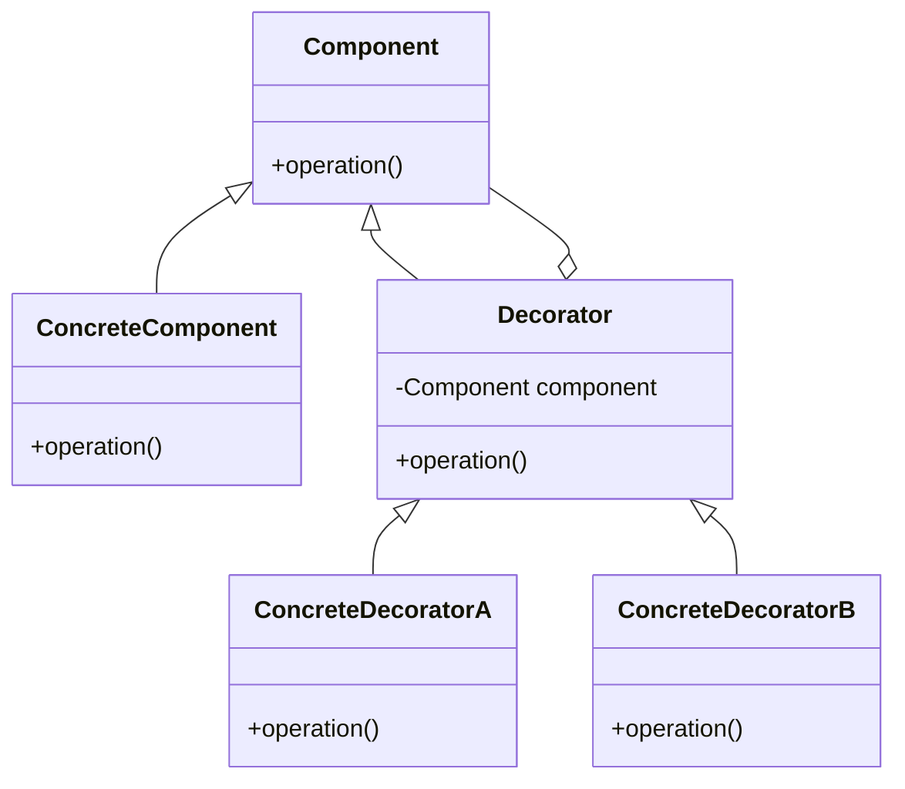

# Java 秋招设计模式面试题预测与回答

## 一、开场必问：结合项目讲应用

**Q1: 简历上写"能在业务中合理应用"，挑一个你项目中实际用到的设计模式讲讲。**

> 我们系统支持多种支付渠道，微信、支付宝、银联等。**前端页面由用户选择支付渠道，将渠道编码随请求一起传给后端接口。** 早期代码在 Controller 里用大量 if-else 判断渠道类型，随着渠道扩充到 7 个，分支代码臃肿，新增渠道要修改原有业务代码，违反开闭原则。
>
> 我重构采用策略模式 + 门面模式组合方案： 定义`PayStrategy`策略接口，每个支付渠道单独写一个策略实现类，封装各渠道 SDK 差异化调用逻辑；利用 Spring 特性，把所有策略 Bean 注入 Map，**根据前端传入的渠道编码路由选择对应策略**。
>
> 新增`PayFacade`支付门面层，作为对外统一入口。门面收拢公共逻辑：参数校验、幂等校验、风控、统一日志和异常封装，门面内部再去获取并执行对应支付策略。Controller 只调用门面，完全感知不到策略的存在。
>
> 新增支付渠道，只需要新增一个策略实现类，门面、Controller、主业务流程完全不用改动，满足开闭原则，代码可维护性提升很多。

---

## 二、单例模式（出镜率最高，常考手写）

**Q2: 手写一个线程安全的懒加载单例。**

```java
public class Singleton {
    private static volatile Singleton instance;

    private Singleton() {}

    public static Singleton getInstance() {
        if (instance == null) {              // 第一次检查：避免每次都加锁
            synchronized (Singleton.class) {
                if (instance == null) {      // 第二次检查：防止重复创建
                    instance = new Singleton();
                }
            }
        }
        return instance;
    }
}
```

**Q3: 为什么要加 volatile？（高频追问）**

`new Singleton()` 不是原子操作，分三步：①分配内存 → ②初始化对象 → ③引用指向内存。CPU 可能将②③重排序为 ①③②，另一个线程在第一次判空时可能拿到一个**不为 null 但尚未初始化完成**的对象，引发空指针。volatile 禁止指令重排。

**Q4: 还有其他写法吗？静态内部类为什么能实现懒加载？**

```java
public class Singleton {
    private Singleton() {}
    private static class Holder {
        static final Singleton INSTANCE = new Singleton();
    }
    public static Singleton getInstance() {
        return Holder.INSTANCE;  // 首次调用才触发 Holder 类加载
    }
}
```
借助 JVM 类加载机制：内部类只有在被引用时才加载，且类的初始化由 JVM 加锁保证只执行一次，天然线程安全。

**Q5: 枚举实现单例的好处？**

《Effective Java》推荐。天然防两类攻击：
- **防反射**：JDK 禁止对枚举调用 `newInstance()`
- **防序列化破坏**：枚举序列化由 JVM 特殊处理，不会创建新实例

**Q6: 单例能被怎么破坏？如何防御？**

| 破坏方式                                | 防御手段                                                     |
| --------------------------------------- | ------------------------------------------------------------ |
| 反射 `setAccessible(true)` 调私有构造器 | 构造器中判断 `if (instance != null) throw new RuntimeException()` |
| 序列化/反序列化                         | 实现 `readResolve()` 方法返回已有实例                        |
| clone                                   | 重写 `clone()` 抛异常                                        |

**Q7: Spring 的单例 Bean 和单例模式是一回事吗？（高频陷阱题）**

不是。
- 作用域不同：单例模式是**类加载器级别**，一个 ClassLoader 中只有一份；Spring 单例是**容器级别**，每个 IoC 容器一份，多个容器/多个类加载器可以有多份。
- 实现方式不同：Spring 通过 `DefaultSingletonBeanRegistry` 的单例缓存表（singletonObjects）管理，Bean 自身可以是普通类。
- 另外 Spring 单例 Bean 有状态的话会有并发问题，所以要求单例 Bean 无状态。

---

## 三、工厂模式

**Q8: 简单工厂、工厂方法、抽象工厂的区别？**

- **简单工厂**：一个工厂类 + if-else/switch 创建产品。新增产品要改工厂代码，违反开闭原则（严格说不属于 GoF 23 种）。
- **工厂方法**：每个产品对应一个工厂类。新增产品只需新增类，符合开闭原则。
- **抽象工厂**：一个工厂创建**一族**相关产品，如 OracleFactory 同时创建 OracleConnection、OracleStatement，适合需要保证产品族配套的场景。

**Q9: JDK / Spring 中哪里用到了工厂模式？**

- JDK：`Calendar.getInstance()`、`Executors.newFixedThreadPool()`、各种 `valueOf()`
- Spring：`BeanFactory` 是 IoC 容器；**`FactoryBean`** 是自定义 Bean 创建的扩展点，`getObject()` 返回真实对象，如 MyBatis 的 `SqlSessionFactoryBean`

**Q10（追问）：BeanFactory 和 FactoryBean 的区别？**

- BeanFactory：IoC 容器顶层接口，负责管理 Bean 的整个生命周期
- FactoryBean：一种特殊的 Bean，本身是工厂，Spring 获取该 Bean 时实际返回 `getObject()` 的结果

---

## 四、策略模式

**Q11: 策略模式和 if-else 比好在哪？什么时候不该用？**

好处：符合开闭原则（新增策略不改旧代码）、逻辑内聚、便于单测。
**诚实加分点**：只有 2~3 个固定分支时 if-else 更简单直接，强行上策略模式就是过度设计。判断依据是**分支数量多且预计经常扩展**。

**Q12: 在 Spring 项目里策略模式怎么落地写法优雅？**

利用 Spring 自动注入 Map 的特性（key 为 bean name）：

```java
@Component
public class DiscountContext {
    @Autowired
    private Map<String, DiscountStrategy> strategyMap;

    public BigDecimal calc(String type, Order order) {
        DiscountStrategy strategy = strategyMap.get(type);
        Assert.notNull(strategy, "不支持的优惠类型");
        return strategy.calc(order);
    }
}
```
也可以让每个策略实现 `getType()` 方法，在 `@PostConstruct` 中注册到自己维护的路由表。

---

## 五、适配器模式

**Q13: 类适配器和对象适配器的区别？**

- 类适配器：通过**继承**被适配类实现目标接口，受 Java 单继承限制
- 对象适配器：通过**组合**持有被适配对象，更灵活，优先使用

**Q14: 说一个你知道的框架里的适配器。**

Spring MVC 的 `HandlerAdapter`：Controller 存在多种形态（`@RequestMapping` 注解、`HttpRequestHandler`、老式 Controller 接口），执行方式各不相同。DispatcherServlet 无法直接调用，通过 HandlerAdapter 统一抽象出 `handle()` 接口，对每种 Controller 提供对应适配器——典型的适配器模式。

其他：`InputStreamReader`（把 InputStream 适配成 Reader）、SLF4J 适配各日志实现、`Arrays.asList()`。

**Q15（高频对比题）：适配器、装饰器、代理模式结构都很像，区别是什么？**

结构都是"包一层"，**意图不同**：

| 模式   | 意图                     | 例子                     |
| ------ | ------------------------ | ------------------------ |
| 适配器 | **改变接口**，解决不兼容 | InputStreamReader        |
| 装饰器 | **不改变接口**，增强功能 | BufferedInputStream      |
| 代理   | **不改变接口**，控制访问 | RPC 动态代理、Spring AOP |

---

## 六、门面模式

**Q16: 门面模式解决什么问题？举例。**

为一组复杂子系统接口提供一个统一的高层入口，降低调用方与子系统的耦合。

- **SLF4J** 本身就是门面（Simple Logging Facade for Java），底层切换 Logback/Log4j2 对业务无感
- 支付场景：对外只暴露 `PaymentService.pay()`，内部编排风控、账户、积分、通知等多个子系统

**Q17（可能追问）：门面模式和中介者模式的区别？**

门面是**单向**的（调用方 → 门面 → 子系统），目的是简化外部调用；中介者是**双向**协调多个同事对象交互，目的是消除对象间的网状依赖。

---

## 七、观察者模式

**Q18: 定义及你在框架中见过的实现？**

一对多依赖，主题状态变更时自动通知所有观察者。
- Spring 事件机制：`ApplicationEvent` / `ApplicationListener` / `ApplicationEventPublisher`
- Guava EventBus
- MQ 的发布订阅（扩展形态）

**Q19: Spring 事件机制的用法？同步还是异步？**

```java
// 发布
publisher.publishEvent(new OrderCreatedEvent(order));

// 监听
@EventListener
public void onOrderCreated(OrderCreatedEvent event) { ... }
```
默认是**同步**的，在发布者线程执行。加 `@Async` 变异步；`@TransactionalEventListener(phase = AFTER_COMMIT)` 可保证事务提交后才执行（典型场景：下单成功后发积分，避免事务回滚了积分还发了）。

**Q20（对比题）：观察者模式和发布订阅模式是一回事吗？**

不是严格相等：
- 观察者：Subject **直接持有** Observer 引用，耦合较紧，通常同步、同进程
- 发布订阅：通过**中间 Broker**（MQ、事件总线）解耦，发布者不知道消费者是谁，通常异步、可跨进程、支持持久化和重试

---

## 八、综合/陷阱题

**Q21: 设计模式的六大原则？**
单一职责、开闭原则（最重要）、里氏替换、依赖倒置、接口隔离、迪米特法则（再加合成复用原则共七个）。

**Q22: 一个业务有几十个 if-else 按类型分发，怎么重构？**

答题框架：分支少且稳定 → 保持 if-else；按类型分发 → **策略 + 工厂（Map 路由）**；有顺序/可中止的规则链（如风控、过滤器）→ **责任链**；流程固定但步骤实现不同 → **模板方法**。能说出"先判断场景再选模式"是加分项。

**Q23: 设计模式的缺点 / 什么时候不该用？**

- 增加类数量和抽象层次，提高理解成本
- 过度设计：需求还没出现扩展就预设抽象
- 单例的隐藏依赖不利于单元测试（可用依赖注入改善）

**Q24: 你提到熟悉，那 Spring 框架里还知道哪些设计模式？**

- 工厂：BeanFactory / FactoryBean
- 单例：默认 Bean 作用域
- 代理：AOP（JDK 动态代理 / CGLIB）
- 模板方法：JdbcTemplate、RestTemplate
- 观察者：事件机制
- 适配器：HandlerAdapter
- 策略：Resource 资源加载
- 门面：Slf4j、JDBC API

---

## 九、准备建议

1. **每个模式准备一个项目故事**——简历写了"合理应用"，项目追问是必然的，讲不出来会被判定简历注水
2. **手写代码练熟**：DCL 单例（说清 volatile）、静态内部类、Spring 版策略模式路由，这三段要能白板写出
3. **对比题背熟**：三兄弟对比（适配器/装饰器/代理）、观察者 vs 发布订阅、三种工厂——这是区分"背概念"和"真理解"的分水岭
4. 回答时主动往 **Spring 源码实现**上靠，能显著提升面试官对"熟悉"二字的认可度

需要我针对某个模式展开更深入的追问链（比如单例的连环 10 问），或者模拟一场完整的面试对话吗？


# 设计模式

### 装饰器模式（Decorator）

> 别名：包装器（Wrapper）
**核心定义**：动态地给一个对象**添加额外职责**，而不修改原有类代码。相比继承，装饰器是**组合优先**，运行时灵活扩展。
> 设计原则：开闭原则；优先使用组合，而非继承。

#### 一、核心角色

1. **抽象组件 Component**：定义被装饰对象和装饰器共同实现的接口（抽象类/接口）
2. **具体组件 ConcreteComponent**：原始对象，被装饰的基础类，实现基础能力
3. **抽象装饰器 Decorator**：继承/实现Component，持有Component引用，包装原始对象
4. **具体装饰器 ConcreteDecorator**：扩展增强逻辑，在原有方法前后增加功能

Mermaid类图


#### 二、Java最简代码示例

场景：咖啡，基础咖啡 + 加牛奶、加糖（动态叠加）
```java
// 1.抽象组件
public interface Coffee {
    String getDesc();
    double getPrice();
}

// 2.具体组件：基础黑咖啡
public class SimpleCoffee implements Coffee{
    @Override
    public String getDesc() {
        return "黑咖啡";
    }
    @Override
    public double getPrice() {
        return 10;
    }
}

//3.抽象装饰器
public abstract class CoffeeDecorator implements Coffee{
    protected Coffee coffee;
    public CoffeeDecorator(Coffee coffee){
        this.coffee = coffee;
    }
}

//4.具体装饰器：牛奶
public class MilkDecorator extends CoffeeDecorator{
    public MilkDecorator(Coffee coffee) {
        super(coffee);
    }
    @Override
    public String getDesc() {
        return coffee.getDesc() + "+牛奶";
    }
    @Override
    public double getPrice() {
        return coffee.getPrice() + 2;
    }
}

//4.具体装饰器：糖
public class SugarDecorator extends CoffeeDecorator{
    public SugarDecorator(Coffee coffee) {
        super(coffee);
    }
    @Override
    public String getDesc() {
        return coffee.getDesc() + "+糖";
    }
    @Override
    public double getPrice() {
        return coffee.getPrice() + 1;
    }
}

//测试
public class Test{
    public static void main(String[] args) {
        //基础咖啡
        Coffee coffee = new SimpleCoffee();
        //动态叠加装饰，层层包装
        coffee = new MilkDecorator(coffee);
        coffee = new SugarDecorator(coffee);
        System.out.println(coffee.getDesc()); //黑咖啡+牛奶+糖
        System.out.println(coffee.getPrice()); //13.0
    }
}
```

#### 三、装饰器 vs 继承（面试重点）

|对比项|装饰器模式|继承|
|---|---|---|
|扩展方式|**组合**，运行时动态包装对象|静态编译期，类继承|
|灵活性|可多层任意叠加装饰；随时新增装饰类|继承层级固定，类爆炸，不能动态撤销|
|耦合度|低，不修改原有代码|高，父类变更影响子类|
|适用场景|给对象**动态叠加多个可选功能**|功能固定，类维度扩展|

> 一句话：继承是**is-a**；装饰器是**has-a**（包装持有）

#### 四、Java源码典型应用（面试必说）

1. **IO流**（最经典）
`InputStream` 是Component；`FileInputStream` ConcreteComponent；`BufferedInputStream`、`DataInputStream` 是Decorator。
```java
//层层包装
InputStream in = new BufferedInputStream(new FileInputStream("test.txt"));
```
BufferedInputStream 包装原始流，增加缓冲区能力，不修改FileInputStream源码。

2. Spring：`HttpServletRequestWrapper` / `HttpServletResponseWrapper`
对Request包装，修改request body，就是装饰器模式，你前面问到的修改请求体场景。

#### 五、优缺点

✅优点
1. 符合开闭原则：新增增强逻辑不用修改原有类
2. 动态扩展：运行时给对象增加/移除能力，可以多层嵌套
3. 避免继承带来的类膨胀问题

❌缺点
1. 多层包装后，调试堆栈复杂；产生很多小装饰类
2. 多个装饰器叠加，顺序会影响最终结果（例如先加牛奶还是先加糖）

#### 六、面试高频追问区分：装饰器 vs 代理模式

> 核心差别：**目的不同**
- 装饰器：**增强原有对象功能**，用户感知不到包装，同一个接口，不断叠加能力
- 代理模式：**控制访问**，对对象访问做拦截，不一定增强功能，保护/远程代理等

一句话记忆：**装饰器是加强，代理是管控**

#### 七、适用场景

1. 需要动态、透明地给对象增加功能，随时可以撤销
2. 不适合用继承扩展的场景（类数量爆炸）
3. 多个独立功能，可任意组合叠加（日志、统计、权限等叠加）

---


### 单例模式（Singleton）

#### 一、定义

**保证一个类在全局只有一个实例，并且提供一个全局访问点。**
核心：**一个类，只能new一次，全局复用同一个对象**

>一句话记忆：**构造私有，全局唯一，提供获取实例方法**

#### 二、适用场景（面试背诵）

1. 资源重量级对象，频繁创建销毁开销大：数据库连接池、线程池
2. 全局配置管理器、缓存管理器、日志工具类
3. 全局唯一控制器，只需要一个实例

>注意：Spring Bean默认也是单例（容器级单例，不是Java类的单例）

#### 三、常见实现方式（按面试提问频率排序）

##### 1. 饿汉式（静态常量）

类加载的时候直接实例化，**天然线程安全**
```java
public class HungrySingleton {
    // 1.静态常量成员变量:类加载直接初始化
    private static final HungrySingleton INSTANCE = new HungrySingleton();
    // 2.私有构造器（构造方法）:私有构造，禁止外部new
    private HungrySingleton(){}
    // 3.获取实例的静态方法
    public static HungrySingleton getInstance(){
        return INSTANCE;
    }
}
```
✅优点：简单，类加载就创建，没有线程安全问题
❌缺点：**类加载就实例，不用也创建，浪费内存**

##### 2. 懒汉式（非线程安全，面试用来踩坑）

调用getInstance才创建，但是多线程会创建多个实例，**不能生产使用**
```java
public class LazySingleton {
    // 1.静态常量成员变量
    private static LazySingleton instance;
    // 2.私有构造器（构造方法）:私有构造，禁止外部new
    private LazySingleton(){}
    // 3.获取实例的静态方法
    public static LazySingleton getInstance(){
        if(instance == null){
            instance = new LazySingleton();
        }
        return instance;
    }
}
```
❌缺点：多线程并发进入if，会new多个对象，线程不安全

##### 3. DCL 双重检查锁（Double-Check Locking，生产最常用）

```java
public class DclSingleton {
    // volatile 禁止指令重排！重点
    private static volatile DclSingleton instance;
    private DclSingleton(){}

    public static DclSingleton getInstance(){
        // 第一次检查：不为空直接返回，不用抢锁
        if(instance == null){
            synchronized (DclSingleton.class){
                // 第二次检查：防止多个线程等待锁后重复创建
                if(instance == null){
                    instance = new DclSingleton();
                }
            }
        }
        return instance;
    }
}
```
> `instance = new DclSingleton()` 底层分3步：
> 1.分配内存 2.初始化对象 3.instance引用指向内存地址
> 不加volatile，JVM指令重排可能 1→3→2，别的线程拿到半初始化对象。
> volatile：**禁止指令重排**

✅优点：懒加载，只有使用时创建；线程安全；性能好，大部分情况不用加锁
❌缺点：代码复杂；**反射可以破坏单例**

##### 4. 静态内部类（推荐！面试高分写法）

```java
public class StaticInnerSingleton {
    //私有构造
    private StaticInnerSingleton(){}

    //静态内部类，只有调用getInstance才加载内部类
    private static class SingletonHolder{
        private static final StaticInnerSingleton INSTANCE = new StaticInnerSingleton();
    }

    public static StaticInnerSingleton getInstance(){
        return SingletonHolder.INSTANCE;
    }
}
```
原理：外部类加载不会加载静态内部类，只有访问内部类属性时才加载，类加载保证线程安全。
✅优点：懒加载、线程安全、代码简洁；没有volatile
❌缺点：**反射仍然可以破坏**

##### 5. 枚举单例（Effective Java推荐，**防止反射+序列化破坏**）

```java
public enum EnumSingleton {
    // 枚举常量，本质就是 `public static final EnumSingleton INSTANCE = new EnumSingleton();`
	// JVM 保证枚举实例只会被实例化**一次**。
    INSTANCE;
    //业务方法,普通实例方法，写业务逻辑，通过`INSTANCE`调用。
    public void doSomething(){
        System.out.println("枚举单例执行");
    }
}
//使用 EnumSingleton.INSTANCE.doSomething();
```
✅优点：
1. 写法最简单；
2. **天然线程安全**；
3. 杜绝反射、序列化破坏单例；
> JDK底层限制，枚举不能通过反射创建实例。
❌缺点：饿加载，类加载直接创建实例

#### 四、破坏单例的两种方式（面试必问）

1. **反射**：拿到私有构造器，setAccessible(true)，new实例；枚举无法被反射破坏
2. **序列化与反序列化**：对象序列化后反序列化，生成新对象；枚举天然解决

#### 五、面试高频追问

##### Q：DCL为什么两层if？

第一层if：实例不为空直接返回，避免每次进入同步块，提升性能。
第二层if：多个线程在第一层if等待synchronized锁，拿到锁后防止重复创建对象。

##### Q：DCL为什么需要volatile？

防止`instance = new Object()`指令重排，避免其他线程拿到未初始化完成的对象。

##### Q：静态内部类为什么线程安全？

静态内部类在首次使用才加载，**类加载由JVM保证class初始化锁，只会执行一次**。

##### Q：几种单例对比

|实现|懒加载|线程安全|防反射破坏|
| ---- | ---- | ---- | ---- |
|饿汉|❌|✅|❌|
|DCL双重检查|✅|✅|❌|
|静态内部类|✅|✅|❌|
|枚举|❌|✅|✅|

##### Q：Spring单例和我们手写单例的区别？

手写单例：**类级别，JVM内只有一个对象**
Spring单例：**容器级单例，同一个IoC容器中一个Bean定义只有一个实例；如果多个容器，会有多个实例，不是JVM全局唯一**

#### 一句话背诵总结

单例模式保证一个类全局仅有一个实例，提供全局访问点。常用实现：饿汉简单但提前加载；DCL双重检查锁实现懒加载，需要volatile防止指令重排；静态内部类简洁安全；枚举单例可以抵御反射和序列化破坏，是最安全的实现。

---
下一个：**装饰器模式**，还是**原型模式**？

要不要把我们前面学的所有设计模式整理一份**后端面试速记清单**？

### 适配器模式（Adapter Pattern）

**将一个类的接口，转换成客户端期望的另一个接口。适配器让原本因为接口不兼容而不能一起工作的类可以协同工作。属于**结构型设计模式**。**
> 类比：电源转接头。国标插头（客户端），插座是美标（被适配者），适配器就是转换头。

#### 角色

1. **Target（目标接口）**：客户端**期望使用的接口**
2. **Adaptee（被适配者/源类）**：已有旧组件，功能存在，但接口不匹配
3. **Adapter（适配器）**：实现Target，内部持有Adaptee实例，做接口转换
4. **Client（客户端）**：只依赖Target接口，完全不知道Adaptee存在

#### 两种实现方式

##### 1. 对象适配器（开发最常用，**推荐**，组合）

> 【组合】适配器持有被适配者的引用，**不是继承**，符合组合优于继承。
UML思路：Adapter 实现 Target，内部包含 Adaptee 对象。

伪代码示例（Java）
```java
// 目标接口，客户端想要的
public interface Target {
    void request();
}

// 被适配者：老系统，接口不一样
public class Adaptee {
    public void specificRequest() {
        System.out.println("被适配者的特殊方法");
    }
}

// 对象适配器：组合Adaptee
public class ObjectAdapter implements Target {
    private Adaptee adaptee;

    public ObjectAdapter(Adaptee adaptee) {
        this.adaptee = adaptee;
    }

    @Override
    public void request() {
        // 做接口转换，调用原有方法
        adaptee.specificRequest();
    }
}

// 客户端
public class Client {
    public static void main(String[] args) {
        Target target = new ObjectAdapter(new Adaptee());
        target.request();
    }
}
```

##### 2. 类适配器（继承，Java受限，几乎不用）

适配器**继承Adaptee**，同时实现Target接口。
> Java不支持多继承，所以类适配器在Java中**无法广泛使用**。
> 缺点：强耦合，继承绑定，违反开闭原则。

#### 核心特点

✅ 优点
1. **解耦**：客户端和原有旧代码隔离，不需要修改Adaptee源码；
2. 复用已有代码，不用重写；
3. 符合开闭原则：新增适配器不用改动原有代码。

❌ 缺点
1. 增加额外包装层，增加代码复杂度；
2. 对象适配器只能包装一个Adaptee（可改造支持多个）。

> 区分：适配器模式**不修改原有代码**，只是包装转换接口。

#### 和装饰器、桥接模式对比（面试高频坑）

1. **适配器**：改变接口，做**接口转换**，目的：兼容老接口
2. **装饰器**：**不改变接口**，增强原有对象功能
3. **桥接**：分离抽象与实现，解决多维度扩展问题

#### 业务实战例子（Java后端面试举例）

场景：统一第三方支付
- Target：我们系统定义的统一支付接口 `PayGateway`（`pay()`、`refund()`）
- Adaptee：支付宝SDK、微信SDK，各自接口名字不一样（alipay.trade.pay / wx.unifiedOrder）
- Adapter：AlipayAdapter、WechatPayAdapter，实现统一PayGateway，内部调用第三方SDK。
> 新增支付渠道，只新增适配器，不用改动业务代码。

另一个例子：SpringMVC `HandlerAdapter`！
> SpringMVC经典适配器：不同Handler（HttpRequestHandler、Controller、SimpleController）处理方式不一样，HandlerAdapter统一适配，DispatcherServlet只调用适配器统一接口 `handle()`。

#### 面试口述精简版（45秒）

适配器是结构型模式，作用是做接口转换，让接口不兼容的类一起工作。分对象适配器和类适配器，Java中推荐**对象适配器，用组合实现**。
角色有目标接口、被适配者、适配器。适配器实现目标接口，内部持有被适配对象，在方法内调用被适配者的方法完成接口转换。
优点是复用原有代码、解耦，不用修改原有类；缺点是多一层包装。
注意和装饰器区分：适配器**改变接口**；装饰器接口不变，只增强功能。典型例子是SpringMVC的HandlerAdapter、第三方支付统一封装。

#### 追问预判

Q：对象适配器和类适配器区别？
A：对象适配器是**组合持有**，推荐，低耦合；类适配器是继承，Java单继承限制，耦合高，基本不用。

Q：适配器和外观模式区别？
A：外观模式：**简化多个子系统接口**，对外提供一个统一入口；适配器：**转换已有接口**，解决接口不兼容。

要不要我把**适配器、装饰器、外观、桥接**四个容易混淆的结构型模式整理一张对比表？


### 责任链模式（Chain of Responsibility）

#### 一、定义

**使多个对象都有机会处理请求，从而避免请求的发送者和接收者之间的耦合关系。将这些对象连成一条链，并沿着这条链传递该请求，直到有一个对象处理它为止。**

核心思想：**请求沿着处理器链条依次传递，处理器自己决定是否处理，处理不了就交给下一个处理器**。

> 典型特点：**一个请求，多个处理器，链式传递**

#### 二、适用场景（面试必背）

1. **一个请求需要多个对象中的一个来处理，但具体是谁事先不确定**
   例：审批流（请假单：组长→部门经理→总监）
2. **需要动态指定处理器链条**，运行时可以增删、调整顺序
3. **不想让请求发起者和具体处理对象强耦合**

> 不适合：请求**必须被所有处理器依次处理**（这种用**过滤器/拦截器**，是责任链变种）

#### 三、角色划分

1. **Handler（抽象处理者）**
   - 持有下一个处理器引用 `nextHandler`
   - 定义处理请求的抽象方法 `handle()`
2. **ConcreteHandler（具体处理者）**
   - 实现处理逻辑；能处理就处理，不能则转发给 `nextHandler`
3. **Client（客户端）**
   - 组装链条，构造处理器顺序，发起请求

#### 四、Java 代码示例（请假审批场景）

```java
// 抽象处理者
public abstract class Approver {
    protected Approver nextApprover;

    // 设置下一个处理节点
    public void setNextApprover(Approver nextApprover) {
        this.nextApprover = nextApprover;
    }

    public abstract void approve(int leaveDays);
}

// 组长：只能审批 <=3天假期
class GroupLeader extends Approver {
    @Override
    public void approve(int leaveDays) {
        if (leaveDays <= 3) {
            System.out.println("组长审批通过，假期：" + leaveDays + "天");
        } else if (nextApprover != null) {
            // 自己处理不了，交给下一级
            nextApprover.approve(leaveDays);
        } else {
            System.out.println("无人可审批，驳回");
        }
    }
}

// 部门经理：审批4~7天
class Manager extends Approver {
    @Override
    public void approve(int leaveDays) {
        if (leaveDays <=7) {
            System.out.println("部门经理审批通过，假期：" + leaveDays + "天");
        } else if (nextApprover != null) {
            nextApprover.approve(leaveDays);
        } else {
            System.out.println("无人可审批，驳回");
        }
    }
}

// 总监：7天以上
class Director extends Approver {
    @Override
    public void approve(int leaveDays) {
        System.out.println("总监审批通过，假期：" + leaveDays + "天");
    }
}

// 客户端
public class Client {
    public static void main(String[] args) {
        Approver leader = new GroupLeader();
        Approver manager = new Manager();
        Approver director = new Director();

        // 组装链：组长 -> 经理 -> 总监
        leader.setNextApprover(manager);
        manager.setNextApprover(director);

        leader.approve(2);    //组长处理
        leader.approve(5);    //经理处理
        leader.approve(10);   //总监处理
    }
}
```

#### 五、优点

1. **解耦**：请求发起方不需要知道是谁处理，只需要发给链头
2. **灵活**：可以动态修改链条，新增/删除处理器，不用改原有代码，符合开闭原则
3. **职责分离**：每个处理器只关心自己的处理逻辑

#### 六、缺点（面试重点）

1. **请求不一定被处理**：链尾也无法处理请求时，请求丢失（需要兜底）
2. **性能开销**：请求需要从头到尾遍历整条链，链条过长会慢
3. **调试困难**：链式传递，排栈追踪麻烦
4. **容易出现循环引用bug**（要注意终止条件）

#### 七、Java 源码中的责任链

1. **Servlet Filter**（经典！过滤器链）
   `Filter#doFilter`，`FilterChain` 传递，**所有Filter都会执行**，属于**全执行型责任链**（和上面审批例子不一样）

> 审批：找到处理者就停止；Filter：全部执行

2. **Spring Interceptor 拦截器**
3. **MyBatis 的 Plugin 拦截器链**

> ✅面试区分：
>
> - 审批模型：**找到处理者，终止传递**（标准责任链）
> - Filter：**全部处理器都执行**，属于责任链变体，常叫过滤器链

#### 八、面试常见追问

##### Q1：责任链和装饰器模式区别？

- **责任链**：多个处理器，**请求传递**，对象之间是并列链条；目标：**谁来处理请求**

- ##### **装饰器**：层层包装同一个对象，**增强同一个对象功能**；目标：动态增强功能

##### Q2：责任链怎么避免请求无限循环？

- 每个处理器转发前判断 `next != null`
- 链尾节点不再转发，做兜底逻辑

##### Q3：实际业务怎么优化长责任链？

1. 提前路由，不要每次从头遍历整条链
2. 控制链节点数量
3. 可缓存路由结果

#### 九、一句话总结背诵版

责任链模式将多个处理器串联成链，请求从链头传入，每个处理器判断是否处理，不能处理就传给下一个，实现请求发送方与处理方解耦，常用于审批、过滤器场景；缺点是链条过长性能差，且请求可能得不到处理。

如果你需要，我可以给你写**Spring中实现责任链**或者**用枚举/策略模式结合责任链**的业务实战代码（后端面试很爱问这个组合）。

### Spring 责任链模式

（面试高频，后端业务大量使用：审批、校验、订单链路、风控）

> 
> **责任链：把多个处理器组成一条链路，请求依次经过每个处理器；每个处理器可选择处理请求、传递给下一个、直接终止链路。属于行为型模式。**
> 核心思想：**请求发送方和处理方解耦，请求沿着处理器链传递，处理器只关心自己这一步逻辑，不关心谁是下一个。**

> 
> 原生责任链需要手动维护下一个节点`next`；Spring 版本利用IOC自动收集所有处理器Bean，不用手动硬编码串联节点。

#### 角色

1. **Handler（抽象处理器）**：定义处理方法，以及传递到下一个处理器的能力
2. **ConcreteHandler（具体处理器）**：每个节点实现自己的业务逻辑，判断是否继续传递
3. **Chain / Context（链路上下文）**：持有处理器列表，控制遍历执行；存放请求参数、结果、中断标记

#### 两种主流Spring实现方案

##### 方案1：List注入 + 上下文控制（最推荐，业务最常用）

Spring自动注入所有`Handler`实现类到`List`，**顺序可通过`@Order`控制**，不用手动设置next指针。

> 
> 适合：订单校验、审批流、参数校验链路。

```
// 1. 上下文：保存请求、是否中断标记
@Data
public class OrderCheckContext {
    private Long orderId;
    private boolean interrupted; // 是否中断链路
    private String errorMsg;
}

// 2. 抽象处理器
public interface OrderCheckHandler {
    /**
     * @param context 上下文
     * @return true:继续执行下一个；false:中断链路
     */
    boolean handle(OrderCheckContext context);
}

//3. 具体处理器，@Order 指定执行顺序，数值越小越先执行
@Component
@Order(1)
public class OrderExistCheckHandler implements OrderCheckHandler {
    @Override
    public boolean handle(OrderCheckContext context) {
        System.out.println("校验订单是否存在");
        if(context.getOrderId() == null){
            context.setInterrupted(true);
            context.setErrorMsg("订单ID为空");
            return false; // 中断，不再往下执行
        }
        return true; // 放行，执行下一个handler
    }
}

@Component
@Order(2)
public class OrderAmountCheckHandler implements OrderCheckHandler{
    @Override
    public boolean handle(OrderCheckContext context) {
        System.out.println("校验订单金额");
        return true;
    }
}

//4. 链路执行器（Chain）
@Service
public class OrderCheckChainService {
    // Spring自动注入所有OrderCheckHandler实现类，按@Order排序
    private final List<OrderCheckHandler> handlerList;

    public OrderCheckChainService(List<OrderCheckHandler> handlerList) {
        this.handlerList = handlerList;
    }

    public void execute(OrderCheckContext context){
        for (OrderCheckHandler handler : handlerList) {
            boolean continueNext = handler.handle(context);
            if (!continueNext || context.isInterrupted()) {
                break; // 中断链路
            }
        }
    }
}
```

##### 方案2：经典链表式（持有next引用，较少业务使用）

每个Handler内部持有下一个Handler的引用，形成链表。
缺点：**需要手动组装next，新增节点要修改代码，违背开闭**；Spring场景很少用。

> 
> 适合框架底层，业务开发优先选【List+@Order】方案。

#### Spring源码中的责任链（面试必说）

1. **Servlet Filter 过滤器链** `FilterChain` 经典责任链
2. **SpringMVC Interceptor 拦截器** `HandlerInterceptor`，preHandle依次执行，返回false中断链路
3. **Spring Security FilterChain** 安全过滤器链，最典型的责任链实现
4. AOP 多个Advisor链式执行，也可以理解为责任链思想

#### ✅ 优点

1. **解耦**：每个处理器只负责单一职责，新增校验节点只新增`@Component`类，不用修改原有代码，开闭原则；
2. 动态调整顺序：修改`@Order`即可调整执行顺序；
3. 可单独开启/关闭处理器（可加开关控制是否加入链路）。

#### ❌ 缺点

1. 如果链路很长，请求会遍历全部节点；一旦忘记中断，会全链路执行；
2. 调试麻烦，链路多的时候排查问题；
3. 无法反向回溯（简易实现）；
4. 若某个处理器没有处理，请求会走到链路末尾。

#### 高频面试对比（极易混淆）

##### 责任链 vs 策略模式

- **责任链**：**一串处理器依次执行**，请求可以被中途中断；多个节点共同完成整套流程（校验、审批）
- **策略模式**：**多选一**，只挑选其中一个算法执行，不会执行多个

##### 责任链 vs 装饰器

- **责任链**：多个独立处理器，请求依次传递，可中断；侧重点：**分段处理请求**
- **装饰器**：层层包装同一个对象，**不会中断**，增强同一个对象功能

#### 面试口述精简版（45秒）

Spring实现责任链，一般用List注入的方式，抽象Handler定义处理方法，每个处理器实现类加@Component，用@Order定义执行顺序。Spring会自动把所有实现类注入List，在Chain服务里循环遍历执行。每个处理器处理完返回标识，判断是否中断链路。
优点是新增节点只新增类，不改动原有代码，符合开闭原则。Spring源码里Servlet Filter、MVC拦截器、SpringSecurity过滤器链都是责任链。
区分重点：责任链是**多个处理器依次执行，可中断**；策略模式是**多选一，只执行一个算法**。

#### 面试官高频追问

Q：@Order的生效原理？
A：Spring在注入List的时候，会根据`Ordered`接口或者`@Order`注解的值排序，值越小优先级越高。

> 
> 注意：`@Order`只对Spring容器注入List的时候生效，普通new对象无效。

Q：责任链和过滤器链区别？
A：Filter是责任链的一种具体落地，Servlet的FilterChain是框架层面的责任链。

Q：什么时候适合用责任链？
A：**多步骤串行校验、多级审批、风控规则**，每个步骤独立，后续可能频繁新增/删减节点。

#### 优化加分点（面试加分）

1. 自定义注解，控制处理器是否启用；
2. 上下文统一收集错误信息；
3. 支持异步链路；
4. 支持分组链路：不同业务场景使用不同处理器子集（比如【普通订单校验】和【秒杀订单校验】两套链路）。

要不要我把**策略、责任链、模板方法、工厂、装饰器**整理成一张对比表，方便一次性背完？


### 模板方法模式（Template Method）

#### 一、定义

**定义一个操作中的算法骨架，而将算法的一些步骤延迟到子类中。模板方法使得子类可以不改变算法结构的前提下，重定义算法的某些特定步骤。**

核心：**父类固定流程骨架，子类实现可变步骤**。流程顺序写死，部分步骤交给子类去实现。

> 一句话记忆：**骨架在父类，细节在子类**

#### 二、适用场景（面试背诵）

1. 多个业务流程**整体步骤一致，但个别步骤实现不同**
   - 例：不同类型订单的处理：校验参数→计算金额→保存订单→发送通知；通知方式不一样（短信/站内信）
2. 希望**固定算法执行顺序**，防止子类篡改流程
3. 抽取重复公共逻辑到父类，子类只实现差异化逻辑，减少重复代码

#### 三、角色划分

1. **AbstractClass（抽象类）**
   - `templateMethod()`：**模板方法**，定义整体流程骨架，用final修饰防止子类重写，里面按顺序调用各个步骤方法
   - 原始操作：
     - `concreteMethod()`：公共固定步骤，直接实现
     - `abstractMethod()`：抽象方法，**必须由子类实现**
     - `hookMethod()`：钩子方法，可选重写，用来控制流程分支（可选步骤开关）
2. **ConcreteClass（具体子类）**
   - 实现抽象步骤，按需重写钩子方法，**不能修改整体流程顺序**

#### 四、Java代码示例：制作饮品（经典Demo）

```java
// 抽象类：饮品制作模板
public abstract class DrinkTemplate {

    // 模板方法，final禁止子类重写，固定流程
    public final void makeDrink() {
        boilWater();
        brew();         // 冲泡，子类实现
        pourInCup();
        if (wantAddCondiment()) { // 钩子方法，控制是否执行
            addCondiment();
        }
    }

    // 固定公共步骤
    private void boilWater() {
        System.out.println("烧开水");
    }

    private void pourInCup() {
        System.out.println("倒入杯子");
    }

    // 抽象方法：子类必须实现
    protected abstract void brew();
    protected abstract void addCondiment();

    // 钩子方法：默认实现，子类可选择重写
    protected boolean wantAddCondiment() {
        return true;
    }
}

// 子类：茶
class Tea extends DrinkTemplate{
    @Override
    protected void brew() {
        System.out.println("浸泡茶叶");
    }

    @Override
    protected void addCondiment() {
        System.out.println("加柠檬");
    }
}

// 子类：咖啡
class Coffee extends DrinkTemplate{
    @Override
    protected void brew() {
        System.out.println("冲泡咖啡粉");
    }

    @Override
    protected void addCondiment() {
        System.out.println("加糖和牛奶");
    }

    // 重写钩子，不添加调料
    @Override
    protected boolean wantAddCondiment() {
        return false;
    }
}

// 客户端
public class Client {
    public static void main(String[] args) {
        DrinkTemplate tea = new Tea();
        tea.makeDrink();
        System.out.println("----");
        DrinkTemplate coffee = new Coffee();
        coffee.makeDrink();
    }
}
```

#### 五、优点

1. **复用性**：公共逻辑放在父类，避免大量重复代码
2. **可控**：模板方法加final，**算法流程固定，子类不能乱改顺序**
3. **扩展性**：新增业务只需新增子类，实现差异化步骤，符合开闭原则(对扩展开放，对修改关闭)

#### 六、缺点（面试重点）

1. **继承带来的强耦合**：基于继承，父类改动会影响所有子类；继承是静态绑定，不如组合灵活
2. **类数量膨胀**：每新增一种实现，就要新增一个子类
3. **反向控制**：父类调用子类方法，和常规调用方向相反，阅读代码理解成本高

#### 七、Java源码中的模板方法

1. **ArrayList#sort**、集合里很多骨架方法

2. Spring：`JdbcTemplate`（非常典型！）

   - 固定流程：获取连接→创建statement→执行sql→处理结果集→关闭资源；
   - 可变部分：SQL、RowMapper映射交给子类/回调实现

3. Spring中 `AbstractApplicationContext` 容器刷新 `refresh()` 方法

   > refresh()就是典型模板方法，里面固定容器启动一整套步骤，部分步骤留给子类实现

#### 八、面试高频追问

##### Q1：模板方法和策略模式区别？

- **模板方法**：**基于继承**；固定算法骨架，修改**部分步骤**；控制流程顺序在父类
- **策略模式**：**基于组合**；整套算法替换，整个算法可以互换；不控制调用流程，由客户端选择策略

> 一句话区分：模板是**同一个流程，部分步骤不一样**；策略是**整套算法换掉**

##### Q2：钩子方法是什么，作用？

钩子是父类提供的空/默认实现方法，子类**可选重写**；用来让子类干预模板流程，控制是否执行某一步骤，不强制实现。

##### Q3：模板方法为什么要用final修饰模板方法？

防止子类重写`templateMethod()`，破坏预先定义好的算法执行顺序，保证流程骨架不被篡改。

##### 九、背诵一句话总结

模板方法模式在抽象类中定义固定的算法骨架，将可变步骤延迟到子类实现，通过继承复用公共逻辑，可用钩子方法控制可选步骤；适合流程固定、局部逻辑差异化场景，缺点是继承耦合高，类容易变多。

> 对比记忆：责任链是**请求在多个对象之间传递**；模板方法是**一个对象内部固定流程，子类重写步骤**

要不要我把**模板方法、责任链、策略模式**放一起整理一张对比表，面试直接背？


### 策略模式（Strategy）

#### 一、定义

**定义一系列算法，把每一个算法封装起来，并且使它们可互相替换。本模式让算法的变化独立于使用算法的客户。**

核心：**把可变算法抽成独立策略，客户端按需切换策略，算法和使用算法的代码解耦。**

> 一句话记忆：**同一行为，多种实现，可动态替换**

#### 二、适用场景（面试背诵）

1. 同一个业务，**有多种平行算法/实现**，运行时要动态选择其中一种
   - 例：支付（微信/支付宝/银行卡）、促销折扣（满减、打折、无优惠）
2. 需要大量 `if-else / switch` 判断，想消除分支代码
3. 算法需要独立扩展，新增算法不改动原有业务代码（开闭原则）

> 注意：多个算法是**平级可互换**，不是先后步骤（这是和模板方法最大区别）

#### 三、角色划分

1. **Strategy（策略接口）**
   统一抽象接口，定义算法方法，所有具体策略都实现这个接口
2. **ConcreteStrategy（具体策略）**
   实现策略接口，封装具体算法逻辑
3. **Context（环境上下文）**
   - 持有策略对象的引用（**组合，不是继承**）
   - 对外提供入口方法，调用策略的算法
   - 可以提供set方法，**动态更换策略**
4. **Client客户端**
   创建策略实例，传给Context，执行

#### 四、Java代码示例：促销折扣场景

```java
// 策略接口
public interface DiscountStrategy {
    // 计算折扣后价格
    BigDecimal calcPrice(BigDecimal originPrice);
}

// 具体策略1：无优惠
class NoDiscountStrategy implements DiscountStrategy{
    @Override
    public BigDecimal calcPrice(BigDecimal originPrice) {
        return originPrice;
    }
}

// 具体策略2：8折优惠
class RateDiscountStrategy implements DiscountStrategy{
    @Override
    public BigDecimal calcPrice(BigDecimal originPrice) {
        return originPrice.multiply(new BigDecimal("0.8"));
    }
}

// 具体策略3：满减，满100减20
class FullReduceStrategy implements DiscountStrategy{
    @Override
    public BigDecimal calcPrice(BigDecimal originPrice) {
        if(originPrice.compareTo(new BigDecimal("100")) >=0){
            return originPrice.subtract(new BigDecimal("20"));
        }
        return originPrice;
    }
}

// Context上下文
class OrderContext{
    private DiscountStrategy strategy;

    // 注入策略
    public OrderContext(DiscountStrategy strategy) {
        this.strategy = strategy;
    }
    // 动态更换策略
    public void setStrategy(DiscountStrategy strategy) {
        this.strategy = strategy;
    }

    public BigDecimal getPayPrice(BigDecimal originPrice){
        return strategy.calcPrice(originPrice);
    }
}

// 客户端
public class Client {
    public static void main(String[] args) {
        BigDecimal price = new BigDecimal("200");
        // 使用满减策略
        OrderContext context = new OrderContext(new FullReduceStrategy());
        System.out.println(context.getPayPrice(price));

        // 运行时切换为8折策略
        context.setStrategy(new RateDiscountStrategy());
        System.out.println(context.getPayPrice(price));
    }
}
```

#### 五、优点

1. **消除大量if-else**，代码清爽
2. **算法独立封装**，新增策略只需要新增类，不修改原有代码，满足开闭原则
3. **动态切换策略**，运行时修改
4. 策略之间互相独立，单元测试方便

#### 六、缺点（面试重点）

1. **类数量变多**：每一个算法就要新增一个策略类
2. **客户端需要理解各个策略差异**，客户端要知道什么时候选哪个策略（可以用工厂模式配合优化）
3. 策略对象频繁创建，可考虑**策略对象复用（单例）**减少开销

#### 七、源码中的策略模式

1. JDK：`java.util.Comparator`
   Collections.sort(List, Comparator)，Comparator就是策略接口，可以传入不同比较策略
2. Spring：Resource 资源加载策略、`InstantiationStrategy`实例化策略
3. Spring Security 各种认证策略

#### 八、面试高频对比（重中之重）

##### ✅ 策略模式 VS 模板方法

- **策略模式**：**组合**；整套算法替换；流程由客户端控制；多个算法平级互换
- **模板方法**：**继承**；固定流程骨架，只替换部分步骤；父类控制执行顺序

##### ✅ 策略模式 VS 责任链

- **策略**：**选一个执行**，算法之间互斥；直接选定策略执行
- **责任链**：**依次传递**，逐个判断是否处理，可以多个处理（Filter）或者找到一个终止

##### Q：策略+工厂怎么结合？

把策略实例的创建放到工厂，客户端不用new各个策略，传入类型标识，工厂返回对应策略，**减少客户端对策略实现类的依赖**。

> 业务开发最常用组合：策略模式 + 简单工厂 + Map缓存策略（Spring中用Map存策略Bean）

示例思路：Spring启动时把所有实现DiscountStrategy的Bean放到`Map<String,DiscountStrategy>`，key是策略类型，直接根据类型取策略。

#### 九、背诵一句话总结

策略模式封装一系列可互换的算法，通过组合方式注入上下文，运行时动态切换算法，消除if-else分支；适合多种平行算法场景，缺点是类数量增加，客户端需要了解策略。

---

#### 三个模式极简对比（背这个）

| 模式     | 核心关系 | 核心特点                   | 典型场景                       |
| -------- | -------- | -------------------------- | ------------------------------ |
| 模板方法 | 继承     | 骨架固定，替换部分步骤     | JdbcTemplate，容器refresh      |
| 策略模式 | 组合     | 整套算法可互换，动态选择   | 支付方式、折扣计算、Comparator |
| 责任链   | 链式引用 | 请求传递，逐个判断是否处理 | 审批流、Filter拦截器           |

接下来可以继续：**观察者模式**（面试超高频），还是**单例模式**？

### Spring中策略模式

> 策略模式核心：**定义一族算法，封装每个算法，可互相替换；算法和调用方解耦，新增算法不改动原有业务代码，满足开闭原则。**
> 原生策略模式需要手动new策略对象；**利用Spring IOC，把所有策略交给Spring管理，自动收集Bean，省去手动维护Map/List**。

#### 三个角色

1. **抽象策略 Strategy**：接口，定义统一方法
2. **具体策略 ConcreteStrategy**：接口实现类，`@Component`，每个策略一个Bean
3. **上下文 Context**：业务Service，由Spring自动注入全部策略，**根据参数动态选择策略执行**

#### 两种主流实现方案（面试要区分）

##### 方案1：注入 Map<String,Strategy>（最常用，推荐）

> Spring特性：当注入`Map<Key,接口>`，**key=beanName，value=所有实现该接口的Bean实例**。
> 适合：根据固定编码（如`ALIPAY`/`WECHAT`）直接匹配。

```
// 1.抽象策略接口
public interface PayStrategy {
    void pay(BigDecimal amount);
}

// 2.具体策略，注册为Spring Bean
@Component("ALIPAY")
public class AlipayStrategy implements PayStrategy {
    @Override
    public void pay(BigDecimal amount) {
        System.out.println("支付宝支付：" + amount);
    }
}

@Component("WECHAT")
public class WechatPayStrategy implements PayStrategy {
    @Override
    public void pay(BigDecimal amount) {
        System.out.println("微信支付：" + amount);
    }
}

//3.上下文Context（业务Service）
@Service
public class PayContextService {
    // Spring自动收集所有PayStrategy的Bean，key是@Component指定名字
    private final Map<String, PayStrategy> strategyMap;

    //构造器注入（推荐，不要字段@Autowired）
    public PayContextService(Map<String, PayStrategy> strategyMap) {
        this.strategyMap = strategyMap;
    }

    public void doPay(String payType, BigDecimal amount){
        PayStrategy strategy = strategyMap.get(payType);
        if(strategy == null){
            throw new RuntimeException("不支持的支付方式");
        }
        strategy.pay(amount);
    }
}
```

##### 方案2：注入 List，通过supports动态匹配（更灵活）

> 
> 适合：匹配逻辑复杂，不是简单编码相等判断（比如多条件、枚举匹配）
> 接口增加`supports()`方法，判断当前策略是否支持该类型

```
//抽象策略
public interface PayStrategy {
    boolean supports(String payType);
    void pay(BigDecimal amount);
}

@Component
public class AlipayStrategy implements PayStrategy {
    @Override
    public boolean supports(String payType) {
        return "ALIPAY".equals(payType);
    }
    @Override
    public void pay(BigDecimal amount) {
        System.out.println("支付宝支付");
    }
}

@Component
public class WechatPayStrategy implements PayStrategy {
    @Override
    public boolean supports(String payType) {
        return "WECHAT".equals(payType);
    }
    @Override
    public void pay(BigDecimal amount) {
        System.out.println("微信支付");
    }
}

//上下文
@Service
public class PayContextService {
    private final List<PayStrategy> strategyList;

    public PayContextService(List<PayStrategy> strategyList) {
        this.strategyList = strategyList;
    }

    public void doPay(String payType,BigDecimal amount){
        PayStrategy strategy = strategyList.stream()
                .filter(s -> s.supports(payType))
                .findFirst()
                .orElseThrow(() -> new RuntimeException("无对应支付策略"));
        strategy.pay(amount);
    }
}
```

#### ✅ 优点（面试）

1. **消除大量if-else/switch**，多分支业务（支付、订单状态、折扣、登录方式）首选；
2. **开闭原则**：新增策略，只新增`@Component`实现类，**完全不用修改上下文代码**；
3. 策略交给Spring管理，可注入其他依赖（如Mapper、Redis），原生手写策略很难做到；
4. 策略可单独单元测试。

#### ❌ 缺点

1. 类数量变多，策略很多时类爆炸；
2. 策略选择逻辑依然要自己维护（Map查找 / stream遍历匹配）；
3. 简单场景（2~3个分支）没必要，过度设计。

#### Spring源码中的策略模式（面试官最爱问）

1. **ResourceLoader**：资源加载策略（classpath、url、文件）
2. **HandlerMapping / HandlerAdapter（SpringMVC）**，不同handler适配策略
3. **InstantiationStrategy**：Bean实例化策略（Cglib、JDK反射）
4. **MessageConverter**：消息转换策略，Http消息序列化

#### 高频追问

##### Q：策略模式和工厂模式区别？

- **策略模式**：**同一行为的多种算法**，运行时替换算法；重点：**算法互换**
- **工厂模式**：**创建对象**，重点：**对象实例的创建**> 
> 业务经常组合使用：**策略+简单工厂**。

##### Q：策略模式和模板方法区别？

- **策略**：**整套算法完全替换**，接口是完整独立实现；平级，互相替换
- **模板方法**：**固定骨架，只替换部分步骤**，父类定义流程，子类重写部分方法

##### Q：Map注入方案有什么坑？

- key是bean名称，容易写错；推荐用枚举统一管理key；
- 如果多个bean同名会报错；
- 策略Bean必须加`@Component`，否则Spring不会放进map。

#### 面试口述精简版（45秒）

Spring实现策略模式，核心是利用IOC容器，把每个策略实现类标记为@Component，交给Spring管理。
有两种常用方式：第一种注入`Map<String,Strategy>`，key为bean名称，根据编码直接获取策略；第二种注入`List<Strategy>`，接口定义supports方法，遍历匹配符合条件的策略。
核心好处消除大量if else，新增策略只新增类，不用修改原有业务代码，符合开闭原则。
Spring源码里HandlerAdapter、MessageConverter都是策略模式。注意区分策略和工厂：策略侧重**算法替换**，工厂侧重**对象创建**。

#### 拓展进阶优化（加分项，面试说出来亮眼）

1. 自定义注解`@StrategyType("ALIPAY")`，标注策略，不用依赖beanName；
2. 结合枚举管理策略编码；
3. 策略工厂单独抽离，和上下文业务解耦；
4. 多策略匹配时，增加优先级排序。

要不要我把**策略、模板方法、工厂、责任链**这四个高频行为模式整理对比？


### 门面模式（Facade，外观模式）

#### 一、定义

**为子系统中的一组接口提供一个一致的高层接口，门面模式定义了一个高层接口，这个接口使得这一子系统更加容易使用。**

核心：**封装多个复杂子系统，对外只暴露一个简单入口，屏蔽内部复杂调用**
一句话记忆：**对外一个门面，内部一堆复杂组件**

#### 二、适用场景（面试背诵）

1. **子系统复杂**，客户端需要调用多个类/多个接口才能完成功能，想简化调用
2. 多层架构，**隔离层与层之间**，防止上层直接依赖底层多个模块
3. 新旧系统兼容，用门面包装旧系统复杂接口，对外提供新的简洁API

> 注意：门面**不修改子系统逻辑**，只是做调用组装；子系统依然可以直接被客户端访问

#### 三、角色划分

1. **Facade（门面类）**
   - 持有多个子系统对象
   - 对外提供简单方法，内部按顺序调用各个子系统接口
2. **SubSystem（子系统）**
   - 一堆独立的类，各自实现自己功能，不知道门面存在
3. **Client客户端**
   - 只依赖门面，不直接操作子系统

#### 四、Java代码示例：电商下单门面（子系统：库存、支付、物流）

```java
//子系统1：库存
class StockSystem{
    public boolean reduceStock(Long skuId){
        System.out.println("扣减库存："+skuId);
        return true;
    }
}
//子系统2：支付
class PaySystem{
    public boolean pay(Long orderId,BigDecimal money){
        System.out.println("订单支付："+orderId);
        return true;
    }
}
//子系统3：物流
class LogisticsSystem{
    public void createShipment(Long orderId){
        System.out.println("创建物流单："+orderId);
    }
}

//门面类，对外统一入口
public class OrderFacade {
    private StockSystem stock = new StockSystem();
    private PaySystem pay = new PaySystem();
    private LogisticsSystem logistics = new LogisticsSystem();

    //对外一个简单方法，内部编排多个子系统调用
    public boolean createOrder(Long skuId, Long orderId, BigDecimal amount){
        boolean stockOk = stock.reduceStock(skuId);
        if(!stockOk){
            return false;
        }
        boolean payOk = pay.pay(orderId, amount);
        if(!payOk){
            return false;
        }
        logistics.createShipment(orderId);
        return true;
    }
}

//客户端
class Client{
    public static void main(String[] args) {
        OrderFacade facade = new OrderFacade();
        //客户端只调用这一个方法，不用关心库存/支付/物流内部逻辑
        facade.createOrder(1001L, 20260914L, new BigDecimal("99"));
    }
}
```

#### 五、优点

1. **简化使用**：客户端只调用门面接口，降低学习成本
2. **解耦**：客户端和多个子系统解耦；子系统内部改动，只要门面接口不变，上层不受影响
3. **更好分层**，遵循迪米特法则（最少知道原则）

#### 六、缺点（面试重点）

1. **不符合开闭原则**：业务新增逻辑，大概率要修改门面类
2. 容易变成**上帝类**：门面不断膨胀，里面塞大量逻辑，过于臃肿
3. 不能限制客户端直接访问子系统；如果业务需要强制隔离，门面不够

#### 七、源码中的门面模式

1. Spring：`ApplicationContext`，底层包装BeanFactory、资源加载、环境等一堆子系统，对外统一接口
2. MyBatis：SqlSession，封装Executor、StatementHandler等一堆底层组件
3. Tomcat 中很多对外包装接口

#### 八、面试高频追问

##### Q1：门面模式和适配器模式区别？

- **门面**：**多个子系统 → 一个统一高层接口**；目的：**简化调用**，接口一般都是新定义的
- **适配器**：**一个已有接口转换成另一个目标接口**；目的：**接口兼容**，适配单个类

##### Q2：门面模式和装饰器区别？

- 门面：**组合多个不同子系统**，简化调用，不增强原有对象能力
- 装饰器：**包装同一个对象**，动态增强原有对象功能

##### Q3：门面模式是不是静态代理？

不是。静态代理重点是**对同一个目标类做增强**；门面只是编排多个子系统调用，没有增强。

#### 九、一句话背诵总结

门面模式提供一个高层门面类，封装多个子系统复杂调用，对外提供简洁接口，简化客户端使用，减少依赖；适合子系统繁多场景，缺点是门面类容易臃肿，扩展时可能修改门面。

> 补充：前面4个模式快速区分
>
> - 责任链：请求挨个传递处理
> - 模板方法：父类固定流程骨架，子类实现步骤
> - 策略：多套算法，动态替换
> - 门面：打包一堆子系统，对外一个入口


### 门面模式 Facade（外观模式）Spring

> **外观模式：结构型模式，提供一个统一的高层入口，封装内部多个复杂子系统，对外隐藏子系统的复杂性。客户端只和门面交互，不需要感知内部多个模块。**

一句话类比：**酒店前台（门面），客户只找前台；前台背后对接保洁、客房、后勤、收银多个子系统，客户不用挨个找。**

#### 角色

1. **Facade（门面/外观类）**：对外提供简单统一API，内部编排调用多个子系统，客户端只依赖门面。
2. **SubSystem（子系统）**：多个独立模块/Service，各自有复杂能力，互相之间可以直接调用。
3. **Client（客户端）**：只调用门面，**不直接访问子系统**。

> ⚠️重点：**门面不修改子系统逻辑，只是做组合编排；子系统可以被门面以外的地方直接调用。**

#### Spring业务实现示例

场景：下单完整流程，底层包含库存扣减、创建订单、扣余额、发送消息多个子系统。
客户端不想分别调用这4个service，我们写一个`OrderFacade`门面统一封装。

```java
// 子系统1：库存服务
@Service
public class StockService {
    public void deductStock(Long skuId, int num){
        System.out.println("扣减库存");
    }
}

// 子系统2：订单基础服务
@Service
public class OrderService {
    public Long createOrder(OrderDTO dto){
        System.out.println("创建订单");
        return 10001L;
    }
}

// 子系统3：账户服务
@Service
public class AccountService {
    public void deductBalance(Long userId,BigDecimal money){
        System.out.println("扣余额");
    }
}

// 子系统4：消息服务
@Service
public class MsgService {
    public void sendOrderNotify(Long orderId){
        System.out.println("发送订单通知");
    }
}

// ========== 门面 Facade 【核心】==========
@Service
public class OrderFacade {
    private final OrderService orderService;
    private final StockService stockService;
    private final AccountService accountService;
    private final MsgService msgService;

    //构造注入所有子系统
    public OrderFacade(OrderService orderService,
                       StockService stockService,
                       AccountService accountService,
                       MsgService msgService) {
        this.orderService = orderService;
        this.stockService = stockService;
        this.accountService = accountService;
        this.msgService = msgService;
    }

    //对外只暴露一个简单入口
    @Transactional(rollbackFor = Exception.class)
    public Long submitOrder(OrderDTO dto){
        //门面编排子系统调用顺序
        stockService.deductStock(dto.getSkuId(), dto.getNum());
        Long orderId = orderService.createOrder(dto);
        accountService.deductBalance(dto.getUserId(), dto.getAmount());
        msgService.sendOrderNotify(orderId);
        return orderId;
    }
}

// 客户端Controller，只依赖门面，不碰底层子系统
@RestController
public class OrderController {
    private final OrderFacade orderFacade;
    public OrderController(OrderFacade orderFacade) {
        this.orderFacade = orderFacade;
    }
    @PostMapping("/submit")
    public Long submit(@RequestBody OrderDTO dto){
        return orderFacade.submitOrder(dto);
    }
}
```

#### ✅ 优点

1. **简化客户端调用**：客户端只调用一个方法，不用关心多子系统调用顺序、参数组装；
2. **解耦**：客户端和一堆子系统隔离；子系统内部改动，只要门面接口不变，上层不受影响；
3. **分层清晰**：门面作为业务编排层，把复杂的多服务组装收敛到一处；
4. 符合**迪米特法则（最少知道原则）**。

#### ❌ 缺点

1. 容易出现**门面膨胀**：业务不断增加逻辑，门面类越来越庞大，变成万能大Service；
2. 如果设计不当，新增业务逻辑都塞进门面，违背单一职责；
3. 门面层本身不提供新能力，只是**组合调用**。

#### Spring源码里的外观模式（面试加分）

1. **ApplicationContext**：门面！内部封装了BeanFactory、ResourceLoader、Environment、MessageSource等多个子系统，对外提供统一方法。
2. **SpringMvc的DispatcherServlet**：封装HandlerMapping、HandlerAdapter、ViewResolver等组件，对外统一入口。
3. JdbcTemplate：封装JDBC底层Connection、Statement、ResultSet，屏蔽原生JDBC繁琐API。

#### 🔥 面试高频区分（重中之重，面试官最爱对比）

##### 外观模式 vs 适配器模式

- **外观模式**：**多个子系统 → 对外一个简单接口**，目的：**简化调用**，不转换接口；
- **适配器模式**：**一个类，接口转换**，解决**接口不兼容**，做类型/接口适配。

##### 外观模式 vs 责任链

- **外观**：一次性编排调用多个子系统，顺序固定，一次性执行；没有中断逻辑；
- **责任链**：请求依次传递处理器，**可中途中断**，每个节点独立判断是否放行。

##### 外观模式 vs 模板方法

- **外观**：调用多个不同子系统，**没有固定骨架模板**，只是编排；
- **模板方法**：父类定义固定流程骨架，子类重写其中部分步骤。

#### 面试口述精简版（45秒）

外观模式属于结构型模式，核心是提供一个高层统一门面类，封装内部多个子系统，对外简化调用，客户端只和门面交互，不用感知底层多个子模块。
在Spring开发中，门面一般封装多个Service，在门面方法里编排调用顺序。它只是做调用编排，不会修改子系统本身逻辑。
优点是简化客户端、减少依赖，遵循迪米特法则；缺点是门面类容易膨胀。
和适配器区分：适配器是**转换单个类的接口**；外观是**聚合多个子系统，对外提供简化入口**。Spring中ApplicationContext就是典型外观模式。

#### 面试官追问预判

Q：门面模式属于业务层的哪一层？
A：可以放在业务编排层（Facade层），放在Controller和底层Service之间；**只做编排，不写核心业务规则**，核心计算逻辑仍然下沉到各个子系统Service。

Q：子系统能不能绕过门面直接被调用？
A：可以。门面不是强制隔离，只是提供一个简化入口；这和代理模式不一样。

Q：什么时候不适合用门面？
A：业务简单，只有单个服务，没必要再加一层门面；业务差异很大、调用顺序不固定，也不适合。

---

接下来可以把：**适配器、外观、装饰器、桥接**这4个结构型模式整理对比，或者继续看**代理模式（静态、JDK动态、CGLIB + Spring AOP）**，你想继续哪个？


### 策略模式 + 门面模式 组合实战（后端面试高频）

#### 核心思路

- **门面Facade**：对外只暴露**一个统一入口**，屏蔽内部复杂逻辑（策略选择、参数组装、异常处理等），客户端只调用门面方法，不用关心里面策略、子系统细节。
- **策略Strategy**：内部封装**多种平行业务算法**，消除大量if-else，业务算法可独立扩展。

> 分工一句话：**门面负责对外收口，策略负责内部不同分支的业务实现**

适用场景举例：电商**订单支付**
客户端发起支付，只调用门面`pay()`；门面内部根据支付类型（支付宝/微信/银行卡）选择对应的支付策略执行。

#### UML角色

1. **Strategy策略接口**：定义统一支付方法
2. **ConcreteStrategy具体策略**：支付宝、微信、银行卡支付实现
3. **Facade门面类**：持有策略Map（策略工厂缓存），对外提供统一pay入口，内部做参数校验、策略路由、结果封装
4. Client客户端：仅依赖门面，不感知策略类

#### Java完整代码

```java
import java.math.BigDecimal;
import java.util.HashMap;
import java.util.Map;

// ===================== 策略部分 =====================
// 策略接口
public interface PayStrategy {
    /**
     * 支付
     * @param orderId 订单号
     * @param amount 金额
     * @return 支付结果
     */
    boolean pay(Long orderId, BigDecimal amount);
}

// 微信支付策略
class WechatPayStrategy implements PayStrategy{
    @Override
    public boolean pay(Long orderId, BigDecimal amount) {
        System.out.println("微信支付，订单："+orderId+"，金额："+amount);
        return true;
    }
}

// 支付宝策略
class AlipayStrategy implements PayStrategy{
    @Override
    public boolean pay(Long orderId, BigDecimal amount) {
        System.out.println("支付宝支付，订单："+orderId+"，金额："+amount);
        return true;
    }
}

// 银行卡策略
class BankPayStrategy implements PayStrategy{
    @Override
    public boolean pay(Long orderId, BigDecimal amount) {
        System.out.println("银行卡支付，订单："+orderId+"，金额："+amount);
        return true;
    }
}

// ===================== 门面（同时内置策略工厂缓存） =====================
public class PayFacade {
    // 策略缓存Map，key：支付类型
    private final Map<String, PayStrategy> strategyMap;

    public PayFacade(){
        strategyMap = new HashMap<>();
        // 注册策略
        strategyMap.put("WECHAT", new WechatPayStrategy());
        strategyMap.put("ALIPAY", new AlipayStrategy());
        strategyMap.put("BANK", new BankPayStrategy());
    }

    /**
     * 门面对外唯一入口
     * @param payType 支付类型
     * @param orderId 订单
     * @param amount 金额
     * @return 支付结果
     */
    public boolean pay(String payType, Long orderId, BigDecimal amount){
        // 门面额外能力：参数校验
        if(payType == null || !strategyMap.containsKey(payType)){
            System.out.println("不支持的支付方式");
            return false;
        }
        if(amount.compareTo(BigDecimal.ZERO) <=0){
            System.out.println("金额非法");
            return false;
        }
        // 路由到对应策略执行
        PayStrategy strategy = strategyMap.get(payType);
        return strategy.pay(orderId, amount);
    }
}

// ===================== 客户端 =====================
class Client{
    public static void main(String[] args) {
        PayFacade payFacade = new PayFacade();
        // 客户端只调用门面，完全不知道各种策略的存在
        payFacade.pay("ALIPAY", 10001L, new BigDecimal("99.00"));
        payFacade.pay("WECHAT", 10002L, new BigDecimal("199.00"));
        payFacade.pay("BANK", 10003L, new BigDecimal("299.00"));
    }
}
```

#### 结构分析

1. 客户端只认识`PayFacade`，**完全不依赖各个Strategy**（门面隔离）
2. 不同支付逻辑拆成策略，新增支付渠道，只新增策略类，注册到map即可
3. 门面承担：参数校验、策略路由、异常封装、日志、结果组装，**编排逻辑**
4. 策略只专注【纯业务算法】，不关心参数校验、路由

#### 面试必问

##### Q：为什么要把策略包在门面里面？直接客户端用策略不行吗？

- 如果客户端直接使用策略：客户端需要知道策略、自己做类型判断、参数校验；客户端代码变重，多处重复。
- 加门面：**把策略查找、参数校验、日志、异常收敛全部收拢在门面**，上层业务一行调用即可，简化使用。

##### Q：门面+策略的优缺点

✅优点

1. 上层调用极简，符合迪米特法则；
2. 业务算法解耦，新增策略不改动门面主流程（只注册）；
3. 门面统一做通用逻辑：参数校验、日志、监控、异常捕获；
4. 消除if-else。

❌缺点

1. 门面类会随业务膨胀，通用逻辑越来越多；
2. 策略太多时Map维护成本高（Spring场景下可用`@Autowired Map<String,PayStrategy>`自动注入）。

#### Spring场景改造（业务真实写法，面试加分）

Spring中不用手动new策略放到Map：

```java
// 策略接口
public interface PayStrategy {
    boolean pay(Long orderId, BigDecimal amount);
    String getPayType();
}

// 各个策略实现类加上@Component
@Component
public class AlipayStrategy implements PayStrategy{
    @Override
    public boolean pay(Long orderId, BigDecimal amount) { ... }
    @Override
    public String getPayType() {return "ALIPAY";}
}

// 门面类
@Component
public class PayFacade {
    @Autowired
    private List<PayStrategy> strategyList;

    private Map<String,PayStrategy> strategyMap = new HashMap<>();

    //容器启动初始化map
    @PostConstruct
    public void init(){
        for(PayStrategy strategy : strategyList){
            strategyMap.put(strategy.getPayType(), strategy);
        }
    }

    public boolean pay(String payType, Long orderId, BigDecimal amount){
        // 参数校验 + 路由策略执行
    }
}
```

Spring自动收集所有策略Bean，不用手动维护Map，新增支付策略只需要新增一个实现类，加@Component，**完全开闭原则**。

#### 一句话背诵版（面试口述）

门面+策略组合模式，门面对外提供统一高层入口，封装参数校验、路由编排；内部使用策略模式封装多种平行业务算法，根据类型选择对应策略执行。客户端只依赖门面，不需要感知策略实现，适合多分支业务，例如多渠道支付、多种促销计算。


### 策略模式 + 门面模式 组合使用（Spring业务实战，面试高频场景）

> 
> 核心思想：
> **Facade（门面）对外提供统一入口；门面内部，根据业务条件，使用策略模式动态选择对应的算法/业务实现。**
> 
> 
> - 门面：**编排、收口，对外只有一个API，隐藏内部复杂逻辑**
> - 策略：**多算法互换，消除大量if-else，不同业务分支独立实现**

适用场景举例：
订单创建后，**不同类型订单走不同的后续处理逻辑**（普通订单、秒杀订单、团购订单）。
对外只暴露一个统一入口 `orderFacade.handleOrder()`，内部自动选择对应的订单处理策略。

#### 整体分层

1. **策略层**：`OrderStrategy` 抽象策略 + 多个具体策略Bean（普通订单、秒杀、团购）
2. **策略管理器（可选）**：负责收集、查找策略（`Map<String,OrderStrategy>`）
3. **Facade门面层**：对外统一入口，内部调用策略管理器拿到对应策略，编排执行
4. **子系统Service**：库存、消息、日志等底层能力，由策略内部调用

#### 完整代码示例

```
//==================== 1.策略抽象 ====================
public interface OrderStrategy {
    void handle(OrderDTO dto);
    //标识策略类型
    String getOrderType();
}

//==================== 2.具体策略 ====================
@Component
public class NormalOrderStrategy implements OrderStrategy {
    @Override
    public void handle(OrderDTO dto) {
        System.out.println("普通订单处理：扣库存、发普通通知");
    }
    @Override
    public String getOrderType() {
        return "NORMAL";
    }
}

@Component
public class SeckillOrderStrategy implements OrderStrategy {
    @Override
    public void handle(OrderDTO dto) {
        System.out.println("秒杀订单处理：扣减秒杀库存、限流校验、秒杀通知");
    }
    @Override
    public String getOrderType() {
        return "SECKILL";
    }
}

//==================== 3.策略管理器：Spring自动收集所有策略Bean ====================
@Service
public class OrderStrategyManager {
    private final Map<String, OrderStrategy> strategyMap;

    public OrderStrategyManager(List<OrderStrategy> strategyList) {
        strategyMap = strategyList.stream()
                .collect(Collectors.toMap(OrderStrategy::getOrderType, s -> s));
    }

    public OrderStrategy getStrategy(String orderType) {
        OrderStrategy strategy = strategyMap.get(orderType);
        if (strategy == null) {
            throw new IllegalArgumentException("不存在该订单类型策略");
        }
        return strategy;
    }
}

//==================== 4.门面 Facade【核心组合点】 ====================
@Service
public class OrderFacade {
    private final OrderStrategyManager strategyManager;
    // 底层子系统service，策略内部可以注入使用
    public OrderFacade(OrderStrategyManager strategyManager) {
        this.strategyManager = strategyManager;
    }

    /**
     * 对外唯一入口，客户端只调用这个方法
     */
    public void handleOrder(OrderDTO dto) {
        //门面内部：根据订单类型，拿到对应策略，执行
        OrderStrategy strategy = strategyManager.getStrategy(dto.getOrderType());
        strategy.handle(dto);
        //门面还可以做统一的公共前置/后置逻辑：日志、埋点、统一异常捕获
        System.out.println("【门面统一后置】订单处理完成，记录操作日志");
    }
}

//==================== 5.Controller客户端，只依赖门面 ====================
@RestController
@RequestMapping("/order")
public class OrderController {
    private final OrderFacade orderFacade;
    public OrderController(OrderFacade orderFacade) {
        this.orderFacade = orderFacade;
    }

    @PostMapping("/handle")
    public Result handleOrder(@RequestBody OrderDTO dto) {
        orderFacade.handleOrder(dto);
        return Result.success();
    }
}
```

#### 职责划分（面试重点，一定要讲清楚）

1. **Facade门面**
   - 对外暴露统一API；
   - 统一公共逻辑：参数校验、全局日志、埋点、异常捕获；
   - 委托策略管理器选择对应策略；
   - **不写各个订单的差异化业务逻辑**。
2. **策略Strategy**
   - 只负责当前订单类型**差异化业务逻辑**；
   - 新增订单类型，只新增策略类，不修改门面和管理器（开闭原则）。
3. **策略管理器**
   - 维护策略Map，负责根据类型查找策略；解耦门面和策略集合。

> 
> 为什么要加一层策略管理器？
> 避免门面直接持有`Map<String,OrderStrategy>`，单一职责：门面只做编排，策略查找交给管理器。

#### ✅ 优点

1. 对外接口干净，Controller只调用门面，不需要关心内部策略；
2. 差异化逻辑放在策略，消除大量if-else；新增订单类型只新增策略类；
3. 公共逻辑（日志、埋点、监控）收敛在门面层，所有策略共用；
4. 分层清晰，符合迪米特法则。

#### ❌ 缺点

1. 类数量增多；
2. 如果策略太多，策略管理器维护成本上升；
3. 门面依然有膨胀风险，不要把所有业务逻辑塞进门面。

#### 面试口述精简版（45秒）

策略模式结合门面模式，门面对外提供统一入口，负责公共逻辑编排，比如日志、参数校验。门面内部调用策略管理器，根据业务类型动态选择对应的策略执行差异化逻辑。
门面负责收口，策略负责不同分支的业务实现。客户端只依赖门面，不需要感知策略的存在。新增业务分支只新增策略实现类，不用修改门面代码，满足开闭原则。
适合多类型订单、多渠道支付这类场景。

#### 高频追问

Q：门面和策略职责边界怎么区分？
A：**门面处理公共、通用的编排逻辑；策略处理各个场景差异化逻辑。**
门面不关心每个策略内部怎么实现，只负责找到策略并执行。

Q：和「策略+责任链」有什么区别？

- 门面+策略：**多选一，只执行一个策略**，对外统一入口；
- 责任链：**多个处理器依次执行，可中断**。

Q：策略管理器可以省略吗？
A：可以，门面直接注入`Map<String,OrderStrategy>`，代码更少；但复杂业务建议抽管理器，职责更清晰。

#### 业务场景拓展

- 支付网关：`PayFacade`统一支付入口，内部根据支付渠道选择支付宝/微信策略
- 消息推送：统一发送门面，内部根据消息类型选择短信/邮件/站内信策略

如果你想，我可以继续讲 **门面+策略+责任链** 三层组合，这是电商订单最经典的组合模式，面试加分非常强。


### 工厂模式（分为3种：简单工厂、工厂方法、抽象工厂，面试必背）

> 核心思想：**把对象创建逻辑抽离出来，客户端不用new，交给工厂负责对象实例化**，解耦对象创建和使用。

#### 1）简单工厂（静态工厂，不属于GOF23，但是面试最先问）

##### 定义

由**一个工厂类**，根据传入参数，创建不同产品实例。
> 一句话：**一个工厂，造多个产品**

角色
- Product：产品抽象接口
- ConcreteProduct：具体产品
- SimpleFactory：工厂类，静态方法创建对象

Java示例（手机例子）
```java
//产品接口
interface Phone{}
class IPhone implements Phone{}
class MiPhone implements Phone{}

//简单工厂
public class PhoneSimpleFactory{
    public static Phone createPhone(String type){
        if("apple".equals(type)){
            return new IPhone();
        }else if("mi".equals(type)){
            return new MiPhone();
        }
        return null;
    }
}
//客户端
public class Client{
    public static void main(String[] args) {
        Phone phone = PhoneSimpleFactory.createPhone("apple");
    }
}
```
✅优点：客户端不用new具体类
❌缺点：**违反开闭原则**。新增产品，必须修改工厂里的if/else；工厂类职责太重。

---

#### 2）工厂方法模式（Factory Method，GOF23）

##### 定义

**一个产品等级，一个工厂**。定义工厂接口，每个产品对应一个工厂，工厂只生产一种产品。

>一句话：**产品和工厂一一对应，一个工厂只造一类产品**

角色
1. Product：产品抽象
2. ConcreteProduct：具体产品
3. Factory：工厂抽象接口
4. ConcreteFactory：具体工厂，生产对应产品

```java
//产品
interface Phone{}
class IPhone implements Phone{}
class MiPhone implements Phone{}

//工厂抽象
interface PhoneFactory{
    Phone createPhone();
}

//苹果工厂
class IPhoneFactory implements PhoneFactory{
    @Override
    public Phone createPhone() {
        return new IPhone();
    }
}
//小米工厂
class MiPhoneFactory implements PhoneFactory{
    @Override
    public Phone createPhone() {
        return new MiPhone();
    }
}

//客户端
public class Client {
    public static void main(String[] args) {
        PhoneFactory factory = new IPhoneFactory();
        Phone phone = factory.createPhone();
    }
}
```
✅优点：**满足开闭**，新增产品只新增产品类+对应工厂，不修改原有代码
❌缺点：**类爆炸**，一个产品就要新增一对（产品+工厂），类数量翻倍

> 适用：产品经常扩展，创建逻辑复杂。

---

#### 3）抽象工厂模式（Abstract Factory，GOF23）

##### 定义

**生产一族相关联产品**。抽象工厂可以生产多个产品，生产一套产品族。

>一句话：**一个工厂，可以造一套配套产品**

例子：手机工厂不仅造手机，还造耳机。苹果工厂生产苹果手机+苹果耳机；小米工厂生产小米手机+小米耳机。

角色
1. 抽象产品A、抽象产品B
2. 具体产品A1/A2，B1/B2
3. AbstractFactory抽象工厂：包含多个创建方法
4. ConcreteFactory具体工厂：实现一族产品

```java
//产品族：手机、耳机
interface Phone{}
interface EarPhone{}
class IPhone implements Phone{}
class AppleEarPhone implements EarPhone{}
class MiPhone implements Phone{}
class MiEarPhone implements EarPhone{}

//抽象工厂：能造手机+耳机
interface AbstractFactory{
    Phone createPhone();
    EarPhone createEarPhone();
}

//苹果工厂
class AppleFactory implements AbstractFactory{
    @Override
    public Phone createPhone() {return new IPhone();}
    @Override
    public EarPhone createEarPhone() {return new AppleEarPhone();}
}
//小米工厂
class MiFactory implements AbstractFactory{
    @Override
    public Phone createPhone() {return new MiPhone();}
    @Override
    public EarPhone createEarPhone() {return new MiEarPhone();}
}
```
✅优点：保证**同一产品族产品配套使用**；新增产品族只新增工厂
❌缺点：**新增产品等级非常麻烦**。比如工厂要增加生产手表，需要修改抽象工厂接口，所有实现类全部改动，违反开闭。

> 适用：产品是成套配套出现，产品族固定，很少新增产品等级。

#### ✅三种工厂对比（面试背诵）

|模式|工厂数量|产品数量|开闭|核心特点|
| ---- | ---- | ---- | ---- | ---- |
|简单工厂|1个|多个|❌不满足|一个工厂造所有产品，新增产品改工厂|
|工厂方法|每个产品一个工厂|一个工厂只生产1种产品|✅满足|产品与工厂一对一，类爆炸|
|抽象工厂|每个产品族一个工厂|一个工厂生产一组产品|产品族扩展ok，新增产品等级不行|生产整套配套产品|

#### Java源码里的工厂

1. **简单工厂**：`java.util.Calendar#getInstance()`
2. **工厂方法**：`java.util.Collection#iterator()`，不同集合返回不同Iterator
3. **抽象工厂**：`java.sql.Driver`，不同数据库驱动创建Connection、Statement一套产品

#### 面试高频追问

##### Q：工厂方法和抽象工厂区别？

工厂方法**只生产一类产品**；抽象工厂生产**一组相关产品**。工厂方法维度是**产品**；抽象工厂维度是**产品族**。

##### Q：工厂模式和策略模式区别？

**工厂：负责对象创建**，解决new对象问题；
**策略：对象已经创建好，负责算法替换**，解决行为逻辑问题。
>业务经典组合：**工厂 + 策略**，工厂负责创建策略对象。

##### Q：什么时候不用工厂？

对象创建简单，直接new即可，没必要额外增加类。

#### 一句话背诵总结

简单工厂：单一工厂生产多种产品，新增产品改工厂；工厂方法：一个产品对应一个工厂，满足开闭，但类变多；抽象工厂用于生产一整套配套产品，适合产品族固定场景。工厂模式的目标是隔离对象创建逻辑，客户端不需要直接new具体类。

#### 拓展（结合前面学的策略模式）

> 业务常用：工厂+策略
工厂负责根据type拿到策略实例；策略负责业务算法。Spring中就是用Map缓存策略Bean，本质就是简单工厂。

需要继续 **单例模式** 吗？单例面试超级高频，有很多坑点（懒汉、饿汉、双重检查锁、枚举）。

### 策略模式 + 工厂模式（后端面试高频组合，业务最常用）

#### 核心分工

- **策略模式**：封装多套**业务算法**，平级可互换，消除if-else，负责**业务逻辑**。
- **工厂模式**：负责**策略对象的创建与获取**，客户端不需要`new`各种策略，隔离策略实例化。

> 一句话：**工厂帮你拿策略实例，拿到策略之后执行业务算法**。
> 常用的是 **简单工厂 + 策略**（Spring项目基本都是这个写法）

#### 适用场景

多渠道支付、多种促销策略、多种文件解析器、多种消息发送。

- 策略：各个渠道的支付实现
- 工厂：根据`payType`，返回对应的支付策略

#### 角色

1. Strategy：策略接口
2. ConcreteStrategy：具体策略实现
3. StrategyFactory：策略工厂（简单工厂），维护策略Map，根据类型获取策略
4. Client：调用工厂获取策略，执行策略方法

#### Java完整代码

```java
import java.math.BigDecimal;
import java.util.HashMap;
import java.util.Map;

// ========== 策略部分 ==========
// 策略接口
public interface PayStrategy {
    boolean pay(Long orderId, BigDecimal amount);
    String getPayType();
}

// 微信支付策略
class WechatPayStrategy implements PayStrategy {
    @Override
    public boolean pay(Long orderId, BigDecimal amount) {
        System.out.println("微信支付，订单:" + orderId + "，金额:" + amount);
        return true;
    }
    @Override
    public String getPayType() {
        return "WECHAT";
    }
}

// 支付宝策略
class AlipayStrategy implements PayStrategy {
    @Override
    public boolean pay(Long orderId, BigDecimal amount) {
        System.out.println("支付宝支付，订单:" + orderId + "，金额:" + amount);
        return true;
    }
    @Override
    public String getPayType() {
        return "ALIPAY";
    }
}

// 银行卡策略
class BankPayStrategy implements PayStrategy {
    @Override
    public boolean pay(Long orderId, BigDecimal amount) {
        System.out.println("银行卡支付，订单:" + orderId + "，金额:" + amount);
        return true;
    }
    @Override
    public String getPayType() {
        return "BANK";
    }
}

// ========== 策略工厂（简单工厂） ==========
public class PayStrategyFactory {
    // 缓存所有策略，避免重复创建对象
    private static final Map<String, PayStrategy> STRATEGY_MAP = new HashMap<>();

    // 静态注册策略
    static {
        STRATEGY_MAP.put("WECHAT", new WechatPayStrategy());
        STRATEGY_MAP.put("ALIPAY", new AlipayStrategy());
        STRATEGY_MAP.put("BANK", new BankPayStrategy());
    }

    // 工厂方法：根据类型获取策略
    public static PayStrategy getStrategy(String payType) {
        if (payType == null || !STRATEGY_MAP.containsKey(payType)) {
            throw new IllegalArgumentException("不支持的支付类型:" + payType);
        }
        return STRATEGY_MAP.get(payType);
    }
}

// ========== 客户端 ==========
public class Client {
    public static void main(String[] args) {
        // 1.工厂获取策略对象
        PayStrategy strategy = PayStrategyFactory.getStrategy("ALIPAY");
        // 2.执行策略业务方法
        strategy.pay(10001L, new BigDecimal("99.00"));

        PayStrategy wechat = PayStrategyFactory.getStrategy("WECHAT");
        wechat.pay(10002L, new BigDecimal("199.00"));
    }
}
```

#### Spring环境实战写法（面试加分，项目真实代码）

Spring下不用静态代码块手动注册，利用Spring自动注入List，在工厂里构建Map，新增策略只需要写类+`@Component`，完全开闭原则。

```java
import org.springframework.stereotype.Component;
import javax.annotation.PostConstruct;
import java.util.List;
import java.util.Map;
import java.util.concurrent.ConcurrentHashMap;

// 策略接口
public interface PayStrategy {
    boolean pay(Long orderId, BigDecimal amount);
    String getPayType();
}

@Component
public class AlipayStrategy implements PayStrategy{
    @Override
    public boolean pay(Long orderId, BigDecimal amount) {
        return true;
    }
    @Override
    public String getPayType() {
        return "ALIPAY";
    }
}

@Component
public class PayStrategyFactory {
    // Spring自动注入所有实现PayStrategy的Bean
    private final List<PayStrategy> strategyList;
    private final Map<String,PayStrategy> strategyMap = new ConcurrentHashMap<>();

    public PayStrategyFactory(List<PayStrategy> strategyList) {
        this.strategyList = strategyList;
    }

    @PostConstruct
    public void init(){
        for (PayStrategy strategy : strategyList) {
            strategyMap.put(strategy.getPayType(), strategy);
        }
    }

    public PayStrategy getStrategy(String payType){
        PayStrategy strategy = strategyMap.get(payType);
        if(strategy == null){
            throw new RuntimeException("无此支付策略");
        }
        return strategy;
    }
}
```

#### ✅优点

1. 客户端**不直接new策略**，对象创建交给工厂；
2. 消除大量if else，新增策略只新增策略类；
3. 策略复用，放入Map单例缓存，减少对象创建开销；
4. 职责清晰：**工厂管创建，策略管业务算法**。

#### ❌缺点

1. 策略太多时，策略类数量膨胀；
2. 工厂需要维护策略注册逻辑；
3. 如果策略创建逻辑很复杂（需要传入不同参数），简单工厂会变重。

#### 📌面试高频追问

##### Q：工厂+策略和单纯策略模式的区别？

单纯策略：客户端自己new不同策略，客户端依赖所有具体策略类。
**工厂+策略：客户端只依赖工厂和策略接口，不知道具体策略实现类，进一步解耦。**

##### Q：工厂+策略 + 门面模式，三者组合？

- **门面Facade**：对外统一入口，参数校验、日志、异常捕获，封装调用流程；
- **StrategyFactory**：内部获取策略；
- **Strategy**：执行支付业务。
客户端只调用门面的pay方法，完全看不到工厂和策略。

##### Q：为什么用简单工厂而不是工厂方法？

工厂方法会类爆炸。策略场景下，一般用简单工厂（Map缓存）足够，开发最简洁，业务开发首选。

#### 一句话背诵版

工厂+策略组合，策略封装各种平行业务算法；工厂负责根据类型获取对应的策略实例，隔离策略对象创建逻辑，客户端只依赖策略接口和工厂，消除if-else，适合多分支业务场景，例如多渠道支付。

> 回顾之前组合：
> 门面 + 策略 → 对外收口，内部策略
> 工厂 + 策略 → 工厂负责创建策略实例

要不要继续**观察者模式**，这个面试非常常考？


### 观察者模式（Observer，也叫发布订阅模式，注意区分原生观察者和MQ发布订阅）

#### 一、定义

**定义对象间一对多的依赖关系，当一个对象的状态发生改变时，所有依赖它的对象都得到通知并被自动更新。**

核心：**被观察者（主题）状态变化 → 自动通知所有观察者**
一句话记忆：**一对多，主题变，订阅者自动收到通知**

#### 二、适用场景（面试背诵）

1. 一个对象变更，**多个其他对象需要联动更新**
 例：订单创建成功后，需要：发消息通知、扣减积分、记录日志、更新统计数据
2. 事件驱动场景，事件发布者和事件订阅者解耦
3. 广播通知，发布者不知道订阅者具体是谁

> 
> 典型业务：消息通知、事件回调、GUI事件监听、Spring事件

#### 三、角色划分

1. **Subject（抽象主题/被观察者）**
   - 维护观察者集合
   - 提供注册、移除观察者方法
   - 通知所有观察者的方法 `notifyObservers()`
2. **ConcreteSubject（具体主题）**
   - 持有状态；状态变更时调用通知方法
3. **Observer（抽象观察者）**
   - 统一回调接口 `update()`，收到通知执行逻辑
4. **ConcreteObserver（具体观察者）**
   - 实现update，处理收到的消息

#### 四、Java基础代码示例：订单事件

```java
import java.util.ArrayList;
import java.util.List;

// 抽象观察者
public interface Observer {
    void update(String msg);
}

// 抽象主题（被观察者）
abstract class Subject {
    protected List<Observer> observerList = new ArrayList<>();

    // 订阅
    public void registerObserver(Observer observer) {
        observerList.add(observer);
    }
    // 取消订阅
    public void removeObserver(Observer observer) {
        observerList.remove(observer);
    }
    // 通知所有观察者
    public abstract void notifyObservers(String msg);
}

// 具体主题：订单服务
class OrderSubject extends Subject{
    @Override
    public void notifyObservers(String msg) {
        for(Observer observer : observerList){
            observer.update(msg);
        }
    }
    // 订单创建，触发通知
    public void createOrder(){
        String event = "订单创建成功";
        System.out.println("【订单服务】触发事件：" + event);
        notifyObservers(event);
    }
}

// 观察者1：消息通知
class MsgObserver implements Observer{
    @Override
    public void update(String msg) {
        System.out.println("【消息通知模块】收到事件：" + msg + "，发送短信");
    }
}

// 观察者2：积分模块
class PointObserver implements Observer{
    @Override
    public void update(String msg) {
        System.out.println("【积分模块】收到事件：" + msg + "，增加用户积分");
    }
}

// 观察者3：日志模块
class LogObserver implements Observer{
    @Override
    public void update(String msg) {
        System.out.println("【日志模块】收到事件：" + msg + "，记录业务日志");
    }
}

// 客户端
public class Client {
    public static void main(String[] args) {
        OrderSubject orderSubject = new OrderSubject();
        // 注册观察者（订阅）
        orderSubject.registerObserver(new MsgObserver());
        orderSubject.registerObserver(new PointObserver());
        orderSubject.registerObserver(new LogObserver());

        // 主题状态变更，自动通知所有订阅者
        orderSubject.createOrder();
    }
}
```

#### 五、优点

1. **解耦**：主题和观察者之间是抽象耦合，主题不知道观察者细节，只知道观察者实现了接口
2. **广播通信**，一对多自动通知
3. 动态增删观察者，运行时可以订阅/取消订阅，符合开闭原则

#### 六、缺点（面试重点）

1. **通知顺序不可控**，同步通知时一个观察者异常会阻塞后面所有通知（Spring事件默认同步）
2. 如果观察者过多，通知耗时久，性能差
3. 循环依赖风险，容易死循环
4. 消息无法持久化，观察者收不到消息就丢失（原生观察者）

> 
> 注意：原生观察者模式大多是**同步阻塞**；MQ的发布订阅是异步，属于消息中间件层面实现，**不是GOF观察者**

#### 七、源码中的观察者

1. JDK自带：`java.util.Observable`（被观察者，已过时） + `Observer`接口
2. Spring事件监听（非常高频！）
   - ApplicationEvent：事件（对应消息）
   - ApplicationEventPublisher：事件发布器（主题Subject）
   - ApplicationListener：事件监听器（Observer观察者）
    `@EventListener`注解就是观察者模式的简化使用

#### 八、面试高频追问

##### Q：观察者模式 vs 发布订阅模式？

很多面试官会挖坑：

- **GOF观察者模式**：Subject和Observer直接绑定，**同步调用**，主题持有观察者引用
- **广义发布订阅（MQ）**：多了**事件中间件**，发布者和订阅者完全隔离，互不感知，异步

> 
> 一句话总结：观察者是**直接通知**；MQ发布订阅多了中间层，是**间接通知**

##### Q：Spring事件是同步还是异步？

默认**同步**；想异步：`@Async`注解，或者使用`ApplicationEventPublisher`异步。同步场景下，监听器抛出异常会中断后续监听。

##### Q：观察者模式和责任链区别？

- 观察者：**全部通知所有订阅者**，互不终止，一对多广播；每个观察者独立处理自己逻辑
- 责任链：请求沿着链条传递，**可中途终止**，串行传递

#### 九、一句话背诵总结

观察者模式定义一对多依赖，当主题状态变化，自动通知所有注册的观察者；用于事件广播、消息通知，发布者和订阅者解耦；原生实现多为同步，存在阻塞风险，Spring事件就是典型实现。

---

#### 组合拓展（面试爱问）

**观察者 + 门面**：门面作为事件发布入口，内部发布事件，各个模块作为观察者监听事件。

接下来我们可以看**装饰器模式**，还是**单例模式**？单例面试坑很多，很容易被追问。

### 观察者模式 + 门面模式 组合（后端面试场景）

#### 核心分工

- **门面Facade**：对外提供统一入口，封装参数校验、组装、事件发布；客户端只调用门面，完全不用关心事件、观察者注册这些底层细节。**收口、简化调用**
- **观察者**：内部事件驱动，业务完成后发布事件，各个模块作为观察者监听事件做后续联动逻辑。**解耦后续附属业务**

> 一句话理解：**门面负责主流程入口，主业务执行完，发布事件；各个观察者监听事件，并行处理附属业务**
> 典型场景：创建订单（主业务：保存订单；附属业务：发短信、积分、日志）

#### 角色

1. 事件Event：事件载体，存放事件数据
2. Subject（事件发布器）：维护观察者列表，提供通知方法
3. Observer 观察者：监听事件，处理各自逻辑
4. Facade 门面：封装主业务 + 事件发布，客户端只调用门面
5. Client：仅调用门面方法，不知道观察者、事件发布器存在

#### Java完整代码

```java
import java.util.ArrayList;
import java.util.List;

// ===================== 观察者部分 =====================
// 事件对象
public class OrderEvent {
    private Long orderId;
    public OrderEvent(Long orderId) {
        this.orderId = orderId;
    }
    public Long getOrderId() {
        return orderId;
    }
}

// 观察者接口
interface Observer {
    void onEvent(OrderEvent event);
}

// 事件发布器（被观察者 Subject）
class EventPublisher {
    private final List<Observer> observerList = new ArrayList<>();

    // 注册观察者
    public void register(Observer observer) {
        observerList.add(observer);
    }

    // 通知所有观察者
    public void publish(OrderEvent event) {
        for (Observer observer : observerList) {
            observer.onEvent(event);
        }
    }
}

// 具体观察者1：短信通知
class MsgObserver implements Observer {
    @Override
    public void onEvent(OrderEvent event) {
        System.out.println("短信模块：给订单"+event.getOrderId()+"发送通知");
    }
}

// 具体观察者2：积分模块
class PointObserver implements Observer {
    @Override
    public void onEvent(OrderEvent event) {
        System.out.println("积分模块：订单"+event.getOrderId()+"增加积分");
    }
}

// 具体观察者3：日志模块
class LogObserver implements Observer {
    @Override
    public void onEvent(OrderEvent event) {
        System.out.println("日志模块：记录订单事件日志，orderId="+event.getOrderId());
    }
}

// ===================== 门面 Facade =====================
// 订单门面，对外唯一入口
public class OrderFacade {
    private final EventPublisher eventPublisher;

    public OrderFacade() {
        eventPublisher = new EventPublisher();
        // 注册所有观察者，也可以放到Spring容器自动注册
        eventPublisher.register(new MsgObserver());
        eventPublisher.register(new PointObserver());
        eventPublisher.register(new LogObserver());
    }

    // 对外统一创建订单入口
    public void createOrder(Long orderId) {
        // 门面能力：参数校验
        if(orderId == null || orderId <= 0){
            throw new IllegalArgumentException("订单号非法");
        }
        // 【主业务逻辑】保存订单
        System.out.println("门面：执行核心逻辑，保存订单："+orderId);

        // 主业务完成后，发布事件，通知所有观察者
        OrderEvent event = new OrderEvent(orderId);
        eventPublisher.publish(event);
    }
}

// ===================== 客户端 =====================
class Client{
    public static void main(String[] args) {
        OrderFacade orderFacade = new OrderFacade();
        // 客户端只调用门面，完全不知道事件、观察者
        orderFacade.createOrder(20260914L);
    }
}
```

#### Spring改造版本（真实业务写法，面试加分）

Spring自带事件机制，不用手写EventPublisher、Observer，直接用`@EventListener`。门面作为对外入口。

```java
import org.springframework.context.ApplicationEvent;
import org.springframework.context.ApplicationEventPublisher;
import org.springframework.context.event.EventListener;
import org.springframework.stereotype.Component;

// 事件
public class OrderCreateEvent extends ApplicationEvent {
    private Long orderId;
    public OrderCreateEvent(Object source, Long orderId) {
        super(source);
        this.orderId = orderId;
    }
    public Long getOrderId() {
        return orderId;
    }
}

// 门面
@Component
public class OrderFacade {
    private final ApplicationEventPublisher eventPublisher;
    public OrderFacade(ApplicationEventPublisher eventPublisher) {
        this.eventPublisher = eventPublisher;
    }

    public void createOrder(Long orderId){
        // 参数校验
        if(orderId == null || orderId <= 0){
            throw new RuntimeException("订单ID非法");
        }
        // 核心业务：保存订单
        System.out.println("保存订单："+orderId);
        // 发布事件
        eventPublisher.publishEvent(new OrderCreateEvent(this, orderId));
    }
}

// 观察者（监听器）
@Component
public class OrderEventListener {
    @EventListener
    public void listenOrderCreate(OrderCreateEvent event){
        System.out.println("收到订单创建事件，发送短信："+event.getOrderId());
    }

    @EventListener
    public void addPoint(OrderCreateEvent event){
        System.out.println("收到订单创建事件，增加积分："+event.getOrderId());
    }
}
```

#### ✅优点

1. 客户端代码极简，只调用门面，符合迪米特法则；
2. **主业务和附属业务解耦**：订单创建是主流程；短信/积分/日志通过事件监听实现；新增附属业务，只新增监听器，**不改动门面和主流程**；
3. 门面统一收拢参数校验、异常捕获、日志；
4. 观察者动态扩展，开闭原则。

#### ❌缺点

1. Spring事件默认同步，某个观察者抛异常，会影响整个事件通知（可以用`@Async`改成异步）；
2. 同步场景下，观察者多会拉长主流程响应时间；
3. 原生事件没有消息持久化，监听失败消息丢失。

#### 📌面试高频追问

##### Q：门面在这里起到了什么作用？去掉门面行不行？

可以去掉，但客户端就要自己做参数校验、发布事件；门面的价值：**统一收口，隔离底层事件机制，所有上层调用都走这一个入口，方便统一管控**。

##### Q：和单纯观察者模式对比，优势在哪？

单纯观察者：客户端需要感知事件发布器，甚至注册观察者；
门面+观察者：客户端完全不需要知道事件、监听器的存在，**只关心调用门面的createOrder**。

##### Q：主流程失败，事件还会发布吗？

上面示例是主业务执行成功后才publish。如果主流程抛异常，publish不会执行。业务中要注意事务：事件发布最好放在事务提交之后（`@TransactionalEventListener`）。

##### Q：和责任链有什么区别？

- 观察者：事件广播，多个监听独立执行，互不依赖；
- 责任链：请求串行传递，可中断。

#### 一句话背诵版

门面+观察者组合，门面提供统一业务入口，完成参数校验与核心主业务，主业务执行成功后发布事件；多个观察者监听事件处理附属业务，实现主业务与后续联动逻辑解耦，新增后续业务只需要新增监听器，典型如订单创建后通知、积分发放场景。

---

#### 拓展组合

门面 + 观察者 + 策略：不同类型订单创建，门面内部通过策略选择不同订单保存逻辑，保存成功发布事件，观察者处理通知。

接下来：**装饰器模式**？


### 组合模式（Composite）

#### 一、定义

**将对象组合成树形结构以表示“部分-整体”的层次结构。组合模式使得用户对单个对象和组合对象的使用具有一致性。**

核心：**叶子节点（单个对象）和容器节点（包含子节点的对象）实现同一个接口，客户端不用区分是单个节点还是一组节点，统一调用**
一句话记忆：**部分和整体一视同仁，统一接口，树形结构**

#### 二、适用场景（面试背诵）

适合**树形层级结构**，需要统一对待叶子节点与容器节点：

1. 文件系统：文件夹（容器，可以包含文件/子文件夹）、文件（叶子，没有子节点）
2. 组织架构：公司→部门→员工；员工是叶子，部门是容器
3. 菜单树：一级菜单、二级子菜单、菜单项> 
> 核心诉求：客户端遍历树时，不用判断当前节点到底是单个叶子，还是包含子元素的容器

#### 三、角色划分

1. **Component（抽象构件）**
 叶子和容器共同的抽象父类/接口，定义统一方法（add、remove、getChild、业务方法）
2. **Leaf（叶子构件）**
 最小单元，**不能包含子节点**；实现Component接口；add/remove一般空实现或抛异常
3. **Composite（容器构件）**
 可以包含子Component（叶子/容器都可以）；维护子节点集合；实现增删子节点方法，递归调用子节点业务逻辑
4. Client：面向Component抽象编程，不用区分Leaf和Composite

#### 四、Java代码示例：文件系统

```java
import java.util.ArrayList;
import java.util.List;

// 抽象构件
public abstract class FileComponent {
    protected String name;
    public FileComponent(String name) {
        this.name = name;
    }
    // 业务方法：打印信息
    public abstract void show(int depth);

    // 容器操作，叶子不需要，默认抛异常
    public void add(FileComponent component){
        throw new UnsupportedOperationException();
    }
    public void remove(FileComponent component){
        throw new UnsupportedOperationException();
    }
}

// 叶子构件：文件
class FileLeaf extends FileComponent{
    public FileLeaf(String name) {
        super(name);
    }
    @Override
    public void show(int depth) {
        // 打印缩进
        for(int i=0;i<depth;i++) System.out.print("-");
        System.out.println(name);
    }
}

// 容器构件：文件夹，可以包含文件/子文件夹
class FolderComposite extends FileComponent{
    private List<FileComponent> children = new ArrayList<>();
    public FolderComposite(String name) {
        super(name);
    }

    @Override
    public void add(FileComponent component) {
        children.add(component);
    }
    @Override
    public void remove(FileComponent component) {
        children.remove(component);
    }

    @Override
    public void show(int depth) {
        for(int i=0;i<depth;i++) System.out.print("-");
        System.out.println(name);
        //递归遍历所有子节点
        for(FileComponent child : children){
            child.show(depth+2);
        }
    }
}

//客户端
public class Client {
    public static void main(String[] args) {
        //根文件夹
        FileComponent root = new FolderComposite("根目录");
        //子文件夹
        FileComponent docFolder = new FolderComposite("文档");
        FileComponent picFolder = new FolderComposite("图片");

        FileComponent txt = new FileLeaf("笔记.txt");
        FileComponent jpg = new FileLeaf("风景.jpg");

        docFolder.add(txt);
        picFolder.add(jpg);
        root.add(docFolder);
        root.add(picFolder);

        //统一调用show，客户端不用区分是文件还是文件夹
        root.show(1);
    }
}
```

#### 五、优点

1. **统一操作**：客户端使用叶子和容器的接口完全一致，不用写大量if判断区分节点类型
2. 易于扩展，新增节点类型，符合开闭原则；新增叶子/容器不改动客户端代码
3. 天然适合树形递归遍历

#### 六、缺点（面试重点）

1. **透明模式下，叶子要实现add/remove**，叶子本身不支持这些操作，调用会抛异常，接口设计有污染> 
> 两种写法：
> 
> 
> - **透明模式（上面示例）**：Component把add/remove都定义在顶层接口，Leaf也继承；客户端统一，但叶子有无效方法（上面代码示例就是透明模式）
> - **安全模式**：add/remove只放在Composite容器里，Leaf没有；但客户端需要判断类型，失去统一调用优势
2. 如果树结构复杂，层级很深，调试递归逻辑麻烦；
3. 不容易对节点做细粒度权限控制（有些节点不能删除子节点）

#### 七、源码中的组合模式

1. Swing：`Container`和`Component`，容器和控件
2. MyBatis：SqlNode（XML解析节点，各种标签，if/where/foreach等，组成树形Sql）
3. JDK AWT/Swing图形组件

#### 八、面试高频追问

##### Q：透明模式 vs 安全模式

- **透明模式**：增删子节点的方法放在顶层Component；叶子也继承该方法。客户端不需要判断类型；缺点叶子有不需要的接口，违背接口隔离原则。
- **安全模式**：add/remove只定义在Composite容器；Leaf没有。接口干净，但客户端需要判断对象是不是Composite，破坏统一使用的特性。业务开发透明模式更常用。

##### Q：组合模式和装饰器区别？

- **组合模式**：多个对象组织成**树形结构，部分-整体**，目的是统一对待单个对象和一组对象；包含多个子节点。
- **装饰器**：**层层包裹同一个对象**，目的动态增强对象功能；只有一个被包装对象，不是树。

##### Q：组合模式和责任链区别？

- 组合：树形递归；
- 责任链：单向链表，线性传递。

#### 一句话背诵总结

组合模式用于表示部分-整体的树形结构，让叶子节点和容器节点对外提供一致接口，客户端无需区分单个对象和组合对象，适合文件树、组织架构等场景；分为透明模式和安全模式，透明模式实现简单，但叶子会继承无用接口。

---

> 已学模式清单：责任链、模板方法、策略、门面、工厂、观察者、单例、组合
> 下一个：**装饰器模式**？


### 模板方法 + 策略模式（后端面试高频组合，业务很经典）

#### ✅核心分工

- **模板方法**：**固定主流程骨架**，定义一套不可变算法步骤，部分步骤抽象交给子类实现。**控制执行顺序**
- **策略模式**：**封装可替换的平行算法**，运行时选择不同策略实例完成某个可变步骤。**负责分支算法**

>一句话总结：**模板固定流程骨架，流程里面某一步的可变算法，交给策略去实现。**
>区别于：纯模板是子类重写步骤；模板+策略，**不用新建子类，通过注入不同策略实例来改变该步骤逻辑**

#### 适用场景

订单处理流程整体步骤固定：**参数校验 → 计算价格 → 保存订单 → 发送通知**
其中只有【计算价格】这一步存在多种算法（满减/折扣/无优惠），适合抽成策略；其余步骤顺序不变，用模板固定骨架。

#### 角色

1. **AbstractTemplate 抽象模板类**：定义final的主流程方法，固定步骤；预留策略成员变量
2. **ConcreteTemplate 具体模板**：实现模板里其他固定步骤；调用策略对象完成可变步骤
3. **Strategy 策略接口**：可变步骤的抽象
4. **ConcreteStrategy 具体策略**：不同实现（满减、折扣）

#### Java完整代码示例

```java
import java.math.BigDecimal;

// ========== 策略部分：价格计算算法 ==========
public interface PriceStrategy {
    BigDecimal calculate(BigDecimal originPrice);
}

// 满减策略
class FullReduceStrategy implements PriceStrategy{
    @Override
    public BigDecimal calculate(BigDecimal originPrice) {
        if(originPrice.compareTo(new BigDecimal("100")) >= 0){
            return originPrice.subtract(new BigDecimal("20"));
        }
        return originPrice;
    }
}

//8折策略
class RateDiscountStrategy implements PriceStrategy{
    @Override
    public BigDecimal calculate(BigDecimal originPrice) {
        return originPrice.multiply(new BigDecimal("0.8"));
    }
}

// ========== 模板方法部分：订单处理固定流程 ==========
abstract class OrderTemplate {
    // 持有策略对象，可动态注入
    protected PriceStrategy priceStrategy;

    public OrderTemplate(PriceStrategy priceStrategy){
        this.priceStrategy = priceStrategy;
    }

    // 模板方法，final，禁止子类重写，固定流程
    public final void processOrder(BigDecimal originPrice){
        checkParam(originPrice);
        BigDecimal finalPrice = calcPrice(originPrice);
        saveOrder(finalPrice);
        sendNotify(finalPrice);
    }

    // 固定步骤：参数校验
    private void checkParam(BigDecimal price){
        System.out.println("模板：参数校验");
    }

    //【可变步骤】使用策略完成价格计算
    protected BigDecimal calcPrice(BigDecimal originPrice){
        return priceStrategy.calculate(originPrice);
    }

    // 可扩展钩子方法，可选重写
    protected abstract void saveOrder(BigDecimal finalPrice);

    //固定步骤：通知
    private void sendNotify(BigDecimal price){
        System.out.println("模板：发送订单通知，最终价格："+price);
    }
}

// 具体模板实现
class NormalOrderTemplate extends OrderTemplate{
    public NormalOrderTemplate(PriceStrategy priceStrategy) {
        super(priceStrategy);
    }

    @Override
    protected void saveOrder(BigDecimal finalPrice) {
        System.out.println("普通订单：保存订单DB，价格："+finalPrice);
    }
}

// ========== 客户端 ==========
public class Client {
    public static void main(String[] args) {
        BigDecimal origin = new BigDecimal("200");
        // 使用满减策略
        OrderTemplate t1 = new NormalOrderTemplate(new FullReduceStrategy());
        t1.processOrder(origin);

        System.out.println("====切换策略====");
        // 同一套模板流程，切换折扣策略
        OrderTemplate t2 = new NormalOrderTemplate(new RateDiscountStrategy());
        t2.processOrder(origin);
    }
}
```

#### ✅优点

1. **流程骨架固定**，步骤顺序不能乱，由模板控制；
2. 可变的算法抽成策略，**不需要新增模板子类**就能替换算法（对比纯模板，新增优惠不用新建OrderTemplate子类）；
3. 单一职责：模板管流程，策略管算法；
4. 开闭：新增优惠，只新增策略类，不改动模板主流程。

#### ❌缺点

1. 模板类和策略类耦合；
2. 如果有多个步骤都需要动态替换策略，类结构会变复杂；
3. 模板方法是继承，继承本身有强耦合问题。

#### 📌面试高频对比（重点！面试官最爱问）

##### Q：纯模板方法 VS 模板+策略

- **纯模板**：可变逻辑靠**子类继承重写**。每新增一套算法，就要新建一个模板子类，类爆炸。
- **模板+策略**：可变逻辑抽为策略接口，**组合注入策略对象**。同一个模板类，注入不同策略实例即可切换算法，不用新建模板子类。

> 核心：**继承改步骤 → 纯模板；组合注入算法 → 模板+策略**

##### Q：模板+策略 和 单纯策略模式区别？

单纯策略：只负责算法替换，**没有固定的业务流程约束**，客户端自己编排调用顺序。
模板+策略：**流程被模板固定**，算法只是流程中的其中一步。

##### Q：模板+策略 VS 策略+工厂

模板+策略：**有固定业务骨架，策略只是其中一步**
策略+工厂：工厂负责创建策略，**没有固定流程，拿到策略直接执行算法**

#### Spring业务改造思路

模板类可以做成Component，策略由Spring容器管理，可以通过工厂获取策略注入模板。
```java
@Component
public class OrderTemplateService {
    public void createOrder(BigDecimal price,String discountType){
        // 工厂获取策略
        PriceStrategy strategy = strategyFactory.getStrategy(discountType);
        OrderTemplate template = new NormalOrderTemplate(strategy);
        template.processOrder(price);
    }
}
```

#### 一句话背诵版

模板方法+策略组合：模板定义不可修改的业务流程骨架，使用组合方式注入策略对象，将流程中某一步可变算法交给策略实现；不用新增模板子类就可以切换算法，兼顾流程管控和算法灵活替换。

---
#### 拓展组合

模板 + 策略 + 工厂：工厂负责获取策略，模板执行固定流程。

要不要看**装饰器模式**？


### 责任链 + 策略模式（面试高频组合，后端业务校验场景最常用）

#### ✅核心分工

- **责任链**：**串行链式执行多个处理器**，一个节点处理完交给下一个；可以中途终止链路。适合**分层校验、多步骤过滤**（参数校验、权限校验、风控校验）。
- **策略**：**同一节点内部，多种平行算法可动态替换**。链上某一个处理器，根据条件选择不同策略执行。

一句话记忆：**整条校验流程用责任链串联；链中某一个节点内部的分支逻辑，交给策略模式。**

>典型业务场景：订单提交校验链路
链路：参数校验Handler → 权限校验Handler → **风控校验Handler** → 库存校验Handler
其中【风控校验】这一步，不同用户类型风控规则不一样（普通用户风控/会员风控/VIP风控），这部分多分支规则抽成策略。

#### 角色

1. Handler（抽象处理器）：责任链节点，持有下一个handler
2. ConcreteHandler（具体处理器）：链上节点；其中某个handler内部持有策略对象
3. Strategy：策略接口，同一环节不同算法
4. ConcreteStrategy：各个具体策略实现

#### Java完整代码示例

```java
import java.math.BigDecimal;

// ========== 策略部分：风控规则 ==========
public interface RiskStrategy {
    boolean riskCheck(Long userId, BigDecimal amount);
}

//普通用户风控
class NormalRiskStrategy implements RiskStrategy{
    @Override
    public boolean riskCheck(Long userId, BigDecimal amount) {
        System.out.println("普通用户风控：限额1000");
        return amount.compareTo(new BigDecimal("1000")) <= 0;
    }
}

//VIP用户风控
class VipRiskStrategy implements RiskStrategy{
    @Override
    public boolean riskCheck(Long userId, BigDecimal amount) {
        System.out.println("VIP用户风控：限额5000");
        return amount.compareTo(new BigDecimal("5000")) <=0;
    }
}

// ========== 责任链部分 ==========
//请求对象
class OrderRequest{
    private Long userId;
    private BigDecimal amount;
    private String userType;
    public OrderRequest(Long userId,BigDecimal amount,String userType){
        this.userId=userId;
        this.amount=amount;
        this.userType=userType;
    }
    //getter
    public Long getUserId(){return userId;}
    public BigDecimal getAmount(){return amount;}
    public String getUserType(){return userType;}
}

//抽象Handler
abstract class OrderHandler{
    protected OrderHandler nextHandler;
    public void setNextHandler(OrderHandler nextHandler){
        this.nextHandler = nextHandler;
    }
    public abstract boolean handle(OrderRequest request);
}

//1.参数校验Handler
class ParamHandler extends OrderHandler{
    @Override
    public boolean handle(OrderRequest request) {
        if(request.getAmount() == null || request.getAmount().compareTo(BigDecimal.ZERO) <=0){
            System.out.println("参数校验失败");
            return false;
        }
        System.out.println("参数校验通过");
        if(nextHandler != null){
            return nextHandler.handle(request);
        }
        return true;
    }
}

//2.【核心：风控Handler，内部组合策略】
class RiskHandler extends OrderHandler{
    //持有策略
    private RiskStrategy riskStrategy;
    public RiskHandler(RiskStrategy riskStrategy){
        this.riskStrategy = riskStrategy;
    }
    @Override
    public boolean handle(OrderRequest request) {
        boolean pass = riskStrategy.riskCheck(request.getUserId(), request.getAmount());
        if(!pass){
            System.out.println("风控校验不通过");
            return false;
        }
        System.out.println("风控校验通过");
        if(nextHandler != null){
            return nextHandler.handle(request);
        }
        return true;
    }
}

//3.库存校验Handler
class StockHandler extends OrderHandler{
    @Override
    public boolean handle(OrderRequest request) {
        System.out.println("库存校验通过");
        if(nextHandler != null){
            return nextHandler.handle(request);
        }
        return true;
    }
}

// ========== 客户端 ==========
public class Client {
    public static void main(String[] args) {
        OrderRequest req1 = new OrderRequest(1001L,new BigDecimal("800"),"NORMAL");
        OrderRequest req2 = new OrderRequest(1002L,new BigDecimal("3000"),"VIP");

        // 构建责任链：参数校验 -> 风控 ->库存
        OrderHandler paramHandler = new ParamHandler();
        // 根据用户类型选择策略，传入RiskHandler
        RiskStrategy normalStrategy = new NormalRiskStrategy();
        OrderHandler riskHandler = new RiskHandler(normalStrategy);
        OrderHandler stockHandler = new StockHandler();

        paramHandler.setNextHandler(riskHandler);
        riskHandler.setNextHandler(stockHandler);
        System.out.println("====普通用户请求====");
        paramHandler.handle(req1);

        System.out.println("\n====VIP用户请求====");
        RiskStrategy vipStrategy = new VipRiskStrategy();
        riskHandler = new RiskHandler(vipStrategy);
        paramHandler.setNextHandler(riskHandler);
        riskHandler.setNextHandler(stockHandler);
        paramHandler.handle(req2);
    }
}
```

#### Spring业务优化写法（面试加分）

- 责任链处理器全部交给Spring管理，自动组装链路；
- 策略用**策略工厂**获取，在RiskHandler内部根据userType拿到对应策略，不用客户端手动传入。
```java
@Component
public class RiskHandler extends OrderHandler{
    @Autowired
    private RiskStrategyFactory strategyFactory;

    @Override
    public boolean handle(OrderRequest request) {
        RiskStrategy strategy = strategyFactory.getStrategy(request.getUserType());
        boolean pass = strategy.riskCheck(request.getUserId(), request.getAmount());
        //...
    }
}
```

#### ✅优点

1. **责任链**：校验步骤解耦，可以动态增删校验节点；失败可直接中断链路；
2. **策略**：同一校验节点内部多种规则解耦，新增风控规则，只新增策略，不用修改RiskHandler；
3. 职责分离：**链控制执行顺序、流转；策略负责单个环节内的分支算法**；
4. 开闭原则：新增校验节点新增Handler；新增规则新增Strategy。

#### ❌缺点

1. 链路过长会增加调试难度，需要追踪链路流转；
2. 如果多个handler内部都需要策略，类结构会变得复杂；
3. 责任链如果忘记设置nextHandler，链路断裂。

#### 📌面试高频追问

##### Q：责任链+策略 和 模板+策略区别？

- **责任链+策略**：**多个独立节点串行执行，可以中断**；每个handler是独立组件，可动态增删节点；策略属于其中某个节点内部逻辑。适合校验过滤。
- **模板+策略**：**一套固定不可修改的流程骨架，顺序写死final**，不能随意删减步骤；策略只是流程里的一步。适合固定业务流程。

##### Q：能不能反过来，策略里面套责任链？

可以。比如：不同支付策略，每个支付策略内部有自己一套校验责任链。
> 策略：微信/支付宝支付；每个支付策略内部执行一条独立校验链。

##### Q：责任链+策略 vs 单纯责任链？

单纯责任链：如果同一handler内部有多分支ifelse，代码臃肿。
责任链+策略：把handler内部的分支逻辑抽成策略，消除ifelse。

#### 一句话背诵版

责任链+策略：责任链串联多个处理节点，控制请求流转，可中断；链中某个处理器内部的多分支可变逻辑，由策略模式封装。适合订单多环节校验场景，新增校验节点新增Handler，新增规则新增Strategy。

---
拓展：**责任链+策略+工厂**，工厂负责获取策略，在handler内部动态拿到策略。

下一个：**装饰器模式**吗？


### 观察者 + 策略模式（后端面试组合题）

#### 核心分工

- **观察者**：事件触发后，自动通知所有订阅者；**解决事件广播、解耦主流程和后续附属动作**。
- **策略**：同一个事件场景下，**不同的订阅者处理算法可以动态切换**；或者同一个事件，根据事件类型选择不同处理策略。

> 
> 两种常用业务模型，面试优先记住第一种：
> 模型①（最常考）：事件发布后，观察者收到事件，**观察者内部使用策略执行不同处理逻辑**。
> 模型②：不同事件类型，选择不同策略去发布事件（少用）。

✅一句话总结：**观察者负责事件通知，收到事件之后，使用策略模式选择不同处理算法**。

#### 业务场景

订单创建事件发布后，监听这个事件的通知观察者，要给用户发送消息：

- 短信策略
- APP推送策略
- 站内信策略
根据用户偏好，选择对应的推送策略发送消息。> 
> 主流程创建订单 → 发布OrderCreate事件 → 通知【消息通知观察者】→ 观察者内部，根据用户配置选择推送策略发送消息。

#### 角色

1. Event：事件载体（订单事件）
2. Subject（被观察者/事件发布器）：发布事件，通知观察者
3. Observer（观察者）：监听事件，收到事件后调用策略执行业务
4. Strategy：策略接口（推送方式）
5. ConcreteStrategy：具体策略（短信、APP推送、站内信）

#### Java完整代码

```java
// ========== 策略部分：消息推送策略 ==========
public interface PushStrategy {
    void push(Long userId, String content);
}

//短信推送
class SmsPushStrategy implements PushStrategy {
    @Override
    public void push(Long userId, String content) {
        System.out.println("短信推送：userId=" + userId + "，内容：" + content);
    }
}

//APP推送
class AppPushStrategy implements PushStrategy {
    @Override
    public void push(Long userId, String content) {
        System.out.println("APP推送：userId=" + userId + "，内容：" + content);
    }
}

//站内信
class InnerMsgPushStrategy implements PushStrategy {
    @Override
    public void push(Long userId, String content) {
        System.out.println("站内信推送：userId=" + userId + "，内容：" + content);
    }
}

// ========== 观察者部分 ==========
//事件对象
class OrderCreateEvent {
    private Long orderId;
    private Long userId;
    private String userPushType; // 用户偏好推送类型

    public OrderCreateEvent(Long orderId, Long userId, String userPushType) {
        this.orderId = orderId;
        this.userId = userId;
        this.userPushType = userPushType;
    }
    //getter
    public Long getOrderId() { return orderId; }
    public Long getUserId() { return userId; }
    public String getUserPushType() { return userPushType; }
}

//观察者接口
interface Observer {
    void onEvent(OrderCreateEvent event);
}

//事件发布器（被观察者）
class EventSubject {
    private java.util.List<Observer> observerList = new java.util.ArrayList<>();

    public void registerObserver(Observer observer) {
        observerList.add(observer);
    }

    public void publish(OrderCreateEvent event) {
        for (Observer observer : observerList) {
            observer.onEvent(event);
        }
    }
}

//【消息观察者】内部组合策略
class MsgNotifyObserver implements Observer {
    //策略工厂获取策略
    private PushStrategy getStrategy(String pushType) {
        return switch (pushType) {
            case "SMS" -> new SmsPushStrategy();
            case "APP" -> new AppPushStrategy();
            case "INNER" -> new InnerMsgPushStrategy();
            default -> throw new RuntimeException("不支持推送类型");
        };
    }

    @Override
    public void onEvent(OrderCreateEvent event) {
        System.out.println("MsgNotifyObserver监听到订单创建事件");
        PushStrategy strategy = getStrategy(event.getUserPushType());
        strategy.push(event.getUserId(), "您的订单"+event.getOrderId()+"创建成功");
    }
}

//日志观察者（不需要策略，单纯记录日志）
class LogObserver implements Observer {
    @Override
    public void onEvent(OrderCreateEvent event) {
        System.out.println("日志观察者：记录订单创建事件 orderId=" + event.getOrderId());
    }
}

// ========== 客户端 ==========
public class Client {
    public static void main(String[] args) {
        EventSubject subject = new EventSubject();
        subject.registerObserver(new MsgNotifyObserver());
        subject.registerObserver(new LogObserver());

        //模拟订单创建，发布事件，用户选择APP推送
        OrderCreateEvent event1 = new OrderCreateEvent(10001L, 888L, "APP");
        subject.publish(event1);

        System.out.println("=======");
        //用户选择短信推送
        OrderCreateEvent event2 = new OrderCreateEvent(10002L,999L,"SMS");
        subject.publish(event2);
    }
}
```

#### Spring版本（真实业务写法）

Spring事件做观察者，策略交给容器管理，用策略工厂获取推送策略

```java
//事件
public class OrderCreateEvent extends org.springframework.context.ApplicationEvent{
    public Long orderId;
    public Long userId;
    public String pushType;
    public OrderCreateEvent(Object source,Long orderId,Long userId,String pushType) {
        super(source);
        this.orderId=orderId;
        this.userId=userId;
        this.pushType=pushType;
    }
}

//策略接口
public interface PushStrategy{
    void push(Long userId,String content);
    String getType();
}

@Component
public class MsgListener{
    @Autowired
    private PushStrategyFactory pushStrategyFactory;

    @org.springframework.context.event.EventListener
    public void listenOrderCreate(OrderCreateEvent event){
        PushStrategy strategy = pushStrategyFactory.getStrategy(event.pushType);
        strategy.push(event.userId,"订单创建成功");
    }
}
```

#### ✅优点

1. 主业务和后续通知逻辑解耦：订单创建主流程不用关心消息推送；
2. 推送逻辑抽为策略，新增推送渠道只新增策略，不用修改观察者代码，消除if-else；
3. 可以注册多个观察者，各自独立处理不同附属业务（日志、积分、通知）；
4. 开闭原则：新增推送策略只新增策略类；新增附属业务新增观察者。

#### ❌缺点

1. Spring事件默认同步，如果策略执行耗时久，阻塞事件通知链路；
2. 一个观察者内多个策略，策略变多后，策略工厂维护成本上升；
3. 原生观察者同步执行，某一个策略抛异常，会中断当前观察者，**但不影响其他观察者**。

#### 📌面试高频追问

##### Q：观察者+策略，策略放在哪里？

策略放在**观察者内部**。事件通知到观察者后，观察者根据事件参数选择策略执行。

> 
> 事件广播是观察者的职责；具体怎么推送，交给策略。

##### Q：观察者+策略 和 门面+观察者 的区别？

- **观察者+策略**：**监听事件后的处理逻辑可替换（策略）**，解决同一个观察者内部多分支算法。
- **门面+观察者**：门面是对外入口，负责主业务、发布事件；重点是**收口，隔离底层事件机制**。

##### Q：观察者+策略 VS 责任链+策略？

- **观察者+策略**：广播模式，**所有观察者都会收到事件，并行（同步串行）执行，不会中断其他观察者**；策略是单个观察者内部算法。
- **责任链+策略**：请求沿着链串行传递，**一旦返回false，链路直接终止**；策略是单个handler内部算法。

##### Q：能不能策略里面包含多个观察者？

可以。例如：不同支付策略，支付成功后发布不同事件，触发不同观察者监听。但业务上不常用。

#### 一句话背诵版

观察者+策略：观察者监听事件实现事件广播，解耦主流程与后置业务；观察者收到事件后，根据事件参数选择对应的策略执行，把观察者内部多分支业务算法抽离成策略，消除ifelse。适合订单事件通知，多渠道推送场景。

---

#### 拓展组合

观察者 + 策略 + 工厂：工厂负责根据类型获取策略实例。

下一个：**装饰器模式**？这也是面试常问的。