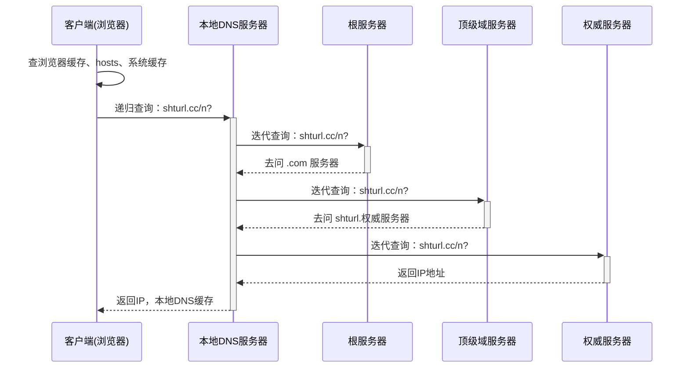
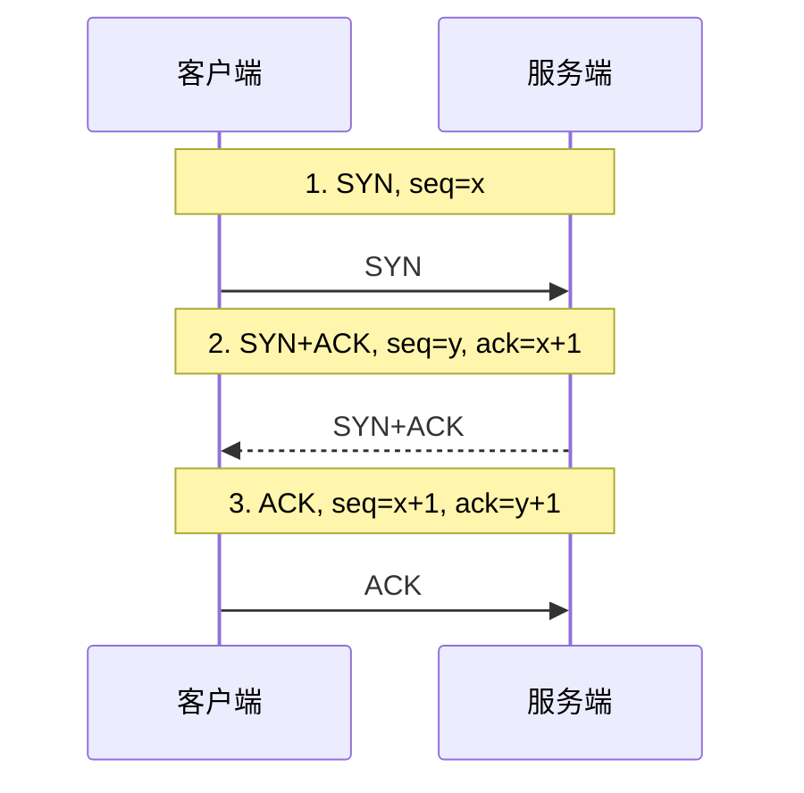
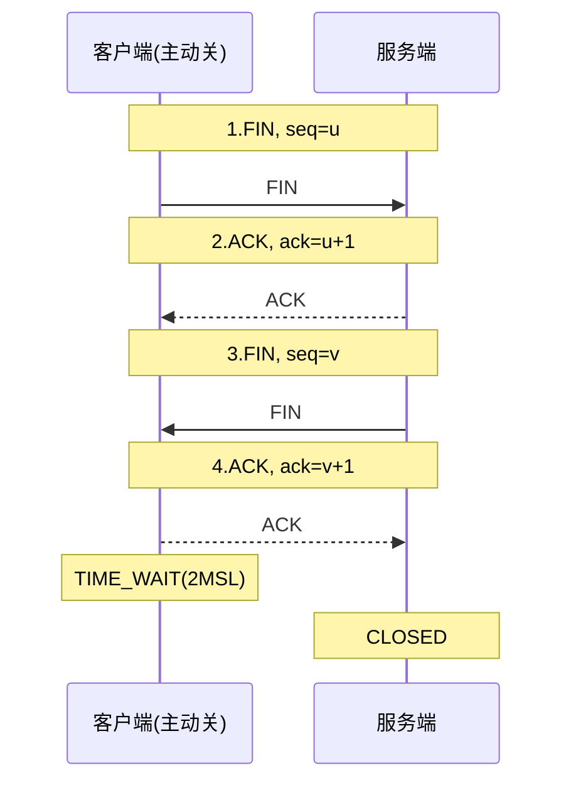

## 【域四】 分布式微服务与消息中间件篇（高并发分布式底座）

### 4.1 Spring Cloud 微服务核心治理与生态组件

#### Q1. Nacos 作为注册中心与配置中心的核心工作原理是什么？与 Eureka 相比有何优势？

* **大白话满分回答**：

  > 1. **注册中心核心原理（服务注册与心跳健康检查）**：
  >    - **服务注册**：服务提供者（Provider）启动时，通过 REST 请求向 Nacos Server 注册自己的 IP、端口、服务名等元数据，Nacos 写入双层内存 Map（`namespace -> group -> service -> cluster -> instances`）；
  >    - **健康检查与心跳机制**：
  >      - **临时实例（默认）**：客户端每隔 5 秒主动发送心跳。如果 15 秒没收到心跳，Nacos 将其标记为不健康；超过 30 秒直接剔除实例；采用 AP 模式（基于 Distro 协议保证高可用）；
  >      - **持久实例**：Nacos Server 主动探测客户端端口。宕机后不剔除，仅标记为不健康，保证核心基础设施元数据不丢失；采用 CP 模式（基于 Raft 协议保证强一致）；
  >    - **服务发现与推拉结合**：消费者（Consumer）初次拉取实例列表缓存到本地内存；后续客户端每 10 秒定时主动轮询拉取（Pull），同时 Nacos 服务端通过 UDP 协议在服务变更时毫秒级主动推送（Push）给客户端，实现极致时效。
  > 2. **配置中心核心原理（动态刷新机制）**：
  >    - 客户端基于 **HTTP 长轮询（Long Polling）机制** 监听配置变更：客户端发起长轮询请求，服务端如果配置未改动，会挂起该请求 29.5 秒；一旦配置改动立刻提前返回，如果超时则返回空；客户端收到变更后重新拉取最新配置，并发布局部环境刷新事件（`RefreshEvent`），实现 `@RefreshScope` 零重启热更新。
  > 3. **与 Eureka 相比的压倒性优势**：
  >    - Eureka 仅支持临时实例且采用固定 30 秒心跳机制，服务下线感知通常需要 60~90 秒，感知迟钝；Nacos 临时/持久化双模式，推拉结合实现秒级感知；
  >    - Eureka 只支持 AP 模式且只做注册中心；Nacos 支持 AP/CP 动态无缝切换，且同时集成了动态配置中心与权重路由，极大简化了运维组件。

#### Q2. OpenFeign 远程调用底层是怎样运转的？生产环境中请求头丢失与连接池性能如何调优？

* **大白话满分回答**：

  > 1. **OpenFeign 底层运转全链路机制**：
  >
  >    - **动态代理生成**：在微服务启动时，`@EnableFeignClients` 扫描带有 `@FeignClient` 注解的接口，通过底层 **JDK 动态代理（`ReflectiveFeign`）** 为每个接口生成代理对象注入 Spring 容器；
  >    - **方法契约解析**：解析方法上的 Spring MVC 注解（如 `@GetMapping`, `@RequestParam`），提取请求路径、HTTP Method、入参等元数据封装为 `MethodMetadata`；
  >    - **构造请求模板（RequestTemplate）**：当业务调用 `orderClient.getDetail(id)` 时，代理对象的 `InvocationHandler` 拦截该方法，将入参动态填入并组装成一个 HTTP `RequestTemplate`；
  >    - **负载均衡定位目标 IP:Port**：结合 Spring Cloud LoadBalancer，从本地缓存的 Nacos 实例列表中选择一台健康的节点，将微服务名（如 `http://order-service/orders/1`）替换为真实物理地址（如 `http://192.168.1.10:8080/orders/1`）；
  >    - **底层 HTTP 客户端发包**：交由底层 HTTP 客户端发起网络传输并反序列化 JSON 响应。
  >
  > 2. **生产高频巨坑：跨服务调用时请求头（Token / TraceId）丢失问题**：
  >
  >    - **事故现象**：前端在网关处带有认证 Token，网关验签通过后转发给 A 服务；但当 A 服务通过 OpenFeign 远程调用 B 服务时，B 服务抛出“未登录/Token缺失（401 Unauthorized）”；链路追踪的 TraceId 也直接断裂；
  >    - **病根分析**：OpenFeign 每次发起新请求时，底层的 `RequestTemplate` 都是新 `new` 出来的空白对象，**根本不会自动拷贝当前线程上下文中的原 HTTP 请求头**；
  >    - **生产级优雅解法（全局请求拦截器）**：
  >      - 编写全局组件实现 `RequestInterceptor` 接口；
  >      - 在 `apply(RequestTemplate template)` 方法内，通过 `RequestContextHolder.getRequestAttributes()` 获取当前外部请求的 `HttpServletRequest`；
  >      - 遍历提取原请求头中的 `Authorization`, `token`, `trace_id` 等核心头信息，通过 `template.header("key", value)` 重新注入；
  >      - *注*：若在 `@Async` 异步子线程中调用 Feign，需额外开启 `RequestContextHolder.setRequestAttributes(attributes, true)` 实现子线程共享。
  >
  > 3. **生产连接池性能调优（告别默认低效组件）**：
  >
  >    - **致命缺陷**：OpenFeign 默认底层的 HTTP 客户端是 JDK 原生的 **`HttpURLConnection`**，它**不支持连接池**！每次调用都要经历 TCP 三次握手和四次挥手，高并发下极易耗尽系统端口并造成严重的线程阻塞；
  >
  >    - **生产必做优化**：引入 **`feign-okhttp`** 或 **`feign-httpclient`**，并在配置文件中显式启用连接池支持：
  >
  >      ```yaml
  >      feign:
  >        okhttp:
  >          enabled: true
  >        client:
  >          config:
  >            default:
  >              connectTimeout: 2000 # 连接超时 2s
  >              readTimeout: 5000    # 业务读取超时 5s
  >      ```
  >
  >    - 配置连接池参数：最大连接数（如 1000）、单路由最大连接数（如 100）、长连接存活时间（Keep-Alive 60s），消除握手开销，将 RPC 吞吐量提升数倍。

#### Q3. Spring Cloud Gateway 网关底层运行机制是怎样的？与 Zuul 1.x 有何区别？全局鉴权与限流如何落地？

* **大白话满分回答**：

  > 1. **为什么弃用 Zuul 1.x 全面换用 Spring Cloud Gateway？（底层线程模型质的飞跃）**：
  >    - **Zuul 1.x（传统 BIO 阻塞模型）**：基于 Servlet 2.5 规范构建，采用“一个连接分配一个专属 Worker 线程”的同步阻塞 I/O 模型。当并发大流量涌入或下游某微服务出现慢请求时，Tomcat 线程池（默认 200 线程）瞬间被占满耗尽，造成网关整体拒绝服务；
  >    - **Spring Cloud Gateway（异步非阻塞 Netty 模型）**：基于 **Spring WebFlux + Project Reactor + Netty** 构建。采用**异步事件驱动循环模型（Event Loop）**，仅需极少数 CPU 核心数相当的线程，即可非阻塞并发承载数万级并发长连接，吞吐量和资源利用率呈数量级提升。
  > 2. **Gateway 三大核心架构要素**：
  >    - **Route（路由）**：网关的基本构建模块。由路由 ID、目标微服务 URI、断言（Predicates）集合、过滤器（Filters）集合四部分组成；
  >    - **Predicate（断言）**：基于 Java 8 Predicate 函数式接口，匹配 HTTP 请求的任意维度（如 `Path=/api/order/**`, `Header=X-Token`, `Method=POST`, `Query=type`）。只要所有断言全为 true，即判定命中该路由；
  >    - **Filter（过滤器）**：包含生命周期中的 Pre（转发前修改请求头/鉴权）和 Post（响应返回前记录日志/改响应体），支持路由局部过滤器与全局过滤器（`GlobalFilter`）。
  > 3. **生产级核心实战落地**：
  >    - **全局统一鉴权与身份透传**：
  >      - 实现 `GlobalFilter, Ordered` 接口，在全局过滤器中拦截所有请求；
  >      - 配置白名单（登录、公开注册、Swagger 直接放行）；
  >      - 对受保护接口提取并解析 JWT Token，若无效则通过 `ServerWebExchange` 直接返回 `HttpStatus.UNAUTHORIZED(401)` 阻断请求；
  >      - 若有效，解析出 `userId` 和 `tenantId`，通过 `exchange.getRequest().mutate().header("X-User-Id", userId).build()` 重写请求头透传给下游，下游微服务完全免去重复解析 Token 的代码开销；
  >    - **基于 Redis + Lua 令牌桶网关层防刷限流**：
  >      - 配置官方提供的 `RequestRateLimiterGatewayFilterFactory`，底层基于 Redis 执行 Lua 脚本实现高性能令牌桶算法；
  >      - 自定义 `KeyResolver`，支持按客户端 IP、用户 ID 或特定 API 维度进行毫秒级精准限流，防止脚本黑客恶意刷接口击垮内网服务；
  >    - **全局统一 CORS 跨域配置**：在网关 `application.yml` 的 `globalcors` 节点统一声明允许的 Origin、Method 和 Header，彻底根除各微服务重复配置 CORS 导致的响应头冲突问题。

#### Q4. Sentinel 是如何实现流量控制、熔断与降级的？与 Hystrix 有何本质区别？

* **大白话满分回答**：

  > 1. **Sentinel 核心底层：滑动时间窗口（Sliding Window）与责任链模式**：
  >    - **责任链槽位设计**：Sentinel 内部核心是一个由多个 `Slot` 组成的调用链（`ProcessorSlotChain`）：
  >      - `NodeSelectorSlot`：构建调用链路树（按入口收集资源统计数据）；
  >      - `ClusterBuilderSlot`：按资源维度聚合统计集群节点；
  >      - `StatisticSlot`：实时记录 QPS、响应时间（RT）、异常数、成功数；
  >      - `FlowSlot` / `DegradeSlot`：执行具体的流控规则判定与降级熔断判定，未通过则直接抛出 `BlockException`。
  >    - **滑动窗口算法统计**：Sentinel 弃用了容易产生临界突刺的固定窗口，将 1 秒的时间划分为多个小格（Bucket，默认 2 个小格，每个 500ms），随着时间推进滑动窗口不断向右推移，始终统计最近一个窗口周期内的样本，确保指标计算极其平滑精准。
  > 2. **熔断降级三大策略（慢调用比例、异常比例、异常数）**：
  >    - **慢调用比例熔断（优先推荐）**：当请求响应时间超过设定阈值（如 500ms）且慢调用比例超过设定比例（如 50%），触发熔断，进入**熔断开启（Open）状态**，熔断持续时间内所有请求直接走降级处理；熔断时间过后进入**半开（Half-Open）状态**，放行单次探测请求，若成功则恢复正常，否则继续熔断；
  >    - **异常比例与异常数熔断**：当下游微服务抛出异常的比例或次数超标时触发熔断保护。
  > 3. **Sentinel 与 Hystrix 的本质区别**：
  >    - **隔离策略**：Hystrix 主推**线程池隔离**，为每个服务分配独立线程池，虽然隔离彻底但带来频繁的上下文切换开销；Sentinel 采用**基于信号量（并发线程数）的轻量级隔离**，开销极低；
  >    - **动态配置与生态**：Hystrix 已经停止维护；Sentinel 原生自带可视化的控制台（Dashboard），支持与 Nacos、Apollo 深度结合实现流控规则的**动态持久化与秒级下发**；
  >    - **流量整形**：Sentinel 支持 Warm Up（预热冷启动，防止系统刚启动被大流量打死）和排队等待（严格漏桶削峰），功能远比 Hystrix 丰富。

#### Q5. 分布式事务 Seata 的 AT 模式原理是什么？二阶段提交如何保障数据一致性？

* **大白话满分回答**：

  > 1. **Seata 三大核心角色**：
  >
  >    - **TC（Transaction Coordinator，事务协调者）**：独立的 Seata Server 集群，维护全局事务与分支事务的生命周期和状态；
  >    - **TM（Transaction Manager，事务管理器）**：业务发起方，通过 `@GlobalTransactional` 开启、提交或回滚全局事务；
  >    - **RM（Resource Manager，资源管理器）**：控制分支事务资源，负责本地事务的执行、向 TC 注册并报告状态。
  >
  > 2. **一阶段（本地提交 + 记录前后镜像）**：
  >
  >    - Seata 深度代理了业务数据源（`DataSourceProxy`），在执行业务 SQL 时：
  >      1. 解析 SQL，在更新前先查询出当前记录的数据，生成 **“前镜像（Before Image）”**；
  >      2. 执行业务 UPDATE 语句；
  >      3. 查询更新后的数据，生成 **“后镜像（After Image）”**；
  >      4. 在同一个本地数据库事务中，将业务数据和前后镜像作为一条记录插入到 **`undo_log`** 表中；
  >      5. 向 TC 注册分支事务并申请 **全局行锁（Global Lock，防止不同分布式事务脏写）**；
  >      6. **立刻提交本地数据库事务，释放本地数据库锁**（这是 AT 模式并发度远超传统 XA 模式的关键！不需要长久阻塞等待）。
  >
  > 3. **二阶段（两极决断）**：
  >
  >    - **情况 1：全部成功（二阶段提交）**：TM 通知 TC，TC 命令所有 RM 提交。RM 只需要**异步批量删除对应的 `undo_log` 记录**即可，业务无需任何等待，瞬间完成；
  >    - **情况 2：任一失败（二阶段回滚）**：TM 通知 TC，TC 命令所有 RM 回滚。RM 收到通知后，从 `undo_log` 表中取出前镜像，比对当前数据库数据是否与后镜像一致（校验是否有脏写）：
  >      - 一致则根据前镜像反向生成还原 SQL（如将 UPDATE 后的值改回旧值），恢复现场；
  >      - 回滚成功后删除对应的 `undo_log`，释放全局行锁。
  >
  > 4. **Seata 其他三种事务模式详解（TCC / SAGA / XA）**：
  >
  >    - **TCC 模式（Try-Confirm-Cancel）—— 高性能强一致的"人肉补偿"方案**：
  >      - **核心思想**：业务开发者需要**手动编写三个阶段的业务逻辑方法**，框架不再自动生成回滚 SQL，一切由开发者自行控制：
  >        1. **Try 阶段（资源预留/冻结）**：不直接扣减真实数据，而是"冻结"或"预留"资源。例如：账户余额 100 元要转 30 元，Try 阶段不是直接把余额减到 70，而是将 30 元从"可用余额"转入"冻结金额"字段（`available = 70, frozen = 30`）；
  >        2. **Confirm 阶段（确认提交）**：所有分支 Try 均成功后，TC 通知执行 Confirm。此时才真正扣减冻结金额（`frozen -= 30`），完成业务确认；
  >        3. **Cancel 阶段（补偿回滚）**：任一分支 Try 失败，TC 通知执行 Cancel。将冻结金额释放回可用余额（`available += 30, frozen -= 30`），恢复原状。
  >      - **优势**：**不依赖数据库行锁和 undo_log**，资源预留粒度由业务控制，并发性能极高，适合**金融级高频交易**场景（如转账、支付）；
  >      - **劣势**：**开发成本极高**，每个服务的每个操作都要写 Try/Confirm/Cancel 三个方法；必须自行处理**幂等性**（网络重试导致 Confirm/Cancel 被多次调用）、**空回滚**（Try 还没执行就收到 Cancel）、**悬挂**（Cancel 先于 Try 到达导致 Try 预留的资源永远无法释放）三大经典难题。
  >    - **SAGA 模式 —— 长事务的"正向推进 + 逆向补偿"编排方案**：
  >      - **核心思想**：将一个长流程分布式事务拆分为多个本地事务步骤，每个步骤都有一个对应的**补偿操作（Compensation）**。执行时依次正向推进，若某步失败则逆序执行已完成步骤的补偿操作：
  >        - 例如在线购票流程：`创建订单 → 扣减库存 → 扣减余额 → 发送通知`，若"扣减余额"失败，则逆序执行：`恢复库存 → 取消订单`；
  >      - **两种编排模式**：
  >        - **编排式（Orchestration，Seata 主推）**：由一个中央协调者（Saga 状态机引擎）统一编排所有步骤的执行顺序和补偿流程，流程清晰可控，适合复杂业务链路；
  >        - **协同式（Choreography）**：各服务通过事件驱动自行响应，无中央协调者，去中心化但流程难以追踪调试；
  >      - **优势**：**一阶段直接提交本地事务，无锁，无资源冻结**，吞吐量最高；天然适合**业务流程长、参与方多**的场景（如跨公司/跨系统的订单履约、物流调度、保险理赔等长链路业务）；
  >      - **劣势**：**不保证隔离性（没有全局锁）**，中间状态对外可见，可能产生脏读；补偿操作同样需要业务开发者手动编写，且补偿不一定总能成功（如已发出的短信无法撤回），需要人工介入兜底。
  >    - **XA 模式 —— 数据库原生的强一致两阶段提交**：
  >      - **核心思想**：直接利用**数据库自身实现的 XA 协议**（MySQL 5.7+、Oracle、PostgreSQL 等主流关系型数据库原生支持），由 Seata 充当 XA 事务协调者：
  >        1. **一阶段（Prepare）**：各分支 RM 执行业务 SQL 后，调用 `XA PREPARE`，数据库**不提交事务，持续持有本地数据库行锁和资源锁**，等待 TC 最终裁决；
  >        2. **二阶段（Commit / Rollback）**：TC 收到所有分支 Prepare 成功后，统一下发 `XA COMMIT`；若任一分支失败，统一下发 `XA ROLLBACK`。
  >      - **优势**：**强一致性（满足 ACID）**，数据在任何时刻都没有中间不一致状态；业务零侵入，无需编写补偿逻辑，也无需 `undo_log` 表；迁移成本最低，传统单体项目拆微服务时可无缝接入；
  >      - **劣势**：**一阶段不释放数据库锁（这是与 AT 模式的本质区别！）**，事务执行期间数据库资源被长时间锁定，并发吞吐量显著低于 AT/TCC/SAGA；对数据库 XA 实现的兼容性和稳定性有依赖。
  >
  > 5. **四种模式横向对比总结（面试高频追问）**：
  >
  >    | 维度          | AT 模式                      | TCC 模式                          | SAGA 模式                  | XA 模式                  |
  >    | ------------- | ---------------------------- | --------------------------------- | -------------------------- | ------------------------ |
  >    | **一致性**    | 最终一致（通过全局锁防脏写） | 最终一致（业务层保证）            | 最终一致（补偿机制）       | **强一致（ACID）**       |
  >    | **隔离性**    | 全局锁实现读写隔离           | 业务层自行保证                    | **无隔离**，中间状态可见   | 数据库原生锁隔离         |
  >    | **业务侵入**  | **零侵入**（自动代理）       | **极高**（手写三方法）            | **高**（手写补偿方法）     | **零侵入**               |
  >    | **性能/并发** | 高（一阶段释放 DB 锁）       | **最高**（无 DB 锁、无 undo_log） | **最高**（一阶段直接提交） | **最低**（长时间持锁）   |
  >    | **典型场景**  | 中后台业务、电商订单         | 金融转账、支付核心链路            | 长事务、跨公司业务协作     | 强一致要求、传统系统迁移 |
  >    | **回滚机制**  | 自动（undo_log 反向 SQL）    | 手动（Cancel 方法）               | 手动（逆向补偿操作）       | 自动（XA ROLLBACK）      |
  >    | **额外要求**  | 需 undo_log 表               | 需处理幂等/空回滚/悬挂            | 需设计补偿操作             | 需数据库支持 XA 协议     |
  >
  >    - **选型口诀**：**"能用 AT 就不上 TCC，能用 SAGA 就不上 XA"**。AT 模式因其零侵入和高性能，是 **90% 以上互联网业务的首选**；TCC 用于核心资金链路追求极致性能与精确控制；SAGA 用于流程长、参与方多的长事务编排；XA 用于对数据一致性有刚性要求、不允许任何中间态的传统金融/政务系统。

#### Q6. 前后端分离与微服务架构下，跨域问题（CORS）的底层成因、预检请求机制与四大企业级解决方案？

* **大白话满分回答（底层机制 + 预检请求 + 四大解决方案 + 避坑法则）**：

  > 1. **为什么会发生跨域？（浏览器同源策略 SOP 底层认知）**：
  >
  >    - **同源定义**：两个 URL 的 **协议（Protocol）、域名（Domain）、端口（Port）** 三者完全一致才算同源；只要有一个不同（如前端 `http://localhost:8080` 请求后端网关 `http://localhost:9000`），即发生跨域；
  >    - **面试致命误区澄清**：
  >      - **跨域并不是请求没发出去，也不是后端没响应**！
  >      - 真实情况是：**请求已经成功抵达后端，后端也正常执行并返回了数据**。但是**浏览器引擎**在收到响应后，检查响应头中缺少合法的 `Access-Control-Allow-Origin`，出于安全考虑，浏览器**在客户端拦截了响应体，并直接在控制台抛出 CORS 错误**。
  >
  > 2. **简单请求 vs 复杂请求与预检请求（Preflight OPTIONS 请求）**：
  >
  >    - **简单请求**：满足方法为 `GET / POST / HEAD` 且仅包含标准请求头（`Accept`, `Content-Language` 等，`Content-Type` 限 `application/x-www-form-urlencoded`, `multipart/form-data`, `text/plain`）；浏览器直接发真实请求；
  >    - **复杂请求（95% 以上的前后端分离项目）**：
  >      - 只要方法是 `PUT / DELETE`，或者请求体是 `Content-Type: application/json`，或者携带了自定义请求头（如 `Authorization`, `token`）；
  >      - 浏览器在发送真实请求前，**会自动先发出一次 `OPTIONS` 预检请求（Preflight Request）**，询问服务端支持哪些域名、哪些 Method、哪些 Header；
  >      - **生产巨坑**：如果后端的 Spring Security、网关鉴权过滤器或拦截器**拦截了预检请求（判定 OPTIONS 请求未携带 Token 而返回 401/403）**，正式请求将直接夭折，导致前端页面白屏！
  >
  > 3. **四大企业级跨域解决方案全景**：
  >
  >    - **方案 1：微服务统一接入层 Gateway 治理（Spring Cloud Gateway 推荐首选）**：
  >
  >      - 在微服务架构中，**跨域必须由网关统一收口，下游微服务严禁重复配置**！
  >
  >      - **YML 声明式配置（推荐）**：
  >
  >        ```yaml
  >        spring:
  >          cloud:
  >            gateway:
  >              globalcors:
  >                cors-configurations:
  >                  '[/**]':
  >                    allowedOrigins: "https://theatre.example.com" # 生产明确指定域名，带凭证时严禁设为 *
  >                    allowedMethods:
  >                      - "GET"
  >                      - "POST"
  >                      - "PUT"
  >                      - "DELETE"
  >                      - "OPTIONS"
  >                    allowedHeaders: "*"
  >                    allowCredentials: true # 允许携带 Cookie/Token
  >                    maxAge: 3600           # 预检请求缓存 1 小时，减少 OPTIONS 往返频次
  >        ```
  >
  >      - **或者注入 Java 代码过滤器（`CorsWebFilter`）**：针对复杂的动态 Origin 匹配逻辑。
  >
  >    - **方案 2：反向代理 Nginx 统一代理（前后端同域化，降维打击）**：
  >
  >      - **同域架构**：前端静态资源托管在 Nginx（如访问 `http://mall.com/`），同时配置 Nginx 代理规则，将所有 `/api/` 的接口请求反向代理到后端网关（如 `http://gateway:9000/`）；
  >
  >      - **优势**：对于前端浏览器而言，所有请求都在同一个域名 `http://mall.com` 下，**完全消灭了跨域环境，连预检请求都彻底免除**！
  >
  >      - 若非同域，Nginx 也可统一注入响应头：
  >
  >        ```nginx
  >        add_header 'Access-Control-Allow-Origin' '$http_origin' always;
  >        add_header 'Access-Control-Allow-Credentials' 'true' always;
  >        add_header 'Access-Control-Allow-Methods' 'GET, POST, PUT, DELETE, OPTIONS' always;
  >        add_header 'Access-Control-Allow-Headers' '*' always;
  >        if ($request_method = 'OPTIONS') {
  >            return 204; # 预检请求直接极速返回成功
  >        }
  >        ```
  >
  >    - **方案 3：单体 Spring Boot 服务全局配置（WebMvcConfigurer / CorsFilter）**：
  >
  >      - 在单体项目或未经过网关的特定服务中，通过配置类统一放行：
  >
  >        ```java
  >        @Configuration
  >        public class CorsConfig implements WebMvcConfigurer {
  >            @Override
  >            public void addCorsMappings(CorsRegistry registry) {
  >                registry.addMapping("/**")
  >                        .allowedOriginPatterns("*")
  >                        .allowedMethods("GET", "POST", "PUT", "DELETE", "OPTIONS")
  >                        .allowedHeaders("*")
  >                        .allowCredentials(true)
  >                        .maxAge(3600);
  >            }
  >        }
  >        ```
  >
  >      - *避坑*：如果结合了 Spring Security，必须优先配置 `CorsFilter` 并置于 Security 过滤器链的最顶层，避免 OPTIONS 预检请求被拦截。
  >
  >    - **方案 4：控制器细粒度注解 `@CrossOrigin`（适合局部临时调试）**：
  >
  >      - 直接在 Controller 类或具体方法上声明 `@CrossOrigin(origins = "http://localhost:5173")`。
  >
  > 4. **生产三大高频翻车陷阱与红线**：
  >
  >    - **陷阱 ①：响应头重复出现导致的 `Multiple Access-Control-Allow-Origin` 报错**：
  >      - *现象*：浏览器报 `The 'Access-Control-Allow-Origin' header contains multiple values '*, *'`；
  >      - *病根*：**网关层配了 CORS，后端具体的微服务里也配了 CORS**，导致该响应头被重复拼接追加；
  >      - *铁律*：在微服务架构下，**跨域治理只做一层**！网关处理了，所有下游微服务必须移除任何跨域配置。
  >    - **陷阱 ②：`allowCredentials = true` 与通配符 `*` 冲突**：
  >      - 当请求携带 Cookie/凭证时（`allowCredentials = true`），根据 W3C 安全规范，`Access-Control-Allow-Origin` **严禁配置为通配符 `*`**，否则浏览器强制报错！必须指定明确域名或在 Spring 中使用 `allowedOriginPatterns("*")`。
  >    - **陷阱 ③：OPTIONS 预检请求未缓存导致请求数翻倍**：
  >      - 必须配置 `maxAge: 3600`，让浏览器将预检结果缓存 1 小时，否则前端每发一次 POST/PUT 都要额外多发送一次 OPTIONS 网络往返，严重拖慢首屏加载性能。

---

### 4.2 消息队列（RabbitMQ & RocketMQ）高频实战

#### RabbitMQ 与 RocketMQ 核心架构与底层原理解密（必背总纲）

* **大白话满分回答**：

  > 1. **RabbitMQ 核心架构与 AMQP 路由运转原理（“邮局分拣模型”）**：
  >
  >    - **全链路核心组件**：`Producer` $\rightarrow$ `Connection（TCP 长连接） / Channel（虚拟信道）` $\rightarrow$ `Broker [ Virtual Host -> Exchange（交换机） -> Binding（绑定规则） -> Queue（物理存储队列） ]` $\rightarrow$ `Consumer`。
  >
  >    - **高频追问①：为什么客户端不直接用 TCP `Connection` 发消息，非要在里面再套一层 `Channel`（信道）？**
  >
  >      - 建立和销毁操作系统 TCP 三次握手连接开销极高；业务服务往往是几十个工作线程并发收发消息，RabbitMQ 采用**多路复用思想**——**整个应用进程只维护 1 条（或极少数）物理 TCP 长连接 `Connection`，每个业务线程在连接内部开辟自己独立的轻量级逻辑通道 `Channel`** 并发收发，互不阻塞且彻底省去频繁建连的系统调用开销！
  >
  >    - **高频追问②：Producer 发消息为什么不直接发给 `Queue`，而要经过 `Exchange`（交换机）？四大交换机怎么路由？**
  >
  >      - `Exchange` 就像邮局的**智能分拣中心**（自身不存消息，只做路由转发），让生产者与具体下游队列彻底解耦。它根据生产者携带的 **`RoutingKey`** 与队列绑定的 **`BindingKey`** 按 4 种模式精准投递：
  >
  >        | 交换机类型                        | 路由匹配规则                                                 | 典型业务落地场景                                             |
  >        | --------------------------------- | ------------------------------------------------------------ | ------------------------------------------------------------ |
  >        | **`Fanout`（扇形广播）**          | **无视 `RoutingKey`**，无脑复制广播给所有绑定在该交换机上的 Queue（速度最快） | HRMS 新员工入职事件同时广播给“考勤初始化队列、账号开通队列、邮件欢迎队列” |
  >        | **`Direct`（直连精确）**          | 要求 **`RoutingKey == BindingKey` 100% 精确相等**才投递      | 定向单点触发，如按日志级别 `error` 精准路由至告警入库队列    |
  >        | **`Topic`（主题通配符，最常用）** | 按 `.` 分隔单词做通配匹配：**`*` 匹配恰好 1 个词，`#` 匹配 0 个或多个词** | 灵活多维订阅：如 `order.#` 接收所有订单事件，而 `order.pay.*` 只接收支付相关事件 |
  >        | **`Headers`（头属性匹配）**       | 不看 `RoutingKey`，匹配消息 Header 键值对（性能较差，生产极少用） | 特殊多属性联合路由场景                                       |
  >
  >    - **高频追问③：RabbitMQ 高可用集群的三种模式演进？**
  >
  >      - **普通集群模式**：各节点**只同步 Exchange 和 Queue 的元数据结构，不同步队列里的真实消息数据**！消费者连到非宿主节点时由内部临时拉取转发，一旦存放该 Queue 的节点宕机，未消费消息直接不可用；
  >      - **镜像队列模式（Mirror Queue，经典高可用）**：将 Queue 的消息体完整镜像同步到集群多个从节点，主节点挂掉从节点自动顶上（缺点是全量镜像网络带宽开销大）；
  >      - **仲裁队列（Quorum Queue，RabbitMQ 3.8+ 官方主推）**：底层基于 **Raft 分布式一致性协议**（多数派节点写盘成功即确认），彻底替代老旧镜像队列，兼顾强数据安全性与更高吞吐。
  >
  > 2. **RocketMQ 分布式架构四大角色与负载均衡原理**：
  >
  >    - **四大核心角色协同闭环**：
  >      1. **`NameServer`（无状态极简注册中心）**：每个 `NameServer` 节点保存全量路由表（Topic 在哪些 Broker 上），**节点之间互不通信、完全无状态**；Broker 每 `30s` 向**所有** `NameServer` 发送心跳汇报 Topic 路由，Producer/Consumer 每 `30s` 任选一台拉取最新路由缓存到本地；
  >      2. **`Broker`（核心消息存储与转发引擎）**：负责消息的高速磁盘读写，采用 **Master-Slave 主从架构**（`BrokerId = 0` 为 Master 负责读写，`> 0` 为 Slave 只读备份；RocketMQ 4.5+ / 5.0 引入基于 Raft 的 **`DLedger` 模式**支持主节点故障秒级自动选主切换）；
  >      3. **`Producer`（生产者集群）**：通过本地路由表轮询（或按业务 Hash 指定）向某 Topic 下的多个 `MessageQueue` 并发投递；
  >      4. **`Consumer Group`（消费者组）**：支持 **集群消费（Clustering，默认：同组内消费者共同分摊消息，每条消息只被组内 1 台机器消费）** 与 **广播消费（Broadcasting：组内每台机器都收到全量消息，如刷新各节点本地 Caffeine 缓存）**。
  >    - **高频追问①：RocketMQ 早期也用过 ZooKeeper，为什么后来果断弃用 ZK 自研了 `NameServer`？（CAP 架构选型典范）**：
  >      - ZooKeeper 遵循 **CP（强一致性）**，写路由时需要走复杂的 ZAB 协议半数投票，且一旦发生网络分区选主期间整个注册中心短暂不可写，组件极其笨重；
  >      - 而 MQ 路由发现场景**根本不需要强一致，只需要 AP（高可用 + 最终一致）**！即便某台 Broker 刚下线，`NameServer` 晚了 10 秒才剔除路由，Producer 发送失败后客户端自带**自动故障规避与重试机制**，切到下一个存活 Broker 即可！因此 `NameServer` 砍掉一切节点间状态同步与选主逻辑，仅几千行代码，做到了**极致轻量、零外部依赖、高可用永不选举假死**。
  >    - **高频追问②：`Topic`、`MessageQueue` 与消费者扩容的铁律（Rebalance 机制）**：
  >      - RocketMQ 的 `Topic` 只是一个逻辑分类，物理并发单元是其下划分的多个 **`MessageQueue`（分片队列，默认单 Broker 4~8 个）**；
  >      - **核心铁律**：在同一个 `Consumer Group` 下，**1 个 `MessageQueue` 同一时刻最多只能分配给 1 个消费者实例消费**（1 个消费者可以同时负责多个队列）。因此**消费者实例的最大有效水平扩容上限 = 该 Topic 的 `MessageQueue` 总数**（若只有 8 个队列却扩了 10 台消费者，有 2 台必定永远空闲分不到队列！这直接呼应后文 Q4 消息积压扩容策略）。
  >
  > 3. **RocketMQ 为什么单机能抗十万级 QPS？底层存储与消费引擎三大杀手锏（大厂深水区必考）**：
  >
  >    - **杀手锏①：`CommitLog` 混合顺序写 + `ConsumeQueue` 20 字节定长二级索引（读写分离神作）**：
  >      - **痛点**：如果每个 Topic、每个队列各自写独立物理文件，几百个队列同时刷盘就会退化成灾难性的**磁盘随机写**（机械盘仅几百 IOPS）；
  >      - **`CommitLog`（全局单一物理文件顺序写）**：单个 Broker 上**所有 Topic、所有队列的消息体完全不作区分，全部按到达先后顺序追加写入同一个 `CommitLog` 文件集**（单个文件固定 `1 GB`）！将多队列并发写彻底转化为 **100% 磁盘顺序追加写**，写入速度高达数百 MB/s，逼近内存极限；
  >      - **`ConsumeQueue`（轻量逻辑消费队列，单条目仅 `20 Byte`！）**：消息写完 `CommitLog` 后，后台 `ReputMessageService` 线程异步分发构建每个 `MessageQueue` 专属的 `ConsumeQueue` 索引文件。它**绝不存庞大消息体**，每条索引严格固定 **20 字节**：**`8 Byte CommitLog 物理偏移量 offset` + `4 Byte 消息总长度 size` + `8 Byte Tag 的 HashCode`**！
  >        - *精妙收益 A（近乎纯内存读取）*：因为单条仅 `20B`，几百万条索引也才几十 MB，几乎 **100% 常驻操作系统 `PageCache` 内存**！消费者按位点 `offset` 消费时，先在内存中 $O(1)$ 定位 `20B` 索引拿到物理地址，再去 `CommitLog` 一次精准读取即可；
  >        - *精妙收益 B（Broker 端极速 Tag 过滤）*：消费者订阅特定 `Tag`（如 `PAY_SUCCESS`）时，Broker 在扫描 `ConsumeQueue` 时**先直接比对那 `8 Byte` 的 `Tag HashCode`**——不匹配直接在内存跳过，完全不读磁盘 `CommitLog`；只有 Hash 命中后，拉出消息再由客户端核对一次原始 Tag 字符串防止哈希碰撞！
  >      - **`IndexFile`（辅助哈希索引）**：以 `MessageKey`（如业务订单号 `orderSn`）构建磁盘哈希表，支撑运维在控制台按单号毫秒级溯源排障。
  >    - **杀手锏②：`mmap` 零拷贝 + `PageCache` 页缓存加速**：
  >      - `CommitLog`（`1 GB`）与 `ConsumeQueue` 底层全面采用 JDK `MappedByteBuffer`（对应 Linux **`mmap` 内存映射零拷贝**，呼应 1.6 Q3），省去内核态到用户态的 CPU 内存拷贝，读写直接操作 OS `PageCache`，并配合文件预热（Warm Up）与锁内存（`mlock`）消除缺页中断抖动。
  >    - **杀手锏③：“推拉结合”的 Broker 长轮询（Long Polling）消费原理**：
  >      - 面试常问：*“RocketMQ 我们平时用的 `DefaultMQPushConsumer` 是 Broker 主动推（Push）还是消费者拉（Pull）？”*
  >      - **真相**：纯粹 Broker 盲目 Push 极易把处理慢的消费者直接打爆 OOM；纯粹客户端定时 Pull 若间隔太短会疯狂空轮询打高 CPU，间隔太长又会导致消息延迟高。
  >      - **长轮询完美破局**：`DefaultMQPushConsumer` **底层本质依然是消费者主动发 Pull 请求，但配合了 Broker 端的“长轮询挂起”**——当消费者来拉消息发现队列暂时为空时，Broker **不会立刻返回空结果**，而是由 `PullRequestHoldService` 将该请求在服务端**挂起等待（默认最长 `15s`）**；期间一旦有新消息写入 `CommitLog`，Broker 瞬间唤醒该挂起连接把新消息返回给消费者！**既具备了 Push 模式的毫秒级实时触达，又保留了 Pull 模式由消费端按自身处理能力反压控速的安全优势！**

#### Q1. 消息队列在你的项目里解决了什么问题？有什么核心作用？引入 MQ 会带来哪些副作用？

* **大白话满分回答（核心三作用 + 辩证三大代价）**：

  > 1. **三大核心业务价值（口诀：异步、解耦、削峰）**：延迟发送等
  >    - **异步提速**：用户在剧院系统购票支付成功后，需要执行：更新订单状态、扣减库存、发放观影积分、发送短信通知等。如果全串行同步执行，接口 RT（响应时间）可能要 500ms 以上；通过将“发积分、发短信”异步化投递到 MQ，主流程 50ms 内即可极速返回，用户体验大幅提升；
  >    - **系统解耦**：支付服务只需向 MQ 投递一条“支付成功”事件。后续不管是营销服务发优惠券、还是数据大盘统计流水，由各下游服务自行订阅该 Topic。支付核心服务无需关心下游有谁，新增下游业务无需修改上游核心代码，符合开闭原则；
  >    - **流量削峰填谷**：在剧院热门演出秒杀或抢票瞬间，瞬时并发达数万 QPS。数据库单机承受极限通常在两三千 TPS，直接打向 DB 必死无疑。通过把秒杀请求先放入 MQ 队列排队，后端工作线程按照数据库承受能力（如 1000 TPS）平滑拉取消费落库，保护核心数据库不被冲垮。
  > 2. **引入 MQ 带来的三大系统级副作用（面试加分：体现架构辩证思考）**：
  >    - **系统可用性降低**：链路越长风险越大，一旦 MQ 集群整体宕机，可能导致依赖消息的上下游业务整体瘫痪；
  >    - **系统复杂度暴增**：必须额外花费大量精力解决**消息丢失、重复消费（幂等）、消息积压、顺序消费**等一系列分布式并发问题；
  >    - **分布式一致性难题**：主链路本地数据库事务提交成功了，但 MQ 消息发送失败，或者下游消费失败，会导致分布式数据最终不一致。

#### Q2. 如何确保消息全链路 100% 不丢失？（RocketMQ 事务消息底层解密）

* **大白话满分回答（生产端、Broker端、消费端三向防线 + 事务消息底层）**：

  > 消息丢失通常发生在 3 个环节，每个环节都要建立针对性防线：
  >
  > 1. **生产端防丢（保证消息成功送达 Broker）**：
  >    - **RabbitMQ**：开启 `publisher-confirm-type: correlated` 与 `publisher-returns: true`。Broker 收到消息后回调 `ConfirmCallback`（确认到 Exchange），若路由不到 Queue 则回调 `ReturnsCallback`；
  >    - **RocketMQ 事务消息（Transaction Message，大厂最核心考点）**：
  >      - **第一阶段（发送 Half 消息）**：生产端向 Broker 发送 Half 消息。Broker 将其存入内部特定的 `RMQ_SYS_TRANS_HALF_TOPIC` 队列，**此时该消息对消费端完全不可见**；
  >      - **第二阶段（执行本地事务）**：生产端开始执行本地数据库事务；
  >      - **第三阶段（二次提交确认）**：
  >        - 本地事务成功 $\rightarrow$ 发送 `COMMIT`，Broker 将消息移至真实 Topic，消费端可见；
  >        - 本地事务失败 $\rightarrow$ 发送 `ROLLBACK`，Broker 彻底丢弃该消息；
  >      - **第四阶段（事务状态回查 CheckLocalTransaction）**：如果因为网络超时生产端发完 COMMIT 后断网，Broker 会主动发起**反向回查**（默认每 60 秒一次，最多 15 次），询问生产端本地事务状态，彻底解决网络抖动导致的数据不一致！
  > 2. **Broker 存储端防丢（保证 MQ 服务器自身不丢消息）**：
  >    - **RabbitMQ**：Exchange、Queue、Message 必须全部设置为 **持久化（Durable & Persistent）**，并开启集群镜像队列镜像备份；
  >    - **RocketMQ**：将刷盘机制配置为 **同步刷盘（`FlushDiskType.SYNC_FLUSH`）**（内存写入磁盘后才返回成功），Master-Slave 采用 **同步双写（`SYNC_MASTER`）**（从节点复制落盘后才应答），杜绝单点宕机丢消息。
  > 3. **消费端防丢（保证业务真正处理完毕）**：
  >    - **严禁开启自动 ACK（Auto-ACK）**！
  >    - 必须在消费端的业务逻辑全部执行成功、数据库持久化完成之后，再显式调用 `channel.basicAck()` 或返回 `CONSUME_SUCCESS`；
  >    - 若处理抛出异常，返回 `RECONSUME_LATER`（RocketMQ 梯度重试 16 次）或 `basicNack(requeue = false)` 进入死信队列（DLQ），绝不直接丢弃。
  > 4. **终极兜底防线（本地消息表 Local Message Table + 定时对账）**：
  >    - 在涉及金融/订单核心资金结算链路中，业务操作与消息记录入库放在**同一个本地事务**中（写入 `t_local_message`，状态为待发送）；
  >    - 消息由异步线程发送到 MQ，收到 ACK 后更新状态为已发送；若 MQ 宕机或网络中断，后台定时任务（XXL-JOB）轮询捞取超时未发送的消息重新投递，达成 100% 最终可靠性。

#### Q3. 消息重复消费怎么解决？消费端如何保证幂等性？（三大工程落地方案）

* **大白话满分回答**：

  > 1. **为什么必然会发生重复消费？**
  >
  >    - 绝大多数消息中间件为了保证高吞吐，默认遵循 **At Least Once（至少交付一次）** 投递语义；
  >    - 消费端业务逻辑已经执行成功了，但在向 Broker 回传 ACK 的瞬间发生网络闪断或超时，Broker 判定消费失败，触发重试重新投递，导致同一条消息被消费两次。
  >
  > 2. **终极解决核心：消费端业务幂等设计（三大落地架构）**：
  >
  >    - **方案 1：数据库唯一索引 / 幂等防重表（金融订单级强一致首选）**：
  >
  >      - 设计一张防重表 `t_idempotent_key (msg_id VARCHAR(64) PRIMARY KEY, biz_type, create_time)`；
  >      - 消费端在执行业务时，**将插入防重记录与业务修改绑定在同一个本地事务内**；若重复消息再次到达，插入直接抛出 `DuplicateKeyException` 唯一键冲突异常，事务回滚，消费端捕获该异常后直接返回 ACK，天然防重；
  >
  >    - **方案 2：状态机版本号 / 乐观锁条件更新（无需额外表开销，轻量高效）**：
  >
  >      - 结合业务状态机流转进行天然幂等防御。例如剧院票务系统订单支付：
  >
  >        ```sql
  >        UPDATE t_order SET status = 'PAID', update_time = NOW() 
  >        WHERE order_id = 1001 AND status = 'WAIT_PAY';
  >        ```
  >
  >      - 若影响行数 $= 1$，说明更新成功；若影响行数 $= 0$，说明已经更新过或状态不符，直接跳过并 ACK，安全幂等；
  >
  >    - **方案 3：Redis 分布式锁 + 消费状态标记（适合高并发、非强事务链路）**：
  >
  >      - 消费前先拿业务唯一标识执行 `SET lock:msg:{orderId} 1 NX EX 600`；
  >      - 若返回 0 说明有其他线程正在消费或已消费过，直接丢弃；消费成功后在 Redis 持久化一个业务完成标记（设置合理 TTL）。

#### Q4. 线上突然发生大量消息积压，你的排查思路和应急方案是什么？

* **大白话满分回答（定位根因 + 紧急止血三步法）**：

  > 1. **第一步：紧急排查积压根因**：
  >    - 登入 MQ 监控控制台（RabbitMQ Management / RocketMQ Dashboard）：看是**生产端生产速率暴增（突发大促流量）**，还是**消费端消费速度暴跌**？
  >    - 若是消费端暴跌：排查消费端日志与系统指标：
  >      - 是否依赖的数据库出现死锁或慢 SQL，导致数据库连接池被占满？
  >      - 是否外部下游第三方 RPC/HTTP 接口超时卡住了工作线程？
  >      - 是否消费端代码发生 Bug 抛异常死循环，导致消息不断重试阻塞了队列？
  > 2. **第二步：紧急止血与扩容（核心面试考点）**：
  >    - **先修复消费端 Bug / 熔断外部慢依赖**：紧急发布热修复补丁，或者对超时的非关键外部接口配置降级；
  >    - **消费端水平扩容（针对 RocketMQ）**：
  >      - 如果 Topic 拥有 16 个 MessageQueue 分区，但原来只有 4 台消费者实例，可以直接紧急扩容消费者实例至 16 台，让并发度拉满；
  >    - **如果队列分区数已达到上限（王炸方案：临时应急转发 + 临时 Topic）**：
  >      - 临时上线一个“**应急转发消费者（只转不处）**”，该消费者内部关闭所有耗时业务逻辑，只负责批量极速拉取积压消息，轮询高速分发到临时的 10 个新 Topic（每个 Topic 32 个分区分片）；
  >      - 紧接着临时部署几百台消费者实例去并行消费这 10 个临时 Topic，几十分钟内把千万级积压消息全部消化完毕，事后再恢复原架构。
  > 3. **第三步：死信队列（DLQ）的闭环治理**：
  >    - 重试多次依然失败的毒丸消息（Poison Message）自动转入死信队列，配置监控报警；
  >    - 待线上业务恢复后，通过专门的死信管理后台人工核对数据原因，修复数据后重新投递或手动补单。


#### Q5. RabbitMQ 和 RocketMQ 的区别？你们项目中为什么选型？

* **大白话满分回答**：

  > | 对比维度         | RabbitMQ                                                     | RocketMQ                                                     |
  > | :--------------- | :----------------------------------------------------------- | :----------------------------------------------------------- |
  > | **开发语言**     | Erlang（高并发低时延原生底座，但二次开发改源码门槛高）       | Java（阿里开源顶流，Java 团队阅读和扩展源码极其友好）        |
  > | **单机吞吐量**   | 万级 QPS，延迟极低（微秒级）                                 | **十万级 QPS**，面对海量突发洪峰抗压能力极强                 |
  > | **消息路由能力** | **极其灵活强大**（Direct, Topic, Fanout, Headers 四大 Exchange） | 较简单（Topic + Tag 标签过滤）                               |
  > | **分布式事务**   | 原生不支持（需靠外部插件或本地消息表）                       | **原生深度支持两阶段半消息分布式事务**（Check 回查机制）     |
  > | **延迟消息**     | 原生不支持（需死信交换机 TTL+DLX 或第三方插件模拟）          | **原生支持 18 个阶梯延时等级**（RocketMQ 5.0 支持任意秒级延时） |
  > | **顺序消息**     | 支持较弱，单队列单消费者吞吐极低                             | **原生支持分区有序（MessageQueueSelector）**，兼顾局部顺序与全局高吞吐 |
  > | **适用场景**     | 适合微服务内部事件通知、低时延实时通信、路由模式复杂的系统   | 适合电商交易订单流转、高并发秒杀削峰、金融资金结算、大数据日志汇聚 |
  >
  > - **候选人项目真实选型（席二伟）**：
  >   - 在 **HRMS 人力资源管理中台** 中：微服务组织事件通知频率适中，需按部门、多维度权限灵活路由事件（Fanout/Topic 广播），选型轻量易运维的 **RabbitMQ**；
  >   - 在 **剧院票务系统** 中：涉及极限高并发秒杀削峰、15 分钟未支付订单自动超时取消（延迟队列）、以及支付与出票分布式最终一致性（事务补偿），因此果断选型高吞吐、原生支持延迟与事务消息的 **RocketMQ**。

#### Q6. Spring Boot 工程实战与框架集成原理：在 Spring 中具体如何落地实现 RabbitMQ 与 RocketMQ？

* **大白话满分回答（代码级工程落地）**：

  > 1. **Spring Boot 集成与落地实现 RabbitMQ（基于 `spring-boot-starter-amqp`）**：
  >
  >    - **核心 YAML 生产级防丢与限流配置（`application.yml` 三大铁律）**：
  >
  >      ```yaml
  >      spring:
  >        rabbitmq:
  >          host: 127.0.0.1
  >          port: 5672
  >          virtual-host: /hrms
  >          publisher-confirm-type: correlated # 1. 开启异步 Confirm 确认（消息抵达 Exchange 触发回调）
  >          publisher-returns: true            # 2. 开启 Return 回退（Exchange 路由不到 Queue 触发回调）
  >          template:
  >            mandatory: true                  # 必须设为 true，否则路由失败消息会被 Broker 静默丢弃而不回调
  >          listener:
  >            simple:
  >              acknowledge-mode: manual       # 3. 严禁默认 auto 自动确认，强制业务落库后手动 basicAck
  >              prefetch: 10                   # QoS 预取限流（防洪峰下无脑推送打爆消费者 JVM 内存）
  >              concurrency: 4                 # 最小并发消费 Channel 线程数
  >              max-concurrency: 8             # 最大并发消费 Channel 线程数
  >      ```
  >
  >    - **拓扑声明与序列化避坑配置类（`@Configuration`）**：
  >
  >      - **必改大坑**：`RabbitTemplate` 默认使用 `SimpleMessageConverter`（底层是 JDK 原生 `Serializable` 字节流，体积臃肿、不可读且存在反序列化安全漏洞），生产环境必须注入 `Jackson2JsonMessageConverter` 覆盖；
  >      - **声明式拓扑注册**：通过 `@Bean` 声明持久化 `Exchange`、挂载了死信参数的 `Queue` 与 `Binding`，项目启动建连时由 Spring 的 `RabbitAdmin` 自动向 Broker 幂等创建：
  >
  >      ```java
  >      @Configuration
  >      public class RabbitMqConfig {
  >          @Bean // 替换默认 JDK 序列化为 JSON 序列化
  >          public MessageConverter jsonMessageConverter() {
  >              return new Jackson2JsonMessageConverter();
  >          }
  >      
  >          @Bean // 声明持久化直连交换机
  >          public DirectExchange orderExchange() {
  >              return ExchangeBuilder.directExchange("order.exchange").durable(true).build();
  >          }
  >      
  >          @Bean // 声明持久化业务队列，并预先绑定死信交换机（DLX）兜底异常消息
  >          public Queue orderPayQueue() {
  >              return QueueBuilder.durable("order.pay.queue")
  >                      .deadLetterExchange("order.dlx.exchange")
  >                      .deadLetterRoutingKey("order.dlx.routingkey")
  >                      .build();
  >          }
  >      
  >          @Bean // 绑定路由键
  >          public Binding orderPayBinding(Queue orderPayQueue, DirectExchange orderExchange) {
  >              return BindingBuilder.bind(orderPayQueue).to(orderExchange).with("order.pay.routingkey");
  >          }
  >      }
  >      ```
  >
  >    - **生产端双回调挂载与可靠发送（`ConfirmCallback` + `ReturnsCallback` 防丢失闭环）**：
  >
  >      ```java
  >      @PostConstruct // 初始化时向 RabbitTemplate 挂载全局可靠投递双回调
  >      public void initRabbitCallbacks() {
  >          // 1. Exchange 到达确认回调（ack=true 代表交换机已接收，ack=false 代表投递失败）
  >          rabbitTemplate.setConfirmCallback((correlationData, ack, cause) -> {
  >              String msgId = correlationData != null ? correlationData.getId() : "";
  >              if (ack) {
  >                  msgLogMapper.updateStatus(msgId, "SENT_SUCCESS"); // 更新本地消息表为已投递
  >              } else {
  >                  log.error("消息未抵达 Exchange, msgId={}, cause={}", msgId, cause);
  >                  // 状态保留为 TRYING，交由后台定时任务扫描本地消息表兜底重发
  >              }
  >          });
  >          // 2. Queue 路由失败回退回调（仅在抵达 Exchange 但路由不到任何 Queue 时触发）
  >          rabbitTemplate.setReturnsCallback(returned -> log.error(
  >              "消息路由 Queue 失败被退回! exchange={}, routingKey={}, replyText={}",
  >              returned.getExchange(), returned.getRoutingKey(), returned.getReplyText()
  >          ));
  >      }
  >      ```
  >
  >      - **业务发送代码（携带全局唯一 `CorrelationData`）**：
  >
  >      ```java
  >      // 发送消息时绑定 CorrelationData 追踪 ID
  >      CorrelationData correlationData = new CorrelationData(UUID.randomUUID().toString());
  >      rabbitTemplate.convertAndSend("order.exchange", "order.pay.routingkey", orderMessage, correlationData);
  >      ```
  >
  >    - **消费端手动 ACK（防重复与防丢）**：
  >
  >      ```java
  >      @RabbitListener(queues = "order.pay.queue", ackMode = "MANUAL")
  >      public void handleOrderPay(OrderMessage message, Channel channel, @Header(AmqpHeaders.DELIVERY_TAG) long deliveryTag) throws IOException {
  >          try {
  >              // 1. 幂等校验（查防重表或状态机）
  >              if (isConsumed(message.getOrderSn())) {
  >                  channel.basicAck(deliveryTag, false); // 已处理过直接 ACK
  >                  return;
  >              }
  >              // 2. 真实业务逻辑
  >              orderService.processPaySuccess(message);
  >              // 3. 业务全部成功后手动确认
  >              channel.basicAck(deliveryTag, false);
  >          } catch (Exception e) {
  >              log.error("消费订单支付消息失败: {}", message.getOrderSn(), e);
  >              // 4. 业务失败拒绝确认：requeue=false 让消息进入死信队列，避免死循环重试打爆CPU
  >              channel.basicNack(deliveryTag, false, false);
  >          }
  >      }
  >      ```
  >
  >    - **Spring AMQP 框架底层集成运转原理（面试拔高必答：Spring 是如何驱动 `@RabbitListener` 的？）**：
  >
  >      - **① 自动装配连接池基座（`RabbitAutoConfiguration`）**：Spring Boot 启动时自动注册 `CachingConnectionFactory`（底层维护单一或少量物理 TCP 长连接，并在内存中池化复用轻量级虚拟信道 `Channel`，规避每次收发频繁三次握手的开销）、`RabbitTemplate` 以及拓扑声明器 `RabbitAdmin`；
  >      - **② 后置处理器扫描端点（`RabbitListenerAnnotationBeanPostProcessor`）**：实现自 Spring `BeanPostProcessor`，在每个 Bean 初始化完成（`postProcessAfterInitialization`）时，通过反射扫描方法或类上的 `@RabbitListener` 注解，将目标 Bean、方法句柄与队列属性封装为 `MethodRabbitListenerEndpoint`，统一注册进 `RabbitListenerEndpointRegistry`；
  >      - **③ 容器生命周期拉起消费线程（`SimpleMessageListenerContainer` / `DirectMessageListenerContainer`）**：`RabbitListenerEndpointRegistry` 实现了 `SmartLifecycle` 接口。当 Spring 容器所有单例加载完毕（`finishRefresh`）时自动调用 `start()`，由 `RabbitListenerContainerFactory` 为每个端点创建监听容器并开启后台工作线程，向 Broker 发送 `basicConsume` 建立长订阅。收到字节流后，先调用 `Jackson2JsonMessageConverter` 反序列化为入参 DTO，再反射调用业务方法，并将当前线程绑定的 `Channel` 与 `deliveryTag` 动态注入方法签名供手动 `basicAck / basicNack`。
  >
  > 2. **Spring Boot 集成与落地实现 RocketMQ（基于 `rocketmq-spring-boot-starter`）**：
  >
  >    - **核心 YAML 生产级配置（`application.yml`）**：
  >
  >      ```yaml
  >      rocketmq:
  >        name-server: 127.0.0.1:9876
  >        producer:
  >          group: theatre_order_producer_group
  >          send-message-timeout: 3000            # 发送超时时间 3s
  >          retry-times-when-send-failed: 2       # 同步发送失败内部自动重试次数（默认 2 次，最多投递 3 次）
  >          retry-times-when-send-async-failed: 2 # 异步发送失败内部自动重试次数
  >      ```
  >
  >    - **生产端多模式发送（`RocketMQTemplate` 同步、异步、局部顺序、延迟与事务半消息）**：
  >
  >      - **生产规范**：构建 Spring `Message` 时务必通过 `.setHeader(RocketMQHeaders.KEYS, orderSn)` 塞入业务单号，Broker 会自动为其建立 `IndexFile` 哈希索引，线上排障可按单号秒级检索消息轨迹：
  >
  >      ```java
  >      // ① 普通可靠同步发送
  >      SendResult result = rocketMQTemplate.syncSend("THEATRE_ORDER_TOPIC:PAY_SUCCESS", orderDTO);
  >      
  >      // ② 发送 15 分钟延迟消息（剧院订单超时关单，等级 14 对应 15 分钟）
  >      rocketMQTemplate.syncSend("THEATRE_ORDER_TIMEOUT_TOPIC", MessageBuilder.withPayload(orderSn).build(), 3000, 14);
  >      
  >      // ③ 异步高吞吐回调发送 & 按订单号局部顺序发送（携带 KEYS 建立 IndexFile 业务索引）
  >      Message<OrderDTO> keyedMsg = MessageBuilder.withPayload(orderDTO)
  >              .setHeader(RocketMQHeaders.KEYS, orderDTO.getOrderSn()).build();
  >      rocketMQTemplate.asyncSend("THEATRE_ORDER_TOPIC:CREATE", keyedMsg, new SendCallback() {
  >          @Override public void onSuccess(SendResult res) { log.info("发送成功 msgId={}", res.getMsgId()); }
  >          @Override public void onException(Throwable e) { log.error("异步发送失败，落库补偿", e); }
  >      });
  >      // 局部顺序发送：第 3 个参数 hashKey 传入 orderSn，确保同一订单的创建->支付->出票路由到同一 MessageQueue
  >      rocketMQTemplate.syncSendOrderly("THEATRE_ORDER_SEQ_TOPIC", keyedMsg, orderDTO.getOrderSn());
  >      
  >      // ④ 发送分布式事务消息（第一阶段：向 Broker 投递对下游不可见的 Half 半消息）
  >      rocketMQTemplate.sendMessageInTransaction("THEATRE_PAY_TX_TOPIC", MessageBuilder.withPayload(payDTO).build(), null);
  >      ```
  >
  >    - **分布式事务消息核心闭环（`@RocketMQTransactionListener` 本地事务入库与 Broker 状态回查）**：
  >
  >      - 调用 `sendMessageInTransaction` 落盘 Half 半消息成功后，Spring 必须配套实现 `RocketMQLocalTransactionListener`，完成“本地 DB 事务提交/回滚 + 极端断网状态回查”两阶段最终一致性闭环：
  >
  >      ```java
  >      @Component
  >      @RocketMQTransactionListener // 绑定默认 RocketMQTemplate 内部装配的 TransactionMQProducer
  >      public class TheatrePayTxListener implements RocketMQLocalTransactionListener {
  >          @Autowired
  >          private PaymentTransactionService paymentTxService;
  >      
  >          // 阶段一：Half 半消息写入 Broker 成功后同步回调，执行本地 @Transactional 数据库落库
  >          @Override
  >          public RocketMQLocalTransactionState executeLocalTransaction(Message msg, Object arg) {
  >              String orderSn = (String) msg.getHeaders().get(RocketMQHeaders.KEYS);
  >              try {
  >                  // 原子执行：更新本地支付单为已支付 + 插入事务状态流水表
  >                  paymentTxService.confirmPayInLocalDb(orderSn, msg.getPayload());
  >                  return RocketMQLocalTransactionState.COMMIT;   // 二次确认提交，下游出票服务立即可见
  >              } catch (Exception e) {
  >                  log.error("本地支付事务执行失败，回滚半消息, orderSn={}", orderSn, e);
  >                  return RocketMQLocalTransactionState.ROLLBACK; // 二次确认回滚，Broker 丢弃半消息
  >              }
  >          }
  >      
  >          // 阶段二：若阶段一返回 UNKNOWN 或服务宕机未发出二次确认，Broker 定时（默认每 60s）主动回查
  >          @Override
  >          public RocketMQLocalTransactionState checkLocalTransaction(Message msg) {
  >              String orderSn = (String) msg.getHeaders().get(RocketMQHeaders.KEYS);
  >              // 查询本地数据库支付流水/事务日志表是否已真实提交
  >              boolean committed = paymentTxService.isPayCommitted(orderSn);
  >              return committed ? RocketMQLocalTransactionState.COMMIT : RocketMQLocalTransactionState.ROLLBACK;
  >          }
  >      }
  >      ```
  >
  >    - **消费端并发消费与死信重试控制（`@RocketMQMessageListener`）**：
  >
  >      ```java
  >      @Component
  >      @RocketMQMessageListener(
  >          topic = "THEATRE_ORDER_TOPIC",
  >          selectorExpression = "PAY_SUCCESS", // Tag 过滤
  >          consumerGroup = "theatre_order_consumer_group",
  >          consumeMode = ConsumeMode.CONCURRENTLY, // 并发消费（局部顺序消费则改用 ConsumeMode.ORDERLY）
  >          messageModel = MessageModel.CLUSTERING, // 集群负载均衡消费（本地缓存刷新广播则用 BROADCASTING）
  >          consumeThreadMax = 32,                  // 消费线程池最大并发数
  >          maxReconsumeTimes = 3                   // 限制失败梯度重试上限为 3 次（防默认 16 次无效重试，超限自动转入 %DLQ% 死信队列）
  >      )
  >      public class OrderPayConsumer implements RocketMQListener<OrderDTO> {
  >          @Override
  >          public void onMessage(OrderDTO orderDTO) {
  >              // 执行业务（配合状态机幂等）
  >              theatreTicketService.issueTicket(orderDTO);
  >              // 若抛异常，RocketMQ 自动判定失败并触发梯度重试
  >          }
  >      }
  >      ```
  >
  >    - **RocketMQ Spring Boot Starter 框架底层集成运转原理（面试拔高必答：Spring 是如何封装原生 SDK 的？）**：
  >
  >      - **① 自动装配生产者与序列化转换器（`RocketMQAutoConfiguration`）**：解析 `rocketmq.*` 配置，底层初始化原生 `DefaultMQProducer`（若检测到 `@RocketMQTransactionListener` 则挂载 `TransactionMQProducer` 与事务回调适配器），并封装进统一的 `RocketMQTemplate`；同时装配复合转换器 `RocketMQMessageConverter`（默认内嵌 `MappingJackson2MessageConverter`，自动完成 Spring `Message` 协议头与 RocketMQ 原生消息 `Topic:Tag`、`KEYS` 的双向映射与 JSON 序列化）；
  >      - **② 单例就绪后统一扫描消费者（`ListenerContainerConfiguration`）**：实现自 Spring 的 `SmartInitializingSingleton` 接口。在 IoC 容器所有单例 Bean 实例化完毕后触发 `afterSingletonsInstantiated()`，从上下文检索出所有标注了 `@RocketMQMessageListener`（且实现了 `RocketMQListener`）的业务 Bean；
  >      - **③ 一对一动态注册监听容器并启动长轮询（`DefaultRocketMQListenerContainer`）**：Spring 为**每一个** `@RocketMQMessageListener` Bean 动态创建并向容器注册一个专属的 `DefaultRocketMQListenerContainer`（实现 `InitializingBean` 与 `SmartLifecycle`）。它在内部实例化原生 `DefaultMQPushConsumer`，依据 `consumeMode` 自动挂载 `MessageListenerConcurrently`（多线程并发消费：方法正常结束自动返回 `CONSUME_SUCCESS`，抛异常自动返回 `RECONSUME_LATER` 进重试队列）或 `MessageListenerOrderly`（队列级加锁单线程顺序消费：抛异常返回 `SUSPEND_CURRENT_QUEUE_A_MOMENT` 原地挂起重试），并在 `SmartLifecycle.start()` 阶段正式调用 `consumer.start()` 向 NameServer 拉取路由、开启长轮询拉取消息。
  >
  > 3. **面试速记收口：Spring 框架集成 RabbitMQ vs RocketMQ 核心组件映射对比**：
  >
  >    - **自动装配入口与发送模板**：`RabbitAutoConfiguration` + `RabbitTemplate`（复用 `CachingConnectionFactory` 池化 `Channel`） **vs** `RocketMQAutoConfiguration` + `RocketMQTemplate`（封装 `DefaultMQProducer` / `TransactionMQProducer`）；
  >    - **默认序列化与避坑点**：RabbitMQ 默认 `SimpleMessageConverter`（JDK 字节流，**必须手动注册 `Jackson2JsonMessageConverter` 替换**） **vs** RocketMQ 默认 `RocketMQMessageConverter`（开箱内置 Jackson JSON 转换器）；
  >    - **消费注解与扫描时机**：`@RabbitListener`（由 `RabbitListenerAnnotationBeanPostProcessor` 在 Bean 初始化后置阶段扫描） **vs** `@RocketMQMessageListener`（由 `ListenerContainerConfiguration` 在 `SmartInitializingSingleton` 所有单例就绪阶段扫描）；
  >    - **底层容器与 ACK 语义**：`SimpleMessageListenerContainer`（生产必须设 `ackMode=MANUAL` + `prefetch` 限流，代码显式调 `channel.basicAck / basicNack`） **vs** `DefaultRocketMQListenerContainer`（封装 `DefaultMQPushConsumer`，无需手写 ACK 代码，**方法不抛异常即 ACK、抛异常即触发梯度重试直至进入 `%DLQ%` 死信队列**）。

#### Q7. 延迟消息与顺序消费：剧院订单 15 分钟超时取消与严格顺序出票实操

* **大白话满分回答**：

  > 1. **延迟消息实操全景：RocketMQ 原生机制 vs RabbitMQ TTL+DLX vs RabbitMQ 延迟插件**：
  >
  >    - **方案 A：RocketMQ 原生阶梯延时机制（生产首选，开箱即用，高吞吐）**：
  >
  >      - 原生支持 18 个延时等级（`1s 5s 10s 30s 1m 2m 3m 4m 5m 6m 7m 8m 9m 10m 20m 30m 1h 2h`，等级 14 对应 15 分钟）；RocketMQ 5.0 原生支持任意秒级定时；
  >      - **底层实现原理**：当发送延时消息时，Broker 先将其拦截并改写 Topic 为内部特定的 `SCHEDULE_TOPIC_XXXX`，写入 CommitLog。后台常驻调度定时器轮询检查到期时间，到达指定时间后，由定时器将消息还原重写回真实的 `THEATRE_ORDER_TIMEOUT_TOPIC` 供消费者拉取关单；
  >
  >    - **方案 B：RabbitMQ 传统方案 —— 死信交换机（TTL + DLX 模式）**：
  >
  >      - **实现姿势**：为常规队列设置消息存活时间 `x-message-ttl = 900000`（15分钟），且该队列**不配置任何消费者**；为该队列绑定死信交换机 `x-dead-letter-exchange`。15 分钟到期后，消息自动“死掉”并被路由器转投到死信队列中，由后端的“关单消费者”专门监听死信队列完成超时取消；
  >      - **致命缺陷（队头阻塞 / Head-of-Line Blocking，面试必考陷阱）**：
  >        - RabbitMQ 队列遵循严格的 **FIFO（先进先出）** 原则，**只检查队头第一条消息是否过期**！
  >        - **翻车场景**：若第 1 条消息设置了 10 分钟延时，第 2 条消息设置了 5 秒延时。由于第 1 条消息占据了队头，即使第 2 条消息 5 秒已到期，**也必须硬等第 1 条消息 10 分钟到期出队后才会被检查并投递到死信队列**！
  >        - **适用局限**：TTL+DLX 模式**只能用于所有消息延迟时间完全相同的固定延时场景**（如全系统统一 15 分钟关单）；无法支持动态、多时长的延时需求。
  >
  >    - **方案 C：RabbitMQ 进阶方案 —— 官方延迟插件（`rabbitmq_delayed_message_exchange`）**：
  >
  >      - **破局理念（改变暂存位置）**：
  >
  >        - 传统 TTL+DLX 是消息在 **Queue** 里排队等死（受 FIFO 队头约束）；
  >        - 延迟插件则是将消息暂存在 **自定义交换机（`x-delayed-message`）** 处，底层基于 Erlang 的 Mnesia 表暂存；
  >        - 交换机内部维护定时器，到期后才**真正将消息路由投递到目标 Queue**，彻底粉碎了队头阻塞问题，**支持任意毫秒级动态延时**！
  >
  >      - **Spring Boot 落地代码示例**：
  >
  >        ```java
  >        // ① 声明延迟交换机（指定类型为 x-delayed-message）
  >        @Bean
  >        public CustomExchange delayedExchange() {
  >            Map<String, Object> args = new HashMap<>();
  >            args.put("x-delayed-type", "direct"); // 底层依赖的具体路由模式
  >            return new CustomExchange("theatre.delay.exchange", "x-delayed-message", true, false, args);
  >        }
  >        
  >        // ② 发送动态延时消息（Header 注入 x-delay 毫秒数）
  >        rabbitTemplate.convertAndSend("theatre.delay.exchange", "order.timeout.key", orderSn, msg -> {
  >            msg.getMessageProperties().setHeader("x-delay", 15 * 60 * 1000); // 延时 15 分钟
  >            return msg;
  >        });
  >        ```
  >
  >      - **插件局限性（面试拔高）**：依赖 Mnesia 本地表暂存，若海量（数百万级）延迟消息堆积在交换机，内存与磁盘恢复开销大，CPU 调度压力高；因此**海量超高并发延时首选 RocketMQ，中小体量灵活动态延时选 RabbitMQ 延迟插件**。
  >
  >    - **三大延迟方案对比矩阵**：
  >
  >      | 对比维度         | RocketMQ 原生延时             | RabbitMQ TTL+DLX     | RabbitMQ 延迟插件                |
  >      | ---------------- | ----------------------------- | -------------------- | -------------------------------- |
  >      | **延时灵活性**   | 18个固定等级（5.0支持任意秒） | **仅支持固定时长**   | **支持任意毫秒级延时**           |
  >      | **队头阻塞风险** | **无**                        | **存在严重队头阻塞** | **无**                           |
  >      | **额外外部依赖** | 原生开箱即用，无依赖          | 原生死信队列，无依赖 | **需额外部署官方第三方插件**     |
  >      | **单机抗压吞吐** | **极高（十万级 QPS）**        | 较高（万级 QPS）     | 中等（千到万级，受 Mnesia 限制） |
  >
  > 2. **顺序消费实现机制（订单状态按时序绝对有序流转）**：
  >
  >    - **为什么需要顺序消费？** 剧院出票状态流转严格遵循时序：`订单创建 -> 支付成功 -> 座位出票 -> 完成`。若由于多线程并发消费导致“座位出票”先于“支付成功”被消费，会造成业务逻辑错乱；
  >
  >    - **RocketMQ 分区有序（MessageQueueSelector）实现黄金法则**：
  >
  >      - **生产端分区路由**：根据业务唯一键（如 `orderId`），使用 Hash 取模算法将同一订单的所有事件固定发送至同一个 `MessageQueue`：
  >
  >        ```java
  >        rocketMQTemplate.syncSendOrderly("ORDER_STATUS_TOPIC", msg, String.valueOf(orderId));
  >        ```
  >
  >      - **消费端单线程加锁**：消费端注解指定 `consumeMode = ConsumeMode.ORDERLY`。RocketMQ 框架层会在消费者实例内部针对该 MessageQueue 加分布式锁与本地排他锁，保证同一时刻只有一个线程顺序拉取和处理该队列内的消息；
  >
  >      - **总结优势**：既实现了**单订单维度的绝对串行有序**，又通过多 MessageQueue 实现了**不同订单之间的并行并发消费**，兼顾了顺序性与系统高吞吐。

---

### 4.3 分布式搜索引擎 Elasticsearch (ES) 核心实战

#### Q1. Elasticsearch 为什么检索速度远超 MySQL？底层倒排索引、FST 与 Posting List 原理解密

* **大白话满分回答**：

  > 1. **核心定位与本质差别**：
  >    - **MySQL 的局限性**：MySQL 采用 B+ 树**正排索引（DocId -> 行数据）**。遇到多字段组合检索、文本全文模糊匹配（如 `WHERE title LIKE '%科技%'`）时，B+ 树最左匹配原则直接失效，引发灾难性的全表扫描；
  >    - **Elasticsearch 的天生优势**：专为海量文本搜索与多维动态筛选而生，底层基于 Apache Lucene 构建，其灵魂核心是 **倒排索引（Inverted Index，Term -> DocIdList）**。
  > 2. **倒排索引底层三大核心数据结构（Lucene 极致性能底座）**：
  >    - **第 1 支柱：Posting List（倒排列表）**：
  >      - 记录每个分词词项（Term）所命中的所有文档 ID 集合、词频（TF）与出现位置；
  >      - **极致压缩算法**：底层采用 **FOR（Frame of Reference 增量差值编码）** 将稠密 ID 数组压缩为极小存储；对稀疏 ID 集合采用 **Roaring Bitmaps（咆哮位图）**。在处理多条件组合查询（如“状态=已支付 AND 地区=北京”）时，各字段的倒排列表直接在 CPU 寄存器级别做**位与运算（Bitwise AND）**求交集，上万条记录的布尔筛选耗时不到 1 毫秒！
  >    - **第 2 支柱：Term Dictionary（词项字典）**：
  >      - 存储在磁盘中，将所有文档分词后提取出的 Term 按字母字典序排序，支持二分查找定位。
  >    - **第 3 支柱：Term Index（词项索引，基于 FST 有限状态转换器）**：
  >      - 词项字典动辄数千万条，如果直接在磁盘上做二分查找会有多次 I/O 损耗；
  >      - Lucene 在内存中构建了一个基于 **FST（Finite State Transducers）** 的前缀后缀共享树；
  >      - 它常驻于 JVM 内存中，体积极小（类似新华字典的偏旁部首目录），通过 FST 可以**零磁盘 I/O、纳秒级定位**某个 Term 在磁盘 Term Dictionary 中的大概偏移范围，极大削减了磁盘随机读。

#### Q2. Elasticsearch 的写入与读取全流程是怎样的？Refresh、Flush 与 Translog 分别起什么作用？

* **大白话满分回答**：

  > 1. **ES 写入文档的全链路机制（准实时性 NRT 核心成因）**：
  >    - **第 1 步：路由定位主分片**：客户端将写请求发送给任意节点（协调节点 Coordinating Node），协调节点根据公式 `shard = hash(_routing) % number_of_primary_shards` 计算路由，将请求转发给对应的主分片（Primary Shard）；
  >    - **第 2 步：双写 Buffer 与 Translog**：主分片收到请求后，先将文档写入 **Index Buffer（内存缓冲区）**，同时将操作原语写入预写日志 **Translog（事务日志文件）**，以防节点意外宕机丢失数据；
  >    - **第 3 步：Refresh 操作（准实时性灵魂，默认 1 秒一次）**：
  >      - ES 每隔 1 秒（或 Buffer 满时），自动将 Index Buffer 中的数据刷入操作系统的 **系统页缓存（OS Page Cache）** 中，生成一个新的不可变索引段 **Segment**；
  >      - 一旦写入 OS Cache 并打开对外检索视图，**该文档就能被用户搜索到了**！因此 ES 被称为**准实时（Near Real-Time, NRT）**系统，默认延迟为 1 秒；
  >    - **第 4 步：Flush 操作（物理安全落盘，默认 30 分钟或 Translog 达 512MB）**：
  >      - OS Cache 中的数据尚未真正落入物理磁盘，若掉电依然有隐患；
  >      - Flush 会调用操作系统的 `fsync`，将 OS Cache 中积攒的所有 Segment 文件**强制刷入持久化磁盘**，并清空旧的 Translog 日志；
  >    - **第 5 步：Segment Merge（段合并）**：
  >      - 频繁的 Refresh 会产生大量碎小的 Segment；ES 在后台会异步触发段合并线程，将多个小 Segment 合并为一个结构更紧凑的大 Segment，并在此过程中**物理彻底清除被标记删除的文档（.del）**，释放磁盘空间。
  > 2. **ES 查询全流程：经典的 Query-Then-Fetch 两阶段**：
  >    - **阶段一：Query（查询阶段）**：
  >      - 协调节点将查询请求以广播方式分发至涉及的全部分片（优先选负载低的副本分片）；
  >      - 每个分片在本地独立执行倒排检索和打分排序，只将匹配到的**文档 ID 和排序权重值（Top-N）**返回给协调节点；
  >      - 协调节点在内存中将所有分片返回的结果合并并执行全局重排序，筛选出全局最终的 Top-N 个文档 ID；
  >    - **阶段二：Fetch（拉取阶段）**：
  >      - 协调节点根据最终选出的 Top-N 个文档 ID，精准向拥有具体分片的节点发起二次请求，拉取完整的 `_source` 文档 JSON 内容；
  >      - 拼接聚合后统一返回给前端客户端。

#### Q3. 海量业务数据下，MySQL 与 Elasticsearch 的双写一致性如何保障？（Canal + MQ 异步解耦架构实战）

* **大白话满分回答**：

  > 1. **为什么严禁在业务代码中直接“同步双写”？**
  >    - **反模式**：在 Spring Boot 的 Service 层先执行 `orderMapper.insert(order)`，再执行 `elasticsearchRestTemplate.save(order)`；
  >    - **致命缺陷**：
  >      - **数据严重不一致**：若写 ES 时发生网络抖动或超时，会导致 ES 写入失败但 MySQL 已经提交，或者两边数据版本错乱；强行加分布式事务（如 Seata）又会严重拖慢接口响应，导致接口 RT 暴增数倍；
  >      - **业务强耦合与性能瓶颈**：复杂的 ES 实体组装逻辑侵入核心交易业务，违背单一职责。
  > 2. **生产级工业主流解法：基于 Canal 监听 MySQL Binlog + MQ 异步削峰架构**：
  >    - **架构拓扑全链路**：
  >      `业务系统写操作 -> MySQL -> 实时产生 Binlog (Row格式) -> Canal Server (模拟Slave抓取解析) -> 投递至 RocketMQ/Kafka -> 独立同步服务 (Sync Consumer) 批量写入 -> Elasticsearch`
  >    - **核心环节拆解与高可用防护**：
  >      - **解耦无侵入**：业务服务只负责操作 MySQL，完全不感知 ES 的存在，核心链路响应时间（RT）降至最低；
  >      - **Canal 伪装从库**：Canal 伪装成 MySQL 的从节点（Slave），实时向 Master 发送 dump 请求，解析二进制 Binlog 日志中的变更事件（INSERT/UPDATE/DELETE）；
  >      - **MQ 缓冲与削峰填谷**：在 MySQL 遭遇大促写入洪峰时，MQ 能够起到强有力的削峰作用，防止直接将大批写入请求压垮 ES 集群；
  >      - **消费端幂等性保证**：消费服务使用业务主键 ID（如 `order_id`）作为 ES 的文档 `_id`，利用 ES 的 `_doc` 覆盖写入（Index/Upsert API）实现天然幂等；
  >      - **支持并发乱序修正（版本比对）**：利用数据的更新时间戳 `update_time`，若消费到的消息时间戳早于当前文档，说明是历史过期数据，直接丢弃，避免更新覆盖。
  > 3. **极端兜底保障机制（定时对账兜底）**：
  >    - 异步同步架构保证的是**最终一致性（通常在 1 秒以内）**；
  >    - 为防止极特殊情况下 Binlog 丢失或解析异常，每天凌晨低峰期由 XXL-JOB 调度轻量级增量对账任务，比对前一天更新过的 MySQL 记录与 ES 记录，针对不一致数据进行修复补偿，达成 99.999% 的数据可靠性。

#### Q4. Elasticsearch 检索后的排序底层是如何实现的？为什么倒排索引无法高效排序？深入剖析 Doc Values 与 Fielddata 底层原理

* **大白话满分回答**：

  > 1. **倒排索引（Inverted Index）为什么极不适合做排序与聚合？**
  >
  >    - **数据结构反差**：倒排索引的核心映射是 **`Term -> [Doc1, Doc2, Doc3]`（词项到文档）**。它能够以纳秒级速度根据搜索词召回命中的文档 ID 集合；
  >    - **排序的本质需求**：排序、聚合（Aggregation）以及脚本打分需要的是 **正排数据结构：`DocId -> FieldValue`（文档到具体字段值）**；
  >    - **反向查找的灾难**：如果要基于倒排索引对召回的 10 万个文档按价格（`price`）排序，ES 必须反向遍历所有词项字典去反查每个文档的价格，这退化为极其昂贵且低效的 $O(M \times N)$ 随机扫描，CPU 和 I/O 会瞬间打满崩溃。因此必须引入专门的正排数据结构支撑排序。
  >
  > 2. **核心支柱：Doc Values（磁盘列式存储正排索引，生产主力）**
  >
  >    - **底层原理**：在文档写入（Indexing）阶段，Lucene 在构建倒排索引的同时，同步在磁盘生成一份**列式存储（Column-stride Fields）**的正排索引文件（`.dvd` 和 `.dvm`）；
  >    - **物理组织方式**：将同一列的所有行数据紧凑、连续地排列在一起（`Doc 1 -> Value A`, `Doc 2 -> Value B`），并运用 Bit-packing 与 Delta 增量压缩编码，极大压榨存储空间；
  >    - **零 JVM 堆内存开销（核心优势）**：
  >      - Doc Values 文件**常驻在磁盘**中，访问时完全依赖操作系统的 **系统页缓存（OS Page Cache）**；
  >      - 当执行大批量排序或聚合时，操作系统会自动将相关列的数据页调入 OS Cache，**完全不占用 JVM 堆内存（JVM Heap）**！这从根源上杜绝了海量排序引发的 JVM 堆内存 OOM（`java.lang.OutOfMemoryError`）与长时间的垃圾回收停顿（Stop-The-World）；
  >    - **默认开启机制**：ES 默认对所有数值型（`long`, `integer`, `double`）、日期型（`date`）、布尔型（`boolean`）以及非分词文本 `keyword` 开启 `doc_values: true`；若确定某字段永远只做过滤而不做排序和聚合，可配置 `doc_values: false` 节约 30% 以上的磁盘空间。
  >
  > 3. **内存正排索引：Fielddata（针对分词文本 `text` 字段的痛点与风险）**
  >
  >    - **为什么分词文本 `text` 不能用 Doc Values？**：`text` 字段经过分词器（如 IK 分词）切分后，一个文档会对应多个分词 Token，且词项具有高度动态性，无法通过紧凑的单值列式存储直接表达；
  >
  >    - **Fielddata 的工作机制**：默认情况下 `text` 字段的 fielddata 是**被严格禁用的（`fielddata: false`）**。如果用户强行开启并对 `text` 字段排序，ES 会在**查询执行期间（Query-Time）将该字段在全部分片上的所有词项一次性动态加载并解压到 JVM 堆内存中**，构建出临时的内存正排索引；
  >
  >    - **生产级致命陷阱（堆内存 OOM 杀手）**：Fielddata 极其消耗 JVM 堆内存，且一旦载入很难被 GC 即时回收。在高并发或海量数据场景下，一次针对分词字段的排序就足以将 32GB 的 JVM 堆内存瞬时撑爆，导致集群节点雪崩离线！
  >
  >    - **生产最佳实践（Multi-fields 多字段设计）**：
  >
  >      - **严禁对 `text` 字段开启 fielddata！**
  >
  >      - 工业标准方案：采用 multi-fields（多字段映射），主字段设为 `text` 满足全文检索，同时增加 `.keyword` 原文子字段用于精准排序与聚合：
  >
  >        ```json
  >        "item_name": {
  >          "type": "text",
  >          "analyzer": "ik_max_word",
  >          "fields": {
  >            "keyword": {
  >              "type": "keyword",
  >              "ignore_above": 256
  >            }
  >          }
  >        }
  >        ```
  >
  >      - 排序时指定 `sort: { "item_name.keyword": "asc" }`，底层直接走高效、零堆内存占用的 Doc Values，鱼和熊掌兼得。
  >
  > 4. **ES 排序的三大应用层级**：
  >
  >    - **① 相关性算分排序（默认）**：不显式指定 `sort` 时，默认按相关性分数 `_score DESC` 降序排列（底层基于 **BM25 算法**，综合考虑词频 TF、逆文档频率 IDF、字段长度归一化 Field-length Norm）；
  >    - **② 字段多级排序（Doc Values 驱动）**：按业务指定的多字段级联排序，例如电商列表排序：`[ { "is_top": "desc" }, { "sales_volume": "desc" }, { "price": "asc" }, { "_score": "desc" } ]`；
  >    - **③ 自定义打分函数排序（Function Score Query）**：结合业务因子的综合加权排序。例如外卖搜索：`综合得分 = 文本相关度分 × 销量权重 + 商家信誉分 - 距离衰减（Decay Function）`，兼顾搜索意图与商业化诉求。

#### Q5. Elasticsearch 分布式检索下的“深分页（Deep Paging）与排序”灾难如何解决？from+size、Scroll 与 search_after + PIT 全维度对比与生产实战

* **大白话满分回答**：

  > 1. **分布式检索排序的痛点：为什么会有“深分页灾难（Deep Paging）”？**
  >    - **Query-Then-Fetch 机制导致的数据发散**：
  >      - 假设一个索引有 5 个主分片（Shards），用户执行深翻页查询第 1000 页数据：`GET /orders/_search { "from": 10000, "size": 10, "sort": [ { "create_time": "desc" } ] }`；
  >      - 协调节点（Coordinating Node）无法预知每个分片的数据分布，**必须要求每个分片在本地检索出排名前 10,010 条记录**（Doc ID + 排序值）；
  >      - 5 个分片汇总到协调节点的数据量达到：$5 \times 10,010 = 50,050$ 条记录；
  >      - 协调节点必须在 **JVM 堆内存中对这 50,050 条数据进行全局归并重排序**，丢弃前面的 50,000 条，只截取最后 10 条记录，最后才发起第二次 Fetch 请求拉取这 10 个文档的完整 `_source`；
  >    - **指数级崩溃风险**：如果用户或爬虫恶意翻到 100 万页（`from: 1000000`），每个分片拉取 100 万条，协调节点需要汇总并排序 500 万条数据，瞬间耗尽 CPU 计算资源并引发 JVM 堆内存 OOM 导致集群宕机；
  >    - **官方系统级保护阈值**：ES 默认设置了 `index.max_result_window = 10000`。当 `from + size > 10000` 时，ES 会直接抛出异常 `Result window is too large`，拒绝服务以保护集群。
  >
  > 2. **三大分页与排序解决方案全维度横向对比**：
  >
  > | 维度                | from + size（传统浅分页）                                    | Scroll API（快照滚屏）                                       | search_after + PIT（游标深分页 · 生产推荐）                  |
  > | :------------------ | :----------------------------------------------------------- | :----------------------------------------------------------- | :----------------------------------------------------------- |
  > | **底层实现机制**    | 基于全局 Offset 内存跳跃截取                                 | 基于当前快照生成搜索上下文（Context）滚动拉取                | 基于上一页最后一条记录的**排序游标值（Sort Values）**动态下推 |
  > | **内存与 CPU 性能** | 浅分页（< 1000）极快；随翻页加深性能呈指数级恶化             | 速度快，但长期维持快照上下文极度消耗各节点内存与文件句柄     | **性能恒定为 $O(\text{size})$**，每个分片每次只取局部 `size` 条，彻底消除 OOM |
  > | **数据实时性**      | 实时感知增删改变更                                           | **不感知**（固定在创建快照那一瞬间的静态只读视图）           | **实时感知**（亦可结合 PIT 视图保证翻页期间数据视图一致性）  |
  > | **是否支持跳页**    | **支持**（可任意从第 1 页跳至第 20 页）                      | **不支持**（只能依次向下滚动，类似于迭代器游标）             | **不支持随机跳页**（只能根据当前页游标往后或往前翻页）       |
  > | **生产适用场景**    | 百度/谷歌搜索等 PC 端普通用户浅层翻页（通常限定前 50~100 页） | 离线海量数据导出、跨索引全量数据数据迁移（**官方已弃用实时交互**） | **移动端 APP 瀑布流（无限滚动加载）**、海量业务数据高频深度翻页、大数据导出 |
  >
  > 3. **生产级终极解法：search_after + PIT（Point In Time）底层原理与实操**
  >
  >    - **search_after 游标原理（类似 MySQL 游标翻页）**：
  >
  >      - 摒弃了传统的 `from` 偏移量概念，每次翻页必须提供**上一页最后一条记录的排序字段值（Sort Values）**作为游标入参；
  >      - **Tie-Breaker（平局决胜字段）**：业务排序字段（如 `create_time`）可能出现重复值，为了保证排序的绝对严格单调性，**必须在排序列表中追加文档唯一标识 `_id` 兜底保序**：`"sort": [ { "create_time": "desc" }, { "_id": "asc" } ]`；
  >      - **各分片局部下推过滤**：各分片收到请求后，底层直接利用 Doc Values 跳过所有排在 `search_after` 游标之前的数据（相当于底层 SQL 走 `WHERE (create_time < last_time OR (create_time = last_time AND id > last_id))`），每个分片只在本地抓取前 `size` 条记录！
  >      - 协调节点汇总的数据量恒定为 $5 \times size$ 条（例如 50 条），排序开销极低，**彻底根除了深分页的内存与 CPU 爆炸问题**！
  >
  >    - **为什么必须搭配 PIT（Point In Time）？解决“分页数据漂移”**：
  >
  >      - **数据漂移痛点**：在实时高频写入系统里，当用户在翻页过程中，若有新数据插入或旧数据被删除，会导致原本在第二页的数据被“挤”到第三页，用户翻到下一页时就会看到**重复的数据**或者**漏掉某些数据**；
  >      - **PIT 轻量视图**：ES 7.x+ 引入了 Point In Time 轻量级只读时间点视图（`POST /orders/_pit?keep_alive=2m`），它比传统的 Scroll 快照轻量得多，只保留底层段（Segments）的引用计数，在翻页期间冻结数据视图，确保翻页全程**不漏查、不重查**，翻页结束后调用 `DELETE /_pit` 显式销毁即可。
  >
  >    - **生产级实战请求 DSL 样例**：
  >
  >      ```json
  >      POST /_search
  >      {
  >        "size": 10,
  >        "pit": {
  >          "id": "46ToAwMDZXhwaXJ5...（PIT轻量视图ID）",
  >          "keep_alive": "1m"
  >        },
  >        "sort": [
  >          { "create_time": "desc" },
  >          { "_id": "asc" }
  >        ],
  >        "search_after": [ 1718899200000, "ord_998823" ]
  >      }
  >      ```

## 【域五】 计算机网络与线上生产排障篇（工程运维底座）

### 5.1 计算机网络协议与底层通信

#### DNS如何解析域名为IP地址的

DNS解析是递归查询 + 迭代查询配合，把域名转换成IP。流程：先查本地缓存（hosts、操作系统缓存），缓存没有就向本地DNS服务器发起**递归查询**；本地DNS服务器再向根域名服务器、顶级域服务器、权威域名服务器依次做**迭代查询**，拿到最终IP后逐级返回，同时缓存结果。

------

###### 完整分步流程

1. **浏览器缓存**：浏览器先查自己的DNS缓存，有记录直接返回IP。

2. **操作系统缓存**：浏览器没命中，去查系统缓存（Windows、macOS、Linux都有），同时读取 `hosts` 文件，如果域名在hosts里，直接返回hosts里配置的IP，不再走网络查询。

3. 本地DNS服务器（递归服务器）

    缓存没命中，请求发给配置的本地DNS（运营商DNS、114.114.114.114、8.8.8.8这类）。

   > 递归查询含义：本地DNS负责帮客户端把结果查出来，客户端只发一次请求，等最终结果。

4. **根域名服务器** 本地DNS不知道IP，向**根服务器**查询。根不会返回目标IP，只会告诉它：这个域名的顶级域服务器地址（比如 `.com` 服务器地址）。

5. **顶级域名服务器（TLD）** 本地DNS去请求 `.com` 服务器，顶级域服务器返回该域名对应的**权威域名服务器**地址。

6. **权威域名服务器** 本地DNS请求权威服务器，权威服务器保存该域名真实解析记录，返回域名对应的IP。

7. **逐级回传 + 缓存** IP一路返回给本地DNS → 返回给浏览器；本地DNS、浏览器都会按TTL缓存这条记录，TTL过期缓存失效。

> 4~6步是**迭代查询**：本地DNS每一次都拿到下一站地址，自己继续去问，不是服务器帮它继续查。

###### 两个核心概念区分（高频追问）

- **递归查询**：客户端 ↔ 本地DNS。客户端只发一次请求，由本地DNS全权负责查到最终结果。
- **迭代查询**：本地DNS ↔ 根/顶级域/权威服务器。服务器只返回下一个查询地址，查询动作由本地DNS继续发起。

###### 补充高频问题

1. 为什么要有缓存？减少查询链路，降低延迟，减轻根服务器压力。
2. hosts优先级：**hosts > 系统DNS缓存 > 网络DNS查询**
3. DNS使用UDP 53端口，报文小；超过长度会切换TCP 53。

###### Mermaid流程图（方便理解）



#### **根服务器、顶级域服务器、权威服务器**

1. **根域名服务器**：不查 `.com`，它只知道所有**顶级域**（.com、.cn、.org、.net）服务器在哪。
2. **顶级域服务器（TLD）**：`.com` 服务器只管后缀是 `.com` 的域名；`.cn` 服务器只管后缀 `.cn`。
3. **权威域名服务器**：才是管你自己这个完整域名的。

举例子：`www.baidu.com`

- 本地DNS问**根服务器**：`www.baidu.com` 的IP是多少？ 根：我不知道IP，但你去找 `.com` 的服务器。
- 本地DNS去问 **.com顶级域服务器**：`www.baidu.com` IP？ .com服务器：我不知道IP，你去找 `baidu.com` 的权威服务器。
- 本地DNS去问 **baidu.com权威服务器**：`www.baidu.com` IP？ 权威服务器：返回真实IP。

✅ 总结：

- 根：维护一张「顶级域后缀 → 顶级域服务器地址」表
- .com 顶级域服务器：维护一张「shturl. → shturl.权威服务器地址」表
- 权威服务器：保存这个域名下所有解析记录（A记录、CNAME等）

##### 口述精简版

根服务器不解析.com域名，它只保存各个顶级域服务器的地址；.com顶级域服务器负责所有以.com结尾的域名，但是它也不存最终IP，只返回这个域名对应的权威DNS地址；权威服务器才存放这个域名真实的解析记录。

高频追问：那 `www.baidu.cn` 呢？ 根 → 告诉你去找 `.cn` 顶级域服务器 → .cn服务器告诉你去找 baidu.cn 的权威服务器。

要不要我把DNS整个链路再压缩成30秒面试背诵版？

#### Q1. 浏览器输入一个 URL 到页面最终渲染呈现，中间经历了哪些完整的网络流程？

（DNS解析、TCP握手、TLS协商、Nginx反向代理到后端微服务）

* **大白话满分回答（经典全链路 7 步拆解）**：

  > 1. **第 1 步：URL 解析与合规性检查**：浏览器先判断输入的是合法 URL（协议、域名、端口、路径）还是搜索关键词；
  > 2. **第 2 步：DNS 域名解析（逐级寻找目标 IP）**：
  >    - 先查本地缓存：浏览器 DNS 缓存 $
  >      ightarrow$ 本机操作系统 Hosts 文件 $
  >      ightarrow$ 本地 DNS 服务器（Local DNS）；
  >    - 若无缓存，发起**递归与迭代查询**：Local DNS $
  >      ightarrow$ 根域名服务器（Root） $
  >      ightarrow$ 顶级域名服务器（.com） $
  >      ightarrow$ 权威域名服务器，最终拿到目标服务器的公网 IP 地址；
  > 3. **第 3 步：TCP 三次握手建立传输层连接**：客户端与目标服务器经过 SYN $
  >    ightarrow$ SYN+ACK $
  >    ightarrow$ ACK 三次报文交互，协商初始序列号（ISN）和窗口大小，建立可靠连接；
  > 4. **第 4 步：TLS/SSL 安全握手（针对 HTTPS）**：客户端与服务端协商加密协议版本、密码套件，服务端出示 CA 数字证书，客户端验证证书合法性后，通过非对称加密生成并协商对称“会话秘钥”；
  > 5. **第 5 步：发送 HTTP 请求与网关路由分发**：
  >    - 浏览器构建 HTTP 请求报文（请求行、请求头、请求体）发送；
  >    - 请求首先抵达接入层 **Nginx 集群** 进行 SSL 卸载与反向代理负载均衡；
  >    - 转发至微服务入口网关 **Spring Cloud Gateway**，完成全局统一鉴权认证、参数校验、限流防刷，并将路由动态分发至后端目标微服务实例；
  > 6. **第 6 步：后端微服务业务处理与响应返回**：
  >    - Spring Boot 的 `DispatcherServlet` 将请求路由至 Controller $
  >      ightarrow$ Service $
  >      ightarrow$ DAO 访问 MySQL/Redis；
  >    - 业务逻辑处理完毕后将数据序列化为 JSON 或 HTML，通过 HTTP 响应报文回传给浏览器；
  > 7. **第 7 步：浏览器解析与渲染流水线（关键前端/全栈加分项）**：
  >    - 浏览器解析 HTML 构建 **DOM 树**，解析 CSS 构建 **CSSOM 树**；
  >    - 合并生成 **Render 树（渲染树）**，计算各节点的绝对几何位置（**Layout 布局 / 回流 Reflow**）；
  >    - 调用 GPU 绘制像素（**Painting 绘制 / 重绘 Repaint**），最终由合成线程呈现在屏幕上。

#### Q2. HTTP 与 HTTPS 的核心区别是什么？

HTTPS 的 SSL/TLS 混合加密握手全流程？（对称加密、非对称加密与 CA 证书防篡改）

* **大白话满分回答**：

  > 1. **核心区别概括**：
  >    - **安全性**：HTTP 是明文传输，内容在公网路由器中极易被窃听、篡改或伪造；HTTPS 在 HTTP 与 TCP 之间插入了 **SSL/TLS 加密层**，提供机密性、完整性校验与身份认证；
  >    - **默认端口**：HTTP 默认 80 端口，HTTPS 默认 443 端口；
  >    - **证书成本**：HTTPS 需要向权威机构（CA）申请数字证书，建立数字信任链。
  > 2. **为什么不单独使用非对称加密或对称加密？**
  >    - **仅用对称加密**：双方使用同一套秘钥加密解密。但在不可信的公网中，**如何安全地把秘钥告诉对方**本身就是一个“鸡生蛋蛋生鸡”的致命死锁；
  >    - **仅用非对称加密**：公钥加密私钥解密虽然安全，但非对称加密（RSA/ECC）的数学计算开销极其昂贵，速度通常比对称加密慢上百倍，会严重拖垮服务器吞吐；
  >    - **HTTPS 的天才设计——混合加密体系**：**用非对称加密来安全协商对称秘钥；在后续实际传输大批量业务数据时，全部使用性能极高的对称加密（AES/ChaCha20）**！
  > 3. **HTTPS TLS 1.2 握手全流程（四次交互）**：
  >    - ① **Client Hello**：客户端向服务端发送支持的 TLS 版本、密码套件列表和一个随机数 $Random_C$；
  >    - ② **Server Hello & 证书出示**：服务端选定 TLS 版本与密码套件，返回服务端随机数 $Random_S$，同时附上由 CA 机构签发并认证的 **数字证书（包含服务端公钥）**；
  >    - ③ **证书校验与预主秘钥生成**：客户端利用操作系统内置的受信任 Root CA 公钥解密证书签名，确认证书合法且域名匹配。客户端在本地生成第三个随机数 **预主秘钥（Pre-Master Secret）**，并用证书里的**服务端公钥**对其加密后发送给服务端；
  >    - ④ **生成会话秘钥与加密通信开启**：服务端用自己的**私钥**解密出 Pre-Master Secret。此时两端同时拥有了 $Random_C + Random_S + Pre-Master$，各自计算出完全相同的**对称会话秘钥（Session Key）**。握手结束，后续所有业务请求全部使用该会话秘钥对称加密传输！
  > 4. **CA 数字证书如何彻底杜绝中间人攻击（MITM）？**
  >    - 如果黑客在网络中间截获请求并替换为自己的公钥，客户端如何识破？
  >    - **CA 数字签名保障**：CA 机构使用自己的**私钥**对证书的哈希摘要进行数字签名；客户端操作系统内置了全球权威 CA 的根公钥，用 CA 公钥解开签名比对哈希值。黑客既没有 CA 的私钥无法伪造有效签名，若篡改证书内容哈希比对必然报错，客户端浏览器会立刻弹出高危红色警告拦截访问。

#### Q3. TCP 三次握手与四次挥手深度剖析：

为什么握手必须三次？为什么挥手四次？TIME_WAIT 与 CLOSE_WAIT 生产排查与调优？

* **大白话满分回答**：

  > 1. **三次握手：为什么不能是两次？**
  >    - **大白话推演**：
  >      - 客户端发 SYN（报文 1）：“你能收到我消息吗？”
  >      - 服务端回 SYN + ACK（报文 2）：“我收到了！你能收到我消息吗？”
  >      - 客户端发 ACK（报文 3）：“我也收到了！我们开始正式发数据吧！”
  >    - **为什么两次绝对不行？**：
  >      - **防止历史旧连接导致资源死锁**：假设客户端发送的第一个 SYN 因网络拥堵在路由器中滞留了很久；客户端超时后重发了新的 SYN 并正常完成通信关闭。然而在连接关闭很久后，那条滞留的旧 SYN 突然抵达服务端。如果只需两次握手，服务端就会误认为客户端又发起了新连接，立刻建立连接并单方面在内存中分配资源等待数据；而客户端此时根本没有连接意图，直接忽略服务端响应，导致服务端白白浪费连接资源形成半开连接死锁。
  > 2. **四次挥手：为什么不能像握手一样合并为三次？**
  >    - **本质原因：TCP 是全双工通信！**
  >    - 客户端发 FIN 只能代表“**客户端已经没有数据要发了**”；
  >    - 服务端收到后回复 ACK，确认收到关闭通知；但**此时服务端手头可能还有尚未向客户端发送完毕的业务数据**，因此服务端不能立刻关闭发送通道，必须先把残余数据全部发完；
  >    - 等服务端自身所有数据彻底发送完毕后，服务端才单独向客户端发送 FIN 申请关闭；客户端回传 ACK，双方彻底关闭。因此中间的“确认关闭 ACK”与“我也要关闭 FIN”通常无法合并，必须分两步走。
  > 3. **生产排查深水区：TIME_WAIT 状态（客户端 / 网关最常见）**：
  >    - **概念**：主动发起关闭连接的一方（通常是客户端，微服务中调用下游的网关/服务即为客户端），在发送完最后一个 ACK 后，必须在 **TIME_WAIT 状态等待 2MSL（报文最大生命周期，通常为 60s）** 才能彻底销毁释放端口。
  >    - **为什么要等待 2MSL？**：
  >      - ① **保证最后的 ACK 能够可靠到达对方**：若最后一个 ACK 丢失，服务端会重发 FIN，2MSL 足够客户端收到重发的 FIN 并补发 ACK；
  >      - ② **让本连接产生的所有网络残余报文在网络中彻底消亡**，防止新建立的同端口连接收到上一任连接的陈旧脏数据。
  >    - **生产事故与调优**：高并发大量短连接下，服务器可能产生数万个 TIME_WAIT 占用端口，导致新建连接报 `Cannot assign requested address`。
  >      - *调优方案*：Linux 内核开启快速复用 `net.ipv4.tcp_tw_reuse = 1`；在应用层强制**使用长连接池（如 HTTP Keep-Alive、连接池）**，严禁频繁短连接握手。
  > 4. **生产排查深水区：CLOSE_WAIT 状态爆满（服务端最危险的重大故障）**：
  >    - **事故现场**：生产监控报警，某微服务实例突然无法建立新连接，执行 `netstat -n | awk '/^tcp/ {++S[$NF]} END {for(a in S) print a, S[a]}'` 发现处于 **CLOSE_WAIT 的连接多达数万个**，随后进程抛出 `Too many open files` 崩溃！
  >    - **根本病根（一定是代码 Bug）**：
  >      - CLOSE_WAIT 是被动关闭方（服务端）在收到客户端 FIN 并回复 ACK 后所处的状态，它在等待应用层执行 `socket.close()`；
  >      - 产生大量 CLOSE_WAIT 只有一个原因：**业务代码中发生了异常，或者编写的网络连接没有放在 `finally` / `try-with-resources` 中正确执行 `close()` 释放连接**！导致底层 Socket 句柄一直被挂起泄露。
  >      - *解法*：立即排查代码中的 I/O 释放逻辑，排查线程池阻塞或未关闭的流。


#### 三次握手

三次握手是TCP建立可靠连接的过程，核心目的：**协商双方收发能力（确认收发都正常）、同步初始序列号ISN**，防止过期的旧连接报文被正常接收。

---
##### 流程（A客户端，B服务端）

1. **第一次握手（SYN）**
A 发送 SYN 报文，seq = x（A的初始序列号ISN）；A进入 **SYN_SENT** 状态。
含义：A请求建立连接，我的发送序号从x开始。

2. **第二次握手（SYN + ACK）**
B收到SYN，回复 SYN+ACK；
seq = y（B自己的初始序列号），ack = x + 1；B进入 **SYN_RCVD** 状态。
含义：我收到你的请求；我同意连接，我的序号从y开始，期待下一个收到你的报文是x+1。

3. **第三次握手（ACK）**
A收到SYN+ACK，回复 ACK；
seq = x + 1，ack = y + 1；A进入 **ESTABLISHED**；
B收到这个ACK后，也进入 **ESTABLISHED**，连接正式建立，可以传数据。
含义：我收到你的确认，双方就绪。

> ✅ SYN、ACK是标志位；SYN报文本身不携带业务数据，但是会消耗一个序号。

##### 核心考点：为什么不是两次握手？（高频追问）

如果只有两次握手：
A发SYN，B回SYN+ACK，B直接认为连接建立。
有可能A的SYN是网络延迟很久的**旧失效报文**，A早就放弃连接了；但B收到后，单独维护一条无效连接，占用服务端资源。
三次握手，A最后发ACK，只有A和B都确认对方收发正常，连接才算建立，避免半开连接。

##### 为什么不是四次？

因为B的SYN（自己要同步序号）和ACK（确认A的SYN）可以合并成一个报文，所以合并成第二次握手。

##### 45秒背诵精简版

三次握手用来建立TCP连接，同步双方初始序列号，确认收发能力正常。
第一次：客户端发SYN，带上自己ISN；
第二次：服务端回复SYN+ACK，带上自己ISN，确认客户端序号；
第三次：客户端回复ACK，确认服务端序号。
两端都进入ESTABLISHED。两次握手不行，因为会导致服务端建立无效半开连接，浪费资源。

##### 时序图




#### 四次挥手

四次挥手是TCP断开连接的过程，**TCP是全双工，两个方向可以单独关闭**，所以没法像握手那样合并报文，需要四次。

> 客户端A、服务端B

##### 流程

1. **第一次挥手 FIN**
A（主动关闭方）发 FIN，seq=u；A进入 `FIN_WAIT_1`
含义：A不再发数据了，但还可以收数据。

2. **第二次挥手 ACK**
B收到FIN，回复 ACK，ack=u+1；B进入 `CLOSE_WAIT`，A收到后变成 `FIN_WAIT_2`
含义：收到关闭请求，我知道你不发数据了；**B这边还能继续向A发剩下的数据**。
> 👉 这里的ACK不能和后面B自己的FIN合并，因为B可能还有数据没发完。

3. **第三次挥手 FIN**
B把剩余数据发完后，发 FIN，seq=v；B进入 `LAST_ACK`
含义：B这边也不发数据了。

4. **第四次挥手 ACK**
A收到FIN，回复 ACK，ack=v+1；A进入 `TIME_WAIT`（要等2MSL）
B收到这个ACK → 直接进入 `CLOSED`。
A等待2MSL之后，才进入 `CLOSED`。

##### 重点考点

###### 1. 为什么是四次，而不是三次？

因为被动方收到FIN时，只是对方不再发数据，被动方**可能还有数据要传输**，只能先回ACK；等自己数据发完，才能发FIN。两个动作分开，所以不能合并。

###### 2. TIME_WAIT 为什么要等 2MSL（高频！）

MSL：报文最大生存时间
两个目的：
1. 保证最后这个ACK报文能到达B；如果ACK丢了，B超时重发FIN，A还在TIME_WAIT，可以重发ACK，防止B一直卡在LAST_ACK。
2. 等待链路中残留的旧报文全部过期消失，避免新连接收到旧的延迟报文。

###### 3. CLOSE_WAIT 过多是什么问题？

被动方收到FIN后，迟迟不调用close()，代码没主动关闭socket，卡在CLOSE_WAIT，连接堆积，文件描述符耗尽。

###### 4. TIME_WAIT 过多是什么问题？

TIME_WAIT 是**主动关闭连接的一方**在发完最后 ACK 之后进入的状态，默认等待 2MSL。TIME_WAIT 过多，一般是**短连接大量创建销毁**导致的，会占用本地端口资源，端口耗尽后新建连接失败。

##### 45秒背诵版

四次挥手关闭TCP全双工连接。
第一次：主动方发FIN，表示不再发送数据；
第二次：被动方回ACK，进入CLOSE_WAIT，此时被动方还可以继续发数据；
第三次：被动方数据发完，发送FIN；
第四次：主动方回复ACK，进入TIME_WAIT等待2MSL再关闭。
之所以四次，是因为收到FIN和自己发FIN这两步中间可能还有剩余数据，无法合并。TIME_WAIT主要是保证最后ACK送达，并且让网络里残留报文失效。

##### 时序图




#### Q4. 常见的 HTTP 状态码有哪些？

（2xx, 3xx, 4xx, 5xx 的大厂生产避坑认知）

* **大白话满分回答**：

  > - **2xx（成功处理）**：
  >   - `200 OK` 请求成功并返回数据；
  >   - `204 No Content` 处理成功但不返回任何响应体（常用于异步埋点或轻量修改）。
  > - **3xx（重定向与缓存控制）**：
  >   - `301 Moved Permanently` 永久重定向（搜索引擎会转移权重）；
  >   - `302 Found` 临时重定向；
  >   - `304 Not Modified` **资源未修改（协商缓存命中）**，客户端使用本地浏览器缓存，无需重新下载资源，极大节省带宽。
  > - **4xx（客户端请求错误）**：
  >   - `400 Bad Request` 客户端请求参数格式错误或 JSON 反序列化失败；
  >   - `401 Unauthorized` **未经认证（未携带 Token 或 Token 已过期失效）**；
  >   - `403 Forbidden` **已登录认证但缺乏当前资源的访问权限（权限不足被拒绝）**；
  >   - `404 Not Found` 接口路由不存在；
  >   - `429 Too Many Requests` **请求过于频繁（触发了网关或 Sentinel 的限流规则）**。
  > - **5xx（服务端内部错误）**：
  >   - `500 Internal Server Error` 后端业务逻辑未捕获异常崩溃（如空指针 NPE、SQL 语法错误）；
  >   - `502 Bad Gateway` 网关收到无效响应（下游目标微服务正在重启或宕机崩溃断连）；
  >   - `503 Service Unavailable` 服务过载或临时停机维护（常用降级熔断响应）；
  >   - `504 Gateway Timeout` **网关转发超时**（后端微服务存在慢 SQL、死锁或计算耗时过长超过了网关 readTimeout 限制）。

---

### 5.2 生产线上排障方法论

#### Q1. 生产线上 Java 服务 CPU 突然飙到 100%，你的标准排查链路？

* **大白话满分回答（经典定位 4 步法）**：

  > 1. **第一步：定位吃满 CPU 的 Java 进程**：
  >    - 在 Linux 终端执行 **`top`** 命令，按大写 `P` 按 CPU 使用率倒序排序，快速找到 CPU 占用最高的 Java 进程 ID（PID）；
  > 2. **第二步：定位进程中最繁忙的线程**：
  >    - 执行 **`top -Hp <pid>`** 命令，查看该 Java 进程下所有子线程的实时运行指标，揪出消耗 CPU 最高的线程 ID（TID）；
  > 3. **第三步：将十进制线程 ID 转换为十六进制**：
  >    - 执行 **`printf "%x
  >      " <tid>`**（例如线程号 12044 转换为十六进制 `0x2f0c`，因为 JVM 堆栈日志中线程 nid 均以十六进制格式标记）；
  > 4. **第四步：利用 jstack 抓取堆栈精确定位代码行**：
  >    - 执行 **`jstack <pid> | grep -A 30 "0x2f0c"`**，精准打印出该线程当前正在执行的代码调用堆栈：
  >      - **分支 A（定位到业务代码）**：通常是因为代码中存在 **未退出终止条件的死循环（`while (true)`）**、**深度递归死循环**、或者使用了**低效的复杂正则表达式（由于回溯机制 Catastrophic Backtracking 耗尽 CPU）**；
  >      - **分支 B（定位到 VM Thread 或 GC 线程）**：说明是由于内存被吃满导致 JVM 在疯狂执行 **频繁 Full GC**（GC 线程抢占 CPU），此时立即转入 OOM 内存排查流程。

1. `jstack pid` 本身输出每一条线程，自带状态：

```
"线程名" #1234 prio=5 os_prio=0 tid=0x00007f8b1c02a800 nid=0x2f0c runnable [0x00007f8b0f6fc000]
   java.lang.Thread.State: RUNNABLE
        at com.xxx.xxx.xxx.xxx(xxx.java:123)
```

- `RUNNABLE`：正在占用 CPU 执行（就是你 CPU100% 最常见的）
- `BLOCKED`：阻塞在 synchronized 锁上
- `WAITING`：无时限等待（wait ()、park）
- `TIMED_WAITING`：限时等待（sleep、带超时的 park）

> ⚠️ 重点坑： Linux top 看到 CPU 高的线程，**绝大多数在 jstack 里是 RUNNABLE**。 如果是 BLOCKED 线程，它是拿不到 CPU 时间片的，一般不会造成 CPU 打满。

#### Q2. 生产线上 Java 服务遭遇内存溢出 OOM

（OutOfMemoryError），你的排查链路与工具？（JVM堆转储dump、MAT/JProfiler支配树分析、强引用泄漏与堆外内存泄漏）

* **大白话满分回答**：

  > 1. **事前防御配置（必做兜底军规）**：
  >    - 生产环境 JVM 参数必须强制开启：
  >      `-XX:+HeapDumpOnOutOfMemoryError -XX:HeapDumpPath=/data/logs/jvm-oom.hprof`
  >    - 确保在系统发生 OOM 崩溃的第一瞬间，自动且完整地把内存堆转储（Heap Dump）保留下来供离线复盘。
  > 2. **事中紧急止血响应**：
  >    - **第一原则：快速恢复业务**！在微服务网关层将该异常节点下线摘除流量，必要时紧急重启服务释放内存恢复可用性。若节点尚未崩溃，立即执行 `jmap -dump:live,format=b,file=heap.hprof <pid>` 手动捕获一份活体 Dump。
  > 3. **事后深度根因分析（MAT / JProfiler 支配树实战）**：
  >    - 将 `hprof` 文件导入 **Eclipse Memory Analyzer（MAT）** 分析：
  >      - **看柱状图（Histogram）**：查看哪个类的实例数量或 Shallow/Retained Heap 占用异常暴增（如 `byte[]`、`String` 或自定义的 `OrderDTO`）；
  >      - **看支配树（Dominator Tree，最核心武器）**：按照保留内存倒序，一眼揪出霸占了 80% 以上内存的**唯一大对象或大集合容器**；
  >      - **追踪 GC Roots 强引用链（Path to GC Roots -> exclude phantom/weak/soft references）**：分析到底是谁死死持有着该大对象的引用，导致 GC 无法将其回收。
  > 4. **生产三大高频 OOM 根因与规约**：
  >    - **慢查询与无分页全表查入内存**：写 SQL 忘记加分页条件（如 `select * from t_log`），百万数据通过 MyBatis 一次性反序列化为实体灌入堆内存，瞬间撑爆堆；
  >    - **静态集合容器（Static Map）未设边界与淘汰策略**：在静态变量中缓存数据，只往里 put 从不 remove，成为长生命周期 GC Root 永不释放，引发典型内存泄漏；
  >    - **ThreadLocal 未调用 remove()**：线程池核心线程复用导致 ThreadLocalMap 里的 value 强引用长久保留。
  > 5. **堆外内存溢出（DirectByteBuffer / Netty 堆外泄漏）排查**：
  >    - 若堆内存使用率很低但进程依然被系统 OOM Killer 杀掉，属于堆外泄漏；
  >    - 开启 NMT（Native Memory Tracking）参数 `-XX:NativeMemoryTracking=detail`，利用 `jcmd <pid> VM.native_memory detail` 跟踪 Direct Memory 与 C 堆的本地内存增长，重点排查 Netty 的 `ByteBuf` 是否忘记调用 `ReferenceCountUtil.release()`。

#### Q3. 生产线上接口响应突发变慢（RT 飙升）或线程死锁

（Deadlock），你的定位思路？（Arthas 线上诊断利器实战）

* **大白话满分回答**：

  > 1. **线程死锁（Deadlock）的秒级排查**：
  >    - **现象**：系统吞吐量骤降，部分请求永远卡住无返回；
  >    - **排查命令**：直接执行 **`jstack <pid>`**；
  >    - **结果分析**：jstack 会在输出内容的最底部自动打印：
  >      `Found one Java-level deadlock: ... Thread-1 waiting for lock A held by Thread-2, Thread-2 waiting for lock B held by Thread-1`；
  >      精准给出相互死锁等待的线程名称、锁对象内存地址及具体代码行号，立即修复锁获取顺序即可。
  > 2. **接口耗时突增（RT 飙高）利器：阿里开源 Arthas（阿尔萨斯）深度实战**：
  >    - 在线上不需要重启服务、不需要改代码加日志，直接 `java -jar arthas-boot.jar` 挂载到目标 Java 进程：
  >      - **第 1 招：`dashboard`（全局健康体检）**：一眼查看所有线程的 CPU、内存占用、GC 频次与系统环境概况；
  >      - **第 2 招：`thread -b`（一键找阻塞锁的罪魁祸首）**：自动找出当前阻塞了其他大量线程的那个持有锁的罪魁祸首线程，彻底消灭线程卡死；
  >      - **第 3 招：`trace`（方法链路耗时逐层追踪，最常用神技）**：
  >        `trace com.example.service.OrderService getOrderDetail '#cost > 200'`
  >        动态插桩跟踪方法内部每个子调用的执行耗时，并用醒目的黄色/红色高亮显示出到底是哪一行 SQL、哪个远程 Feign 接口或哪个 Redis 操作耗时占用了 90% 以上的时间，精准度达毫秒级！
  >      - **第 4 招：`watch`（零侵入参数与异常捕获）**：
  >        `watch com.example.service.OrderService getOrderDetail "{params, returnObj, throwExp}" -x 2`
  >        在不改动生产代码的前提下，实时捕获慢请求传入的具体入参、返回值或抛出的异常堆栈，极大缩减复现和定位链路。

---


#### 场景：接口RT突然飙升，或者发生线程死锁

用Arthas和jstack排查

> 先区分两个现象：**死锁** 和 **普通接口慢（不一定死锁）**

**pid = 进程 ID（Process ID）** 

**tid = 线程 ID（Thread ID）**

##### 一、线程死锁 Deadlock

现象：请求卡住不返回、吞吐量下跌，线程大量BLOCKED。

1. 方式1：`jstack <pid>`
输出末尾会直接打印 `Found one Java-level deadlock`，标明两个（多个）线程互相等待对方持有的锁、锁地址、代码行。
解决：调整锁的获取顺序，避免循环等待。
2. 方式2（Arthas）：`thread` 命令，也会自动检测并打印死锁。

⚠️ 重点区分：
`thread -b` 找的是**阻塞其他线程的持有锁线程（BLOCKED等待synchronized）**，这个是**活锁/锁竞争、锁等待**，**不等于死锁**！

- 死锁：互相等，谁都不释放，永远解不开
- thread -b：一个线程拿着锁，一堆线程排队等它，等这个线程执行完锁就释放，是锁竞争，不是死锁（面试官高频坑！）

##### 二、接口RT飙升、响应变慢（无死锁场景，Arthas核心四条）

1. `dashboard`：大盘总览，看线程状态、CPU、GC、堆、线程数，先判断方向：是不是GC频繁？线程是不是大量WAIT/BLOCKED？
2. `thread -b`：找出**当前持有synchronized锁、导致大量线程阻塞排队**的线程，拿到堆栈，定位是哪段代码抢占锁。> 
> 注意：`thread -b` 只支持 synchronized 监视器锁，**不支持Lock（ReentrantLock）**，这个是高频追问！Lock阻塞它查不出来。
3. `trace`（最常用）：

```
trace com.example.service.OrderService getOrderDetail '#cost > 200'
```

动态插桩，打印方法内部每一步子调用耗时，快速定位慢节点：慢SQL、Redis慢查询、Feign远程调用超时。
`#cost>200` 过滤，只打印耗时大于200ms的请求，避免刷屏。

> 
> 坑：trace会有性能开销，生产不要在流量峰值长时间抓；尽量加耗时过滤。
> 
> 
> 4. `watch`：观测入参、返回值、异常

```
watch com.example.service.OrderService getOrderDetail "{params, returnObj, throwExp}" -x 2
```

不修改代码、不重启，查看请求参数、返回结果、抛出的异常，用来复现偶发慢请求、异常请求。
`-x` 是展开深度，对象嵌套深可以调大。

##### 三、配套高频追问准备

Q：trace可以一直开着吗？
A：不行，字节码插桩有开销，高并发下会加重服务压力，定位完立刻 `stop` 关掉。

Q：ReentrantLock 阻塞等待，thread -b 能抓到吗？
A：抓不到。thread -b 底层找的是JVM的monitor监视器，ReentrantLock是AQS实现的，属于代码层面锁，不在monitor里，识别不了。

Q：接口慢除了代码/锁/中间件慢，还有哪些方向？
A：还要看GC（频繁GC、STW）、数据库连接池打满、线程池耗尽、下游服务限流、网络抖动。

##### ✅ 45秒背诵口述版

接口RT飙升分两种情况，死锁和普通慢接口。
死锁可以用jstack，会直接在输出末尾标记Found one Java-level deadlock，给出线程和锁信息；Arthas的thread命令也能检测死锁。注意thread -b是找synchronized锁竞争中持有锁的线程，**只能查监视器锁，查不到ReentrantLock阻塞，而且不等于死锁**。
排查慢接口优先用Arthas：dashboard先看大盘，判断GC、线程情况；trace追踪方法内部耗时，定位慢SQL、远程调用；watch查看入参返回值和异常，零侵入定位问题。trace有性能开销，生产要加耗时过滤，用完及时关闭。


# 五、 面试逆向反问环节（Killer Questions）

当面试官最后问你：“你还有什么问题想问我吗？” 切忌回答“没有了”，这是展示你工程思考深度和职业素养的绝佳机会：

1. **针对业务架构深度**：

   > “*了解到贵团队核心负责 [某某业务]，在应对像大促秒杀或月末算薪这类脉冲式高并发流量时，核心链路目前采用的是服务网格（Service Mesh）还是更偏向于在应用层做精细化的无锁架构和背压控制？*”

2. **针对 AI 与业务融合前沿**：

   > “*目前大模型在很多业务线都在落地，请问咱们部门在 AI Agent 或知识库赋能实际生产业务场景中，遇到最大的挑战主要是模型端的数据幻觉治理，还是工程侧的低延迟与高并发吞吐？*”

3. **针对个人成长与团队期待**：

   > “*如果我有幸加入团队，您期望我在入职前 3-6 个月内，最优先在哪个技术领域或业务模块建立起自己的技术深度？*”

