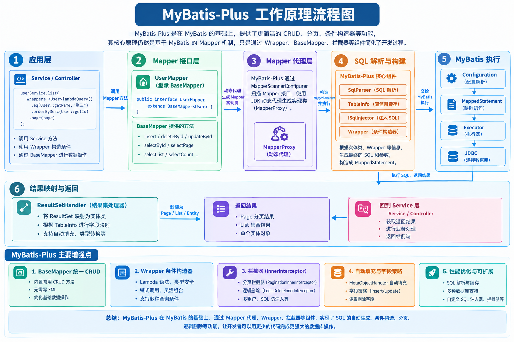
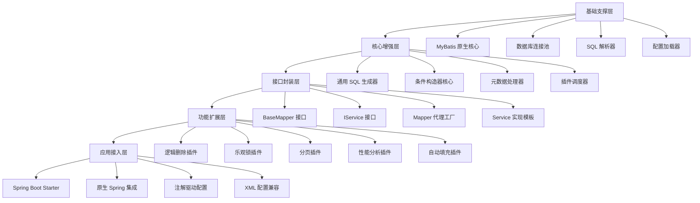

# Mybatis-Plus

------

## 一、基础概念

1. **什么是 MyBatis-Plus，它与 MyBatis 的区别是什么？**
2. **MyBatis-Plus 的核心组件有哪些？**
3. **MyBatis-Plus 如何实现自动 CRUD？**
4. **MyBatis-Plus 的 ActiveRecord 模式是什么？有什么优缺点？**
5. **MyBatis-Plus 支持的乐观锁和逻辑删除机制是怎样的？**


### MyBatis-Plus

> 
> 一句话：**MyBatis-Plus（简称MP）是MyBatis的增强工具，只做增强、不做修改，底层依然是MyBatis；单表CRUD不用写SQL，复杂多表查询依旧可以使用原生MyBatis XML。**

#### 一、核心定位 & 原理

- MyBatis-Plus（简称 MP）是在 MyBatis 基础上增强的 ORM 框架，提供了 **自动 CRUD、条件构造器、分页、代码生成等功能**。
- 其核心目标是 **减少开发工作量，提高效率**，同时保持 MyBatis 的灵活性。

- 无侵入：原有MyBatis代码完全保留，可以混用MP和原生XML。
- 底层原理：**启动阶段SqlInjector（SQL注入器）**，扫描继承`BaseMapper`的接口，自动生成CRUD对应的`MappedStatement`，注入MyBatis的Configuration，所以不用写XML也能执行SQL。
- 插件体系：基于MyBatis原生`Interceptor`拦截器，通过责任链实现分页、乐观锁、逻辑删除、多租户等功能。



#### 二、核心组件

##### 1. BaseMapper（Mapper层）

```
public interface UserMapper extends BaseMapper<User>{}
```

内置通用单表方法：`insert`、`deleteById`、`updateById`、`selectById`、`selectList`、`selectPage`等。

##### 2. IService + ServiceImpl（业务层封装）

`ServiceImpl`实现`IService`，内部持有`BaseMapper`，封装批量保存、链式查询等上层方法。

```
public class UserServiceImpl extends ServiceImpl<UserMapper, User> implements IUserService {}
```

##### 3. Wrapper 条件构造器（重点）

1. `QueryWrapper`：普通字符串条件，容易写错字段名，存在SQL注入风险（直接传字符串值）
2. **LambdaQueryWrapper**：Lambda表达式 `User::getName`，编译期校验字段，**推荐**，杜绝字段名硬编码问题
3. `UpdateWrapper / LambdaUpdateWrapper`：用于update动态条件

```
// Lambda示例
userMapper.selectList(Wrappers.<User>lambdaQuery()
        .eq(User::getName, "张三")
        .ge(User::getAge, 18)
        .like(User::getEmail, "@qq.com")
        .orderByDesc(User::getCreateTime));
```

> 
> 特性：如果传入参数为null，**默认不拼接该条件**，天然实现动态where。

#### 三、内置常用插件（面试高频）

##### 1. 分页插件 PaginationInnerInterceptor

**物理分页（limit），不是内存分页**。传入`Page`对象，自动执行两条SQL：count统计总数 + limit分页查询。

> 
> 注意：多插件共存时，分页插件要放在**拦截器链最后**，否则count统计不准。

```
Page<User> page = new Page<>(1,10); // 第1页，每页10条
Page<User> result = userMapper.selectPage(page, queryWrapper);
```

##### 2. 乐观锁插件

实体字段加`@Version`，更新时自动携带版本号校验，解决更新丢失。

```
@Version
private Integer version;
```

执行逻辑：`update user set stock=?,version=version+1 where id=? and version=?`

> 
> 适合读多写少场景。

##### 3. 逻辑删除 @TableLogic

标记字段如`deleted`，调用`mapper.deleteById()`，**不会执行delete，自动转为update，设置删除标记**。
查询时MP自动追加`where deleted=0`，过滤已逻辑删除数据。

> 
> 注意：**自定义XML写SQL，MP不会自动追加逻辑删除条件，需要手动处理**。

##### 4. 主键策略 @TableId

`@TableId(type = IdType.ASSIGN_ID)`：雪花算法，分布式id（默认）

- AUTO：数据库自增
- ASSIGN_UUID：UUID字符串

#### 四、其他功能

1. 自动填充：`@TableField(fill = FieldFill.INSERT)`，`createTime/updateTime`，通过`MetaObjectHandler`自动填充新增/更新时间，不用手动set。
2. 代码生成器：一键生成 Entity、Mapper、Service、Controller。
3. ActiveRecord：实体继承`Model`，直接调用`user.insert()`，项目中使用较少。

#### 五、优点 & 缺点

✅优点

1. 单表CRUD不用写XML，减少重复代码，开发效率高
2. LambdaWrapper，编译检查字段，减少字符串写错问题
3. 分页、乐观锁、逻辑删除开箱即用，不用自己造轮子
4. 完全兼容MyBatis，复杂多表查询可以继续写XML

❌缺点（面试必问）

1. **只擅长单表，多表关联查询弱**，一对多、多对多还是要手写XML；Wrapper写复杂SQL可读性差。
2. 默认查询**select ***，会查询全部字段，容易带出大字段，影响性能；需要手动指定查询列。
3. 容易出现N+1问题：MP本身没有关联查询能力，很多同学自己写循环查询，触发N+1（MP没有懒加载，懒加载是原生MyBatis的特性）。
4. 逻辑删除在自定义XML中不会自动生效，容易踩坑。
5. 过度使用Wrapper，SQL逻辑散落在Java代码，不方便DBA优化SQL。

#### **区别：**

| 特性            | MyBatis                    | MyBatis-Plus                                   |
| --------------- | -------------------------- | ---------------------------------------------- |
| SQL 编写        | 手动编写 XML / 注解 SQL    | 默认提供自动 CRUD，无需手写 SQL                |
| CRUD            | 手动实现                   | 自动生成方法（insert、update、delete、select） |
| 条件构造        | 需要手写 `<if>` 等动态 SQL | 提供 `Wrapper` 构造器支持链式条件              |
| 分页            | 手动实现或插件             | 内置分页插件，简单易用                         |
| ActiveRecord    | 不支持                     | 支持 AR 模式操作实体对象                       |
| 乐观锁/逻辑删除 | 需手动实现                 | 内置注解支持 `@Version`、`@TableLogic`         |

**示例：自动 CRUD**

#### 六、高频面试题

##### Q1：MP的Wrapper会不会SQL注入？

> 
> LambdaQueryWrapper使用方法引用，**不会SQL注入**；
> QueryWrapper直接传入字符串条件如`eq("name", " '1' or '1'='1' ")`，参数值会走预编译`#{}`，安全；
> 如果使用`apply`、`last`拼接原生SQL字符串，有注入风险。

##### Q2：MP有没有一级缓存、二级缓存？

> 
> 没有新增缓存，**复用MyBatis原生的一级、二级缓存**。

##### Q3：MP支持延迟加载吗？

> 
> MP**不提供关联查询和懒加载能力**。collection/association延迟加载是原生MyBatis的功能，MP不增强这一块。MP主打单表。

##### Q4：MP怎么解决N+1？

> 
> MP本身不处理关联查询。和普通MyBatis方案一致：LEFT JOIN，或者两次查询+IN批量+内存组装。**不要循环调用mapper.selectById**，否则N+1。

##### Q5：@TableField 作用

- `@TableField(value="db_column")`：字段和数据库列名映射
- `@TableField(exist=false)`：实体字段不是数据库字段，忽略
- `@TableField(fill=...)`：自动填充

#### 🎤1分钟面试背诵版

> MyBatis-Plus是MyBatis增强工具，只增强不修改，底层还是MyBatis。启动时SqlInjector自动注入BaseMapper的CRUD方法，单表不用写XML。
> 核心组件：BaseMapper、IService、Wrapper条件构造器，推荐LambdaQueryWrapper，编译期校验字段。
> 内置插件：分页插件（物理分页）、乐观锁@Version、逻辑删除@TableLogic、主键策略。
> 优点是简化单表开发；缺点是适合单表，多表关联要手写XML；默认查询全字段，容易性能问题；Wrapper写复杂SQL可读性差。
> 它没有内置关联查询，N+1、懒加载都是原生MyBatis的范畴，MP本身不提供。


------

### 2. **MyBatis-Plus 的核心组件**

1. **BaseMapper 接口**
   - 所有 Mapper 接口继承 `BaseMapper<T>` 即可使用自动 CRUD 方法。
   - 核心方法示例：`insert`, `deleteById`, `updateById`, `selectById`。
2. **Wrapper 条件构造器**
   - 用于动态构建查询条件。
   - 主要类：`QueryWrapper`, `LambdaQueryWrapper`, `UpdateWrapper`, `LambdaUpdateWrapper`。
3. **分页插件**
   - 支持 `Page<T>` 对象，结合 `IService` / Mapper 查询可快速实现分页。
4. **代码生成器（Generator）**
   - 自动生成 Entity、Mapper、Mapper XML、Service、Controller 等模板代码。
5. **ActiveRecord 模式**
   - Entity 类可直接调用 CRUD 方法，无需 Mapper 调用。
6. **自动填充（MetaObjectHandler）**
   - 支持字段自动填充（创建时间、更新时间等）。
7. **乐观锁 & 逻辑删除注解**
   - `@Version`、`@TableLogic` 注解直接支持。

------


### MyBatis‑Plus 自动CRUD实现原理

> 
> 一句话：MP通过**SQL注入器（SqlInjector）**，在MyBatis启动阶段，扫描继承`BaseMapper<T>`的接口，自动生成对应的CRUD MappedStatement，注册到MyBatis的Configuration中，因此不用手写XML/注解SQL，就能直接调用CRUD方法。

#### 1. 整体流程

1. **启动扫描**
项目启动，MyBatis扫描Mapper接口，MP的`MapperScannerConfigurer`会识别继承`BaseMapper`的Mapper。

```
public interface UserMapper extends BaseMapper<User> {}
```

2. **SQL注入器 SqlInjector**
默认实现：`DefaultSqlInjector`。
它会遍历内置CRUD方法（insert、deleteById、updateById、selectById、selectList等），**动态生成每一个方法对应的SQL语句**。
3. **构建MappedStatement**
把生成好的SQL、参数类型、返回类型封装成`MappedStatement`，注册进MyBatis全局配置`Configuration`。> 
> MyBatis执行SQL时，依靠MappedStatement；MP提前把这些Statement注入进去，不需要XML文件。
4. **调用时**
`userMapper.selectById(1L)`，MyBatis找到提前注入好的MappedStatement，执行SQL，完成数据库操作。

> 
> 核心：**不是运行时动态拼接SQL；是容器启动阶段一次性注入所有CRUD方法元信息**。

#### 2. BaseMapper内置的CRUD方法

```
// 新增
int insert(T entity);
// 根据主键删除
int deleteById(Serializable id);
// 根据主键更新
int updateById(T entity);
// 根据主键查询
T selectById(Serializable id);
// 条件查询列表
List<T> selectList(Wrapper<T> queryWrapper);
// 分页查询
Page<T> selectPage(Page<T> page, Wrapper<T> queryWrapper);
```

`DefaultSqlInjector`里面维护了一长串`AbstractSqlMethod`，每一个类对应一个CRUD方法，例如`Insert`、`DeleteById`、`UpdateById`、`SelectById`。
每个SqlMethod负责：生成SQL、设置resultType、parameterType。

#### 3. 实体类上的注解，用来辅助生成SQL

MP解析实体Entity的注解，自动推导表名、字段名，生成SQL：

- `@TableName("t_user")`：指定表名，默认类名驼峰转下划线
- `@TableId`：标记主键字段，主键策略（ASSIGN_ID雪花/AUTO自增）
- `@TableField("user_name")`：字段映射，`exist=false`表示非数据库字段
- `@Version` / `@TableLogic`：插件拦截，不是SqlInjector做的，**是MyBatis拦截器在SQL执行阶段改写SQL**

> 
> 区分：
> ✅ SqlInjector：**启动阶段生成CRUD的基础SQL**（insert、selectById这类静态模板SQL）
> ✅ 拦截器（MybatisPlusInterceptor）：**SQL执行前动态改写SQL**，实现乐观锁、逻辑删除、分页。

#### 4. Wrapper条件构造器怎么工作？

Wrapper不是SqlInjector生成的，是**运行时动态拼接where条件**。
`selectList(LambdaQueryWrapper)`：

1. 启动阶段已经注入`selectList`对应的MappedStatement，基础SQL：`SELECT 全部字段 FROM 表`
2. **运行时**，MP解析Wrapper，动态拼接where条件，交给MyBatis执行。> 
> 注意：Wrapper只是拼接where，**基础SQL骨架是启动阶段SqlInjector注入的**。

#### 5. IService / ServiceImpl

`ServiceImpl`只是**上层封装**，内部持有BaseMapper，本身**不注入SQL**，只是封装批量操作、链式调用等工具方法，底层仍然调用BaseMapper。

#### 6. 重要面试坑

1. **自动CRUD只支持单表**，多表关联没有自动生成，多表查询仍然需要手写XML。
2. SqlInjector只在**项目启动时执行一次**，不是每次调用Mapper动态生成SQL。
3. 乐观锁、逻辑删除、分页**不是SqlInjector实现**，是MyBatis拦截器在SQL执行阶段动态改写SQL，不要混淆。
4. 自定义SQL（XML）和MP自动注入的MappedStatement可以共存，同一个Mapper接口可以混用。

#### 🎤1分钟面试背诵版

> 
> MyBatis-Plus实现自动CRUD的核心是SqlInjector，默认实现DefaultSqlInjector。
> 在项目启动阶段，MP扫描继承BaseMapper的Mapper接口，自动生成insert、deleteById、updateById、selectById等CRUD方法对应的SQL，封装成MappedStatement注册到MyBatis的Configuration中。
> 生成SQL时会读取实体类注解，自动识别表名、主键、字段映射。
> Wrapper条件构造器是运行时动态拼接where条件；而乐观锁、逻辑删除、分页是通过MyBatis拦截器在SQL执行阶段改写SQL，不属于SqlInjector的工作。
> IService和ServiceImpl只是业务层封装，底层依旧调用BaseMapper。自动CRUD只支持单表，多表关联需要手写XML。

#### 高频追问

Q：SqlInjector什么时候执行？

> 
> Spring容器启动，MyBatis构建Configuration的时候，一次性注入，**运行调用Mapper不会再生成SQL**。

Q：能不能自定义SqlInjector？

> 
> 可以，继承DefaultSqlInjector，新增自定义SQL方法，实现自定义通用方法，比如自定义批量insert。

Q：BaseMapper的selectList，SQL什么时候生成？

> 
> 基础骨架`select * from table`在启动阶段由SqlInjector注入；where条件是运行时解析Wrapper动态拼接。

要不要我继续整理MP的**插件执行原理（MybatisPlusInterceptor）**？


------

### 4. MyBatis-Plus 的 ActiveRecord 模式

- ActiveRecord 模式允许 **实体对象自身执行 CRUD**，无需 Mapper 调用。
- 通过继承 `Model<T>` 类实现。

**示例：**

```java
public class User extends Model<User> {
    private Long id;
    private String name;
}

// 使用
User user = new User();
user.setName("王五");
user.insert();   // 自动插入
user.setName("王五1");
user.updateById(); // 自动更新
user.selectById(1L); // 查询
```

**优点：**

- 代码简洁，逻辑集中在实体类。
- 适合快速开发、简单业务。

**缺点：**

- 实体类与数据库操作耦合，不适合复杂业务。
- 不利于分层设计（Service / Mapper 分离原则受影响）。
- 单元测试可能受限（实体直接操作 DB）。

------


### MyBatis-Plus 自动填充 MetaObjectHandler

> 
> 一句话：**MetaObjectHandler 是MP提供的填充接口，用于在插入/更新时，自动给实体字段赋值，不用业务代码手动set createTime、updateTime；底层基于MyBatis的元对象处理器，在SQL执行前拦截填充字段值。**

#### 1. 使用步骤

##### ① 实体字段添加注解 `@TableField`

```
// 插入时填充
@TableField(fill = FieldFill.INSERT)
private LocalDateTime createTime;

// 插入、更新都填充
@TableField(fill = FieldFill.INSERT_UPDATE)
private LocalDateTime updateTime;
```

`FieldFill`枚举四个选项：

- `INSERT`：新增时填充
- `UPDATE`：更新时填充
- `INSERT_UPDATE`：新增、更新都填充
- `DEFAULT`：不填充

##### ② 自定义类实现 MetaObjectHandler 接口，交给Spring容器

```
@Component
public class MyMetaObjectHandler implements MetaObjectHandler {

    @Override
    public void insertFill(MetaObject metaObject) {
        // 参数：实体属性名、填充值、元对象
        strictInsertFill(metaObject, "createTime", LocalDateTime::now, LocalDateTime.class);
        strictInsertFill(metaObject, "updateTime", LocalDateTime::now, LocalDateTime.class);
    }

    @Override
    public void updateFill(MetaObject metaObject) {
        strictUpdateFill(metaObject, "updateTime", LocalDateTime::now, LocalDateTime.class);
    }
}
```

> 
> 推荐使用 `strictInsertFill` / `strictUpdateFill`：**严格模式**，如果实体该字段值已经不为null，则**不会覆盖**；
> 旧方法 `setFieldValByName`：不管有没有值，直接覆盖，不推荐。

#### 2. 底层原理（面试重点）

1. MP内置拦截器 `AutoFillInnerInterceptor`，在MyBatis执行insert/update之前触发。
2. 获取`MetaObject`（MyBatis提供的元对象，用来反射操作实体属性，封装了反射逻辑）。
3. 读取实体字段上的`@TableField(fill=xxx)`注解。
4. 匹配是插入还是更新，调用我们实现的`insertFill/updateFill`方法，给实体属性赋值。
5. 赋值完成后，MyBatis拿到实体，把值带入预编译SQL。

> 
> ⚠️关键点：**自动填充是给Java实体对象赋值，不是修改SQL字符串**。
> 只作用于MP BaseMapper的insert、updateById等方法；**自定义XML写的insert/update，自动填充同样生效！**（这点和乐观锁、逻辑删除不一样）

#### 3. 常见坑（高频面试）

1. **实体字段不能加final；要有setter方法**（lombok @Data即可），没有setter无法反射赋值。
2. 字段类型要和填充值类型匹配（LocalDateTime / Date），类型不匹配填充失败。
3. strict严格模式：**如果业务手动set了createTime，自动填充不会覆盖**；如果需要强制覆盖，用setFieldValByName。
4. **仅支持实体对象填充，Wrapper方式直接set字段不会触发**。```
// ❌ 这种方式不会触发自动填充！没有实体对象
userMapper.update(null, Wrappers.<User>lambdaUpdate()
        .set(User::getName,"test").eq(User::getId,1L));
5. 数据库字段不要设置默认值，容易出现**数据库默认时间和代码填充时间不一致**，建议统一用代码填充。
6. 主键、乐观锁version、逻辑删除deleted**不属于MetaObjectHandler自动填充范畴**，是独立能力。

#### 4. 和数据库默认值对比

- MetaObjectHandler：**Java层填充**，应用服务器时间；可自定义逻辑（比如填充操作人ID），推荐。
- 数据库default：数据库服务器时间；多库环境时间可能不一致，无法填充业务字段（如操作人userId）。

>
> 扩展：除时间外，还可以填充**创建人、更新人**，从当前登录上下文获取用户信息。

#### 🎤1分钟面试背诵版

>
> MetaObjectHandler是MyBatis-Plus自动填充的接口，一般用来自动填充createTime、updateTime、创建人、更新人。
> 使用方式：实体字段加`@TableField(fill = FieldFill.xxx)`，自定义类实现MetaObjectHandler并注入Spring，重写insertFill和updateFill。推荐strictInsertFill严格模式，实体已有值不会覆盖。
> 底层是AutoFillInnerInterceptor拦截器，在SQL执行前，利用MyBatis MetaObject反射给实体属性赋值。
> 注意：自动填充**自定义XML的insert/update也生效**；但是使用UpdateWrapper，不传入实体对象的更新方式，不会触发自动填充。

#### 面试追问

Q：自动填充和乐观锁、逻辑删除的生效范围区别？

>
> MetaObjectHandler自动填充：BaseMapper方法 + 手写XML的insert/update **都生效**。
> 乐观锁、逻辑删除插件：**仅MP BaseMapper方法生效，自定义XML不会自动处理**。

Q：strictInsertFill和setFieldValByName区别？

>
> strictInsertFill严格模式：字段不为null就不覆盖；setFieldValByName强制覆盖原有值。

Q：updateWrapper更新，不传入实体，为什么不会触发自动填充？

>
> 自动填充是填充**实体对象的属性**；这种写法没有实体对象，没有地方可以填充字段，所以失效。

要不要我把MP全部插件（分页、乐观锁、逻辑删除、自动填充）做个汇总对比？


### MyBatis-Plus 乐观锁 + 逻辑删除

> 一句话总结：二者都是基于**拦截器插件**实现，属于MP的内置能力，底层是MyBatis拦截器，**只对MP自带的BaseMapper方法生效，自定义XML SQL不会自动处理**。

#### 一、乐观锁机制

##### 1. 适用场景

**读多写少**，解决并发更新丢失问题（更新丢失：两个线程同时读出同一条数据，先后提交，后者覆盖前者修改）。

> 乐观锁：不加数据库锁，用版本号做校验，假设冲突很少；冲突失败由业务决定重试/返回。

##### 2. 使用步骤

1. 实体增加版本字段，加上`@Version`注解
```java
@Version
private Integer version;
```

2. 配置乐观锁插件 `OptimisticLockerInnerInterceptor`
```java
@Bean
public MybatisPlusInterceptor mybatisPlusInterceptor() {
    MybatisPlusInterceptor interceptor = new MybatisPlusInterceptor();
    interceptor.addInnerInterceptor(new OptimisticLockerInnerInterceptor());
    return interceptor;
}
```

##### 3. 执行原理

- 查询：不会自动处理version，正常查出version值
- 更新：MP拦截`updateById`，自动在update语句追加版本条件，并且版本号+1
```sql
-- 原始逻辑
update user set name=?, version=version+1 where id=? and version=?
```
> 执行之后，**返回受影响行数，如果行数=0 → 版本不匹配，并发冲突，更新失败**

##### 4. 重要坑（面试高频）

1. **仅支持 `updateById`、`update(entity, wrapper)` 这种按主键更新；批量update不支持乐观锁！**
2. 自定义XML写update SQL，**不会自动带上version条件**，乐观锁失效。
3. version字段类型：Integer/Long，**初始值建议设置为1**；null会失效。
4. 更新失败只是返回0行，**不会抛异常，业务代码自己判断是否重试**。

#### 二、逻辑删除机制

##### 1. 适用场景

不想真正delete物理删除数据，做软删除，保留数据记录，方便数据恢复、审计。
> 逻辑删除：不是执行`DELETE`，**转为UPDATE，标记删除状态**；查询时自动过滤已删除数据。

##### 2. 使用步骤

1. 实体增加删除标记字段，`@TableLogic`
```java
@TableLogic
private Integer deleted;
```
2. yml配置删除值（默认：0未删除，1已删除，可自定义）
```yaml
mybatis-plus:
  global-config:
    db-config:
      logic-delete-value: 1
      logic-not-delete-value: 0
```

##### 3. 执行原理

1. 调用`mapper.deleteById()`：
    拦截器把`DELETE`改写为`UPDATE`
    ```sql
    update user set deleted=1 where id=? and deleted=0
    ```
2. 查询方法`selectById / selectList`：**自动追加 `where deleted=0`**，过滤掉已删除的数据。

##### 4. 重要坑（面试高频）

1. **自定义XML手写SQL，不会自动拼接deleted条件！** 需要自己手动加 `and deleted=0`
2. 逻辑删除后，这条数据正常查不到；如果需要查询已删除数据，要手写SQL去掉deleted条件。
3. 逻辑删除本质是update，**依然会触发乐观锁版本号更新**（如果同时开启乐观锁）。
4. 索引问题：大量逻辑删除后，deleted=1的数据占在表里，索引体积变大；可以定期归档清理。
5. 联表查询，MP不会给关联表自动追加逻辑删除条件。

#### 三、两者对比

|特性|乐观锁|逻辑删除|
|---|---|---|
|注解|`@Version`|`@TableLogic`|
|插件|OptimisticLockerInnerInterceptor|LogicDeleteInnerInterceptor|
|作用|解决并发更新丢失，控制并发修改|软删除，保留历史数据|
|SQL变化|update自动增加version条件、version+1|delete转为update；查询自动加deleted=0|
|生效范围|BaseMapper更新方法，批量更新不生效|BaseMapper的CRUD；自定义XML不自动生效|

#### 🎤面试背诵版

> MP乐观锁和逻辑删除都是通过MyBatis拦截器插件实现。
> **乐观锁**：读多写少场景，实体字段加`@Version`。更新时自动携带版本号条件，版本号+1；如果受影响行数为0代表并发冲突更新失败。注意：仅单条主键更新生效，批量更新、自定义XML不会自动处理乐观锁。
> **逻辑删除**：软删除，实体字段加`@TableLogic`。调用deleteById不会执行物理删除，自动转为update设置删除标记；查询时自动追加条件过滤已删除数据。**自定义XML手写SQL不会自动追加deleted条件，需要手动维护**。
> 两者都只对MP BaseMapper自带方法生效，自己写XML需要手动处理。

#### 高频追问

Q：乐观锁和悲观锁区别？
> 乐观锁无数据库锁，版本号校验，适合读多写少；悲观锁如select ... for update，数据库加行锁，写多场景，并发写冲突多的时候用。

Q：同时开启乐观锁+逻辑删除，执行deleteById会发生什么？
> deleteById变成update，会同时更新deleted字段，并且触发版本号version+1。

Q：逻辑删除后主键唯一约束还生效吗？
> 生效，主键唯一；逻辑删除只是标记，数据还在表中。

要不要我把乐观锁、悲观锁的对比整理成简短面试问答？


### 6.MP体系结构

MyBatis-Plus 的体系结构基于 MyBatis 扩展而来，核心是通过 **“增强层”** 封装通用能力，同时保持与 MyBatis 原生功能的兼容，整体可分为 5 个核心层级，自下而上支撑自动 CRUD、条件构造等功能。

#### MyBatis-Plus 体系结构分层（自下而上）



#### 各层级核心作用解析

##### 1. 基础支撑层（依赖基础）

是 MyBatis-Plus 的运行基石，依赖并复用 MyBatis 原生能力，同时提供基础工具支持。

- **MyBatis 原生核心**：复用 MyBatis 的 `SqlSession`、`Executor`、`MapperProxy` 等核心组件，保证兼容性。
- **数据库连接池**：整合 Druid、Hikari 等连接池，管理数据库连接。
- **SQL 解析器**：解析 SQL 语法、表/字段元数据，为通用 SQL 生成提供支持。
- **配置加载器**：加载 `application.yml`/`mybatis-config.xml` 中的配置（如全局逻辑删除、主键策略）。

##### 2. 核心增强层（核心能力实现）

MyBatis-Plus 的“增强核心”，封装通用 SQL 生成、条件构造等核心逻辑，是区别于 MyBatis 的关键层。

- **通用 SQL 生成器**：根据实体类注解（`@TableName`/`@TableId`）自动生成 INSERT/UPDATE/DELETE/SELECT 语句，无需手动写 SQL。
- **条件构造器核心**：实现 `QueryWrapper`/`LambdaQueryWrapper` 的底层逻辑，支持动态拼接 WHERE 条件。
- **元数据处理器**：解析实体类与数据库表的映射关系（如字段名、主键策略），为 SQL 生成提供元数据。
- **插件调度器**：管理所有扩展插件（如乐观锁、分页），负责插件的执行顺序和逻辑注入。

##### 3. 接口封装层（对外能力暴露）

将核心增强层的能力封装为易用的接口，供开发者直接调用，是“自动 CRUD”的入口。

- **BaseMapper 接口**：封装单表基础 CRUD 方法（`insert`/`selectById`/`updateById` 等），自定义 Mapper 继承后即可使用。
- **IService 接口**：封装 Service 层通用方法（如批量操作 `saveBatch`、分页 `page`），搭配 `ServiceImpl` 实现类可直接注入使用。
- **Mapper 代理工厂**：基于 MyBatis 代理机制，为自定义 Mapper 生成代理对象，触发通用 SQL 执行。
- **Service 实现模板**：`ServiceImpl` 类封装 `BaseMapper` 调用逻辑，简化 Service 层代码编写。

##### 4. 功能扩展层（插件化能力）

基于核心增强层提供的插件机制，扩展额外功能，支持按需启用，不侵入核心逻辑。

- **逻辑删除插件**：拦截删除/查询操作，自动拼接逻辑删除条件（如 `deleted = 0`）。
- **乐观锁插件**：拦截更新操作，自动拼接版本号条件（如 `version = ?`）并更新版本号。
- **分页插件**：拦截查询操作，自动生成分页 SQL（如 MySQL 的 `LIMIT`、Oracle 的 `ROWNUM`）。
- **其他插件**：性能分析插件（打印 SQL 执行时间）、自动填充插件（如填充 `createTime`/`updateTime`）等。

##### 5. 应用接入层（与应用整合）

提供多种集成方式，让 MyBatis-Plus 能快速接入 Spring Boot/Spring 应用，降低集成成本。

- **Spring Boot Starter**：通过 `mybatis-plus-boot-starter` 实现自动配置，无需手动注册 `SqlSessionFactory` 等组件。
- **原生 Spring 集成**：支持通过 XML 或 Java 配置注册 MyBatis-Plus 核心 Bean（如 `MybatisPlusInterceptor`）。
- **注解驱动配置**：通过 `@MapperScan` 扫描 Mapper 接口，`@TableName`/`@Version` 等注解简化配置。
- **XML 配置兼容**：支持保留 MyBatis 原生 XML 映射文件，兼容复杂 SQL 场景（如多表关联）。

#### 核心流程示例（以“查询单条数据”为例）

1. 应用层调用 `userMapper.selectById(1L)`（接口封装层 `BaseMapper` 方法）。
2. Mapper 代理工厂生成代理对象，将请求转发到核心增强层。
3. 通用 SQL 生成器根据 `User` 实体类元数据，生成 `SELECT * FROM user WHERE id = ? AND deleted = 0`（逻辑删除插件自动注入条件）。
4. 核心增强层通过 MyBatis 原生 `Executor` 执行 SQL（基础支撑层）。
5. 结果通过接口封装层返回给应用层。

### 7.MyBatis-Plus 与数据库的交互链路

在 MyBatis-Plus 框架中，`SqlSession`、`DataSource`（如 `HikariDataSource`）、`HikariPool` 和数据库（如 MySQL）构成了从应用到数据库的**完整数据交互链路**。它们分工协作，实现高效的数据库连接管理和 SQL 执行。以下是各组件的角色、关系及完整流程解析：

#### 一、核心组件的角色与职责

##### 1. 数据库（MySQL / PostgreSQL 等）

- **核心角色**：数据持久化存储的底层服务，负责接收并执行 SQL 语句，返回结果。
- **特点**：需要通过网络连接（TCP/IP）访问，有自身的连接限制（如最大并发连接数）和权限控制。

##### 2. HikariPool（连接池实现）

- **核心角色**：数据库连接的“池化管理器”，负责连接的创建、复用、销毁和监控，避免频繁创建/关闭连接的性能损耗（连接创建成本高）。
- **核心功能**：
  - 初始化时创建一定数量的空闲连接（`minimum-idle`）；
  - 当应用需要连接时，从池中分配空闲连接（而非新建）；
  - 连接使用完毕后归还给池（而非物理关闭）；
  - 自动检测无效连接并替换，控制最大连接数（`maximum-pool-size`），防止数据库过载。
- **优势**：HikariCP 是目前性能最优的连接池，以轻量、低延迟、高并发支持著称，是 Spring Boot 默认连接池。

##### 3. DataSource（以 HikariDataSource 为例）

- **核心角色**：连接池的“门面接口”，屏蔽底层连接池的实现细节，为上层框架（如 MyBatis-Plus）提供统一的连接获取方式。
- **HikariDataSource**：HikariCP 对 `javax.sql.DataSource` 接口的实现类，内部持有 `HikariPool` 实例，通过 `getConnection()` 方法对外提供数据库连接。
- **作用**：应用无需直接操作 `HikariPool`，只需通过 `DataSource` 接口即可获取连接，便于切换连接池（如从 Hikari 切换到 Druid）。

##### 4. SqlSession（MyBatis/MyBatis-Plus 核心）

- **核心角色**：MyBatis 中封装数据库操作的“会话对象”，负责 SQL 执行、事务管理和结果映射。
- **核心功能**：
  - 通过 `getMapper()` 获取 Mapper 接口的代理对象，执行映射的 SQL 语句；
  - 直接执行 SQL 命令（如 `selectOne()`、`insert()`、`update()`）；
  - 管理事务（`commit()` 提交、`rollback()` 回滚）。
- **依赖**：`SqlSession` 的创建依赖 `DataSource`，其底层通过 `DataSource` 获取数据库连接。

#### 二、组件协作流程（从应用到数据库）

完整流程可分为 **“初始化→获取连接→执行 SQL→释放资源”** 四个阶段，各组件环环相扣：

##### 1. 初始化阶段（应用启动时）

- **Step 1：创建 DataSource 与连接池**  
  Spring Boot 启动时，根据 `application.yml` 配置初始化 `HikariDataSource`，并初始化 `HikariPool`：

  ```yaml
  spring:
    datasource:
      url: jdbc:mysql://localhost:3306/test
      username: root
      password: 123456
      hikari:
        maximum-pool-size: 10  # 最大连接数
        minimum-idle: 5        # 最小空闲连接数
  ```

  底层代码逻辑：

  ```java
  // 初始化 Hikari 连接池
  HikariConfig config = new HikariConfig();
  config.setJdbcUrl("jdbc:mysql://localhost:3306/test");
  config.setUsername("root");
  config.setPassword("123456");
  HikariDataSource dataSource = new HikariDataSource(config); // 内部创建 HikariPool
  ```

- **Step 2：初始化 MyBatis-Plus 核心组件**  
  MyBatis-Plus 读取配置（如 Mapper 路径、实体包），创建 `SqlSessionFactory`，其内部持有 `DataSource` 引用：

  ```java
  // MyBatis-Plus 自动配置 SqlSessionFactory
  SqlSessionFactory sqlSessionFactory = new MybatisSqlSessionFactoryBuilder()
      .build(configuration); // configuration 中包含 DataSource
  ```

##### 2. 执行 SQL 阶段（应用运行时）

- **Step 3：获取 SqlSession**  
  应用通过 `SqlSessionFactory` 创建 `SqlSession`，`SqlSession` 会从 `DataSource` 中获取数据库连接：

  ```java
  // MyBatis-Plus 中通过 SqlSessionFactory 获取 SqlSession
  SqlSession sqlSession = sqlSessionFactory.openSession(); 
  ```

  底层：`openSession()` 会调用 `dataSource.getConnection()` 获取连接。

- **Step 4：从连接池获取连接**  
  `HikariDataSource.getConnection()` 委托给 `HikariPool` 处理：

  - 若池中有空闲连接，直接返回该连接；
  - 若连接不足且未达 `maximum-pool-size`，创建新连接并返回；
  - 若连接数已满，等待 `connection-timeout` 后抛出“连接超时”异常。

- **Step 5：执行 SQL 并映射结果**  
  通过 `SqlSession` 获取 Mapper 接口，执行 SQL 操作（MyBatis-Plus 自动生成 SQL）：

  ```java
  // 获取 Mapper 代理对象
  UserMapper userMapper = sqlSession.getMapper(UserMapper.class);
  // 执行查询（底层使用从连接池获取的连接执行 SQL）
  User user = userMapper.selectById(1L); 
  ```

  此时，MyBatis-Plus 会：

  1. 生成 SQL：`SELECT * FROM user WHERE id = 1`；
  2. 通过 JDBC 连接执行 SQL；
  3. 将结果集映射为 `User` 对象。

##### 3. 资源释放阶段

- **Step 6：提交事务并关闭 SqlSession**  
  业务逻辑完成后，`SqlSession` 提交事务并关闭，连接归还给 `HikariPool`：

  ```java
  sqlSession.commit(); // 提交事务（若自动提交则省略）
  sqlSession.close();  // 释放连接（归还给连接池，而非物理关闭）
  ```

- **Step 7：连接池管理连接**  
  归还的连接被标记为“空闲”，等待下次复用；若空闲时间超过 `idle-timeout`，`HikariPool` 会自动销毁连接，避免资源浪费。

#### 三、组件关系图

```
应用代码（Service/Controller）
       ↓
MyBatis-Plus Mapper 接口（如 UserMapper）
       ↓
SqlSession（MyBatis 会话，封装 SQL 执行）
       ↓（依赖）
DataSource（HikariDataSource，连接池接口）
       ↓（内部持有）
HikariPool（连接池实现，管理连接生命周期）
       ↓（获取/归还连接）
数据库连接（JDBC Connection）
       ↓
数据库（MySQL/PostgreSQL，执行 SQL 并返回结果）
```

#### 四、关键注意事项

1. **连接池参数优化**  
   - `maximum-pool-size`：不宜过大（推荐 10~20），否则会导致数据库线程竞争加剧；
   - `connection-timeout`：设置合理超时时间（如 30 秒），避免应用长期阻塞；
   - `idle-timeout`：建议小于数据库的连接超时时间（如 MySQL 默认 8 小时），防止连接失效。

2. **SqlSession 生命周期**  
   - 每次请求/事务应创建一个 `SqlSession`，使用后及时关闭（避免连接泄露）；
   - Spring 集成时，`SqlSession` 由 `SqlSessionTemplate` 管理，自动关闭，无需手动操作。

3. **事务管理**  
   - `SqlSession` 默认为手动事务（需调用 `commit()`），可通过 `openSession(true)` 开启自动提交；
   - 结合 Spring 的 `@Transactional` 注解，事务由 Spring 统一管理，更简洁可靠。

4. **性能排查**  
   - 若频繁出现“连接超时”，可能是连接池过小或连接未释放（检查 `SqlSession` 是否关闭）；
   - 慢查询需优化 SQL 或添加索引，而非盲目增大连接池。

#### 五、总结

MyBatis-Plus 与数据库的交互链路中，各组件分工明确：  

- **数据库**是数据存储的底层；  
- **HikariPool** 负责连接的高效管理，减少性能损耗；  
- **HikariDataSource** 提供统一的连接获取接口，解耦上层框架与连接池；  
- **SqlSession** 是 MyBatis-Plus 的核心，封装 SQL 执行和事务，依赖 `DataSource` 获取连接。  


### MP分页插件 vs PageHelper

> 
> 共同点：两者都是**MyBatis Interceptor拦截器**，拦截Executor的query方法；**物理分页**，根据数据库方言改写SQL，自动执行两条SQL：count统计总数 + limit分页查询数据。

#### 一、MyBatis-Plus 分页插件 PaginationInnerInterceptor

##### 原理

1. MP的统一拦截器入口 `MybatisPlusInterceptor`，`PaginationInnerInterceptor` 是内部子拦截器。**分页插件必须放在拦截器链最后**，否则count统计不准。
2. 拦截查询时，**从Mapper方法入参中查找是否存在IPage/Page对象**（显式传参）；没有Page对象，直接跳过分页逻辑。

```
IPage<User> page = new Page<>(1,10);
userMapper.selectPage(page, wrapper); // page作为方法参数传入
```

3. 如果识别到Page对象：
   - 自动生成count SQL，执行查询总记录数；支持优化countSQL（自动去掉join冗余表）
   - 根据数据库方言改写原始SQL，追加`LIMIT offset,size`
   - 执行分页SQL拿到数据列表，**把total、records回填到传入的Page对象**
4. 返回IPage，包含总条数、当前页、分页数据。

##### 特点

✅ 分页参数**显式通过方法参数传递**，代码可读性好，不容易污染其他SQL
✅ 支持自定义count、maxLimit限制单页最大条数、overflow溢出页码处理
❌ 必须使用`selectPage`，方法签名要带上IPage参数；手写XML也支持，只要参数传入Page对象

#### 二、PageHelper（MyBatis分页插件 PageInterceptor）

##### 原理

1. 调用`PageHelper.startPage(pageNum,pageSize)`，**把分页参数封装Page对象存入ThreadLocal**（当前线程本地变量）。
2. `PageInterceptor`拦截SQL执行，拦截器从ThreadLocal取出分页参数。
3. 执行count查询，改写SQL追加分页语法（MySQL LIMIT，Oracle ROWNUM）。
4. **只对紧随其后的第一条MyBatis查询生效**；查询完成后finally清空ThreadLocal，防止参数残留。
5. 返回List，这个List本质是Page对象（继承ArrayList），之后用`new PageInfo(list)`封装分页信息。

```
PageHelper.startPage(1,10);
List<User> list = userMapper.selectList(); // 紧跟的第一条查询被分页
PageInfo<User> pageInfo = new PageInfo<>(list);
```

##### 特点

✅ 无侵入原有Mapper方法，不用修改Mapper接口签名，任意Mapper都可以分页
❌ 依赖ThreadLocal，**容易踩坑**：startPage之后如果不是紧接着执行Mapper查询，中间出现异常、return，ThreadLocal残留，**下一条SQL会被意外分页**，造成诡异bug

#### 三、核心对比（面试重点）

| 对比项 | MP分页插件 PaginationInnerInterceptor | PageHelper |
| --- | --- | --- |
| 分页参数传递 | **方法入参，显式传入IPage对象** | **ThreadLocal隐式存储，startPage设置** |
| 触发条件 | 方法参数存在IPage才分页 | ThreadLocal中有Page，则下一条SQL分页 |
| 结果封装 | Page对象直接回填total、records，返回IPage | 返回List（底层Page），手动构建PageInfo |
| 侵入性 | 需要修改Mapper方法签名 | 不修改原有Mapper，零侵入 |
| 坑点 | 拦截器顺序要放最后；多插件顺序容易出错 | ThreadLocal残留，容易误分页，必须紧跟Mapper查询 |
| 适用场景 | 项目整体使用MP，统一技术栈 | 原生MyBatis项目，不想改动Mapper接口 |

#### 四、1分钟面试口述答案

> MP分页插件和PageHelper底层都是MyBatis拦截器实现物理分页，都会自动执行count统计+改写SQL加limit。
> MP分页插件是`PaginationInnerInterceptor`，作为MybatisPlusInterceptor内部子拦截器；**分页参数显式作为Mapper方法参数IPage传入**，拦截器识别参数里的Page对象才分页，分页结果回填到Page对象。注意分页插件要放在拦截器链最后，否则count统计不准。
> PageHelper是PageInterceptor，使用`PageHelper.startPage`，分页参数存入ThreadLocal，只对**紧跟的第一条查询生效**；执行完会清理ThreadLocal。缺点是ThreadLocal残留会导致意外分页，容易出线上bug。
> 选型：项目使用MP就用自带分页；原生MyBatis项目可以用PageHelper。

#### 高频追问

Q：MP分页插件手写XML的SQL，能自动分页吗？

> 
> 可以，只要Mapper方法参数传入IPage对象，拦截器识别到就自动count+拼接limit。

Q：PageHelper为什么必须紧跟Mapper查询？

> 
> 参数保存在ThreadLocal，只要线程没清空，**后面任意一条SQL都会被分页**，中间代码、异常会导致ThreadLocal没有清理，引发错误分页。

Q：物理分页和内存分页区别？

> 
> 物理分页：数据库层面limit，只返回当前页数据；内存分页：查出全量数据，Java内存截取，大数据量会OOM，两者插件都是物理分页。

要不要我把MP四大插件（分页、乐观锁、逻辑删除、自动填充）浓缩成一页面试速记？

### 深分页问题 + 解决方案

> **深分页定义**：`limit offset, size`，offset很大，比如 `limit 1000000,10`。
> MySQL执行逻辑：**扫描并丢弃前面offset条，再取size条**；offset越大，扫描行数越多，IO高、慢SQL。
> 本质：`limit M,N` 不是直接跳到M行，是先读M+N行，丢弃M行，返回N条。

#### 1. 业务层优先方案（最推荐，治本）

##### ① 禁止前端无限下拉，做页码上限

限制最大页码，例如最多查1000页。
> 产品层面：一般用户不会翻很深，超过1000页没有业务意义，直接返回提示。

##### ② 游标分页（Keyset分页 / 主键ID分页，工业界首选✅）

**不再使用pageNum+offset，利用有序主键/唯一索引做范围查询**。
原理：
- 第一页：`select id,name from user order by id desc limit 10;`
- 拿到最后一条id=1000，下一页：
```sql
select id,name from user where id < 1000 order by id desc limit 10;
```
> 利用主键索引，直接定位起始位置，**不需要扫描前面100000行**。

优点：索引命中，性能稳定，offset再大速度变化很小。
缺点：
1. 不支持跳页（不能直接跳到第1000页，只能上一页/下一页），适合滚动下拉场景。
2. 排序字段必须**唯一、有序、建立索引**；如果排序条件复杂，需要联合索引。
3. 数据在翻页过程中新增/删除，会出现漏数据、重复数据（快照问题）。

> 面试一句话：**游标分页适合APP/前端滚动加载；offset分页适合后台管理需要跳页的场景，但不能深翻**。

#### 2. MySQL数据库优化方案（优化limit offset）

##### 方案A：延迟关联（子查询先查主键，再关联回表）

```sql
-- 原慢SQL
select * from user order by id limit 100000,10;

-- 优化写法：子查询只查主键，再JOIN拿完整数据
select u.* from user u
inner join (select id from user order by id limit 100000,10) t
on u.id = t.id;
```
原理：子查询只扫描主键索引（覆盖索引，不需要回表），拿到id后再关联查询完整行。
> 适合：必须支持跳页、无法改成游标分页场景；**offset极大时依然会变慢，只是比select *快很多**。

##### 方案B：覆盖索引

`order by` 和查询字段建立覆盖索引，避免回表，减少IO。

```sql
create index idx_user_id on user(id,name);
```

#### 3. 架构层面方案（大数据量）

##### ① ES搜索引擎

数据量大、需要复杂排序+分页，把数据同步到ES，ES支持`search_after`游标分页，适合海量数据检索。
> ES也不推荐深度from+size分页，from+size太深内存暴涨，ES推荐search_after。

##### ② 分库分表

数据量千万级别以上，做分库分表；分页时需要合并各个分片结果，**深分页代价更高，尽量改用游标分页**。

#### 4. MP分页插件相关补充（衔接前面知识点）

MP的`Page`底层就是`limit offset`，**原生MP分页没有解决深分页**。
如果业务深分页，不能单纯依赖MP分页插件，需要自己改写SQL为游标分页或者延迟关联。

#### 5. 各种方案对比

|方案|优点|缺点|适用场景|
|---|---|---|---|
|限制最大页码|最简单，成本最低|用户不能翻很深|后台管理系统|
|Keyset游标分页|性能极好，索引定位，大数据稳定|不能跳页，只支持上下页|APP滚动下拉、信息流|
|延迟关联子查询|支持跳页，相比select *快|offset极大依然慢|后台少量深跳页|
|ES search_after|海量数据+复杂排序|维护成本高，需要同步数据|商品、内容检索|

#### 🎤面试1分钟背诵答案

> MySQL深分页是limit offset,size，offset很大时，数据库会扫描并丢弃前面offset行，性能很差。
> 解决方案分几个层级：
> 第一，业务层优先处理，限制最大页码；如果是滚动下拉场景，改用Keyset游标分页，利用有序主键索引，where id < lastId，避免扫描大量无效数据，性能最稳定，但不支持跳页。
> 第二，数据库SQL优化，使用延迟关联，子查询先通过覆盖索引查询主键，再关联回表查询完整数据，支持跳页，但offset极大依然会变慢。
> 第三，海量数据场景，使用ES，采用search_after游标分页，避免from+size深分页；超大表考虑分库分表。
> MyBatis-Plus自带分页插件底层就是limit offset，**本身没有解决深分页问题，需要业务层面改造SQL**。

#### 高频追问

Q：游标分页为什么会出现数据重复/漏数据？
> 翻页过程中如果中间新增或者删除数据，索引顺序发生变化，会导致数据错位。可以加版本/快照时间作为辅助条件。

Q：ES from+size深分页问题？
> from+size会把分页范围内所有数据拿到内存排序，深度越大内存开销越大，所以ES推荐search_after游标分页。

Q：游标分页排序字段一定要主键吗？
> 不一定，只要字段**唯一有序并且建立索引**；如果字段不唯一，需要联合唯一字段（业务字段+id）防止排序冲突。

要不要我把MySQL慢SQL相关：深分页、索引失效、order by、group by整理成面试小模块？


------

##  二、CRUD 与参数映射

1. **如何使用 MyBatis-Plus 执行基本的增删改查操作？**
2. **MyBatis-Plus 的 `Wrapper` 条件构造器有哪些类型？**
3. **MyBatis-Plus 如何实现批量操作（批量插入/更新/删除）？**
4. **MyBatis-Plus 如何传递复杂参数（如多条件查询）？**
5. **MyBatis-Plus 中如何实现分页查询？**

------

### 1. **如何使用 MyBatis-Plus 执行基本的增删改查操作？**

**使用 BaseMapper 提供的内置方法**

```java
@Autowired
private UserMapper userMapper;

// 插入
User user = new User();
user.setName("张三");
userMapper.insert(user); // 自动生成 INSERT SQL

// 查询
User u = userMapper.selectById(1L);             // 根据 ID 查询
List<User> list = userMapper.selectList(null);  // 查询所有
User u2 = userMapper.selectOne(new QueryWrapper<User>().eq("name", "张三")); // 条件查询

// 更新
user.setName("李四");
userMapper.updateById(user); // 更新 ID 对应记录

// 删除
userMapper.deleteById(1L);           // 根据 ID 删除
userMapper.delete(new QueryWrapper<User>().eq("name", "李四")); // 条件删除
```

**面试要点：**

- 不需要写 XML，就能完成 CRUD。
- BaseMapper 内置了 20+ 方法，包含批量和条件操作。

------

### 2. **MyBatis-Plus 的 `Wrapper` 条件构造器有哪些类型？**

| 构造器                   | 用途            | 特点                                       |
| ------------------------ | --------------- | ------------------------------------------ |
| `QueryWrapper<T>`        | 条件查询        | 支持链式方法，灵活构建 SQL 条件            |
| `UpdateWrapper<T>`       | 条件更新        | 支持链式方法构建 `SET` 和 `WHERE`          |
| `LambdaQueryWrapper<T>`  | Lambda 条件查询 | 使用实体方法引用，避免硬编码列名，安全性高 |
| `LambdaUpdateWrapper<T>` | Lambda 条件更新 | 同上，保证列名和实体字段一致               |
| `Wrappers.<T>query()`    | 工厂方法        | 简化创建 Wrapper 对象                      |
| `QueryChainWrapper<T>`   | 链式调用查询    | 可直接链式调用 CRUD（无需 Mapper）         |

**示例：**

```java
// LambdaQueryWrapper 查询 name='张三' 且 age>20
List<User> list = userMapper.selectList(
    new LambdaQueryWrapper<User>()
        .eq(User::getName, "张三")
        .gt(User::getAge, 20)
);
```


#### 一、Wrapper 条件构造器核心类型（结构化梳理）

MyBatis-Plus 的 `Wrapper` 是构建动态 SQL 条件的核心工具，核心类型可分为「基础条件构造器」「Lambda 安全构造器」「链式调用构造器」三类，具体如下：

| 构造器类型               | 核心用途            | 核心特点                                                     | 典型场景                      |
| ------------------------ | ------------------- | ------------------------------------------------------------ | ----------------------------- |
| `QueryWrapper<T>`        | 条件查询（SELECT）  | 1. 链式调用构建 WHERE 条件；<br>2. 需手动写列名字符串（如 `"name"`），易写错 | 简单查询、不介意硬编码列名    |
| `UpdateWrapper<T>`       | 条件更新（UPDATE）  | 1. 支持构建 SET 子句 + WHERE 条件；<br>2. 同样硬编码列名     | 动态更新部分字段              |
| `LambdaQueryWrapper<T>`  | Lambda 方式条件查询 | 1. 用实体方法引用（如 `User::getName`）替代列名；<br>2. 编译期校验列名，避免拼写错误 | 生产环境首选，高安全性        |
| `LambdaUpdateWrapper<T>` | Lambda 方式条件更新 | 同上，SET 子句也通过方法引用指定字段，彻底杜绝列名错误       | 生产环境更新操作              |
| `QueryChainWrapper<T>`   | 链式 CRUD 调用      | 基于 Wrapper 封装，可直接链式调用 `list()`/`one()` 等，无需手动调用 mapper | 简化查询代码，一行完成查询    |
| `Wrappers`（工厂类）     | 创建 Wrapper 实例   | 提供静态方法（如 `Wrappers.query()`/`Wrappers.lambdaQuery()`），简化创建 | 替代 `new` 关键字，代码更简洁 |

#### 二、核心用法示例（覆盖高频场景）

##### 1. QueryWrapper（基础查询，硬编码列名）

```java
// 查询 name = "张三" 且 age > 20 的用户
QueryWrapper<User> queryWrapper = new QueryWrapper<User>()
    .eq("name", "张三")  // 列名硬编码，易出错
    .gt("age", 20);
List<User> userList = userMapper.selectList(queryWrapper);
```

##### 2. LambdaQueryWrapper（推荐，Lambda 安全查询）

```java
// 同上逻辑，Lambda 方式（编译期校验列名）
LambdaQueryWrapper<User> lambdaQuery = new LambdaQueryWrapper<User>()
    .eq(User::getName, "张三")  // 方法引用，列名不会错
    .gt(User::getAge, 20);
List<User> userList = userMapper.selectList(lambdaQuery);

// 工厂方法简化创建（Wrappers）
List<User> userList2 = userMapper.selectList(
    Wrappers.<User>lambdaQuery()
        .eq(User::getName, "张三")
        .gt(User::getAge, 20)
);
```

##### 3. UpdateWrapper（基础更新，硬编码列名）

```java
// 更新 age > 20 的用户的 status 为 1
UpdateWrapper<User> updateWrapper = new UpdateWrapper<User>()
    .set("status", 1)  // SET 子句，硬编码列名
    .gt("age", 20);    // WHERE 条件
userMapper.update(null, updateWrapper);
```

##### 4. LambdaUpdateWrapper（推荐，Lambda 安全更新）

```java
// 同上逻辑，Lambda 方式
LambdaUpdateWrapper<User> lambdaUpdate = new LambdaUpdateWrapper<User>()
    .set(User::getStatus, 1)  // SET 子句，方法引用
    .gt(User::getAge, 20);    // WHERE 条件
userMapper.update(null, lambdaUpdate);
```

##### 5. QueryChainWrapper（链式调用，简化代码）

```java
// 无需手动调用 mapper.selectList()，链式直接出结果
List<User> userList = new QueryChainWrapper<>(userMapper)
    .eq(User::getName, "张三")
    .gt(User::getAge, 20)
    .list();  // 直接返回结果集

// 查单个结果
User user = new QueryChainWrapper<>(userMapper)
    .eq(User::getId, 1L)
    .one();
```

#### 三、核心考点与避坑指南

##### 1. 为什么优先用 Lambda 版本的构造器？

- **编译期校验**：硬编码列名（如 `"name"`）在字段改名时，只有运行时才会报错；Lambda 方式（`User::getName`）编译期就能发现字段不存在，避免线上问题；
- **代码可读性**：直接关联实体类方法，无需记忆数据库列名（尤其列名与实体字段名不一致时）。

##### 2. UpdateWrapper 中 `update(null, wrapper)` 的含义？

- 第一个参数为 `null` 表示：不传入实体对象，所有更新字段通过 `wrapper.set()` 指定；
- 若传入实体对象（如 `update(new User(), wrapper)`），MyBatis-Plus 会将实体中非 null 字段也加入 SET 子句，需注意避免误更新。

##### 3. Wrapper 常用条件方法（高频）

| 方法名       | 作用             | 示例                              |
| ------------ | ---------------- | --------------------------------- |
| `eq`         | 等于（=）        | `eq(User::getName, "张三")`       |
| `ne`         | 不等于（!=）     | `ne(User::getStatus, 0)`          |
| `gt`         | 大于（>）        | `gt(User::getAge, 20)`            |
| `ge`         | 大于等于（>=）   | `ge(User::getAge, 20)`            |
| `lt`         | 小于（<）        | `lt(User::getAge, 30)`            |
| `le`         | 小于等于（<=）   | `le(User::getAge, 30)`            |
| `like`       | 模糊查询（LIKE） | `like(User::getName, "张%")`      |
| `in`         | IN 条件          | `in(User::getId, 1,2,3)`          |
| `and`        | 并且（AND）      | 链式调用默认 AND，无需显式写      |
| `or`         | 或者（OR）       | `or().eq(User::getStatus, 1)`     |
| `orderByAsc` | 升序排序         | `orderByAsc(User::getCreateTime)` |

#### 四、核心总结

1. Wrapper 核心分为「基础型（Query/UpdateWrapper）」和「Lambda 安全型（LambdaQuery/LambdaUpdateWrapper）」，生产环境优先用 Lambda 版本；
2. `Wrappers` 工厂类简化 Wrapper 创建，`QueryChainWrapper` 简化链式查询；
3. Lambda 版本的核心优势是「编译期校验列名」，避免硬编码导致的运行时错误；
4. UpdateWrapper 中 `set()` 方法用于指定更新字段，`update(null, wrapper)` 仅更新 `set()` 中的字段。

------

### 3. **MyBatis-Plus 如何实现批量操作（批量插入/更新/删除）？**

**批量插入：**

```java
List<User> users = Arrays.asList(
    new User(null, "张三"),
    new User(null, "李四")
);
userMapper.insertBatchSomeColumn(users); // MP 3.5+ 提供批量插入
```

**批量删除：**

```java
userMapper.deleteBatchIds(Arrays.asList(1L, 2L, 3L)); // 根据 ID 批量删除
```

**批量更新：**

- 可通过 `UpdateWrapper` + 循环更新，或使用自定义 Mapper 批量 SQL。

```java
UpdateWrapper<User> wrapper = new UpdateWrapper<>();
wrapper.set("status", 1).in("id", Arrays.asList(1,2,3));
userMapper.update(null, wrapper); // 批量更新 status=1
```

**注意事项：**

- 批量操作一次性提交数据量过大可能导致数据库压力，建议分批处理。
- 批量插入需使用 MP 提供方法或自定义 SQL。

------

### 4. **MyBatis-Plus 如何传递复杂参数（如多条件查询）？**

**方法 1：使用 Wrapper 条件构造器**

```java
QueryWrapper<User> wrapper = new QueryWrapper<>();
wrapper.eq("status", 1)
       .like("name", "张")
       .between("age", 18, 30);
List<User> list = userMapper.selectList(wrapper);
```

**方法 2：使用 LambdaQueryWrapper（安全列名）**

```java
LambdaQueryWrapper<User> lambda = new LambdaQueryWrapper<>();
lambda.eq(User::getStatus, 1)
      .like(User::getName, "张")
      .between(User::getAge, 18, 30);
List<User> list = userMapper.selectList(lambda);
```

**方法 3：多参数传递**

- 可封装成对象（DTO/VO），Mapper 方法使用单一参数。
- 可使用 `@Param` 结合自定义 SQL。

**面试要点：**

- MP Wrapper 支持链式调用，可组合 AND/OR/LIKE/IN/Between 等条件。
- LambdaWrapper 推荐用于避免硬编码列名，提高安全性。

------

### 5. **MyBatis-Plus 中如何实现分页查询？**

**步骤：**

1. **引入分页插件**

```java
@Bean
public MybatisPlusInterceptor mybatisPlusInterceptor() {
    MybatisPlusInterceptor interceptor = new MybatisPlusInterceptor();
    interceptor.addInnerInterceptor(new PaginationInnerInterceptor(DbType.MYSQL));
    return interceptor;
}
```

1. **调用分页查询**

```java
Page<User> page = new Page<>(1, 10); // 当前页=1，每页10条
QueryWrapper<User> wrapper = new QueryWrapper<>();
wrapper.eq("status", 1);

Page<User> result = userMapper.selectPage(page, wrapper);
System.out.println("总记录数：" + result.getTotal());
System.out.println("当前页数据：" + result.getRecords());
```

**特点：**

- 内置分页插件，自动生成 COUNT 和 LIMIT 分页 SQL。
- 返回 `IPage<T>` 对象，包含总记录数、当前页、总页数、每页记录列表。

**面试要点：**

- MP 分页插件无需手写 LIMIT / OFFSET。
- 支持 MySQL、Oracle、PostgreSQL 等多种数据库。
- 对大数据量分页，注意 OFFSET 性能问题，可考虑 keyset 分页优化。


MyBatis-Plus 的 **分页插件（`PaginationInnerInterceptor`）** 与 **`LambdaQueryWrapper`** 、**`QueryWrapper`** 完全无缝集成。

是的，MyBatis-Plus 的 **分页插件（`PaginationInnerInterceptor`）** 与 **`LambdaQueryWrapper`** 完全无缝集成，两者配合使用可以非常便捷地实现带条件的分页查询，且无需手动编写分页 SQL。

#### 核心原因

MyBatis-Plus 的设计理念是“增强而不改变”，分页插件作为核心扩展插件，与框架内的条件构造器（包括 `LambdaQueryWrapper`）在底层逻辑上深度兼容：

1. **分页插件** 负责拦截查询请求，根据数据库类型（如 MySQL、Oracle）自动生成分页 SQL（如 `LIMIT` 或 `ROWNUM`）。
2. **`LambdaQueryWrapper`** 负责构建查询条件（`WHERE` 子句），其生成的条件会被分页插件自动整合到最终的分页 SQL 中。

#### 集成使用示例

以下是具体的使用步骤和代码示例，展示两者如何配合实现分页查询：

##### 1. 确保已配置分页插件

首先需要在 MyBatis-Plus 配置类中注册分页插件（这是分页功能的前提）：

```java
@Configuration
public class MyBatisPlusConfig {
    @Bean
    public MybatisPlusInterceptor mybatisPlusInterceptor() {
        MybatisPlusInterceptor interceptor = new MybatisPlusInterceptor();
        // 添加分页插件，指定数据库类型（如 MySQL）
        interceptor.addInnerInterceptor(new PaginationInnerInterceptor(DbType.MYSQL));
        return interceptor;
    }
}
```

##### 2. 使用 `LambdaQueryWrapper` 构建条件并分页

通过 `BaseMapper` 的 `selectPage` 方法，传入 `IPage` 分页对象和 `LambdaQueryWrapper` 条件构造器，即可实现带条件的分页查询：

```java
@Service
public class UserServiceImpl implements UserService {

    @Autowired
    private UserMapper userMapper;

    /**
     * 分页查询：查询年龄大于 18 且姓名包含 "张" 的用户
     * @param pageNum 页码（从 1 开始）
     * @param pageSize 每页条数
     */
    public IPage<User> getUserPage(int pageNum, int pageSize) {
        // 1. 创建分页对象（指定页码和每页条数）
        IPage<User> page = new Page<>(pageNum, pageSize);

        // 2. 使用 LambdaQueryWrapper 构建查询条件
        LambdaQueryWrapper<User> queryWrapper = new LambdaQueryWrapper<>();
        queryWrapper
            .gt(User::getAge, 18)          // 年龄 > 18
            .like(User::getName, "张")     // 姓名包含 "张"
            .orderByDesc(User::getCreateTime); // 按创建时间降序

        // 3. 执行分页查询（分页插件自动介入，整合条件并生成分页 SQL）
        IPage<User> resultPage = userMapper.selectPage(page, queryWrapper);

        // 4. 返回分页结果（包含数据和分页信息）
        return resultPage;
    }
}
```

##### 3. 分页结果解析

`selectPage` 方法返回的 `IPage<User>` 对象包含完整的分页信息，常用方法如下：

```java
IPage<User> resultPage = getUserPage(1, 10);

// 当前页数据列表
List<User> records = resultPage.getRecords();

// 总条数
long total = resultPage.getTotal();

// 总页数
long totalPages = resultPage.getPages();

// 当前页码
long currentPage = resultPage.getCurrent();

// 每页条数
long size = resultPage.getSize();
```

#### 底层执行逻辑

1. 当调用 `selectPage(page, queryWrapper)` 时，MyBatis-Plus 会先通过 `LambdaQueryWrapper` 解析出条件（如 `age > 18 AND name LIKE '%张%'`）。

2. 分页插件拦截该查询，根据 `IPage` 的参数（页码、每页条数）计算偏移量（`offset = (pageNum - 1) * pageSize`）。

3. 自动将条件和分页逻辑整合为最终 SQL（以 MySQL 为例）：

   ```sql
   SELECT id, name, age, create_time 
   FROM user 
   WHERE age > 18 AND name LIKE '%张%' 
   ORDER BY create_time DESC 
   LIMIT 10 OFFSET 0  -- 第 1 页，每页 10 条
   ```

4. 同时，分页插件会自动执行一条count查询获取总条数：

   ```sql
   SELECT COUNT(*) 
   FROM user 
   WHERE age > 18 AND name LIKE '%张%'
   ```

5. 最终将查询结果和总条数封装到 `IPage` 对象中返回。

#### 总结

MyBatis-Plus 的分页插件与 `LambdaQueryWrapper` 是 **深度集成、无缝配合** 的：

- `LambdaQueryWrapper` 负责条件构建，避免字段名硬编码，保证类型安全；
- 分页插件负责自动生成分页 SQL，简化分页逻辑；
- 两者结合可以用极少的代码实现复杂条件的分页查询，是 MyBatis-Plus 提高开发效率的核心特性之一。

实际开发中，推荐优先使用这种组合实现分页功能。

#### 分页插件使用`LambdaQueryWrapper` 和 `QueryWrapper`

在 MyBatis-Plus 中，`LambdaQueryWrapper` 和 `QueryWrapper` 均可与分页插件无缝集成，但实际开发中**优先推荐使用 `LambdaQueryWrapper`**，原因如下：

##### 1. **类型安全，避免字段名拼写错误**

- `LambdaQueryWrapper` 通过 **Lambda 表达式引用实体类属性**（如 `User::getName`），编译器会自动校验属性是否存在。  
  若属性名拼写错误（如 `User::getNam`），编译阶段就会报错，避免了运行时因字段名错误导致的 SQL 异常。  
- `QueryWrapper` 通过 **字符串指定字段名**（如 `"name"`），若字符串拼写错误（如 `"nam"`），编译期无法感知，只能在运行时抛出错误（如 `Column 'nam' not found`），增加调试成本。  

##### 2. **自动适配字段名映射，减少配置依赖**

- 当实体类属性与数据库字段名不一致时（如实体属性 `userName` 对应数据库字段 `user_name`），`LambdaQueryWrapper` 会自动通过 `@TableField` 注解的映射关系解析字段名，无需手动拼写数据库字段名。  
  示例：  

  ```java
  // 实体类
  public class User {
      @TableField("user_name") // 属性与字段名不一致
      private String userName;
  }
  
  // LambdaQueryWrapper 自动解析为 user_name
  lambdaQueryWrapper.eq(User::getUserName, "张三"); 
  ```

- `QueryWrapper` 需手动指定数据库字段名（如 `"user_name"`），若后续字段名修改，需同步修改所有字符串，维护成本高。  

##### 3. **代码可读性更高，重构更便捷**

- `LambdaQueryWrapper` 的条件构造基于实体类方法引用，直观反映查询逻辑与实体属性的关联（如 `User::getAge` 明确指向“年龄”字段），代码可读性更强。  
- 若实体类属性名发生修改（如 `name` 改为 `realName`），IDE 可通过“重命名”功能自动更新所有 `LambdaQueryWrapper` 中的引用，而 `QueryWrapper` 中的字符串无法被自动重构，需手动查找替换，易遗漏。  

##### 4. **`QueryWrapper` 的适用场景**

虽然 `LambdaQueryWrapper` 是主流选择，但 `QueryWrapper` 在以下场景更合适：  

- **动态字段名**：需根据变量动态指定查询字段（如字段名从前端参数获取），此时无法使用 Lambda 表达式，只能用字符串拼接。  
  示例：  

  ```java
  String field = request.getParameter("field"); // 动态字段名，如 "name" 或 "age"
  queryWrapper.eq(field, value); // 只能用 QueryWrapper
  ```

- **非实体类映射的查询**：如多表联查返回自定义 `DTO`，无对应的实体类时，无法使用 Lambda 表达式引用属性，需用 `QueryWrapper` 指定数据库字段。  

##### 总结

- **优先使用 `LambdaQueryWrapper`**：绝大多数单表查询场景，尤其是实体类与数据库表一一映射时，它能提供类型安全、自动映射、易重构等优势，大幅降低出错概率。  
- **必要时使用 `QueryWrapper`**：仅在需要动态字段名或非实体类查询等特殊场景下使用，需注意手动维护字段名的准确性。  

在配合分页插件时，两者功能完全一致，但 `LambdaQueryWrapper` 的开发体验和代码健壮性更优，是推荐的首选方案。

### 6.BaseMapper内置方法

`BaseMapper` 是 MyBatis-Plus 提供的核心通用 Mapper 接口，内置了 **17 个常用单表 CRUD 方法**，覆盖新增、删除、更新、查询四大类操作。这些方法基于实体类与数据库表的映射关系自动生成 SQL，无需手动编写 XML 或注解 SQL。以下是按功能分类的详细介绍：

#### **一、新增操作（Insert）**

##### 1. `int insert(T entity)`

- **功能**：插入一条实体记录（全字段插入，包括 null 值）。

- **SQL 生成**：`INSERT INTO 表名 (字段1, 字段2, ...) VALUES (值1, 值2, ...)`。

- **示例**：

  ```java
  User user = new User();
  user.setName("张三");
  user.setAge(20);
  userMapper.insert(user); // 插入后，自增主键会自动回填到 user 对象
  ```

- **说明**：若实体类主键使用自增策略（`IdType.AUTO`），插入成功后会自动将数据库生成的主键值回填到实体对象中。

#### **二、删除操作（Delete）**

##### 1. `int deleteById(Serializable id)`

- **功能**：根据主键 ID 删除记录（物理删除或逻辑删除，由 `@TableLogic` 配置决定）。

- **SQL 生成**：

  - 物理删除：`DELETE FROM 表名 WHERE 主键 = ?`。
  - 逻辑删除：`UPDATE 表名 SET 逻辑删除字段 = 删除值 WHERE 主键 = ?`。

- **示例**：

  ```java
  userMapper.deleteById(1L); // 根据 ID=1 删除
  ```

##### 2. `int deleteByMap(@Param("cm") Map<String, Object> columnMap)`

- **功能**：根据 `Map` 中的键值对（字段名 -> 值）删除记录，条件为 **多个字段的 AND 关系**。

- **SQL 生成**：`DELETE FROM 表名 WHERE 字段1 = ? AND 字段2 = ? ...`。

- **示例**：

  ```java
  Map<String, Object> map = new HashMap<>();
  map.put("name", "张三");
  map.put("age", 20);
  userMapper.deleteByMap(map); // 删除 name="张三" 且 age=20 的记录
  ```

- **注意**：`Map` 的键必须是数据库字段名（或实体类属性名，需与字段对应）。

##### 3. `int delete(@Param("ew") Wrapper<T> queryWrapper)`

- **功能**：根据 `QueryWrapper` 或 `LambdaQueryWrapper` 构建的条件删除记录。

- **SQL 生成**：`DELETE FROM 表名 WHERE [条件]`（条件由 Wrapper 动态拼接）。

- **示例**：

  ```java
  QueryWrapper<User> wrapper = new QueryWrapper<>();
  wrapper.eq("age", 18).like("name", "李");
  userMapper.delete(wrapper); // 删除 age=18 且 name 包含"李"的记录
  ```

##### 4. `int deleteBatchIds(@Param("coll") Collection<? extends Serializable> idList)`

- **功能**：根据主键 ID 集合批量删除记录（支持物理/逻辑删除）。

- **SQL 生成**：

  - 物理删除：`DELETE FROM 表名 WHERE 主键 IN (?, ?, ...)`。
  - 逻辑删除：`UPDATE 表名 SET 逻辑删除字段 = 删除值 WHERE 主键 IN (?, ?, ...)`。

- **示例**：

  ```java
  List<Long> ids = Arrays.asList(1L, 2L, 3L);
  userMapper.deleteBatchIds(ids); // 批量删除 ID 为 1、2、3 的记录
  ```

#### **三、更新操作（Update）**

#### 1. `int upd5ateById(@Param("et") T entity)`

- **功能**：根据实体对象的主键 ID 更新记录，**仅更新非 null 字段**。

- **SQL 生成**：`UPDATE 表名 SET 非 null 字段 = 值 WHERE 主键 = ?`。

- **示例**：

  ```java
  User user = new User();
  user.setId(1L); // 必须设置主键
  user.setAge(21); // 仅更新 age 字段（其他字段为 null 则不更新）
  userMapper.updateById(user);
  ```

##### 2. `int update(@Param("et") T entity, @Param("ew") Wrapper<T> updateWrapper)`

- **功能**：根据 `updateWrapper` 构建的条件更新记录，**仅更新实体中非 null 字段**。

- **SQL 生成**：`UPDATE 表名 SET 非 null 字段 = 值 WHERE [条件]`（条件由 Wrapper 拼接）。

- **示例**：

  ```java
  User user = new User();
  user.setAge(22); // 要更新的字段
  
  QueryWrapper<User> wrapper = new QueryWrapper<>();
  wrapper.eq("name", "张三"); // 更新条件：name="张三"
  
  userMapper.update(user, wrapper); // 将 name="张三" 的记录 age 更新为 22
  ```

##### 3. `int updateAllColumnById(@Param("et") T entity)`

- **功能**：根据主键 ID 更新**所有字段**（包括 null 值，覆盖原记录）。
- **注意**：3.0+ 版本已标记为过时，推荐使用 `updateById` + 主动设置 null 值（需配合 `@TableField(strategy = FieldStrategy.IGNORED)` 注解）。

#### **四、查询操作（Select）**

##### 1. `T selectById(Serializable id)`

- **功能**：根据主键 ID 查询单条记录。

- **SQL 生成**：`SELECT 所有字段 FROM 表名 WHERE 主键 = ? [AND 逻辑删除条件]`。

- **示例**：

  ```java
  User user = userMapper.selectById(1L); // 查询 ID=1 的用户
  ```

##### 2. `List<T> selectBatchIds(@Param("coll") Collection<? extends Serializable> idList)`

- **功能**：根据主键 ID 集合批量查询记录。

- **SQL 生成**：`SELECT 所有字段 FROM 表名 WHERE 主键 IN (?, ?, ...) [AND 逻辑删除条件]`。

- **示例**：

  ```java
  List<Long> ids = Arrays.asList(1L, 2L);
  List<User> users = userMapper.selectBatchIds(ids); // 查询 ID=1 和 2 的用户
  ```

##### 3. `List<T> selectByMap(@Param("cm") Map<String, Object> columnMap)`

- **功能**：根据 `Map` 中的键值对（字段名 -> 值）查询记录，条件为 **多个字段的 AND 关系**。

- **SQL 生成**：`SELECT 所有字段 FROM 表名 WHERE 字段1 = ? AND 字段2 = ? ... [AND 逻辑删除条件]`。

- **示例**：

  ```java
  Map<String, Object> map = new HashMap<>();
  map.put("age", 20);
  List<User> users = userMapper.selectByMap(map); // 查询 age=20 的用户
  ```

##### 4. `T selectOne(@Param("ew") Wrapper<T> queryWrapper)`

- **功能**：根据条件查询**单条记录**（若匹配多条，会抛出 `TooManyResultsException`）。

- **SQL 生成**：`SELECT 所有字段 FROM 表名 WHERE [条件] [AND 逻辑删除条件] LIMIT 1`。

- **示例**：

  ```java
  QueryWrapper<User> wrapper = new QueryWrapper<>();
  wrapper.eq("name", "张三");
  User user = userMapper.selectOne(wrapper); // 查询 name="张三" 的用户（需确保唯一）
  ```

##### 5. `Integer selectCount(@Param("ew") Wrapper<T> queryWrapper)`

- **功能**：根据条件查询记录总数。

- **SQL 生成**：`SELECT COUNT(*) FROM 表名 WHERE [条件] [AND 逻辑删除条件]`。

- **示例**：

  ```java
  QueryWrapper<User> wrapper = new QueryWrapper<>();
  wrapper.gt("age", 18); // 年龄大于 18
  Integer count = userMapper.selectCount(wrapper); // 统计符合条件的用户数
  ```

##### 6. `List<T> selectList(@Param("ew") Wrapper<T> queryWrapper)`

- **功能**：根据条件查询多条记录（返回列表）。

- **SQL 生成**：`SELECT 所有字段 FROM 表名 WHERE [条件] [AND 逻辑删除条件]`。

- **示例**：

  ```java
  LambdaQueryWrapper<User> wrapper = new LambdaQueryWrapper<>();
  wrapper.between(User::getAge, 18, 30); // 年龄在 18-30 之间
  List<User> users = userMapper.selectList(wrapper);
  ```

##### 7. `List<Map<String, Object>> selectMaps(@Param("ew") Wrapper<T> queryWrapper)`

- **功能**：根据条件查询多条记录，返回 **Map 列表**（键为字段名，值为字段值），适合只需要部分字段或自定义返回结构的场景。

- **SQL 生成**：同 `selectList`，但结果以 Map 而非实体类返回。

- **示例**：

  ```java
  QueryWrapper<User> wrapper = new QueryWrapper<>();
  wrapper.select("id", "name").eq("age", 20); // 只查询 id 和 name 字段
  List<Map<String, Object>> maps = userMapper.selectMaps(wrapper);
  // 结果：[{id=1, name=张三}, {id=2, name=李四}]
  ```

##### 8. `List<Object> selectObjs(@Param("ew") Wrapper<T> queryWrapper)`

- **功能**：根据条件查询，返回**单字段值列表**（通常配合 `select` 指定单个字段）。

- **SQL 生成**：`SELECT 单个字段 FROM 表名 WHERE [条件] [AND 逻辑删除条件]`。

- **示例**：

  ```java
  QueryWrapper<User> wrapper = new QueryWrapper<>();
  wrapper.select("name").like("name", "张"); // 只查询 name 字段
  List<Object> names = userMapper.selectObjs(wrapper); // 结果：["张三", "张三丰"]
  ```

##### 9. `<E extends IPage<T>> E selectPage(E page, @Param("ew") Wrapper<T> queryWrapper)`

- **功能**：分页查询（需配合分页插件 `MybatisPlusInterceptor` 使用）。

- **SQL 生成**：根据数据库类型自动生成分页 SQL（如 MySQL 的 `LIMIT`，Oracle 的 `ROWNUM`）。

- **示例**：

  ```java
  // 分页参数：第1页，每页10条
  IPage<User> page = new Page<>(1, 10);
  // 条件：年龄 > 18
  QueryWrapper<User> wrapper = new QueryWrapper<>();
  wrapper.gt("age", 18);
  
  IPage<User> resultPage = userMapper.selectPage(page, wrapper);
  List<User> records = resultPage.getRecords(); // 当前页数据
  long total = resultPage.getTotal(); // 总条数
  ```

##### 10. `<E extends IPage<Map<String, Object>>> E selectMapsPage(E page, @Param("ew") Wrapper<T> queryWrapper)`

- **功能**：分页查询，返回 **Map 类型的分页结果**（同 `selectMaps` + 分页）。

- **示例**：

  ```java
  IPage<Map<String, Object>> page = new Page<>(1, 10);
  QueryWrapper<User> wrapper = new QueryWrapper<>().select("id", "age");
  IPage<Map<String, Object>> resultPage = userMapper.selectMapsPage(page, wrapper);
  ```

#### **总结**

`BaseMapper` 的方法按功能可分为四大类：

- **新增**：仅 `insert` 方法，支持全字段插入并回填主键。
- **删除**：4 个方法，支持按 ID、Map 条件、Wrapper 条件、批量 ID 删除。
- **更新**：2 个核心方法（`updateById`、`update`），支持按 ID 或条件更新，仅更新非 null 字段。
- **查询**：10 个方法，覆盖单条、批量、条件、分页等场景，支持返回实体、Map、单字段值等多种格式。

通过继承 `BaseMapper`，开发者可直接调用这些方法实现单表 CRUD，无需编写 SQL，极大提升开发效率。对于复杂查询（如多表关联），仍可通过自定义 SQL 补充实现。

#### BaseMapper 内置方法关系/分类图（Mermaid 可视化）

以下是按「操作类型」分类的 BaseMapper 核心方法图，清晰展示 17 个内置方法的分类逻辑、核心作用及关联关系，适配面试/学习梳理：

```mermaid
graph TD
    %% 核心父接口
    A["BaseMapper<T><br/>【MP通用Mapper核心接口】<br/>泛型T为实体类，关联数据库表"]

    %% 分类：新增操作
    A --> B["新增操作（Insert）"]
    B --> B1["insert(T entity)<br/>【新增单条】<br/>插入一条记录（全字段）"]
    B --> B2["insertBatchSomeColumn(List<T> entityList)<br/>【批量新增】<br/>批量插入（非全字段，忽略null）"]

    %% 分类：删除操作
    A --> C["删除操作（Delete）"]
    C --> C1["deleteById(Serializable id)<br/>【主键删除】<br/>根据主键删除单条"]
    C --> C2["deleteByMap(Map<String, Object> columnMap)<br/>【条件删除】<br/>根据Map键值对（列名-值）删除"]
    C --> C3["delete(Wrapper<T> wrapper)<br/>【条件删除】<br/>根据Wrapper条件删除"]
    C --> C4["deleteBatchIds(Collection<? extends Serializable> idList)<br/>【批量删除】<br/>根据主键集合批量删除"]

    %% 分类：更新操作
    A --> D["更新操作（Update）"]
    D --> D1["updateById(T entity)<br/>【主键更新】<br/>根据主键更新（非null字段）"]
    D --> D2["update(T entity, Wrapper<T> wrapper)<br/>【条件更新】<br/>根据Wrapper条件更新（非null字段）"]

    %% 分类：查询操作（核心大类）
    A --> E["查询操作（Select）"]
    %% 单条查询
    E --> E1["单条查询"]
    E1 --> E11["selectById(Serializable id)<br/>【主键查单条】<br/>根据主键查单个实体"]
    E1 --> E12["selectOne(Wrapper<T> wrapper)<br/>【条件查单条】<br/>根据Wrapper查单个（多条抛异常）"]
    
    %% 批量查询
    E --> E2["批量查询"]
    E2 --> E21["selectBatchIds(Collection<? extends Serializable> idList)<br/>【主键批量查】<br/>根据主键集合查列表"]
    E2 --> E22["selectByMap(Map<String, Object> columnMap)<br/>【条件批量查】<br/>根据Map键值对查列表"]
    
    %% 条件查询
    E --> E3["条件查询"]
    E3 --> E31["selectList(Wrapper<T> wrapper)<br/>【条件查列表】<br/>根据Wrapper查列表（无条件传null查全部）"]
    E3 --> E32["selectMaps(Wrapper<T> wrapper)<br/>【条件查Map列表】<br/>返回Map（键=列名，值=字段值）"]
    E3 --> E33["selectObjs(Wrapper<T> wrapper)<br/>【条件查字段集合】<br/>返回第一个字段的值集合（忽略其他列）"]
    
    %% 分页查询
    E --> E4["分页查询"]
    E4 --> E41["selectPage(IPage<T> page, Wrapper<T> wrapper)<br/>【条件分页查】<br/>返回分页结果（含总条数/总页数）"]
    E4 --> E42["selectMapsPage(IPage<T> page, Wrapper<T> wrapper)<br/>【条件分页查Map】<br/>分页返回Map列表"]
    
    %% 计数查询
    E --> E5["计数查询"]
    E5 --> E51["selectCount(Wrapper<T> wrapper)<br/>【条件计数】<br/>返回符合条件的记录数"]
```



#### 图的文字版解读（快速记忆）

```
BaseMapper<T>（核心通用Mapper）
├─ 新增操作（Insert）
│  ├─ insert(T entity) —— 新增单条（全字段）
│  └─ insertBatchSomeColumn(List<T>) —— 批量新增（忽略null字段）
├─ 删除操作（Delete）
│  ├─ deleteById(id) —— 主键删单条
│  ├─ deleteByMap(columnMap) —— Map条件删
│  ├─ delete(wrapper) —— Wrapper条件删
│  └─ deleteBatchIds(idList) —— 主键批量删
├─ 更新操作（Update）
│  ├─ updateById(entity) —— 主键更新（非null字段）
│  └─ update(entity, wrapper) —— Wrapper条件更新（非null字段）
└─ 查询操作（Select）
   ├─ 单条查询
   │  ├─ selectById(id) —— 主键查单条
   │  └─ selectOne(wrapper) —— 条件查单条（多条抛异常）
   ├─ 批量查询
   │  ├─ selectBatchIds(idList) —— 主键批量查
   │  └─ selectByMap(columnMap) —— Map条件批量查
   ├─ 条件查询
   │  ├─ selectList(wrapper) —— 条件查列表（null查全部）
   │  ├─ selectMaps(wrapper) —— 条件查Map列表
   │  └─ selectObjs(wrapper) —— 条件查首个字段值集合
   ├─ 分页查询
   │  ├─ selectPage(page, wrapper) —— 条件分页查（实体列表）
   │  └─ selectMapsPage(page, wrapper) —— 条件分页查（Map列表）
   └─ 计数查询
      └─ selectCount(wrapper) —— 条件计数
```

#### 核心方法使用示例（高频）

##### 1. 新增

```java
// 单条新增
User user = new User(null, "张三", 20);
userMapper.insert(user); // 自动生成INSERT语句，主键自增会回填到user对象

// 批量新增（需开启MP批量插入插件）
List<User> userList = Arrays.asList(new User(null, "李四", 21), new User(null, "王五", 22));
userMapper.insertBatchSomeColumn(userList);
```

##### 2. 更新

```java
// 主键更新（仅更新非null字段）
User updateUser = new User(1L, "张三更新", null); // age为null不更新
userMapper.updateById(updateUser);

// 条件更新（更新age>20的用户status为1）
LambdaUpdateWrapper<User> wrapper = new LambdaUpdateWrapper<User>()
    .set(User::getStatus, 1)
    .gt(User::getAge, 20);
userMapper.update(null, wrapper);
```

##### 3. 查询（分页+条件）

```java
// 分页查询（页码1，每页10条）
IPage<User> page = new Page<>(1, 10);
LambdaQueryWrapper<User> wrapper = new LambdaQueryWrapper<User>()
    .eq(User::getStatus, 1);
IPage<User> resultPage = userMapper.selectPage(page, wrapper);

System.out.println("总条数：" + resultPage.getTotal());
System.out.println("分页数据：" + resultPage.getRecords());
```

#### 核心总结

1. **分类逻辑**：BaseMapper 17 个方法分为「新增（2个）、删除（4个）、更新（2个）、查询（9个）」四大类，覆盖单表所有基础CRUD；
2. **核心特性**：所有方法基于实体类与表的映射自动生成SQL，无需手动写XML/注解，泛型T绑定实体类；
3. **高频方法**：
   - 新增：`insert`（单条）、`insertBatchSomeColumn`（批量）；
   - 更新：`updateById`（主键）、`update`（条件）；
   - 查询：`selectById`（主键）、`selectList`（条件列表）、`selectPage`（分页）；
   - 删除：`deleteById`（主键）、`deleteBatchIds`（批量）；
4. **扩展说明**：`insertBatchSomeColumn` 需手动配置 MP 批量插入插件，默认 BaseMapper 仅内置基础批量删除/查询，批量新增为扩展方法。

### 7.IService方法

MyBatis-Plus 的 `IService` 接口封装了丰富的 CRUD 及业务级操作方法，涵盖单条/批量操作、条件查询、分页、计数等场景，极大简化了 Service 层代码。以下是 `IService<T>` 接口的核心方法分类说明（基于 MyBatis-Plus 3.5.x 版本）：

#### 一、新增操作（Insert）

| 方法签名                                                     | 功能描述                                             |
| ------------------------------------------------------------ | ---------------------------------------------------- |
| `boolean save(T entity)`                                     | 新增单条记录（等价于 `INSERT`）                      |
| `boolean saveBatch(Collection<T> entityList)`                | 批量新增记录（默认批次大小 1000）                    |
| `boolean saveBatch(Collection<T> entityList, int batchSize)` | 自定义批次大小的批量新增                             |
| `boolean saveOrUpdate(T entity)`                             | 新增或更新（存在则更新，不存在则新增，依赖主键判断） |
| `boolean saveOrUpdateBatch(Collection<T> entityList)`        | 批量新增或更新（默认批次大小 1000）                  |
| `boolean saveOrUpdateBatch(Collection<T> entityList, int batchSize)` | 自定义批次大小的批量新增或更新                       |

#### 二、更新操作（Update）

| 方法签名                                                     | 功能描述                                                     |
| ------------------------------------------------------------ | ------------------------------------------------------------ |
| `boolean updateById(T entity)`                               | 根据 ID 全量更新（`null` 字段会覆盖数据库值）                |
| `boolean update(T entity, Wrapper<T> updateWrapper)`         | 根据条件构造器更新（仅更新 `entity` 中非 `null` 字段）       |
| `boolean update(Wrapper<T> updateWrapper)`                   | 仅根据条件构造器更新（需在 `updateWrapper` 中设置更新字段，如 `set("name", "test")`） |
| `boolean updateBatchById(Collection<T> entityList)`          | 批量根据 ID 更新（默认批次大小 1000）                        |
| `boolean updateBatchById(Collection<T> entityList, int batchSize)` | 自定义批次大小的批量更新                                     |

#### 三、删除操作（Delete）

| 方法签名                                                     | 功能描述                                                     |
| ------------------------------------------------------------ | ------------------------------------------------------------ |
| `boolean removeById(Serializable id)`                        | 根据 ID 物理删除                                             |
| `boolean removeByMap(Map<String, Object> columnMap)`         | 根据字段名和值删除（如 `{name: "test", age: 20}` 等价于 `WHERE name = 'test' AND age = 20`） |
| `boolean remove(Wrapper<T> queryWrapper)`                    | 根据条件构造器删除                                           |
| `boolean removeByIds(Collection<? extends Serializable> idList)` | 批量根据 ID 删除                                             |

#### 四、查询操作（Select）

##### 1. 单条查询

| 方法签名                                              | 功能描述                                                     |
| ----------------------------------------------------- | ------------------------------------------------------------ |
| `T getById(Serializable id)`                          | 根据 ID 查询单条记录                                         |
| `T getOne(Wrapper<T> queryWrapper)`                   | 根据条件构造器查询单条记录（匹配多条时抛 `TooManyResultsException`） |
| `T getOne(Wrapper<T> queryWrapper, boolean throwEx)`  | 重载方法：`throwEx=false` 时，匹配多条仅返回第一条，不抛异常 |
| `Map<String, Object> getMap(Wrapper<T> queryWrapper)` | 根据条件查询单条记录，返回 Map 格式（键为字段名，值为字段值） |
| `Object getObj(Wrapper<T> queryWrapper)`              | 根据条件查询单条记录的某个字段值（需配合 `select` 指定字段） |

##### 2. 列表查询

| 方法签名                                                     | 功能描述                                 |
| ------------------------------------------------------------ | ---------------------------------------- |
| `List<T> list()`                                             | 查询所有记录                             |
| `List<T> list(Wrapper<T> queryWrapper)`                      | 根据条件构造器查询列表                   |
| `List<Map<String, Object>> listMaps()`                       | 查询所有记录，返回 Map 列表              |
| `List<Map<String, Object>> listMaps(Wrapper<T> queryWrapper)` | 根据条件查询 Map 列表                    |
| `List<Object> listObjs()`                                    | 查询所有记录的第一个字段值（默认取主键） |
| `List<Object> listObjs(Wrapper<T> queryWrapper)`             | 根据条件查询第一个字段值                 |

##### 3. 分页查询

| 方法签名                                                     | 功能描述                          |
| ------------------------------------------------------------ | --------------------------------- |
| `IPage<T> page(IPage<T> page)`                               | 无条件分页查询（需配合分页插件）  |
| `IPage<T> page(IPage<T> page, Wrapper<T> queryWrapper)`      | 根据条件构造器分页查询            |
| `IPage<Map<String, Object>> pageMaps(IPage<T> page)`         | 无条件分页查询，返回 Map 分页结果 |
| `IPage<Map<String, Object>> pageMaps(IPage<T> page, Wrapper<T> queryWrapper)` | 根据条件分页查询 Map 结果         |

##### 4. 计数查询

| 方法签名                              | 功能描述           |
| ------------------------------------- | ------------------ |
| `long count()`                        | 统计总记录数       |
| `long count(Wrapper<T> queryWrapper)` | 根据条件统计记录数 |

#### 五、其他常用方法

| 方法签名                                                     | 功能描述                                       |
| ------------------------------------------------------------ | ---------------------------------------------- |
| `boolean exists(Wrapper<T> queryWrapper)`                    | 判断是否存在符合条件的记录                     |
| `default boolean saveOrUpdate(T entity, Wrapper<T> updateWrapper)` | 按条件新增或更新（若条件匹配则更新，否则新增） |

#### 方法调用示例

以 `UserService` 为例，调用 `IService` 方法：

```java
// 1. 新增用户
userService.save(new User("zhangsan", "123456"));

// 2. 批量新增
List<User> users = Arrays.asList(new User("a", "1"), new User("b", "2"));
userService.saveBatch(users);

// 3. 条件更新（更新年龄为 20，WHERE username = 'zhangsan'）
User updateUser = new User();
updateUser.setAge(20);
userService.update(updateUser, Wrappers.<User>lambdaQuery().eq(User::getUsername, "zhangsan"));

// 4. 分页查询（第 1 页，每页 10 条，条件：性别为男）
IPage<User> page = userService.page(new Page<>(1, 10), Wrappers.<User>lambdaQuery().eq(User::getGender, 1));

// 5. 统计状态为正常的用户数
long normalCount = userService.count(Wrappers.<User>lambdaQuery().eq(User::getStatus, 1));
```

#### 核心特点

1. **简化代码**：无需手动编写 SQL，直接调用方法即可完成数据库操作。
2. **条件灵活**：通过 `Wrapper`（如 `LambdaQueryWrapper`）构建复杂查询条件，避免 SQL 注入。
3. **批量高效**：批量方法默认优化批次大小，减少数据库连接次数。
4. **分页支持**：配合 MyBatis-Plus 分页插件，轻松实现分页功能。

`IService` 方法底层均依赖 `BaseMapper` 实现，是 Service 层与数据库交互的核心入口，建议优先使用其提供的方法，减少重复编码。

#### IService 核心方法关系/分类图（Mermaid 可视化）

以下是按「操作维度+业务场景」分类的 `IService` 方法图，清晰展示其与 `BaseMapper` 的关联、核心方法分类及业务级扩展能力，适配面试/开发梳理：

```mermaid
graph TD
    %% 核心关联：IService 依赖 BaseMapper
    A["BaseMapper<T><br/>【DAO层通用Mapper】<br/>单表基础CRUD"] --> B["IService<T><br/>【Service层通用接口】<br/>封装业务级CRUD+批量/分页/逻辑删"]
    
    %% 分类1：新增操作（含批量）
    B --> C["新增操作（Save）"]
    C --> C1["save(T entity)<br/>【单条新增】<br/>底层调用 insert，主键回填"]
    C --> C2["saveBatch(Collection<T> entityList)<br/>【批量新增】<br/>默认批量大小1000，可指定批次"]
    C --> C3["saveOrUpdate(T entity)<br/>【新增/更新】<br/>有主键则更新，无则新增"]
    C --> C4["saveOrUpdateBatch(Collection<T> entityList)<br/>【批量新增/更新】<br/>批量处理新增/更新逻辑"]

    %% 分类2：删除操作（含逻辑删）
    B --> D["删除操作（Remove）"]
    D --> D1["removeById(Serializable id)<br/>【主键删除】<br/>底层调用 deleteById"]
    D --> D2["removeByMap(Map<String, Object> columnMap)<br/>【Map条件删除】<br/>底层调用 deleteByMap"]
    D --> D3["remove(Wrapper<T> wrapper)<br/>【Wrapper条件删除】<br/>底层调用 delete(wrapper)"]
    D --> D4["removeByIds(Collection<? extends Serializable> idList)<br/>【主键批量删除】<br/>底层调用 deleteBatchIds"]

    %% 分类3：更新操作（含批量）
    B --> E["更新操作（Update）"]
    E --> E1["updateById(T entity)<br/>【主键更新】<br/>底层调用 updateById"]
    E --> E2["update(T entity, Wrapper<T> wrapper)<br/>【条件更新】<br/>底层调用 update(entity, wrapper)"]
    E --> E3["updateBatchById(Collection<T> entityList)<br/>【批量更新】<br/>批量按主键更新非null字段"]

    %% 分类4：查询操作（核心大类）
    B --> F["查询操作（Get/List）"]
    %% 单条查询
    F --> F1["单条查询"]
    F1 --> F11["getById(Serializable id)<br/>【主键查单条】<br/>底层调用 selectById"]
    F1 --> F12["getOne(Wrapper<T> wrapper)<br/>【条件查单条】<br/>可指定是否抛多条异常"]
    F1 --> F13["getByIds(Collection<? extends Serializable> idList)<br/>【主键批量查】<br/>底层调用 selectBatchIds"]
    
    %% 列表查询
    F --> F2["列表查询"]
    F2 --> F21["list()<br/>【查全部】<br/>底层调用 selectList(null)"]
    F2 --> F22["list(Wrapper<T> wrapper)<br/>【条件查列表】<br/>底层调用 selectList(wrapper)"]
    F2 --> F23["listByMap(Map<String, Object> columnMap)<br/>【Map条件查列表】<br/>底层调用 selectByMap"]
    
    %% 分页查询
    F --> F3["分页查询"]
    F3 --> F31["page(IPage<T> page)<br/>【默认分页】<br/>无条件分页查询"]
    F3 --> F32["page(IPage<T> page, Wrapper<T> wrapper)<br/>【条件分页】<br/>底层调用 selectPage"]
    
    %% 计数查询
    F --> F4["计数查询"]
    F4 --> F41["count()<br/>【总条数】<br/>底层调用 selectCount(null)"]
    F4 --> F42["count(Wrapper<T> wrapper)<br/>【条件计数】<br/>底层调用 selectCount(wrapper)"]

    %% 分类5：链式调用（扩展）
    B --> G["链式调用"]
    G --> G1["query()<br/>【查询链式】<br/>返回 QueryChainWrapper，链式构建查询"]
    G --> G2["lambdaQuery()<br/>【Lambda查询链式】<br/>返回 LambdaQueryChainWrapper，安全链式查询"]
    G --> G3["update()<br/>【更新链式】<br/>返回 UpdateChainWrapper，链式构建更新"]
    G --> G4["lambdaUpdate()<br/>【Lambda更新链式】<br/>返回 LambdaUpdateChainWrapper，安全链式更新"]
```



#### 图的文字版解读（快速记忆）

```
IService<T>（Service层通用接口）
├─ 依赖：BaseMapper<T>（DAO层基础CRUD）
├─ 新增操作（Save）
│  ├─ save(T) —— 单条新增（主键回填）
│  ├─ saveBatch(Collection<T>) —— 批量新增（指定批次大小）
│  ├─ saveOrUpdate(T) —— 有主键更新，无则新增
│  └─ saveOrUpdateBatch(Collection<T>) —— 批量新增/更新
├─ 删除操作（Remove）
│  ├─ removeById(id) —— 主键删除
│  ├─ removeByMap(columnMap) —— Map条件删除
│  ├─ remove(wrapper) —— Wrapper条件删除
│  └─ removeByIds(idList) —— 主键批量删除
├─ 更新操作（Update）
│  ├─ updateById(T) —— 主键更新
│  ├─ update(T, wrapper) —— 条件更新
│  └─ updateBatchById(Collection<T>) —— 批量按主键更新
├─ 查询操作（Get/List）
│  ├─ 单条查询：getById(id) / getOne(wrapper) / getByIds(idList)
│  ├─ 列表查询：list() / list(wrapper) / listByMap(columnMap)
│  ├─ 分页查询：page(page) / page(page, wrapper)
│  └─ 计数查询：count() / count(wrapper)
└─ 链式调用：query() / lambdaQuery() / update() / lambdaUpdate()
```

#### 核心区别：IService vs BaseMapper

| 维度     | IService（Service层）                                        | BaseMapper（DAO层）               |
| -------- | ------------------------------------------------------------ | --------------------------------- |
| 定位     | 业务级封装，适配Service层场景                                | 基础CRUD，适配DAO层（Mapper）场景 |
| 核心扩展 | 批量操作（saveBatch/updateBatchById）、新增/更新（saveOrUpdate）、链式调用 | 仅单表基础CRUD，无批量/业务逻辑   |
| 用法     | 需通过 `ServiceImpl<T>` 实现类使用                           | 直接注入Mapper接口调用            |
| 事务支持 | 可结合 `@Transactional` 实现业务事务                         | 仅底层SQL执行，无业务事务         |

#### 核心使用示例（高频）

##### 1. Service 层实现类定义

```java
// 接口
public interface UserService extends IService<User> {
}

// 实现类（继承ServiceImpl，指定Mapper和实体类）
@Service
public class UserServiceImpl extends ServiceImpl<UserMapper, User> implements UserService {
}
```

##### 2. 批量新增+分页查询

```java
@Autowired
private UserService userService;

// 1. 批量新增（批次大小500）
List<User> userList = Arrays.asList(new User(null, "张三", 20), new User(null, "李四", 21));
userService.saveBatch(userList, 500);

// 2. 条件分页查询（页码1，每页10条）
IPage<User> page = new Page<>(1, 10);
LambdaQueryWrapper<User> wrapper = new LambdaQueryWrapper<User>()
    .gt(User::getAge, 18);
IPage<User> resultPage = userService.page(page, wrapper);

System.out.println("总页数：" + resultPage.getPages());
System.out.println("分页数据：" + resultPage.getRecords());
```

##### 3. 新增/更新（saveOrUpdate）

```java
// 有主键则更新，无则新增
User user = new User(1L, "张三更新", 21); // 有主键ID
userService.saveOrUpdate(user);

User newUser = new User(null, "赵六", 22); // 无主键ID
userService.saveOrUpdate(newUser);
```

##### 核心总结

1. **核心定位**：`IService` 是对 `BaseMapper` 的业务级封装，补充了批量操作、新增/更新、链式调用等 Service 层高频场景；
2. **核心扩展**：相比 BaseMapper，新增 `saveBatch`/`updateBatchById`/`saveOrUpdate` 等批量/业务逻辑方法；
3. **使用规范**：Service 接口继承 `IService<T>`，实现类继承 `ServiceImpl<Mapper, Entity>`，自动获得所有通用方法；
4. **高频方法**：
   - 批量操作：`saveBatch`/`updateBatchById`；
   - 业务逻辑：`saveOrUpdate`（新增/更新）；
   - 分页查询：`page(page, wrapper)`；
   - 链式调用：`lambdaQuery()`（安全条件查询）。

### 8.`IService` 接口和 `BaseMapper`

在 MyBatis-Plus 中，`IService` 接口和 `BaseMapper` 是核心组件，分别对应**业务层（Service）** 和**数据访问层（Mapper）**，两者分工不同但协同工作，共同简化数据库操作。以下是它们的详细对比和关系解析：

#### 一、`BaseMapper`（数据访问层）

##### 1. 定位与作用

`BaseMapper` 是 MyBatis-Plus 提供的**基础 Mapper 接口**，直接与数据库交互，封装了单表 CRUD 的底层 SQL 操作。  

- 所有自定义 Mapper 接口（如 `UserMapper`）需继承它：  

  ```java
  public interface UserMapper extends BaseMapper<User> { ... }
  ```

- 无需编写 XML 或注解 SQL，即可获得常用数据库操作方法。

##### 2. 核心方法（单表操作）

| 方法示例                              | 功能描述             | 对应 SQL 操作          |
| ------------------------------------- | -------------------- | ---------------------- |
| `insert(T entity)`                    | 新增单条记录         | `INSERT`               |
| `updateById(T entity)`                | 根据 ID 更新单条记录 | `UPDATE`（全量更新）   |
| `deleteById(Serializable id)`         | 根据 ID 删除单条记录 | `DELETE`               |
| `selectById(Serializable id)`         | 根据 ID 查询单条记录 | `SELECT`               |
| `selectList(Wrapper<T> queryWrapper)` | 条件查询列表         | `SELECT ... WHERE ...` |

##### 3. 特点

- **底层操作**：直接对接数据库，是 SQL 执行的入口。  
- **单表聚焦**：仅支持单表操作，多表关联需手动编写 SQL。  
- **Mapper 层专属**：由 MyBatis 管理，通过 `@Mapper` 注解注册到 Spring 容器。  

#### 二、`IService`（业务服务层）

##### 1. 定位与作用

`IService` 是 MyBatis-Plus 提供的**业务层接口**，封装了更丰富的业务级操作，依赖 `BaseMapper` 实现数据库交互。  

- 所有自定义 Service 接口（如 `UserService`）需继承它：  

  ```java
  public interface UserService extends IService<User> { ... }
  ```

- 实现类通常继承 `ServiceImpl<Mapper, Entity>`（如 `UserServiceImpl`），简化代码：  

  ```java
  public class UserServiceImpl extends ServiceImpl<UserMapper, User> implements UserService { ... }
  ```

##### 2. 核心方法（业务级操作）

| 方法示例                        | 功能描述                                                     | 底层依赖                          |
| ------------------------------- | ------------------------------------------------------------ | --------------------------------- |
| `save(T entity)`                | 新增单条记录                                                 | 调用 `baseMapper.insert(...)`     |
| `saveBatch(Collection<T> list)` | 批量新增                                                     | 循环调用 `insert` 或批量 SQL      |
| `updateById(T entity)`          | 根据 ID 更新                                                 | 调用 `baseMapper.updateById(...)` |
| `removeById(Serializable id)`   | 根据 ID 删除                                                 | 调用 `baseMapper.deleteById(...)` |
| update(user, queryWrapper)      | **根据`queryWrapper`更新 `user` 对象中所有非 `null` 的字段**。 |                                   |
| getOne(Wrapper<T> queryWrapper) | **根据`queryWrapper`查询符合条件的单条记录**                 | 调用`BaseMapper.selectOne(...)`   |
| `getById(Serializable id)`      | 根据 ID 查询                                                 | 调用 `baseMapper.selectById(...)` |
| `list(Wrapper<T> queryWrapper)` | 条件查询列表                                                 | 调用 `baseMapper.selectList(...)` |
| `page(Page<T> page)`            | 分页查询                                                     | 基于分页插件 + `selectList`       |


##### 3. 特点

- **业务封装**：在 `BaseMapper` 基础上增加业务级方法（如批量操作、分页、逻辑删除等）。  
- **事务支持**：Service 层是事务管理的主要场景（通过 `@Transactional` 注解）。  
- **依赖 Mapper**：通过 `ServiceImpl` 中的 `baseMapper` 属性调用 Mapper 方法，无需手动注入 Mapper。  


#### 三、`IService` 与 `BaseMapper` 的关系

1. **依赖关系**：  
   `IService` 依赖 `BaseMapper` 实现数据库操作。`ServiceImpl` 实现类中持有 `baseMapper` 实例（自动注入），所有 `IService` 方法最终通过 `baseMapper` 调用 Mapper 层方法。  

   例：`IService.save()` 的底层实现：  

   ```java
   public boolean save(T entity) {
       return baseMapper.insert(entity) > 0; // 调用 BaseMapper 的 insert 方法
   }
   ```

2. **分工不同**：  

   - `BaseMapper`：专注于**单表 SQL 操作**，是数据访问的基础。  
   - `IService`：专注于**业务逻辑封装**，提供更贴合业务的方法（如批量处理、分页），并可在方法中添加校验、事务等业务逻辑。  

3. **使用场景**：  

   - 在 `Service` 实现类中，通过 `baseMapper` 调用 Mapper 方法（适合复杂 SQL 或自定义方法）。  
   - 直接调用 `IService` 提供的方法（适合简单 CRUD 和批量操作）。  

#### 四、如何选择？

- **简单 CRUD 操作**：优先使用 `IService` 方法（如 `save`、`getById`、`list`），代码更简洁。  
- **复杂 SQL 或多表查询**：在 `BaseMapper` 中定义自定义方法（配合 XML 或注解 SQL），再在 `Service` 中调用。  
- **业务逻辑**：所有业务逻辑（如参数校验、事务控制）放在 `Service` 层，`Mapper` 层仅负责数据访问。  

#### 总结

- `BaseMapper` 是**数据访问层的基础**，提供单表 SQL 操作能力。  
- `IService` 是**业务层的封装**，依赖 `BaseMapper` 并提供更丰富的业务方法。  
- 两者配合使用，可大幅减少重复代码，同时清晰分离数据访问与业务逻辑。


### MP 的批量操作

**MP默认BaseMapper的 `insertBatch`（旧版）/ `saveBatch`（ServiceImpl）不是数据库层面的批量；本质是循环单条insert，默认只是Java层循环，多条独立SQL。**

> 
> 只有开启**rewriteBatchedStatements=true** + 数据库驱动支持，才会把多条SQL打包成一次网络IO提交，才算真正JDBC批量。

#### 1. ServiceImpl#saveBatch 源码逻辑

```
// IService方法
boolean saveBatch(Collection<T> entityList);
```

底层源码：

```
for (T entity : entityList) {
    baseMapper.insert(entity);
}
```

默认：**循环调用 insert(entity)，每一条都是独立的insert语句，每次都和数据库交互一次**。
👉 这叫**Java循环批量，不是数据库批量插入**。

##### 开启JDBC批量重写（MySQL）

连接url加上参数：

```
jdbc:mysql://127.0.0.1:3306/db?rewriteBatchedStatements=true
```

- 开启后：JDBC驱动会缓存多条参数，**合并成一条 `insert into table values (),(),()`**，一次性发送给MySQL，**减少网络往返**，这才是真正的批量。
- 前提：必须使用`addBatch()` + `executeBatch()`；MP的saveBatch在这个配置下，驱动会自动重写SQL。

> 
> 注意：`rewriteBatchedStatements` 是**MySQL驱动的特性**，不是MP做的SQL拼接。

#### 2. BaseMapper有没有原生数据库批量插入？

**BaseMapper本身没有内置真正批量insert方法**。
BaseMapper只有单条`insert(T entity)`。
`saveBatch` 是 `ServiceImpl` 在业务层封装的循环。

#### 3. 自定义批量插入（自己写XML）

手写XML，直接写`insert into t_user values (),(),()`，属于原生数据库批量，性能最高。

```
<insert id="insertBatch">
    insert into t_user(name,age) values
    <foreach collection="list" item="item" separator=",">
        (#{item.name},#{item.age})
    </foreach>
</insert>
```

⚠️ 坑：一次性拼接太多values会超长，触发SQL长度超限，要做分批。

#### 4. MP批量更新：updateBatchById

```
boolean updateBatchById(Collection<T> entityList);
```

底层：**循环执行updateById，每条单独update**。
**MySQL驱动没有类似rewrite批量改写update，updateBatchById永远是多条独立update，没有数据库批量更新。**

> 
> 乐观锁插件：循环updateById，**每一条都可以触发乐观锁version校验**。

#### 5. 区分三个概念（面试重点）

1. **Java循环批量（默认saveBatch）**：循环调用insert，多条SQL，多次网络IO；性能差。
2. **JDBC批量（url开启rewriteBatchedStatements）**：业务代码还是循环insert，但驱动底层合并SQL，一次网络提交，性能大幅提升。
3. **SQL拼接批量（XML foreach）**：直接一条SQL values(),(),()；网络IO最少，但是要注意SQL长度限制。

#### 6. 重要坑

1. `saveBatch` 事务：**默认单条自动提交**；想要批量原子性，必须手动加`@Transactional`。
不加事务：循环插入，中间失败，前面已经插入的数据不会回滚。
2. MySQL `rewriteBatchedStatements` 只对insert生效，**update/delete不生效**。
3. 批量数据量很大时，即使开启rewrite，也建议**分批**，比如每1000条一批，防止数据包过大。
4. MP的逻辑删除、自动填充，在saveBatch循环插入的每一条实体都会生效。

#### 🎤面试1分钟背诵版

> 
> MP的ServiceImpl中saveBatch默认不是数据库真正批量，底层Java循环调用BaseMapper.insert单条插入，多次网络交互。
> 如果MySQL连接url配置`rewriteBatchedStatements=true`，JDBC驱动会把多条insert合并成一条values批量语句，减少网络IO，实现真正批量。这个能力是MySQL驱动提供，不是MP。
> updateBatchById是循环updateById，MySQL驱动不支持批量改写update，所以永远是多条独立update。
> 三种方案对比：默认循环性能最差；开启rewrite性能较好；手写XML foreach拼接values性能最高，但要注意SQL长度限制。批量操作需要手动加事务保证原子性。

#### 高频追问

Q：rewriteBatchedStatements原理？

> 
> 开启后，JDBC驱动收集多条PreparedStatement参数，不立刻发送数据库；执行executeBatch时，把多条insert重写成一条insert values(),(),()发送给MySQL。

Q：saveBatch加@Transactional的作用？

> 
> 全部成功才提交；中间异常全部回滚，保证批量操作原子性。不加事务，前面插入的数据不会回滚。

Q：大批量插入推荐哪种？

> 
> 数据量很大，推荐分批 + 开启rewriteBatchedStatements；超大数据量可以考虑XML分批或者load data。

要不要继续讲MP的自定义SqlInjector，实现自定义批量insert？


------

##  三、动态查询与高级用法

1. **MyBatis-Plus 的 `QueryWrapper` 和 `LambdaQueryWrapper` 有什么区别？**
2. **如何使用 MyBatis-Plus 进行联合查询或多表查询？**
3. **MyBatis-Plus 支持哪些自动填充功能（如创建时间/更新时间）？**
4. **MyBatis-Plus 如何自定义全局或局部 SQL 注入方法？**
5. **如何在 MyBatis-Plus 中实现逻辑删除和乐观锁？**

------

### 1. **MyBatis-Plus 的 `QueryWrapper` 和 `LambdaQueryWrapper` 有什么区别？**

| 特性     | QueryWrapper                     | LambdaQueryWrapper                     |
| -------- | -------------------------------- | -------------------------------------- |
| 列名书写 | 字符串，如 `"name"`              | 使用实体方法引用，如 `User::getName`   |
| 安全性   | 易出错，列名写错或修改字段会报错 | 自动根据实体字段生成列名，安全且可重构 |
| 链式调用 | 支持                             | 支持                                   |
| 使用场景 | 快速拼接 SQL，临时查询           | 推荐长期维护，避免硬编码列名           |

**示例：QueryWrapper**

```java
QueryWrapper<User> wrapper = new QueryWrapper<>();
wrapper.eq("status", 1)
       .like("name", "张");
List<User> list = userMapper.selectList(wrapper);
```

**示例：LambdaQueryWrapper**

```java
LambdaQueryWrapper<User> wrapper = new LambdaQueryWrapper<>();
wrapper.eq(User::getStatus, 1)
       .like(User::getName, "张");
List<User> list = userMapper.selectList(wrapper);
```

**面试要点：**

- LambdaQueryWrapper 更安全，适合长期维护；QueryWrapper 简单灵活，适合快速开发或动态 SQL 场景。


在 MyBatis-Plus 中，`QueryWrapper` 和 `LambdaQueryWrapper` 都是用于构建 SQL 查询条件的工具类，主要区别体现在 **字段引用方式** 和 **类型安全性** 上，具体如下：

#### 1. **字段引用方式不同**

- **`QueryWrapper`**：通过 **字符串字面量** 指定数据库字段名（或实体类属性名，需与数据库字段对应）。  
  示例：  

  ```java
  QueryWrapper<User> queryWrapper = new QueryWrapper<>();
  queryWrapper.eq("name", "张三"); // 直接写字段名（或属性名）字符串
  ```

- **`LambdaQueryWrapper`**：通过 **Lambda 表达式** 引用实体类的属性，避免直接写字符串。  
  示例：  

  ```java
  LambdaQueryWrapper<User> lambdaQueryWrapper = new LambdaQueryWrapper<>();
  lambdaQueryWrapper.eq(User::getName, "张三"); // 用 User::getName 引用属性
  ```

#### 2. **类型安全性不同**

- **`QueryWrapper`**：由于使用字符串指定字段，若字段名拼写错误或属性名与数据库字段不匹配，**编译期无法发现错误**，只能在运行时抛出 SQL 异常，增加调试成本。

- **`LambdaQueryWrapper`**：通过 Lambda 表达式引用实体类属性，编译器会自动校验属性是否存在，**避免因字段名拼写错误导致的运行时异常**，类型安全性更高。

#### 3. **适用场景不同**

- **`QueryWrapper`**：适用于字段名明确且固定，或需要动态拼接字段名（如根据变量动态指定字段）的场景。

- **`LambdaQueryWrapper`**：适用于大多数常规查询场景，尤其适合实体类属性与数据库字段一一对应的情况，能有效减少因字段名错误导致的问题，推荐优先使用。

#### 总结

两者核心功能一致（构建查询条件），但 `LambdaQueryWrapper` 通过 Lambda 表达式实现了字段的类型安全引用，避免了字符串硬编码的问题，是更优的选择；`QueryWrapper` 则在需要动态字段名时更灵活。


------

### 2. **如何使用 MyBatis-Plus 进行联合查询或多表查询？**

**方式 1：自定义 Mapper XML**

```xml
<select id="selectUserWithRole" resultType="User">
  SELECT u.id, u.name, r.role_name
  FROM user u
  LEFT JOIN role r ON u.role_id = r.id
  WHERE u.status = #{status}
</select>
```

**Mapper 方法：**

```java
List<User> selectUserWithRole(@Param("status") Integer status);
```

**方式 2：使用注解 SQL**

```java
@Select("SELECT u.id, u.name, r.role_name FROM user u LEFT JOIN role r ON u.role_id = r.id WHERE u.status = #{status}")
List<User> selectUserWithRole(@Param("status") Integer status);
```

**方式 3：MP + View / DTO 封装**

- 查询多表字段到 DTO，不直接操作实体。
- 使用 Wrapper + 自定义 SQL。

**面试要点：**

- MP 自动 CRUD 主要针对单表，多表查询一般需要自定义 SQL。
- 可以结合 Wrapper 条件和注解实现动态联合查询。

------

### 3. **MyBatis-Plus 支持哪些自动填充功能（如创建时间/更新时间）？**

**注解支持：**

- `@TableField(fill = FieldFill.INSERT)`：插入时自动填充
- `@TableField(fill = FieldFill.INSERT_UPDATE)`：插入或更新时自动填充
- `@TableField(fill = FieldFill.UPDATE)`：仅更新时填充

**示例：**

```java
@Data
public class User {
    private Long id;
    private String name;

    @TableField(fill = FieldFill.INSERT)
    private LocalDateTime createTime;

    @TableField(fill = FieldFill.INSERT_UPDATE)
    private LocalDateTime updateTime;
}
```

**实现自动填充逻辑：**

```java
@Component
public class MyMetaObjectHandler implements MetaObjectHandler {
    @Override
    public void insertFill(MetaObject metaObject) {
        this.strictInsertFill(metaObject, "createTime", LocalDateTime.class, LocalDateTime.now());
        this.strictInsertFill(metaObject, "updateTime", LocalDateTime.class, LocalDateTime.now());
    }

    @Override
    public void updateFill(MetaObject metaObject) {
        this.strictUpdateFill(metaObject, "updateTime", LocalDateTime.class, LocalDateTime.now());
    }
}
```

**面试要点：**

- 自动填充适合统一管理时间、状态字段。
- 避免在业务逻辑中手动设置时间，减少重复代码。

#### 实现自动填充原理

MyBatis-Plus 的自定义时间填充（如 `createTime` 和 `updateTime` 自动赋值）的核心原理是通过 **元对象处理器（`MetaObjectHandler`）** 拦截 SQL 执行过程，在数据插入或更新时自动为指定字段填充预设值（如当前时间）。以下是具体实现原理：

##### 一、核心机制：拦截器与元对象（`MetaObject`）

1. **拦截器触发时机**  
   MyBatis-Plus 内部通过拦截器（`MybatisPlusInterceptor`）在 SQL 执行前拦截 `insert` 和 `update` 操作，此时会调用自定义的 `MetaObjectHandler` 实现类（即你的 `MyMetaObjectHandler`）。

2. **元对象（`MetaObject`）的作用**  
   `MetaObject` 是 MyBatis 提供的一个工具类，用于封装实体对象（如 `User`）的元数据（字段信息、getter/setter 方法等），允许通过字段名动态访问和修改实体对象的属性值。  
   例如，`metaObject.setValue("createTime", LocalDateTime.now())` 可直接为实体的 `createTime` 字段赋值。

##### 二、`MyMetaObjectHandler` 方法的执行流程

你的 `MyMetaObjectHandler` 重写了两个关键方法，分别对应插入和更新场景：

###### 1. `insertFill`：插入时自动填充（新增数据）

- **触发时机**：当执行 `INSERT` 语句前（如调用 `service.save(user)` 时），MyBatis-Plus 会检测到插入操作，自动调用 `insertFill` 方法。

- **逻辑解析**：  

  ```java
  this.strictInsertFill(metaObject, "createTime", LocalDateTime.class, LocalDateTime.now());
  ```

  - `strictInsertFill` 是 MyBatis-Plus 提供的安全填充方法，确保**仅在字段为 `null` 时才填充**（避免覆盖用户手动设置的值）。
  - 参数说明：  
    - `metaObject`：封装了当前要插入的实体对象（如 `User`）。  
    - `"createTime"`：要填充的字段名（需与实体类字段名一致）。  
    - `LocalDateTime.class`：字段类型（用于类型校验）。  
    - `LocalDateTime.now()`：填充的值（当前时间）。  
  - 同理，`updateTime` 在插入时也会被填充为当前时间（新增记录时，创建时间和更新时间通常相同）。

###### 2. `updateFill`：更新时自动填充（修改数据）

- **触发时机**：当执行 `UPDATE` 语句前（如调用 `service.updateById(user)` 时），MyBatis-Plus 会检测到更新操作，自动调用 `updateFill` 方法。

- **逻辑解析**：  

  ```java
  this.strictUpdateFill(metaObject, "updateTime", LocalDateTime.class, LocalDateTime.now());
  ```

  - 同样使用 `strictUpdateFill` 确保仅在 `updateTime` 为 `null` 时填充（或强制更新为当前时间，覆盖旧值）。
  - 作用：每次更新记录时，自动将 `updateTime` 刷新为当前时间，无需手动设置。

##### 三、与实体类注解的配合

自定义填充需要实体类中对应字段添加 `@TableField(fill = ...)` 注解，指定填充策略，否则 `MetaObjectHandler` 不会对该字段进行处理。例如：

```java
public class User {
    // 插入时填充（对应 insertFill 方法）
    @TableField(fill = FieldFill.INSERT)
    private LocalDateTime createTime;

    // 插入和更新时都填充（对应 insertFill 和 updateFill 方法）
    @TableField(fill = FieldFill.INSERT_UPDATE)
    private LocalDateTime updateTime;
}
```

- `FieldFill.INSERT`：仅在插入时触发填充。  
- `FieldFill.INSERT_UPDATE`：插入和更新时都触发填充。  

##### 四、整体流程总结

1. **实体类标记**：通过 `@TableField(fill)` 注解标记需要自动填充的字段（如 `createTime`、`updateTime`）。  
2. **拦截 SQL 操作**：MyBatis-Plus 拦截器捕获 `INSERT`/`UPDATE` 操作，获取当前实体对象的 `MetaObject`。  
3. **调用填充方法**：根据操作类型（插入/更新），分别调用 `insertFill` 或 `updateFill` 方法。  
4. **自动赋值**：在填充方法中，通过 `strictInsertFill`/`strictUpdateFill` 为 `MetaObject` 中的目标字段设置值（如当前时间）。  
5. **执行 SQL**：填充完成后，MyBatis 执行最终的 SQL 语句，此时字段已包含自动填充的值。  


这种机制的优势在于：**无需手动在代码中设置时间字段**，通过框架统一拦截处理，减少重复代码，同时确保时间字段的一致性和准确性。


------

### 4. **MyBatis-Plus 如何自定义全局或局部 SQL 注入方法？**

**自定义 SQL 方法可以通过以下方式：**

1. **自定义 Mapper 方法 + XML**

```xml
<select id="selectActiveUsers" resultType="User">
  SELECT * FROM user WHERE status = 1
</select>
List<User> selectActiveUsers();
```

1. **注解方式**

```java
@Select("SELECT * FROM user WHERE status = 1")
List<User> selectActiveUsers();
```

1. **全局自定义 SQL 注入器（ISqlInjector）**

- 实现 `ISqlInjector` 接口，实现自定义 SQL 注入。
- 可全局注入自定义方法，如批量逻辑删除、复杂查询等。

**示例：**

```java
public class MySqlInjector extends DefaultSqlInjector {
    @Override
    public List<AbstractMethod> getMethodList(Class<?> mapperClass) {
        List<AbstractMethod> methodList = super.getMethodList(mapperClass);
        methodList.add(new DeleteAllMethod()); // 自定义方法
        return methodList;
    }
}
```

**面试要点：**

- MP 提供自动 CRUD，但可通过 SQL 注解 / XML / 全局注入实现复杂逻辑。
- 适合需要多表联合、复杂业务逻辑或全局方法统一管理。

------

### 5. **如何在 MyBatis-Plus 中实现逻辑删除和乐观锁？**

**逻辑删除：**

- 注解 `@TableLogic`，对应字段一般用 0/1 或 true/false。

```java
@TableLogic
private Integer deleted; // 0=未删除，1=已删除

// 删除操作
userMapper.deleteById(1L); // 自动 UPDATE deleted=1
```

**乐观锁：**

- 注解 `@Version`，更新时根据版本号判断是否成功。

```java
@Version
private Integer version; 

user.setName("新名字");
userMapper.updateById(user); // SQL 包含 WHERE version=? ，成功后 version+1
```

**面试要点：**

- 逻辑删除不物理删除数据，便于数据恢复与审计。
- 乐观锁适合高并发环境，避免数据覆盖。

------

在 MyBatis-Plus 中，逻辑删除和乐观锁是两种常用的数据安全机制，分别用于避免物理删除数据和解决并发更新冲突。以下是具体实现方式：

#### **一、逻辑删除（Logical Delete）**

逻辑删除指不直接从数据库删除数据，而是通过一个字段（如 `deleted`）标记数据状态（例如：`0` 表示未删除，`1` 表示已删除），查询时自动过滤已标记删除的数据。

##### **实现步骤：**

1. **数据库表添加逻辑删除字段**  
   在表中新增一个字段（如 `deleted`），类型通常为 `int` 或 `tinyint`，默认值为 `0`（未删除）。  
   示例 SQL：

   ```sql
   ALTER TABLE `user` ADD COLUMN `deleted` tinyint NOT NULL DEFAULT 0 COMMENT '逻辑删除标识（0-未删，1-已删）';
   ```

2. **实体类添加注解**  
   在对应实体类的字段上添加 `@TableLogic` 注解，并指定逻辑删除的值（可选，默认 `0` 未删、`1` 已删）。  
   示例：

   ```java
   public class User {
       // 其他字段...
       @TableLogic  // 标记为逻辑删除字段
       private Integer deleted; 
       
       // 可选：自定义删除/未删除值
       // @TableLogic(value = "0", delval = "1") 
   }
   ```

3. **全局配置（可选）**  
   若需要统一配置所有表的逻辑删除字段和值，可在 `application.yml` 中设置：

   ```yaml
   mybatis-plus:
     global-config:
       db-config:
         logic-delete-field: deleted  # 全局逻辑删除字段名
         logic-not-delete-value: 0    # 未删除值
         logic-delete-value: 1        # 已删除值
   ```

4. **使用效果**  

   - 调用 `baseMapper.deleteById(id)` 时，MyBatis-Plus 会自动生成 `UPDATE user SET deleted = 1 WHERE id = ?`（而非 `DELETE` 语句）。  
   - 调用查询方法（如 `selectList`、`selectById`）时，会自动拼接 `WHERE deleted = 0`，过滤已删除数据。  

#### **二、乐观锁（Optimistic Lock）**

乐观锁假设并发冲突概率低，通过版本号机制实现：更新数据时，只有当前版本号与数据库版本号一致才允许更新，否则视为冲突。

##### **实现步骤：**

1. **数据库表添加版本字段**  
   新增一个版本字段（如 `version`），类型为 `int`，默认值为 `0`，每次更新时自动加 1。  
   示例 SQL：

   ```sql
   ALTER TABLE `user` ADD COLUMN `version` int NOT NULL DEFAULT 0 COMMENT '乐观锁版本号';
   ```

```
   
2. **实体类添加注解**  
   在版本字段上添加 `@Version` 注解，标记为乐观锁字段。  
   示例：
   ```java
   public class User {
       // 其他字段...
       @Version  // 标记为乐观锁版本字段
       private Integer version;
   }
```

3. **配置乐观锁插件**  
   需要在 MyBatis-Plus 配置类中注册 `OptimisticLockerInterceptor` 插件（3.4.0+ 版本推荐使用 `MybatisPlusInterceptor` 聚合插件）。  
   示例：

   ```java
   @Configuration
   public class MyBatisPlusConfig {
       @Bean
       public MybatisPlusInterceptor mybatisPlusInterceptor() {
           MybatisPlusInterceptor interceptor = new MybatisPlusInterceptor();
           // 添加乐观锁插件
           interceptor.addInnerInterceptor(new OptimisticLockerInnerInterceptor());
           return interceptor;
       }
   }
   ```

4. **使用效果**  
   调用 `baseMapper.updateById(user)` 时，MyBatis-Plus 会自动生成带版本条件的 SQL：  

   ```sql
   UPDATE user SET ..., version = version + 1 WHERE id = ? AND version = ?
   ```

   - 若版本号匹配，更新成功，版本号自动 +1。  
   - 若版本号不匹配（如其他线程已更新），更新失败（无异常，返回受影响行数为 0，需手动处理冲突）。  

#### 总结

- **逻辑删除**：通过 `@TableLogic` 注解和字段标记实现，避免物理删除，查询时自动过滤。  
- **乐观锁**：通过 `@Version` 注解和版本字段实现，依赖插件生成带版本条件的更新语句，解决并发冲突。  
  两者可同时使用，均需配合数据库字段和 MyBatis-Plus 注解/插件实现。

### 6.`QueryWrapper` 和 `LambdaQueryWrapper`的使用方法

`QueryWrapper` 和 `LambdaQueryWrapper` 是 MyBatis-Plus 中用于动态构建 SQL 查询条件的核心工具类，两者用法类似，但字段引用方式不同。以下是它们的详细使用方法及对比：

#### **一、共同点**

- 均用于构建 `WHERE` 条件（支持 `AND`/`OR`、比较、模糊查询等）。
- 可配合 `selectList`、`selectPage`、`delete`、`update` 等方法使用。
- 方法名和功能一致（如 `eq` 等于、`like` 模糊查询）。

#### **二、QueryWrapper 使用方法**

通过 **字符串指定字段名** 构建条件，适用于字段名明确的场景。

##### 1. 基本用法（示例实体类 `User`：`id`、`name`、`age`、`email`）

```java
// 1. 初始化 QueryWrapper
QueryWrapper<User> queryWrapper = new QueryWrapper<>();

// 2. 链式添加条件（默认 AND 连接）
queryWrapper
    .eq("name", "张三") // WHERE name = '张三'
    .gt("age", 18)      // AND age > 18
    .like("email", "qq.com"); // AND email LIKE '%qq.com%'

// 3. 执行查询
List<User> userList = userMapper.selectList(queryWrapper);
```

##### 2. 常用条件方法

| 方法                        | 说明                         | SQL 示例                      |
| --------------------------- | ---------------------------- | ----------------------------- |
| `eq("字段", 值)`            | 等于（=）                    | `WHERE name = '张三'`         |
| `ne("字段", 值)`            | 不等于（≠）                  | `WHERE age != 20`             |
| `gt("字段", 值)`            | 大于（>）                    | `WHERE age > 18`              |
| `ge("字段", 值)`            | 大于等于（≥）                | `WHERE age >= 18`             |
| `lt("字段", 值)`            | 小于（<）                    | `WHERE age < 30`              |
| `le("字段", 值)`            | 小于等于（≤）                | `WHERE age <= 30`             |
| `like("字段", 值)`          | 模糊查询（%值%）             | `WHERE email LIKE '%qq.com%'` |
| `likeLeft("字段", 值)`      | 左模糊（%值）                | `WHERE name LIKE '%三'`       |
| `likeRight("字段", 值)`     | 右模糊（值%）                | `WHERE name LIKE '张%'`       |
| `in("字段", 集合)`          | IN 查询                      | `WHERE id IN (1,2,3)`         |
| `notIn("字段", 集合)`       | NOT IN 查询                  | `WHERE id NOT IN (4,5)`       |
| `between("字段", 值1, 值2)` | 区间查询（值1 ≤ 字段 ≤ 值2） | `WHERE age BETWEEN 18 AND 30` |
| `isNull("字段")`            | 字段为 NULL                  | `WHERE email IS NULL`         |
| `isNotNull("字段")`         | 字段不为 NULL                | `WHERE email IS NOT NULL`     |
| `orderByAsc("字段")`        | 升序排序                     | `ORDER BY age ASC`            |
| `orderByDesc("字段")`       | 降序排序                     | `ORDER BY age DESC`           |

##### 3. 高级用法（逻辑连接、嵌套条件）

- **OR 连接**：使用 `or()` 方法切换逻辑连接符（默认是 `AND`）。

  ```java
  queryWrapper
      .eq("name", "张三")
      .or() // 切换为 OR
      .eq("name", "李四"); 
  // SQL: WHERE name = '张三' OR name = '李四'
  ```

- **嵌套条件**：使用 `and(i -> {})` 或 `or(i -> {})` 实现括号内的逻辑分组。

  ```java
  queryWrapper
      .eq("age", 20)
      .and(i -> i.eq("name", "张三").or().eq("name", "李四"));
  // SQL: WHERE age = 20 AND (name = '张三' OR name = '李四')
  ```

- **自定义 SQL 片段**：使用 `apply()` 拼接原生 SQL（注意 SQL 注入风险）。

  ```java
  queryWrapper.apply("date_format(create_time, '%Y-%m-%d') = '2023-01-01'");
  // SQL: WHERE date_format(create_time, '%Y-%m-%d') = '2023-01-01'
  ```

#### **三、LambdaQueryWrapper 使用方法**

通过 **Lambda 表达式引用实体类属性** 构建条件，避免硬编码字段名，支持编译期校验。

##### 1. 基本用法（同样基于 `User` 实体类）

```java
// 1. 初始化 LambdaQueryWrapper
LambdaQueryWrapper<User> lambdaQueryWrapper = new LambdaQueryWrapper<>();

// 2. 链式添加条件（通过 User::getXxx 引用属性）
lambdaQueryWrapper
    .eq(User::getName, "张三") // WHERE name = '张三'（自动映射字段名）
    .gt(User::getAge, 18)     // AND age > 18
    .like(User::getEmail, "qq.com"); // AND email LIKE '%qq.com%'

// 3. 执行查询
List<User> userList = userMapper.selectList(lambdaQueryWrapper);
```

##### 2. 与 QueryWrapper 的区别

- **字段引用方式**：用 `User::getName` 代替字符串 `"name"`，避免拼写错误（编译期报错）。
- **类型安全**：若实体类属性名修改，Lambda 表达式会提示错误，而 QueryWrapper 需手动修改字符串。
- **方法完全兼容**：所有条件方法（`eq`、`like` 等）与 QueryWrapper 一致，仅参数从字符串变为 Lambda 表达式。

##### 3. 高级用法（同 QueryWrapper，仅字段引用不同）

```java
// OR 连接
lambdaQueryWrapper
    .eq(User::getName, "张三")
    .or()
    .eq(User::getName, "李四");

// 嵌套条件
lambdaQueryWrapper
    .eq(User::getAge, 20)
    .and(i -> i.eq(User::getName, "张三").or().eq(User::getName, "李四"));

// 排序
lambdaQueryWrapper.orderByDesc(User::getCreateTime);
```

#### **四、如何选择？**

| 场景                     | 推荐使用              | 原因                                   |
| ------------------------ | --------------------- | -------------------------------------- |
| 实体类属性与字段名一致   | `LambdaQueryWrapper`  | 类型安全，避免字段名拼写错误           |
| 动态字段名（如变量指定） | `QueryWrapper`        | 支持字符串动态拼接字段名               |
| 多表关联查询（非单表）   | 建议用 XML 写原生 SQL | Wrapper 主要适用于单表，多表关联较繁琐 |

#### **五、注意事项**

1. **字段名映射**：若实体类属性与数据库字段名不一致（如属性 `userName` 对应字段 `user_name`），需通过 `@TableField("user_name")` 注解指定，Wrapper 会自动识别。
2. **逻辑删除**：若配置了逻辑删除，Wrapper 会自动拼接 `deleted = 0` 条件，无需手动添加。
3. **分页查询**：配合 `IPage` 使用时，Wrapper 条件会自动拼接到分页 SQL 中。

通过上述方法，可灵活构建各种复杂查询条件，大幅减少手动编写 SQL 的工作量。


------

##  四、性能优化与实践

1. **MyBatis-Plus 如何解决 N+1 查询问题？**
2. **如何在 MyBatis-Plus 中开启 SQL 打印与日志分析？**
3. **MyBatis-Plus 提供了哪些批量处理与性能优化策略？**
4. **在 Spring Boot 集成 MyBatis-Plus 时需要注意哪些配置？**
5. **MyBatis-Plus 的缓存机制是怎样的？支持一级缓存和二级缓存吗？**

------

### 1. **MyBatis-Plus 如何解决 N+1 查询问题？**

**问题背景：**

- N+1 查询指：查询父对象集合后，对每个父对象再单独查询子集合，产生大量 SQL，影响性能。

**解决方案：**

1. **联合查询 + DTO 封装**

- 将父子表通过 `JOIN` 查询一次性取出，再映射到 DTO。

```java
@Select("SELECT u.id AS userId, u.name, o.id AS orderId, o.order_no " +
        "FROM user u LEFT JOIN orders o ON u.id = o.user_id " +
        "WHERE u.status = 1")
List<UserOrderDTO> selectUserWithOrders();
```

1. **批量查询 + 内存组装**

- 先查询父集合，再通过 `IN` 查询子集合，最后在 Java 层组装：

```java
List<User> users = userMapper.selectList(new QueryWrapper<User>().eq("status", 1));
List<Long> userIds = users.stream().map(User::getId).collect(Collectors.toList());
List<Order> orders = orderMapper.selectList(new QueryWrapper<Order>().in("user_id", userIds));
// Map 分组后组装到父对象
```

**面试要点：**

- MP 自动 CRUD 主要针对单表，多表关联仍需自定义 SQL。
- 批量查询 + Map 分组是推荐的 N+1 优化策略。

在 MyBatis-Plus 中，解决 N+1 查询问题的核心思路是通过**关联查询（JOIN）** 或**批量查询（Batch Query）** 替代循环单次查询，减少数据库交互次数。具体实现方式如下：

MyBatis-Plus 解决 N+1 问题的本质是**减少查询次数**：  

- 复杂关联推荐用 **JOIN 查询**（1 次查询搞定）。  
- 简单场景或需灵活控制时，用 **批量查询 + 内存组装**（2 次查询）。  
  避免循环调用 `selectById` 等单次查询方法。

#### 1. 什么是 N+1 查询问题？

当查询一个包含关联对象的列表时：

- 第 1 次查询：获取主表的 N 条记录（1 次查询）。
- 后续 N 次查询：循环主表记录，每条记录单独查询关联表数据（N 次查询）。  
  总查询次数为 N+1 次，导致性能损耗。

#### 2. MyBatis-Plus 解决方式

##### （1）使用 `@TableName` + 自定义 SQL 实现关联查询（JOIN）

通过 XML 或注解编写关联查询 SQL，一次性查询主表和关联表数据，避免循环查询。  
**示例**：  
假设有 `User` 表和 `Order` 表（一对多关系），查询用户时同时查询其订单：

```java
// User 实体类（包含订单列表）
public class User {
    private Long id;
    private String name;
    private List<Order> orders; // 关联订单
}

// Mapper 接口
public interface UserMapper extends BaseMapper<User> {
    // 自定义方法：查询用户及关联订单
    List<User> selectUserWithOrders();
}
```

在 XML 映射文件中编写 JOIN 查询：

```xml
<select id="selectUserWithOrders" resultMap="UserOrderMap">
    SELECT u.*, o.id AS order_id, o.order_no 
    FROM user u
    LEFT JOIN `order` o ON u.id = o.user_id
</select>

<resultMap id="UserOrderMap" type="User">
    <id property="id" column="id"/>
    <result property="name" column="name"/>
    <!-- 关联订单列表 -->
    <collection property="orders" ofType="Order">
        <id property="id" column="order_id"/>
        <result property="orderNo" column="order_no"/>
    </collection>
</resultMap>
```

#### （2）使用 `Wrapper` 条件构造器 + 批量查询

先查询主表数据，再提取关联字段（如用户 ID），批量查询关联表数据，最后手动组装结果（总查询次数为 2 次）。  
**示例**：

```java
// 1. 查询所有用户（1 次查询）
List<User> userList = userMapper.selectList(null);

// 2. 提取用户 ID 列表
List<Long> userIds = userList.stream()
    .map(User::getId)
    .collect(Collectors.toList());

// 3. 批量查询所有用户的订单（1 次查询）
List<Order> orderList = orderMapper.selectList(
    Wrappers.<Order>lambdaQuery().in(Order::getUserId, userIds)
);

// 4. 手动组装关联关系（内存中处理）
Map<Long, List<Order>> orderMap = orderList.stream()
    .collect(Collectors.groupingBy(Order::getUserId));

userList.forEach(user -> user.setOrders(orderMap.getOrDefault(user.getId(), Collections.emptyList())));
```

#### （3）使用 MyBatis-Plus 扩展插件（如 `AutoResultMap`）

对于简单关联场景，可通过 `@TableName(autoResultMap = true)` 结合 `@TableField` 简化结果映射，但核心仍依赖自定义 SQL 关联查询。


------

### 2. **如何在 MyBatis-Plus 中开启 SQL 打印与日志分析？**

**方式 1：Spring Boot 配置**

```yaml
mybatis-plus:
  configuration:
    log-impl: org.apache.ibatis.logging.stdout.StdOutImpl
```

**方式 2：使用 Log4j/Slf4j**

```xml
<logger name="com.baomidou.mybatisplus" level="debug"/>
```

**输出效果：**

- SQL 语句
- 参数绑定情况
- 执行时间

**面试要点：**

- 打印 SQL 有助于调试、分析性能瓶颈。
- 注意生产环境可能关闭日志或使用性能分析工具。

------

### 3. **MyBatis-Plus 提供了哪些批量处理与性能优化策略？**

**批量处理：**

1. 批量插入：

```java
userMapper.insertBatchSomeColumn(users); // MP 3.5+ 批量插入
```

1. 批量删除：

```java
userMapper.deleteBatchIds(Arrays.asList(1,2,3));
```

1. 批量更新：

```java
UpdateWrapper<User> wrapper = new UpdateWrapper<>();
wrapper.set("status", 1).in("id", Arrays.asList(1,2,3));
userMapper.update(null, wrapper);
```

**性能优化策略：**

- **分页查询**：使用分页插件，避免一次性查询大数据量。
- **Wrapper + Lambda**：避免硬编码，提高 SQL 安全性。
- **自动填充**：减少重复业务逻辑计算。
- **逻辑删除 + 乐观锁**：减少不必要的数据删除与冲突。
- **N+1 查询优化**：联合查询或批量查询 + 内存组装。

------

### 4. **在 Spring Boot 集成 MyBatis-Plus 时需要注意哪些配置？**

**核心注意点：**

1. **Mapper 扫描**

```java
@MapperScan("com.example.mapper")
```

1. **数据源配置**

```yaml
spring:
  datasource:
    url: jdbc:mysql://localhost:3306/test
    username: root
    password: 123456
    driver-class-name: com.mysql.cj.jdbc.Driver
```

1. **分页插件**

```java
@Bean
public MybatisPlusInterceptor mybatisPlusInterceptor() {
    MybatisPlusInterceptor interceptor = new MybatisPlusInterceptor();
    interceptor.addInnerInterceptor(new PaginationInnerInterceptor(DbType.MYSQL));
    return interceptor;
}
```

1. **自动填充**

- 实现 `MetaObjectHandler`，统一管理时间、状态字段。

1. **Mapper XML 与接口路径对应**

- `namespace` 与 Mapper 接口全类名一致。
- XML 文件位置在 `resources` 下与包名对应。

1. **事务管理**

- 推荐使用 `@Transactional` 注解管理事务。

------

### 5. **MyBatis-Plus 的缓存机制是怎样的？支持一级缓存和二级缓存吗？**

**缓存机制：**

1. **一级缓存**

- 默认由 MyBatis 提供，作用范围：SqlSession。
- 查询同一 SqlSession 相同条件的 SQL 时，会直接从缓存获取数据。
- 关闭方式：

```java
sqlSession.clearCache();
```

1. **二级缓存**

- MyBatis-Plus 基于 MyBatis 自身二级缓存机制，作用范围：Mapper。
- 需在 Mapper XML 中开启 `<cache/>`。
- 特点：
  - 多个 SqlSession 共享。
  - 写操作会刷新缓存。
  - 对象需可序列化。

**面试要点：**

- MP 默认不提供额外缓存，缓存依赖 MyBatis 配置。
- 一级缓存自动开启，二级缓存可选。
- 注意缓存与延迟加载 / 多数据源的兼容性。


## Mybatis-plus的SQL

我现在给你**最完整、一步到位、可直接复制到项目**的：

### MyBatis-Plus 真正高效批量插入 完整步骤

---

#### 一、第一步：JDBC URL 必须加参数（关键！）

##### application.yml 完整写法（复制即用）

```yaml
spring:
  datasource:
    driver-class-name: com.mysql.cj.jdbc.Driver
    url: jdbc:mysql://localhost:3306/你的数据库名?useUnicode=true&characterEncoding=utf-8&serverTimezone=Asia/Shanghai&rewriteBatchedStatements=true&useSSL=false
    username: root
    password: 123456
```

**必须包含：**

```
rewriteBatchedStatements=true
```

不加这条，**批量等于没开，巨慢**。

**rewriteBatchedStatements=true**

**让 JDBC 驱动把多条 INSERT 合并成一次网络请求发送给 MySQL。**

不加时：

```plaintext
insert 1 → 网络交互
insert 2 → 网络交互
...
insert 1000 → 1000次网络交互 → 极慢
```

加了后：

```plaintext
insert 1
insert 2
...
insert 1000
→ JDBC 自动合并成 1 次网络请求 → 极快
```

---

#### 二、第二步：引入 MyBatis-Plus 依赖（Maven）

```xml
<dependency>
    <groupId>com.baomidou</groupId>
    <artifactId>mybatis-plus-boot-starter</artifactId>
    <version>3.5.3.1</version>
</dependency>
```

---

#### 三、第三步：实体类（示例）

```java
@Data
@TableName("t_user")
public class User {
    @TableId(type = IdType.ASSIGN_ID) // 雪花ID
    private Long id;
    private String name;
    private Integer age;
}
```

---

#### 四、第四步：Mapper

```java
public interface UserMapper extends BaseMapper<User> {
}
```

---

#### 五、第五步：Service 接口

```java
public interface UserService extends IService<User> {
}
```

---

#### 六、第六步：ServiceImpl（核心）

```java
@Service
public class UserServiceImpl extends ServiceImpl<UserMapper, User>
    implements UserService {
}
```

---

#### 七、第七步：使用批量保存（两种写法）

##### 方式1：默认批次 1000

```java
@Autowired
private UserService userService;

List<User> list = new ArrayList<>();
// 造10000条数据...

userService.saveBatch(list);
// 10000 条数据，batchSize=1000 → 执行 10 次 commit，每次 1000 条 insert
```

##### 方式2：自定义批次（推荐 500~1000）

```java
userService.saveBatch(list, 500);
```

---

#### 八、最重要：**这样才是真正开启了 JDBC 批量**

你只需要保证**两点**，就是**最高效 MP 批量**：

1. **URL 加了 rewriteBatchedStatements=true**
2. **使用 saveBatch()**

满足这两条，**JDBC 会自动把 N 条 INSERT 合并成一次网络请求**，性能提升**10~30倍**。

---

#### 九、官方默认行为（你必须知道）

- **saveBatch 自带事务**
- **一批失败 → 全部回滚**
- **插入后 ID 自动回填到实体**
- **不需要任何其他配置**
- **不需要 mybatis 开启 executor-type: batch**（普通批量完全不需要）

---

#### 十、最终一句话验证

**只要 URL 加了 rewriteBatchedStatements=true + 调用 saveBatch，
就是 MyBatis-Plus 官方标准、最高效、最稳定的批量插入。**

