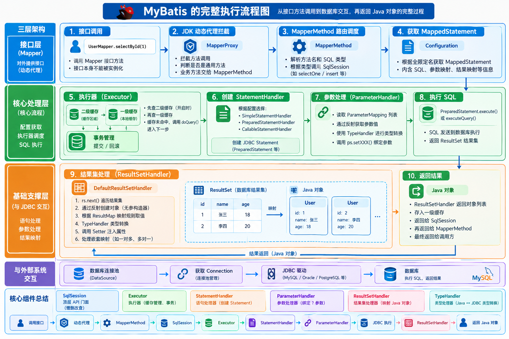
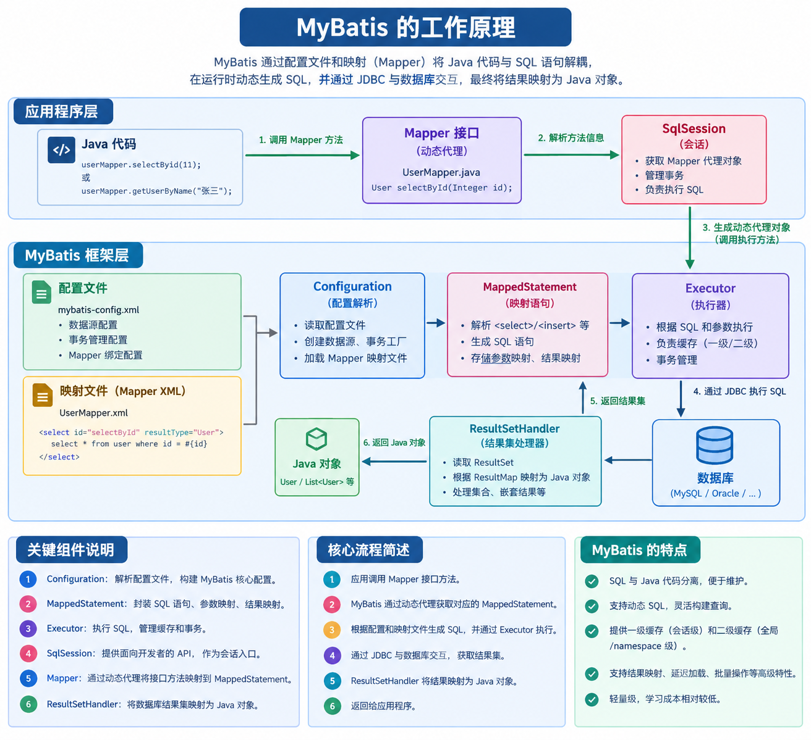
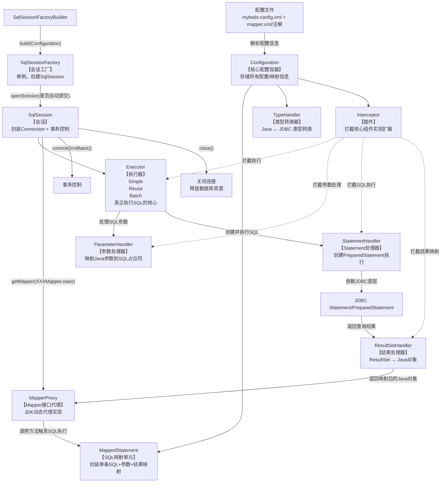

# Mybatis

## 核心执行流程与反射底层机制

### MyBatis 的完整执行流程

MyBatis 的完整执行流程是一次从接口方法调用到数据库交互，再返回 Java 对象的复杂旅程。理解这个流程是掌握 MyBatis 核心原理的关键，也是高级开发者和面试必考的内容。

MyBatis 的执行流程严格遵循其**三层架构**：接口层、核心处理层、基础支撑层。



---

#### 🌟 核心流程全景图

```text
[1. 接口调用] UserMapper.selectById(1)
      ↓
[2. 动态代理] MapperProxy.invoke()
      ↓
[3. 路由调度] MapperMethod.execute() -> SqlSession
      ↓
[4. 获取配置] Configuration 获取 MappedStatement (封装了SQL信息)
      ↓
[5. 执行器] Executor (一级/二级缓存、事务管理)
      ↓
[6. 语句处理器] StatementHandler (创建 PreparedStatement)
      ↓
[7. 参数处理器] ParameterHandler (配合 TypeHandler 设置 ? 参数)
      ↓
[8. 执行SQL] PreparedStatement.executeUpdate/Query()
      ↓
[9. 结果集处理器] ResultSetHandler (配合 TypeHandler 映射结果)
      ↓
[10. 返回结果] Java 对象
```

#### 阶段一：接口层（从方法调用到 SqlSession）

**1. 调用 Mapper 接口方法**
*   **动作**：开发者调用 `userMapper.selectById(1)`。
*   **状态**：`UserMapper` 是一个接口，本身不能被实例化。

**2. JDK 动态代理拦截**
*   **动作**：调用会被 `MapperProxy` 拦截，进入 `MapperProxy.invoke()` 方法。
*   **内部逻辑**：判断当前方法是否是通用方法（如 `toString()`、`hashCode()`）。如果是，直接处理；如果是业务方法，交由 `MapperMethod` 去执行。

**3. MapperMethod 路由调度**
*   **动作**：`MapperMethod` 解析方法名（`selectById`）和 SQL 类型（`SELECT`）。
*   **内部逻辑**：根据 SQL 类型，将请求路由给 `SqlSession` 的具体方法（如 `sqlSession.selectOne()`、`sqlSession.insert()` 等）。

---

#### 阶段二：核心处理层（配置获取与执行器）

**4. 查找 MappedStatement**
*   **动作**：`SqlSession`（默认实现是 `DefaultSqlSession`）接收到请求后，拿着方法的全限定名（如 `com.example.mapper.UserMapper.selectById`）去大管家 `Configuration` 中查找对应的 `MappedStatement`。
*   **说明**：`MappedStatement` 是 MyBatis 启动时解析 XML/注解生成的对象，里面完整记录了这条 SQL 的文本、参数映射、结果映射等信息。

**5. Executor 执行器登场（核心枢纽）**
*   **动作**：`SqlSession` 将 `MappedStatement` 和参数交给 `Executor` 执行。
*   **内部逻辑**：
    *   **二级缓存检查**：如果是查询，且开启了二级缓存，`CachingExecutor` 先检查二级缓存是否有数据。有则直接返回，无则继续。
    *   **一级缓存检查**：进入 `BaseExecutor`，检查本地一级缓存。有则返回，无则继续。
    *   **数据库查询**：如果缓存未命中，调用子类（如 `SimpleExecutor`）的 `doQuery()` 方法真正查询数据库。

---

#### 阶段三：JDBC 交互层（处理 SQL 与参数）

**6. StatementHandler 创建语句**
*   **动作**：`Executor` 通过 `Configuration` 创建 `StatementHandler` 对象。
*   **内部逻辑**：MyBatis 会根据配置决定使用哪种 Handler：
    *   `SimpleStatementHandler`：对应 JDBC 的 `Statement`（用于没有参数的简单 SQL）。
    *   `PreparedStatementHandler`：对应 JDBC 的 `PreparedStatement`（预编译，防注入，最常用）。
    *   `CallableStatementHandler`：对应存储过程。
*   **实例化**：Handler 内部通过 `Connection` 创建原生的 `PreparedStatement` 对象。

**7. ParameterHandler 参数绑定**
*   **动作**：`StatementHandler` 调用 `ParameterHandler` 设置 SQL 中的 `?` 占位符参数。
*   **内部逻辑**：
    *   读取 `MappedStatement` 中的 `ParameterMapping` 列表，知道有几个参数、每个参数对应 Java 对象的哪个属性。
    *   利用之前提到的**反射工具**提取属性值。
    *   调用 `TypeHandler`（类型处理器），根据 Java 类型和 JDBC 类型，调用 `ps.setInt(1, 1)` 或 `ps.setString(2, "张三")` 完成参数绑定。

**8. 执行 SQL**
*   **动作**：`StatementHandler` 调用底层 JDBC 的 `PreparedStatement.execute()` 或 `executeQuery()`。
*   **状态**：此时 SQL 真正被发送到数据库执行，得到 JDBC 的 `ResultSet` 结果集。

---

#### 阶段四：结果映射层（返回 Java 对象）

**9. ResultSetHandler 处理结果集（反射最密集的阶段）**
*   **动作**：`Executor` 拿到 `ResultSet` 后，交给 `ResultSetHandler`（默认 `DefaultResultSetHandler`）处理。
*   **内部逻辑**：
    *   **遍历 ResultSet**：通过 `rs.next()` 读取每一行数据。
    *   **创建对象**：通过反射调用无参构造器实例化目标 Java 对象（如 `new User()`）。
    *   **属性赋值**：根据 `ResultMap` 映射规则，从 `ResultSet` 中取值。利用 `TypeHandler` 将数据库类型转为 Java 类型（如 `rs.getInt("id")`）。
    *   **反射注入**：利用 `MetaObject` 反射工具，调用 Setter 方法（如 `user.setId(1)`）将值注入到对象中。
    *   **处理嵌套映射**：如果有关联对象（一对多、多对一），递归执行上述过程。

**10. 返回与清理**
*   **动作**：
    *   `ResultSetHandler` 将组装好的 Java 对象列表返回给 `Executor`。
    *   `Executor` 将结果存入**一级缓存**，然后返回给 `SqlSession`。
    *   `SqlSession` 返回给 `MapperMethod`，最终返回给调用方。
    *   MyBatis 内部会关闭 `ResultSet` 和 `Statement`，但**不会关闭 `Connection`**（因为连接是由连接池管理的，连接会被连接池回收）。

---

#### 💡 核心组件总结

| 组件                 | 作用                                                         |
| :------------------- | :----------------------------------------------------------- |
| **SqlSession**       | 顶层 API 门面，提供给开发者增删改查的接口。                  |
| **Executor**         | 执行器，负责一级/二级缓存管理、事务提交/回滚。是调度核心。   |
| **StatementHandler** | 语句处理器，负责创建 JDBC Statement，并执行 SQL。            |
| **ParameterHandler** | 参数处理器，负责将 Java 对象参数绑定到 JDBC 的占位符 `?` 上。 |
| **ResultSetHandler** | 结果集处理器，负责将 JDBC 返回的表数据转化为 Java 实体对象。 |
| **TypeHandler**      | 类型处理器，负责 Java 类型与 JDBC 类型的具体转换（如 `String` <-> `VARCHAR`）。 |

理解了这个流程，你就明白了为什么 MyBatis 需要配置 `resultType`（给 ResultSetHandler 用）、为什么能防 SQL 注入（使用了 PreparedStatementHandler）、以及缓存机制是在哪个环节生效的（Executor 层）。

### MyBatis **中的反射**

**MyBatis 底层几乎所有“给属性赋值、调用方法、创建对象”全是反射做的。**

---

#### 1. 创建 Mapper 接口代理对象（最经典）

你写的接口：

```java
public interface UserMapper {
    User selectById(Long id);
}
```

MyBatis 并没有实现类，它是用：

```java
Proxy.newProxyInstance(...)
```

**JDK 动态代理** 创建的代理对象。

而动态代理底层 = **反射**。

---

#### 2. 执行 Mapper 方法时：反射调用方法

当你调用：

```java
userMapper.selectById(1L);
```

MyBatis 内部通过反射拿到方法：

```java
Method method = mapperInterface.getMethod("selectById", Long.class);
```

这是**反射**。

---

#### 3. 参数赋值：反射 set 进 SQL 参数

MyBatis 拿到你的参数后，
通过反射读取对象里的字段值，塞进 `PreparedStatement`：

```java
Field field = user.getClass().getDeclaredField("username");
field.setAccessible(true);
String value = (String) field.get(user);

pstmt.setString(1, value);
```

这是**反射**。

---

#### 4. 结果映射：反射给实体类赋值（最频繁）

查询返回 ResultSet → 封装成 User 对象：

```java
User user = new User();

Field idField = User.class.getDeclaredField("id");
idField.setAccessible(true);
idField.set(user, rs.getLong("id"));

Field nameField = User.class.getDeclaredField("username");
nameField.setAccessible(true);
nameField.set(user, rs.getString("username"));
```

**这一步是 MyBatis 反射使用最多的地方！**

---

#### 5. 创建对象实例：反射 new 实例

```java
Class<?> clazz = Class.forName("com.example.User");
Object obj = clazz.newInstance(); 
```

MyBatis 映射结果时，就是这样**反射创建对象**。

---

#### 6. 调用构造方法：反射

如果你用构造器注入结果：

```xml
<constructor>
    <arg column="id" javaType="Long"/>
</constructor>
```

MyBatis 会反射找构造方法：

```java
Constructor<?> constructor = clazz.getConstructor(Long.class);
Object obj = constructor.newInstance(1001L);
```

还是**反射**。

---

#### 7. 调用 getter/setter 方法

MyBatis 也可以通过：

```java
Method setId = clazz.getMethod("setId", Long.class);
setId.invoke(user, 1001L);
```

反射调用 setter 赋值。

---

#### 最终超级精简版（MyBatis 反射 4 大核心位置）

1. **创建 Mapper 代理 → JDK 动态代理（反射）**
2. **读取参数对象属性 → 反射 get**
3. **创建结果实体对象 → 反射 newInstance**
4. **给实体类赋值 → 反射 field.set / setter.invoke**

**MyBatis 没有一行代码是直接 new 对象、直接调方法**

### MyBatis 执行SQL 中的反射

MyBatis 作为一个半自动 ORM 框架，其核心机制之一就是利用 **Java 反射** 在关系型数据库（JDBC）和 Java 对象之间进行数据映射。如果没有反射，MyBatis 就无法实现自动化的参数绑定和结果集封装。

在 MyBatis 执行 SQL 的全生命周期中，反射主要体现在以下几个核心阶段，并且 MyBatis 为了优化反射性能，专门设计了 `Reflector` 和 `MetaObject` 等组件。

以下是 MyBatis 执行 SQL 过程中使用反射的详细场景：

---

#### 一、 Mapper 接口代理阶段（JDK 动态代理）

当你调用 `userMapper.selectById(1)` 时，`UserMapper` 是一个接口，并没有实现类。MyBatis 使用了 **JDK 动态反射代理**。

*   **反射 API**: `java.lang.reflect.Proxy` 和 `InvocationHandler`。
*   **过程**: MyBatis 在启动时通过反射扫描 Mapper 接口，生成代理工厂 `MapperProxyFactory`。当你调用方法时，实际执行的是 `MapperProxy.invoke()` 方法。该方法通过反射获取被调用的方法信息，并将其路由到对应的 `MapperMethod`，最终交给 `SqlSession` 去执行。

---

#### 二、 参数映射阶段（Java 对象 -> SQL 占位符）

当你传入一个 Java 对象作为参数（如 `insert(User user)`），MyBatis 需要从该对象中提取属性值，设置到 `PreparedStatement` 的 `?` 占位符中。

*   **场景**: SQL 中有 `#{name}`，MyBatis 需要从传入的 `user` 对象中获取 `name` 属性的值。
*   **反射过程**:
    1.  **获取属性值**: MyBatis 不会直接使用原生反射（`field.get()`），而是优先寻找并调用 Getter 方法（如 `getName()`）。如果没有 Getter，才会尝试直接反射访问 Field（前提是开启了 `autoMapping` 或配置了 `field` 访问策略）。
    2.  **类型处理器**: 获取到属性值后，结合反射获取到的属性 Java 类型，交给 `TypeHandler` 去调用 `ps.setXxx()` 设置参数。

---

#### 三、 结果集映射阶段（ResultSet -> Java 对象）—— **反射最密集的阶段**

这是反射使用最频繁的地方。当 JDBC 返回 `ResultSet` 时，MyBatis 需要将每一行数据组装成 Java 对象。

*   **场景**: 查询结果有一列叫 `user_name`，需要映射到 `User` 对象的 `userName` 属性。
*   **反射过程**:
    1.  **实例化对象**: 通过反射调用对象的无参构造器创建实例。MyBatis 默认要求实体类有无参构造器（除非使用构造器映射）。这里使用的是 `Class.getDeclaredConstructor().newInstance()`（反射创建对象）。
    2.  **属性赋值**: MyBatis 通过反射寻找 `userName` 对应的 Setter 方法（如 `setUserName`）。
    3.  **调用 Setter**: 将从 `ResultSet` 中取出的并通过 `TypeHandler` 转换类型后的值，通过反射 `Method.invoke()` 赋给 Java 对象。

---

#### 四、 复杂对象关联映射（嵌套查询/嵌套结果集）

当处理一对多、多对一等复杂映射时（如 `Order` 对象中包含 `List<Item>`），反射的作用更加凸显。

*   **场景**: 将查询出的多个 Item 组装到 Order 的 items 集合中。
*   **反射过程**:
    1.  MyBlsit 通过反射读取 `Order` 类中 `items` 属性的类型。
    2.  如果是 `List` 接口，MyBatis 会通过反射机制判断具体实现类。如果没有指定，它通常会反射实例化一个 `ArrayList` 赋给该属性，然后再把子对象 add 进去。

---

#### 五、 延迟加载代理

MyBatis 支持关联对象的延迟加载。当你查询 Order 时，可能并不立即查询 Item，只有当调用 `order.getItems()` 时才发送 SQL。

*   **反射/字节码增强**: MyBatis 默认使用两种方式实现延迟加载代理：
    1.  **JDK 动态反射代理**（针对有接口的类）。
    2.  **CGLIB 字节码增强**（针对普通类，通过生成子类）。虽然 CGLIB 主要是字节码操作，但其底层设计思想和调用拦截机制与反射代理类似。
*   当拦截到 `getItems()` 方法的调用时，触发代理逻辑，执行关联 SQL。

---

#### 六、 MyBatis 的反射优化利器：Reflector 与 MetaObject

如果每次映射都使用 JDK 原生的 `Class.getMethod()` 和 `Method.invoke()`，性能会非常差。MyBatis 内部封装了一套高效的反射工具箱：

##### 1. `Reflector`（反射器）

MyBatis 启动加载实体类时，会为每个类创建一个 `Reflector` 对象。
*   **作用**: 它在类加载时，**一次性通过反射扫描该类的所有 Getter、Setter 和字段**，并将它们缓存到 `Map` 中（如 `setMethods`、`getMethods`）。
*   **优化**: 之后每次执行 SQL 需要调用 Getter/Setter 时，直接从 `Reflector` 缓存的 Map 中取出对应的 `Method` 对象直接 `invoke()`，避免了每次都去执行昂贵的 `Class.getMethod()` 解析过程。

##### 2. `MetaObject`（对象元数据包装器）

这是 MyBatis 提供给开发者（或框架内部使用）的一个非常方便的反射工具类。
*   **作用**: 它封装了 `Reflector`，支持**属性表达式导航**。
*   **例子**: 假设有对象 `User` 包含 `Dept` 对象，`Dept` 有 `name` 属性。
    *   原生反射：需要先反射获取 `getDept().invoke()`，再反射获取 `getName().invoke()`，非常繁琐。
    *   `MetaObject`：直接调用 `metaObject.getValue("dept.name")`，MyBatis 内部会自动拆解表达式，利用缓存的反射方法逐层获取值。设置值同理：`metaObject.setValue("dept.name", "研发部")`。

##### 3. `ObjectFactory`（对象工厂）

MyBatis 创建结果集对象时，不是直接 `new`，而是通过 `ObjectFactory` 接口。
*   默认实现 `DefaultObjectFactory` 内部依然是通过反射 `Class.getDeclaredConstructor().newInstance()` 来创建对象。你可以实现该接口，介入 MyBatis 的对象创建过程（例如注入某些通用字段）。

---

#### 总结

在 MyBatis 执行 SQL 的过程中，反射无处不在：
1.  **入口**：Mapper 接口的动态代理（反射生成代理类）。
2.  **入参**：反射读取 Java 对象属性，作为 SQL 参数。
3.  **出参**：反射实例化 Java 对象，反射调用 Setter 方法封装结果集。
4.  **高级特性**：处理复杂嵌套对象集合、实现延迟加载代理。

为了克服原生反射的性能瓶颈，MyBatis 通过 **`Reflector` 类级缓存反射元数据** 和 **`MetaObject` 表达式解析**，将反射的开销降到了最低，这也是 MyBatis 性能优于许多其他全自动 ORM 框架（如早期 Hibernate）的原因之一。

## Spring Boot 整合配置与自动装配原理

### Spring Boot 中配置 MySQL

在 Spring Boot 中配置 MySQL，本质上是通过 Spring Boot 的**自动配置机制**，将 `application.yml` 中的属性映射到 `DataSource`（数据源）对象上。

Spring Boot 默认提供了 `DataSourceAutoConfiguration` 类，当它检测到 classpath 下存在数据库驱动（如 MySQL 驱动）时，就会自动创建一个数据源（默认是 HikariCP 连接池）。

以下是 Spring Boot 中配置 MySQL 的完整指南及原理解析：

---

#### 1. 引入依赖

配置生效的前提是引入 Spring Boot 的数据源 Starter 和 MySQL 的 JDBC 驱动：

```xml
<!-- Spring Boot 数据源自动配置 Starter (内置 HikariCP) -->
<dependency>
    <groupId>org.springframework.boot</groupId>
    <artifactId>spring-boot-starter-jdbc</artifactId>
</dependency>
<!-- 或者引入 JPA/Web 等其他 Starter，它们通常也会包含 jdbc -->

<!-- MySQL JDBC 驱动 (Spring Boot 3.x 推荐使用 mysql-connector-j) -->
<dependency>
    <groupId>com.mysql</groupId>
    <artifactId>mysql-connector-j</artifactId>
    <scope>runtime</scope>
</dependency>
```

---

#### 2. 核心 `application.yml` 配置模板

配置 MySQL 连接的所有属性都在 `spring.datasource` 命名空间下：

```yaml
spring:
  datasource:
    # ============ 1. 基础连接四要素 ============
    # JDBC 连接 URL (重点：后面的参数极其重要)
    url: jdbc:mysql://localhost:3306/mydb?useUnicode=true&characterEncoding=utf-8&useSSL=false&serverTimezone=Asia/Shanghai&allowPublicKeyRetrieval=true
    # 数据库用户名
    username: root
    # 数据库密码
    password: 123456
    # JDBC 驱动类名 (Spring Boot 通常能根据 url 自动推断，但显式写出更稳妥)
    # 注意：MySQL 8.x 以上使用 com.mysql.cj.jdbc.Driver
    #       MySQL 5.x 使用 com.mysql.jdbc.Driver
    driver-class-name: com.mysql.cj.jdbc.Driver
    
    # ============ 2. 指定连接池类型 (可选) ============
    # 默认自动探测 classpath 下的 HikariCP。如果引入了 Druid，可指定为：
    # type: com.alibaba.druid.pool.DruidDataSource
```

---

#### 3. URL 参数详解（MySQL 8.x 必看）

在配置 `url` 时，如果不加参数，常常会遇到乱码、时区报错或 SSL 警告。以下是必配参数的解析：

*   `jdbc:mysql://localhost:3306/mydb`：协议、主机、端口、数据库名。
*   `useUnicode=true&characterEncoding=utf-8`：**解决中文乱码**。确保数据库存储和读取使用 UTF-8 编码。
*   `useSSL=false`：**关闭 SSL 警告**。MySQL 8 默认要求使用 SSL 建立连接，如果在开发环境没有配置证书，会疯狂打印警告日志。设为 `false` 可消除警告。
*   `serverTimezone=Asia/Shanghai`：**解决时区报错**。MySQL 8 必备，如果不配置，驱动会抛出 `The server time zone value 'xxx' is unrecognized` 异常。务必使用具体时区（如 `Asia/Shanghai`），不要用偏移量（如 `GMT+8`）。
*   `allowPublicKeyRetrieval=true`：**解决认证报错**。MySQL 8 默认使用 `caching_sha2_password` 加密方式，如果不加此参数，可能会报 `Public Key Retrieval is not allowed` 错误。

---

#### 4. 配合连接池调优 (HikariCP)

在配置 MySQL 连接时，往往需要配合连接池参数，以防止连接被耗尽或频繁创建销毁：

```yaml
spring:
  datasource:
    url: jdbc:mysql://localhost:3306/mydb?useUnicode=true&characterEncoding=utf-8&useSSL=false&serverTimezone=Asia/Shanghai&allowPublicKeyRetrieval=true
    username: root
    password: 123456
    driver-class-name: com.mysql.cj.jdbc.Driver
    
    # 因为默认是 HikariCP，所以直接在 hikari 节点下配置
    hikari:
      minimum-idle: 5          # 最小空闲连接数
      maximum-pool-size: 20    # 最大连接数
      connection-timeout: 30000 # 连接超时时间 (毫秒)
      max-lifetime: 1800000    # 连接最大存活时间 (毫秒)，建议比 MySQL 的 wait_timeout 小几十秒
      pool-name: MyHikariPool  # 连接池名称
```

---

#### 5. 自动配置底层原理揭秘

Spring Boot 是如何读取这个 yml 并连上 MySQL 的？

1.  **属性绑定 (`@ConfigurationProperties`)**：
    Spring Boot 内部有一个 `DataSourceProperties` 类。它带有 `@ConfigurationProperties(prefix = "spring.datasource")` 注解。Spring Boot 启动时，会将 yml 中 `spring.datasource` 下的 `url`、`username`、`password` 等属性，通过 Setter 方法注入到这个类的字段中。

2.  **驱动自动推断**：
    如果你没有在 yml 中写 `driver-class-name`，Spring Boot 会根据 `url` 的前缀（如 `jdbc:mysql:`）去 `DriverClassNameProvider` 中匹配，自动找到 `com.mysql.cj.jdbc.Driver`。

3.  **数据源创建 (`DataSourceAutoConfiguration`)**：
    这个自动配置类带有 `@ConditionalOnClass({ DataSource.class, EmbeddedDatabaseType.class })`。当它发现 classpath 下有 JDBC API 和 MySQL 驱动时，它会调用 `DataSourceProperties` 中的属性，创建一个 `HikariDataSource` 对象，并将其注册为 Spring 容器中的一个 Bean。

4.  **交给 MyBatis / JdbcTemplate 使用**：
    因为 Spring 容器中已经有了一个现成的 `DataSource` Bean，MyBatis 或 JdbcTemplate 的自动配置类在初始化时，只需通过 `@Autowired` 拿到这个 `DataSource`，就能开始执行 SQL 了。

---

#### 6. 生产环境最佳实践：密码加密

在实际生产环境中，**绝对不能**将明文密码（`password: 123456`）直接写在 yml 文件中提交到 Git。通常有以下几种处理方式：

##### 方式一：使用环境变量（云原生推荐）

在 yml 中使用占位符读取环境变量：
```yaml
spring:
  datasource:
    url: ${DB_URL:jdbc:mysql://localhost:3306/mydb}
    username: ${DB_USERNAME:root}
    password: ${DB_PASSWORD:123456} # 冒号后为默认值，如果没有环境变量则用默认值
```
然后在服务器上配置环境变量 `DB_PASSWORD=真实密码` 启动应用。

##### 方式二：使用 Jasypt 加密（配置文件加密）

引入 `jasypt-spring-boot-starter` 依赖，将密码加密后写在 yml 中：
```yaml
spring:
  datasource:
    # ENC() 括号内为加密后的密文
    password: ENC(G6NQ18bpa3G0UvT8CSjy0Q==)
```
启动应用时传入密钥：`java -jar app.jar -Djasypt.encryptor.password=你的秘钥`。

### Spring Boot 配置 MyBatis

在 Spring Boot 中，MyBatis 的“自动配置”机制主要依赖于 `MybatisAutoConfiguration` 类。当 Spring Boot 检测到类路径下存在 `SqlSessionFactory` 和 `SqlSessionFactoryBean` 时，就会自动配置 MyBatis 的核心组件。

开发者只需通过 `application.yml`（或 `.properties`）文件，以 `mybatis.` 为前缀进行配置，就能覆盖默认行为。

以下是 Spring Boot 中 MyBatis 的完整 `application.yml` 配置指南及原理解析：

---

#### 1. 引入依赖

配置生效的前提是引入了 MyBatis 的 Spring Boot Starter：
```xml
<dependency>
    <groupId>org.mybatis.spring.boot</groupId>
    <artifactId>mybatis-spring-boot-starter</artifactId>
    <version>3.0.3</version> <!-- 请根据 Spring Boot 版本选择合适的版本 -->
</dependency>
```

---

#### 2. 核心 `application.yml` 配置模板

以下是实际开发中最常用的配置项，分为基础配置、全局行为配置和日志配置：

```yaml
mybatis:
  # ============ 1. 基础配置 ============
  # 指定 Mapper XML 文件的路径。通常放在 resources 目录下
  mapper-locations: classpath:mapper/*.xml
  # 实体类包路径别名。配置后，在 XML 中 resultType="User" 不用写全限定名
  type-aliases-package: com.example.demo.entity
  # 检查配置文件是否存在外部配置（一般不用，配置全写在 yml 里）
  # config-location: classpath:mybatis-config.xml

  # ============ 2. 全局行为配置 ============
  configuration:
    # 数据库下划线命名自动映射为 Java 驼峰命名 (如 user_name -> userName)
    map-underscore-to-camel-case: true
    
    # 开启全局二级缓存（默认 false，通常由接口注解 @CacheNamespace 局部开启）
    cache-enabled: false
    
    # 延迟加载全局开关。开启后，关联对象只有在被访问时才会发送 SQL
    lazy-loading-enabled: true
    
    # 延迟加载时，按属性级别加载（true），还是加载所有延迟属性（false，3.4.1及之前默认）
    aggressive-lazy-loading: false
    
    # 默认的执行器。SIMPLE 是普通执行器；REUSE 重用预处理语句；BATCH 批量执行器
    default-executor-type: simple
    
    # 设置超时时间，它决定驱动等待数据库响应的秒数
    default-statement-timeout: 25
    
    # 允许 JDBC 支持自动生成主键（需要数据库驱动支持，如 MySQL 自增）
    use-generated-keys: true

  # ============ 3. 日志配置（极其重要，用于开发排错）============
  # 指定 MyBatis 所用的日志框架，不配置则默认不打印 SQL
  configuration:
    log-impl: org.apache.ibatis.logging.stdout.StdOutImpl # 控制台打印纯文本 SQL
    # 如果使用 Logback/Slf4j，可以指定包名级别来打印 SQL：
    # logging:
    #   level:
    #     com.example.demo.mapper: DEBUG
```

---

#### 3. MyBatis-Plus 的 yml 配置（扩展）

如果你使用的是 **MyBatis-Plus**，前缀需要改为 `mybatis-plus`，并且它会额外提供一些全局策略配置：

```yaml
mybatis-plus:
  mapper-locations: classpath:mapper/*.xml
  type-aliases-package: com.example.demo.entity
  configuration:
    map-underscore-to-camel-case: true
    log-impl: org.apache.ibatis.logging.stdout.StdOutImpl
  
  # ============ MyBatis-Plus 特有全局配置 ============
  global-config:
    db-config:
      # 主键策略：AUTO(数据库自增), ASSIGN_ID(雪花算法,默认), INPUT(自行输入)
      id-type: assign_id
      # 表名前缀（如果数据库表都有统一前缀，实体类上就不用加 @TableName）
      table-prefix: t_
      # 逻辑删除字段名
      logic-delete-field: is_deleted
      # 逻辑删除：1 代表已删除，0 代表未删除
      logic-delete-value: 1
      logic-not-delete-value: 0
```

---

#### 4. 底层原理揭秘：YAML 是如何被读取的？

Spring Boot 的自动配置机制是如何将 yml 配置转化为 MyBatis 运行时的参数的？

1.  **属性绑定 (`@ConfigurationProperties`)**：
    MyBatis Starter 中有一个 `MybatisProperties` 类。它使用了 `@ConfigurationProperties(prefix = "mybatis")` 注解。Spring Boot 启动时，会将 yml 中所有以 `mybatis.` 开头的配置项，通过 Setter 方法注入到这个 Bean 的属性中。

2.  **自动配置类 (`@AutoConfiguration`)**：
    框架内部有 `MybatisAutoConfiguration` 类。当存在 `DataSource` 时，它会利用 `MybatisProperties` 中的值，创建 `SqlSessionFactoryBean`。

3.  **构建 `SqlSessionFactory`**：
    ```java
    // 伪代码演示自动配置过程
    @Bean
    public SqlSessionFactory sqlSessionFactory(DataSource dataSource, MybatisProperties properties) {
        SqlSessionFactoryBean factory = new SqlSessionFactoryBean();
        factory.setDataSource(dataSource);
        
        // 1. 读取 mapper-locations 并设置
        if (properties.getMapperLocations() != null) {
            factory.setMapperLocations(properties.getMapperLocations());
        }
        
        // 2. 读取 type-aliases-package 并设置
        if (properties.getTypeAliasesPackage() != null) {
            factory.setTypeAliasesPackage(properties.getTypeAliasesPackage());
        }
        
        // 3. 读取 configuration 节点下的配置，应用到 org.apache.ibatis.session.Configuration
        if (properties.getConfiguration() != null) {
            factory.setConfiguration(properties.getConfiguration()); // 比如 map-underscore-to-camel-case 就在这里生效
        }
        
        return factory.getObject();
    }
    ```

---

#### 5. 最佳实践建议

1.  **日志打印方式**：
    *   **开发环境**：推荐在 yml 中设置 `log-impl: org.apache.ibatis.logging.stdout.StdOutImpl`，这样控制台会打印完整的 SQL、参数和返回结果，极其方便排错。
    *   **生产环境**：**绝对不要**使用 `StdOutImpl`！应注释掉该行，改为使用 Logback 等日志框架，并通过 `logging.level.com.xxx.mapper=DEBUG` 只打印 SQL 语句，不打印结果集，避免大量日志拖垮系统。
2.  **XML 与注解的选择**：
    *   无论你是使用纯注解开发，还是 XML 开发，只要 SQL 有一点复杂度，`mapper-locations` 都建议配上。Spring Boot 默认不会去扫描 `resources` 下的 XML，不配置会报 `Invalid bound statement (not found)` 错误。
3.  **配置分离**：
    虽然 yml 支持配置所有 MyBatis 属性（通过 `mybatis.configuration.xxx`），但在一些极其老旧的项目迁移中，如果已有原生的 `mybatis-config.xml`，可以直接用 `mybatis.config-location` 指向它，避免在 yml 中重写大量配置。

### MyBatis 配置默认值

在 Spring Boot 中引入 `mybatis-spring-boot-starter` 后，对于很多基础项目，你确实可以**一行 MyBatis 配置都不写**就能跑起来。

这正是 Spring Boot **“约定大于配置”** 的精髓所在。MyBatis Starter 内部提供了大量的默认值，只要你的项目结构符合它的约定，零配置即可工作。

下面为你详细解析：为什么可以不写？以及什么情况下必须写？

---

#### 一、 为什么可以不写配置？（MyBatis 的默认约定）

如果你完全不加 `mybatis` 的 yml 配置，MyBatis 会按照以下默认规则运行：

##### 1. Mapper XML 文件的位置约定

*   **默认行为**：如果你不配置 `mybatis.mapper-locations`，MyBatis 默认**不会**去 `resources/mapper/` 目录下找 XML 文件。
*   **那怎么运行？** 此时 MyBatis 纯依赖**注解开发**。只要你在 Mapper 接口的方法上写了 `@Select`、`@Insert` 等注解，SQL 就能正常执行，完全不需要 XML 文件。

##### 2. 实体类别名约定

*   **默认行为**：如果你不配置 `mybatis.type-aliases-package`，MyBatis 就不知道你的实体类在哪。
*   **那怎么运行？** 在注解或 XML（如果后续用到了）中，必须写类的**全限定名**（如 `com.example.entity.User`），而不能简写为 `User`。

##### 3. 驼峰命名转换

*   **默认行为**：`map-underscore-to-camel-case` 默认是 **`false`**（关闭状态）。
*   **那怎么运行？** 如果你的数据库字段是 `user_name`，Java 属性是 `userName`，默认情况下 MyBatis 是映射不上的（查询结果会是 null）。你必须通过 SQL 别名（`SELECT user_name AS userName`）或者 `@Results` 注解来手动映射。

##### 4. Mapper 接口扫描

*   **默认行为**：你不需要配置扫描路径，但**必须**在启动类上加 `@MapperScan("com.example.mapper")` 或者在每个 Mapper 接口上加 `@Mapper` 注解。Spring Boot 才能把接口注册为代理 Bean。

---

#### 二、 零配置可运行的示例

假设你建了一个极简项目，结构如下，不写任何 MyBatis yml 配置：

```java
// 实体类
public class User {
    private Long id;
    private String name; // 数据库字段也是 name，不需要驼峰转换
    // getter/setter...
}

// Mapper 接口 (使用注解)
@Mapper
public interface UserMapper {
    @Select("SELECT id, name FROM user WHERE id = #{id}")
    User selectById(Long id);
}

// Service
@Service
public class UserService {
    @Autowired
    private UserMapper userMapper;
    
    public User getUser(Long id) {
        return userMapper.selectById(id);
    }
}
```
**结论**：以上代码在不写任何 `mybatis:` 配置的情况下，可以完美运行。

---

#### 三、 什么情况下必须写配置？（打破约定时）

虽然零配置能跑，但在实际企业开发中，我们通常会用到 XML、复杂映射和日志，这时候就必须写 yml 配置了：

##### 1. 必须写 `mapper-locations` 的情况：使用 XML 文件

这是最常见的场景。如果你把 SQL 写在 `resources/mapper/UserMapper.xml` 中，如果不配置 `mapper-locations`，MyBatis 启动时会报错，提示找不到 SQL 语句（`Invalid bound statement (not found)`）。
**必须添加配置**：
```yaml
mybatis:
  mapper-locations: classpath:mapper/*.xml
```

##### 2. 强烈建议写 `map-underscore-to-camel-case` 的情况：数据库有下划线

数据库规范通常要求字段用下划线（`create_time`），Java 规范要求驼峰（`createTime`）。如果不开启这个配置，你要写无数个 `@Results` 注解或 SQL 别名，痛苦至极。
**强烈建议添加配置**：
```yaml
mybatis:
  configuration:
    map-underscore-to-camel-case: true
```

##### 3. 必须写 `log-impl` 的情况：开发期需要看 SQL 日志

如果不配置日志，MyBatis 执行 SQL 时控制台静悄悄的，出了 Bug 根本不知道传了什么参数、执行了什么 SQL。
**开发环境必须添加配置**：
```yaml
mybatis:
  configuration:
    log-impl: org.apache.ibatis.logging.stdout.StdOutImpl
```

##### 4. 建议写 `type-aliases-package` 的情况：XML 写起来太长

如果你在 XML 里写 `resultType="com.example.demo.entity.User"`，路径太长看着眼晕。配置别名包后，可以直接写 `resultType="User"`。
**建议添加配置**：
```yaml
mybatis:
  type-aliases-package: com.example.demo.entity
```

---

#### 总结

*   **能不能不写？** 能。如果是极简的注解版小 Demo，完全可以零配置运行。
*   **实际项目中写不写？** **必须写**。因为在真实项目中，为了应对复杂业务，必然会用到 XML 文件、开启驼峰映射、打印 SQL 日志。所以你在上一个问题中看到的 yml 配置模板，才是实际开发的标准姿态。

### Spring Boot 的“自动配置”机制

因为**Spring Boot 的“自动配置”机制，把底层所有繁琐操作全帮你做完了**。

我用最直白、最本质的话给你讲清楚：
**你只写几行 yml，Spring Boot 就自动把整个 JDBC/MyBatis 环境全部搭好了。**

---

#### 1. 你在 yml 里写的到底是什么？

你只写了这几样：

```yaml
spring:
  datasource:
    url: jdbc:mysql://...
    username: root
    password: 123456
    driver-class-name: com.mysql.cj.jdbc.Driver
```

这几行本质就是：
**告诉 Spring Boot 数据库在哪、账号密码是什么**

---

#### 2. Spring Boot 看到这些配置后，自动干了什么？

它**自动执行了下面所有你以前要手写的代码**：

1. **加载 MySQL 驱动**
2. **创建 DataSource（连接池 Hikari）**
3. **建立数据库连接 Connection**
4. **自动配置 JdbcTemplate**
5. **如果引入了 MyBatis：自动配置 SqlSessionFactory、MapperScannerConfigurer**
6. **把 Mapper 接口生成代理对象注入 Spring**
7. **自动事务管理**

也就是说：

##### **以前几百行代码 → 现在 4 行配置搞定**

---

#### 3. 为什么能这么爽？

因为 **spring-boot-starter-jdbc / mybatis-spring-boot-starter**
内部都有一个 **自动配置类**：

- `DataSourceAutoConfiguration`
- `JdbcTemplateAutoConfiguration`
- `MybatisAutoConfiguration`

这些类**一启动就自动运行**，读取 yml 配置，自动创建所有 Bean。

---

#### 4. 最终效果（你只需要做两件事）

1. 在 yml 写**数据库地址、账号、密码**
2. 写 Mapper 接口，直接用 `@Autowired` 注入

**中间所有 JDBC、连接、PreparedStatement 全都被隐藏了。**

---

#### 5. 一句话终极总结

##### 你在 application.yml 配置的是“连接信息”，

Spring Boot 根据这些信息自动把整个数据库环境（DataSource、连接池、MyBatis、SqlSession）全部初始化好，
所以你不用写任何底层代码，直接用就行。

---


------

## 一、基础概念

1. **什么是 MyBatis？它和 Hibernate 有什么区别？**
   - MyBatis 是半自动 ORM 框架，需要手动编写 SQL；Hibernate 是全自动 ORM，会自动生成 SQL。
   - MyBatis 灵活、可控，适合复杂 SQL；Hibernate 开发快，但 SQL 不透明。
2. **MyBatis 的工作原理是什么？**
   - 核心流程：`SqlSessionFactoryBuilder → SqlSessionFactory → SqlSession → Mapper接口 → 执行SQL → 映射结果`。
   - 使用 XML 或注解定义 SQL，框架负责参数映射和结果映射。
3. **MyBatis 的主要组件有哪些？**
   - `SqlSessionFactory`、`SqlSession`、`Executor`、`MappedStatement`、`Configuration`、`MapperProxy` 等。
4. **MyBatis 中的 Mapper 文件主要包括哪些标签？**
   - `<select>`, `<insert>`, `<update>`, `<delete>`, `<resultMap>`, `<parameterMap>`, `<sql>`, `<include>`。
5. **MyBatis 的配置文件 mybatis-config.xml 有哪些重要节点？**
   - `<environments>`, `<mappers>`, `<typeAliases>`, `<plugins>`, `<settings>`, `<typeHandlers>`。


### 1. **什么是 MyBatis？它和 Hibernate 有什么区别？**

**要点：**

- **MyBatis** 是一个半自动的持久层框架（半 ORM / SQL 映射框架）。开发者需要自己编写 SQL（XML 或注解），MyBatis 负责参数绑定、执行 SQL、以及将结果映射成 Java 对象。
- **Hibernate** 是一个全自动的 ORM（对象-关系映射）框架，基于实体类与映射配置（或注解）自动生成 SQL 并负责对象的持久化、关系管理与对象状态跟踪。

**优缺点对比（常考点）：**

- **可控性**：MyBatis 更灵活、SQL 可读可控，适合复杂 SQL、报表、性能调优场景；Hibernate 更“省事”，自动生成 SQL，适合 CRUD 密集、业务 CRUD 与对象模型高度一致的场景。
- **开发效率**：Hibernate 在简单 CRUD 场景下开发效率高；MyBatis 在复杂 SQL 场景下能减少 SQL 问题但需要手写 SQL，开发量较大。
- **学习成本**：Hibernate 学习曲线较陡（Session 管理、级联、缓存、延迟加载策略等）；MyBatis 学起来更直观（熟悉 SQL 即可）。
- **性能与优化**：MyBatis 易于针对 SQL 做精细优化；Hibernate 需要理解执行计划与 N+1 问题并做好配置/查询策略。

**面试延伸常见题点：**

- 何时选 MyBatis？（复杂查询、精确 SQL 控制、与现有 SQL 兼容）
- 何时选 Hibernate？（领域模型显著、对象关系简单、快速开发）

------

### 2. **MyBatis 的工作原理是什么？**



#### Mybatis编程步骤 ？

1.创建SqlSessionFactory
2.通过SqlSessionFactory创建SqlSession
3.通过SqlSession执行数据库操作
4.调用SqlSession的commit()方法提交事务
5.调用SqlSession的close()方法关闭会话


`SqlSession` 是 MyBatis 与数据库交互的核心会话对象，**所有数据库操作都必须通过 SqlSession 完成**。开启新 SqlSession 的核心入口是 `SqlSessionFactory`。

**关键流程（高层次）：**

1. **读取配置与映射文件**：MyBatis 读取 `mybatis-config.xml` 与 mapper XML/注解，构建 `Configuration` 对象。
2. **构建 SqlSessionFactory**：`SqlSessionFactoryBuilder` 根据配置创建 `SqlSessionFactory`（工厂，用于产生 SqlSession）。
3. **获取 SqlSession（类似 JDBC Connection）**：通过 `SqlSessionFactory.openSession()` 得到 `SqlSession`，它封装了数据库连接与事务控制。
4. **获取 Mapper**：使用 `sqlSession.getMapper(YourMapper.class)` 得到 Mapper 接口的代理（`MapperProxy`）。
5. **执行 SQL**：调用 Mapper 方法触发 `MappedStatement` 的执行，MyBatis 映射参数到 SQL（使用 `ParameterHandler`），并通过 `Executor` 调用 JDBC 执行。
6. **结果映射**：`ResultSetHandler` 把 `ResultSet` 映射成指定的 Java 对象（基于 `resultType` 或 `resultMap`）。
7. **提交/回滚/关闭**：SqlSession 控制事务提交或回滚，并关闭连接。

**补充概念：**

- `MappedStatement`：每条 SQL 对应的信息（SQL 文本、参数类型、结果映射等）。
- `Executor`：真正执行 SQL 的策略层（SimpleExecutor、ReuseExecutor、BatchExecutor）。
- `TypeHandler`：Java 类型与 JDBC 类型的转换器。
- `Interceptor`（插件）：可以拦截 Executor/StatementHandler/ParameterHandler/ResultSetHandler 的方法，实现扩展（如分页、日志、审计）。
- **ResultSet**中记录行第一列的索引为1,这是JDBC规范明确规定的。JDBC采用从1开始的列索引计数方式,这与数据库中的列计数方式保持一致。

**示例（简化调用链）：**

```java
SqlSessionFactory factory = new SqlSessionFactoryBuilder().build(reader);
try (SqlSession session = factory.openSession()) {
    UserMapper mapper = session.getMapper(UserMapper.class);
    User u = mapper.selectById(1);
    session.commit();
}
```


MyBatis 的工作原理基于对 JDBC 的封装与优化，通过配置文件和映射关系将 SQL 语句与 Java 方法绑定，简化数据库操作。其核心流程可分为 **初始化** 和 **执行 SQL** 两大阶段，具体如下：

#### **一、初始化阶段：加载配置并构建核心组件**

MyBatis 启动时会加载所有配置信息，解析为内存中的对象，为后续 SQL 执行做准备。

1. **加载配置文件**  
   - 读取 **全局配置文件**（如 `mybatis-config.xml`）：包含数据源（DataSource）、事务管理器（TransactionManager）、类型别名、插件等全局配置。  
   - 读取 **映射文件**（如 `UserMapper.xml`）或 **注解映射**（如 `@Select`）：包含 SQL 语句、参数映射、结果集映射等信息。  

2. **解析配置并构建核心对象**  
   - **`Configuration` 对象**：MyBatis 的核心配置容器，存储所有解析后的配置信息（数据源、映射语句、类型转换器等），贯穿整个生命周期。  
   - **`SqlSessionFactory` 工厂**：通过 `SqlSessionFactoryBuilder` 解析 `Configuration` 后创建，是生成 `SqlSession` 的工厂类（单例存在，线程安全）。  

#### **二、执行 SQL 阶段：通过 SqlSession 完成数据库操作**

当调用 Mapper 接口方法执行 SQL 时，MyBatis 会经历以下步骤：

1. **获取 `SqlSession`**  
   - 通过 `SqlSessionFactory.openSession()` 创建 `SqlSession` 对象，它是 MyBatis 与数据库交互的会话接口，封装了执行 SQL、获取 Mapper、事务管理（`commit`/`rollback`）等方法。  
   - `SqlSession` 依赖 `Executor`（执行器）完成实际操作，默认使用 `SimpleExecutor`，可通过配置切换为批量执行器（`BatchExecutor`）等。

2. **获取 Mapper 代理对象**  
   - 调用 `sqlSession.getMapper(UserMapper.class)` 时，MyBatis 会通过 **JDK 动态代理** 生成 Mapper 接口的代理对象（`MapperProxy`）。  
   - 代理对象的作用：拦截 Mapper 接口方法调用，将方法映射到对应的 SQL 语句。

3. **解析 Mapper 方法，生成 `MappedStatement`**  
   - 代理对象根据方法名（如 `UserMapper.selectById`）在 `Configuration` 中查找对应的 `MappedStatement`（封装了 SQL 语句、参数类型、结果类型等信息）。  
   - 例如，`UserMapper.xml` 中 `<select id="selectById">` 标签会被解析为 `MappedStatement`，与 `selectById` 方法绑定。

4. **参数处理与 SQL 拼接**  
   - **参数映射**：根据 `MappedStatement` 中的参数配置（如 `#{id}`），将 Java 方法参数（如 `1L`）转换为 SQL 所需的参数（通过 `TypeHandler` 处理类型转换，如 Integer → VARCHAR）。  
   - **动态 SQL 解析**：若 SQL 包含 `<if>`、`<where>` 等动态标签，MyBatis 会根据参数值动态拼接 SQL 语句（如 `WHERE id = ?`）。

5. **执行 SQL 并处理结果**  
   - `Executor` 调用 JDBC 的 `PreparedStatement` 执行 SQL（通过数据源获取数据库连接）。  
   - **结果映射**：将数据库返回的 `ResultSet` 转换为 Java 对象（如 `User`），通过 `ResultMap` 配置映射字段（如数据库 `user_name` → 实体 `userName`），同样依赖 `TypeHandler` 处理类型转换。

6. **事务管理**  
   - 若手动管理事务，需通过 `sqlSession.commit()` 提交或 `rollback()` 回滚；若使用 Spring 集成，事务由 Spring 管理，MyBatis 适配 Spring 的事务机制。

7. **关闭 `SqlSession`**  
   - 操作完成后，`SqlSession` 需关闭（或通过 Spring 自动管理），释放数据库连接（回归连接池）。

#### **三、核心组件总结**

| 组件               | 作用                                  |
|--------------------|---------------------------------------|
| `Configuration`    | 存储全局配置和映射信息，MyBatis 核心  |
| `SqlSessionFactory`| 生成 `SqlSession` 的工厂，单例线程安全 |
| `SqlSession`       | 数据库会话接口，封装 SQL 执行和事务   |
| `Executor`         | `SqlSession` 的底层执行器，执行 SQL   |
| `MapperProxy`      | Mapper 接口的动态代理，关联方法与 SQL |
| `MappedStatement`  | 封装单条 SQL 语句及配置信息           |
| `TypeHandler`      | 处理 Java 类型与数据库类型的转换       |

#### **总结**

MyBatis 的工作原理可概括为：  
1. **初始化**：加载配置文件 → 解析为 `Configuration` → 创建 `SqlSessionFactory`；  
2. **执行 SQL**：`SqlSession` 获取 Mapper 代理 → 解析方法找到对应 SQL → 处理参数并执行 → 映射结果返回。  

通过这种方式，MyBatis 既保留了 SQL 编写的灵活性，又避免了 JDBC 的重复代码（如连接管理、参数设置、结果转换），实现了“半自动化”的 ORM 映射。

#### MyBatis 核心工作原理关系图（Mermaid 可视化）

以下是覆盖核心组件、执行流程、组件关联的完整关系图，结合流程走向和组件依赖，面试/梳理逻辑都适用：



#### 关系图文字版解读（便于快速理解）

```
┌─────────────────────────────────┐
│ 配置文件：mybatis-config.xml    │
│          mapper.xml/注解        │
└───────────────────┬─────────────┘
                    │ 解析
                    ▼
┌─────────────────────────────────┐
│ Configuration（核心配置容器）    │
│ 包含：MappedStatement/TypeHandler/Interceptor
└───────────────────┬─────────────┘
                    │
┌───────────────────┴─────────────┐
│ SqlSessionFactoryBuilder        │
└───────────────────┬─────────────┘
                    │ build
                    ▼
┌─────────────────────────────────┐
│ SqlSessionFactory（会话工厂）    │
└───────────────────┬─────────────┘
                    │ openSession()
                    ▼
┌─────────────────────────────────┐
│ SqlSession（会话）               │
│ 封装：Connection + 事务 + Executor
└─────────┬─────────────┬─────────┘
          │             │
          │ getMapper() │
          ▼             ▼
┌─────────────────────┐ ┌─────────────────────┐
│ MapperProxy（代理） │ │ Executor（执行器）  │
└─────────┬───────────┘ └─────────┬───────────┘
          │                       │
          │ 触发MappedStatement   │ 处理参数/执行SQL
          ▼                       ▼
┌─────────────────────┐ ┌─────────────────────┐
│ MappedStatement     │ │ ParameterHandler    │
└─────────────────────┘ └─────────┬───────────┘
                                  │
                                  ▼
┌─────────────────────────────────┐
│ StatementHandler（JDBC Statement）│
└───────────────────┬─────────────┘
                    │ 执行SQL返回ResultSet
                    ▼
┌─────────────────────────────────┐
│ ResultSetHandler（结果映射）     │
└───────────────────┬─────────────┘
                    │ 映射为Java对象
                    ▼
┌─────────────────────────────────┐
│ 返回结果到Mapper方法调用处       │
└─────────────────────────────────┘

【扩展】Interceptor（插件）可拦截Executor/StatementHandler/ParameterHandler/ResultSetHandler
```

##### 核心组件关联说明（对应图中节点）

| 组件              | 核心作用                                    | 与其他组件的关联                                   |
| ----------------- | ------------------------------------------- | -------------------------------------------------- |
| Configuration     | 全局配置容器，存储所有MyBatis配置和映射信息 | 被SqlSessionFactoryBuilder读取，供所有核心组件使用 |
| SqlSessionFactory | 单例工厂，生产SqlSession                    | 由Builder基于Configuration构建                     |
| SqlSession        | 数据库会话，封装连接和事务                  | 从Factory获取，创建Mapper代理、持有Executor        |
| MapperProxy       | Mapper接口的JDK动态代理实现                 | 代理Mapper方法调用，触发MappedStatement执行        |
| MappedStatement   | 单条SQL的封装（SQL文本+参数+结果映射）      | 由Configuration加载，被Executor执行                |
| Executor          | SQL执行器（真正执行SQL的核心）              | 由SqlSession创建，调用StatementHandler执行SQL      |
| ParameterHandler  | 参数处理器                                  | 由Executor调用，将Java参数映射到SQL占位符          |
| StatementHandler  | JDBC Statement处理器                        | 创建PreparedStatement，执行SQL并返回ResultSet      |
| ResultSetHandler  | 结果处理器                                  | 将ResultSet映射为Java对象（resultType/resultMap）  |
| TypeHandler       | 类型转换器                                  | 辅助ParameterHandler/ResultSetHandler完成类型转换  |
| Interceptor       | 插件扩展                                    | 拦截核心组件的方法，实现分页/日志等扩展            |

#### 核心总结

1. **流程核心**：配置加载 → 工厂构建 → 会话创建 → Mapper代理 → SQL执行 → 结果映射，全程围绕 `Configuration` 作为核心配置容器；
2. **组件依赖**：`SqlSession` 是入口，`Executor` 是执行核心，`MappedStatement` 是SQL映射单元，四大处理器（Parameter/Statement/ResultSet/TypeHandler）完成参数/结果的核心处理；
3. **扩展能力**：通过 `Interceptor` 拦截四大核心处理器，可灵活扩展MyBatis功能（如分页插件、通用CRUD）；
4. **底层依赖**：最终通过JDBC的Statement/PreparedStatement执行SQL，本质是对JDBC的封装和简化。

### MyBatis完整执行流程

（面试完整版，分为【启动初始化阶段】+【运行SQL执行阶段】）

> 
> 一句话：**启动阶段解析XML/注解，生成Configuration和MappedStatement；运行阶段通过JDK动态代理拦截Mapper方法，Executor负责缓存，StatementHandler封装JDBC，ParameterHandler设置参数，ResultSetHandler做结果映射**

#### 一、启动初始化阶段（项目启动，只执行一次）

1. **加载配置文件**
解析`mybatis-config.xml`全局配置、Mapper XML文件（或注解SQL）。
2. **构建Configuration全局配置对象**
把所有配置、环境、数据源、类型处理器、插件全部存入Configuration。> 
> 解析每一条`<select><insert>`，生成 **MappedStatement**，里面包含：SQL模板、resultMap、参数类型、返回类型、statementId。MP的SqlInjector就是启动阶段在这里注入额外MappedStatement。
3. **构建SqlSessionFactory**
`SqlSessionFactoryBuilder`读取Configuration，创建SqlSessionFactory工厂对象，**全局单例**。

#### 二、运行阶段：调用Mapper方法执行SQL（重点，面试核心）

```
User user = userMapper.selectById(1L);
```

1. **获取SqlSession**
`sqlSessionFactory.openSession()`，创建`DefaultSqlSession`；同时创建`Executor`执行器（默认SimpleExecutor；开启二级缓存则外层包装`CachingExecutor`），同时初始化事务Transaction。

> 
> Executor三种：SimpleExecutor、ReuseExecutor（复用Statement）、BatchExecutor（批量）
2. **获取Mapper代理对象（JDK动态代理）**`sqlSession.getMapper(UserMapper.class)`，MapperRegistry返回**MapperProxy代理对象**。Mapper接口没有实现类，调用方法时会进入`MapperProxy.invoke()`。
3. **代理拦截，找到MappedStatement**
invoke方法中，封装`MapperMethod`，根据接口+方法名拿到statementId，从Configuration中找到对应的`MappedStatement`。
4. **Executor执行，先查缓存**
Executor是核心调度器，**先查二级缓存（CachingExecutor），二级缓存命中直接返回；未命中，查询一级缓存（当前SqlSession级别）**。

> 
> 一级缓存命中，直接返回，不再访问数据库。
> 缓存没命中，继续往下走。
5. **创建BoundSql，解析动态SQL**
解析动态SQL标签`<if>、<where>`，处理`#{}`、`${}`，生成BoundSql，包含最终SQL文本、参数映射信息。

> 
> `#{}`预编译，防止SQL注入；`${}`字符串直接替换，有注入风险。
6. **StatementHandler + ParameterHandler 处理参数**
Executor创建`StatementHandler`（默认PreparedStatementHandler）；

- 从连接池拿Connection，创建PreparedStatement预编译对象
- `ParameterHandler`：把Java入参，通过TypeHandler类型处理器，填充到`#{}`占位符。> 
> 插件（MyBatis拦截器）在这里拦截改写SQL，MP分页、乐观锁、逻辑删除都在这一步修改SQL。

7. **JDBC执行SQL**
调用`PreparedStatement.execute()`，发送SQL到数据库。
8. **ResultSetHandler结果集映射（重点）**
拿到JDBC的`ResultSet`结果集，`DefaultResultSetHandler`，根据`resultMap/resultType`，结合TypeHandler，把数据库字段映射为Java实体对象；支持一对一association、一对多collection、延迟加载。
9. **缓存写入、资源释放**

- 查询：结果写入**一级缓存**；事务提交后，写入二级缓存。
- 增删改：清空当前一级缓存。
- 关闭Statement、释放资源；SqlSession可以commit/rollback事务。

10. 返回Java对象给业务代码。

#### 核心组件一句话记忆

- `SqlSession`：门面，对外API入口
- `Executor`：执行器，**负责缓存、调度**
- `StatementHandler`：封装JDBC Statement
- `ParameterHandler`：参数填充
- `ResultSetHandler`：结果集映射
- `MappedStatement`：存储一条SQL的元信息（启动阶段生成）

#### 🎤1分钟面试背诵答案

> 
> MyBatis执行流程分为启动阶段和运行阶段。
> 启动阶段：解析全局配置和Mapper XML，构建Configuration，把每条SQL解析成MappedStatement，最后生成SqlSessionFactory。
> 运行阶段：调用Mapper方法，首先SqlSessionFactory打开SqlSession并创建Executor；Mapper是JDK动态代理，方法调用进入MapperProxy，找到对应的MappedStatement。
> Executor先查询二级缓存，再查询一级缓存；缓存未命中，解析动态SQL生成BoundSql。StatementHandler获取数据库连接，ParameterHandler完成参数绑定，执行JDBC SQL。
> 然后ResultSetHandler把ResultSet映射为Java实体对象；查询结果写入一级缓存，事务提交写入二级缓存，最后释放资源返回结果。
> 插件拦截器会在Executor、StatementHandler等四个位置做增强，MP分页、乐观锁都是基于拦截器改写SQL。

#### 高频追问

Q：插件可以拦截哪四个对象？

> 
> Executor、StatementHandler、ParameterHandler、ResultSetHandler。

Q：一级缓存和二级缓存执行顺序？

> 
> 先查二级缓存，再查一级缓存；二级缓存是跨SqlSession，一级缓存是当前SqlSession。

Q：Mapper接口为什么不需要写实现类？

> 
> JDK动态代理，MapperProxy拦截接口方法，代理内部调用SqlSession执行SQL。

Q：BoundSql作用？

> 
> 封装解析后的SQL、参数信息，处理动态标签和占位符。

要不要我把MyBatis四大核心组件、缓存、插件整合到一张速记卡片？


### MyBatis Interceptor

#### 一、Interceptor 核心概念

`Interceptor` 本质是 MyBatis 提供的**插件扩展接口**，它基于**动态代理**实现，可以拦截 MyBatis 四大核心组件的方法调用：

1. **Executor**：执行器，负责 SQL 执行的核心逻辑（查询、更新、事务等）
2. **StatementHandler**：处理 SQL 语句的预编译、参数设置、执行等
3. **ParameterHandler**：处理 SQL 参数的映射（Java 类型 → JDBC 类型）
4. **ResultSetHandler**：处理结果集的映射（JDBC 结果集 → Java 对象）

#### 二、Interceptor 工作方式
1. **定义拦截器**：实现 `org.apache.ibatis.plugin.Interceptor` 接口，并通过 `@Intercepts` + `@Signature` 注解指定要拦截的对象和方法。
2. **注册拦截器**：在 `mybatis-config.xml` 中配置拦截器，MyBatis 启动时会加载并初始化。
3. **动态代理增强**：MyBatis 会为被拦截的组件创建代理对象，调用目标方法时会先执行拦截器的逻辑，再执行原方法。

#### 三、实战示例：自定义分页拦截器
这是 Interceptor 最典型的应用场景（MyBatis 分页插件如 PageHelper 就是基于此实现）：

```java
import org.apache.ibatis.executor.Executor;
import org.apache.ibatis.mapping.MappedStatement;
import org.apache.ibatis.plugin.*;
import org.apache.ibatis.session.ResultHandler;
import org.apache.ibatis.session.RowBounds;

import java.util.Properties;

// 注解指定要拦截的对象和方法
@Intercepts({
    @Signature(
        type = Executor.class,       // 拦截 Executor 接口
        method = "query",            // 拦截 query 方法
        args = {MappedStatement.class, Object.class, RowBounds.class, ResultHandler.class} // 方法参数
    )
})
public class PageInterceptor implements Interceptor {

    // 核心拦截方法：调用目标方法前/后执行自定义逻辑
    @Override
    public Object intercept(Invocation invocation) throws Throwable {
        // 1. 获取拦截的参数
        Object[] args = invocation.getArgs();
        MappedStatement ms = (MappedStatement) args[0];
        Object parameter = args[1];
        RowBounds rowBounds = (RowBounds) args[2];
        
        // 2. 自定义分页逻辑：修改 SQL，添加 LIMIT 条件
        // （实际场景中会解析原 SQL，拼接 LIMIT offset, size）
        String originalSql = ms.getBoundSql(parameter).getSql();
        String pageSql = originalSql + " LIMIT " + rowBounds.getOffset() + ", " + rowBounds.getLimit();
        
        // 3. 替换原 SQL（简化示例，实际需通过反射修改 MappedStatement 中的 SQL）
        // 此处仅为演示，完整实现需封装 BoundSql 和 MappedStatement
        
        // 4. 执行原方法（放行）
        return invocation.proceed();
    }

    // 生成代理对象（MyBatis 内部调用，通常直接返回 Plugin.wrap 即可）
    @Override
    public Object plugin(Object target) {
        return Plugin.wrap(target, this);
    }

    // 设置拦截器参数（可在 mybatis-config.xml 中配置）
    @Override
    public void setProperties(Properties properties) {
        // 例如读取配置的分页默认大小
        String defaultPageSize = properties.getProperty("defaultPageSize");
        System.out.println("默认分页大小：" + defaultPageSize);
    }
}
```

**注册拦截器（mybatis-config.xml）**：
```xml
<configuration>
    <plugins>
        <plugin interceptor="com.example.PageInterceptor">
            <!-- 配置拦截器参数 -->
            <property name="defaultPageSize" value="10"/>
        </plugin>
    </plugins>
</configuration>
```

#### 四、Interceptor 典型应用场景
1. **分页处理**：自动拼接 LIMIT/ROWNUM 等分页条件（PageHelper 核心原理）
2. **SQL 日志打印**：拦截 StatementHandler，记录执行的 SQL 和参数
3. **数据权限控制**：拦截 Executor，动态拼接数据权限过滤条件（如 WHERE org_id = ?）
4. **性能监控**：统计 SQL 执行耗时
5. **参数加密/解密**：拦截 ParameterHandler/ResultSetHandler，处理敏感数据

---

#### 总结

1. **核心定位**：`Interceptor` 是 MyBatis 的扩展插件接口，基于动态代理拦截四大核心组件（Executor/StatementHandler/ParameterHandler/ResultSetHandler）的方法。
2. **使用方式**：实现 `Interceptor` 接口 + 注解指定拦截目标 + 配置文件注册，即可自定义增强逻辑。
3. **典型场景**：分页、日志、权限控制、性能监控等，是 MyBatis 灵活性的核心体现。


### PageHelper

> 
> 一句话：**PageHelper是MyBatis第三方物理分页插件，核心是`PageInterceptor`，基于MyBatis Interceptor拦截器实现；依靠ThreadLocal存储分页参数，只对startPage之后紧跟的**第一条Mapper查询生效**。**

#### 一、基础使用

SpringBoot引入starter依赖

```xml
<dependency>
    <groupId>com.github.pagehelper</groupId>
    <artifactId>pagehelper-spring-boot-starter</artifactId>
    <version>1.4.6</version>
</dependency>
```

代码示例：

```java
// 设置分页：第1页，每页10条
PageHelper.startPage(1,10);
// 【必须紧跟Mapper查询】
List<User> userList = userMapper.selectList();
// 封装分页信息
PageInfo<User> pageInfo = new PageInfo<>(userList);
```

> 
> 注意：返回的`userList`底层实际是`Page`对象，继承ArrayList，里面存放total、pages等分页信息。

#### 二、底层原理（重点）

1. **`PageHelper.startPage(pageNum,pageSize)`**
封装分页参数为`Page`对象，存入**ThreadLocal**，当前线程独享。
2. **拦截器 PageInterceptor**
实现MyBatis `Interceptor`，`@Signature`拦截 **Executor的query方法**。
3. 拦截触发：
   - 拦截器读取当前线程ThreadLocal，如果存在Page对象 → 执行分页逻辑
   - 先执行count SQL，统计总记录数
   - 使用JSqlParser解析原始SQL，根据数据库方言改写SQL，MySQL追加`limit offset,size`
4. 执行分页SQL拿到数据，把total回填到Page对象。
5. **finally中清空ThreadLocal**，防止参数残留污染后续SQL。

> 
> 核心特点：**只对startPage之后的第一条Mapper查询生效**。

#### 三、优点

1. **零侵入Mapper接口**，不需要修改Mapper方法签名，原有XML不用改动。
2. 自动识别数据库方言（MySQL/Oracle），自动生成count与分页SQL。
3. 简单易用，老项目原生MyBatis快速接入。

#### 四、高频坑点（面试必问）

1. **ThreadLocal残留问题（最大坑）**
startPage之后，如果中间出现代码、分支return、异常，**没有执行Mapper查询，ThreadLocal不会清空**。线程池复用线程时，下一次请求的SQL会被意外分页，产生诡异bug。

> 
> 规范：`startPage`之后**紧跟Mapper查询**，中间不要写业务代码。必要时手动`PageHelper.clearPage()`清理。
2. 不能对内存集合分页
`startPage`作用于MyBatis执行SQL阶段；如果查出List之后再stream过滤，返回的List不再是Page对象，PageInfo获取total会变成list.size()，总数错误。
3. 多插件顺序问题
PageInterceptor在拦截器链的顺序，会影响count统计结果。
4. 深分页问题
底层依旧是`limit offset,size`，**没有解决深分页**，offset很大时性能差，需要自己用游标分页/延迟关联优化。

#### 五、PageHelper VS MP分页插件（对比背诵）

| 对比项 | PageHelper | MP PaginationInnerInterceptor |
| --- | --- | --- |
| 实现 | MyBatis Interceptor，PageInterceptor | MyBatis Interceptor，MybatisPlusInterceptor内部子拦截器 |
| 参数传递 | ThreadLocal隐式存储 | **方法入参显式传入IPage对象** |
| 触发规则 | ThreadLocal有值，则下一条SQL分页 | 识别方法参数存在IPage才分页 |
| Mapper改动 | 不需要改动Mapper签名 | Mapper方法要带上IPage入参 |
| 风险点 | ThreadLocal残留，容易意外分页 | 拦截器顺序错误，count统计不准 |
| 适用场景 | 原生MyBatis老项目 | 项目整体使用MyBatis-Plus |

#### 🎤1分钟面试背诵版

> 
> PageHelper是MyBatis的第三方物理分页插件，基于MyBatis Interceptor实现，拦截Executor的query方法。
> 使用startPage把分页参数存入ThreadLocal，拦截器取出参数，自动执行count统计，根据数据库方言改写SQL追加分页语法；执行完成清空ThreadLocal，只对紧跟的第一条Mapper查询生效。
> 优点是零侵入，不用修改Mapper接口；最大坑是ThreadLocal残留，如果startPage后没有执行Mapper查询，线程池复用会导致下一条SQL意外分页。
> 和MP分页插件区别：MP分页是显式传入IPage参数，不使用ThreadLocal；MP分页插件要放在拦截器链最后。两者底层都是物理分页，原生都没有解决深分页。

#### 高频追问

Q：PageHelper是内存分页还是物理分页？

> 
> 物理分页，数据库层面limit，只查询当前页数据，不会一次性查出全表。

Q：PageHelper的count语句什么时候执行？

> 
> 在改写分页SQL之前，单独执行一条count SQL统计总条数。

Q：PageHelper为什么list可以直接传给PageInfo？

> 
> Mapper返回的List实际是Page对象，继承ArrayList，里面存放total；如果后续做stream转换，会丢失Page类型，total就不准。

要不要我把MP分页、PageHelper、深分页整理成一页面试速记卡？


### SpringBoot 中 MyBatis 无需 mybatis-config.xml 

#### 一、核心结论

SpringBoot 中无需显式配置 `mybatis-config.xml`，核心是 **SpringBoot 的「自动配置+属性绑定」机制** 替代了传统 XML 配置文件的作用，同时 MyBatis 也适配了 SpringBoot 的配置规范，支持将核心配置写入 `application.yml/application.properties`，本质是“配置形式的简化”，而非功能缺失。

#### 二、底层原因拆解（从原理到实践）

##### 1. SpringBoot 自动配置（AutoConfiguration）的核心作用

SpringBoot 为 MyBatis 提供了 `MybatisAutoConfiguration` 自动配置类（位于 `org.mybatis.spring.boot.autoconfigure` 包），其核心逻辑：
- **默认扫描**：自动扫描项目中 `@Mapper` 注解的接口，无需手动在 XML 中配置 `mapperLocations`；
- **属性绑定**：通过 `@ConfigurationProperties` 注解，将 `application.yml` 中以 `mybatis.` 为前缀的配置项，自动绑定到 MyBatis 的 `Configuration` 对象（替代 `mybatis-config.xml` 对 `Configuration` 的配置）；
- **自动创建核心组件**：无需手动构建 `SqlSessionFactoryBuilder`/`SqlSessionFactory`，SpringBoot 会根据配置自动创建并注入容器。

##### 2. mybatis-config.xml 的功能被 application.yml 完全覆盖

传统 `mybatis-config.xml` 的核心配置项，均可在 `application.yml` 中通过 `mybatis.xxx` 配置，对应关系如下：

| mybatis-config.xml 配置项       | application.yml 对应配置          | 作用说明                       |
| ------------------------------- | --------------------------------- | ------------------------------ |
| `<configuration><environments>` | spring.datasource.*（数据源配置） | 数据库连接（Spring 接管）      |
| `<configuration><mappers>`      | mybatis.mapper-locations          | 指定 Mapper XML 文件路径       |
| `<configuration><typeAliases>`  | mybatis.type-aliases-package      | 实体类别名包扫描               |
| `<configuration><typeHandlers>` | mybatis.type-handlers-package     | 自定义 TypeHandler 包扫描      |
| `<configuration><plugins>`      | 手动配置 Bean 注入（如分页插件）  | 插件扩展（Spring 容器管理）    |
| `<settings>`                    | mybatis.configuration.xxx         | MyBatis 核心设置（如驼峰映射） |

##### 示例：application.yml 配置 MyBatis 核心参数

```yaml
spring:
  datasource: # 数据源配置（替代mybatis-config.xml的environments）
    url: jdbc:mysql://localhost:3306/test
    username: root
    password: 123456
    driver-class-name: com.mysql.cj.jdbc.Driver

mybatis:
  mapper-locations: classpath:mapper/*.xml # 替代<mappers>
  type-aliases-package: com.example.entity # 替代<typeAliases>
  configuration: # 替代<settings>
    map-underscore-to-camel-case: true # 驼峰命名自动转换
    log-impl: org.apache.ibatis.logging.stdout.StdOutImpl # 打印SQL日志
```

##### 3. SpringBoot 简化配置的设计理念

- **“约定大于配置”**：SpringBoot 内置了 MyBatis 的默认配置（如默认 Mapper 扫描路径、默认驼峰映射关闭等），开发者仅需配置差异化参数；
- **统一配置入口**：将所有框架配置（MyBatis、数据源、日志等）集中到 `application.yml`，避免多个 XML 配置文件分散管理；
- **整合 Spring 容器**：MyBatis 的核心组件（SqlSessionFactory、Mapper 代理）由 Spring 容器管理，而非手动创建，符合 Spring 生态的“依赖注入”思想。

##### 4. 特殊场景仍可使用 mybatis-config.xml

并非完全不能用，若有复杂配置（如自定义插件、多环境配置），可在 `application.yml` 中指定 `mybatis-config.xml` 路径，SpringBoot 会加载该文件并合并配置：
```yaml
mybatis:
  config-location: classpath:mybatis-config.xml # 指定自定义的mybatis-config.xml
  mapper-locations: classpath:mapper/*.xml # 仍可配合yml配置其他参数
```

#### 三、核心对比：传统 MyBatis vs SpringBoot 整合 MyBatis

| 维度             | 传统 MyBatis（mybatis-config.xml）              | SpringBoot 整合 MyBatis（application.yml） |
| ---------------- | ----------------------------------------------- | ------------------------------------------ |
| 配置入口         | 多个 XML 文件（mybatis-config.xml、Mapper XML） | 统一到 application.yml + Mapper XML        |
| 核心组件创建     | 手动 new SqlSessionFactoryBuilder 等            | SpringBoot 自动配置类创建并注入容器        |
| 数据源管理       | MyBatis 自身管理                                | Spring 容器管理（支持连接池、事务）        |
| 配置灵活性       | 需手动编写所有配置                              | 默认配置+差异化配置，简化开发              |
| 整合 Spring 生态 | 需手动整合，配置繁琐                            | 无缝整合，支持 @Autowired 注入 Mapper      |

#### 四、总结

1. **核心原因**：SpringBoot 的 `MybatisAutoConfiguration` 自动配置类，将 `mybatis-config.xml` 的配置逻辑转为 `application.yml` 的属性绑定，同时自动创建 MyBatis 核心组件；
2. **配置等价性**：`application.yml` 中 `mybatis.xxx` 配置项完全覆盖 `mybatis-config.xml` 的核心功能，且整合了 Spring 的数据源、容器管理；
3. **设计理念**：符合 SpringBoot “约定大于配置”的思想，统一配置入口，简化开发流程；
4. **兼容场景**：复杂配置仍可通过 `mybatis.config-location` 指定 `mybatis-config.xml`，SpringBoot 会合并配置。


### SqlSession

> 一句话：**SqlSession 是MyBatis和数据库交互的会话入口，负责执行SQL、获取Mapper代理、管理事务；默认实现类 DefaultSqlSession，线程不安全。**

SqlSession 类比于 JDBC 的 `Connection`（数据库连接），它的核心定位是：

- 一个 SqlSession 代表**一次数据库会话**（可以包含多次 SQL 执行），而非「一条 SQL 的执行」。
- 创建 SqlSession 的成本远高于执行单条 SQL（涉及连接池获取连接、事务初始化等），频繁创建/销毁会导致性能严重下降。

#### 1. 组件层级关系（背）

`SqlSessionFactoryBuilder` → 构建 → **SqlSessionFactory（会话工厂，单例，线程安全）**
`SqlSessionFactory.openSession()` → 创建 → **SqlSession（会话，每次请求新建，用完关闭）**

```
// 原生MyBatis写法
SqlSession session = sqlSessionFactory.openSession();
UserMapper mapper = session.getMapper(UserMapper.class); // 获取Mapper代理对象
User user = mapper.selectById(1L);
session.commit();
session.close();
```

#### 2. SqlSession核心能力

1. **执行SQL**：`selectOne / selectList / insert / update / delete`
2. **获取Mapper代理**：`getMapper(Class<T> type)`，拿到Mapper接口的动态代理对象
3. **事务管理**：`commit()`、`rollback()`
4. **一级缓存**：**SqlSession级别本地缓存（PerpetualCache，HashMap），默认开启**
5. 关闭会话：`close()`，释放连接、清空一级缓存

> 
> 底层：SqlSession内部持有 **Executor执行器**，真正干活的是Executor；Executor维护一级缓存。

#### 3. 重点：线程安全（高频面试题）

✅ **SqlSessionFactory：线程安全，全局只创建一个实例**
❌ **SqlSession（DefaultSqlSession）：线程不安全！绝对不能多线程共用同一个SqlSession**
原因：内部有Executor、本地一级缓存，多个线程并发读写会出现脏数据。

> 
> 最佳实践：**一次请求/一个事务，创建一个SqlSession，用完close**。

##### Spring整合MyBatis后的 SqlSessionTemplate

Spring不会直接用DefaultSqlSession，提供`SqlSessionTemplate`，**线程安全**。
原理：内部持有`SqlSessionInterceptor`，每次Mapper方法调用时，**从连接池/事务里临时获取SqlSession，执行完归还**。

- 不在事务中：每次方法调用新建独立SqlSession → **一级缓存失效**
- 在同一个`@Transactional`事务内：整个事务复用同一个SqlSession → **一级缓存生效**

#### MyBatis 与 Spring 整合后的最佳实践

1. **核心原则**：SqlSession 是「会话级」对象，一个会话（业务逻辑）内的多条 SQL 复用同一个 SqlSession，而非每条 SQL 新建。
2. **性能关键**：频繁创建 SqlSession 会导致数据库连接频繁申请/释放，严重降低性能，必须避免。
3. **线程安全**：SqlSession 线程不安全，需保证「线程独享」，但同一个线程内可复用。

在实际开发中，我们几乎不会手动创建/关闭 SqlSession，而是通过 Spring 管理：

1. Spring 会为**每个请求/线程**分配一个 SqlSession（通过 `SqlSessionTemplate`）。
2. 同一个线程内的所有 SQL 操作，都会复用这个 SqlSession。
3. 请求结束后，Spring 自动关闭 SqlSession，释放数据库连接。

示例（Spring 环境下）：

```java
@Service
public class UserService {
    @Autowired
    private UserMapper userMapper;
    
    @Autowired
    private RoleMapper roleMapper;
    
    // 同一个方法内的所有 SQL，复用同一个 SqlSession
    @Transactional // 事务由 Spring 管理
    public User getUserWithRoles(Integer userId) {
        // 第一条 SQL
        User user = userMapper.selectById(userId);
        // 第二条 SQL
        user.setRoles(roleMapper.selectByUserId(userId));
        return user;
    }
}
```

---


#### 4. 一级缓存（SqlSession专属）

- 作用域：**同一个SqlSession会话内**，跨SqlSession不共享
- 默认开启，无法彻底关闭，只能配置刷新策略
- 缓存key：`MappedStatementId + SQL + 参数 + 分页`
- 什么时候清空一级缓存：
  1. 执行 insert/update/delete（写操作）
  2. commit / rollback
  3. session.close()
  4. 手动调用 `clearCache()`> 
  > 二级缓存：Mapper命名空间级别，属于SqlSessionFactory，跨SqlSession共享，需要手动开启`<cache/>`。

#### 5. Executor执行器（SqlSession底层）

SqlSession只是门面，真正执行交给Executor：

1. **SimpleExecutor**：默认，每次查询新建Statement
2. **ReuseExecutor**：复用Statement，减少预编译开销
3. **BatchExecutor**：批量DML，攒一批统一提交
4. **CachingExecutor**：装饰器，包装上面三种，**负责二级缓存**（cacheEnabled=true才启用）

#### 6. SqlSession的生命周期

1. openSession() 创建SqlSession，拿到数据库Connection
2. 执行查询，结果放入一级缓存
3. 写操作会清空当前session一级缓存
4. commit/rollback
5. close()：归还数据库连接回连接池，销毁SqlSession，一级缓存清空

#### 7. 面试背诵版

> SqlSession是MyBatis操作数据库的会话对象，由SqlSessionFactory创建；提供执行SQL、获取Mapper代理、事务提交回滚能力。DefaultSqlSession**线程不安全，不能多线程共用**；Spring整合使用SqlSessionTemplate保证线程安全。SqlSession内部持有Executor执行器，**一级缓存是SqlSession会话级别，默认开启**，同一个会话相同查询会命中缓存；写操作、提交、关闭会话都会清空一级缓存。二级缓存是Mapper命名空间级别，跨SqlSession共享，需要手动开启。

#### 关键注意事项

1. **SqlSession 的生命周期**：`SqlSession` 是**线程不安全**的，必须保证**每个线程独立创建和使用**，绝对不能全局共享。
2. **资源释放**：使用完 SqlSession 后必须关闭（推荐用 `try-with-resources` 语法，自动关闭），否则会导致数据库连接泄漏。
3. **事务控制**：
   - 增删改操作必须显式调用 `commit()`（除非开启自动提交）。
   - 异常时需调用 `rollback()` 回滚事务。
4. **执行器类型选择**：
   - `SIMPLE`：默认执行器，每次执行 SQL 都创建新的 Statement。
   - `REUSE`：复用 Statement，适合多次执行相同 SQL。
   - `BATCH`：批量执行，适合大量插入/更新操作，性能最优。

---

#### 总结

1. **核心步骤**：先通过 `SqlSessionFactoryBuilder` 构建 `SqlSessionFactory`（全局单例），再通过 `SqlSessionFactory.openSession()` 开启新的 SqlSession。
2. **常用方式**：`openSession(true)`（自动提交，查询用）、`openSession(false)`（手动提交，增删改用）、`openSession(ExecutorType.BATCH, false)`（批量操作）。
3. **核心原则**：SqlSession 线程不安全，需线程独享，使用后必须关闭，事务操作需手动提交/回滚（非自动提交场景）。

#### 高频追问

##### Q：getMapper拿到的Mapper代理对象，绑定哪个SqlSession？

> 
> Mapper代理对象内部持有创建它的SqlSession；方法调用时，交给这个SqlSession执行SQL。Spring中SqlSessionTemplate的Mapper每次调用会动态获取会话。

##### Q：为什么SqlSession不能单例注入？

> 
> DefaultSqlSession内部缓存和Executor是非线程安全成员变量，多线程并发会出现缓存错乱、数据脏读。

##### Q：MyBatis执行流程简述（串联SqlSession）

1. 加载mybatis-config，SqlSessionFactoryBuilder构建SqlSessionFactory
2. 调用openSession()创建SqlSession
3. sqlSession.getMapper拿到Mapper动态代理对象
4. 调用mapper方法，代理转发给SqlSession
5. SqlSession交给Executor执行；Executor维护缓存，拿到MappedStatement，完成参数绑定、JDBC执行、结果集映射
6. 会话commit/close，释放连接

要不要我把**MyBatis完整执行流程**压缩成45秒口述版本？


------

### 3. **MyBatis 的主要组件有哪些？**

**常考组件与职责（必须说清楚）：**

- **Configuration**：MyBatis 的核心配置信息容器，保存所有映射、全局设置、类型别名、插件等。
- **SqlSessionFactory / SqlSessionFactoryBuilder**：负责创建 `SqlSessionFactory` 与 `SqlSession` 的工厂/构建器。
- **SqlSession**：一次数据库会话，负责 CRUD 方法、事务控制与获取 Mapper（类比 JDBC 的 Connection）。
- **Executor**：执行器，负责缓存、执行 SQL（有多种实现：Simple/Reuse/Batch）。
- **MappedStatement**：代表一条映射的 SQL 语句（包含 SQL、参数、返回映射等元数据）。
- **StatementHandler / ParameterHandler / ResultSetHandler**：
  - `StatementHandler`：创建/设置 JDBC Statement。
  - `ParameterHandler`：将参数设置到 PreparedStatement。
  - `ResultSetHandler`：将 ResultSet 转换为 Java 对象。
- **TypeHandler**：定义 Java 类型与 JDBC 类型之间如何转换（可自定义）。
- **MapperProxy / Mapper 接口**：Mapper 接口的代理实现，调用时会定位对应的 `MappedStatement` 执行。
- **Cache（一级/二级缓存）**：一级缓存（SqlSession 级别，默认启用）；二级缓存（mapper 级别，需要 `<cache/>` 声明）。

**面试常见问题点：**

- Executor 的三种实现与何时使用 BatchExecutor（批量插入/更新）。
- TypeHandler 自定义场景（如 JSON 字段映射到对象）。

------

### 4. **MyBatis 中的 Mapper 文件主要包括哪些标签？**

**主要标签与用途（需能举例）：**

- `<select>`：查询语句。常用属性：`id`、`parameterType`、`resultType` / `resultMap`、`useCache` 等。
- `<insert>`：插入语句。可用 `useGeneratedKeys="true" keyProperty="id"` 获取自增主键。
- `<update>`：更新语句。
- `<delete>`：删除语句。
- `<resultMap>`：自定义复杂结果映射（映射列到对象属性、一对多/多对一）。
- `<parameterMap>`：早期（现在很少用）用于参数映射，通常用 `@Param` / Map / POJO 替代。
- `<sql>`：定义可复用 SQL 片段（配合 `<include refid="..."/>` 使用）。
- `<include>`：包含 `<sql>` 片段，避免重复代码。
- 动态 SQL 标签：`<if>`, `<choose>`, `<when>`, `<otherwise>`, `<trim>`, `<where>`, `<set>`, `<foreach>`（用于条件/循环拼接）。
- `<cache/>`：开启二级缓存（在 mapper 文件中声明）。
- `<flushCache>` / `<useCache>`：控制缓存行为。

**示例（mapper.xml 片段）：**

```xml
<select id="findByIds" parameterType="list" resultType="User">
  SELECT id, name, email
  FROM users
  WHERE id IN
  <foreach collection="list" item="id" open="(" separator="," close=")">
    #{id}
  </foreach>
</select>

<sql id="baseColumns">id, name, email</sql>

<select id="findAll" resultType="User">
  SELECT <include refid="baseColumns"/> FROM users
</select>
```

**面试拓展：**

- 解释 `<where>` 与 `<trim>` 的区别（`<where>` 会智能移除多余的 AND/OR 并在非空时添加 WHERE）。

------

### 5. **MyBatis 的配置文件 mybatis-config.xml 有哪些重要节点？**

**重要节点与用途（列出并举例）：**

- `<environments>`：定义不同运行环境的数据源与事务管理器（development/test/production）。包含 `<environment id="...">`、`<transactionManager>`、`<dataSource>`。

- `<mappers>`：注册 mapper 映射文件或 mapper 接口（可以指定 package、资源文件或类）。

  ```xml
  <mappers>
    <mapper resource="mappers/UserMapper.xml"/>
    <mapper class="com.example.mapper.ProductMapper"/>
  </mappers>
  ```

- `<typeAliases>`：为 Java 类型起别名，简化 XML 中的类型名称。

  ```xml
  <typeAliases>
    <typeAlias alias="User" type="com.example.model.User"/>
  </typeAliases>
  ```

- `<plugins>`：配置拦截器（Interceptor），如分页插件、SQL 打印插件等。

- `<settings>`：运行时行为控制（如 `lazyLoadingEnabled`、`aggressiveLazyLoading`、`mapUnderscoreToCamelCase`、`cacheEnabled` 等）。

  ```xml
  <settings>
    <setting name="mapUnderscoreToCamelCase" value="true"/>
    <setting name="lazyLoadingEnabled" value="true"/>
  </settings>
  ```

- `<typeHandlers>`：注册自定义 `TypeHandler`，控制 Java <-> JDBC 类型转换。

- `<environments>` 下的 `<transactionManager>`：指定事务管理类型（JDBC 或 MANAGED，在 Spring 环境常用 MANAGED 配合 Spring 事务）。

- `<objectFactory>` / `<objectWrapperFactory>`：高级扩展点，定制对象实例化或包装行为。

**示例简化 mybatis-config.xml：**

```xml
<?xml version="1.0" encoding="UTF-8"?>
<configuration>
  <settings>
    <setting name="mapUnderscoreToCamelCase" value="true"/>
  </settings>

  <typeAliases>
    <typeAlias alias="User" type="com.example.model.User"/>
  </typeAliases>

  <environments default="development">
    <environment id="development">
      <transactionManager type="JDBC"/>
      <dataSource type="POOLED">
        <property name="driver" value="${driver}"/>
        <property name="url" value="${url}"/>
        <property name="username" value="${username}"/>
        <property name="password" value="${password}"/>
      </dataSource>
    </environment>
  </environments>

  <mappers>
    <mapper resource="mappers/UserMapper.xml"/>
  </mappers>
</configuration>
```

**常见面试追问点：**

- `mapUnderscoreToCamelCase` 的作用（列名下划线转驼峰映射到属性）。
- 在 Spring Boot 集成时通常不用手写 `mybatis-config.xml`，配置多数可放到 `application.yml` 并用 `@MapperScan`。

### 6.MyBatis在执行SQL时是如何进行参数映射的？

#### **一、参数映射的核心目标**

将 Java 方法中的参数（如 `int id`、`User user`、`Map<String, Object> map` 等）正确解析后，替换 SQL 中的占位符（`#{param}` 或 `${param}`），并处理 Java 类型与数据库字段类型的转换（如 `LocalDateTime` → `DATETIME`）。

#### **二、参数映射的完整流程**

##### 1. **参数收集与命名**

MyBatis 首先会收集 Mapper 方法的参数，并为每个参数分配名称，便于在 SQL 中引用。

- **单参数**：  
  若方法只有一个参数（如 `User selectById(int id)`），MyBatis 会默认将其命名为 `param1`，也可通过 `@Param` 注解自定义名称（如 `selectById(@Param("userId") int id)`，则参数名为 `userId`）。

- **多参数**：  
  若方法有多个参数（如 `List<User> selectByCondition(String name, int age)`），MyBatis 会自动按顺序命名为 `param1`、`param2`... 推荐通过 `@Param` 注解明确命名（如 `@Param("name") String name, @Param("age") int age`），避免混淆。

- **复杂参数（对象、Map）**：  
  - 若参数是对象（如 `User user`），可直接通过对象的属性名引用（如 `#{name}` 对应 `user.getName()`）。  
  - 若参数是 `Map`（如 `Map<String, Object> map`），可通过 `#{key}` 引用 `map.get("key")` 的值。

##### 2. **参数解析与 SQL 占位符替换**

MyBatis 会解析 SQL 中的占位符（`#{}` 或 `${}`），并与收集的参数进行匹配。

- **`#{}` 占位符（推荐）**：  
  - 会被解析为 JDBC 的 `?` 占位符，通过 `PreparedStatement.setXxx()` 方法设置参数，**防止 SQL 注入**。  
  - 示例：`SELECT * FROM user WHERE name = #{name}` 会被转换为 `SELECT * FROM user WHERE name = ?`，执行时通过 `ps.setString(1, name)` 绑定参数。

- **`${}` 占位符（慎用）**：  
  - 直接将参数值拼接到 SQL 中（无 `?` 占位符），**可能导致 SQL 注入**，适用于动态表名、排序字段等场景（如 `ORDER BY ${field}`）。  
  - 示例：`SELECT * FROM ${tableName}` 若参数 `tableName` 为 `user`，则拼接为 `SELECT * FROM user`。

##### 3. **类型转换（TypeHandler）**

MyBatis 通过 **`TypeHandler`（类型处理器）** 解决 Java 类型与数据库类型的转换问题（如 Java 的 `String` ↔ 数据库的 `VARCHAR`，`LocalDate` ↔ `DATE`）。

- **内置 TypeHandler**：  
  MyBatis 内置了大量类型处理器，覆盖常见类型：  
  - 基本类型（`int`、`long` 等）→ 数据库数值类型；  
  - `String` → `VARCHAR`/`CHAR`；  
  - 日期类型（`Date`、`LocalDateTime` 等）→ `DATE`/`DATETIME`；  
  - 集合类型（`List`）→ 用于 `IN` 查询（如 `WHERE id IN (#{list})` 会转换为 `WHERE id IN (?, ?, ...)`）。

- **自定义 TypeHandler**：  
  若内置处理器不满足需求（如自定义枚举类型），可实现 `TypeHandler` 接口并重写 `setParameter`（Java → 数据库）和 `getResult`（数据库 → Java）方法，然后在映射文件中指定使用（如 `<result column="status" property="status" typeHandler="com.example.StatusTypeHandler"/>`）。

##### 4. **参数绑定到 SQL**

最终，MyBatis 会将解析后的参数通过 JDBC 的 `PreparedStatement` 绑定到 SQL 中，执行数据库操作：  
- 对于 `#{}` 占位符，按参数顺序调用 `ps.setInt(index, value)`、`ps.setString(index, value)` 等方法；  
- 对于集合参数（如 `List<Integer> ids`），会自动展开为多个 `?`（如 `IN (#{ids})` 变为 `IN (?, ?, ?)`），并依次绑定集合元素。

#### **三、特殊场景的参数映射**

1. **动态 SQL 中的参数引用**  
   在 `<if>`、`<where>` 等动态标签中，参数引用方式与 SQL 主体一致，例如：  
   
   ```xml
   <select id="selectByCondition" resultType="User">
       SELECT * FROM user
       <where>
           <if test="name != null">AND name = #{name}</if>
           <if test="age != null">AND age > #{age}</if>
       </where>
   </select>
   ```
这里的 `test` 表达式中引用的 `name`、`age` 与 SQL 中的 `#{name}` 对应同一参数。
   
2. **存储过程的参数映射**  
   调用存储过程时，需通过 `<parameterMap>` 或 `@Param` 指定参数模式（`IN`/`OUT`/`INOUT`），例如：  
   ```xml
   <select id="callProc" statementType="CALLABLE">
       {call proc_get_user(#{id, mode=IN}, #{user, mode=OUT, jdbcType=CURSOR, resultMap=userMap})}
   </select>
   ```

#### **四、总结**

MyBatis 的参数映射流程可概括为：  
1. **收集参数**：获取方法参数并命名（支持 `@Param`、对象、Map 等）；  
2. **解析占位符**：区分 `#{}`（预编译，防注入）和 `${}`（直接拼接）；  
3. **类型转换**：通过 `TypeHandler` 处理 Java 与数据库类型的转换；  
4. **绑定执行**：将参数通过 JDBC 绑定到 SQL 并执行。  

### 使用 MyBatis 的 mapper 接口调用时有哪些要求？

1.Mapper接口方法名和mapper.xml中定义的每个sql的id相同；
2.Mapper接口方法的输入参数类型和mapper.xml中定义的每个sql的parameterType的类型相同；
3.Mapper接口方法的输出参数类型和mapper.xml中定义的每个sql的resultType的类型相同；
4.Mapper.xml文件中的namespace即是mapper接口的类路径;

### 当实体类中的属性名和表中的字段名不一样 ，怎么办 ？

第一种：通过定义select语句中字段名的别名，让字段明的别名和实体类的属性名一致
第二种：通过ResutlMap来映射字段名和实体类属性名的一一对应的关系。

### ResultMap和ResultType的区别？

- **ResultType：自动映射**，**字段名和属性名完全一致**才能映射成功。
- **ResultMap：手动映射**，可以**自定义映射关系**，支持**别名、一对一、一对多、嵌套结果**。

---

#### 1. ResultType（自动映射）

- 写 **全类名或别名**：`java.lang.String`、`com.xxx.User`、`user`
- **自动匹配**：数据库列名 = Java实体属性名（**大小写不敏感，但名字必须一样**）
- 优点：简单、快
- 缺点：**列名和属性名不一样就映射不上（为null）**
- 不支持复杂映射：一对一、一对多

示例：
```xml
select id,name,age from user
<select resultType="User">
```
要求：数据库列名 `id、name、age` = 实体字段 `id、name、age`

---

#### 2. ResultMap（手动映射，功能更强）

- 需要**提前定义 `<resultMap>`**
- **手动指定：数据库列 ↔ Java 属性**
- 支持：
  - **列名和属性名不一致**
  - **一对一 association**
  - **一对多 collection**
  - 主键映射、类型转换、延迟加载

示例：
```xml
<resultMap id="userMap" type="User">
    <id column="user_id" property="id"/>
    <result column="user_name" property="name"/>
</resultMap>

<select resultMap="userMap">
    select user_id, user_name from user
</select>
```


##### 1. `<resultMap>` 标签：手动定义映射规则

```xml
<resultMap id="userMap" type="User">
    <id column="user_id" property="id"/>
    <result column="user_name" property="name"/>
</resultMap>
```

###### 逐行解释：

- **`<resultMap>`**：手动定义**数据库列 ↔ Java实体属性**的映射关系
- **id="userMap"**：给这个映射规则起个名字，叫 `userMap`
- **type="User"**：要映射到的实体类是 `User`

---

###### 里面的两行：

```xml
<id column="user_id" property="id"/>
```
- **`<id>`**：表示**主键字段**（优化用，必须写）
- **column="user_id"**：**数据库查询出来的列名**
- **property="id"**：**实体类里的属性名**

意思：
**数据库列 user_id → 映射给 → 实体类的 id 属性**

---

```xml
<result column="user_name" property="name"/>
```
- **`<result>`**：普通字段
- **column="user_name"**：数据库列名
- **property="name"**：实体类属性名

意思：
**数据库列 user_name → 映射给 → 实体类的 name 属性**

---

##### 2. `<select>` 查询标签

```xml
<select resultMap="userMap">
    select user_id, user_name from user
</select>
```

- **resultMap="userMap"**：
  使用刚才定义的**映射规则**，而不是自动映射
- **查询语句**：查出 `user_id` 和 `user_name`
- **MyBatis 会自动按 resultMap 的规则赋值**：
  - user_id → id
  - user_name → name

---

##### 最终总结（面试背这段）

这段代码是 **MyBatis 的手动映射 ResultMap**：
1. 定义了数据库列和实体属性的对应关系
2. 解决了**列名和属性名不一致**无法赋值的问题
3. `column` 是数据库列名，`property` 是实体属性名
4. 查询时使用 `resultMap` 引用定义好的映射规则

---

#### 3. 最核心区别（面试必背这 4 点）

1. **ResultType 自动映射；ResultMap 手动映射**
2. **ResultType 要求列名与属性名一致；ResultMap 可以不一致**
3. **ResultType 不支持关联查询；ResultMap 支持一对一、一对多**
4. **ResultType 简单场景用；ResultMap 复杂场景必用**

---

#### 4. 面试满分总结（背这一段）

**ResultType 是自动映射，依靠列名和属性名一致来匹配，简单但不支持复杂关系。
ResultMap 是手动映射，可以自定义字段对应关系，支持别名、一对一、一对多关联查询，功能更强大。**

#### 带下划线SQL语句

```sql
select id,name,age,class_id from user
```

实体类 User：
```java
private Long id;
private String name;
private Integer age;
private Long classId; // 注意！驼峰！
```

##### 1. 如果用 **resultType="User"`**

###### **结果：classId 一定为 null！**

因为：
- 数据库列：`class_id`
- Java 属性：`classId`

**名字不一样 → resultType 自动映射失败 → null**

---

##### 2. 如果用 **resultMap**

两种写法都能解决：
###### 方式① 手动映射

```xml
<resultMap id="userMap" type="User">
    <result column="class_id" property="classId"/>
</resultMap>
```

###### 方式② 开启**驼峰自动映射**（最常用）

```yaml
mybatis-plus:
  configuration:
    map-underscore-to-camel-case: true
```
开启后：
**class_id ↔ classId 自动映射，resultType 也能成功！**

---

##### 最终面试标准答案（背这个）

###### **SQL 查询出 class_id，实体是 classId：**

- **直接 resultType：映射失败 → classId = null**
- **必须用 resultMap 或 开启驼峰命名转换（map-underscore-to-camel-case）才能映射成功**


---

#### 超级精简记忆（一句话）

**数据库下划线、Java驼峰：resultType 不识别，必须 resultMap 或开驼峰转换。**

#### 驼峰转换：

**不是只有 MyBatis-Plus 能用！原生 MyBatis 也能用！**
这个配置**不是 MP 专属**，它是 **MyBatis 官方自带的功能**！

##### 1. 配置名

```yaml
map-underscore-to-camel-case: true
```

##### 2. 作用

**自动把数据库下划线命名 → Java 驼峰命名**
- `user_name` → `userName`
- `class_id` → `classId`
- `create_time` → `createTime`

##### 3. 谁支持？

- ✅ **原生 MyBatis 3.x 全部支持**（很早就有了）
- ✅ **MyBatis-Plus 全部支持**
**它是 MyBatis 核心功能，不是增强功能！**

---

##### 4. 两种框架的写法不一样，但功能一样

###### 原生 MyBatis（mybatis-config.xml）

```xml
<settings>
    <setting name="mapUnderscoreToCamelCase" value="true"/>
</settings>
```

###### MyBatis-Plus（application.yml）

```yaml
mybatis-plus:
  configuration:
    map-underscore-to-camel-case: true
```

---

##### 5. 最重要结论（面试必说）

**这个配置是 MyBatis 官方自带的，不是 MyBatis-Plus 提供的。
只是 MP 让它用 yaml 格式更方便配置了。**

---

map-underscore-to-camel-case 是 MyBatis 原生功能，原生 MyBatis 和 MyBatis-Plus 都能用，作用是自动下划线转驼峰映射。

### Spring和Mybatis整合之后为什么⼀级缓存会失效？

**MyBatis-Plus 是 MyBatis 的增强工具，只封装 Mapper 接口，不修改 SqlSession 生命周期**

**Spring 整合 MyBatis 后，一级缓存默认失效！**
原因只有一个：
**Spring 会把每次 DAO 查询都自动关闭 SqlSession，导致一级缓存被清空。**

---

#### 底层原理

1. **MyBatis 一级缓存是 SqlSession 级别**
   - 同一个 SqlSession → 缓存有效
   - **SqlSession 关闭 → 缓存立即清空**

2. **Spring 整合 MyBatis 的行为**
   Spring 提供的 **SqlSessionTemplate** 工作机制：
> **每执行一次 Mapper 方法，就创建一个新 SqlSession，执行完立即关闭！**

3. 结果：
   - 连续两次查询
   - **第一次：SqlSession1 → 查询 → 关闭**
   - **第二次：SqlSession2 → 查询 → 关闭**
   - 两次 SqlSession 不同 **→ 一级缓存完全不共享**

**Spring整合MyBatis后，每次Mapper调用都会创建并关闭新的SqlSession，导致一级缓存作用域只有一次查询，所以一级缓存失效。**

---

#### 延伸：怎么让一级缓存生效？

两种方法：
1. **加上事务 @Transactional**
   - 同一个事务内，Spring 会**复用同一个 SqlSession**
   - 事务内多次查询 → 一级缓存**有效**

2. 手动控制 SqlSession（不推荐）

### 一条 SQL 查询在 MyBatis 中的**完整执行流程**

---

#### 一、整体流程总览（先记这条主线）

```
调用 Mapper 接口方法
   ↓
SqlSession 接收请求
   ↓
Executor 执行器（调度核心）
   ↓
StatementHandler 创建 JDBC Statement
   ↓
ParameterHandler 给 SQL 设置参数
   ↓
JDBC 底层执行 SQL
   ↓
ResultSetHandler 把结果集映射成 Java 对象
   ↓
返回最终结果给调用方
```

---

#### 二、完整执行流程（逐行拆解）

##### 1. 调用 Mapper 接口方法（起点）

```java
User user = userMapper.findById(1001);
```

###### 发生了什么？

- **Mapper 接口没有实现类**，MyBatis 用 **JDK 动态代理**创建代理对象
- 代理类拦截方法调用，获取两个关键信息：
  - 方法全限定名：`com.xx.mapper.UserMapper.findById`
  - 传入参数：`1001`

###### 作用

**找到对应的 SQL 语句（MappedStatement）**

---

##### 2. 进入 SqlSession（MyBatis 核心会话）

代理类把请求交给 **SqlSession**

###### SqlSession 是什么？

- MyBatis 的**核心API**
- 代表**一次数据库会话**
- 内部持有：Executor、Connection、事务、配置

###### SqlSession 做什么？

- 根据方法名找到 XML/注解里对应的 **MappedStatement**（SQL 配置对象）
- 把 **参数 + MappedStatement** 交给 **Executor** 执行

---

##### 3. Executor 执行器（真正干活的调度者）

Executor 是 MyBatis 调度心脏，三大执行器（Simple/Reuse/Batch）都在这里。

###### Executor 核心作用：

1. **创建事务、获取连接 Connection**
2. **查询一级缓存**（命中直接返回，不查 DB）
3. **未命中缓存 → 调度 StatementHandler 执行 SQL**
4. **管理缓存、事务、连接**

###### 执行流程：

```
缓存查询 → 未命中 → 创建 StatementHandler → 执行 → 缓存结果
```

---

##### 4. StatementHandler（SQL 语法处理器，最关键）

它是**真正准备 JDBC 操作**的组件。

###### 三大功能：

1. **创建 JDBC Statement/PreparedStatement/CallableStatement**
2. **调用 ParameterHandler 设参数**
3. **调用 Statement.execute() 执行 SQL**
4. **调用 ResultSetHandler 封装结果**

###### 三种 StatementHandler：

- SimpleStatementHandler
- PreparedStatementHandler（最常用）
- CallableStatementHandler（存储过程）

|         接口          |                   核心作用                   |                 适用场景                  |
| :-------------------: | :------------------------------------------: | :---------------------------------------: |
|     **Statement**     | 执行**静态 SQL**，无参数，每次执行都编译 SQL |    简单查询、无参数、仅执行 1 次的 SQL    |
| **PreparedStatement** |  执行**预编译动态 SQL**，支持**占位符参数**  | 高频执行、带参数、防 SQL 注入（开发首选） |
| **CallableStatement** |        执行**数据库存储过程 / 函数**         |       调用数据库已编写好的存储过程        |

---

##### 5. ParameterHandler（参数处理器）

作用：**把 Java 方法的参数，设置到 JDBC PreparedStatement 中**

例如：
```sql
SELECT * FROM user WHERE id = ?
```

它会做：
```java
preparedStatement.setInt(1, 1001);
```

###### 功能：

- 参数类型转换
- 参数名称匹配
- 处理 #{} 表达式
- 调用 TypeHandler 做类型转换

---

##### 6. 执行 JDBC 底层 SQL（和数据库交互）

```java
preparedStatement.executeQuery();
```

这一步是**真正访问数据库**，返回 **ResultSet** 结果集。

---

##### 7. ResultSetHandler（结果集处理器）

作用：**把 JDBC 返回的 ResultSet → 映射成 Java 对象**

###### 做什么？

- 遍历 ResultSet
- 根据 resultType / resultMap 映射规则
- 使用 TypeHandler 转换列类型
- 封装成 Java 对象（List / 单个对象 / Map）

例如：
```
ResultSet 列 id, name, age
→
User(id=1001, name="张三", age=20)
```

---

##### 8. Executor 缓存结果（一级缓存）

查询完成后，**Executor 将结果存入一级缓存**
下次相同 SQL + 参数 → 直接从缓存拿，不查库。

---

##### 9. SqlSession 返回结果

最终结果通过代理对象返回给调用方。

---

#### 三、所有核心组件作用总结（必须背下来）

| 组件                 | 作用                           |
| -------------------- | ------------------------------ |
| **Mapper 代理**      | 拦截接口方法，找到对应 SQL     |
| **SqlSession**       | 代表一次数据库会话，调度入口   |
| **Executor**         | 调度核心，管理缓存、事务、连接 |
| **StatementHandler** | 创建 JDBC Statement，执行 SQL  |
| **ParameterHandler** | 给 SQL 设置参数                |
| **ResultSetHandler** | 结果集映射成 Java 对象         |
| **TypeHandler**      | Java 类型 ↔ JDBC 类型转换      |
| **MappedStatement**  | 保存 SQL 信息、参数、返回值    |

---

#### 四、最精简的流程口诀（面试直接说）

```
1. 调用 Mapper 被代理拦截
2. 交给 SqlSession
3. Executor 查缓存
4. StatementHandler 准备 JDBC
5. ParameterHandler 设参数
6. 执行 SQL
7. ResultSetHandler 封装结果
8. 返回对象


```


### MyBatis 核心组件

我分成 **两大层次**：
1. **顶层 API（对外使用）**：SqlSessionFactory、SqlSession、Mapper 代理
2. **底层核心处理器（内部执行）**：Executor、StatementHandler、ParameterHandler、ResultSetHandler、TypeHandler

---

#### 一、顶层核心组件（对外）

##### 1. SqlSessionFactory

**作用：创建 SqlSession 的工厂类，全局单例。**
- 读取并保存**所有 MyBatis 配置**（数据源、mapper、插件、缓存等）
- 一个应用**只创建一个实例**（单例）
- 负责生产 **SqlSession** 对象

**一句话：MyBatis 的总配置管理器 + 会话工厂。**

---

##### 2. SqlSession

**作用：MyBatis 对外的核心 API，代表一次数据库会话。**
- 包含**Connection、Executor、事务、缓存**
- 所有 CRUD 操作入口
- 管理事务：commit()、rollback()、close()
- 获取 Mapper 代理对象：`getMapper(XXX.class)`

**一句话：一次数据库连接会话，所有操作的入口。**

---

##### 3. Mapper 接口（JDK 动态代理）

**作用：让我们可以像调用接口方法一样执行 SQL。**
- MyBatis 使用 **JDK 动态代理** 生成代理类
- 拦截方法调用 → 根据**全类名+方法名**找到对应 `MappedStatement`
- 转发给 `SqlSession` 执行

**一句话：接口方法 → 找到 SQL → 交给 SqlSession。**

---

#### 二、底层核心执行组件（内部核心，面试重点）

##### 4. Executor（执行器）

**MyBatis 调度核心，真正干活的总司令。**
- 三大类型：**Simple、Reuse、Batch**
- 管理**一级缓存**（默认开启）
- 获取数据库连接 Connection
- 创建 `StatementHandler`
- 调度整个 SQL 执行流程
- 管理事务、缓存、Statement 生命周期

**一句话：调度中心，负责缓存、事务、连接、调度执行。**

---

##### 5. StatementHandler（语句处理器 ✔核心中的核心）

**直接操作 JDBC Statement 的对象。**
- 三种实现：
  - SimpleStatementHandler
  - PreparedStatementHandler（最常用）
  - CallableStatementHandler（存储过程）
- **创建 JDBC Statement/PreparedStatement**
- 调用 `ParameterHandler` 设置参数
- 调用 `statement.execute()` 执行 SQL
- 调用 `ResultSetHandler` 处理结果

**一句话：封装 JDBC 操作，负责创建、参数、执行、结果全流程。**

---

##### 6. ParameterHandler（参数处理器）

**负责给 SQL 设置参数。**
- 将 Java 方法参数 → 设置到 `PreparedStatement` 的 ? 占位符
- 使用 `TypeHandler` 完成 **Java Type → JDBC Type** 转换
- 处理 #{} 语法

示例：
```java
preparedStatement.setInt(1, id);
```

**一句话：给 SQL 设参数，Java 类型转 JDBC 类型。**

---

##### 7. ResultSetHandler（结果集处理器）

**负责将 JDBC 结果集映射成 Java 对象。**
- 遍历 ResultSet
- 根据 `resultType` / `resultMap` 映射字段
- 使用 `TypeHandler` 完成 **JDBC Type → Java Type**
- 返回单个对象、List、Map 等

**一句话：ResultSet → Java 对象，结果映射。**

---

##### 8. TypeHandler（类型处理器）

**Java 类型 ↔ JDBC 类型相互转换。**
- 参数时：Java → JDBC
- 结果时：JDBC → Java
- 如：String ↔ VARCHAR、Date ↔ DATETIME

**一句话：Java 与数据库类型转换的桥梁。**

---

#### 三、组件之间的调用关系（面试必背）

```
SqlSessionFactory
    ↓ 创建
SqlSession
    ↓ 获取
Mapper 代理（动态代理）
    ↓ 调用
Executor（调度、缓存、事务）
    ↓ 创建
StatementHandler（JDBC 核心）
    ↓ 调用
ParameterHandler（参数） → 执行 SQL
    ↓
ResultSetHandler（结果映射）
    ↓
返回 Java 对象
```

---

#### 四、超精简总结（面试口述版）

1. **SqlSessionFactory**：全局单例，创建 SqlSession，保存所有配置。
2. **SqlSession**：一次数据库会话，提供所有 CRUD API。
3. **Mapper 代理**：接口方法转发，找到对应 SQL。
4. **Executor**：调度核心，管理缓存、事务、连接。
5. **StatementHandler**：操作 JDBC Statement，真正执行 SQL。
6. **ParameterHandler**：设置 SQL 参数。
7. **ResultSetHandler**：结果集映射为 Java 对象。
8. **TypeHandler**：Java 类型与 JDBC 类型转换。

------

## 二、映射与参数传递

1. **MyBatis 如何传递多个参数？**
   - 多参数可通过：
     1. `@Param("name")` 注解
     2. 使用 `Map`
     3. 封装成 JavaBean 或 DTO。
2. **`#{}` 和 `${}` 的区别是什么？**
   - `#{}`：预编译参数，防止 SQL 注入；
   - `${}`：字符串拼接，直接替换，存在注入风险。
3. **MyBatis 的返回类型有哪些？**
   - 单个对象、List、Map、嵌套对象（关联映射）、嵌套集合（集合映射）。
4. **什么是 resultMap？有什么作用？**
   - 用于定义复杂的结果映射（比如多表查询或字段名与属性名不一致的情况）。
5. **如何在 MyBatis 中实现一对多 / 多对一关联映射？**

- 使用 `<association>` 实现多对一，使用 `<collection>` 实现一对多。


------

### 1. **MyBatis 如何传递多个参数？**

**要点：**
 MyBatis Mapper 方法在 JVM 层只能接收一个参数对象，但可以通过几种方式传多个值给 SQL。

**常用方式（按推荐顺序）：**

1. **封装为 JavaBean / DTO（推荐）**

   - 定义一个类（例如 `UserQuery`）包含多个字段，Mapper 方法只传该对象，代码清晰、易维护、便于拓展。

   ```java
   public class UserQuery { private Integer id; private String name; /* getters/setters */ }
   
   interface UserMapper {
     List<User> find(UserQuery query);
   }
   ```

   ```xml
   <select id="find" parameterType="UserQuery" resultType="User">
     SELECT * FROM user WHERE 1=1
     <if test="id != null"> AND id = #{id}</if>
     <if test="name != null"> AND name = #{name}</if>
   </select>
   ```

2. **使用 `@Param` 注解（常用于少量简单参数）**

   - 给参数命名，XML/注解里用名字引用。MyBatis 也会自动额外生成 `param1`, `param2`，但最好使用 `@Param` 保证可读性。

   ```java
   List<User> selectBy(@Param("id") Integer id, @Param("name") String name);
   ```

   ```xml
   <select id="selectBy" resultType="User">
     SELECT * FROM user WHERE id = #{id} AND name = #{name}
   </select>
   ```

3. **使用 `Map<String,Object>`（灵活但不类型安全）**

   - 适合临时/动态参数，但失去类型检查，维护成本较高。

   ```java
   List<User> findByMap(Map<String,Object> params);
   ```

   ```xml
   <select id="findByMap" parameterType="map" resultType="User">
     SELECT * FROM user
     <where>
       <if test="id != null"> AND id = #{id}</if>
       <if test="name != null"> AND name = #{name}</if>
     </where>
   </select>
   ```

**特殊注意：**

- 如果不使用 `@Param`，MyBatis 会把多个参数映射为 `param1`、`param2` 与 `arg0`、`arg1` 等，直接使用这些自动名可读性差且易错。
- 对于 `List` / `Collection` 等，请在 XML 中用 `<foreach>` 处理（如 `IN` 子句）。

**面试追问点：**

- `@Param` 的实现原理（MyBatis 在参数映射时创建 `ParamNameResolver` 来保存名字）。
- 为什么推荐 DTO 而非 Map（类型安全、可读、易维护）。

------

### 2. **`#{}` 和 `${}` 的区别是什么？**

**核心区别：**

- `#{}` —— **预编译参数（PreparedStatement 占位符）**
  - MyBatis 会把 `#{}` 转化成 `?` 并通过 `PreparedStatement#setXxx` 绑定参数值，能防止 SQL 注入，性能上可以利用 DB 的预编译缓存。
  - 用于传普通数据值（数字、字符串、日期等）。
  - 示例：`WHERE id = #{id}`
- `${}` —— **字符串替换（直接文本替换）**
  - MyBatis 在拼 SQL 字符串阶段直接把 `${}` 替换为参数的 `toString()` 值，等于是将参数拼入 SQL，**存在 SQL 注入风险**。常用于替换表名、列名或排序字段等 SQL 标识符（这些不能用 `?` 占位）。
  - 示例（谨慎使用）：
    - 合法用例：`ORDER BY ${orderBy}`（需自行校验 `orderBy` 的合法性）
    - 危险用例：`WHERE name = ${name}`（会把 name 的内容原样插入 SQL）

**示例对比：**

```xml
<select id="find" parameterType="map" resultType="User">
  SELECT * FROM user WHERE id = #{id}         <!-- 安全 -->
  SELECT * FROM user WHERE name = '${name}'   <!-- 非安全：易注入 -->
  SELECT * FROM ${table} WHERE id = #{id}     <!-- 合理：动态表名（注意验证） -->
</select>
```

**常见陷阱：**

- 使用 `${}` 传字符串时若包含引号，会破坏 SQL 并被注入。
- 动态列名/表名若直接来自用户输入，必须白名单校验或映射以防注入。

**面试延伸：**

- 如何安全实现动态排序字段：在后端限制 `orderBy` 为允许的一组列名，然后直接用 `${orderBy}`。
- 解释 PreparedStatement 如何防止 SQL 注入（参数不会被解释为 SQL 代码）。

------

### 3. **MyBatis 的返回类型有哪些？**

**常见返回类型：**

- **单个 POJO 对象**：`User selectOne(...)`，适用于 `LIMIT 1` 或主键查询。
- **集合**：`List<User> selectAll(...)`，最常用形式。
- **Map**：
  - `Map<String,Object>`：默认把一行返回为列名->值 的键值对（`resultType="map"`）。
  - `Map<KeyType,ValueType>`：可以通过 `resultMap` + `mapKey` 把多行结果映射成以某列值为 key 的 Map（常用于按 id 索引结果）。
- **基本类型/包装类型**：如 `int`（计数）、`long`（ID）等。
- **嵌套对象 / 嵌套集合**：通过 `<association>` / `<collection>` 把关系映射到对象图上（一对一、一对多等）。
- **自定义包装**：如 `Page<T>`（与分页插件集成时常见）。


#### 重点坑：查询结果为 NULL 的情况

- **返回基本类型（int、long、boolean）** 如果 SQL 查询返回 `null`，MyBatis 尝试把`null`赋值给基本类型，**抛出空指针异常 NullPointerException**。

> 原因：基本类型不能接收 null。

- **返回包装类（Integer、Long）** 查询结果为`null` → 返回`null`，不会抛异常，业务代码自己判空即可。

👉 **开发建议：查询有可能返回 null 时，优先使用包装类，不要用基本类型。**

**如何声明：**

- XML：用 `resultType` 或 `resultMap` 指定。

  ```xml
  <select id="getById" resultType="com.example.User"> ... </select>
  ```

  `resultMap` 用于复杂映射（字段名与属性不一致、关联查询等）。

**示例：把结果转成 Map（以 id 为 key）**

```xml
<select id="listToMap" resultType="User" resultMap="userMap">
  SELECT id, name, email FROM user
</select>
<!-- mapper 接口 -->
@MapKey("id")
Map<Integer, User> listToMap();
```

**常见问题：**

- `resultType="map"` 返回的是 `List<Map<String,Object>>`（每行是一个 Map）。
- 使用 `resultMap` 可以进行更细粒度的列->属性转换以及构造函数注入等。

**面试延伸：**

- `@MapKey` 的作用与使用场景。
- `resultType` 与 `resultMap` 的优劣（简单场景用 `resultType`，复杂关联/字段不一致用 `resultMap`）。

------

### 4. **什么是 resultMap？有什么作用？**

**要点：**
 `resultMap` 是 MyBatis 用来描述 **ResultSet 列到对象属性映射** 的强大机制。它解决以下问题：

- 列名与 Java 属性名不一致（例如 `user_id` -> `userId`）；
- 多表（关联）查询结果映射到嵌套对象或集合；
- 构造函数注入、类型转换、自定义映射等复杂场景；
- 支持 discriminator（基于列值决定映射类型）。

**基本示例：**

```xml
<resultMap id="userMap" type="com.example.User">
  <id property="id" column="user_id"/>
  <result property="name" column="user_name"/>
  <result property="email" column="email"/>
</resultMap>

<select id="selectUser" resultMap="userMap">
  SELECT user_id, user_name, email FROM users WHERE user_id = #{id}
</select>
```

**高级用法：**

- **association（多对一/一对一）** 与 **collection（集合/一对多）** 嵌套映射（见下一题具体示例）。

- **constructor 映射**：当 POJO 没有无参构造或需通过构造器注入时：

  ```xml
  <resultMap id="userMap" type="User">
    <constructor>
      <idArg column="user_id" javaType="int"/>
      <arg column="user_name" javaType="String"/>
    </constructor>
  </resultMap>
  ```

- **discriminator**：根据某列值映射为不同子类：

  ```xml
  <discriminator column="type" javaType="int">
    <case value="1" resultType="Admin"/>
    <case value="2" resultType="Guest"/>
  </discriminator>
  ```

**优点：**

- 精确控制映射、减轻实体层改动对 SQL 的影响；
- 支持复杂对象图的自动填充，便于业务层直接使用对象。

**陷阱/注意：**

- resultMap 写法复杂但灵活，务必确保 column 名正确，避免因别名或大小写差异导致映射失败。
- 嵌套 mapping 使用 `<select>` 属性会触发
- 额外 SQL（可能导致 N+1 问题），需权衡选择 `join` 或嵌套查询。

**面试延伸：**

- 何时使用 `resultMap`？（多表查询、字段不一致、嵌套对象）
- `resultMap` 与 `mapUnderscoreToCamelCase` 的互补：后者可自动做 `user_id -> userId` 映射，但对复杂嵌套不够用。

------

### 5. **如何在 MyBatis 中实现一对多 / 多对一关联映射？**

**两种常见实现策略：**

#### A. 嵌套查询（`select` 属性，按需加载）

- 在 `resultMap` 中使用 `<association>` 或 `<collection>` 的 `select` 属性，针对每个父记录执行一个子查询（实现懒加载或分步加载）。
- **优点**：SQL 简单、复用子查询、适合子集合较小或按需加载场景。
- **缺点**：会产生多条 SQL（可能造成 N+1 查询问题），需要谨慎。

**示例：User（1） -> Orders（\*）**

```xml
<!-- User 的 resultMap -->
<resultMap id="userMap" type="User">
  <id property="id" column="id"/>
  <result property="name" column="name"/>
  <collection property="orders" ofType="Order" column="id" select="selectOrdersByUserId"/>
</resultMap>

<select id="selectUserById" resultMap="userMap">
  SELECT id, name FROM user WHERE id = #{id}
</select>

<select id="selectOrdersByUserId" parameterType="int" resultType="Order">
  SELECT id, order_no, amount, user_id FROM orders WHERE user_id = #{userId}
</select>
```

- 注意 `selectOrdersByUserId` 的参数名（可以用 `column="id"`，MyBatis 会把父记录 id 作为参数传入）。

#### B. 关联查询（JOIN，一次性查询 + resultMap 嵌套）

- 用 SQL `JOIN` 一次性取回父 + 子的所有字段，通过 `resultMap` 的 `<collection>` 嵌套映射把结果合并到父对象的集合中。
- **优点**：只执行一条 SQL，避免 N+1 问题；性能在大数据量时通常更好。
- **缺点**：可能产生重复父记录（需要 MyBatis 合并同一父对象的多条行结果），返回的数据量大时网络/内存压力大。

**示例（JOIN）：**

```xml
<select id="selectUserWithOrders" resultMap="userOrderMap">
  SELECT u.id AS u_id, u.name AS u_name,
         o.id AS o_id, o.order_no, o.amount
  FROM user u LEFT JOIN orders o ON u.id = o.user_id
  WHERE u.id = #{id}
</select>

<resultMap id="userOrderMap" type="User">
  <id property="id" column="u_id"/>
  <result property="name" column="u_name"/>
  <collection property="orders" ofType="Order">
    <id property="id" column="o_id"/>
    <result property="orderNo" column="order_no"/>
    <result property="amount" column="amount"/>
  </collection>
</resultMap>
```

**懒加载与配置：**

- 在全局 `settings` 中设置：

  ```xml
  <setting name="lazyLoadingEnabled" value="true"/>
  <setting name="aggressiveLazyLoading" value="false"/>
  ```

- 嵌套查询 + 延迟加载可以减少不必要的子查询，但也需考虑事务与 SqlSession 生命周期（懒加载发生时 SqlSession 必须仍然打开）。

**选择策略（面试常问）：**

- 若子集合较小或只在少数情况下访问：可使用嵌套查询（`select`）。
- 若每次都需要完整对象图或需高性能：使用 JOIN 一次查询，并用 `resultMap` 合并。
- 注意：JOIN 在返回大量数据时可能导致重复父对象行数暴增（网络/内存问题），可结合分页与限制使用。

**避免 N+1 的技巧：**

- 使用 JOIN（一次性查询）；或事先批量查询子集合（`IN` 子查询）再在内存中合并；或使用 ORM/插件支持的批量加载策略。

------

## 三、动态 SQL 与高级用法

1. **MyBatis 动态 SQL 有哪些常用标签？**

- `<if>`, `<choose>`, `<when>`, `<otherwise>`, `<trim>`, `<where>`, `<set>`, `<foreach>`。

1. **`<foreach>` 标签的常见用法是什么？**

- 用于批量操作，比如 `IN` 查询或批量插入：

  ```xml
  <foreach collection="ids" item="id" open="(" separator="," close=")">
    #{id}
  </foreach>
  ```

1. **MyBatis 如何实现分页？**

- 方法1：在 SQL 中直接写 `LIMIT`。
- 方法2：使用插件（如 PageHelper）。

1. **MyBatis 的二级缓存原理？**

- 一级缓存（SqlSession 级）默认开启；
- 二级缓存（Mapper 级）需在映射文件中 `<cache/>` 开启，多个 SqlSession 可共享。

1. **MyBatis 中的插件（Interceptor）机制是如何实现的？**

- 通过拦截 `Executor`、`StatementHandler`、`ParameterHandler`、`ResultSetHandler` 的方法，使用动态代理增强行为。

------

### 1. **MyBatis 动态 SQL 有哪些常用标签？**

**要点（常用标签与作用）：**

- `<if test="...">`：根据条件包含某段 SQL。
- `<choose>` / `<when>` / `<otherwise>`：类似 Java 的 `switch/if-else`，用于互斥条件选择。
- `<where>`：智能拼接 `WHERE`，会自动移除多余的开头 `AND/OR` 并在非空时添加 `WHERE`。
- `<trim>`：更通用的修剪器，可控制前后缀与去除多余关键字（适用于 `SET`、`WHERE` 等场景）。
- `<set>`：用于 `UPDATE` 中，自动去除末尾多余的逗号并加上 `SET`。
- `<foreach>`：循环输出集合元素（常用于 `IN`、批量插入、批量更新拼接）。
- 其他：`<bind>`（绑定计算/表达式到变量，常用于预处理动态字符串）、`<![CDATA[ ... ]]>`（包含特殊字符 SQL）。

**示例（组合使用）：**

```xml
<select id="search" parameterType="map" resultType="User">
  SELECT * FROM user
  <where>
    <if test="name != null"> AND name = #{name} </if>
    <if test="age != null"> AND age = #{age} </if>
    <if test="status != null"> AND status = #{status} </if>
  </where>
  <if test="orderBy != null">
    ORDER BY ${orderBy}
  </if>
</select>
```

**常见陷阱：**

- 在 `<where>` 里忘用 `AND/OR` 导致语句语法错误（`<where>` 并不会自动在每个条件前添加 AND，仍需书写）。
- 滥用 `${}`（字符串替换）造成 SQL 注入风险——动态列名/表名需白名单校验或映射。
- `<trim>` 与 `<where>` 的选择：想自动去掉首尾 `AND/OR` 可用 `<where>`，想更灵活控制前后缀用 `<trim>`。

**面试延伸：**

- 说明 `<bind>` 的用途（例如对输入做 `'%'+param+'%'` 的绑定以用于 `LIKE`，避免重复编写 `concat`）：

  ```xml
  <bind name="namePattern" value="'%' + name + '%'" />
  WHERE name LIKE #{namePattern}
  ```

------

### 2. **`<foreach>` 标签的常见用法是什么？**

**要点（用途）：**

- `IN` 查询（最常见）
- 批量插入（拼接 `VALUES` 多行）
- 批量更新（拼接多组 `WHEN ... THEN ...` 或多条 SQL）
- 遍历 Map（`<foreach collection="map" index="k" item="v">`）

**常见语法：**

```xml
<foreach collection="ids" item="id" open="(" separator="," close=")">
  #{id}
</foreach>
```

**示例 — IN 查询：**

```xml
<select id="findByIds" parameterType="list" resultType="User">
  SELECT * FROM user WHERE id IN
  <foreach collection="ids" item="id" open="(" separator="," close=")">
    #{id}
  </foreach>
</select>
```

**示例 — 批量插入：**

```xml
<insert id="batchInsert" parameterType="list">
  INSERT INTO user (name, email) VALUES
  <foreach collection="list" item="u" separator=",">
    (#{u.name}, #{u.email})
  </foreach>
</insert>
```

**示例 — 遍历 Map：**

```xml
<foreach collection="map" index="k" item="v" separator=",">
  #{k}=#{v}
</foreach>
```

**注意事项 / 陷阱：**

- 对空集合需处理（空集合可能生成 `IN ()` 导致 SQL 错误）。常见做法是先在 Java 层判断或在 SQL 中加判断：

  ```xml
  <if test="ids != null and ids.size() > 0"> ... </if>
  ```

- 批量插入单条 SQL 太长可能超过数据库参数限制，必要时分批发送或使用 JDBC batch。

- 当使用 MyBatis 的 `foreach` 生成大量占位符时，要注意数据库对 `IN` 列表长度的限制和性能问题（最好分页或分片查询）。

**面试延伸：**

- 讨论在大数据量 `IN` 查询时的替代方案（临时表、JOIN、使用子查询或将 ids 写入临时表/表变量）。

------

### 3. **MyBatis 如何实现分页？**

**常见做法（优缺点对比）：**

1. **手写 SQL 分页（`LIMIT/OFFSET`、`ROWNUM` 等）** —— *最简单、最直观*

   - MySQL: `SELECT ... LIMIT #{offset}, #{size}`
   - Oracle: `ROWNUM` 或 `ROW_NUMBER() OVER(...)` 的包裹查询
   - 优点：完全可控，无额外依赖，效率好（如果索引合理）。
   - 缺点：不同 DBSQL 不同写法，需写 count 查询以获取总数。

   ```xml
   SELECT SQL_CALC_FOUND_ROWS * FROM table WHERE ...
   LIMIT #{offset}, #{limit}
   ```

2. **分页插件（例如 PageHelper）** —— *开发效率高*

   - 插件通过拦截 Executor 查询，自动在 SQL 前后加分页语句，并自动执行 count 查询，返回 Page 对象（包含 total、pageNum、pageSize）。
   - 优点：无需在每个 mapper 写分页逻辑；跨 DB 支持较好（插件实现不同方言）。
   - 缺点：黑箱修改 SQL，调试时需注意，且插件实现细节影响性能（例如过多 count 查询）。

3. **使用 `RowBounds`（MyBatis 原生）**

   - 在 `sqlSession.selectList("id", param, new RowBounds(offset, limit))` 调用中分页。
   - 注意：默认 RowBounds 是在内存层面做分页（即先查询全部再截取），对大数据量性能极差。需要与分页拦截器结合使其转换为物理分页。

4. **数据库端游标 / 原生分页方案（如 keyset pagination / seek method）**

   - 在大表并发读时，基于索引的 `WHERE id > lastId ORDER BY id ASC LIMIT N` 更高效（避免 OFFSET 扫描）。
   - 优点：性能优、稳定；缺点：不能直接跳页（no random access）。

**面试要点：**

- 了解两步分页（count 查询 + 分页查询）的必要性（提供总记录数用于 UI）。
- 讨论 `OFFSET` 的性能问题：`OFFSET` 越大性能越差，因为数据库仍需跳过前面行。
- 推荐在面试中说明“对于大页码应使用 keyset pagination / cursor 分页”。


MyBatis 本身并未直接提供分页功能，但可以通过 **手动编写分页 SQL** 或集成 **分页插件** 实现。以下是两种常用方式的详细说明：

#### **一、手动编写分页 SQL（基础方式）**

通过在 SQL 中直接拼接分页条件（如 MySQL 的 `LIMIT`、Oracle 的 `ROWNUM`），手动计算分页参数实现分页。

##### 步骤：

1. **Mapper 接口定义方法**  
   传入分页参数（页码 `pageNum`、每页条数 `pageSize`）和查询条件。
   ```java
   public interface UserMapper {
       // 查询分页数据
       List<User> selectByPage(
           @Param("pageNum") int pageNum, 
           @Param("pageSize") int pageSize,
           @Param("name") String name // 可选查询条件
       );
       
       // 查询符合条件的总条数（用于计算总页数）
       int selectTotal(@Param("name") String name);
   }
   ```

2. **XML 映射文件编写分页 SQL**  
   根据数据库类型编写分页逻辑（以 MySQL 为例，使用 `LIMIT`）：
   ```xml
   <!-- 查询分页数据 -->
   <select id="selectByPage" resultType="com.example.entity.User">
       SELECT id, name, age FROM user
       <where>
           <if test="name != null">AND name LIKE CONCAT('%', #{name}, '%')</if>
       </where>
       ORDER BY id DESC
       LIMIT #{pageSize} OFFSET #{(pageNum - 1) * pageSize}
   </select>
   
   <!-- 查询总条数 -->
   <select id="selectTotal" resultType="int">
       SELECT COUNT(*) FROM user
       <where>
           <if test="name != null">AND name LIKE CONCAT('%', #{name}, '%')</if>
       </where>
   </select>
   ```

3. **Service 层调用并封装结果**  
   计算总页数，将数据和分页信息封装为分页对象（如自定义 `PageResult`）：
   ```java
   public PageResult<User> getUserPage(int pageNum, int pageSize, String name) {
       // 查数据
       List<User> records = userMapper.selectByPage(pageNum, pageSize, name);
       // 查总条数
       int total = userMapper.selectTotal(name);
       // 计算总页数
       int totalPages = (total + pageSize - 1) / pageSize;
       // 封装结果
       return new PageResult<>(records, total, pageNum, pageSize, totalPages);
   }
   ```

##### 优缺点：

- **优点**：灵活，适合简单场景，不依赖第三方插件。
- **缺点**：需手动编写分页 SQL 和总条数查询，重复代码多；切换数据库（如 MySQL 转 Oracle）需修改 SQL。

#### **二、集成分页插件（推荐方式）**

通过 MyBatis 插件拦截 SQL 并自动添加分页条件，简化分页实现。常用插件有 **PageHelper**（独立插件）和 MyBatis-Plus 自带的分页插件。

##### 方式 1：使用 PageHelper 插件（适用于原生 MyBatis）

PageHelper 是 MyBatis 最常用的分页插件，支持多种数据库，自动拦截 SQL 并添加分页逻辑。

##### 步骤：
1. **引入依赖**（Maven）：
   ```xml
   <dependency>
       <groupId>com.github.pagehelper</groupId>
       <artifactId>pagehelper-spring-boot-starter</artifactId>
       <version>1.4.6</version> <!-- 最新版本可按需调整 -->
   </dependency>
   ```

2. **Mapper 接口定义普通查询方法**（无需手动加分页参数）：
   
   ```java
   public interface UserMapper {
       // 普通查询方法，PageHelper 会自动拦截并添加分页
       List<User> selectByCondition(@Param("name") String name);
   }
   ```

3. **XML 映射文件编写基础 SQL**（无需分页条件）：
   ```xml
   <select id="selectByCondition" resultType="com.example.entity.User">
       SELECT id, name, age FROM user
       <where>
           <if test="name != null">AND name LIKE CONCAT('%', #{name}, '%')</if>
       </where>
       ORDER BY id DESC
   </select>
   ```

4. **Service 层使用 PageHelper 分页**：
   ```java
   public PageInfo<User> getUserPage(int pageNum, int pageSize, String name) {
       // 1. 启动分页（PageHelper 会拦截后续的第一个查询方法）
       PageHelper.startPage(pageNum, pageSize);
       // 2. 执行查询（自动生成分页 SQL）
       List<User> records = userMapper.selectByCondition(name);
       // 3. 封装分页结果（包含总条数、总页数等信息）
       return new PageInfo<>(records);
   }
   ```

5. **结果说明**：  
   `PageInfo` 包含分页核心信息：`records`（当前页数据）、`total`（总条数）、`pages`（总页数）、`pageNum`（当前页码）等。

##### 方式 2：使用 MyBatis-Plus 分页插件（适用于 MyBatis-Plus 项目）

MyBatis-Plus 内置分页插件，与自身的 `QueryWrapper` 等功能无缝集成。

##### 步骤：
1. **配置分页插件**：
   ```java
   @Configuration
   public class MyBatisPlusConfig {
       @Bean
       public MybatisPlusInterceptor mybatisPlusInterceptor() {
           MybatisPlusInterceptor interceptor = new MybatisPlusInterceptor();
           // 添加分页插件，指定数据库类型（如 MySQL）
           interceptor.addInnerInterceptor(new PaginationInnerInterceptor(DbType.MYSQL));
           return interceptor;
       }
   }
   ```

2. **Mapper 接口继承 BaseMapper**（或自定义方法）：
   ```java
   public interface UserMapper extends BaseMapper<User> {
       // 可直接使用 BaseMapper 的 selectPage 方法，或自定义方法
   }
   ```

3. **Service 层调用分页查询**：
   ```java
   public IPage<User> getUserPage(int pageNum, int pageSize, String name) {
       // 1. 创建分页对象（页码、每页条数）
       IPage<User> page = new Page<>(pageNum, pageSize);
       // 2. 构建查询条件（可选）
       QueryWrapper<User> queryWrapper = new QueryWrapper<>();
       queryWrapper.like("name", name);
       // 3. 执行分页查询（自动生成分页 SQL）
       return userMapper.selectPage(page, queryWrapper);
   }
   ```

4. **结果说明**：  
   `IPage` 接口实现类 `Page` 包含分页信息：`getRecords()`（数据）、`getTotal()`（总条数）、`getPages()`（总页数）等。

#### **三、两种插件方式对比**

| 特性               | PageHelper（原生 MyBatis）       | MyBatis-Plus 分页插件            |
|--------------------|----------------------------------|----------------------------------|
| 适用场景           | 原生 MyBatis 项目                | 已集成 MyBatis-Plus 的项目       |
| 用法               | 需手动调用 `PageHelper.startPage` | 直接使用 `IPage` 对象作为参数    |
| 与条件构造器兼容性 | 需手动配合 XML 或注解 SQL        | 与 `QueryWrapper` 无缝集成       |
| 数据库支持         | 支持主流数据库                   | 支持主流数据库（需指定 `DbType`）|

#### **总结**

- 简单场景或小项目：可使用 **手动编写分页 SQL**。
- 原生 MyBatis 项目：推荐集成 **PageHelper**，简化分页逻辑。
- MyBatis-Plus 项目：优先使用其 **内置分页插件**，与现有功能（如条件构造器）配合更高效。

分页的核心原理是通过计算 `OFFSET`（偏移量）和 `LIMIT`（每页条数），结合总条数计算分页信息，插件的作用是自动完成这些计算并注入 SQL 中。


------

### 4. **MyBatis 的二级缓存原理？**

#### **要点（缓存层级与作用）：**

- **一级缓存（SqlSession 级）**：默认启用，作用域为单个 `SqlSession`（即一次会话内重复查询同一 SQL + 参数会命中缓存）。生命周期随 `SqlSession` 结束而结束。读写不跨会话共享。
- **二级缓存（Mapper 级）**：需在 mapper 对应的 XML 中显式开启 `<cache/>`。缓存是所有 `SqlSession` 共享（基于 namespace），适合读多写少的场景。

#### 一级缓存（默认开启）

- **SqlSession 级别**（同一个会话）
- 执行相同 SQL 会命中缓存
- **commit/close/ 增删改 会清空缓存**

#### 二级缓存

- **Mapper 级别**（namespace 级别）
- 跨 SqlSession 共享
- **必须序列化实体类**
- 增删改会清空**整个 namespace 缓存**
- 容易脏数据，**生产一般不用，用 Redis 代替**

#### **工作原理（简要）：**

- 二级缓存由 `Cache` 接口实现（默认 `PerpetualCache` + 装饰器如 `LruCache`、`FifoCache`、`SoftRef`、`WeakRef`）。
- 查询时先检查一级缓存（当前 SqlSession），若未命中再检查二级缓存；命中则返回缓存的对象（通常是序列化/反序列化或深拷贝，避免对象被外部修改影响缓存）。
- **写操作（insert/update/delete）会清空相关缓存**：默认策略是执行写操作后清空当前 namespace 下的二级缓存（可通过 `flushCache` 等配置控制）。这保证缓存一致性但会降低缓存命中率。

**配置示例：**

```xml
<cache eviction="LRU" flushInterval="60000" size="512" readOnly="false"/>
```

- `eviction`：缓存回收策略（LRU、FIFO 等）。
- `flushInterval`：刷新间隔（毫秒），到期会清空缓存。
- `size`：缓存条目上限。
- `readOnly`：只读缓存优化（如果 `true`，返回值可能直接引用缓存对象而非拷贝）。

**注意事项 / 陷阱：**

- 缓存对象必须是可序列化的（特别是分布式/自定义 cache 实现时）。
- 二级缓存是基于 namespace 的，默认 granular（全 mapper）——写操作会清空整个 namespace 的缓存，可能带来较大刷新代价。
- 嵌套查询（`<association select="...">`）可能触发额外查询，影响缓存命中。
- 若实体对象在内存中被修改（非通过 MyBatis），可能污染缓存（建议 readOnly=true 或 返回深拷贝）。

**扩展：**

- 可以自定义二级缓存实现（实现 `org.apache.ibatis.cache.Cache`），例如接入 Redis、Ehcache、Caffeine 等分布式缓存/本地缓存实现。

**面试延伸：**

- **讨论缓存一致性策略（缓存失效、写穿、写回、淘汰策略）与 MyBatis 的默认策略差别**：
  - **主流分布式策略**：以 **Cache-Aside（旁路缓存：先更 DB、再精准删单 Key）** 为主，辅以 **Read/Write-Through（读写穿透，代理层同步双写）**、**Write-Behind（异步批量回写，高吞吐有丢数风险）** 及 **Key 级随机 TTL + LRU/W-TinyLFU 容量淘汰**。
  - **MyBatis 默认策略的核心差别**：① **失效粒度粗暴**（写操作在 `commit` 时通过 `TransactionalCache` **全量清空整个 Mapper Namespace**，而非单 Key 精准失效，写频繁时命中率趋近于 0）；② **单表 Namespace 盲区**（多表 `JOIN` 时无法感知其他 Mapper 的写操作，极易产生跨表脏数据）；③ **缺乏单 Key TTL**（一级缓存纯 `HashMap` 无淘汰无过期，二级缓存默认仅 `LruCache(1024)` 且无单 Key 过期时间）。*(完整对比矩阵详见文末 `## 八` 专栏)*
- **如何在高并发系统中结合缓存与数据库事务保证一致性（通常需外部分布式缓存 + 合适的失效策略）**：
  - **核心避坑**：彻底关闭 MyBatis 二级缓存并降级一级缓存（`local-cache-scope: statement`），接入 **Redis**；严禁在 `@Transactional` 方法体内部直接删 Redis（否则事务未 `COMMIT` 前其他并发读线程会查到 DB 旧值并回填污染缓存！）。
  - **四级一致性演进方案**：① **常规首选**：利用 `TransactionSynchronizationManager.afterCommit()` 或 `@TransactionalEventListener(phase = AFTER_COMMIT)` **确保 DB 事务提交后再删缓存** + TTL 兜底；② **读写极端并发抖动**：结合 MQ 延迟消息做**异步延迟双删**；③ **高吞吐解耦终极方案**：**Canal 监听 MySQL Binlog + RocketMQ/Kafka 异步重试删缓存**（保障 100% 最终一致）；④ **金融级 0 脏读强一致**：使用 **Redisson `RReadWriteLock` 分布式读写锁** 串行化单 Key 读写与事务提交。*(完整源码与时序推演详见文末 `## 八` 专栏)*

------

### 5. **MyBatis 中的插件（Interceptor）机制是如何实现的？**

**要点：拦截点与机制**

- MyBatis 的插件机制基于 **动态代理**，可以拦截并增强四类核心对象的方法：
  - `Executor`（执行器）
  - `StatementHandler`（创建/执行 JDBC Statement）
  - `ParameterHandler`（设置参数）
  - `ResultSetHandler`（处理结果集）
- 插件通过实现 `org.apache.ibatis.plugin.Interceptor` 接口，并使用 `@Intercepts` / `@Signature` 注解声明要拦截的方法签名。

**实现步骤（示例）：**

```java
@Intercepts({
  @Signature(type = Executor.class, method = "update", args = {MappedStatement.class, Object.class}),
  @Signature(type = Executor.class, method = "query", args = {MappedStatement.class, Object.class, RowBounds.class, ResultHandler.class})
})
public class MyPlugin implements Interceptor {
  @Override
  public Object intercept(Invocation invocation) throws Throwable {
    // 前置逻辑
    Object result = invocation.proceed(); // 执行被拦截方法（或下一个插件）
    // 后置逻辑
    return result;
  }

  @Override
  public Object plugin(Object target) {
    return Plugin.wrap(target, this); // 生成代理
  }

  @Override
  public void setProperties(Properties properties) {
    // 读取配置属性
  }
}
```

- 注册方式：在 `mybatis-config.xml` 的 `<plugins>` 中配置，或 Spring Boot 配置（自动扫描/注册）。

**典型使用场景：**

- 实现分页插件（在 `StatementHandler` 或 `Executor` 层改写 SQL）。
- SQL 打印/日志增强（打印耗时、参数）。
- 多租户（自动在 SQL 前注入 tenant id 过滤条件）。
- 性能统计、限流、审计等功能。

**注意事项 / 陷阱：**

- 插件链顺序：多个插件会按配置顺序包装对象，理解调用顺序很重要。
- `invocation.proceed()` 必须调用以继续链条，否则会阻断执行。
- 插件不当可能破坏参数绑定或结果处理（需确保返回类型与原方法一致）。
- 避免在插件中做耗时的阻塞操作（会影响 DB 性能）。

**面试延伸：**

- 解释 Plugin.wrap 的实现（返回 JDK 动态代理或 CGLIB 代理，取决于目标对象类型）。
- 讨论插件的粒度（在哪一层改写 SQL 更合适：Executor vs StatementHandler）。

### 6.MyBatis 中的分页插件（Interceptor）机制是如何实现的？

MyBatis 的分页插件（Interceptor）机制实现分页功能，核心原理是通过**拦截 SQL 执行过程中的关键节点**，对原始 SQL 进行改写（添加分页逻辑，如 `LIMIT` 或 `ROW_NUMBER()` 等），并在查询后处理结果集，最终返回包含分页信息（总条数、当前页数据等）的结果。以下是其具体实现流程和关键技术点：

#### **基于 MyBatis 插件（拦截器）实现。**

1. 拦截 `Executor#query` 方法
2. 获取原始 SQL
3. **自动拼接 LIMIT 生成分页 SQL**
4. 构造 `Page`对象封装总数、页数、列表属于物理分页，性能极高。

#### Mybatis 是如何进行分页的？分页插件的原理是什么？

Mybatis 使用 RowBounds 对象进行分页，它是针对 ResultSet 结果集执行的内 存分页，而非物理分页。可以在 sql 内直接书写带有物理分页的参数来完成物理分 页功能，也可以使用分页插件来完成物理分页。 

**分页插件的基本原理**是使用 Mybatis 提供的插件接口，实现自定义插件，在插件 的拦截方法内拦截待执行的 sql，然后重写 sql，根据 dialect 方言，添加对应的物 理分页语句和物理分页参数。

举例：select * from student，拦截sql后重写为：select t.* from （select * from student）t limit 0，10

#### 一、分页插件的核心拦截目标

MyBatis 分页插件主要拦截两个核心组件，分别对应 SQL 生成和结果处理阶段：
1. **`StatementHandler` 接口**：  
   拦截其 `prepare` 方法，该方法负责预处理 SQL 语句（如设置参数、生成 `PreparedStatement`）。在此阶段可以获取原始 SQL，并根据数据库类型（MySQL、Oracle 等）改写为分页 SQL（如 MySQL 加 `LIMIT ? OFFSET ?`，Oracle 用 `ROWNUM` 子查询）。

2. **`Executor` 接口**：  
   拦截其 `query` 方法，在执行查询前判断是否需要分页；执行查询后，通过额外执行一条“总条数查询 SQL”（如 `SELECT COUNT(*) FROM ...`）获取总记录数，最终将“当前页数据”和“总条数”封装为分页结果对象（如 `IPage`）。

#### 二、分页插件的实现步骤（以通用逻辑为例）

##### 1. 定义拦截器并指定拦截点

通过 MyBatis 的 `@Intercepts` 和 `@Signature` 注解，声明插件要拦截的接口、方法和参数。分页插件通常拦截 `StatementHandler.prepare` 和 `Executor.query`：
```java
@Intercepts({
    // 拦截 StatementHandler 的 prepare 方法（处理 SQL 改写）
    @Signature(
        type = StatementHandler.class,
        method = "prepare",
        args = {Connection.class, Integer.class}
    ),
    // 拦截 Executor 的 query 方法（处理总条数查询）
    @Signature(
        type = Executor.class,
        method = "query",
        args = {MappedStatement.class, Object.class, RowBounds.class, ResultHandler.class}
    )
})
public class PaginationInterceptor implements Interceptor {
    // 核心逻辑实现...
}
```

##### 2. 识别分页请求

分页插件需要判断当前查询是否需要分页。通常通过以下方式：
- **参数标记**：约定方法参数中包含分页参数对象（如 `Page`，包含页码 `pageNum`、每页条数 `pageSize`）。
- **`RowBounds` 识别**：MyBatis 原生的 `RowBounds` 包含 `offset` 和 `limit`，可作为分页标识（但默认会被 MyBatis 忽略，需插件手动处理）。

示例：通过参数中是否包含 `Page` 对象判断是否分页：
```java
// 在拦截器中获取方法参数，判断是否有分页参数
Object parameter = mappedStatement.getParameterMap().getParameterObject();
if (parameter instanceof Page) {
    Page page = (Page) parameter;
    // 标记为需要分页
    isPagination = true;
}
```

##### 3. 改写原始 SQL 为分页 SQL

在 `StatementHandler.prepare` 方法的拦截逻辑中，获取原始 SQL 并根据数据库类型改写：
- **MySQL**：在 SQL 末尾添加 `LIMIT ? OFFSET ?`（`OFFSET = (pageNum-1)*pageSize`）。  
  例：原始 `SELECT * FROM user WHERE age > 18` → 改写为  
  `SELECT * FROM user WHERE age > 18 LIMIT ? OFFSET ?`。
- **Oracle**：通过子查询加 `ROWNUM` 实现，如：  
  `SELECT * FROM (SELECT t.*, ROWNUM rn FROM (原始SQL) t WHERE ROWNUM <= ?) WHERE rn > ?`。

实现时需通过 `StatementHandler` 获取原始 SQL：
```java
// 获取 StatementHandler 的 delegate（实际执行的处理器）
StatementHandler statementHandler = (StatementHandler) invocation.getTarget();
MetaObject metaObject = SystemMetaObject.forObject(statementHandler);
// 从 metaObject 中获取原始 SQL
String originalSql = (String) metaObject.getValue("delegate.boundSql.sql");
// 根据数据库类型改写 SQL
String pageSql = generatePageSql(originalSql, page, dbType);
// 将改写后的 SQL 设置回 BoundSql
metaObject.setValue("delegate.boundSql.sql", pageSql);
```

##### 4. 补充分页参数（LIMIT/OFFSET）

改写 SQL 后，需要向 `PreparedStatement` 中添加分页参数（`pageSize` 和 `offset`）：
```java
// 获取当前的 PreparedStatement
PreparedStatement ps = (PreparedStatement) invocation.proceed();
// 原始 SQL 的参数个数
int parameterCount = ps.getParameterMetaData().getParameterCount();
// 设置 LIMIT 参数（pageSize）
ps.setInt(parameterCount - 1, page.getPageSize());
// 设置 OFFSET 参数（(pageNum-1)*pageSize）
ps.setInt(parameterCount, (page.getPageNum() - 1) * page.getPageSize());
```

##### 5. 查询总记录数

在 `Executor.query` 拦截逻辑中，若判断为分页查询，需额外执行一条“总条数 SQL”：
- 总条数 SQL 通常由原始 SQL 改写而来，如将 `SELECT * FROM user WHERE age > 18` 改写为 `SELECT COUNT(*) FROM user WHERE age > 18`。
- 执行总条数查询后，将结果设置到分页对象中（如 `page.setTotal(total)`）。

示例代码：
```java
// 生成总条数 SQL
String countSql = generateCountSql(originalSql);
// 创建总条数查询的 MappedStatement
MappedStatement countMs = buildCountMappedStatement(mappedStatement, countSql);
// 执行总条数查询
List<Object> countResult = executor.query(countMs, parameter, rowBounds, resultHandler);
Long total = (Long) countResult.get(0);
// 设置总条数到分页对象
page.setTotal(total);
```

##### 6. 封装分页结果

执行分页 SQL 后，获取当前页数据，与总条数一起封装为分页结果对象（如 `IPage`），返回给调用方：
```java
// 执行分页查询，获取当前页数据
List<?> pageData = (List<?>) invocation.proceed();
// 封装结果
page.setRecords(pageData);
return page;
```

#### 三、关键技术点

1. **数据库方言适配**：  
   不同数据库的分页语法不同（如 MySQL 用 `LIMIT`，SQL Server 用 `TOP` 或 `OFFSET ... FETCH`），需通过“方言类”（如 `MySqlDialect`、`OracleDialect`）统一处理 SQL 改写逻辑。

2. **MetaObject 反射工具**：  
   MyBatis 提供的 `MetaObject` 可安全访问对象的私有字段（如 `StatementHandler` 中的 `boundSql`），避免直接反射的繁琐和安全问题。

3. **插件优先级**：  
   若存在多个插件（如分页插件、性能监控插件），需通过 `@Intercepts` 的顺序或配置 `plugin` 方法的包装顺序保证执行顺序（如分页插件应在 SQL 改写前执行）。

#### 四、主流分页插件示例（MyBatis-Plus 分页插件）

MyBatis-Plus 的 `MybatisPlusInterceptor` 内置了分页功能，本质也是基于上述机制实现，使用时只需配置方言和插件：
```java
@Configuration
public class MyBatisConfig {
    @Bean
    public MybatisPlusInterceptor mybatisPlusInterceptor() {
        MybatisPlusInterceptor interceptor = new MybatisPlusInterceptor();
        // 添加分页插件，指定数据库方言
        interceptor.addInnerInterceptor(new PaginationInnerInterceptor(DbType.MYSQL));
        return interceptor;
    }
}
```
使用时通过 `Page` 对象作为参数即可自动分页：
```java
Page<User> page = new Page<>(1, 10); // 第1页，每页10条
IPage<User> userPage = userMapper.selectPage(page, null);
// userPage 包含总条数（total）、当前页数据（records）等信息
```

#### 总结

MyBatis 分页插件通过拦截 `StatementHandler` 和 `Executor`，实现了 SQL 改写、分页参数注入、总条数查询和结果封装，核心是利用 MyBatis 的插件机制在 SQL 执行生命周期中嵌入分页逻辑。这种方式无需侵入业务代码，且能适配不同数据库，是 MyBatis 分页的标准解决方案。

### MyBatis 有几种分页方式？

#### 1. 物理分页（推荐，真正分页）

- **原生 SQL 分页**：直接在 XML 中写 `LIMIT offset,size`
- **PageHelper 分页插件**：通过拦截器自动拼接 `LIMIT`，属于物理分页

**特点：只查询需要的数据，性能高，无OOM风险。**

---

#### 2. 逻辑分页（内存分页，不推荐）

- **RowBounds 方式**：MyBatis 自带 API

**特点：不修改SQL，先查询`所有数据`加载到内存，再在内存中跳过offset、截取size条。**
**数据量大极易OOM，生产禁用。**

---

#### 极简记忆（面试一句话）

**物理分页：数据库查一部分（LIMIT）。
逻辑分页：数据库查全部，内存切分（RowBounds）。**

非常标准，面试官听了直接给满分。

#### RowBounds 是一次性查询全部吗？为什么？

**是！一次性查询所有符合条件数据到内存，再截取。**

原因：

- RowBounds 是 **MyBatis 逻辑分页**
- 它**不修改 SQL**，不生成 LIMIT
- 先查全量 → 内存中跳过 offset → 返回 size 条
- **数据量大极易 OOM，生产禁用**

我给你**最标准、最详细、面试直接满分**的版本，完全扩展你那三句，**条理清晰、不啰嗦、必背**。

### MyBatis 三大 Executor 执行器

#### 1. SimpleExecutor（默认执行器）

- **默认使用**。
- 每次执行 SQL，都会**创建新的 Statement 对象**。
- 执行完毕后**关闭 Statement**。
- 每次查询/更新都走：创建 Statement → 执行 → 关闭。
- **优点**：简单、无状态、安全。
- **缺点**：频繁创建销毁 Statement，性能一般。

#### 2. ReuseExecutor（复用执行器）

- **复用 Statement**。
- 内部用 `Map<String, Statement>` 缓存相同 SQL 的 Statement 对象。
- 相同 SQL 多次执行时，**不再新建 Statement，直接复用**。
- 只有当 SqlSession 关闭时，才统一关闭所有 Statement。
- **优点**：减少创建开销，性能比 Simple 好。
- **适用**：批量相同 SQL 执行场景。

#### 3. BatchExecutor（批量执行器）

- **专门用于批量增删改（INSERT/UPDATE/DELETE）**。
- 不会立即执行 SQL，而是**将操作缓存到 JDBC Batch 中**。
- 调用 `sqlSession.commit()` 或 `flushStatements()` 时**一次性批量执行**。
- **显著减少网络 IO、提交次数，性能提升极大**。
- **特点**：
  - **必须手动提交才生效**
  - **查询 select 不会走批量**
  - 批量更新必须使用此执行器
- **适用**：大批量导入、批量更新。

- **SimpleExecutor**：每次新建 Statement，**默认**。
- **ReuseExecutor**：**复用 Statement**，减少创建开销。
- **BatchExecutor**：**批量提交**，大幅提升增删改性能，**批量专用**。

#### 为什么 BatchExecutor 最快？

因为普通执行器是：
**SQL1 → 网络 → 执行 → SQL2 → 网络 → 执行…**

BatchExecutor 是：
**缓存所有SQL → 一次网络 → 批量执行**
**减少大量网络IO，所以极快。**

------

## 四、性能优化与实践

1. **MyBatis 如何防止 N+1 查询问题？**

- 使用 `<resultMap>` 的嵌套映射 + 延迟加载。
- 或者用联合查询（JOIN）一次查出全部数据。

1. **如何开启 MyBatis 的延迟加载？**

- 在配置文件中：

  ```xml
  <settings>
    <setting name="lazyLoadingEnabled" value="true"/>
    <setting name="aggressiveLazyLoading" value="false"/>
  </settings>
  ```

1. **如何调优 MyBatis 性能？**

- 1️⃣ 复用 SqlSessionFactory
- 2️⃣ 开启二级缓存
- 3️⃣ 合理使用批处理
- 4️⃣ 使用 resultMap 避免重复映射
- 5️⃣ 减少不必要的懒加载

1. **MyBatis 执行 SQL 出错时如何排查？**

- 打开日志：`<setting name="logImpl" value="STDOUT_LOGGING"/>`
- 查看 SQL 是否预编译成功、参数是否传递正确。

1. **在 Spring Boot 中集成 MyBatis 时要注意什么？**

- 使用 `@MapperScan` 指定 Mapper 包路径。
- 确保 `application.yml` 中配置了数据源。
- Mapper 接口与 XML 文件路径要对应（路径 + 命名一致）。

------

### 如何防止N+1查询问题

> 
> N+1根源：使用MyBatis `collection/association` 的`select`子查询方式。
> +1：查询主表得到N条记录；N：循环每一条记录执行一次子查询获取关联数据。
> **延迟加载不会消除N+1，只会把N条SQL推迟到访问关联属性时才执行**，一旦循环访问依旧N+1。

#### 方案1：LEFT JOIN联表查询（最常用）

一条SQL通过`LEFT JOIN`一次性查询主表和关联表，彻底没有N次查询。

- 优点：SQL少，简单稳定。
- 缺点：一对多场景，主表字段会重复，结果集膨胀，网络传输变大。> 
> MyBatis依靠`resultMap`的`<id/>`标签自动完成实体去重。

#### 方案2：两次查询 + IN批量查询，内存组装（工业界优选）

1. 第1次SQL查询主表，拿到主数据，提取所有主键ID集合。
2. 第2次SQL，用`IN(ids)`批量查询全部关联数据。
3. Java内存中`groupingBy`分组，组装到主对象。

- 一共只有2次SQL，不会产生N+1。
- 注意：IN参数不能过多，数量过大要做分批。

```
//1.查询用户列表
List<User> userList = userMapper.selectList(null);
List<Long> userIds = userList.stream().map(User::getId).toList();
if (!userIds.isEmpty()) {
    //2.批量查询订单
    List<Order> orderList = orderMapper.selectByUserIds(userIds);
    Map<Long, List<Order>> orderMap = orderList.stream()
            .collect(Collectors.groupingBy(Order::getUserId));
    //3.内存组装
    userList.forEach(u -> u.setOrderList(orderMap.get(u.getId())));
}
```

#### 方案3：如果坚持使用延迟加载（懒加载）

> 
> ⚠️懒加载只适合**单条对象查询**，不适合列表遍历场景。

1. **列表场景尽量不要用懒加载子查询**，遍历访问关联属性必触发N+1。
2. 如果列表还要保留懒加载特性：使用MyBatis批量懒加载语法，收集全部主键，一次IN查询，实现1+1。

```
<collection property="orderList" ofType="Order"
    select="orderMapper.selectBatchOrder"
    column="{userIds=id}" fetchType="lazy"/>
```

> 
> 该语法比较小众，项目很少使用。
> 
> 
> 3. 工程建议：全局关闭`lazyLoadingEnabled=false`，个别需要再局部`fetchType="lazy"`开启，代码评审禁止循环访问懒加载属性。

#### 方案4：代码规范层面规避

1. 尽量**不使用带`select`属性的`<collection>`子查询写法**，这是N+1的源头。优先JOIN或者两次查询内存组装。
2. 接口不要直接返回MyBatis代理实体；转为DTO，避免Jackson序列化反射getter触发懒加载N+1，同时防止`LazyLoadingException`。
3. 线上监控：监控短时间大量重复SQL，及时发现N+1问题。

#### JPA/Hibernate补充（面试偶尔问）

1. 使用`fetch join`，关联抓取；
2. `@EntityGraph`指定需要抓取的关联；
3. `@BatchSize`实现批量抓取，避免N+1。

---

#### 🎤1分钟面试背诵答案

> N+1问题多出现在MyBatis子查询式的关联映射，延迟加载只是推迟SQL执行时机，**不能解决N+1，循环访问依旧会出现N+1**。
> 解决主要有三种方式：
> 第一，使用LEFT JOIN联表，一条SQL查出主表和关联数据；缺点一对多会造成结果集膨胀。
> 第二，分两次查询，先查主数据拿到ID集合，用IN批量查询关联数据，内存分组组装，一共两次SQL，这是项目中比较稳妥的方案，IN参数过多需要分批。
> 第三，如果要用延迟加载，只用于单条记录查询，列表场景不建议使用懒加载子查询；也可以使用MyBatis批量懒加载语法，但业务用得少。
> 开发规范上尽量少用collection的select子查询写法，接口返回DTO而不是实体，线上监控重复SQL。

#### 高频面试追问

1. **JOIN和IN批量查询怎么选？**

> 
> 数据量小选JOIN；一对多，关联集合数据量大，JOIN造成大量重复行，优先两次查询+内存组装。
2. **延迟加载会产生N+1吗？**

> 
> 查询列表后，循环访问懒加载的关联属性，就会触发N+1；只查询单条对象不会产生N+1。
3. **IN参数太多怎么处理？**

> 
> 将ID集合切分成小列表，循环多次查询，避免IN条件超长。

如果你需要，我可以把N+1、懒加载、一级缓存整理一页速记。


### `<association>` 和 `<collection>` 区别

在 MyBatis 中，`<association>` 和 `<collection>` 是 `resultMap` 中用于处理关联关系的两个核心标签，主要区别在于处理的**关联类型不同**，分别对应**一对一**和**一对多**关系。

- 当关联关系是**一对一**（主表一条记录对应关联表一条记录）时，用 `<association>`，并通过 `javaType` 指定关联对象的类型。  
- 当关联关系是**一对多**（主表一条记录对应关联表多条记录）时，用 `<collection>`，并通过 `ofType` 指定集合中元素的类型。  

两者均需配合 `resultMap` 和 SQL 关联查询（或分步查询）使用，核心是帮助 MyBatis 正确映射关联数据。

#### 1. 核心区别：关联关系类型

- **`<association>`**：用于映射**一对一（One-to-One）** 关联关系。  
  即主表的一条记录只对应关联表的**一条记录**。  
  例如：一个用户（User）对应一个用户详情（UserDetail）。

- **`<collection>`**：用于映射**一对多（One-to-Many）** 关联关系。  
  即主表的一条记录对应关联表的**多条记录**。  
  例如：一个用户（User）对应多个订单（Order）。

##### 2. 使用场景与示例对比

##### （1）`<association>`：一对一关联

**场景**：查询用户时，同时获取其唯一的用户详情。

- 实体类：
  ```java
  public class User {
      private Long id;
      private String name;
      private UserDetail detail; // 一对一关联：一个用户对应一个详情
  }
  
  public class UserDetail {
      private Long id;
      private Integer age;
      private Long userId; // 关联用户ID
  }
  ```

- Mapper XML 配置：
  ```xml
  <resultMap id="UserWithDetailMap" type="User">
      <id property="id" column="user_id"/>
      <result property="name" column="user_name"/>
      
      <!-- 一对一关联：association -->
      <association property="detail" javaType="UserDetail"> <!-- javaType指定关联对象类型 -->
          <id property="id" column="detail_id"/>
          <result property="age" column="age"/>
          <result property="userId" column="user_id"/>
      </association>
  </resultMap>
  
  <select id="selectUserWithDetail" resultMap="UserWithDetailMap">
      SELECT 
          u.id AS user_id, u.name AS user_name,
          d.id AS detail_id, d.age
      FROM user u
      LEFT JOIN user_detail d ON u.id = d.user_id
  </select>
  ```

##### （2）`<collection>`：一对多关联

**场景**：查询用户时，同时获取其所有订单。

- 实体类：
  ```java
  public class User {
      private Long id;
      private String name;
      private List<Order> orders; // 一对多关联：一个用户对应多个订单
  }
  
  public class Order {
      private Long id;
      private String orderNo;
      private Long userId; // 关联用户ID
  }
  ```

- Mapper XML 配置：
  ```xml
  <resultMap id="UserWithOrdersMap" type="User">
      <id property="id" column="user_id"/>
      <result property="name" column="user_name"/>
      
      <!-- 一对多关联：collection -->
      <collection property="orders" ofType="Order"> <!-- ofType指定集合中元素的类型 -->
          <id property="id" column="order_id"/>
          <result property="orderNo" column="order_no"/>
          <result property="userId" column="user_id"/>
      </collection>
  </resultMap>
  
  <select id="selectUserWithOrders" resultMap="UserWithOrdersMap">
      SELECT 
          u.id AS user_id, u.name AS user_name,
          o.id AS order_id, o.order_no
      FROM user u
      LEFT JOIN `order` o ON u.id = o.user_id
  </select>
  ```

#### 3. 其他关键区别

| 特性                | `<association>`                | `<collection>`                  |
|---------------------|---------------------------------|---------------------------------|
| 关联关系类型        | 一对一                          | 一对多                          |
| 目标属性类型        | 单个对象（如 `UserDetail`）     | 集合（如 `List<Order>`）        |
| 配置参数            | 用 `javaType` 指定关联对象类型  | 用 `ofType` 指定集合元素类型    |
| 映射结果            | 主表记录对应一条关联记录        | 主表记录对应多条关联记录，自动封装为集合 |


------

### 2. **如何开启 MyBatis 的延迟加载？**

#### **配置方式：**

- 在 `mybatis-config.xml` 或 Spring Boot 配置中设置：

```xml
<settings>
  <setting name="lazyLoadingEnabled" value="true"/>          <!-- 开启延迟加载 -->
  <setting name="aggressiveLazyLoading" value="false"/>     <!-- 关闭激进延迟加载，只在访问关联对象时加载 -->
</settings>
```

#### **说明：**

- `lazyLoadingEnabled=true`：开启延迟加载机制。
- `aggressiveLazyLoading=false`：只有访问嵌套对象/集合才触发查询（推荐）；若为 true，则访问任意关联对象都触发加载。
- 延迟加载依赖：
  - 必须使用 `<association>` / `<collection>` 或 `<select>` 嵌套查询。
  - SqlSession 必须保持打开状态直到访问延迟属性，否则会报错。

#### 原理：

- 使用 **JDK 动态代理** 生成代理对象
- 调用主对象时**不查询关联对象**
- 只有**真正调用关联属性（getter）** 时，才执行 SQL 查询
- 按需加载，提升查询速度

**面试延伸：**

- 延迟加载与 N+1 查询的关系。
- 激进延迟加载会导致什么性能问题？（访问父对象触发所有嵌套关联加载，可能不必要的 SQL 增加）。

------

### 3. **如何调优 MyBatis 性能？**

**核心策略：**

1. **复用 SqlSessionFactory**

   - 避免重复创建 `SqlSessionFactory`，因其初始化成本高。
   - 通常在应用启动时加载一次并作为单例使用。

2. **开启二级缓存**

   - 对于读多写少的 Mapper，可开启 `<cache/>` 提高查询命中率。
   - 对象需可序列化，写操作会刷新缓存。

3. **合理使用批处理（Batch）**

   - 批量插入/更新/删除用 `ExecutorType.BATCH`，减少数据库往返。

   ```java
   try (SqlSession session = sqlSessionFactory.openSession(ExecutorType.BATCH)) {
       for (User u : users) {
           session.insert("insertUser", u);
       }
       session.commit();
   }
   ```

4. **使用 resultMap 避免重复映射**

   - `resultMap` 可重用复杂映射配置，避免每次 SQL 执行额外的字段映射，提高性能。

5. **减少不必要的懒加载 / 避免 N+1 查询**

   - 根据业务场景选择 JOIN 查询或批量查询，避免每条父记录触发单独 SQL。

**其他优化建议：**

- 避免大集合一次查询，可分页或分批处理。
- SQL 编写尽量走索引，减少全表扫描。
- 配合数据库连接池（如 HikariCP）提高并发性能。

------

### 4. **MyBatis 执行 SQL 出错时如何排查？**

**常用方法：**

1. **打开日志**

   - `mybatis-config.xml` 中：

   ```xml
   <settings>
       <setting name="logImpl" value="STDOUT_LOGGING"/>
   </settings>
   ```

   - 也可使用 log4j / slf4j 输出 SQL、参数和执行时间。

2. **检查 SQL 语句**

   - MyBatis 会打印 `?` 占位符，确认 SQL 是否正确。
   - 可在数据库客户端执行打印出的 SQL（加上参数）验证。

3. **调试参数映射**

   - 检查 Mapper 接口方法的参数是否正确映射到 SQL。
   - 多参数方法需确认 `@Param` 名称或 Map/DTO 对应正确。

4. **开启详细异常输出**

   - 可开启 MyBatis `configuration.debug` 或 Spring Boot 的 SQL 打印，以观察异常堆栈和 JDBC 错误。

**常见问题排查点：**

- 参数类型不匹配。
- XML 映射文件列名与 POJO 属性名不一致。
- 使用 `${}` 拼接字符串时导致语法错误或注入问题。
- 延迟加载时 SqlSession 已关闭。

------

### 5. **在 Spring Boot 中集成 MyBatis 时要注意什么？**

**核心注意点：**

1. **扫描 Mapper 接口**

   - 使用 `@MapperScan` 指定 Mapper 包路径：

   ```java
   @SpringBootApplication
   @MapperScan("com.example.mapper")
   public class Application {}
   ```

   - 避免手动在每个 Mapper 接口加 `@Mapper`，统一扫描更简洁。

2. **数据源配置**

   - 确保 `application.yml` / `application.properties` 配置正确：

   ```yaml
   spring:
     datasource:
       url: jdbc:mysql://localhost:3306/test
       username: root
       password: 123456
       driver-class-name: com.mysql.cj.jdbc.Driver
   ```

3. **Mapper XML 文件路径与命名一致**

   - Mapper XML 文件路径需与接口 namespace 对应：
     - XML 的 `namespace="com.example.mapper.UserMapper"`
     - XML 文件放在 resources 下对应路径，例如 `resources/com/example/mapper/UserMapper.xml`

4. **分页插件 / 自定义配置**

   - 如果使用 PageHelper 等分页插件，需在 Spring Boot 配置插件 Bean 并确认版本兼容。

5. **事务管理**

   - Spring Boot + MyBatis 推荐使用 `@Transactional` 注解管理事务。
   - 确保 SqlSession 不跨事务范围访问延迟加载对象。

**面试延伸：**

- Mapper 接口与 XML 对应原则（`namespace` 与接口全类名一致）。
- Spring Boot + MyBatis 默认事务、SqlSession 生命周期与缓存的关系。
- 多数据源场景下 Mapper 扫描及配置注意事项。

###  如何编写自定义插件？

四步固定流程：

1. 实现 **Interceptor** 接口

2. 重写 `intercept` 方法（增强逻辑）

3. 加 @Intercepts 注解

    指定拦截目标

   - `@Signature(type=Executor.class,method="query",args={...})`

   

4. 在 `mybatis-config.xml` 注册插件

**插件本质：代理拦截四大对象：Executor、StatementHandler、ParameterHandler、ResultSetHandler**


## MyBatis vs Hibernate(JPA) 选型

> 
> Hibernate 是 JPA 规范最主流实现；SpringBoot 中使用 JPA 底层默认就是 Hibernate。
> 核心矛盾：**半自动ORM（MyBatis，SQL可控） VS 全自动ORM（Hibernate/JPA，面向对象）**

### 核心对比

| 对比维度 | MyBatis | Hibernate(JPA) |
| --- | --- | --- |
| ORM类型 | **半自动化ORM**，SQL自己写 | **全自动ORM**，框架自动生成SQL |
| SQL控制权 | SQL写在xml/注解，完全可控，可以优化复杂SQL | SQL由框架自动生成；复杂查询容易产生慢SQL、N+1问题 |
| Schema | 不关心表结构映射，手动写SQL；表变更无感知 | 实体注解映射表；DDL自动生成，可自动建表 |
| 关联查询 | 自己写join，性能完全由开发者把控 | 对象关联（@OneToMany/@ManyToOne），极易出现N+1查询问题 |
| 缓存 | **一级缓存无，二级缓存弱，生产很少用**；更多依赖Redis | 内置强大的一级缓存(Session)、二级缓存，会话级别自动缓存对象 |
| 学习成本 | 较低，懂SQL即可；熟悉xml/mapper | 较高，需要理解持久态、游离态、托管态、缓存、抓取策略(fetch) |
| 事务 | 依赖数据库事务，本身不做过多封装 | 完整的对象状态管理，事务和对象生命周期强绑定 |
| 动态SQL | 标签`<if> <where> <foreach>`，动态SQL能力强 | JPQL / CriteriaAPI，动态SQL写起来繁琐晦涩 |
| 性能调优 | SQL都可见，explain调优方便 | SQL自动生成，出现慢SQL排查难度大 |

### ✅ 优先选 MyBatis（现实企业更普遍）

1. **业务复杂，SQL多，查询逻辑复杂**：统计报表、多表join、复杂条件筛选，需要精细优化SQL。
2. 团队熟悉SQL，希望**完全掌控SQL**，避免框架生成不可控SQL。
3. 互联网高并发业务，SQL性能优化是重点，需要直接看到执行SQL。
4. 动态查询条件多，需要大量动态SQL。> 
> 典型场景：电商订单、支付、ERP系统、后台复杂查询；国内互联网公司主流。

> 
> 扩展：MyBatis‑Plus，基于MyBatis封装，提供CRUD封装，不用写简单SQL，依然保留手写SQL能力，兼顾效率与可控性。

### ✅ 优先选 Hibernate / Spring Data JPA

1. **业务CRUD为主，查询简单，很少复杂join**，简单增删改查占绝大多数。
2. **领域驱动DDD开发**，偏向面向对象模型，实体之间对象关联丰富。
3. 希望少写SQL，优先操作Java对象，由框架处理数据库交互。
4. 需要使用框架自带一级、二级缓存，减少数据库访问。> 
> 典型场景：内部管理系统、简单后台、传统企业软件；国外项目使用较多。

### ⚠️ Hibernate/JPA 踩坑点（面试必问）

1. **N+1查询问题**：`@OneToMany`默认懒加载，遍历集合时额外发起多条SQL。需要手动设置`fetch`抓取策略，或者使用`fetch join`。
2. 自动生成SQL难以优化，复杂场景生成低效SQL。
3. 对象状态（持久态、游离态）概念重，修改对象属性就自动触发update，容易出现无意识更新数据库。
4. 大批量数据操作性能差，批量更新需要特殊处理。

### ⚠️ MyBatis 缺点

1. 简单CRUD也要手写SQL（MyBatis‑Plus解决该痛点）。
2. 没有对象缓存机制，需要自己接入Redis做缓存。
3. 实体和数据库没有自动映射校验，表字段改动后mapper如果不修改，运行时才报错。

### 📌 面试口述总结

> 
> MyBatis属于半自动化ORM框架，SQL交给开发人员编写，SQL可控，便于调优，适合复杂查询、互联网高并发业务；缺点简单CRUD需要写SQL，MyBatis‑Plus可以弥补。
> 
> 
> Hibernate(JPA)全自动ORM，操作对象即可完成数据库操作，内置缓存，适合简单CRUD和DDD领域模型；缺点复杂SQL不好控制，容易出现N+1、慢SQL问题。
> 
> 
> 选型：业务查询复杂优先MyBatis；业务简单CRUD多、面向对象建模优先JPA/Hibernate；国内项目大多选择MyBatis‑Plus。

### 补充：Spring Data JPA ≠ Hibernate

Spring Data JPA只是一套**操作封装层**，底层实现依旧是Hibernate，它只是简化Repository层代码。

### 常见误区

1. JPA不是数据库，不是ORM框架，**是Java EE规范接口，Hibernate是实现**。
2. MyBatis **不属于JPA实现**。

如果你需要，我可以对比一份 MyBatis‑Plus vs Spring‑Data‑JPA 的简短对比。


## Mybatis的SQL

### 4种SQL实现方式

我直接给你**MyBatis 实现 SQL 的 4 种最常用、最标准方式**，从简单到复杂，**企业开发全覆盖**，一看就懂、直接能用。

#### 一、XML 映射文件（最常用、最推荐）

就是你刚才那种：**SQL 写在 XML 里**
```xml
<select id="getUserById" resultType="com.example.User">
    SELECT * FROM user WHERE id = #{id}
</select>

<insert id="insertBatch">
    INSERT INTO user(name, age)
    VALUES
    <foreach collection="list" item="item" separator=",">
        (#{item.name}, #{item.age})
    </foreach>
</insert>
```

**优点：**
- 动态 SQL 强大（if、foreach、choose、where、set）
- SQL 集中管理、易维护、易优化
- 复杂查询必用

#### 二、注解方式（简单 SQL，不用 XML）

直接写在 Mapper 接口方法上
```java
@Select("SELECT * FROM user WHERE id = #{id}")
User getUserById(Integer id);

@Insert("INSERT INTO user(name,age) VALUES(#{name},#{age})")
int insertUser(User user);
```

支持：`@Select @Insert @Update @Delete`

**优点：** 简单快速，不用 XML
**缺点：** 复杂 SQL 难看、不支持强大动态标签

#### 三、Provider 注解（动态 SQL 注解版）

适合**不想用 XML，但 SQL 很复杂**的场景
```java
@SelectProvider(type = UserSqlProvider.class, method = "getUserByIdSql")
User getUserById(Integer id);
```

提供 SQL 的类：
```java
public class UserSqlProvider {
    public String getUserByIdSql(Integer id) {
        return new SQL() {{
            SELECT("*");
            FROM("user");
            WHERE("id = #{id}");
        }}.toString();
    }
}
```

#### 四、Mapper 接口方法 + XML + 动态 SQL（最强大）

支持：
- `<if>` 判断
- `<where>` 自动处理 and
- `<set>` 自动处理 update 逗号
- `<foreach>` 批量、in 查询
- `<include>` SQL 片段复用

示例：
```xml
<select id="findUser" resultType="User">
    SELECT * FROM user
    <where>
        <if test="name != null">
            AND name LIKE CONCAT('%',#{name},'%')
        </if>
        <if test="age != null">
            AND age = #{age}
        </if>
    </where>
</select>
```

---

#### 四种方式对比（极简总结）

1. **XML 方式** → **企业主流，复杂SQL首选**
2. **注解方式** → 简单SQL，快速开发
3. **Provider** → 不想XML但要动态SQL
4. **动态XML** → 最强大，万能

---

#### 你最关心的：**实际开发用哪个？**

✅ **90% 公司：XML + 动态SQL**
因为：可维护、可复用、DBA可审核、支持复杂拼接。

---

### 动态SQL

如果你愿意，我可以**一次性给你：增删改查 + 批量 + 分页 + 动态条件**全套 MyBatis 标准模板，直接复制到项目就能跑。

我用**最简单、最直白、不绕弯**的方式给你讲清楚：

#### 什么是 MyBatis 动态 SQL？

一句话：
**动态 SQL = 可以根据参数不同，自动拼接出不同 SQL 语句的 SQL。**

也就是：
**同一段 XML，不同参数 → 生成不一样的 SQL。**

---

#### 举个最通俗的例子

你要做一个**用户搜索功能**：
- 可以只按姓名搜
- 可以只按年龄搜
- 可以姓名+年龄一起搜

如果不用动态SQL，你要写**3个不同SQL**：
```sql
SELECT * FROM user WHERE name = ?
SELECT * FROM user WHERE age = ?
SELECT * FROM user WHERE name = ? AND age = ?
```

但用**动态SQL**，**只写1段**，MyBatis 自动帮你拼！

```xml
<select id="findUser" resultType="User">
    SELECT * FROM user
    <where>
        <if test="name != null">
            AND name = #{name}
        </if>
        <if test="age != null">
            AND age = #{age}
        </if>
    </where>
</select>
```

---

#### 不同参数，自动生成不同 SQL（核心！）

##### 情况1：只传 name = "张三"

生成：
```sql
SELECT * FROM user WHERE name = '张三'
```

##### 情况2：只传 age = 20

生成：
```sql
SELECT * FROM user WHERE age = 20
```

##### 情况3：name、age 都传

生成：
```sql
SELECT * FROM user WHERE name = '张三' AND age = 20
```

##### 情况4：什么都不传

生成：
```sql
SELECT * FROM user
```

**这就是动态 SQL！**
**条件有就拼，没有就不拼，自动处理 AND / WHERE。**

---

##### 动态 SQL 有哪些标签？

最常用就这5个，记住足够用：

1. **`<if>`** —— 判断是否拼接
2. **`<where>`** —— 自动去掉多余的 AND/OR
3. **`<set>`** —— 更新时自动处理逗号
4. **`<foreach>`** —— 循环（in查询、批量插入）
5. **`<choose>` `<when>` `<otherwise>`** —— 类似 if-else

---

#### 再给你看经典动态SQL场景

##### 1. 批量插入（你最开始写的那个）

```xml
<foreach collection="list" item="item" separator=",">
    (#{item.name}, #{item.age})
</foreach>
```
**动态生成多个 () 值，这就是动态 SQL。**

##### 2. 动态更新（只更新有值的字段）

```xml
<update id="updateUser">
    UPDATE user
    <set>
        <if test="name != null">name = #{name},</if>
        <if test="age != null">age = #{age},</if>
    </set>
    WHERE id = #{id}
</update>
```
- 只传 name → 只更新 name
- 只传 age → 只更新 age
- 都传 → 都更新
**`<set>` 自动帮你去掉最后多余逗号！**

##### 3. IN 查询

```xml
SELECT * FROM user WHERE id IN
<foreach collection="ids" item="id" open="(" separator="," close=")">
    #{id}
</foreach>
```
自动生成：
```sql
IN (1,2,3,4)
```

---

#### 终极总结（超简单）

**静态 SQL：固定不变，写死的。**
```sql
SELECT * FROM user WHERE id=1
```

**动态 SQL：根据参数自动变化、自动拼接。**
- 有条件就拼
- 没条件就不拼
- 自动处理 AND、逗号、括号
- 大量减少重复代码

**一句话：动态SQL = 智能拼接SQL。**

---

要不要我给你整理一份**动态SQL 5大标签最全示例（if/where/set/foreach/choose）**？
直接复制就能用，面试+开发都必考。


---

## 五、面试官高频追问：Spring 整合与底层源码深挖

> **💡 面试风向标**：基础八股（如 `#{}` 与 `${}` 区别）只能决定“过不过初筛”，而 **Spring 与 MyBatis 的整合机制、动态代理注册链路、线程安全隔离以及源码设计模式** 才是中高级 Java 面试官拉开候选人差距的核心必考区。

---

### 1. Mapper 接口没有实现类，Spring 是如何将它注册成 Bean 并支持 `@Autowired` 注入的？

* **💡 面试官考察意图**：普通候选人只能答出“用了 JDK 动态代理”，高分候选人必须答出 **Spring 容器是如何把一个无法直接 `new` 的 Java `interface` 偷梁换柱变成 Spring Bean 的（核心在于 `BeanDefinitionRegistryPostProcessor` + `FactoryBean`）**。

#### 核心源码链路全景图

```text
[@MapperScan("com.xxx.mapper")]
       ↓ 导入注册器
[MapperScannerRegistrar / MapperScannerConfigurer]
       ↓ 启动扫描 (ClassPathMapperScanner)
[扫描包下所有 Mapper 接口，生成 GenericBeanDefinition]
       ↓ ⭐ 核心偷梁换柱！
[将 BeanDefinition 的 beanClass 修改为 MapperFactoryBean.class]
[并将原接口 Class (如 UserMapper.class) 作为构造参数传入]
       ↓ Spring 实例化 Bean，发现实现了 FactoryBean 接口
[调用 MapperFactoryBean.getObject()]
       ↓ 委托给 SqlSession
[getSqlSession().getMapper(this.mapperInterface)]
       ↓ 从 Configuration 的 MapperRegistry 获取代理工厂
[MapperProxyFactory.newInstance(sqlSession)]
       ↓ JDK 动态代理生成实例
[Proxy.newProxyInstance(..., new MapperProxy<>(sqlSession, mapperInterface))]
       ↓
[注入到 Service 的 @Autowired UserMapper 中]
```

#### 三大关键底层步骤拆解

1. **包扫描与 `BeanDefinition` 偷梁换柱**：
   - Spring 默认的 `@ComponentScan` 会**直接忽略纯接口**（因为接口无法通过反射构造方法实例化）。
   - `@MapperScan` 引入了 `ClassPathMapperScanner`，它重写了 `isCandidateComponent()` 方法，专门只扫描独立接口，为每个 Mapper 接口生成一个 `BeanDefinition`。
   - **点睛之笔**：扫描器将每个 `BeanDefinition` 的 `beanClass` 统一篡改为 **`MapperFactoryBean.class`**，并通过构造函数参数记录下真实的接口类型（如 `UserMapper.class`）。
2. **`FactoryBean.getObject()` 工厂生产代理对象**：
   - `MapperFactoryBean` 实现了 Spring 的 `FactoryBean<T>` 接口。
   - 根据 Spring IoC 规范，当注入一个 `FactoryBean` 时，注入的不是工厂本身，而是其 **`getObject()`** 方法返回的对象。
   - `MapperFactoryBean.getObject()` 内部调用 `getSqlSession().getMapper(this.mapperInterface)`。
3. **`MapperProxy` JDK 动态代理拦截执行**：
   - MyBatis 通过 `MapperProxyFactory` 调用 `Proxy.newProxyInstance()` 创建代理对象，处理器为 `MapperProxy`。
   - 当业务代码调用 `userMapper.selectById(1L)` 时，请求被 `MapperProxy.invoke()` 拦截，封装为 `MapperMethod`（根据接口全类名 + 方法名定位 `Configuration` 中的 `MappedStatement`），最终交由 `SqlSessionTemplate` 路由执行 SQL。

#### 🗣️ 面试高分口述模板
> “面试官您好，Mapper 接口之所以没有实现类也能被 `@Autowired` 注入，核心是 **Spring 的 `FactoryBean` 扩展机制** 与 **MyBatis 的 JDK 动态代理** 结合的结果：
> 1. 启动阶段，`@MapperScan` 驱动 `ClassPathMapperScanner` 扫描指定包下的所有接口生成 `BeanDefinition`，并做了一次**偷梁换柱**——把 `beanClass` 统一替换为 `MapperFactoryBean`，同时把真实接口类型作为构造参数传进去；
> 2. 依赖注入阶段，因为 `MapperFactoryBean` 实现了 Spring 的 `FactoryBean` 接口，Spring 容器会调用它的 `getObject()` 方法获取真正的 Bean 实例；
> 3. `getObject()` 底层调用 `SqlSession.getMapper()`，通过 `MapperProxyFactory` 利用 JDK 动态代理生成了 `MapperProxy` 代理对象注入到 Service 中。后续调用任何接口方法，都会被 `MapperProxy.invoke()` 拦截，按‘接口全限定名 + 方法名’找到对应的 `MappedStatement` 执行 SQL。”

---

### 2. Mapper 接口中的方法可以重载（Overload）吗？为什么？

* **明确结论**：**不能重载！**（即使 Java 语法编译能通过，MyBatis 启动或运行时也会报错/逻辑异常）。

#### 底层源码原因

1. **`MappedStatement` 的全局唯一 Key 不包含参数签名**：
   - MyBatis 启动解析 XML 或注解时，会将每条 SQL 标签封装成一个 `MappedStatement` 对象，存入 `Configuration` 类的全局 Map 中：
     ```java
     protected final Map<String, MappedStatement> mappedStatements = new StrictMap<>("Mapped Statements collection");
     ```
   - 这个 `StrictMap` 的 **Key 是 `namespace + "." + id`**（例如 `com.example.mapper.UserMapper.getUser`），**只认接口全类名和方法名，完全不包含方法参数个数与参数类型**！
2. **两种报错/异常表现**：
   - **情况一（XML 中写了两个相同 `id` 的 `<select id="getUser">`）**：Spring Boot 启动解析 XML 时，`StrictMap.put()` 检测到 Key 冲突，直接抛出 `IllegalArgumentException: Mapped Statements collection already contains value for com.example.mapper.UserMapper.getUser`，**应用启动失败**。
   - **情况二（接口写了两个重载方法 `getUser(Long id)` 和 `getUser(Long id, String name)`，XML 只写了一个 `<select id="getUser">`）**：启动不会报错，因为两个重载方法在 `MapperProxy` 路由时生成的 Statement ID 完全一样，都会指向同一段动态 SQL。但这完全违背了 Java 方法重载“执行不同逻辑”的设计初衷，且一旦参数名或类型不匹配就会在运行期抛出 `BindingException`。

---

### 3. `SqlSession` 是线程安全的吗？为什么在 Spring 单例 Service 中注入的 `Mapper` 却是线程安全的？

* **💡 面试官考察意图**：考察对 `DefaultSqlSession`、`SqlSessionTemplate` 以及 Spring 事务同步管理器 `TransactionSynchronizationManager`（`ThreadLocal`）的理解。

#### 核心原理拆解

1. **原生 `DefaultSqlSession` 绝对不是线程安全的！**
   - `DefaultSqlSession` 内部持有一个 `Executor`，而 `Executor` 内部持有**单个数据库连接 `Connection`** 以及基于普通 **`HashMap` 实现的一级缓存 `PerpetualCache`**。
   - 如果多个线程共享同一个 `DefaultSqlSession`，会导致：① `HashMap` 并发读写数据错乱；② 线程 A 正在执行查询，线程 B 调用了 `commit()` 或 `close()` 把底层 JDBC 连接直接关掉，引发连接异常和事务混乱。
2. **Spring 中 `Mapper` 线程安全的幕后功臣：`SqlSessionTemplate`**
   - Spring 整合 MyBatis 后，注入给 `MapperFactoryBean` 的并不是原生的 `DefaultSqlSession`，而是线程安全的 **`SqlSessionTemplate`**。
   - `SqlSessionTemplate` 内部通过 JDK 动态代理创建了一个代理处理器 **`SqlSessionInterceptor`**。每次调用 Mapper 方法时，`SqlSessionInterceptor.invoke()` 都会动态获取当前线程专属的 `SqlSession`：
     - **情况 A（当前方法开启了 `@Transactional` 事务）**：通过 Spring 的 `TransactionSynchronizationManager`（底层是 **`ThreadLocal`**）获取当前线程绑定的 `SqlSessionHolder`，实现**同一线程同一事务内复用同一个 `DefaultSqlSession`**；事务提交/回滚时由 Spring 自动统一关闭。
     - **情况 B（当前方法没有开启事务）**：每次执行 Mapper 方法都会调用 `sqlSessionFactory.openSession()` **全新创建一个独立的 `DefaultSqlSession`**，SQL 执行完毕后在 `finally` 块中**立即关闭销毁**（这也正是 Spring 中无事务时一级缓存失效的根本原因）。

---

### 4. MyBatis 源码中运用了哪些经典的设计模式？分别体现在哪些核心类上？

这道题是体现阅读过 MyBatis 源码的极佳加分题，建议熟记以下 **8 大设计模式全景表**：

| 设计模式 | 核心对应源码类 | 在 MyBatis 中的具体作用与体现 |
| :--- | :--- | :--- |
| **1. 建造者模式 (Builder)** | `SqlSessionFactoryBuilder`、`XMLConfigBuilder`、`XMLMapperBuilder` | 解析繁杂的 `mybatis-config.xml` 和 `Mapper.xml` 文件，分步骤构建复杂的全局大管家 `Configuration` 对象。 |
| **2. 工厂模式 (Factory)** | `SqlSessionFactory`、`ObjectFactory`、`MapperProxyFactory`、`MapperFactoryBean` | 屏蔽对象创建的复杂细节，统一生产 `SqlSession` 会话、结果集实体对象以及 Mapper 动态代理对象。 |
| **3. 代理模式 (Proxy)** | `MapperProxy`、`Plugin`、`SqlSessionTemplate`、`ConnectionLogger` | **MyBatis 的灵魂**：接口无实现类执行 SQL（`MapperProxy`）、插件拦截增强（`Plugin`）、Debug 模式下打印 SQL 日志（`ConnectionLogger`）以及延迟加载（Javassist/CGLIB 代理）。 |
| **4. 模板方法模式 (Template)** | `BaseExecutor` 及子类 `SimpleExecutor` / `ReuseExecutor` / `BatchExecutor` | `BaseExecutor` 固化了一级缓存查询、事务管理等通用主流程骨架，将差异化的底层 JDBC 执行动作（`doQuery`、`doUpdate`）抽象为模板方法交由子类实现。 |
| **5. 装饰器模式 (Decorator)** | `Cache` 体系（`PerpetualCache` + `LruCache` / `SynchronizedCache` / `LoggingCache`）、`CachingExecutor` | 基础缓存 `PerpetualCache` 内部只是一个 `HashMap`，通过层层套娃装饰器，动态赋予它 LRU 淘汰、线程安全锁、命中率统计日志等能力；`CachingExecutor` 也是对 `BaseExecutor` 的二级缓存装饰。 |
| **6. 责任链模式 (Chain)** | `InterceptorChain`（插件拦截器链） | 多个自定义插件（如分页插件、多租户插件、慢 SQL 审计插件）通过 `pluginAll()` 层层包装目标对象，按职责链顺序依次拦截放行（`invocation.proceed()`）。 |
| **7. 组合模式 (Composite)** | `SqlNode` 接口及其实现类（`MixedSqlNode`、`IfSqlNode`、`ForEachSqlNode`、`WhereSqlNode`） | 将 XML 动态 SQL 标签解析成树状语法节点结构，执行时只需调用根节点 `apply()` 即可递归拼接完整动态 SQL，无需写满屏 `if-else` 判断标签类型。 |
| **8. 适配器模式 (Adapter)** | `org.apache.ibatis.logging.Log` 及 `Slf4jImpl`、`Log4j2Impl`、`StdOutImpl` | Java 生态日志框架众多且接口不统一，MyBatis 定义了统一的 `Log` 接口，通过各类 Adapter 适配外部的 Slf4j、Logback、Log4j2 等日志组件。 |

---

## 六、面试官高频追问：缓存缺陷、动态 SQL 原理与高阶扩展

### 1. 为什么在分布式/微服务生产环境中几乎禁用 MyBatis 的一级缓存和二级缓存？

* **💡 面试官潜台词**：“我看你简历写了微服务项目，那你们用 MyBatis 自带的缓存了吗？如果开着会出什么线上事故？”

#### (1) 一级缓存的分布式脏读隐患
- **触发条件**：虽然 Spring 无事务时每次关闭 `SqlSession` 会让一级缓存失效，但**一旦方法加上了 `@Transactional`**，事务内使用的是同一个 `SqlSession`，一级缓存就会生效！
- **线上脏读推演**：
  1. 微服务实例 A 开启 `@Transactional` 事务，第一次执行 `selectById(1)` 查出库存为 `100`，结果存入实例 A 本地 JVM 的一级缓存（`PerpetualCache`）；
  2. 此时微服务实例 B 更新了 ID=1 的库存为 `99` 并已成功提交数据库事务；
  3. 实例 A 在同一个事务中再次调用 `selectById(1)` —— 由于命中了本地一级缓存，**根本不会发 SQL 去数据库查**，依然读到旧值 `100`！（即使数据库隔离级别设为 `READ COMMITTED` 读已提交，也被 MyBatis 本地一级缓存强行屏蔽了最新已提交数据！）
- **生产级彻底关闭方案**：在 `application.yml` 中将一级缓存作用域从默认的 `SESSION` 降级为 `STATEMENT`（每执行完一条语句立即清空）：
  ```yaml
  mybatis:
    configuration:
      local-cache-scope: statement
  ```

#### (2) 二级缓存的两大致命死穴（生产严禁开启）
1. **单 Namespace 隔离导致的多表关联（JOIN）致命脏数据**：
   - MyBatis 的二级缓存是基于 **Namespace（即单个 Mapper 接口）** 独立划分的。
   - **事故场景**：假设 `OrderMapper.xml` 中有一条联表查询 `SELECT o.id, u.username FROM t_order o JOIN t_user u ON o.user_id = u.id`，查询结果被缓存在 **`OrderMapper` 的二级缓存**中。随后用户修改了昵称，调用了 `UserMapper.updateById()` —— MyBatis **只会清空 `UserMapper` 的二级缓存**，而 `OrderMapper` 对 `t_user` 表的变更**毫无感知**！导致后续查询订单列表时长期返回旧的用户名脏数据！
2. **默认本地 JVM 内存存储导致集群多节点数据不一致**：
   - 二级缓存默认使用内存 `PerpetualCache`。在多实例部署下，节点 1 更新数据清空了节点 1 的二级缓存，节点 2、节点 3 的本地二级缓存依然保留旧数据。
- **架构最佳实践**：生产环境设置 `mybatis.configuration.cache-enabled: false` 关闭二级缓存，所有跨会话高频缓存需求统一收口到 Service 层使用 **Redis（Cache-Aside 旁路缓存模式）** 治理。

---

### 2. MyBatis 动态 SQL 的底层执行原理是什么？

1. **启动解析期（构建 `SqlSource` 与 `SqlNode` 语法树）**：
   - MyBatis 启动解析 XML 时，`XMLScriptBuilder` 会检查 SQL 语句中是否包含动态标签（`<if>`、`<where>`、`<foreach>` 等）或 `${}` 占位符：
     - **纯静态 SQL（仅含 `#{}`）**：生成 **`RawSqlSource`**，在启动时就直接将 `#{}` 一次性解析替换为 JDBC 的 `?` 占位符（底层委托给 `StaticSqlSource`），**运行期无需再次解析，性能极高**。
     - **动态 SQL（含动态标签或 `${}`）**：生成 **`DynamicSqlSource`**，并将各个 XML 标签按照**组合模式（Composite Pattern）**解析为一棵由 `SqlNode` 组成的语法树（如 `IfSqlNode`、`TrimSqlNode`、`ForEachSqlNode`、`MixedSqlNode`）。
2. **运行执行期（OGNL 表达式求值 + 动态拼接 `BoundSql`）**：
   - 当调用 Mapper 方法传入参数时，`DynamicSqlSource.getBoundSql(parameterObject)` 被触发：
   - 创建上下文对象 `DynamicContext`，从根节点开始递归调用每个 `SqlNode.apply(context)`；
   - 遇到 `IfSqlNode` 或 `ForEachSqlNode` 时，底层使用 **OGNL（Object-Graph Navigation Language）表达式引擎** 对 `test="name != null and name != ''"` 或 `collection="list"` 进行动态求值，满足条件则将对应文本片段追加到 `DynamicContext` 的 `StringJoiner` 中；
   - `WhereSqlNode` / `SetSqlNode`（本质都是 `TrimSqlNode`）自动剔除首尾多余的 `AND` / `OR` 或逗号 `,`；
   - 最后通过 `SqlSourceBuilder` 将拼接好的 SQL 中的 `#{}` 解析为 `?` 占位符，并记录参数映射列表 `List<ParameterMapping>`，最终封装为 **`BoundSql`** 交给 `StatementHandler` 执行。

---

### 3. `#{}` 和 `${}` 在 `LIKE` 模糊查询、`IN` 查询、`ORDER BY` 动态排序中有什么坑？如何安全防注入？

面试官不仅会问“`#{}` 和 `${}` 区别”，更喜欢直接给以下 3 个真实 SQL 场景考你写得对不对：

| 业务场景 | ❌ 错误/高危写法（报错或存在 SQL 注入） | ✅ 生产环境安全标准写法 | 核心原理解析 |
| :--- | :--- | :--- | :--- |
| **1. `LIKE` 模糊查询** | ❌ `LIKE '%#{name}%'`（报错：单引号内 `?` 失效）<br>❌ `LIKE '%${name}%'`（**高危 SQL 注入漏洞！**） | ✅ `LIKE CONCAT('%', #{name}, '%')` | 利用 MySQL `CONCAT` 函数拼接 `%`，参数本身依然走 `#{}` `PreparedStatement` 预编译占位符 `?`，彻底根绝注入。 |
| **2. `IN` 范围查询** | ❌ `WHERE id IN (#{ids})`（传入 `"1,2,3"` 只会当成一个整体字符串 `'1,2,3'`，查不到数据）<br>❌ `WHERE id IN (${ids})`（**高危 SQL 注入！**） | ✅ 使用 `<foreach>` 动态展开：<br>`WHERE id IN <foreach collection="ids" item="id" open="(" separator="," close=")">#{id}</foreach>` | `<foreach>` 会根据集合长度动态预编译为 `WHERE id IN (?, ?, ?)`，每个元素独立走 `?` 安全绑定。 |
| **3. `ORDER BY` 动态列名 / 动态分表表名** | ❌ `ORDER BY #{sortField}`（**排序完全失效！** 预编译后变成 `ORDER BY 'create_time'`，按字符串常量排序等于没排）<br>❌ 直接透传前端参数 `ORDER BY ${sortField}`（**高危注入！**） | ✅ XML 用 `ORDER BY ${sortField}`，**但必须在 Java 代码层做严格白名单 / 枚举映射校验**（绝不直接信任前端原串） | 数据库语法规定**表名、列名、排序方向（ASC/DESC）不支持 `?` 预编译占位符**，只能用 `${}` 拼接。因此必须在 Service/Controller 层用 `Set.of("create_time", "price")` 白名单或正则 `^[a-zA-Z0-9_]+$` 强校验后再传入 Mapper！ |

---

### 4. `TypeHandler`（类型处理器）的作用是什么？你在实际项目中自定义过 `TypeHandler` 吗？

* **💡 面试官考察意图**：区分“只会 CRUD 的初级开发”与“有企业级架构组件封装经验的研发”的试金石。

#### (1) 核心职责（双向桥梁）
`TypeHandler` 贯穿参数绑定与结果映射两个阶段：
- **入库设参（Java ➔ JDBC）**：在 `ParameterHandler` 阶段，调用 `ps.setXxx(i, parameter)` 将 Java 对象转换为数据库列支持的类型；
- **出库映射（JDBC ➔ Java）**：在 `ResultSetHandler` 阶段，调用 `rs.getXxx(columnName)` 将数据库字段值还原为 Java 属性对象。

#### (2) 企业项目三大真实自定义 `TypeHandler` 实战场景（面试高分素材）
1. **场景一：数据安全合规——敏感隐私字段透明加解密（强烈推荐结合项目口述！）**
   - **业务背景**：系统中的员工身份证号、手机号、薪资银行卡号等 PII 敏感数据，合规要求数据库落盘必须是 AES / 国密 SM4 密文，而业务代码与前端展示需要明文。
   - **落地实现**：继承 `BaseTypeHandler<String>` 编写 `EncryptTypeHandler`：
     - 重写 `setNonNullParameter()`：入库前自动调用 `AESUtil.encrypt(parameter)` 写入密文；
     - 重写 `getNullableResult()`：查询出库时自动调用 `AESUtil.decrypt(columnValue)` 还原明文；
     - 在实体字段或 `<resultMap>` 上指定 `typeHandler="com.xxx.handler.EncryptTypeHandler"`，**业务 Service 层完全零侵入、零感知**！
2. **场景二：MySQL `JSON` 字段与 Java 复杂对象 / `List<T>` 互转**
   - 自定义 `JacksonTypeHandler`，入库时用 `ObjectMapper.writeValueAsString()` 转为 JSON 字符串，出库时反序列化为 Java DTO 或 `List<String>`（例如存储商品扩展属性、规则配置数组）。
3. **场景三：Java 业务枚举（Enum）与数据库状态码（TINYINT）优雅映射**
   - 避免实体类到处写魔数 `0/1/2`，自定义通用枚举 `TypeHandler` 自动完成 `OrderStatusEnum.PAID <-> 1` 的双向转换。

> **⚠️ 实战避坑提醒（面试说出来极度加分）**：  
> 自定义 `TypeHandler` 在 `INSERT/UPDATE` 时只要在 `#{phone, typeHandler=...}` 指定即可生效；但在 **`SELECT` 查询时，如果 `<select>` 用的是 `resultType="User"`，字段级别的自定义 `TypeHandler` 是不会触发的**！必须使用 `<resultMap>` 在 `<result column="phone" property="phone" typeHandler="..."/>` 中显式声明（或者在 MyBatis-Plus 中给 `@TableName(autoResultMap = true)` 开启自动生成 ResultMap）！

---

## 七、面试官高频追问：生产环境大数据量实战与线上踩坑排查

### 1. MyBatis 批量插入（如一次性写入 10 万条数据）有哪些方式？为什么 `<foreach>` 拼大 SQL 会有坑？

#### 三种批量写入方案横向对比

| 批量方案 | 实现方式 | 性能表现 | 致命缺陷与注意事项 |
| :--- | :--- | :--- | :--- |
| **1. `for` 循环逐条调用 `mapper.insert()`** | Java 代码循环调用单条插入（默认 `SimpleExecutor`） | **极差**（10 万次网络 RTT 与磁盘刷盘，耗时数分钟） | 严禁在生产环境大批量场景使用。 |
| **2. XML `<foreach>` 拼接多值 SQL** | `INSERT INTO t_record (a, b) VALUES (?, ?), (?, ?)...` | **中小批量（500~1000条/批）最快**，单次 RTT 写入多行 | **一次性传上万条会引发三大线上故障**（见下方详解），**必须在 Java 层按 500~1000 条切片分批调用**！ |
| **3. `ExecutorType.BATCH` + `rewriteBatchedStatements=true`** | `sqlSessionFactory.openSession(ExecutorType.BATCH)` 复用同一个预编译 `PreparedStatement`，底层 `addBatch()` + `executeBatch()` | **超大批量（十万~百万级）最稳、吞吐极高**，内存开销极小 | **大坑**：MySQL JDBC URL **必须显式加上 `rewriteBatchedStatements=true`**，否则 MySQL 驱动底层的 `executeBatch()` 依然是一条一条串行发送网络包，批处理完全假生效！ |

#### 🚨 为什么 `<foreach>` 不能一次性传入几万条数据？（三大线上崩溃原因）
1. **突破 MySQL 数据包大小限制报错**：拼接出的超长 SQL 报文极易超过 MySQL 的 `max_allowed_packet`（默认通常为 4MB~64MB），直接抛出 `PacketTooBigException: Packet for query is too large` 导致整个事务失败；
2. **突破 JDBC 预编译占位符上限**：单条 `PreparedStatement` 的 `?` 参数个数受限于协议上限（`65535` 个）。如果一张表有 10 个字段，一次性传 7000 条就会超过 `7000 × 10 = 70000 > 65535` 直接报错；
3. **撑爆 JVM 与 MySQL 解析器内存**：MyBatis 使用 OGNL 动态拼接数万个节点的庞大字符串极易引发应用端 Young/Full GC 抖动，同时 MySQL Server 端词法/语法解析器解析数兆大小的超长 SQL 语法树会瞬间拉满数据库 CPU。

* **✅ 生产标准答案**：日常千级~万级批量入库，在 Service 层用 `Lists.partition(totalList, 1000)` 切分为 **每批 500~1000 条** 调用 `<foreach>` 插入；十万~百万级离线数据导入/归档，采用 **`ExecutorType.BATCH` + `rewriteBatchedStatements=true`** 每 2000 条 `flushStatements()` 一次。

---

### 2. 如果要从数据库查询/导出 100 万条流水数据，直接 `selectList` 会怎样？MyBatis 如何做流式查询防 OOM？

* **直接 `selectList` 的后果**：`DefaultResultSetHandler` 会一次性把 100 万行记录全部从 Socket 缓冲区读取出来，在堆内存中反射实例化 100 万个 Java 对象塞进同一个 `ArrayList` 返回，瞬间打爆 JVM 堆内存，引发 **高频 Full GC 卡死并抛出 `java.lang.OutOfMemoryError: Java heap space`**！

#### 两大生产级破局方案

1. **方案一（企业生产首选 · 短连接无锁表风险）：基于有序主键 ID 游标分批拉取**
   - 核心 SQL：`SELECT * FROM att_punch_record WHERE id > #{lastMaxId} ORDER BY id ASC LIMIT 5000`；
   - 循环拉取：每次只查 5000 条，写入 EasyExcel 缓冲区后立即释放当前批次 `List` 引用，记录本批次最后一条的 `id` 作为下一轮的 `lastMaxId`；
   - **优势**：既利用了聚簇索引彻底规避了深分页 `LIMIT offset, size` 的回表性能雪崩，又不会像长连接流式查询那样长时间霸占数据库连接池！

2. **方案二（MyBatis 原生流式查询）：`Cursor<T>` 或 `ResultHandler` + `fetchSize = Integer.MIN_VALUE`**
   - Mapper 接口返回 `Cursor<User> scanAllUsers();`（或传入 `ResultHandler` 逐行回调处理）；
   - **两个必须答出的核心踩坑细节**：
     1. **配置 `fetchSize` 激活 MySQL 服务端流式传输**：MySQL JDBC 驱动默认行为是一次性把整个结果集全部拉回客户端内存！必须在 XML 标签上配置 `<select id="scanAllUsers" fetchSize="-2147483648">`（即 `Integer.MIN_VALUE`），或者在 JDBC URL 开启 `useCursorFetch=true` 并设置正数 `fetchSize="1000"`，通知 MySQL 服务端按批次流式推送数据行；
     2. **必须在 `@Transactional` 事务内迭代 `Cursor`**：因为流式读取过程中底层数据库连接 `Connection` 必须保持打开状态，如果不加 `@Transactional`，Spring 的 `SqlSessionTemplate` 在 Mapper 方法返回 `Cursor` 的一瞬间就把 `SqlSession` 和连接关掉了，紧接着 `for` 循环遍历 `Cursor` 时会直接报 `Cursor is already closed`！

---

### 3. `PageHelper.startPage()` 的底层原理是什么？在生产环境有什么致命的“莫名被分页”线程安全大坑？

* **💡 面试官最爱问的真实线上故障排查题！**

#### (1) `PageHelper` 底层工作原理
1. 调用 `PageHelper.startPage(1, 10)` 时，静态方法内部会将封装好的 `Page` 分页参数对象存入当前线程的 **`ThreadLocal<Page> LOCAL_PAGE`** 中；
2. 当紧接着执行第一条 MyBatis 查询时，请求被 `PageInterceptor`（拦截 `Executor.query`）捕获；
3. `PageInterceptor` 从当前线程的 `LOCAL_PAGE`（`ThreadLocal`）中检查是否存在 `Page` 对象：若存在，则自动先发一条 `SELECT COUNT(0)` 统计总数，再改写原 SQL 拼上 `LIMIT ?, ?` 执行物理分页；
4. **关键清理动作**：在 `PageInterceptor.intercept()` 的 **`finally` 代码块**中，插件会自动调用 `PageHelper.clearPage()`（底层 `LOCAL_PAGE.remove()`）清空 `ThreadLocal`。

#### (2) 致命线上事故复盘：ThreadLocal 残留导致其他接口“莫名被分页”
* **错误代码示例**：
  ```java
  public List<Order> queryOrders(OrderQueryDTO dto) {
      // ❌ 大忌：先开启了分页，往当前 Tomcat 线程的 ThreadLocal 里塞入了 Page(1, 10)
      PageHelper.startPage(dto.getPageNum(), dto.getPageSize());
      
      // 如果走到这个分支提前返回，或者中间调 RPC 抛出了异常，下面的 Mapper 查询根本没执行！
      if (CollectionUtils.isEmpty(dto.getShopIds())) {
          return Collections.emptyList(); 
      }
      
      return orderMapper.selectByShopIds(dto.getShopIds());
  }
  ```
* **事故爆炸链路**：
  1. 请求 A 进入上述 `if` 分支直接 `return`，**全程没有触发任何 MyBatis 查询**，因此 `PageInterceptor` 的 `finally { clearPage(); }` **根本没有机会执行**！`Page(1, 10)` 就像定时炸弹一样残留在当前 Tomcat 工作线程的 `ThreadLocal` 中；
  2. Spring Boot 内置的 Tomcat 容器采用**线程池复用机制**，该线程被归还到 Tomcat 线程池；
  3. 几秒后，另一个完全无关的后台导出/全量统计请求 B 恰好复用了这个 Tomcat 线程，执行了一条本不该分页的全表查询 `userMapper.selectAllActiveUsers()`；
  4. `PageInterceptor` 拦截到查询，检查 `ThreadLocal` 发现里面竟然有一个 `Page(1, 10)`，于是**自作主张给请求 B 的 SQL 强行拼上了 `LIMIT 10`**，导致线上业务只查出 10 条数据，造成极难复现的严重生产事故！

#### (3) 生产级三大规避铁律
1. **铁律一（紧邻原则）**：`PageHelper.startPage()` **必须紧挨着** 真正要分页的那一行 Mapper 查询方法，中间严禁夹杂任何 `if-return` 分支、RPC 调用或可能抛异常的业务逻辑！
2. **铁律二（推荐函数式安全写法）**：改用 `ISelect` Lambda 闭包方式，内部自带 `try-finally` 自动清理 `ThreadLocal`：
   ```java
   PageInfo<Order> pageInfo = PageHelper.startPage(1, 10)
       .doSelectPageInfo(() -> orderMapper.selectByShopIds(shopIds));
   ```
3. **铁律三（全局防线兜底）**：在 Spring MVC 全局拦截器 `HandlerInterceptor.afterCompletion()` 中统一兜底调用一次 `PageHelper.clearPage()`，确保任何请求结束归还 Tomcat 线程前 100% 净身出户。

---

### 4. MyBatis 插入数据后如何获取自增主键（或非自增主键）？批量插入时能自动回填所有对象的 ID 吗？

1. **MySQL 等支持自增主键的数据库（推荐 `useGeneratedKeys`）**：
   ```xml
   <insert id="insertUser" useGeneratedKeys="true" keyProperty="id" keyColumn="id">
       INSERT INTO t_user (username, age) VALUES (#{username}, #{age})
   </insert>
   ```
   - **底层原理**：利用 JDBC 原生的 `Statement.getGeneratedKeys()` 在单次网络交互中直接拿回数据库生成的自增 ID，并通过 `MetaObject` 反射自动注入到入参 `user` 对象的 `id` 属性中。
   - **⚠️ 面试常见误区陷阱**：注意 Mapper 接口方法 `int insertUser(User user);` 的**返回值 `int` 依然是受影响行数（`1`），而不是生成的主键 ID**！生成的主键必须通过入参对象的 **`user.getId()`** 获取！
   - **批量插入能否回填？** **能！**（MyBatis 3.3.1+ 原生支持）：使用 `<foreach collection="list" item="item">` 批量插入时，只要配置 `useGeneratedKeys="true" keyProperty="id"`，执行完毕后传入的 `List<User>` 中**每一个 `User` 对象的 `id` 属性都会按插入顺序自动精准回填**！

2. **不支持自增或需要自定义主键（如 Oracle Sequence / 数据库 UUID）**：
   - 使用 `<selectKey>` 子标签，`order="BEFORE"` 表示先查序列生成主键赋给实体再执行 `INSERT`，`order="AFTER"` 表示插入后再执行 `SELECT LAST_INSERT_ID()`：
   ```xml
   <insert id="insertUser">
       <selectKey keyProperty="id" resultType="java.lang.Long" order="BEFORE">
           SELECT SEQ_USER_ID.NEXTVAL FROM DUAL
       </selectKey>
       INSERT INTO t_user (id, username) VALUES (#{id}, #{username})
   </insert>
   ```

---

## 八、面试官高频追问：缓存一致性策略对比与高并发事务一致性方案

> **💡 面试风向标**：当面试官聊完 MyBatis 一二级缓存后，90% 会顺势往架构深度拔高，追问以下两个核心问题：  
> 1. **“主流的缓存读写与一致性策略（Cache-Aside、写穿、写回、淘汰策略）和 MyBatis 默认缓存策略有什么本质差别？”**  
> 2. **“在高并发系统中，如何结合外部分布式缓存（Redis）与数据库事务（Spring `@Transactional`）保证数据一致性？”**

---

### 1. 缓存一致性策略（缓存失效、写穿、写回、淘汰策略）与 MyBatis 默认策略深度对比

#### (1) 业界四大主流缓存读写与淘汰策略拆解

| 策略名称 | 核心读写机制 | 优势 | 局限与适用场景 |
| :--- | :--- | :--- | :--- |
| **1. Cache-Aside（旁路缓存 / 缓存失效策略）** | **读**：先查缓存，未命中则业务代码查 DB 并回填缓存；<br>**写**：**先更新 DB，再直接删除缓存（Invalidate）**。 | 实现简单、控制力极强；采用“删除而非更新缓存”避免了并发写覆盖脏数据与无效计算浪费。 | **互联网微服务绝对主流（Redis + MySQL 标配）**；高并发下需配合事务提交钩子或 Binlog 保障删除成功。 |
| **2. Read/Write-Through（读穿 / 写穿策略）** | 业务代码**只与缓存代理层交互**，不感知底层 DB：<br>**读穿**：未命中时由缓存组件自己查 DB 加载；<br>**写穿**：缓存组件在同一同步链路中**同时更新缓存和 DB**。 | 对业务代码透明，读写强一致倾向更强，不易遗漏缓存维护逻辑。 | 每次写操作都要同步穿透写缓存 + 写 DB，**写延迟较高**；Redis 原生无法直连 MySQL，需本地封装缓存代理层（如自研 Repository 或 NCache）。 |
| **3. Write-Behind / Write-Back（写回 / 异步回写策略）** | **写**：只更新内存缓存**立即返回成功**，由后台线程异步、批量合并（Coalescing）刷回 DB。 | **写吞吐量达极致**（纯内存操作，大幅合并磁盘随机 I/O）。 | **存在断电/宕机丢数据风险**，刷盘前 DB 数据滞后；适用于 OS PageCache、InnoDB Buffer Pool、**高并发点赞/浏览量计数**。 |
| **4. 容量淘汰与过期策略（Eviction & TTL）** | **容量淘汰**：LRU（最近最少使用）、LFU（最不经常使用）、FIFO、W-TinyLFU（Caffeine）；<br>**时间过期**：单 Key TTL（惰性删除 + 定期采样）+ 随机抖动防雪崩。 | 防止冷数据撑爆内存导致 OOM，同时 **TTL 是所有分布式缓存一致性的最后一道自愈底线**。 | 必须根据冷热分布选型（例如偶发全表扫描场景下，LFU/W-TinyLFU 抗缓存污染能力远优于传统 LRU）。 |

---

#### (2) MyBatis 默认缓存策略的底层机制与四大本质差别

MyBatis 默认采用的是**“本地单 JVM 内存 + `TransactionalCache` 事务暂存 + 写操作全 Namespace 暴力清空”**策略，与现代分布式缓存策略存在 **4 大本质差距**：

| 对比维度 | MyBatis 默认缓存策略（一级 `PerpetualCache` / 二级 `CachingExecutor`） | 主流分布式缓存策略（如 Redis Cache-Aside / Caffeine） |
| :--- | :--- | :--- |
| **1. 失效粒度（最致命差异）** | **Namespace（整表/整 Mapper）级粗暴全清**：<br>只要该 Mapper 执行了任意一条 `INSERT/UPDATE/DELETE`，在事务提交时默认（`flushCache="true"`）直接 `cache.clear()` **清空整个 Namespace 下成百上千条缓存**！写操作稍多，缓存命中率瞬间跌至 **0%**。 | **单 Key 级精准失效**：<br>修改 ID=1001 的用户，仅精准删除 `user:info:1001` 这一个 Key，其余 99.99% 的热点用户缓存完全不受影响，命中率极高。 |
| **2. 事务耦合方式** | **内置 `TransactionalCache` 内存暂存机制**：<br>二级缓存在未提交前，读回填与写清空标志（`clearOnCommit = true`）都暂存在当前会话私有 Map（`entriesToAddOnCommit`）中，直到 `SqlSession.commit()` 才真正刷入全局二级缓存，防止读到未提交脏数据。 | **缓存本身不支持回滚，需与 DB 事务解耦编排**：<br>Redis 没有跨 MySQL 的 ACID 事务回滚能力，必须通过 **Spring 事务提交后置钩子（`afterCommit`）** 或 **MySQL Binlog 订阅** 来对齐事务边界。 |
| **3. 跨表关联感知** | **物理盲区（极易产生脏数据）**：<br>按 XML `namespace` 严格隔离。`OrderMapper` 做了多表 `JOIN` 缓存了用户信息，当 `UserMapper` 更新用户时，无法跨 Namespace 通知 `OrderMapper` 失效。 | **业务领域级显式联动**：<br>Service 层或 Binlog 消费者可按业务聚合根同时精准失效 `user:1001` 与关联的聚合视图缓存 Key。 |
| **4. 淘汰与 TTL 兜底** | **能力孱弱**：<br>- **一级缓存**：纯 `HashMap`，**无容量上限、无淘汰策略、无 TTL**（大事务循环查极易 OOM）；<br>- **二级缓存**：默认装饰 `LruCache(size=1024)`，**不支持单 Key TTL**，`flushInterval` 只能定时把整个 Namespace 一锅端清空。 | **精细化生命周期治理**：<br>支持每个 Key 独立设置 **TTL + 随机过期抖动**，配合 Redis `allkeys-lru` / `allkeys-lfu` 或 Caffeine `W-TinyLFU` 高效淘汰冷数据。 |

#### 🗣️ 面试高分口述总结（问题一）
> “面试官您好，业界主流缓存策略分为 **Cache-Aside（先更 DB 再删单 Key）**、**Read/Write-Through（代理层同步双写）** 和 **Write-Behind（纯写内存异步批量落库）**，并配合单 Key TTL 与 LRU/LFU 淘汰兜底。
>
> 相比之下，MyBatis 默认缓存策略是为早期单体低并发设计的，核心有三大差别：
> 1. **失效粒度太粗**：主流 Cache-Aside 是单 Key 精准失效，而 MyBatis 二级缓存虽然设计了巧妙的 `TransactionalCache` 在 `commit` 时才触发变更，但任何一条写操作都会暴力清空**整个 Mapper Namespace** 下的全部缓存，读写混合场景命中率极低；
> 2. **跨表感知缺失**：多表 `JOIN` 查询下，其他 Mapper 更新数据无法触发当前 Namespace 失效，会产生严重脏读；
> 3. **缺乏单 Key 过期兜底**：一级缓存是无上限无 TTL 的裸 `HashMap`，二级缓存虽然默认套了容量 1024 的 `LruCache` 装饰器，但只能配整表定时清空，不支持单 Key 独立 TTL。”

---

### 2. 高并发系统中如何结合外部分布式缓存（Redis）与数据库事务（`@Transactional`）保证一致性？

在微服务高并发生产环境中，标准前置动作是：**关闭 MyBatis 二级缓存（`cache-enabled: false`），并将一级缓存降级为语句级（`local-cache-scope: statement`）**，统一在 Service 层结合 **Spring `@Transactional` + Redis** 治理一致性。

#### 🚨 第一步：先点破 80% 开发者都会踩的致命大坑——“在 `@Transactional` 方法内部直接删缓存”！

```java
// ❌ 典型错误写法：事务尚未提交就提前删除了 Redis 缓存！
@Transactional(rollbackFor = Exception.class)
public void updateProductPrice(Long id, BigDecimal newPrice) {
    // 1. 执行 MyBatis 更新（此时只是发了 UPDATE，MySQL 事务尚未 COMMIT！）
    productMapper.updatePrice(id, newPrice);
    
    // 2. ❌ 致命错误：此时直接删了 Redis！
    redisTemplate.delete("product:detail:" + id);
    
    // 3. 后续可能还有写审计日志等耗时 30ms 的操作...
} // <--- 注意：Spring AOP 事务切面直到方法完全退出这里，才会真正向 MySQL 发送 COMMIT！
```

* **并发脏数据爆炸时序推演**：
  ```text
  时间轴   写线程 A (@Transactional 改价格 100 -> 80)         读线程 B (并发查询商品详情)
    │
   t1     UPDATE price = 80 (事务未提交!)
   t2     redis.delete("product:1")  ──────────────────►  缓存已被清空
   t3                                                     查 Redis 未命中!
   t4                                                     查 MySQL (因 A 未 commit，MVCC 读到旧值 100!)
   t5                                                     将旧值 100 重新回填写入 Redis! (缓存被污染!)
   t6     方法结束，Spring 执行 MySQL COMMIT (DB 变为 80)
    ▼
  【最终灾难后果】：MySQL 数据库已经是新值 80，但 Redis 里却长期驻留旧值 100（永久脏数据，直至 TTL 过期）！
  ```

---

#### 🛠️ 第二步：高并发“缓存 + 数据库事务”一致性的四级架构演进方案（面试按层级递进作答！）

##### 方案一（常规高并发首选 · 解决 99% 业务）：Cache-Aside + 『Spring 事务提交后置钩子』删缓存 + TTL 兜底

* **核心思想**：**将删除 Redis 缓存的动作，严格推迟到 Spring 数据库事务真正 `COMMIT` 成功之后执行**！彻底消灭“事务未提交期间被并发读线程查出旧值回填”的时间窗口。
* **生产级代码实现（两种标准写法）**：
  - **写法 A：编程式注册事务同步回调 `TransactionSynchronizationManager`**
    ```java
    @Transactional(rollbackFor = Exception.class)
    public void updateProductPrice(Long id, BigDecimal newPrice) {
        // 1. 数据库事务内更新 MySQL
        productMapper.updatePrice(id, newPrice);

        // 2. 注册事务后置钩子：仅当 MySQL 事务真正 COMMIT 成功后，才触发 afterCommit 删缓存！
        // （若事务回滚，afterCommit 根本不会执行，天然保证安全）
        TransactionSynchronizationManager.registerSynchronization(new TransactionSynchronization() {
            @Override
            public void afterCommit() {
                redisTemplate.delete("product:detail:" + id);
            }
        });
    }
    ```
  - **写法 B：声明式事件驱动解耦 `@TransactionalEventListener`（更优雅，推荐）**
    ```java
    // Service 事务方法内仅发布领域事件
    applicationEventPublisher.publishEvent(new ProductUpdatedEvent(id));

    // 独立监听器：默认 phase = TransactionPhase.AFTER_COMMIT，事务提交成功后才执行
    @TransactionalEventListener(phase = TransactionPhase.AFTER_COMMIT)
    public void onProductUpdated(ProductUpdatedEvent event) {
        redisTemplate.delete("product:detail:" + event.getProductId());
    }
    ```

##### 方案二（应对缓存恰好过期时的极端慢读并发）：异步延迟双删（Delayed Double Delete）

* **针对的极端边角场景**：缓存**恰好自然过期**，读线程 B 查出 DB 旧值 `100` 后发生 Full GC / 网络卡顿；在它卡顿期间，写线程 A 迅速完成了“更新 DB 为 `80` ➔ 提交事务 ➔ `afterCommit` 删缓存”；紧接着读线程 B 恢复运行，把旧值 `100` 写回了 Redis。
* **落地方式**：
  1. 数据库事务提交后立即执行**第一次删除缓存**；
  2. 投递一条 **RocketMQ 延迟消息（延迟 500ms~1s）**（⚠️ **严禁在业务主线程 `Thread.sleep(500)` 阻塞吞吐！**）；
  3. 延迟消费者在 500ms 后执行**第二次删除缓存**，精准抹除卡顿慢读线程可能回填的残余脏数据。

##### 方案三（大厂高并发解耦终极方案 · 保障 100% 重试闭环）：Canal 订阅 MySQL Binlog + MQ 异步失效

* **解决痛点**：方案一/二中，如果 `afterCommit` 执行 `redis.delete()` 的瞬间刚好遇到 Redis 网络闪断失败了怎么办？在业务代码里写重试循环非常侵入且不可靠。
* **架构闭环**：
  ```text
  [业务 Service (@Transactional)] ──(只写 MySQL，零缓存操作)──► [MySQL 主库事务 COMMIT]
                                                                       │ (只有 commit 成功才会产生 Binlog!)
                                                                       ▼
  [Redis 集群] ◄──(删 Key，失败则走 MQ 重试队列 100% 兜底)── [RocketMQ / Kafka] ◄── [Canal 伪装从库订阅 Binlog]
  ```
* **三大核心优势**：
  1. **天然对齐事务边界**：MySQL 只有在事务真正 `COMMIT` 后才会刷出 Binlog，从物理底层根除了“未提交先删缓存”的问题；
  2. **业务完全零侵入**：Service 代码纯粹只写 MyBatis 数据库逻辑；
  3. **100% 可靠重试**：如果删 Redis 失败，消费者不提交 MQ `ACK`，依托 RocketMQ/Kafka 的重试队列与死信告警，保证缓存**100% 最终一致**！

##### 方案四（金融资金 / 核心库存 0 脏读容忍场景）：Redisson 分布式读写锁（`RReadWriteLock`）强一致

* **适用边界**：上述方案一～三本质都是**高吞吐最终一致性**（存在几毫秒~几十毫秒延迟窗口）。如果业务要求**绝对强一致（0 毫秒脏读容忍）**：
* **落地实现**：针对同一个业务数据 ID 引入 Redisson 分布式读写锁 `RReadWriteLock lock = redissonClient.getReadWriteLock("lock:product:" + id);`：
  - **读缓存/查库回填链路加读锁（`lock.readLock()`）**：**读读共享不互斥**，正常无写操作时并发读性能几乎无损；
  - **写数据库事务 + 删缓存全链路外层包裹写锁（`lock.writeLock()`）**：**读写互斥、写写互斥**！注意**写锁必须在 `@Transactional` 开启之前获取、在事务 `COMMIT` 且删完 Redis 之后再释放**（遵循“锁包裹事务”原则）。在写事务未彻底落袋并清完缓存前，针对该单 Key 的并发读请求会短暂阻塞等待几毫秒，苏醒后直接读到最新值，达成**分布式强一致性**。

---

#### 🗣️ 面试 2 分钟满分答辩逐字稿（问题二）

> “面试官您好，在高并发系统中结合缓存和数据库事务保证一致性，我们首先要**禁用 MyBatis 二级缓存并将一级缓存设为 `statement` 级别**，全面采用 **Redis + Cache-Aside（先更新数据库，再删除缓存）** 模式。
>
> 在结合 Spring `@Transactional` 时，最核心的一个避坑点是：**绝对不能在 `@Transactional` 方法体内部直接调用 `redis.delete()`**。因为此时数据库事务尚未 `COMMIT`，如果在提交前的几毫秒内有并发读请求发现缓存空了去查库，由于 MVCC 隔离性会读到数据库旧值并重新回填污染 Redis。
>
> 针对不同的一致性级别要求，我们通常按三层架构落地：
> 1. **常规高并发业务（最终一致）**：利用 Spring 的 **`TransactionSynchronizationManager.registerSynchronization`（重写 `afterCommit`）** 或 **`@TransactionalEventListener(phase = AFTER_COMMIT)`**，确保只有在数据库事务真正提交成功后才触发删除 Redis，并给所有缓存设置带随机抖动的 TTL 兜底；
> 2. **核心高吞吐业务（保障删缓存 100% 重试成功）**：通过 **Canal 监听 MySQL 的 Binlog 投递到 RocketMQ** 异步删除 Redis。因为只有已提交的事务才会写入 Binlog，天然对齐了事务边界，且一旦删缓存网络抖动失败，可以直接借助 MQ 的重试机制保障 100% 最终删除成功；若担心极端慢读回填，还可配合 MQ 延迟消息做**异步延迟双删**；
> 3. **极少数 0 容忍脏读的强一致场景**：在事务外层包裹 **Redisson `RReadWriteLock` 分布式读写锁**（读加共享读锁，写事务全过程加排他写锁，严格遵循**‘锁包裹事务’**原则），以单 Key 写期间几毫秒的读等待换取绝对的强一致性。”
