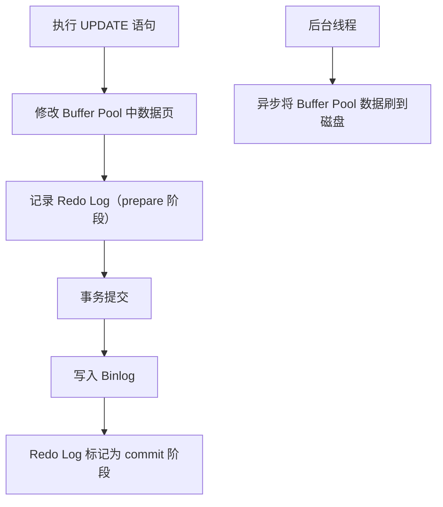
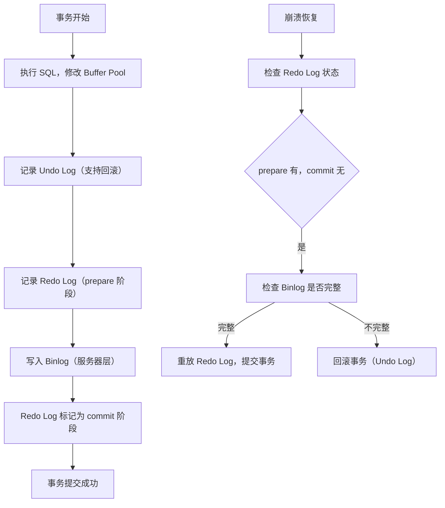
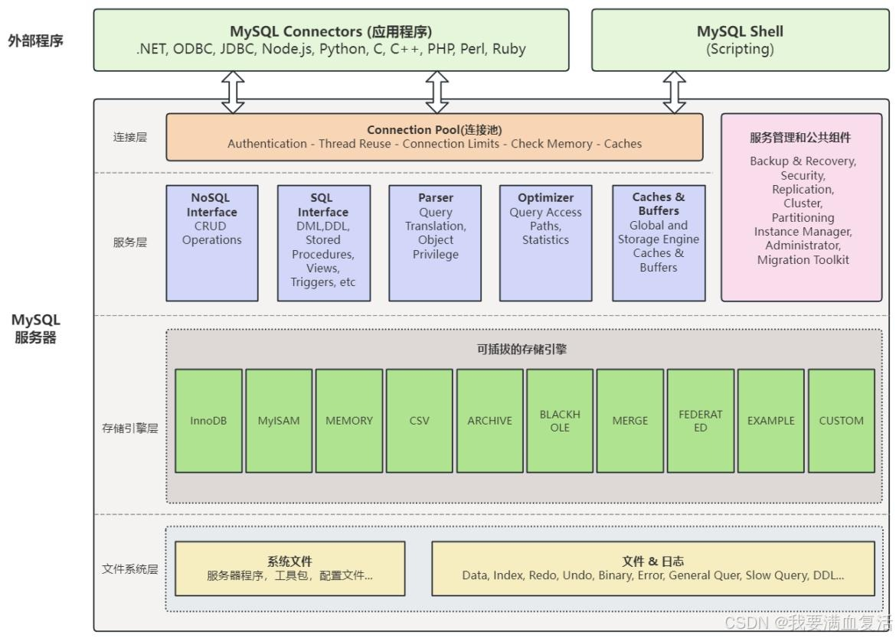
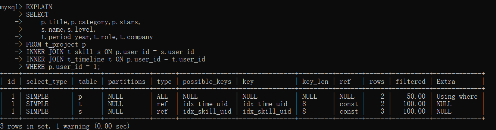
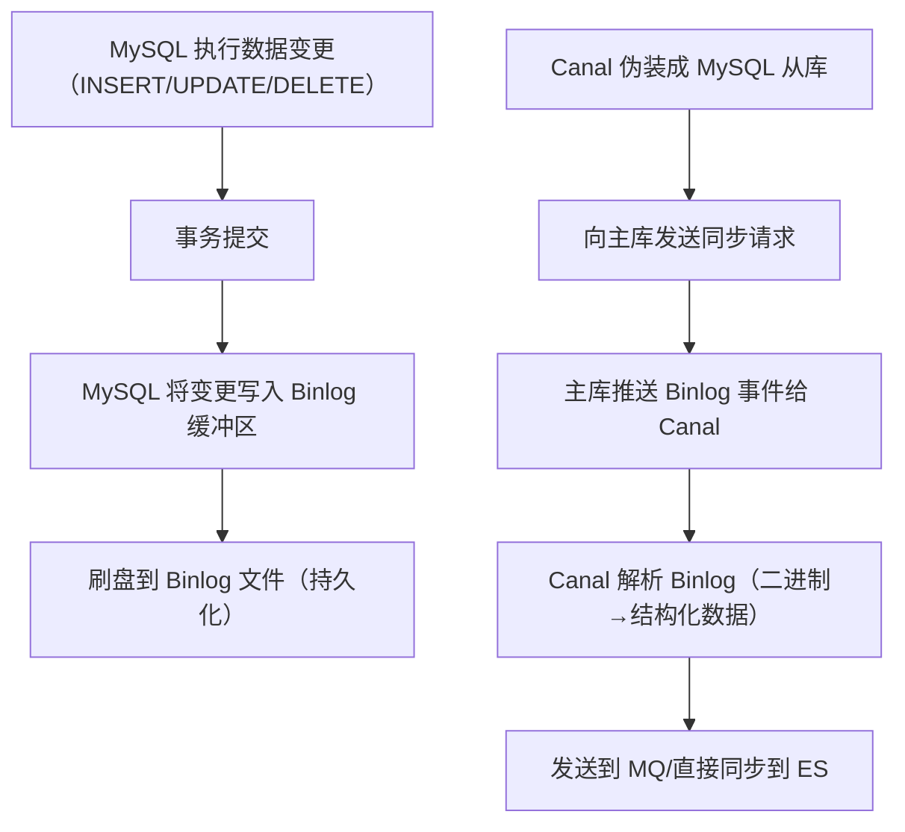

# Mysql

## myql 数据类型

### BigInteger vs BigDecimal

一句话区分：
- **BigInteger**：存**超大整数**（无小数点）
- **BigDecimal**：存**精确小数**（带小数点，钱、金额专用）

---

#### 1. 作用定位

##### BigInteger

- 任意精度**整数**
- 没有小数部分
- 用于：超大整数计算、密码学、科学计算

##### BigDecimal

- 任意精度**小数**
- 能精确控制小数点位数、舍入模式
- **金融、金额、利率、计费必须用它**

---

#### 2. 范围与存储

- **BigInteger**：理论无限大整数
- **BigDecimal**：整数+小数部分都可无限大

---

#### 3. 运算方式（重点）

两者**都不能用 + - * /**，必须调用方法：

```java
// BigInteger
a.add(b);
a.subtract(b);
a.multiply(b);
a.divide(b);

// BigDecimal 用法一样
bd1.add(bd2);
bd1.multiply(bd2);
```

---

#### 4. 最核心区别：小数与精度

##### BigInteger

- 没有小数点
- 除法会直接**整除或抛异常**

##### BigDecimal

- 支持小数点
- 除法必须指定**舍入规则**，否则除不尽抛异常
```java
bd1.divide(bd2, 2, RoundingMode.HALF_UP); // 保留2位，四舍五入
```

---

#### 5. 典型使用场景

##### 用 BigInteger

- 雪花 ID 超大整数运算
- 大数阶乘、幂运算
- 加密算法里的大素数

##### 用 BigDecimal（高频）

- **金额、价格、税费、折扣**
- 汇率、利息计算
- 任何要求**绝对不能误差**的小数计算

> float/double 会丢精度，**钱永远不能用**

---

#### 6. 与 MySQL 类型对应

- MySQL `bigint`       → Java **Long**
- MySQL `unsigned bigint` → **BigInteger**
- MySQL `decimal(19,2)` → **BigDecimal**

---

#### 极简总结

- **只算整数，特别大** → BigInteger
- **算钱、算小数、要精确** → BigDecimal
- 日常业务 99% 用 **BigDecimal**，BigInteger 很少用

### BigDecimal 

`BigDecimal` 就是 Java 里用来做**精确小数运算**的类，专门解决 `float`/`double` 精度丢失问题，**金钱、金额、计费场景必须用它**。

---

#### 1. 为什么要用 BigDecimal？

`float`/`double` 是二进制浮点，无法精确表示十进制小数（比如 0.1），会出现误差：

```java
System.out.println(0.1 + 0.2);  // 0.30000000000000004
```
金融场景绝对不能忍，所以必须用 **BigDecimal**。

---

#### 2. 创建 BigDecimal（重点：坑很多）

##### 正确方式

```java
// 1. 字符串构造（最推荐！）
BigDecimal a = new BigDecimal("0.1");

// 2. valueOf（内部也是转字符串）
BigDecimal b = BigDecimal.valueOf(0.1);
```

##### 错误方式（千万不要）

```java
// 直接用 double 构造，精度已经丢了
BigDecimal c = new BigDecimal(0.1);  // 错误！
```

##### 常用常量

```java
BigDecimal.ZERO;     // 0
BigDecimal.ONE;      // 1
BigDecimal.TEN;      // 10
```

---

#### 3. 加减乘除（必须会）

**不能用 + - * /**，必须调用方法：

```java
BigDecimal a = new BigDecimal("10");
BigDecimal b = new BigDecimal("3");

BigDecimal add = a.add(b);          // 加
BigDecimal sub = a.subtract(b);     // 减
BigDecimal mul = a.multiply(b);     // 乘
BigDecimal div = a.divide(b, 2, RoundingMode.HALF_UP); // 除
```

##### 除法必须指定：保留位数 + 舍入模式

否则除不尽直接抛异常：
`java.lang.ArithmeticException: Non-terminating decimal expansion`

---

#### 4. 舍入模式（RoundingMode）

常用 4 个：
- **RoundingMode.HALF_UP**：四舍五入（最常用）
- **RoundingMode.DOWN**：直接截断（不四舍五入）
- **RoundingMode.UP**：向上取整
- **RoundingMode.HALF_DOWN**：五舍六入

示例（保留 2 位）：
```java
a.divide(b, 2, RoundingMode.HALF_UP);
```

---

#### 5. 大小比较（重点）

**不能用 ==、>、<**
必须用：`compareTo()`

```java
BigDecimal a = new BigDecimal("1.0");
BigDecimal b = new BigDecimal("1.00");

int res = a.compareTo(b);
// res = -1 → a < b
// res = 0  → a == b
// res = 1  → a > b
```

注意：
- `a.equals(b)` 会比较**标度（小数位数）**，1.0 ≠ 1.00
- 金额比较**永远用 compareTo**

---

#### 6. 标度（scale）与精度（precision）

- **scale**：小数点后位数
  - 1.234 → scale=3
- **precision**：总有效位数
  - 1.234 → precision=4

设置小数位数：
```java
// 保留2位，四舍五入
bd = bd.setScale(2, RoundingMode.HALF_UP);
```

---

#### 7. 格式化（金额显示专用）

```java
NumberFormat format = NumberFormat.getCurrencyInstance();
format.setMaximumFractionDigits(2);
String money = format.format(bd);
```

---

#### 8. 常见坑总结（面试高频）

1. **不要用 new BigDecimal(double)**
2. **除法必须指定舍入模式**，否则抛异常
3. **比较大小用 compareTo，不要用 equals**
4. **BigDecimal 是不可变类**，运算后必须接收返回值
   ```java
   a.add(b);  // 错误，a 不会变
   a = a.add(b); // 正确
   ```
5. 不要频繁创建对象，尽量复用常量

---

#### 9. 与 MySQL 对应

- MySQL `decimal(19,2)` → Java **BigDecimal**
- MyBatis 自动映射，无需处理

---

#### 10. 一句话速记

BigDecimal = **精确小数运算**
- 创建用字符串
- 运算用方法
- 除法必舍入
- 比较用 compareTo
- 金钱场景唯一选择

## **标量函数**

在MySQL中，**标量函数**是指接收一个或多个参数，并**确切返回单一值**的函数（与聚合函数如 `SUM`、`COUNT` 返回一组值的汇总不同）。标量函数常用于 `SELECT` 字段、`WHERE` 条件、`ORDER BY` 等子句中，用于数据的转换、计算和格式化。

为了便于记忆和使用，MySQL的标量函数通常按处理的数据类型分为以下**七大类**。下面进行详细分类介绍：

---

### 一、 字符串函数
用于处理文本数据，是日常开发中使用频率最高的一类函数。

1. **长度与位置**
   * `CHAR_LENGTH(str)` / `CHARACTER_LENGTH(str)`：返回字符串的**字符**个数（多字节字符算作一个）。
   * `LENGTH(str)`：返回字符串的**字节**长度（如UTF8下中文占3个字节）。
   * `LOCATE(substr, str)` / `INSTR(str, substr)`：返回子字符串首次出现的位置（从1开始，找不到返回0）。
2. **拼接与截取**
   * `CONCAT(str1, str2, ...)`：将多个字符串拼接成一个。**注意：如果其中一个参数为NULL，则整体返回NULL。**
   * `CONCAT_WS(separator, str1, str2, ...)`：带分隔符的拼接。它会忽略NULL，但不会忽略分隔符前后的空字符串。
   * `SUBSTRING(str, pos, len)` / `SUBSTR(...)`：截取字符串。
   * `LEFT(str, len)` / `RIGHT(str, len)`：从左/右截取指定长度的字符串。
3. **大小写与格式化**
   * `UPPER(str)` / `UCASE(str)`：转大写。
   * `LOWER(str)` / `LCASE(str)`：转小写。
   * `TRIM(str)`：去除字符串首尾空格。`LTRIM`去左空格，`RTRIM`去右空格。
   * `REPLACE(str, from_str, to_str)`：将字符串中的指定子串替换为新串。
   * `LPAD(str, len, padstr)` / `RPAD(...)`：用指定字符将字符串填充到指定长度（常用于生成流水号，如 `LPAD(1, 5, '0')` -> `00001`）。

---

### 二、 数值函数
用于数学计算和处理数字类型数据。

1. **取整与舍入**
   * `ROUND(x, d)`：四舍五入，`d`为保留的小数位数。
   * `CEIL(x)` / `CEILING(x)`：向上取整（返回大于或等于x的最小整数）。
   * `FLOOR(x)`：向下取整（返回小于或等于x的最大整数）。
   * `TRUNCATE(x, d)`：截断小数位（不进行四舍五入）。
2. **绝对值与符号**
   * `ABS(x)`：返回绝对值。
   * `SIGN(x)`：返回符号（正数返回1，负数返回-1，0返回0）。
3. **数学运算**
   * `MOD(n, m)` / `n % m`：取模（求余数）。
   * `POW(x, y)` / `POWER(x, y)`：返回 x 的 y 次方。
   * `SQRT(x)`：返回平方根。
4. **随机数**
   * `RAND()`：返回 0~1 之间的随机浮点数。可以传入种子 `RAND(seed)` 使得每次生成的随机数序列固定。
   * *常用技巧*：`ORDER BY RAND()` 随机排序（**性能极差，慎用于大表**）。

---

### 三、 日期和时间函数
用于处理日期、时间和时间戳。

1. **获取当前时间**
   * `NOW()` / `CURRENT_TIMESTAMP`：返回当前的日期和时间（`YYYY-MM-DD hh:mm:ss`）。
   * `CURDATE()` / `CURRENT_DATE`：返回当前日期。
   * `CURTIME()` / `CURRENT_TIME`：返回当前时间。
   * `UNIX_TIMESTAMP()`：返回当前时间的Unix时间戳。
2. **日期提取**
   * `YEAR(date)` / `MONTH(date)` / `DAY(date)`：提取年/月/日。
   * `DATE(datetime)`：提取日期部分。
   * `TIME(datetime)`：提取时间部分。
   * `EXTRACT(unit FROM date)`：提取指定部分（如 `EXTRACT(YEAR_MONTH FROM date)`）。
   * `DAYOFWEEK(date)`：返回星期几（1=周日，7=周六）。
3. **日期计算与格式化**
   * `DATE_ADD(date, INTERVAL expr unit)` / `DATE_SUB(...)`：日期加减（如 `DATE_ADD(NOW(), INTERVAL 1 DAY)`）。
   * `DATEDIFF(expr1, expr2)`：返回两个日期相差的天数（expr1 - expr2）。
   * `DATE_FORMAT(date, format)`：按指定格式格式化日期（如 `DATE_FORMAT(NOW(), '%Y-%m-%d %H:%i:%s')`）。
   * `STR_TO_DATE(str, format)`：将字符串按格式解析为日期。

---

### 四、 流程控制函数
在SQL语句中实现类似 `IF-ELSE` 的逻辑判断，非常实用。

1. `IF(expr, v1, v2)`：如果 `expr` 为TRUE，返回 `v1`，否则返回 `v2`。
2. `IFNULL(v1, v2)`：如果 `v1` 不为NULL，返回 `v1`，否则返回 `v2`。（常用于处理空值替换）。
3. `NULLIF(v1, v2)`：如果 `v1 == v2`，返回NULL，否则返回 `v1`。
4. `CASE WHEN ... THEN ... ELSE ... END`：
   * **简单Case函数**（等值判断）：`CASE sex WHEN 1 THEN '男' WHEN 2 THEN '女' ELSE '未知' END`
   * **搜索Case函数**（条件判断）：`CASE WHEN age < 18 THEN '未成年' WHEN age >= 18 THEN '成年' ELSE '未知' END`

---

### 五、 类型转换函数
用于在不同数据类型之间进行显式转换。

1. `CAST(expr AS type)`：将表达式转换为指定类型。
   * 支持的类型：`BINARY`, `CHAR`, `DATE`, `DATETIME`, `TIME`, `DECIMAL`, `SIGNED` [INTEGER], `UNSIGNED` [INTEGER]。
   * 示例：`CAST('123' AS SIGNED)` 将字符串转为整型。
2. `CONVERT(expr, type)`：功能与 `CAST` 完全相同，只是语法不同。
   * 示例：`CONVERT('2023-01-01', DATE)`。
3. `FORMAT(x, d)`：将数字格式化为带有千位分隔符的字符串，保留 `d` 位小数（如 `FORMAT(1234567.891, 2)` -> `1,234,567.89`）。

---

### 六、 JSON 函数 (MySQL 5.7+ / 8.0+)
随着MySQL对JSON数据类型的支持，JSON标量函数成为处理非结构化数据的核心。

1. **提取**
   * `JSON_EXTRACT(json_doc, path)`：提取JSON中指定路径的值（如 `JSON_EXTRACT(data, '$.name')`）。
   * `->` / `->>`：简写操作符。`data->'$.name'` 等同于 `JSON_EXTRACT`。`->>` 会额外去除提取结果外层的双引号。
2. **创建与修改**
   * `JSON_OBJECT(k1, v1, k2, v2)`：创建JSON对象。
   * `JSON_ARRAY(v1, v2)`：创建JSON数组。
   * `JSON_SET(json_doc, path, val)`：更新或插入JSON值。
   * `JSON_REMOVE(json_doc, path)`：删除JSON指定路径的元素。
3. **查询判断**
   * `JSON_CONTAINS(target, candidate)`：判断JSON中是否包含指定值。

---

### 七、 系统信息函数
用于获取MySQL服务器状态、数据库信息及用户信息。

1. `VERSION()`：返回MySQL服务器版本号。
2. `DATABASE()` / `SCHEMA()`：返回当前使用的数据库名。
3. `USER()` / `CURRENT_USER()`：返回当前登录的用户和主机信息。
4. `CONNECTION_ID()`：返回当前连接的ID（线程ID）。
5. `LAST_INSERT_ID()`：返回最近一条 `AUTO_INCREMENT` 插入语句生成的自增ID（常用于获取插入后的主键）。

---

### ⚠️ 标量函数与 SQL 调优的关联
结合您之前关于SQL调优的提问，在使用标量函数时有几个**性能大坑**需要注意：

1. **索引失效**：在 `WHERE` 条件中对字段使用标量函数，会导致**索引失效**，退化为全表扫描。
   * ❌ 错误示范：`WHERE YEAR(create_time) = 2023` （索引失效）
   * ✅ 正确写法：`WHERE create_time >= '2023-01-01' AND create_time < '2024-01-01'` （走索引）
2. **隐式类型转换**：`CAST` 和 `CONVERT` 如果用在查询条件中强制转换列的类型，同样会导致索引失效。
3. **SELECT 中的函数**：在 `SELECT` 列表中使用标量函数（如 `DATE_FORMAT`）通常不影响过滤性能，但如果数据量巨大，函数计算的CPU开销也不容忽视，尽量只查询必要的行后再进行格式化。

------

## 一、基础篇

1. **说一下 MySQL 的存储引擎有哪些？InnoDB 和 MyISAM 的区别？**
   - ✅ 重点：事务支持、行锁 vs 表锁、外键、崩溃恢复。
2. **CHAR 与 VARCHAR 的区别是什么？**
   - ✅ 重点：定长 vs 变长、存储与性能差异。
3. **MySQL 中 DATETIME 和 TIMESTAMP 有什么区别？**
   - ✅ 重点：时区影响、存储空间、时间范围。
4. **什么是主键、唯一键、外键？它们的区别？**
   - ✅ 重点：约束作用、索引关系、是否允许空值。
5. **MySQL 中索引的类型有哪些？**
   - ✅ 重点：普通索引、唯一索引、全文索引、组合索引。
6. **说一下 MySQL 的事务特性（ACID）。**
   - ✅ Atomicity、Consistency、Isolation、Durability。

### 1️⃣ MySQL 的存储引擎

**常见存储引擎：**

- **InnoDB**（默认）
- **MyISAM**（老版本常用）
- MEMORY、ARCHIVE、CSV、BLACKHOLE 等 

**InnoDB vs MyISAM 区别：**

| 对比项       | InnoDB                   | MyISAM                 |
| ------------ | ------------------------ | ---------------------- |
| **事务支持** | ✅ 支持（ACID）           | ❌ 不支持               |
| **锁机制**   | 行锁（并发高）           | 表锁                   |
| **外键**     | 支持                     | 不支持                 |
| **崩溃恢复** | 支持（redo/undo log）    | 不支持                 |
| **主键存储** | 聚簇索引（数据即索引）   | 非聚簇索引（独立存储） |
| **适用场景** | 高频事务、数据安全要求高 | 读多写少、查询快       |


MySQL 的存储引擎是数据库底层用于管理数据存储、索引、事务等功能的核心组件，不同存储引擎适用于不同场景。以下是常见存储引擎及 InnoDB 与 MyISAM 的核心区别：

#### **一、常见的 MySQL 存储引擎**

1. **InnoDB**：  
   MySQL 5.5 及以上版本的默认存储引擎，**支持事务、行级锁、外键约束，适合高并发、数据一致性要求高的场**景（如电商订单、金融数据）。

2. **MyISAM**：  
   早期 MySQL 的默认存储引擎，不支持事务和行级锁，适合读多写少、对性能要求高但一致性要求低的场景（如日志、静态数据）。

3. **Memory（Heap）**：  
   数据存储在内存中，读写速度极快，但断电后数据丢失，适合临时数据缓存（如会话数据、临时计算结果）。

4. **CSV**：  
   以 CSV 文件格式存储数据，适合数据导入导出（如与 Excel 交互），不支持索引。

5. **Archive**：  
   用于归档大量历史数据，压缩比高，仅支持插入和查询，不支持更新/删除，适合日志归档。

6. **Blackhole**：  
   写入的数据会被丢弃，类似“黑洞”，主要用于复制场景（如作为中继节点转发日志）。

#### **二、InnoDB 与 MyISAM 的核心区别**

| **对比维度**               | **InnoDB**                              | **MyISAM**                                   |
| -------------------------- | --------------------------------------- | -------------------------------------------- |
| **事务支持**               | 支持 ACID 事务（BEGIN/COMMIT/ROLLBACK） | 不支持事务                                   |
| **锁机制**                 | 行级锁（仅锁定修改的行，并发性能好）    | 表级锁（修改时锁定整个表，并发性能差）       |
| **外键约束**               | 支持外键                                | 不支持外键                                   |
| **索引结构**               | 聚簇索引（数据与主键索引存储在一起）    | 非聚簇索引（数据与索引分开存储）             |
| **表空间**                 | 数据存储在共享表空间（或独立表空间）    | 数据存为 `.MYD` 文件，索引存为 `.MYI`        |
| **崩溃恢复**               | 支持崩溃后自动恢复（依赖 redo 日志）    | 不支持自动恢复，需手动修复（如 `myisamchk`） |
| **全文索引**               | 5.6 版本后支持                          | 原生支持                                     |
| **计数效率（`COUNT(*)`）** | 需扫描全表（或依赖二级索引）            | 有专门的计数器，查询 `COUNT(*)` 极快         |
| **适用场景**               | 高并发、事务性业务（如订单、支付）      | 读多写少、非事务场景（如博客、报表）         |

#### **三、关键差异详解**

1. **事务与数据一致性**：  
   - InnoDB 支持事务，可通过 `COMMIT`/`ROLLBACK` 保证数据原子性，适合需要事务的场景（如转账操作）。  
   - MyISAM 无事务支持，若操作中断（如断电），可能导致数据损坏。

2. **锁机制与并发性能**：  
   - InnoDB 的行级锁仅锁定修改的行，多个事务可同时修改表中不同行，并发写入性能高。  
   - MyISAM 的表级锁在写入时会锁定整个表，此时其他读写操作需等待，适合读多写少场景。

3. **索引与存储方式**：  
   - InnoDB 的聚簇索引将数据与主键索引存储在同一 B+ 树中，查询主键时效率极高；二级索引存储主键值，需回表查询数据。  
   - MyISAM 的索引与数据分离，索引叶节点存储数据地址，查询需先查索引再找数据，主键查询效率略低。

4. **崩溃恢复**：  
   - InnoDB 通过 redo 日志记录操作，崩溃后可重放日志恢复数据，保证一致性。  
   - MyISAM 无日志机制，崩溃后可能出现索引损坏，需用 `myisamchk` 工具修复。

#### **总结**

- **优先选 InnoDB**：需要事务、外键、高并发写入的场景（如电商、金融系统）。  
- **可选 MyISAM**：读操作远多于写操作，且无需事务（如静态网站、日志存储），但目前已逐渐被 InnoDB 替代。  

随着 MySQL 版本升级，InnoDB 在性能和功能上持续优化，成为绝大多数场景的首选存储引擎。

------

### 2️⃣ CHAR 与 VARCHAR 

| 特性         | CHAR                       | VARCHAR                   |
| ------------ | -------------------------- | ------------------------- |
| **长度**     | 定长（不足补空格）         | 变长（按实际存储）        |
| **性能**     | 固定长度读写快             | 节省空间但更新慢          |
| **存储**     | CHAR(10) 一定占 10 字节    | VARCHAR(10) 占实际字节 +1 |
| **适用场景** | 性别、状态码等固定长度字段 | 名称、描述等可变长度字段  |

------

### 3️⃣ MySQL 中 DATETIME 和 TIMESTAMP

| 特性         | DATETIME                             | TIMESTAMP                            |
| ------------ | ------------------------------------ | ------------------------------------ |
| **存储范围** | 1000-01-01 ~ 9999-12-31              | 1970-01-01 ~ 2038-01-19              |
| **占用空间** | 8 字节                               | 4 字节                               |
| **时区影响** | ❌ 不受影响                           | ✅ 受时区影响（存 UTC，显示本地时间） |
| **自动更新** | 可手动设置 DEFAULT CURRENT_TIMESTAMP | 默认支持自动更新                     |

> **结论：** 如果要保存绝对时间（如日志时间）→ DATETIME；
> 要保存系统时间、带时区同步 → TIMESTAMP。

------

### 4️⃣ 主键、唯一键、外键

- **主键（PRIMARY KEY）**：唯一标识一行数据，不可重复、不可为 NULL。
- **唯一键（UNIQUE KEY）**：数据唯一但可为 NULL（NULL 可重复）。
- **外键（FOREIGN KEY）**：用于建立表间关联，引用另一表的主键。

| 特性          | 主键       | 唯一键         | 外键             |
| ------------- | ---------- | -------------- | ---------------- |
| 是否唯一      | ✅          | ✅              | ❌                |
| 是否允许 NULL | ❌          | ✅              | ✅                |
| 是否可多列    | ✅          | ✅              | ✅                |
| 作用          | 唯一标识行 | 保证字段唯一性 | 建立表间约束关系 |

------

### 5️⃣ MySQL 中索引的类型

#### 1️⃣ 按逻辑功能/业务场景分类

这是我们在日常开发中接触最多、也是最直观的分类方式。

| 索引类型                   | 关键特点                                                     | 适用场景                                                     |
| -------------------------- | ------------------------------------------------------------ | ------------------------------------------------------------ |
| **普通索引 (INDEX)**       | 最基本的索引类型，没有任何限制，允许重复值和 NULL 值。       | 加速查询，对非唯一字段建立索引。                             |
| **唯一索引 (UNIQUE)**      | 索引列的值必须**唯一**，但允许有 NULL（多个 NULL 不冲突）。  | 用于业务上要求唯一的字段，如手机号、身份证号、订单号等。     |
| **主键索引 (PRIMARY KEY)** | 一种特殊的唯一索引，**不允许 NULL 值**，且一张表只能有一个。 | 用于唯一标识表中的每一行数据，通常使用自增 ID。              |
| **组合索引 (Composite)**   | 在多个列上创建的索引，如 `(col1, col2)`。遵循**最左前缀原则**。 | 用于多条件查询，例如 `WHERE a=1 AND b=2`。                   |
| **全文索引 (FULLTEXT)**    | 用于大文本搜索（如文章内容），支持 `MATCH ... AGAINST` 语法。 | 适用于博客、新闻、商品描述等长文本的模糊搜索。               |
| **前缀索引 (Prefix)**      | 对字符串列的前 N 个字符建立索引，减少索引大小。              | 适用于很长的字符串字段（如 URL、长文本），但不能覆盖全量查询。 |

#### 2️⃣ 按物理存储结构分类 (InnoDB 引擎)

在 InnoDB 存储引擎中，数据的存储方式决定了索引的物理结构，这对理解查询性能至关重要。

- **聚簇索引 (Clustered Index)**
  - **特点**：数据行与索引存储在一起。InnoDB 表必须有聚簇索引，它决定了数据的物理存储顺序。
  - **规则**：如果你定义了主键，主键就是聚簇索引；如果没有主键，MySQL 会选择第一个唯一非空索引；若都没有，则会隐式创建一个 `row_id` 作为聚簇索引。
  - **优势**：通过主键查询极快（一次 I/O 即可获取数据）。
- **二级索引 (Secondary Index / 辅助索引)**
  - **特点**：二级索引的叶子节点保存**「索引列 + 主键」**，而不是完整的数据行。
  - **回表**：当使用二级索引查询时，如果需要获取非索引列的数据，需要先通过二级索引找到主键，再通过主键去聚簇索引中查找完整数据，这个过程叫“回表”。
  - **优化**：**覆盖索引**。如果查询的字段全部包含在索引中（例如索引是 `(a,b)`，查询 `SELECT a,b FROM table`），则无需回表，直接从索引中获取数据，性能极高。

#### 3️⃣ 按底层数据结构分类

MySQL 允许不同的存储引擎使用不同的数据结构来实现索引。

- **B+ 树索引 (B+Tree)**
  - **地位**：MySQL 中最常用、最核心的索引类型，默认使用。
  - **特点**：有序存储，支持等值查询、**范围查询**（`>`, `<`, `BETWEEN`）和排序。InnoDB 和 MyISAM 都使用 B+ 树。
- **B 树索引（B-Tree）** MySQL 存储引擎**没有原生使用 B 树做索引**。B 树是非叶子节点同时保存 key 和数据；叶子节点无链表，范围查询弱。仅理论存在，MySQL 业务索引不采用。
- **哈希索引 (Hash)**
  - **特点**：基于哈希表实现，等值查询速度极快（接近 O(1)），但**不支持范围查询和排序**。
  - **场景**：MEMORY 存储引擎默认使用哈希索引。InnoDB 也有“自适应哈希索引”，但那是内部自动优化机制，不由用户控制。
- **空间索引 (SPATIAL)**
  - **特点**：基于 R 树，专门用于地理空间数据（如经纬度、地图坐标）。
  - **场景**：用于计算“附近的人”、地图区域查询等。

#### 为什么 MySQL 不选用 B 树，选 B + 树？

MySQL（特别是最常用的 InnoDB 引擎）选择 **B+ 树**作为索引结构，而不是 B 树或哈希表，核心原因在于**磁盘 I/O 效率**和**关系型数据库的业务需求（范围查询、排序）**。

1. **非叶子节点不存数据，单页能放下更多索引 key**。一页（16KB）可以存更多索引项，树高度更低，磁盘 IO 更少。
2. **范围查询优势巨大**：B + 树叶子有序链表，找到起点直接向后遍历；B 树范围查询需要来回跨节点，多次磁盘寻道。
3. **查询 IO 稳定**：B 树可能在中间节点命中，IO 次数忽多忽少；B + 树一定走到叶子，查询性能稳定。
4. **覆盖索引天然好实现**：叶子节点统一存放数据 / 索引信息。


#### 💡 总结与建议

1. **首选 B+ 树**：除非你有极特殊的键值对等值匹配需求，否则 B+ 树是通用的首选。
2. **主键要自增**：尽量使用自增整数作为主键，避免使用 UUID，这样可以减少页分裂，提高写入性能。
3. **组合索引注意顺序**：将区分度高（选择性好）的列放在最左边，遵循最左前缀法则。

------

### 6️⃣ 说一下 MySQL 的事务特性（ACID）

1. **原子性（Atomicity）**：事务中的操作要么全部成功，要么全部失败。
2. **一致性（Consistency）**：事务执行前后，数据库状态保持一致。
3. **隔离性（Isolation）**：多个事务互不干扰（通过隔离级别控制）。
4. **持久性（Durability）**：事务提交后，修改永久保存（写入 redo log）。

> ✅ InnoDB 通过 **undo log、redo log** 保证 ACID 特性。

**当前读：** 读取数据的最新版本，并对数据进行加锁。 例如：insert、update、delete、select for update

**快照读：** 读取数据的历史版本，不对数据加锁。 例如：select 在当前读的情况下，是通过加锁来解决幻读。 在快照读的情况下，是通过MVCC来解决幻读。

#### 一、事务特性详解（ACID）

##### 1. 原子性（Atomicity）：“要么全做，要么全不做”

- **核心含义**：事务是一个不可分割的最小操作单元，事务中的所有操作（如插入、更新）要么全部执行成功，要么全部执行失败并回滚到事务开始前的状态，不会出现“部分成功”的中间态。
- **MySQL 实现**：  
  依赖 **InnoDB 存储引擎**的 **undo 日志**。事务执行时，InnoDB 会记录操作的反向日志（如插入记录时记录“删除该记录”的日志，更新记录时记录“恢复原值”的日志）；若事务执行失败（如报错、手动回滚），InnoDB 会通过 undo 日志反向操作，将数据恢复到事务开始前的状态。
- **示例**：  
  转账场景中，“A 账户减 100 元”和“B 账户加 100 元”属于同一事务。若 A 账户扣款成功但 B 账户加款失败，事务会回滚，A 账户的 100 元会恢复，避免“钱消失”的情况。

##### 2. 一致性（Consistency）：“事务前后数据状态合法”

- **核心含义**：事务执行前后，数据库的完整性约束（如主键唯一、字段非空、外键关联）不会被破坏，数据始终处于“合法”状态，不会出现逻辑矛盾。
- **MySQL 实现**：  
  依赖 **存储引擎的约束校验**（如主键冲突时报错）和 **事务原子性/隔离性的配合**。例如：  
  - 若事务中操作违反约束（如插入重复主键），InnoDB 会直接中断事务并回滚，确保数据不出现非法状态；  
  - 结合隔离性避免并发操作导致的数据逻辑错误（如多事务同时修改同一数据导致的数值异常）。
- **示例**：  
  表中“年龄”字段限制为非负整数，若事务尝试将年龄更新为 `-5`，InnoDB 会校验失败并回滚事务，保证数据始终符合“非负”的一致性要求。

##### 3. 隔离性（Isolation）：“并发事务互不干扰”

- **核心含义**：多个事务同时执行时，每个事务的操作应与其他事务隔离开，不会看到其他事务未提交的中间数据，避免“脏读、不可重复读、幻读”等并发问题。
- **MySQL 实现**：  
- **事务隔离性由 InnoDB 的「锁机制 + MVCC（多版本并发控制）」共同实现，不同隔离级别是锁和 MVCC 组合策略不同。**
  - **锁：解决写‑写冲突**，防止脏写
  - **MVCC：解决读‑写冲突**，不加锁读快照版本，避免加锁阻塞
- 
  1. **读未提交（Read Uncommitted）**：最低级别，允许读取其他事务未提交的数据（会出现“脏读”），极少使用；  
  2. **读已提交（Read Committed，RC）**：默认隔离级别（MySQL 8.0 及部分版本），只能读取其他事务已提交的数据，避免“脏读”，但同一事务内多次读同一数据可能结果不同（“不可重复读”）；  
  3. **可重复读（Repeatable Read，RR）**：InnoDB 早期默认级别，同一事务内多次读同一数据结果一致，通过 MVCC 避免“不可重复读”，并通过“间隙锁”避免“幻读”；  
  4. **串行化（Serializable）**：最高级别，事务串行执行（加表锁），完全避免所有并发问题，但性能极低，仅用于数据一致性要求极高的场景（如金融对账）。
- **示例**：  
  事务 A 读取“用户余额为 1000 元”，此时事务 B 扣减该用户 500 元但未提交；若隔离级别为“读已提交”，事务 A 再次读取时仍会看到 1000 元（不会读取 B 未提交的 500 元扣减），避免“脏读”。

> SQL标准中RR是允许幻读的；**InnoDB的RR通过Next‑Key Lock（临键锁）消除幻读**。

###### 🔑 锁机制（解决写‑写冲突）

锁主要用来处理**修改、删除、select ... for update**这类写操作，防止脏写。

1. **行锁 Record Lock**：锁真实数据行
2. **间隙锁 Gap Lock**：锁住索引间隙，防止插入，解决幻读（RR级别才生效）
3. **临键锁 Next‑Key Lock = 行锁 + 间隙锁**，RR下默认加临键锁
4. 意向锁：表级，协调表锁与行锁

> RC隔离级别：**关闭间隙锁，只有行锁**，所以RC会出现幻读。

###### 📸 MVCC 多版本并发控制（解决读‑写冲突）

MVCC用于**普通select快照读（不加锁的select）**，不加锁，读取历史版本，读写不阻塞。
底层依靠：

- `DB_TRX_ID`：最近修改这条记录的事务ID
- `DB_ROLL_PTR`：回滚指针，指向undo log里的旧版本，形成版本链
- `read view`：读视图，**核心！控制你能看见哪些版本数据**

###### Read View 核心规则（RR / RC 最大区别）

- **RC（读已提交）：每次快照读，都生成新 ReadView**
  → 所以同一个事务内，两次select可以读到别的事务已提交的修改 → **不可重复读**
- **RR（可重复读）：事务第一次快照读时生成 ReadView，整个事务复用同一个ReadView**
  → 整个事务看到的版本一致，实现**可重复读**

> undo log：保存数据旧版本；旧版本会被purge线程清理。

###### 两种读模式（面试必背）

1. **快照读（普通 select）**：走MVCC，读历史版本，不加行锁

```sql
select * from user where id=1;
```

2. **当前读（加锁读）**：读取最新数据，走锁机制，不走MVCC快照

```sql
select ... for update;
select ... lock in share mode;
update / delete / insert
```

> ⚠️ RR下，**只有快照读没有幻读；当前读依然会有幻读问题，靠临键锁解决幻读**。

##### 4. 持久性（Durability）：“事务提交后数据永久保存”

- **核心含义**：事务一旦提交（`COMMIT`），其对数据的修改会永久保存到磁盘，即使后续数据库崩溃（如断电、宕机），数据也不会丢失。
- **MySQL 实现**：  
  依赖 **InnoDB 的 redo 日志**和 **刷盘机制**：  
  1. 事务执行时，InnoDB 会先将操作记录到内存的“redo 日志缓冲区”；  
  2. 事务提交时，redo 日志会被强制刷写到磁盘（`fsync` 操作），确保日志不丢失；  
  3. 数据最终会从内存缓冲池刷到磁盘，但即使未刷盘，数据库重启后也能通过 redo 日志重放事务操作，恢复已提交的数据。
- **示例**：  
  事务提交后，即使立即发生服务器断电，数据库重启时会读取 redo 日志，重新执行该事务的操作，确保提交的数据不会因断电丢失。

#### 二、关键总结

- ACID 是事务的四大核心保障，缺一不可：  
  - 原子性保证“操作不拆分”，一致性保证“数据合法”，隔离性保证“并发不干扰”，持久性保证“提交不丢失”；  
- **仅 InnoDB 存储引擎完全支持 ACID**，MyISAM 等其他引擎不支持事务，因此无法保证 ACID 特性（如 MyISAM 崩溃后可能丢失数据，无回滚机制）；  
- 实际开发中，需根据业务场景选择合适的隔离级别（如默认“读已提交”平衡性能与一致性，金融场景用“可重复读”或“串行化”）。

#### 三、undo log & redo log

InnoDB 通过 **undo log（回滚日志）** 和 **redo log（重做日志）** 两大核心日志机制，分别支撑了事务的 **原子性、一致性** 和 **持久性**，同时配合隔离级别的实现（如锁和 MVCC），共同保证了 ACID 特性。具体作用如下：

##### 一、undo log（回滚日志）：保证 **原子性** 和 **一致性**

###### 1. 核心作用

- **回滚事务**：记录事务执行过程中对数据的修改操作的“反向操作”，用于事务失败时（如 `ROLLBACK` 或崩溃）撤销所有已执行的修改，确保事务的 **原子性**（要么全成，要么全败）。  
- **支持 MVCC（多版本并发控制）**：保存数据的历史版本，让并发事务可以读取到事务开始前的数据状态，避免读取未提交的中间数据，间接保证 **隔离性** 和 **一致性**。

###### 2. 工作原理

- **记录内容**：  
  当事务执行 `INSERT`/`UPDATE`/`DELETE` 操作时，InnoDB 会生成对应的 undo log：  
  - `INSERT`：记录“删除该新增记录”的反向操作（事务回滚时删除这条记录）；  
  - `UPDATE`：记录“将字段值恢复为修改前的值”的反向操作；  
  - `DELETE`：记录“插入被删除的记录”的反向操作（实际是标记删除，undo log 保存完整记录以便恢复）。  

- **回滚过程**：  
  当事务需要回滚（`ROLLBACK`）或执行失败时，InnoDB 会反向遍历 undo log，执行其中记录的反向操作，将数据恢复到事务开始前的状态，确保原子性。  

- **与 MVCC 的配合**：  
  undo log 会保留数据的历史版本，当其他事务读取数据时，InnoDB 通过 undo log 找到对应版本的数据（而非当前被修改的未提交数据），避免“脏读”，支撑了隔离性和一致性。  

##### 二、redo log（重做日志）：保证 **持久性**

###### 1. 核心作用

- **确保已提交事务的修改不丢失**：记录事务对数据页的物理修改（如“某数据页的某偏移量修改为某值”），即使数据库崩溃（如断电），重启后可通过 redo log 重放已提交的事务操作，保证数据修改的 **持久性**。

###### 2. 工作原理

- **为什么需要 redo log？**  
  InnoDB 中数据修改先写入内存的“缓冲池（Buffer Pool）”，再异步刷到磁盘（减少磁盘 IO 次数）。若事务提交后未刷盘时发生崩溃，内存中的修改会丢失，导致持久性失效。redo log 正是为解决此问题而生。

- **记录与刷盘机制**：  
  1. 事务执行时，每修改一条数据，InnoDB 会同时将修改的物理日志（如“页号 + 偏移量 + 新值”）写入内存的 **redo log buffer**（日志缓冲区）；  
  2. 事务提交（`COMMIT`）时，InnoDB 会将 redo log buffer 中的日志 **强制刷到磁盘**（通过 `fsync` 操作，确保日志写入磁盘而非操作系统缓存）；  
  3. 数据最终会从缓冲池异步刷到磁盘，但即使未刷盘，只要 redo log 已持久化，数据库重启后可通过 redo log 重放修改，恢复已提交的数据。  

- **特点**：  
  redo log 是 **物理日志**（记录数据页的物理变化），体积小、刷盘快，且采用“循环写”机制（固定大小，满了覆盖旧日志），确保高效持久化。  

##### 三、undo log + redo log 如何协同保证 ACID？

| ACID 特性  | undo log 的作用                                              | redo log 的作用                                              | 其他配合机制                       |
| ---------- | ------------------------------------------------------------ | ------------------------------------------------------------ | ---------------------------------- |
| **原子性** | 事务失败时通过 undo log 回滚所有修改，确保“全成或全败”。     | 无直接作用，但回滚过程中产生的 undo 操作也会被 redo log 记录（保证回滚本身的持久性）。 | -                                  |
| **一致性** | 回滚非法操作（如违反约束），恢复数据到合法状态；MVCC 避免并发导致的逻辑错误。 | 确保已提交的合法修改不丢失，维持数据最终一致性。             | 存储引擎的约束校验（如主键唯一）。 |
| **隔离性** | 保存数据历史版本，支撑 MVCC，让事务读取到符合隔离级别的数据版本。 | 无直接作用，但 redo log 保证了并发事务提交后的数据持久性，间接维持隔离后的最终状态。 | 锁机制（行锁、间隙锁）。           |
| **持久性** | 无直接作用。                                                 | 事务提交后强制刷盘，崩溃后通过 redo log 重放修改，确保已提交数据不丢失。 | 缓冲池刷盘机制。                   |

##### 四、总结

- **undo log** 是“后悔药”：通过记录反向操作实现事务回滚，支撑原子性；通过保存历史版本支撑 MVCC，保证隔离性和一致性。  
- **redo log** 是“保险单”：通过记录物理修改并强制刷盘，确保已提交事务的修改不会因崩溃丢失，支撑持久性。  
- 两者与 InnoDB 的锁机制、MVCC 共同作用，最终实现了事务的 ACID 特性，是 InnoDB 作为事务型存储引擎的核心保障。

### MySQL 时间字段类型

MySQL 常用时间类型：`DATE`、`TIME`、`DATETIME`、`TIMESTAMP`、`YEAR`，8.0 新增 `DATETIME(6)`/`TIMESTAMP(6)` 支持微秒。

| 类型 | 占用字节 | 范围 | 格式 | 特点 |
|---|---|---|---|---|
| DATE | 3 | `1000-01-01` ~ `9999-12-31` | `YYYY-MM-DD` | 只存日期，无时分秒 |
| TIME | 3 | `-838:59:59` ~ `838:59:59` | `HH:MM:SS` | 可存时间段，不只一天内时间 |
| DATETIME | 8 | `1000-01-01 00:00:00` ~ `9999-12-31 23:59:59` | `YYYY-MM-DD HH:MM:SS` | **推荐业务使用**，不受时区影响 |
| TIMESTAMP | 4 | `1970-01-01 00:00:01` UTC ~ `2038-01-19 03:14:07` UTC | `YYYY-MM-DD HH:MM:SS` | 存时间戳，**依赖时区**，2038问题 |
| YEAR | 1 | `1901~2155` | `YYYY` | 只存年份，很少用 |

> 小数秒：类型加 `(n)`，n=0~6，例如 `DATETIME(6)` 保留到微秒 `2026-10-08 10:30:00.123456`，会多占存储空间。

#### ✅ 选型建议（后端开发重点）

1. **业务创建时间、更新时间 → DATETIME**
    - 无2038上限，**不跟随数据库时区变化**，线上坑最少；
    - 想自动更新：
    ```sql
    create_time DATETIME NOT NULL DEFAULT CURRENT_TIMESTAMP COMMENT '创建时间',
    update_time DATETIME NOT NULL DEFAULT CURRENT_TIMESTAMP ON UPDATE CURRENT_TIMESTAMP COMMENT '更新时间';
    ```
2. **只存日期（生日、活动日期）→ DATE**
3. **不要优先 TIMESTAMP**
    - 跨时区部署会出现时间自动偏移；
    - 最大到2038，金融、长期业务严禁使用；
    - 4字节优势现在基本忽略。
4. 不建议用 `BIGINT` 存时间戳（毫秒）：无法直接用mysql时间函数，不能自动更新，可读性差；只有特殊高并发场景才考虑。

#### 常用函数

```sql
-- 当前时间
NOW()          -- DATETIME，包含时分秒
CURDATE()      -- DATE 日期
CURTIME()      -- TIME 时间
UNIX_TIMESTAMP() -- 转为时间戳(秒)
FROM_UNIXTIME(1728345600) -- 时间戳转datetime

-- 时间运算
DATE_ADD(now(),INTERVAL 1 DAY)  -- 加1天
DATE_SUB(now(),INTERVAL 1 HOUR) -- 减1小时
DATEDIFF('2026-10-08','2026-10-01') -- 日期差值（天数）
TIMESTAMPDIFF(SECOND,start_time,end_time) -- 间隔，单位可选 SECOND/MINUTE/HOUR/DAY
```

#### 索引与查询坑（面试高频）

1. **不要在时间字段上做函数操作，会失效索引**
```sql
-- ❌ 索引失效
WHERE DATE(create_time) = '2026-10-08'

-- ✅ 范围查询，走索引
WHERE create_time >= '2026-10-08 00:00:00' AND create_time < '2026-10-09 00:00:00';
```
2. 时区问题：`TIMESTAMP` 存入时会转UTC，查询时转回当前session时区；`DATETIME`原样存储，不做时区转换。
3. 自动更新 `ON UPDATE CURRENT_TIMESTAMP`：只有字段值**发生变更**才会刷新，值不变不会更新。
4. MySQL5.7 默认开启 `explicit_defaults_for_timestamp`，TIMESTAMP默认不再自动赋值；8.0默认行为不一样。

#### Java 实体映射（后端常用）

- `DATETIME`：
  - jdk8：`LocalDateTime`（推荐，无时区问题）
  - jdk7：`java.util.Date`
- `DATE` → `LocalDate`
- `TIME` → `LocalTime`

MyBatis-Plus 自动填充：
```java
@TableField(fill = FieldFill.INSERT)
private LocalDateTime createTime;

@TableField(fill = FieldFill.INSERT_UPDATE)
private LocalDateTime updateTime;
```

#### 常见面试题小结

1. DATETIME 和 TIMESTAMP 的区别：字节、范围、时区、2038问题；
2. 为什么业务优先 DATETIME；
3. 时间字段索引失效场景；
4. `ON UPDATE CURRENT_TIMESTAMP` 原理；
5. 为什么不推荐用bigint存时间。

------

## 二、查询与索引优化

> **本章高频核心面试题导航**：
> 1. **索引本质与底层结构**：为什么 InnoDB 选 B+ 树而非 B 树/Hash/红黑树？一棵 3 层 B+ 树能存多少数据？
> 2. **聚簇索引 vs 二级索引**：回表与覆盖索引原理是什么？为什么主键推荐自增/有序雪花 ID 而严禁随机 UUID？
> 3. **联合索引与进阶特性**：最左前缀与范围截断底层怎么排的？什么是索引下推（ICP）？MySQL 8.0 有哪些索引新特性？
> 4. **索引失效全景辨析**：哪些是破坏有序性的**绝对失效**？哪些是优化器基于回表成本的**主动放弃**（如 `!=`、`IS NULL`、隐式转换）？优化器选错索引怎么办？
> 5. **EXPLAIN 深度实战**：`type` 七级梯队怎么看？如何通过 `key_len` 精确算出联合索引命中了几列？`Extra` 核心信号含义？
> 6. **SQL 调优高频实战**：`JOIN` 小表驱动大表原理、**千万级大表深分页优化**、`COUNT(*)` 四种写法底层性能排序、高频分组 Top-N 窗口函数手写 SQL。

------

### 2.1 索引本质、多维分类与底层数据结构（B+ 树核心原理）

> **一句话本质**：索引是帮助数据库高效检索与排序数据的**排好序的磁盘数据结构**，本质是**以空间换时间、用写入维护成本换读取速度**，核心目标是**将随机磁盘 I/O 转化为极少次数的定向页读取**。

#### 一、索引的优缺点权衡

- **核心优势**：
  1. **大幅减少扫描数据量与磁盘 I/O**：将全表线性扫描 `O(N)` 降为 B+ 树树高级别的 `O(log_m N)`；
  2. **消除文件排序与临时表**：B+ 树天然有序，`ORDER BY` / `GROUP BY` 命中索引时无需额外的内存/磁盘归并排序（消除 `Using filesort` / `Using temporary`）；
  3. **加速表关联与保证唯一性**：加速多表 `JOIN` 被驱动表定位；唯一索引与主键索引可在引擎层保障业务数据唯一性。
- **引入代价**：
  1. **占用额外磁盘与 Buffer Pool 内存空间**：每建一棵二级索引就是独立维护一棵 B+ 树；
  2. **拖慢 DML（`INSERT` / `UPDATE` / `DELETE`）写入性能**：每次增删改不仅改聚簇索引，还要同步维护所有二级索引树，涉及**页分裂（Page Split）、页合并**与 `Change Buffer` / `Redo Log` 开销。

#### 二、MySQL 索引多维分类全景

| 分类维度 | 索引类型 | 核心特点与适用场景 |
| :--- | :--- | :--- |
| **按逻辑与约束功能** | **主键索引（`PRIMARY KEY`）** | 唯一且严禁 `NULL`，每张表最多 1 个；在 InnoDB 中即聚簇索引。 |
| | **唯一索引（`UNIQUE KEY`）** | 列值唯一，但**允许存在多个 `NULL`**（SQL 标准中 `NULL != NULL`），用于手机号、订单号防重。 |
| | **普通索引（`INDEX / KEY`）** | 无唯一与非空约束，纯粹用于加速查询。 |
| | **联合索引（复合索引）** | 多列组合建一棵 B+ 树（如 `idx_a_b_c(a,b,c)`），遵循**最左前缀法则**，生产使用占比最高。 |
| | **前缀索引（Prefix Index）** | 对长字符串前 `N` 个字符建索引（如 `INDEX(url(20))`），省空间但无法消除排序、无法做覆盖索引。 |
| | **全文索引（`FULLTEXT`）** | 基于倒排索引分词检索（`MATCH ... AGAINST`），生产海量检索通常由 Elasticsearch 替代。 |
| **按底层数据结构** | **B+ 树索引（默认核心）** | InnoDB / MyISAM 默认结构；多路平衡搜索树，有序支持**等值、范围、排序、分组、最左前缀**。<br>*(注：建表语法 `USING BTREE` 底层实际是 **B+ 树**，MySQL 无原生 B 树索引)* |
| | **哈希索引（Hash Index）** | `MEMORY` 引擎默认；等值查询 `O(1)`，但**无序，不支持范围查询、不支持排序、不支持最左前缀与模糊匹配**。<br>*(InnoDB 内部拥有**自适应哈希索引 AHI**，由引擎自动监控热点页在内存中构建，用户无法手动创建)* |
| | **R 树索引（`SPATIAL`）** | 空间索引，用于 GIS 经纬度地理范围检索。 |

> **概念辨析**：**覆盖索引（Covering Index）**并不是一种独立的物理索引类型，而是指某次查询所需的所有列（`SELECT` 列 + `WHERE` 列）恰好全部包含在所命中的索引叶子节点中，无需回表的一种高效执行状态。

#### 三、为什么 MySQL InnoDB 选择 B+ 树，而不选 B 树 / 红黑树 / Hash？

1. **对比红黑树 / AVL 二叉平衡树（输在树高与磁盘 I/O 次数）**：二叉树每个节点最多只有 2 个分支，千万级数据树高超过 `23` 层，最坏需 20+ 次磁盘随机寻道 I/O；B+ 树是多叉平衡树（单页扇出上千），千万数据树高仅 **3 层**。
2. **对比 B 树（B-Tree，面试最核心 3 点对比）**：
   - **单页扇出率更高、树更矮胖**：B 树的非叶子节点同时存储索引键和完整行数据（或大体积 payload），导致单个 `16KB` 磁盘页装不下几个键；**B+ 树非叶子节点只存「索引键 + 6B 页指针」，不存行数据**，单页能容纳上千个指针，树高极低，磁盘 I/O 次数最少；
   - **范围查询与排序性能碾压**：B 树叶子节点彼此独立，范围查询必须在树的不同层级间来回中序遍历（大量随机 I/O）；**B+ 树所有叶子节点通过双向循环链表串联**，等值定位到起点后直接沿链表顺序扫描即可；
   - **查询耗时极度稳定**：B 树可能在根节点就命中也可能到叶子才命中；B+ 树任何查询都必须走到叶子节点，I/O 路径长度恒定。
3. **对比 Hash 索引**：Hash 表将键值散列打乱，虽然单值等值查询是 `O(1)`，但遇到关系型数据库最常见的 `BETWEEN`、`>`、`<`、`ORDER BY`、`GROUP BY`、`LIKE 'abc%'` 时全部退化为全表扫描，且存在哈希冲突链表退化风险。

#### 四、【面试必考定量推算】一棵 3 层 InnoDB B+ 树到底能存多少行数据？

- **基础参数**：InnoDB 默认一个数据页（Page）大小为 **`16KB`（`16384` 字节）**。
- **非叶子节点（目录页）扇出计算**：假设主键为 `BIGINT`（占 `8` 字节），InnoDB 页号指针固定占 `6` 字节，一条目录项共 `8 + 6 = 14` 字节。单个目录页约可存放指针数：`16384 / 14 ≈ 1170` 个（扣除页头页尾约 100 多字节元数据后仍约 `1160` 个）。
- **叶子节点（数据页）行数计算**：假设业务单行记录平均大小约为 `1KB`，则单个 `16KB` 叶子页可存 `16` 行数据。
- **3 层 B+ 树总容量**：
  - 第 1 层（根节点，1 页）：管理 `1170` 个第 2 层目录页；
  - 第 2 层（中间目录层，1170 页）：管理 `1170 × 1170 ≈ 136.89 万` 个第 3 层叶子数据页；
  - 第 3 层（叶子数据层）：总容纳行数 = **`1170 × 1170 × 16 ≈ 2190 万` 行**！（若单行仅 500B，3 层可存超 **4300 万** 行）。
- **I/O 结论**：由于 **B+ 树根节点（甚至第 2 层热点目录页）常驻内存 `Buffer Pool`**，在两千万级大表中按主键检索任意一条记录，实际最多只需 **1~2 次磁盘 I/O**。

------

### 2.2 InnoDB 聚簇索引与二级索引体系（回表、覆盖索引与主键设计）

#### 一、聚簇索引（Clustered Index）与二级索引（Secondary Index）

1. **聚簇索引（“索引即数据，数据即索引”）**：
   - **物理特征**：B+ 树**叶子节点直接存储完整的整行记录**（含业务列及 `DB_TRX_ID`、`DB_ROLL_PTR` 隐藏列），表数据行的物理存储顺序与聚簇索引键顺序一致，`.ibd` 表空间文件本身就是这棵聚簇索引 B+ 树。
   - **唯一性与自动选举规则**：每张 InnoDB 表**有且仅有 1 个**聚簇索引，按以下优先级确定：
     1. 显式声明的 **`PRIMARY KEY`（主键）**；
     2. 若未定义主键，自动选取第一个**所有列均声明为 `NOT NULL` 的 `UNIQUE` 唯一索引**；
     3. 若以上均无，InnoDB 自动生成 **`6` 字节隐藏递增列 `DB_ROW_ID`** 构建隐藏聚簇索引。
2. **二级索引（辅助索引，普通/唯一/联合索引均属此类）**：
   - **物理特征**：独立构建的 B+ 树，按二级索引列值排序，但其**叶子节点只存储「索引列值 + 对应的聚簇索引主键值」**，绝不存储整行完整数据。
   - **为什么二级索引叶子存主键值，而不直接存整行数据或物理偏移地址？**
     - 不存整行数据是为了**消除多棵二级索引间的数据冗余**，大幅缩减索引树体积；
     - 不像 MyISAM 那样存物理偏移地址，是因为 InnoDB 聚簇索引发生**页分裂或行移动**时数据行的物理位置会改变——二级索引存逻辑主键值，在主表页分裂时**无需连带修改任何二级索引树**，极大降低了写维护开销。

#### 二、InnoDB vs MyISAM 索引底层存储对比

| 对比维度 | InnoDB（MySQL 默认引擎） | MyISAM（早期非事务引擎） |
| :--- | :--- | :--- |
| **核心组织方式** | **索引组织表（聚簇索引）**，数据与索引合存于 `.ibd` 文件 | **堆组织表（全部为非聚簇索引）**，数据 `.MYD` 与索引 `.MYI` 分离 |
| **主键索引叶子节点** | 存储**完整的整行数据**（一次查找一步到位） | 存储该行在 `.MYD` 文件中的**物理磁盘偏移地址**（仍需按地址读数据文件） |
| **二级索引叶子节点** | 存储**索引列值 + 主键值**（非覆盖查询需回聚簇索引树二次查找） | 同样存储**行数据的物理偏移地址**（主键索引与二级索引结构完全对等） |
| **事务 / 锁粒度 / 崩溃恢复** | 支持 ACID 事务、**行级锁**、MVCC、Redo Log 崩溃安全恢复 | 不支持事务、仅支持**表级锁**、无崩溃安全恢复 |

#### 三、回表（Table Lookup）与覆盖索引（Covering Index）

- **回表两步链路**：假设 `age` 上有普通二级索引 `idx_age`，执行 `SELECT * FROM user WHERE age = 25;`：
  1. **搜二级索引树**：遍历 `idx_age` B+ 树定位到 `age = 25` 的叶子节点，取出其中挂载的主键值（如 `id = 100`）；
  2. **回聚簇索引树（回表）**：拿着 `id = 100` 再从头遍历一次主键聚簇索引 B+ 树，到其叶子节点取出 `id = 100` 的整行数据返回。
- **覆盖索引消除回表**：
  - 若将 SQL 改为 `SELECT id, name, age FROM user WHERE name = '张三';` 且建有联合索引 `idx_name_age(name, age)`：
  - 因为 `idx_name_age` 的叶子节点本身就存了 `name`、`age` 以及**天然附带的主键 `id`**，引擎在二级索引叶子页即可凑齐所有返回列，**0 次回表**，随机磁盘 I/O 直接减半甚至降低一个数量级！此时 `EXPLAIN` 的 `Extra` 列显示 **`Using index`**。

#### 四、【高频深挖】为什么 InnoDB 主键强烈推荐自增 ID / 有序雪花 ID，而严禁用随机 UUID？

1. **避免乱序插入引发频繁「页分裂」与磁盘碎片（写性能维度）**：
   - **单调递增主键**：每次插入新行都严格追加在聚簇索引 B+ 树最后一个叶子页末尾（顺序 I/O）；当前 `16KB` 页写满（默认预留 `1/16` 空闲）后直接顺序分配下一个新页，几乎零移动开销。
   - **随机无序 UUID**：新插入的主键值大小随机，大概率要硬塞进中间某个早已写满的历史 `16KB` 数据页，迫使 InnoDB 触发**页分裂（Page Split）**——申请新页、将原页后半部分记录搬移过去、重写前后双向链表指针并向上层目录页分裂提升键值，导致大量**随机磁盘 I/O**，且分裂后大量数据页填充率仅剩 50%~60%，产生严重空间碎片。
2. **避免全表所有二级索引空间连带膨胀（空间与读性能维度）**：
   - `BIGINT` 仅占 **`8` 字节**，而标准字符串 `UUID` 占 **`36` 字节**（4.5 倍）；
   - 由于**每一棵二级索引的每一个叶子节点都必须冗余存储主键值**，若一张千万级表有 5 个二级索引，用 UUID 作主键会让所有二级索引体积暴涨数 GB，浪费宝贵的 `Buffer Pool` 内存，且单页容纳的二级索引项减少、树高增加、查询变慢。（分布式分库分表场景应使用**趋势递增的雪花算法 Snowflake ID** 或美团 Leaf 号段模式，兼顾 `BIGINT` 8 字节紧凑性与顺序追加特性）。

------

### 2.3 联合索引底层原理、最左前缀与进阶优化（ICP & MySQL 8.0 新特性）

#### 一、联合索引在 B+ 树中到底是如何排序的？

以联合索引 `idx_a_b_c(a, b, c)` 为例，B+ 树节点中的复合键遵循**字典序多级排序规则**：
1. 首先按第一列 **`a` 全局有序**排列；
2. **仅在 `a` 值相等的记录内部**，才按第二列 **`b` 局部有序**排列；
3. **仅在 `a` 和 `b` 都相等的记录内部**，才按第三列 **`c` 局部有序**排列。

#### 二、最左前缀法则与“范围条件截断”规律

基于上述多级局部有序结构，对于联合索引 `idx_a_b_c(a, b, c)`：
- **前缀连续匹配有效**：可命中 `(a)`、`(a, b)`、`(a, b, c)` 三种前缀组合。
- **条件顺序无关性**：写 `WHERE b = 2 AND a = 1` **同样完整走索引**！因为 MySQL 查询优化器会自动将等值条件重排为索引列顺序 `a = 1 AND b = 2`。
- **跳过最左列断裂**：写 `WHERE b = 2` 或 `WHERE b = 2 AND c = 3` 时，脱离了 `a` 等值前提，`b` 在整棵树上全局是乱序散落的（如 `(1, 5)`、`(2, 1)`、`(3, 2)`），无法利用 B+ 树二分定位（除非触发下文 8.0 跳跃扫描）。
- **范围查询向右截断规律**：执行 `WHERE a = 1 AND b > 10 AND c = 5`：
  - `a = 1`（等值）和 `b > 10`（范围）都能用于 B+ 树索引寻址定位；
  - 但在 `a = 1 且 b > 10` 的结果区间内（如 `(1, 11, 9)`、`(1, 12, 2)`、`(1, 13, 5)`），**第三列 `c` 已经不再有序**，因此 **`c = 5` 无法用于 B+ 树树内二分检索定位**（`key_len` 只算到 `a + b`）——**但 `c = 5` 不会白费，它会在引擎层触发「索引下推 ICP」过滤！**
  - *(细节加分：若范围带等号 `WHERE a = 1 AND b >= 10 AND c = 5`，在 `b = 10` 这一精确起始边界上 `c` 仍有序，MySQL 可利用 `(1, 10, 5)` 精确确定扫描起点，`key_len` 会把 `c` 也算进去，随后在 `b > 10` 段退化为 ICP 过滤)*。

#### 三、索引下推（Index Condition Pushdown, ICP —— 面试高频必考）

- **核心痛点与工作原理**（以联合索引 `idx_name_age(name, age)` 执行 `SELECT * FROM user WHERE name LIKE '张%' AND age = 20` 为例，`LIKE '张%'` 是范围查询导致 `age` 无法用于树内定位）：
  - **MySQL 5.6 之前（无 ICP）**：存储引擎根据 `name LIKE '张%'` 在二级索引树找到 1000 条姓张的叶子记录，**无视叶子节点上现成存着的 `age` 值**，拿着 1000 个主键**执行 1000 次随机回表**把整行捞回 Server 层，再由 Server 层按 `age = 20` 过滤出最终 5 条记录。
  - **MySQL 5.6 及之后（开启 ICP）**：Server 层将 `age = 20` 过滤条件下推给 InnoDB 存储引擎；引擎在顺序扫描 `idx_name_age` 叶子节点时，**直接就地校验二级索引自带的 `age` 是否等于 20**，不满足直接丢弃，最终仅拿匹配的 **5 个主键回表 5 次**，回表随机 I/O 暴降 99.5%！
- **三大高频面试避坑点（切勿背错！）**：
  1. **执行计划标志**：`EXPLAIN` 的 `Extra` 列出现 **`Using index condition`** 即代表触发了索引下推；
  2. **与隔离级别无关**：ICP 由 `optimizer_switch` 中的 `index_condition_pushdown=on` 控制，**在 InnoDB 默认的 RR（可重复读）和 RC 隔离级别下均默认开启**（网传“RR 默认关闭 ICP”是完全错误的谣言！）；
  3. **适用边界**：ICP **仅适用于需要回表的二级索引查询**。如果是聚簇索引查询（本来就在整行数据上，无回表概念）或已命中覆盖索引（`Using index`，根本不回表），则不会使用 ICP。

#### 四、前缀索引与区分度计算

- 对超长字符串列（如长 URL、地址、邮箱）全列建索引体积过大，可截取前 `N` 个字符建前缀索引：`ALTER TABLE user ADD INDEX idx_email(email(12));`
- **如何科学选取截取长度 `N`？** 先查全列基准区分度 `SELECT COUNT(DISTINCT email) / COUNT(*) FROM user;`，再试探不同长度 `SELECT COUNT(DISTINCT LEFT(email, 10)) / COUNT(*) ...`，选择**区分度最接近全列（通常 `>= 0.9`）的最小 `N` 值**。
- **两大局限**：前缀索引**不能做覆盖索引**（引擎不确定截断后面部分，必须回表拿完整值复核），且**无法用于 `ORDER BY` / `GROUP BY` 消除文件排序**。

#### 五、MySQL 8.0 三大索引新特性（面试拔高亮点）

1. **索引跳跃扫描（Index Skip Scan，`Extra: Using index for skip scan`）**：当联合索引 `idx_gender_age(gender, age)` 的最左列 `gender` 区分度极低（如只有 `'M'`、`'F'` 两个离散值），执行 `SELECT * FROM user WHERE age = 25` 跳过最左列时，MySQL 8.0.13+ 优化器会自动在内部将其改写为 `WHERE gender = 'M' AND age = 25` 与 `WHERE gender = 'F' AND age = 25` 两次索引前缀查找并合并，突破传统最左前缀死限制。
2. **真实物理降序索引（Descending Index）**：MySQL 5.7 语法虽允许写 `INDEX idx_a_b(a ASC, b DESC)` 但底层一律忽略仍按全升序建树，导致 `ORDER BY a ASC, b DESC` 必触发 `Using filesort`；MySQL 8.0 真正按指定升降序物理组织 B+ 树，完美解决混合方向排序慢查询。
3. **函数索引 / 表达式索引（Functional Key Parts）**：MySQL 8.0.13+ 支持直接对函数表达式创建索引（底层基于隐藏虚拟生成列），例如 `CREATE INDEX idx_create_date ON orders ((DATE(create_time)));` 或对 JSON 字段路径建索引，彻底拯救无法改写 SQL 的遗留系统函数查询。

------

### 2.4 索引失效全景剖析

（严分“结构性绝对失效”与“CBO 成本放弃”）

> **面试满分核心心法**：网上很多老八股把 `LIKE '%xx'`、函数操作与 `!=`、`IS NULL` 混为一谈说“都会导致索引失效”，这是严重误导！**不走索引必须一分为二**：
> 1. **结构性绝对失效**：写法破坏了 B+ 树索引键的前缀有序性，**无论表数据多少、筛选率多高，引擎根本无法在 B+ 树上二分定位**；
> 2. **CBO 基于成本的主动放弃**：语法完全支持走索引，但优化器（Cost-Based Optimizer）评估**匹配行数占比过高，走二级索引频繁随机回表的总成本 > 直接顺序全表扫描聚簇索引**，从而主动弃用索引（当筛选结果集很小时依然稳走索引！）。

#### 一、第一类：破坏 B+ 树有序性（结构性绝对失效 —— 5 大必背场景）

| 绝对失效场景 | 反面错误示例 | 底层失效根因 | 正确优化改写方案 |
| :--- | :--- | :--- | :--- |
| **1. 对索引列做函数或算术运算** | `WHERE DATE(create_time) = '2026-10-08'`<br>`WHERE age + 1 = 20` | B+ 树存的是原始列值的有序序列，而非函数/运算后的结果值，无法二分比对。 | 将计算移到等号右侧常量上：<br>`WHERE create_time >= '2026-10-08 00:00:00' AND create_time < '2026-10-09 00:00:00'`<br>`WHERE age = 19`（或用 8.0 函数索引） |
| **2. 隐式类型转换（字符串列传数字）** | `phone` 为 `VARCHAR`，写：<br>`WHERE phone = 13800138000` | MySQL 规则：**字符串与数字比较一律把字符串转为数字**，等价于 `WHERE CAST(phone AS SIGNED) = 13800138000`，函数包在了**左侧索引列**上！ | 严格保持参数类型与字段一致：<br>`WHERE phone = '13800138000'` |
| **3. 隐式字符集/排序规则转换** | 两表 `JOIN ON a.sn = b.sn`，`a.sn` 为 `utf8mb4`、`b.sn` 为 `utf8` | 字符集或 Collation 不一致时，MySQL 会对被驱动表关联列套一层 `CONVERT(b.sn USING utf8mb4)` 函数，导致被驱动表索引失效。 | 统一库表所有关联字段的字符集（如 `utf8mb4`）与排序规则（Collation）。 |
| **4. 左模糊 / 全模糊匹配** | `WHERE name LIKE '%abc'`<br>`WHERE name LIKE '%abc%'` | 字符串索引按首字符开始的字典序排列，前缀通配不确定，无法定位扫描区间（而右模糊 `LIKE 'abc%'` 前缀确定，可走 `range`）。 | ① 仅查索引列用**覆盖索引**；<br>② 纯后缀检索可冗余存 `REVERSE(name)` 改 `LIKE 'cba%'`；<br>③ 全文任意检索接入 Elasticsearch。 |
| **5. 违背最左前缀 / 单侧无索引 `OR`** | 索引 `(a,b,c)` 查 `WHERE b=1`；<br>`WHERE idx_col=1 OR no_idx_col=2` | 缺最左列无法二分；`OR` 只要有一侧列无索引，引擎反正得全表扫一次找右侧条件，走左侧索引变得多此一举。 | 遵循最左前缀；为 `OR` 两侧均建索引（触发 `index_merge`）或改写为 `UNION ALL`。 |

> **【生死辨析题】`id` 是 `INT` 主键/索引列，写 `WHERE id = '123'` 会导致索引失效吗？**
> - **答：不会失效，依然正常走索引！**
> - **原因**：MySQL“字符串与数字比较统一转数字”的规则会将 SQL 等价转换为 `WHERE id = CAST('123' AS SIGNED)`——此时 `CAST` 函数作用在**等号右侧的常量 `'123'`** 上（优化器在执行前只需算一次常量 `123`），左侧索引列 `id` 原封未动，B+ 树有序性完好无损！**只有“字符串索引列传数字常量”才会把 `CAST` 套在左侧列上导致失效！**

#### 二、第二类：CBO 基于回表成本评估（不一定失效 —— 彻底纠偏老八股！）

| 查询写法 | 是否一定失效？ | 底层真相与走索引条件 | 实战额外陷阱 |
| :--- | :---: | :--- | :--- |
| **`col != 'A'` / `col <> 'A'`** | ❌ **不一定** | 若表中 99% 都是 `'A'`，仅极少数 `!= 'A'`（高筛选率），**稳走 `type=range` 索引**；若绝大多数行都 `!= 'A'`，回表成本 > 全表扫，优化器主动弃用走 `ALL`。 | 尽量改写为精确状态枚举 `IN (...)`，或利用覆盖索引避免回表。 |
| **`col IS NULL`** | ❌ **完全可走索引** | MySQL B+ 树**允许存储 `NULL` 值**（统一排在索引树最左端，且联合索引中 `NULL` 参与最左前缀匹配）。当 `NULL` 行占比较少时，属于标准等值查询，**稳走 `type=ref`**！ | 设计表时仍建议 `NOT NULL DEFAULT ''` 省去 1 字节 NULL 位与业务判空歧义。 |
| **`col IS NOT NULL`** | ❌ **不一定** | 正常业务表绝大多数行都不为 `NULL`，满足条件行数通常超 90%，优化器因回表代价大放弃索引；反之若表里 99% 是 `NULL`，`IS NOT NULL` 照样走 `range`。 | — |
| **`col NOT IN (...)`** | ❌ **不一定** | 与 `!=` 完全同理，结果集占比小则走 `range`，占比大则走 `ALL`。 | ⚠️ **业务大坑**：`WHERE a NOT IN (SELECT b FROM t2)` 若子查询结果含**任何一个 `NULL`**，整个查询恒返回 **0 行空集**！务必用 `NOT EXISTS` 替代。 |
| **大跨度范围查询（`>` / `BETWEEN`）** | ❌ **视跨度而定** | 当时间范围过宽命中全表 30% 以上数据且需回表时，优化器会放弃 `range` 改走 `ALL`。 | 缩小单次查询时间窗口，或使用覆盖索引 / 延迟关联。 |

#### 三、【生产真题】明明建对了索引也没踩失效坑，MySQL 优化器却“选错索引”怎么办？

- **根因剖析**：优化器决定走哪个索引依赖于各索引的**基数统计信息（Cardinality）** 与预估扫描行数 `rows`。InnoDB 默认仅随机采样 `20` 个数据页估算统计值（`innodb_stats_persistent_sample_pages=20`）；当表经历大批量增删改，或存在**长事务未提交导致大量历史 Undo/Delete-marked 记录未清理**时，统计信息会严重失真，误判好索引需要扫更多行。
- **线上解决三板斧**：
  1. **刷新统计信息（首选最安全）**：低峰期执行 `ANALYZE TABLE table_name;`（轻量级重新采样，瞬间修正失真的基数统计）；
  2. **改写 SQL 诱导优化器**：例如 `WHERE a = ? ORDER BY id LIMIT 1` 优化器常因贪图主键免排序而误选 `PRIMARY` 慢扫全表，可改写为 `ORDER BY id + 0` 封死主键排序诱惑，逼其走 `idx_a`；
  3. **强制指定索引（兜底慎用）**：`SELECT * FROM t FORCE INDEX(idx_right) WHERE ...`（缺点是硬编码耦合索引名，日后变更索引易报错）。

------

### 2.5 EXPLAIN 执行计划深度实战

（`type` / `key_len` / `Extra` 全解）

排查任何慢 SQL 的第一步都是执行 `EXPLAIN SELECT ...`（MySQL 8.0.18+ 可进一步用 **`EXPLAIN ANALYZE`** 实际执行并打印每个算子的**真实耗时与真实行数**）。

#### 一、EXPLAIN 核心输出字段速查

| 字段 | 核心含义与判读准则 |
| :--- | :--- |
| **`id`** | 查询块执行序号：**`id` 相同由上至下顺序执行**（前表为驱动表）；**`id` 不同越大越先执行**（如内层子查询）；`id` 为 `NULL` 最后执行（如 `UNION` 临时表去重）。 |
| **`select_type`** | `SIMPLE`（无子查询/UNION）、`PRIMARY`（最外层主查询）、`SUBQUERY`（`SELECT/WHERE` 子查询）、`DERIVED`（`FROM` 派生临时表）、`UNION`。 |
| **`type`** | **访问类型（性能最核心指标，见下方七级梯队）**，线上大表至少要求达到 **`range` / `ref`** 级别。 |
| **`possible_keys` / `key`** | `possible_keys` 为候选索引；**`key` 为优化器最终实际选用的索引**（为 `NULL` 代表未走索引）。 |
| **`key_len`** | **实际命中的索引字节长度**——用于精确核算**联合索引到底用上了前几列**！ |
| **`rows` / `filtered`** | `rows` 为存储引擎预估需扫描的行数（越小越好）；`filtered` 为经 Server 层 `WHERE` 过滤后剩余行百分比。 |
| **`Extra`** | 执行细节关键信号（覆盖索引、索引下推、文件排序、临时表均在此暴露）。 |

#### 二、`type` 访问类型七级性能梯队（从最优到最差必背）

`system > const > eq_ref > ref > range > index > ALL`

1. **`system` / `const`**：单表最多只有 1 行系统表（`system`），或通过**主键 / 唯一索引与常量等值匹配**（`WHERE id = 10`，最多命中 1 行，优化器可直接将其当常量折叠，极致最快）。
2. **`eq_ref`**：多表 `JOIN` 联查时，**被驱动表通过主键或非空唯一索引等值关联驱动表列**（`ON a.user_id = b.id`，对于驱动表每一行，被驱动表精准只命中 1 行，是联表查询的性能天花板）。
3. **`ref`**：通过**普通二级索引**或**联合索引最左前缀**做等值匹配（`WHERE status = 1`，可能匹配多行）。
4. **`range`**：利用索引进行**有界范围扫描**（`BETWEEN`、`>`、`<`、`IN`、`LIKE 'abc%'`）。
5. **`index`**：**全索引树扫描**（Full Index Scan）——虽然没扫聚簇索引，但从头到尾遍历了**整棵二级索引树的所有叶子节点**（常见于无 `WHERE` 条件的 `SELECT idx_col FROM t` 覆盖扫描），大表下同样很慢，需警惕。
6. **`ALL`**：**全表扫描**（遍历整棵聚簇索引 B+ 树所有数据页），千万级大表出现 `ALL` 必须优化。

#### 三、【面试杀手锏】如何通过 `key_len` 精确计算联合索引命中了前几列？

- **通用字节核算公式**：
  **单列 `key_len` = 基础数据类型字节 +（若允许 `NULL` 则 `+ 1` 字节）+（若为 `VARCHAR` 变长类型则 `+ 2` 字节长度头）**
  - **常用数值/时间基础字节**：`TINYINT = 1`、`SMALLINT = 2`、`INT = 4`、`BIGINT = 8`、`DATE = 3`、`TIMESTAMP = 4`、`DATETIME = 5`（MySQL 5.6.4+ 无小数秒紧凑格式为 5B，带毫秒最多 +3B；老版本 8B）。
  - **字符串编码单字符字节**：`latin1 = 1B`、`utf8(utf8mb3) = 3B`、**`utf8mb4 = 4B`（生产标准）**。
- **实战一眼判读演示**：
  假设表字符集为 `utf8mb4`，建有联合索引 `idx_status_code_age(status, code, age)`：
  - `status TINYINT NOT NULL` → `1` 字节；
  - `code VARCHAR(10) DEFAULT NULL` → `10 × 4 + 2(变长头) + 1(可NULL) = 43` 字节；
  - `age INT DEFAULT NULL` → `4 + 1(可NULL) = 5` 字节。
  - 看 `EXPLAIN` 的 `key_len`：
    - `key_len = 1` → 仅命中第 1 列 `status`；
    - `key_len = 44`（`1 + 43`）→ 命中前 2 列 `(status, code)`，第 3 列 `age` 未参与树内定位；
    - `key_len = 49`（`1 + 43 + 5`）→ 三列全部完美命中！

#### 四、`Extra` 五大核心信号对照

- ✅ **`Using index`**：命中**覆盖索引**，直接从二级索引树取数返回，**零回表**（黄金优化标志）。
- ✅ **`Using index condition`**：触发**索引下推（ICP）**，在引擎层利用二级索引后续列提前过滤，大幅减少回表。
- ⚠️ **`Using where`**：存储引擎返回记录后，还需在 **Server 层**执行 `WHERE` 条件过滤（若配合 `type=ALL` 说明缺索引；若配合 `type=ref` 说明存在非索引列附加过滤条件）。
- ❌ **`Using filesort`**：无法利用索引顺序完成 `ORDER BY`，被迫将结果读入内存 `sort_buffer`（超限则落磁盘临时文件做多路归并外部排序），**慢查询头号元凶之一**。
- ❌ **`Using temporary`**：为执行 `GROUP BY`、`DISTINCT` 或 `UNION` 在内存/磁盘上创建了内部临时表，**必须通过补建包含分组列的联合索引消除**。

------

### 2.6 高频 SQL 调优与索引设计实战套路

#### 一、业务建索引六大黄金法则

1. **高区分度优先**：优先为基数大（Cardinality 高，如订单号、用户 ID、时间戳）的列建索引；性别、删除标记等极低区分度字段严禁单独建单列索引（仅适合作为联合索引的一环）。
2. **联合索引列顺序口诀：「等值放前、范围放后，高频兼顾排序分组」**：
   - 如高频查询 `WHERE shop_id = ? AND status = ? AND create_time > ?`，应建 `idx_shop_status_time(shop_id, status, create_time)`，让等值列先精准收窄区间，最后再用范围列扫描；
   - 如查询 `WHERE user_id = ? ORDER BY create_time DESC`，建 `(user_id, create_time)` 即可天然按时间倒序读取，彻底消灭 `Using filesort`。
3. **严禁 `SELECT *`，积极构造覆盖索引**：只查业务必需字段，既减少网络传输和 `sort_buffer` 内存占用，更极易凑成 `Using index` 免回表。
4. **合并冗余索引，控制单表索引数量（`<= 5` 个）**：已有联合索引 `(a, b)` 时，单列索引 `(a)` 完全冗余必须删除（但单列 `(b)` 不冗余）；频繁更新的字段少建索引。
5. **字段尽可能声明 `NOT NULL` 并设默认值**：如 `VARCHAR NOT NULL DEFAULT ''`、`INT NOT NULL DEFAULT 0`，省去索引 NULL 标志位并规避 `COUNT(col)` / `NOT IN` 空值陷阱。
6. **长字符串善用前缀索引或哈希摘要列**：如为长 URL 增加 `url_crc32 INT UNSIGNED` 索引列，查询 `WHERE url_crc32 = CRC32('...') AND url = '...'`（兼具整数索引极速定位与精确防碰撞校验）。

#### 二、`JOIN` 关联查询与子查询优化（为什么必须“小表驱动大表”？）

1. **“小表”的准确定义**：不是指整表总行数少，而是指**经过各自 `WHERE` 条件过滤后，参与 `JOIN` 的结果集行数更少（且投射列占用内存更小）的表**。
2. **底层连接算法推演**（假设小表 `A` 过滤后 `100` 行，大表 `B` 有 `100 万` 行）：
   - **Index Nested-Loop Join（NLJ，被驱动表关联字段有索引）**：
     - **小表 `A` 驱动大表 `B`**：外层扫 `A` 表 `100` 次，每次拿关联键去大表 `B` 的 B+ 树做一次索引定位（树高 3 层约 3 次页读取），总搜索复杂度仅 `100 + 100 × log_m(100万)`，毫秒级完成！
     - **大表 `B` 驱动小表 `A`**：外层必须全扫大表 `100 万` 次，再循环查小表 B+ 树 `100 万` 次，性能相差数千倍！
   - **被驱动表无索引时的灾难**：MySQL 5.7 退化为 `Block Nested-Loop Join`（BNL，把驱动表分块塞入 `join_buffer`，每块都要全表硬扫一次百万大表）；**MySQL 8.0.18+ 已废弃 BNL 升级为内存 `Hash Join`**，但百万大表全表构建/探测哈希表依然极重。
3. **实战铁律**：
   - **被驱动表的 `ON` 关联字段必须建索引**（且两边类型与字符集完全一致）；
   - `INNER JOIN` 优化器会自动选择过滤后结果集小的表做驱动表；`LEFT JOIN` 默认左表驱动右表（除非 `WHERE` 中含右表非空条件被优化器等价转为内连接），写 `LEFT JOIN` 时尽量保证左表结果集更小；
   - 阿里规约**严禁超过 3 张表直接 `JOIN`**；多用 `JOIN` 替代低效相关子查询；**外大内小用 `IN`，外小内大用 `EXISTS`**。

#### 三、【必考高频实战】千万级大表深分页优化（`LIMIT 1000000, 20` 为什么极慢？）

- **慢查询原句**：`SELECT * FROM t_order WHERE status = 1 ORDER BY id LIMIT 1000000, 20;`
- **极慢的底层根因**：即使 `(status, id)` 有索引，因为查的是 `SELECT *`，InnoDB 必须沿着二级索引扫描 `1,000,020` 条记录，**对前 100 万零 20 个主键逐一执行随机磁盘 I/O 回表**把整行数据捞给 Server 层，Server 层最后扔掉前 `1,000,000` 行只留 `20` 行——**白白浪费了 100 万次无效回表！**
- **优化方案 1：延迟关联 / 覆盖索引子查询法（支持随机跳页，后台管理系统通用首选）**
  - **思路**：先在子查询中利用 `(status, id)` **覆盖索引**快速滑过前 100 万个索引键（全程在紧凑二级索引叶子链表顺序滑行，**0 次回表**），仅取出目标页的 **`20` 个主键 `id`**，再与原表 `INNER JOIN` **精确回表 20 次**拿整行数据（耗时常从十几秒直降至几十毫秒）：
  ```sql
  SELECT a.*
  FROM t_order a
  INNER JOIN (
      SELECT id
      FROM t_order
      WHERE status = 1
      ORDER BY id
      LIMIT 1000000, 20
  ) b ON a.id = b.id;
  ```
- **优化方案 2：游标 / 书签主键连续翻页法（C 端下拉 Feed 流极致方案，`O(log N)`）**
  - **思路**：与前端约定不提供“跳至第 50000 页”，每次翻页携带上一页最后一条记录的 `last_id`（无论翻多深都是主键/联合索引范围直达，耗时恒定 1~2ms）：
  ```sql
  SELECT * FROM t_order WHERE status = 1 AND id > 1000000 ORDER BY id LIMIT 20;
  ```

#### 四、`COUNT(*)`、`COUNT(1)`、`COUNT(主键 id)`、`COUNT(字段)` 底层原理与性能排序

1. **为什么 InnoDB 执行 `SELECT COUNT(*) FROM t` 必须扫表，而 MyISAM 能 `O(1)` 直接返回？**
   - MyISAM 不支持事务，表元数据直接维护了一个静态总行数变量；
   - InnoDB 支持并发事务与 **MVCC（多版本并发控制）**，同一时刻不同事务的 `ReadView` 能看到的有效行数各不相同，无法维护单一静态总行数，只能实时扫描索引树累计可见行。
   - **InnoDB 的专属优化**：无 `WHERE` 统计总行数时，InnoDB 优化器会自动挑选**单页容纳记录最多、体积最小的一棵二级索引 B+ 树**来遍历统计（因为二级索引叶子远比聚簇索引小，读磁盘页最少）！
2. **四种写法的精确执行效率排序**：
   **`COUNT(*) ≈ COUNT(1) > COUNT(主键 id) > COUNT(NOT NULL 字段) > COUNT(可 NULL 字段)`**

| 写法 | 是否统计 `NULL` 行 | InnoDB + Server 层真实执行细节 | 结论 |
| :--- | :---: | :--- | :--- |
| **`COUNT(*)`** | ✅ 统计所有行 | SQL92 标准写法；**绝不会取出全部列**！MySQL 优化器专门将其等价优化为 `COUNT(0)`，选最小二级索引树，不取任何字段值，按可见行直接累加。 | **生产唯一推荐标准写法** |
| **`COUNT(1)`** | ✅ 统计所有行 | 同样选最小二级索引树，不解析字段，Server 层每收到一行放常量 `1` 计数，效率与 `COUNT(*)` 完全一致。 | 与 `COUNT(*)` 等快，规范优先 `COUNT(*)` |
| **`COUNT(主键 id)`** | ✅ 主键非空，统计所有行 | 虽也能走最小二级索引树（二级索引叶子含主键），但引擎层需**反序列化解析出 `id` 字段值**传给 Server 层再累加，多一步解析拷贝开销。 | 略慢于 `COUNT(*)` |
| **`COUNT(column)`** | ❌ **仅统计该列非 `NULL` 行** | 必须走包含该列的索引（若无则被迫全扫庞大的聚簇索引！），引擎必须读取解析出该列具体值交给 Server 层，且 Server 层还需逐行判断 `col IS NOT NULL` 才 `+1`。 | **最慢**，仅在业务明确统计非空列数时使用 |

#### 五、其他高频 SQL 性能红线

- **严禁循环单条写入**：大批量导入使用批量 `INSERT INTO t(...) VALUES (...), (...), (...);`（每批 500~1000 条）并在同一合理事务中提交；
- **严禁 `ORDER BY RAND()`**：会为全表每行计算随机值创建内存/磁盘临时表并做全量 `filesort`，百万表直接卡死；应改由业务代码生成随机主键值区间 `WHERE id >= ? LIMIT 1`；
- **严禁大事务**：将远程 RPC / HTTP 调用、文件 IO 全部移出 `@Transactional`，缩短行锁持有时间。

------

### 2.7 高频手写 SQL 与面试 1 分钟速记总纲

#### 一、经典手写 SQL：找出每个部门工资最高的员工（必考“并列第一”陷阱！）

- **方法 1：MySQL 8.0+ 窗口函数法（单次扫描，大数据量性能最优 —— 面试首选）**
  - ⚠️ **关键追问陷阱**：如果同一个部门有两名员工并列最高工资（比如都是 `50000`），用 `ROW_NUMBER()` 只会随机保留 1 人导致漏数据！**求“最高薪员工（含并列）”必须使用 `DENSE_RANK()` 或 `RANK()`**：
  ```sql
  SELECT department_id, id, name, salary
  FROM (
      SELECT e.*,
             DENSE_RANK() OVER (PARTITION BY department_id ORDER BY salary DESC) AS rk
      FROM employee e
  ) t
  WHERE rk = 1;
  ```
  - **三大排名窗口函数速记区分**：
    - `ROW_NUMBER()`：同分不同名，严格递增不并列（`1, 2, 3`）—— 适合“每组只取唯一 1 条最新记录去重”；
    - `RANK()`：同分同名，后续跳号（`1, 1, 3`）；
    - `DENSE_RANK()`：同分同名，后续连续不跳号（`1, 1, 2`）—— 适合“每部门工资前 N 高（含并列）”。

- **方法 2：MySQL 5.7 通用写法（`INNER JOIN` 部门最高薪聚合派生表）**
  ```sql
  -- 建议建立联合索引 idx_dept_salary(department_id, salary)
  SELECT e.*
  FROM employee e
  INNER JOIN (
      SELECT department_id, MAX(salary) AS max_salary
      FROM employee
      GROUP BY department_id
  ) m ON e.department_id = m.department_id AND e.salary = m.max_salary;
  ```

#### 二、🎤 全章面试 1 分钟满分级口述速记

> 1. **底层结构**：InnoDB 默认用 **B+ 树**索引——非叶子节点只存键值与页指针，单 `16KB` 页扇出超千，**3 层即可支撑超 2000 万行数据（仅 1~2 次磁盘 I/O）**，且叶子节点双向链表天然适配范围查询与排序。
> 2. **两类物理树**：**聚簇索引**（主键）叶子直接存整行数据，主键推荐自增或有序雪花 `BIGINT` 以避免乱序**页分裂**及二级索引空间膨胀；**二级索引**叶子存「索引列 + 主键」，非覆盖查询需**回表**，通过**覆盖索引（`Using index`）**可彻底免除回表。
> 3. **联合索引与下推**：遵循**最左前缀原则**（按列逐级局部有序，范围条件会截断后续列的树内定位）；MySQL 5.6+ 默认在 RR/RC 下开启**索引下推（ICP，`Using index condition`）**，在存储引擎层就地过滤二级索引剩余条件，大幅削减回表次数；8.0 新增**跳跃扫描、真实降序索引与函数索引**。
> 4. **失效与调优**：索引不生效严分两类——**破坏有序性必失效**（列套函数运算、`VARCHAR` 列传数字隐式转换、左模糊 `%xx`、违背最左前缀、单侧无索引 `OR`），而 **`!=`、`IS NULL`、`NOT IN` 并非绝对失效**，取决于数据区分度与 CBO 回表成本评估。线上调优紧盯 `EXPLAIN` 的 **`type`（至少 `range/ref`）、`key_len`（核算联合索引命中列数）、`Extra`（消灭 `filesort` / `temporary`）**，联表坚持**小表驱动大表 + 被驱动表关联列建索引**，千万大表深分页采用**覆盖索引延迟关联**或**主键游标法**。

------

##  三、事务与锁机制

1. **InnoDB 支持的事务隔离级别有哪些？默认是什么？**
   - ✅ READ UNCOMMITTED、READ COMMITTED、REPEATABLE READ（默认）、SERIALIZABLE。
2. **什么是脏读、不可重复读、幻读？**
   - ✅ 各种隔离级别下的典型现象。
3. **MySQL 有哪些锁？行锁与表锁的区别？**
   - ✅ 表锁（MyISAM）、行锁（InnoDB）；锁粒度与并发性能。
4. **InnoDB 的 MVCC 是如何实现的？**
   - ✅ undo log + read view 实现多版本控制，提升并发。


------

### 1 InnoDB 支持的事务隔离级别

**四种隔离级别：**

| 隔离级别                    | 中文名   | 说明                       | 可能出现的问题               |
| --------------------------- | -------- | -------------------------- | ---------------------------- |
| **READ UNCOMMITTED**        | 读未提交 | 可以读取到未提交事务的数据 | 脏读、不可重复读、幻读       |
| **READ COMMITTED**          | 读已提交 | 只能读到已提交的数据       | ❌ 不可重复读、幻读           |
| **REPEATABLE READ（默认）** | 可重复读 | 同一事务中多次读取结果一致 | ❌ 幻读（被 InnoDB 部分解决） |
| **SERIALIZABLE**            | 可串行化 | 强制事务串行执行           | ✅ 无问题但性能最差           |

> ✅ **InnoDB 默认隔离级别：** `REPEATABLE READ`

隔离性描述的是一个事务所做的修改何时对其它事务可见。

**当前读：** 读取数据的最新版本，并对数据进行加锁。 例如：insert、update、delete、select for update

**快照读：** 读取数据的历史版本，不对数据加锁。 例如：select 在当前读的情况下，是通过加锁来解决幻读。 在快照读的情况下，是通过MVCC来解决幻读。

在 MySQL 的 **可重复读（Repeatable Read, RR）隔离级别** 中，解决幻读的核心机制是 **Next-Key Locking（临键锁）**——这是一种结合了「记录锁（Record Lock）」和「间隙锁（Gap Lock）」的复合锁机制，通过锁定「数据记录 + 数据之间的间隙」，防止其他事务插入新数据导致的幻读。

**什么是幻读？**  
幻读是指在同一事务中，多次执行相同的查询语句，得到的结果集行数不一致（比如第一次查询返回 2 行，第二次查询返回 3 行，多出来的 1 行是其他事务插入的新数据）。它的本质是「插入操作导致的结果集变化」，而普通的行锁无法阻止插入（因为插入的是新行，原事务没有锁定这些不存在的行）

#### 一、RR 级别解决幻读的核心：Next-Key Locking

MySQL 在 RR 级别下默认启用 Next-Key Locking（InnoDB 存储引擎），其核心逻辑是：  
**当事务对数据执行「范围查询」时，不仅会锁定查询命中的所有记录（记录锁），还会锁定查询范围两端的「间隙」（Gap Lock），以及范围之外的「临界值」（Next Key），从而阻止其他事务在这些间隙中插入新数据。**

##### 1. 关键概念拆解

- **记录锁（Record Lock）**：锁定具体的一行数据（比如 `id=5` 的行），防止其他事务修改或删除该行。
- **间隙锁（Gap Lock）**：锁定两个记录之间的「空隙」（比如 `id=3` 和 `id=5` 之间的间隙），防止其他事务在该间隙中插入新数据。
- **临键锁（Next-Key Lock）**：= 记录锁 + 间隙锁，锁定的是「一个范围 + 临界记录」。例如查询 `id BETWEEN 1 AND 5`，Next-Key Lock 会锁定 `(-∞,1]、(1,3]、(3,5]、(5,+∞)` 这些范围（具体取决于表中实际数据分布）。

##### 2. 间隙锁的作用：阻止插入新数据

间隙锁的核心价值是「封锁不存在的数据位置」。即使某个间隙中没有任何记录，只要被间隙锁锁定，其他事务就无法在该间隙中插入新数据——这直接从根源上杜绝了“其他事务插入新行导致幻读”的可能。

#### 二、实例演示：Next-Key Locking 如何阻止幻读

假设存在一张 `user` 表，数据如下（`id` 为主键）：

| id   | name    |
| ---- | ------- |
| 1    | Alice   |
| 3    | Bob     |
| 5    | Charlie |

事务 A 和事务 B 按以下顺序执行，验证 RR 级别下是否会出现幻读：

##### 步骤 1：事务 A 启动，执行范围查询（触发 Next-Key Lock）

```sql
-- 事务 A（RR 级别）
BEGIN;
-- 查询 id 在 1~5 之间的用户（范围查询）
SELECT * FROM user WHERE id BETWEEN 1 AND 5 FOR UPDATE; 
-- 执行结果：返回 id=1、3、5 三行
```

此时，InnoDB 会通过 Next-Key Locking 锁定以下范围（基于表中实际数据的间隙）：

- 间隙锁：锁定 `(-∞,1)、(1,3)、(3,5)、(5,+∞)` 这些间隙（防止插入新数据）。
- 记录锁：锁定 `id=1、3、5` 这三行（防止修改/删除）。

##### 步骤 2：事务 B 尝试插入新数据（被间隙锁阻塞）

```sql
-- 事务 B
BEGIN;
-- 尝试在 id=3 和 id=5 之间插入新数据（id=4）
INSERT INTO user (id, name) VALUES (4, 'David'); 
-- 结果：事务 B 被阻塞，等待间隙锁释放
```

##### 步骤 3：事务 A 再次执行相同查询（结果一致，无幻读）

```sql
-- 事务 A 再次执行相同查询
SELECT * FROM user WHERE id BETWEEN 1 AND 5; 
-- 结果：仍然返回 id=1、3、5 三行（无幻读）
COMMIT; -- 事务 A 提交，释放锁
```

##### 步骤 4：事务 B 插入成功（但事务 A 已看不到）

事务 A 提交后，事务 B 的插入操作执行成功（`id=4` 被插入），但由于事务 A 已经完成查询，不会出现“重复查询结果不一致”的幻读。

#### 二、为什么 Next-Key Locking 能解决幻读？

幻读的根源是「其他事务插入新数据」，而 Next-Key Locking 通过以下两点杜绝了这种情况：

1. **范围查询触发间隙锁**：事务执行范围查询时，InnoDB 会自动锁定查询范围涉及的所有间隙，阻止其他事务插入新数据。
2. **锁定临界值**：临键锁不仅锁定间隙，还锁定范围的临界记录，确保没有“漏网之鱼”（比如查询 `id<=5` 时，会锁定 `5` 之后的间隙，防止插入 `id=6` 的数据）。

注意：**Next-Key Locking 仅在 RR 级别下生效**（Read Committed 级别会禁用间隙锁，仅使用记录锁，因此无法解决幻读）。

#### 三、特殊情况：“伪幻读”与解决方案

在 RR 级别下，有一种特殊场景可能被误认为“幻读”，但实际并非真正的幻读：

- 事务 A 执行 `SELECT * FROM user WHERE id=4`（无结果）。
- 事务 B 插入 `id=4` 的数据并提交。
- 事务 A 再次执行 `SELECT * FROM user WHERE id=4`（仍无结果，因为 RR 级别通过 MVCC 保证“可重复读”）。
- 事务 A 执行 `INSERT INTO user (id=4, name='David')`，会触发主键冲突（因为事务 B 已插入）。

这种情况看似“幻读”，但本质是「MVCC 快照读与当前读的不一致」——事务 A 的第一次查询是「快照读」（基于事务启动时的快照），而插入是「当前读」（读取最新数据）。解决这种问题的方式是：**将查询改为当前读**（比如加 `FOR UPDATE` 或 `LOCK IN SHARE MODE`），此时会触发 Next-Key Locking，阻止事务 B 插入 `id=4` 的数据。

#### 四、总结

MySQL 的 RR 级别通过 **Next-Key Locking（临键锁）** 解决幻读，核心逻辑是：

1. 范围查询时，锁定「查询命中的记录 + 记录之间的间隙 + 临界值」。
2. 间隙锁阻止其他事务插入新数据，从根源上避免幻读。
3. 结合 MVCC（多版本并发控制），确保同一事务内多次查询的结果一致性。

关键点：

- 只有 InnoDB 支持 Next-Key Locking（MyISAM 不支持事务和行锁，无法解决幻读）。
- RR 级别是 MySQL 的默认隔离级别，也是解决幻读的最优方案（既保证一致性，又兼顾性能）。
- 若业务不需要 RR 级别，可降低到 Read Committed，但需接受“可能出现幻读”的风险（或通过应用层逻辑规避）。


### 可重复读和幻读

**InnoDB 的 RR（可重复读）隔离级别，通过 MVCC + 间隙锁(Gap Lock) + 临键锁(Next-Key Lock)，在【加锁读（当前读）】场景下解决了幻读；在【快照读】场景下，依然存在逻辑上的幻读（只是感知不到）。**

> 一句话背：**RR 没有彻底消除幻读现象，但是解决了幻读带来的业务问题。**

#### 什么是幻读

> 幻读：同一个事务内，**两次范围查询，中间其他事务插入了满足该范围条件的新数据**，导致第二次查询多出来一行。
> 注意区分：
>
> - 不可重复读：**已有数据被修改**（update）
> - 幻读：**新增/删除数据**（insert/delete）

#### 两种读：快照读 vs 当前读

##### 1. 快照读（不加锁，普通 select）

```sql
SELECT * FROM t WHERE id > 10;
```
利用 MVCC，读取的是事务启动时的快照版本。
- 别的事务哪怕插入新行并提交；
- 当前事务快照读永远看不到新插入的数据；
👉 **快照读层面，不会读到新插入记录，看起来没有幻读。**
但是！**底层数据已经插入成功了，只是快照看不到。**
如果同一个事务后面执行**当前读**，就能读到这条新数据，这就是RR下快照读的幻读隐患。

##### 2. 当前读（加锁读：select ... for update / lock in share mode；update / delete）

```sql
SELECT * FROM t WHERE id>10 FOR UPDATE;
```
InnoDB RR级别会使用 **临键锁 Next-Key Lock（记录锁+间隙锁）**
- 锁住范围的**间隙**，阻止其他事务在这个区间插入新记录；
- 别的事务无法insert满足where条件的数据；
👉 **当前读场景，幻读被彻底解决。**

##### 为什么很多资料说「RR没有解决幻读」？

标准数据库理论定义的幻读，只看**逻辑现象**：只要别的事务可以插入满足条件的数据，就认为存在幻读。
- 理论定义：RR隔离级别**没有消除幻读**；
- InnoDB工程实现：**通过锁机制，阻止了幻读带来的业务异常**。

> 经典面试原话：
> SQL标准里的RR隔离级别是不能解决幻读的；但是MySQL InnoDB的RR，通过Next-Key临键锁，在**当前读场景下解决了幻读**；快照读依靠MVCC看不到新数据，但底层数据依然可以被插入。

#### 举个直观例子

表t，id主键，现有数据：1,5,10
事务A（RR）：
```sql
-- 当前读，加临键锁
select * from t where id>10 for update;
```
锁定的区间是 `(10, +∞)`，其他事务**不能在这个间隙插入id=11、12**，所以不会幻读。

如果是普通快照读：
```sql
select * from t where id>10;
```
没有锁，事务B可以插入id=11并提交；
事务A再次快照读，**依然看不到id=11**；
但如果事务A执行 `select * from t where id>10 for update`（切换当前读），就会读出id=11，出现幻读现象。

#### 关键区分汇总

1. **RC（读已提交）**：没有间隙锁，无论快照读、当前读，都会幻读。
2. **InnoDB RR**
    - 快照读：MVCC，看不到新增行，但是允许其他事务插入；
    - 当前读：Next-Key锁，锁住间隙，禁止插入，杜绝幻读。

#### 面试精简口述版

InnoDB的可重复读，和SQL标准里的RR不一样。
SQL标准的RR是无法解决幻读的。但MySQL InnoDB在RR隔离级别引入了临键锁（Next-Key Lock）。
分为快照读和当前读：普通select快照读依靠MVCC读取快照，看不到其他事务新插入的数据；但底层允许其他事务插入，当切换到当前读时就能读到，理论上仍然存在幻读。
而`select ... for update`这类当前读，会加临键锁锁住查询范围的间隙，阻止其他事务插入满足条件的数据，**业务层面解决了幻读问题**。

#### 高频追问预判

Q：间隙锁什么时候会退化成记录锁？
A：查询条件是唯一索引等值匹配，**命中唯一一条记录**，间隙锁消失，退化成记录锁。

Q：间隙锁会锁不存在的记录吗？
A：会，间隙锁锁的是索引间隙，不是真实行，用来阻止insert。

Q：RR级别下，update语句属于快照读还是当前读？
A：update是当前读，会加锁。


------

### 2 脏读、不可重复读、幻读？

| 现象                                  | 定义                               | 举例                                       | 解决方式                                              |
| ------------------------------------- | ---------------------------------- | ------------------------------------------ | ----------------------------------------------------- |
| **脏读（Dirty Read）**                | 读到其他事务未提交的数据           | 事务A更新但未提交，事务B读取到该值         | 设置隔离级别 ≥ READ COMMITTED                         |
| **不可重复读（Non-repeatable Read）** | 同一事务两次读取结果不同           | 事务A两次读同一条记录，事务B中途修改并提交 | 设置隔离级别 ≥ REPEATABLE READ                        |
| **幻读（Phantom Read）**              | 同一条件下两次查询到的记录条数不同 | 事务A查询到10行，事务B插入1行后A再查到11行 | SERIALIZABLE 或 InnoDB 的 MVCC + Next-Key Lock 可避免 |

✅ **总结口诀：**

> 脏读是“读到没提交的”，
> 不可重复读是“读同一行结果变了”，
> 幻读是“多了/少了行”。

------

### 3 MySQL 有哪些锁

**1️⃣ 锁的分类方式：**

| 分类维度   | 锁类型                   | 说明                               |
| ---------- | ------------------------ | ---------------------------------- |
| **粒度**   | 行锁、表锁、页锁         | 粒度越小并发越高，开销越大         |
| **读写性** | 共享锁（S）与排他锁（X） | 读-读兼容，读-写/写-写互斥         |
| **目的**   | 意向锁（IS、IX）         | 用于多粒度锁协调（表锁与行锁共存） |

------

**2️⃣ 行锁 vs 表锁：**

| 对比项       | 行锁（InnoDB）     | 表锁（MyISAM）       |
| ------------ | ------------------ | -------------------- |
| **锁粒度**   | 行级（针对数据行） | 整个表               |
| **并发性能** | 高                 | 低                   |
| **开销**     | 大（管理复杂）     | 小                   |
| **死锁**     | 可能发生           | 不会                 |
| **应用场景** | 高频更新、高并发   | 读多写少、分析型查询 |

------

**3️⃣ 加锁示例：**

```sql
-- 共享锁（S锁）：允许其他事务读取，但不允许修改
SELECT * FROM user WHERE id = 1 LOCK IN SHARE MODE;

-- 排他锁（X锁）：禁止其他事务读取和修改该行
SELECT * FROM user WHERE id = 1 FOR UPDATE;
```

✅ **注意：**

- 上述锁语句需在事务中执行；
- 只有 **InnoDB** 支持行锁。

------

### 4 InnoDB 的 MVCC 

**MVCC（Multi-Version Concurrency Control，多版本并发控制）**是 InnoDB 用于实现高并发读写、减少锁冲突的核心机制。

------

#### ✅ 实现原理

1. **隐藏列**
   - 每行记录包含两个隐藏列：
     - `trx_id`：最近修改该行的事务 ID；
     - `roll_pointer`：指向 undo log 的指针。
2. **Undo Log**
   - 存储旧版本数据，当有事务读取时可从 undo log 中恢复出“快照版本”。
3. **Read View**
   - 事务执行 `SELECT` 时生成一个 **读视图**，记录活跃事务 ID 集；
   - 判断数据版本是否可见（通过比较 `trx_id` 与 `Read View`）。
4. **版本链**
   - 一条记录的多个版本通过 `roll_pointer` 串联成“版本链”。

------

#### ✅ 不同隔离级别下 MVCC 行为

| 隔离级别         | 是否使用 MVCC | 可见数据版本       |
| ---------------- | ------------- | ------------------ |
| READ UNCOMMITTED | ❌             | 最新未提交版本     |
| READ COMMITTED   | ✅             | 每次读都创建新快照 |
| REPEATABLE READ  | ✅             | 事务开始时创建快照 |
| SERIALIZABLE     | ❌             | 强制加锁读         |

------

**一句话总结：**

> MVCC = Undo Log + Read View + 版本链
> 它让读操作不用加锁，也能看到一致的数据快照，从而大幅提升并发性能。


### 乐观锁 & 悲观锁

> 核心本质：**悲观锁认为冲突一定会发生；乐观锁认为冲突很少发生，不加锁，提交时校验冲突**

#### 悲观锁 Pessimistic Lock

##### 思想

默认并发一定会产生冲突，**操作数据前先加锁**，锁住资源，别人不能修改；操作完释放锁。
只要拿不到锁就阻塞等待。

##### MySQL InnoDB 实现

就是数据库原生锁机制，**行锁、临键锁都属于悲观锁**，对应 **当前读**
```sql
-- 共享悲观锁 S锁，读加锁，允许其他事务读，禁止写
select * from t where id=1 lock in share mode;

-- 排他悲观锁 X锁，读写都阻塞其他事务
select * from t where id=1 for update;

-- update / delete / insert 底层自动加X排他行锁
```
> 依赖数据库行锁机制；事务提交才释放锁。

##### Java 里的悲观锁

`synchronized`、`ReentrantLock`，线程拿不到锁直接阻塞。

##### 优缺点

✅ 优点：简单，保证强一致性；冲突场景可靠
❌ 缺点：加锁带来开销；会阻塞线程；容易死锁；并发高时性能差

##### 使用场景

**写多、冲突概率高**，多线程频繁修改同一条数据。

---

#### 乐观锁 Optimistic Lock

##### 思想

认为冲突概率很低，**不加锁**，直接执行业务；**更新提交的时候才校验数据是否被别人修改过**。
如果发现已经被修改，就失败重试/抛出异常。

> 乐观锁**数据库本身没有提供锁机制，完全业务代码实现**。

##### MySQL 两种实现方式

###### 方式1：版本号 version（最常用）

表增加 `version int` 字段
```sql
-- 查询
select id,name,version from goods where id=1;

-- 更新，携带旧版本号；只有版本没变化才更新成功
update goods 
set stock = stock‑1, version = version + 1 
where id=1 and version = 旧版本号;
```
> 返回受影响行数：
> - >0：更新成功，数据没有被篡改
> - 0：已经被其他事务修改，发生冲突，需要重试或返回失败

###### 方式2：时间戳 timestamp

原理和version一样，用更新时间戳做版本校验。

> ❗注意：乐观锁不能防止脏读，只解决**更新丢失问题**。

##### Java 中乐观锁

`AtomicInteger`、`AtomicLong`，底层 **CAS（Compare And Swap）**。
- CAS：内存值、预期值对比；相等才更新；否则失败。
- ABA问题：版本号可以解决ABA；单纯CAS会有ABA。

##### 优缺点

✅ 优点：全程不加锁，无阻塞，并发性能高
❌ 缺点：冲突频繁时大量重试，CPU飙升；需要业务代码编写；无法防止脏读；仅适合冲突少场景

##### 使用场景

**读多写少，冲突概率低**，例如商品库存扣减、接口并发修改。

---

##### 面试高频对比表

| | 悲观锁 | 乐观锁 |
|---|---|---|
| 核心思想 | 假设冲突一定发生，先加锁再操作 | 假设冲突很少，不加锁，提交校验 |
| 实现 | 数据库行锁 / synchronized / ReentrantLock | version版本号、CAS，业务代码实现 |
| 阻塞 | 会阻塞其他线程 | 不阻塞，失败重试 |
| ABA问题 | 不存在 | 存在，版本号可以规避 |
| 性能 | 并发高性能差 | 冲突少性能高；冲突多大量重试 |
| 适用场景 | 写多冲突多 | 读多写少，冲突少 |

#### 高频面试追问

##### Q1：乐观锁能解决幻读吗？

> 不能。乐观锁只解决**更新丢失**，不解决幻读、不可重复读；幻读靠InnoDB临键锁（悲观锁）解决。

##### Q2：version乐观锁，高并发下大量返回0怎么办？

1. 业务有限次重试；
2. 调整隔离级别；
3. 热点数据做队列串行化削峰；
4. 换成悲观锁。

##### Q3：MVCC属于乐观锁还是悲观锁？

> MVCC属于**乐观并发控制思想**，但不等同于我们说的version乐观锁。
> MVCC是数据库内部的多版本机制，实现快照读；version乐观锁是业务层自己写的。

##### Q4：for update 一定加行锁吗？

> 不一定，如果where条件不走索引，会退化成**表锁**，整个表被锁住，线上重大事故。

#### 🎤面试背诵总结

> 悲观锁认为冲突一定会发生，操作前加锁，数据库中 for update、lock in share mode 是悲观锁，Java里 synchronized、ReentrantLock；会阻塞线程，适合写多冲突高场景。
> 乐观锁认为冲突很少发生，不加锁，提交时校验；MySQL通过version版本号实现，Java是CAS；并发性能好，适合读多写少；会出现ABA问题，可以用版本号解决；冲突频繁会大量重试消耗CPU。
> MVCC是数据库层面乐观并发思想，业务层乐观锁靠version实现。

要不要我把**丢失更新问题**（第一类丢失更新、第二类丢失更新）整理一下，这题经常跟着乐观悲观锁一起问。

------

------

## 四、高级与性能调优

1. **MySQL 的慢查询日志怎么用？**
   - ✅ `slow_query_log=ON`、`long_query_time`、`mysqldumpslow` 或 `pt-query-digest`。
2. **如何排查一条 SQL 的性能问题？**
   - ✅ 步骤：`EXPLAIN` → `SHOW PROFILE` → `SHOW STATUS` → 慢查询日志。
3. **MySQL 分库分表的策略有哪些？**
   - ✅ 水平拆分（按 ID、时间范围）、垂直拆分（按业务模块）。
4. **MySQL 主从复制的原理是什么？**
   - ✅ 主库 binlog → 从库 I/O 线程拉取 → relay log → SQL 线程重放。

------

### MySQL慢查询日志

MySQL慢查询日志是MySQL提供的一种日志记录功能，它用于记录执行时间超过指定阈值的SQL语句。这是进行数据库性能调优、排查问题的最重要且最基础的工具之一。

---

#### 一、 什么是慢查询日志？

简单来说，当一条SQL语句的执行时间超过了系统设定的阈值（默认为10秒），MySQL就会将这条SQL语句、执行时间、扫描行数等信息记录到慢查询日志文件中。DBA和开发人员通过分析这些日志，可以找出拖慢系统性能的“罪魁祸首”。

---

#### 二、 如何开启与配置

##### 1. 查看当前配置

使用以下命令查看慢查询日志的相关状态：
```sql
SHOW VARIABLES LIKE '%slow_query_log%';
SHOW VARIABLES LIKE '%long_query_time%';
SHOW VARIABLES LIKE '%log_queries_not_using_indexes%';
```

##### 2. 动态开启（重启后失效）

如果只是临时需要排查问题，可以在MySQL命令行中动态开启：
```sql
-- 开启慢查询日志
SET GLOBAL slow_query_log = 'ON';

-- 设置慢查询的判定阈值（单位：秒），例如设置为1秒
SET GLOBAL long_query_time = 1;

-- （可选）开启未使用索引的查询记录（注意：即使执行时间很短，只要没走索引也会被记录）
SET GLOBAL log_queries_not_using_indexes = 'ON';

-- （可选）指定慢查询日志文件的存放路径
SET GLOBAL slow_query_log_file = '/var/lib/mysql/mysql-slow.log';
```

##### 3. 永久开启（修改配置文件）

为了在MySQL重启后依然生效，需要修改配置文件（Linux下通常为 `my.cnf`，Windows下为 `my.ini`），在 `[mysqld]` 块下添加：
```ini
[mysqld]
slow_query_log = 1
long_query_time = 1
slow_query_log_file = /var/lib/mysql/mysql-slow.log
log_queries_not_using_indexes = 1
```
修改完成后，需要重启MySQL服务生效。

---

#### 三、 核心参数说明

| 参数名                          | 说明                                                         |
| :------------------------------ | :----------------------------------------------------------- |
| `slow_query_log`                | 是否开启慢查询日志（ON/OFF）。                               |
| `slow_query_log_file`           | 慢查询日志的存储路径。                                       |
| `long_query_time`               | 慢查询阈值，单位为秒。可以支持微秒（如0.1秒）。**注意：修改后需要重新连接客户端才能看到新值生效。** |
| `log_queries_not_using_indexes` | 如果设为ON，会将所有未使用索引的SQL记录到日志中（不论耗时多久）。容易撑爆磁盘，建议谨慎开启或配合 `log_throttle_queries_not_using_indexes` 限制频率。 |
| `log_slow_admin_statements`     | 是否记录慢速的管理操作，如 ALTER TABLE, ANALYZE TABLE 等。   |
| `min_examined_row_limit`        | 只有扫描行数达到该阈值的查询才记录到慢查询日志。             |

---

#### 四、 慢查询日志的内容格式

开启后，日志文件大概长这样：

```text
# Time: 2023-10-25T10:00:00.123456Z
# User@Host: root[root] @ localhost [127.0.0.1]  Id:    10
# Query_time: 2.500012  Lock_time: 0.000010 Rows_sent: 1  Rows_examined: 1000000
SET timestamp=1698234000;
SELECT * FROM users WHERE age > 20 ORDER BY create_time DESC;
```

**关键字段解读：**
*   `Time`: 执行该SQL的具体时间。
*   `Query_time`: SQL执行的总时间（重点优化对象）。
*   `Lock_time`: 等待表锁的时间。如果这个值很大，说明锁竞争严重。
*   `Rows_sent`: 返回给客户端的行数。
*   `Rows_examined`: 扫描的行数（重点优化对象）。如果 `Rows_examined` 远大于 `Rows_sent`，说明索引设计不合理或查询写得很差。

---

#### 五、 如何分析慢查询日志？

当慢查询日志很大时，直接 `cat` 查看是灾难。MySQL自带了分析工具，业界也有更强大的第三方工具。

##### 1. 使用 `mysqldumpslow`（MySQL自带）

这是一个Perl脚本，用于汇总分析慢查询日志，将相似的SQL进行合并统计。

**常用命令：**
```bash
# 按照总耗时排序，显示前10条
mysqldumpslow -s t -t 10 /var/lib/mysql/mysql-slow.log

# 按照总扫描行数排序，显示前10条
mysqldumpslow -s r -t 10 /var/lib/mysql/mysql-slow.log
```
**参数说明：**
*   `-s`: 排序方式。`t` (总时间)、`l` (锁定时间)、`r` (返回记录数)、`c` (执行次数)。
*   `-t`: 返回前N条数据。
*   `-a`: 不将数字抽象成 'N'，字符串抽象成 'S'（默认情况下，具体的值会被替换为占位符）。

##### 2. 使用 `pt-query-digest`（强烈推荐）

这是 Percona Toolkit 中的一个工具，功能极其强大，输出结果非常详细，是DBA必备工具。

**安装（Ubuntu/Debian）：**
```bash
sudo apt-get install percona-toolkit
```

**使用命令：**
```bash
pt-query-digest /var/lib/mysql/mysql-slow.log
```
它会生成非常详细的报告，包括：
*   **Overall**: 总体统计（总慢查询数、唯一查询数等）。
*   **Profile**: 排名表格，展示每个查询的执行次数、平均耗时、占总耗时的百分比等。
*   **Detailed report for each query**: 针对排名靠前的每个SQL，给出详细的耗时分布、执行计划分析等。

---

#### 六、 优化慢查询的常见思路

抓到慢SQL后，通常的优化步骤如下：

1.  **使用 EXPLAIN 分析执行计划**：
    在慢SQL前加上 `EXPLAIN` 或 `DESC`，查看：
    *   `type`：是不是全表扫描（ALL）？如果是，必须加索引。
    *   `key`：有没有走预期的索引？
    *   `rows`：预估扫描行数是否过大？
    *   `Extra`：有没有出现 `Using filesort`（文件排序）或 `Using temporary`（使用临时表）？如果有，需要重点优化。
2.  **优化索引**：
    *   为 `WHERE`、`ORDER BY`、`GROUP BY` 后面的字段建立合适的索引。
    *   注意联合索引的“最左前缀法则”。
3.  **优化 SQL 语句**：
    *   避免 `SELECT *`，只查需要的列。
    *   避免在索引列上做运算或使用函数，否则会导致索引失效。
    *   大表分页优化（深分页问题）：延迟关联或基于游标分页。
    *   小表驱动大表（优化 JOIN 顺序）。
4.  **架构层面优化**：
    *   读写分离，将报表类慢查询放到只读从库执行。
    *   引入缓存，将查询结果放入 Redis。
    *   大表进行历史数据归档或分表。

---

#### 七、 生产环境注意事项

1.  **磁盘空间监控**：慢查询日志会随着时间不断变大，如果不加以控制会撑爆磁盘。建议配置 `logrotate` 对日志进行切割和清理。
2.  **适度调整 `long_query_time`**：在业务高峰期排障时，可以临时调低（如0.1秒或0.5秒），但平时建议保持在1秒左右，以免记录过多无用日志增加系统I/O开销。
3.  **`log_queries_not_using_indexes` 慎用**：如果库里有很多配置表（数据量很小），全表扫描比走索引还快，开启这个参数会导致这些正常查询被大量记录。
4.  **使用监控平台**：业界常用的方案是通过 Filebeat 采集慢查询日志，发送到 ELK (Elasticsearch, Logstash, Kibana) 或 Prometheus + Grafana 平台，实现慢查询的可视化和告警。


### 排查一条 SQL 的性能问题

排查一条 SQL 的性能问题是一个系统性的工程，通常需要从“观察现象”到“定位原因”，再到“实施优化”。

以下是标准的 SQL 性能排查与优化流程：

---

#### 第一步：确认问题与基线

在动手优化前，先搞清楚现状：
1. **到底慢不慢？** 在数据库客户端直接执行该 SQL，记录耗时（注意排除 MySQL 查询缓存的干扰，可以在 SQL 前加上 `SQL_NO_CACHE` 或使用小写字母绕过缓存）。
2. **数据量多大？** 涉及的表有多少数据？如果是几百条数据的表，再慢也慢不到哪去；如果是千万级大表，全表扫描必然慢。
3. **预期目标是什么？** 是从 10 秒优化到 1 秒，还是从 1 秒优化到 100 毫秒？

---

#### 第二步：使用 EXPLAIN 分析执行计划（核心）

这是排查 SQL 性能问题最重要的一步。在 SQL 语句前加上 `EXPLAIN` 或 `DESC`，查看 MySQL 是如何执行这条语句的。

```sql
EXPLAIN SELECT * FROM users WHERE age > 20 AND city = 'Beijing';
```

重点关注以下几个字段：

##### 1. `type`（连接类型/访问类型）

表示 MySQL 找到所需数据的方式，性能从好到差依次为：
*   **`system` / `const`**：通过主键或唯一索引查询，最多只返回一行数据。这是最快的。
*   **`eq_ref`**：通常出现在多表 JOIN 中，使用主键或唯一非空索引进行关联。
*   **`ref`**：使用非唯一索引进行等值查询。
*   **`range`**：使用索引进行范围扫描（如 `>`, `<`, `IN`, `BETWEEN`）。
*   **`index`**：扫描整个索引树（比全表扫描快，因为索引文件通常比数据文件小）。
*   **`ALL`**：**全表扫描**。这是性能最差的访问方式，通常是优化的重点对象。

##### 2. `key`（实际使用的索引）

*   如果为 `NULL`，说明没走索引，需要分析为什么没走索引。
*   对比 `possible_keys`（可能用到的索引）和 `key`，如果 `possible_keys` 有值但 `key` 为空，说明 MySQL 优化器认为走索引代价更高（通常是因为回表代价太大，或者统计信息不准）。

##### 3. `rows`（预估扫描行数）

*   MySQL 估算的为了找到结果需要扫描的行数。这个数字越小越好。如果该值远大于实际返回的行数，说明索引设计得不好。

##### 4. `Extra`（附加信息）

这里隐藏着很多性能问题的蛛丝马迹：
*   **`Using index`**：好现象！表示“覆盖索引”，直接从索引树中就拿到了所需数据，不需要回表查询实际数据行。
*   **`Using where`**：在存储引擎返回数据后，MySQL 服务层还需要进行过滤。
*   **`Using temporary`**：**警告！** MySQL 需要创建临时表来处理查询（常见于 `GROUP BY` 或 `DISTINCT`）。如果临时表太大甚至会落在磁盘上，极耗性能。
*   **`Using filesort`**：**警告！** MySQL 无法利用索引完成排序，需要在内存或磁盘中进行文件排序（常见于 `ORDER BY`）。如果排序的数据量大，非常慢。
*   **`Using join buffer`**：JOIN 操作没有使用索引，使用了连接缓冲区。

---

#### 第三步：排查常见“索引失效”场景

如果 `EXPLAIN` 显示 `type` 为 `ALL`，说明没走索引，需要检查 SQL 写法是否导致了索引失效：

1.  **对索引列使用函数或计算**：
    *   ❌ `WHERE YEAR(create_time) = 2023` 或 `WHERE age + 1 = 18`
    *   ✅ `WHERE create_time >= '2023-01-01' AND create_time < '2024-01-01'` 或 `WHERE age = 17`
2.  **隐式类型转换**：
    *   如果字段 `phone` 是 `VARCHAR` 类型，查询写成 `WHERE phone = 13800138000`（没加引号），MySQL 会将字符串转成数字比较，导致全表扫描。
    *   ✅ `WHERE phone = '13800138000'`
3.  **最左前缀法则破坏**（针对联合索引）：
    *   联合索引 `(a, b, c)`，只有 `a`、`a,b`、`a,b,c` 能走索引。
    *   如果直接查 `WHERE b = 1` 或 `WHERE c = 2`，索引失效。
4.  **使用 `LIKE` 以 `%` 开头**：
    *   ❌ `WHERE name LIKE '%张'`（不走索引）
    *   ✅ `WHERE name LIKE '张%'`（走索引）
5.  **使用 `OR` 且两侧不都有索引**：
    *   如果 `OR` 连接的条件中，有一个列没有索引，则整个查询会全表扫描。
6.  **使用 `NOT IN`, `!=`, `<>`**：
    *   这些操作符通常会导致索引失效（尤其是数据分布不均匀时），可以考虑改为 `LEFT JOIN` 或范围查询。

---

#### 第四步：深入排查与进阶工具

如果 `EXPLAIN` 看起来没毛病，但 SQL 依然慢，可以使用以下手段：

##### 1. 开启分析器

查看 SQL 到底慢在哪一个具体环节（如发送数据、排序、等待锁等）。
```sql
-- 开启 profiling
SET profiling = 1;
-- 执行你的 SQL
SELECT ...
-- 查看执行明细
SHOW PROFILE;
-- 或者查看指定查询的 CPU、内存等详细消耗
SHOW PROFILE CPU, BLOCK IO FOR QUERY 1;
```

出现 `Empty set` 是因为 **MySQL 默认并没有开启 Profile（性能分析）功能**。你在执行 `SELECT` 之前没有开启它，所以 MySQL 没有记录这条查询的底层消耗，`SHOW PROFILE` 自然就查不到任何东西。

在 MySQL 8.0 中，正确的排查步骤如下：

###### 1. 如何正确使用 `SHOW PROFILE`

你需要先手动开启 Profile，然后再执行 SQL，最后才能查看：

```sql
-- 第一步：开启 Profile (1表示开启，0表示关闭)
SET profiling = 1;

-- 第二步：执行你要分析的 SQL
SELECT * FROM t_skill;

-- 第三步：查看所有已记录的查询列表（会看到一个 Query_ID）
SHOW PROFILES;

-- 第四步：根据上一步得到的 Query_ID 查看详细消耗
-- 假设上面的 SELECT 的 Query_ID 是 1
SHOW PROFILE CPU, BLOCK IO FOR QUERY 1;
```
*补充：你之前执行命令时返回的 `1 warning`，其实就是在警告你 Profile 功能未开启。你可以通过 `SHOW WARNINGS;` 命令查看到该警告信息。*

---

###### MySQL 8.0 更强大的工具：`EXPLAIN ANALYZE`

`EXPLAIN ANALYZE` 支持的 MySQL 最低版本是 **MySQL 8.0.18**。

由于你的版本是 **MySQL 8.0.39**，强烈建议你放弃使用 `SHOW PROFILE`。

`SHOW PROFILE` 在 MySQL 5.6 之后就被官方标记为**废弃**了，在 8.0 版本中，它虽然还能用，但只能查看最外层的总体消耗，无法深入查看具体的执行步骤。

在 MySQL 8.0 中，排查 SQL 性能问题最强大的武器是 **`EXPLAIN ANALYZE`**。它不仅会展示执行计划，还会**真正地去执行这条 SQL**，并告诉你每一个具体步骤的实际耗时和扫描行数。

**用法：**
```sql
EXPLAIN ANALYZE SELECT * FROM t_skill;
```

**输出结果示例（格式化后）：**
```text
-> Table scan on t_skill  (cost=0.35 rows=3) (actual time=0.012..0.014 rows=3 loops=1)
```

**如何解读：**
*   `actual time=0.012..0.014`：实际耗时。第一个数字是第一行返回的耗时，第二个数字是所有行返回完毕的耗时（单位毫秒）。
*   `rows=3`：实际扫描的行数。
*   `loops=1`：循环执行的次数。

如果你的 SQL 很复杂（包含 JOIN、子查询、排序等），`EXPLAIN ANALYZE` 会像剥洋葱一样，把每一步的真实耗时都列出来，哪一步慢一目了然。

##### 2. 查看真实消耗（扫描行数 vs 返回行数）

执行完 SQL 后，运行以下命令：
```sql
SHOW STATUS LIKE 'Last_query_cost'; -- 查看上次查询需要做的逻辑IO页的估算值
SHOW STATUS LIKE 'Handler_read%';  -- Handler_read_rnd_next 值很大说明做了大量全表扫描
```
如果扫描了 100 万行，只返回了 10 行，说明查询效率极低，需要优化索引或查询。

##### 3. 检查锁等待

有时候 SQL 慢不是执行慢，而是在“排队等锁”。
*   查看正在运行的事务：`SELECT * FROM information_schema.INNODB_TRX;`
*   查看锁等待：`SELECT * FROM performance_schema.data_lock_waits;`
*   查看死锁日志：`SHOW ENGINE INNODB STATUS;`

##### 4. 统计信息过期

如果表数据变化频繁，MySQL 的统计信息可能过期，导致优化器选错索引。
*   执行 `ANALYZE TABLE your_table_name;` 更新统计信息。

##### 5. Optimizer Trace (追踪优化器决策)

如果想知道为什么优化器没选某个索引，可以开启 trace：
```sql
SET optimizer_trace="enabled=on";
SELECT ...; -- 你的SQL
SELECT * FROM information_schema.OPTIMIZER_TRACE;
```
这是一个巨大的 JSON，里面详细记录了优化器计算各个索引代价的过程。

---

#### 第五步：具体优化实施

根据以上排查，对症下药：

1.  **优化索引**：增加缺失的索引，调整联合索引的顺序，利用覆盖索引避免回表。
2.  **改写 SQL**：
    *   深度分页优化：`LIMIT 1000000, 10` 可以改写为**延迟关联**（先通过覆盖索引查出主键，再 JOIN 原表）。
    *   大 IN 子查询优化：改为 `JOIN`。
    *   避免 `SELECT *`，只查需要的列。
3.  **表结构/架构调整**：
    *   适当反范式设计，减少 JOIN。
    *   对于历史数据，进行冷热数据分离（分表）。
    *   将复杂的统计查询放到离线数仓或只读库执行。

#### 总结口诀

**先看执行计划 (`EXPLAIN`)，找全表扫 (`ALL`)；**
**再查索引失效，防文件排 (`Using filesort`)；**
**区分锁等与执行，统计信息 (`ANALYZE`) 刷新好；**
**覆盖索引是利器，深分页用延迟联 (`JOIN`)。**


### `EXPLAIN` & `  `EXPLAIN ANALYZE`

> 下面基于 **MySQL 8.0.18+**（面试Java后端最常考）来讲，顺带提PG差异

EXPLAIN 不执行SQL，基于统计信息输出优化器预估的执行计划，用来初步检查索引、连接策略，无风险；EXPLAIN ANALYZE会真实执行SELECT语句，采集每个算子真实耗时、真实行数，对比预估和实际，专门定位慢算子、排查优化器统计信息不准；代价是会消耗数据库IO和CPU，大SQL线上慎用。

#### 总览对比表

| 对比项 | `EXPLAIN` | `EXPLAIN ANALYZE` |
|---|---|---|
| 是否真实执行SQL | ❌ **只生成计划，不执行** | ✅ **真实执行SQL（SELECT）**，只是不会把查询结果返回客户端，只输出计划+指标 |
| 数据来源 | 基于**统计信息估算** | 运行时实测采集 |
| 核心输出 | `rows`预估行数、`cost`预估代价、`type`、`key`、`Extra`，传统表格格式为主 | 树形TREE格式；**actual time、真实rows、loops**；同时保留预估cost/预估rows，预估vs真实并排展示 |
| 支持语句 | SELECT / UPDATE / DELETE / INSERT / REPLACE 都可以 | MySQL **只支持SELECT**，DML直接报错；PG支持DML，会改数据，需要事务回滚保护 |
| 开销风险 | 几乎无开销，线上随便跑 | 有CPU、IO开销，大表慢SQL线上谨慎执行；还带一点点计时埋点本身的开销 |
| 版本 | 全版本都支持 | MySQL 8.0.18 才新增；PG很早就支持 |
| 适合解决什么问题 | 看索引有没有命中、连接方式、是否全表扫描、有没有filesort/tmp表；**预判计划是否合理** | 定位**真正耗时的算子**；排查【优化器误判】：预估rows和真实rows差距巨大（统计信息过时） |
| 输出格式 | TRADITIONAL（表格）、JSON、TREE | 默认强制 `FORMAT=TREE`（迭代器树），8.3之后才支持JSON |

#### 输出字段解读（EXPLAIN ANALYZE特有）

样例：
```
-> Index lookup on users using idx_city_age (city='Beijing', age>20)
    (cost=0.45 rows=100) (actual time=0.04..0.11 rows=86 loops=1)
```
- `cost=0.45 rows=100`：**优化器估算**
- `actual time=0.04..0.11`：这个算子，拿到**第一行耗时..最后一行耗时（ms）**
- `rows=86`：**这个迭代器实际产出行数**
- `loops=1`：该算子循环执行多少次（join时内层表循环会大于1）

普通EXPLAIN看不到 actual time、loops。

#### 关键原理区别

1. **EXPLAIN**
MySQL优化器读取表的统计信息（cardinality、索引分布），按照代价模型算出最优计划，**不启动执行器扫描数据**。
> 坑：统计信息老旧、数据倾斜时，预估rows会严重失真，看起来计划很好，实际跑很慢。

2. **EXPLAIN ANALYZE**
优化器生成计划 → 交给执行器**真实跑一遍SQL**，在每个迭代器节点埋点计时、计数，跑完后把【预估 + 实测】一起打印出来，丢弃查询结果，不返回给客户端。

#### 标准排查顺序（面试推荐话术）

1. 先用 `EXPLAIN` 看：有没有走错索引、是不是ALL全表扫、有没有Using filesort/temporary，先评估风险；
2. 如果EXPLAIN看起来计划没问题，但是SQL实际很慢 → 再上 `EXPLAIN ANALYZE`；
3. 发现预估rows 和 actual rows相差几倍/几十倍 → 执行 `ANALYZE TABLE users;` 更新统计信息，再重新看计划。

> ⚠️ 区分两个极易混淆命令
> - `EXPLAIN ANALYZE`：分析SQL执行计划+采集真实运行指标
> - `ANALYZE TABLE`：更新表统计信息，给优化器做估算用，**不是看执行计划**

#### PG额外注意（如果面试官问到）

PG的 `EXPLAIN ANALYZE` 可以跑UPDATE/DELETE，**会真实修改数据**，所以一般包在事务里，执行完rollback：
```sql
BEGIN;
EXPLAIN ANALYZE UPDATE ...;
ROLLBACK;
```
MySQL不用担心这个，它直接禁止DML使用EXPLAIN ANALYZE。


------

### 3 MySQL 分库分表的策略有哪些？

当数据量或并发量过大时，单库性能成为瓶颈 → 可通过 **分库分表** 来水平扩展。

------

#### ✅ 一、垂直拆分（Vertical Sharding）

**按业务模块拆分：**

- 用户库、订单库、商品库
- 优点：业务隔离、易维护
- 缺点：跨库 join 困难

**示意：**

```
DB_User      → 用户信息
DB_Order     → 订单记录
DB_Product   → 商品信息
```

------

#### ✅ 二、水平拆分（Horizontal Sharding）

**按数据范围或哈希规则拆分：**

- 按用户ID、时间区间等
- 各分片表结构一致

**示例：**

```sql
user_0  存储 id % 2 = 0 的数据
user_1  存储 id % 2 = 1 的数据
```

**优点：**

- 单表数据量减小，查询性能提升
  **缺点：**
- 跨分片查询复杂，事务一致性难保证

------

#### ✅ 三、常见分片策略

| 策略     | 说明                                 |
| -------- | ------------------------------------ |
| 哈希取模 | 按主键取模（均匀分布）               |
| 范围分片 | 按时间/ID 范围                       |
| 映射表   | 中间表记录映射关系（灵活但维护复杂） |

------

#### ✅ 四、分库分表中间件

- **MyCat**
- **ShardingSphere**
- **TDSQL / Citus / Vitess**（分布式数据库）

✅ **经验总结：**

> 先垂直拆 → 再水平拆 → 再考虑中间件。

------

### 4 MySQL 主从复制的原理是什么？

MySQL 的主从复制（Replication）实现了读写分离与高可用，是分布式数据库的基础功能。

------

#### ✅ 一、基本原理

1. **主库（Master）**
   - 记录所有变更操作到 **binlog（二进制日志）**。
2. **从库（Slave）**
   - I/O 线程连接主库，读取 binlog 内容，写入 **relay log（中继日志）**。
   - SQL 线程读取 relay log 并执行，重放主库操作。

------

#### ✅ 二、复制流程图

```
Client → Master(binlog)
          ↓
       I/O Thread
          ↓
     Relay Log (Slave)
          ↓
       SQL Thread
```

------

#### ✅ 三、复制类型

| 类型             | 特点                             |
| ---------------- | -------------------------------- |
| 异步复制（默认） | 主库不等待从库确认               |
| 半同步复制       | 主库等待至少一个从库确认         |
| 全同步复制       | 所有从库确认后主库提交（极少用） |

------

#### ✅ 四、主从复制配置关键参数

```ini
# Master
log-bin=mysql-bin
server-id=1

# Slave
server-id=2
relay-log=relay-bin
read-only=1
```

在从库执行：

```sql
CHANGE MASTER TO
  MASTER_HOST='主库IP',
  MASTER_USER='rep_user',
  MASTER_PASSWORD='rep_pass',
  MASTER_LOG_FILE='mysql-bin.000001',
  MASTER_LOG_POS=1234;

START SLAVE;
SHOW SLAVE STATUS\G
```

------

#### ✅ 五、主从复制的常见问题

| 问题       | 原因                    | 解决                          |
| ---------- | ----------------------- | ----------------------------- |
| 主从延迟   | 从库性能不足 / 网络延迟 | 优化从库性能、使用半同步复制  |
| 数据不一致 | 手动修改 / binlog 丢失  | 定期校验（pt-table-checksum） |
| 复制中断   | binlog 断点、权限问题   | 重新定位日志位点              |

------

✅ **一句话总结：**

> MySQL 主从复制核心流程是：
> **binlog → I/O 线程 → relay log → SQL 线程重放**。
> 常用于实现 **读写分离、备份容灾、水平扩展**。

### 5.MySQL 性能优化

MySQL 性能优化是一个系统性的工作，涵盖从**硬件配置、数据库参数、表结构设计、索引优化**到**SQL 语句编写**等多个层面。作为新手，我们先聚焦在最核心、最易落地且效果最明显的几个方面。

#### 一、核心优化方向（从易到难）

##### 1. 索引优化（最核心、见效最快）

索引是 MySQL 提升查询效率的关键，相当于书籍的目录。

**① 索引设计原则**

- 只为**查询频繁、过滤性强**的字段建索引（如订单表的 `user_id`、`order_time`）
- 避免为**更新频繁、值重复度高**的字段建索引（如状态字段只有 0/1）
- 联合索引遵循**最左匹配原则**（如索引 `(a,b,c)`，仅支持 `a`、`a+b`、`a+b+c` 匹配）
- 主键优先用**自增整型**（避免 UUID 等无序值导致页分裂）

**② 常见索引错误示例 & 优化**

```sql
-- 错误：模糊查询以 % 开头，索引失效
SELECT * FROM user WHERE name LIKE '%张三';

-- 优化：如果必须模糊匹配，可考虑全文索引（MyISAM/InnoDB 5.6+ 支持）
ALTER TABLE user ADD FULLTEXT INDEX idx_name (name);
SELECT * FROM user WHERE MATCH(name) AGAINST('张三');

-- 错误：字段做函数/运算，索引失效
SELECT * FROM order WHERE DATE(create_time) = '2024-01-01';

-- 优化：改写为范围查询，利用索引
SELECT * FROM order WHERE create_time >= '2024-01-01' AND create_time < '2024-01-02';

-- 错误：联合索引顺序错误（查询条件是 b+a，索引是 (a,b)）
SELECT * FROM user WHERE b=1 AND a=2; -- 虽能用到索引，但不如 (b,a) 高效

-- 优化：按查询频率调整联合索引顺序
ALTER TABLE user ADD INDEX idx_b_a (b,a);
```

**③ 索引检查工具**
用 `EXPLAIN` 分析 SQL 是否用到索引：

```sql
EXPLAIN SELECT * FROM user WHERE id = 1;
```

关键看 `type` 列（最优：`const` > `eq_ref` > `ref` > `range` > `ALL`（全表扫描，需优化）），`key` 列显示实际使用的索引。

##### 2. SQL 语句优化

- **避免 SELECT ***：只查询需要的字段，减少数据传输和内存占用

  ```sql
  -- 差
  SELECT * FROM user WHERE id = 1;
  -- 优
  SELECT id, name, phone FROM user WHERE id = 1;
  ```

- **避免大表 JOIN/子查询**：子查询尽量改写为 JOIN，且小表驱动大表

  ```sql
  -- 差：子查询效率低
  SELECT * FROM order WHERE user_id IN (SELECT id FROM user WHERE age > 20);
  -- 优：JOIN 更高效
  SELECT o.* FROM order o JOIN user u ON o.user_id = u.id WHERE u.age > 20;
  ```

- **批量操作代替循环单条操作**

  ```sql
  -- 差：循环执行 1000 次
  INSERT INTO user (name) VALUES ('张三');
  -- 优：批量插入
  INSERT INTO user (name) VALUES ('张三'), ('李四'), ('王五');
  ```

##### 3. 表结构优化

- **选择合适的数据类型**：够用即可，避免大材小用

  | 需求           | 推荐类型         | 避免类型    |
  | -------------- | ---------------- | ----------- |
  | 年龄（0-200）  | TINYINT UNSIGNED | INT         |
  | 手机号（11位） | CHAR(11)         | VARCHAR(20) |
  | 时间记录       | DATETIME         | VARCHAR     |

- **分库分表**：单表数据量超过 1000 万时，考虑水平分表（如按用户 ID 取模分表）或垂直分表（将大表拆为基础表+详情表）

- **避免 NULL 值**：NULL 会增加索引存储成本，可设置默认值（如空字符串、0）

##### 4. 数据库参数优化（my.cnf/my.ini）

针对 InnoDB 引擎，核心参数调整：

```ini
# 缓存池大小（推荐设为物理内存的 50%-70%）
innodb_buffer_pool_size = 4G
# 日志文件大小（推荐 1G-2G）
innodb_log_file_size = 1G
# 并发连接数（根据业务调整）
max_connections = 1000
# 查询缓存（MySQL 8.0 已移除，低版本建议关闭）
query_cache_type = 0
# 临时表内存大小，避免磁盘临时表
tmp_table_size = 64M
max_heap_table_size = 64M
```

#### 二、性能监控工具

通过工具定位性能瓶颈：

1. **慢查询日志**：记录执行时间超过阈值的 SQL（如 1 秒）

   ```sql
   -- 开启慢查询日志
   SET GLOBAL slow_query_log = ON;
   SET GLOBAL long_query_time = 1; -- 阈值 1 秒
   -- 查看慢查询日志路径
   SHOW VARIABLES LIKE 'slow_query_log_file';
   ```

2. **EXPLAIN ANALYZE**（MySQL 8.0+）：比 EXPLAIN 更详细，显示实际执行时间

   EXPLAIN ANALYZE 在 MySQL8.0.18 引入，会**真实执行 SQL**，输出树形执行计划，每个迭代器节点给出实际耗时、真实行数、循环次数。 核心看三点：

   1. 对比预估行数与真实行数，判断优化器统计信息是否失真，很多选错索引的根源就在这里；
   2. 定位耗时最大的算子，找到慢 SQL 真正瓶颈，比如 filesort、全表扫描；
   3. 多表嵌套循环 join 看 loops，loops 过大代表被驱动表循环次数太多，是 join 性能问题。 ⚠️ 注意：DML 语句会真实修改数据，生产慎用；结果受 bufferpool 缓存影响。

   **Extra** 

   重点标记：

   - `Using filesort`：文件排序，看 sort 节点耗时
   - `Using temporary`：创建临时表，物化开销大
   - `Using index`：覆盖索引，无回表（很好）
   - `Using index condition`：索引下推 ICP

3. **show processlist**：查看当前运行的 SQL，定位锁等待/慢查询

   ```sql
   SHOW FULL PROCESSLIST; -- 查看所有连接的 SQL 详情
   ```

#### 总结

1. **索引是优化核心**：优先保证查询字段有合适的索引，避免全表扫描，善用 `EXPLAIN` 分析索引使用情况。
2. **SQL 编写要规范**：避免 `SELECT *`、函数操作索引字段、循环单条操作，优先用 JOIN 代替子查询。
3. **参数/结构要适配**：根据业务场景调整 InnoDB 核心参数，表结构选择合适的数据类型，大表及时分库分表。

优化的核心思路是：**先定位瓶颈（慢查询、全表扫描、锁等待），再针对性优化，最后验证效果**，避免无依据的“盲目调参”。

### MySQL的SQL调优

MySQL的SQL调优是一个系统性工程，涉及从硬件、操作系统、数据库配置到SQL语句本身及索引设计的多个层面。为了便于理解和实操，我们可以将其分为**六大详细分类**来进行介绍。

---

#### 一、 诊断与分析工具

调优的第一步是找出问题所在，MySQL提供了丰富的工具来帮助我们诊断SQL性能瓶颈。

1. **慢查询日志**
   * **作用**：记录执行时间超过设定阈值的SQL。
   * **配置**：`slow_query_log = ON`，`long_query_time = 1`（超过1秒记录）。
   * **分析工具**：`mysqldumpslow` 或 `pt-query-digest`（Percona Toolkit，按耗时/次数聚合分析慢SQL）。
2. **EXPLAIN 执行计划**
   * **作用**：查看SQL的执行路径，是日常调优最核心的工具。
   * **核心字段**：
     * `type`：访问类型，从好到坏依次是 `system > const > eq_ref > ref > range > index > ALL`。通常要求达到 `range` 或 `ref` 级别，杜绝 `ALL`（全表扫描）。
     * `possible_keys`：可能用到的索引。
     * `key`：实际用到的索引。
     * `rows`：预估扫描行数，越小越好。
     * `Extra`：额外信息。`Using index`（覆盖索引，极佳）、`Using where`（过滤）、`Using temporary`（用临时表，需优化）、`Using filesort`（需额外排序，需优化）。
3. **SHOW PROFILE**
   * **作用**：查看SQL执行的具体时间消耗在哪个阶段（如 Sending data、Sorting result）。
   * **用法**：`SET profiling = 1;` 执行SQL后 `SHOW PROFILE FOR QUERY [Query_ID];`
4. **Performance Schema & Sys Schema**
   * **作用**：MySQL内置的性能监控引擎，可以查看锁等待、IO消耗、内存使用等底层详细数据。

---

#### 二、 索引调优

索引是SQL调优最直接、最有效的手段。

1. **索引失效场景（坑点排查）**
   * **计算/函数**：`WHERE age + 1 = 20` 或 `WHERE YEAR(create_time) = 2023` 会导致失效，应改为 `WHERE age = 19` 或 `WHERE create_time >= '2023-01-01' AND create_time < '2024-01-01'`。
   * **隐式类型转换**：字符串列 `WHERE phone = 13800000000`（无引号）会导致全表扫描。
   * **最左前缀法则**：联合索引 `(a,b,c)`，查询必须包含 `a`，才能走索引；如果跳过 `b` 直接查 `c`，`c` 也无法走索引。
   * **LIKE查询**：`LIKE '%abc'`（左边带%）无法走索引；`LIKE 'abc%'` 可以走范围索引。
   * **OR条件**：如果OR前后两列没有同时建索引，会导致全表扫描。
   * **不等于操作**：`!=`、`<>`、`NOT IN` 通常会导致索引失效（取决于数据分布，优化器可能认为全表扫描更快）。
2. **高级索引应用**
   * **覆盖索引**：查询的列被索引完全覆盖，避免回表查询，`Extra` 会显示 `Using index`。
   * **索引下推**：MySQL 5.6+ 引入。在联合索引 `(a,b)` 查询 `WHERE a=? AND b LIKE '%xx'` 时，存储引擎层在利用 `a` 取出数据后，直接在内部判断 `b` 是否满足条件，减少回表次数。
   * **前缀索引**：对长字符串（如URL、长文本），只索引前N个字符，节省空间。`ALTER TABLE t ADD INDEX idx_str(str(10))`。

---

#### 三、 SQL语句编写调优

即使有了索引，糟糕的SQL写法依然会拖垮数据库。

1. **SELECT * 的避免**
   * 强制写明需要的列，这不仅减少网络和内存消耗，还能增加使用**覆盖索引**的概率。
2. **大分页优化**
   * **问题**：`LIMIT 1000000, 10` 需要扫描100万行后丢弃，再取10行，极慢。
   * **优化方案1（延迟关联/子查询）**：先通过覆盖索引查出主键，再关联原表取数据。
     `SELECT * FROM table t1 INNER JOIN (SELECT id FROM table ORDER BY id LIMIT 1000000, 10) t2 ON t1.id = t2.id;`
   * **优化方案2（游标/游标标记）**：记住上一页的最大ID，下一页查询时加上 `WHERE id > max_id LIMIT 10`。
3. **JOIN 优化**
   * **小表驱动大表**：MySQL的 Nested-Loop Join 机制下，驱动表结果集越小，循环次数越少。如果优化器选错驱动表，可使用 `STRAIGHT_JOIN` 强制指定。
   * **被驱动表的关联字段必须有索引**，否则每次循环都会全表扫描。
   * 减少 JOIN 的表数量，一般不超过3张。
4. **聚合与排序优化**
   * **ORDER BY**：尽量利用索引的天然顺序，避免出现 `Using filesort`。如果必须 filesort，尽量使用单路排序（缓冲区够大）。
   * **GROUP BY**：默认会进行隐式排序，如果不需要排序，加上 `ORDER BY NULL`（MySQL 8.0 已废弃该隐式行为）。
5. **批量操作优化**
   * 大批量插入数据时，使用批量 `INSERT INTO ... VALUES (),(),()` 代替单条循环插入。
   * 如果数据量极大（百万级），先禁用索引 `ALTER TABLE ... DISABLE KEYS`，导入数据后再启用 `ENABLE KEYS`，或通过先删索引、建表后加索引的方式。
6. **IN 与 EXISTS 的选择**
   * **IN** 适合于外表大、内表小的情况（以外表为驱动表）。
   * **EXISTS** 适合于外表小、内表大的情况（以外表作循环，每次去内表验证）。

---

#### 四、 表结构与数据类型调优

好的表结构是高性能的基础。

1. **数据类型选择**
   * **越小越好**：能用 `TINYINT` 就不用 `INT`，能存时间戳就不用 `VARCHAR` 存日期。
   * **整型 vs 字符串**：尽量使用整型。如果可以选择 `BIGINT` 作为主键，就不要用 `UUID`（随机生成导致B+树页分裂频繁，插入慢，占用空间大）。
   * **时间类型**：`DATETIME`（8字节，与时区无关） vs `TIMESTAMP`（4字节，到2038年受限，带时区转换）。根据业务选择。
   * **VARCHAR vs CHAR**：长度固定用 `CHAR`（如手机号定长11位），长度可变用 `VARCHAR`。
2. **避免NULL值**
   * 尽量将字段设置为 `NOT NULL` 并赋予默认值（如 0 或 ''）。NULL值不仅占用额外字节，还会导致索引统计复杂，且在拼接/比较时容易产生意外结果。
3. **适度反范式设计**
   * 为了追求绝对的三范式，可能需要大量的JOIN。为了查询性能，可以适当在表中冗余一些字段（空间换时间）。
4. **大表垂直拆分**
   * 将不常用的大字段（如TEXT、BLOB）单独拆分到扩展表中，减少主表的体积，提高缓存命中率。

---

#### 五、 数据库架构与配置调优

当单机SQL调优到极限，需要借助架构和参数提升性能。

1. **核心参数调优**
   * **`innodb_buffer_pool_size`**：InnoDB缓存池大小，存放数据和索引。这是MySQL最重要的参数，通常设置为物理内存的 60%~80%。
   * **`innodb_flush_log_at_trx_commit`**：控制日志刷盘策略。设为1（最高安全，每次提交刷盘），设为2（高性能，每次提交写到OS Cache，每秒刷盘，宕机会丢1秒数据）。
   * **`sync_binlog`**：控制Binlog刷盘。设为1最安全，设为0或N性能好但有丢失风险。
   * **`innodb_io_capacity`**：根据磁盘IO性能调整，SSD通常可设为 2000~5000。
2. **读写分离**
   * 主库负责写，从库负责读，缓解单库读压力。
3. **分库分表**
   * 当单表数据量超过千万级，B+树高度增加，性能下降。通过水平拆分（分表）将数据分散到多个节点。

---

#### 六、 MySQL 8.0+ 新特性调优

利用新版本的特性简化调优过程。

1. **隐藏索引**
   * 测试删除索引的影响时，可以先将索引设为不可见（`ALTER TABLE t ALTER INDEX idx INVISIBLE`），观察无影响后再物理删除，降低线上风险。
2. **Hash Join (哈希连接)**
   * MySQL 8.0.18 引入，替代了部分嵌套循环连接。当被驱动表没有索引时，Hash Join 能大幅提升等值JOIN的性能。
3. **并行查询**
   * MySQL 8.0.14+ 支持并行聚集索引扫描等操作，加快大表的全表扫描或大范围查询。

#### 总结

MySQL SQL调优的黄金法则是：**“先定位，后优化；索引优先，结构为辅；架构兜底”**。
实际操作中，应先用慢日志和`EXPLAIN`发现问题，然后通过修改SQL写法和增加索引解决80%的问题。如果仍不满足，再考虑表结构重构和分库分表等重型架构操作。

## 五、其他

### B+树索引

MySQL（特别是 InnoDB 存储引擎）利用 B+ 树索引的核心目标是**减少磁盘 I/O 次数**并**高效支持范围查询**[[source_group_web_1]]。简单来说，B+ 树就像一本字典的目录，让你能快速定位到数据，而不需要一页一页地翻找。

为了让你更清晰地理解这个过程，我将从 B+ 树的结构特点、查询流程以及不同索引类型的差异这几个方面为你详细拆解。

#### 1. B+ 树的结构特征

MySQL 选择 B+ 树是因为它专为磁盘存储设计，具有以下关键特性：

- **多路平衡搜索**：树的高度很低（通常只有 2-4 层），这意味着查找任意数据最多只需要 2-4 次磁盘 I/O[[source_group_web_2]]。
- **非叶子节点只存键值**：非叶子节点（目录页）仅存储索引列的值和指向子节点的指针，不存储实际数据。这样能让一个节点容纳更多的键值，进一步降低树的高度[[source_group_web_3]]。
- **叶子节点存储数据与链表**：所有实际数据（行记录）都存储在叶子节点上。并且，叶子节点之间通过双向链表连接，这使得范围查询（如 `BETWEEN`、`>`）非常高效[[source_group_web_4]]。

#### 2. 查询全过程解析

当你执行一条 SQL 语句（例如 `SELECT * FROM users WHERE id = 29`）时，MySQL 利用 B+ 树索引的过程如下：

1. **从根节点开始**：MySQL 从 B+ 树的根节点（存储在数据字典中）开始查找。
2. 逐层向下定位：
   - 将查询值（29）与当前节点中的键值进行比较。
   - 找到合适的范围，通过指针加载下一层的子节点到内存。
   - 重复此过程，直到到达叶子节点层。
3. 叶子节点获取数据：
   - 在叶子节点内部进行二分查找，定位到精确的记录。
   - 根据索引类型的不同，获取数据的方式也不同（详见下文“聚簇 vs 二级索引”）。

#### 3. 聚簇索引 vs 二级索引

在 InnoDB 中，B+ 树索引主要分为两种类型，MySQL 利用它们的方式略有不同：[[source_group_web_7]]

| 索引类型                | 结构特点                                                     | 查询过程（以 `WHERE id = 29` 为例）                          |
| ----------------------- | ------------------------------------------------------------ | ------------------------------------------------------------ |
| **聚簇索引** (主键索引) | 叶子节点存储**完整的数据行**。表数据本身就是按主键组织的 B+ 树。 | 1. 从根节点遍历到叶子节点。 2. **直接**在叶子节点中读取完整的行数据（无需回表）。 |
| **二级索引** (辅助索引) | 叶子节点存储**索引列的值 + 主键值**。                        | 1. 在二级索引树中找到对应的主键值（如 id=29）。 2. **回表查询**：拿着这个主键值，再去聚簇索引中查找完整数据。 |

#### 4. 关键场景的工作方式

- **等值查询**：就是上述提到的标准流程，通过树的遍历直接定位到唯一的叶子节点。

- 范围查询

  ：B+ 树的优势在此体现得淋漓尽致。

  1. 先定位到范围的起始点（例如 `id >= 20`）。
  2. 利用叶子节点之间的链表指针，**顺序向右扫描**，直到遇到不符合条件的记录（例如 `id > 30`）为止。这种顺序 I/O 比随机 I/O 快得多。

#### 5. 优化与注意事项

MySQL 利用 B+ 树的方式也带来了一些优化策略，理解这些能帮你写出更高效的 SQL：

- **避免回表（覆盖索引）**：如果查询的字段都包含在索引中（例如索引是 `(age, name)`，查询 `SELECT age, name`），MySQL 直接从索引的叶子节点获取数据即可，无需回表，这叫覆盖索引，性能极佳[[source_group_web_14]]。
- **最左前缀原则**：对于联合索引（如 `(a, b, c)`），查询条件必须从最左边的列开始，且不能跳过中间列（例如 `WHERE a=1 AND c=3` 只能用到 `a` 列的索引）[[source_group_web_15]]。
- **索引列不要参与运算**：如果在 WHERE 条件中对索引列使用函数或运算（如 `WHERE YEAR(create_time) = 2023`），MySQL 无法直接利用 B+ 树的有序性，会导致索引失效[[source_group_web_16]]。

总结来说，MySQL 利用 B+ 树通过**“目录导航”**的方式，将随机的磁盘读取转化为少量的、有方向的读取，从而实现了在海量数据中毫秒级的数据检索。

#### 二级索引（辅助索引）

是的，**二级索引（辅助索引）使用的也是 B+ 树**。

在 InnoDB 存储引擎中，无论是主键索引（聚簇索引）还是二级索引，底层数据结构统统都是 B+ 树[[source_group_web_1]]。

虽然结构相同，但它们在 **“存什么数据”** 和 **“查询路径”** 上有本质的区别。为了让你更清楚地理解，我为你整理了一个对比表：

##### 🌲 二级索引 B+ 树 vs 聚簇索引 B+ 树

| 特性             | 聚簇索引 (主键索引)                  | 二级索引 (辅助索引)         |
| ---------------- | ------------------------------------ | --------------------------- |
| **树的结构**     | B+ 树                                | B+ 树                       |
| **非叶子节点**   | 存储主键值 + 指针                    | 存储索引列值 + 指针         |
| **叶子节点**     | 存储**完整的数据行** (整条记录)      | 存储**索引列的值 + 主键值** |
| **数据物理存储** | 表数据文件本身就是按主键排序的 B+ 树 | 独立于表数据文件的 B+ 树    |

**因为二级索引的叶子节点存储的是索引列值和主键值，所以覆盖索引不需要回表。**

##### 🔍 具体是如何工作的？

当你为某个非主键字段（比如 `name`）创建一个二级索引时，MySQL 会做两件事：

\1. **构建独立的 B+ 树**：
  \*  MySQL 会生成一棵新的 B+ 树。
  \*  这棵树按照 `name` 字段的值进行排序。
  \*  **关键点**：这棵树的叶子节点**不存储整行数据**，只存储 `name` 的值和对应的主键 ID（比如 `id`）[[source_group_web_3]]。

\2. **查询时的“回表”操作**：**“回表”就是“回到主表去查找数据”的动作**。
  \*  当你执行 `SELECT * FROM users WHERE name = 'Alice';` 时：
  \*  **第一步**：MySQL 先在 `name` 的二级索引 B+ 树中快速找到 `'Alice'` 对应的主键 ID（假设是 100）。
  \*  **第二步**：拿着这个主键 ID（100），再去**主键索引**的 B+ 树中查找 ID 为 100 的完整数据行。
  \*  这个“通过主键再去聚簇索引查一遍”的过程，就叫做**回表**[[source_group_web_4]]。

##### 💡 为什么二级索引不直接存完整数据？

你可能会问：既然都要查两次，为什么不直接在二级索引里存完整数据，省去回表的麻烦？

这是因为 **B+ 树的叶子节点是用链表连接的**，如果在每个二级索引的叶子节点都存一份完整的数据行，会导致：
\1. **数据冗余**：同一行数据会重复存储多次（主键索引存一次，每个二级索引都存一次），占用大量磁盘。
\2. **维护困难**：更新一行数据时，需要同时更新主键索引和所有二级索引，性能极差。

所以，InnoDB 采用了一种巧妙的设计：**二级索引只存主键值**。这样既保证了索引树足够小（查询快），又避免了数据冗余（维护成本低）。

**总结一下：**
二级索引确实是 B+ 树，但它是一棵**“指向主键”**的 B+ 树，而不是直接指向数据的树。

------

### 数据库慢查询原因

慢查询本质就是**SQL执行时间过长、占用资源过高**，核心原因分 5 大类，我给你整理成最直观、最实用的版本：

---

#### 一、最常见：没有索引 / 索引失效（80% 慢查询都在这）

#### 1. 完全没建索引

- 查询条件字段（`where`/`order by`/`group by`/`join`）**没建索引**
- 数据库只能**全表扫描**，数据量越大越慢

#### 2. 索引建了但没用上（索引失效）

- `where` 里对索引列**做运算/函数**：`where age+1=10`、`where upper(name)='A'`
- **隐式类型转换**：字符串字段传数字 `where phone=13800138000`
- 使用 `!=` / `not in` / `is not null` / `like '%xxx'` 前置模糊匹配
- 联合索引**不满足最左前缀原则**
- 数据分布问题：MySQL 优化器认为全表更快，自动放弃索引

---

#### 二、SQL 语句写得烂（业务逻辑导致）

##### 1. 查询不必要的数据

- 无脑用 `select *`，返回大量无用字段
- 没有分页，一次查几万、几十万条数据
- 重复查询、嵌套查询冗余

##### 2. 关联/子查询太深

- `join` 太多表（超过 3 张就容易慢）
- 子查询嵌套层级太深
- `join` 关联字段类型不一致、无索引

##### 3. 排序/分组代价大

- `order by` / `group by` 无索引，必须**文件排序（filesort）**
- 聚合函数（`count`/`sum`）扫描全表

---

#### 三、数据库本身问题（配置/结构）

##### 1. 表结构设计不合理

- 字段类型过大（手机号用 bigint 没必要）
- 表字段太多、单表数据量过大（千万级以上）
- 没有分库分表、没有冷热数据分离

##### 2. 服务器/配置瓶颈

- 内存太小，`innodb_buffer_pool_size` 不足，频繁磁盘 IO
- 磁盘性能差（机械硬盘、IO 拥堵）
- CPU 负载高、锁等待严重
- 连接数不够、线程阻塞

---

#### 四、锁等待/并发冲突（你慢不是因为你查得慢）

- **行锁/表锁等待**：别人在修改数据，你查询被阻塞
- 事务长时间不提交，持有锁不释放
- 死锁、大量事务排队
- 高并发下读写冲突严重

---

#### 五、其他特殊原因

- 统计信息过时，MySQL 选错执行计划
- 大量碎片数据（频繁删除更新导致）
- 主从延迟，从库查询慢
- 外部压力：爬虫、批量任务、定时脚本扫表

---

#### 快速排查慢查询的 4 步（实用工具）

1. **开启慢查询日志**，抓到具体 SQL
2. 用 `explain` 看执行计划，判断是否走索引、是否全表扫描
3. 检查表结构、索引是否合理
4. 优化 SQL + 加正确索引 + 必要时分页/分表

---

#### 总结

1. **80% 慢查询 = 没索引 / 索引失效**
2. **15% = SQL 写得烂、查太多数据**
3. **5% = 配置/锁/表结构问题**
4. 最快解决方式：**加索引 + 优化 SQL + 分页**

如果你愿意，我可以**直接帮你分析一条具体慢查询SQL**，告诉你它为什么慢、怎么改最优。

### **MySQL 和 MongoDB 技术选型指南（2026 年最新视角）**

技术选型没有绝对的“最好”，而是**匹配业务需求**。MySQL 是经典的关系型数据库（RDBMS），强调**结构、一致性和复杂查询**；MongoDB 是文档型 NoSQL 数据库，强调**灵活性、开发速度和水平扩展**。以下是系统化的选型方法和决策框架。

#### 1. 核心差异对比（快速决策表）

| 维度            | MySQL（推荐场景）                  | MongoDB（推荐场景）                      | 胜出方（取决于需求） |
| --------------- | ---------------------------------- | ---------------------------------------- | -------------------- |
| **数据模型**    | 固定 Schema（表、行、列），强关系  | 灵活文档（JSON-like），Schema 可变       | MongoDB（快速迭代）  |
| **事务支持**    | 完整 ACID（多表事务强）            | 单文档 ACID + 多文档事务（较弱）         | MySQL                |
| **查询能力**    | SQL 强大，支持复杂 JOIN、聚合      | MQL + Aggregation Pipeline，文档式查询   | MySQL（复杂关系）    |
| **扩展方式**    | 垂直扩展为主（读写分离、分库分表） | 水平分片（Sharding）天然支持             | MongoDB（大规模）    |
| **写入性能**    | 适合事务性写入                     | 高吞吐插入/更新（大批量非事务场景）      | MongoDB              |
| **读取性能**    | 复杂查询、报表强                   | 单文档/嵌入式文档读取快                  | 看场景               |
| **开发速度**    | 需要提前设计 Schema                | 快速原型，数据结构易变                   | MongoDB              |
| **数据一致性**  | 强一致性、 referential integrity   | 最终一致性为主（可调）                   | MySQL                |
| **AI/向量支持** | HeatWave GenAI 等                  | 原生 Vector Search 更成熟                | MongoDB（2026）      |
| **运维复杂度**  | 成熟生态，工具丰富                 | 集群管理稍复杂，但云服务（如 Atlas）简化 | 平手                 |

#### 2. 如何做技术选型？（推荐步骤）

1. **分析业务数据特征**  
   - 数据是否高度结构化、关系复杂（用户-订单-商品）？→ **选 MySQL**。  
   - 数据是否半结构化/非结构化、字段经常变化（日志、用户生成内容、IoT、CMS）？→ **选 MongoDB**。

2. **评估查询模式**  
   - 需要大量 JOIN、多表关联、报表分析？→ **MySQL**。  
   - 以“读取整个对象/文档”为主，聚合管道够用？→ **MongoDB**。

3. **考虑规模与扩展**  
   - 中小型、预计数据量 < TB 级、事务重要 → MySQL（或 PostgreSQL）。  
   - 海量数据、高并发写、全球分布 → MongoDB（分片更容易）。

4. **事务与一致性要求**  
   - 金融、电商订单、库存等强事务场景 → **必须 MySQL**（或支持分布式事务的 NewSQL）。  
   - 社交、内容、推荐系统（最终一致性可接受） → MongoDB。

5. **团队与生态**  
   - 团队 SQL 经验丰富 → MySQL 学习成本低。  
   - 现代栈（Node.js、Python 微服务）、快速迭代 → MongoDB 更友好。  
   - 云原生：两者都有优秀托管服务（阿里云、AWS、Azure）。

6. **性能与成本验证**  
   - **做 PoC（概念验证）**：用真实数据和查询负载测试。  
   - 关注读写比例、数据量、延迟要求。  
   - 2026 年基准显示：MongoDB 在大批量写入和文档读取上更快；MySQL 在复杂 SELECT 和事务上更稳。

7. **其他因素**  
   - **备份/恢复/高可用**：两者都成熟。  
   - **总拥有成本（TCO）**：MySQL 可能在中小规模更省；MongoDB 集群在超大规模时性价比高。  
   - **未来规划**：考虑多模型（Polyglot Persistence），**两者结合使用**也很常见（MySQL 存核心事务数据，MongoDB 存用户行为/日志）。

#### 3. 典型使用场景推荐

**优先选择 MySQL**：

- 传统企业系统、ERP、财务、电商核心交易。
- 需要强 referential integrity 和复杂报表。
- 团队对 SQL 熟悉，数据关系紧密。

**优先选择 MongoDB**：
- 内容管理系统、博客、社交 feed。
- 移动 App 后端、实时分析、IoT、日志系统。
- 快速 MVP、微服务、AI 应用（向量搜索）。
- 数据模型易变、高吞吐写入。

**混合或替代**：很多团队用 **PostgreSQL**（比 MySQL 更强 JSON 支持和扩展性）作为折中；或 TiDB 等 NewSQL 实现分布式事务 + 水平扩展。

#### 4. 实用建议

- **从小项目开始**：先用 MongoDB 快速迭代验证需求，再决定是否迁移到关系型。
- **不要只看流行度**：MongoDB 在开发者中讨论多，但企业核心系统 MySQL/PostgreSQL 仍占主导。
- **工具推荐**：用 Docker 快速搭建测试环境；监控工具如 PMM（MySQL）、MongoDB Atlas；ORM 如 Prisma、SQLAlchemy、Mongoose。
- **2026 年趋势**：AI 向量搜索、实时分析能力都在快速提升，两者差距在缩小，但核心哲学差异依然存在。

### Binlog、Undo Log、Redo Log 

MySQL 中的 Binlog、Undo Log、Redo Log 是三类核心日志，各自承担不同职责，共同保障数据库的**数据一致性、崩溃恢复、主从同步**能力。下面我会从「核心定义、作用、工作原理、核心差异」四个维度，帮你理清三者的区别和协同关系。

#### 一、先明确核心定位（一句话总结）

| 日志类型     | 核心定位                               | 关键词                                       |
| ------------ | -------------------------------------- | -------------------------------------------- |
| **Redo Log** | 重做日志，保障**崩溃恢复**（数据不丢） | 内存→磁盘、崩溃恢复、物理日志、InnoDB 独有   |
| **Undo Log** | 回滚日志，保障**事务原子性**（可回滚） | 事务回滚、MVCC、逻辑日志、InnoDB 独有        |
| **Binlog**   | 二进制日志，保障**主从同步/数据恢复**  | 数据变更、主从复制、逻辑日志、MySQL 服务器层 |

#### 二、逐类拆解（原理+作用）

##### 1. Redo Log（重做日志）

###### 核心作用

解决 MySQL “内存刷盘效率低” 和 “崩溃丢失数据” 的问题：

- MySQL 数据默认先写入内存（Buffer Pool），再异步刷到磁盘（磁盘 IO 慢），如果崩溃会导致内存中未刷盘的数据丢失；
- Redo Log 记录“数据页的物理变更”（如“表空间 ID=1，页号=100，偏移量=200，写入内容=xxx”），即使崩溃，重启后可通过 Redo Log 重放这些变更，恢复未刷盘的数据。

###### 关键特性

- **物理日志**：记录“数据页的修改”，而非 SQL 语句，执行速度快；
- **循环写**：Redo Log 是固定大小的文件（如 4 个文件，每个 1GB），写满后覆盖旧日志（已刷盘的部分）；
- **WAL 机制**：Write-Ahead Log（预写日志）—— 事务提交时，先写 Redo Log，再异步刷磁盘，保证“日志先行”。

###### 工作流程（以更新数据为例）



##### 2. Undo Log（回滚日志）

###### 核心作用

- **事务回滚**：事务执行过程中，每修改一条数据，都会记录 Undo Log（如“把 id=1 的 name 从 '张三' 改回 '李四'”），如果事务失败/回滚，可通过 Undo Log 恢复数据到修改前状态；
- **MVCC 多版本控制**：MySQL 实现“读已提交/可重复读”隔离级别时，通过 Undo Log 生成数据的历史版本，让读操作不阻塞写操作。

###### 关键特性

- **逻辑日志**：记录“反向操作”（如 INSERT 对应 DELETE，UPDATE 对应反向 UPDATE）；
- **事务隔离**：每个事务有独立的 Undo Log，事务提交后，Undo Log 不会立即删除，需等待所有读该版本的事务结束后清理；
- **InnoDB 独有**：仅存储引擎层的日志，与表空间绑定。

###### 典型场景

```sql
BEGIN; -- 开启事务
UPDATE user SET name='张三' WHERE id=1; -- 记录 Undo Log：id=1 的 name 原值为 '李四'
UPDATE user SET age=20 WHERE id=1; -- 记录 Undo Log：id=1 的 age 原值为 18
ROLLBACK; -- 执行回滚，通过 Undo Log 恢复 name='李四'、age=18
```

##### 3. Binlog（二进制日志）

###### 核心作用

- **主从复制**：主库的 Binlog 同步到从库，从库回放 Binlog 实现数据一致；
- **数据恢复**：通过 Binlog 回放 SQL，将数据库恢复到指定时间点；
- **跨系统同步**：如 Canal 监听 Binlog 同步数据到 ES/Redis（你之前的 ES 全文检索场景）。

###### 关键特性

- **逻辑日志**：默认记录 SQL 语句（STATEMENT 格式）或行变更（ROW 格式），可读性强；
- **追加写**：Binlog 是无限追加的文件，不会覆盖，可通过 `expire_logs_days` 设置过期清理；
- **服务器层日志**：所有存储引擎（InnoDB/MyISAM）都能使用，不依赖具体存储引擎。

#### 三、三者核心差异对比

| 维度     | Redo Log                     | Undo Log                            | Binlog                   |
| -------- | ---------------------------- | ----------------------------------- | ------------------------ |
| 所属层级 | InnoDB 存储引擎层            | InnoDB 存储引擎层                   | MySQL 服务器层           |
| 日志类型 | 物理日志（数据页修改）       | 逻辑日志（反向操作）                | 逻辑日志（SQL/行变更）   |
| 写入方式 | 循环写（固定大小）           | 追加写（事务结束后清理）            | 追加写（无限增长）       |
| 核心目的 | 崩溃恢复（数据不丢）         | 事务回滚 + MVCC                     | 主从同步 + 数据恢复      |
| 生命周期 | 事务提交后，刷盘完成即可覆盖 | 事务提交后，等待 MVCC 清理          | 可长期保留（按配置过期） |
| 适用场景 | 数据库崩溃后恢复数据         | 事务回滚、读未提交/可重复读隔离级别 | 主从复制、跨系统数据同步 |

#### 四、三者协同工作（以事务提交为例）

MySQL 事务提交的“两阶段提交”（保证 Redo Log 和 Binlog 一致性）是三者协同的核心场景：



##### 关键说明：

1. 先写 Redo Log（prepare）：保证即使崩溃，重启后能通过 Redo Log 恢复数据；
2. 再写 Binlog：保证主从同步的数据和主库一致；
3. 最后标记 Redo Log 为 commit：事务真正完成；
4. 若崩溃发生在“prepare 后、commit 前”，重启后会检查 Binlog 是否完整：
   - Binlog 完整 → 提交事务；
   - Binlog 不完整 → 用 Undo Log 回滚事务。

#### 五、实战场景中的应用

| 问题场景                     | 依赖的日志 | 解决方案                                      |
| ---------------------------- | ---------- | --------------------------------------------- |
| 数据库崩溃，恢复未刷盘的数据 | Redo Log   | 重启 MySQL，自动重放 Redo Log 恢复数据        |
| 事务执行一半失败，恢复数据   | Undo Log   | 执行 ROLLBACK，通过 Undo Log 回滚到事务前状态 |
| 主从复制，从库同步主库数据   | Binlog     | 主库推送 Binlog 到从库，从库执行 Binlog       |
| 误删数据，恢复到指定时间点   | Binlog     | 解析 Binlog，回放指定时间段的 SQL             |
| 跨系统同步（MySQL→ES）       | Binlog     | Canal 监听 Binlog，解析后同步到 ES            |
| 读操作不阻塞写操作           | Undo Log   | MVCC 读取 Undo Log 中的历史版本数据           |

#### 总结

1. **Redo Log**：聚焦“崩溃恢复”，保证数据不丢，是 InnoDB 可靠性的核心；
2. **Undo Log**：聚焦“事务原子性”和“MVCC”，保证事务可回滚、读写不阻塞；
3. **Binlog**：聚焦“数据同步/恢复”，是主从复制、跨系统同步的基础；
4. 三者协同：通过“两阶段提交”保证日志一致性，共同支撑 MySQL 的可靠性和高可用。

简单记：

- 「崩溃恢复」找 Redo Log；
- 「事务回滚」找 Undo Log；
- 「主从同步/跨系统同步」找 Binlog。


## MySQL日志体系

整体分为 **Server‑服务层原生日志、InnoDB引擎层事务日志、扩展安全审计日志、主从复制专属日志** 四大板块，下面结构化拆解，同时解答你之前疑惑的**审计日志定位**

1. **原生基础日志**：错误日志、通用查询日志、慢查询日志、binlog 二进制日志
2. **InnoDB 事务日志**：redo 重做日志、undo 回滚日志
3. **复制专用日志**：relay 中继日志
4. **安全扩展日志**：企业版审计日志 Audit‑log

通俗区分关键点

1. binlog：只管**数据变更**，用于备份复制，不带操作人
2. general_log：全量 SQL 流水，临时排查 DDL 改动
3. Audit 审计日志：**安全合规组件**，精细化管控、追溯 DDL 操作人员，独立于原生日志体系

### 一、Server层 · 4种原生基础日志（内核自带）

属于MySQL服务层面日志，所有存储引擎通用
| 日志名称                     | 作用                                                         | 默认开启         | 核心用途（适配你DDL场景）                                    |
| ---------------------------- | ------------------------------------------------------------ | ---------------- | ------------------------------------------------------------ |
| **错误日志 error‑log**       | 记录数据库启动、关闭、崩溃、报错、警告信息                   | ✅ 默认开启       | 排查数据库启动失败、表损坏、ALTER执行报错                    |
| **通用查询日志 general‑log** | 记录全部客户端连接、每一条执行SQL（SELECT、ALTER、ADD字段等所有语句） | ❌ 默认关闭       | **临时追溯谁执行了ALTER TABLE修改表结构**；生产环境禁止长期开启，日志量巨大 |
| **二进制日志 binlog**        | 记录所有修改数据库的操作（DDL建改表、DML增删改、权限语句），不记录普通查询SQL | MySQL8.0默认开启 | 时间点数据恢复、主从复制；**仅记录变更动作，不会记录登录账号、客户端IP** |
| **慢查询日志 slow‑log**      | 记录执行耗时超过阈值、没有走索引的SQL                        | ❌ 默认关闭       | SQL性能优化，定位耗时很长的alter、update语句                 |

### 二、InnoDB引擎层 · 2条事务底层日志

仅InnoDB存储引擎专属，用来保障ACID事务特性，不属于业务操作日志
1. **Redo‑Log（重做日志）**
物理日志，事务提交先写入redo‑log，宕机之后重做事务，保障**事务持久性**。
> 只记录数据页改动，不会记录你执行的ALTER‑SQL文本
2. **Undo‑Log（回滚日志）**
逻辑日志，保存修改前的数据快照，用于事务回滚、MVCC多版本并发控制。

### 三、主从复制专属日志

#### Relay‑Log（中继日志）

只存在主从架构**从库**，存放主库同步过来的binlog，之后重放SQL同步数据。

### 四、扩展安全日志（MySQL审计日志）

1. **企业版Audit‑Log审计插件**
- **官方归类：安全插件组件，不属于原生基础日志**
- 社区版MySQL无内置审计插件；企业版付费组件
- 功能：精细化捕获ALTER TABLE、账号权限变更、敏感表访问、登录日志，可过滤日志、记录操作人员、IP、执行SQL，用于等保合规
2. 社区版替代DDL审计方案
    - 开启general_log临时排查
    - 创建DDL触发器，拦截ALTER语句，手动记录表结构修改日志


---
# MYSQL架构

MySQL 采用经典的**分层架构**，核心分为 **连接层、服务层、存储引擎层、物理存储层**，层间通过标准接口交互，**存储引擎可插拔**（InnoDB 为默认）。

### 一、整体分层结构（文字版架构图）



```
+---------------------------+
| 客户端层 (Client Layer)    |
| (mysql命令行、JDBC、Navicat)|
+---------------------------+
            ↓ 网络/本地连接
+---------------------------+
| 连接层 (Connector Layer)   |
| - 连接池、身份认证、权限校验 |
| - 线程管理、连接复用        |
+---------------------------+
            ↓
+---------------------------+
| 服务层 (Server Layer)      | ← 核心层（所有引擎共用）
| - SQL接口 (接收SQL)        |
| - 解析器 (语法/语义解析)   |
| - 查询优化器 (生成执行计划) |
| - 执行器 (调用引擎接口)    |
| - 内置函数、事务、锁管理   |
| - (MySQL 8.0移除查询缓存)  |
+---------------------------+
            ↓ 引擎API
+---------------------------+
| 存储引擎层 (Storage Engine)| ← 可插拔
| - InnoDB (默认，事务/行锁)  |
| - MyISAM (全文索引/无事务) |
| - Memory (内存表)          |
| - CSV/Archive 等          |
+---------------------------+
            ↓
+---------------------------+
| 物理存储层 (File System)   |
| - 数据文件 (.ibd, .frm)    |
| - 日志文件 (redo/undo/binlog) |
| - 索引文件、配置文件       |
+---------------------------+
```

### 二、各层核心组件与功能

#### 1. 连接层（最上层）

- **连接池**：管理 TCP/IP、Socket 连接，线程复用，控制 `max_connections`。连接器主要用来管理客户端的连接和用户身份认证。 客户端与Server端的连接采用的是TCP协议，经过TCP握手，建立连接之后，连接器开始进行身份验证。
- **认证授权**：校验用户名/密码、IP 白名单、库表权限。
- **协议适配**：支持多种客户端通信协议。

#### 2. 服务层（核心大脑）

- **SQL 接口**：接收 DML/DDL、存储过程、视图等命令。
- **解析器**（分析器）：词法分析 → 语法分析 → 生成**抽象语法树（AST）**。分析器主要对SQL语句进行**词法分析**和**语法分析**。 首先进行词法分析，分析出MySQL的关键字、以及每个词语代表的含义。然后进行语法分析，检测SQL语句是否符合MySQL语法要求。 MySQL通过识别字符串中列名、表名、where、select/update/insert 等MySQL关键字，在根据语法规则判断sql是否满足语法，最终会生成一个抽象语法树(AST)。
- **查询优化器**：基于成本模型选最优执行计划（索引选择、JOIN 顺序）。在真正执行SQL语句之前，还需要经过优化器处理。 我们熟知的执行计划（Explain）就是优化器生成的。 优化器主要有两个作用：**逻辑优化**和**物理优化**。 逻辑优化主要进行等价谓词重写、条件化简、子查询消除、连接消除、语义优化、分组合并、选择下推、索引优化查询、表查询替换视图查询、Union替换or操作等。 物理优化主要作用是通过贪婪算法，根据代价估算模型，估算出每种执行方式的代价。并使用索引优化表连接，最终生成查询执行计划。 
- **执行器**：调用存储引擎 API 执行计划，权限二次校验。在优化器优化完SQL，并生成了执行计划后，就会把执行计划传递给执行器。 执行器调用存储引擎接口，真正的执行SQL查询。获取到存储引擎返回的查询结果，并把结果返回给客户端，至此SQL语句执行结束。
- **事务/锁/日志**：事务协调、表锁、内置函数、binlog 生成。
- **查询缓存：**客户端请求不会直接去存储引擎查询数据，而是先在缓存中查询结果是否存在。如果结果已存在，直接返回，否则再执行一遍查询流程，查询结束后把结果再缓存起来。 如果数据表发生更改，将清空失效缓存，例如 insert、update、delete、alter操作等。 对于频繁变更的数据表来说，缓存命中率很低。使用缓存反而降低了读写性能，所以在MySQL8.0以后就移除了缓存模块。

#### 3. 存储引擎层（数据读写核心）

- **InnoDB（默认）**
  - 支持**事务 ACID、行锁、MVCC、外键、崩溃恢复**。
  - 内存：Buffer Pool、Change Buffer、Redo Log Buffer。
  - 磁盘：ibd 表空间、B+树索引、Redo/Undo 日志。
- **MyISAM**：不支持事务，表锁，全文索引，适合读多写少。
- **Memory**：数据全内存，速度极快，重启丢失。

#### 4. 物理存储层

- **数据文件**：InnoDB（.ibd）、MyISAM（.MYD/.MYI）。
- **日志文件**：Redo Log（崩溃恢复）、Undo Log（回滚/MVCC）、Binlog（主从/恢复）。
- **其他**：配置文件（my.cnf/my.ini）、PID 文件、socket 文件。

### 三、SQL 执行全流程（一句话链路）

客户端 SQL → 连接认证 → SQL 接口 → 解析器 → 优化器 → 执行器 → 存储引擎读写 → 返回结果

#### 一条SQL查询语句是如何执行的？

1. **连接阶段**：由服务器端的**连接器**组件负责，在客户端与 MySQL 服务器之间建立连接，并验证用户权限。
2. **查询缓存**（仅限 MySQL 8.0 前）：检查**是否命中缓存**，若有完全相同且有效的查询结果可以直接返回。
3. **解析与预处理**：解析 SQL 语法，检查语法是否正确，并生成抽象语法树，然后，**预处理器**进行一些语义检查，验证表和字段是否存在。
4. **优化器**：基于统计信息和成本模型，考虑多种执行方案，并选择最优执行计划（如索引选择、JOIN 顺序）。
5. **执行器**：根据选择的执行计划，调用存储引擎接口，并按执行计划读取数据并处理（排序、聚合等）。
6. **存储引擎**（如 InnoDB）：负责从磁盘或内存读取数据，返回给执行器。
7. **返回结果**：执行器进行必要的处理（如过滤、排序）后，将结果集返回客户端，可能分批次传输。

### **MySQL 一条 SQL 完整执行流程（Server + InnoDB 全套）**

非常清晰、分层、一步不漏。

---

#### 一、MySQL 整体架构（先记住四层）

1. **客户端层**  
2. **连接层（Connector）**  
3. **Server 层（核心层）**  
4. **存储引擎层（InnoDB）**

---

#### 二、一条 SQL **完整执行流程（超级详细）**

##### 1. 客户端发起连接

- 客户端（Navicat、JDBC、命令行）发起 TCP 连接  
- 连接到 MySQL 服务端口 3306

##### 2. 连接层处理

1. **建立连接**：线程分配、连接池管理  
2. **权限验证**：用户名、密码、IP 校验  
3. **权限校验**：该用户是否能访问该库、表  
4. 验证通过，**将 SQL 交给 Server 层**

##### 3. Server 层：查询缓存（MySQL 8.0 已移除）

- 8.0 之前：先查 Query Cache，命中直接返回  
- 8.0 已删除，**这步可以忽略**

##### 4. Server 层：解析器（Parser）

做两件事：

1. **词法分析**：把 SQL 拆成关键字（select、from、where、id…）  
2. **语法分析**：检查语法是否正确  
   → 生成 **语法树（AST）**

##### 5. Server 层：预处理器（Preprocessor）

- 检查表、列是否存在  
- 检查权限（再次校验）  
- 扩展 `select *`  
- 生成**新的语法树**交给优化器

##### 6. Server 层：查询优化器（Optimizer）【大脑】

**决定 SQL 最终怎么执行：**

1. 选择**最优索引**  
2. 确定 **join 顺序**  
3. 确定 **执行计划**  
4. 决定是否使用：ICP、MRR、BKA 等优化  
   → 生成 **执行计划（执行器要严格按这个走）**

##### 7. Server 层：执行器（Executor）【干活的】

执行器**不直接操作数据**，只调用**存储引擎 API**：

执行流程：

1. 调用引擎接口，取**第一行**，判断条件  
2. 循环调用引擎，取**下一行**  
3. 收集结果，返回给客户端

**执行器只负责：调用、循环、过滤、返回。**

---

#### 三、进入 InnoDB 存储引擎内部流程（最重要！面试加分）

##### 8. 引擎层：Buffer Pool 内存结构

1. 先去 **Buffer Pool** 查找数据页  
   - 命中：直接返回  
   - 不命中：从**磁盘.ibd 文件**加载数据页到 BP

##### 9. 写操作（update/insert/delete）额外流程

1. **undo log**：记录旧数据，用于回滚  
2. **change buffer**（二级索引写优化）  
3. **redo log buffer**：记录修改，保证崩溃不丢数据  
4. 执行修改，数据页变成 **脏页**  
5. 后台线程**刷脏页到磁盘**

##### 10. 事务提交（commit）

1. **redo log prepare**  
2. **binlog 写入**  
3. **redo log commit**  
   → **两阶段提交（2PC）**，保证 binlog 与 redo log 一致

##### 11. 返回结果给 Server 层，再返回客户端

---

#### 三、终极精简版（面试**必背**，100%满分）

```
客户端 → 连接层（认证）→ 解析器（语法）→ 预处理器（校验）
→ 优化器（生成执行计划）
→ 执行器（调用引擎）
→ InnoDB（BufferPool、undo、redo、binlog、磁盘）
→ 结果返回
```

##### 一句话总结：

**连接 → 解析 → 优化 → 执行 → 引擎读写 → 返回结果**

---

#### 四、面试官最爱问的三个灵魂问题

##### 1. 优化器和执行器区别？

- **优化器：决定怎么执行（走哪个索引、怎么查）**
- **执行器：按照计划去执行，调用引擎**

##### 2. Server 层和引擎层区别？

- **Server 层：所有存储引擎共用，负责 SQL 解析、优化、执行**
- **引擎层：负责数据实际存储、读取、写入（InnoDB 独有事务、锁、redo）**

##### 3. 一条更新语句执行流程？

```
连接 → 解析 → 优化 → 执行器
→ undo log
→ 内存修改
→ redo log buffer
→ binlog
→ redo log commit
→ 完成
```

---


# MySQL 整体分层、服务层‑存储引擎层完整执行流程

```sql
mysql> EXPLAIN
    -> SELECT
    ->     p.title,p.category,p.stars,
    ->     s.name,s.level,
    ->     t.period_year,t.role,t.company
    -> FROM t_project p
    -> INNER JOIN t_skill s ON p.user_id = s.user_id
    -> INNER JOIN t_timeline t ON p.user_id = t.user_id
    -> WHERE p.user_id = 1;
+----+-------------+-------+------------+------+---------------+---------------+---------+-------+------+----------+-------------+
| id | select_type | table | partitions | type | possible_keys | key           | key_len | ref   | rows | filtered | Extra       |
+----+-------------+-------+------------+------+---------------+---------------+---------+-------+------+----------+-------------+
|  1 | SIMPLE      | p     | NULL       | ALL  | NULL          | NULL          | NULL    | NULL  |    2 |    50.00 | Using where |
|  1 | SIMPLE      | t     | NULL       | ref  | idx_time_uid  | idx_time_uid  | 8       | const |    2 |   100.00 | NULL        |
|  1 | SIMPLE      | s     | NULL       | ref  | idx_skill_uid | idx_skill_uid | 8       | const |    3 |   100.00 | NULL        |
+----+-------------+-------+------------+------+---------------+---------------+---------+-------+------+----------+-------------+
```



## 一、两大核心层级

1. **MySQL‑Server 服务层（Server层）**
连接器、查询缓存(8.0移除)、分析器、优化器、执行器；负责 SQL解析、语法校验、生成执行计划、调用引擎、接收引擎返回的数据、`where`过滤、排序、分组、连接、返回结果。
> 你看到 `Using where`，就是**服务层执行器做完引擎读取之后再过滤条件**

2. **存储引擎层（InnoDB / MyISAM）**
负责磁盘读取、索引查找、页缓存、行锁、事务、IO读写。InnoDB 是默认引擎。

---

## 二、一条 SQL 完整执行顺序（以你的联表 SQL 举例）

```sql
SELECT
    p.title,p.category,p.stars,
    s.name,s.level,
    t.period_year,t.role,t.company
FROM t_project p
INNER JOIN t_skill s ON p.user_id = s.user_id
WHERE p.user_id = 1;
```
### 步骤1：连接器（Server层）

客户端连接账号密码校验，获取连接。

### 步骤2：分析器（Server层）

1. 词法、语法解析；
2. 校验表名、字段是否存在（你之前 `unknown column` 报错就在这里抛出）；
3. 生成抽象语法树。

### 步骤3：优化器（Server层）

- 决定**驱动表顺序**（你的执行计划选择先查 `t_project`）
- 选用索引、生成最优执行计划
> 你现在优化器发现 t_project 没有索引，只能选择全表扫描

### 步骤4：执行器（Server层，重点！区分服务层&引擎层工作）

1. 打开 t_project 表，调用 InnoDB 引擎接口读取行；
2. **情况A：没有索引 type=ALL**
    - 引擎一层一层读取整张表所有行，返回给服务层执行器
    - 执行器拿到每行，手动判断 `user_id=1`，过滤数据
    - Extra 标记 **`Using where`**
3. **情况B：user_id 建有索引 type=ref**
    - 执行器告知引擎：去索引查找 `user_id=1`
    - InnoDB 通过索引直接定位到符合条件的数据行
    - 返回过滤完毕的数据给服务层
    - 不需要服务层再做where筛选，Extra不会出现 Using‑where

### 步骤5：联表循环读取（嵌套循环连接，INNER‑JOIN底层原理）

1. 取出驱动表 t_project 符合条件一行；
2. 把该行 `user_id` 传给引擎，去 t_skill 根据索引匹配对应记录；
3. 再拿 user_id 查询 t_timeline；
4. 服务层拼接三张表行数据，组装结果集。

### 步骤6：服务层处理后置逻辑

order‑by（触发Using filesort）、group by、临时表(Using temporary)、去重、计算字段。

### 步骤7：返回客户端结果

---

## 三、通俗总结两层分工

### Server服务层：指挥者

SQL解析、生成执行计划、调度引擎、**数据过滤、排序、分组、联表拼接**

### InnoDB引擎层：搬运工人

索引检索、磁盘IO、缓冲池、读取行、事务、锁
> 引擎只能根据索引/全表读取行，复杂筛选、排序由上层Server处理

---

## 四、对应你 explain Extra 标识的层级来源

1. `Using where`：**Server执行器在引擎读出数据之后，进行where条件过滤**
2. `Using index`：InnoDB覆盖索引直接返回全部查询字段，不需要回表读取主键行，服务层无需回表IO
3. `Using filesort`：Server层无法利用索引排序，额外开辟内存/磁盘排序
4. `Using temporary`：Server创建临时表存放中间结果

---

## 五、一句话理解你当前问题

`t_project` 缺少 user_id 索引
> InnoDB 引擎只能全表读出全部行 → 交给上层Server层挨个判断 user_id=1 → 标记 `Using where`

加上索引后：
> InnoDB索引直接找到 user_id=1 的行，提前筛选完毕，Server层不需要再过滤。

---

## 六、嵌套循环 JOIN 底层原理（MySQL默认连接算法）

1. 驱动表（p）读取一条记录
2. 取出关联字段 user_id
3. 去被驱动表 s 通过索引搜索匹配行
4. 循环往复
> 所以**被驱动表的join字段必须建立索引**，也就是你 s、t 的 user_id索引。

如果你需要，我可以整理 InnoDB 索引、回表、覆盖索引完整流程。

# MySQL 锁分类

下面按照 **粒度、模式、兼容性、存储引擎、意向锁、算法、行锁种类、表锁、悲观/乐观锁、全局锁、MDL锁、临键锁** 完整梳理，附带原理、示例、坑点、适用场景，默认基于 InnoDB（MySQL 默认引擎，支持事务、行锁；MyISAM只支持表级锁）。

## 一、按照锁粒度划分（最主流分类）
> 粒度越小，并发越高；锁占用内存越多，锁冲突越复杂

### 1. 全局锁
- 作用：锁住整个 MySQL 实例所有数据库所有表
- 语法：`FLUSH TABLES WITH READ LOCK;`
- 效果：
  1. 所有表只读，所有DML(增删改)阻塞
  2. 所有会话只能查询
- 缺点：整库业务全部停写，线上几乎不用；早期MyISAM全库备份使用
- 释放：`UNLOCK TABLES;`

### 2. 表级锁（Table‑level Lock）
作用对象：整张数据表，分为 **表共享读锁、表排他写锁、MDL元数据锁、意向锁**
#### （1）表读锁 S‑lock（共享读锁）
```sql
LOCK TABLES t READ;
```
- 特性：
  - 所有会话可读本表
  - 当前会话**不能写入**本表
  - 其他会话不能写入本表，写操作阻塞
- 锁兼容：S锁兼容S锁；S锁排斥X锁

#### （2）表写锁 X‑lock（排他写锁）
```sql
LOCK TABLES t WRITE;
```
- 特性：
  - 持有锁会话可以读写表
  - 其它会话读写全部阻塞
- 锁兼容：X锁和S、X锁全部互斥

> MyISAM引擎仅支持表级锁，不支持事务、行锁，并发很差。

#### （3）MDL 元数据锁（Metadata Lock）
- 核心规则：**只要一个会话正在操作一张表，就自动加MDL读锁；DDL语句加MDL写锁**
- 作用：防止事务中途表结构被修改
- 坑点：长事务没有提交，一直持有MDL读锁，此时 `alter table` DDL会阻塞；后续所有该表CRUD全部被DDL阻塞，造成业务卡死。

#### （4）意向锁 Intention Lock（InnoDB独有）
> 意向锁是表层面的标记锁，用来快速判断**表上有没有表级锁**，优化行锁冲突检测，避免遍历全表行锁对比。
> 分为：
- IS 意向共享锁：打算给表内某一行加S行锁
- IX 意向排他锁：打算给表内某一行加X行锁

**兼容性表**

| 当前锁\请求锁 | IS   | IX   | S(表锁) | X(表锁) |
| ------------- | ---- | ---- | ------- | ------- |
| IS            | 兼容 | 兼容 | 兼容    | 互斥    |
| IX            | 兼容 | 兼容 | 互斥    | 互斥    |

> 总结：意向锁之间全部兼容；意向锁只排斥表级S/X锁，行锁不受意向锁阻碍。
> 当你执行 `select ... lock in share mode` 会先加 IS；`update/delete` 先加 IX。

### 3. 行级锁 Record Lock（InnoDB专属，事务必备）
只锁定数据表中的某一行记录，并发最高；**前提：命中唯一索引，精准等值查询，锁定唯一一条记录**

行锁两种模式：
1. **S 共享行锁（读锁）**
```sql
-- 加行S锁，其他会话可以S锁，不能X锁
select * from user where id=1 lock in share mode;
```
适用场景：需要保证这条数据不会被别人修改，允许别人读取；典型：库存预扣、数据校验
2. **X 排他行锁（写锁）**
```sql
select * from user where id=1 for update;
update user set name='xx' where id=1;
```
持有X锁之后，其他会话S、X行锁全部阻塞。

#### 行锁兼容矩阵

| 已有锁 / 请求锁 | S行锁 | X行锁 |
| --------------- | ----- | ----- |
| S行锁           | 兼容  | 互斥  |
| X行锁           | 互斥  | 互斥  |

> 重点：**行锁是基于索引实现！没有走索引，InnoDB会升级成全表行锁，等价表锁**

---

## 二、按照 InnoDB 行锁算法（Gap 系列锁，解决幻读）
> InnoDB 默认事务隔离级别 = RR（可重复读），依靠 **临键锁解决幻读**；锁是加在索引上。
> 前提：使用普通二级索引，非唯一索引

### 1. 记录锁 Record Lock
- 等值精准命中唯一索引，只锁住一条索引记录
- 例：`where 主键id = 1 for update`，仅锁住id=1这一行

### 2. 间隙锁 Gap Lock
锁住索引记录之间的空隙，**空隙内不存在真实数据，防止别的事务插入新数据造成幻读**
- 只存在 RR 隔离级别
- 不会锁住已有记录，只锁间隙
例：索引值 1、3、5
间隙区间：(-∞,1)、(1,3)、(3,5)、(5,+∞)

### 3. 临键锁 Next‑Key Lock = Record Lock + Gap Lock
RR 默认普通索引等值/范围查询时，使用左开右闭区间临键锁
> 例如索引1,3,5；临键区间 (-∞,1]、(1,3]、(3,5]、(5,+∞)

**临键锁降级规则（高频考点）**
> 等值条件命中唯一主键索引 → 临键锁降级为普通记录锁，不再锁间隙

### 4. 插入意向锁 Insert Intention Lock
属于特殊间隙锁，多个事务想往同一个间隙插入不同记录，插入意向锁之间不会阻塞，实现插入并发优化。

---

## 三、按事务思想：悲观锁 & 乐观锁
### 1. 悲观锁
默认一定会发生并发冲突，访问前先上锁，阻塞其它事务。
- InnoDB 行锁、表锁、全局锁全部属于悲观锁
- 实现方式：`for update`、`lock in share mode`

### 2. 乐观锁
认为冲突概率很低，不上锁；提交的时候校验版本，失败就重试。纯代码实现，无数据库锁。
实现方案：
1. version 版本号字段
```sql
update t set num=num‑1,version=version+1 
where id=? and version=old_version;
```
2. 时间戳判断
3. 条件原子更新 `set stock = stock‑1 where stock>0`

优点：无锁等待、并发极高；缺点：高并发下大量失败需要重试

---

## 四、按读写模式区分：S共享锁、X排他锁
### 1. 共享锁 S（读锁）
- 多个事务可以同时持有S锁
- 持有S锁不能修改数据
- 语法：`select ... lock in share mode`

### 2. 排他锁 X（写锁）
- 数据被一个事务占有，其它事务不管读写全部阻塞
- update、delete、insert 自动加X行锁；手动 `select ... for update`

### 3. 兼容性总览
- S + S → 兼容
- S + X → 阻塞
- X + S → 阻塞
- X + X → 阻塞

---

## 五、隔离级别对锁行为的影响
1. **Read‑Uncommitted 读未提交**：几乎无锁机制
2. **Read‑Committed RC 读已提交**
   - 关闭间隙锁、临键锁，只使用记录锁
   - 会出现幻读
   - 开启半一致性读，减少锁范围
3. **Repeatable‑Read RR 可重复读（默认）**
   - 临键锁、间隙锁、记录锁，杜绝幻读
4. **Serializable 串行化**
   - 所有select自动转为 `select ... lock in share mode`，全部加行S锁，并发最低

---

## 六、常见锁坑（工作高频踩坑点）
1. **没走索引 → InnoDB行锁升级为全表锁**
   where 条件没有索引，InnoDB只能扫描每一行、挨个加行X锁，等同于锁住整张表
2. 普通二级索引等值查询，RR级别依旧会锁间隙
   只有**唯一主键索引等值查询**间隙锁才降级
3. 长事务持有MDL锁，后续DDL卡住，进而堵塞全表CRUD
4. 索引失效：隐式类型转换、函数运算、like 左通配，造成行锁变表锁
5. 死锁：多个事务互相持有对方需要的行锁
   
    > 解决方案：统一更新顺序、缩小事务、避免长事务、小事务优先、合理索引

---

## 七、锁分类思维导图版快速总结
```
MySQL锁
├─ 按锁粒度
│   ├─ 全局锁 FLUSH TABLES WITH READ LOCK
│   ├─ 表级锁
│   │   ├─ 表S读锁
│   │   ├─ 表X写锁
│   │   ├─ MDL元数据锁
│   │   └─ 意向锁 IS / IX
│   └─ 行级锁(InnoDB) S行锁、X行锁
├─ InnoDB行锁算法(RR隔离)
│   ├─ 记录锁 Record Lock
│   ├─ 间隙锁 Gap Lock
│   ├─ 临键锁 Next‑Key Lock
│   └─ 插入意向锁
├─ 并发思想
│   ├─ 悲观锁（数据库物理锁）
│   └─ 乐观锁（版本号、无锁）
└─ 读写模式：S共享锁 / X排他锁
```

# MySQL‑InnoDB 完整加锁机制

> 前提：MyISAM只支持**表级锁**；只有 InnoDB 支持事务、行锁、意向锁、间隙锁、临键锁；锁是**加载在索引上面**，没有索引就升级成全表行锁（等效表锁）。
> 下面从锁种类、加锁时机、加锁规则、隔离级别影响、实战案例、加锁伪流程一次性讲透。

## 一、先记住所有锁层级（从大到小）

1. 全局锁：整库所有表只读
2. 表级锁
   - 手动表S读锁、X写锁 `lock tables`
   - MDL 元数据锁（所有CRUD、DDL自动加）
   - IS 意向共享锁、IX 意向排他锁
3. 行锁（绑定索引）
   - S 共享行锁（读锁）
   - X 排他行锁（写锁）
4. RR隔离专属锁算法
   - Record‑Lock 记录锁（锁单行索引）
   - Gap‑Lock 间隙锁（锁索引空隙，防幻读）
   - Next‑Key‑Lock 临键锁 = 记录锁+间隙锁
   - Insert Intention Lock 插入意向锁

---

## 二、各类锁什么时候自动 / 手动加锁

### 1、MDL元数据锁（**只要操作表就自动加，所有人最容易踩坑**）

#### 加锁时机

1. 任何事务只要访问一张表（select/update/delete/insert），**事务生命周期全程持有 MDL‑读锁**，事务提交才释放。
2. `alter table`、add index、drop 等DDL 申请 MDL‑写锁。

> MDL读写锁互斥；长事务不提交 → DDL卡住 → 后续全部CRUD阻塞超时。
> MDL锁不是语句结束释放，**事务结束才释放**。

### 2、意向锁 IS / IX（表层面标记锁，InnoDB自动添加）

#### 加锁顺序硬性规则

> 事务准备给某一行加行锁之前，**先在该表上加意向锁**
1. `select ... lock in share mode` → 先加 **IS 意向共享锁**，再加行S锁
2. update / delete / `select ... for update` → 先加 **IX 意向排他锁**，再加行X锁

#### 意向锁作用

用来快速判断：这张表有没有人加了手动表级S/X锁；
意向锁之间全部兼容；意向锁只拦截手动表锁，**不会阻拦行锁之间的竞争**。

### 3、行锁 S、X

#### 手动添加行锁

```sql
-- S 共享锁；别的事务可以S锁，不能X写锁
select * from t where id=1 lock in share mode;

-- X排他锁；其它事务S、X全部阻塞
select * from t where id=1 for update;
```

#### DML语句自动加 X 排他行锁

```sql
update t set ... where 条件;
delete t where 条件;
insert into t values();
```
insert 会加索引记录排他锁 + 插入意向间隙锁。

#### S‑X 兼容表

| 当前锁\请求锁 | S    | X    |
| ------------- | ---- | ---- |
| S             | 兼容 | 阻塞 |
| X             | 阻塞 | 阻塞 |

> 重点：**行锁依赖索引**
> where条件没有走到索引 → InnoDB全表扫描，每一行都加上X行锁，等同于表锁。

---

## 三、RR(可重复读) 三种行锁算法，最核心的加锁规则

> MySQL 默认隔离级别 RR；RC隔离级别关闭间隙锁，只有记录锁。
> 索引示例：主键索引值 `1、3、5、7`
> 临键锁区间为左开右闭：`(-∞,1]、(1,3]、(3,5]、(5,7]、(7,+∞)`

### 规则1：唯一主键索引等值查询 → 临键锁降级为 Record‑Lock 单行记录锁

```sql
select * from t where id = 3 for update;
```
id为主键唯一索引，精准命中一条记录；**只锁住 id=3 这一行，不会锁间隙**。

### 规则2：普通二级索引等值查询 → 临键锁 + 间隙锁

> 普通索引不唯一，可能有多条匹配数据
> 例如普通索引 age，存在多条age=20的数据
1. 先锁住所有 age=20 的记录锁
2. 并且锁住命中记录两边的索引间隙
间隙锁会阻塞别的事务往空隙插入新数据，用来解决幻读。

### 规则3、范围查询(>、<、between、in) → 全程临键锁，不会降级

只要是索引范围检索，RR下加临键锁，锁住一大片索引区间，锁范围很大，极易锁超时。

### 规则4、插入意向锁 Insert‑Intention‑Lock

多个事务想要往同一个索引间隙插入不同数据；
插入意向锁之间不会互相阻塞，实现插入并发。

---

## 四、隔离级别直接决定加锁范围（重中之重）

### 1、RC 读已提交

- **关闭间隙锁、临键锁**
- 只加 Record‑Lock 记录锁，只锁住命中的数据行
- 间隙不再上锁，插入不会被间隙锁阻塞
- 代价：会产生幻读；绝大多数业务生产环境适合RC

### 2、RR 可重复读（默认）

- 默认临键锁；唯一索引等值命中降级单行记录锁
- 间隙锁阻止其他事务插入，消除幻读

### 3、Serializable 串行化

所有普通 select 自动等价 `lock in share mode`，自动加S行锁，并发最低。

---

## 五、一条 for‑update 完整加锁全过程（完整流程）

举例子：
```sql
begin;
select * from goods where id = 10 for update;
```
1. 开启事务，事务开始
2. InnoDB 先给 goods 表申请 **IX 意向排他锁**
3. 优化器根据 where id=10 走主键索引
4. RR隔离、主键等值命中，临键锁降级，给索引记录 id=10 添加 **X排他行锁**
5. 锁持有直到事务 commit / rollback；语句执行完**不会释放锁**

> 关键点：**锁生命周期 = 整个事务周期，不是SQL执行完毕就释放**
> 这就是长事务造成锁超时、死锁的根本原因！

---

## 六、不同SQL加锁详细清单

### 1、select 普通快照读（不加锁）

```sql
select * from t where id=1;
```
InnoDB MVCC快照读，不加任何行锁，通过undo‑log读取历史快照，并发最高。

### 2、select … lock in share mode（当前读 S锁）

1. 表添加 IS 意向锁
2. 命中索引记录添加 S共享行锁

### 3、select … for update（当前读 X锁）

1. 表添加 IX意向锁
2. 命中索引记录添加 X排他行锁

### 4、update、delete

1. 先加 IX意向排他锁
2. 根据索引命中记录添加X行锁
3. RR普通索引附带间隙锁

### 5、insert

1. IX意向锁
2. 索引间隙添加插入意向锁
3. 新增索引记录添加X排他锁

### 6、alter table

1. 等待所有MDL读锁释放
2. 施加MDL‑X写锁，整表阻塞CRUD

---

## 七、加锁最容易踩坑的 6 条铁律（线上故障根源）

1. **行锁绑定索引，没索引 → 全表加行锁≈表锁**
2. 锁在**事务提交之后才释放**，不是SQL结束释放；长事务 = 长时间霸占锁
3. 普通二级索引等值更新(RR)附带间隙锁，锁范围大于你查询的数据
4. 主键唯一索引等值查询间隙锁降级，只锁单行
5. MDL锁依附事务；只要事务没提交，整张表MDL读锁一直存在，卡住DDL
6. MVCC普通快照读不上锁；只有当前读(for‑update、lock in share mode、DML)才会加行锁

---

## 八、极简总结（记忆版）

1. 操作表先拿MDL锁；
2. 操作行锁之前先上意向锁；
3. 当前读(S/X锁)锁在索引之上；
4. RR有间隙锁、普通索引锁间隙；主键等值只锁单行；
5. 锁直到事务提交才释放。

需要我顺带整理一份 **MVCC机制详解** 吗？MVCC 和行锁是 InnoDB 两大核心。

# InnoDB 底层架构

InnoDB 是 MySQL 默认事务型存储引擎，整体架构分为 **内存结构、磁盘文件结构、核心后台线程、事务机制、锁、索引体系** 六大模块，下面分层拆解，语言通俗、结构清晰。

## 一、整体架构总览

```
客户端 → MySQL‑Server层 → InnoDB引擎
├─ 内存区（Buffer Pool、Change Buffer、Undo Buffer、Log‑Buffer）
├─ 后台线程
├─ 磁盘物理文件
└─ 核心机制：MVCC、事务ACID、锁、B+树索引
```

---
## 一、内存结构（最核心，所有读写优先走内存）

### 1. Buffer Pool 缓冲池（重中之重）

> InnoDB 最核心内存区域，缓存磁盘上的数据页、索引页。
1. 默认页大小：`16KB`
2. 存放内容
    - 聚簇索引、二级索引B+树节点页
    - 表数据页、回滚段页、锁信息、自适应哈希索引
3. 管理算法：LRU 最近最少使用淘汰策略，分为新生代、老生代链表，防止冷数据刷走热点数据
4. 脏页：内存页和磁盘文件内容不一致；之后由后台线程刷新至磁盘

### 2. Change Buffer 更改缓冲区

> 专门缓存 **二级索引** 的插入、更新、删除操作
- 聚簇索引主键有序，插入速度很快，不需要缓冲；
- 普通二级索引离散随机IO，先修改Change Buffer，合并之后再刷入磁盘，大幅降低随机磁盘IO。

### 3. Undo Buffer（回滚日志缓冲区）

缓存 undo‑log 页，用于事务回滚、MVCC多版本读快照。

### 4. Log Buffer 重做日志缓冲区

- 内存缓冲区，临时存放 `Redo‑Log`
- 事务提交时，先把 redo 日志刷入磁盘重做日志文件，再修改Buffer‑Pool脏页
- 保证崩溃恢复时重做已经提交的事务，实现**事务持久性**

---
## 二、磁盘物理文件结构

### 1. 表空间文件 *.ibd

MySQL8.0 默认开启独立表空间，每张表对应一个 `.ibd` 文件
- 存放：聚簇索引、二级索引、行数据、表元数据、回滚段

### 2. 系统表空间 ibdata1

共享表空间，存储系统数据：
- 数据字典、回滚日志undo‑log、锁信息、Change‑Buffer

### 3. Redo‑Log（重做日志，2个固定大小文件 ib_logfile0 / ib_logfile1）

属于**循环覆盖式物理日志**
1. 记录数据页修改之后的物理改动
2. 事务提交强制落盘redo‑log，脏页可以延后刷盘
3. 数据库宕机重启，扫描redo日志，重做已经提交的事务，保障持久性

> 区分重点：
> redo‑log：InnoDB引擎层、物理页改动、崩溃恢复
> binlog：MySQL Server层、逻辑SQL、备份、主从复制

### 4. Undo‑Log（回滚日志）

逻辑日志，记录数据修改**之前的版本**
1. 事务失败，依靠undo‑log回滚数据
2. MVCC依靠undo‑log生成历史快照，实现无锁读

### 5. .frm 表结构文件（MySQL8.0已废除）

8.0之后表结构定义直接存放在ibd文件当中

---
## 三、InnoDB 后台线程

### 1. Master Thread 主线程

最高优先级主线程，循环执行：刷新脏页、合并Change‑Buffer、刷新undo页、触发redo日志落盘

### 2. IO Thread IO线程

负责读写磁盘文件，分为读线程、写线程

### 3. Purge Thread 清理线程

事务提交之后，清理已经不需要的undo‑log历史版本，释放存储空间

### 4. Page Cleaner 脏页刷新线程

独立线程，将Buffer‑Pool当中的脏页异步刷入磁盘，减轻Master线程压力

---
## 四、索引底层：B+‑Tree
1. **聚簇索引**
主键作为B+树索引，叶子节点存放完整一行行数据；一张表只能有1个聚簇索引
2. **二级索引（普通索引）**
叶子节点只存储主键值；查到主键之后再去聚簇索引读取行数据（回表）
3. 自适应哈希索引AHI
InnoDB自动为经常访问的索引页建立哈希索引，用来加速等值查询

---
## 五、事务四大ACID对应的底层组件

1. **原子性 Atomicity → Undo‑Log 回滚日志**
事务失败全部回滚
2. **持久性 Durability → Redo‑Log 重做日志**
提交之后永久生效，宕机不会丢失
3. **一致性 Consistency → undo + redo + 锁 + MVCC共同保障**
4. **隔离性 Isolation → MVCC多版本并发控制 + 行锁**

### MVCC（多版本并发控制）原理

依靠undo‑log历史版本链 + Read‑View读视图，实现读不加行锁
- RC（读已提交）、RR（可重复读，InnoDB默认隔离级别）
- RR 通过快照避免幻读

---
## 六、锁机制底层

1. **意向锁**：意向共享IS、意向排他IX，表层面标记行锁意向，加速冲突判断
2. 记录锁（行锁）：锁定索引单条记录
3. 间隙锁Gap‑Lock：RR隔离级别下锁住索引间隙，防止幻读
4. 临键锁Next‑Key = 记录锁 + 间隙锁
5. DDL执行 `alter table add column` 会施加**表级排他锁**，整个表阻塞读写

---
## 七、通俗易懂的完整一条Update执行流程
1. SQL经过MySQL Server层解析、权限校验，交给InnoDB执行器
2. 根据索引，将数据页加载进Buffer‑Pool缓冲池
3. 在内存Buffer Pool修改行数据，内存页变成脏页
4. 旧的数据版本写入Undo‑log
5. 数据页改动记录写入Redo‑Log Buffer
6. 事务提交，强制刷新redo‑log缓冲区落盘磁盘
7. 之后后台线程慢慢将Buffer‑Pool脏页刷入ibd磁盘文件
8. Server层写入binlog二进制日志

---
## 八、关键易混知识点汇总
1. redo‑log：物理日志、崩溃恢复、引擎层
2. undo‑log：逻辑日志、事务回滚、MVCC快照
3. binlog：server层逻辑日志、备份、主从同步
4. Buffer‑Pool 是InnoDB性能核心，缓冲池越大磁盘IO越少
5. DDL修改表结构会加排他表锁；普通DML更新走行锁

## MYSQL Binlog/Undolog/Redolog

### MYSQL Binlog

#### 一、MySQL Binlog 核心定义

MySQL 的 Binlog（Binary Log，二进制日志）是 MySQL 数据库的**核心日志文件**，它以二进制格式记录了 MySQL 中所有**数据变更操作**（如 INSERT/UPDATE/DELETE，不包含 SELECT 等只读操作），核心作用是：

- 实现**数据恢复**：通过回放 Binlog 可将数据库恢复到指定时间点；
- 实现**主从复制**：主库的 Binlog 同步到从库，从库回放 B inlog 保持与主库数据一致；
- 实现**数据同步**：如 Canal 监听 Binlog 同步数据到 ES/Redis 等（即你之前提到的 ES 全文检索方案3）。

简单来说：**Binlog 就是 MySQL 所有数据修改操作的“流水账”，按时间顺序记录了数据库的每一次变更**。

#### 二、Binlog 核心特性

##### 1. 日志格式（3种）

| 格式类型    | 特点                                                         | 适用场景                                                     |
| ----------- | ------------------------------------------------------------ | ------------------------------------------------------------ |
| `STATEMENT` | 记录 SQL 语句本身（如 `UPDATE user SET name='xxx' WHERE id=1`） | 日志量小，但部分函数（如 NOW()、UUID()）会导致主从数据不一致 |
| `ROW`       | 记录数据行的变更（如“id=1 的行，name 从 'aaa' 改为 'xxx'”）  | 日志量稍大，但数据一致性最高（Canal 必须用此格式）           |
| `MIXED`     | 混合 STATEMENT 和 ROW，MySQL 自动选择格式                    | 兼顾日志量和一致性，不推荐用于数据同步场景                   |

**关键**：Canal 监听 Binlog 实现数据同步时，必须将 MySQL 的 Binlog 格式设置为 `ROW`（最精准）。

##### 2. 核心参数（my.cnf/my.ini 配置）

```ini
# 开启 Binlog（必须）
log_bin = mysql-bin
# Binlog 存储路径（默认在数据目录）
log_bin_index = /var/lib/mysql/mysql-bin.index
# 格式必须为 ROW（Canal 依赖）
binlog_format = ROW
# 服务器ID（主从复制/Canal 都需要，唯一即可）
server_id = 1
# Binlog 过期时间（避免日志文件过大）
expire_logs_days = 7
# 记录所有库的 Binlog（也可指定具体库）
binlog_do_db = your_database_name
```

##### 3. 查看 Binlog（验证配置）

```bash
# 查看当前生效的 Binlog 文件列表
mysql> SHOW BINARY LOGS;

# 查看指定 Binlog 文件内容（需解析二进制）
mysql> SHOW BINLOG EVENTS IN 'mysql-bin.000001';

# 查看当前使用的 Binlog 文件
mysql> SHOW MASTER STATUS;
```

#### 三、Binlog 工作原理（Canal 监听场景）



核心关键点：

1. Binlog 是**事务性的**：只有事务提交后，变更才会写入 Binlog；
2. Canal 不是直接读 Binlog 文件，而是通过 MySQL 的**主从复制协议**获取 Binlog 事件，无需直接访问服务器文件系统；
3. Binlog 包含完整的变更信息：ROW 格式下，能获取“变更前的行数据”和“变更后的行数据”，便于精准同步。

#### 四、Binlog 与 ES 同步的核心价值

在你之前的 ES 全文检索场景中，Binlog 是“无侵入数据同步”的核心：

1. **零业务侵入**：业务代码只需写 MySQL，无需感知 ES 同步逻辑，避免代码耦合；
2. **数据完整**：Binlog 记录了所有数据变更，不会遗漏任何操作（如批量更新、触发器修改的数据）；
3. **可追溯**：Binlog 可回放，即使同步失败，也能重新解析历史 Binlog 补全数据；
4. **低性能损耗**：MySQL 写入 Binlog 是原生操作，性能损耗远低于业务代码调用 ES API。

#### 五、常见问题与注意事项

1. **Binlog 文件过大**：

   - 配置 `expire_logs_days` 自动清理过期日志；
   - 避免开启 `binlog_do_db` 时包含不必要的库，减少日志量。

2. **数据同步延迟**：

   - Binlog 刷盘有轻微延迟（毫秒级），Canal 同步到 ES 整体延迟通常在秒级；
   - 高并发下可调整 Canal 消费线程数，提升同步速度。

3. **权限问题**：

   - Canal 连接 MySQL 的账号需要授予 `REPLICATION SLAVE` 和 `REPLICATION CLIENT` 权限：

     ```sql
     GRANT REPLICATION SLAVE, REPLICATION CLIENT ON *.* TO 'canal'@'%' IDENTIFIED BY 'canal';
     ```

#### 总结

1. **核心定义**：Binlog 是 MySQL 记录所有数据变更的二进制日志，是主从复制、数据恢复、无侵入同步的基础；
2. **核心格式**：用于数据同步（如 Canal+ES）时必须设置为 `ROW` 格式，保证数据精准；
3. **核心价值**：在 ES 全文检索场景中，通过 Canal 监听 Binlog 实现“业务代码零侵入”的 MySQL→ES 数据同步，兼顾性能与一致性。

简单来说，Binlog 就是 MySQL 数据变更的“黑匣子”，Canal 则是解读这个黑匣子并实现跨系统数据同步的关键工具。
