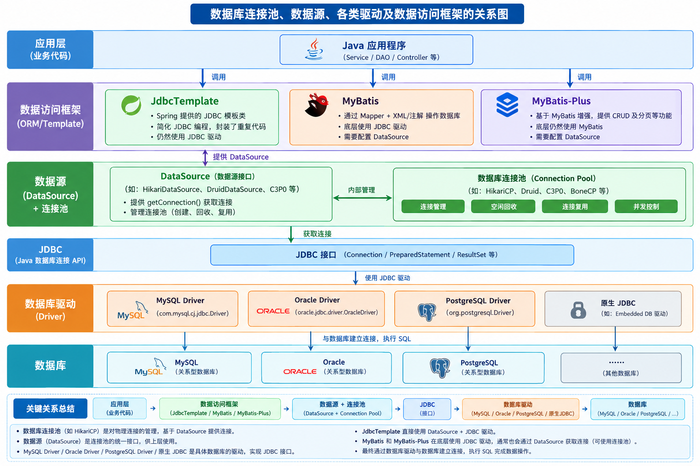
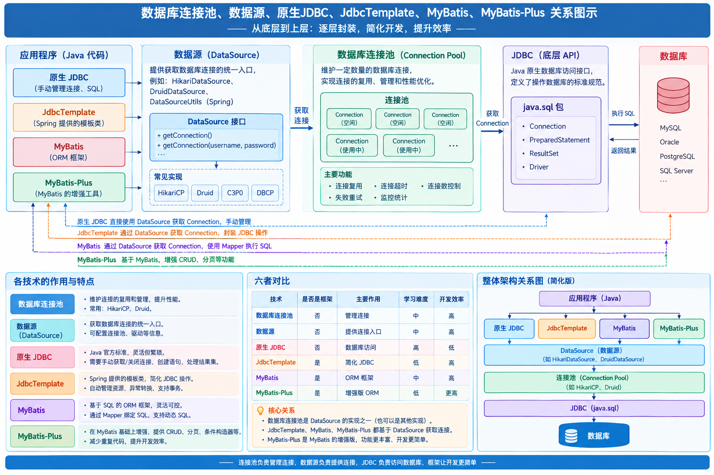

### 数据库连接池

Java 数据库连接池（Connection Pool）框架/组件是 Java 生态中用于**管理数据库连接生命周期**的核心中间件，本质是 `javax.sql.DataSource` 接口的实现类，通过“预创建连接、复用连接、统一管控”的机制，解决数据库连接创建/销毁开销大、并发连接失控等问题，是企业级 Java 应用连接数据库的标准方案。以下从核心原理、关键特性、主流组件对比、配置实践等方面展开详细解析：



#### 一、核心原理与设计目标

##### 1. 核心原理

- **连接池初始化**：应用启动时，连接池根据配置创建一定数量的数据库连接（最小空闲连接数），并缓存到池中。
- **连接获取**：应用需要访问数据库时，从池中直接获取空闲连接，无需重新执行“网络握手、权限验证”等耗时操作。
- **连接复用**：应用使用完连接后，将连接归还给池（而非关闭），供其他请求复用。
- **动态调节**：当池中空闲连接不足时，连接池会创建新连接（不超过最大连接数）；当连接闲置时间过长，会自动销毁多余连接（维持最小空闲数）。

##### 2. 设计目标

- **提升性能**：减少连接创建/销毁的高开销操作，降低系统资源消耗。
- **控制并发**：限制最大连接数，避免数据库因连接过载而崩溃。
- **增强稳定性**：提供连接超时重试、故障恢复等机制，提升数据库访问的可靠性。
- **简化管理**：统一管控连接的生命周期，支持事务集成、监控等扩展能力。

#### 二、关键特性与核心配置参数

##### 1. 必备核心特性

- **连接池管理**：支持最小空闲连接数、最大连接数、连接超时时间等基础配置。
- **连接有效性校验**：通过“心跳检测”（如执行 `SELECT 1`）确保借出的连接可用，避免使用失效连接。
- **事务支持**：与 Java 事务管理器（如 Spring 事务）集成，保证事务的原子性。
- **资源回收**：自动销毁闲置超时的连接，释放数据库资源。

##### 2. 常见核心配置参数

| 配置参数                          | 作用说明                                                     |
| --------------------------------- | ------------------------------------------------------------ |
| 最大连接数（maxPoolSize）         | 池中允许的最大连接数量，超过则请求排队等待。                 |
| 最小空闲连接数（minIdle）         | 池中保持的最小空闲连接数量，避免频繁创建新连接。             |
| 连接超时时间（connectionTimeout） | 应用从池中获取连接的最大等待时间，超时则抛出异常。           |
| 空闲连接超时时间（idleTimeout）   | 连接闲置超过该时间则被销毁（需大于数据库的连接超时时间）。   |
| 连接存活时间（maxLifetime）       | 连接的最大生命周期，到期后强制销毁并重建，避免使用长期闲置的失效连接。 |

#### 三、主流连接池组件对比

目前 Java 生态中主流的连接池组件各有侧重，以下是核心特性对比：

| 组件         | 核心优势                                                     | 适用场景                                             | 缺点                                     |
| ------------ | ------------------------------------------------------------ | ---------------------------------------------------- | ---------------------------------------- |
| **HikariCP** | 性能最优（轻量、启动快、延迟低）；配置简单；Spring Boot 2.x+ 默认集成 | 对性能要求高、追求精简配置的场景（如微服务）         | 功能较基础，无内置监控、防注入等扩展能力 |
| **Druid**    | 功能全面（监控统计、SQL 防注入、加密传输、日志记录）；兼容性强 | 生产环境、对监控和安全性要求高的场景（如电商、金融） | 体积较大，性能略逊于 HikariCP            |
| **C3P0**     | 老牌组件，稳定性强；支持复杂的连接池配置                     | legacy 项目维护（新项目不推荐）                      | 性能较差，启动慢，资源消耗高             |
| **DBCP**     | Apache 开源，功能基础；支持 Spring 集成                      | 简单场景、对扩展能力无要求的项目                     | 扩展性弱，无内置监控，稳定性一般         |

#### 四、典型应用配置示例

以 Spring Boot 项目为例，展示 HikariCP 和 Druid 的核心配置（基于 `application.yml`）：

##### 1. HikariCP 配置（Spring Boot 默认）

```yaml
spring:
  datasource:
    url: jdbc:mysql://localhost:3306/test_db?useSSL=false&serverTimezone=UTC
    username: root
    password: 123456
    driver-class-name: com.mysql.cj.jdbc.Driver
    hikari:
      max-pool-size: 10  # 最大连接数
      min-idle: 2        # 最小空闲连接数
      connection-timeout: 30000  # 连接超时时间（30秒）
      idle-timeout: 600000        # 空闲连接超时时间（10分钟）
      max-lifetime: 1800000       # 连接最大生命周期（30分钟）
```

##### 2. Druid 配置（需引入依赖）

首先引入 Maven 依赖：

```xml
<dependency>
    <groupId>com.alibaba</groupId>
    <artifactId>druid-spring-boot-starter</artifactId>
    <version>1.2.16</version>
</dependency>
```

然后配置 `application.yml`：

```yaml
spring:
  datasource:
    url: jdbc:mysql://localhost:3306/test_db?useSSL=false&serverTimezone=UTC
    username: root
    password: 123456
    driver-class-name: com.mysql.cj.jdbc.Driver
    type: com.alibaba.druid.pool.DruidDataSource
    druid:
      max-active: 10          # 对应最大连接数
      min-idle: 2             # 最小空闲连接数
      max-wait: 30000         # 连接超时时间（30秒）
      time-between-eviction-runs-millis: 60000  # 连接校验间隔（1分钟）
      validation-query: SELECT 1                # 连接有效性校验SQL
      stat-view-servlet:                        # 开启监控控制台
        enabled: true
        login-username: admin
        login-password: admin
        url-pattern: /druid/*
      filter:
        stat: enabled: true                     # 开启SQL统计监控
        wall: enabled: true                     # 开启SQL防注入
```

#### 五、实践注意事项

1. **参数调优原则**
   - 最大连接数（maxPoolSize）：需结合数据库的最大连接数（如 MySQL 默认 151），避免超过数据库承载能力。
   - 空闲连接超时（idleTimeout）：需小于数据库的连接超时时间（如 MySQL 默认 8 小时），防止连接被数据库主动关闭后池内仍缓存失效连接。
   - 连接有效性校验：建议开启（如 Druid 的 `validation-query`），避免借出失效连接导致业务异常。

2. **安全性考量**
   - 敏感信息加密：Druid 支持数据库密码加密，避免配置文件中明文存储密码。
   - 权限控制：监控控制台（如 Druid）需设置复杂账号密码，限制访问 IP，防止未授权访问。

3. **监控与排查**
   - Druid 内置监控控制台，可查看连接池状态、SQL 执行效率、慢查询等，便于问题排查。
   - 生产环境建议集成日志框架（如 Logback），记录连接池的创建、销毁、超时等日志，便于定位问题。

#### 六、总结

Java 数据库连接池是解决数据库连接性能问题的关键组件，其中 **HikariCP** 以高性能成为轻量场景的首选，**Druid** 以丰富的扩展能力适配复杂生产环境。实际开发中需根据业务需求选择合适的组件，并结合数据库性能合理调优配置，同时重视安全性和监控能力，确保系统稳定运行。

### DataSource（面试精简版，JDBC/连接池核心）

> 一句话：**`javax.sql.DataSource` 是JDBC规范定义的数据源接口，是数据库连接工厂；生产上的实现类就是数据库连接池，用来复用Connection，代替老旧DriverManager。**

#### 1. 接口定义

包：`javax.sql.DataSource`
```java
public interface DataSource extends CommonDataSource, Wrapper {
    Connection getConnection() throws SQLException;
    Connection getConnection(String username, String password) throws SQLException;
}
```
核心方法：`getConnection()` 获取数据库连接。

#### 2. DataSource 两大类实现

##### ① 普通无池实现（仅测试，**生产绝对不用**）

- `DriverManagerDataSource`（Spring自带）
每次调用`getConnection`，**新建物理连接**；close直接关闭TCP连接，没有复用。
> 本质只是对DriverManager的封装，**无连接池**。

##### ② 连接池实现（生产用，实现DataSource接口）

1. **HikariDataSource（HikariCP）**：SpringBoot2+**默认**，性能最高，轻量。
2. **DruidDataSource**：阿里，**监控强、SQL拦截、防SQL注入**，业务最常用。
3. Tomcat JDBC、DBCP2、C3P0（老旧，不推荐）

> 连接池核心：提前创建一批Connection放在池里；业务用完`connection.close()`**不是关闭TCP，归还连接池**，实现复用。

#### 3. DataSource vs DriverManager（面试高频）

| | DataSource | DriverManager |
|---|---|---|
| 规范 | JDBC标准接口 | 早期工具类 |
| 连接 | 支持连接池复用 | 每次新建物理连接 |
| 配置 | 集中管理，可JNDI | 硬编码url、账号密码 |
| 事务 | 支持分布式事务XA | 不支持 |
| 场景 | 生产项目 | 简单测试 |

> DriverManager每次建立TCP握手、认证，开销巨大；高并发会严重拖垮数据库。

#### 4. 连接池核心参数（Hikari/Druid通用，背）

- `minimumIdle`：最小空闲连接，池中常驻连接
- `maximumPoolSize`：**最大连接数（最重要）**，池子上限，超过则排队/拒绝
- `connectionTimeout`：拿连接的超时时间，超时抛异常
- `idleTimeout`：空闲连接多久自动回收
- `maxLifetime`：连接最大生命周期，防止数据库侧断开无效连接

> 坑：**maxPoolSize不是越大越好**，数据库有max_connections，连接太多会把数据库连接打满。

#### 5. Spring中的DataSource

1. SpringBoot自动配置：引入jdbc/mybatis starter，**默认HikariCP**，自动装配DataSource Bean
2. 多数据源：手动创建多个DataSource Bean；读写分离可以用`AbstractRoutingDataSource`动态路由，根据key选择数据源。
```java
// 抽象动态数据源，重写determineCurrentLookupKey
public class DynamicDataSource extends AbstractRoutingDataSource{
    @Override
    protected Object determineCurrentLookupKey() {
        return DynamicContextHolder.getDbKey();
    }
}
```

#### 6. 执行流程（口述）

1. 业务代码从DataSource（连接池）调用`getConnection()`
2. 池内有空闲连接 → 直接取出；无空闲且没达到maxPoolSize → 创建新连接；达到上限则等待connectionTimeout
3. 使用connection执行SQL
4. `connection.close()`：**归还到连接池，不是关闭TCP连接**
5. 连接池后台线程定时检测，回收空闲、过期连接

#### 7. 面试高频追问

##### Q1：Connection close()到底干了什么？

> 连接池里的Connection是代理对象，close()是**归还连接回池**，底层TCP连接保留；只有无池的DriverManagerDataSource才会真正关闭连接。

##### Q2：连接耗尽（拿不到连接）怎么排查？

1. 查看连接池监控：活跃连接数、等待队列
2. 大概率**连接泄漏**：拿到Connection没有close，连接一直不归还；Druid可以开启连接泄漏检测。
3. 长事务：事务执行太久，连接长时间占用。

##### Q3：HikariCP为什么性能比Druid高？

Hikari做了大量优化：字节码精简、集合用FastList，减少锁竞争；Druid优势不在性能，在于监控、SQL过滤、安全审计。

##### Q4：AbstractRoutingDataSource原理？

是Spring提供的DataSource包装类，本身不维护连接池；内部持有多个真实DataSource，每次getConnection前调用`determineCurrentLookupKey`拿到key，选择对应的数据源。

#### 🎤面试一句话总结

DataSource是JDBC规范定义的数据源接口，作为数据库连接工厂；生产上一般使用HikariCP、Druid这类连接池实现类，复用数据库连接，避免频繁创建销毁TCP连接；连接池的Connection.close()是归还连接而不是关闭物理连接；SpringBoot默认HikariCP；多数据源可以继承AbstractRoutingDataSource实现动态路由。

---
要不要我把**连接泄漏、连接池参数调优**整理成面试问答，和DataSource放一起？


### 数据源、数据库连接池关系

你可以把整个机制想象成一个**“水厂供水系统”**：

\*  **MySQL 数据库** = **水源地（水厂）**：负责生产水（数据），每次新建连接就像从水厂铺设一条新水管到用户家，成本极高。
\*  **连接池** = **蓄水池/中转站**：提前从水厂接好一大池水，放在离用户近的地方。
\*  **数据源 (DataSource)** = **供水公司的总接口/门面**：应用程序（用户）不直接找蓄水池，也不直接找水厂，而是找“供水公司”要水。供水公司内部决定是从蓄水池给水，还是临时去水厂接水。



#### 📊 详细角色分工表

| 组件              | 角色定位       | 关键特征                                                     | 与 MySQL 的关系                                              |
| ----------------- | -------------- | ------------------------------------------------------------ | ------------------------------------------------------------ |
| **DataSource**    | **标准接口**   | Java 官方制定的规范 (`javax.sql.DataSource`)。 应用程序获取连接的**唯一标准入口**。 | 它只是一个接口，不直接操作 MySQL，需要具体实现类。           |
| **连接池实现**    | **具体实现**   | 实现了 `DataSource` 接口。 例如：**HikariCP**, **Druid**, **DBCP**, **C3P0**。 内部维护了一个“连接集合”(池)。 | 它是 DataSource 的一种高级实现，主要目的是**复用**连接。     |
| **DriverManager** | **底层创建者** | Java 核心类。 负责加载 MySQL 驱动并建立**物理连接**。        | 连接池在**第一次创建**连接时，底层必须调用它来建立与 MySQL 的 TCP 连接。 |
| **MySQL Driver**  | **驱动程序**   | `com.mysql.cj.jdbc.Driver`。 负责具体的网络通信协议。        | 连接池通过它与 MySQL 服务器进行握手、认证和数据传输。        |

#### 🔗 它们是如何协同工作的？

当你在代码中调用 `dataSource.getConnection()` 时，背后的流程如下：

\1. **应用程序**向 `DataSource` 申请连接。
\2. **连接池（作为 DataSource 的实现）** 接收到请求：
  \*  **情况 A（池中有空闲连接）**：直接从“池子”里拿出一个已经建好的连接给应用程序。**（最快，不涉及 MySQL 交互）**
  \*  **情况 B（池中无空闲，且未达最大连接数）**：连接池内部调用 `DriverManager`，通过 `MySQL Driver` 向 MySQL 服务器发起请求，建立一个新的物理连接，交给应用程序，并标记为“使用中”。
\3. **应用程序**使用连接执行 SQL 操作。
\4. **应用程序**调用 `connection.close()`：
  \*  **注意**：连接并没有真正断开！
  \*  连接池拦截了 `close()` 方法，将连接**归还**到池中，以便下次复用。

#### 💡 一个关键的误区澄清

**所有的连接池（DataSource）最终都依赖 DriverManager + Driver**

无论是 HikariCP、Druid 还是 C3P0，它们本质上都是对 `DriverManager` 的封装。

\*  **没有连接池时**：每次 `getConnection()` 都直接调用 `DriverManager` 建立新连接（昂贵）。
\*  **有连接池时**：`getConnection()` 先看池子里有没有；如果没有，才调用 `DriverManager` 建立新连接；如果有，直接复用。

**一句话总结：**
`DataSource` 是一个接口，**连接池**是这个接口的一种实现。连接池利用 `DataSource` 的标准方法，内部管理了一组由 `DriverManager` 创建的、与 MySQL 的物理连接，从而实现了连接的复用，避免了频繁建立连接的开销。

```
┌─────────────────────────────────────────────┐
│              Java 业务应用 Application       │
└─────────────────────────────────────────────┘
                    │
       ┌────────────┼────────────┐
       ↓            ↓            ↓
┌────────────┐ ┌────────────┐ ┌──────────────┐
│   MyBatis  │ │Spring JDBC │ │ JPA/Hibernate│
│ SQL映射框架 │ │ JdbcTemplate│ │ ORM持久化方案 │
└────────────┘ └────────────┘ └──────────────┘
       │            │            │
       │            │            │
       │            │            │
       ↓            ↓            ↓       
    SQL映射框架    JDBC封装工具    ORM持久化方案
       │            │            │
       │            │            │
       └────────────┼────────────┘
                    ↓
┌─────────────────────────────────────────────┐
│ DataSource（数据库连接获取抽象）             │
│                                             │
│ 常见连接池实现：                             │
│ HikariCP / Druid / C3P0 / DBCP              │
  HikariDataSource（HikariCP 实现）
  DruidDataSource（Druid 实现）
  ...
│                                             │
│ 连接池负责连接池化、复用和生命周期管理        │
└─────────────────────────────────────────────┘
                    │
                    ↓
┌─────────────────────────────────────────────┐
│ JDBC API                                    │
│ java.sql.* / javax.sql.*                    │
│ Java 标准数据库访问接口                      │
└─────────────────────────────────────────────┘
                    │
       ┌────────────┼────────────┐
       ↓            ↓            ↓
┌────────────┐ ┌────────────┐ ┌──────────────┐
│MySQL Driver│ │Oracle Driver│ │PostgreSQL    │
│mysql-      │ │  ojdbc     │ │Driver        │
│connector-j │ │            │ │pg-jdbc       │
└────────────┘ └────────────┘ └──────────────┘
       ↓ TCP 连接    ↓  TCP 连接    ↓   TCP 连接
    MySQL         Oracle      PostgreSQL
```


---

#### 各层关系简要说明

| 层级           | 组件                                   | 作用                                                         |
| -------------- | -------------------------------------- | ------------------------------------------------------------ |
| **最上层**     | 业务应用代码                           | 开发者编写的业务逻辑                                         |
| **ORM 层**     | MyBatis / JPA / Hibernate              | 封装 SQL、结果映射、缓存管理，让开发者不用手写大量 JDBC 样板代码 |
| **连接池层**   | HikariCP / Druid / C3P0                | 基于 JDBC 管理数据库连接的**创建、复用和销毁**，避免频繁创建连接的性能开销 |
| **标准接口层** | **JDBC API** (`java.sql.*`)            | Java 提供的**标准接口规范**，是连接一切的"契约"              |
| **驱动实现层** | MySQL Driver / Oracle Driver / pg-jdbc | 数据库厂商对 JDBC 接口的**具体实现**，负责协议转换和网络通信 |
| **最底层**     | MySQL / Oracle / PostgreSQL            | 实际的数据库服务                                             |

#### 核心要点

- **JDBC 是规范（接口）**，本身不能操作数据库。
- **Driver 是实现**，不同数据库需要不同的驱动包。
- **连接池**在 JDBC 之上做连接管理，提升性能。
- **MyBatis**在连接池之上做 SQL 映射，进一步简化开发。


### **JDBC 数据库访问执行过程**

也就是 **Java 程序通过 JDBC 操作 MySQL 的一整套固定流程**。

**Java 应用程序通过 JDBC 规范，与数据库建立连接、发送并执行 SQL、处理结果、释放资源的全过程。**

        JDBC（规范）
        ├── JDBC API（接口定义）
        │     ├── Connection
        │     ├── Statement
        │     ├── ResultSet
        │     └── DataSource
        │
        └── Driver（实现）
              ├── MySQL Driver
              ├── Oracle Driver
              └── PostgreSQL Driver

👉 **JDBC 是 Java 访问数据库的标准规范，而 JDBC API 是该规范在 Java 中的接口定义（java.sql / javax.sql），数据库厂商通过实现这些接口提供具体驱动。**

#### 1. **连接阶段**

- 加载驱动
- 和数据库建立连接 `Connection`

#### 2. **SQL 准备阶段（重点）**

- 写带 `?` 占位符的 SQL
- **`prepareStatement(sql)` 预编译 SQL**
- 给占位符设置参数：`setString()`、`setInt()`

#### 3. **执行阶段**

- 发送 SQL 到数据库执行
  - 查询：`executeQuery()`
  - 增删改：`executeUpdate()`
- 获取返回结果（`ResultSet` 或影响行数）

#### 4. **释放资源阶段**

- 关闭结果集 → 语句对象 → 连接
  （`ResultSet` → `PreparedStatement` → `Connection`）

- 你在 Spring 里用的 **JdbcTemplate、MyBatis**
- 底层 **全都是封装了这套 JDBC 流程**

### JdbcTemplate

`JdbcTemplate` 是 Spring Framework 在 `spring-jdbc` 模块中提供的一个核心工具类。它是对原生 JDBC API 的一次**轻量级封装**。

如果说原生 JDBC 是“手动挡汽车”，MyBatis 是“自动挡汽车”，那么 `JdbcTemplate` 就是“半自动挡汽车”。它不提供 ORM（对象关系映射）功能，不会屏蔽 SQL，而是专注于**消灭 JDBC 开发中的样板代码**，让开发者专注于业务 SQL 本身。

---

#### 一、 JdbcTemplate 解决了什么痛点？

原生 JDBC 开发中最让人痛苦的不是写 SQL，而是繁琐的周边操作。`JdbcTemplate` 主要帮你干了以下几件脏活累活：

1.  **资源管理**：自动获取连接、关闭 `Connection`、`Statement`、`ResultSet`，再也不用写冗长的 `try-catch-finally` 块。
2.  **异常转换**：原生 JDBC 抛出的是强制的 `SQLException`（Checked Exception，必须 try-catch 或 throws）。Spring 将其转换为 `DataAccessException` 体系（Unchecked Exception），让代码更干净，且屏蔽了不同数据库厂商的异常错误码差异。
3.  **Statement 创建与参数绑定**：内部使用 `PreparedStatement` 自动完成 SQL 参数的占位符（`?`）替换，从根本上防止 SQL 注入。
4.  **结果集映射**：提供 `RowMapper` 接口，将数据库返回的 `ResultSet` 自动映射为 Java 实体对象。

---

#### 二、 核心方法与 API

`JdbcTemplate` 提供了大量的重载方法，但核心操作主要分为以下几类：

| 方法签名                                                    | 用途                                                   |
| :---------------------------------------------------------- | :----------------------------------------------------- |
| `update(String sql, Object... args)`                        | 执行 INSERT、UPDATE、DELETE 等操作，返回受影响的行数。 |
| `query(String sql, RowMapper<T> mapper, Object... args)`    | 执行 SELECT 查询，返回实体对象列表（`List<T>`）。      |
| `queryForObject(String sql, Class<T> type, Object... args)` | 查询单个值（如 `count(*)`）或单行记录。                |
| `queryForList(String sql, Object... args)`                  | 查询多行数据，返回 `List<Map<String, Object>>`。       |
| `batchUpdate(String sql, List<Object[]> batchArgs)`         | 批量执行更新操作。                                     |

---

#### 三、 Spring Boot 整合 JdbcTemplate 实战

在 Spring Boot 中使用 `JdbcTemplate` 非常简单，底层会自动使用你配置的连接池（如 HikariCP）。

##### 1. 引入依赖

```xml
<dependency>
    <groupId>org.springframework.boot</groupId>
    <artifactId>spring-boot-starter-jdbc</artifactId>
</dependency>
<dependency>
    <groupId>com.mysql</groupId>
    <artifactId>mysql-connector-j</artifactId>
</dependency>
```

##### 2. 配置数据源

```yaml
spring:
  datasource:
    url: jdbc:mysql://localhost:3306/mydb
    username: root
    password: 123456
    driver-class-name: com.mysql.cj.jdbc.Driver
```

##### 3. 实体类

```java
public class User {
    private Long id;
    private String username;
    private Integer age;
    // 省略 getter/setter/toString
}
```

##### 4. Repository 层代码（核心用法）

在 Service 或 Repository 中直接注入 `JdbcTemplate` 即可使用：

```java
import org.springframework.beans.factory.annotation.Autowired;
import org.springframework.jdbc.core.BeanPropertyRowMapper;
import org.springframework.jdbc.core.JdbcTemplate;
import org.springframework.jdbc.core.RowMapper;
import org.springframework.stereotype.Repository;

import java.sql.ResultSet;
import java.sql.SQLException;
import java.util.List;

@Repository
public class UserDao {

    @Autowired
    private JdbcTemplate jdbcTemplate;

    // 1. 增删改操作
    public int insertUser(String username, int age) {
        String sql = "INSERT INTO user (username, age) VALUES (?, ?)";
        return jdbcTemplate.update(sql, username, age);
    }

    // 2. 查询列表 (方式一：手动映射 RowMapper) - 适合复杂自定义映射
    public List<User> findAllUsersManual() {
        String sql = "SELECT id, username, age FROM user";
        return jdbcTemplate.query(sql, new RowMapper<User>() {
            @Override
            public User mapRow(ResultSet rs, int rowNum) throws SQLException {
                User user = new User();
                user.setId(rs.getLong("id"));
                user.setUsername(rs.getString("username"));
                user.setAge(rs.getInt("age"));
                return user;
            }
        });
    }

    // 3. 查询列表 (方式二：自动映射 BeanPropertyRowMapper) - 日常推荐用法
    // 前提：数据库字段名和实体类属性名能对应上（如 user_name 映射 userName，需配置 spring.jdbc.core.namedparam 驼峰转换，或手动起别名）
    public List<User> findAllUsersAuto() {
        String sql = "SELECT id, username, age FROM user";
        // BeanPropertyRowMapper 会通过反射自动将同名字段塞入对象属性
        return jdbcTemplate.query(sql, new BeanPropertyRowMapper<>(User.class));
    }

    // 4. 查询单个对象
    public User findUserById(Long id) {
        String sql = "SELECT id, username, age FROM user WHERE id = ?";
        // 注意：如果查不到数据，queryForObject 会抛出 EmptyResultDataAccessException，需捕获处理
        return jdbcTemplate.queryForObject(sql, new BeanPropertyRowMapper<>(User.class), id);
    }

    // 5. 查询单个值 (比如统计数量)
    public Integer countUsers() {
        String sql = "SELECT COUNT(*) FROM user";
        return jdbcTemplate.queryForObject(sql, Integer.class);
    }

    // 6. 批量插入
    public void batchInsertUsers(List<User> users) {
        String sql = "INSERT INTO user (username, age) VALUES (?, ?)";
        // 将对象列表转换为参数数组列表
        List<Object[]> params = users.stream()
                .map(u -> new Object[]{u.getUsername(), u.getAge()})
                .toList();
        jdbcTemplate.batchUpdate(sql, params);
    }
}
```

---

#### 四、 进阶用法：NamedParameterJdbcTemplate

传统的 `JdbcTemplate` 使用 `?` 作为占位符。当 SQL 参数过多时，很容易搞混参数顺序。Spring 提供了 `NamedParameterJdbcTemplate`，支持使用具名参数（如 `:name`），大大提高了代码可读性。

```java
import org.springframework.jdbc.core.namedparam.NamedParameterJdbcTemplate;
import org.springframework.jdbc.core.namedparam.MapSqlParameterSource;

@Repository
public class UserNamedDao {

    // 直接注入即可，Spring Boot 会自动配置
    @Autowired
    private NamedParameterJdbcTemplate namedParameterJdbcTemplate;

    public User findUserByNameAndAge(String username, int age) {
        // 使用 :paramName 代替 ?
        String sql = "SELECT id, username, age FROM user WHERE username = :uname AND age = :uage";
        
        // 绑定参数
        MapSqlParameterSource params = new MapSqlParameterSource()
                .addValue("uname", username)
                .addValue("uage", age);
                
        return namedParameterJdbcTemplate.queryForObject(sql, params, new BeanPropertyRowMapper<>(User.class));
    }
}
```

---

#### 五、 事务管理

`JdbcTemplate` 本身不管理事务，它只是执行 SQL。事务由 Spring 的声明式事务管理控制。

只需在启动类加上 `@EnableTransactionManagement`，在 Service 层方法上加 `@Transactional` 即可：

```java
@Service
public class UserService {

    @Autowired
    private UserDao userDao;

    @Transactional // 保证以下操作在同一个事务中，要么全成功，要么全回滚
    public void transferMoney(Long fromId, Long toId, Double amount) {
        userDao.updateBalance(fromId, -amount);
        // 模拟异常
        if (true) throw new RuntimeException("断电了！");
        userDao.updateBalance(toId, amount);
    }
}
```

---

#### 六、 优缺点与适用场景

##### 优点：

1.  **轻量级零侵入**：无需引入庞大的 ORM 框架，学习成本极低。
2.  **SQL 掌控力强**：SQL 写在代码里，直观且易于调试，没有 MyBatis 那种 XML 配置开销。
3.  **性能优异**：因为极薄的一层封装，执行效率几乎等同于原生 JDBC。

##### 缺点：

1.  **缺乏 ORM 能力**：虽然 `BeanPropertyRowMapper` 能自动映射，但面对一对多、多对多等复杂关联查询时，手动写 `RowMapper` 非常繁琐。
2.  **SQL 硬编码**：SQL 散落在 Java 代码中，不利于后期维护和 DBA 审查。
3.  **无动态 SQL 支持**：遇到条件动态拼接（如根据多个可选条件查询），需要自己在 Java 里拼字符串或使用 `StringBuilder`，非常痛苦。

##### 适用场景：

*   **微服务项目中的简单微服务**：只有几张表，只有简单的增删改查，不想引入 MyBatis。
*   **内部管理系统 / 工具类项目**：快速开发，逻辑简单。
*   **报表系统 / 复杂统计**：需要极致优化 SQL，且不愿受 ORM 框架规则束缚的场景。
*   **老项目重构**：从原生 JDBC 快速平滑迁移到 Spring 体系。

#### 总结

`JdbcTemplate` 是一把“瑞士军刀”，它不花哨，但在处理轻量级数据库操作时非常锋利。对于现代复杂的业务系统，通常会结合 **MyBatis-Plus（处理复杂业务 CRUD） + JdbcTemplate（处理复杂多表统计 SQL）** 共同使用。


### 原生JDBC、JdbcTemplate、MyBatis、MyBatis‑Plus 对比

> 
> 核心脉络：**原生JDBC → JdbcTemplate（Spring封装，简化样板代码） → MyBatis（ORM半自动，SQL与代码分离） → MyBatis‑Plus（MyBatis增强，CRUD零SQL）**

#### 1. 原生 JDBC

JDBC 是 Java 访问数据库的**标准规范**，`java.sql.*`、`javax.sql.*`，是所有框架底层基础。

##### **JDBC 数据库访问执行过程**

也就是 **Java 程序通过 JDBC 操作 MySQL 的一整套固定流程**。

**Java 应用程序通过 JDBC 规范，与数据库建立连接、发送并执行 SQL、处理结果、释放资源的全过程。**

        JDBC（规范）
        ├── JDBC API（接口定义）
        │     ├── Connection
        │     ├── Statement
        │     ├── ResultSet
        │     └── DataSource
        │
        └── Driver（实现）
              ├── MySQL Driver
              ├── \Oracle Driver
              └── PostgreSQL Driver

👉 **JDBC 是 Java 访问数据库的标准规范，而 JDBC API 是该规范在 Java 中的接口定义（java.sql / javax.sql），数据库厂商通过实现这些接口提供具体驱动。**

##### 基础步骤

1. 加载驱动
2. 获取 `Connection`（来自DataSource）
3. 创建 `Statement / PreparedStatement`
4. 设置参数、执行SQL
5. 封装遍历ResultSet得到结果
6. **手动关闭资源：ResultSet、Statement、Connection**

```
Connection conn = dataSource.getConnection();
String sql = "select id,name from user where id=?";
PreparedStatement pstmt = conn.prepareStatement(sql);
pstmt.setLong(1,1L);
ResultSet rs = pstmt.executeQuery();
while(rs.next()){
    User user = new User();
    user.setId(rs.getLong("id"));
    user.setName(rs.getString("name"));
}
// 必须手动 close，try‑finally
rs.close();
pstmt.close();
conn.close();
```

##### 缺点

1. **样板代码巨多**：获取连接、设置参数、解析ResultSet、关闭资源大量重复
2. **手动映射结果集 → Java对象**，重复劳动
3. 资源忘记关闭容易**连接泄漏**
4. SQL硬编码写在Java代码里，修改SQL要改Java，重新编译
5. 动态SQL拼接非常痛苦，极易出错

##### 优点

底层、可控，性能损耗最小。

---

#### 2. JdbcTemplate（Spring）

> 
> Spring 对原生JDBC的**轻量封装**，**不是ORM框架**，只是消除样板代码。底层依然是JDBC。

##### 解决什么问题

- 自动管理资源：**不用手动close Connection/Statement/ResultSet**，Spring自动释放
- 不用手动处理ResultSet，提供回调、行映射
- 统一异常体系：把SQLException转为Spring非受检异常 `DataAccessException`

```
// 查询单个对象
User user = jdbcTemplate.queryForObject(
    "select id,name from user where id=?",
    new BeanPropertyRowMapper<>(User.class),
    1L
);
```

##### 特点

1. SQL**仍然写在Java代码中**，没有XML；也支持外部SQL
2. 没有自动ORM，需要RowMapper/BeanPropertyRowMapper做字段‑对象映射
3. **不支持动态SQL**，复杂条件需要自己拼接字符串
4. 没有Mapper接口，没有参数绑定 `${}` `#{}`
5. 适合简单CRUD；复杂SQL、动态条件写起来难受

##### 缺点

- SQL和Java代码耦合；动态SQL很难写
- 没有缓存、一级二级缓存
- 没有Mapper接口，方法和SQL不能解耦

> 
> 扩展：`NamedParameterJdbcTemplate`，支持命名参数 `:name`，代替`?`，可读性更好。

---

#### 3. MyBatis（半自动ORM）

> **半自动ORM持久层框架**；底层依然封装JDBC。SQL 和 Java代码**分离**。
> 核心：Mapper接口 + XML映射文件（或注解）。

##### 核心特性

1. SQL与Java代码解耦：SQL写在XML文件，修改SQL**不需要重启Java**
2. 自动参数绑定 `#{}`（预编译，防SQL注入） `${}`（直接字符串替换）
3. **自动结果集映射**：resultType / resultMap；支持驼峰自动映射
4. **强大动态SQL**：`<if> <where> <foreach> <choose>`标签，处理多条件查询
5. **一级缓存、二级缓存**
6. Mapper接口，动态代理生成实现类，不用写接口实现类

Mapper接口

```
public interface UserMapper {
    User selectById(Long id);
}
```

xml

```
<select id="selectById" resultType="User">
    select id,name from user where id = #{id}
</select>
```

##### 缺点

1. 基础CRUD也要写XML，简单重复SQL多；
2. 需要维护Mapper xml文件；
3. 不支持对象直接操作数据库，必须写SQL。

> 
> 半自动ORM：**需要自己写SQL**；对比Hibernate全自动ORM，完全不用写SQL。

---

#### 4. MyBatis‑Plus（MP）

> 
> **不是替代MyBatis，是MyBatis的增强工具，在MyBatis基础上只做增强不做改变**。
> 底层依旧MyBatis，MyBatis所有特性全部保留。

##### 核心能力

1. **内置通用CRUD，不用写任何XML SQL**
   - `BaseMapper<T>`：`insert`、`updateById`、`selectById`、`list`、`page分页`
   - `IService<T>` + `ServiceImpl`：业务层封装
2. **条件构造器 QueryWrapper / LambdaQueryWrapper**，Java链式API构造查询条件，**不用写XML**

```
userMapper.selectList(Wrappers.<User>lambdaQuery()
        .eq(User::getName,"张三")
        .ge(User::getAge,18));
```

3. 内置分页插件、主键策略、逻辑删除、乐观锁版本号插件、字段自动填充(createTime/updateTime)
4. 代码生成器：一键生成 Entity、Mapper、Service、Controller

##### 缺点

1. 复杂多表查询、复杂SQL还是要回到MyBatis XML写SQL；Wrapper适合单表
2. 过度使用Wrapper会把SQL逻辑写死在Java代码；复杂SQL可读性差。

---

#### 对比总表（面试背诵）

| 框架 | 定位 | SQL位置 | 动态SQL | CRUD | ORM程度 |
| --- | --- | --- | --- | --- | --- |
| 原生JDBC | 底层规范 | Java代码内 | 手动拼接 | 全部手写 | 无 |
| JdbcTemplate | Spring JDBC封装 | Java代码内 | 很难手写拼接 | 手写SQL | 轻量手动映射 |
| MyBatis | 半自动ORM | XML/注解 | 标签支持 | 需要写SQL | 半自动 |
| MyBatis‑Plus | MyBatis增强 | 简单单表不用写；复杂写XML | Wrapper+MyBatis标签 | 单表CRUD内置 | 半自动增强 |

#### ✨面试背诵版

> 原生JDBC是Java访问数据库底层规范，需要手动处理连接、参数、结果集、资源关闭，样板代码多。
> JdbcTemplate是Spring对JDBC封装，消除样板代码，自动管理资源，异常转译，但SQL还是写在Java，动态SQL能力弱。
> MyBatis是半自动ORM框架，底层基于JDBC，实现SQL和代码分离，支持动态SQL、结果映射、缓存，Mapper接口动态代理，但是基础CRUD需要编写XML。
> MyBatis‑Plus是MyBatis增强工具，不改变MyBatis原有功能；提供BaseMapper、条件构造器，单表CRUD无需写SQL，还提供分页、逻辑删除、乐观锁等插件；复杂多表查询依旧使用MyBatis XML。

#### 高频面试追问

##### Q：`#{}` 和 `${}`区别

- `#{id}`：预编译，`PreparedStatement`占位符，防止SQL注入；
- `${id}`：直接字符串替换，有SQL注入风险；一般用于表名、列名。

##### Q：MyBatis一级缓存、二级缓存

- **一级缓存：SqlSession级别，默认开启**；同一个SqlSession，相同查询命中缓存；update/insert清空一级缓存。
- **二级缓存：Mapper级别，跨SqlSession；默认关闭，需要手动开启**。

##### Q：MyBatis为什么叫半自动ORM？

> 
> Hibernate全自动ORM，几乎不用写SQL；MyBatis需要开发者自己编写SQL，框架只做参数和结果映射，所以叫半自动。

##### Q：MyBatis‑Plus的Wrapper会SQL注入吗？

> 
> LambdaQueryWrapper用方法引用，不会；字符串传入的QueryWrapper条件要注意。

##### Q：JdbcTemplate有缓存吗？

> 
> 没有，只是JDBC封装，没有ORM缓存机制。

---

要不要我整理一份 **MyBatis一级缓存二级缓存详细流程**，面试经常问？


### R2DBC 对比 JDBC 完整对比

一句话结论：**JDBC 是传统阻塞式数据库 API；R2DBC 是非阻塞响应式数据库 API，专为 Reactor/RxJava 响应式编程设计**，二者定位、线程模型、IO 模型完全不一样。

#### 一、基础定义

1. **JDBC（Java Database Connectivity）** Java 官方标准、**同步阻塞**数据库接口，所有传统 MySQL、PostgreSQL 驱动都基于 JDBC。

   > 执行 SQL 时，调用线程会阻塞等待数据库网络 IO、结果返回，线程卡住不能干别的事。

2. **R2DBC（Reactive Relational Database Connectivity）** 响应式关系型数据库规范，Spring 主导推出，**非阻塞异步**，适配 Project‑Reactor、RxJava。

   > IO 等待时线程释放，可以去处理其它任务，数据库返回数据之后再回调继续执行。

------

#### 二、核心维度对比

| 对比项   | JDBC                                                         | R2DBC                                                        |
| -------- | ------------------------------------------------------------ | ------------------------------------------------------------ |
| IO 模型  | 同步阻塞 IO                                                  | 异步非阻塞 IO                                                |
| 线程开销 | 每一个数据库请求占用一个线程；高并发需要大量线程，线程池开销大 | 少量线程就可以支撑大量并发连接，依靠事件回调，线程利用率极高 |
| 编程范式 | 命令式、同步 `get()`                                         | 响应式流式：`Mono<T>`（0‑1条）、`Flux<T>`（多条数据流）      |
| 底层驱动 | 数据库原生阻塞驱动                                           | 专用响应式驱动（r2dbc‑mysql、r2dbc‑postgres 等，**不能复用 JDBC 驱动**） |
| 事务     | `Connection.setAutoCommit(false)`                            | 响应式事务 API，`TransactionalOperator`                      |
| 流式读取 | 需要手动游标、分页，容易一次性加载全部结果到内存             | 天然流式读取，逐条消费大数据集，支持背压(Backpressure)       |
| 适用框架 | MyBatis、JPA‑Hibernate、Spring‑JdbcTemplate                  | Spring‑WebFlux、Spring Data R2DBC                            |
| 连接池   | HikariCP（高性能阻塞连接池）                                 | R2DBC‑Pool 响应式连接池                                      |

------

#### 三、优缺点拆解

##### ✅ JDBC

**优点**

1. 生态极其成熟、驱动完善、坑少、文档丰富
2. MyBatis、JPA、各种中间件全部兼容
3. 调试简单，同步代码逻辑直观易懂

**缺点**

1. 阻塞线程，高并发下线程数量膨胀，上下文切换开销高
2. 大查询一次性载入内存，容易 OOM；流式读取麻烦
3. 和 WebFlux 响应式栈适配很差，需要额外线程池隔离

##### ✅ R2DBC

**优点**

1. 非阻塞，适合高并发 IO 密集型服务，少量线程扛住海量请求
2. 天然支持数据流、背压，适合超大结果集逐条处理
3. 完美适配 Spring WebFlux 全链路响应式，全程无阻塞
4. 回调式异步，不会阻塞 Netty 工作线程

**缺点**

1. 生态不如 JDBC；很多小众数据库没有 R2DBC 驱动
2. 没有成熟的 ORM（SpringData‑R2dbc 功能弱于 JPA），不支持 MyBatis
3. 响应式代码调试困难、异常栈晦涩、事务、嵌套查询写法更复杂
4. 驱动为独立实现，和 JDBC 驱动是两套代码，偶尔存在兼容性问题

------

#### 四、该怎么选型

1. **普通 Spring‑MVC、业务简单、团队熟悉 MyBatis/JPA** → **优先 JDBC**

2. 搭建 WebFlux 响应式服务、高并发网关、IO密集、大数据流查询

   → 

   选用 R2DBC

   > 注意：R2DBC 只是**接口规范**，它不是用来替代 JDBC 的通用升级，只是面向响应式技术栈的专用标准。

#### 五、通俗比喻

- JDBC：你打电话查询数据库，电话接通之后你拿着手机（线程）一直等着回复，期间手不能干别的。
- R2DBC：你发送消息之后直接放下手机去干活；数据库回复消息的时候收到通知再回来处理，线程不会被占用等待。

### 数据库连接分类

数据库连接（Database Connection）从不同维度可以划分为多种类型。以下是常见的分类方式，帮助你系统理解“数据库连接”的全貌：

------

#### 🔹 一、按 **编程模型** 分（最核心的分类）

| 类型                    | 特点                                  | 代表技术                                                     |
| ----------------------- | ------------------------------------- | ------------------------------------------------------------ |
| **1. 同步阻塞式连接**   | 调用后线程挂起，等待数据库返回结果    | JDBC（Java）、ODBC（C/C++）、`mysql-connector-python`（Python） |
| **2. 异步非阻塞式连接** | 调用后立即返回，通过回调/事件处理结果 | R2DBC（Java）、asyncpg（Python）、Node.js mysql2/promise     |

> ✅ **这是现代架构中最关键的区分**：  
>
> - 传统应用 → 同步  
> - 高并发/响应式系统 → 异步

------

#### 🔹 二、按 **连接管理方式** 分

| 类型                             | 说明                                                    | 优点                             | 缺点                                 |
| -------------------------------- | ------------------------------------------------------- | -------------------------------- | ------------------------------------ |
| **1. 直连（Direct Connection）** | 每次请求新建物理连接                                    | 简单                             | 开销大（TCP + 认证），不适用于高并发 |
| **2. 连接池（Connection Pool）** | 预先创建并复用连接                                      | 高性能、低延迟                   | 需要管理池大小、超时、泄漏等         |
| **3. 代理连接（Proxy/中间件）**  | 通过数据库代理（如 ShardingSphere-Proxy、MaxScale）连接 | 支持分库分表、读写分离、SQL 审计 | 增加网络跳数，引入单点               |

> 📌 **生产环境几乎都使用连接池**：  
>
> - JDBC：HikariCP、Druid、Tomcat JDBC Pool  
> - R2DBC：`r2dbc-pool`  
> - Python：SQLAlchemy 的 `QueuePool`

------

#### 🔹 三、按 **网络协议/驱动类型** 分

| 类型                  | 描述                                    | 示例                                          |
| --------------------- | --------------------------------------- | --------------------------------------------- |
| **1. 原生协议驱动**   | 直接实现数据库通信协议（如 MySQL 协议） | `mysql-connector-java`（JDBC）、`r2dbc-mysql` |
| **2. ODBC/JDBC 桥接** | 通过通用接口（ODBC/JDBC）调用本地驱动   | JDBC-ODBC Bridge（已废弃）                    |
| **3. HTTP/REST 接口** | 通过 HTTP API 访问数据库（非标准）      | Firebase Realtime DB、Supabase REST API       |

> 💡 原生协议驱动性能最好，桥接方式有额外开销。

------

#### 🔹 四、按 **部署架构** 分

| 类型            | 说明                           | 典型场景                             |
| --------------- | ------------------------------ | ------------------------------------ |
| **1. 本地连接** | 应用与数据库在同一主机         | 开发测试、嵌入式数据库（H2, SQLite） |
| **2. 远程连接** | 应用与数据库跨网络             | 生产微服务、云数据库（RDS）          |
| **3. 集群连接** | 连接到数据库集群（主从、分片） | 高可用、大数据量场景                 |

------

#### 🔹 五、按 **安全机制** 分

| 类型                 | 特点                        |
| -------------------- | --------------------------- |
| **明文连接**         | 无加密（如 `useSSL=false`） |
| **SSL/TLS 加密连接** | 数据传输加密                |
| **认证连接**         | 需用户名/密码、证书、IAM 等 |

------

#### 🔹 六、按 **生命周期** 分

| 类型       | 说明                              |
| ---------- | --------------------------------- |
| **短连接** | 请求结束即关闭（HTTP 无状态风格） |
| **长连接** | 连接保持长时间打开                |

> ⚠️ 注意：即使使用“短连接”逻辑，**底层仍由连接池复用物理连接**，避免频繁建连。

------

#### ✅ 总结：一张表看懂分类

| 分类维度     | 主要类型               | 关键区别       |
| ------------ | ---------------------- | -------------- |
| **编程模型** | 同步 vs 异步           | 是否阻塞线程   |
| **连接管理** | 直连 vs 连接池 vs 代理 | 性能与功能权衡 |
| **驱动类型** | 原生协议 vs 桥接       | 性能与兼容性   |
| **部署方式** | 本地 vs 远程 vs 集群   | 网络拓扑       |
| **安全级别** | 明文 vs SSL/TLS        | 数据安全性     |
| **生命周期** | 短连接 vs 长连接       | 资源占用策略   |

------

#### 💡 实际开发建议：

1. **Web 应用** → 使用 **连接池 + 同步（JDBC）或异步（R2DBC）**  
2. **高并发 API 服务** → 考虑 **R2DBC + 连接池**  
3. **内部管理系统** → **JDBC + HikariCP/Druid** 足够  
4. **永远不要在生产环境用直连**（无连接池）  
5. **云上数据库必须开启 SSL**

理解这些分类，能帮助你在架构设计时做出合理的技术选型。

### 数据库规范和驱动

这是一个非常好的问题！**JDBC 和 R2DBC 本身并不是“数据库驱动”，而是“数据库连接规范”或“API 标准”**。而**具体的数据库驱动（Driver）是实现这些规范的代码库**。

下面详细解释它们之间的关系：

------

#### ✅ 一、核心概念区分

| 名称                                                | 类型                     | 作用                                                         | 类比                         |
| --------------------------------------------------- | ------------------------ | ------------------------------------------------------------ | ---------------------------- |
| **JDBC**                                            | **规范 / API 接口标准**  | 定义 Java 程序如何与关系型数据库交互的**统一接口**（如 `Connection`, `Statement`, `ResultSet`） | 就像 “USB 接口标准”          |
| **R2DBC**                                           | **规范 / API 接口标准**  | 定义 Java 响应式程序如何**异步非阻塞地**与关系型数据库交互的**统一接口**（如 `ConnectionFactory`, `Result`） | 就像 “USB-C 接口标准”        |
| **MySQL JDBC Driver** （如 `mysql-connector-java`） | **数据库驱动（Driver）** | **实现 JDBC 规范**，提供与 MySQL 通信的具体逻辑              | 就像 “某品牌的 USB 数据线”   |
| **R2DBC MySQL Driver** （如 `r2dbc-mysql`）         | **数据库驱动（Driver）** | **实现 R2DBC 规范**，提供与 MySQL 异步通信的具体逻辑         | 就像 “某品牌的 USB-C 数据线” |

------

#### 🔍 二、用代码说明关系

##### 1. **JDBC 场景**

```java
// 1. 使用的是 JDBC "规范" 中的接口
Connection conn = DriverManager.getConnection(
    "jdbc:mysql://localhost:3306/test", "root", "pass"
);

// 2. 实际工作的是 "驱动"（mysql-connector-java）
//    它在内部实现了 Connection、Statement 等接口
```

- **JDBC 是接口**（Java SE 提供）
- **`mysql-connector-java` 是驱动**（MySQL 官方提供，实现了 JDBC 接口）

##### 2. **R2DBC 场景**

```java
// 1. 使用的是 R2DBC "规范" 中的接口
ConnectionFactory connectionFactory = ConnectionFactories.get(
    "r2dbc:mysql://localhost:3306/test"
);

// 2. 实际工作的是 "驱动"（如 io.asyncer:r2dbc-mysql）
//    它实现了 ConnectionFactory、Result 等 R2DBC 接口
```

- **R2DBC 是接口规范**（由 r2dbc.io 社区定义）
- **`r2dbc-mysql` 是驱动**（社区/厂商提供，实现了 R2DBC 接口）

------

#### 📦 三、常见驱动示例

| 数据库         | JDBC 驱动（实现 JDBC 规范）                                | R2DBC 驱动（实现 R2DBC 规范）                                |
| -------------- | ---------------------------------------------------------- | ------------------------------------------------------------ |
| **MySQL**      | `com.mysql.cj.jdbc.Driver` （来自 `mysql-connector-java`） | `io.asyncer.r2dbc.mysql.MySqlConnectionFactoryProvider` （来自 `io.asyncer:r2dbc-mysql`） |
| **PostgreSQL** | `org.postgresql.Driver`                                    | `io.r2dbc.postgresql.PostgresqlConnectionFactoryProvider`    |
| **SQL Server** | `com.microsoft.sqlserver.jdbc.SQLServerDriver`             | `io.r2dbc.sqlserver.SqlServerConnectionFactoryProvider`      |

> ⚠️ 注意：  
>
> - 没有驱动，JDBC/R2DBC 规范就无法工作  
> - 同一个数据库可以有多个驱动（如 MySQL 有官方 JDBC 驱动，也有 MariaDB 的 JDBC 驱动）

------

#### 🧩 四、类比理解（非常重要！）

想象你要给手机充电：

| 概念                | 手机充电类比                                         |
| ------------------- | ---------------------------------------------------- |
| **JDBC / R2DBC**    | **充电接口标准**（如 USB-A、USB-C）                  |
| **数据库驱动**      | **具体的充电线**（如 Anker USB-C 线、小米 USB-C 线） |
| **数据库（MySQL）** | **电源插座**                                         |
| **Java 应用**       | **你的手机**                                         |

- 你不能说 “USB-C 是充电线” —— 它只是**标准**。
- 真正传输电流的是**那根物理线**（驱动）。
- 同样，**JDBC 不是驱动，而是标准；驱动是实现该标准的 jar 包**。

------

#### ✅ 五、总结回答

> ❌ **错误说法**：
> “JDBC 是 MySQL 的数据库驱动。”

> ✅ **正确说法**：  
>
> - **JDBC 是 Java 定义的同步数据库访问规范**。  
> - **R2DBC 是社区定义的异步数据库访问规范**。  
> - **`mysql-connector-java` 是实现 JDBC 规范的 MySQL 驱动**。  
> - **`r2dbc-mysql` 是实现 R2DBC 规范的 MySQL 驱动**。

------

#### 💡 附加知识：如何查看当前使用的是哪个驱动？

##### JDBC：

```java
Connection conn = ...;
System.out.println(conn.getMetaData().getDriverName());
// 输出：MySQL Connector/J
```

##### R2DBC：

```java
// 通常通过依赖库名称判断，如 classpath 中有 r2dbc-mysql
```

理解 **“规范 vs 驱动”** 的区别，是掌握数据库连接技术的关键一步！

### 在 Spring Boot 中使用 HikariCP

在 Spring Boot 中使用 HikariCP 非常简单，因为自 Spring Boot 2.0 起，**HikariCP 就是默认的数据库连接池**。你不需要引入额外的依赖，Spring Boot 会自动为你配置好。

以下是 Spring Boot 中使用和调优 HikariCP 的完整指南：

---

#### 1. 引入依赖

只需要引入数据库驱动和 spring-data 相关的 starter（如 JDBC 或 JPA），Spring Boot 会自动引入 HikariCP。

**Maven 示例**：

```xml
<!-- 引入 JDBC Starter，内部已经包含 HikariCP -->
<dependency>
    <groupId>org.springframework.boot</groupId>
    <artifactId>spring-boot-starter-jdbc</artifactId>
</dependency>
<!-- 或者引入 JPA Starter，同样包含 HikariCP -->
<dependency>
    <groupId>org.springframework.boot</groupId>
    <artifactId>spring-boot-starter-data-jpa</artifactId>
</dependency>

<!-- 引入数据库驱动 (以 MySQL 为例) -->
<dependency>
    <groupId>com.mysql</groupId>
    <artifactId>mysql-connector-j</artifactId>
    <scope>runtime</scope>
</dependency>
```

---

#### 2. 基础配置 (application.yml)

在 `application.yml` 或 `application.properties` 中配置数据库连接信息。Spring Boot 会自动将这些配置应用到 HikariCP 上。

```yaml
spring:
  datasource:
    url: jdbc:mysql://localhost:3306/mydb?useUnicode=true&characterEncoding=utf-8&useSSL=false&serverTimezone=Asia/Shanghai
    username: root
    password: 123456
    driver-class-name: com.mysql.cj.jdbc.Driver
    # Spring Boot 默认会根据 url 自动识别驱动，通常可以不配 driver-class-name
```

---

#### 3. HikariCP 核心参数调优 (重点)

如果需要对连接池进行性能调优，可以在 `spring.datasource.hikari` 命名空间下进行专属配置。

```yaml
spring:
  datasource:
    hikari:
      # 连接池中允许的最大连接数。默认是 10。
      # 公式：(core_count * 2) + effective_spindle_count (通常建议 10~20，取决于数据库配置)
      maximum-pool-size: 15
      
      # 连接池中维持的最小空闲连接数。默认与 maximum-pool-size 相同。
      # HikariCP 作者建议不要设置这个值，让它和 maximum 一样大（默认行为），因为固定大小的连接池性能最好。
      # minimum-idle: 15
      
      # 连接超时时间（毫秒）。客户端等待连接池获取连接的最长时间，超时抛出 SQLException。默认 30000 (30秒)
      connection-timeout: 30000
      
      # 连接空闲存活的最长时间（毫秒）。只有当 minimum-idle < maximum-pool-size 时才生效。默认 600000 (10分钟)
      idle-timeout: 600000
      
      # 连接的最大生命周期（毫秒）。一个连接存活这么长时间后会被强制销毁重建，防止内存泄漏或数据库主动断开。默认 1800000 (30分钟)
      # 强烈建议设置此值，且要比数据库的 wait_timeout（如 MySQL 默认 8小时）小几十秒。
      max-lifetime: 1800000
      
      # 连接测试查询。HikariCP 默认使用 JDBC4 的 isValid() 方法测试连接，性能更好。
      # 只有在老旧不支持 JDBC4 的驱动上才需要配置此参数。
      # connection-test-query: SELECT 1
      
      # 泄漏检测阈值（毫秒）。如果连接被借出后超过这个时间还没归还，会打印警告日志。0 表示禁用。默认 0
      # 建议在测试环境开启（如 5000 或 10000），生产环境可关闭或设为 60000。
      leak-detection-threshold: 20000
      
      # 连接池名称。便于在日志和 JMX 控制台中识别。默认 自动生成。
      pool-name: MyHikariPool
```

---

#### 4. 监控与排错

虽然 HikariCP 没有像 Druid 那样自带 Web 监控页面，但你可以通过以下方式监控它的状态：

##### 方案 A：开启日志

在开发或测试环境，开启 HikariCP 的 DEBUG 日志，可以非常直观地看到连接池的创建、获取和归还过程：

```yaml
logging:
  level:
    com.zaxxer.hikari: DEBUG
    # 如果想看更详细的信息，可以改为 TRACE
    # com.zaxxer.hikari.pool.HikariPool: TRACE
```

*日志示例*：`HikariPool-1 - Pool stats (total=10, active=0, idle=10, waiting=0)`

##### 方案 B：使用 Spring Boot Actuator + Prometheus

生产环境推荐的做法。引入 `spring-boot-starter-actuator` 和 `micrometer-registry-prometheus`，HikariCP 的指标会自动暴露给 Prometheus，最终在 Grafana 中可视化。

```xml
<dependency>
    <groupId>org.springframework.boot</groupId>
    <artifactId>spring-boot-starter-actuator</artifactId>
</dependency>
<dependency>
    <groupId>io.micrometer</groupId>
    <artifactId>micrometer-registry-prometheus</artifactId>
</dependency>
```

配置暴露 metrics：

```yaml
management:
  endpoints:
    web:
      exposure:
        include: health, info, prometheus
```

访问 `http://localhost:8080/actuator/prometheus`，你会看到类似 `hikaricp_connections_active`、`hikaricp_connections_pending` 等指标。

---

#### 5. 高级：通过代码自定义配置 (Java Config)

如果配置文件满足不了你的需求（比如需要根据环境动态计算连接数），可以通过 Java 代码配置 `HikariDataSource`。

```java
import com.zaxxer.hikari.HikariConfig;
import com.zaxxer.hikari.HikariDataSource;
import org.springframework.context.annotation.Bean;
import org.springframework.context.annotation.Configuration;

import javax.sql.DataSource;

@Configuration
public class DataSourceConfig {

    @Bean
    public DataSource dataSource() {
        HikariConfig config = new HikariConfig();
        config.setJdbcUrl("jdbc:mysql://localhost:3306/mydb");
        config.setUsername("root");
        config.setPassword("123456");
        config.setDriverClassName("com.mysql.cj.jdbc.Driver");
        
        // 核心参数
        config.setMaximumPoolSize(20);
        config.setMinimumIdle(10);
        config.setConnectionTimeout(30000);
        config.setIdleTimeout(600000);
        config.setMaxLifetime(1800000);
        config.setPoolName("CustomHikariPool");
        
        // 针对 MySQL 的微调优化参数
        config.addDataSourceProperty("cachePrepStmts", "true");
        config.addDataSourceProperty("prepStmtCacheSize", "250");
        config.addDataSourceProperty("prepStmtCacheSqlLimit", "2048");
        
        return new HikariDataSource(config);
    }
}
```

#### 💡 HikariCP 调优最佳实践总结

1.  **不要随意调大 `maximum-pool-size`**：连接数过多不仅不会提升性能，反而会增加数据库 CPU 上下文切换的开销，甚至导致数据库崩溃。一般 10~20 足以应对极高并发。PostgreSQL 官方甚至建议 `(CPU核心数 * 2) + 磁盘数`。
2.  **保持 `minimum-idle` 与 `maximum-pool-size` 一致**：HikariCP 作者强烈建议固定连接池大小，避免连接频繁创建和销毁的开销。
3.  **务必设置 `max-lifetime`**：确保此值比数据库或网络设备的超时时间小（如 MySQL 的 `wait_timeout` 是 28800秒，你可以设 `max-lifetime` 为 1800000即30分钟），防止拿到已失效的连接。
4.  **善用 `leak-detection-threshold`**：如果你的应用经常出现“连接耗尽”，在测试环境开启此参数，能帮你迅速定位到哪段代码忘记关闭连接（或者事务没提交/回滚）。

### 在 Spring Boot 中使用 Druid 

在 Spring Boot 中使用 Druid 与使用 HikariCP 略有不同，因为 HikariCP 是 Spring Boot 的默认连接池，而使用 Druid 需要我们**显式地引入 Druid 的 Starter 依赖并排除默认的 HikariCP**。

Druid 最大的优势在于其**内置的强大监控页面**和**SQL 防火墙功能**。以下是 Spring Boot 整合 Druid 的完整指南：

---

#### 1. 引入依赖

推荐使用阿里官方提供的 `druid-spring-boot-starter`，它已经帮我们写好了自动配置类，可以省去大量手动配置 `@Bean` 的代码。

**Maven 示例**：

```xml
<!-- 引入 JDBC Starter -->
<dependency>
    <groupId>org.springframework.boot</groupId>
    <artifactId>spring-boot-starter-jdbc</artifactId>
</dependency>

<!-- 引入 Druid Starter (会自动排除 HikariCP) -->
<!-- 注意：Spring Boot 3.x 请使用 1.2.15 及以上版本 -->
<dependency>
    <groupId>com.alibaba</groupId>
    <artifactId>druid-spring-boot-starter</artifactId>
    <version>1.2.20</version> 
</dependency>

<!-- 数据库驱动 -->
<dependency>
    <groupId>com.mysql</groupId>
    <artifactId>mysql-connector-j</artifactId>
    <scope>runtime</scope>
</dependency>
```

---

#### 2. 核心配置 (application.yml)

使用 Starter 后，所有配置都可以在 yml 文件中完成。Druid 的配置主要分为三部分：**基础连接配置**、**连接池调优**、**监控与防火墙配置**。

```yaml
spring:
  datasource:
    # 基础连接配置
    url: jdbc:mysql://localhost:3306/mydb?useUnicode=true&characterEncoding=utf-8&useSSL=false&serverTimezone=Asia/Shanghai
    username: root
    password: 123456
    driver-class-name: com.mysql.cj.jdbc.Driver
    # 显式指定使用 Druid (引入 starter 后通常会自动识别，但写上更稳妥)
    type: com.alibaba.druid.pool.DruidDataSource
    
    druid:
      # ============ 1. 连接池大小调优 ============
      initial-size: 5       # 初始化时建立物理连接的个数
      min-idle: 5           # 最小空闲连接数
      max-active: 20        # 最大活跃连接数
      max-wait: 60000       # 获取连接最大等待时间（毫秒），超时抛异常
      
      # ============ 2. 连接检测与保活 ============
      # 有两个配置：time-between-eviction-runs-millis 配合使用
      time-between-eviction-runs-millis: 60000 # 检测间隔时间（毫秒）
      min-evictable-idle-time-millis: 300000   # 连接最小空闲时间（毫秒），超过且检测到空闲则被回收
      max-evictable-idle-time-millis: 900000   # 连接最大存活时间（毫秒），强制回收
      
      # 用来检测连接是否有效的 SQL，必须是一个查询语句
      validation-query: SELECT 1
      # 申请连接时执行 validationQuery 检测连接是否有效，做了会降低性能
      test-while-idle: true   # 建议开启，不影响性能。申请连接时检测空闲时间，若超过 time-between-eviction-runs-millis 则执行 validation-query
      test-on-borrow: false   # 申请连接时执行检测，建议 false
      test-on-return: false   # 归还连接时执行检测，建议 false
      
      # ============ 3. 监控与防火墙 (Druid 的灵魂) ============
      stat-view-servlet:
        enabled: true                 # 开启内置监控页面
        url-pattern: /druid/*         # 访问路径，默认 /druid/*
        login-username: admin         # 监控页面登录账号
        login-password: admin         # 监控页面登录密码
        allow:                        # IP 白名单 (空表示允许所有访问)
        deny:                         # IP 黑名单 (优先级高于 allow)
        reset-enable: false           # 是否允许重置统计数据
        
      web-stat-filter:
        enabled: true                 # 开启 Web 关联监控
        url-pattern: /*               # 拦截所有请求
        exclusions: "*.js,*.gif,*.jpg,*.png,*.css,*.ico,/druid/*" # 排除静态资源
        
      filter:
        stat:
          enabled: true               # 开启 SQL 监控统计
          slow-sql-millis: 1000       # 慢 SQL 阈值（毫秒），超过此时间记录日志
          log-slow-sql: true          # 是否打印慢 SQL 日志
        wall:
          enabled: true               # 开启 SQL 防火墙 (防 SQL 注入)
          config:
            drop-table-allow: false   # 禁止执行 drop table 语句
            delete-allow: false       # (视情况) 禁止执行 delete 语句 (通常不禁止)
```

---

#### 3. 访问监控页面

启动 Spring Boot 应用后，在浏览器中访问：
`http://localhost:8080/druid/`

输入你在 yml 中配置的账号密码（如上例中的 `admin/admin`），即可看到 Druid 强大的监控控制台：

*   **SQL 监控**：可以查看每条 SQL 的执行次数、平均耗时、最大耗时、错误数等。
*   **SQL 防火墙**：展示被拦截的非法 SQL 操作。
*   **Web 应用**：展示 URI 的访问次数、并发数、JDBC 执行次数等。
*   **数据源**：连接池当前状态（活跃数、空闲数、等待数等）。

##### 网关用的是 **Spring Cloud Gateway**

它基于 **WebFlux（Netty）**，不是 Web（Tomcat）
而 Druid 控制台依赖 Tomcat 等容器的 Servlet
**网关环境本身就跑不起来 Druid 页面**

---

#### 4. 进阶：密码加密 (生产环境必备)

在生产环境中，直接把数据库明文密码写在 yml 文件中是不安全的。Druid 内置了非对称加密工具 `ConfigFilter`。

**步骤 1：生成密钥和密文**
在命令行运行 Druid 提供的工具类（或用代码调用）：

```bash
java -cp druid-1.2.20.jar com.alibaba.druid.filter.config.ConfigTools your_password
```

输出类似：

```text
privateKey: MIIBVgIBADANBgkqhkiG9w0BAQEFAASCAUAwggE8AgEAAkEA...
publicKey: MFwwDQYJKoZIhvcNAQEBBQADSwAwSAJBAK...
password: VNqUUvH3GJ9... (这就是加密后的密码)
```

**步骤 2：修改 yml 配置**

```yaml
spring:
  datasource:
    druid:
      # 基础配置中密码填加密后的密码
      password: VNqUUvH3GJ9... 
      
      filter:
        config:
          enabled: true # 开启 ConfigFilter
        # 其他配置...
        
      # 配置公钥 (通过 connection-properties 传递)
      connection-properties: config.decrypt=true;config.decrypt.key=${publicKey}
```

*提示：`publicKey` 可以直接写在 yml 里，也可以通过环境变量注入以进一步保护。*

---

#### 5. 多数据源场景下的用法

如果你的项目需要连接多个数据库，Druid 的 Starter 自动配置可能会失效，此时需要手动创建 `DataSource` Bean：

```java
import com.alibaba.druid.spring.boot.autoconfigure.properties.DruidStatProperties;
import com.alibaba.druid.support.http.StatViewServlet;
import org.springframework.boot.web.servlet.ServletRegistrationBean;
import org.springframework.context.annotation.Bean;
import org.springframework.context.annotation.Configuration;

import javax.sql.DataSource;
import com.alibaba.druid.pool.DruidDataSource;

@Configuration
public class DruidConfig {

    @Bean(name = "masterDataSource")
    @ConfigurationProperties(prefix = "spring.datasource.druid.master")
    public DataSource masterDataSource() {
        return new DruidDataSource();
    }

    // 注册监控 Servlet (如果多数据源下自动配置没生效，需手动注册)
    @Bean
    public ServletRegistrationBean<StatViewServlet> druidStatViewServlet() {
        ServletRegistrationBean<StatViewServlet> registrationBean = 
            new ServletRegistrationBean<>(new StatViewServlet(), "/druid/*");
        registrationBean.addInitParameter("loginUsername", "admin");
        registrationBean.addInitParameter("loginPassword", "admin");
        return registrationBean;
    }
}
```

*对应的 yml 配置变为：*

```yaml
spring:
  datasource:
    druid:
      master:
        url: jdbc:mysql://localhost:3306/master_db
        username: root
        password: 123456
        driver-class-name: com.mysql.cj.jdbc.Driver
      slave:
        url: jdbc:mysql://localhost:3306/slave_db
        # ...
```

#### 💡 Druid 与 HikariCP 选型建议小结

*   **如果你的项目是微服务架构、云原生、追求极致性能**：选择 **HikariCP**。配合 Spring Boot Actuator + Prometheus/Grafana 做监控。
*   **如果你的项目是传统企业级单体应用、内部管理系统、需要强大的排错工具**：选择 **Druid**。开箱即用的 Web 监控页面和 SQL 防火墙对运维和开发极其友好。