## **一、Spring 基础概念**

1. Spring 框架的核心模块有哪些？
2. 什么是 IoC（控制反转）和 DI（依赖注入）？
3. Spring 中 Bean 的生命周期是怎样的？
4. Bean 的作用域有哪些？（singleton、prototype、request、session、application）
5. @Component、@Service、@Repository、@Controller 有什么区别？
6. XML 配置、注解配置和 Java 配置的区别？
7. 什么是 Spring 容器？ApplicationContext 和 BeanFactory 有什么区别？
8. 如何使用 @Autowired 自动装配 Bean？与 @Resource、@Inject 有何区别？
9. Spring 中如何解决循环依赖？
10. Spring 的懒加载（lazy-init）是什么？如何配置？

### Spring

Spring 是**轻量级 Java 企业级开发框架**，核心思想：**IoC（控制反转）、AOP（面向切面编程）**，用来解决传统JavaEE开发臃肿、耦合高的问题，现在是Java后端事实上的标准，衍生出Spring Boot、Spring Cloud全家桶。

> Spring 不是一个框架，是**一系列框架集合**。

#### 一、Spring 核心模块（Spring Framework）

Spring Framework 核心由多个jar模块组成：
1. **spring‑core**：核心工具类，基础工具
2. **spring‑beans**：Bean工厂，IoC容器底层实现
3. **spring‑context**：上下文容器，IoC对外API，国际化、事件发布
4. **spring‑context‑support**：对第三方库集成（缓存、调度等）
5. **spring‑aop**：AOP面向切面编程实现
6. **spring‑aspects**：集成AspectJ注解AOP
7. **spring‑jdbc**：JDBC封装，JdbcTemplate
8. **spring‑tx**：Spring事务管理（声明式事务核心）
9. **spring‑web**：web基础，multipart、过滤器
10. **spring‑webmvc**：SpringMVC，MVC Web框架
11. **spring‑orm**：ORM集成，MyBatis、Hibernate整合支持

> Spring Framework ≠ Spring Boot
> Spring Boot：基于Spring Framework，自动配置、starter起步依赖，简化搭建。

---

#### 二、两大核心：IoC 控制反转 & DI依赖注入

**IoC 是思想，DI 是实现**。Spring 框架通过 DI 机制实现了 IoC，从而让开发者专注于业务逻辑，而不用关心对象的创建与依赖管理。

##### 1. IoC（Inversion of Control 控制反转）

**传统开发**：程序员`new 对象()`，自己创建、管理对象。
**IoC思想**：**把对象的创建、销毁、依赖管理交给Spring容器**，不再由开发者手动new。控制权反转交给容器。

**IOC是解决耦合问题的一种设计思想，DI是IOC的一种实现。**IOC主要的实现方式有两种：依赖查找（DL），依赖注入（DI）。

**DI（Dependency Injection）依赖注入**

→ Spring 采用的方式

**DL（Dependency Lookup）依赖查找**

→ 传统方式：手动 getBean ()、JNDI 查找

Spring IoC容器两大接口：
1. **BeanFactory**：底层基础容器，延迟加载，getBean才创建bean
2. **ApplicationContext**：BeanFactory子接口，实际开发用；容器启动就实例化单例Bean；提供事件、国际化、资源加载。
> 常用实现：`ClassPathXmlApplicationContext`(xml)、`AnnotationConfigApplicationContext`(注解配置)

###### Bean是什么

Bean：Spring容器管理的Java对象。
Bean定义信息：class、scope、依赖、初始化销毁方法。

##### 2. DI（Dependency Injection 依赖注入）

DI是IoC的实现手段：**容器自动把对象依赖的其他对象注入进来，不需要自己new依赖类**。


###### 三种注入方式

1. **构造器注入（推荐，Spring4.3+首选）**
```java
@Component
public class UserService{
    private UserDao userDao;
    //构造方法注入
    public UserService(UserDao userDao){
        this.userDao = userDao;
    }
}
```
优点：依赖不可为空，对象创建完成依赖就就绪，不可变。

2. **setter方法注入**
```java
@Autowired
public void setUserDao(UserDao userDao){
    this.userDao=userDao;
}
```
适合依赖可选，可修改的依赖。

3. **字段注入（不推荐）**
```java
@Autowired
private UserDao userDao;
```
缺点：难以做单元测试，循环依赖隐藏，与容器强耦合。

###### 常用注解

- `@Component`：通用组件
- `@Service`：业务层
- `@Repository`：DAO层
- `@Controller`：控制器
> 以上注解本质都是@Component，只是语义区分。

- `@Autowired`：按**类型**注入；找不到抛异常；可以搭配`@Qualifier("beanName")`按名字限定
- `@Resource`：JSR‑250，优先按名称，其次按类型
- `@Value`：注入普通值、配置文件属性

##### 3. Bean的生命周期（面试高频）

1. 容器启动，扫描得到BeanDefinition元数据
2. 实例化对象（反射new对象）
3. **依赖注入**，给属性赋值
4. BeanPostProcessor前置处理
5. InitializingBean#afterPropertiesSet() / @PostConstruct自定义初始化
6. BeanPostProcessor后置处理 → **Bean就绪，可以使用**
7. 容器关闭：DisposableBean#destroy() / @PreDestroy销毁方法

> 顺序：构造方法 → @Autowired赋值 → @PostConstruct → InitializingBean → 业务使用 → @PreDestroy → DisposableBean

##### 4. Bean作用域 scope

| Scope |说明|
|---|---|
| singleton |单例，容器中只有1个对象（**默认**），容器启动就创建|
| prototype |多例，每次getBean新建对象；**不执行完整销毁回调**|
| request |web环境，一次http请求一个bean|
| session |web环境，一次会话一个bean|
| application |web环境，ServletContext级别|

> ⚠️坑：单例Bean里面不能放成员变量保存状态，线程不安全；有状态要用prototype或者ThreadLocal。

##### 5. 循环依赖

> A依赖B，B依赖A。
Spring单例模式下，**三级缓存解决循环依赖**。
只支持**字段注入（@autowired） / setter注入**；构造器注入无法解决循环依赖。
三级缓存：
1. singletonObjects：完全初始化好的单例bean
2. earlySingletonObjects：已经实例化，还没完成属性赋值的对象
3. singletonFactories：对象工厂，用于生成早期对象引用

原理：先实例化对象（只new，不赋值），把对象工厂放入三级缓存；依赖对方时取出半成品引用，完成互相注入，后续再填充属性。

---

#### 三、AOP 面向切面编程

AOP：把**通用横切逻辑**（日志、权限、事务、监控、埋点）抽离切面，不侵入业务代码。
> OOP面向对象，AOP面向切面；Spring事务就是AOP的典型实现。

##### 核心概念

1. **JoinPoint连接点**：可以被增强的位置（方法执行）
2. **Pointcut切点**：匹配哪些连接点，表达式筛选
3. **Advice通知**：增强逻辑，什么时候执行
    - @Before：方法执行前
    - @AfterReturning：方法正常返回后
    - @AfterThrowing：抛出异常后
    - @After：方法结束（无论成功异常）
    - @Around：环绕，最强，可以控制目标方法执行
4. **Aspect切面**：切点+通知的组合类
5. **Target目标对象**：被代理原始对象
6. **Proxy代理对象**：Spring生成的代理对象，调用切面逻辑

##### Spring AOP两种代理

1. **JDK动态代理**：目标类**实现接口**；基于接口生成代理；只能代理接口方法。
2. **CGLIB代理**：目标类**没有实现接口**；继承目标类生成子类；final类/方法无法代理。

> Spring5.x默认策略：优先JDK，无接口用CGLIB；SpringBoot2默认CGLIB。

> 注意：同一个类内部调用方法，AOP不生效！直接this.xxx()调用不走代理对象。

##### 切点表达式示例

```java
execution(* com.xxx.service.*.*(..))
```
匹配service包下所有类所有方法。

---

#### 四、Spring事务管理 spring‑tx

Spring提供统一事务抽象，底层可以切换mybatis/jpa/jdbc。
两种模式：编程式事务、**声明式事务（@Transactional）**。

##### @Transactional 核心

底层基于AOP代理。
##### 重要属性

1. propagation传播行为（7种）
- REQUIRED(默认)：有就加入，没有新建事务
- SUPPORTS：有就用，没有非事务执行
- MANDATORY：必须已有事务，否则抛异常
- REQUIRES_NEW：新建独立事务，挂起旧事务
- NOT_SUPPORTED：挂起事务，非事务运行
- NEVER：不能存在事务，否则抛异常
- NESTED：嵌套事务，保存点，只回滚自己

2. isolation隔离级别（数据库）
- READ_UNCOMMITTED 读未提交
- READ_COMMITTED（mysql默认）读已提交
- REPEATABLE_READ（mysql innodb默认）可重复读
- SERIALIZABLE串行化

3. rollbackFor：指定哪些异常回滚；**默认只回滚RuntimeException、Error；普通CheckedException不回滚！**
```java
@Transactional(rollbackFor = Exception.class)
```

4. readOnly=true 只读，优化数据库；不能做写操作。
5. timeout 超时秒数。

##### @Transactional失效场景（面试必背）

1. 方法不是public；private/protected不会生成代理
2. 同类内部调用this.method()不走代理，事务失效
3. 异常被try‑catch吃掉，没有抛出；Spring捕获不到异常不会回滚
4. 传播行为配置错误
5. 数据库引擎不支持事务（MyISAM）
6. 多线程，事务在不同线程，事务不生效

---

#### 五、SpringMVC（Spring Web层）

SpringMVC是Spring的MVC Web框架，基于Servlet。
请求流程：
1. 前端请求 → **DispatcherServlet（总调度器，前端控制器）**
2. HandlerMapping 根据url找到Controller处理器
3. HandlerAdapter执行Controller方法
4. Controller返回ModelAndView
5. ViewResolver视图解析器渲染视图
6. 返回响应

常用注解：
`@Controller`、`@RestController`=@Controller+@ResponseBody
`@RequestMapping/@GetMapping/@PostMapping`
`@RequestParam`普通参数；`@PathVariable`路径变量；`@RequestBody`接收json。

##### 异常处理

`@ExceptionHandler` + `@ControllerAdvice`全局统一异常处理。

---

#### 六、Spring 扩展点（面试高频）

##### BeanPostProcessor

Bean后置处理器，Bean初始化前后拦截，Spring大量内部使用；比如AOP代理就是在这里生成代理对象。

##### BeanFactoryPostProcessor

Bean工厂后置处理器，**在Bean实例化之前**修改BeanDefinition元数据，不能操作实例对象。

##### ApplicationListener 事件监听

Spring事件驱动；容器发布事件，监听器处理。
`@EventListener`注解实现事件监听。

##### ImportSelector / ImportBeanDefinitionRegistrar

用于动态导入Bean，SpringBoot自动配置大量使用。

---

#### 七、Spring家族生态

1. **Spring Framework**：底层核心框架
2. **Spring Boot**：快速开发，自动配置、starter，嵌入式web容器
3. **Spring Cloud**：微服务全家桶，服务注册、配置中心、网关、熔断
4. Spring Data：统一数据访问；Spring Data JPA/MongoDB
5. Spring Security：权限安全框架
6. Spring Integration：企业集成，消息流
7. Spring Batch：批处理任务
8. Spring AI：AI大模型集成

---

#### 八、面试高频问题速记

1. IoC和DI区别？IoC是思想，DI是实现手段。
2. BeanFactory和ApplicationContext区别？
3. Bean生命周期完整流程？
4. 三级缓存如何解决循环依赖，为什么需要三级，二级行不行？
5. AOP两种代理，什么时候用哪个；内部调用失效原因？
6. @Transactional什么时候失效，传播行为7种？
7. BeanPostProcessor和BeanFactoryPostProcessor区别？
8. singleton和prototype区别，单例线程安全？

如果你需要，我可以继续：
1）Spring Boot详细讲解；
2）手写简易IoC容器；
3）Spring源码重点（refresh()流程）。

### Spring IOC

#### IoC容器的作用

IoC（Inverse of Control，控制反转）容器是Spring的核心，**把对象的创建、依赖装配、生命周期管理交给容器，而不是程序员手动new对象**。

##### 核心作用

1. **控制反转：接管对象创建与管理**
不再业务代码里`new Xxx()`，由IoC容器负责实例化Bean，对象控制权从业务代码转移到容器。

2. **依赖注入DI：自动装配依赖关系**
容器自动给Bean注入它所需要的依赖对象（构造器注入、setter注入、字段注入），解除组件之间硬编码依赖，不需要代码里new依赖类。
> DI是IoC的实现手段。

3. **管理Bean完整生命周期**
容器负责Bean实例化、初始化、依赖注入、销毁，支持`@PostConstruct`、`InitializingBean`、`@PreDestroy`、`DisposableBean`等生命周期回调。

4. **管理Bean作用域**
支持不同作用域：`singleton`单例（容器仅一份）、`prototype`多例、request、session等，控制对象实例数量。

5. **解耦，降低组件耦合度**
业务类不需要关心依赖类如何实例化，只需要使用接口，便于单元测试（很容易mock依赖），提升代码可维护性。

6. **集成AOP能力**
IoC容器管理的Bean可以被AOP增强，实现切面、代理，完成事务、日志、权限等通用能力，不用修改业务代码。

7. **统一资源管理、配置管理**
读取配置文件、注解，完成Bean注册；统一管理第三方组件（数据源、redis客户端等）。

##### 简单总结面试短句

> IoC容器核心就是：**把对象创建、依赖注入、生命周期交给容器，实现组件解耦，方便AOP扩展与单元测试**。

##### 面试常追问

- IoC和DI区别：**IoC是思想（控制权反转），DI是实现方式（依赖注入）**。
- Spring IoC两大核心组件：`BeanDefinition`（Bean元信息）、`BeanFactory`（顶层容器接口，负责bean获取）；`ApplicationContext`是`BeanFactory`的子接口，提供更多企业级能力。

需要我把Spring IoC完整流程（Bean创建流程）也整理一份面试版吗？

---

#### IoC 容器到底干了啥？

1. **扫描**：找到带 @Controller/@Service/@Component 的类
2. **实例化**：new 出对象
3. **依赖注入**：把 @Autowired 的字段赋值
4. **初始化**：执行 @PostConstruct 等
5. **缓存**：放到 Map 里存起来（单例池）
6. **提供获取**：你用 getBean() 或 @Autowired 就能拿到

这一整套，就是 **IoC 容器在干活**。

---

#### 和 DI、Bean 的关系

- **IoC（控制反转）**：思想——不再自己 new，交给容器管理
- **DI（依赖注入）**：实现方式——@Autowired 自动赋值
- **IoC 容器**：具体实现这个思想的“管家”

一句话：
**IoC 容器 = Spring 的 Bean 工厂 + Bean 仓库**


#### Spring IoC 核心接口与类

面试高频，分**顶层核心接口、容器实现类、Bean定义、依赖解析、扩展接口**几大块。

##### 一、核心容器顶层接口

###### 1. BeanFactory

> 
> IoC容器**最顶层接口**，定义Bean最基础能力：获取bean、判断是否存在、是否单例等。

```
Object getBean(String name) throws BeansException;
<T> T getBean(Class<T> requiredType) throws BeansException;
boolean containsBean(String name);
boolean isSingleton(String name);
```

特点：**延迟加载Bean**，调用`getBean()`才去创建对象；功能简单。

###### 2. ApplicationContext

> 
> **BeanFactory的子接口，实际开发用的容器**，扩展大量企业级能力。
> 继承：`BeanFactory` + `ListableBeanFactory` + `HierarchicalBeanFactory` + `MessageSource` + `ApplicationEventPublisher` + `ResourceLoader`

扩展能力：

1. 容器启动时**预实例化所有单例Bean**
2. 国际化（MessageSource）
3. 事件发布（ApplicationEventPublisher）
4. 资源加载（ResourceLoader，读取xml、配置文件）
5. 支持Bean的批量获取(ListableBeanFactory)
6. 父子容器(HierarchicalBeanFactory)

> 
> 日常SpringBoot代码中`ApplicationContext context`就是这个。

###### ApplicationContext常用实现类

1. **ClassPathXmlApplicationContext**
从classpath加载xml配置文件，传统SSM。

```
ApplicationContext ctx = new ClassPathXmlApplicationContext("application.xml");
```

2. **FileSystemXmlApplicationContext**
从磁盘文件路径加载xml。
3. **AnnotationConfigApplicationContext**
**注解驱动容器**，SpringBoot底层用，读取`@Configuration`、`@Component`注解，无xml。

```
new AnnotationConfigApplicationContext(AppConfig.class);
```

4. WebApplicationContext：web环境容器，SpringMVC使用。

##### 二、BeanFactory的子接口（拓展能力）

1. **ListableBeanFactory**：可以批量获取bean，按类型获取所有bean；`getBeansOfType()`
2. **HierarchicalBeanFactory**：支持父子容器，子容器可以访问父容器Bean，父不能访问子。
3. **AutowireCapableBeanFactory**：**实现依赖注入的核心接口**，负责bean实例化、属性填充、初始化。> 
> `doCreateBean()`就在这个接口实现，AOP代理也在这里生成。

##### 三、Bean定义：BeanDefinition

> 
> 存储Bean的元数据：类名、作用域、是否懒加载、初始化方法、销毁方法、依赖信息。
> IoC不是直接存对象，先解析配置得到`BeanDefinition`，再根据它创建Bean实例。

主要实现：

- `RootBeanDefinition`：完整bean定义
- `GenericBeanDefinition`：注解模式常用，`@Component`解析出来
- `ChildBeanDefinition`：继承父BeanDefinition

相关接口：
`BeanDefinitionRegistry`：注册BeanDefinition，把bean定义放到注册表。

##### 四、Bean处理器（IoC扩展点，面试重点）

###### 1. BeanPostProcessor

**Bean后置处理器，Bean初始化前后拦截**，AOP的核心入口。

```
//初始化方法执行前
postProcessBeforeInitialization(Object bean, String beanName)
//初始化方法执行后
postProcessAfterInitialization(Object bean, String beanName)
```

> 
> AOP就是在`postProcessAfterInitialization`生成代理对象。

###### 2. BeanFactoryPostProcessor

**Bean工厂后置处理器，在Bean实例化之前执行**，修改`BeanDefinition`元数据。

> 
> 经典实现：`PropertySourcesPlaceholderConfigurer`，解析`${}`占位符。

> 
> ⚠️区分：
> 
> 
> - `BeanFactoryPostProcessor`：操作**BeanDefinition**，bean还没创建
> - `BeanPostProcessor`：操作**已经实例化的Bean对象**

##### 五、重要实现类（底层）

1. **DefaultListableBeanFactory**

> 
> Spring**默认完整IoC容器实现**。
> 实现了`BeanFactory`、`ListableBeanFactory`、`BeanDefinitionRegistry`。
> `AnnotationConfigApplicationContext`底层内部持有这个对象。
> 负责保存BeanDefinition、bean实例缓存，是真正干活的容器。
2. **XmlBeanDefinitionReader / AnnotatedBeanDefinitionReader**
负责读取配置，解析生成BeanDefinition注册到注册表：

- XmlBeanDefinitionReader：解析xml
- AnnotatedBeanDefinitionReader：解析注解`@Component、@Bean`

##### 📝面试背诵版总结

1. **BeanFactory**：顶层接口，基础bean获取，懒加载。
2. **ApplicationContext**：子接口，实际使用容器，预加载单例，提供事件、国际化、资源加载。
   - `AnnotationConfigApplicationContext`：注解容器（SpringBoot）
   - `ClassPathXmlApplicationContext`：xml容器
3. **DefaultListableBeanFactory**：真正的默认容器实现。
4. **BeanDefinition**：Bean元数据；`BeanDefinitionRegistry`注册元数据。
5. **BeanFactoryPostProcessor**：修改BeanDefinition，bean未实例化。
6. **BeanPostProcessor**：bean实例后拦截，AOP生成代理。

##### 高频面试题

> 
> Q：BeanFactory 和 ApplicationContext区别？

1. BeanFactory顶层接口，ApplicationContext是子接口；
2. BeanFactory延迟初始化，getBean才创建；ApplicationContext启动就实例化单例Bean；
3. ApplicationContext多了事件、国际化、资源加载、批量获取bean能力。

> 
> Q：BeanFactoryPostProcessor 和 BeanPostProcessor区别？

- 时机：前者**实例化之前**修改BeanDefinition；后者**实例化完成后**对bean对象增强。
- 处理对象：前者处理元数据；后者处理bean实例。

### Spring IoC Bean 创建完整流程

> 容器：`AnnotationConfigApplicationContext`，底层核心是 `DefaultListableBeanFactory`
> 整体分为两大阶段：**1.容器刷新阶段(Bean定义解析注册，还没有创建Bean实例) 2.创建Bean实例阶段(doGetBean)**
> 核心入口：`refresh()`，Spring容器刷新方法。

#### 整体大流程

1. 容器调用 `refresh()` 刷新容器
2. 扫描解析配置，生成 `BeanDefinition`，注册到注册表（此时**没有实例化对象**）
3. 执行 `BeanFactoryPostProcessor`，修改BeanDefinition元数据
4. 注册 `BeanPostProcessor`（后置处理器，只是注册，还没执行）
5. 初始化消息源、事件广播器
6. **实例化所有非懒加载的单例Bean（重点）** → `finishBeanFactoryInitialization()`
7. 实例化完成，发布容器刷新完成事件

> ⚠️注意：**BeanDefinition只是元数据，不是对象；此时只是把类信息存起来，还没有new对象**。真正创建对象在第6步。

---

#### 重点：单例Bean创建流程 doGetBean → createBean → doCreateBean

`finishBeanFactoryInitialization()` 遍历所有BeanDefinition，调用`getBean()`，进入`doGetBean()`

##### ① doGetBean()

1. 先从**单例缓存池**获取Bean（一级缓存singletonObjects），有直接返回；
2. 没有，判断是否单例；
3. 判断是否存在循环依赖，获取ObjectFactory（三级缓存）；
4. 不存在就调用 `createBean(beanName, mbd, args)` 创建Bean。

##### ② createBean()

1. 解析BeanDefinition，获取Bean类信息；
2. 执行**InstantiationAwareBeanPostProcessor#postProcessBeforeInstantiation**
   
   > 实例化前后置处理器，可以直接返回代理对象，跳过默认实例化；一般返回null。
3. 调用 `doCreateBean()`，真正创建Bean。

##### ③ doCreateBean()【核心方法，分三大步：实例化 → 属性填充 → 初始化】

###### 步骤1：实例化Bean（new对象）

`createBeanInstance(mbd, beanName, args)`
- 根据BeanDefinition选择实例化方式：构造器反射 / 工厂方法(@Bean)
- 通过反射**new出原始对象（还没有赋值属性）**
- 如果是单例，发生循环依赖：把**原始对象的ObjectFactory放入三级缓存 earlySingletonObjects**，用于解决循环依赖。

> ✅此时对象已经new出来，但所有成员变量都是null，还没有赋值。

###### 步骤2：属性填充 populateBean()

1. 执行 `InstantiationAwareBeanPostProcessor#postProcessAfterInstantiation`；
2. 自动装配处理（@Autowired、@Resource）；
3. **给bean的属性赋值，依赖注入**，遇到依赖对象就递归调用`getBean()`，触发依赖Bean创建；
> 循环依赖就是在这里触发对方bean的创建。

###### 步骤3：initializeBean 初始化Bean

```java
initializeBean(beanName, exposedObject, mbd);
```
顺序严格固定：
1. **执行BeanPostProcessor#postProcessBeforeInitialization** 初始化前
2. 执行初始化方法（三选一）
   1. `@PostConstruct`注解方法
   2. `InitializingBean#afterPropertiesSet()`接口
   3. xml配置的init‑method / @Bean(initMethod="xxx")
3. **执行BeanPostProcessor#postProcessAfterInitialization 初始化后**
> ✨AOP代理就是在这里生成！如果需要AOP，在这里替换原始对象为代理对象。

4. 返回完整bean对象。

###### ④ 单例bean创建完，放入一级缓存 singletonObjects

> 三级缓存移到二级，清空三级缓存。

---

##### Bean销毁流程（容器关闭时）

调用 `close()` → `destroyBeans()`
销毁执行顺序：
1. `@PreDestroy`
2. `DisposableBean#destroy()`
3. @Bean(destroyMethod="xxx")自定义销毁方法

#### 循环依赖简单回顾（和创建流程绑定）

> 仅**单例bean、setter/字段注入**支持循环依赖；构造器注入不支持。
三级缓存：
1. 一级 `singletonObjects`：完整初始化好的单例Bean
2. 二级 `earlySingletonObjects`：实例化完成，还未填充属性的原始bean
3. 三级 `singletonFactories`：ObjectFactory，用于生成原始bean的早期引用

流程：A实例化→放入三级缓存→填充属性需要B →创建B；B填充属性需要A，从三级缓存拿到A早期引用，B完成完整创建放入一级；回到A继续属性填充、初始化，A完成放入一级。

---

#### 面试极简背诵版（口述）

> 1.调用refresh()刷新容器，扫描解析配置生成BeanDefinition注册到注册表；
> 2.执行BeanFactoryPostProcessor修改Bean定义；注册BeanPostProcessor；
> 3.finishBeanFactoryInitialization开始实例化非懒加载单例Bean；
> 4.doGetBean先查单例缓存，没有走createBean；
> 5.doCreateBean：①实例化反射new对象；②populateBean属性填充、依赖注入；③initializeBean初始化；
> 6.初始化顺序：BeanPostProcessor前置 → @PostConstruct/InitializingBean/initMethod → BeanPostProcessor后置（AOP代理生成）；
> 7.单例bean放入一级缓存；容器关闭执行销毁回调。

#### 高频追问

1. `BeanPostProcessor`两个方法执行时机？
`postProcessBeforeInitialization`：**实例化完成，属性赋值完成，初始化方法执行之前**
`postProcessAfterInitialization`：**初始化方法执行完成之后，AOP在这里生成代理**

2. BeanFactoryPostProcessor什么时候执行？
> 在Bean实例化之前，只处理BeanDefinition元数据。

3. 构造器注入为什么不能解决循环依赖？
> 构造器注入在实例化阶段就需要依赖对象，还没机会把对象放入三级缓存。

4. @PostConstruct、InitializingBean、initMethod执行顺序？
`@PostConstruct` → `InitializingBean#afterPropertiesSet` → initMethod

如果你需要，我可以给你一份流程图文字版，或者整理该流程常见面试题。


### Spring 循环依赖

#### 什么是循环依赖

多个 Bean 互相依赖对方：

- A 依赖 B，B 又依赖 A（双向循环）
- A→B→C→A（多者循环）

#### Spring 能解决循环依赖的前提

1. Bean 是 **singleton 单例**
2. 使用 **setter / 字段注入**（先实例化对象，后填充属性）
3. **不能是构造器注入**
4. prototype 多例 Bean 不支持循环依赖

> 核心原理：**先实例化（new 对象，不填充属性），暴露半成品对象引用，再填充属性**。

- **单例 Bean**：
  - Spring 使用三级缓存（singletonObjects、earlySingletonObjects、singletonFactories）解决构造器/Setter 循环依赖。
  - **构造器循环依赖**无法自动解决，需要手动重构。
- **原型 Bean**：
  - 默认不支持循环依赖。

Spring 中解决循环依赖的核心机制是 **“三级缓存”**，通过提前暴露未完全初始化的 Bean 引用，打破相互依赖的死锁。

循环依赖指两个或多个 Bean 相互持有对方的引用（如 A 依赖 B，B 依赖 A），若不特殊处理，会导致初始化时无限循环。

Spring 解决循环依赖的核心是 **“三级缓存 + 提前暴露未初始化 Bean 引用”**，仅适用于单例 Bean 的 setter 注入场景。理解这一机制的关键是：**允许 Bean 在未完全初始化时被引用，通过缓存机制打破相互等待的死锁**。实际开发中，应尽量避免循环依赖（如通过拆分服务、引入中间层），仅在必要时依赖 Spring 的自动处理。


#### 三级缓存结构

| 缓存级别 | 名称                    | 存储内容                  | 作用                   |
| -------- | ----------------------- | ------------------------- | ---------------------- |
| 第一级   | `singletonObjects`      | 完整的单例 Bean           | 最终使用的 Bean        |
| 第二级   | `earlySingletonObjects` | 早期的半成品 Bean         | 提前暴露，解决循环依赖 |
| 第三级   | `singletonFactories`    | 单例工厂（ObjectFactory） | 生成早期引用           |

#### 工作流程（字段/setter 注入）

```
创建 Bean A
  ↓
实例化 A（调用构造器）→ 将 ObjectFactory<A> 放入第三级缓存
  ↓
填充 A 的属性 → 发现依赖 B
  ↓
创建 Bean B
  ↓
实例化 B → 将 ObjectFactory<B> 放入第三级缓存
  ↓
填充 B 的属性 → 发现依赖 A
  ↓
从第三级缓存获取 A 的 ObjectFactory → 生成早期 A 引用
  ↓
B 完成创建 → A 完成创建
```

**关键**：实例化后、初始化前就暴露半成品 Bean，打破循环。

---

#### 三级缓存原理（面试核心）

DefaultSingletonBeanRegistry 里面三个成员变量：

```java
// 1.一级缓存：完全初始化完毕的完整单例Bean
private final Map<String, Object> singletonObjects;

// 2.二级缓存：已经实例化、执行完AOP代理，还没填充属性的半成品Bean
private final Map<String, Object> earlySingletonObjects;

// 3.三级缓存：ObjectFactory，用于生成早期Bean引用（做AOP代理）
private final Map<String, ObjectFactory<?>> singletonFactories;
```

##### 执行流程（A依赖B，B依赖A，setter注入场景）

1. 创建A：实例化A（反射new A对象，属性还没赋值，半成品）
2. 将A的对象工厂放入**三级缓存 singletonFactories**
3. 开始给A做属性填充，发现需要B，触发创建B
4. 创建B：实例化B，半成品，把B放入三级缓存
5. B填充属性，发现依赖A；去获取A
   - 一级缓存没有A；查三级缓存，执行ObjectFactory拿到A早期引用（半成品A）
   - 如果A需要AOP代理，在这里就生成代理对象
   - 将A移到**二级缓存 earlySingletonObjects**，删除三级缓存
6. B属性填充完成，初始化完毕，把完整B放入**一级缓存 singletonObjects**
7. 回到A，拿到B完整对象，填充A的属性；A初始化完成，移入一级缓存，清空二三级缓存。

> 
> 二级缓存作用：避免重复执行AOP代理；如果没有二级缓存，每次从三级缓存拿都重新生成代理对象，会出现多个代理实例。

##### 为什么不能只用两级缓存？

如果去掉三级缓存，只用一级+二级：

- 如果目标Bean需要AOP代理，**实例化之后就要提前生成代理对象**；
- 所有单例Bean无论需不需要代理，都提前创建代理，性能损耗大。> 
> 三级缓存用 ObjectFactory 懒代理：**只有别人需要引用这个半成品Bean的时候，才生成代理**，不需要就不生成。

##### 为什么构造器注入不能解决循环依赖？

构造器注入：**实例化对象的同时就要把依赖传入构造方法**。
new A 的时候就必须拿到 B；new B 的时候又必须拿到 A。还没机会把半成品对象放入缓存，直接死循环，抛出`BeanCurrentlyInCreationException`。

> **构造器注入：实例化对象的同时就要把依赖传入构造方法**

Java 里 `new A(参数)` 这件事：**调用构造方法 = 创建对象**。
构造方法的参数，必须在`new`执行**之前就准备好**。

**对比两种注入的时间线（重点！）**

###### ① 字段 / Setter注入（可以解决循环依赖）

```java
@Component
class A{
    @Autowired
    private B b;
}
```

执行顺序是**两步，分开做**：

1. `new A()` → **只调用空构造，先把A这个对象实例创建出来**（此时B还没有）
2. 对象创建成功之后，**再通过反射给成员变量b赋值**（填充依赖）

👉 关键点：
`new A()`这一步**不需要B**。A半成品对象创建完，立刻丢进三级缓存。后面需要B的时候，B又回头找A，可以从缓存拿到半成品A。

---

###### ② 构造器注入（无法解决循环依赖）

```java
@Component
class A{
    private B b;
    @Autowired
    public A(B b) { // 构造方法需要传入B
        this.b = b;
    }
}
```

创建A的代码本质是：`new A( 【B的实例】 )`
**Java语法要求：执行new A()之前，必须先拿到B对象作为构造方法的入参！**

完整流程：

1. Spring想要创建A → 需要执行`new A(B实例)`
2. 发现构造器需要B，**必须先去获取B**
3. 创建B：`new B(A实例)`，B的构造器又需要A
4. 现在矛盾：
   - 要new A → 先要B
   - 要new B → 先要A
5. **A的对象根本还没创建出来！半成品A根本没有机会放入三级缓存**
   三级缓存放ObjectFactory的时机，是`new A()`执行完之后。
   构造注入场景，`new A()`这一步直接卡住，new A都执行不了，根本走不到放入三级缓存那一步。

> “实例化对象的同时就要把依赖传入构造方法”
> 意思：**调用构造器来new对象的时候，依赖必须作为参数，在对象创建出来之前就准备就绪；对象还没生成，没法提前放进缓存暴露引用。**

###### 再对比时间点（面试好记）

- 字段注入：**先new对象（无参构造完成，对象诞生）→ 再注入依赖** → 有机会放入三级缓存
- 构造注入：**想要new对象，必须先拿到依赖** → 对象诞生这一步就卡死，没机会放入缓存

---

#### 循环依赖的报错

```java
BeanCurrentlyInCreationException:
Requested bean is currently in creation: Is there an unresolvable circular reference?
```

##### 哪些情况Spring无法自动解决循环依赖

1. **构造器注入循环依赖**（最常见）
2. `prototype`作用域Bean，完全不支持缓存
3. Bean创建过程中出现`@Async`异步代理（会绕过三级缓存逻辑）
4. 不同上下文父子容器之间互相依赖

> 
> SpringBoot2.6+ **默认禁止循环依赖检测**，检测到直接抛异常。
> 可以配置开启（不推荐）：

```yml
spring:
  main:
    allow-circular-references: true
```

> 
> ⚠️开启只是把报错变成可以用三级缓存解决；**构造器注入依旧不行**。

---

#### 如何打破循环依赖（生产实践，优先改代码，不要靠框架兜底）

> 
> 循环依赖本质是**代码设计问题**，不要依赖Spring三级缓存去硬扛。

##### 方案1：使用Setter/字段注入（临时方案，不推荐长期）

把其中一个Bean从构造器注入改成setter注入，让Spring可以走三级缓存。

```java
@Service
public class AService {
    private BService bService;

    @Autowired
    public void setBService(BService bService) {
        this.bService = bService;
    }
}
```

> 
> 治标不治本，只是利用Spring机制绕过，业务存在耦合。

##### 方案2：抽离公共逻辑，新建第三个类（最优）

A和B互相调用的逻辑抽到 CService，A、B都依赖C，消除A↔B互相依赖。

> 
> 遵循单一职责，从根源消除循环。

##### 方案3：使用`@Lazy`延迟代理（应急方案）

给其中一个依赖加上`@Lazy`，注入的不是真实Bean，而是一个代理对象；真正对象在使用时才创建。

```java
@Service
public class AService {
    private final BService bService;
    //注入B的懒代理
    public AService(@Lazy BService bService) {
        this.bService = bService;
    }
}
```

> 
> 适用：不方便改业务代码，快速修复。注意：调用时才真正初始化B。

##### 方案4：重新梳理业务职责

A里面部分逻辑移动到B，或者B部分逻辑移动A，消除互相依赖。

> 开发规范：出现循环依赖，优先重构业务，而不是打开`allow‑circular‑references`开关。


#### 对比总结

| 特性             | 三级缓存（默认）          | @Lazy（Workaround）        |
| ---------------- | ------------------------- | -------------------------- |
| **适用注入方式** | 字段注入、setter 注入     | 构造器注入、字段注入       |
| **介入时机**     | 框架自动处理              | 需开发者显式添加           |
| **暴露时机**     | 实例化后立即暴露          | 延迟到首次使用             |
| **对象状态**     | 半成品（early reference） | 代理对象（Proxy）          |
| **性能影响**     | 无额外开销                | 首次调用有代理开销         |
| **解决原理**     | 提前暴露未完成的 Bean     | 打破"创建时必须依赖"的限制 |

---

#### 一句话总结

> **三级缓存** 是 Spring 内置的"时间换空间"策略（先占位，后完善）；**@Lazy** 是开发者主动采用的"空间换时间"策略（先给代理，后用真身）。两者都是打破循环，但适用场景和实现方式不同。

---

#### 面试高频问答整理

##### Q1：三级缓存分别存什么？各自作用？

1. singletonObjects一级：完整初始化完成的单例Bean。
2. earlySingletonObjects二级：已经生成代理的半成品Bean，避免重复代理。
3. singletonFactories三级：对象工厂，懒加载生成早期代理引用。

##### Q2：能不能去掉二级缓存？

不能。如果没有二级缓存，每次获取都执行工厂，会多次生成代理对象，同一个Bean多个代理实例，引发bug。

##### Q3：能不能去掉三级缓存，只用一二？

可以实现循环依赖，但**所有Bean实例化就提前生成AOP代理**，浪费性能。三级缓存实现懒代理。

##### Q4：为什么构造器注入不支持循环依赖？

构造器注入，实例化阶段就必须传入依赖，还没有机会把半成品放入缓存，直接死循环。

##### Q5：SpringBoot2.6之后为什么默认关闭循环引用？

循环依赖是设计缺陷，框架不鼓励这种写法，强制让开发者发现并修复代码。

##### Q6：@Lazy如何解决循环依赖？

注入的是CGLIB代理，并不会立刻去创建目标Bean；等到方法调用的时候才真正创建目标Bean，打破创建时序。

##### Q7：prototype为什么不能解决循环依赖？

prototype不做缓存，每次getBean新建对象，没有地方存放半成品对象。


### 三种循环依赖

- **单例 Bean**：
  - Spring 使用三级缓存（singletonObjects、earlySingletonObjects、singletonFactories）解决构造器/Setter 循环依赖。
  - **构造器循环依赖**无法自动解决，需要手动重构。
- **原型 Bean**：
  - 默认不支持循环依赖。
  

Spring 中解决循环依赖的核心机制是 **“三级缓存”**，通过提前暴露未完全初始化的 Bean 引用，打破相互依赖的死锁。

循环依赖指两个或多个 Bean 相互持有对方的引用（如 A 依赖 B，B 依赖 A），若不特殊处理，会导致初始化时无限循环。

**只有：字段注入 / Setter 注入（单例 Bean）**

Spring 自动用**三级缓存**解决，你**不用做任何操作**，直接不报错！

#### 一、循环依赖的场景

循环依赖分 **3 种情况**，Spring 能解决 **“单例 Bean 的 字段/setter 注入”** 循环依赖，其他情况需手动避免。

| 依赖场景                     | 是否可被 Spring 自动解决 | 原因分析                                                     |
| ---------------------------- | ------------------------ | ------------------------------------------------------------ |
| 单例 Bean + 字段/setter 注入 | 是                       | 三级缓存支持提前暴露未初始化的 Bean 引用                     |
| 单例 Bean + 构造器注入       | 否                       | 构造器执行时 Bean 未创建，无法提前暴露引用，会抛出 `BeanCurrentlyInCreationException` |
| 原型 Bean（多例）            | 否                       | 原型 Bean 每次获取都新建，不缓存，无法提前暴露引用           |

#### 二、核心解决方案：三级缓存

Spring 通过 **三个缓存（Map）** 存储不同状态的 Bean，配合“提前暴露引用”机制，解决单例 setter 注入的循环依赖。

##### 三级缓存的定义（位于 `DefaultSingletonBeanRegistry`）：

1. **一级缓存（singletonObjects）**：存储 **完全初始化完成** 的单例 Bean（最终可用的 Bean）。  
   类型：`Map<String, Object>`，key 为 Bean 名称，value 为初始化完成的 Bean 对象。

2. **二级缓存（earlySingletonObjects）**：存储 **提前暴露的未完全初始化** 的单例 Bean（已实例化，但未执行属性注入和初始化方法）。  
   类型：`Map<String, Object>`，用于临时存储，避免重复创建代理对象。

3. **三级缓存（singletonFactories）**：存储 **Bean 工厂（ObjectFactory）**，用于在需要时创建 Bean 的早期引用（可能是原始对象或代理对象）。  
   类型：`Map<String, ObjectFactory<?>>`，key 为 Bean 名称，value 为创建早期引用的工厂。

#### 三、解决循环依赖的流程（以 A 依赖 B，B 依赖 A 为例）

1. **初始化 A**：  
   - Spring 尝试从一级缓存获取 A，未命中。  
   - 创建 A 的实例（执行构造器），但不注入属性。  
   - 将 A 的工厂（`ObjectFactory`）放入三级缓存（`singletonFactories`），工厂逻辑：若 A 需要代理则返回代理对象，否则返回原始实例。  

2. **A 依赖 B，开始初始化 B**：  
   - Spring 尝试从一级缓存获取 B，未命中。  
   - 创建 B 的实例（执行构造器），不注入属性。  
   - 将 B 的工厂放入三级缓存。  

3. **B 依赖 A，获取 A 的引用**：  
   - Spring 尝试从一级缓存获取 A，未命中；二级缓存也未命中。  
   - 从三级缓存获取 A 的工厂，通过工厂创建 A 的早期引用（原始对象或代理），放入二级缓存（`earlySingletonObjects`），并移除三级缓存中的 A 工厂。  
   - 将 A 的早期引用注入 B，B 完成属性注入和初始化，放入一级缓存（`singletonObjects`）。  

4. **完成 A 的初始化**：  
   - B 初始化完成后，将 B 的引用注入 A。  
   - A 完成属性注入和初始化，放入一级缓存，同时移除二级缓存中的 A 早期引用。

#### ObjectFactory

##### 核心作用：延迟生成 Bean 的早期引用

Bean 刚`new`出来（构造执行完，属性还没填充，半成品），Spring 就往三级缓存放入一个 ObjectFactory。 这个工厂内部逻辑：`getEarlyBeanReference()`

- 如果这个 Bean 需要 AOP 代理 → 返回**代理对象**
- 不需要代理 → 返回原始裸对象

#### 四、关键逻辑：提前暴露与代理处理

- **提前暴露**：Bean 实例化后（构造器执行完），立即通过三级缓存暴露引用，此时 Bean 尚未注入属性和执行初始化方法（如 `@PostConstruct`），但已可被其他 Bean 引用。  
- **代理对象兼容**：若 Bean 需要被 AOP 代理（如事务代理），三级缓存的工厂会在首次被获取时创建代理对象并放入二级缓存，确保依赖注入的是代理对象而非原始对象，避免后续代理失效。  

#### 五、无法解决的情况及处理方式

1. **构造器循环依赖**：  
   - 报错：`BeanCurrentlyInCreationException: Requested bean is currently in creation: Is there an unresolvable circular reference?`  
   - 解决：改用 setter 注入，或通过 `@Lazy` 注解延迟初始化其中一个依赖（如 `@Autowired @Lazy B b`，让 A 依赖的 B 是代理对象，延迟实际初始化）。

2. **原型 Bean 循环依赖**：  
   - 报错：`BeanCurrentlyInCreationException`（原型 Bean 不缓存，每次创建都会触发新的循环）。  
   - 解决：避免原型 Bean 循环依赖，或改为单例 Bean。


### Spring 懒加载 lazy‑init

> 
> **懒加载（延迟初始化）**：Bean **不在容器启动时创建实例**，而是**第一次被获取/使用的时候才创建对象、完成初始化**。

默认：Spring IOC 容器是**饿汉模式**，容器启动就实例化所有单例Bean。

- 饿汉：启动就创建；
- 懒加载：用到才创建。

> 
> 注意：**只对单例Bean生效**；prototype 本身每次获取才新建，不受 lazy‑init 控制。

##### 优缺点

✅ 优点

1. 容器启动速度变快，减少启动时对象创建、资源占用；
2. 对于很少使用的大重量Bean，避免启动就占用内存。

❌ 缺点

1. 第一次使用Bean的时候才创建，**首次调用会有耗时**；
2. 启动阶段无法发现Bean的创建异常，异常推迟到运行时才抛出，不利于提前暴露问题；
3. 会影响依赖注入：如果一个非懒加载Bean依赖一个懒加载Bean，懒加载Bean会在启动时就被实例化（被别人主动引用，直接触发创建，lazy失效）。

> 
> 关键场景：

```
// A 非懒加载，依赖 B(lazy=true)
@Component
public class A {
    @Autowired
    private B b;
}
```

容器启动实例化A，要注入B，就会**强制创建B**，B的lazy‑init失效。

---

#### 配置方式 4种

##### 1️⃣ XML配置方式

1. 单个Bean设置懒加载

```
<!-- 当前bean懒加载 -->
<bean id="userService" class="com.xxx.UserService" lazy-init="true"/>
```

2. 全局默认懒加载（beans标签）

```
<!-- 当前文件内所有bean默认懒加载，单个bean可以覆盖 -->
<beans default-lazy-init="true">
    <bean id="a" class="xxx.A"/>
    <bean id="b" class="xxx.B" lazy-init="false"/> <!-- 覆盖，不懒加载 -->
</beans>
```

取值：

- `true`：懒加载
- `false`：不懒加载（默认）
- `default`：继承上层beans的default‑lazy‑init

##### 2️⃣ @Component + @Lazy 注解（类级别）

```
import org.springframework.context.annotation.Lazy;
import org.springframework.stereotype.Service;

@Service
@Lazy // 该Bean懒加载，第一次获取才创建
public class UserService {
}
```

##### 3️⃣ @Bean 注解方式（JavaConfig）

```
@Configuration
public class AppConfig {

    @Bean
    @Lazy(true)
    public OrderService orderService(){
        return new OrderService();
    }
}
```

##### 4️⃣ @Autowired/@Inject 注入处加 @Lazy（重点面试点）

> 
> 这里的 `@Lazy` 不是让目标Bean变成懒加载，而是**注入一个代理对象**。
> 即使目标Bean本身不是懒加载，注入的时候给你一个代理，**访问代理的时候才去容器拿真实Bean**。

```
@Component
public class TestBean{
    // 注入代理，使用时代理才去获取真实userService
    @Autowired
    @Lazy
    private UserService userService;
}
```

> 
> 面试区分：
> 
> 
> 1. 写在 `@Service/@Bean`上：控制Bean本身是否延迟实例化；
> 2. 写在 `@Autowired`变量/参数上：注入CGLIB代理，延迟获取目标Bean。

##### 5️⃣ SpringBoot全局配置application.yml

```
spring:
  main:
    lazy-initialization: true # 全局开启所有Bean懒加载
```

properties版本

```
spring.main.lazy-initialization=true
```

> 
> ⚠️ SpringBoot全局开启懒加载风险：
> 
> 
> - 启动很快，但是很多异常挪到运行时；
> - web场景，Controller懒加载，第一次请求会慢；
> - 定时任务、监听器、事件处理器，会因为懒加载导致不生效，谨慎线上开启。

---

#### 面试高频考点总结

1. lazy‑init 只对**singleton单例Bean有效**，prototype无效。
2. 如果一个非懒加载Bean依赖懒加载Bean，懒加载Bean会提前实例化，lazy失效。
3. `@Lazy` 两个位置效果不一样：Bean定义上 vs 注入点上（代理）。
4. 全局开启懒加载：XML的`default‑lazy‑init`、SpringBoot `spring.main.lazy‑initialization`。
5. 风险：异常延迟到运行时暴露，启动看不出问题，上线才报错。
6. 开发环境有时候开全局懒加载加快启动；生产环境一般不建议全局打开。

#### 拓展对比

- 饿汉：容器启动创建单例，启动慢，异常启动暴露，绝大多数Spring默认行为。
- 懒加载：使用才创建，启动快，异常运行时抛出。

如果你需要，我可以给你一段小demo代码，运行直观看到懒加载Bean什么时候执行构造函数。


### 日志

在 Spring Boot 项目中，`application.yml` 配置日志主要通过 `logging` 节点实现，支持日志级别、输出路径、日志格式、文件滚动策略等配置。以下是常用的日志配置方案，适用于大多数场景：

#### 一、基础日志配置（控制台输出）

默认情况下，Spring Boot 使用 Logback 作为日志框架（无需额外依赖），基础配置如下：

```yaml
# application.yml
logging:
  # 全局日志级别（ERROR > WARN > INFO > DEBUG > TRACE）
  level:
    root: INFO  # 根日志级别（所有未指定的包默认使用此级别）
    com.xi: DEBUG  # 自定义包的日志级别（如 com.xi 包下的类用 DEBUG）
    org.springframework.web: WARN  # Spring Web 模块日志级别
    org.mybatis: INFO  # MyBatis 框架日志级别
    com.baomidou: INFO  # MyBatis-Plus 日志级别

  # 控制台输出格式（可选，默认有格式）
  pattern:
    console: "%d{yyyy-MM-dd HH:mm:ss.SSS} [%thread] %-5level %logger{50} - %msg%n"
    # 格式说明：
    # %d：时间戳（yyyy-MM-dd HH:mm:ss.SSS 表示年月日时分秒毫秒）
    # [%thread]：线程名
    # %-5level：日志级别（左对齐，占5位）
    # %logger{50}：日志所在类的全限定名（最多显示50个字符）
    # %msg%n：日志消息 + 换行
```

#### 二、输出日志到文件（基础配置）

如果需要将日志写入文件，添加 `file` 或 `path` 配置：

```yaml
logging:
  level:
    root: INFO
    com.xi: DEBUG

  # 日志文件路径（二选一）
  file:
    name: logs/app.log  # 直接指定文件路径（如 logs 目录下的 app.log）
    # path: logs  # 仅指定目录，日志文件名为 spring.log

  # 日志格式（文件输出格式）
  pattern:
    console: "%d{yyyy-MM-dd HH:mm:ss.SSS} [%thread] %-5level %logger{50} - %msg%n"
    file: "%d{yyyy-MM-dd HH:mm:ss.SSS} [%thread] %-5level %logger{50} - %msg%n"
```

- `file.name`：直接指定日志文件的完整路径（如 `logs/app.log`，目录不存在会自动创建）。
- `file.path`：仅指定目录，日志文件会默认命名为 `spring.log`（不推荐，建议用 `file.name` 自定义文件名）。

#### 三、高级配置（日志滚动 + 按级别拆分）

当日志文件过大时，需要配置滚动策略（按大小/时间拆分），避免单个文件过大。通过 `logback-spring.xml` 配置更灵活（推荐）：

##### 1. 先在 `application.yml` 中指定自定义配置文件

```yaml
logging:
  config: classpath:logback-spring.xml  # 自定义 logback 配置文件路径
```

##### 2. 在 `src/main/resources` 下创建 `logback-spring.xml`

```xml
<?xml version="1.0" encoding="UTF-8"?>
<configuration scan="true" scanPeriod="60 seconds" debug="false">
    <!-- 日志格式定义 -->
    <property name="LOG_PATTERN" value="%d{yyyy-MM-dd HH:mm:ss.SSS} [%thread] %-5level %logger{50} - %msg%n" />
    <!-- 日志输出目录 -->
    <property name="LOG_PATH" value="logs" />

    <!-- 控制台输出 -->
    <appender name="CONSOLE" class="ch.qos.logback.core.ConsoleAppender">
        <encoder>
            <pattern>${LOG_PATTERN}</pattern>
            <charset>UTF-8</charset>
        </encoder>
    </appender>

    <!-- 普通日志文件输出（INFO 及以上级别，按大小滚动） -->
    <appender name="FILE" class="ch.qos.logback.core.rolling.RollingFileAppender">
        <!-- 日志文件路径 -->
        <file>${LOG_PATH}/app.log</file>
        <!-- 滚动策略：按大小拆分，超过 100MB 则滚动 -->
        <rollingPolicy class="ch.qos.logback.core.rolling.FixedWindowRollingPolicy">
            <fileNamePattern>${LOG_PATH}/app.%i.log</fileNamePattern> <!-- 滚动文件名（app.1.log, app.2.log...） -->
            <minIndex>1</minIndex>
            <maxIndex>10</maxIndex> <!-- 最多保留 10 个滚动文件 -->
        </rollingPolicy>
        <triggeringPolicy class="ch.qos.logback.core.rolling.SizeBasedTriggeringPolicy">
            <maxFileSize>100MB</maxFileSize> <!-- 单个文件最大 100MB -->
        </triggeringPolicy>
        <encoder>
            <pattern>${LOG_PATTERN}</pattern>
            <charset>UTF-8</charset>
        </encoder>
    </appender>

    <!-- 错误日志文件输出（仅 ERROR 级别） -->
    <appender name="ERROR_FILE" class="ch.qos.logback.core.rolling.RollingFileAppender">
        <file>${LOG_PATH}/error.log</file>
        <rollingPolicy class="ch.qos.logback.core.rolling.FixedWindowRollingPolicy">
            <fileNamePattern>${LOG_PATH}/error.%i.log</fileNamePattern>
            <minIndex>1</minIndex>
            <maxIndex>10</maxIndex>
        </rollingPolicy>
        <triggeringPolicy class="ch.qos.logback.core.rolling.SizeBasedTriggeringPolicy">
            <maxFileSize>50MB</maxFileSize>
        </triggeringPolicy>
        <encoder>
            <pattern>${LOG_PATTERN}</pattern>
            <charset>UTF-8</charset>
        </encoder>
        <!-- 只输出 ERROR 级别日志 -->
        <filter class="ch.qos.logback.classic.filter.LevelFilter">
            <level>ERROR</level>
            <onMatch>ACCEPT</onMatch>
            <onMismatch>DENY</onMismatch>
        </filter>
    </appender>

    <!-- 日志级别配置 -->
    <root level="INFO">
        <appender-ref ref="CONSOLE" /> <!-- 控制台输出 -->
        <appender-ref ref="FILE" />    <!-- 普通日志文件 -->
        <appender-ref ref="ERROR_FILE" /> <!-- 错误日志文件 -->
    </root>

    <!-- 自定义包的日志级别（覆盖 root 配置） -->
    <logger name="com.xi" level="DEBUG" additivity="false">
        <appender-ref ref="CONSOLE" />
        <appender-ref ref="FILE" />
        <appender-ref ref="ERROR_FILE" />
    </logger>
</configuration>
```

#### 配置说明：
- **滚动策略**：按文件大小拆分（超过 100MB 生成新文件），最多保留 10 个历史文件，避免磁盘占满。
- **级别拆分**：普通日志（`app.log`）包含 `INFO` 及以上级别，错误日志（`error.log`）仅包含 `ERROR` 级别，便于问题排查。
- **自定义包级别**：`com.xi` 包下的日志使用 `DEBUG` 级别，其他包默认 `INFO` 级别。

#### 四、常用配置参数说明

| 配置项                  | 说明                                  | 示例值                          |
|-------------------------|---------------------------------------|---------------------------------|
| `logging.level.root`    | 根日志级别（全局默认）                | `INFO`/`DEBUG`/`ERROR`          |
| `logging.level.包路径`  | 指定包的日志级别（覆盖 root）         | `com.xi: DEBUG`                 |
| `logging.file.name`     | 日志文件完整路径                      | `logs/app.log`                  |
| `logging.pattern.console` | 控制台日志格式                        | `%d{yyyy-MM-dd} [%thread] %-5level %logger - %msg%n` |
| `logging.pattern.file`   | 日志文件输出格式                      | 同 console                      |
| `logging.config`        | 自定义日志配置文件路径（如 logback）  | `classpath:logback-spring.xml`  |

#### 五、日志使用示例（在代码中打印日志）

在类中注入 `org.slf4j.Logger` 即可打印日志：

```java
import org.slf4j.Logger;
import org.slf4j.LoggerFactory;
import org.springframework.web.bind.annotation.RestController;

@RestController
public class UserController {
    // 初始化日志对象（传入当前类的 Class）
    private static final Logger log = LoggerFactory.getLogger(UserController.class);

    public void test() {
        log.trace("这是 TRACE 级别的日志（最详细）");
        log.debug("这是 DEBUG 级别的日志（调试信息）");
        log.info("这是 INFO 级别的日志（普通业务信息）");
        log.warn("这是 WARN 级别的日志（警告信息）");
        log.error("这是 ERROR 级别的日志（错误信息）", new Exception("示例异常"));
    }
}
```

- 日志级别从低到高：`TRACE < DEBUG < INFO < WARN < ERROR`，设置某一级别后，低于该级别的日志不会输出（如设置 `INFO`，则 `TRACE` 和 `DEBUG` 不输出）。

通过以上配置，可实现日志的控制台输出、文件持久化、滚动拆分等功能，满足开发和生产环境的需求。生产环境建议使用 `logback-spring.xml` 进行精细化配置，便于日志管理和问题排查。

### **SpEL**

** (Spring Expression Language)**

是 Spring 框架提供的一种强大的表达式语言。在 Spring Cache (`@Cacheable`, `@CachePut`, `@CacheEvict`) 中，SpEL 主要用于**动态生成缓存的 Key**。

如果不使用 SpEL，你只能使用默认的策略（通常是所有参数的哈希值），这往往不够灵活且难以管理。使用 SpEL，你可以精确控制哪些参数参与 Key 的生成，甚至结合方法返回值或对象属性。

------

#### 1. 核心上下文变量 (Root Object)

在缓存注解的 SpEL 表达式中，Spring 提供了一个默认的 **Root Object**，你可以直接使用以下变量：

| 变量名             | 含义                                      | 示例场景                                                     |
| ------------------ | ----------------------------------------- | ------------------------------------------------------------ |
| **`#root.method`** | 当前方法对象 (`java.lang.reflect.Method`) | `#root.method.name` (方法名)                                 |
| **`#root.target`** | 当前被调用的目标对象 (Service 实例)       | `#root.target.getClass().getSimpleName()`                    |
| **`#root.args`**   | 方法参数数组 (`Object[]`)                 | `#root.args[0]` (第一个参数)                                 |
| **`#result`**      | **方法执行后的返回值**                    | **仅在 `unless` 中可用** (因为 `condition` 在执行前判断，拿不到结果) |
| **`#参数名`**      | 直接使用方法参数名 (最常用)               | `#id`, `#user`, `#dto`                                       |

> **注意**：为了代码简洁，通常省略 `#root.` 前缀。例如 `#method` 等同于 `#root.method`。

------

#### 2. 常见用法示例

假设我们有如下方法签名：

```java
public User getUser(Long id, String region, UserQuery queryObj)
```

##### (1) 引用单个参数 (最基础)

直接使用 `#` + 参数名。

```java
// Key 生成示例: "users::1001"
@Cacheable(value = "users", key = "#id")
public User getUser(Long id, ...) { ... }
```

##### (2) 引用对象属性

如果参数是一个对象，可以访问其内部属性。

```java
// 假设 queryObj 有 getRegion() 和 getUserId() 方法
// Key 生成示例: "users::CN_888"
@Cacheable(value = "users", key = "#queryObj.region + '_' + #queryObj.userId")
public List<User> listUsers(UserQuery queryObj) { ... }
```

##### (3) 组合多个参数

将多个参数拼接成一个唯一的 Key。

```java
// Key 生成示例: "users::1001_CN"
@Cacheable(value = "users", key = "#id + '_' + #region")
public User getUserByRegion(Long id, String region) { ... }
```

##### (4) 使用方法名作为 Key 的一部分

用于区分同一个类中不同方法的缓存。

```java
// Key 生成示例: "users::getUserById::1001"
@Cacheable(value = "users", key = "'method:' + #root.method.name + ':' + #id")
public User getUserById(Long id) { ... }
```

##### (5) 条件判断 (`condition`)

只有满足条件时才进行缓存操作。

```java
// 只有当 id > 0 且 region 不为空时，才检查/存入缓存
@Cacheable(value = "users", key = "#id", condition = "#id > 0 and #region != null")
public User getUser(Long id, String region) { ... }
```

#### (6) 否定条件 (`unless`) - 必须用到 `#result`

方法执行后，如果结果为 null，则不缓存（防止缓存穿透）。

```java
// 如果查询结果为 null，则不存入缓存
@Cacheable(value = "users", key = "#id", unless = "#result == null")
public User getUser(Long id) { ... }
```

- **重点**：`unless` 是在方法执行**后**计算的，所以可以使用 `#result`。而 `condition` 是在方法执行**前**计算的，**不能**使用 `#result`。

------

#### 3. SpEL 常用操作符速查

| 类型             | 符号/关键字                      | 示例                                                     |
| ---------------- | -------------------------------- | -------------------------------------------------------- |
| **算术运算**     | `+`, `-`, `*`, `/`, `%`          | `#id + 1`, `#price * 0.9`                                |
| **关系运算**     | `==`, `!=`, `>`, `<`, `>=`, `<=` | `#status == 1`, `#age > 18`                              |
| **逻辑运算**     | `and`, `or`, `!`                 | `#id > 0 and #type == 'VIP'`                             |
| **三元运算符**   | `? :`                            | `#status == 1 ? 'ACTIVE' : 'INACTIVE'`                   |
| **Elvis 运算符** | `?:` (为空则取默认值)            | `#name ?: 'Unknown'` (如果 name 为 null，则用 'Unknown') |
| **字符串拼接**   | `+`                              | `"'prefix_' + #id"` (注意字面量要加单引号)               |
| **方法调用**     | `.method()`                      | `#user.getName().toLowerCase()`                          |

------

#### 4. 完整实战案例

```java
@Service
public class OrderService {

    /**
     * 复杂 SpEL 综合示例
     * 
     * 场景：
     * 1. 缓存名：orders
     * 2. Key 生成：由 "order_" + 订单ID + "_" + 用户ID 组成
     * 3. 条件：仅当订单状态为有效 (status == 1) 时才缓存
     * 4. 排除：如果查询结果为 null，不缓存
     */
    @Cacheable(
        value = "orders",
        key = "'order_' + #orderId + '_' + #userId", // 字面量字符串必须用单引号括起来
        condition = "#status == 1",                  // 执行前判断
        unless = "#result == null"                   // 执行后判断
    )
    public Order getOrderDetail(Long orderId, Long userId, Integer status) {
        // 业务逻辑...
        return orderRepository.find(orderId, userId, status);
    }

    /**
     * 更新操作：利用 SpEL 获取返回对象的属性作为 Key
     */
    @CachePut(
        value = "orders",
        key = "'order_' + #result.id + '_' + #result.userId" // 使用返回对象 #result 的属性
    )
    public Order updateOrderStatus(Long orderId, Integer newStatus) {
        Order order = orderRepository.findById(orderId);
        order.setStatus(newStatus);
        return orderRepository.save(order); // 返回更新后的对象
    }
    
    /**
     * 删除操作：使用 Elvis 运算符处理可能为空的参数
     * 如果 regionCode 为空，则使用 'DEFAULT' 代替
     */
    @CacheEvict(
        value = "orders",
        key = "#regionCode ?: 'DEFAULT'" 
    )
    public void clearRegionCache(String regionCode) {
        // ...
    }
}
```

#### 5. 避坑指南

1. **字面量字符串必须加单引号**：
   - ✅ 正确：`key = "'user_' + #id"`
   - ❌ 错误：`key = "'user_' + #id"` (如果漏了外面的单引号，Spring 会尝试找一个叫 `user_` 的变量)
   - ❌ 错误：`key = "user_ + #id"` (同上)
2. **`condition` 中不能用 `#result`**：
   - 如果在 `condition` 里写 `#result != null`，启动时会报错或表达式无效，因为此时方法还没跑，没有结果。
3. **参数名编译问题**：
   - 如果你的项目编译后丢失了参数名信息（没有加 `-parameters` 编译选项），SpEL 可能无法通过 `#paramName` 识别参数。
   - **解决**：在 Spring Boot 项目中，通常默认配置已开启。如果不行，可以使用 `#a0`, `#a1` (代表第 0 个、第 1 个参数) 来替代，但可读性差。
   - 推荐在 `pom.xml` 中确保 maven-compiler-plugin 配置了 `<parameters>true</parameters>`。
4. **性能考量**：
   - SpEL 表达式每次调用都会解析和执行。虽然 Spring 做了缓存优化，但**尽量保持表达式简单**。不要在 SpEL 中调用复杂的数据库查询或耗时操作。


### Spring 启动流程

#### 一、一句话总纲

Spring 启动 = **加载配置 → 刷新容器 → 创建所有单例Bean → 完成初始化**

#### 二、核心流程（**最标准 12 步，面试必背**）

Spring 启动核心方法：**`AbstractApplicationContext.refresh()`**

##### 1. 准备刷新（prepareRefresh）

- 初始化状态、激活容器、记录启动时间
- 校验环境属性

##### 2. 获取BeanFactory（obtainFreshBeanFactory）

- **创建 DefaultListableBeanFactory（真正的IOC容器）**
- 加载Bean定义（扫描@Component、@Service、<bean>）
- 把所有Bean信息封装成 **BeanDefinition**

##### 3. 准备BeanFactory（prepareBeanFactory）

- 设置类加载器、表达式解析器
- 注册**ApplicationContextAware**等回调接口
- 添加 **ApplicationContextAwareProcessor** 后置处理器

##### 4. 后置处理BeanFactory（postProcessBeanFactory）

- 空方法，留给子类扩展

##### 5. 执行BeanFactoryPostProcessor

- 执行 **BeanFactory后置处理器**
- 修改、扩展BeanDefinition
- 重点：**ConfigurationClassPostProcessor 扫描 @Component、@Configuration**

##### 6. 注册BeanPostProcessor

- 把所有 **Bean后置处理器** 提前实例化、注册
- 包括：@Autowired、AOP、@PostConstruct 等底层处理器

##### 7. 初始化国际化（initMessageSource）

- 加载国际化资源

##### 8. 初始化事件广播器（initApplicationEventMulticaster）

##### 9. 刷新onRefresh（空方法，留给子类）

##### 10. 注册监听器（registerListeners）

- 注册事件监听器

##### 11. **初始化所有单例Bean（finishBeanFactoryInitialization）【最核心】**

遍历所有BeanDefinition，**创建单例Bean**：
1. 实例化（createBeanInstance）→ new 对象
2. 填充属性（populateBean）→ @Autowired 依赖注入
3. 初始化（initializeBean）
   - 执行Aware接口
   - 执行BeanPostProcessor前置
   - 执行@PostConstruct
   - 执行afterPropertiesSet
   - 执行BeanPostProcessor后置（**AOP代理生成**）
4. 放入**一级缓存 singletonObjects**

##### 12. 完成刷新（finishRefresh）

- 发布容器启动完成事件
- 清除缓存、初始化生命周期处理器
- 启动完成

---

#### 三、**最精简面试背诵版（100%满分）**

Spring 启动流程围绕 **refresh()** 方法，分为 **12 步核心：**

1. 准备刷新，初始化环境
2. 创建 **BeanFactory**，加载并解析所有 **BeanDefinition**
3. 配置BeanFactory类加载器、Aware处理器
4. 执行 **BeanFactoryPostProcessor**，扫描并修改Bean定义
5. 注册所有 **BeanPostProcessor** 后置处理器
6. 初始化国际化、事件广播器、监听器
7. **实例化所有单例Bean**：
   - 实例化 → 依赖注入 → 初始化 → AOP代理
8. 发布启动事件，容器启动完成

---

#### 四、**最核心一句话（面试官最爱听）**

**Spring 启动就是：创建BeanFactory → 扫描Bean定义 → 注册后置处理器 → 初始化所有单例Bean（实例化→填充属性→初始化→AOP代理）→ 容器就绪。**

---

#### 五、超级记忆口诀

**一创工厂二扫描，三注册后置处理器。**
**最后初始化单例，实例注入初始化。**
**AOP代理最后生，容器启动就完成。**

---

### Spring 启动全链路执行顺序

（ApplicationListener + CommandLineRunner + 内置事件 + Bean生命周期）

**面试必背：一张时序表 + 一句话总结，覆盖所有启动扩展点的先后关系**

---

#### 一、整体执行顺序（从启动到完全就绪）

**总时序（Spring Boot 完整链路）**
```
1. ApplicationStartingEvent（启动最早事件）
2. ApplicationEnvironmentPreparedEvent（环境加载完成）
3. ApplicationContextInitializedEvent（上下文初始化，Bean定义未加载）
4. ApplicationPreparedEvent（Bean定义加载完，未实例化）

--- 进入 refresh() 容器刷新（你之前背的12步）---
5. BeanFactoryPostProcessor（修改Bean定义）
6. 【Bean生命周期】
   实例化 → 属性注入 → Aware → BeanPostProcessor前置
   → @PostConstruct → InitializingBean → init-method
   → BeanPostProcessor后置（AOP代理）
7. ContextRefreshedEvent（容器刷新完成，Bean全部就绪）
8. ApplicationStartedEvent（刷新后，Runner执行前）

--- 执行启动 Runner ---
9. ApplicationRunner.run()  →  10. CommandLineRunner.run()
    （同Order下，ApplicationRunner先执行）

11. ApplicationReadyEvent（应用完全就绪，可接收请求）
```

---

#### 二、ApplicationListener 监听的关键事件顺序（内置）

**Spring Boot 标准事件时序（最常考）**
1. **ApplicationStartingEvent**：启动第一步，上下文未创建
2. **ApplicationEnvironmentPreparedEvent**：Environment 就绪
3. **ApplicationContextInitializedEvent**：上下文初始化完成
4. **ApplicationPreparedEvent**：Bean定义加载完，未实例化
5. **ContextRefreshedEvent**：**refresh() 完成，Bean全部初始化**
6. **ApplicationStartedEvent**：容器已启动，Runner 执行前
7. **ApplicationReadyEvent**：**Runner 执行完，应用完全就绪**
8. ContextClosedEvent：容器关闭

> **ContextRefreshedEvent vs ApplicationReadyEvent 区别（高频）**
- **ContextRefreshedEvent**：Bean 初始化完，但 **Runner 还没执行**
- **ApplicationReadyEvent**：**Runner 已执行完毕**，应用可对外提供服务

---

#### 三、CommandLineRunner / ApplicationRunner 执行规则

##### 1. 执行时机

- **在 ContextRefreshedEvent、ApplicationStartedEvent 之后**
- **在 ApplicationReadyEvent 之前**
- 所有单例 Bean、AOP 代理**完全创建完成**后才执行

##### 2. 两者顺序（同 @Order 时）

**ApplicationRunner.run() → CommandLineRunner.run()**

##### 3. 排序规则

- `@Order(数字)`：**数字越小，优先级越高，越先执行**
- 未加 `@Order`：默认最低优先级（最后执行）

---

#### 四、Bean 生命周期内方法顺序（内嵌在 refresh 中）

**Bean 内部执行顺序（单例）**
```
1. 构造方法
2. 属性填充（@Autowired）
3. Aware 接口（BeanNameAware / ApplicationContextAware）
4. BeanPostProcessor.postProcessBeforeInitialization
5. @PostConstruct（JSR-250，最先执行）
6. InitializingBean.afterPropertiesSet()
7. @Bean(initMethod) / xml init-method
8. BeanPostProcessor.postProcessAfterInitialization（AOP 代理生成）
```

---

#### 五、一句话总结（面试直接背）

**Spring 启动顺序：**
**事件先启 → 环境准备 → 定义加载 → Bean生命周期 → 容器刷新（ContextRefreshed）→ ApplicationRunner → CommandLineRunner → 应用就绪（ApplicationReady）。**

---

#### 六、常见面试题答案

##### Q1：ContextRefreshedEvent 和 CommandLineRunner 谁先执行？

**ContextRefreshedEvent 先执行，然后才是 ApplicationRunner / CommandLineRunner。**

##### Q2：ApplicationRunner 和 CommandLineRunner 区别？

- 执行时机基本一致，但 **ApplicationRunner 先于 CommandLineRunner**
- 参数不同：
  - `ApplicationRunner.run(ApplicationArguments args)`
  - `CommandLineRunner.run(String... args)`

##### Q3：@PostConstruct 和 CommandLineRunner 谁先？

**@PostConstruct 先（Bean 初始化时），CommandLineRunner 后（容器完全启动后）。**


## **二、Spring AOP 核心体系与源码深度剖析**

> **高频面试导读**：  
> 本章节系统重构 Spring AOP 面向切面编程的全部核心考点，涵盖 **核心概念与设计哲学、Spring AOP vs AspectJ 本质差异、切点表达式 execution 语法全解、五大通知类型与 Spring 4/5 顺序重大变革、连接点交互实战、底层双引擎机制（JDK Proxy vs CGLIB）、Bean 生命周期中 AOP 代理创建时机与循环依赖提前代理、责任链模式底层源码、this 自调用失效三大解法**，并配以秒记口诀。

---

### 一、AOP 核心概念与设计哲学

#### 1. 什么是 AOP（面向切面编程）？它解决了什么痛点？

**答：**  
AOP（Aspect-Oriented Programming，面向切面编程）是面向对象编程（OOP）的一种延续与有力补充。

##### (1) 传统 OOP 的痛点：横切关注点分散与代码臃肿
在传统的面向对象编程中，核心业务逻辑通常以类和纵向继承体系组织（如 `OrderService`、`UserService`）。但系统中往往存在大量的公共基础能力，例如：
- **操作日志审计**
- **声明式事务管理**（`@Transactional`）
- **权限与认证校验**
- **全局性能监控与耗时统计**
- **接口防重放与限流熔断**

如果将这些非核心业务代码直接硬编码写在每个业务方法中，会导致：
1. **代码严重冗余与侵入**：同样的日志或事务代码在成百上千个方法中重复出现；
2. **职责不单一**：核心业务代码被大量基础设施代码淹没，维护困难；
3. **改动牵一发而动全身**：若日志格式或鉴权规则调整，必须修改所有业务类。

##### (2) AOP 的解题思路：横向抽取与无侵入增强
AOP 提出通过**横向切面**的概念，把分散在各个业务类中的“横切关注点”代码抽取出来，封装为一个独立的模块（称为**切面 Aspect**）。在系统运行期，通过**动态代理**或**字节码织入**技术，在不改动任何核心业务源代码的前提下，动态地将增强逻辑“织入”到目标方法执行的前后。

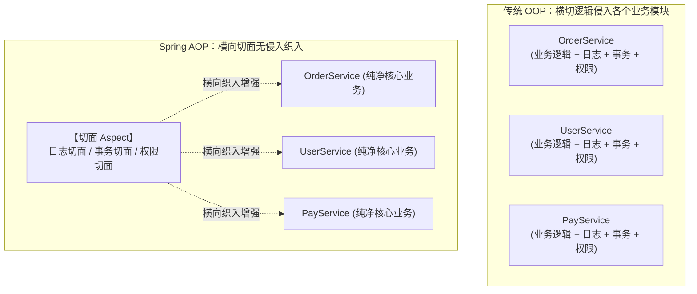

---

#### 2. AOP 七大核心术语全景深度解析

在技术面试中，面试官常要求：“**请解释一下 AOP 中的 Aspect、JoinPoint、Pointcut、Advice、Target、Weaving 分别是什么意思？**”

| 核心术语 | 英文名词 | 权威定义 | 通俗生活比喻 | 对应代码与实现 |
| :--- | :--- | :--- | :--- | :--- |
| **横切关注点** | Cross-cutting Concerns | 跨越应用程序多个模块的公共功能（如日志、事务、安全）。 | 电影院进场前必须做的“安检”和“检票”。 | 日志打印、事务提交/回滚等公共需求。 |
| **切面** | **Aspect** | 封装横切关注点的独立模块（类级别），包含切点和通知。 | “安检部门”或“安检规则手册”。 | 标注了 `@Aspect` 的类（如 `LogAspect`）。 |
| **连接点** | **JoinPoint** | 程序执行过程中能够被切面插入增强的特定位置点。 | 观众进影院路线上的所有节点（进门、过走廊、入座等）。 | 在 Spring AOP 中，**仅支持方法执行级别**的连接点。 |
| **切点** | **Pointcut** | 匹配连接点的断言表达式，决定“**哪些方法需要被增强**”。 | “只有带大包的观众才需要安检”的筛选规则。 | `@Pointcut("execution(* com.demo.service..*.*(..))")` |
| **通知** | **Advice** | 切面在特定连接点执行的具体动作，决定“**何时干什么**”。 | 发现带包观众后，执行“开包检查”的具体动作。 | `@Before`、`@After`、`@Around` 等增强方法。 |
| **目标对象** | **Target** | 包含原始核心业务逻辑、被切面增强的对象。 | 被安检的观众本人。 | 原始的 `OrderServiceImpl` 业务实例。 |
| **织入** | **Weaving** | 将切面代码应用到目标对象、生成最终代理对象的全过程。 | 安检人员与观众在安检门互动的结合过程。 | 编译期织入、类加载期织入、运行期动态代理织入。 |
| **代理对象** | **Proxy** | 目标对象被织入通知后，向外暴露的全新包装对象。 | “经过安检盖章后持有凭据”的观众身份。 | Spring 最终暴露的 `$Proxy0` 或 `CGLIB` 代理实例。 |

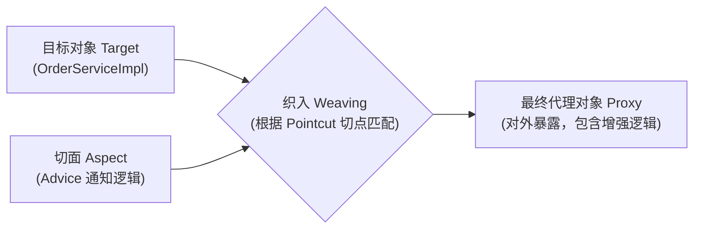

---

#### 3. Spring AOP 与 AspectJ 的本质区别（大厂必考深度对比）

面试中常问：“**Spring AOP 和 AspectJ 有什么区别？为什么有了 AspectJ 还要 Spring AOP？**”

> ⚠️ **常见致命误区纠偏**：很多八股文误传“AspectJ 性能开销更大”，**这是严重的事实性错误！**  
> 事实恰恰相反：**AspectJ 在运行期的性能远高于 Spring AOP**，因为 AspectJ 是在编译期或类加载期直接将字节码织入 class 中，运行时属于原生调用；而 Spring AOP 是在运行期创建动态代理并通过反射/方法拦截器执行，存在动态代理寻址与反射开销。

##### (1) 全方位深度对比矩阵

| 对比维度 | Spring AOP | AspectJ |
| :--- | :--- | :--- |
| **设计定位** | **轻量级 AOP 框架**，旨在无缝整合 Spring IoC 容器，解决 95% 的日常业务开发痛点。 | **完整的 AOP 编程语言与全功能实现**，AOP 领域的工业标准规范。 |
| **织入时机（Weaving）** | **纯运行期（Runtime）**：利用 JDK 动态代理或 CGLIB 在运行期生成代理对象。 | 1. **编译期织入（CTW）**：使用专门的 `ajc` 编译器编译；<br/>2. **编译后织入（PCW）**：对已有的 class/jar 织入；<br/>3. **类加载期织入（LTW）**：基于 JavaAgent 在类加载时织入。 |
| **拦截与增强粒度** | **仅支持方法级别（Method-level）**：且仅对 Spring 容器管理的 Bean 有效。 | **全维度支持**：支持方法、**构造函数调用**、**字段读写（Field get/set）**、静态初始化块、异常捕获等。 |
| **private/final 方法支持** | ❌ **无法支持**（JDK 代理受限于接口，CGLIB 受限于类继承）。 | ✅ **完美支持**（直接操作字节码指令）。 |
| **运行期性能** | **较慢**（动态代理、责任链封装、反射与方法拦截开销）。 | **极快（接近原生速度）**（无代理开销，直接在目标字节码内硬编码调用）。 |
| **易用性与工程侵入** | **零门槛、开箱即用**：无需任何特殊编译器或 JVM 参数。 | **复杂度较高**：需要配置 `ajc` 编译器插件或指定 `-javaagent` 启动参数。 |

##### (2) 现代 Spring 与 AspectJ 的关系：合作共赢
现代 Spring AOP 并没有排斥 AspectJ，而是采用了 **“汲取其表，保留己核”** 的策略：
1. **语法层面吸收**：Spring AOP 借用了 AspectJ 的注解体系（`@Aspect`、`@Pointcut`、`@Before` 等）与切点表达式解析引擎，开发者无需手写繁琐的 XML 配置或底层 API；
2. **底层执行自研**：Spring 依然坚持使用轻量级的纯 Java 运行期动态代理（JDK Proxy / CGLIB）来实现，免去了开发者配置 `ajc` 编译器的繁重成本；
3. **支持原生扩展**：如果项目中遇到无法使用动态代理的极致场景（如必须拦截静态方法、构造函数或非 Spring 管理的对象），Spring 允许无缝集成原生 AspectJ LTW。


---

### 二、注解驱动与切点表达式（Pointcut）精讲

#### 4. @Aspect 注解的底层原理与开启机制

**答：**

##### (1) `@Aspect` 注解的作用与本质
- `@Aspect` 源自 AspectJ 的注解库，用于将一个普通的 Java 类标识为 **切面类（Aspect）**；
- **关键细节**：`@Aspect` 注解本身**并不是 Spring 的组件注解**（它没有元标注 `@Component`），因此如果仅标注 `@Aspect`，Spring 容器是无法感知该切面的。必须同时添加 `@Component`，或在配置类中通过 `@Bean` 显式将其注册为 Spring Bean：
  ```java
  @Aspect
  @Component // 必须纳入 Spring IoC 容器管理
  public class LoggingAspect {
      // 切点与通知逻辑
  }
  ```

##### (2) AOP 自动代理开启机制（`@EnableAspectJAutoProxy`）
在 Spring Boot 项目中通常由自动装配默认开启；在标准 Spring 项目中需显式标注 `@EnableAspectJAutoProxy`：
- **核心组件注册**：该注解通过 `@Import(AspectJAutoProxyRegistrar.class)`，向 Spring 容器注册了一个至关重要的核心后置处理器：
  **`AnnotationAwareAspectJAutoProxyCreator`**（继承自 `SmartInstantiationAwareBeanPostProcessor`）；
- **工作机制**：在每个 Bean 实例化的生命周期中，该后置处理器会自动扫描容器中所有标注了 `@Aspect` 的切面 Bean，提取其内部的 Pointcuts 和 Advices，并在目标 Bean 初始化完成后，动态构建 AOP 代理对象并返回。

---

#### 5. 切点表达式语法全解析（execution 八要素与常用指示符）

切点（Pointcut）用于定义通知（Advice）应该在何时何地触发。Spring AOP 支持使用 AspectJ 的切点指示符语言（PCD, Pointcut Designators）。

##### (1) 核心杀手锏：`execution` 语法规范（八大要素）
`execution` 是最强大、最常用的切点指示符，其完整语法结构如下：

```text
execution( [修饰符] [返回值类型] [包路径].[类名].[方法名]([参数列表]) [异常类型] )
```

- **八大要素详细规则**：
  1. **修饰符（可选）**：如 `public`、`protected`（省略时匹配所有权限）；
  2. **返回值类型（必填）**：如 `void`、`String`，或通配符 `*`（匹配任意返回值类型）；
  3. **包路径（可选）**：如 `com.example.service`；使用 `..` 代表当前包及其所有子包；
  4. **类名（可选）**：如 `UserService`、`*ServiceImpl`；
  5. **方法名（必填）**：如 `createOrder`，或通配符 `*`（匹配任意方法名）、`get*`（匹配所有以 get 开头的方法）；
  6. **参数列表（必填）**：
     - `()`：匹配无参方法；
     - `(..)`：匹配任意数量、任意类型的参数（最常用）；
     - `(*)`：匹配且仅匹配一个任意类型的参数；
     - `(*, String)`：匹配第一个为任意类型、第二个为 String 的双参数方法；
  7. **异常类型（可选）**：如 `throws IllegalArgumentException`。

###### 经典常用切点表达式示例速查：
- `execution(* *(..))`：匹配系统中所有类的所有方法；
- `execution(public * com.demo.service..*.*(..))`：匹配 `com.demo.service` 包及其子包下所有类的所有 public 方法；
- `execution(* com.demo.dao.*Dao.save*(..))`：匹配 dao 包下所有以 Dao 结尾的类中以 save 开头的方法。

##### (2) 常见指示符对比全景矩阵（@annotation vs @within 等）

| 指示符 | 作用与匹配目标 | 语法与实战示例 | 典型应用场景 |
| :--- | :--- | :--- | :--- |
| **`execution`** | 匹配方法执行的完整签名（最通用） | `execution(* com.demo.service..*.*(..))` | 按包路径、类名做大范围批量增强 |
| **`@annotation`** | **匹配方法上标注的指定注解** | `@annotation(org.springframework.transaction.annotation.Transactional)` | **精准拦截自定义注解**（如 `@LogAudit`, `@RateLimit`） |
| **`@within`** | **匹配声明了指定注解的类中的所有方法** | `@within(org.springframework.stereotype.Service)` | 拦截标注了特定注解的整个类 |
| **`within`** | 限制在特定包或类型内部的所有方法 | `within(com.demo.service..*)` | 按包路径粗粒度拦截 |
| **`this`** | 限制代理对象（Proxy）的实际类型 | `this(com.demo.service.OrderService)` | 针对特定代理类型做增强 |
| **`target`** | 限制被代理的目标对象（Target）的实际类型 | `target(com.demo.service.OrderServiceImpl)` | 针对真实业务类做增强 |
| **`args`** | 限制方法运行时传入的实参类型 | `args(java.lang.String, ..)` | 拦截首个参数为 String 的方法并绑定参数 |
| **`bean`** (Spring 特有) | 匹配特定 Bean 的名称 | `bean(orderService)` / `bean(*Service)` | 针对特定的 Spring Bean 实例拦截 |

##### (3) 切点组合逻辑运算符
切点之间可以通过逻辑运算符进行灵活组合：
- `&&`（与）：两个切点同时满足（如 `serviceMethod() && loggableAnnotation()`）；
- `||`（或）：满足任一切点即可；
- `!`（非）：取反（如 `serviceMethod() && !excludeMethod()`）。

```java
@Pointcut("execution(* com.demo.service..*.*(..))")
public void inService() {}

@Pointcut("@annotation(com.demo.annotation.LogAudit)")
public void withAuditAnnotation() {}

// 组合切点：必须在 service 包下且方法带有 @LogAudit 注解
@Pointcut("inService() && withAuditAnnotation()")
public void loggableServiceOperation() {}
```

---

### 三、通知体系（Advice）与执行顺序深水区

#### 6. 五大通知类型功能与使用场景

Spring AOP 提供了五种维度的通知（Advice），涵盖方法执行前、正常返回后、抛出异常后以及整个方法环绕的全生命周期：

| 通知注解 | 通知类型 | 触发时机 | 是否能中断目标方法？ | 是否能修改返回值？ | 典型使用场景 |
| :--- | :--- | :--- | :---: | :---: | :--- |
| **`@Before`** | 前置通知 | 目标方法执行前 | ❌ 只能通过抛出异常中断 | ❌ 无法修改 | 参数安全校验、前置权限拦截、TraceId 链路初始化 |
| **`@AfterReturning`** | 返回通知 | 目标方法**正常执行完毕**并返回后 | ❌ 目标方法已执行完毕 | ❌ 只能读取，无法篡改返回值 | 记录操作成功审计日志、异步发送操作完成事件 |
| **`@AfterThrowing`** | 异常通知 | 目标方法**抛出未捕获异常**时 | ❌ 目标方法已中断 | ❌ 无法修改（可感知异常类型） | 告警通知、错误日志收集、分布式事务打标 |
| **`@After`** | 最终通知 | 无论目标方法正常还是异常，均在**最后执行**（类似 `finally` 块） | ❌ 无法中断 | ❌ 无法修改 | 释放资源、清理 ThreadLocal 上下文、记录结束日志 |
| **`@Around`** | **环绕通知** | 包裹目标方法执行的全生命周期 | ✅ **可完全控制是否调用 `pjp.proceed()`** | ✅ **完全可以重写/修改返回值** | 接口耗时统计、本地方法级缓存（Cache-Aside）、防重幂等、兜底降级 |

---

#### 7. 【大厂必考】Spring 4 vs Spring 5+ AOP 通知执行顺序重大变革

面试官极爱追问：“**在同一个切面中，@Before、@After、@AfterReturning、@Around 的执行顺序是怎样的？Spring 4 和 Spring 5 有什么重大区别？**”

##### (1) 正常执行情况下的顺序对比
- **Spring 4.x 时代**：
  `@Around (前置)` $	o$ `@Before` $	o$ **目标方法执行** $	o$ `@Around (后置)` $	o$ **`@After`** $	o$ **`@AfterReturning`**
- **Spring 5.x / Spring Boot 2.x+ 时代（规范调整）**：
  `@Around (前置)` $	o$ `@Before` $	o$ **目标方法执行** $	o$ **`@AfterReturning`** $	o$ **`@After`** $	o$ `@Around (后置)`

##### (2) 抛出异常情况下的顺序对比（最核心考点！）
当目标方法抛出未捕获异常时，执行顺序差异最为关键：
- **Spring 4.x 时代（不符合 try-catch-finally 直觉）**：
  `@Around (前置)` $	o$ `@Before` $	o$ **目标方法抛出异常** $	o$ **`@After`** $	o$ **`@AfterThrowing`**
  *(弊端：`@After` 最终通知居然在 `@AfterThrowing` 异常通知之前执行，不符合 Java 常规 finally 语义！)*
- **Spring 5.x / Spring Boot 2.x+ 时代（修正为标准嵌套模型）**：
  `@Around (前置)` $	o$ `@Before` $	o$ **目标方法抛出异常** $	o$ **`@AfterThrowing`** $	o$ **`@After`**
  *(调整为标准的责任链嵌套模型：在 catch 块执行 `@AfterThrowing`，在 finally 块执行 `@After`，顺序与 AspectJ 标准完全统一！)*

```mermaid
flowchart TD
    subgraph Spring5正常顺序["Spring 5+ 正常执行链路"]
        A1["1. @Around 前置逻辑"] --> B1["2. @Before 前置通知"]
        B1 --> C1["3. 目标业务方法执行"]
        C1 --> D1["4. @AfterReturning 返回通知"]
        D1 --> E1["5. @After 最终通知 (finally)"]
        E1 --> F1["6. @Around 后置逻辑 & 返回结果"]
    end

    subgraph Spring5异常顺序["Spring 5+ 异常执行链路"]
        A2["1. @Around 前置逻辑"] --> B2["2. @Before 前置通知"]
        B2 --> C2["3. 目标业务方法抛出异常"]
        C2 --> D2["4. @AfterThrowing 异常通知 (catch)"]
        D2 --> E2["5. @After 最终通知 (finally)"]
        E2 --> F2["6. 异常继续向外抛出"]
    end
```

---

#### 8. 多切面叠加时的优先级控制（洋葱模型与 @Order）

当容器中存在多个切面（如 `AuthAspect` 鉴权切面、`TxAspect` 事务切面、`LogAspect` 日志切面）同时拦截同一个业务方法时，Spring 采用 **洋葱模型（Onion Model）** 组织调用链：

##### (1) 控制切面优先级的方法
1. 在切面类上标注 **`@Order(int value)`** 注解；
2. 切面类实现 `org.springframework.core.Ordered` 接口并实现 `getOrder()` 方法。
> **核心铁律**：**`@Order` 中的数值越小，优先级越高（越靠近洋葱外层）**。

##### (2) 多切面调用链流转过程
假设有两个切面：`AspectA`（`@Order(1)`）和 `AspectB`（`@Order(2)`）：
- **方法执行前（从外向内剥洋葱）**：优先级高的先执行！
  `AspectA 的 @Before` $	o$ `AspectB 的 @Before` $	o$ **目标业务方法**；
- **方法执行后（从内向外包洋葱）**：优先级高的后执行！
  **目标业务方法** $	o$ `AspectB 的 @After` $	o$ `AspectA 的 @After`。


---

### 四、连接点交互实战（JoinPoint & ProceedingJoinPoint）

#### 9. JoinPoint vs ProceedingJoinPoint 核心区别与方法反射签名获取

在编写具体通知方法时，`JoinPoint` 与 `ProceedingJoinPoint` 是最核心的交互上下文对象：

##### (1) 核心差异全景对比

| 接口 | 支持的通知类型 | 核心能力 | 能否控制目标方法执行？ | 能否修改参数？ |
| :--- | :--- | :--- | :---: | :---: |
| **`JoinPoint`** | `@Before`、`@After`、`@AfterReturning`、`@AfterThrowing` | 获取方法签名、目标类、运行时实参等元数据 | ❌ 不能控制执行 | ❌ 不能修改 |
| **`ProceedingJoinPoint`** | **仅支持 `@Around`**（环绕通知） | 继承自 `JoinPoint`，拥有 `proceed()` 与 `proceed(Object[] args)` | ✅ **可完全决定是否执行** | ✅ **可传入新参数替换** |

##### (2) 常用反射元数据获取方法（标准写法模板）
```java
@Before("servicePointcut()")
public void doBefore(JoinPoint joinPoint) {
    // 1. 获取方法签名对象
    MethodSignature signature = (MethodSignature) joinPoint.getSignature();
    
    // 2. 获取目标方法反射对象 Method
    Method method = signature.getMethod();
    String methodName = method.getName();
    
    // 3. 获取目标类全限定名
    String targetClassName = joinPoint.getTarget().getClass().getName();
    
    // 4. 获取传入方法的实参列表
    Object[] args = joinPoint.getArgs();
    
    // 5. 获取方法形参名数组（依赖 -parameters 编译参数）
    String[] parameterNames = signature.getParameterNames();
    
    // 6. 获取方法上的特定业务注解
    MyLogAnnotation annotation = method.getAnnotation(MyLogAnnotation.class);
}
```

---

#### 10. AOP 实战：动态修改入参、返回值捕获与异常处理避坑

##### (1) 实战一：在环绕通知中动态篡改/脱敏入参并修改返回值
```java
@Around("execution(* com.demo.service.UserService.login(..))")
public Object processLogin(ProceedingJoinPoint pjp) throws Throwable {
    Object[] args = pjp.getArgs();
    if (args != null && args.length > 0 && args[0] instanceof String) {
        // 对入参账号进行去空格与小写标准化
        args[0] = ((String) args[0]).trim().toLowerCase();
    }
    
    // 关键：将修改后的新参数传入 proceed() 驱动目标方法执行
    Object result = pjp.proceed(args);
    
    // 对返回值做篡改或统一包装（如包装为 Result.success(result)）
    return result;
}
```

##### (2) 实战二：在 `@AfterReturning` 中安全捕获返回值
```java
// returning 属性的值必须与通知方法的入参形参名严格保持一致！
@AfterReturning(pointcut = "@annotation(com.demo.annotation.AuditLog)", returning = "response")
public void recordAuditSuccess(JoinPoint joinPoint, Object response) {
    System.out.println("方法执行成功，返回值是: " + response);
}
```

##### (3) 实战三：异常捕获中的“惊天大坑”——吞掉异常导致 `@Transactional` 事务失效！
面试官高频追问：“**在 `@Around` 环绕通知中使用了 `try-catch` 捕获异常，为什么下游业务的数据库事务没有回滚？**”

```java
// 错误示范：致命生产事故代码！
@Around("servicePointcut()")
public Object badAroundAdvice(ProceedingJoinPoint pjp) {
    try {
        return pjp.proceed();
    } catch (Throwable e) {
        // 坑点：自己把异常吃掉了，直接返回了 null 或错误响应！
        System.err.println("发生业务异常: " + e.getMessage());
        return null; // 事务管理器根本不知道发生了异常，数据库默默提交了脏数据！
    }
}
```

> **【避坑铁律与正解】**：  
> Spring 的声明式事务 `@Transactional` 依赖外层切面捕获到方法抛出的 `RuntimeException` 或 `Error` 来触发 `rollback` 回滚。  
> 如果在自定义的 AOP 环绕通知中将异常 `catch` 且没有重新抛出（`throw e`），外层的事务切面会认为业务方法“正常返回”，从而执行 `commit` 提交事务！  
> **正确做法**：切面中处理完毕（如打印日志、告警）后，**必须将真实异常重新向外抛出（`throw e;`）**！

---

### 五、Spring AOP 底层实现机制与 Bean 生命周期整合（源码深水区）

#### 11. 底层双引擎：JDK 动态代理 vs CGLIB 深度对比与选型演进

Spring AOP 的底层绝非黑盒，其核心依赖 Java 运行期动态代理的双引擎驱动：

##### (1) JDK 动态代理 vs CGLIB 核心对比全景矩阵

| 对比维度 | JDK 动态代理 | CGLIB 动态代理 |
| :--- | :--- | :--- |
| **底层实现机制** | 基于 JVM 原生反射与 `ProxyGenerator` 动态生成字节码 | 基于第三方 **ASM 字节码框架**直接在运行期操纵字节码 |
| **类继承关系** | 生成 `$Proxy0`，**继承自 `Proxy`，实现目标所有接口** | 生成 `Target$$EnhancerBySpringCGLIB$$...`，**继承目标业务类** |
| **目标类限制** | **目标类必须实现至少一个接口** | **目标类和方法绝不能被 `final` 修饰**（否则无法生成子类或重写） |
| **方法调用性能** | 早期基于纯反射 `Method.invoke()`（现代 JDK 受通胀优化） | 基于 **FastClass 索引直接调用**（零反射开销） |
| **代理生成速度** | **极快**（生成的 `$Proxy` 类结构简单轻量） | **较慢**（需通过 ASM 解析生成复杂的子类字节码和 FastClass） |

##### (2) Spring 动态代理选型策略的历史演进
1. **Spring 4.x 及之前时代**：
   - 目标类实现了接口 $	o$ 默认使用 **JDK 动态代理**；
   - 目标类没有实现任何接口 $	o$ 强制降级使用 **CGLIB**。
2. **Spring Boot 2.x+ 时代（重大默认选型变更）**：
   - **默认全部采用 CGLIB 动态代理**（`spring.aop.proxy-target-class=true` 是 Spring Boot 的默认配置）。
   - **核心根本原因（避免依赖注入类型转换异常）**：  
     若使用 JDK 动态代理，容器中注册的 Bean 实际类型是 `$Proxy0`（实现了接口）。如果业务开发者习惯使用具体实现类进行依赖注入：
     ```java
     @Autowired
     private UserServiceImpl userService; // JDK 代理下会直接抛出 BeanNotOfRequiredTypeException！
     ```
     `$Proxy0` 与 `UserServiceImpl` 是平级兄弟关系，无法发生强转。而 CGLIB 生成的是 `UserServiceImpl` 的子类，无论按接口还是按具体实现类注入均能 100% 完美兼容！

---

#### 12. AOP 代理何时创建？Bean 生命周期中的代理时机（源码大厂必考）

面试官必考深水区：“**Spring 是在 Bean 生命周期的哪一个阶段完成 AOP 代理对象生成的？**”

**答：分为“正常流程”与“循环依赖提前代理”两种核心场景！**

##### (1) 正常生命周期流程：在 Bean 初始化后（Initialization）
在绝大多数情况下，AOP 代理对象的创建发生在 Bean 生命周期的最后一步：
1. `createBeanInstance()`：通过反射构造器实例化普通的原始对象（Target）；
2. `populateBean()`：为原始对象的属性进行依赖注入（`@Autowired`）；
3. `initializeBean()`：调用 Aware 接口、执行 `@PostConstruct` 与 `afterPropertiesSet()` 初始化；
4. **【AOP 代理介入点】**：执行 Bean 后置处理器的 **`postProcessAfterInitialization()`**：
   - 核心处理器 `AnnotationAwareAspectJAutoProxyCreator` 介入；
   - 匹配当前 Bean 是否命中了任何切点的 Advisors；
   - 若命中，调用 `createProxy()` 生成代理对象并返回，**最终存入容器单例池的是代理对象**！

##### (2) 循环依赖特殊流程：提前到实例化后（通过三级缓存）
如果 Bean A 和 Bean B 产生了循环依赖（如 A 依赖 B，B 依赖 A），且 A 被切面增强：
- **致命矛盾**：如果等到 A 初始化完成后才生成代理，那么 B 在给属性 A 注入时，拿到的是 A 的原始未增强对象，产生对象不一致！
- **Spring 破局方案**：
  1. A 实例化后，立即将包装了 A 的工厂对象 `ObjectFactory` 放入**三级缓存 `singletonFactories`** 中；
  2. B 注入 A 时，调用三级缓存的 `getObject()`，底层触发后置处理器的 **`getEarlyBeanReference()`**；
  3. **AOP 代理对象被提前创建**，并存入**二级缓存 `earlySingletonObjects`**，提前暴露给 B 注入；
  4. 随后 A 走完自身初始化后，在 `postProcessAfterInitialization()` 中检测到已经提前生成过代理，直接返回原始对象，避免重复代理。

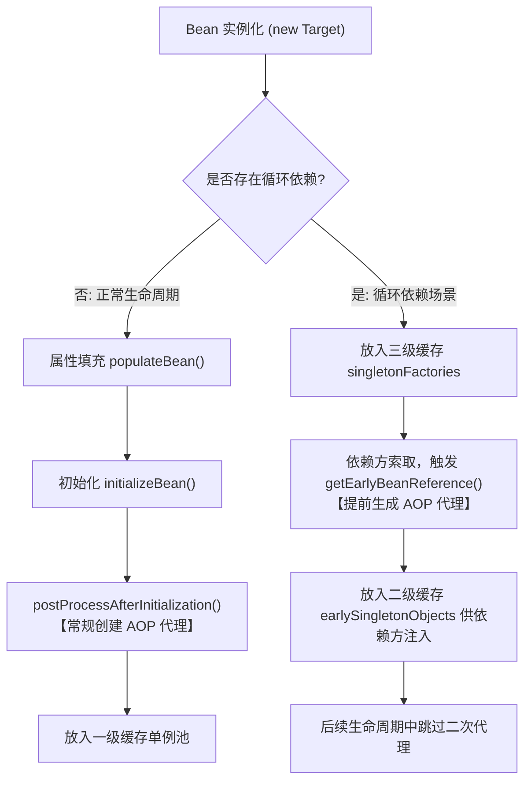

---

#### 13. AOP 方法调用底层：ReflectiveMethodInvocation 递归责任链机制

当外部代码调用代理对象的某个方法时，Spring 底层是如何串联并按序执行多个 Advice 和目标业务方法的？

**答：依靠核心类 `ReflectiveMethodInvocation` 的递归责任链模式！**

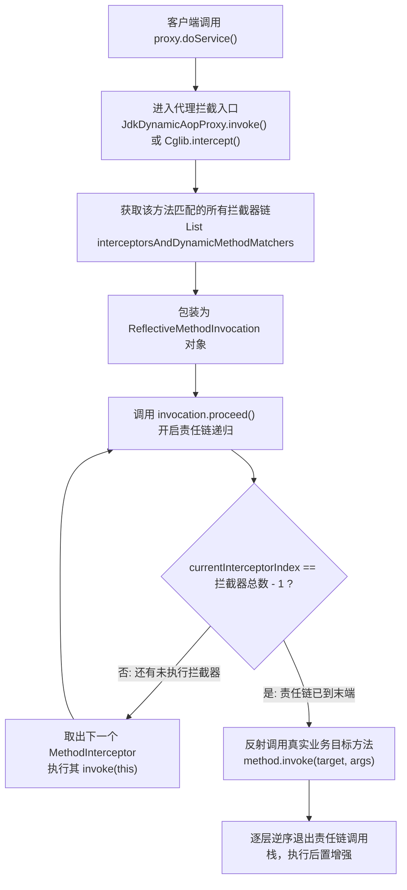

##### 源码精髓解读（`ReflectiveMethodInvocation.java`）：
```java
public Object proceed() throws Throwable {
    // 递归终止条件：当索引自增遍历完所有拦截器后，调用真正的目标方法
    if (this.currentInterceptorIndex == this.interceptorsAndDynamicMethodMatchers.size() - 1) {
        return invokeJoinpoint(); // 底层执行: method.invoke(this.target, this.arguments)
    }

    // 每次递归前进一位，取出下一个拦截器
    Object interceptorOrInterceptionAdvice =
            this.interceptorsAndDynamicMethodMatchers.get(++this.currentInterceptorIndex);

    // 关键：将 this（当前 Invocation 上下文）传递给拦截器，由拦截器决定何时继续触发 proceed()
    return ((MethodInterceptor) interceptorOrInterceptionAdvice).invoke(this);
}
```
这种设计非常精妙：每一个通知拦截器内部在处理完前置逻辑后，显式调用 `invocation.proceed()` 继续向下推进，从而形成了一个天然的嵌套洋葱模型，各通知的执行时序完全受控。


---

### 六、经典高频踩坑场景与大厂避坑指南

#### 14. 【高频必考】同一个类中 this 自调用导致 AOP / 事务失效的底层真相与三大解决方案

在日常开发与技术面试中，这是最经典的生产故障陷阱之一：

##### (1) 典型故障代码重现
```java
@Service
public class OrderService {

    // 无切面注解的普通方法
    public void createOrder() {
        System.out.println("1. 执行创建订单主流程");
        // 关键坑点：直接通过 this 调用本类的另一个方法！
        this.sendNotification(); 
    }

    // 标注了切面或事务注解的方法
    @Transactional
    @LogAudit // 自定义 AOP 切面
    public void sendNotification() {
        System.out.println("2. 发送通知逻辑（需要事务和审计增强）");
    }
}
```
**现象**：外部调用 `orderService.createOrder()` 时，`sendNotification()` 上的 `@Transactional` 和 `@LogAudit` 切面**彻底失效**！

##### (2) 为什么会失效？底层原理剖析
- 外部调用 `orderService.createOrder()` 时，调用的是 Spring 容器生成的 **代理对象（Proxy）**；
- 代理对象的 `createOrder()` 方法内部调用了目标原始对象（Target）的 `createOrder()`；
- 当执行到 `this.sendNotification()` 时，在 JVM 运行期，**`this` 指针指向的是原始目标对象本身，根本不是代理对象！**
- 绕过了代理对象，导致 AOP 的拦截器责任链（`MethodInterceptor`）根本没有被触发，切面增强自然全部落空。

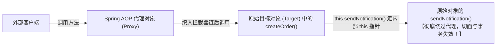

##### (3) 大厂推荐的三大解决方案

###### 方案一（架构最佳实践）：重构代码，拆分独立服务
将需要被增强的方法提取到独立的 Spring Service 组件中，通过依赖注入调用：
```java
@Service
public class OrderService {
    @Autowired
    private NotificationService notificationService; // 注入的是代理对象

    public void createOrder() {
        notificationService.sendNotification(); // 走代理对象，AOP 正常生效！
    }
}
```
*评价：高内聚低耦合，完全符合单一职责原则，生产推荐指数：★★★★★*

###### 方案二（简单实用）：在类中“自我注入”自己的代理对象
```java
@Service
public class OrderService {
    @Autowired
    @Lazy // 配合 @Lazy 避免循环依赖告警
    private OrderService self;

    public void createOrder() {
        self.sendNotification(); // 显式通过注入的代理对象调用，AOP 正常生效！
    }
}
```
*评价：改动极小，无需新建文件，生产推荐指数：★★★★☆*

###### 方案三（底层穿透）：利用 `AopContext.currentProxy()`
1. 在启动类或配置类上开启暴露代理对象：`@EnableAspectJAutoProxy(exposeProxy = true)`；
2. 在方法内部通过线程局部变量 ThreadLocal 强制索取当前代理对象：
```java
public void createOrder() {
    // 从当前线程上下文取出绑定的代理对象
    ((OrderService) AopContext.currentProxy()).sendNotification();
}
```
*评价：具有一定代码侵入性且容易产生强耦合，生产推荐指数：★★★☆☆*

---

#### 15. 为什么 private / final / static 方法无法被 Spring AOP 增强？

面试中常问：“**如果在一个方法上加了 @Transactional 或自定义 AOP 注解，但方法被修饰为 private / final / static，切面能生效吗？为什么？**”

**答：全部无法生效！底层原因分析如下：**

1. **`private` 私有方法无法生效**：
   - **JDK 动态代理角度**：JDK 代理只能针对接口中声明的 `public` 方法生成实现代码，无法代理私有方法；
   - **CGLIB 动态代理角度**：CGLIB 是基于生成目标类的子类来重写（Override）方法进行拦截增强的，Java 语言规范规定子类**无法重写父类的 `private` 私有方法**，因此 CGLIB 无法为私有方法织入拦截代码；
   - **Spring 规范机制**：Spring 事务与 AOP 在扫描方法匹配切点时，底层默认直接过滤掉非 `public` 的方法。

2. **`final` 方法无法生效**：
   - **CGLIB 角度**：`final` 方法禁止被任何子类重写，CGLIB 根本无法在其生成的动态子类中重写该方法插入增强逻辑；
   - **JDK 代理角度**：如果实现类中将接口方法声明为 `final`，虽然代理类能生成，但直接注入具体类调用时无法拦截。

3. **`static` 静态方法无法生效**：
   - 静态方法属于类本身（在类加载阶段通过 `invokestatic` 指令绑定），不属于具体对象实例，无法被多态重写，动态代理和拦截机制在对象级别根本无法拦截静态方法调用。

> 💡 **解决手段**：如果业务中非要增强 private / static / final 方法，只能抛弃 Spring AOP，全面切换至原生 **AspectJ**（通过 `ajc` 编译器或类加载器 LTW 在字节码指令层面直接插桩织入）。

---

### 七、Spring AOP 高频考点秒杀速记口诀

```text
面向切面解耦行，横切逻辑集中营；
Aspect 封装切点现，Pointcut 定位方法庭；
Advice 通知分五类，环绕前置后置行；
Spring 5 修正执行序，异常后置终归廷；
多切洋葱层层套，Order 小者位居前；
动态代理双引擎，JDK 接口 CGLIB 承；
默认 Boot 全面推 CGLIB，注入类型无灾刑；
循环依赖三级启，提前代理换金身；
责任链转 proceed 进，索引递增逐级明；
内部 this 绕代理，自我注入解千愁！
```


------

## **三、Spring 事务管理**

1. Spring 事务管理的方式有哪些？（编程式 vs 声明式）
2. @Transactional 注解的作用？
3. propagation（传播行为）有哪些类型？
4. isolation（隔离级别）有哪些类型？默认是什么？
5. 为什么事务在同类内部方法调用时可能不生效？


### 1. Spring 事务管理的方式有哪些？（编程式 vs 声明式）

**答：**

- **编程式事务（Programmatic Transaction）**：通过 `TransactionTemplate` 或 `PlatformTransactionManager` 手动控制事务。

  ```java
  TransactionTemplate template = new TransactionTemplate(transactionManager);
  template.execute(status -> {
      // 业务操作
      return result;
  });
  ```

  - **优点**：灵活，可精确控制事务边界。
  - **缺点**：业务代码耦合事务逻辑，维护成本高。

- **声明式事务（Declarative Transaction）**：通过 `@Transactional` 注解或 XML 配置定义事务，Spring AOP 自动管理。

  ```java
  @Transactional
  public void saveUser(User user){ ... }
  

  // 自定义事务属性,@Transactional 支持自定义传播行为、隔离级别、超时时间等，弥补 “不够灵活” 的缺点：
  @Transactional(
      propagation = Propagation.REQUIRES_NEW, // 传播行为：新建事务
      isolation = Isolation.READ_COMMITTED,   // 隔离级别：读已提交
      timeout = 30,                           // 超时时间：30秒
      rollbackFor = {Exception.class, RuntimeException.class}, // 回滚异常类型
      noRollbackFor = IllegalArgumentException.class, // 不回滚的异常类型
      readOnly = false                         // 是否只读（查询时设为 true 优化性能）
  )
  public void batchUpdateOrder(List<Order> orderList) {
      orderList.forEach(order -> orderDao.update(order));
  }
  ```
  
  - **优点**：业务代码与事务逻辑分离，简单易用。
  - **缺点**：不够灵活，需要理解传播行为和事务隔离。

------

### 2. @Transactional 注解的作用？

**答：**

- 用于声明方法或类的事务属性。
- 特性：
  - **propagation**：事务传播行为
  - **isolation**：事务隔离级别
  - **timeout**：事务超时时间
  - **readOnly**：只读事务优化
  - **rollbackFor / noRollbackFor**：指定回滚异常类型

```java
@Transactional(propagation = Propagation.REQUIRED, isolation = Isolation.READ_COMMITTED, rollbackFor = Exception.class)
public void transferMoney(...) { ... }
```

> **Tip:** 类上加 `@Transactional` 默认应用于所有 public 方法。

------

### 3. propagation（传播行为）

Spring 定义了 7 种传播行为：

| 类型          | 描述                                     |
| ------------- | ---------------------------------------- |
| REQUIRED      | 支持当前事务，如果没有则新建             |
| SUPPORTS      | 支持当前事务，如果没有则以非事务方式执行 |
| MANDATORY     | 必须在事务中执行，如果没有则抛异常       |
| REQUIRES_NEW  | 新建事务，挂起当前事务                   |
| NOT_SUPPORTED | 不支持事务，挂起当前事务                 |
| NEVER         | 不允许事务存在，如果有则抛异常           |
| NESTED        | 支持当前事务内嵌事务（Savepoint）        |

> **Tip:** 最常用的是 `REQUIRED`（默认）。

------

### 4. isolation（隔离级别）

- **事务隔离级别**控制不同事务之间的数据可见性，避免脏读、不可重复读、幻读：
  
   | 类型 | 说明 |
   |------|------|
   | DEFAULT | 使用数据库默认隔离级别 |
   | READ_UNCOMMITTED | 允许脏读、不可重复读、幻读 |
   | READ_COMMITTED | 允许不可重复读、幻读，禁止脏读 |
   | REPEATABLE_READ | 允许幻读，禁止脏读、不可重复读（MySQL 默认） |
   | SERIALIZABLE | 串行化，完全隔离，性能最差 |

> **Tip:** MySQL InnoDB 默认 `REPEATABLE_READ`，适合大部分应用。

------

### 5. 为什么事务在同类内部方法调用时可能不生效？

**答：**

- 原因：Spring 的声明式事务是通过 **AOP 代理**实现的，事务逻辑被织入代理对象。

- **同类内部调用**：

  ```java
  class UserService {
      @Transactional
      public void methodA() { ... }
  
      public void methodB() {
          methodA(); // 内部调用，绕过代理
      }
  }
  ```

  - `methodA()` 被内部调用时直接使用 **this.methodA()**，没有经过代理对象，所以事务不会生效。

- **解决方案**：

  1. 将方法调用拆到不同 Bean，通过容器获取代理对象调用。
  2. 使用 `AopContext.currentProxy()` 获取当前代理对象执行方法。

```java
((UserService) AopContext.currentProxy()).methodA();
```


#### 一、底层原理：为什么内部调用会绕过代理？

先通过一张简单的流程图理解代理机制和内部调用的区别：

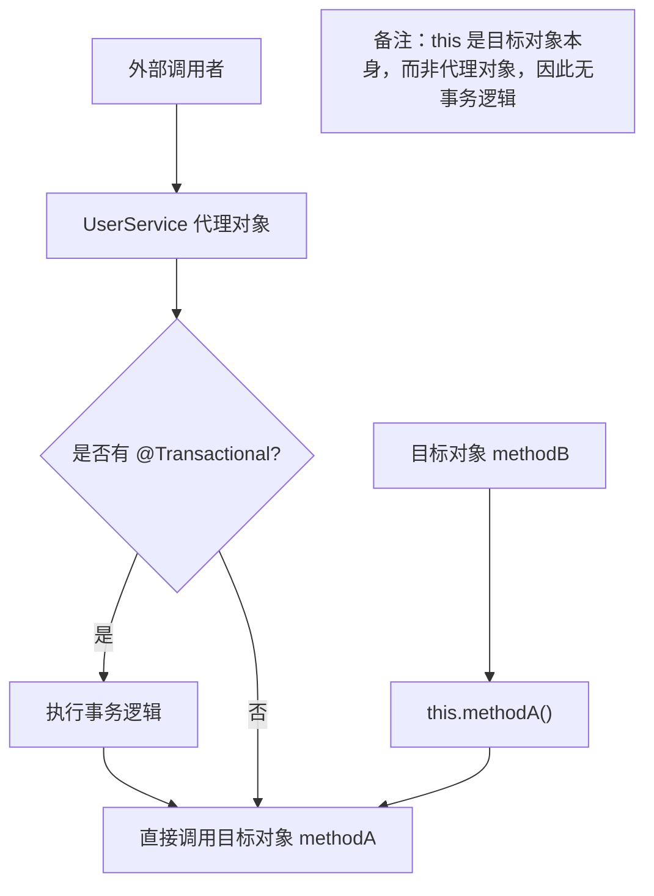

**通俗解释**：

- Spring 声明式事务的本质是**动态代理**：容器创建 `UserService` 的代理对象，事务逻辑（开启/提交/回滚）被织入代理对象的方法中；
- 外部调用 `userService.methodA()` 时，实际调用的是**代理对象**的 `methodA`，会先执行事务逻辑，再调用目标对象的 `methodA`；
- 同类内部调用 `this.methodA()` 时，`this` 指向**目标对象本身**（而非代理对象），跳过了代理的事务逻辑，因此事务失效。

#### 二、完整解决方案（附代码示例）

##### 方案1：拆分到不同 Bean（推荐，低耦合）

将事务方法拆分到独立的 Bean 中，通过依赖注入调用代理对象，是最符合 Spring 设计思想的方案。

```java
// 1. 独立的事务 Bean
@Service
public class TransactionalService {
    @Autowired
    private UserDao userDao;

    @Transactional(rollbackFor = Exception.class)
    public void methodA() {
        userDao.insert(new User());
        // 模拟异常，验证事务回滚
        // int a = 1 / 0;
    }
}

// 2. 原业务 Bean 注入并调用
@Service
public class UserService {
    @Autowired
    private TransactionalService transactionalService;

    public void methodB() {
        // 调用其他 Bean 的事务方法，走代理对象，事务生效
        transactionalService.methodA();
    }
}
```

##### 方案2：通过 AopContext 获取当前代理对象（便捷，需额外配置）

适合不想拆分 Bean 的场景，但需要开启 `exposeProxy = true` 暴露代理对象。

###### 步骤1：开启暴露代理（两种方式）

- **方式1**：启动类/配置类添加 `@EnableAspectJAutoProxy(exposeProxy = true)`
  
  ```java
  @SpringBootApplication
  @EnableAspectJAutoProxy(exposeProxy = true) // 暴露代理对象
  public class AppApplication {
      public static void main(String[] args) {
          SpringApplication.run(AppApplication.class, args);
      }
  }
  ```
- **方式2**：XML 配置（老项目）
  ```xml
  <aop:aspectj-autoproxy expose-proxy="true"/>
  ```

###### 步骤2：通过 AopContext 获取代理对象调用

```java
@Service
public class UserService {
    @Autowired
    private UserDao userDao;

    @Transactional(rollbackFor = Exception.class)
    public void methodA() {
        userDao.insert(new User());
    }

    public void methodB() {
        // 错误：this.methodA() 直接调用目标对象，事务失效
        // this.methodA();

        // 正确：获取代理对象，调用事务方法
        ((UserService) AopContext.currentProxy()).methodA();
    }
}
```

##### 方案3：自注入代理对象（简洁，需注意循环依赖）

通过 `@Autowired` 自注入当前 Bean 的代理对象，避免使用 `AopContext`。

Spring 对单例（singleton）Bean 的循环依赖，通过 “三级缓存” 机制解决：
一级缓存：存放完全初始化完成的 Bean（代理对象 / 目标对象）；
二级缓存：存放早期暴露的 Bean 引用（未完全初始化，但已创建代理）；
三级缓存：存放 Bean 的创建工厂。
**对于 UserService 自注入的场景：**
Spring 创建 UserService 实例（**目标对象）；**
为 UserService 创建代理对象（因为有 @Transactional，AOP 生成代理）；
将代理对象放入缓存，然后注入 self 变量（此时注入的是代理对象，而非未初始化的目标对象）；
完成 UserService 的初始化，无循环依赖报错。

如果用**构造器注入**的方式自依赖，即使是单例也会报错。原因：Spring 的三级缓存只能解决**字段 /setter 注入**的循环依赖，无法解决构造器注入的循环依赖（构造器执行时 Bean 还未创建，无法提前暴露引用）。

```java
@Service
public class UserService {
    // 自注入代理对象（Spring 会注入代理而非目标对象）
    @Autowired
    private UserService self;

    @Autowired
    private UserDao userDao;

    @Transactional(rollbackFor = Exception.class)
    public void methodA() {
        userDao.insert(new User());
    }

    public void methodB() {
        // 调用代理对象的 methodA，事务生效
        self.methodA();
    }
}
```
> 注意：Spring 默认允许循环依赖，因此自注入不会报错；若关闭循环依赖（`spring.main.allow-circular-references=false`），此方案失效。


#### 三、避坑要点

1. **方案2 注意事项**：
   - 必须开启 `exposeProxy = true`，否则 `AopContext.currentProxy()` 会抛出 `IllegalStateException`；
   - `AopContext` 是 Spring AOP 的内部类，耦合性略高，非必要不优先使用。

2. **方案3 注意事项**：
   - 自注入的变量名不能和类名冲突（如 `private UserService userService` 是合法的）；
   - 若 Bean 是 `prototype` 作用域，自注入可能导致代理对象不一致，需谨慎使用。

3. **通用避坑**：
   - 事务方法必须是 `public`（private/protected 方法无法被代理）；
   - 即使通过代理调用，若事务方法抛出 `Checked Exception` 且未指定 `rollbackFor`，事务仍不会回滚。

#### 四、最佳实践

| 解决方案        | 优点                 | 缺点                | 适用场景                 |
| --------------- | -------------------- | ------------------- | ------------------------ |
| 拆分到不同 Bean | 低耦合、符合设计思想 | 需新增 Bean，稍繁琐 | 新开发功能、代码重构     |
| AopContext      | 无需拆分 Bean        | 耦合 AOP 内部 API   | 老项目快速修复、临时方案 |
| 自注入代理对象  | 简洁、无需额外配置   | 依赖循环依赖开启    | 中小型项目、简单场景     |

**核心推荐**：
- 优先选择**方案1（拆分到不同 Bean）**，虽然稍繁琐，但代码结构更清晰，符合“单一职责”原则；
- 临时修复或小型项目可选择**方案3（自注入代理对象）**，简洁且无额外配置；
- 尽量避免使用 `AopContext`（方案2），降低与 Spring 内部 API 的耦合。

#### 总结

1. **失效核心原因**：内部调用使用 `this` 指向目标对象，绕过了包含事务逻辑的代理对象；
2. **核心解决方案**：让事务方法的调用走**代理对象**（拆分 Bean、自注入、AopContext）；
3. **最佳实践**：优先拆分到不同 Bean，次选自注入代理对象，尽量避免使用 AopContext。

### 6.Spring中事务以及事务失效场景

#### Spring 事务核心概念

Spring 事务本质是对数据库事务的封装，通过 **AOP（面向切面编程）** 实现声明式事务管理（常用 `@Transactional` 注解），核心是保证一组数据库操作（增删改查）要么全部成功，要么全部回滚。

Spring 事务的核心属性（常用）：
- `propagation`：传播行为（比如 `REQUIRED`（默认）、`REQUIRES_NEW` 等，决定事务如何嵌套）；
- `isolation`：隔离级别（对应数据库隔离级别，如 `READ_COMMITTED`）；
- `rollbackFor`：指定触发回滚的异常类型（默认只回滚运行时异常 `RuntimeException` 和错误 `Error`）；
- `timeout`：事务超时时间。

---

#### 一、Spring 事务的基本使用（快速上手）

先看一个典型的正确用法，帮你建立基准认知：
```java
@Service
public class OrderService {

    @Autowired
    private OrderMapper orderMapper;

    @Autowired
    private UserMapper userMapper;

    // 声明式事务：保证下单+扣余额要么都成，要么都回滚
    @Transactional(rollbackFor = Exception.class) // 显式指定回滚所有Exception
    public void createOrder(OrderDTO orderDTO) {
        // 1. 插入订单
        orderMapper.insert(orderDTO);
        // 2. 扣减用户余额
        userMapper.deductBalance(orderDTO.getUserId(), orderDTO.getAmount());
        // 3. 若任意一步抛异常，整个事务回滚
    }
}
```

---

#### 二、事务失效的 8 大常见场景（附原因+解决方案）

事务失效是 Spring 开发中高频坑，以下按“出现频率”排序，每个场景都讲清**原因**和**解决方案**：

##### 场景 1：注解加在非 public 方法上

**原因**：Spring 事务的 AOP 代理基于 JDK 动态代理/CGLIB 实现，而代理的前提是方法为 `public`（非 public 方法无法被代理拦截）。
**反例**：

```java
@Service
public class OrderService {
    // 错误：private 方法，@Transactional 无效
    @Transactional
    private void createOrder(OrderDTO orderDTO) {
        // 数据库操作
    }
}
```
**解决方案**：将方法改为 `public` 修饰。

##### 场景 2：同类内部调用（自调用）

**原因**：Spring 事务通过代理对象生效，若在同一个类中，直接调用本类的事务方法（而非代理对象），AOP 无法拦截，事务失效。
**反例**：
```java
@Service
public class OrderService {

    public void outerMethod() {
        // 内部调用事务方法，事务失效
        this.innerTransactionalMethod(); 
    }

    @Transactional
    public void innerTransactionalMethod() {
        // 数据库操作
    }
}
```
**解决方案**：
1. 注入自身代理对象（推荐）：
   ```java
   @Service
   public class OrderService {
       // 注入自身代理对象（需开启 expose-proxy = true）
       @Autowired
       private OrderService orderService;

       public void outerMethod() {
           // 调用代理对象的事务方法
           orderService.innerTransactionalMethod();
       }

       @Transactional
       public void innerTransactionalMethod() {
           // 数据库操作
       }
   }
   ```
2. 拆分到不同类（更规范）：将事务方法抽离到另一个 Service 中，通过注入调用。

##### 场景 3：异常被捕获且未抛出

**原因**：Spring 事务需要感知到异常才能触发回滚，若异常被 `try-catch` 捕获且未重新抛出，事务管理器无法感知，会认为操作成功，提交事务。
**反例**：

```java
@Service
public class OrderService {

    @Transactional(rollbackFor = Exception.class)
    public void createOrder(OrderDTO orderDTO) {
        try {
            orderMapper.insert(orderDTO);
            userMapper.deductBalance(orderDTO.getUserId(), orderDTO.getAmount());
        } catch (Exception e) {
            // 捕获异常但未抛出，事务不会回滚
            log.error("下单失败", e);
        }
    }
}
```
**解决方案**：捕获异常后重新抛出，或手动触发回滚：
```java
@Transactional(rollbackFor = Exception.class)
public void createOrder(OrderDTO orderDTO) {
    try {
        orderMapper.insert(orderDTO);
        userMapper.deductBalance(orderDTO.getUserId(), orderDTO.getAmount());
    } catch (Exception e) {
        log.error("下单失败", e);
        // 方案1：重新抛出异常
        throw new RuntimeException(e);
        // 方案2：手动回滚（适用于不想抛异常的场景）
        // TransactionAspectSupport.currentTransactionStatus().setRollbackOnly();
    }
}
```

##### 场景 4：未指定 `rollbackFor`，抛出检查型异常

**原因**：`@Transactional` 默认只回滚 `RuntimeException`（运行时异常）和 `Error`，若抛出检查型异常（如 `IOException`、`SQLException`），事务不会回滚。
**反例**：

```java
@Service
public class OrderService {

    @Transactional // 未指定 rollbackFor
    public void createOrder(OrderDTO orderDTO) throws Exception {
        orderMapper.insert(orderDTO);
        // 抛出检查型异常，事务不回滚
        throw new Exception("下单失败");
    }
}
```
**解决方案**：显式指定 `rollbackFor` 包含检查型异常：
```java
@Transactional(rollbackFor = Exception.class) // 覆盖所有Exception
public void createOrder(OrderDTO orderDTO) throws Exception {
    // 业务逻辑
}
```

##### 场景 5：事务传播行为设置错误

**原因**：传播行为决定了事务的嵌套规则，若设置为 `SUPPORTS`/`NOT_SUPPORTED`/`NEVER` 等，可能导致事务失效。

- `SUPPORTS`：有事务就加入，没有就以非事务执行；
- `NOT_SUPPORTED`：始终以非事务执行，若当前有事务则挂起；
- `NEVER`：不允许有事务，有则抛异常。

**反例**：
```java
@Service
public class OrderService {

    // 传播行为错误，无事务时直接非事务执行
    @Transactional(propagation = Propagation.SUPPORTS)
    public void createOrder(OrderDTO orderDTO) {
        // 数据库操作，无事务保护
    }
}
```
**解决方案**：默认使用 `Propagation.REQUIRED`（推荐），或根据业务选择 `REQUIRES_NEW`（新建事务）等正确的传播行为。

##### 场景 6：数据源未配置事务管理器

**原因**：Spring 事务需要绑定 `PlatformTransactionManager`（如 `DataSourceTransactionManager`），若未配置，事务注解会“静默失效”（无报错，无事务）。
**反例**：仅配置数据源，未配置事务管理器：

```java
@Configuration
public class DataSourceConfig {
    @Bean
    public DataSource dataSource() {
        // 配置数据源，但未配置事务管理器
        return new DruidDataSource();
    }
}
```
**解决方案**：手动配置事务管理器（Spring Boot 自动配置可省略，但多数据源必须手动配）：
```java
@Configuration
public class TransactionConfig {
    @Autowired
    private DataSource dataSource;

    @Bean
    public PlatformTransactionManager transactionManager() {
        // 绑定数据源，创建事务管理器
        return new DataSourceTransactionManager(dataSource);
    }
}
```

##### 场景 7：数据库不支持事务

**原因**：事务的底层依赖数据库支持，若使用不支持事务的数据库/引擎（如 MySQL 的 MyISAM 引擎），Spring 事务会失效。
**解决方案**：

1. 将 MySQL 表引擎改为 `InnoDB`（默认支持事务）；
2. 确认数据库本身支持事务（如 PostgreSQL、Oracle 均支持，SQLite 需配置）。

##### 场景 8：方法内部使用了非事务的数据库连接

**原因**：若在事务方法中，手动获取了非 Spring 管理的数据库连接（如直接 `DriverManager.getConnection()`），该操作不会纳入事务管理。
**反例**：

```java
@Transactional
public void createOrder(OrderDTO orderDTO) throws SQLException {
    // 手动获取连接，脱离 Spring 事务管理
    Connection conn = DriverManager.getConnection(url, user, pwd);
    // 该操作不会回滚
    PreparedStatement ps = conn.prepareStatement("INSERT INTO order ...");
    ps.executeUpdate();
}
```
**解决方案**：使用 Spring 管理的 `JdbcTemplate`/`MyBatis`/`JPA` 等，统一使用 Spring 绑定的事务连接。

---

#### 三、如何快速排查事务失效？

1. **开启日志调试**：在 `application.yml` 中开启 Spring 事务日志，查看事务是否创建/回滚：
   
   ```yaml
   logging:
     level:
       org.springframework.jdbc.support.JdbcTransactionManager: DEBUG
   ```
2. **检查代理对象**：通过 `AopContext.currentProxy()` 获取代理对象，确认调用的是代理方法而非原方法；
3. **测试回滚逻辑**：在事务方法中手动抛异常，查看数据库数据是否回滚，判断事务是否生效。

---

#### 总结

1. Spring 事务失效的核心原因：**代理未生效**（非 public、自调用）、**异常未感知**（捕获未抛、未指定 rollbackFor）、**配置错误**（传播行为、事务管理器、数据库引擎）；
2. 最常见的失效场景：同类自调用、异常被捕获、非 public 方法、未指定 rollbackFor；
3. 排查技巧：开启 DEBUG 日志 + 测试回滚逻辑 + 检查代理对象。


------

## **五、Spring Boot**

1. Spring Boot 与 Spring 的区别？
2. Spring Boot 的核心注解有哪些？（@SpringBootApplication、@EnableAutoConfiguration）
3. application.properties 和 application.yml 的区别？
4. 如何在 Spring Boot 中自定义配置类？
5. Spring Boot Starter 的作用？
6. Spring Boot 的自动装配原理是什么？
7. 如何在 Spring Boot 中实现定时任务？
8. Spring Boot 的 Actuator 是什么？常用功能有哪些？

------


------

### 8. Spring Boot 的 Actuator 是什么？常用功能有哪些

- **Spring Boot Actuator** 提供应用 **监控、健康检查和管理端点**
- 核心功能：
  - **/actuator/health**：应用健康状态
  - **/actuator/metrics**：指标信息
  - **/actuator/env**：环境信息
  - **/actuator/beans**：已注册 Bean
  - **/actuator/loggers**：日志级别调整
- 配置：

```properties
management.endpoints.web.exposure.include=health,metrics,beans
```

> **Tip:** Actuator 是微服务运维和监控的重要工具。

------

### 9.SpringBoot依赖管理

在 Spring Boot 中，**依赖管理**是其核心特性之一，通过简化 Maven/Gradle 的依赖配置，解决了传统 Spring 项目中依赖版本冲突、配置繁琐等问题。Spring Boot 借助 **`spring-boot-dependencies`** 父工程实现统一的依赖版本管理，让开发者无需手动指定大部分依赖的版本。

#### 一、核心原理：父工程 `spring-boot-dependencies`

Spring Boot 提供了一个特殊的父工程 `spring-boot-starter-parent`，其底层依赖于 `spring-boot-dependencies`，该工程通过 **`dependencyManagement`** 标签预定义了大量常用依赖的版本（如 Spring Framework、Jackson、Tomcat 等），并保证这些版本之间的兼容性。

开发者只需在项目中继承该父工程，即可直接引入依赖而无需指定版本。

#### 二、如何使用依赖管理？

##### 1. 继承父工程（推荐）

在 Maven 项目的 `pom.xml` 中，通过 `parent` 标签继承 `spring-boot-starter-parent`：
```xml
<parent>
    <groupId>org.springframework.boot</groupId>
    <artifactId>spring-boot-starter-parent</artifactId>
    <version>2.7.0</version> <!-- Spring Boot 版本 -->
    <relativePath/> <!-- 从 Maven 仓库查找父工程 -->
</parent>
```

**作用**：  
- 继承后，项目中引入 `spring-boot-starter-*` 等依赖时，无需指定 `version`（版本由父工程统一管理）。  
- 统一 Java 版本、编码格式（默认 UTF-8）等项目配置。  

##### 2. 引入 Starter 依赖

Spring Boot 将常用功能封装为 **`Starter` 依赖**（如 Web、数据库、缓存等），引入 Starter 即可自动加载相关依赖和配置。

示例：引入 Web 开发依赖（无需指定版本）：
```xml
<dependencies>
    <!-- Web 开发 Starter：包含 Spring MVC、Tomcat 等 -->
    <dependency>
        <groupId>org.springframework.boot</groupId>
        <artifactId>spring-boot-starter-web</artifactId>
    </dependency>

    <!-- 测试 Starter：包含 JUnit、Mockito 等 -->
    <dependency>
        <groupId>org.springframework.boot</groupId>
        <artifactId>spring-boot-starter-test</artifactId>
        <scope>test</scope>
    </dependency>
</dependencies>
```

###### **常用 Starter**：  

- `spring-boot-starter-web`：Web 开发（MVC + 嵌入式服务器）  
- `spring-boot-starter-data-jpa`：JPA 数据访问  
- `spring-boot-starter-data-redis`：Redis 缓存  
- `spring-boot-starter-amqp`：RabbitMQ 消息队列  
- `spring-boot-starter-security`：安全认证  

##### 3. 自定义依赖版本

如果需要覆盖父工程预定义的依赖版本，有两种方式：

###### （1）通过 `properties` 标签修改

`spring-boot-dependencies` 中定义了大量版本属性（如 `mysql.version`、`jackson.version`），可在项目 `pom.xml` 中通过 `properties` 重写：
```xml
<properties>
    <!-- 覆盖 MySQL 驱动版本 -->
    <mysql.version>8.0.30</mysql.version>
    <!-- 覆盖 Spring Data Redis 版本 -->
    <spring-data-redis.version>2.7.5</spring-data-redis.version>
</properties>
```

###### （2）在 `dependencyManagement` 中显式声明

如果版本属性未预定义，可在项目的 `dependencyManagement` 中手动指定版本：
```xml
<dependencyManagement>
    <dependencies>
        <!-- 自定义 Elasticsearch 版本 -->
        <dependency>
            <groupId>org.elasticsearch</groupId>
            <artifactId>elasticsearch</artifactId>
            <version>7.17.0</version>
        </dependency>
    </dependencies>
</dependencyManagement>
```

##### 4. 不继承父工程的场景

如果项目需要继承其他父工程，可通过引入 `spring-boot-dependencies` 作为依赖管理，而非直接继承：
```xml
<dependencyManagement>
    <dependencies>
        <!-- 引入 Spring Boot 依赖管理 -->
        <dependency>
            <groupId>org.springframework.boot</groupId>
            <artifactId>spring-boot-dependencies</artifactId>
            <version>2.7.0</version>
            <type>pom</type>
            <scope>import</scope>
        </dependency>
    </dependencies>
</dependencyManagement>
```

#### 三、Gradle 中的依赖管理

在 Gradle 项目中，Spring Boot 依赖管理通过 `io.spring.dependency-management` 插件实现：

1. 在 `build.gradle` 中应用插件：
```groovy
plugins {
    id 'org.springframework.boot' version '2.7.0'
    id 'io.spring.dependency-management' version '1.0.15.RELEASE'
    id 'java'
}
```

2. 引入依赖（无需指定版本）：
```groovy
dependencies {
    implementation 'org.springframework.boot:spring-boot-starter-web'
    testImplementation 'org.springframework.boot:spring-boot-starter-test'
}
```

3. 自定义版本：
```groovy
ext {
    set('mysql.version', '8.0.30')
}
```

#### 四、依赖管理的优势

1. **简化配置**：无需手动指定大量依赖的版本，减少冗余代码。  
2. **避免冲突**：Spring Boot 预定义的版本经过兼容性测试，降低版本冲突风险。  
3. **统一升级**：修改父工程版本即可批量升级所有依赖（需注意兼容性）。  

#### 总结

Spring Boot 依赖管理的核心是通过 `spring-boot-dependencies` 统一版本控制，结合 Starter 依赖简化配置。开发者只需：  
1. 继承 `spring-boot-starter-parent`（或导入 `spring-boot-dependencies`）；  
2. 引入所需的 Starter 依赖；  
3. 必要时通过 `properties` 或 `dependencyManagement` 自定义版本。  

这一机制大幅提升了开发效率，是 Spring Boot “约定优于配置”理念的重要体现。

------

## **六、Spring Security**

1. Spring Security 的核心组件有哪些？
2. 如何配置基于角色的权限控制？
3. 什么是 CSRF？Spring Security 如何防护？
4. 如何实现 JWT 登录认证？
5. 如何自定义 AuthenticationProvider 或 UserDetailsService？


### 1. Spring Security 的核心组件

| 组件                                        | 功能说明                                   |
| ------------------------------------------- | ------------------------------------------ |
| **AuthenticationManager**                   | 认证管理器，处理登录验证逻辑               |
| **AuthenticationProvider**                  | 具体的认证实现（用户名/密码、LDAP 等）     |
| **UserDetailsService**                      | 提供用户信息（用户名、密码、权限）         |
| **GrantedAuthority**                        | 权限标识，如角色 ROLE_USER                 |
| **SecurityContext / SecurityContextHolder** | 保存当前认证信息和权限                     |
| **FilterChain（SecurityFilterChain）**      | 拦截请求并执行安全逻辑（认证、授权、CSRF） |

> **Tip:** 核心思想：**先认证（Authentication）→ 再授权（Authorization）→ 然后执行业务逻辑**。

------

### 2. 如何配置基于角色的权限控制

- **基于方法级权限**：

```java
@PreAuthorize("hasRole('ADMIN')")
public void adminMethod() { ... }
```

- **基于 URL 级权限**（HttpSecurity 配置）：

```java
@Override
protected void configure(HttpSecurity http) throws Exception {
    http.authorizeRequests()
        .antMatchers("/admin/**").hasRole("ADMIN")
        .antMatchers("/user/**").hasAnyRole("USER","ADMIN")
        .anyRequest().authenticated();
}
```

- **角色前缀**：Spring Security 默认角色需以 `ROLE_` 开头，如 `ROLE_ADMIN`。

------

### 3. 什么是 CSRF？Spring Security 如何防护

- **CSRF（Cross-Site Request Forgery）跨站请求伪造**：攻击者冒充用户发起请求。
- **Spring Security 防护**：
  - 默认启用 CSRF 保护
  - 通过生成 **CSRF Token**，提交请求时验证 token 是否匹配
  - 配置：

```java
http.csrf().disable(); // 禁用 CSRF（不推荐，除非是 REST API）
```

> **Tip:** 对 REST API 可以禁用 CSRF，但 Web 表单必须开启。

------

### 4. 如何实现 JWT 登录认证

1. **前端发送用户名/密码 → 后端验证**
2. **验证成功后生成 JWT**：

```java
String token = Jwts.builder()
    .setSubject(username)
    .setExpiration(expirationDate)
    .signWith(SignatureAlgorithm.HS512, secret)
    .compact();
```

1. **后续请求携带 JWT（Header Authorization: Bearer token）**
2. **通过自定义 Filter 验证 JWT 并设置 SecurityContext**：

```java
SecurityContextHolder.getContext().setAuthentication(authentication);
```

> **Tip:** JWT 免去 session，适合微服务和分布式场景。

------

### 5. 如何自定义 AuthenticationProvider 或 UserDetailsService

- **自定义 UserDetailsService**：提供用户信息

```java
@Service
public class MyUserDetailsService implements UserDetailsService {
    @Override
    public UserDetails loadUserByUsername(String username) throws UsernameNotFoundException {
        // 从数据库加载用户信息
        return new User(username, password, authorities);
    }
}
```

- **自定义 AuthenticationProvider**：自定义认证逻辑

```java
@Component
public class MyAuthProvider implements AuthenticationProvider {
    @Override
    public Authentication authenticate(Authentication authentication) throws AuthenticationException {
        String username = authentication.getName();
        String password = authentication.getCredentials().toString();
        // 自定义校验逻辑
        return new UsernamePasswordAuthenticationToken(username, password, authorities);
    }

    @Override
    public boolean supports(Class<?> authentication) {
        return UsernamePasswordAuthenticationToken.class.isAssignableFrom(authentication);
    }
}
```

> **Tip:** 自定义认证组件可替代默认的 DaoAuthenticationProvider，用于特殊登录场景（如验证码、第三方登录）。

------

如果你愿意，我可以继续帮你整理 **Spring 微服务与实战场景（46–50）题及答案**，这样你的 Spring 系列完整 50 道题都整理好了。

### 6.Spring Security登录关系与流程图示

Spring Security 的登录认证核心围绕 **过滤器链**、**认证体系**、**安全上下文** 三大组件协作，以下用结构化图示与步骤说明，帮你快速理清组件关系与执行逻辑。

#### 一、核心组件关系总览（流程图）

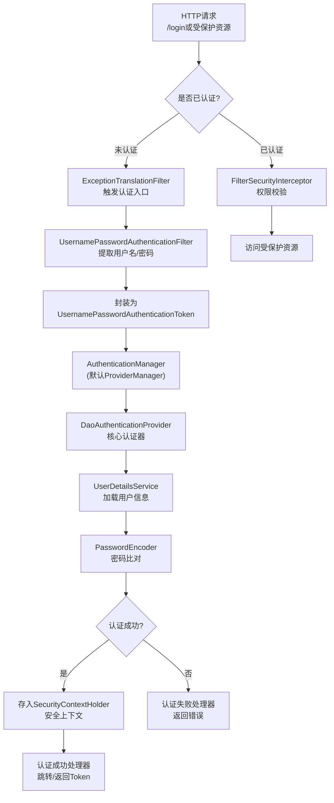

#### 二、关键组件与交互逻辑

##### 1. 过滤器链（SecurityFilterChain）

登录流程的入口，核心过滤器按顺序执行，关键组件如下：

| 过滤器                                   | 核心职责                                      | 执行时机                   |
| :--------------------------------------- | :-------------------------------------------- | :------------------------- |
| **SecurityContextPersistenceFilter**     | 管理SecurityContext（请求初加载、请求末清理） | 过滤器链头部               |
| **UsernamePasswordAuthenticationFilter** | 拦截/login请求，提取参数并封装Authentication  | 处理登录请求的核心过滤器   |
| **ExceptionTranslationFilter**           | 捕获认证/授权异常，触发登录引导（重定向/401） | 认证过滤器与授权过滤器之间 |
| **FilterSecurityInterceptor**            | 权限校验，决定是否放行资源                    | 过滤器链尾部，负责最终授权 |

##### 2. 认证体系（Authentication 核心链路）

认证是登录的核心，组件间委托关系明确：
- **Authentication**：认证信息载体，包含用户名、密码、权限（如UsernamePasswordAuthenticationToken）；
- **AuthenticationManager**：认证中央调度器，默认实现ProviderManager，负责委托给AuthenticationProvider；
- **AuthenticationProvider**：具体认证器，DaoAuthenticationProvider是默认实现，负责调用UserDetailsService和PasswordEncoder；
- **UserDetailsService**：用户信息加载接口，需自定义实现，从数据库/缓存加载用户信息；
- **PasswordEncoder**：密码编码器（如BCryptPasswordEncoder），负责密码加密与比对。

##### 3. 安全上下文（SecurityContext）

认证成功后，用户身份信息存储载体，核心是SecurityContextHolder：
- 存储已认证的Authentication对象，供后续请求复用；
- 默认基于ThreadLocal存储，确保线程安全；
- 可配置持久化（如Session），维持登录状态。

#### 三、完整登录流程步骤（表单登录为例）

1. **请求触发**：用户访问受保护资源（如/api/user），未认证时ExceptionTranslationFilter触发重定向到登录页；
2. **参数提取**：用户提交用户名/密码，UsernamePasswordAuthenticationFilter拦截/login请求，提取参数并封装为UsernamePasswordAuthenticationToken；
3. **认证调度**：Token传递给AuthenticationManager（ProviderManager），遍历匹配的AuthenticationProvider（默认DaoAuthenticationProvider）；
4. **用户加载与密码校验**：DaoAuthenticationProvider调用UserDetailsService加载用户信息，再通过PasswordEncoder比对密码；
5. **认证结果处理**：
   - 成功：将已认证的Authentication存入SecurityContextHolder，触发认证成功处理器（跳转目标页/返回Token）；
   - 失败：清空上下文，触发认证失败处理器（返回错误信息）；
6. **后续请求**：已认证请求通过FilterSecurityInterceptor进行权限校验，通过后访问受保护资源。

#### 四、前后端分离场景（JWT）简化流程

若前后端分离，流程略有调整，核心是用JWT替代Session：
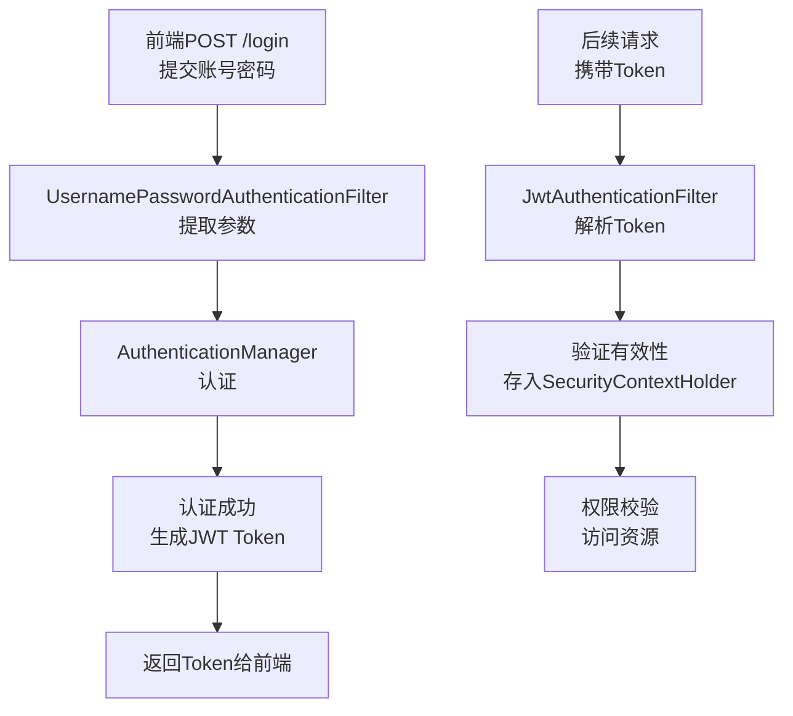

---

#### 总结

Spring Security 登录流程的核心是 **过滤器链拦截 + 认证体系委托 + 安全上下文存储**，理解组件间的委托关系与执行顺序，能快速定位认证问题（如用户信息加载失败、密码比对错误）或实现定制化需求（如多因素认证、第三方登录）。

需要我补充一份常见登录异常（如BadCredentialsException、UsernameNotFoundException）的排查要点，或给出前后端分离架构中 JWT 整合的最小配置示例吗？

我给你画一张**最清晰、面试常考、能直接画图讲清楚**的  

### **Spring Security 过滤器链关系图示**。

---

#### 1. 过滤器链整体关系图（极简版）


---

#### 2. 完整版执行顺序 + 职责图（最实用）

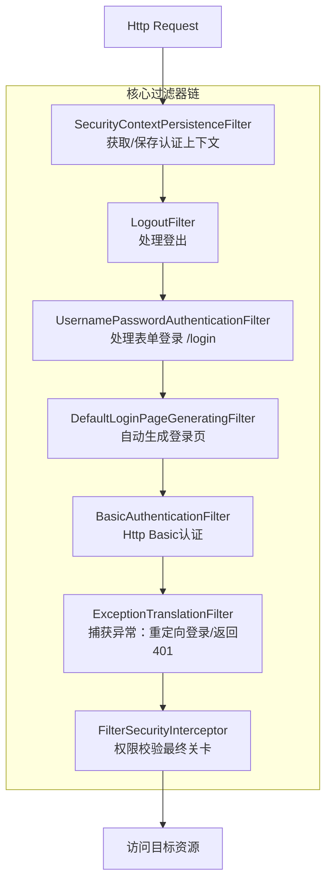

---

#### 3. 关键过滤器**执行顺序 & 作用**（必背）

1. **SecurityContextPersistenceFilter**  
   从 Session 读取/写入 SecurityContext
2. **LogoutFilter**  
   处理登出请求 `/logout`
3. **UsernamePasswordAuthenticationFilter**  
   处理**表单登录** `/login`
4. **DefaultLoginPageGeneratingFilter**  
   自动生成默认登录页面
5. **BasicAuthenticationFilter**  
   HTTP Basic 认证
6. **ExceptionTranslationFilter**  
   捕获认证/授权异常，决定跳转登录页还是返回401
7. **FilterSecurityInterceptor**  
   **最后一关**：判断是否有权限访问接口

---

#### 4. 一句话记住顺序

> **上下文 → 登出 → 登录 → 异常 → 权限拦截**

---

如果你需要，我可以再给你画一张  
**Spring Security 过滤器链 + 认证体系 + 上下文** 三合一总图（面试神图）。

### **Spring Security 认证体系关系图**

我给你画一张**最精简、面试必背、一眼看懂**的  
**Spring Security 认证体系（Authentication 核心链路）关系图**，只保留关键类。

---

#### 认证体系核心关系图（极简版）

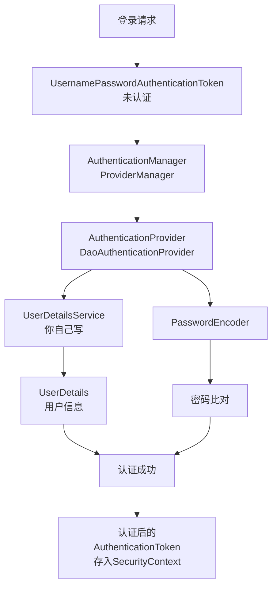

---

#### 文字版关系（背会就能讲清楚）

1. **Authentication**（Token）：装用户名、密码、权限
2. **AuthenticationManager**：统一入口，只管调度
3. **AuthenticationProvider**：真正做认证
4. **UserDetailsService**：你实现，查库拿用户
5. **PasswordEncoder**：密码加密、比对
6. **SecurityContextHolder**：存认证后的用户信息

---

#### 一句话总结链路

> **Token → AuthenticationManager → Provider → UserDetailsService → 密码比对 → 认证成功存入上下文**

需要我把 **过滤器链 + 认证体系** 合成一张**总图**吗？


这张就是你要的 **Spring Security 三合一终极总图**，面试直接画，面试官一看就懂。

### Spring Security 终极三合一总图

（过滤器链 + 认证体系 + 安全上下文）

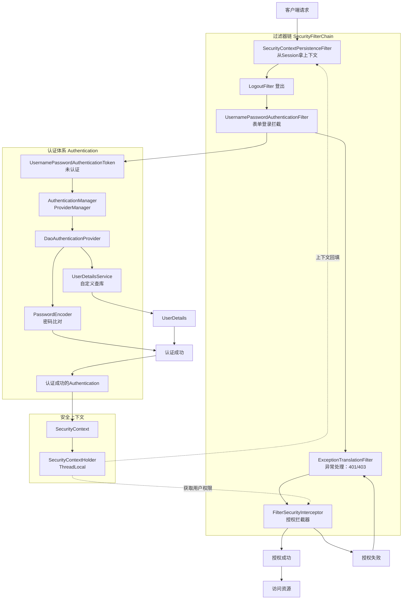

---

#### 面试口述版（背这段就够）

1. **请求先进过滤器链**
   先经过 `SecurityContextPersistenceFilter` 从 Session 里拿上下文，再到登录过滤器。

2. **登录走认证体系**
   封装未认证 Token → 交给 AuthenticationManager → Provider 调用你的 UserDetailsService 查库 + 密码比对 → 生成认证成功 Token。

3. **放进安全上下文**
   认证成功后存入 `SecurityContextHolder`，后续请求直接从这里拿用户身份。

4. **最后授权**
   `FilterSecurityInterceptor` 拿上下文里的权限，对比资源需要的权限，通过则访问，不通过抛 403。

---

#### 一句话总结

**过滤器管流程，认证管登录，上下文存用户，最后过滤器做授权。**

需要我再给你整理一份 **Spring Security 高频面试题+标准答案** 吗？

## Spring Cache

Spring Cache 是 Spring Framework 提供的一套声明式缓存抽象机制，旨在通过注解将缓存逻辑与业务代码解耦。它不直接实现缓存存储，而是定义了一套标准接口，支持底层切换不同的缓存实现（如 Redis、Caffeine、Ehcache 等）。

Spring Cache 的核心功能主要通过以下 **5 个注解** 来实现，按功能分类介绍如下：

### 1. 核心缓存注解

#### **(1) `@Cacheable`：触发缓存读取（查）**

- **作用**：标识方法的返回值可以被缓存。
- 执行流程：
  1. 方法执行前，先根据 key 检查缓存中是否存在数据。
  2. **若存在**：直接返回缓存中的数据，**不执行**目标方法。
  3. **若不存在**：执行目标方法，将返回值存入缓存，并返回结果。
- **典型场景**：查询操作（如 `getUserById`），用于减少数据库压力。
- 关键属性：
  - `value` / `cacheNames`：指定缓存名称（对应 Redis 中的 Key 前缀或 Ehcache 的 cacheName）。
  - `key`：自定义缓存 Key（支持 SpEL 表达式，如 `#id` 或 `#user.id`）。
  - `condition`：条件判断，只有满足条件时才缓存（如 `#result != null`）。
  - `unless`：否定条件，满足该条件时**不**缓存（如 `#result == null`）。

以下是 `@Cacheable` 注解的完整代码示例，展示了如何在 Spring Boot 项目中结合 Redis（或默认内存缓存）使用其核心属性。

##### 1. 前置准备

确保你的 `pom.xml` 中引入了缓存依赖（以 Redis 为例）：

```xml
<!-- Spring Data Redis -->
<dependency>
    <groupId>org.springframework.boot</groupId>
    <artifactId>spring-boot-starter-data-redis</artifactId>
</dependency>
<!-- Spring Cache 抽象 (通常包含在 spring-boot-starter 中，但显式声明更清晰) -->
<dependency>
    <groupId>org.springframework.boot</groupId>
    <artifactId>spring-boot-starter-cache</artifactId>
</dependency>
```

并在启动类上开启缓存支持：

```java
@SpringBootApplication
@EnableCaching // 【必须】开启基于注解的缓存功能
public class DemoApplication {
    public static void main(String[] args) {
        SpringApplication.run(DemoApplication.class, args);
    }
}
```

------

##### 2. 具体代码示例

假设我们有一个用户服务 `UserService`，需要根据 ID 查询用户信息。

###### 场景 A：基础用法 (`value` 和 `key`)

最基础的用法，指定缓存名称和 Key。

```java
@Service
public class UserService {

    @Autowired
    private UserRepository userRepository;

    /**
     * 基础示例：
     * 1. cacheNames = "users": 数据存放在名为 "users" 的缓存区域 (Redis 中 key 前缀通常为 users::)。
     * 2. key = "#id": 使用方法的参数 id 作为缓存的 Key。
     * 
     * 流程：
     * - 第一次调用 getUserById(1): 缓存无数据 -> 执行方法 -> 查库 -> 存入缓存 -> 返回结果。
     * - 第二次调用 getUserById(1): 缓存有数据 -> 直接返回缓存结果 -> 【不执行】userRepository.findById。
     
     * 注意：
     * value：是 cacheNames 的别名。
	 * cacheNames：是实际的标准属性名。当你只填写 value = "users" 时，Spring 内部会自动将其赋值给 cacheNames 属性。
     */
    @Cacheable(value = "users", key = "#id")
    public User getUserById(Long id) {
        System.out.println("【数据库查询】正在查询 ID 为 " + id + " 的用户...");
        return userRepository.findById(id).orElse(null);
    }
}
```

###### 场景 B：使用 SpEL 表达式构建复杂 Key (`key`)

当参数是对象，或者需要组合多个参数作为 Key 时。

```java
    /**
     * 复杂 Key 示例：
     * 假设方法参数是一个 UserQuery 对象，我们需要用其中的 userId 和 status 组合作为 Key。
     * SpEL 表达式: "#query.userId + '_' + #query.status"
     * Redis 中的 Key 可能长这样: users::1001_ACTIVE
     */
    @Cacheable(value = "users", key = "#query.userId + '_' + #query.status")
    public List<User> findUsersByCondition(UserQuery query) {
        System.out.println("【数据库查询】正在根据条件查询用户列表...");
        return userRepository.findByUserIdAndStatus(query.getUserId(), query.getStatus());
    }
    
    /**
     * 使用对象属性作为 Key:
     * 如果参数本身就是 User 对象，想用它的主键做 Key
     */
    @Cacheable(value = "users", key = "#user.id")
    public User processUser(User user) {
        // 业务逻辑...
        return user;
    }
```

###### 场景 C：条件缓存 (`condition` 和 `unless`)

控制什么情况下才缓存，避免缓存空值或无效数据。

```java
    /**
     * condition 示例：
     * 只有当传入的 id > 0 时，才尝试去缓存查找或存入缓存。
     * 如果 id <= 0，直接执行方法，且不涉及缓存操作。
     */
    @Cacheable(value = "users", key = "#id", condition = "#id > 0")
    public User getUserWithCondition(Long id) {
        System.out.println("【数据库查询】查询 ID: " + id);
        return userRepository.findById(id).orElse(null);
    }

    /**
     * unless 示例：
     * 方法执行完后，如果返回结果为 null，则【不】存入缓存。
     * 这可以防止缓存穿透（即频繁查询数据库中不存在的数据）。
     * 注意：unless 是在方法执行后判断的，所以可以使用 #result 变量。
     */
    @Cacheable(value = "users", key = "#id", unless = "#result == null")
    public User getUserSafe(Long id) {
        System.out.println("【数据库查询】安全查询 ID: " + id);
        // 如果数据库没查到，返回 null，此时不会缓存 null 值
        return userRepository.findById(id).orElse(null);
    }
    
    /**
     * 组合示例：
     * 只有 id > 0 时才检查缓存；且只有结果不为 null 时才存入缓存。
     */
    @Cacheable(
        value = "users", 
        key = "#id", 
        condition = "#id > 0", 
        unless = "#result == null"
    )
    public User getUserCombined(Long id) {
        System.out.println("【数据库查询】组合条件查询 ID: " + id);
        return userRepository.findById(id).orElse(null);
    }
}
```

##### 3. 测试验证逻辑

你可以编写一个简单的 Test 或 Controller 来观察控制台输出：

```java
@RestController
@RequestMapping("/users")
public class UserController {

    @Autowired
    private UserService userService;

    @GetMapping("/{id}")
    public User getUser(@PathVariable Long id) {
        // 第一次访问：控制台会打印 "【数据库查询】..."
        User user1 = userService.getUserById(id);
        
        // 第二次访问（相同 ID）：控制台【不会】打印 "【数据库查询】..."，直接从缓存返回
        User user2 = userService.getUserById(id);
        
        return user2;
    }
}
```

##### 4. 关键点总结

1. **Key 的生成**：如果不写 `key` 属性，Spring 默认使用所有参数生成的哈希值作为 Key（通常不推荐，因为不够直观且难以手动清除）。建议始终显式指定 `key`。

2. SpEL 上下文

   ：

   - `#id`, `#user`: 代表方法参数。
   - `#result`: 代表方法返回值（仅在 `unless` 中可用，`condition` 在方法执行前判断，拿不到结果）。
   - `#root.method`, `#root.target`: 代表当前方法和目标对象。

3. **缓存空值问题**：务必注意 `unless = "#result == null"`，否则数据库查不到的数据也会被缓存为 `null`，导致后续请求永远查不到最新数据（除非缓存过期）。


#### **(2) `@CachePut`：强制更新缓存（写/更）**

- **作用**：标识方法的返回值需要被放入缓存。
- 执行流程：
  1. **总是执行**目标方法。
  2. 方法执行完毕后，将返回值强制更新到缓存中。
- **注意**：它不会像 `@Cacheable` 那样先检查缓存，因此常用于**更新操作**，确保缓存与数据库一致。
- **典型场景**：修改用户信息后，同步更新缓存中的用户数据。
- **关键点**：`key` 必须与 `@Cacheable` 中的 key 生成策略一致，否则会导致缓存污染（查和更新的 Key 对不上）。

以下是 `@CachePut` 的具体代码示例。为了让你更清楚地理解“**强制更新**”和“**Key 一致性**”的重要性，我将创建一个完整的场景：先查询（`@Cacheable`），再修改（`@CachePut`），并展示如果 Key 不一致会发生什么。

##### 1. 场景设定

假设我们有一个 `UserService`：

1. **查询方法** `getUserById`：使用 `@Cacheable`，Key 为 `#id`。
2. **更新方法** `updateUser`：使用 `@CachePut`，目的是修改数据库后，同步更新缓存。

##### 2. 代码示例

```java
@Service
public class UserService {

    @Autowired
    private UserRepository userRepository;

    // ================= 1. 查询操作 (@Cacheable) =================
    
    /**
     * 缓存策略：
     * cacheNames: "users"
     * key: "#id" (例如: users::1)
     */
    @Cacheable(value = "users", key = "#id")
    public User getUserById(Long id) {
        System.out.println("【DB查询】执行 getUserById，ID = " + id);
        return userRepository.findById(id).orElse(null);
    }

    // ================= 2. 更新操作 (@CachePut) =================

    /**
     * 【正确示范】Key 与 @Cacheable 保持一致
     * 
     * 流程：
     * 1. 无论缓存中是否有数据，【必定执行】下面的方法体（更新数据库）。
     * 2. 方法执行成功后，将返回的 newUser 对象放入缓存。
     * 3. 缓存 Key 必须也是 "#user.id"，这样下次调用 getUserById(user.id) 时才能命中这个新值。
     */
    @CachePut(value = "users", key = "#user.id")
    public User updateUser(User user) {
        System.out.println("【DB更新】执行 updateUser，更新 ID = " + user.getId() + ", 新名字 = " + user.getName());
        
        // 模拟数据库更新操作
        User updatedUser = userRepository.save(user);
        
        // 返回更新后的对象，Spring 会把这个对象存入缓存
        return updatedUser;
    }

    /**
     * 【错误示范】Key 不一致导致缓存污染
     * 
     * 如果你写成 key = "#user.name" 或者 key = "'fixed_key'"：
     * 1. 数据库更新成功了。
     * 2. 缓存中会多出一个 key 为 "users::NewName" 的数据。
     * 3. 但是原来的 key "users::1" 里的旧数据【没有被覆盖】！
     * 4. 下次调用 getUserById(1) 时，依然拿到旧数据（缓存未生效）。
     */
    @CachePut(value = "users", key = "#user.name") // ❌ 错误：Key 生成策略与查询不一致
    public User updateUserWrongKey(User user) {
        System.out.println("【DB更新】执行了更新，但缓存 Key 错了！");
        return userRepository.save(user);
    }
    
    // ================= 3. 特殊场景：只更新部分字段 =================
    
    /**
     * 有时候更新方法只接收 ID 和部分字段，不返回完整 User 对象。
     * 这时需要手动构造 Key，或者确保返回值能用于更新。
     * 如果方法返回 void 或无关对象，@CachePut 可能无法按预期工作（除非配合 keyGenerator 或特定配置）。
     * 最佳实践是：更新方法最好返回更新后的完整实体。
     */
    @CachePut(value = "users", key = "#id")
    public User updateUserName(Long id, String newName) {
        System.out.println("【DB更新】仅更新名字，ID = " + id);
        User user = userRepository.findById(id).orElseThrow();
        user.setName(newName);
        User saved = userRepository.save(user);
        // 必须返回完整的 User 对象，以便存入缓存
        return saved; 
    }
}
```

##### 3. 验证流程（控制台输出模拟）

假设初始数据库中用户 ID=1 的名字是 "Alice"。

###### 第一步：首次查询

```java
userService.getUserById(1L);
```

- **控制台**: `【DB查询】执行 getUserById，ID = 1`
- **缓存状态**: `users::1` -> `{id:1, name:"Alice"}`

###### 第二步：再次查询（验证缓存命中）

```java
userService.getUserById(1L);
```

- **控制台**: *(无输出，方法未执行)*
- **结果**: 直接返回缓存中的 "Alice"。

###### 第三步：使用 `@CachePut` 更新名字为 "Bob"

```java
User newUser = new User(1L, "Bob");
userService.updateUser(newUser);
```

- 控制台: 

  ```
  【DB更新】执行 updateUser，更新 ID = 1, 新名字 = Bob
  ```

  - *注意：即使缓存里有数据，这里也**强制执行**了打印语句和数据库操作。*

- **缓存动作**: Spring 拦截返回值，将 `{id:1, name:"Bob"}` 写入 `users::1`。

- **缓存状态**: `users::1` -> `{id:1, name:"Bob"}` (旧值被覆盖)

###### 第四步：再次查询（验证更新生效）

```java
userService.getUserById(1L);
```

- **控制台**: *(无输出)*
- 结果: 返回缓存中的 "Bob"。
  - *如果 Key 不一致（如用了错误示范），这里还是会返回 "Alice"。*

##### 4. 关键注意事项总结

1. **性能警告**： `@CachePut` **不会**走缓存读取逻辑，它每次都会触发目标方法的执行。
   - ❌ **不要**在单纯的“查询”方法上使用 `@CachePut`，否则缓存就失去意义了（每次都查库）。
   - ✅ **仅**在“新增”或“修改”数据的方法上使用。
2. **Key 的一致性至关重要**：
   - `@Cacheable` (读) 的 Key 生成规则 必须 == `@CachePut` (写) 的 Key 生成规则。
   - 通常建议使用 SpEL 表达式 `#id` 或 `#user.id` 这种明确的参数引用，避免使用默认策略。
3. **返回值要求**： `@CachePut` 依赖方法的**返回值**来更新缓存。
   - 如果你的更新方法返回 `void`，`@CachePut` 将无法更新缓存（或者会将 `null` 存入缓存，覆盖掉原有数据，导致缓存穿透）。
   - **最佳实践**：让更新方法返回更新后的完整实体对象。
4. **执行顺序**： `@CachePut` 是在方法**执行后**才更新缓存的。这意味着如果在方法执行过程中抛出了异常，缓存**不会**被更新（这是符合预期的，保证数据一致性）。


#### **(3) `@CacheEvict`：清除缓存（删）**

- **作用**：标识该方法执行时需要清除缓存。
- 执行流程：
  1. 根据配置，在方法执行**前**或**后**删除指定的缓存数据。
- **典型场景**：删除数据（如 `deleteUser`）或批量更新后，需要让旧缓存失效。
- 关键属性：
  - `allEntries`：布尔值。若为 `true`，则清空该 `cacheNames` 下的所有条目（常用于批量操作后重置缓存）。
  - `beforeInvocation`：布尔值。默认为 `false`（方法成功执行后清除）。若设为 `true`，则在方法执行前就清除（即使方法抛出异常，缓存也会被清掉）。


以下是 `@CacheEvict` 的具体代码示例，重点展示 **单个删除**、**批量清空** 以及 **执行时机（beforeInvocation）** 的区别。

##### 1. 代码示例

```java
@Service
public class UserService {

    @Autowired
    private UserRepository userRepository;

    // ================= 1. 基础用法：删除指定 Key =================

    /**
     * 场景：删除单个用户
     * 
     * 流程 (默认 beforeInvocation = false)：
     * 1. 先执行方法体 (userRepository.deleteById)。
     * 2. 如果方法成功执行（无异常），再删除缓存中 key = "#id" 的数据。
     * 
     * 优点：保证数据一致性。如果数据库删除失败（抛出异常），缓存不会被误删，
     *       下次查询还能读到旧数据（虽然可能不是最新的，但至少数据还在）。
     */
    @CacheEvict(value = "users", key = "#id")
    public void deleteUser(Long id) {
        System.out.println("【DB操作】正在数据库删除用户 ID: " + id);
        userRepository.deleteById(id);
        // 如果这里抛出异常，下面的缓存删除动作【不会】执行
    }

    // ================= 2. 进阶用法：清空整个缓存区域 (allEntries) =================

    /**
     * 场景：批量更新或重置所有用户数据
     * 
     * 属性说明：
     * - allEntries = true: 忽略具体的 key，直接清空 "users" 这个缓存名称下的所有数据。
     * - 注意：当 allEntries = true 时，key 属性通常不需要写（写了也没用）。
     * 
     * 用途：当执行了复杂的批量更新、导入操作，无法精确计算哪些 Key 失效时，
     *       直接“核弹式”清空整个缓存是最安全简单的策略。
     */
    @CacheEvict(value = "users", allEntries = true)
    public void resetAllUsers() {
        System.out.println("【DB操作】正在重置所有用户数据...");
        // 执行批量更新逻辑
        userRepository.resetAll();
        // 方法成功后，"users" 缓存下的所有条目（如 users::1, users::2...）全部失效
    }

    // ================= 3. 关键属性：beforeInvocation (执行时机) =================

    /**
     * 场景：删除操作，但希望即使数据库报错，缓存也要先失效
     * 
     * 属性说明：
     * - beforeInvocation = true: 在方法执行【前】就清除缓存。
     * 
     * 风险与适用场景：
     * - 风险：如果下面 userRepository.deleteById(id) 抛出了异常（删除失败），
     *         此时缓存已经被清除了。用户再次查询时，会触发 @Cacheable 去查库，
     *         发现数据还在（因为刚才删除失败了），于是又重新缓存了旧数据。
     *         这会导致短暂的“缓存空窗期”或性能抖动，但不会导致“脏数据”（因为旧数据被清了）。
     * 
     * - 适用：某些业务要求“只要发起删除请求，前端就必须看到最新状态（即数据消失或重新加载）”，
     *         哪怕后端处理稍微慢一点或重试，也不能让用户看到旧的缓存数据。
     */
    @CacheEvict(value = "users", key = "#id", beforeInvocation = true)
    public void deleteUserForcefully(Long id) {
        System.out.println("【DB操作】强制删除模式：先清缓存，再删库。ID: " + id);
        
        // 模拟可能发生的异常
        if (id == 999) {
            throw new RuntimeException("数据库删除失败！");
        }
        
        userRepository.deleteById(id);
        // 即使这里报错，上面的缓存已经在方法开始前被清除了
    }
    
    // ================= 4. 组合场景：更新后清除列表缓存 =================
    
    /**
     * 场景：修改了某个用户详情，不仅要更新详情缓存，还要清除用户列表缓存
     * 因为列表里包含了该用户，详情变了，列表也得刷新。
     */
    @Caching(evict = {
        @CacheEvict(value = "users", key = "#user.id"),          // 清除详情缓存
        @CacheEvict(value = "userList", allEntries = true)       // 清除列表缓存
    })
    public User updateUserAndClearList(User user) {
        System.out.println("【DB操作】更新用户并清除列表缓存");
        return userRepository.save(user);
    }
}
```

##### 2. 核心行为对比表

| 属性配置                            | 执行时机                | 发生异常时的行为                                             | 适用场景                                                     |
| ----------------------------------- | ----------------------- | ------------------------------------------------------------ | ------------------------------------------------------------ |
| **默认** `beforeInvocation = false` | **方法执行后**          | 缓存**不**删除。 (数据库删失败，缓存保留旧数据)              | **推荐默认使用**。 保证“缓存不丢失”，宁可保留旧数据等待下次刷新，也不要在操作失败时让缓存变空。 |
| **强制** `beforeInvocation = true`  | **方法执行前**          | 缓存**已**删除。 (数据库删失败，缓存变空，下次查询会回源查库) | 对数据实时性要求极高，或者业务逻辑允许“短暂查库”的场景。 防止用户看到明显过期的数据。 |
| **全量** `allEntries = true`        | 取决于 beforeInvocation | 整个缓存区域清空。                                           | 批量操作、数据导入、或无法精确计算 Key 的复杂更新场景。      |

##### 3. 特别注意点

1. **返回值无关**： `@CacheEvict` 修饰的方法通常返回 `void` 或其他业务对象，**返回值不会被存入缓存**。它的作用纯粹是“清理”。
2. **`allEntries` 的性能影响**： 当 `allEntries = true` 时，Spring 需要遍历并移除该 Cache Name 下的所有 Entry。
   - 如果是 **Redis**：通常效率很高（直接 `DEL key` 或扫描删除）。
   - 如果是 **本地缓存 (如 Caffeine/ConcurrentMap)**：如果缓存数据量极大（百万级），清空操作可能会造成短暂的线程阻塞或 CPU 飙升。在生产环境大数据量下慎用 `allEntries=true`，最好能精确到 `key`。
3. **异常处理的最佳实践**： 绝大多数情况下，保持默认的 `beforeInvocation = false` 是更安全的。
   - **逻辑**：只有数据库真的删成功了，我们才放心地告诉缓存“你也该删了”。
   - **如果删失败了**：缓存里留着旧数据虽然不完美，但至少系统还能用；如果提前清了缓存，高并发下所有请求瞬间打到数据库，可能导致数据库雪崩。

##### 4. 调用示例

```java
// 1. 正常删除
userService.deleteUser(1L); 
// 输出: 【DB操作】正在数据库删除用户 ID: 1
// 结果: 数据库删除成功 -> 缓存 users::1 被移除

// 2. 重置所有
userService.resetAllUsers();
// 输出: 【DB操作】正在重置所有用户数据...
// 结果: 数据库操作成功 -> 缓存 "users" 下所有 Key 被移除

// 3. 强制删除 (模拟异常)
try {
    userService.deleteUserForcefully(999L);
} catch (Exception e) {
    System.out.println("捕获异常: " + e.getMessage());
}
// 输出顺序:
// 1. (内部) 缓存 users::999 被立即移除 (因为 beforeInvocation=true)
// 2. 【DB操作】强制删除模式...
// 3. 捕获异常: 数据库删除失败！
// 结果: 数据库里数据还在，但缓存没了。下次查询会重新查库并回填缓存。
```

------

### 2. 组合与配置注解

#### **(4) `@Caching`：组合多个缓存操作**

- **作用**：当一个方法需要同时执行多个缓存操作时使用（例如：既要更新某个用户的缓存，又要清除与该用户相关的列表缓存）。

- **结构**：它内部包含 `cacheable`、`put` 和 `evict` 数组属性。

- 示例场景：

  ```java
  @Caching(
    put = { @CachePut(value = "user", key = "#user.id") },
    evict = { @CacheEvict(value = "userList", allEntries = true) }
  )
  public User updateUser(User user) { ... }
  ```

#### **(5) `@CacheConfig`：类级别统一配置**

- **作用**：在类级别提取公共的缓存配置，避免在每个方法上重复写相同的属性（如 `cacheNames` 或 `keyGenerator`）。

- **优先级**：方法上的注解配置优先级高于类上的 `@CacheConfig`。

- 示例：

  ```java
  @CacheConfig(cacheNames = "users") // 该类下所有缓存注解默认使用 "users" 作为缓存名
  @Service
  public class UserService { ... }
  ```

------

### 3. 使用前提与配置

要让上述注解生效，必须在 Spring Boot 启动类或配置类上添加 **`@EnableCaching`** 注解，开启基于注解的缓存支持。

```java
@SpringBootApplication
@EnableCaching // 开启缓存
public class Application {
    public static void main(String[] args) {
        SpringApplication.run(Application.class, args);
    }
}
```

### 4. 总结对比表

| 注解             | 核心行为                         | 是否执行方法               | 典型用途     |
| ---------------- | -------------------------------- | -------------------------- | ------------ |
| **@Cacheable**   | 先查缓存，有则返回，无则执行并存 | 缓存命中时**不执行**       | 查询详情     |
| **@CachePut**    | 强制执行方法，并更新缓存         | **总是执行**               | 更新详情     |
| **@CacheEvict**  | 删除缓存                         | 视 `beforeInvocation` 而定 | 删除数据     |
| **@Caching**     | 组合上述多个操作                 | 取决于内部包含的操作       | 复杂更新场景 |
| **@CacheConfig** | 提取公共配置                     | 无行为，仅配置             | 类级统一管理 |

### 5. 常见底层实现

Spring Cache 只是规范，实际存储依赖具体的 CacheManager 实现，常见的有：

- **Redis** (`RedisCacheManager`)：分布式缓存，生产环境最常用。
- **Caffeine** (`CaffeineCacheManager`)：本地高性能缓存，适合单机或热点数据。
- **Ehcache**：老牌本地/分布式缓存框架。
- **ConcurrentMapCacheManager**：基于内存 Map 的简单实现，仅适合测试。


## Spring Task 定时任务与异步调度（Spring Boot 生产级实战）

> **高频面试导读**：  
> 本章节将 Spring Task 的核心定位、`@Scheduled` 参数体系、Cron 表达式语法与避坑、**默认单线程阻塞陷阱与线程池调优**、**分布式集群重复执行破局（Redis 锁与 XXL-JOB 对比）**以及生产最佳实践全面融合，建立从极简入门到高可用架构的完整知识图谱。

---

### 一、核心定位与极简快速入门

#### 1. Spring Task 核心定位与技术选型

**Spring Task** 是 Spring 框架内置的一个轻量级任务调度模块，主要用于解决 Java 应用中的**定时任务**（Scheduled Tasks）和**异步方法执行**（Async Execution）需求。它无需引入额外的重型调度框架（如 Quartz / XXL-JOB），即可通过注解配置实现丰富的时间调度逻辑。

##### 主流任务调度方案深度对比全景表：

| 对比维度 | Spring Task | Quartz | XXL-JOB / Elastic-Job |
| :--- | :--- | :--- | :--- |
| **定位与架构** | **内置轻量单机调度**，无中心化节点 | 传统重量级调度，基于 JDBC 数据库锁实现集群 | **分布式调度中心**，调度系统与执行器物理分离 |
| **依赖与学习成本** | **零外部依赖**，注解开箱即用，学习成本极低 | 较高（需在数据库建 11 张系统表，配置复杂） | 需部署独立调度中心，但提供极佳的可视化控制台 |
| **动态任务管理** | ❌ **静态注解驱动**，修改执行规则通常需重启应用 | ✅ 支持通过 API 动态增删改查任务规则 | ✅ **Web 页面可视化管控**：随时动态启停、修改 Cron、手动触发一次 |
| **分布式高可用** | ❌ **原生不支持**（多实例并发运行时会导致重复执行） | ✅ 支持集群（依靠数据库悲观锁 `QRTZ_LOCKS` 竞态竞争） | ✅ **原生企业级支持**：分片广播、故障转移、超时告警、负载均衡 |
| **推荐适用场景** | 单机单体应用、本地缓存定期刷新、简单对账 | 传统非微服务老系统的多节点调度 | **微服务分布式架构、千万级订单跑批、高并发系统的首选** |

---

#### 2. 极简开发两步走

##### 第一步：开启调度支持
在 Spring Boot 启动类或配置类上添加 `@EnableScheduling`（若需要异步方法支持可配合 `@EnableAsync`）：
```java
@SpringBootApplication
@EnableScheduling // 开启定时任务支持
@EnableAsync      // 可选：开启异步方法支持
public class Application {
    public static void main(String[] args) {
        SpringApplication.run(Application.class, args);
    }
}
```

##### 第二步：编写定时任务组件
在任意 Spring Bean 的方法上标注 `@Scheduled` 注解：
```java
@Component
public class CacheRefreshTask {

    private static final Logger log = LoggerFactory.getLogger(CacheRefreshTask.class);

    // 每 5 秒执行一次
    @Scheduled(fixedRate = 5000)
    public void refreshLocalCache() {
        log.info("本地缓存定时刷新中: {}", LocalDateTime.now());
    }
}
```

---

### 二、@Scheduled 核心参数全景对比与执行语义

`@Scheduled` 注解提供了 4 种核心触发模式，其底层时间计算基准与边界行为有着本质差异：

#### 1. 核心参数全景对比矩阵表

| 参数 | 核心语义与时间基准 | 示例配置 | 任务耗时 > 调度间隔时的行为 | 适用场景 |
| :--- | :--- | :--- | :--- | :--- |
| **`fixedRate`** | **固定频率**：以上次任务**开始执行的时间戳**为基准递增计时（单位：毫秒） | `@Scheduled(fixedRate = 5000)`（每 5 秒一次） | 若任务执行耗时 7s：单线程下会阻塞排队立即触发；多线程/异步下会**重叠并行执行**！ | 执行时间极短、无重叠风险、严格定频的任务（如心跳探测） |
| **`fixedDelay`** | **固定延迟**：以上次任务**完全执行结束的时间戳**为基准计时（单位：毫秒） | `@Scheduled(fixedDelay = 5000)`（上次完成后等 5 秒） | **绝对不会重叠执行**：无论任务耗时多长，均保证执行完毕后硬延迟指定间隔再启动下一次 | 耗时波动大、前后任务有数据先后依赖的场景（如拉取未对账单） |
| **`initialDelay`** | **首次启动延迟**：应用启动完成后，等待指定时间再触发首次调度（单位：毫秒） | `@Scheduled(initialDelay = 10000, fixedRate = 5000)`（启动后等 10s 首次执行） | 配合 `fixedRate` 或 `fixedDelay` 使用，避免系统刚启动与连接池争抢资源 | 需等待缓存预热或数据库初始化就绪的任务 |
| **`cron`** | **Cron 表达式**：按照日历时间规则指定复杂时序 | `@Scheduled(cron = "0 0 2 * * ?")`（每天凌晨 2 点） | 默认单线程下若任务未结束，到达时间后无法触发，导致下次调度延迟或丢失 | 每天/每周/每月等复杂日历场景的定期跑批 |

#### 2. 代码示例：不同参数执行时序对比

```java
@Component
public class ScheduledParameterDemo {

    // 1. fixedRate: 固定频率（每5秒触发一次）
    // 若任务耗时 2 秒，实际触发间隔依然是 5 秒（第 0s, 第 5s, 第 10s...）
    @Scheduled(fixedRate = 5000)
    public void fixedRateTask() throws InterruptedException {
        System.out.println("fixedRate 触发时间: " + LocalDateTime.now());
        Thread.sleep(2000); // 模拟耗时 2s
    }

    // 2. fixedDelay: 固定延迟（上次执行完毕后等 3 秒）
    // 若任务耗时 2 秒，实际触发间隔为: 2s耗时 + 3s延迟 = 5 秒（第 0s开始 2s完，第 5s开始 7s完...）
    @Scheduled(fixedDelay = 3000)
    public void fixedDelayTask() throws InterruptedException {
        System.out.println("fixedDelay 触发时间: " + LocalDateTime.now());
        Thread.sleep(2000); // 模拟耗时 2s
    }

    // 3. initialDelay: 延迟首次启动，规避项目启动阶段的资源抢占
    @Scheduled(initialDelay = 5000, fixedRate = 10000)
    public void initialDelayTask() {
        System.out.println("项目启动完成 5 秒后首次执行，后续每隔 10 秒执行一次");
    }
}
```

---

### 三、Cron 表达式语法规范与高频避坑指南

Cron 表达式是高级定时任务的核心，Spring 支持标准的 6 位格式。

#### 1. 字段格式规范（Spring 6 位规范 vs Quartz 7 位规范）

```text
  秒   分   时   日   月   周
  *    *    *    *    *    ?
```

> ⚠️ **关键注意**：Spring Boot 的 `@Scheduled` 默认采用 **6 位表达式**（`秒 分 时 日 月 周`），**不支持最后一位的“年”**（Quartz 支持 7 位的年，但 Spring 传入 7 位会直接抛出 `IllegalArgumentException`）。

##### 特殊字符语义速查：
- `*`（任意值）：每秒、每分、每小时、每日；
- `?`（不指定值/忽略）：**仅在“日”和“周”字段中使用**！因为“每月的几号”和“星期几”在日历上存在逻辑互斥，必须将其中一个设为 `?`；
- `-`（区间范围）：如在时字段 `9-17` 代表早 9 点至下午 17 点每小时触发；
- `,`（枚举列表）：如在月字段 `1,3,5` 代表 1月、3月和5月；
- `/`（步长递增）：如在秒字段 `0/5` 或 `*/5` 代表从第 0 秒开始每 5 秒触发一次；
- `L`（Last 最后）：在日字段表示当月最后一天（如 31 号或 28 号）；在周字段如 `5L` 表示当月最后一个星期四；
- `W`（Weekday 工作日）：离指定日期最近的工作日（周一至周五）；
- `#`（第几个特定周几）：如 `6#3` 表示当月的第 3 个周五。

---

#### 2. 大厂面试常见易错三大误区剖析

##### 误区一：混淆 `0 0/5 * * * ?` 和 `0 */5 * * * ?`
- **解析**：在 Spring 实现中二者等价，均表示每 5 分钟的 0 秒触发一次；但推荐统一采用标准的 `0 */5 * * * ?`，语法更加通用可移植。

##### 误区二：“日”和“周”同时指定明确数值（导致启动报错）
- **错误写法**：`@Scheduled(cron = "0 0 12 1 * 2")`（企图表达：每月 1 号且恰好是周二的中午 12 点）。
- **严重后果**：Spring 在解析该表达式时会直接抛出 `IllegalArgumentException: '?' can only be specfied for Day-of-Month or Day-of-Week`。
- **正解铁律**：**指定了“日”，则“周”必须填 `?`；指定了“周”，则“日”必须填 `?`**。

##### 误区三：误将 Linux Crontab 的 5 位当做 Spring 的 6 位
- Linux Crontab 格式为：`分 时 日 月 周`（没有秒字段）；
- 如果开发者习惯性写成 `* * * * *`，在 Linux 下是每分钟执行一次，但在 Spring 中第一位是秒，会直接被解析为 **每秒钟疯狂执行一次**，直接引爆数据库和 CPU！

---

#### 3. 生产高频常用 Cron 表达式速查清单

| 调度需求 | 标准 Cron 表达式 | 语义解读 |
| :--- | :--- | :--- |
| **每 5 秒执行一次** | `0/5 * * * * ?` 或 `*/5 * * * * ?` | 每分钟从 0 秒开始，每隔 5 秒触发 |
| **每 10 分钟整点执行** | `0 0/10 * * * ?` | 每个小时的 0分、10分、20分...0秒触发 |
| **每天凌晨 2:00:00 跑批** | `0 0 2 * * ?` | 每天凌晨 2 点执行（日不限，周为 ?） |
| **每个工作日（周一到周五）18:00 结算**| `0 0 18 ? * MON-FRI` | 周一至周五下午 6 点执行（周指定，日为 ?）|
| **每月最后一天 23:59:59 结转** | `59 59 23 L * ?` | 每月最后一天深夜执行 |
| **每月第 1 个星期五上午 10:00** | `0 0 10 ? * 6#1` | 6代表周五，#1代表第1个 |

---

### 四、生产环境两大致命死穴与深度破局

#### 1. 【死穴一：默认单线程阻塞陷阱与线程池调优】

##### (1) 致命缺陷：单线程导致全盘瘫痪
- **源码底层机制**：Spring Task 默认创建的 `TaskScheduler` 仅仅是一个**单线程执行器**（`Executors.newSingleThreadScheduledExecutor()`）；
- **故障场景**：系统中有两个定时任务，`TaskA`（耗时 10 分钟）和 `TaskB`（每 5 秒执行一次）。当 `TaskA` 开始执行后，`TaskB` **将被死死阻塞排队，长达 10 分钟无法得到任何执行**！若 `TaskA` 发生死循环或未捕获异常，整个应用的所有定时任务全部瘫痪。

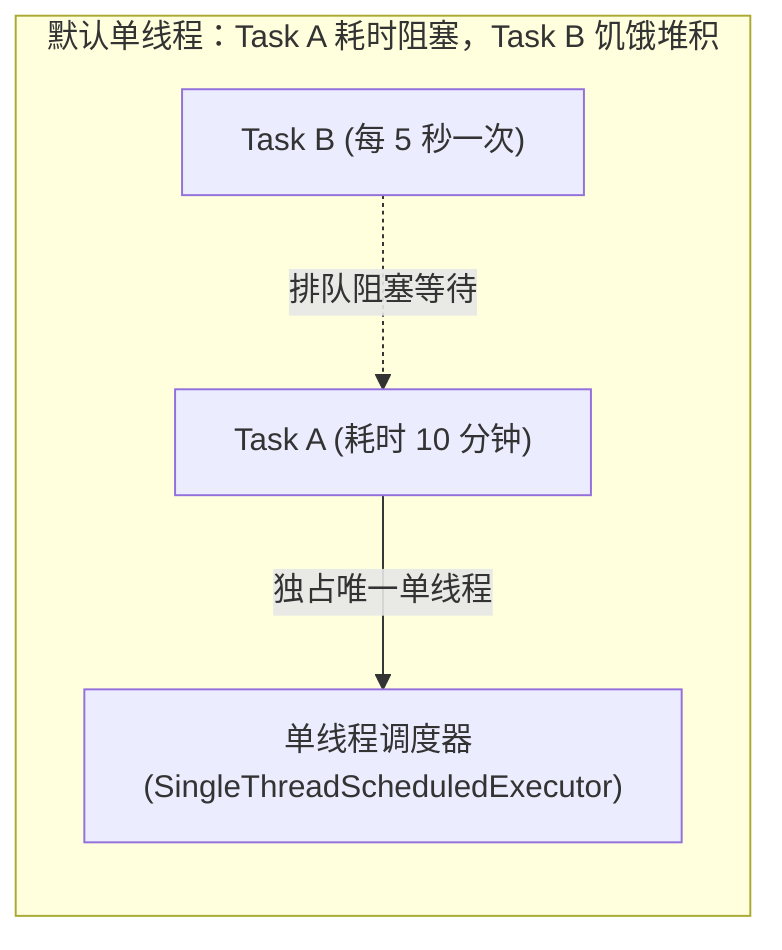

##### (2) 生产标准解决方案：基于 `SchedulingConfigurer` 配置多线程调度池

实现 `SchedulingConfigurer` 接口，为 Spring Task 注入自定义的 `ThreadPoolTaskScheduler`：

```java
import org.springframework.context.annotation.Configuration;
import org.springframework.scheduling.annotation.SchedulingConfigurer;
import org.springframework.scheduling.concurrent.ThreadPoolTaskScheduler;
import org.springframework.scheduling.config.ScheduledTaskRegistrar;

@Configuration
public class ScheduledTaskConfig implements SchedulingConfigurer {

    @Override
    public void configureTasks(ScheduledTaskRegistrar taskRegistrar) {
        ThreadPoolTaskScheduler taskScheduler = new ThreadPoolTaskScheduler();
        // 核心线程数：根据系统并发任务数合理配置（通常 CPU 核数 * 2）
        taskScheduler.setPoolSize(Runtime.getRuntime().availableProcessors() * 2);
        // 线程前缀，便于排查日志与定位问题
        taskScheduler.setThreadNamePrefix("scheduled-worker-");
        // 等待所有正在执行的任务完成后再关闭线程池
        taskScheduler.setWaitForTasksToCompleteOnShutdown(true);
        // 等待关闭的优雅停机最大超时时间
        taskScheduler.setAwaitTerminationSeconds(60);
        // 初始化线程池
        taskScheduler.initialize();

        // 注册到 Spring 调度管理器
        taskRegistrar.setTaskScheduler(taskScheduler);
    }
}
```

##### (3) 替代解决方案：结合 `@Async` 实现完全异步解耦
如果不想全局配置调度器线程池，也可以在需要异步执行的定时方法上同时添加 `@Async`：
```java
@Component
public class AsyncScheduledTask {

    @Async // 将任务派发到异步线程池执行，不占用调度主线程
    @Scheduled(fixedRate = 5000)
    public void executeAsyncTask() {
        // 耗时逻辑在异步线程池中运行，调度器立即返回，互不干扰
    }
}
```

---

#### 2. 【死穴二：分布式集群部署重复执行陷阱与高可用破局】

##### (1) 事故现象：集群多节点重复调度
现代企业级微服务均采用集群多实例部署（如部署 3 个 Pod 实例）。由于 `@Scheduled` 仅在本地 JVM 内存中调度，当到达触发时间时，**集群中的 3 个节点会同时触发执行**！  
后果：向用户重复发送营销短信、重复扣款、产生脏数据甚至引发数据库死锁。

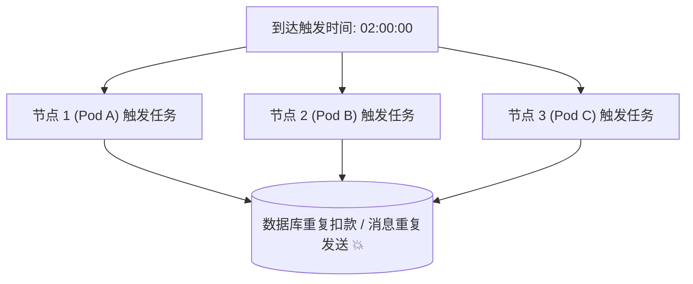

##### (2) 破局方案一：基于 Redis `setIfAbsent` (setnx) + 分布式防重锁
适用于中小规模或未引入独立分布式调度中间件的系统：

```java
import org.springframework.beans.factory.annotation.Autowired;
import org.springframework.data.redis.core.StringRedisTemplate;
import org.springframework.scheduling.annotation.Scheduled;
import org.springframework.stereotype.Component;

import java.util.UUID;
import java.util.concurrent.TimeUnit;

@Component
public class DistributedScheduledTask {

    @Autowired
    private StringRedisTemplate redisTemplate;

    private static final String TASK_LOCK_KEY = "lock:task:daily_settlement";

    @Scheduled(cron = "0 0 2 * * ?")
    public void executeDailySettlement() {
        String requestId = UUID.randomUUID().toString();
        // 利用 Redis 的 setnx 机制竞争分布式锁，设置 5 分钟自动过期以防死锁
        Boolean getLock = redisTemplate.opsForValue().setIfAbsent(
                TASK_LOCK_KEY, 
                requestId, 
                5, 
                TimeUnit.MINUTES
        );

        if (Boolean.FALSE.equals(getLock)) {
            // 未获取到锁的节点自动放弃，确保集群中同一时刻仅有一个实例执行
            System.out.println("其他节点已抢占调度锁，本实例放弃执行");
            return;
        }

        try {
            System.out.println("成功抢占调度锁，当前实例开始执行核心结算业务...");
            // 执行实际业务逻辑
            doBusinessSettlement();
        } finally {
            // 安全释放锁：校验 requestId，防止误删其它节点的锁
            String currentLockVal = redisTemplate.opsForValue().get(TASK_LOCK_KEY);
            if (requestId.equals(currentLockVal)) {
                redisTemplate.delete(TASK_LOCK_KEY);
            }
        }
    }

    private void doBusinessSettlement() {
        // 核心跑批逻辑
    }
}
```

##### (3) 破局方案二：工业级演进——迁移至分布式调度中心（XXL-JOB / Elastic-Job）
- **局限性反思**：基于 Redis 锁的定时任务虽然能防止重复执行，但依然存在三大软肋：
  1. 无法做**任务分片（Sharding）**（若有 1000 万条数据，只能被抢到锁的一台单机慢慢跑）；
  2. 缺乏可视化管控界面（无法随时手动触发、暂停或动态调整 Cron）；
  3. 缺乏失败自动重试、报警监控与执行日志中心化。
- **架构升级选型**：在业务复杂或数据量庞大的微服务体系中，必须迁移至 **XXL-JOB**，将“调度触发引擎”与“业务执行节点”彻底物理隔离解耦。

---

### 五、高可用最佳实践与秒杀速记口诀

#### 1. 生产四大避坑最佳实践

1. **异常切忌静默吞没**：  
   定时任务方法内部必须使用 `try-catch` 包裹核心代码并输出完整错误日志（`log.error`）。未捕获的运行时异常可能导致调度线程直接异常退出，导致该任务后续再也不执行；
2. **任务组件单一职责拆分**：  
   避免将所有的定时逻辑堆砌在一个类中，应按业务领域拆分独立类（如 `OrderTimeoutTask`、`UserPointsExpireTask`），便于隔离与排查；
3. **设置主动超时熔断**：  
   对于存在外部 HTTP 调用或复杂 SQL 的任务，内部使用 `CompletableFuture.runAsync(...).get(5, TimeUnit.MINUTES)` 进行主动超时控制，防止慢查询长时间占满线程池；
4. **显式声明时区（Zone）**：  
   在跨地域或海外服务器部署时，Cron 表达式应显式声明时区（如 `zone = "Asia/Shanghai"`），防止因服务器操作系统时区不一致引发诡异调度偏差。

---

#### 2. Spring Task 高频考点秒杀速记口诀

```text
内置调度轻量精，Enable 开启 Schedule 呈；
Rate 按起点频频发，Delay 完工再等清；
Cron 占六位日周斥，问号消歧最分明；
单线程池易卡死，Configurer 设核精；
集群切莫盲目启，Redis 分布锁防并；
复杂跑批转 XXL，分片重试胜天庭！
```

