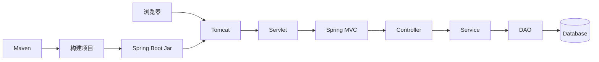
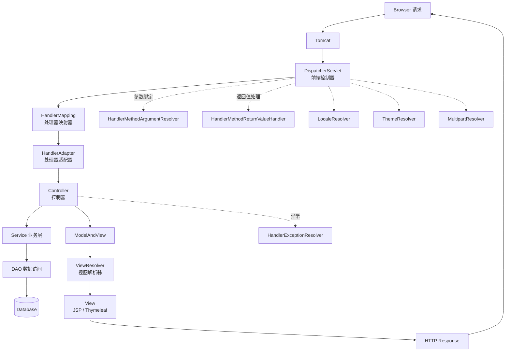
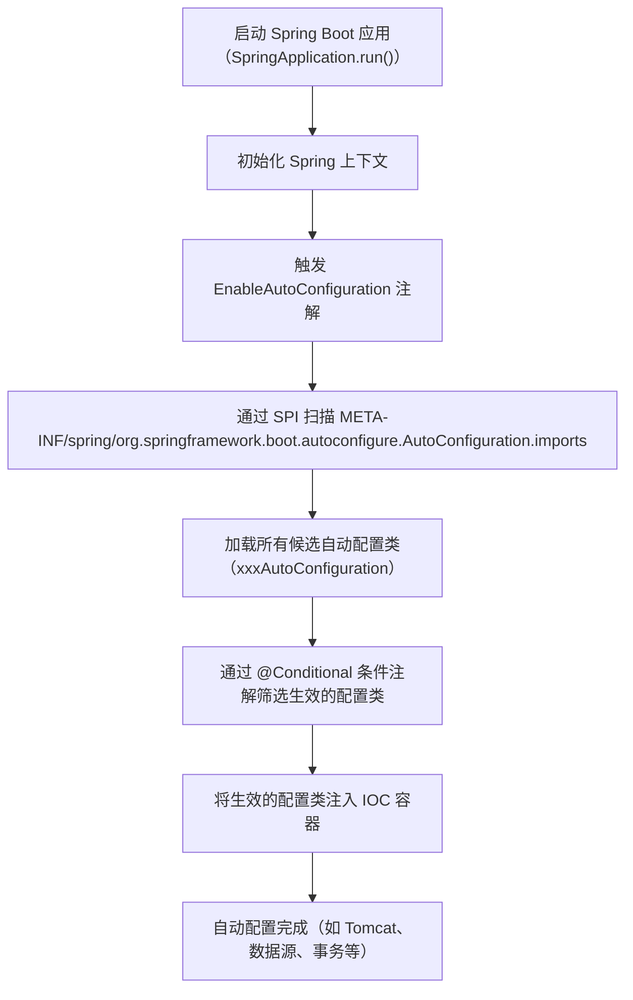
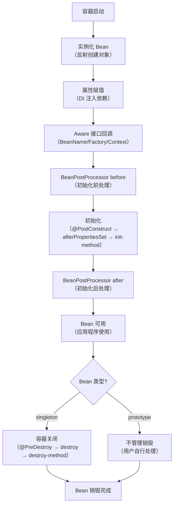
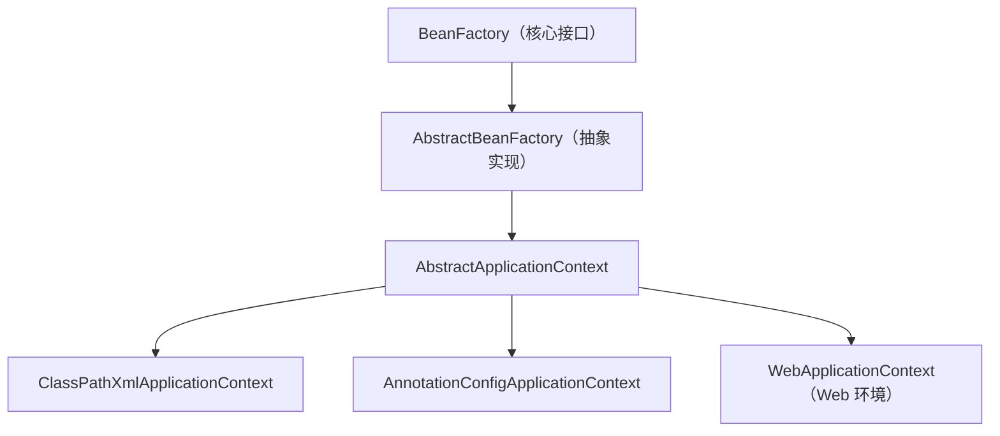
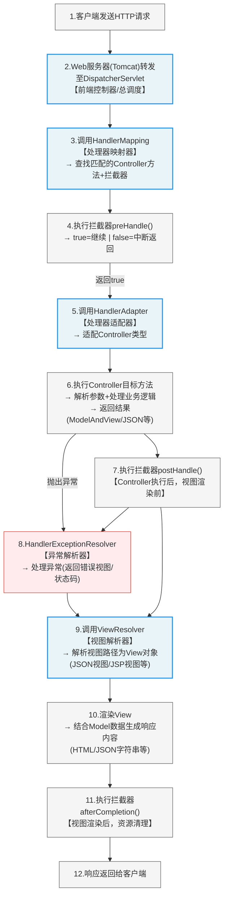

## Spring MVC

### **架构关系图**




**Spring Boot Web 请求流程**，可以这样答：

> Spring Boot 项目通常通过 Maven 构建成可执行 Jar。
>
> 启动后 Spring Boot 会自动启动内嵌 Tomcat 服务器。
>
> 浏览器发送 HTTP 请求后，Tomcat 作为 Servlet 容器接收请求，并交给 DispatcherServlet。
>
> DispatcherServlet 通过 HandlerMapping 找到对应的 Controller，Controller 调用 Service 和 DAO 访问数据库。
>
> 最终 Controller 返回 JSON 或视图，通过 Tomcat 返回给浏览器。

**Java Web 请求流程是什么？**

可以这样答：

> 浏览器发送 HTTP 请求后，请求首先到达 Nginx，Nginx 作为反向代理将请求转发到 Spring Boot 应用。
>
> Spring Boot 内部通过 Spring MVC 处理请求，由 DispatcherServlet 分发到对应的 Controller。
>
> Controller 调用 Service 层执行业务逻辑，Service 再通过 DAO 或 Mapper 访问数据库。
>
> 数据通常通过 MyBatis 或 JPA 持久化到 MySQL，同时很多系统会使用 Redis 进行缓存优化。
>
> 最终结果通过 Spring MVC 返回给浏览器。

------

### Spring MVC 九大组件



**Spring MVC 九大组件是什么？**

可以这样答：

> Spring MVC 的核心是 DispatcherServlet，它作为前端控制器接收所有请求。
>
> DispatcherServlet 通过 HandlerMapping 找到对应的 Controller，然后通过 HandlerAdapter 调用 Controller 方法。
>
> Controller 执行业务逻辑后返回 ModelAndView，接着 ViewResolver 将逻辑视图解析为真实视图，View 负责渲染页面并返回给客户端。
>
> 此外 Spring MVC 还提供 HandlerExceptionResolver 处理异常、MultipartResolver 处理文件上传、LocaleResolver 处理国际化、ThemeResolver 处理主题等组件。

------


## **一、Spring Boot 基础概念**

1. 什么是 Spring Boot？与传统 Spring 框架相比有哪些优势？
2. Spring Boot 的自动配置原理是什么？
3. `@SpringBootApplication` 注解包含哪些功能？
4. Spring Boot 的启动流程大概是怎样的？
5. Spring Boot 如何实现约定优于配置（Convention over Configuration）？


### 1️⃣ 什么是 Spring Boot？与传统 Spring 框架相比有哪些优势？

**答案：**

- **Spring Boot** 是基于 Spring 的快速开发框架，旨在简化 Spring 应用的配置和部署。它提供了开箱即用的默认配置、内嵌服务器以及自动化依赖管理。
- **优势：**
  1. **自动配置（Auto-Configuration）**：根据项目依赖自动配置 Spring 组件，减少手动配置。
  2. **开箱即用（Opinionated Defaults）**：提供合理默认值，快速搭建项目。
  3. **内嵌服务器**：无需单独部署 Tomcat/Jetty，可直接运行 `jar` 包。
  4. **简化依赖管理**：通过 `spring-boot-starter` 系列快速引入常用功能。
  5. **生产级特性**：集成 Actuator、健康检查、监控等。

#### Spring Boot 与 Spring 的区别

| 特性     | Spring                                    | Spring Boot                                 |
| -------- | ----------------------------------------- | ------------------------------------------- |
| 配置方式 | XML 或 Java 配置，需要大量配置            | 自动配置，约定大于配置，零/少配置即可启动   |
| 依赖管理 | 手动引入依赖                              | 提供 Starter POM，统一依赖版本              |
| 容器启动 | 手动配置 DispatcherServlet、DataSource 等 | 内嵌 Servlet 容器（Tomcat/Jetty），开箱即用 |
| 开发效率 | 较低                                      | 高，快速开发微服务应用                      |
| 部署方式 | WAR                                       | 可打包为可执行 JAR                          |

> **Tip:** Spring Boot 是 Spring 的增强，主要目标是简化配置和部署。

### Spring Boot Starter 的作用

- Starter 是 **依赖包的集合**，封装常用依赖和自动配置
- 例如：
  - `spring-boot-starter-web` → Spring MVC + Tomcat + Jackson
  - `spring-boot-starter-data-jpa` → JPA + Hibernate
  - `spring-boot-starter-security` → Spring Security

> **作用**：简化依赖管理，开箱即用。

Spring Boot Starter（启动器）是 Spring Boot 核心特性之一，其核心作用是**简化项目依赖配置和自动装配**，让开发者能够快速集成特定功能模块（如 Web 开发、数据库访问、消息队列等），无需手动管理繁琐的依赖版本和初始配置。

#### 1. **简化依赖管理，避免版本冲突**

传统 Spring 项目中，集成一个功能（如 Web 开发）需要手动引入多个相关依赖（如 `spring-web`、`spring-webmvc`、`tomcat` 等），且需保证这些依赖的版本兼容性，否则容易出现冲突。

Starter 则将某一功能所需的**所有相关依赖**打包整合，并通过 Spring Boot 父工程（`spring-boot-dependencies`）统一管理版本。开发者只需引入一个 Starter 依赖，即可自动获取该功能所需的全部依赖，无需关心版本匹配问题。

**示例**：  
引入 `spring-boot-starter-web` 即可自动包含 Spring MVC、嵌入式 Tomcat、Jackson（JSON 处理）等 Web 开发必需的依赖：

```xml
<dependency>
    <groupId>org.springframework.boot</groupId>
    <artifactId>spring-boot-starter-web</artifactId>
</dependency>
```

#### 2. **自动装配（Auto-configuration），减少手动配置**

Starter 不仅包含依赖，还内置了该功能模块的**默认配置逻辑**（通过 `spring.factories` 文件指定自动配置类）。Spring Boot 启动时会根据类路径下的 Starter 依赖，自动加载对应的配置类，完成组件的初始化和装配，开发者无需手动编写 XML 或 Java 配置。

**示例**：  

- 引入 `spring-boot-starter-data-redis` 后，Spring Boot 会自动配置 `RedisTemplate`、`StringRedisTemplate` 等组件，开发者可直接注入使用，无需手动定义 Bean。  
- 引入 `spring-boot-starter-web` 后，自动配置DispatcherServlet、Tomcat 容器等，默认监听 8080 端口。

#### 3. **“约定优于配置”的体现，降低学习成本**

Starter 遵循 Spring Boot “约定优于配置”的理念，提供一套**默认的、通用的配置方案**（如默认端口、默认连接池参数等）。开发者无需了解底层组件的细节，即可快速上手使用。

如果默认配置不符合需求，也可通过 `application.properties`/`yml` 轻松覆盖（如修改 Tomcat 端口 `server.port=8081`），无需修改底层配置代码。

#### 4. **标准化功能模块，提升开发效率**

Starter 将常用功能（如 Web、缓存、消息、安全等）标准化，形成统一的集成方式。例如：  

- 集成数据库访问：`spring-boot-starter-data-jpa`（JPA）、`spring-boot-starter-jdbc`（JDBC）  
- 集成缓存：`spring-boot-starter-cache` + 具体缓存 Starter（如 `spring-boot-starter-data-redis`）  
- 集成消息队列：`spring-boot-starter-amqp`（RabbitMQ）、`spring-boot-starter-artemis`（ActiveMQ）  

开发者只需记住对应的 Starter 名称，即可快速集成所需功能，大幅减少配置时间。

#### 5. **支持自定义 Starter，扩展灵活性**

除了 Spring Boot 官方提供的 Starter（命名格式：`spring-boot-starter-xxx`），开发者还可以根据业务需求**自定义 Starter**（通常命名为 `xxx-spring-boot-starter`），将项目中复用的功能模块（如统一日志、权限校验）封装为 Starter，供其他项目快速集成。

#### 总结

Spring Boot Starter 的核心价值是**“简化集成”**：通过整合依赖、自动配置、标准化约定，让开发者从繁琐的依赖管理和初始配置中解放出来，专注于业务逻辑开发。它是 Spring Boot 实现“开箱即用”（Out-of-the-box）体验的关键机制。

------

### 2️⃣ Spring Boot 的自动配置原理

**答案：**

- 核心是 **`@EnableAutoConfiguration`** 注解，通过 `spring.factories` 文件加载所有可能的自动配置类。
- **工作流程：**
  1. Spring Boot 扫描 classpath，识别应用依赖。
  2. 根据依赖和条件（`@ConditionalOnClass`、`@ConditionalOnMissingBean` 等）决定是否加载某个配置类。
  3. 自动实例化和配置 Bean，减少开发者手动配置。

**示意图：**

```
classpath依赖 → 判断条件 → 自动装配Bean → 应用启动
```

Spring Boot 最核心的特性就是**自动装配（AutoConfiguration）** —— 它能根据你引入的依赖，自动完成 Spring 应用的配置（比如引入 `spring-boot-starter-web` 就自动配置 Tomcat、Spring MVC 等），彻底摆脱了 Spring 传统的 XML/注解繁琐配置。

先给你一个通俗的核心结论：
**自动装配 = 约定大于配置 + 条件注解 +  SPI 机制**，本质是 Spring Boot 启动时，通过特定规则扫描并加载预设的配置类，再根据条件判断是否生效。

---

#### 一、自动装配的核心执行流程

先通过流程图理清整体逻辑，再拆解每个核心环节：



---

#### 二、核心组件拆解（从注解到实现）

##### 1. 入口注解：@SpringBootApplication

自动装配的入口是 `@SpringBootApplication`，它是一个复合注解，核心依赖其中的 `@EnableAutoConfiguration`：

```java
@Target(ElementType.TYPE)
@Retention(RetentionPolicy.RUNTIME)
@SpringBootConfiguration // 本质是 @Configuration，标记配置类
@EnableAutoConfiguration // 开启自动装配（核心）
@ComponentScan // 扫描当前包及子包的 Bean
public @interface SpringBootApplication {
}
```

##### 2. 核心开关：@EnableAutoConfiguration

`@EnableAutoConfiguration` 是开启自动装配的关键，它的核心逻辑在 `AutoConfigurationImportSelector` 类中：

```java
@Target(ElementType.TYPE)
@Retention(RetentionPolicy.RUNTIME)
@Import(AutoConfigurationImportSelector.class) // 导入自动配置选择器
public @interface EnableAutoConfiguration {
}
```

###### AutoConfigurationImportSelector 的核心作用：

- **加载候选配置类**：通过 SPI 机制，读取 `META-INF/spring/org.springframework.boot.autoconfigure.AutoConfiguration.imports` 文件（Spring Boot 2.7+ 替换了旧的 `spring.factories`），这个文件里列出了所有预设的自动配置类（如 `WebMvcAutoConfiguration`、`DataSourceAutoConfiguration` 等）；
- **去重+过滤**：排除重复或不符合条件的配置类，最终返回需要加载的配置类列表。

##### 3. 条件筛选：@Conditional 系列注解

加载的候选配置类不会全部生效，Spring Boot 通过 **条件注解** 判断是否满足生效条件（比如引入了对应依赖、配置了对应属性等），核心注解如下：

| 注解                         | 生效条件                                             |
| ---------------------------- | ---------------------------------------------------- |
| @ConditionalOnClass          | 类路径下存在指定类（如引入了 Tomcat 依赖）           |
| @ConditionalOnMissingClass   | 类路径下不存在指定类                                 |
| @ConditionalOnBean           | IOC 容器中存在指定 Bean                              |
| @ConditionalOnMissingBean    | IOC 容器中不存在指定 Bean                            |
| @ConditionalOnProperty       | 配置文件中存在指定属性（如 `spring.datasource.url`） |
| @ConditionalOnWebApplication | 当前是 Web 应用                                      |

###### 示例：DataSourceAutoConfiguration（数据源自动配置）

```java
@Configuration
@ConditionalOnClass({ DataSource.class, EmbeddedDatabaseType.class }) // 存在数据源类才生效
@ConditionalOnMissingBean(type = "io.r2dbc.spi.ConnectionFactory") // 不存在 R2DBC 连接工厂
@EnableConfigurationProperties(DataSourceProperties.class) // 绑定配置文件属性
public class DataSourceAutoConfiguration {

    // 配置数据源 Bean
    @Bean
    @ConditionalOnMissingBean // 用户没自定义数据源时，才自动配置
    public DataSource dataSource(DataSourceProperties properties) {
        return properties.initializeDataSourceBuilder().build();
    }
}
```

**逻辑解读**：只有你引入了 `spring-boot-starter-jdbc`（类路径有 `DataSource`），且没自定义 `DataSource` Bean 时，Spring Boot 才会根据 `application.yml` 中的 `spring.datasource` 配置自动创建数据源 Bean。

##### 4. 配置属性绑定：@ConfigurationProperties

自动配置类会通过 `@ConfigurationProperties` 绑定配置文件（`application.yml`/`application.properties`）中的属性，实现“配置覆盖默认值”：

```java
// 绑定 spring.datasource 前缀的配置
@ConfigurationProperties(prefix = "spring.datasource")
public class DataSourceProperties {
    private String url;
    private String username;
    private String password;
    // getter/setter
}
```

你只需在 `application.yml` 中配置：

```yaml
spring:
  datasource:
    url: jdbc:mysql://localhost:3306/test
    username: root
    password: 123456
```

Spring Boot 就会自动将这些值注入到 `DataSourceProperties`，进而创建数据源。

---

#### 三、手动控制自动装配（实战常用）

##### 1. 排除指定自动配置类

如果不想让某个自动配置生效（比如不想用默认的 Tomcat，改用 Jetty），可通过 `@SpringBootApplication` 的 `exclude` 属性排除：

```java
// 排除数据源自动配置
@SpringBootApplication(exclude = DataSourceAutoConfiguration.class)
public class MyApplication {
    public static void main(String[] args) {
        SpringApplication.run(MyApplication.class, args);
    }
}
```

##### 2. 自定义配置覆盖自动配置

Spring Boot 遵循“**用户自定义优先**”原则：如果用户手动创建了某个 Bean（如 `DataSource`），自动配置类中的 `@ConditionalOnMissingBean` 会生效，自动配置的 Bean 不会被创建，从而实现自定义覆盖。

###### 示例：自定义数据源配置

```java
@Configuration
public class MyDataSourceConfig {
    @Bean
    public DataSource dataSource() {
        DruidDataSource dataSource = new DruidDataSource();
        dataSource.setUrl("jdbc:mysql://localhost:3306/my_db");
        dataSource.setUsername("root");
        dataSource.setPassword("123456");
        return dataSource;
    }
}
```

此时 `DataSourceAutoConfiguration` 中的 `dataSource` Bean 不会被创建，优先使用你自定义的。

##### 3. 关闭所有自动装配（不推荐）

通过配置文件关闭全局自动装配（仅特殊场景使用）：

```yaml
spring:
  autoconfigure:
    exclude: "*"
```

---

#### 四、自定义自动装配（扩展）

如果你想开发自己的 Starter（比如公司内部通用组件），也可以实现自动装配，核心步骤：

1. 创建自动配置类（如 `MyStarterAutoConfiguration`），使用 `@Conditional` 注解控制生效条件；
2. 在 `resources/META-INF/spring/org.springframework.boot.autoconfigure.AutoConfiguration.imports` 文件中写入自动配置类的全类名；
3. 打包为 Starter 依赖，其他项目引入后即可自动装配。

---

#### 总结

1. **自动装配核心逻辑**：`@EnableAutoConfiguration` 触发 → SPI 加载候选配置类 → `@Conditional` 筛选生效配置 → 注入 IOC 容器；
2. **核心特性**：约定大于配置（默认配置覆盖）、用户自定义优先（`@ConditionalOnMissingBean`）；
3. **关键注解**：`@SpringBootApplication`（入口）、`@EnableAutoConfiguration`（开关）、`@ConditionalOnXxx`（条件筛选）、`@ConfigurationProperties`（属性绑定）。

自动装配的本质是 Spring Boot 提前封装了大量通用配置，通过“条件判断”按需生效，既简化了开发，又保留了灵活的自定义空间。

------

### 3️⃣ Spring Boot 的核心注解

- **@SpringBootApplication**：组合注解，包含：
  - `@Configuration`：配置类
  - `@EnableAutoConfiguration`：启用自动配置
  - `@ComponentScan`：扫描组件
- **@EnableAutoConfiguration**：根据 classpath 和配置条件自动配置 Bean
- **@ComponentScan**：扫描指定包下的组件
- **@Configuration**：声明配置类

> **Tip:** 一般只需在主类加 `@SpringBootApplication` 即可。


------

### 4️⃣ Spring Boot 的启动流程

**答案：**

1. **main 方法启动 SpringApplication**：执行 `SpringApplication.run()`。
2. **初始化 Spring 环境**：创建 `ApplicationContext`、读取配置文件（`application.properties`/`yml`）。
3. **触发自动配置**：扫描 `@EnableAutoConfiguration` 所有配置类，根据条件装配 Bean。
4. **刷新 ApplicationContext**：实例化 Bean、处理依赖注入。
5. **启动内嵌服务器**：Tomcat/Jetty/Undertow 初始化并绑定端口。
6. **应用就绪**：完成启动，监听 HTTP 请求。

> 
> 入口：`SpringApplication.run(Application.class, args)`
> 整体分为两大阶段：

1. **SpringApplication 实例初始化阶段**
2. **run()方法执行阶段（核心）**

```
@SpringBootApplication
public class DemoApplication {
    public static void main(String[] args) {
        SpringApplication.run(DemoApplication.class, args);
    }
}
```

`SpringApplication.run()` 等价于：

```
SpringApplication app = new SpringApplication(DemoApplication.class);
app.run(args);
```

#### 第一阶段：new SpringApplication(primarySources) 实例构建

```
new SpringApplication(primarySources);
```

1. **推断应用类型** `deduceFromClasspath()`
   - `SERVLET`：存在Servlet类，传统web应用（Tomcat）
   - `REACTIVE`：存在WebFlux，响应式web
   - `NONE`：普通非web应用，不启动web服务器
2. **加载 META‑INF/spring.factories**
   - 加载 `ApplicationContextInitializer` 初始化器
   - 加载 `ApplicationListener` 事件监听器
3. **推断主启动类**：找到main方法所在Class。

> 
> 这一步**还没有创建Spring容器，只是准备环境、加载扩展类**。

---

#### 第二阶段：run(String... args) 核心流程（面试重中之重）

```
public ConfigurableApplicationContext run(String... args) {
    //1. 启动计时器
    StopWatch stopWatch = new StopWatch();
    stopWatch.start();

    ConfigurableApplicationContext context = null;
    Collection<SpringBootExceptionReporter> exceptionReporters = new ArrayList<>();

    //2. 设置java.awt.headless模式，无图形界面
    configureHeadlessProperty();

    //✅步骤1：获取SpringApplicationRunListeners 运行监听器（从spring.factories读取）
    SpringApplicationRunListeners listeners = getRunListeners(args);
    // 发布【ApplicationStartingEvent】事件：应用刚启动
    listeners.starting();

    try {
        //封装命令行参数
        ApplicationArguments applicationArguments = new DefaultApplicationArguments(args);

        //✅步骤2：准备环境 prepareEnvironment
        // 加载配置：application.yml、application‑profile.yml、命令行参数、系统环境变量
        ConfigurableEnvironment environment = prepareEnvironment(listeners, applicationArguments);
        configureIgnoreBeanInfo(environment);
        //打印banner图标
        Banner printedBanner = printBanner(environment);

        //✅步骤3：创建ApplicationContext容器（根据前面推断的应用类型实例化容器）
        // Servlet → AnnotationConfigServletWebServerApplicationContext
        context = createApplicationContext();

        //加载异常报告器 spring.factories
        exceptionReporters = getSpringFactoriesInstances(SpringBootExceptionReporter.class);

        //✅步骤4：容器前置准备 prepareContext
        prepareContext(context, environment, listeners, applicationArguments, printedBanner);
        // 1. 将environment设置到容器
        // 2. 执行ApplicationContextInitializer初始化器
        // 3. 发布 ApplicationContextInitializedEvent
        // 4. 注册主启动类作为BeanDefinition
        // 5. listeners.contextPrepared()；发布ApplicationPreparedEvent，容器准备完成，Bean还没创建

        //✅步骤5：🔴核心：刷新容器 refresh() 【Spring原生refresh】
        refreshContext(context);
        //内部调用 context.refresh()，就是Spring ApplicationContext完整refresh流程
        /*
        refresh()内部关键步骤回顾：
        1. 准备刷新
        2. 获取BeanFactory，加载所有BeanDefinition（解析@Configuration、@Component、@Bean）
        3. 执行BeanFactoryPostProcessor（ConfigurationClassPostProcessor解析配置类）
        4. 注册BeanPostProcessor
        5. initMessageSource、事件广播器
        6. 🔥finishBeanFactoryInitialization()：实例化所有非懒加载单例Bean
              → 创建我们写的Service、Controller、Mapper
        7. finishRefresh() 发布ContextRefreshedEvent事件；
           ✨web环境：在这里启动内置Tomcat容器
        */

        //✅步骤6：刷新之后后置处理
        afterRefresh(context, applicationArguments);

        stopWatch.stop();
        if (this.logStartupInfo) {
            new StartupInfoLogger(this.mainApplicationClass).logStarted(getApplicationLog(), stopWatch);
        }

        //✅步骤7：发布ApplicationStartedEvent：容器刷新完成，Bean全部实例化完毕；执行ApplicationRunner、CommandLineRunner
        listeners.started(context);
        //执行Runner：ApplicationRunner / CommandLineRunner
        callRunners(context, applicationArguments);

    } catch (Throwable ex) {
        //异常处理，发布失败事件
        handleRunFailure(context, ex, exceptionReporters, listeners);
        throw new IllegalStateException(ex);
    }

    //✅步骤8：发布ApplicationReadyEvent，应用完全就绪，可以接收请求
    listeners.running(context);
    return context;
}
```

#### SpringBoot事件顺序（面试常考）

1. `ApplicationStartingEvent`：run方法刚执行，环境还没准备
2. `ApplicationEnvironmentPreparedEvent`：环境准备完成，配置加载完毕
3. `ApplicationContextInitializedEvent`：容器对象创建完成，未刷新
4. `ApplicationPreparedEvent`：容器prepare完成，**BeanDefinition加载完成，但Bean还未实例化**
5. `ContextRefreshedEvent`：Spring容器refresh完成（Bean全部创建完成）
6. `ApplicationStartedEvent`：SpringBoot启动完成，执行Runner
7. `ApplicationReadyEvent`：**完全就绪，可以对外提供服务**

> 
> 注意：内置Tomcat是在`refresh()`的`finishRefresh()`里面启动。

---

#### refresh()内部简要回顾（Spring原生）

1. `prepareRefresh()` 准备刷新
2. `obtainFreshBeanFactory()` 获取BeanFactory，解析xml/注解得到BeanDefinition
3. `prepareBeanFactory()` BeanFactory预处理
4. `postProcessBeanFactory()`
5. `invokeBeanFactoryPostProcessors()` ✨执行BeanFactoryPostProcessor，解析@Configuration、@Bean
6. `registerBeanPostProcessors()` 注册Bean后置处理器
7. initMessageSource、initApplicationEventMulticaster
8. onRefresh()：**web环境在这里创建Tomcat服务器对象**
9. registerListeners()注册监听器
10. `finishBeanFactoryInitialization()` ✨实例化所有非懒加载单例Bean（Service、Controller）
11. `finishRefresh()` ✨启动Tomcat；发布ContextRefreshedEvent事件

> 
> 区分：
> 
> 
> - `BeanDefinition`：元数据，只是描述类信息，**不是对象**
> - finishBeanFactoryInitialization：真正new对象，依赖注入、生命周期

---

#### 关键面试问答

##### Q1：SpringBoot什么时候加载yml配置文件？

`prepareEnvironment()` 阶段，早于容器refresh，此时还没有创建Bean。

##### Q2：什么时候实例化我们写的Service/Controller？

`refresh()` → `finishBeanFactoryInitialization()`，预实例化单例Bean。

##### Q3：内置Tomcat什么时候启动？

`refresh()`的`finishRefresh()`内部；Bean全部实例化完成之后，才启动Tomcat。

##### Q4：ApplicationRunner、CommandLineRunner什么时候执行？

容器refresh完成、所有Bean创建完成之后，`listeners.started(context)`之后执行。

##### Q5：SpringBoot的自动配置什么时候生效？

自动配置核心类 `EnableAutoConfiguration`，由`ConfigurationClassPostProcessor`（BeanFactoryPostProcessor）解析，在`invokeBeanFactoryPostProcessors()`阶段加载自动配置类。**发生在Bean实例化之前。**

##### Q6：@SpringBootApplication做了什么？

组合注解：

1. `@Configuration`：标记配置类
2. `@EnableAutoConfiguration`：开启自动配置，导入AutoConfigurationImportSelector，加载META‑INF/spring.factories自动配置类
3. `@ComponentScan`：扫描当前包以及子包的@Component组件。

##### Q7：SpringApplicationRunListener 和 ApplicationListener区别

- `SpringApplicationRunListener`：SpringBoot启动流程监听器，监听run()各个阶段；
- `ApplicationListener`：Spring容器事件监听器，监听Spring容器内部事件。

##### Q8：prepareContext 和 refreshContext区别

- prepareContext：准备容器，设置环境、初始化器，注册主类；**Bean还没有实例化**
- refreshContext：调用Spring原生refresh，**真正解析BeanDefinition、创建Bean、启动Tomcat**。

#### 精简记忆版（面试口述）

> 
> SpringBoot入口`SpringApplication.run()`，首先实例化SpringApplication，推断web应用类型，加载spring.factories的初始化器和监听器。
> 
> 
> run方法内部：
> 
> 
> 1. 启动监听器发布Starting事件；
> 2. prepareEnvironment加载yml、profile、命令行参数环境；
> 3. 创建ApplicationContext容器；
> 4. prepareContext做容器前置准备，执行ApplicationContextInitializer；
> 5. 调用refresh()进入Spring原生容器刷新流程：解析BeanDefinition，执行BeanFactoryPostProcessor加载自动配置，注册BeanPostProcessor，实例化所有单例Bean，finishRefresh启动内置Tomcat；
> 6. refresh完成之后执行ApplicationRunner/CommandLineRunner；
> 7. 发布Ready事件，应用启动完成，可以接收请求。

如果你需要，我可以把**refresh()流程单独整理一份速记面试版**。


------

### 5️⃣ Spring Boot 如何实现约定优于配置（Convention over Configuration）？

**答案：**

- Spring Boot 提供**默认配置**，开发者无需手动配置即可使用，例如：
  - 内嵌 Tomcat 默认端口 `8080`
  - 默认日志框架为 Logback
  - 自动配置数据源、JPA、Redis、MVC 等
- 如果需要覆盖默认行为，可以在 `application.properties` 或通过自定义配置类覆盖。
- 优势：减少重复配置，提高开发效率，同时保持灵活性。


------

## **二、配置管理**

1. Spring Boot 的配置文件有哪些类型？如何区分优先级？
2. `application.properties` 和 `application.yml` 的区别及使用场景？
3. 如何在 Spring Boot 中读取自定义配置？
4. 什么是 `@ConfigurationProperties`，如何使用？
5. 如何实现不同环境（开发、测试、生产）的配置切换？


### 1️⃣ Spring Boot 的配置文件有哪些类型？如何区分优先级？

**答案：**

- **配置文件类型：**

  1. **`application.properties` / `application.yml`**：默认配置文件，支持 key-value 和 YAML 格式。
  2. **命令行参数**：启动时通过 `--key=value` 覆盖配置。
  3. **环境变量**：系统环境变量可覆盖配置。
  4. **外部配置文件**：可以通过 `spring.config.location` 指定外部文件。
  5. **Profile-specific 配置文件**：如 `application-dev.properties`、`application-prod.yml`。

- **优先级顺序（从高到低）：**

  ```
  命令行参数 > Java System Properties > OS 环境变量 > 外部配置文件 > 内置配置文件(application.properties/yml)
  ```

**相同配置项，越先加载的优先级越高 → 后面的会被覆盖，不生效。**

---

##### 完整优先级顺序（从高 → 低）

**优先级高 → 会覆盖 → 优先级低**

1. **命令行参数（--server.port=8080）**
2. **ServletConfig 配置参数**
3. **ServletContext 配置参数**
4. **JVM 系统属性（-Dserver.port=8080）**
5. **application-{profile}.yml / properties**
6. **application.yml / properties**

##### 1. 同一级别内部：

**properties 优先级 > yml**
同一个配置，两个文件都写：

- `application.properties` 生效
- `application.yml` 失效

##### 2. 不同目录优先级（从高到低）

1. 项目根目录 `/config`
2. 项目根目录
3. `resources/config`
4. `resources`（默认）

**高目录覆盖低目录。**

##### 3. 多环境 profile 优先级：

**application-{profile}.yml > application.yml**

- dev/test/prod 配置 > 公共配置


### docker-compose.yml中配置优先级

在 `docker-compose.yml` 中配置时，对应的是 **【OS 环境变量】** 级别！

---

#### 一、 对应优先级图解

在 Spring Boot 官方的加载机制中，你提到的链条对应的具体映射如下：

| 优先级           | 配置来源               | 在 Docker / Docker Compose 中的对应形式                      |
| :--------------- | :--------------------- | :----------------------------------------------------------- |
| **1（最高）**    | 命令行参数             | compose 中的 `command: java -jar app.jar --xxx=yyy`          |
| **2**            | Java System Properties | compose 中通过 `JAVA_OPTS: "-Dxxx=yyy"` 传入的参数           |
| **3（⭐最常用）** | **OS 环境变量**        | **`docker-compose.yml` 中的 `environment:` 语法**（如 `- MYSQL_PASSWORD=123456`） |
| **4**            | 外部配置文件           | compose 通过 `volumes:` 挂载到容器外部的 `/app/config/application.yml` |
| **5（最低）**    | 内置配置文件           | 打包在 jar 包内的 `classpath:/application-test.yml`          |

---

#### 二、 实际生效过程（以本项目为例）

1. **jar 包内（优先级 5 - 最低）**：
   你的 jar 包里打进去的 `application-test.yml` 写的是：
   ```yaml
   password: ${MYSQL_PASSWORD:xew.0511}  # 兜底默认值是 xew.0511
   ```

2. **docker-compose.yml（优先级 3 - 高于内置配置）**：
   当在 compose 中写了：
   ```yaml
   content-service:
     environment:
       - MYSQL_PASSWORD=123456
   ```
   Docker 会把 `MYSQL_PASSWORD=123456` 变成容器 Linux 系统的**环境变量**。

3. **最终结果**：
   **优先级 3（OS 环境变量 123456） > 优先级 5（内置文件默认值 xew.0511）**。
   Spring Boot 启动时检测到系统环境变量中有 `MYSQL_PASSWORD`，就会**直接覆盖** jar 包里的默认值，以 `123456` 连接数据库！

---

#### 三、 总结：为什么要用 `environment` 配置？

这就是为什么微服务和 Docker 部署**强烈推荐在 `docker-compose.yml` 的 `environment` 里配**的原因：
- 它位于 **第 3 级（环境变量）**，天然具有覆盖内置配置文件的能力；
- **不用重新打 jar 包**：同一份编译好的 jar 包，部署在测试环境传测试库密码，部署在生产环境传生产库密码，非常优雅解耦。

------

### 2️⃣ `application.properties` 和 `application.yml` 的区别及使用场景？

**答案：**

| 特性     | application.properties                | application.yml                    |
| -------- | ------------------------------------- | ---------------------------------- |
| 格式     | key=value                             | YAML（缩进表示层级）               |
| 层级支持 | 通过点号分隔（spring.datasource.url） | 支持嵌套结构（更清晰）             |
| 可读性   | 一行一条配置，简单                    | 可读性强，适合复杂配置             |
| 常用场景 | 小型项目或简单配置                    | 多模块、多环境或嵌套配置较多的项目 |

------

### 3️⃣ 在 Spring Boot 中读取自定义配置？

SpringBoot 读取配置主要有 **6 种方式**，常用 **3 种**：

1. **@Value**：读取**单个配置**，简单灵活，支持 SpEL。
2. **@ConfigurationProperties**：**批量读取**，支持松散绑定、复杂类型、数据校验，**官方推荐**。
3. **Environment**：**动态获取配置**，通用灵活。

其他：**@PropertySource**（加载自定义properties）、**PropertySourcesPlaceholderConfigurer**、**@ImportResource**（导入XML）。

**单个用 @Value，批量用 Properties。**
**动态获取用 Environment，自定义文件用 PropertySource。**

**答案：**

- **方法一：使用 `@Value` 注解注入单个属性**

- 单个配置注入
- 支持 `${key}`、`#{SpEL}`

```java
@Value("${server.port}")
private Integer port;
```

##### 2. **@ConfigurationProperties（批量绑定，官方推荐）**

- 批量读取一组配置
- 支持**松散绑定**（user-name → userName）
- 支持**校验 JSR303**
- 支持复杂类型：Map、List、对象

```java
@Component
@ConfigurationProperties(prefix = "spring.datasource")
public class DbProperties {
    private String url;
    private String username;
}
```

```java
@Value("${my.custom.property}")
private String customProperty;
```

- **方法二：使用 `@ConfigurationProperties` 注解**（推荐用于批量配置绑定）

```java
@Component
@ConfigurationProperties(prefix = "my.custom")
public class MyConfig {
    private String name;
    private int age;
    // getter/setter
}
```

- **方法三：使用 `Environment` 对象**
- 通用获取配置，**动态获取**

```java
@Autowired
private Environment env;

String value = env.getProperty("my.custom.property");
```

##### 4. **@PropertySource（指定外部配置文件）**

- 读取 **自定义 properties 文件**（不支持 yml）

```java
@Configuration
@PropertySource("classpath:myconfig.properties")
public class Config {}
```

##### 5. **PropertySourcesPlaceholderConfigurer**

- 底层解析 `${}` 占位符
- 手动配置加载文件（较老，很少用）

##### 6. **@ImportResource（导入 XML 配置）**

- 加载老式 Spring XML 中的 `<property>`
- 几乎不用


#### 一、@ConfigurationProperties（批量绑定，推荐）

这是 Spring Boot 推荐的配置绑定方式，适合批量绑定一组相关配置，代码更整洁、支持类型校验和自动补全。

**作用：** 将配置文件中一组相关配置（带前缀）映射为 Java 对象，便于管理。

**特点：**

1. 支持批量注入属性
2. 可与 `@Validated` 配合，支持数据校验
3. 自动绑定类型（如 int、boolean、List、Map 等）

##### 1. 完整实现步骤

###### 步骤1：定义配置类（绑定配置）

```java
// 方式1：@Component + @ConfigurationProperties（适用于内部使用的配置类）
@Component
@ConfigurationProperties(prefix = "app") // 配置前缀，对应 application.yml 中的 app 节点
public class AppConfig {
    // 字段名与配置项名一致（支持驼峰/下划线自动转换，如 timeout → app.timeout 或 app.time_out）
    private String name;
    private int timeout;
    private DatabaseConfig database; // 嵌套配置

    // 必须提供 getter/setter（Spring 通过 set 方法绑定值）
    // IDEA 可通过 Lombok 的 @Data 简化（无需手动写 getter/setter）
    // @Data
    // public class AppConfig { ... }

    // 嵌套配置类（对应 app.database 节点）
    public static class DatabaseConfig {
        private String url;
        private String username;
        private String password;

        // getter/setter
    }

    // 省略全局 getter/setter
}
```

###### 步骤2：配置文件（application.yml/application.properties）

```yaml
# application.yml
app:
  name: MySpringBootApp
  timeout: 30
  database:
    url: jdbc:mysql://localhost:3306/test
    username: root
    password: 123456
```

```properties
# application.properties（等价写法）
app.name=MySpringBootApp
app.timeout=30
app.database.url=jdbc:mysql://localhost:3306/test
app.database.username=root
app.database.password=123456
```

###### 步骤3：使用配置类（直接注入）

```java
@Service
public class AppService {
    // 直接注入配置类（Spring 已自动初始化并绑定配置）
    @Autowired
    private AppConfig appConfig;

    public void printConfig() {
        System.out.println("应用名称：" + appConfig.getName());
        System.out.println("超时时间：" + appConfig.getTimeout());
        System.out.println("数据库URL：" + appConfig.getDatabase().getUrl());
    }
}
```

##### 方式2：@EnableConfigurationProperties（非@Component 场景）

若配置类不想加 `@Component`（如通用配置包、第三方依赖），可通过 `@EnableConfigurationProperties` 手动注册：

```java
// 配置类（无 @Component）
@ConfigurationProperties(prefix = "app")
public class AppConfig { ... }

// 配置类注册（启动类/任意 @Configuration 类）
@SpringBootApplication
@EnableConfigurationProperties(AppConfig.class) // 显式注册配置类
public class AppApplication {
    public static void main(String[] args) {
        SpringApplication.run(AppApplication.class, args);
    }
}
```

##### 2. 高级特性：配置校验（避免非法配置）

通过 `jakarta.validation` 注解校验配置值，启动时就暴露配置错误（需引入校验依赖）：

```xml
<!-- 校验依赖（Spring Boot 2.3+ 需手动引入） -->
<dependency>
    <groupId>org.springframework.boot</groupId>
    <artifactId>spring-boot-starter-validation</artifactId>
</dependency>
```

```java
@Component
@ConfigurationProperties(prefix = "app")
@Validated // 开启校验
public class AppConfig {
    @NotBlank(message = "应用名称不能为空") // 非空校验
    private String name;

    @Min(value = 10, message = "超时时间不能小于10秒") // 最小值校验
    @Max(value = 60, message = "超时时间不能大于60秒") // 最大值校验
    private int timeout;

    @Valid // 嵌套校验
    private DatabaseConfig database;

    public static class DatabaseConfig {
        @NotBlank(message = "数据库URL不能为空")
        private String url;
        // 其他字段校验
    }

    // getter/setter
}
```

- 若配置 `app.timeout=5`，项目启动时会抛出 `BindException`，提示“超时时间不能小于10秒”，提前暴露配置问题。

#### 二、@Value（单个属性注入）

适合零散、单个配置项的注入，语法简单，但功能较弱（无批量绑定、无校验）。


##### 1. 基础用法

```java
@Service
public class ValueService {
    // 注入单个配置项（支持默认值，格式：${key:默认值}）
    @Value("${app.name:默认应用名}") // 配置不存在时使用默认值
    private String appName;

    @Value("${app.timeout:20}")
    private int appTimeout;

    // 注入系统环境变量/表达式
    @Value("${user.name}") // 系统环境变量
    private String systemUserName;

    @Value("#{10 + 20}") // SpEL 表达式（计算结果 30）
    private int calcValue;

    public void printValue() {
        System.out.println("应用名称：" + appName);
        System.out.println("超时时间：" + appTimeout);
    }
}
```

##### 2. 注意事项

- `@Value` 不支持嵌套配置（如 `${app.database.url}` 可注入，但无法批量绑定）；
- 无类型校验（如配置 `app.timeout=abc`，注入时会抛类型转换异常）；
- 不支持自动补全（IDEA 无法识别配置项，易写错 key）；
- 若配置项不存在且未指定默认值，项目启动时会抛 `IllegalArgumentException`。

##### 3. **Environment（Spring 环境对象）**

- 通用获取配置，**动态获取**

```java
@Autowired
private Environment env;

env.getProperty("server.port");
```

##### 4. **@PropertySource（指定外部配置文件）**

- 读取 **自定义 properties 文件**（不支持 yml）

```java
@Configuration
@PropertySource("classpath:myconfig.properties")
public class Config {}
```

##### 5. **PropertySourcesPlaceholderConfigurer**

- 底层解析 `${}` 占位符
- 手动配置加载文件（较老，很少用）

##### 6. **@ImportResource（导入 XML 配置）**

- 加载老式 Spring XML 中的 `<property>`
- 几乎不用

---

#### 三、@ConfigurationProperties vs @Value 核心对比

| 特性         | @ConfigurationProperties                  | @Value                          |
| ------------ | ----------------------------------------- | ------------------------------- |
| **绑定方式** | 批量绑定（前缀+字段）                     | 单个绑定（指定 key）            |
| **类型校验** | 支持（配合 @Validated）                   | 不支持（仅运行时类型转换）      |
| **默认值**   | 字段默认值（如 private int timeout = 20） | 支持 `${key:默认值}` 语法       |
| **嵌套配置** | 支持（嵌套类绑定）                        | 仅支持 `${key.subkey}` 单个注入 |
| **自动补全** | 支持（IDEA 可识别配置项）                 | 不支持（易写错 key）            |
| **依赖注入** | 支持（配置类是 Bean）                     | 支持（标注在字段/方法参数上）   |
| **适用场景** | 一组相关配置（如数据库、应用配置）        | 零散、单个配置项                |

#### 四、最佳实践

##### 1. 配置类命名与规范

- 配置类名：`XxxConfig`（如 `AppConfig`、`DatabaseConfig`）；
- 前缀命名：小写 + 点分隔（如 `app`、`app.database`、`redis`）；
- 字段名：驼峰命名（Spring 自动兼容下划线配置，如 `app.time_out` → `timeout`）。

##### 2. 多环境配置（补充高频场景）

不同环境（开发/测试/生产）使用不同配置，通过 `spring.profiles.active` 指定：

```yaml
# application-dev.yml（开发环境）
app:
  name: MyApp-Dev
  timeout: 20
  database:
    url: jdbc:mysql://dev:3306/test

# application-prod.yml（生产环境）
app:
  name: MyApp-Prod
  timeout: 60
  database:
    url: jdbc:mysql://prod:3306/test

# application.yml（主配置）
spring:
  profiles:
    active: dev # 激活开发环境，可通过启动参数 --spring.profiles.active=prod 覆盖
```

##### 3. 配置优先级（避坑）

Spring Boot 配置加载优先级（高→低）：

1. 命令行参数（`java -jar app.jar --app.name=Test`）；
2. 系统环境变量；
3. 应用外部配置文件（`./config/application.yml`）；
4. 应用内部配置文件（`classpath:application.yml`）；
5. 配置类默认值。

#### 五、常见问题排查

1. **配置绑定失败**：
   - 检查配置类是否加 `@Component` 或 `@EnableConfigurationProperties`；
   - 检查字段是否有 getter/setter（或加 `@Data`）；
   - 检查前缀是否正确（如 `prefix = "app"` 对应 `app.name`）。
2. **校验不生效**：
   - 确保引入 `spring-boot-starter-validation` 依赖；
   - 配置类加 `@Validated` 注解；
   - 嵌套配置类加 `@Valid` 注解。

#### 总结

1. **核心方式**：批量配置用 `@ConfigurationProperties`（推荐，支持校验、自动补全），单个配置用 `@Value`；
2. **注册方式**：配置类可通过 `@Component` 自动注册，或 `@EnableConfigurationProperties` 显式注册；
3. **最佳实践**：配置类按功能拆分、加校验、利用多环境配置区分开发/生产环境，避免硬编码。

------

### 5️⃣ 如何实现不同环境（开发、测试、生产）的配置切换？

**答案：**

- **使用 Profile 特性**：通过 `spring.profiles.active` 激活不同环境。
- **步骤：**
  1. 创建不同环境的配置文件，例如：
     - `application-dev.yml`
     - `application-test.yml`
     - `application-prod.yml`
  2. 在主配置文件 `application.yml` 或启动命令中指定激活环境：

```yaml
spring:
  profiles:
    active: dev
```

或启动命令：

```bash
java -jar app.jar --spring.profiles.active=prod
```

- **原理：** Spring Boot 会加载 `application.yml`（或 properties）后，再加载指定 profile 的文件，覆盖默认配置。

### Spring Boot 核心配置文件

#### 一、什么是 Spring Boot 核心配置文件？

Spring Boot 启动时**自动加载**的全局配置文件，用来**覆盖 Spring Boot 自动配置的默认值**。

**文件名固定，必须是：**

- **application**
- 环境配置：`application-{profile}.yml/properties`

作用：

- 配置端口、上下文路径
- 配置数据源、连接池
- 配置 Redis、MQ、MyBatis
- 配置日志、监控、第三方组件
- 自定义配置项

#### 二、Spring Boot 官方规定的**两个核心配置文件类型**

1. **application.properties**
2. **application.yml（yaml）**

**它们功能完全一样，只是语法不同。**

---

#### 三、两种配置文件详细对比（面试高频）

##### 1）application.properties

**格式：key=value**

```properties
server.port=8080
server.servlet.context-path=/demo
spring.datasource.url=jdbc:mysql://localhost:3306/test
spring.datasource.username=root
spring.datasource.password=123456
```

特点：

- 简单、直观
- 无层级，冗余多
- 不支持对象、数组结构
- 无空格要求，随便写

##### 2）application.yml（推荐）

**YAML = YAML Ain't Markup Language**
树形结构，**缩进表示层级**，**严禁使用 Tab，必须空格**。

```yaml
server:
  port: 8080
  servlet:
    context-path: /demo

spring:
  datasource:
    url: jdbc:mysql://localhost:3306/test
    username: root
    password: 123456
```

特点：

- 结构清晰、精简、可读性高
- 支持**对象、数组、列表**
- 缩进敏感（2空格或4空格统一即可）
- 企业主流使用

---

#### 四、properties 和 yml 核心区别（总结背诵）

1. **语法不同**：k=v vs 树形缩进
2. **yml 支持复杂结构（数组、对象），properties 不支持**
3. **yml 精简无冗余，properties 重复前缀多**
4. **yml 对空格缩进严格，properties 宽松**
5. **优先级：properties > yml**（同一个配置同时存在，properties 生效）

---

#### 五、配置文件的 **存放位置 & 加载优先级（非常重要！）**

Spring Boot 会从以下 4 个位置**按优先级从高到低**加载配置：

1. **项目根目录 /config 下**（最高）
2. **项目根目录下**
3. **resources /config 下**
4. **resources 下**（最低，最常用）

优先级：**1 > 2 > 3 > 4**

高优先级配置会**覆盖**低优先级。

---

#### 六、多环境切换（核心功能）

Spring Boot 支持**多环境配置**：

- application.yml
- application-dev.yml（开发）
- application-test.yml（测试）
- application-prod.yml（生产）

##### 如何激活环境？

在 `application.yml` 中写：

```yaml
spring:
  profiles:
    active: dev
```

表示启用 `application-dev.yml`

---

#### 七、配置文件的 **语法高级特性**

##### 1）YAML 数组 / 列表写法

```yaml
my:
  ids:
    - 1001
    - 1002
    - 1003
```

##### 2）YAML 对象结构

```yaml
my:
  user:
    name: zhangsan
    age: 20
```

##### 3）**配置引用（占位符）**

```yaml
app:
  name: demo
  desc: ${app.name} is my application
```

##### 4）**随机数**

```yaml
my.secret: ${random.value}
my.port: ${random.int(1000,9999)}
```

---

#### 八、如何在 Java 代码中读取配置？（3种方式）

##### 1）@Value（最常用）

```java
@Value("${server.port}")
private Integer port;
```

##### 2）@ConfigurationProperties（批量注入）

```java
@Component
@ConfigurationProperties(prefix = "spring.datasource")
public class DataSourceProperties {
    private String url;
    private String username;
    // get/set
}
```

##### 3）Environment 对象

```java
@Autowired
private Environment env;

env.getProperty("server.port");
```

---

#### 九、配置文件加载原理（面试拔高）

1. Spring Boot 启动时通过 **ApplicationEnvironmentPreparedEvent** 环境准备事件加载配置
2. 由 **ConfigFileApplicationListener** 读取配置
3. 加载顺序：
   - 命令行参数 →
   - ServletConfig →
   - ServletContext →
   - JVM系统属性 →
   - **application-{profile}.yml → application.yml**

命令行参数优先级 > 配置文件！

---

#### 十、超精简面试背诵版

1. Spring Boot 核心配置文件是 **application.properties / yml**
2. **yml 树形结构简洁，支持数组对象，properties 简单冗余**
3. **优先级：properties > yml**
4. 配置存放位置有4个，**根目录/config 优先级最高**
5. 多环境使用 `application-{profile}`，通过 `spring.profiles.active` 激活
6. 读取配置常用：**@Value、@ConfigurationProperties、Environment**
7. 命令行参数优先级高于配置文件


------

## **三、依赖注入与 Bean 管理**

1. Spring Boot 中常用的注解 `@Component`、`@Service`、`@Repository`、`@Controller` 有什么区别？
2. `@Autowired`、`@Resource`、`@Inject` 的区别是什么？
3. 什么是 Spring Bean 的生命周期？
4. 如何在 Spring Boot 中自定义 Bean 初始化和销毁方法？
5. Spring Boot 如何实现 Bean 的条件装配（Conditional Bean）？

### @Component、@Service、@Repository、@Controller、@Mapper

> 前四个属于 Spring 原生注解；**@Mapper 是 MyBatis 的注解，不属于Spring**。

#### 关系层级

`@Component` 是**根注解**

- `@Service`：`@Component`的派生注解（专门标记业务层）
- `@Repository`：`@Component`派生注解（数据访问层 DAO）
- `@Controller`：`@Component`派生注解（控制器，返回页面）
- `@RestController` = `@Controller + @ResponseBody`，也是派生注解

Spring 在扫描时，**本质都是识别 @Component**；派生注解只是语义区分，作用一样：将类注册为 IOC 容器中的 Bean。

**`@Controller` 本质就是注册 Bean**，而且是**Spring Bean**。

- `@Controller` = `@Component` + 标识为**Web 控制器**
- 只要类上加了 `@Controller`，Spring 启动时就会把它**扫描 → 实例化 → 放进 IoC 容器**
- 所以它**完全可以被 `@Autowired / @Resource` 注入**

@Component 是基础组件注解，@Service、@Repository、@Controller 都是它的派生注解，作用都是被 @ComponentScan 扫描，将类实例化并注册到 Spring IOC 容器。

#### 完整真实流程（Spring 启动时就做完）

Spring 启动 → 扫描 → 找到 @Controller

1. 实例化调用构造方法，创建出 `new UserController()`对象
2. 依赖注入（属性赋值）对里面的 `@Autowired`、`@Resource`字段进行注入→ 这一步在启动时就完成
3. 初始化执行 `@Resource`等
4. **放进 IoC 容器**
5. 项目启动完成

**Controller 对象已经创建好了，依赖也早就注入好了，等着你浏览器发请求来调用。**

| 注解          | 所属框架 | 作用对象 | 核心功能                                                     |
| ------------- | -------- | -------- | ------------------------------------------------------------ |
| `@Component`  | Spring   | 类       | 通用注册Bean，把当前类交给Spring IoC容器注册成Bean。基础注解 |
| `@Service`    | Spring   | 类       | 标记**业务逻辑层**。底层@Component                           |
| `@Repository` | Spring   | 类       | 标记数据访问层DAO；开启JDBC异常转译，底层@Component          |
| `@Controller` | Spring   | 类       | MVC控制器，接收http请求，返回视图 或 JSON。底层@Component    |
| `@Mapper`     | MyBatis  | **接口** | MyBatis生成Mapper代理对象，注册到Spring容器                  |

**@Repository 注解：**Spring会捕获数据库底层异常（JDBC异常），自动转换成Spring统一的`DataAccessException`体系异常。

> 只有加`@Repository`，Spring的持久层异常转换器才会生效。

> ⚠️注意：**@Repository ≠ @Mapper**
> `@Repository`是Spring；`@Mapper`是MyBatis。

---

**@Mapper**：❗**不属于Spring注解，是MyBatis提供的注解**。

- 标注在 Mapper **接口上**，不是类。
- 作用：MyBatis扫描这个接口，**动态生成代理实现类，交给Spring容器作为Bean**。
- 接口本身没有实现类，MyBatis运行时动态生成代理对象。

##### @Mapper 的两种用法

1. 接口上加`@Mapper`，逐个标记Mapper接口。
2. `@MapperScan("com.xxx.mapper")`，直接扫描整个包，包下面所有接口都当做Mapper，不需要每个接口写`@Mapper`。

```java
@SpringBootApplication
@MapperScan("com.xxx.mapper")
public class App {
}
```

#### 高频误区：@Mapper 和 @Repository

很多同学会写：

```java
@Mapper
@Repository
public interface UserMapper{}
```

- `@Mapper`：MyBatis生成代理Bean，**必须要有（或者@MapperScan）**，没有就没有代理对象，注入Mapper会报错。
- `@Repository`：Spring的注解，加不加不影响Mapper代理生成；只是开启持久层异常转译。

> 实际开发：用`@MapperScan`，Mapper接口上**只写@Mapper即可，不需要再加@Repository**。

> 如果只写`@Repository`，不加`@Mapper/@MapperScan`：接口不会生成代理，启动直接报错，找不到实现类。

---

#### 面试高频问题

##### Q1：@Service、@Controller、@Repository和@Component有什么区别？

> 本质都是`@Component`，功能完全一样；只是语义区分，方便阅读代码；只有`@Repository`多了数据库异常转译的能力。

##### Q2：@Mapper和@Repository区别？

1. `@Mapper`来自MyBatis，作用于接口，**动态生成代理实现类**，没有它Mapper无法注入；配合`@MapperScan`批量扫描。
2. `@Repository`来自Spring，作用于类，做异常转译；**不能给接口生成实现**。
3. Mapper接口上，只需要`@Mapper`，不需要`@Repository`。

##### Q3：如果Mapper接口不加@Mapper，不加@MapperScan会怎么样？

启动报错`No qualifying bean of type 'xxx.UserMapper' available`，Spring找不到这个Mapper的Bean。

##### Q4：@RestController是什么？

`@RestController = @Controller + @ResponseBody`，返回JSON数据，不再跳转页面视图。

##### Q5：能不能直接用@Component代替@Service？

可以，代码能跑。但是不推荐，语义不清晰，不利于分层阅读。

#### 开发规范写法示例

```java
// 工具类
@Component
public class CommonUtils {}

//业务层
@Service
public class UserServiceImpl implements UserService {}

//Controller层
@RestController
@RequestMapping("/user")
public class UserController {}

//Mapper接口（MyBatis）
@Mapper
public interface UserMapper {
}
```

> 项目一般在启动类写`@MapperScan("com.xxx.mapper")`，Mapper接口就可以省略`@Mapper`。

### Spring Bean装配

> **Bean装配 = 告诉Spring容器，哪些类要交给容器管理，以及Bean之间依赖关系怎么建立**。
> Spring一共3大类装配方式：**XML装配、注解装配、JavaConfig装配**；SpringBoot主流用注解+JavaConfig。

装配包含两件事：

1. **注册Bean**：把类注册到IoC容器，生成BeanDefinition
2. **依赖注入DI**：给Bean的属性/构造器注入所依赖的其他Bean

#### 一、XML装配（老式，现在很少用）

##### 1. 构造器装配

```xml
<!-- 注册bean -->
<bean id="userService" class="com.xxx.service.UserService">
    <!-- 构造器注入，按构造方法参数 -->
    <constructor-arg ref="userDao"/>
</bean>
<bean id="userDao" class="com.xxx.dao.UserDao"/>
```

##### 2. Setter装配（property）

```xml
<bean id="userService" class="com.xxx.service.UserService">
    <!-- setter注入，调用setUserDao方法 -->
    <property name="userDao" ref="userDao"/>
    <!-- 普通字面量值 -->
    <property name="name" value="test"/>
</bean>
```

- `ref`：引用容器中其他Bean
- `value`：普通字符串、基本类型

> XML缺点：配置文件庞大，类型不安全；新项目基本抛弃。

---

#### 二、注解扫描装配（SpringBoot主流方式：组件扫描 + 注解）

##### 1. 组件注册注解（打在类上，交给Spring管理）

| 注解          | 作用                           |
| ------------- | ------------------------------ |
| `@Component`  | 通用组件，普通类               |
| `@Service`    | 业务层，语义化，本质@Component |
| `@Repository` | DAO层，语义化，异常转译        |
| `@Controller` | MVC控制器                      |

> 四个注解功能完全一样，只是语义区分。

**开启组件扫描**

```java
// SpringBoot：@SpringBootApplication 已经内置@ComponentScan
@ComponentScan(basePackages = "com.xxx") //扫描包下所有带上述注解的类，注册为Bean
public class AppConfig {
}
```

##### 2. 依赖注入注解（给Bean注入依赖）

###### ① @Autowired（Spring原生，按**类型**注入）

```java
//构造器注入【官方推荐】Spring4.3，如果类只有一个构造函数，@Autowired可以省略
@Service
public class UserService {
    private UserDao userDao;
    public UserService(UserDao userDao) {
        this.userDao = userDao;
    }
}
```

```java
//setter注入
@Autowired
public void setUserDao(UserDao userDao){
    this.userDao = userDao;
}
```

```java
//字段注入，不推荐
@Autowired
private UserDao userDao;
```

> 当同一个接口存在多个实现类，按类型匹配会冲突，需要`@Qualifier("bean名称")`指定bean名字。

```java
@Autowired
@Qualifier("userDaoImpl1")
private UserDao userDao;
```

> `@Autowired(required = false)`：找不到bean不会抛异常，允许null。

###### ② @Resource JSR‑250标准注解

`@Resource(name="userDao")`

- 优先按**bean名称**匹配；名字找不到再按类型匹配。
- 没有required属性。

###### ③ @Value 注入普通值（字符串、配置文件属性）

```java
@Value("${server.port}")
private Integer port;

@Value("defaultName")
private String name;
```

> ⚠️注意：`@Value`**不能注入Bean对象**，只能注入简单值。

---

#### 三、JavaConfig装配（@Configuration + @Bean，手动注册Bean）

适合：**第三方类，不能修改源码，不能加@Component注解**，比如RedisTemplate、线程池、Mybatis配置。

##### @Configuration + @Bean

```java
@Configuration //标记这是配置类
public class AppConfig {

    //@Bean：将返回的对象注册为Spring Bean，bean名称默认方法名
    @Bean
    public UserDao userDao(){
        return new UserDao();
    }

    //依赖注入：直接入参，Spring自动从容器传入userDao Bean
    @Bean
    public UserService userService(UserDao userDao){
        UserService service = new UserService(userDao);
        return service;
    }
}
```

> 关键点：

1. `@Configuration`配置类会被CGLIB代理，调用本类内部`@Bean`方法，**不会重复new对象，拿到容器单例**
2. 如果写`@Component`代替`@Configuration`，变成lite模式，直接调用方法会多次new对象，失去单例。

##### @Bean属性

```
@Bean(name = {"myUserDao","dao1"}, initMethod = "init", destroyMethod = "close")
```

- name：指定bean名称
- initMethod：初始化方法
- destroyMethod：销毁回调方法

##### 导入配置类

1. `@Import(OtherConfig.class)`：导入其他配置类，组合多个配置
2. `@ImportResource("classpath:beans.xml")`：JavaConfig中兼容旧xml配置

---

#### 四、Bean的命名规则

1. 注解`@Component/@Service`：默认bean名称 = **类名首字母小写**，`UserService → userService`
2. 手动指定名字：`@Service("userBizService")`
3. `@Bean`：默认方法名作为bean名称，可以name属性覆盖。

#### 五、Bean作用域装配

```java
//注解方式
@Service
@Scope("prototype")
public class UserService{}

//@Bean方式
@Bean
@Scope("singleton")
public UserService userService(){...}
```

##### 两种Bean选型

> **无状态 → singleton（默认首选）；有状态、内部有可变成员变量 → prototype。**

##### singleton（单例，Spring默认作用域）

> 整个IOC容器**只创建1个实例**，全局复用。

容器启动时实例化 Bean（懒加载`@Lazy`除外），**整个 Spring 容器只存在这一个实例**。 

- 多次获取、自动注入，拿到的都是同一个对象。 

- ✅ 绝大多数场景使用，减少对象创建开销。 

- ⚠️ 注意：**单例 Bean 要保证无状态，不能放可变成员变量，否则多线程并发会线程安全问题**

###### ✅ 适用场景

**绝大部分Spring Bean都用这个：Controller、Service、Repository、Mapper、工具类、AOP切面**
特点：**无状态Bean（没有可变的成员变量）**

1. Controller：只处理请求，成员变量不写可变数据
2. Service业务层：放业务方法，变量都定义在方法内（局部变量）
3. Repository / Mapper：数据库操作，无状态
4. 公共工具组件、配置类、切面Actuator端点等

✅ 优点：只实例化一次，减少对象创建、GC开销，性能好。
⚠️ 限制：**不能在Bean里定义可修改的成员变量**，否则多线程并发会出现线程安全问题。

###### ❌ 不适合

有状态的Bean，类里面存在需要保存、修改的成员字段。

---

##### prototype（原型/多例）

> 每次从容器获取/注入，都会新建一个全新对象；Spring不管理销毁。

**prototype 原型 / 多例** 容器**启动不会创建**，每次向容器索要 Bean 的时候（getBean / @Autowired 注入），才 new 新对象。 

- 每次拿到都是全新实例，对象用完由 GC 回收，Spring 容器不管理这个 Bean 的销毁方法。
- ✅ 适合**有状态 Bean**，对象里存在可变成员变量； 
- ❗ 坑：**prototype 不会执行 destroy 销毁回调，Spring 不保存它的引用**。

###### ✅ 适用场景

**有状态Bean，对象内部含有可变成员变量**，每次使用需要独立的实例，互不干扰。
举几个典型场景：

1. 类里面有成员变量用来保存临时数据，多线程不能共用同一个对象。
 例如：封装请求临时上下文、任务任务执行对象，每个任务独立实例。
2. 非线程安全对象，不能多线程共享。
 举例：旧版`SimpleDateFormat`（现在推荐DateTimeFormatter，线程安全），如果交给Spring管理，可设为prototype，每次拿到新实例。
3. 需要保存会话临时信息的对象（注意web场景优先用request/session，不是prototype）
4. 任务对象：定时任务、异步任务，每个任务单独实例，避免变量互相污染。

###### ❌ 不推荐使用场景

1. Service、Controller：**一般不设置prototype**
 原因：频繁创建销毁对象，增加GC压力；绝大多数业务Service是无状态，没必要。> 
> 很多新手踩坑：把@Service改成prototype试图解决并发问题，完全没必要，根源不应该在Service放可变成员。
2. 大对象：实例创建开销很大，频繁new会影响性能。

##### ⚠️ 高频面试坑：单例Bean注入prototype Bean

```
@Service // singleton
public class OrderService{
    @Autowired
    private UserService userService; // userService = prototype
}
```

OrderService只在创建的时候**注入一次UserService**，后续一直复用这同一个UserService，**不会每次调用都生成新的prototype对象**。

> 
> 如果想要每次调用都获取新实例：使用 `ObjectProvider<T>` 或者 `applicationContext.getBean()`

##### 面试问答

###### Q：业务开发中什么时候会把@Service设置成prototype？

**几乎不会。**
正常业务Service都是无状态，直接默认singleton。只有这个Service内部维护可变成员变量，并且每次调用需要独立实例，才考虑prototype。**更好方案：尽量消除可变成员，而不是改成多例。**

###### Q：prototype和request作用域怎么选？

request是web专属，一次HTTP请求一个实例；prototype每次getBean就新建，和http无关，非web环境也能用。

##### ✅ 口述精简版

singleton单例适合无状态Bean，像Controller、Service、Mapper，全局复用，减少对象创建开销，是Spring默认。但单例Bean不能存放可变成员变量，否则有并发问题。
prototype多例适合**有状态**的Bean，对象里存在需要修改的成员变量，每次获取都新建实例，实例之间互不干扰；缺点是频繁创建带来GC压力，Spring不管理它的销毁。
开发优先singleton，尽量不要在Service/Controller放可变成员，而不是改成prototype来解决并发。


#### 六、条件装配（高级，SpringBoot大量使用）

满足条件才装配Bean，不满足跳过。

- `@ConditionalOnClass`：类路径存在指定类才创建Bean
- `@ConditionalOnMissingBean`：容器**不存在该Bean的时候才注册**，可以实现自定义覆盖默认组件

```java
@Bean
@ConditionalOnMissingBean
public UserService userService(){
    return new UserService();
}
```

> 含义：如果用户自己定义了UserService Bean，就不执行这个@Bean，用户的优先。

其他条件注解：
`@ConditionalOnProperty` 配置文件属性满足条件；
`@ConditionalOnWebApplication` web环境。

底层通用注解：`@Conditional(自定义Condition.class)`自定义条件。

#### 七、三种装配对比

| 方式                          | 适用场景                                    |
| ----------------------------- | ------------------------------------------- |
| XML装配                       | 老项目维护，新项目几乎不用                  |
| 注解扫描(@Service/@Component) | 业务自己写的业务类，最常用                  |
| JavaConfig @Bean              | 第三方组件、复杂初始化逻辑、需要手动new对象 |

> SpringBoot最佳实践：业务代码用`@Service/@Component`；第三方组件用`@Configuration + @Bean`。

#### 八、面试高频考点

1. **字段注入为什么不推荐？**
   - 单元测试难，无法不启动Spring直接new；
   - 容易隐藏循环依赖；
   - Bean与Spring容器强耦合；
   - 无法设置依赖不可为空。
     ✅推荐：构造器注入。
2. `@Configuration`和`@Component`修饰配置类区别？
   `@Configuration`会CGLIB代理，内部调用@Bean方法返回容器单例；
   `@Component` Lite模式，直接执行方法，每次返回新对象。
3. `@Autowired`、`@Resource`区别

- @Autowired Spring提供，按类型，支持required；
- @Resource JSR标准，优先按名称。

4. `@ConditionalOnMissingBean`作用？
   SpringBoot自动装配核心，用户自定义Bean优先，框架默认Bean兜底。
5. 组件扫描和@Bean的区别？

- @ComponentScan：批量扫描类，类上加注解；适合自己开发的类。
- @Bean：在方法中手动new对象注册，适合第三方类。


------

### Spring Bean 的生命周期

**答案：**

1. **实例化 Bean**：通过构造函数或工厂方法创建对象
2. **设置属性**：依赖注入（DI）
3. **BeanNameAware / BeanFactoryAware 等回调**：可获取容器信息
4. **初始化前处理器**：`BeanPostProcessor.postProcessBeforeInitialization()`
5. **初始化方法**：`@PostConstruct` 或 `afterPropertiesSet()`
6. **初始化后处理器**：`BeanPostProcessor.postProcessAfterInitialization()`
7. **Bean 可用**：正常使用
8. **销毁阶段**：`@PreDestroy` 或 `destroy-method`

> **图示：**

```
实例化 → 注入属性 → 初始化前处理器 → 初始化 → 初始化后处理器 → 使用 → 销毁
```

Spring Bean 的生命周期，是指 Spring 容器中 Bean 从**创建、初始化、使用到销毁**的完整过程。Spring 容器会全程管理 Bean 的生命周期，开发者可通过自定义逻辑介入关键阶段（如初始化后执行资源加载、销毁前释放连接等）。

#### 一、核心生命周期阶段（完整流程）

Spring Bean 的生命周期可划分为 **4 大阶段 + 多个关键节点**，执行顺序如下：

##### 1. 实例化（Instantiation）

- **核心操作**：Spring 容器通过反射创建 Bean 实例（调用 Bean 的构造方法）。
- **注意**：此时 Bean 的属性（如 `@Autowired` 注入的依赖）尚未赋值，若在构造方法中使用依赖会导致空指针异常。

##### 2. 属性填充（Populate）

- **核心操作**：Spring 容器为 Bean 注入依赖属性（如通过 `@Autowired`、`@Resource`、`@Value` 注解注入的对象或配置值）。
- **关键**：依赖注入完成后，Bean 的属性才具备可用值。

##### 3. 初始化（Initialization）

- **核心操作**：Bean 实例化并完成属性填充后，执行初始化逻辑。该阶段包含多个关键节点（按执行顺序）：
  1. **Aware 接口回调**：若 Bean 实现了 `Aware` 系列接口（如 `BeanNameAware`、`BeanFactoryAware`、`ApplicationContextAware`），Spring 会调用接口方法注入对应的容器信息。
     - 示例：实现 `BeanNameAware` 获取 Bean 在容器中的名称。
  2. **BeanPostProcessor 前置处理**：遍历调用所有 `BeanPostProcessor` 的 `postProcessBeforeInitialization` 方法，可对 Bean 进行增强（如 AOP 代理预处理）。
  3. **初始化方法执行**（3 种方式，按优先级）：
     - 实现 `InitializingBean` 接口：执行 `afterPropertiesSet()` 方法。
     - 标注 `@PostConstruct` 注解：执行注解标记的非静态无参方法。
     - 自定义 `initMethod`：执行 `@Bean(initMethod = "xxx")` 或 XML 配置中指定的初始化方法。
  4. **BeanPostProcessor 后置处理**：容器再次遍历调用所有 `BeanPostProcessor` 的 `postProcessAfterInitialization` 方法，最终生成可用的 Bean 实例（如 AOP 代理对象）。

##### 4. 销毁（Destruction）

- 仅针对 **单例（singleton）** Bean：容器关闭时（如 `ApplicationContext.close()`），执行以下销毁逻辑：

  - 先执行 `@PreDestroy` 注解标注的方法；

  - 再执行 `DisposableBean` 接口的 `destroy()` 方法；

  - 最后执行自定义配置的 `destroy-method`。

  - 销毁阶段的三种方式**可以只实现一种**，Spring 会精准执行你配置的那一种，无需全部实现；

    无任何销毁配置时，Spring 不会执行自定义销毁逻辑；

    推荐优先使用 `@PreDestroy`，简洁且无侵入性，是最符合现代 Spring 开发规范的选择。

  - **Bean 实例被回收**：容器关闭后，Bean 实例失去引用，执行销毁逻辑后，最终被 JVM 垃圾回收。

- **原型（prototype）** Bean：容器仅负责创建和初始化，不管理销毁，销毁由用户自行处理。

#### 二、关键接口与注解说明

##### 1. Aware 系列接口（容器信息注入）

用于让 Bean 获取 Spring 容器的核心信息，常用接口：
- `BeanNameAware`：注入 Bean 在容器中的名称。
- `BeanFactoryAware`：注入当前 Bean 所属的 `BeanFactory` 实例。
- `ApplicationContextAware`：注入 Spring 应用上下文 `ApplicationContext` 实例。

示例代码：
```java
import org.springframework.beans.factory.BeanNameAware;
import org.springframework.stereotype.Component;

@Component
public class MyBean implements BeanNameAware {
    private String beanName;

    @Override
    public void setBeanName(String name) {
        this.beanName = name; // 注入 Bean 名称
    }
}
```

##### 2. BeanPostProcessor（Bean 增强器）

是 Spring 扩展 Bean 的核心接口，可在 Bean 初始化前后插入自定义逻辑，常用于 AOP 代理、属性修改等场景。

示例代码：
```java
import org.springframework.beans.BeansException;
import org.springframework.beans.factory.config.BeanPostProcessor;
import org.springframework.stereotype.Component;

@Component
public class MyBeanPostProcessor implements BeanPostProcessor {
    // 初始化前执行
    @Override
    public Object postProcessBeforeInitialization(Object bean, String beanName) throws BeansException {
        System.out.println("Bean 初始化前：" + beanName);
        return bean; // 返回修改后的 Bean（或原 Bean）
    }

    // 初始化后执行
    @Override
    public Object postProcessAfterInitialization(Object bean, String beanName) throws BeansException {
        System.out.println("Bean 初始化后：" + beanName);
        return bean;
    }
}
```

##### 3. 初始化/销毁相关接口与注解

| 机制                | 作用                                  | 特点                                  |
|---------------------|---------------------------------------|---------------------------------------|
| `@PostConstruct`    | 初始化方法（依赖注入后执行）          | JSR 规范，非 Spring 专属，简洁易用    |
| `InitializingBean`  | 初始化接口（需实现 `afterPropertiesSet`） | 耦合 Spring 框架，优先级高于 `@PostConstruct` |
| `initMethod`        | 自定义初始化方法（`@Bean` 指定）      | 无侵入性，适合第三方类                |
| `@PreDestroy`       | 销毁方法（容器关闭前执行）            | JSR 规范，简洁易用                    |
| `DisposableBean`    | 销毁接口（需实现 `destroy`）           | 耦合 Spring 框架，优先级高于 `@PreDestroy` |
| `destroyMethod`     | 自定义销毁方法（`@Bean` 指定）        | 无侵入性，适合第三方类                |

- **方法一：使用注解**

```java
@Component
public class MyBean {
    // 1个 Bean 实例中，@PostConstruct 方法仅执行一次（在实例化后执行），多次实例化（如原型 Bean @Scope("prototype")）会导致多次执行。
    @PostConstruct  // 大多数初始化逻辑（依赖注入后执行）确保依赖注入完成后再执行初始化操作，避免空指针异常。常用于加载资源、初始化缓存等场景
    public void init() {
        System.out.println("初始化方法");
    }

    @PreDestroy  // 资源释放（连接、文件等）
    public void destroy() {
        System.out.println("销毁方法");
    }
}
```

- **方法二：通过配置类指定 init/destroy 方法**

```java
@Bean(initMethod = "init", destroyMethod = "cleanup")
public MyBean myBean() {
    return new MyBean();
}
```

- **方法三：实现接口**

```java
public class MyBean implements InitializingBean, DisposableBean {
    @Override
    public void afterPropertiesSet() { ... }

    @Override
    public void destroy() { ... }
}
```


#### 三、生命周期执行顺序示例

以下代码可直观展示 Bean 生命周期的执行顺序：
```java
import org.springframework.beans.factory.BeanNameAware;
import org.springframework.beans.factory.DisposableBean;
import org.springframework.beans.factory.InitializingBean;
import org.springframework.stereotype.Component;
import javax.annotation.PostConstruct;
import javax.annotation.PreDestroy;

@Component
public class LifeCycleBean implements BeanNameAware, InitializingBean, DisposableBean {

    // 1. 构造方法（实例化阶段）
    public LifeCycleBean() {
        System.out.println("1. 构造方法执行（实例化 Bean）");
    }

    // 2. BeanNameAware 接口方法（属性填充后）
    @Override
    public void setBeanName(String name) {
        System.out.println("2. BeanNameAware 执行：Bean 名称 = " + name);
    }

    // 3. @PostConstruct 注解方法（初始化阶段）
    @PostConstruct
    public void postConstruct() {
        System.out.println("3. @PostConstruct 执行（初始化）");
    }

    // 4. InitializingBean 接口方法（初始化阶段）
    @Override
    public void afterPropertiesSet() throws Exception {
        System.out.println("4. InitializingBean.afterPropertiesSet 执行（初始化）");
    }

    // 5. 自定义 initMethod（需在 @Bean 中指定）
    public void customInit() {
        System.out.println("5. 自定义 initMethod 执行（初始化）");
    }

    // 6. 业务方法（Bean 可用）
    public void doBusiness() {
        System.out.println("6. 业务方法执行（Bean 正常使用）");
    }

    // 7. @PreDestroy 注解方法（销毁阶段）
    @PreDestroy
    public void preDestroy() {
        System.out.println("7. @PreDestroy 执行（销毁前）");
    }

    // 8. DisposableBean 接口方法（销毁阶段）
    @Override
    public void destroy() throws Exception {
        System.out.println("8. DisposableBean.destroy 执行（销毁前）");
    }

    // 9. 自定义 destroyMethod（需在 @Bean 中指定）
    public void customDestroy() {
        System.out.println("9. 自定义 destroyMethod 执行（销毁前）");
    }
}
```

对应的 `@Bean` 配置（指定自定义初始化/销毁方法）：
```java
import org.springframework.context.annotation.Bean;
import org.springframework.context.annotation.Configuration;

@Configuration
public class AppConfig {
    @Bean(initMethod = "customInit", destroyMethod = "customDestroy")
    public LifeCycleBean lifeCycleBean() {
        return new LifeCycleBean();
    }
}
```

**执行结果**：
```
1. 构造方法执行（实例化 Bean）
2. BeanNameAware 执行：Bean 名称 = lifeCycleBean
3. @PostConstruct 执行（初始化）
4. InitializingBean.afterPropertiesSet 执行（初始化）
5. 自定义 initMethod 执行（初始化）
6. 业务方法执行（Bean 正常使用）
7. @PreDestroy 执行（销毁前）
8. DisposableBean.destroy 执行（销毁前）
9. 自定义 destroyMethod 执行（销毁前）
```

#### 四、总结

Spring Bean 的生命周期是 Spring 容器管理 Bean 的核心机制，核心流程为 **实例化 → 属性填充 → 初始化 → 销毁**。开发者可通过 `@PostConstruct`/`@PreDestroy` 注解、`InitializingBean`/`DisposableBean` 接口、`BeanPostProcessor` 增强器等方式介入生命周期，实现自定义逻辑。

实际开发中，优先使用 `@PostConstruct` 和 `@PreDestroy`（耦合低、简洁），对第三方类使用 `initMethod`/`destroyMethod`，需深度扩展时使用 `BeanPostProcessor`。理解 Bean 生命周期有助于更好地排查依赖注入问题、设计灵活的 Spring 应用。


#### 二、代码示例：直观验证生命周期

```java
import org.springframework.beans.BeansException;
import org.springframework.beans.factory.*;
import org.springframework.context.annotation.AnnotationConfigApplicationContext;
import org.springframework.stereotype.Component;

import javax.annotation.PostConstruct;
import javax.annotation.PreDestroy;

// 1. 定义一个 Bean，实现 Aware 接口 + 生命周期接口
@Component
public class UserBean implements BeanNameAware, BeanFactoryAware, InitializingBean, DisposableBean {

    private String name;

    // 构造器（实例化阶段调用）
    public UserBean() {
        System.out.println("1. 实例化：调用构造器创建对象");
    }

    // 属性赋值（DI阶段调用）
    public void setName(String name) {
        this.name = name;
        System.out.println("2. 属性赋值：注入 name = " + name);
    }

    // ========== Aware 接口回调 ==========
    @Override
    public void setBeanName(String s) {
        System.out.println("3. BeanNameAware：获取 Bean 名称 = " + s);
    }

    @Override
    public void setBeanFactory(BeanFactory beanFactory) throws BeansException {
        System.out.println("3. BeanFactoryAware：获取 BeanFactory 对象");
    }

    // ========== 初始化阶段 ==========
    @PostConstruct
    public void postConstruct() {
        System.out.println("4. @PostConstruct：初始化前注解方法");
    }

    @Override
    public void afterPropertiesSet() throws Exception {
        System.out.println("4. InitializingBean：afterPropertiesSet 方法");
    }

    // 自定义 init-method（需在 @Bean 中指定）
    public void customInitMethod() {
        System.out.println("4. 自定义 init-method：初始化完成");
    }

    // ========== 使用阶段 ==========
    public void use() {
        System.out.println("7. 使用 Bean：name = " + this.name);
    }

    // ========== 销毁阶段 ==========
    @PreDestroy
    public void preDestroy() {
        System.out.println("8. @PreDestroy：销毁前注解方法");
    }

    @Override
    public void destroy() throws Exception {
        System.out.println("8. DisposableBean：destroy 方法");
    }

    // 自定义 destroy-method（需在 @Bean 中指定）
    public void customDestroyMethod() {
        System.out.println("8. 自定义 destroy-method：销毁完成");
    }
}

// 2. 自定义 BeanPostProcessor（初始化前后处理）
@Component
class MyBeanPostProcessor implements BeanPostProcessor {
    @Override
    public Object postProcessBeforeInitialization(Object bean, String beanName) throws BeansException {
        if (bean instanceof UserBean) {
            System.out.println("4. BeanPostProcessor before：初始化前处理");
        }
        return bean;
    }

    @Override
    public Object postProcessAfterInitialization(Object bean, String beanName) throws BeansException {
        if (bean instanceof UserBean) {
            System.out.println("6. BeanPostProcessor after：初始化后处理");
        }
        return bean;
    }
}

// 3. 配置类 + 测试主类
class SpringBeanLifecycleTest {
    public static void main(String[] args) {
        // 创建容器（触发 Bean 初始化）
        AnnotationConfigApplicationContext context = new AnnotationConfigApplicationContext();
        context.scan("com.example"); // 扫描当前包
        context.refresh();

        // 获取并使用 Bean
        UserBean userBean = context.getBean(UserBean.class);
        userBean.setName("张三"); // 手动赋值模拟 DI
        userBean.use();

        // 关闭容器（触发单例 Bean 销毁）
        context.close();
    }
}
```

##### 执行结果（对应生命周期步骤）

```
1. 实例化：调用构造器创建对象
2. 属性赋值：注入 name = 张三
3. BeanNameAware：获取 Bean 名称 = userBean
3. BeanFactoryAware：获取 BeanFactory 对象
4. BeanPostProcessor before：初始化前处理
4. @PostConstruct：初始化前注解方法
4. InitializingBean：afterPropertiesSet 方法
4. 自定义 init-method：初始化完成
6. BeanPostProcessor after：初始化后处理
7. 使用 Bean：name = 张三
8. @PreDestroy：销毁前注解方法
8. DisposableBean：destroy 方法
8. 自定义 destroy-method：销毁完成
```

##### 生命周期关系图



#### 总结

1. **核心流程**：实例化 → 属性赋值 → 初始化（前后处理）→ 使用 → 销毁（仅单例），其中 `BeanPostProcessor` 是核心扩展点（如 AOP 在此生成代理）。
2. **初始化优先级**：`@PostConstruct` > `InitializingBean.afterPropertiesSet()` > 自定义 `init-method`。
3. **销毁规则**：单例 Bean 由容器管理销毁，原型 Bean 仅创建/初始化，销毁由用户负责。


#### Spring 中的 Bean 是线程安全的吗？

**默认不是线程安全的！**

- Spring Bean **默认单例（singleton）**，一个对象供多个线程使用。
- 如果 Bean 中有**成员变量存储状态**，就会出现线程安全问题。
- 解决方案：
  1. 不要在 Bean 中定义可变成员变量
  2. 使用 `ThreadLocal` 存线程私有数据
  3. 改为多例作用域 `prototype`

#### 一、Bean 作用域深度解析

| 作用域      | 核心定义                                                     | 生效环境                  | 典型使用场景                                             | 生命周期管理                                                 |
| ----------- | ------------------------------------------------------------ | ------------------------- | -------------------------------------------------------- | ------------------------------------------------------------ |
| singleton   | 容器中仅创建**一个实例**，全局共享（默认）                   | 所有环境（非 Web/ Web）   | 无状态组件（如 Service、Dao、工具类）                    | 容器启动时创建（预加载），容器关闭时销毁（由 Spring 完全管理） |
| prototype   | 每次获取（`getBean()`/注入）都会创建**新实例**               | 所有环境                  | 有状态组件（如包含可变属性的实体类、线程不安全的工具类） | Spring 仅创建/初始化，不管理销毁（需用户手动处理）           |
| request     | 每个 HTTP 请求创建**一个实例**，请求结束后销毁               | 仅 Web 环境（Spring MVC） | 存储单次请求的临时数据（如请求级别的上下文、表单数据）   | 随 HTTP 请求结束而销毁，由 Web 容器触发                      |
| session     | 每个 HTTP 会话（Session）创建**一个实例**，会话失效后销毁    | 仅 Web 环境               | 存储用户会话数据（如登录状态、用户偏好设置）             | 随 Session 失效（超时/手动销毁）而销毁                       |
| application | 整个 Web 应用（ServletContext）共享**一个实例**，应用启动到销毁唯一 | 仅 Web 环境               | 存储应用级全局数据（如系统配置、缓存字典）               | 随 ServletContext 初始化创建，应用停止时销毁                 |

> 补充：Spring 5.0+ 还新增了 `websocket` 作用域（WebSocket 会话级别），用于实时通信场景，日常开发中较少用到。

#### 二、代码示例：不同作用域的使用方式

##### 1. 基础配置（通过注解指定作用域）

```java
import org.springframework.context.annotation.Scope;
import org.springframework.stereotype.Component;
import javax.servlet.http.HttpServletRequest;

// 1. singleton（默认，可省略 @Scope）
@Component
// @Scope("singleton") // 省略也生效
public class SingletonBean {
    private int count = 0;

    public void increment() {
        count++;
        System.out.println("singleton 计数：" + count);
    }
}

// 2. prototype（每次获取新实例）
@Component
@Scope("prototype")
public class PrototypeBean {
    private int count = 0;

    public void increment() {
        count++;
        System.out.println("prototype 计数：" + count);
    }
}

// 3. request（仅 Web 环境生效）
@Component
@Scope("request")
// 可选：proxyMode 解决“单例 Bean 注入 request Bean”的问题
// @Scope(value = "request", proxyMode = ScopedProxyMode.TARGET_CLASS)
public class RequestBean {
    private String requestId;

    public void setRequestId(String requestId) {
        this.requestId = requestId;
    }

    public String getRequestId() {
        return requestId;
    }
}
```

##### 2. 验证 singleton vs prototype（核心差异）

```java
import org.springframework.context.annotation.AnnotationConfigApplicationContext;

public class ScopeTest {
    public static void main(String[] args) {
        AnnotationConfigApplicationContext context = new AnnotationConfigApplicationContext();
        context.scan("com.example");
        context.refresh();

        // 1. singleton：多次获取同一实例
        SingletonBean s1 = context.getBean(SingletonBean.class);
        SingletonBean s2 = context.getBean(SingletonBean.class);
        s1.increment(); // 输出：singleton 计数：1
        s2.increment(); // 输出：singleton 计数：2（同一实例，count 累加）
        System.out.println(s1 == s2); // 输出：true

        // 2. prototype：每次获取新实例
        PrototypeBean p1 = context.getBean(PrototypeBean.class);
        PrototypeBean p2 = context.getBean(PrototypeBean.class);
        p1.increment(); // 输出：prototype 计数：1
        p2.increment(); // 输出：prototype 计数：1（新实例，count 重置）
        System.out.println(p1 == p2); // 输出：false

        context.close();
    }
}
```

##### 3. Web 环境下使用 request/session 作用域

```java
import org.springframework.web.bind.annotation.GetMapping;
import org.springframework.web.bind.annotation.RestController;
import javax.annotation.Resource;
import javax.servlet.http.HttpServletRequest;
import java.util.UUID;

@RestController
public class ScopeController {
    // 注入 request 作用域 Bean
    @Resource
    private RequestBean requestBean;

    @GetMapping("/test-request")
    public String testRequest(HttpServletRequest request) {
        // 每个请求的 requestBean 都是新实例
        String requestId = UUID.randomUUID().toString();
        requestBean.setRequestId(requestId);
        return "当前请求的 Bean ID：" + requestBean.getRequestId();
    }
}
```

- 测试效果：多次访问 `/test-request`，每次返回的 `requestId` 都不同（每个请求一个新的 `RequestBean` 实例）。

#### 三、关键注意事项（避坑要点）

##### 1. singleton 注入 prototype 的“陷阱”

- **问题**：单例 Bean 注入原型 Bean 时，原型 Bean 只会被创建一次（因为单例 Bean 初始化时仅注入一次）；

- **解决**：
  ① 每次使用时通过 `ApplicationContext` 获取原型 Bean；
  ② 为原型 Bean 添加 `proxyMode = ScopedProxyMode.TARGET_CLASS`，生成动态代理（每次调用方法时获取新实例）。

  ```java
  @Component
  @Scope(value = "prototype", proxyMode = ScopedProxyMode.TARGET_CLASS)
  public class PrototypeBean {}
  ```

##### 2. 作用域生效条件

- `request/session/application` 仅在 **Spring Web 环境**（Spring MVC/Spring Boot Web）中生效，非 Web 环境使用会报错；
- Spring Boot 中需引入 `spring-boot-starter-web` 依赖，否则 Web 相关作用域无法识别。

##### 3. 生命周期差异

- **singleton**：Spring 全程管理（创建 → 初始化 → 销毁）；
- **prototype**：Spring 仅负责创建和初始化，销毁由用户手动处理（如调用 `close()` 方法）；
- **request/session/application**：由 Web 容器（Tomcat/Jetty）配合 Spring 管理生命周期，无需用户干预。

#### 四、最佳实践

1. **优先使用 singleton**：无状态组件（Service、Dao、工具类）默认用 singleton，性能最优；
2. **谨慎使用 prototype**：仅用于有状态组件（如包含可变属性的对象），注意手动销毁；
3. **Web 场景按需选择**：
   - 单次请求数据 → request 作用域；
   - 用户会话数据 → session 作用域；
   - 应用全局数据 → application 作用域。

#### 总结

1. **核心分类**：Bean 作用域分“通用型”（singleton/prototype）和“Web 专用型”（request/session/application）；
2. **核心差异**：singleton 全局单例，prototype 每次新实例，Web 作用域按请求/会话/应用隔离；
3. **使用原则**：无状态组件用 singleton，有状态组件用 prototype，Web 场景按需用 request/session/application。

### Spring Bean 注入时机

> 先一句话总结：**依赖注入发生在 Bean 实例化之后、初始化（`@PostConstruct` / InitializingBean）之前**
> 完整生命周期顺序：

> 构造注入是实例化的时候直接注入；字段、setter、@Autowired、@Resource 注入发生在实例化之后的 populateBean 属性填充阶段，注入完成之后才执行 @PostConstruct 和初始化方法。

1. **实例化（Instantiation）**：new 对象，堆中创建空对象
2. **属性填充 / 依赖注入（PopulateBean）** ⭐ 注入时机
   - 处理 `@Autowired`、`@Resource`、xml 的 ref、setter 注入、构造注入
3. **初始化前：BeanPostProcessor #postProcessBeforeInitialization**
4. **初始化（Initialization）**
   - `@PostConstruct`
   - `InitializingBean#afterPropertiesSet()`
   - xml init-method
5. **初始化后：BeanPostProcessor #postProcessAfterInitialization**（AOP代理在这里生成！）
6. Bean 就绪，放入单例池（singletonObjects）
7. 容器关闭时销毁

#### 不同注入方式，时机有差别（高频考点）

##### 1. 构造器注入（推荐）

✅ **注入时机：实例化阶段，new 对象的时候直接传参**

- Spring 在调用构造方法的时候，就已经把依赖找好并传入
- 对象**一创建出来，属性就已经赋值完成**，不会出现对象半初始化
- 顺序：解析依赖 → 调用构造器（实例化+注入一步完成）→ 之后才到 populateBean

> 重点：构造注入**不走 populateBean 这一步赋值**，是实例化时直接注入

##### 2. Setter注入 / @Autowired字段注入（字段注入本质是反射赋值，在populateBean）

✅ **注入时机：实例化完成之后，populateBean 阶段反射/setter赋值**
流程：
new 对象（空对象）→ populateBean 反射给字段赋值 / 调用set方法注入依赖 → 然后才走 @PostConstruct

> 坑：字段注入时，对象已经new出来了，但属性还没赋值，此时如果在构造方法里直接用这个依赖，会NPE

##### 3. @Resource

底层是 `CommonAnnotationBeanPostProcessor`，依然在 **populateBean 属性填充阶段**处理

#### 两个关键后置处理器负责解析注解

- `AutowiredAnnotationBeanPostProcessor`：解析 `@Autowired、@Value`
- `CommonAnnotationBeanPostProcessor`：解析 `@Resource、@PostConstruct、@PreDestroy`

> 它们都属于 InstantiationAwareBeanPostProcessor，**postProcessProperties 方法就是在 populateBean 里面执行，完成注解注入**

#### 容易混淆的几个时间点对比

| 阶段                                     | 能不能拿到注入的依赖                 |
| ---------------------------------------- | ------------------------------------ |
| 构造方法（构造注入除外）                 | ❌ 字段/@Autowired依赖还没注入，NPE   |
| @Autowired字段注入后（populateBean结束） | ✅ 依赖已经注入完成                   |
| @PostConstruct                           | ✅ 依赖已经全部注入，最常用初始化回调 |
| InitializingBean                         | ✅                                    |

#### 扩展：循环依赖和注入时机的关系

Spring 三级缓存解决循环依赖，就是因为：

> 先实例化（new 空对象放入三级缓存）→ 再populateBean注入属性
> A 实例化完放三级缓存 → 注入B → B实例化 → B注入A，从三级缓存拿到A的早期引用，完成注入

> 👉 构造注入**天然无法解决循环依赖**，因为构造器注入是实例化的时候就要拿到依赖，还没机会暴露早期引用


### Spring Bean 启动/创建顺序

> 很多人误以为按类名、按文件名、按@Order决定Bean实例化顺序，**大错特错**。
> Spring默认**Bean创建顺序不是固定的**，主要由**依赖关系决定**。

#### 一、整体容器启动流程（refresh()关键阶段）

`ApplicationContext.refresh()`

1. prepareRefresh：准备刷新
2. obtainFreshBeanFactory：获取BeanFactory，加载BeanDefinition（解析xml、注解、@Bean，此时**还没有创建Bean对象，只是元数据**）
3. prepareBeanFactory：BeanFactory预处理，注册内置Bean后置处理器
4. postProcessBeanFactory
5. **invokeBeanFactoryPostProcessors**：执行 `BeanFactoryPostProcessor`（包括`ConfigurationClassPostProcessor`解析@Configuration、@Bean）
6. **registerBeanPostProcessors**：注册所有`BeanPostProcessor`后置处理器（**非常优先，提前实例化**）
7. initMessageSource 国际化
8. initApplicationEventMulticaster 事件广播器
9. onRefresh 留给子类扩展
10. registerListeners 注册事件监听器
11. **finishBeanFactoryInitialization**：🔥**实例化所有非懒加载单例Bean**
12. finishRefresh：发布容器刷新完成事件

> ✅真正创建普通业务Bean：`finishBeanFactoryInitialization`，调用`preInstantiateSingletons()`。

---

#### 二、Bean实例化的核心规则（面试重点）

##### 规则1：**依赖优先原则（最强）**

> 如果A依赖B，则**B一定先实例化完成，再实例化A**。

```java
@Service
public class A {
    public A(B b){}
}
// A依赖B → B先创建，再A
```

不管名字、@Order怎么设置，依赖关系优先级最高。

##### 规则2：没有依赖的Bean，默认顺序不确定

对于互相之间没有依赖的普通单例Bean：

- Spring5/SpringBoot 中，默认**不保证顺序**；
- 版本不同、JDK版本、包扫描顺序，都会改变创建顺序。

> 不要业务代码依赖默认创建顺序！

##### 规则3：@Order、Ordered接口、PriorityOrdered

⚠️**@Order 不控制Bean实例化顺序！！！**
很多面试踩坑：
`@Order` **只控制：BeanPostProcessor、事件监听器、AOP切面、集合注入(List)时的排序**。
**不能控制普通service实例化创建先后！**

- `PriorityOrdered`：优先级高于普通`Ordered`
- `@Order(value=1)`数字越小优先级越高。

> 举例：

```java
@Order(1)
@Service
public class A {}

@Order(2)
@Service
public class B {}
```

**不能保证A先于B创建！@Order在这里无效。**

@Order生效场景：

1. List注入，把多个Bean注入List，集合里面元素排序；
2. BeanPostProcessor执行顺序；
3. ApplicationListener事件监听器执行顺序；
4. AOP切面通知执行顺序。

##### 规则4：如何人为控制Bean创建顺序

###### 方式1：依赖注入（首选）

A要在B之后创建，就让A依赖B，Spring自动保证B先造好。

###### 方式2：@DependsOn 注解

> 强制指定依赖别的Bean，不做对象注入，只控制创建时序。

```java
@Service
@DependsOn("bService") // 创建aService之前，必须先创建bService
public class AService{}

@Service
public class BService{}
```

- 不会把bService注入到A；**仅仅控制创建顺序**。
- 注意：不要滥用，容易制造隐性依赖。

###### 方式3：JavaConfig @Bean之间方法调用

```java
@Configuration
public class Config{
    @Bean
    public B b(){ return new B(); }

    @Bean
    public A a(){
        return new A(b()); // 这里会拿到容器的B Bean，保证B先创建
    }
}
```

###### 方式4：BeanPostProcessor / BeanFactoryPostProcessor

这两类后置处理器会**优先实例化**，在普通业务Bean之前执行。

> `BeanFactoryPostProcessor`：在任何Bean实例化**之前**执行，只处理BeanDefinition。
> `BeanPostProcessor`：会提前实例化完成，之后用来拦截所有普通Bean的初始化。

---

#### 三、同一个Bean内部完整生命周期（单个Bean流程）

1. 根据BeanDefinition反射**实例化对象（new）**
2. **属性填充 populateBean**（DI依赖注入，@Autowired赋值）
3. BeanPostProcessor #postProcessBeforeInitialization 初始化前
4. 初始化方法执行：
   - `@PostConstruct`
   - `InitializingBean#afterPropertiesSet()`
   - @Bean(initMethod = "xxx")指定自定义init方法
5. BeanPostProcessor #postProcessAfterInitialization（🔥AOP代理在这里生成）
6. Bean就绪，可以使用
7. 容器关闭：销毁回调
   - @PreDestroy
   - DisposableBean#destroy()
   - @Bean(destroyMethod="xxx")

> 顺序记忆：**构造方法 → 依赖注入赋值 → @PostConstruct → InitializingBean → initMethod → BeanPostProcessor后置（AOP）**

> 注意：`@PostConstruct`属于JSR‑250，发生在依赖注入完成之后。

---

#### 四、特殊Bean的启动时机

1. **lazy‑init=true 懒加载Bean**
   不会在`preInstantiateSingletons()`创建；**第一次getBean使用的时候才实例化**。

2. prototype多例Bean
   永远不会预实例化，每次getBean才创建。

3. @Async异步Bean
   普通单例，但会在BeanPostProcessor后置阶段被替换成代理对象。

4. 事件监听器ApplicationListener
   容器刷新阶段注册，Bean还是普通单例时机创建。

#### 五、SpringBoot额外：ApplicationRunner / CommandLineRunner

容器全部Bean创建完成，容器refresh结束之后执行。

> 所有Bean都初始化完毕，才执行这两个runner，适合项目启动后做初始化业务。

```java
@Component
public class MyRunner implements ApplicationRunner{
    @Override
    public void run(ApplicationArguments args) throws Exception {
        //容器启动完成，所有bean就绪后执行
    }
}
```

---

#### 面试高频题

##### Q1：@Order能不能控制Bean实例化顺序？

**不能。**
@Order控制的是集合注入顺序、后置处理器、切面、监听器执行顺序，**不控制Bean创建先后**。要控制实例化顺序用`@DependsOn`或者依赖注入。

##### Q2：@DependsOn和直接构造注入区别？

- 构造器注入：既控制顺序，又把对象注入进来；
- @DependsOn：只控制创建顺序，不做依赖注入，只是保证目标Bean先被创建。

##### Q3：BeanFactoryPostProcessor 和 BeanPostProcessor谁先执行？

1. `BeanFactoryPostProcessor`：**所有Bean实例化之前执行**，修改BeanDefinition。
2. `BeanPostProcessor`：先全部实例化完毕，之后在每个普通Bean初始化前后做拦截。

> 顺序：BeanFactoryPostProcessor → 实例化Bean → BeanPostProcessor拦截每个Bean。

##### Q4：@PostConstruct、InitializingBean、initMethod三者执行顺序？

`@PostConstruct` → `InitializingBean#afterPropertiesSet()` → initMethod自定义方法。

##### Q5：如果没有依赖，两个Service谁先创建？

顺序不确定，不要业务依赖这个行为；需要顺序用@DependsOn。

##### Q6：ApplicationRunner什么时候执行？

`refresh()`完成之后，所有单例Bean全部初始化完成之后执行。

#### 易错坑总结

1. ❌误以为@Order控制Bean创建顺序；
2. ❌以为BeanDefinition解析完就创建对象；解析只是元数据，`preInstantiateSingletons`才真正new对象；
3. ❌混淆BeanFactoryPostProcessor、BeanPostProcessor执行时机；
4. ❌用字段/构造器的依赖之外，默认顺序是不稳定。

如果你需要，我可以把refresh()流程浓缩成面试口述版。

### 注入注解和注入位置

`@Autowired` 和 `@Resource` **本身不是“字段注入”** ——它们是 Spring/JDK 提供的**依赖注入注解**，而“字段注入”是**注入的方式/位置**。这两个注解既可以用于**字段注入**，也可以用于 `setter` 注入（甚至构造器注入，仅 `@Autowired` 支持）。

简单来说：**注解是“注入的规则”，字段/setter/构造器是“注入的位置”**，二者是不同维度的概念。

#### 一、先明确核心概念

| 概念维度         | 具体内容                                                     |
| ---------------- | ------------------------------------------------------------ |
| 注入注解（规则） | `@Autowired`（Spring 原生，按类型）、`@Resource`（JDK 标准，默认按名称） |
| 注入位置（方式） | 字段注入、Setter 注入、构造器注入                            |

#### 二、`@Autowired`/`@Resource` 支持的注入位置

##### 1. 用于「字段注入」（最常用）

这是你最常见的写法，也是容易误以为“注解=字段注入”的原因：

```java
@Service
public class UserService {
    // @Autowired 字段注入
    @Autowired
    private UserDao userDao1;

    // @Resource 字段注入
    @Resource(name = "userDao")
    private UserDao userDao2;
}
```

##### 2. 用于「Setter 注入」（完全支持）

两个注解都可以标注在 `setter` 方法上，实现 Setter 注入：

```java
@Service
public class UserService {
    private UserDao userDao1;
    private UserDao userDao2;

    // @Autowired 标注在 setter 上（Setter 注入）
    @Autowired
    public void setUserDao1(UserDao userDao1) {
        this.userDao1 = userDao1;
    }

    // @Resource 标注在 setter 上（Setter 注入）
    @Resource(name = "userDao")
    public void setUserDao2(UserDao userDao2) {
        this.userDao2 = userDao2;
    }
}
```

##### 3. 构造器注入（仅 `@Autowired` 支持，`@Resource` 不支持）

`@Autowired` 可标注在构造器上（Spring 4.3+ 后可省略），但 `@Resource` 不支持构造器注入（JSR-250 规范未定义）：

```java
@Service
public class UserService {
    private UserDao userDao;

    // @Autowired 支持构造器注入
    @Autowired // Spring 4.3+ 可省略
    public UserService(UserDao userDao) {
        this.userDao = userDao;
    }

    // ❌ @Resource 不支持构造器注入（编译不报错，但运行时失效）
    // @Resource
    // public UserService(UserDao userDao) {
    //     this.userDao = userDao;
    // }
}
```

#### 三、关键注意点

1. **`@Resource` 的特殊限制**：

   - `@Resource` 是 JSR-250 标准注解，仅支持**字段注入**和 **Setter 注入**，不支持构造器注入；

   - `@Resource` 用于 Setter 注入时，默认按「方法名（去掉 set 后首字母小写）」匹配 Bean 名称，而非参数类型：

     ```java
     // @Resource 会先按名称 "userDao"（setUserDao → userDao）匹配 Bean，匹配失败再按类型
     @Resource
     public void setUserDao(UserDao myUserDao) {
         this.userDao = myUserDao;
     }
     ```

2. **核心结论**：

   - 不能说“`@Autowired`/`@Resource` 属于字段注入”，而应说“`@Autowired`/`@Resource` 可以用于字段注入”；
   - 字段注入只是这两个注解的**使用场景之一**，而非注解本身的属性。

#### 四、常见写法对比（便于理解）

| 注入方式    | @Autowired 写法                          | @Resource 写法                          |
| ----------- | ---------------------------------------- | --------------------------------------- |
| 字段注入    | `@Autowired private UserDao userDao;`    | `@Resource private UserDao userDao;`    |
| Setter 注入 | `@Autowired public void setUserDao(...)` | `@Resource public void setUserDao(...)` |
| 构造器注入  | `@Autowired public UserService(...)`     | ❌ 不支持                                |

#### 总结

1. `@Autowired`/`@Resource` 是**注入规则注解**，“字段注入”是**注入位置/方式**，二者无归属关系；
2. 两个注解都可用于**字段注入**和 **Setter 注入**，但 `@Resource` 不支持构造器注入；
3. 字段注入只是这两个注解最常用的场景，而非唯一场景——选择注入位置（字段/Setter/构造器）与选择注解（`@Autowired`/`@Resource`）是独立的两个决策。

### `@Autowired` 和 `@Resource` 

都是用于**依赖注入**的注解，但它们在**来源、注入规则、使用场景**上有明显区别。

1. **核心规则**：`@Autowired` 按类型（配 `@Qualifier` 指定名称）、`@Resource` 默认按名称、`@Inject` 按类型（无 `required=false`）；
2. **所属规范**：`@Autowired` 是 Spring 原生，`@Resource` 是 JDK 标准，`@Inject` 是 JSR 330 标准；
3. **最佳实践**：Spring 项目优先用 `@Autowired + @Qualifier`（构造器注入），跨框架场景用 `@Resource`。

#### 一、核心区别总览

| 特性         | `@Autowired`                                                 | `@Resource`                                            |
| :----------- | :----------------------------------------------------------- | :----------------------------------------------------- |
| **来源**     | Spring 框架专属（`org.springframework.beans.factory.annotation`） | Java EE 标准（JSR-250）（`javax.annotation.Resource`） |
| **默认注入** | **按类型 (byType)**                                          | **按名称 (byName) → 按类型 (byType)**                  |
| **指定名称** | 需配合 `@Qualifier("beanName")`                              | 直接用 `name` 属性：`@Resource(name="beanName")`       |
| **可选依赖** | 支持：`required=false`（找不到不报错）                       | **不支持**（找不到必报错）                             |
| **适用范围** | 字段、构造器、Setter、方法参数                               | 字段、Setter、方法参数                                 |
| **跨框架**   | 仅 Spring 可用                                               | 支持所有兼容 JSR-250 的框架                            |

---

#### 二、@Autowired（Spring 专属）

##### 1. 注入规则（默认）

- **第一步：按类型匹配**（优先）
- **第二步：按变量名匹配**（类型不唯一时）
- **第三步：找不到 → 抛 `NoSuchBeanDefinitionException`**

##### 2. 常用用法

```java
// 1. 字段注入（最常用）
@Autowired
private UserService userService;

// 2. 构造器注入（推荐，Spring 4.3+ 可省略）
@Autowired
public UserController(UserService userService) {
    this.userService = userService;
}

// 3. 配合 @Qualifier 指定 Bean 名称
@Autowired
@Qualifier("userServiceV2")
private UserService userService;

// 4. 可选依赖（找不到不报错）
@Autowired(required = false)
private UserService userService;
```

##### 3. 适用场景

- Spring 项目，**按类型注入**更简洁
- 需要**可选依赖**（`required=false`）
- 构造器注入、Setter 注入

---

#### 三、@Resource（Java EE 标准）

##### 1. 注入规则（默认）

- **第一步：按名称匹配**（变量名 → Bean 名）
- **第二步：按类型匹配**（名称找不到时）
- **第三步：找不到 → 抛 `NoUniqueBeanDefinitionException`**

##### 2. 常用用法

```java
// 1. 默认：按变量名匹配 Bean
@Resource
private UserService userService;

// 2. 显式指定名称（最常用）
@Resource(name = "userServiceV2")
private UserService userService;

// 3. 强制按类型匹配
@Resource(type = UserService.class)
private UserService userService;
```

##### 3. 适用场景

- 跨框架项目（如 Spring + J2EE）
- **明确按名称注入**
- 追求**Java 标准**、降低 Spring 耦合

---

#### 四、面试高频问题

##### 1. 多个同类型 Bean 时，如何区分？

- **@Autowired**：必须配合 `@Qualifier("beanName")`
- **@Resource**：直接用 `name="beanName"`

##### 2. 为什么推荐 @Autowired？

- **Spring 原生**，功能更强（构造器注入、`required=false`）
- **类型安全**，代码更简洁

##### 3. 为什么推荐 @Resource？

- **Java 标准**，不依赖 Spring
- **名称优先**，更符合传统 Java EE 习惯

---

#### 五、一句话总结

- **@Autowired**：**Spring 亲儿子，按类型注入，灵活强大**
- **@Resource**：**Java 标准，按名称注入，跨框架兼容**

#### 如何判断/处理**两个相同类型的Bean**（核心场景+解决方案）

**同一个接口有2个实现类，Spring 不知道注入哪一个，会报错**

---

##### 一、什么时候会出现「两个类型相同」？

举个最常见的例子：

```java
// 接口
public interface UserService { ... }

// 实现类1
@Service
public class UserServiceImpl implements UserService { ... }

// 实现类2
@Service
public class UserServiceV2 implements UserService { ... }
```

这两个类都实现了 `UserService`，**类型一样**，Spring 无法自动选择。

此时你直接写：

```java
@Autowired
private UserService userService;
```

**直接报错：**

> NoUniqueBeanDefinitionException: expected single matching bean but found 2

---

##### 二、怎么判断 Spring 找到了「多个同类型Bean」？

###### 1. 看启动报错（最直接）

只要报这个错，就说明**同类型下有多个Bean**：

- `NoUniqueBeanDefinitionException`
- 提示：`found 2 beans` / `expected 1`

###### 2. 看 Bean 名称（Spring 默认规则）

- 类名 `UserServiceImpl` → Bean 名：`userServiceImpl`
- 类名 `UserServiceV2` → Bean 名：`userServiceV2`

你可以理解为：**类型一样，但名字不一样**，这就是区分它们的关键。

---

##### 三、实战：有两个相同类型时，怎么正确注入？

###### 方案1：@Autowired + @Qualifier（最常用）

明确告诉 Spring **用名字找**：

```java
@Autowired
@Qualifier("userServiceV2") // 写Bean名称
private UserService userService;
```

###### 方案2：直接用 @Resource（更简单）

`@Resource` **默认按名字匹配**，一行搞定：

```java
@Resource(name = "userServiceV2")
private UserService userService;
```

###### 方案3：变量名 = Bean名（自动匹配）

```java
// 变量名写成 userServiceV2，Spring 自动匹配同名Bean
@Autowired
private UserService userServiceV2;
```

✅ 不用加任何注解，也能成功！

---

##### 四、你给的代码片段 → 对应解释

```java
// 1. 字段注入（最常用）
// ❌ 如果有2个同类型Bean，这里直接报错！
@Autowired
private UserService userService;

// 2. 构造器注入（推荐）
// ❌ 同样会报错，因为不知道选哪个
@Autowired
public UserController(UserService userService) { ... }

// 3. 配合 @Qualifier 指定名称
// ✅ 正确！明确指定注入 userServiceV2
@Autowired
@Qualifier("userServiceV2")
private UserService userService;

// 4. 可选依赖（找不到不报错）
// ❌ 有多个Bean依然报错！required=false 只处理「找不到」，不处理「找到多个」
@Autowired(required = false)
private UserService userService;
```

---

##### 五、超简总结（你记这个就够）

1. **同类型多个Bean → 启动报错**
2. 区分它们靠 **Bean 名字**
3. 解决方法：
   - `@Autowired + @Qualifier("名字")`
   - 或 `@Resource(name="名字")`
   - 或 **变量名 = Bean名**


### Spring 三种依赖注入

三种：**构造器注入、setter注入、字段（field）注入**

```java
//1. 字段注入
@Autowired
private UserDao userDao;

//2. Setter注入
@Autowired
public void setUserDao(UserDao userDao) {
    this.userDao = userDao;
}

//3. 构造器注入（官方推荐）
@Service
public class UserService {
    private final UserDao userDao;
    public UserService(UserDao userDao) {
        this.userDao = userDao;
    }
}
```

> Spring 4.3+：**类只有一个构造函数时，`@Autowired`可以省略**，Spring自动识别。

#### 完整对比表

| 对比维度          | 字段注入 Field                      | Setter注入                        | 构造器注入                                    |
| ----------------- | ----------------------------------- | --------------------------------- | --------------------------------------------- |
| 写法              | 最简单，直接注解字段                | 写set方法                         | 写构造方法                                    |
| 依赖是否不可为空  | ❌无法强制，可能null                 | ❌可以被后续set覆盖                | ✅强制，对象创建依赖必须存在                   |
| 对象不可变(final) | ❌不能用final修饰                    | ❌不能final                        | ✅可以用final，成员变量不可修改                |
| 单元测试          | 差，必须启动Spring容器；无法直接new | 较好，可以手动调用set方法注入mock | 优秀，直接new，传入mock对象，不需要Spring容器 |
| 循环依赖问题      | 容易隐藏循环依赖，运行时报错        | 支持setter循环依赖（三级缓存）    | **不支持循环依赖**                            |
| 与Spring容器耦合  | 强耦合，离开了@Autowired无法使用    | 中等                              | 低，普通Java对象，不依赖Spring注解            |
| 依赖可读性        | 不好，无法一眼看清全部依赖          | 可以区分必选/可选依赖             | 一眼看到所有必须依赖                          |
| 适用场景          | 不推荐业务代码；仅简单demo          | **可选依赖**，运行中可修改依赖    | **必选依赖（绝大多数业务场景）**              |


#### 1. 字段注入（不推荐）

```java
@Autowired
private UserDao userDao;
```

**缺点（面试高频）**

1. 无法把成员变量声明为`final`，对象可以被篡改；
2. 单元测试困难：你直接new UserService()，userDao是null，必须启动Spring容器；
3. 隐藏依赖：看类定义看不到需要哪些依赖；
4. **容易隐藏循环依赖**，编译没问题，运行才抛出循环依赖异常；
5. 强耦合Spring框架，脱离Spring容器这个类完全无法工作。

> 虽然写起来省事，业务代码禁止使用；很多老项目、demo常见。

#### 2. Setter注入

```java
@Autowired
public void setUserDao(UserDao userDao) {
    this.userDao = userDao;
}
```

✅优点：

1. 适合**可选依赖**；
2. 对象实例化完成之后，可以动态修改、替换依赖；
3. Spring三级缓存可以解决setter方式的循环依赖。

❌缺点：

1. 不能使用`final`；
2. 不能强制依赖不为null；实例创建后，set方法没调用，对象处于不完整状态。

> **适合场景：依赖不是必须的，运行阶段需要变更依赖。**

#### 3. 构造器注入【Spring官方推荐】

```java
private final UserDao userDao;

public UserService(UserDao userDao) {
    this.userDao = userDao;
}
```

✅优点：

1. **强制依赖不为空**：实例化对象就必须传入全部依赖，对象创建完成就是完整可用状态；
2. 成员变量可以加`final`，保证不可变，线程安全；
3. 单元测试友好：直接new对象，手动传入mock对象，**不需要启动Spring容器**；
4. 没有和Spring注解耦合，是普通Java语法；
5. 依赖一目了然，看构造方法就知道这个类需要哪些协作组件。

❌缺点：

1. **不支持循环依赖**：A构造需要B，B构造需要A，容器启动直接报错；

> 好处：循环依赖直接启动失败，早期暴露问题，而不是运行时才发现。

2. 如果依赖非常多，构造方法参数会很长，说明类职责太多，违背单一职责原则，提示你拆分类。

> Spring官方建议：**强制依赖使用构造器注入，可选依赖使用setter注入**。

---

#### 最佳实践（工作中标准写法）

1. **必须的依赖（绝大多数业务） → 构造器注入，不加@Autowired（Spring4.3+）**

```java
@Service
public class UserService {
    private final UserDao userDao;
    private final OrderDao orderDao;

    //只有一个构造器，省略@Autowired
    public UserService(UserDao userDao, OrderDao orderDao) {
        this.userDao = userDao;
        this.orderDao = orderDao;
    }
}
```

2. **可选依赖，可以后续修改 → setter注入**

```java
@Autowired(required = false)
public void setRateLimiter(RateLimiter rateLimiter){
    this.rateLimiter = rateLimiter;
}
```

3. ❌业务代码杜绝字段注入，只允许demo、测试代码临时使用。

#### 面试常问问题

##### Q1：构造器注入不能解决循环依赖怎么办？

> Spring三级缓存只能解决setter注入的循环依赖，构造器注入直接报错。
> 出现构造器循环依赖，**代表代码设计问题**，不要想着绕过。
> 解决手段：

1. 抽离公共逻辑到第三个类；
2. 把其中一方改为setter注入；
3. 重新梳理业务，解除循环依赖。

##### Q2：为什么不要字段注入？

答：耦合容器、单元测试麻烦、无法final、隐藏循环依赖，无法强制依赖非空。

##### Q3：为什么依赖多了构造器参数长反而是好事？

> 构造方法参数过多，代表这个类承担太多职责，违反单一职责，应该拆分。字段注入会掩盖这个问题。

##### Q4：@Autowired 可以去掉吗？

当类**只有一个构造函数**，Spring自动注入，不需要写`@Autowired`；
如果有多个构造器，必须在其中一个加上`@Autowired`告诉Spring使用哪一个。


### BeanFactory 和 ApplicationContext

#### 1. BeanFactory

`org.springframework.beans.factory.BeanFactory`

> 
> **Spring IoC 最顶层根接口，基础的Bean工厂，定义IoC容器最基础行为。**

核心方法：

```
// 获取bean
Object getBean(String name);
<T> T getBean(Class<T> requiredType);
boolean containsBean(String name);
boolean isSingleton(String name);
```

**特点：**

1. 只负责 Bean 的实例化、依赖注入、生命周期管理。
2. **懒加载**：默认不会提前创建Bean；只有调用`getBean()`的时候，才去实例化对象。
3. 能力很弱：**没有AOP、没有事件、没有国际化、没有资源加载、不支持注解后置处理器**。
4. 只是底层接口，一般业务代码不直接使用。

> 
> BeanFactory 是Spring IoC的内核，只做最核心的Bean管理。

#### 2. ApplicationContext

`org.springframework.context.ApplicationContext`

```
public interface ApplicationContext extends EnvironmentCapable, ListableBeanFactory, HierarchicalBeanFactory,
		MessageSource, ApplicationEventPublisher, ResourcePatternResolver {
}
```

✅ **`ApplicationContext 继承 BeanFactory`**，拥有 BeanFactory 的全部能力，并且做了大量增强。

> 
> ApplicationContext = BeanFactory + 一堆高级附加功能。

**ApplicationContext额外具备的能力：**

1. **ListableBeanFactory**：可以遍历容器中所有Bean定义，可以获取所有某类型Bean。
2. **MessageSource**：国际化i18n消息处理。
3. **ApplicationEventPublisher**：事件发布，Spring事件机制（发布/监听）。
4. **ResourcePatternResolver**：资源加载，读取classpath、文件资源。
5. **EnvironmentCapable**：获取环境配置、profiles、配置属性。
6. **预实例化单例Bean**：`refresh()` → `finishBeanFactoryInitialization()`，启动时就实例化所有非懒加载单例Bean（BeanFactory是用到才创建）。
7. 支持 `BeanFactoryPostProcessor`、`BeanPostProcessor`、注解扫描、@Component扫描等全套Spring能力。

SpringBoot中常用实现类：

- `AnnotationConfigApplicationContext`（非web）
- `AnnotationConfigServletWebServerApplicationContext`（SpringBoot Web环境）

#### 3. 关键对比

| 对比项 | BeanFactory | ApplicationContext |
| --- | --- | --- |
| 关系 | IoC顶层根接口 | **继承 BeanFactory** |
| Bean实例化策略 | **懒加载**，调用`getBean()`才创建Bean | 容器refresh阶段，**预实例化非懒加载单例Bean** |
| 注解支持 | 不支持@Component扫描，无后置处理器 | 完整支持注解、BeanFactoryPostProcessor、BeanPostProcessor |
| 事件发布 | 不支持 | ✅支持事件发布监听`ApplicationEventPublisher` |
| 国际化i18n | 不支持 | ✅MessageSource国际化 |
| 资源读取 | 不支持 | ✅读取classpath、文件资源 |
| 环境变量 | 无 | ✅获取profile、配置Environment |
| 使用场景 | 底层API，很少业务直接使用 | SpringBoot/Spring项目实际使用的容器对象 |

> 
> 代码：ApplicationContext 可以向上转型为 BeanFactory

```
@Autowired
private ApplicationContext applicationContext;

//向上转型
BeanFactory beanFactory = applicationContext;
UserService userService = beanFactory.getBean(UserService.class);
```

#### 4. 面试高频问题

##### Q1：ApplicationContext是BeanFactory吗？

是的。`ApplicationContext extends BeanFactory`，是BeanFactory的**子接口**，做了功能增强。BeanFactory是底层基础，ApplicationContext是面向开发者的完整容器。

##### Q2：BeanFactory懒加载，ApplicationContext预加载是什么意思？

- BeanFactory：启动容器，不会创建Bean；只有调用`getBean()`才实例化。
- ApplicationContext：执行`refresh()`，`preInstantiateSingletons()`，项目启动就把所有非`lazy-init`的单例Bean全部创建完成。

##### Q3：如果只用BeanFactory，@Component注解会生效吗？

**不会生效**。
BeanFactory本身不具备注解扫描能力。`@Component`扫描是`ConfigurationClassPostProcessor`（BeanFactoryPostProcessor）完成的，这个后置处理器是ApplicationContext才会自动注册执行。只用原生BeanFactory，需要手动注册BeanDefinition。

##### Q4：BeanFactoryPostProcessor、BeanPostProcessor在BeanFactory中会自动执行吗？

原生BeanFactory**不会自动执行**；ApplicationContext在refresh流程中会自动识别并执行这两类后置处理器。

##### Q5：什么时候用BeanFactory，什么时候用ApplicationContext？

业务开发几乎全部使用`ApplicationContext`；只有底层框架开发，追求极简IoC才直接用BeanFactory。

##### Q6：BeanFactory和FactoryBean区别（容易混淆顺带复习）

1. **BeanFactory：IoC大容器，管理全部Bean**
2. **FactoryBean：容器中的一个特殊Bean，用来生产另一个Bean对象**

#### 记忆总结

1. **BeanFactory：最小内核，只做Bean管理，懒加载，功能少。**
2. **ApplicationContext：继承BeanFactory，全套增强，预实例化Bean，事件、国际化、资源、注解扫描全部支持，我们项目实际用的容器。**

> 
> 一句话面试口述：
> BeanFactory是Spring IoC最顶层接口，定义Bean的基础获取与管理，懒加载；ApplicationContext继承BeanFactory，增加事件、国际化、资源加载、环境配置，并且启动时预实例化单例Bean，是实际项目使用的IoC容器。

如果你需要，我可以梳理一遍 `ApplicationContext.refresh()` 完整流程（面试高频）。


### BeanFactory / FactoryBean / ObjectFactory

这三个名字非常像，但是职责完全不同，是Spring面试高频坑。

#### 1. BeanFactory

> 
> **Spring IoC容器的顶层根接口，Bean工厂，负责管理所有Bean。**
> 包：`org.springframework.beans.factory.BeanFactory`

```java
public interface BeanFactory {
    // 根据beanName获取Bean实例
    Object getBean(String name) throws BeansException;
    <T> T getBean(Class<T> requiredType) throws BeansException;
    // 是否包含bean定义
    boolean containsBean(String name);
    // 是否单例
    boolean isSingleton(String name);
}
```

- **BeanFactory是整个IoC容器的根接口**，是Spring容器的核心。
- 职责：读取BeanDefinition、实例化Bean、依赖注入、管理Bean生命周期。
- `ApplicationContext` 继承了 `BeanFactory`，所以ApplicationContext拥有BeanFactory全部能力，并额外增加AOP、事件、国际化等能力。

> 
> 简单理解：**BeanFactory = IoC容器本身，用来生产和持有所有Bean。**

```java
//代码示例
BeanFactory beanFactory = applicationContext;
UserService userService = beanFactory.getBean(UserService.class);
```

> 
> 特点：懒加载，BeanFactory默认在调用`getBean()`的时候才创建Bean；ApplicationContext默认预实例化所有非懒加载单例Bean。

---

#### 2. FactoryBean

> 
> **工厂Bean，是一个特殊的Bean，用来**生产另一个Bean对象**。**
> 包：`org.springframework.beans.factory.FactoryBean`

```java
public interface FactoryBean<T> {
    // 返回我们真正想要的对象，这个对象会放入Spring容器
    T getObject() throws Exception;
    // 返回生产对象的类型
    Class<?> getObjectType();
    // 是否单例
    default boolean isSingleton() { return true; }
}
```

##### 关键点（面试必问）

1. `FactoryBean` 本身也是一个Bean，注册到容器；但**容器返回的不是FactoryBean本身，而是 `getObject()` 返回的对象**。
2. 获取 `FactoryBean` 本身对象，需要加前缀 `&`：`beanFactory.getBean("&myFactoryBean")`。

##### 简单自定义示例

```
public class MyFactoryBean implements FactoryBean<User> {
    @Override
    public User getObject() throws Exception {
        // 复杂对象创建逻辑，自己new对象
        User user = new User();
        user.setId(1L);
        user.setName("test");
        return user;
    }

    @Override
    public Class<?> getObjectType() {
        return User.class;
    }
}
```

xml或者@Bean注册`MyFactoryBean`；
调用`getBean("myFactoryBean")`拿到的是**User对象**，不是MyFactoryBean。

##### 实际框架中的用途

- MyBatis：`SqlSessionFactoryBean`，FactoryBean的经典实现，生产`SqlSessionFactory`。
- MyBatis Mapper代理内部也大量使用FactoryBean；
- 用来创建**创建过程复杂的对象**，第三方组件，不方便直接用@Component/@Bean创建的对象。

> 
> 一句话总结：**FactoryBean是一个Bean，它负责生产另一个Bean实例，封装复杂对象创建逻辑。**

---

#### 3. ObjectFactory

> 
> **对象工厂，函数式接口，用来延迟获取对象，Spring三级缓存里面大量使用。**
> 包：`org.springframework.beans.factory.ObjectFactory<T>`

```
@FunctionalInterface
public interface ObjectFactory<T> {
    T getObject() throws BeansException;
}
```

- 是一个**函数式接口**，只有一个`getObject()`方法。
- **不纳入Spring容器管理，它本身不是Bean**，只是一个回调函数。
- 作用：**延迟获取对象，什么时候调用getObject，什么时候才生成对象。**

#### 最经典使用场景：Spring循环依赖三级缓存

```
//三级缓存：存放ObjectFactory，用来懒加载生成半成品Bean的代理
private final Map<String, ObjectFactory<?>> singletonFactories;
```

存入一个lambda ObjectFactory，**不会立刻创建代理对象；只有别的Bean需要这个对象的时候，调用`getObject()`才执行生成代理**，实现懒代理。

另外一个常见场景：`@Lazy`延迟注入底层就是ObjectFactory。

```
@Autowired
private ObjectFactory<UserService> userServiceObjectFactory;

public void test(){
    UserService bean = userServiceObjectFactory.getObject(); //使用时才去容器拿Bean
}
```

> 
> 一句话总结：**ObjectFactory就是一个回调，延迟获取对象，本身不是Bean，不管理生命周期。**

---

#### 三者对比总表

| 接口 | 身份 | 核心作用 | 关键点 |
| --- | --- | --- | --- |
| **BeanFactory** | IoC容器顶层接口 | Spring容器，管理所有Bean的创建、获取、生命周期 | 整个IoC容器，`ApplicationContext`子接口 |
| **FactoryBean** | 是一个**Bean** | 专门生产另一个Bean对象，封装复杂对象创建 | `getObject()`返回生产的对象；`&`获取工厂本身；MyBatis大量使用 |
| **ObjectFactory** | 普通函数式接口，**不是Bean** | 延迟获取对象，回调懒加载 | 三级缓存、@Lazy底层；不交给Spring管理 |

#### 面试高频问答

##### Q1：BeanFactory 和 FactoryBean 的区别？

1. `BeanFactory`：IoC容器，是大工厂，管理容器里面全部Bean。
2. `FactoryBean`：是容器中的一个特殊Bean，是小工厂，**只生产某一个特定对象**。

##### Q2：FactoryBean加&符号什么意思？

正常`getBean("xxx")`拿到`getObject()`产出的对象；
`getBean("&xxx")`拿到FactoryBean本身这个工厂实例。

##### Q3：ObjectFactory和FactoryBean区别？

1. FactoryBean：是Spring容器中的Bean，生命周期交给Spring；用于注册到容器，产出对象放入容器。
2. ObjectFactory：只是回调接口，**不是Bean**，用于延迟执行，不会把产出对象注册到容器。Spring三级缓存中用它做懒代理。

##### Q4：为什么循环依赖三级缓存要用ObjectFactory而不是直接存对象？

为了**懒代理**。如果这个Bean不需要被其他Bean引用，就不需要提前生成AOP代理；只有别人需要它的时候，调用ObjectFactory#getObject才生成代理，提升性能。

##### Q5：ApplicationContext 和 BeanFactory关系？

`ApplicationContext extends BeanFactory`。
BeanFactory是基础IoC容器；ApplicationContext在它基础上扩展：国际化、事件发布、资源加载、预实例化单例Bean等能力。

##### Q6：MyBatis的SqlSessionFactoryBean是什么？

是`FactoryBean`的实现类，它本身是Bean，`getObject()`返回`SqlSessionFactory`对象注册到容器。

#### 记忆口诀

- **BeanFactory：大工厂（IoC容器）**
- **FactoryBean：工厂Bean（一个Bean，造另一个Bean）**
- **ObjectFactory：回调工具，延迟拿对象（不是Bean）**

如果你需要，我可以把Spring循环依赖中ObjectFactory的执行流程再梳理一遍。


### Spring 容器 ApplicationContext 和 BeanFactory 

- **Spring 容器**：负责管理 Bean 的生命周期、依赖注入和配置。
- **BeanFactory**：最基本的容器，懒加载 Bean，适合轻量应用。
- **ApplicationContext**：继承 BeanFactory，功能更强大，支持事件机制、国际化、AOP、Web 环境等。

> **Tip:** 日常开发中一般使用 ApplicationContext。

#### 一、先理清核心概念

##### 1. Spring 容器的本质

Spring 容器是 Spring 框架的**核心运行环境**，本质是一个“Bean 工厂 + 上下文环境”，核心职责：

- 管理 Bean 的生命周期（实例化 → 初始化 → 使用 → 销毁）；
- 实现依赖注入（DI），解决 Bean 之间的依赖关系；
- 提供扩展能力（事件、国际化、资源加载等）。

##### 2. BeanFactory 与 ApplicationContext 的关系

`ApplicationContext` **继承并扩展**了 `BeanFactory`，二者是“基础版”和“增强版”的关系：



简单说：`BeanFactory` 是容器的“最小核心”，`ApplicationContext` 是在其基础上增加了企业级功能的“完整版容器”。

#### 二、核心区别对比表（补充细节）

| 维度           | BeanFactory                                  | ApplicationContext                                           |
| -------------- | -------------------------------------------- | ------------------------------------------------------------ |
| **加载方式**   | 懒加载（Lazy Loading）：获取 Bean 时才实例化 | 预加载（Eager Loading）：容器启动时就实例化所有单例 Bean     |
| **核心功能**   | 仅实现 Bean 的创建、DI 核心能力              | 包含 BeanFactory 所有功能 + 以下增强：<br>1. 事件发布/监听机制；<br>2. 国际化（MessageSource）；<br>3. 资源加载（ResourceLoader）；<br>4. 环境变量（Environment）；<br>5. 支持 Web 环境（WebApplicationContext）；<br>6. AOP 集成、注解驱动 |
| **性能/内存**  | 轻量，启动快，内存占用少                     | 启动稍慢，内存占用稍高（预加载所有单例 Bean）                |
| **异常处理**   | 获取 Bean 时才抛出配置异常（晚）             | 容器启动时就校验配置（早），提前暴露问题                     |
| **常用实现类** | XmlBeanFactory（已过时）                     | ClassPathXmlApplicationContext（XML 配置）、<br>AnnotationConfigApplicationContext（注解/Java 配置）、<br>WebApplicationContext（Spring MVC） |
| **使用场景**   | 极端轻量场景（如嵌入式设备、极简应用）       | 绝大多数企业级应用（Spring Boot 默认使用）                   |

#### 三、关键差异验证：懒加载 vs 预加载

##### 1. BeanFactory 懒加载示例（XmlBeanFactory 已过时，仅作演示）

```java
import org.springframework.beans.factory.xml.XmlBeanFactory;
import org.springframework.core.io.ClassPathResource;

public class BeanFactoryTest {
    public static void main(String[] args) {
        // 1. 创建 BeanFactory 容器（启动时不实例化 Bean）
        XmlBeanFactory factory = new XmlBeanFactory(new ClassPathResource("beans.xml"));
        System.out.println("容器启动完成，未实例化任何 Bean");

        // 2. 首次获取 Bean 时才实例化（懒加载）
        UserBean userBean = factory.getBean(UserBean.class);
        System.out.println("获取 Bean 后，实例化完成");
    }
}
```

**执行结果**：

```
容器启动完成，未实例化任何 Bean
UserBean 构造器执行（实例化）
获取 Bean 后，实例化完成
```

##### 2. ApplicationContext 预加载示例

```java
import org.springframework.context.annotation.AnnotationConfigApplicationContext;

public class ApplicationContextTest {
    public static void main(String[] args) {
        // 1. 创建 ApplicationContext 容器（启动时立即实例化所有单例 Bean）
        AnnotationConfigApplicationContext context = new AnnotationConfigApplicationContext(UserBean.class);
        System.out.println("容器启动完成，已实例化所有单例 Bean");

        // 2. 获取 Bean 时直接返回已实例化的对象
        UserBean userBean = context.getBean(UserBean.class);
    }
}
```

**执行结果**：

```
UserBean 构造器执行（实例化）
容器启动完成，已实例化所有单例 Bean
```

#### 四、Spring Boot 中的实际应用

Spring Boot 底层默认使用 `ApplicationContext` 的实现类（如 `AnnotationConfigServletWebServerApplicationContext`），并做了优化：

1. 虽然是预加载，但通过“延迟初始化”配置（`spring.main.lazy-initialization=true`）可切换为懒加载，兼顾启动速度；
2. 自动装配的核心逻辑（`@EnableAutoConfiguration`）基于 `ApplicationContext` 的扩展能力实现；
3. 日常开发中，你几乎不需要直接创建 `BeanFactory` 或 `ApplicationContext`——Spring Boot 会自动创建并管理容器。

#### 五、常见误区澄清

1. **误区1**：“BeanFactory 已完全废弃”
   → 错误：`BeanFactory` 是 Spring 容器的核心接口，`ApplicationContext` 底层仍依赖它，只是上层不直接使用；
2. **误区2**：“预加载一定比懒加载好”
   → 错误：预加载启动慢但运行时无延迟，适合生产环境；懒加载启动快但首次获取 Bean 有延迟，适合开发/测试环境；
3. **误区3**：“ApplicationContext 不支持懒加载”
   → 错误：可通过 `@Lazy` 注解为单个 Bean 开启懒加载，或全局配置懒加载。

#### 总结

1. **核心关系**：`ApplicationContext` 继承 `BeanFactory`，是功能更全的增强版容器；
2. **关键差异**：`BeanFactory` 懒加载、轻量、仅核心功能；`ApplicationContext` 预加载、功能丰富（事件/国际化等）、企业级首选；
3. **实际使用**：日常开发（尤其是 Spring Boot）默认用 `ApplicationContext`，`BeanFactory` 仅用于极端轻量场景。

------

## **四、Web 开发**

1. Spring Boot 如何快速创建 RESTful 接口？
2. `@RestController` 与 `@Controller` 的区别是什么？
3. Spring Boot 如何处理全局异常？
4. `@RequestMapping`、`@GetMapping`、`@PostMapping` 的区别？
5. 如何在 Spring Boot 中实现文件上传和下载？


### 1️⃣ Spring Boot 如何快速创建 RESTful 接口？

**答案：**

- **步骤：**

1. 在 Spring Boot 项目中创建控制器类并使用 `@RestController` 注解。
2. 使用 `@RequestMapping` 或其派生注解（如 `@GetMapping`、`@PostMapping`）定义接口路径。
3. 返回对象时，Spring Boot 会自动将对象序列化为 JSON（使用 Jackson）。

**示例：**

```java
@RestController
@RequestMapping("/api/users")
public class UserController {

    @GetMapping("/{id}")
    public User getUser(@PathVariable Long id) {
        return userService.getById(id);
    }

    @PostMapping
    public User createUser(@RequestBody User user) {
        return userService.save(user);
    }
}
```

- **特点：** 快速开发、无需手动配置 JSON 转换。

------


### RequestBody 与 ResponseBody

> 属于 Spring Web（spring‑web）注解，做 JSON/HTTP 请求报文 和 Java 对象之间的转换。
> 底层核心：**`HttpMessageConverter` 消息转换器**，最常用实现是 `MappingJackson2HttpMessageConverter`（Jackson）。

#### 1. @ResponseBody

**作用：把 Controller 返回的 Java 对象，序列化为 JSON（或其他格式）写入 HTTP Response Body。**

##### 位置

可以打在 **类上** 或者 **方法上**。

1. 加在方法上：仅当前方法生效

```java
@Controller
public class DemoController {

    @GetMapping("/test")
    @ResponseBody
    public User getUser(){
        return new User(1L,"张三");
    }
}
```

返回对象，Spring 通过 Jackson 序列化为 JSON，放到响应体返回前端：

```
{"id":1,"name":"张三"}
```

2. 加在类上：类中**所有方法都生效**。

```java
@Controller
@ResponseBody
public class UserController {
    //所有方法返回对象都会转JSON
}
```

> 💡 `@RestController = @Controller + @ResponseBody`
> `@RestController` 就是组合注解，类上自带`@ResponseBody`，所以RestController接口直接返回POJO就输出JSON，不用每个方法写`@ResponseBody`。

##### @ResponseBody 关键点

1. 返回值写入**响应Body**，不再走视图解析器（不会跳转jsp/html页面）。
2. 支持返回：POJO、Map、List、String。
3. 序列化由 `HttpMessageConverter` 完成；默认Jackson。
4. 如果返回String：不会转JSON，直接把字符串作为响应体输出。

---

#### 2. @RequestBody

**作用：读取 HTTP 请求体(Request Body)里面的JSON字符串，反序列化为Java对象。**

> ⚠️只读取请求体，**不能获取url参数、form表单参数**。

```java
@RestController
public class UserController {

    //前端POST，请求体是JSON
    @PostMapping("/add")
    public String addUser(@RequestBody User user){
        System.out.println(user.getName());
        return "ok";
    }
}
```

前端请求：

```java
POST /add
Content-Type: application/json

{
  "id":1,
  "name":"张三"
}
```

Spring读取请求体JSON，Jackson反序列化成User对象。

#### @RequestBody 使用前提

1. 请求方式一般 POST/PUT；数据放在**请求体body**；
2. 请求头必须：`Content-Type: application/json`；
3. 不能用于 `application/x‑www‑form‑urlencoded`（普通表单）；
4. 不能获取 `?id=1` URL查询参数。

> ❌误区：@RequestBody 不能接收表单参数。表单要用 `@ModelAttribute` / `@RequestParam`。

##### 常见用法

1. 接收单个POJO对象

```java
public void save(@RequestBody User user)
```

2. 接收集合List（前端传JSON数组）

```java
@PostMapping("/batch")
public void batch(@RequestBody List<User> userList){
}
```

> 注意：接收List，必须直接写 `@RequestBody List<User>`，外面不能包实体。

##### @RequestBody 常见报错

`HttpMessageNotReadableException`

1. 请求没有body；
2. Content‑Type不是application/json；
3. JSON格式语法错误；
4. JSON字段和实体类不匹配（类型转换失败）。

`Required request body is missing`：请求体为空。

---

#### 底层原理：HttpMessageConverter

> `@RequestBody`、`@ResponseBody` 全部依靠 `HttpMessageConverter`。

- **@RequestBody：输入方向**：HTTP请求体JSON → HttpMessageConverter → Java Object
- **@ResponseBody：输出方向**：Java Object → HttpMessageConverter → HTTP响应JSON

SpringBoot Web自动装配会注入 `MappingJackson2HttpMessageConverter`，底层使用jackson‑databind做序列化/反序列化。

执行时机：
由 `RequestResponseBodyMethodProcessor` 这个参数解析器处理这两个注解。

1. 参数解析：`RequestResponseBodyMethodProcessor.resolveArgument()` 处理 `@RequestBody`
2. 返回值处理：`RequestResponseBodyMethodProcessor.handleReturnValue()` 处理 `@ResponseBody`

> 这是MVC的参数解析器，属于SpringMVC九大参数解析器之一。

---

#### 对比表

| 注解            | 作用对象               | 方向              | 功能                                 | Content‑Type                  |
| --------------- | ---------------------- | ----------------- | ------------------------------------ | ----------------------------- |
| `@RequestBody`  | Controller方法**参数** | 请求：HTTP → Java | 读取请求体JSON，转为Java对象         | 要求请求头 `application/json` |
| `@ResponseBody` | Controller**类/方法**  | 响应：Java → HTTP | 将返回Java对象序列化为JSON写入响应体 | 输出 `application/json`       |

> 组合使用：接口接收JSON，返回JSON

```
@PostMapping("/update")
@ResponseBody
public User update(@RequestBody User user){
    return user;
}
```

#### 容易混淆注解区分（面试高频）

1. **@RequestParam**：获取URL查询参数、form表单参数；不能读JSON body。

```
/user?id=1   → @RequestParam("id")
```

2. **@PathVariable**：获取路径变量 `/user/{id}`
3. **@RequestBody**：读取请求体JSON；**不处理url参数、表单**。
4. **@ModelAttribute**：处理表单提交 `application/x‑www‑form‑urlencoded`，不能读JSON。

> 重点坑：
> 前端传表单，后端写`@RequestBody` → 直接报错；
> 前端传JSON，后端写`@RequestParam` → 拿不到数据。

#### 面试高频问题

##### Q1：@RestController 和 @ResponseBody关系？

`@RestController = @Controller + @ResponseBody`，加在类上，所有方法返回值都会被序列化为JSON。

##### Q2：@RequestBody能不能用在GET请求？

HTTP规范GET请求**没有请求体**，虽然部分客户端可以发送，但不推荐，Spring一般不处理GET的body。GET传参用@RequestParam/@PathVariable。

##### Q3：@RequestBody可以接收表单数据吗？

不能。表单content‑type是`application/x‑www‑form‑urlencoded`，@RequestBody需要`application/json`。表单使用@ModelAttribute。

##### Q4：@ResponseBody返回String会被转为JSON吗？

不会。返回String，直接输出字符串文本；返回对象/List才会走Jackson序列化为JSON。

##### Q5：如果想要修改JSON序列化规则（日期格式化、字段忽略）怎么做？

1. 实体类上加jackson注解 `@JsonFormat`、`@JsonIgnore`
2. 全局配置 `MappingJackson2HttpMessageConverter`，自定义ObjectMapper。

##### Q6：@RequestBody接收参数，字段名不一样怎么处理？

实体属性上加 `@JsonProperty("user_name")`，映射JSON字段user_name到java属性userName。

##### Q7：HttpMessageConverter是什么？

消息转换器，负责Java对象和HTTP报文之间互相转换；@RequestBody/@ResponseBody依赖它。SpringMVC内置多个转换器，处理json、xml、字符串等。

#### 易错场景总结

1. 前端传JSON，忘记设置`Content-Type:application/json` → @RequestBody报错。
2. 表单提交，后端错误使用`@RequestBody` → 拿不到数据。
3. GET请求使用@RequestBody，属于不规范用法。
4. @RequestBody接收集合，不要包在实体类外面，直接`@RequestBody List<User>`。

如果你需要，我可以讲：`RequestResponseBodyMethodProcessor`执行流程，或者ObjectMapper全局配置。

### SpringMVC Web注解 

> 说明：下面全部是 **SpringMVC Web注解**，用于HTTP接口开发，分5大类：**控制器注解、请求映射注解、参数接收注解、响应处理注解、其他Web辅助注解**。

#### 一、控制器类注解（打在类上，标记这是MVC控制器）

| 注解              | 说明                                                         |
| ----------------- | ------------------------------------------------------------ |
| `@Controller`     | 用于 MVC 控制器，返回视图（View），通常配合模板引擎（如 Thymeleaf）使用 |
| `@RestController` | `@Controller + @ResponseBody`，返回 JSON/XML 数据，常用于 REST API |

> **总结：** REST 接口推荐使用 `@RestController`，前后端分离开发更方便。

##### 1. @Controller

- 底层：`@Component`派生构造型注解。
- 作用：将当前类注册为Spring Bean，作为MVC控制器，接收http请求。
- 默认行为：**返回值走视图解析器，跳转页面**；想要返回JSON，方法上加`@ResponseBody`。
- 使用场景：服务端渲染、返回jsp/thymeleaf页面。

##### 2. @RestController

- 组合注解：`@Controller + @ResponseBody`
- 作用：REST接口控制器。**所有方法的返回值都会直接写入HTTP响应体，不会走视图解析**，自动序列化为JSON。
- 使用场景：前后端分离项目，写API接口（现在开发最常用）。

##### 3. @RestControllerAdvice / @ControllerAdvice

全局增强注解。
- `@ControllerAdvice`：对所有`@Controller`生效
- `@RestControllerAdvice = @ControllerAdvice + @ResponseBody`
用途：
1. `@ExceptionHandler`：全局捕获Controller异常
2. `@InitBinder`：请求数据绑定、类型转换
3. `@ModelAttribute`：全局预先往Model放入公共数据
> ⚠️ 只能拦截Controller内抛出的异常，Filter、@Async异常捕获不到。

---

#### 二、请求映射注解（绑定URL和请求方法，类/方法上都能写）

##### 1. @RequestMapping（基础父注解）

```java
@RequestMapping(value="/user", method = RequestMethod.GET)
```
属性：
- value/path：请求url路径
- method：限定HTTP请求方式 GET/POST/PUT/DELETE
- params：限定请求参数条件
- headers：限定请求头
- consumes：指定**请求体Content-Type**（如application/json）
- produces：指定**响应Content-Type**

> 写在类上：统一URL前缀；写在方法上：子路径，最终地址拼接。

##### 派生简写注解（都是 @RequestMapping 的封装，只限定method）

1. **@GetMapping** → GET请求
2. **@PostMapping** → POST请求
3. **@PutMapping** → PUT请求
4. **@DeleteMapping** → DELETE请求
5. @PatchMapping → PATCH（部分更新）

> 面试一句话：`@GetMapping`等价`@RequestMapping(method=RequestMethod.GET)`，只是语法糖。

##### 1. @RequestMapping 的两种用法

```java
@RestController
@RequestMapping("/user") // 类级别：统一前缀，不限制请求方法
public class UserController {

    // 用法1：不限制请求方法（GET/POST/PUT/DELETE 都可访问）
    @RequestMapping("/all")
    public String allMethod() {
        return "支持所有请求方法";
    }

    // 用法2：通过 method 限制为 GET 请求（等价于 @GetMapping）
    @RequestMapping(value = "/get", method = RequestMethod.GET)
    public String getMethod() {
        return "仅支持 GET 请求";
    }
}
```

##### 2. @GetMapping/@PostMapping 快捷用法

```java
@RestController
@RequestMapping("/user")
public class UserController {

    // 等价于 @RequestMapping(method = RequestMethod.GET)
    @GetMapping("/info")
    public User getUserInfo(@RequestParam Long id) {
        return new User(id, "张三", 20);
    }

    // 等价于 @RequestMapping(method = RequestMethod.POST)
    @PostMapping("/add")
    public String addUser(@RequestBody User user) {
        return "新增用户成功：" + user.getName();
    }
}
```

##### 3. 进阶用法（结合 params/headers 等属性）

快捷注解完全继承 `@RequestMapping` 的所有属性，可实现精准匹配：

```java
// 仅处理 GET 请求，且必须包含参数 "token"，且 headers 包含 "Content-Type=application/json"
@GetMapping(value = "/detail", params = "token", headers = "Content-Type=application/json")
public User getUserDetail(@RequestParam Long id) {
    return new User(id, "李四", 25);
}
```

##### 避坑要点：**类级别 vs 方法级别注解**：

- `@RequestMapping` 可标注在**类**和**方法**上（类级别定前缀，方法级别定具体路径）；
- `@GetMapping/@PostMapping` 仅能标注在**方法**上（标注在类上会报错）。

✅ 正确写法：

```java
@RestController
@RequestMapping("/user") // 类级别：前缀
public class UserController {
    @GetMapping("/info") // 方法级别：完整路径 /user/info
    public String info() { return "info"; }
}
```

❌ 错误写法：

```java
// @GetMapping 不能标注在类上
@RestController
@GetMapping("/user") 
public class UserController {}
```

---

#### 三、入参接收注解（写在Controller方法参数上，**高频重点**）

##### 1. @RequestParam

接收**URL查询参数**，`?name=zhangsan`这种，也就是`queryString`参数。
```java
public Result test(@RequestParam String name){}
```
特点：
- 默认必传；`@RequestParam(required = false)`改为非必填，可以加`defaultValue`默认值
- 只拿url后面拼接参数，**不能读取json请求体**

##### 2. @PathVariable

接收**路径变量**，URL路径里`/user/{id}`
```java
@GetMapping("/user/{id}")
public Result test(@PathVariable Long id){}
```
> 用于RESTful风格接口，从URI路径中取值。

##### 3. @RequestBody

**接收POST请求体JSON**，自动把请求体的json字符串反序列化为Java对象。
```java
@PostMapping("/add")
public Result add(@RequestBody User user){}
```
特点：
- 要求请求头`Content-Type: application/json`
- **只能有一个@RequestBody**（一个请求体）
- 不能用来接收url查询参数
> 底层使用HttpMessageConverter做JSON序列化（默认jackson）

##### 4. @RequestHeader

读取HTTP请求头信息
```java
public Result test(@RequestHeader("token") String token){}
```

##### 5. @RequestPart

接收**文件上传 + 表单json**，multipart/form-data表单，文件上传场景。
> @RequestParam也可以接收MultipartFile文件；@RequestPart更适合复杂表单。

##### 6. @CookieValue

直接读取Cookie的值
```java
public Result test(@CookieValue("JSESSIONID") String sessionId){}
```

##### 7. @ModelAttribute

两种场景：
1. 接收form表单提交（application/x-www-form-urlencoded），把表单字段绑定到实体对象；
2. 标记方法：在Controller每个接口执行**之前**预先加载数据放到Model。
> 区别：`@ModelAttribute`是表单；`@RequestBody`是JSON体。

##### 8. @Valid / @Validated

参数校验注解（JSR380，hibernate-validator）
- `@Valid`：标准JSR注解，嵌套对象校验需要它
- `@Validated`：Spring提供，支持分组校验
```java
public Result save(@Valid @RequestBody UserDTO user){}
```
校验失败抛出`MethodArgumentNotValidException`，全局异常处理器捕获。

---

#### 四、响应处理注解

##### 1. @ResponseBody

##### 写在**方法/类上**

作用：将方法返回对象，通过HttpMessageConverter序列化为JSON字符串，写入Response Body，**跳过视图解析**。

> @RestController自带该注解，单独@Controller需要手动加。

##### 2. @ResponseStatus

指定接口返回的HTTP状态码
```java
@ResponseStatus(HttpStatus.NOT_FOUND)
```
可以加在方法上，或者自定义异常类上。

---

#### 五、其他辅助Web注解

##### 1. @CrossOrigin

跨域注解，解决浏览器CORS跨域，写在Controller类或者方法上。
> 生产更推荐全局跨域配置，不建议每个Controller单独写。

##### 2. @InitBinder

在Controller内，注册自定义编辑器，做**请求参数的类型转换、数据绑定**，配合@ControllerAdvice可以全局生效。
```java
@InitBinder
public void binder(WebDataBinder binder){}
```

##### 3. @SessionAttributes

写在Controller类上，把Model中的数据存入session域，少量页面开发用，接口开发基本不用。

##### 4. @SessionAttribute

读取session里面存放的属性，作为方法入参。

#### ✅ 核心对比（面试高频）

1. **@RequestParam**：获取url?后面的查询参数
2. **@PathVariable**：获取url路径`{变量}`
3. **@RequestBody**：POST JSON请求体
4. **@ModelAttribute**：普通form表单（非json）

#### 执行流程简单回顾（配套记忆）

请求→DispatcherServlet→根据@RequestMapping找到Controller方法
→各个入参注解解析参数（RequestParam/PathVariable/RequestBody等）
→执行方法 → 如果有ResponseBody，调用HttpMessageConverter序列化返回JSON。

#### 高频面试问答

##### Q：@RequestBody和@RequestParam可以同时使用吗？

可以。@RequestBody读取请求体JSON；@RequestParam读取URL查询参数，二者互不冲突。
> 但是**不能两个@RequestBody**，因为HTTP只有一个请求体。

##### Q：@ControllerAdvice的三个注解@ExceptionHandler、@InitBinder、@ModelAttribute分别作用？

- @ExceptionHandler：捕获Controller异常
- @InitBinder：参数绑定、自定义类型转换器
- @ModelAttribute：接口执行前预填充公共Model数据

##### Q：@RequestBody底层原理？

由`RequestResponseBodyMethodProcessor`处理器解析，读取HttpServletRequest的输入流，使用HttpMessageConverter（Jackson）将json反序列化成Java对象。

#### ✅ 口述精简背诵版

SpringMVC的Web注解分为五类。
控制器注解：@Controller用于页面跳转；@RestController是@Controller+@ResponseBody，返回JSON接口；@ControllerAdvice全局增强。
请求映射注解：@RequestMapping是基础，@GetMapping、@PostMapping等是派生注解，绑定URL与HTTP请求方式。
入参注解：@RequestParam获取url查询参数；@PathVariable获取路径变量；@RequestBody接收JSON请求体；@RequestHeader取请求头；@CookieValue读取Cookie；@Valid做参数校验；@ModelAttribute接收表单。
响应注解：@ResponseBody将返回对象序列化写入响应体，@ResponseStatus指定http状态码。
辅助注解：@CrossOrigin处理跨域，@InitBinder自定义参数绑定。

要不要继续整理 **HttpMessageConverter**（@RequestBody、@ResponseBody底层核心组件）？

### 异常处理

在 Spring Boot 中，异常处理是保障系统稳定性和用户体验的核心环节，其核心思路是 **统一捕获、分层处理、规范响应**。Spring Boot 提供了多种异常处理方式，从简单的默认处理到自定义全局处理器，满足不同场景的需求。以下是全面的 Spring Boot 异常处理方案详解：

#### 一、Spring Boot 异常处理的核心组件

##### 1. 异常的分类

在 Spring Boot 中，异常主要分为两类，处理策略不同：

- **业务异常（可预期）**：如参数错误、资源不存在、权限不足等，通常通过自定义异常（如 `BusinessException`）主动抛出，需返回明确的错误码和提示信息。
- **系统异常（不可预期）**：如空指针、数据库异常、IO 异常等，属于运行时异常，需捕获并返回友好提示，同时记录详细日志便于排查。

##### 2. 核心处理注解

- `@RestControllerAdvice`：全局异常处理器的核心注解，用于标识一个全局异常处理类，结合 `@ExceptionHandler` 实现异常匹配。
- `@ExceptionHandler`：方法级注解，指定当前方法处理的异常类型（如 `BusinessException.class`、`Exception.class`）。
- `@ResponseStatus`：用于指定异常对应的 HTTP 响应状态码（如 400 Bad Request、404 Not Found）。

#### 二、异常处理的实现方案

##### 方案 1：基础全局异常处理器（推荐）

通过 `@RestControllerAdvice + @ExceptionHandler` 实现全局异常捕获，适配自定义业务异常和系统异常，封装统一响应格式（如前文的 `R<T>` 类）。

###### 1. 自定义业务异常类

```java
package com.xi.exception;

import com.xi.enums.ErrorCode;
import lombok.Getter;

/**
 * 业务异常基类
 * 所有业务逻辑异常统一抛出此类，便于全局捕获和处理
 */
@Getter // Lombok 注解，自动生成 getter 方法（避免重复代码）
public class BusinessException extends RuntimeException {

    /**
     * 错误码（关联 ErrorCode 枚举，统一编码）
     */
    private final int code;

    /**
     * 错误消息（可自定义，也可使用枚举默认消息）
     */
    private final String message;

    // ========== 构造方法重载，适配不同使用场景 ==========

    /**
     * 场景1：仅传入错误码枚举（使用枚举默认消息）
     * @param errorCode 错误码枚举
     */
    public BusinessException(ErrorCode errorCode) {
        this.code = errorCode.getCode();
        this.message = errorCode.getMessage();
    }

    /**
     * 场景2：传入错误码枚举 + 自定义消息（覆盖枚举默认消息）
     * @param errorCode 错误码枚举
     * @param customMessage 自定义错误消息
     */
    public BusinessException(ErrorCode errorCode, String customMessage) {
        this.code = errorCode.getCode();
        this.message = customMessage;
    }

    /**
     * 场景3：传入错误码枚举 + 自定义消息 + 根异常（保留异常链）
     * @param errorCode 错误码枚举
     * @param customMessage 自定义错误消息
     * @param cause 根异常（如第三方接口调用异常、IO异常等）
     */
    public BusinessException(ErrorCode errorCode, String customMessage, Throwable cause) {
        super(cause); // 传递根异常，保留堆栈信息
        this.code = errorCode.getCode();
        this.message = customMessage;
    }

    /**
     * 场景4：传入错误码枚举 + 根异常（使用枚举默认消息，保留异常链）
     * @param errorCode 错误码枚举
     * @param cause 根异常
     */
    public BusinessException(ErrorCode errorCode, Throwable cause) {
        super(cause);
        this.code = errorCode.getCode();
        this.message = errorCode.getMessage();
    }
}
```

###### 2. 错误码枚举（统一管理）

```java
import lombok.Getter;

@Getter
public enum ErrorCode {
    SUCCESS(200, "操作成功"),
    PARAM_ERROR(400, "参数校验失败"),
    RESOURCE_NOT_FOUND(404, "资源不存在"),
    SYSTEM_ERROR(500, "系统异常，请联系管理员"),
    BUSINESS_ERROR(1000, "业务逻辑异常");

    private final int code;
    private final String message;

    ErrorCode(int code, String message) {
        this.code = code;
        this.message = message;
    }
}
```

###### 3. 统一响应体（`R<T>`）

```java
package com.xi.vo;

import com.xi.enums.ErrorCode;
import io.swagger.v3.oas.annotations.media.Schema;
import lombok.Data;

import java.io.Serializable;

@Data
@Schema(description = "全局统一响应体") // 描述响应体用途
public class R<T> implements Serializable {
    @Schema(description = "接口调用是否成功（true=成功，false=失败）")
    private boolean success;

    @Schema(description = "状态码（200=成功，其他为错误码）")
    private int code;

    @Schema(description = "提示信息（成功/失败描述）")
    private String message;

    @Schema(description = "业务数据（成功时返回，失败时为null）")
    private T data;

    @Schema(description = "响应时间戳（毫秒级）")
    private long timestamp;

    // 私有构造器，禁止直接实例化，通过静态方法创建
    private R() {
        this.timestamp = System.currentTimeMillis();
    }

    // 1.1.成功响应（带数据）
    public static <T> R<T> success(T data) {
        R<T> result = new R<>();
        result.setSuccess(true);
        result.setCode(200); // 成功默认码（可自定义为0）
        result.setMessage("操作成功");
        result.setData(data);
        return result;
    }

    // 1.2.成功响应（无数据，如删除/更新操作）
    public static <T> R<T> success() {
        // 调用成功响应（带null数据）
        return success(null);
    }
    

    // 2.1.失败响应（仅传错误码枚举）
    public static <T> R<T> fail(ErrorCode errorCode) {
        R<T> result = new R<>();
        result.setSuccess(false);
        result.setCode(errorCode.getCode());
        result.setMessage(errorCode.getMessage());
        result.setData(null);
        return result;
    }

    // 2.2.失败响应（错误码枚举 + 自定义消息）【关键：添加此重载方法】
    public static <T> R<T> fail(ErrorCode errorCode, String customMessage) {
        R<T> result = new R<>();
        result.setSuccess(false);
        result.setCode(errorCode.getCode());
        result.setMessage(customMessage); // 使用自定义消息
        result.setData(null);
        return result;
    }

    // 2.3.失败响应（带错误码和信息）
    public static <T> R<T> fail(int code, String message) {
        R<T> result = new R<>();
        result.setSuccess(false);
        result.setCode(code);
        result.setMessage(message);
        result.setData(null);
        return result;
    }

    // 2.4.失败响应（简化版，默认错误码如500）
    public static <T> R<T> fail(String message) {
        return fail(500, message);
    }
}
```

###### 4. 全局异常处理器

```java
import com.xi.exception.BusinessException;
import com.xi.enums.ErrorCode;
import com.xi.vo.R;
import lombok.extern.slf4j.Slf4j;
import org.springframework.web.bind.annotation.ExceptionHandler;
import org.springframework.web.bind.annotation.RestControllerAdvice;

@RestControllerAdvice // 全局捕获 Controller 层异常
@Slf4j
public class GlobalExceptionHandler {

    // 处理业务异常
    @ExceptionHandler(BusinessException.class)
    public R<Void> handleBusinessException(BusinessException e) {
        log.warn("业务异常：code={}, message={}", e.getCode(), e.getMessage(), e);
        return R.fail(e.getCode(), e.getMessage());
    }

    // 处理系统异常（兜底）
    @ExceptionHandler(Exception.class)
    public R<Void> handleSystemException(Exception e) {
        log.error("系统异常：", e); // 记录完整堆栈信息
        return R.fail(ErrorCode.SYSTEM_ERROR.getCode(), ErrorCode.SYSTEM_ERROR.getMessage());
    }
}
```

##### 方案 2：处理特定异常（如参数校验异常）

针对常见的框架级异常（如参数校验、请求方式错误），可添加专门的处理器方法：

###### 1. 依赖（参数校验）

```xml
<!-- Spring Boot 参数校验依赖 -->
<dependency>
    <groupId>org.springframework.boot</groupId>
    <artifactId>spring-boot-starter-validation</artifactId>
</dependency>
```

###### 2. 处理器中添加参数校验异常处理

```java
import org.springframework.validation.BindingResult;
import org.springframework.validation.FieldError;
import org.springframework.web.bind.MethodArgumentNotValidException;

// 处理 @RequestBody 参数校验异常
@ExceptionHandler(MethodArgumentNotValidException.class)
public R<Void> handleParamValidException(MethodArgumentNotValidException e) {
    BindingResult bindingResult = e.getBindingResult();
    StringBuilder errorMsg = new StringBuilder("参数校验失败：");
    // 遍历所有参数错误信息
    for (FieldError fieldError : bindingResult.getFieldErrors()) {
        errorMsg.append(fieldError.getField()).append("：").append(fieldError.getDefaultMessage()).append("，");
    }
    String msg = errorMsg.substring(0, errorMsg.length() - 1);
    log.warn(msg);
    return R.fail(ErrorCode.PARAM_ERROR.getCode(), msg);
}

// 处理 @RequestParam 参数校验异常
@ExceptionHandler(IllegalArgumentException.class)
public R<Void> handleIllegalArgException(IllegalArgumentException e) {
    log.warn("参数错误：{}", e.getMessage());
    return R.fail(ErrorCode.PARAM_ERROR.getCode(), e.getMessage());
}
```

###### 方案 3：自定义错误页面（适用于 MVC 项目）

若项目是传统 MVC 项目（返回页面而非 JSON），可自定义错误页面：

1. 在 `resources/templates/error/` 目录下创建错误页面（如 `404.html`、`500.html`），Spring Boot 会自动根据 HTTP 状态码匹配页面。
2. 或实现 `ErrorController` 接口自定义错误页面路由：

```java
import org.springframework.boot.web.servlet.error.ErrorController;
import org.springframework.stereotype.Controller;
import org.springframework.web.bind.annotation.GetMapping;

@Controller
public class CustomErrorController implements ErrorController {

    @GetMapping("/error")
    public String handleError() {
        // 返回自定义错误页面
        return "error/500";
    }
}
```

#### 三、事务场景下的异常处理

当 Service 方法带有 `@Transactional` 注解时，异常抛出会影响事务回滚，需注意：

1. **默认回滚规则**：`@Transactional` 默认只对 `RuntimeException` 及其子类触发回滚，受检异常（如 `IOException`）不会回滚。
2. **手动指定回滚异常**：通过 `rollbackFor` 属性指定需要回滚的异常类型：

```java
@Transactional(rollbackFor = Exception.class) // 所有异常都触发回滚
public boolean addUserAddress(UserAddress userAddress) {
    if (userAddress.getUserId() == null) {
        throw new BusinessException(ErrorCode.PARAM_ERROR, "用户ID不能为空");
    }
    // 业务逻辑...
}
```

3. **事务回滚与异常传递顺序**：事务回滚发生在异常抛出后、全局处理器捕获前。

#### 四、异常处理的最佳实践

##### 1. 分层处理原则

- **Controller 层**：不处理业务异常，仅负责接收请求和返回响应，异常由全局处理器统一捕获。
- **Service 层**：业务逻辑异常主动抛出 `BusinessException`，系统异常可直接抛出（由全局处理器兜底）。
- **Mapper 层**：不处理异常，异常向上传递至 Service 层。

##### 2. 日志记录规范

- 业务异常：使用 `warn` 级别日志，记录错误码、消息和关键上下文（如用户 ID、请求参数）。
- 系统异常：使用 `error` 级别日志，记录完整堆栈信息，便于排查问题。
- 避免日志泄露敏感信息（如密码、手机号）。

##### 3. 错误码设计规范

- 系统级错误码：复用 HTTP 状态码（如 400 参数错误、404 资源不存在、500 系统异常）。
- 业务级错误码：按模块划分（如用户模块 1000~1999，订单模块 2000~2999），避免冲突。
- 错误码文档：维护错误码清单，标注每个错误码的含义和处理建议。

##### 4. 前端适配建议

- 前端统一拦截响应结果，根据 `success` 和 `code` 判断请求状态。
- 对 401（未登录）、403（权限不足）等错误码，跳转至对应页面（如登录页）。
- 对业务异常，将 `message` 直接展示给用户；对系统异常，展示友好提示（如“系统繁忙，请稍后重试”）。

#### 五、常见问题排查

1. **全局异常处理器不生效**：
   - 检查处理器类是否添加 `@RestControllerAdvice` 注解。
   - 检查 `@ExceptionHandler` 注解的异常类型是否正确（如是否误写为 `Exception.class` 的子类）。
   - 检查处理器类是否在 Spring Boot 的扫描范围内（包路径是否正确）。

2. **参数校验异常未被捕获**：
   - 检查是否引入了 `spring-boot-starter-validation` 依赖。
   - 检查参数校验注解（如 `@NotNull`）是否正确使用，且 Controller 方法参数添加了 `@Valid` 注解。

3. **事务未回滚**：
   - 检查 `@Transactional` 注解是否添加在 public 方法上（非 public 方法注解无效）。
   - 检查异常类型是否在 `rollbackFor` 配置范围内。
   - 检查是否手动捕获了异常（若捕获后未重新抛出，事务不会回滚）。

#### 六、扩展：集成第三方监控工具

为了更好地监控和排查异常，可集成第三方工具：

1. **Sentry**：实时捕获异常并告警，记录异常上下文和堆栈信息。
2. **ELK 栈**：收集日志并进行检索分析，快速定位异常问题。
3. **Spring Boot Actuator**：暴露健康检查和指标端点，监控系统运行状态。

通过以上方案，可实现 Spring Boot 项目中异常的统一、高效处理，提升系统的稳定性和可维护性。


### SpringBoot 异常处理四种方案

#### 一、SpringBoot 4种异常处理方案（由简单到工程化）

##### 1. 控制器内局部异常 `@ExceptionHandler`

只对**当前Controller生效**，适合单个控制器专属异常。

```java
@RestController
public class OrderController {
    @ExceptionHandler(NullPointerException.class)
    public Result handleNPE(NullPointerException e){
        return Result.fail("空指针："+e.getMessage());
    }
}
```

##### 2. 全局异常（生产最主流）`@RestControllerAdvice + @ExceptionHandler`

> `@RestControllerAdvice = @ControllerAdvice + @ResponseBody`，作用于所有`@RestController`
> 核心：**统一捕获Controller抛出的异常，返回统一JSON格式，避免返回堆栈信息给前端**

###### 完整工程代码

```java
// 1.统一返回实体
@Data
public class Result<T> {
    private Integer code;
    private String msg;
    private T data;
    public static <T> Result<T> fail(Integer code, String msg){
        Result<T> r = new Result<>();
        r.code = code;
        r.msg = msg;
        return r;
    }
}

// 2.自定义业务异常（继承RuntimeException，事务才会回滚！重点）
public class BusinessException extends RuntimeException{
    private Integer code;
    public BusinessException(Integer code,String msg){
        super(msg);
        this.code = code;
    }
}

// 3.全局异常处理器
@RestControllerAdvice
public class GlobalExceptionHandler {

    // 业务自定义异常
    @ExceptionHandler(BusinessException.class)
    public Result<?> handleBusiness(BusinessException e){
        log.error("业务异常",e);
        return Result.fail(e.getCode(),e.getMessage());
    }

    // 参数校验异常 @Valid / @Validated 抛出 MethodArgumentNotValidException
    @ExceptionHandler(MethodArgumentNotValidException.class)
    public Result<?> handleValid(MethodArgumentNotValidException e){
        String msg = e.getBindingResult().getFieldError().getDefaultMessage();
        return Result.fail(400,"参数校验失败："+msg);
    }

    // 兜底：所有未捕获异常，最后一道防线
    @ExceptionHandler(Exception.class)
    public Result<?> handleAll(Exception e){
        log.error("系统未知异常",e);
        // 不要把详细异常信息返回前端，只返回通用提示
        return Result.fail(500,"服务器内部错误");
    }
}
```

##### 3. 原生默认异常机制：`ErrorController` / whitelabel白页

SpringBoot默认自带`BasicErrorController`，当异常**没有被上面的ExceptionHandler捕获**，就会进入`/error`接口：

- 浏览器访问：返回白标错误页面（whitelabel）
- Postman/前端ajax：返回JSON错误信息> 

> 可以自定义`ErrorController`接管`/error`，处理404、403这类**进入Controller之前就产生的异常**（如路径不存在）。
> ⚠️重要区别：`@RestControllerAdvice`只能捕获**Controller方法内部抛出的异常**；404不会进入Controller，**全局Advice抓不到404**，要自定义ErrorController。

##### 4. `@ResponseStatusException`

快速构造带http状态码的异常，适合简单场景，直接new抛出：

```
throw new ResponseStatusException(HttpStatus.NOT_FOUND,"资源不存在");
```

#### 二、底层原理 & 异常解析器链（面试重点）

SpringMVC 顶层接口 `HandlerExceptionResolver`，解析顺序：

1. **ExceptionHandlerExceptionResolver**：优先执行，查找`@ExceptionHandler`
   - 先找**当前Controller内部**的@ExceptionHandler
   - 找不到，再去`@ControllerAdvice`全局类找
   - 匹配规则：**异常越具体优先级越高**（子类优先父类）
2. ResponseStatusExceptionResolver：解析`@ResponseStatus`注解 / ResponseStatusException
3. DefaultHandlerExceptionResolver：处理SpringMVC内置标准异常（如请求方法不支持405）
4. 全部都处理不了 → 交给`BasicErrorController`（/error）

> 生效范围坑：**全局异常只能捕获DispatcherServlet链内（Controller、Service调用链）抛出的异常**
> ❌ Filter、拦截器preHandle阶段抛出的异常，**不会进入@RestControllerAdvice**，只能用ErrorController处理。

#### 三、高频考点

##### Q1：为什么自定义业务异常推荐继承RuntimeException？

Spring事务默认**只对RuntimeException和Error触发回滚**；
如果继承受检Exception（Exception），不配置rollbackFor，事务不会回滚。

```java
@Transactional(rollbackFor = Exception.class) // 全异常回滚，生产常用
```

##### Q2：@ControllerAdvice 抓不到哪些异常？

1. Filter过滤器中抛出的异常（在进入Controller之前）
2. 静态资源访问404（没进入Controller方法）
3. 异步方法`@Async`内部抛出异常（新线程，脱离Controller主线程）> 

> @Async异常要单独配置`AsyncUncaughtExceptionHandler`

##### Q3：try-catch捕获后，全局异常还能抓到吗？

不能。代码内部try/catch把异常吃掉，不再向上throw，全局Advice感知不到。

##### Q4：异常处理顺序优先级

Controller内部@ExceptionHandler > 全局@RestControllerAdvice（精确异常>父类Exception兜底） > BasicErrorController(/error)

#### 四、生产踩坑点

1. **不要把完整堆栈信息返回前端**，会泄露服务器代码信息，只在后端日志打印完整堆栈。
2. 参数校验异常`MethodArgumentNotValidException`是高频接口异常，业务项目必须单独捕获。
3. 全局异常**无法捕获@Async异步方法内异常**，异步单独处理。
4. 事务与异常：只有异常抛出到事务切面，事务才回滚；如果try-catch吃掉异常，事务不会回滚。
5. 全局异常**不能捕获Filter异常**。

#### ✅ 30秒口述背诵版

SpringBoot异常处理有4种方案：Controller内局部@ExceptionHandler、全局@RestControllerAdvice+@ExceptionHandler（项目主流）、BasicErrorController默认/自定义错误控制器、ResponseStatusException。
全局Advice只能捕获Controller内部抛出的异常，Filter、@Async、404无法捕获。异常解析器优先匹配局部，再匹配全局，精确异常优先父类。业务异常继承RuntimeException保证事务回滚，生产统一返回JSON，后端打印日志，前端不返回堆栈。

### @ControllerAdvice + @ExceptionHandler 底层原理

> 核心结论：这套全局异常底层基于 SpringMVC 的 **HandlerExceptionResolver** 异常解析器，核心实现类是 `ExceptionHandlerExceptionResolver`。
> 整个逻辑属于**SpringMVC请求处理流程的一环**，发生在 `DispatcherServlet` 内部。

#### 一、DispatcherServlet 主流程回顾（铺垫）

DispatcherServlet 处理请求核心伪代码：
```java
doDispatch()
    try {
        // 1. 根据url找到Handler(Controller方法)
        mappedHandler = getHandler(request)
        // 2. 获取Handler适配器，执行Controller方法（包含调用service）
        mv = ha.handle(processedRequest, response, mappedHandler.getHandler())
    } catch (Exception ex) {
        // ====== 重点：Controller执行抛出异常，进入异常解析链 ======
        mv = processHandlerException(request, response, handler, ex)
    }
    // 3. 视图渲染
    render(mv, request, response)
```
当执行`ha.handle()`（执行Controller方法，Controller调用Service）抛出异常，就进入`processHandlerException`方法。
`processHandlerException`会**遍历容器内所有 `HandlerExceptionResolver` 实现类**，依次尝试解析异常，**谁返回非空ModelAndView，就用谁的结果，后面的解析器不再执行**。

SpringMVC内置3个默认的HandlerExceptionResolver，顺序：
1. `ExceptionHandlerExceptionResolver` 【就是@ControllerAdvice + @ExceptionHandler的实现类，优先级最高】
2. `ResponseStatusExceptionResolver` 处理`@ResponseStatus`注解标记的异常
3. `DefaultHandlerExceptionResolver` 处理SpringMVC内置异常（404、405、415等）

> ✅ 所以：只要Controller方法执行过程抛出异常（包括Controller内部、调用Service抛出，只要往上抛到Controller方法外），就会交给`ExceptionHandlerExceptionResolver`处理。

#### 二、ExceptionHandlerExceptionResolver 做了什么？

##### 阶段1：容器启动阶段（初始化）

`ExceptionHandlerExceptionResolver` 在Spring容器初始化时：

1. 扫描所有被`@ControllerAdvice`标注的Bean
2. 遍历这些Bean里面所有**加了`@ExceptionHandler`的方法**
3. 建立映射关系：`异常类型 → 对应的处理方法`
> 同时也会扫描普通Controller内部的`@ExceptionHandler`（局部Controller异常方法，优先级高于全局@ControllerAdvice）

> 匹配优先级规则底层源码逻辑：
> ① 本Controller内部的@ExceptionHandler > ② @ControllerAdvice全局的@ExceptionHandler
> ② 异常类型越具体（继承距离越近），优先级越高。

##### 阶段2：请求发生异常，解析阶段

1. Controller执行抛出异常ex，进入`ExceptionHandlerExceptionResolver#resolveException`
2. 查找**能匹配当前异常ex**的`@ExceptionHandler`方法
    - 遍历预先缓存好的异常映射表，找最贴合的异常类型
3. 找到目标方法后，**反射调用这个异常处理方法**
4. 获取方法返回值（Result对象），包装成`ModelAndView`返回给DispatcherServlet
5. 如果方法上加了`@ResponseBody`（@RestControllerAdvice自带）：
    会通过`RequestResponseBodyMethodProcessor`，使用`HttpMessageConverter`将返回对象序列化为JSON写入response，不再走视图渲染。

#### 三、为什么Service抛出的异常能被捕获？

调用栈：DispatcherServlet → 执行Controller方法 → controller.method() → service.method()
- service抛出异常 → 没有try-catch捕获 → 异常向上冒泡，跳出service，继续往上抛，**直到抛出Controller方法**
- 抛出Controller方法后，`ha.handle()`捕获到异常，进入DispatcherServlet的异常处理流程
> **异常发生在哪一层不重要！关键点：异常必须抛出到Controller方法之外，进入DispatcherServlet的异常捕获代码块**

##### 为什么 @Async 的Service异常抓不到？

`@Async`会把service逻辑提交到**独立线程池**执行。
Controller主线程调用异步方法，**立刻返回，主线程不会拿到子线程抛出的异常**。
异常发生在子线程，不会抛到Controller的调用栈，DispatcherServlet感知不到这个异常，`ExceptionHandlerExceptionResolver`不会触发。

#### 四、@ControllerAdvice 限定生效范围底层

`@ControllerAdvice`注解属性：`basePackages`、`assignableTypes`、`annotations`
底层在初始化扫描的时候，会记录这个Advice的生效条件。
当异常出现时，判断抛出异常的Controller是否匹配该Advice的范围；不匹配则跳过这个Advice里面的@ExceptionHandler方法。

```java
//只扫描这个包下controller
@ControllerAdvice(basePackages = "com.xxx.controller")
```

#### 五、底层关键源码类汇总（面试可以直接说）

1. `DispatcherServlet`：入口，`processHandlerException` 异常处理入口
2. `HandlerExceptionResolver`：顶层异常解析器接口
3. `ExceptionHandlerExceptionResolver`：**@ExceptionHandler注解的解析器实现**
4. `HandlerMethodExceptionResolver` 父类，提供查找异常处理方法的能力
5. `@RestControllerAdvice` = `@ControllerAdvice + @ResponseBody`，返回结果由HttpMessageConverter序列化

#### 六、底层限制（面试高频考点，为什么有些异常捕获不到）

1. Filter中抛出异常：
Filter在DispatcherServlet**之前**执行，不在DispatcherServlet的try-catch块内，不会进入`processHandlerException`，**无法被ExceptionHandlerExceptionResolver捕获**
2. Controller内部try-catch，不throw新异常：
异常已经在Controller内消化，不会抛出到DispatcherServlet，解析器不会触发
3. @Async子线程异常：异常不在Controller主线程调用栈，DispatcherServlet看不到
4. 静态资源请求：不走Controller，自然不会触发

#### 七、和另外一种全局异常方案对比：自定义HandlerExceptionResolver

1. `@ControllerAdvice + @ExceptionHandler`：
基于`ExceptionHandlerExceptionResolver`，注解驱动，支持**按异常类型拆分方法**，自动匹配异常，代码可读性好，开发主流方案。
2. 自定义实现`HandlerExceptionResolver`接口：
手动写if/else判断异常类型，返回ModelAndView，灵活性更强，但是硬编码，繁琐。

#### ✅ 口述精简背诵版

@ControllerAdvice+@ExceptionHandler底层依托SpringMVC的`HandlerExceptionResolver`，核心实现类是`ExceptionHandlerExceptionResolver`。
DispatcherServlet在doDispatch执行Controller方法时，外层有try-catch。当Controller执行（包括调用Service）抛出异常，会进入processHandlerException，遍历所有异常解析器。ExceptionHandlerExceptionResolver优先级最高，容器启动时预先扫描所有@ControllerAdvice中的@ExceptionHandler方法，缓存异常类型与处理方法映射；发生异常时匹配最精准的异常方法，反射执行。
只要异常向上抛出、跑出Controller方法，不管是Controller还是Service抛出，都可以捕获。Filter的异常、@Async子线程异常不在Controller调用栈，DispatcherServlet捕获不到，因此无法处理。

#### 面试官常见连环追问

1. 多个@ControllerAdvice怎么控制执行顺序？
> 实现Ordered接口或者@Order注解，order值越小优先级越高。
2. 同一个异常，本Controller内的@ExceptionHandler和全局@ControllerAdvice哪个优先？
> 当前Controller内部的@ExceptionHandler优先级高于全局@ControllerAdvice。

要不要继续整理：`HandlerExceptionResolver`自定义实现方案的代码+底层对比？


### 7.Spring Web 完整流程

Spring Web 是 Spring 框架用于开发 Web 应用的模块，其核心流程围绕 **“请求处理→响应返回”** 展开，涉及请求接收、路由分发、业务处理、响应封装等多个环节。以下是 Spring Web（基于 Spring MVC）的完整流程解析：

1. **核心流程**：Spring MVC 以 `DispatcherServlet` 为核心，通过 HandlerMapping 找处理器、HandlerAdapter 执行处理器、ViewResolver 解析视图，完成“请求-处理-响应”全流程；
2. **关键组件**：DispatcherServlet（中枢）、HandlerMapping（找处理器）、HandlerAdapter（执行处理器）、ViewResolver（解析视图）是四大核心组件；
3. **灵活场景**：标注 `@ResponseBody` 可跳过视图解析，直接返回 JSON 数据（前后端分离主流用法）。

浏览器发起 HTTP 请求，经过 TCP 传输到内嵌 Tomcat；Tomcat 解析报文封装 Servlet Request/Response，先走 Servlet Filter 链，然后进入 SpringMVC 核心 DispatcherServlet 的 doDispatch； 首先通过 HandlerMapping 根据 URL 找到对应的处理器和拦截器链；再通过 HandlerAdapter 适配调用；依次执行拦截器 preHandle；由参数解析器解析请求参数，反射执行 Controller 业务方法；返回值经过消息转换器序列化；执行 postHandle；无论成功失败最后执行 afterCompletion；如果出现异常会进入 @ControllerAdvice 全局异常处理器；最终响应回流 Tomcat 返回浏览器。

####  Spring MVC 请求处理流程：

1. **客户端请求** → 发送到 **DispatcherServlet**（前端控制器）
2. **HandlerMapping**：根据 URL 查找对应的 **Controller** 方法
3. **调用 Controller 方法** → 处理业务逻辑，返回 **ModelAndView**
4. **ViewResolver**：解析视图名称，找到具体视图（JSP/HTML/JSON 等）
5. **渲染视图** → 返回响应给客户端

#### 一、核心组件

在了解流程前，先明确 Spring MVC 的核心组件（负责流程各环节的处理）：
- **DispatcherServlet**：前端控制器，统一接收请求并协调其他组件，是流程的“总调度”。
- **HandlerMapping**：处理器映射器，根据请求路径找到对应的处理器（`Controller` 中的方法）。
- **HandlerAdapter**：处理器适配器，适配不同类型的处理器（如 `@Controller` 注解的类），执行目标方法。
- **Controller**：处理器（业务控制器），包含具体的业务逻辑处理方法（如 `@GetMapping` 标注的方法）。
- **ModelAndView**：处理器返回的结果载体，包含数据（`Model`）和视图路径（`View`）。
- **ViewResolver**：视图解析器，将视图路径解析为具体的视图对象（如 JSP、HTML、JSON 等）。
- **View**：视图，负责将数据渲染为最终的响应格式（如页面、JSON 字符串）。

#### 二、完整请求处理流程（12 步）

##### 1. 客户端发送请求

用户通过浏览器、APP 等客户端发送 HTTP 请求（如 `GET /users/1` 或 `POST /orders`），请求被 Tomcat 等 Web 服务器接收。

##### 2. 请求到达前端控制器（DispatcherServlet）

Web 服务器（如 Tomcat）根据 `web.xml` 或 Spring Boot 自动配置，将所有请求转发给 `DispatcherServlet`（Spring MVC 的入口）。  
- Spring Boot 中，`DispatcherServlet` 被自动注册，默认拦截所有请求（`/*`）。

##### 3. DispatcherServlet 调用 HandlerMapping

`DispatcherServlet` 接收请求后，首先调用 `HandlerMapping`，根据请求的 **URL 路径、请求方法（GET/POST）、参数** 等信息，查找对应的处理器（`Controller` 中的目标方法）。  

- 常见的 `HandlerMapping` 实现：`RequestMappingHandlerMapping`（处理 `@RequestMapping` 注解的方法）。  
- 查找结果：返回一个 `HandlerExecutionChain`（包含目标处理器方法和拦截器 `HandlerInterceptor`）。

##### 4. 调用拦截器的 preHandle 方法

若存在拦截器（`HandlerInterceptor`），`DispatcherServlet` 会先执行拦截器的 `preHandle` 方法：  
- 若返回 `true`：继续流程；  
- 若返回 `false`：中断流程，直接返回响应。  
- 作用：实现权限校验、日志记录等前置逻辑。

##### 5. DispatcherServlet 调用 HandlerAdapter

`DispatcherServlet` 获取到处理器后，并不会直接执行，而是通过 `HandlerAdapter` 适配执行（适配不同类型的处理器，如注解式 `@Controller`、接口式 `Controller` 等）。  

- 常见的 `HandlerAdapter` 实现：`RequestMappingHandlerAdapter`（适配 `@RequestMapping` 注解的方法）。

##### 6. HandlerAdapter 执行 Controller 方法

`HandlerAdapter` 负责：  

- 解析请求参数（如 `@RequestParam`、`@PathVariable`、`@RequestBody` 等）并绑定到 Controller 方法的参数上；  
- 执行 Controller 中的目标方法（业务逻辑处理，如查询数据库、调用服务层等）；  
- 获取方法返回结果（如 `ModelAndView`、`String`、`JSON 对象`等）。  

##### 7. 调用拦截器的 postHandle 方法

⏱️ **执行时机**： **Controller 方法执行完毕之后、视图渲染（ViewResolver）之前**。

Controller 方法执行完成后，`DispatcherServlet` 调用拦截器的 `postHandle` 方法，可对返回结果（`ModelAndView`）进行修改（如添加公共数据）。  

##### 8. 处理异常（如有）

若流程中出现异常（如 Controller 方法抛出异常），会被 `HandlerExceptionResolver`（异常解析器）捕获并处理：  
- 返回指定的错误视图或错误代码（如 404、500）；  
- 常见实现：`@ControllerAdvice` + `@ExceptionHandler` 全局异常处理。  

##### 9. DispatcherServlet 调用 ViewResolver 解析视图

若 Controller 方法返回 `ModelAndView` 或视图路径（`String`），`DispatcherServlet` 会调用 `ViewResolver` 将视图路径解析为具体的 `View` 对象（如 JSP 视图、JSON 视图等）。  
- 例如：路径 `user/list` 被解析为 `/WEB-INF/views/user/list.jsp`（JSP 视图）；  
- 若返回 JSON 数据（如 `@ResponseBody` 注解），`ViewResolver` 会解析为 `MappingJackson2JsonView`（JSON 视图）。  

##### 10. 渲染视图（View）

`View` 对象根据模型数据（`Model`）和视图模板（如 JSP、HTML），渲染生成最终的响应内容（如 HTML 页面、JSON 字符串）。  

- 若为 JSON 视图：直接将 `Model` 数据序列化为 JSON 字符串；  
- 若为 JSP 视图：将 `Model` 数据放入 `request` 域，转发到 JSP 页面进行渲染。  

##### 11. 调用拦截器的 afterCompletion 方法

视图渲染完成后，`DispatcherServlet` 调用拦截器的 `afterCompletion` 方法，用于执行资源清理（如关闭文件流、释放连接等）。  

##### 12. 响应返回给客户端

`DispatcherServlet` 将渲染后的响应（如 HTML、JSON）通过 Web 服务器返回给客户端，完成一次请求处理。

#### 三、简化流程示意图

```
客户端 → Web服务器（Tomcat）→ DispatcherServlet（前端控制器）
→ HandlerMapping（找处理器）→ 拦截器preHandle
→ HandlerAdapter（执行Controller方法）→ Controller（业务处理）
→ 拦截器postHandle → ViewResolver（解析视图）
→ View（渲染视图）→ 拦截器afterCompletion
→ Web服务器 → 客户端
```

#### 四、关键注解与配置（Spring Boot 环境）

1. **启动类**：`@SpringBootApplication` 包含 `@EnableWebMvc`（自动开启 Spring MVC 配置）。  
2. **Controller**：`@Controller` 或 `@RestController`（= `@Controller` + `@ResponseBody`）标记处理器类。  
3. **请求映射**：`@RequestMapping`、`@GetMapping`、`@PostMapping` 等指定请求路径和方法。  
4. **参数绑定**：`@RequestParam`、`@PathVariable`、`@RequestBody` 等解析请求参数。  
5. **响应处理**：`@ResponseBody` 将返回值直接作为响应体（如 JSON），无需视图解析。  

#### 五、总结

Spring Web（MVC）的核心是 **“DispatcherServlet 为中心的责任链模式”**，通过多个组件分工协作完成请求处理：  
- 前端控制器（DispatcherServlet）负责调度；  
- 处理器映射器（HandlerMapping）负责找方法；  
- 处理器适配器（HandlerAdapter）负责执行方法；  
- 视图解析器（ViewResolver）负责渲染响应。  

这种设计实现了请求处理各环节的解耦，便于扩展（如自定义拦截器、异常处理器等），是 Spring Web 灵活高效的核心原因。

#### Spring Web 的完整请求处理流程图

1. Spring Web 核心是 **DispatcherServlet 调度 + 组件分工**：映射器找处理器、适配器执行处理器、解析器渲染视图；
2. 拦截器在 **请求前、处理后、响应后** 三个关键节点切入，实现通用逻辑（权限、日志、资源清理）；
3. 异常处理是独立分支，通过异常解析器统一捕获流程中的异常，保证响应的完整性。



1. **核心逻辑**：以 `DispatcherServlet` 为中心，串联所有组件，体现“请求进→处理→响应出”的闭环；
2. **拦截器时机**：明确标注 `preHandle`（前置）、`postHandle`（中置）、`afterCompletion`（后置）的执行节点；
3. **异常分支**：单独画出异常处理流程，体现 Spring MVC 对异常的统一拦截和处理；
4. **组件定位**：每个核心组件（如 HandlerMapping、ViewResolver）标注了核心作用，便于理解“谁来做、做什么”。


### 跨域请求

跨域是浏览器的同源策略，**只要满足：协议/主机/端口任意一项不一致，不管 GET / POST / PUT / DELETE，都会触发跨域校验**。

> 区别只在于：**会不会发送 OPTIONS 预检请求**

#### 简单区分：简单请求 vs 预检请求（复杂请求）

##### ✅ 简单请求：GET / HEAD / POST（特定条件）

满足全部条件，**不会先发 OPTIONS 预检**，直接发真实请求，但是**依然会跨域校验**：

1. 请求方法：`GET`、`HEAD`、`POST`
2. 请求头只能是：`Accept`、`Accept-Language`、`Content-Language`、`Content-Type`（仅下面三种值）
   - `text/plain`
   - `multipart/form-data`
   - `application/x-www-form-urlencoded`
3. 不能自定义请求头（比如 `token`、`Authorization`）

👉 GET 请求绝大多数场景属于**简单请求**：
浏览器直接把 GET 请求发给后端；后端返回响应后，**浏览器拿到响应，才检查有没有合法CORS头**。

- 有合法CORS头：前端JS拿到返回数据
- 没有CORS头：浏览器直接拦截，JS拿不到结果，控制台报跨域错误

> 重点：**GET请求已经到达后端服务，后端业务代码都执行了，只是浏览器不让前端JS读取返回结果！**

##### ✅ 复杂请求：会先发 OPTIONS 预检

只要不满足简单请求条件，就会先发送 OPTIONS：

- 请求方法：PUT、DELETE
- POST但是Content-Type是 `application/json`（前后端分离最常用）
- 增加自定义Header：Authorization、token等（项目里几乎都带）

> 我们项目里前端请求一般都会带token，**哪怕是GET，只要加了自定义请求头，就变成复杂请求，先发OPTIONS预检！**

#### 面试高频问答

Q：GET会跨域吗？
A：会。跨域和请求方法无关，只要源不同就存在跨域限制。GET大多是简单请求，不会OPTIONS预检，请求会打到后端，但是浏览器会拦截返回结果；如果GET携带自定义Header，就变成复杂请求，需要OPTIONS预检。

Q：简单请求和复杂请求最大区别？
A：简单请求直接发起真实请求，后端逻辑会执行；复杂请求先OPTIONS预检，预检不通过，真实请求不会发送。

Q：开发中踩过什么坑？
A：GET请求查询数据，跨域报错，很多人以为GET不会跨域。而且因为GET是简单请求，请求已经打到后端，数据库查询都执行了，浏览器才拦截返回，容易产生不必要的后端压力。

#### 精简背诵版（40秒）

跨域不是只有POST才会出现，GET请求同样会触发跨域。浏览器把请求分为简单请求和复杂请求。GET在不带自定义请求头时属于简单请求，不会发送OPTIONS预检，请求会直接到达后端，后端业务逻辑正常执行，但是浏览器拿到响应之后校验CORS，如果没有合法CORS头，前端JS无法读取返回数据。如果GET请求携带token这类自定义请求头，就升级为复杂请求，浏览器会先发OPTIONS预检请求，预检不通过，真实GET请求不会发送。

---

### 跨域解决方案

> 前置基础：跨域是浏览器同源策略限制；同源 = 协议 + 域名 + 端口三者全部一致；**跨域只存在浏览器端，后端服务之间调用不存在跨域**。 核心两类方案：① 服务端响应头CORS（主流）；② 反向代理转发；还有JSONP（淘汰）。

#### 什么是CORS跨域

浏览器同源策略：**协议、域名、端口任意一个不一样，就是跨域**。
浏览器会对跨域AJAX请求做拦截；CORS（跨域资源共享）是HTTP响应头机制，服务端返回允许跨域相关响应头，浏览器放行请求。

> ⚠️跨域是**浏览器的安全限制**；postman、后端http调用不存在跨域。

> 简单请求 / 预检请求OPTIONS：

- 简单请求：GET、POST、HEAD，Content‑Type为`application/x‑www‑form‑urlencoded`、`multipart/form‑data`、`text/plain`，不会发OPTIONS预检。
- 如：`application/json`、带自定义请求头，浏览器会先发送 **OPTIONS预检请求**，询问服务端是否允许跨域，预检通过才发送真实请求。

#### 一、单体 SpringBoot 项目（简单，推荐优先CORS）

单体：前端页面直接访问本后端服务，网关不存在。

##### 方案1：@CrossOrigin 注解（最简单，开发调试用）

```
// 加在Controller类 / 方法上
@CrossOrigin(origins = "*", maxAge = 3600)
@RestController
@RequestMapping("/api")
public class DemoController {}
```

✅ 优点：简单、粒度灵活（单接口/单控制器） ❌ 缺点：每个Controller都要加，维护麻烦；不适合全局统一管控；`*`不支持携带Cookie。

##### 方案2：全局CORS配置（生产首选，单体主推）

方式A：实现 `WebMvcConfigurer`

```
@Configuration
public class CorsConfig implements WebMvcConfigurer {
    @Override
    public void addCorsMappings(CorsRegistry registry) {
        registry.addMapping("/**")
                .allowedOrigins("[https://xxx.com](https://xxx.com)") // 不要*，要写前端域名，带Cookie必须指定域名
                .allowedMethods("GET","POST","PUT","DELETE")
                .allowCredentials(true) // 允许Cookie
                .maxAge(3600);
    }
}
```

✅ 优点：全局统一配置，一处配置全部接口生效；Spring MVC原生。 ❌ 缺点：只在Spring MVC层生效；如果有Filter在CORS拦截器之前，会失效。

方式B：CorsFilter（Filter方式，优先级可控）

```
@Bean
public CorsFilter corsFilter() {
    CorsConfiguration config = new CorsConfiguration();
    config.setAllowCredentials(true);
    config.addAllowedOrigin("[https://xxx.com](https://xxx.com)");
    config.addAllowedMethod("*");
    UrlBasedCorsConfigurationSource source = new UrlBasedCorsConfigurationSource();
    source.registerCorsConfiguration("/**", config);
    return new CorsFilter(source);
}
```

> 区别：Filter的优先级可以自定义，**如果有认证Filter（JWT、Token），CorsFilter要放在最前面**，优先处理OPTIONS预检请求，不然认证拦截直接拦截OPTIONS，跨域失败。

##### 方案3：Nginx反向代理（单体备选）

前端域名和后端不一样，Nginx统一入口。

```
server {
    listen 80;
    server_name fe.xxx.com; # 前端域名
    location /api/ {
        proxy_pass [http://127.0.0.1:8080/](http://127.0.0.1:8080/); # 转发到后端单体
    }
}
```

👉 原理：浏览器只访问 fe.xxx.com，**浏览器视角没有跨域**，Nginx做转发。 ✅ 优点：业务代码零改动；适合静态前端（Vue打包产物放Nginx） ❌ 缺点：多一套Nginx维护；路径改写容易踩坑。

##### ❌ JSONP（不推荐，了解即可）

只支持GET请求，只能返回脚本，不支持POST、Cookie，现代项目淘汰。

------

#### 二、微服务项目

> 微服务不要在每个子服务写CORS！**统一在网关层处理跨域**。 如果每个微服务各自配置CORS，会出现：跨域响应头重复、冲突、OPTIONS预检错乱。

##### 方案1：Spring Cloud Gateway 网关统一CORS（国内微服务最主流）

Gateway 全局配置（yml方式）

```
spring:
  cloud:
    gateway:
      globalcors:
        cors-configurations:
          '[/**]':
            allowedOrigins: "[https://fe.xxx.com](https://fe.xxx.com)"
            allowedMethods:
              - GET
              - POST
              - PUT
              - DELETE
            allowCredentials: true
            maxAge: 3600
        add-to-simple-url-handler-mapping: true # 解决OPTIONS预检请求404
```

或者代码方式注册 CorsWebFilter（WebFlux响应式）

```
@Bean
public CorsWebFilter corsWebFilter() {
    CorsConfiguration config = new CorsConfiguration();
    config.setAllowCredentials(true);
    config.addAllowedOrigin("[https://fe.xxx.com](https://fe.xxx.com)");
    config.addAllowedMethod("*");
    UrlBasedCorsConfigurationSource source = new UrlBasedCorsConfigurationSource();
    source.registerCorsConfiguration("/**", config);
    return new CorsWebFilter(source);
}
```

✅ 优点：**统一收口**，所有微服务接口跨域由网关统一处理，业务微服务完全不用关心跨域；响应式原生适配Gateway。 ⚠️ 高频坑：

1. 子服务里面不要再写 @CrossOrigin / CorsConfig，会出现 `Access-Control-Allow-Origin 重复多个`，浏览器报错；
2. `allowCredentials=true` 时，`allowedOrigins` **不能写 ***；
3. 认证过滤器顺序：CorsWebFilter要在认证Filter前面，优先放行OPTIONS预检请求。

##### 方案2：Nginx网关层统一反向代理（微服务备选，老架构）

前端请求全部走Nginx，Nginx转发到Gateway，浏览器同源。

```
server {
    listen 80;
    server_name fe.xxx.com;
    location /api/ {
        proxy_pass http://gateway:8080/;
    }
}
```

✅ 优点：网关、业务代码完全不用改；适合静态前端+微服务组合。 ❌ 缺点：增加一层转发，链路更长；动态域名控制不方便。

##### 方案3：Zuul（老微服务，了解）

Zuul是Servlet栈，在Zuul Filter里增加CORS响应头，现在基本被Gateway替代。

##### ❌ 不推荐做法：每个微服务单独配置CORS

问题：请求经过网关 + 微服务，两层都添加跨域响应头，浏览器校验失败；维护成本极高。

#### 三、单体 vs 微服务选型对比总结

| 方案                              | 单体项目             | 微服务项目             |
| --------------------------------- | -------------------- | ---------------------- |
| @CrossOrigin注解                  | ✅ 开发调试用，小项目 | ❌ 禁止，分散不可控     |
| SpringMVC CorsConfig / CorsFilter | ✅ 首选全局方案       | ❌ 禁止子服务配置       |
| Gateway全局CORS                   | ❌ 无网关，用不了     | ✅ 生产首选，统一收口   |
| Nginx反向代理                     | ✅ 适合静态前端       | ✅ 通用方案，零代码侵入 |
| JSONP                             | ❌ 淘汰               | ❌ 淘汰                 |

#### 四、通用高频踩坑（面试必问）

1. **预检OPTIONS请求404**：Gateway需要开启 `add-to-simple-url-handler-mapping`；MVC保证OPTIONS可以走到跨域拦截器。
2. **携带Cookie凭证**：`allowCredentials=true`，origin不能为`*`，必须明确前端域名。
3. 跨域是**浏览器策略**：Postman、后端Feign/RestClient调用，不存在跨域。
4. 跨域只对**浏览器发起的AJAX/Fetch**生效，服务器之间RPC调用不受限。
5. 跨域只看响应头 `Access-Control-*`，后端代码逻辑正常执行了，只是浏览器拦截返回结果。

#### 五、面试精简口述版

单体项目跨域主流方案：全局CorsConfig或者CorsFilter，也可以用@CrossOrigin临时调试，还可以Nginx反向代理； 微服务架构**不能在各个业务服务配置跨域**，统一在SpringCloud Gateway网关层配置全局CORS，在网关统一添加跨域响应头；也可以外层Nginx反向代理，让浏览器访问同一个域名消除跨域；JSONP只支持GET，基本淘汰。核心坑点：开启Cookie凭证时不允许配置*，OPTIONS预检请求要优先放行。


### 线上生产环境 Nginx + SpringCloudGateway 标准部署

（重点：公网不会暴露8080端口给浏览器）

**生产公网，不会让浏览器直接访问SCG的8080端口！**
对外只有唯一入口：Nginx 的 80（HTTP） / 443（HTTPS）。
浏览器只能访问 Nginx，SCG、微服务全部在内网，不直接暴露公网。

#### 生产两种架构（对应跨域两种情况）

##### 方案1｜同域名，路径区分（生产首选，✅同源，**不需要CORS**）

> 公网域名：`[https://demo.company.com](https://demo.company.com)`（443端口）
- `[https://demo.company.com/](https://demo.company.com/)`：Nginx 返回 Vue 前端静态资源
- `[https://demo.company.com/api/**](https://demo.company.com/api/**)`：Nginx 反向代理，转发到内网 SCG `[http://127.0.0.1:8080](http://127.0.0.1:8080)`

同源校验：协议=https、host=demo.company.com、端口=443，三者完全一致。**路径不参与同源判断，浏览器不触发跨域。**
前端JS请求 `/api/user/list`，**无跨域，不用配置任何CORS**。

###### Nginx 生产配置示例

```nginx
server {
    listen 443 ssl;
    server_name demo.company.com;
    ssl_certificate cert/demo.company.com.crt;
    ssl_certificate_key cert/demo.company.com.key;

    # 前端Vue静态页面
    location / {
        root /data/frontend/dist;
        index index.html;
        try_files $uri $uri/ /index.html; # vue history路由
    }

    # api请求转发到内网SpringCloudGateway
    location /api/ {
        proxy_pass [http://127.0.0.1:8080/](http://127.0.0.1:8080/);
        proxy_set_header Host $host;
        proxy_set_header X-Real-IP $remote_addr;
        proxy_set_header X-Forwarded-For $proxy_add_x_forwarded_for;
        proxy_set_header X-Forwarded-Proto $scheme;
    }
}
```
###### 请求链路

浏览器 → Nginx(443) → `/api/`转发 → SCG(内网8080) → 微服务
> SCG、微服务都在内网，**对公网不可见**。

---

##### 方案2｜前后端独立域名（业务隔离场景，❌跨域，**必须CORS**）

适用场景：前端静态资源单独CDN/独立域名，做资源隔离、缓存优化。
- 前端页面：`[https://front.company.com](https://front.company.com)`（Nginx/CDN托管Vue）
- 后端API网关入口：`[https://api.company.com](https://api.company.com)`（Nginx代理SCG）

协议都是https，端口443，但**Host域名不一样** → 浏览器判定跨域，需要CORS。
> 最佳实践：**CORS配置写在SpringCloudGateway，Nginx只做反向代理透传Header，Nginx不要添加CORS头，防止重复header报错**。

###### SCG application.yml 生产CORS配置

```yaml
spring:
  cloud:
    gateway:
      globalcors:
        cors-configurations:
          '[/**]':
            allowed-origins: "[https://front.company.com](https://front.company.com)" # 前端域名白名单，禁止写*
            allowed-methods: GET,POST,PUT,DELETE,OPTIONS
            allowed-headers: "*"
            allow-credentials: true # 允许携带Cookie、Token凭证
            max-age: 3600
        add-to-simple-url-handler-mapping: true
```
> 重点：网关过滤器要**放行OPTIONS预检请求**，否则OPTIONS请求会被鉴权拦截返回401。

###### 请求链路

浏览器访问 `[https://front.company.com](https://front.company.com)`
前端JS请求 `[https://api.company.com/api/user/list](https://api.company.com/api/user/list)`
1. 浏览器发现host不同，先发OPTIONS预检请求，携带Origin
2. 请求打到api.company.com的Nginx，Nginx透传header转发内网SCG
3. SCG内置CORS过滤器校验Origin白名单，匹配成功，直接返回200+CORS响应头，**不转发到业务微服务**
4. 浏览器校验CORS通过，发起真实POST业务请求
5. SCG鉴权、路由转发到对应微服务

#### 生产环境重点注意点（面试高频）

1. **公网绝不暴露SCG 8080端口**
8080只是内网端口，只允许Nginx访问，防火墙限制，外网无法直接访问SCG。
你刚才举的 `192.168.137.128:80前端 + :8080后端`，**仅内网测试环境，不是生产**。

2. CORS不要Nginx和SCG同时配置
两处同时add_header会返回多条Access-Control-Allow-Origin，浏览器直接跨域失败。二选一，优先网关。

3. 生产白名单不能写`*`
开启`allow-credentials: true`时，浏览器禁止通配符`*`，必须写具体前端域名。可以配合Nacos配置中心，动态修改白名单，不用重启网关。

4. OPTIONS预检请求必须放行鉴权
网关全局鉴权过滤器，判断`request.getMethod().equals("OPTIONS")`，直接放行，不校验token。

#### 面试口述精简版（约60秒）

线上生产环境，我们采用Nginx+SpringCloudGateway两层架构，公网只开放Nginx的443端口，SCG和微服务部署在内网，不对外暴露。
优先采用同域名部署，前端页面和接口使用同一个域名，通过路径区分，同源，不需要CORS。
如果业务需要前后端独立域名做隔离，那就会产生跨域，CORS统一在SpringCloudGateway配置，Nginx只做反向代理和Header透传，不配置CORS。浏览器会先发OPTIONS预检请求，网关CORS过滤器校验前端域名白名单，校验通过直接返回CORS头，不转发到业务微服务。同时网关鉴权过滤器需要单独放行OPTIONS请求，避免预检401。

#### Mermaid流程图（生产方案1 同域名）

```mermaid
flowchart LR
    Browser[浏览器] -->|[https://demo.company.com](https://demo.company.com)| Nginx[Nginx 443 公网入口]
    Nginx -->|/ 返回Vue页面| Nginx
    Nginx -->|/api/* 反向代理| SCG[SpringCloudGateway 内网8080]
    SCG --> ServiceA[微服务A]
    SCG --> ServiceB[微服务B]
```

需要我把**网关放行OPTIONS的Java全局过滤器代码**给你吗？面试可以直接说这段实现。


### 9.过滤器和拦截器

在 Java Web 开发（尤其是 Spring/Spring Boot）中，**过滤器（Filter）** 和 **拦截器（Interceptor）** 都可以用于在请求处理前后执行通用逻辑（如日志、认证、编码等），但它们在**层次、能力、使用场景**上有本质区别。

下面从多个维度对比二者，并给出实际开发中的选择建议。

---

#### 🧩 一、核心区别概览

| 特性                         | **过滤器（Filter）**                            | **拦截器（Interceptor）**                                    |
| ---------------------------- | ----------------------------------------------- | ------------------------------------------------------------ |
| **所属规范**                 | Java EE（Servlet 规范）                         | Spring 框架（Spring MVC）                                    |
| **作用范围**                 | 所有进入容器的请求（包括静态资源、JSP、API 等） | 仅 Spring MVC 处理的请求（即被 `DispatcherServlet` 映射的请求） |
| **依赖容器**                 | Servlet 容器（Tomcat/Jetty）                    | Spring 容器（需 Spring 管理）                                |
| **执行时机**                 | 在 `DispatcherServlet` **之前**                 | 在 `DispatcherServlet` **内部**（Controller 前后）           |
| **能否访问 Spring Bean**     | ❌ 默认不能（除非手动获取）                      | ✅ 可直接注入 `@Autowired`                                    |
| **能否获取 Controller 信息** | ❌ 不能                                          | ✅ 可通过 `handler` 获取方法、注解等                          |
| **典型用途**                 | 编码设置、跨域、安全头、请求/响应包装           | 权限校验、日志记录、性能监控、数据预处理                     |

---

#### 📦 二、执行流程图（请求生命周期）

##### 图1

```
客户端
  ↓
[Filter 1] → doFilter()
  ↓
[Filter 2] → doFilter()
  ↓
DispatcherServlet（Spring MVC 入口）
  ↓
[Interceptor.preHandle()]
  ↓
Controller（业务逻辑）
  ↓
[Interceptor.postHandle()]   ← 仅对视图请求有效
  ↓
View 渲染（Thymeleaf/JSP）
  ↓
[Interceptor.afterCompletion()]
  ↓
[Filter 2] → chain.doFilter() 后的代码
  ↓
[Filter 1] → chain.doFilter() 后的代码
  ↓
返回响应

```

##### 图2

在Web程序中，注意到使用Filter的时候，Filter由Servlet容器管理，它在Spring MVC的Web应用程序中作用范围如下：

```

         │   ▲
         ▼   │
       ┌───────┐
       │Filter1│
       └───────┘
         │   ▲
         ▼   │
       ┌───────┐
┌ ─ ─ ─│Filter2│─ ─ ─ ─ ─ ─ ─ ─ ┐
       └───────┘
│        │   ▲                  │
         ▼   │
│ ┌─────────────────┐           │
  │DispatcherServlet│◀───┐
│ └─────────────────┘    │      │
   │              ┌────────────┐
│  │              │ModelAndView││
   │              └────────────┘
│  │                     ▲      │
   │    ┌───────────┐    │
│  ├───▶│Controller1│────┤      │
   │    └───────────┘    │
│  │                     │      │
   │    ┌───────────┐    │
│  └───▶│Controller2│────┘      │
        └───────────┘
└ ─ ─ ─ ─ ─ ─ ─ ─ ─ ─ ─ ─ ─ ─ ─ ┘

上图虚线框就是Filter2的拦截范围，Filter组件实际上并不知道后续内部处理是通过Spring MVC提供的DispatcherServlet还是其他Servlet组件，因为Filter是Servlet规范定义的标准组件，它可以应用在任何基于Servlet的程序中。


```

##### 图3

如果只基于Spring MVC开发应用程序，还可以使用Spring MVC提供的一种功能类似Filter的拦截器：Interceptor。和Filter相比，Interceptor拦截范围不是后续整个处理流程，而是仅针对Controller拦截：

```


       │   ▲
       ▼   │
     ┌───────┐
     │Filter1│
     └───────┘
       │   ▲
       ▼   │
     ┌───────┐
     │Filter2│
     └───────┘
       │   ▲
       ▼   │
┌─────────────────┐
│DispatcherServlet│◀───┐
└─────────────────┘    │
 │ ┌ ─ ─ ─ ─ ─ ─ ─ ─ ─ ┼ ─ ─ ─ ┐
 │                     │
 │ │            ┌────────────┐ │
 │              │   Render   │
 │ │            └────────────┘ │
 │                     ▲
 │ │                   │       │
 │              ┌────────────┐
 │ │            │ModelAndView│ │
 │              └────────────┘
 │ │                   ▲       │
 │    ┌───────────┐    │
 ├─┼─▶│Controller1│────┤       │
 │    └───────────┘    │
 │ │                   │       │
 │    ┌───────────┐    │
 └─┼─▶│Controller2│────┘       │
      └───────────┘
   └ ─ ─ ─ ─ ─ ─ ─ ─ ─ ─ ─ ─ ─ ┘
上图虚线框就是Interceptor的拦截范围，注意到Controller的处理方法一般都类似这样：
```


> 🔔 注意：  
>
> - 过滤器是 **双向链式调用**（前 → 后 → 前）  
> - 拦截器的 `afterCompletion` 总是在最后执行（即使发生异常）

---

#### 🛠️ 三、代码示例对比

##### 1. 过滤器（Filter）

```java
@Component
@Order(1) // 控制执行顺序
public class LogFilter implements Filter {

    @Override
    public void doFilter(ServletRequest request, ServletResponse response, FilterChain chain)
            throws IOException, ServletException {
        
        long start = System.currentTimeMillis();
        System.out.println("【Filter】请求开始: " + ((HttpServletRequest) request).getRequestURI());

        // 放行
        chain.doFilter(request, response);

        // 后置处理（响应已生成）
        long cost = System.currentTimeMillis() - start;
        System.out.println("【Filter】请求结束，耗时: " + cost + "ms");
    }
}
```

##### 2. 拦截器（Interceptor）

```java
@Component
public class AuthInterceptor implements HandlerInterceptor {

    @Autowired
    private TokenService tokenService; // ✅ 可直接注入 Spring Bean

    @Override
    public boolean preHandle(HttpServletRequest request, HttpServletResponse response, Object handler) {
        // 获取 Controller 方法信息
        if (handler instanceof HandlerMethod) {
            HandlerMethod hm = (HandlerMethod) handler;
            // 检查是否需要登录
            if (hm.getMethodAnnotation(RequiresAuth.class) != null) {
                String token = request.getHeader("Authorization");
                if (!tokenService.validate(token)) {
                    response.setStatus(401);
                    return false; // 中断请求
                }
            }
        }
        return true;
    }

    @Override
    public void afterCompletion(HttpServletRequest request, HttpServletResponse response,
                                Object handler, Exception ex) {
        // 清理资源
        MDC.clear();
    }
}
```

> ⚠️ 拦截器需注册：
```java
@Configuration
public class WebConfig implements WebMvcConfigurer {
    @Override
    public void addInterceptors(InterceptorRegistry registry) {
        registry.addInterceptor(authInterceptor).addPathPatterns("/api/**");
    }
}
```

---

#### ✅ 四、如何选择？—— 实际开发建议

| 需求场景                                       | 推荐方案                                               |
| ---------------------------------------------- | ------------------------------------------------------ |
| **设置请求/响应编码（如 UTF-8）**              | ✅ Filter（在 Spring 之前生效）                         |
| **处理跨域（CORS）**                           | ✅ Filter（或 Spring 的 `@CrossOrigin`）                |
| **包装 HttpServletRequest（如重复读取 Body）** | ✅ Filter（需在 DispatcherServlet 前包装）              |
| **权限认证、用户信息注入**                     | ✅ Interceptor（可访问 Spring Bean 和 Controller 注解） |
| **记录 API 调用日志（含用户ID、方法名）**      | ✅ Interceptor                                          |
| **静态资源（/static/**）也需要处理             | ✅ Filter（Interceptor 不会拦截静态资源）               |
| **修改 Controller 返回结果（如统一包装）**     | ✅ `ResponseBodyAdvice`（比 Interceptor 更合适）        |

---

#### ⚠️ 五、常见误区

##### ❌ 误区 1：拦截器能拦截所有请求

→ **错！** 拦截器只拦截 Spring MVC 管理的请求。  
例如：`/static/logo.png`、`/error`（默认错误页）可能不经过拦截器。

##### ❌ 误区 2：过滤器可以访问 `@Service`

→ **默认不能！** 需通过 `WebApplicationContextUtils` 手动获取：
```java
WebApplicationContext ctx = WebApplicationContextUtils.getRequiredWebApplicationContext(filterConfig.getServletContext());
TokenService service = ctx.getBean(TokenService.class);
```

##### ❌ 误区 3：`postHandle` 可用于 REST API

→ **基本无效！** 因为 `@ResponseBody` 的响应在 `postHandle` 之前已写入。

---

#### 🧪 六、验证小实验

在 Spring Boot 项目中：
1. 访问一个 API 接口（如 `/api/user`）
2. 访问一个静态文件（如 `/static/test.txt`）

你会发现：
- **Filter** 对两者都生效
- **Interceptor** 仅对 `/api/user` 生效

---

#### ✅ 总结一句话：

> **Filter 是 Servlet 层的“守门人”，Interceptor 是 Spring MVC 层的“业务助手”。**  
> - 与 **HTTP 协议、容器相关** → 用 **Filter**  
> - 与 **业务逻辑、Spring Bean 相关** → 用 **Interceptor**

合理搭配使用，才能构建健壮、清晰的 Web 应用。


### Filter 过滤器执行顺序

> Filter 属于 **Servlet规范**，在Tomcat容器层面执行，**早于DispatcherServlet、Interceptor、Controller**。
> 一句话核心：**链式调用，先进先执行请求预处理；原路返回，后执行响应后处理**。

#### 一、单条Filter核心原理

Filter接口三个方法

1. `init()`：容器启动，**仅执行一次**，初始化过滤器
2. `doFilter(req,resp,FilterChain chain)`：核心方法
   - chain.doFilter() **之前**：请求预处理（进入阶段）
   - chain.doFilter()：放行，调用下一个Filter / 目标Servlet(DispatcherServlet)
   - chain.doFilter() **之后**：响应后处理（返回阶段）
3. `destroy()`：容器关闭，销毁资源，仅一次

> 重点：**如果不调用`chain.doFilter()`，整个链条直接中断，请求不会继续往下走**

##### 三种方法

Filter核心业务过滤逻辑，全部写在 `doFilter()`；init 和 destroy 只是生命周期回调，不做请求过滤

`init`：容器启动一次性初始化；`destroy`：容器关闭一次性释放资源；**真正对每一次请求做拦截过滤的只有 doFilter 方法**。

1. **`init(FilterConfig filterConfig)`**
   容器(Tomcat)启动时，实例化Filter之后**只调用一次**。
   作用：一次性初始化资源。比如读取web.xml/配置参数、创建连接池、加载配置文件。

> 不会处理每一次HTTP请求，**不是过滤请求的地方**。请求来了不会进init。

2. **`doFilter(ServletRequest req, ServletResponse resp, FilterChain chain)`【核心过滤方法】**
   **每一次请求都会执行这个方法，这就是写过滤逻辑的地方**

```java
@Override
public void doFilter(ServletRequest req, ServletResponse resp, FilterChain chain) throws IOException, ServletException {
    // ========= chain.doFilter() 之前：请求预处理（拦截、校验）=========
    HttpServletRequest request = (HttpServletRequest) req;
    String token = request.getHeader("token");
    if(token == null){
        // 拦截，不放行，直接返回响应
        resp.getWriter().write("未登录");
        return; // 不调用 chain.doFilter()，请求终止
    }

    // 放行：交给下一个Filter或者DispatcherServlet
    chain.doFilter(req, resp);

    // ========= chain.doFilter() 之后：响应后处理 =========
    // 拿到controller处理完的response，可以修改响应头、响应内容
}
```

- 想要**拦截请求、鉴权、跨域、编码设置**，全部写在doFilter
- 关键点：**是否调用`chain.doFilter()`决定要不要放行**；不调用就直接截断请求。

3. **`destroy()`**
   容器正常关闭时**只执行一次**。
   作用：释放init里面创建的资源，关闭连接池、释放线程等。

> 和单次请求无关，只做资源销毁，不做过滤。

##### 面试官容易追加的小问题

Q：如果在init里面写鉴权代码会生效吗？
A：不会。init只启动跑一次，后续所有请求不会再执行init，不能用来做请求拦截。

Q：chain.doFilter前后两段代码，分别是什么时机？
A：

- 前面：**请求往里面走，进入Controller之前**
- 后面：**Controller处理完成，响应返回给浏览器的阶段**


#### 二、多个Filter执行顺序（过滤器链 FilterChain）

假设有3个Filter：F1（order=1）、F2（order=2）、F3（order=3）
执行流程：

```
请求进来
F1 doFilter【前置逻辑】
    chain.doFilter() → 进入F2
    F2 doFilter【前置逻辑】
        chain.doFilter() → 进入F3
        F3 doFilter【前置逻辑】
            chain.doFilter() → DispatcherServlet（SpringMVC入口）
            Controller → Service → 返回
        F3 doFilter【后置逻辑】（响应回来）
    F2 doFilter【后置逻辑】
F1 doFilter【后置逻辑】
返回给浏览器
```

✅ 记忆口诀：**请求正向按order依次执行；响应反向原路回退执行**
请求顺序：F1 → F2 → F3
响应顺序：F3 → F2 → F1

#### 三、SpringBoot 控制Filter顺序的两种方式【高频坑点】

##### 方式1：FilterRegistrationBean（**推荐，稳定可控**）

通过`FilterRegistrationBean`注册，调用`setOrder(int num)`

> 
> **order数值越小，优先级越高，越早执行**

```
@Bean
public FilterRegistrationBean<FirstFilter> firstFilter(){
    FilterRegistrationBean<FirstFilter> bean = new FilterRegistrationBean<>();
    bean.setFilter(new FirstFilter());
    bean.setOrder(1); //最先执行
    bean.addUrlPatterns("/*");
    return bean;
}
```

##### 方式2：@Component + @Order注解

直接把Filter交给Spring管理，类上加`@Order(1)`
同样规则：**数字越小越先执行**

##### ❗大坑：@WebFilter + @ServletComponentScan

`@WebFilter`是Servlet原生注解，**Servlet规范本身不保证顺序！**
只写`@WebFilter`不加FilterRegistrationBean，此时`@Order注解经常失效，顺序不可控`，生产环境不要靠`@WebFilter`控制顺序。

> 
> 老web.xml方式：由`<filter-mapping>`标签书写的上下顺序决定执行顺序，从上到下。

#### 四、完整请求全链路（把Filter、Interceptor、ControllerAdvice串起来，面试必背）

```
浏览器请求
→ Tomcat
→ Filter链（容器层面）
→ DispatcherServlet
    → Interceptor拦截器 preHandle
    → Controller方法执行（调用Service）
        ✅ 这里如果抛出异常 → DispatcherServlet捕获 → @ControllerAdvice全局异常处理器
    → Interceptor postHandle
→ Interceptor afterCompletion
→ 返回响应，原路反向执行Filter后置逻辑
```

> 
> 对应你上一问：**Filter抛出的异常，DispatcherServlet还没进入，@ControllerAdvice捕获不到！**

#### 五、SpringSecurity特殊过滤器 DelegatingFilterProxy

SpringSecurity本质就是一个Filter，名字`DelegatingFilterProxy`，会注册到Tomcat的Filter链。
内部包含一条Security过滤器链（登录、认证、鉴权、csrf等），可以自定义这个Filter的order，放在自定义Filter之前/之后。

#### 六、高频面试问题

##### Q1：Filter和Interceptor执行先后？

**Filter先执行（Tomcat容器级别），Interceptor后执行（SpringMVC框架级别，DispatcherServlet内部）**

##### Q2：order负数可以吗？

可以。`@Order(-1)`优先级比0更高，更早执行。

> 
> 比如跨域CorsFilter一般放在最前面，order设很小的负数。

##### Q3：Filter是单例吗？

是的，Tomcat容器内Filter**单例**，多个请求共用同一个Filter实例，不要在Filter定义成员变量保存请求级数据，会并发线程安全问题。

> 
> 解决方案：放到request域。

##### Q4：OncePerRequestFilter是什么？

Spring提供的抽象Filter，**保证一次请求只会执行一次**。
内部转发forward场景，普通Filter会重复执行，OncePerRequestFilter只会执行一次，Spring推荐自定义Filter继承它。

#### ✅口述精简背诵版

Filter是Servlet规范组件，在Tomcat容器执行，早于DispatcherServlet。多个Filter组成过滤器链，请求阶段按order从小到大顺序执行，响应阶段反向回退执行。order值越小，执行优先级越高。推荐使用FilterRegistrationBean的setOrder控制顺序；@WebFilter本身不保证顺序。
Filter的doFilter中chain.doFilter()前是请求预处理，之后是响应后置处理；不调用chain.doFilter直接中断请求。Filter单例，存在并发安全问题。Filter在容器层面，早于拦截器，Filter抛出异常不会进入DispatcherServlet，@ControllerAdvice捕获不到。


### Filter（过滤器） vs Interceptor（拦截器）用途

> 前置：Filter属于**Servlet规范，Tomcat容器层面**；Interceptor属于**SpringMVC框架层面，DispatcherServlet内部**

#### 一、Filter 过滤器 用途

**定位：对进入容器的原始HTTP请求做底层拦截，和Spring无关**
适合做**通用、底层、全局**的请求处理，偏向和Servlet、HTTP报文相关操作。
✅ 典型场景：

1. **编码统一设置**：request.setCharacterEncoding("UTF-8")
2. **跨域CORS处理**：添加Access-Control-*响应头
3. **请求流包装**：读取request body（防止body只能读一次）
4. **黑白IP拦截**，在最外层直接拒绝非法IP访问
5. **请求日志记录**：记录请求开始时间，统计耗时
6. **文件上传预处理**（multipart解析底层）
7. SpringSecurity的认证鉴权（底层是一系列Filter）

> 特点：拿到原生 `ServletRequest / ServletResponse`，可以直接操作输入输出流。
> 缺点：拿不到Spring的上下文、Controller方法信息，**不能知道当前要执行哪个Controller、方法、参数**。

#### 二、Interceptor 拦截器（SpringMVC HandlerInterceptor）用途

**定位：DispatcherServlet接管请求之后，Controller执行前后做拦截，属于SpringMVC**
能拿到Handler（就是目标Controller方法），**知道要执行哪个Controller方法**。
✅ 典型场景：

1. **登录token校验**：从Spring上下文获取用户信息，存入ThreadLocal
2. **接口权限校验**：判断当前用户是否拥有访问该接口的权限（可读取注解，比如@RequiresPerm）
3. **记录接口操作日志、审计日志**：拿到controller方法信息、方法入参
4. **接口耗时统计**
5. **统一设置Model数据（服务端渲染页面）**

HandlerInterceptor三个方法：

1. `preHandle`：Controller**执行之前**，返回true放行；false拦截
2. `postHandle`：Controller执行完毕，**视图渲染之前**（@ResponseBody场景这个方法修改Model无效）
3. `afterCompletion`：**整个请求全部完成，视图渲染结束后**，用于资源清理（比如清除ThreadLocal）

> 特点：可以拿到`HandlerMethod`，获取方法注解、方法信息；可以操作Spring上下文。
> 缺点：拿不到原始request的输入流（如果流已经被Filter读取），**不能修改底层的request body**。

#### 三、核心对比（面试必背）

| 对比项                     | Filter过滤器                    | Interceptor拦截器                                 |
| -------------------------- | ------------------------------- | ------------------------------------------------- |
| 所属规范                   | Servlet规范，Tomcat容器         | SpringMVC框架                                     |
| 执行时机                   | 更早，DispatcherServlet**之前** | DispatcherServlet内部，Controller前后             |
| 依赖Spring？               | 不依赖，原生ServletAPI          | 依赖Spring容器                                    |
| 拿到的对象                 | ServletRequest、ServletResponse | HttpServletRequest、HandlerMethod(Controller方法) |
| 能否拿到Controller方法信息 | ❌不能                           | ✅可以，拿到方法、注解                             |
| 操作请求body               | ✅可以读取、包装流               | 一般不做                                          |
| 异常捕获                   | 抛出异常不会进@ControllerAdvice | Controller异常会进入全局异常处理器                |

#### 四、执行链路回顾

请求 → Tomcat → Filter链 → DispatcherServlet → Interceptor.preHandle → Controller → Interceptor.postHandle → 视图渲染 → Interceptor.afterCompletion → Filter后置逻辑 → 返回浏览器

#### 五、怎么选择（面试官常问：这个需求用Filter还是Interceptor？）

1. 操作**HTTP原始报文、流、编码、跨域、IP封禁** → **Filter**
2. 需要**读取Controller方法、注解、业务权限、登录信息、ThreadLocal** → **Interceptor**

#### ✅口述精简背诵版

Filter是Servlet规范，容器层面，在DispatcherServlet之前执行，适合底层HTTP处理：编码、跨域、IP拦截、请求流包装、安全框架鉴权，只能操作原生请求响应对象，无法获取Controller信息。
Interceptor是SpringMVC组件，在DispatcherServlet内部，Controller执行前后执行；可以拿到目标Controller方法和注解，适合业务层面的登录校验、权限控制、操作审计日志、ThreadLocal清理。

> 延伸面试题：Filter、Interceptor、AOP三者用途+执行顺序，要不要整理？


### SpringBoot 文件上传 & 文件下载

> 底层依赖：Servlet3.0 multipart，SpringBoot自动装配 `MultipartAutoConfiguration`，核心接口 **MultipartFile**
> 前端请求头必须：`Content-Type: multipart/form-data`

#### 一、文件上传

##### 1. MultipartFile 核心方法（面试必记）

```java
// 获取原始文件名
String getOriginalFilename();
// 文件类型
String getContentType();
// 文件输入流
InputStream getInputStream() throws IOException;
// 是否为空文件
boolean isEmpty();
// 直接保存文件
void transferTo(File dest) throws IOException;
```

##### 2. yml 配置（限制大小，高频坑）

```yml
spring:
  servlet:
    multipart:
      enabled: true
      max-file-size: 10MB    # 单个文件最大，默认1MB
      max-request-size: 50MB # 单次请求所有文件总大小，默认10MB
      file-size-threshold: 2MB # 超过该阈值写入磁盘临时文件，否则放内存
      location: # 临时目录，不配置默认系统tmp目录
```

> 超过限制会抛出 `FileSizeLimitExceededException`，可以用全局异常捕获。

##### 3. 单文件上传 Controller 示例

```java
@RestController
@RequestMapping("/file")
public class FileController {

    @PostMapping("/upload")
    public Result upload(@RequestParam("file") MultipartFile file) throws IOException {
        if (file.isEmpty()) {
            return Result.fail("文件不能为空");
        }
        // 重点：不能直接用原始文件名保存！防止文件名冲突、路径穿越漏洞
        String originalName = file.getOriginalFilename();
        String suffix = originalName.substring(originalName.lastIndexOf("."));
        String saveName = UUID.randomUUID() + suffix;

        // 保存到本地磁盘
        String savePath = "/data/upload/" + saveName;
        file.transferTo(new File(savePath));
        return Result.success(saveName);
    }
}
```

##### 4. 多文件上传

```java
@PostMapping("/upload/batch")
public Result batchUpload(@RequestParam("files") List<MultipartFile> files){
    // 循环遍历保存
}
```

##### 5. 底层原理

1. 前端提交`multipart/form-data`表单；
2. Servlet容器解析请求，把文件封装成`MultipartFile`对象；
3. SpringMVC通过`RequestPartMethodArgumentResolver`解析参数，注入Controller方法；
4. 小文件放内存，超过阈值写入系统临时目录；
5. 调用`transferTo`，把临时文件拷贝到目标目录。

##### 6. 生产注意事项（面试高频）

1. **文件名不能直接使用原始文件名**：重名覆盖、中文乱码；使用UUID生成新名称；
2. **路径穿越漏洞**：校验文件名，防止`../../etc/passwd`这类路径；
3. **文件类型校验**：后缀 + 文件头双重校验，防止伪装exe脚本；
4. 本地磁盘存储不适合集群，生产推荐**对象存储OSS（阿里云OSS、火山TOS）**；
5. Nginx默认也有body大小限制，上传大文件需要同时修改Nginx配置；
6. 大文件普通上传容易超时，采用**分片上传+断点续传**。

#### 二、文件下载

两种常用写法：

##### 方式1：使用 ResponseEntity（推荐，REST风格）

```java
@GetMapping("/download/{fileName:.+}")
public ResponseEntity<Resource> download(@PathVariable String fileName) throws IOException {
    Path filePath = Paths.get("/data/upload", fileName).normalize();
    Resource resource = new UrlResource(filePath.toUri());
    if (!resource.exists()) {
        return ResponseEntity.notFound().build();
    }
    // 设置响应头，告诉浏览器弹出下载框
    HttpHeaders headers = new HttpHeaders();
    // attachment 代表下载；inline 直接浏览器预览图片
    headers.add(HttpHeaders.CONTENT_DISPOSITION, "attachment;filename=" + fileName);
    return ResponseEntity.ok()
            .headers(headers)
            .body(resource);
}
```

> `{fileName:.+}`正则：防止Spring把文件名后缀截断（比如xxx.pdf，丢失后缀）

##### 方式2：原生HttpServletResponse输出流（适合超大文件，流式下载，不一次性加载到内存）

```java
@GetMapping("/download2")
public void downloadStream(String fileName, HttpServletResponse response) throws IOException {
    File file = new File("/data/upload/" + fileName);
    if (!file.exists()){
        response.setStatus(404);
        return;
    }
    response.setContentType(MediaType.APPLICATION_OCTET_STREAM_VALUE);
    response.addHeader("Content-Disposition", "attachment;filename=" + fileName);

    // 缓冲区，边读边写，避免OOM
    try (BufferedInputStream bis = new BufferedInputStream(new FileInputStream(file));
         BufferedOutputStream bos = response.getOutputStream()){
        byte[] buf = new byte[4096];
        int len;
        while ((len = bis.read(buf)) != -1) {
            bos.write(buf,0,len);
        }
    }
}
```

✅ 优点：**大文件流式输出，不会一次性加载整个文件到JVM内存，避免OOM**，生产下载大文件优先这个方案。

#### 三、高频面试题

##### Q1：MultipartFile底层临时文件什么时候删除？

请求处理完成后，Spring会自动清理tmp下的临时文件；如果程序异常崩溃，临时文件残留，需要定时清理。

##### Q2：上传时，为什么不能直接使用原始文件名？

1. 多用户上传同名文件，覆盖旧文件；
2. 中文文件名乱码；
3. **路径穿越攻击**，恶意文件名`../../xxx`读取服务器任意文件。

##### Q3：attachment 和 inline 的区别？

- `attachment;filename=xx`：浏览器弹出下载框，下载文件
- `inline`：浏览器直接在线预览（图片、pdf）

##### Q4：大文件上传普通MultipartFile有什么问题？怎么解决？

普通上传：一次性传输，超时、占用内存大，失败需要重传。
方案：**前端分片，后端分片接收，全部传完合并；配合MD5做文件校验、断点续传**。

##### Q5：文件下载如果文件很大，直接读入byte[]会怎么样？

一次性读到内存，大文件会**OOM**。要用输入输出流循环读写，流式返回。

##### Q6：MultipartFile和@RequestPart关系？

`@RequestPart`专门用于multipart/form-data，可以接收文件+JSON对象；`@RequestParam`也可以接收MultipartFile。

1. MultipartFile原理？
   SpringBoot自动装配`StandardServletMultipartResolver`，解析`multipart/form‑data`请求，封装成MultipartFile对象。
2. 大文件上传如何处理？
   调大multipart配置；分片上传；不把文件读入内存。
3. 文件上传有什么安全漏洞？
   路径穿越、上传恶意脚本文件；解决方案：重命名文件、校验后缀、校验文件头、限制存储目录。
4. attachment 和 inline 的区别？
   `attachment`：浏览器弹出下载保存框；`inline`：浏览器尝试直接打开预览。

#### ✅口述精简背诵版

SpringBoot文件上传基于Servlet3.0 multipart，核心是MultipartFile。前端提交multipart/form-data请求，Spring自动封装文件。可配置max-file-size单个文件上限、max-request-size单次请求总大小。保存时不能直接使用原始文件名，防止重名和路径穿越漏洞；生产集群推荐OSS对象存储。

文件下载两种方式：ResponseEntity简洁适合小文件；HttpServletResponse输出流流式读写，大文件推荐，防止OOM。通过`Content-Disposition`响应头控制浏览器是下载还是预览。大文件上传采用分片+断点续传。


------

## **五、数据访问**

1. Spring Boot 中常用的数据访问框架有哪些？
2. 如何在 Spring Boot 中使用 JPA？
3. `CrudRepository`、`JpaRepository`、`PagingAndSortingRepository` 的区别？
4. 如何在 Spring Boot 中实现事务管理？
5. Spring Boot 中的乐观锁和悲观锁如何使用？

### 1️⃣ Spring Boot 中常用的数据访问框架有哪些？

**答案：**

- **Spring Data JPA**：基于 JPA（Hibernate/EclipseLink 等），简化数据库操作，支持 Repository 接口。
- **MyBatis / MyBatis-Plus**：半自动化 ORM 框架，SQL 可控，适合复杂查询。
- **Spring JDBC**：基于 JDBC 模板，简化原生 JDBC 编程。
- **Spring Data Redis / MongoDB / Cassandra**：针对 NoSQL 数据库的 Spring 封装。
- **特点：** Spring Boot 通过 `spring-boot-starter-data-*` 快速集成不同数据访问框架。

------

### Spring Data JPA 

#### 一、是什么

**Spring Data JPA 是Spring Data家族的子项目，是对JPA（Java持久化API，ORM规范）的高层封装，底层默认实现是Hibernate**。

> 
> JPA是**规范**，Hibernate是JPA的实现；Spring Data JPA不是新ORM框架，只是简化JPA开发，**不用手写DAO实现类，只写Repository接口**，自动生成代理对象，提供CRUD、分页、排序。

##### 引入依赖（SpringBoot）

```xml
<dependency>
    <groupId>org.springframework.boot</groupId>
    <artifactId>spring-boot-starter-data-jpa</artifactId>
</dependency>
<dependency>
    <groupId>com.mysql</groupId>
    <artifactId>mysql-connector-j</artifactId>
</dependency>
```

#### 二、核心接口继承关系（必背）

1. `Repository<T,ID>`：最顶层标记接口，无方法
2. `CrudRepository<T,ID>`：继承Repository，基础CRUD（save/findById/delete等）
3. **`JpaRepository<T,ID>`**：开发最常用，继承CrudRepository，额外提供分页、排序、批量操作、`saveAndFlush`

```java
// 只需要定义接口，不需要写实现类！Spring启动动态生成代理
public interface UserRepository extends JpaRepository<User,Long>{
    // 方法名派生查询，自动生成SQL
    List<User> findByNameAndAge(String name,Integer age);
    // 分页
    Page<User> findByAgeGreaterThan(Integer age, Pageable pageable);
}
```

#### 三、实体类核心注解（jakarta.persistence包，SpringBoot3+）

```java
@Entity // 标记这是JPA实体，映射数据库表
@Table(name="t_user")
public class User{
    @Id // 主键
    @GeneratedValue(strategy = GenerationType.IDENTITY) // mysql自增
    private Long id;

    @Column(name="user_name",nullable = false,length=32)
    private String name;

    @CreationTimestamp //自动填充创建时间
    private LocalDateTime createTime;
    @UpdateTimestamp //自动填充更新时间
    private LocalDateTime updateTime;
}
```

关联注解：

- `@OneToMany`一对多；`@ManyToOne`多对一；`@ManyToMany`多对多
- `mappedBy`：**关系被维护端**，不维护外键；外键在另一方实体
- `fetch=FetchType.LAZY/EAGER`：懒加载/急加载> 
> 默认规则：
> `@ManyToOne、@OneToOne` 默认 **EAGER急加载**；
> `@OneToMany、@ManyToMany` 默认 **LAZY懒加载**（生产推荐统一改为LAZY）

#### 四、三种写查询的方式

1. **方法名派生查询（最基础）**
按照固定命名规则，Spring自动解析方法名生成JPQL。findBy、And、Or、GreaterThan、Like、OrderBy。

> 
> 缺点：复杂条件时方法名会非常长。
2. **@Query 写JPQL（面向对象查询，推荐）**
JPQL操作**实体和属性名**，不是数据库表、字段名

```
@Query("select u from User u where u.name=:name")
List<User> findUserByName(@Param("name") String name);
```

3. **原生SQL查询 nativeQuery=true**

```java
@Query(value="select * from t_user where name=:name",nativeQuery = true)
List<User> findUserSql(@Param("name") String name);
```

#### 五、核心方法区别

##### save() VS saveAndFlush()

- `save()`：保存到**持久化上下文（一级缓存）**，SQL不一定立刻执行，事务提交时统一刷库。
- `saveAndFlush()`：**立刻把持久化上下文同步到数据库，马上执行SQL**；适合同一个事务内，后面代码需要读取刚写入的数据场景。> 
> save方法底层：判断主键是否为null，null则insert，有值则update。

##### flush()

只是把缓存的SQL推送到DB，**不会提交事务**；commit才真正提交。

#### 六、持久化上下文（一级缓存，Hibernate核心）

**Persistence Context 一级缓存，Session（EntityManager）级别，事务内生效**

- 同一个事务，多次`findById(1)`，只会执行1次SQL，后面直接读缓存。
- 实体分三种状态：瞬时态、持久态、游离态。
  - 持久态实体：不用调用save，修改属性，事务提交自动更新数据库！> 
  > 坑：很多新手不知道，查到的持久对象set属性，事务提交自动update。

#### 七、高频问题：N+1查询问题（面试重点）

场景：查询主表N条记录，循环查询每条的关联子表数据，1次查主表 + N条子表SQL，N+1条SQL，性能差。
**解决方案**

1. JPQL fetch join 一次性联表查询

```
select u from User u left join fetch u.orders
```

2. `@EntityGraph` 指定预加载关联
3. 批量抓取 batch size
4. DTO投影，只查需要字段，避免加载整个关联实体

> 懒加载坑：`LazyInitializationException` 懒加载异常。事务关闭后，再访问懒加载关联属性，此时EntityManager已经关闭，无法查询。
> 解决：在事务内访问关联属性 / fetch join预加载。

#### 八、乐观锁 & 悲观锁

1. **乐观锁**：不加数据库行锁，假设冲突很少；实体增加`@Version`版本字段。更新时校验版本号，版本不一致抛`OptimisticLockException`，业务捕获重试。

```java
@Version
private Long version;
```

2. **悲观锁**，数据库加锁 `select ... for update`，查询时锁住行，其他事务阻塞。`@Lock(LockModeType.PESSIMISTIC_WRITE)`，适合高并发争抢数据。

#### 九、优缺点 & 适用场景

✅ 优点

1. 不用写DAO实现，开发速度快，零XML；
2. 自带分页、排序、审计、锁机制；
3. 面向对象ORM，自动建表（ddl-auto）；
4. 一级缓存，减少重复查询。

❌ 缺点

1. 复杂多表、复杂统计SQL不好写，自动生成SQL不好调优；
2. ORM特有坑：N+1、懒加载异常、持久态自动更新；
3. 底层Hibernate，学习成本高，需要懂实体状态、缓存。

#### 选型

适合：**后台管理系统、ERP、内部业务系统，查询不算极其复杂，快速开发**
不适合：高并发核心交易、大量复杂统计SQL，一般选MyBatis/MyBatis-Plus。

#### 十、Spring Data JPA VS MyBatis（面试必问）

1. Spring Data JPA：**全自动ORM，面向对象**；自动生成SQL；强实体关联；缓存能力强；复杂SQL难写，SQL不可控。
2. MyBatis：**半ORM**；自己写SQL；SQL完全可控；适合复杂查询、调优；基础CRUD要重复写（MyBatis-Plus补充）。

#### 十一、高频面试问答

##### Q1：JPA的ddl-auto配置作用？

```java
spring.jpa.hibernate.ddl-auto: update
```

- `create`：每次启动删表重建；测试用
- `update`：不会删数据，自动新增字段；开发环境，**生产禁止**
- `none`：关闭自动DDL，生产推荐。

##### Q2：@Transactional 在JPA中的作用？

JPA的EntityManager需要事务；查询默认只读，写操作必须事务。

> 
> 注意：持久态实体，事务内修改属性自动更新，不需要save。

##### Q3：save什么时候insert，什么时候update？

判断主键是否为null，null → insert；主键有值 → update。

> 
> 如果数据库主键不是自增，有主键但是数据库不存在，会报更新0行异常。

#### ✅ 口述精简背诵版

Spring Data JPA是Spring Data对JPA规范的封装，底层Hibernate。只需要写Repository接口，继承JpaRepository，不用写实现类，自动生成代理。支持方法名派生查询、@Query JPQL、原生SQL。拥有一级缓存持久化上下文，实体有瞬时、持久、游离三种状态。
关联关系有LAZY/EAGER加载，容易出现N+1和懒加载异常；支持乐观锁@Version、悲观锁。适合后台管理快速开发，复杂SQL场景不如MyBatis灵活。

------

### 4️⃣ 如何在 Spring Boot 中实现事务管理？

**答案：**

- **使用 `@Transactional` 注解**：声明在类或方法上，Spring Boot 自动管理事务。

```java
@Service
public class UserService {
    @Autowired
    private UserRepository userRepository;

    @Transactional
    public void createUser(User user) {
        userRepository.save(user);
        // 异常发生时会自动回滚
    }
}
```

- **特点：**
  - 默认只回滚 `RuntimeException`，可通过 `rollbackFor` 配置回滚其他异常
  - 支持事务传播行为（`Propagation`）
  - 可用于 JPA、MyBatis、JDBC 等

------

### 5️⃣ Spring Boot 中的乐观锁和悲观锁如何使用？

**答案：**

- **乐观锁（Optimistic Lock）**
  - 使用 `@Version` 注解字段，在更新时判断版本号是否一致。

```java
@Entity
public class User {
    @Id
    private Long id;
    private String name;
    @Version
    private Integer version;
}
```

- 优点：无阻塞，高并发下性能好；缺点：可能更新失败需重试。
- **悲观锁（Pessimistic Lock）**
  - 使用 JPA 的 `@Lock(LockModeType.PESSIMISTIC_WRITE)` 或 SQL `SELECT ... FOR UPDATE`。

```java
@Lock(LockModeType.PESSIMISTIC_WRITE)
@Query("select u from User u where u.id = :id")
User findByIdForUpdate(@Param("id") Long id);
```

- 优点：保证数据一致性；缺点：会阻塞其他事务，影响并发。

> **总结：**

- 乐观锁适用于读多写少场景
- 悲观锁适用于写多、冲突高的场景

### **乐观锁**和**逻辑删除**

#### 一、逻辑删除（软删除）

##### 是什么

删除数据时**不执行 DELETE**，而是用一个字段标记为“已删除”。

- 0 = 未删除
- 1 = 已删除

##### 为什么要用

- 防止误删，数据可恢复
- 方便审计、统计
- 关联数据不会因为删主表直接报错

##### 实现方式

###### 1）MyBatis-Plus（最常用）

```java
@TableLogic
private Integer deleted;
```

效果：

- `removeById()` → 自动变成 `UPDATE xxx SET deleted=1`
- `list()`、`getById()` → 自动加 `WHERE deleted=0`

###### 2）JPA

```java
@Column(name = "deleted")
@LogicalDelete
private Boolean deleted = false;
```

---

#### 二、乐观锁

##### 是什么

通过**版本号 version**控制并发更新，防止多人同时改同一条数据互相覆盖。

##### 原理

1. 每条数据带一个 `version`
2. 更新时必须带上当前版本
3. 版本一致才允许更新，同时版本 +1
4. 版本不一致 → 更新失败（抛异常）

##### 实现方式

###### 1）MyBatis-Plus

```java
@Version
private Integer version;
```

执行更新时自动拼接：

```sql
UPDATE xxx
SET ..., version = version + 1
WHERE id = ? AND version = ?
```

###### 2）JPA

```java
@Version
private Integer version;
```

Spring Data JPA 自动实现乐观锁逻辑。

---

#### 三、一句话区别

- **逻辑删除 = 不真删，打标记**
- **乐观锁 = 防并发修改，用版本号控制**

---

#### 四、通用实体类模板（直接复制）

```java
@Data
public class BaseEntity {

    @TableId(type = IdType.AUTO)
    private Long id;

    // 逻辑删除
    @TableLogic
    private Integer deleted;

    // 乐观锁
    @Version
    private Integer version;

    // 创建时间
    @TableField(fill = FieldFill.INSERT)
    private LocalDateTime createTime;

    // 更新时间
    @TableField(fill = FieldFill.INSERT_UPDATE)
    private LocalDateTime updateTime;
}
```

---

#### 五、常见面试题一句话答案

1. **乐观锁怎么实现？**
   用 version 字段，更新时比对版本，一致才更新。
2. **逻辑删除有什么好处？**
   数据安全、可恢复、不破坏关联。
3. **乐观锁和悲观锁区别？**
   乐观锁不加锁，靠版本比对；悲观锁直接上锁（for update）。

------

## **六、安全**

1. Spring Boot 如何集成 Spring Security？
2. 如何实现基于角色的访问控制（RBAC）？
3. Spring Security 的认证和授权流程是怎样的？
4. 如何在 Spring Boot 中实现 JWT 认证？
5. Spring Boot 如何防止 CSRF 攻击？

### 1️⃣ Spring Boot 如何集成 Spring Security？

**答案：**

- **步骤：**

1. **添加依赖**：

```xml
<dependency>
    <groupId>org.springframework.boot</groupId>
    <artifactId>spring-boot-starter-security</artifactId>
</dependency>
```

1. **创建配置类**（Spring Boot 2.x/3.x）：

```java
@EnableWebSecurity
public class SecurityConfig extends WebSecurityConfigurerAdapter {

    @Override
    protected void configure(HttpSecurity http) throws Exception {
        http
            .authorizeRequests()
            .antMatchers("/login", "/public/**").permitAll()
            .anyRequest().authenticated()
            .and()
            .formLogin().permitAll()
            .and()
            .logout().permitAll();
    }
}
```

1. **使用默认用户或自定义用户服务（UserDetailsService）**

```java
@Autowired
private UserDetailsService userDetailsService;
```

> **特点：** Spring Boot 自动加载安全配置，默认启用 HTTP Basic 和密码加密（BCrypt）。

------

### 2️⃣ 如何实现基于角色的访问控制（RBAC）？

**答案：**

- **步骤：**

1. 在用户实体中定义角色（Role/Authority）：

```java
@Entity
public class User {
    private String username;
    private String password;
    @ManyToMany(fetch = FetchType.EAGER)
    private Set<Role> roles;
}
```

1. 配置权限访问：

```java
http
  .authorizeRequests()
  .antMatchers("/admin/**").hasRole("ADMIN")
  .antMatchers("/user/**").hasAnyRole("USER","ADMIN")
  .anyRequest().authenticated();
```

1. 用户登录时，Spring Security 会根据角色授予对应权限。

> **总结：** RBAC 本质是基于 `GrantedAuthority` 的权限控制。

------

### 3️⃣ Spring Security 的认证和授权流程是怎样的？

**答案：**

1. **认证（Authentication）**
   - 用户提交凭证（用户名/密码）
   - Spring Security 调用 `UserDetailsService` 加载用户信息
   - 验证密码、状态等
   - 成功后生成 `Authentication` 对象，存入 `SecurityContextHolder`
2. **授权（Authorization）**
   - 根据请求 URL、方法或注解（如 `@PreAuthorize`）检查 `Authentication` 中的角色和权限
   - 权限符合则放行，否则返回 403

**流程图简化：**

```
请求 → 认证过滤器 → UserDetailsService → 验证 → SecurityContextHolder → 授权 → 访问资源
```

------

### 4️⃣ 如何在 Spring Boot 中实现 JWT 认证？

**答案：**

- **步骤：**

1. 用户登录成功后生成 JWT：

```java
String token = Jwts.builder()
    .setSubject(username)
    .setExpiration(new Date(System.currentTimeMillis() + 86400000))
    .signWith(SignatureAlgorithm.HS512, secretKey)
    .compact();
```

1. 客户端请求时在 Header 中携带 `Authorization: Bearer <token>`
2. 创建 JWT 过滤器验证 Token 并设置 `Authentication`：

```java
SecurityContextHolder.getContext().setAuthentication(auth);
```

1. 配置过滤器链：

```java
http.addFilterBefore(jwtFilter, UsernamePasswordAuthenticationFilter.class);
```

> **特点：** 无状态认证（Stateless），适合 REST API 和微服务架构。

------

### 5️⃣ Spring Boot 如何防止 CSRF 攻击？

**答案：**

- **CSRF（跨站请求伪造）** 防护是 Spring Security 默认开启的。
- **方式：**

1. **使用 CSRF Token**：在每次表单提交或 Ajax 请求中带上 `_csrf` token。
2. **配置禁用（仅在 API/RESTful 场景）**：

```java
http.csrf().disable();
```

1. **前端提交示例（Ajax）：**

```javascript
headers: {
  'X-CSRF-TOKEN': csrfToken
}
```

> **总结：** 对于传统 Web 表单保持默认开启，对纯 REST API 可根据需要关闭 CSRF。

------

## **七、缓存**

1. Spring Boot 中如何集成缓存（Redis/本地缓存）？
2. `@Cacheable`、`@CacheEvict`、`@CachePut` 的作用和区别？
3. 如何自定义缓存 key？
4. 如何设置缓存的过期时间？
5. Spring Boot 缓存与事务如何结合使用？

### 1️⃣ Spring Boot 中如何集成缓存（Redis/本地缓存）？

**答案：**

- **步骤：**

1. **添加依赖**

- 本地缓存：

```xml
<dependency>
    <groupId>org.springframework.boot</groupId>
    <artifactId>spring-boot-starter-cache</artifactId>
</dependency>
```

- Redis 缓存：

```xml
<dependency>
    <groupId>org.springframework.boot</groupId>
    <artifactId>spring-boot-starter-data-redis</artifactId>
</dependency>
```

1. **开启缓存支持**：

```java
@SpringBootApplication
@EnableCaching
public class Application {}
```

1. **配置 Redis 连接**（`application.properties`）：

```properties
spring.redis.host=localhost
spring.redis.port=6379
```

1. **在方法上使用缓存注解**：

```java
@Cacheable("users")
public User getUser(Long id) { ... }
```

> **特点：** Spring Boot 提供统一的缓存抽象，可灵活切换实现（如 Redis、EhCache、Caffeine）。

------

### 2️⃣ `@Cacheable`、`@CacheEvict`、`@CachePut` 的作用和区别？

| 注解          | 功能                                                         | 特点                     |
| ------------- | ------------------------------------------------------------ | ------------------------ |
| `@Cacheable`  | 查询方法，先检查缓存，存在直接返回，不存在调用方法并缓存结果 | 常用于查询               |
| `@CacheEvict` | 删除缓存，可清空指定 key 或全部缓存                          | 常用于更新/删除操作      |
| `@CachePut`   | 更新缓存，无论是否存在，都会执行方法并更新缓存               | 常用于更新数据时刷新缓存 |

**示例：**

```java
@Cacheable("users")
public User getUser(Long id) { ... }

@CachePut(value = "users", key = "#user.id")
public User updateUser(User user) { ... }

@CacheEvict(value = "users", key = "#id")
public void deleteUser(Long id) { ... }
```

------

### 3️⃣ 如何自定义缓存 key？

**答案：**

- 使用 SpEL 表达式指定 key：

```java
@Cacheable(value = "users", key = "#id")
public User getUser(Long id) { ... }

@Cacheable(value = "users", key = "#user.name + '-' + #user.age")
public User getUser(User user) { ... }
```

- **默认规则**：方法参数生成 key，单参数使用参数值，多参数使用 `SimpleKey` 封装。

------

### 4️⃣ 如何设置缓存的过期时间？

**答案：**

- **本地缓存（如 Caffeine/EhCache）**：在配置类中设置 `expireAfterWrite` 或 `timeToLive`。

```java
@Bean
public CacheManager cacheManager() {
    CaffeineCacheManager cacheManager = new CaffeineCacheManager();
    cacheManager.setCaffeine(Caffeine.newBuilder().expireAfterWrite(10, TimeUnit.MINUTES));
    return cacheManager;
}
```

- **Redis 缓存**：在 `RedisCacheManager` 或注解中配置 TTL：

```java
@Cacheable(value = "users", key = "#id", cacheManager = "redisCacheManager")
public User getUser(Long id) { ... }
RedisCacheConfiguration.defaultCacheConfig().entryTtl(Duration.ofMinutes(10));
```

------

### 5️⃣ Spring Boot 缓存与事务如何结合使用？

**答案：**

- **原则：**
  - 缓存操作应在事务提交后执行，避免脏数据写入缓存。
  - 默认 `@Cacheable`、`@CachePut` 注解不受事务影响，可通过 `@Transactional` 配合控制顺序。

**示例：**

```java
@Transactional
@CachePut(value = "users", key = "#user.id")
public User updateUser(User user) {
    userRepository.save(user); // 事务提交后缓存生效
    return user;
}
```

> **注意：**

- 避免在事务回滚时缓存已写入，导致缓存和数据库不一致。
- 可在事务管理器配置中设置缓存操作延迟或使用事件监听机制。

## 测试

在 Spring Boot 中测试 Service 层代码，通常使用 **Spring Boot Test** 结合 **JUnit 5**，通过注入 Service 实例并模拟依赖（如数据库交互）来验证业务逻辑。以下是详细的测试步骤和示例：

#### 一、准备工作：引入测试依赖

你的 `pom.xml` 中已包含 `spring-boot-starter-test` 依赖（无需额外添加），它包含了 JUnit 5、Mockito（模拟依赖）等测试工具：

```xml
<dependency>
    <groupId>org.springframework.boot</groupId>
    <artifactId>spring-boot-starter-test</artifactId>
    <scope>test</scope>
</dependency>
```

#### 二、测试类编写规范

1. **测试类位置**：放在 `src/test/java` 目录下，包结构与主代码保持一致（如 `com.example.service.impl`）。
2. **核心注解**：
   - `@SpringBootTest`：加载 Spring 上下文，注入容器中的 Bean（如 `UserService`）。
   - `@ExtendWith(SpringExtension.class)`：JUnit 5 整合 Spring 的扩展（`@SpringBootTest` 已包含，可省略）。
3. **注入 Service**：通过 `@Autowired` 注入待测试的 Service 实例。

#### 三、测试示例（以 `UserService` 为例）

假设要测试 `addUser`、`getUserByUsername`、`updateUserSelective` 等方法，测试类代码如下：

```java
package com.example.service.impl;

import com.baomidou.mybatisplus.core.metadata.IPage;
import com.baomidou.mybatisplus.extension.plugins.pagination.Page;
import com.example.entity.User;
import com.example.service.UserService;
import org.junit.jupiter.api.Assertions;
import org.junit.jupiter.api.Test;
import org.springframework.beans.factory.annotation.Autowired;
import org.springframework.boot.test.context.SpringBootTest;
import java.util.Arrays;
import java.util.List;

/**
 * UserService 测试类
 */
@SpringBootTest // 加载 Spring 上下文，支持依赖注入
class UserServiceImplTest {

    @Autowired
    private UserService userService; // 注入待测试的 Service


    // 测试新增用户
    @Test
    void testAddUser() {
        // 1. 准备测试数据
        User user = new User();
        user.setUsername("test_user");
        user.setPassword("123456");
        user.setNickname("测试用户");
        user.setStatus(1);

        // 2. 执行测试方法
        boolean result = userService.addUser(user);

        // 3. 验证结果（断言）
        Assertions.assertTrue(result); // 新增成功返回 true
        Assertions.assertNotNull(user.getId()); // 新增后 ID 不为 null（自增主键）
    }


    // 测试根据用户名查询用户
    @Test
    void testGetUserByUsername() {
        // 1. 先新增一个测试用户（依赖上面的 testAddUser 执行，实际可单独插入）
        User user = new User();
        user.setUsername("query_user");
        user.setPassword("123");
        userService.addUser(user);

        // 2. 执行查询方法
        User result = userService.getUserByUsername("query_user");

        // 3. 验证结果
        Assertions.assertNotNull(result); // 查询结果不为 null
        Assertions.assertEquals("query_user", result.getUsername()); // 用户名匹配
    }


    // 测试选择性更新用户
    @Test
    void testUpdateUserSelective() {
        // 1. 准备数据：先新增一个用户
        User user = new User();
        user.setUsername("update_user");
        user.setPassword("123");
        userService.addUser(user);
        Long userId = user.getId(); // 获取新增的用户 ID

        // 2. 执行更新：只更新昵称和年龄
        User updateUser = new User();
        updateUser.setId(userId);
        updateUser.setNickname("更新后的昵称");
        updateUser.setAge(25); // 其他字段为 null，不会被更新
        boolean updateResult = userService.updateUserSelective(updateUser);

        // 3. 验证更新结果
        Assertions.assertTrue(updateResult); // 更新成功
        User updatedUser = userService.getUserById(userId);
        Assertions.assertEquals("更新后的昵称", updatedUser.getNickname()); // 昵称已更新
        Assertions.assertEquals(25, updatedUser.getAge()); // 年龄已更新
        Assertions.assertEquals("123", updatedUser.getPassword()); // 密码未更新（保持原值）
    }


    // 测试批量删除用户
    @Test
    void testBatchDeleteUsers() {
        // 1. 准备数据：批量新增 2 个用户
        User user1 = new User();
        user1.setUsername("batch_del1");
        user1.setPassword("123");
        User user2 = new User();
        user2.setUsername("batch_del2");
        user2.setPassword("123");
        userService.batchAddUsers(Arrays.asList(user1, user2));

        // 2. 执行批量删除
        List<Long> idList = Arrays.asList(user1.getId(), user2.getId());
        boolean deleteResult = userService.batchDeleteUsers(idList);

        // 3. 验证结果
        Assertions.assertTrue(deleteResult); // 删除成功
        Assertions.assertNull(userService.getUserById(user1.getId())); // 已删除
        Assertions.assertNull(userService.getUserById(user2.getId())); // 已删除
    }


    // 测试分页查询
    @Test
    void testGetUserPage() {
        // 1. 准备数据：新增 15 个用户（方便测试分页）
        for (int i = 0; i < 15; i++) {
            User user = new User();
            user.setUsername("page_user" + i);
            user.setPassword("123");
            userService.addUser(user);
        }

        // 2. 执行分页查询（第 2 页，每页 10 条）
        IPage<User> page = userService.getUserPage(2, 10);

        // 3. 验证结果
        Assertions.assertEquals(2, page.getCurrent()); // 当前页码
        Assertions.assertEquals(10, page.getSize()); // 每页条数
        Assertions.assertEquals(15, page.getTotal()); // 总记录数
        Assertions.assertEquals(5, page.getRecords().size()); // 第 2 页有 5 条数据
    }
}
```

#### 四、关键测试技巧

##### 1. 断言（Assertions）

使用 JUnit 5 的 `Assertions` 类验证结果，常用方法：

- `assertTrue(condition)`：验证条件为真（如新增成功）。
- `assertNotNull(object)`：验证对象不为 null（如查询到数据）。
- `assertEquals(expected, actual)`：验证预期值与实际值相等（如字段更新正确）。
- `assertThrows(exceptionClass, executable)`：验证方法抛出指定异常（如用户名重复时抛出异常）。

 示例（测试异常场景）：

 ```java
 @Test
 void testAddUser_DuplicateUsername() {
     // 1. 先新增一个用户
     User user1 = new User();
     user1.setUsername("duplicate_user");
     user1.setPassword("123");
     userService.addUser(user1);

     // 2. 再次新增同名用户，预期抛出异常
     User user2 = new User();
     user2.setUsername("duplicate_user"); // 用户名重复
     user2.setPassword("456");

     // 3. 验证是否抛出 RuntimeException
     RuntimeException exception = Assertions.assertThrows(
         RuntimeException.class,
         () -> userService.addUser(user2)
     );
     Assertions.assertEquals("用户名已存在", exception.getMessage()); // 验证异常信息
 }
 ```

##### 2. 数据库隔离（避免测试污染）

测试会操作数据库，可能影响数据一致性。解决方案：

- **使用测试数据库**：在 `application-test.yml` 中配置独立的测试库，避免影响开发库。

  ```yaml
  # src/test/resources/application-test.yml
  spring:
    profiles: test
    datasource:
      url: jdbc:mysql://localhost:3306/java_basic_test?serverTimezone=Asia/Shanghai
      username: root
      password: xew.0511
  ```

  测试类上通过 `@ActiveProfiles("test")` 激活测试配置。

- **事务回滚**：在测试方法上添加 `@Transactional` 注解，测试结束后自动回滚数据，不污染数据库。

  ```java
  @Test
  @Transactional // 测试结束后回滚，不实际插入数据
  void testAddUserWithRollback() {
      // 测试逻辑...
  }
  ```

##### 3. 模拟依赖（复杂场景）

若 Service 依赖其他组件（如远程服务、缓存），可使用 **Mockito** 模拟依赖，专注测试当前 Service 的逻辑：

```java
import org.mockito.InjectMocks;
import org.mockito.Mock;
import org.mockito.junit.jupiter.MockitoExtension;
import org.junit.jupiter.api.extension.ExtendWith;

@ExtendWith(MockitoExtension.class) // 使用 Mockito 扩展
class UserServiceImplMockTest {

    @Mock // 模拟 Mapper 依赖（无需实际操作数据库）
    private UserMapper userMapper;

    @InjectMocks // 将模拟的 Mapper 注入到 Service 中
    private UserServiceImpl userService;

    @Test
    void testGetUserById() {
        // 模拟 Mapper 的返回结果
        User mockUser = new User();
        mockUser.setId(1L);
        mockUser.setUsername("mock_user");
        Mockito.when(userMapper.selectById(1L)).thenReturn(mockUser);

        // 调用 Service 方法
        User result = userService.getUserById(1L);

        // 验证结果
        Assertions.assertNotNull(result);
        Assertions.assertEquals("mock_user", result.getUsername());
        Mockito.verify(userMapper).selectById(1L); // 验证 Mapper 方法被调用
    }
}
```

#### 五、运行测试

- **IDE 中运行**：直接右键测试类或方法，选择“Run Test”。
- **Maven 命令运行**：在项目根目录执行 `mvn test`，运行所有测试用例。

#### 总结

测试 Service 层的核心是：通过 `@SpringBootTest` 注入 Service 实例，编写测试方法覆盖正常场景和异常场景，使用断言验证结果，并通过事务回滚或测试库避免数据污染。对于复杂依赖，可结合 Mockito 模拟外部组件，确保测试的独立性和准确性。

------

## **八、异步与调度**

1. 如何在 Spring Boot 中实现异步任务？
2. `@Async` 的原理是什么？
3. Spring Boot 中如何实现定时任务？
4. `@Scheduled` 注解的 cron 表达式怎么写？
5. 如何管理和监控异步任务执行状态？


### 1️⃣ 如何在 Spring Boot 中实现异步任务？

**答案：**

- **步骤：**

1. **开启异步支持**：

```java
@SpringBootApplication
@EnableAsync
public class Application {}
```

1. **在方法上使用 `@Async` 注解**：

```java
@Service
public class AsyncService {

    @Async
    public void asyncTask() {
        System.out.println("执行异步任务：" + Thread.currentThread().getName());
    }
}
```

1. **调用异步方法**：

```java
@Autowired
private AsyncService asyncService;

asyncService.asyncTask(); // 不阻塞调用线程
```

> **特点：** 方法调用立即返回，任务在独立线程执行。

------

### 2️⃣ `@Async` 的原理是什么？

**答案：**

- `@Async` 是通过 **Spring AOP（代理机制）** 实现的。
- **工作原理：**
  1. Spring 容器扫描 `@Async` 注解，生成代理对象。
  2. 调用方法时，代理将任务提交到 **线程池（默认 SimpleAsyncTaskExecutor）** 执行。
  3. 可返回 `void`、`Future` 或 `CompletableFuture`，方便异步结果处理。
- **注意：** 只有通过 Spring 容器代理对象调用的 `@Async` 方法才有效，**同类内部调用无效**。

### @Async 注解

一句话概括：
**@Async 是 Spring 提供的异步方法注解，让方法在独立线程中执行，不阻塞当前主线程。**

---

#### 一、基本作用

- 被 `@Async` 标记的方法，会**由 Spring 在线程池里另开线程执行**
- 主线程不用等它执行完，直接继续往下走
- 常用于：发送短信、邮件、日志记录、消息推送、耗时操作异步化

---

#### 二、使用步骤（必须做 2 步）

##### 1. 启动类开启异步支持

```java
@SpringBootApplication
@EnableAsync // 关键！开启异步
public class Application {
    public static void main(String[] args) {
        SpringApplication.run(Application.class, args);
    }
}
```

##### 2. 在方法上加 @Async

```java
@Service
public class AsyncService {

    // 异步方法
    @Async
    public void sendSms() {
        // 模拟耗时
        try { Thread.sleep(3000); } catch (Exception e) {}
        System.out.println("短信发送完成");
    }
}
```

调用它：

```java
@RestController
public class TestController {
    @Autowired
    private AsyncService asyncService;

    @GetMapping("/test")
    public String test() {
        System.out.println("开始");
        asyncService.sendSms(); // 不阻塞
        System.out.println("结束");
        return "ok";
    }
}
```

输出顺序：

```
开始
结束
短信发送完成
```

---

#### 三、有返回值的异步方法

用 `Future` 或 `CompletableFuture`：

```java
@Async
public CompletableFuture<String> asyncMethod() {
    return CompletableFuture.completedFuture("异步结果");
}
```

---

#### 四、自定义线程池（生产必须配置）

默认线程池简单，生产会有性能问题，建议自定义：

```java
@Configuration
public class AsyncConfig {
    @Bean
    public Executor taskExecutor() {
        ThreadPoolTaskExecutor executor = new ThreadPoolTaskExecutor();
        executor.setCorePoolSize(5);
        executor.setMaxPoolSize(10);
        executor.setQueueCapacity(200);
        executor.setThreadNamePrefix("async-");
        executor.initialize();
        return executor;
    }
}
```

---

#### 五、使用注意事项（高频坑点）

1. **必须是 Spring 管理的 Bean（@Service/@Component）**
2. **不能在同一个类内部调用**（this.method() 不会异步）
   必须注入后调用
3. 方法必须是 **public**
4. 异步方法抛出异常主线程感知不到，需要自己捕获或用异常处理器
5. 事务不生效：异步方法和主线程不在一个事务里

---

#### 六、面试标准答案（背这段）

`@Async` 是 Spring 提供的异步调用注解，需要配合 `@EnableAsync` 开启。
它会将方法提交到线程池中异步执行，不阻塞主线程，适用于短信、邮件、日志等耗时操作。
使用时注意不能内部调用、方法必须 public，生产环境建议自定义线程池，避免默认线程池导致的性能问题。

---

#### 七、极简口诀

**@Async 开异步，EnableAsync 不能少。
同类调用不生效，公共方法才有效。
生产要配线程池，性能安全更可靠。**

### **自定义线程池后如何使用**（完整详解）

#### 1. 推荐方式：实现 `AsyncConfigurer`（全局默认线程池）

这是最常用、最推荐的方式，自定义的线程池会成为**默认异步线程池**。

```java
@Configuration
@EnableAsync
public class AsyncConfig implements AsyncConfigurer {

    @Override
    public Executor getAsyncExecutor() {
        ThreadPoolTaskExecutor executor = new ThreadPoolTaskExecutor();
        
        executor.setCorePoolSize(10);           // 核心线程数
        executor.setMaxPoolSize(50);            // 最大线程数
        executor.setQueueCapacity(200);         // 阻塞队列容量
        executor.setKeepAliveSeconds(60);       // 空闲线程存活时间
        executor.setThreadNamePrefix("Async-Default-");  // 线程名称前缀
        executor.setRejectedExecutionHandler(new ThreadPoolExecutor.CallerRunsPolicy()); // 拒绝策略
        executor.initialize();
        
        return executor;
    }

    // 可选：自定义异常处理
    @Override
    public AsyncUncaughtExceptionHandler getAsyncUncaughtExceptionHandler() {
        return (ex, method, params) -> {
            System.err.println("异步方法异常：" + method.getName());
            ex.printStackTrace();
        };
    }
}
```

**使用方式**（最简单）：

```java
@Async   // 不写名称，默认使用上面配置的线程池
public void sendEmail() { ... }

@Async
public CompletableFuture<String> processData() { ... }
```

---

#### 2. 定义多个命名线程池（推荐生产环境）

当你有不同类型的异步任务（IO密集型、CPU密集型、邮件、推送等）时，建议定义多个线程池。

```java
@Configuration
@EnableAsync
public class AsyncConfig {

    @Bean("emailExecutor")          // 邮件线程池
    public ThreadPoolTaskExecutor emailExecutor() {
        ThreadPoolTaskExecutor executor = new ThreadPoolTaskExecutor();
        executor.setCorePoolSize(5);
        executor.setMaxPoolSize(20);
        executor.setQueueCapacity(100);
        executor.setThreadNamePrefix("Async-Email-");
        executor.initialize();
        return executor;
    }

    @Bean("notifyExecutor")         // 推送/通知线程池
    public ThreadPoolTaskExecutor notifyExecutor() {
        ThreadPoolTaskExecutor executor = new ThreadPoolTaskExecutor();
        executor.setCorePoolSize(8);
        executor.setMaxPoolSize(30);
        executor.setQueueCapacity(200);
        executor.setThreadNamePrefix("Async-Notify-");
        executor.initialize();
        return executor;
    }

    @Bean("heavyTaskExecutor")      // 重任务线程池
    public ThreadPoolTaskExecutor heavyTaskExecutor() {
        ThreadPoolTaskExecutor executor = new ThreadPoolTaskExecutor();
        executor.setCorePoolSize(10);
        executor.setMaxPoolSize(40);
        executor.setQueueCapacity(500);
        executor.setThreadNamePrefix("Async-Heavy-");
        executor.initialize();
        return executor;
    }
}
```

**使用方式**：

```java
@Service
public class AsyncService {

    @Async("emailExecutor")
    public void sendComplexEmail() {
        // 发送邮件...
        System.out.println("邮件线程：" + Thread.currentThread().getName());
    }

    @Async("notifyExecutor")
    public CompletableFuture<Boolean> pushNotification() {
        // 推送...
        return CompletableFuture.completedFuture(true);
    }

    @Async("heavyTaskExecutor")
    public void generateReport() {
        // 生成报表等重任务
    }
}
```

---

#### 3. 常用配置参数说明

| 参数                     | 建议值                         | 说明                     |
| ------------------------ | ------------------------------ | ------------------------ |
| corePoolSize             | 10~20                          | 常驻线程数               |
| maxPoolSize              | 50~100                         | 最大线程数               |
| queueCapacity            | 100~1000                       | 队列容量（满了才扩线程） |
| keepAliveSeconds         | 60                             | 空闲线程回收时间         |
| threadNamePrefix         | "Async-XXX-"                   | 方便日志排查             |
| RejectedExecutionHandler | CallerRunsPolicy / AbortPolicy | 拒绝策略                 |

---

**小贴士**：

- 生产环境**强烈建议**监控线程池状态（可集成 Micrometer + Prometheus）。
- 队列容量不要太大，避免内存溢出。
- 不同业务使用不同线程池，避免互相影响。
- `@Async` 方法仍然要注意**不能在本类中自调用**。

---

你目前是想用**单个全局线程池**，还是**多个不同名称的线程池**？  
或者有具体的业务场景（比如发邮件、处理文件、第三方接口调用等），我可以给你更针对性的配置。

------

### 3️⃣ Spring Boot 中如何实现定时任务？

**答案：**

- **步骤：**

1. **开启定时任务**：

```java
@SpringBootApplication
@EnableScheduling
public class Application {}
```

1. **在方法上使用 `@Scheduled` 注解**：

```java
@Service
public class ScheduledService {

    @Scheduled(fixedRate = 5000)
    public void task() {
        System.out.println("定时任务执行：" + new Date());
    }
}
```

- **执行类型：**
  - `fixedRate`：按固定频率执行（开始时间间隔）
  - `fixedDelay`：前一次执行完成后延迟指定时间执行
  - `cron`：使用 Cron 表达式精确控制执行时间

在Spring Boot中，定时任务（基于`@Scheduled`或其他定时框架）的应用场景非常广泛，核心是解决“周期性重复执行”的业务需求，避免人工操作或实时触发的资源浪费。以下是实际开发中最常见的具体场景，附实现思路和代码示例：

#### 一、数据同步与备份（核心场景）

##### 1. 数据库定时备份

**场景**：每天凌晨备份核心业务数据库（如订单库、用户库），防止数据丢失。  
**实现思路**：通过定时任务调用备份脚本（Shell/Python），或使用Java代码执行SQL备份命令。  

```java
@Component
public class DbBackupTask {
    // 每天凌晨2点执行备份
    @Scheduled(cron = "0 0 2 * * ?")
    public void backupDatabase() {
        try {
            // 调用备份脚本（以MySQL为例）
            String backupCmd = "mysqldump -u root -p123456 order_db > /backup/order_db_$(date +%Y%m%d).sql";
            Process process = Runtime.getRuntime().exec(new String[]{"sh", "-c", backupCmd});
            int exitCode = process.waitFor();
            if (exitCode == 0) {
                log.info("数据库备份成功");
            } else {
                log.error("数据库备份失败，退出码：{}", exitCode);
            }
        } catch (Exception e) {
            log.error("备份异常", e);
        }
    }
}
```

##### 2. 跨系统数据同步

**场景**：每小时从第三方系统（如ERP）同步商品库存数据到本地库，确保库存信息实时性。  
**实现思路**：定时调用第三方API拉取数据，对比本地数据差异后更新。  

```java
@Component
public class InventorySyncTask {
    @Autowired
    private InventoryService inventoryService;
    @Autowired
    private ErpApiClient erpApiClient; // 第三方ERP接口客户端

    // 每小时第10分钟执行同步
    @Scheduled(cron = "0 10 * * * ?")
    public void syncInventory() {
        log.info("开始同步ERP库存数据");
        // 1. 调用ERP接口获取最新库存
        List<ErpInventory> erpInventories = erpApiClient.getLatestInventory();
        // 2. 同步到本地数据库（仅更新变化的数据）
        inventoryService.syncFromErp(erpInventories);
        log.info("库存同步完成，共处理{}条数据", erpInventories.size());
    }
}
```

#### 二、业务数据处理（高频场景）

##### 1. 订单超时自动取消

**场景**：用户下单后30分钟未支付，自动取消订单并释放库存（电商核心场景）。  
**实现思路**：每分钟扫描未支付订单，对超时订单执行取消逻辑。  

```java
@Component
public class OrderTimeoutTask {
    @Autowired
    private OrderService orderService;

    // 每分钟执行一次（扫描超时订单）
    @Scheduled(cron = "0 * * * * ?")
    public void cancelTimeoutOrders() {
        // 1. 查询30分钟前未支付的订单
        LocalDateTime timeoutTime = LocalDateTime.now().minusMinutes(30);
        List<Order> timeoutOrders = orderService.listUnpaidOrdersBefore(timeoutTime);
        if (CollectionUtils.isEmpty(timeoutOrders)) {
            return;
        }
        // 2. 批量取消订单（释放库存、发送通知）
        orderService.batchCancel(timeoutOrders);
        log.info("自动取消超时订单{}个", timeoutOrders.size());
    }
}
```

##### 2. 统计报表生成

**场景**：每天凌晨生成前一天的业务报表（如销售额、用户增长），供运营查看。  
**实现思路**：定时聚合历史数据，计算核心指标后存入报表库或生成Excel。  

```java
@Component
public class ReportGenerateTask {
    @Autowired
    private ReportService reportService;

    // 每天凌晨3点生成前一天报表
    @Scheduled(cron = "0 0 3 * * ?")
    public void generateDailyReport() {
        LocalDate yesterday = LocalDate.now().minusDays(1);
        // 生成销售额报表
        SalesReport salesReport = reportService.calculateSales(yesterday);
        // 生成用户增长报表
        UserGrowthReport userReport = reportService.calculateUserGrowth(yesterday);
        // 保存或推送报表
        reportService.saveReports(salesReport, userReport);
        log.info("{}报表生成完成", yesterday);
    }
}
```

#### 三、系统运维与监控（基础场景）

##### 1. 服务健康检查与告警

**场景**：每5分钟检查核心依赖服务（如Redis、MySQL）的可用性，异常时发送告警（邮件/短信）。  
**实现思路**：定时执行健康检查脚本，检测失败则触发告警机制。  

```java
@Component
public class ServiceHealthCheckTask {
    @Autowired
    private RedisTemplate<String, Object> redisTemplate;
    @Autowired
    private DataSource dataSource;
    @Autowired
    private AlarmService alarmService;

    // 每5分钟检查一次
    @Scheduled(fixedRate = 300000) // 5分钟=300000毫秒
    public void checkServiceHealth() {
        // 1. 检查Redis
        boolean redisHealthy = checkRedis();
        // 2. 检查MySQL
        boolean mysqlHealthy = checkMysql();
        // 3. 异常告警
        if (!redisHealthy) {
            alarmService.send("Redis服务不可用，请及时处理");
        }
        if (!mysqlHealthy) {
            alarmService.send("MySQL连接失败，请及时处理");
        }
    }

    private boolean checkRedis() {
        try {
            redisTemplate.opsForValue().get("health_check");
            return true;
        } catch (Exception e) {
            return false;
        }
    }

    private boolean checkMysql() {
        try (Connection conn = dataSource.getConnection()) {
            return conn.isValid(1000);
        } catch (Exception e) {
            return false;
        }
    }
}
```

##### 2. 缓存清理与过期数据删除

**场景**：每周日凌晨清理过期缓存（如Redis中30天未访问的用户会话）和数据库冗余数据（如日志表中3个月前的记录）。  
**实现思路**：定时执行删除命令，避免数据堆积占用存储空间。  

```java
@Component
public class CleanupTask {
    @Autowired
    private StringRedisTemplate redisTemplate;
    @Autowired
    private LogMapper logMapper;

    // 每周日凌晨4点执行清理
    @Scheduled(cron = "0 0 4 ? * 1") // 周字段1=周日
    public void cleanupExpiredData() {
        // 1. 清理Redis中30天未访问的会话（假设key前缀为"session:"，且设置了过期时间）
        Set<String> sessionKeys = redisTemplate.keys("session:*");
        if (sessionKeys != null) {
            redisTemplate.delete(sessionKeys);
        }
        // 2. 删除数据库中3个月前的日志
        LocalDateTime threeMonthsAgo = LocalDateTime.now().minusMonths(3);
        logMapper.deleteBefore(threeMonthsAgo);
        log.info("过期数据清理完成");
    }
}
```

#### 四、定时任务的进阶考量

1. **任务并发与阻塞**：  
   - `@Scheduled`默认单线程执行，若任务耗时过长会阻塞后续任务，需通过`@EnableAsync`+`@Async`实现异步执行：  
     ```java
     @EnableAsync // 启动类添加，开启异步
     @SpringBootApplication
     public class MyApp { ... }

     @Component
     public class AsyncTask {
         @Async // 该任务将在独立线程执行，不阻塞其他任务
         @Scheduled(cron = "0 * * * * ?")
         public void longTimeTask() {
             // 耗时操作（如大数据处理）
         }
     }
     ```

2. **分布式环境下的任务幂等**：  
   多实例部署时，需避免定时任务重复执行（如多实例同时取消同一订单），解决方案：  
   - 用分布式锁（Redis/ZooKeeper）：任务执行前抢锁，抢到锁才执行。  
   - 基于调度中心（如XXL-Job、Quartz集群）：由调度中心统一分配任务，确保单实例执行。

3. **任务监控与失败重试**：  
   对核心任务，需记录执行日志、失败次数，失败后重试（可结合`@Retryable`注解），并配置告警机制。


这些场景覆盖了数据、业务、运维三大领域，实际开发中可根据需求组合使用。如果需要某个场景的完整代码（如分布式锁实现防重复执行），可以告诉我，我会进一步补充~


------

### 4️⃣ `@Scheduled` 注解的 cron 表达式怎么写？

**答案：**

- **Cron 格式（Spring 支持 6 或 7 位）**：

```
秒（0-59） 分（0-59） 小时（0-23） 日（1-31） 月（1-12） 星期（0-7，0或7表示周日） [年（可选）]
```

- **示例：**

```java
// 每天凌晨 1 点执行
@Scheduled(cron = "0 0 1 * * ?")

// 每周一早上 9 点执行
@Scheduled(cron = "0 0 9 ? * MON")
```

- 支持通配符：
  - `*` 任意值
  - `?` 不指定值
  - `,` 枚举
  - `-` 范围
  - `/` 步长


`@Scheduled` 注解的 `cron` 表达式是用于定义定时任务执行时间的字符串，格式严谨且灵活，核心是通过 **6个或7个字段** 描述“秒、分、时、日、月、周、年（可选）”的触发规则。

cron 表达式的标准格式为 **6个字段**，按顺序依次表示：  
`[秒] [分] [时] [日] [月] [周]`  

| 位置 | 字段   | 允许值范围       | 特殊字符         | 含义                     |
|------|--------|------------------|------------------|--------------------------|
| 1    | 秒     | 0-59             | , - * /          | 每秒/特定秒触发          |
| 2    | 分     | 0-59             | , - * /          | 每分/特定分触发          |
| 3    | 时     | 0-23             | , - * /          | 每时/特定时触发          |
| 4    | 日     | 1-31             | , - * / ? L W    | 每月的哪几天触发         |
| 5    | 月     | 1-12 或 JAN-DEC  | , - * /          | 每年的哪几个月触发       |
| 6    | 周     | 1-7（1=周日）或 SUN-SAT | , - * / ? L # | 每周的哪几天触发         |

> 注意：`日` 和 `周` 字段可能冲突（如“每月1日”和“每周一”同时设置），此时需用 `?` 表示“不指定”其中一个字段。

#### 二、特殊字符的含义与用法

特殊字符用于简化规则定义，是写对 cron 表达式的关键：

| 特殊字符 | 含义示例                                                                 |
|----------|--------------------------------------------------------------------------|
| `*`      | 匹配所有值，如“分”字段为 `*` 表示“每分钟”。                              |
| `?`      | 仅用于 `日` 和 `周` 字段，表示“不指定”（避免冲突），如“日”设为 `5` 则“周”设为 `?`。 |
| `-`      | 表示范围，如“时”字段 `9-18` 表示“9点到18点之间每小时”。                  |
| `,`      | 表示多个值，如“周”字段 `1,3,5` 表示“周日、周二、周四”（1=周日）。        |
| `/`      | 表示“间隔”，格式为 `起始值/步长`：<br>- 秒字段 `0/10` 表示“每10秒”（0,10,20...）<br>- 时字段 `9/3` 表示“从9点开始，每3小时”（9,12,15...） |
| `L`      | 表示“最后”：<br>- 日字段 `L` 表示“当月最后一天”<br>- 周字段 `L` 表示“周六”（因7=周六） |
| `W`      | 仅用于日字段，表示“最近的工作日”（周一至周五），如 `15W` 表示“15号最近的工作日”（若15号是周六，则触发14号周五）。 |
| `#`      | 仅用于周字段，格式为 `n#m` 表示“第m周的星期n”，如 `2#3` 表示“第3周的周一”（2=周一）。 |

#### 三、常用示例（必背）

以下是实际开发中高频使用的 cron 表达式，可直接套用：

| 需求描述                     | cron表达式               | 解析                                  |
|------------------------------|--------------------------|---------------------------------------|
| 每秒执行一次                 | `* * * * * ?`            | 秒、分、时、日、月任意，周不指定      |
| 每分钟的第30秒执行           | `30 * * * * ?`           | 秒=30，其余任意                       |
| 每小时的第10分30秒执行       | `30 10 * * * ?`          | 秒=30，分=10，其余任意                |
| 每天9点整执行                | `0 0 9 * * ?`            | 秒=0，分=0，时=9，其余任意            |
| 每天9点到18点，每小时执行一次 | `0 0 9-18 * * ?`         | 秒=0，分=0，时在9-18之间，每小时一次  |
| 每天9点、12点、18点执行      | `0 0 9,12,18 * * ?`      | 秒=0，分=0，时=9/12/18                |
| 每周一至周五9点执行          | `0 0 9 * * 2-6`          | 秒=0，分=0，时=9，周=2-6（周一至周五）|
| 每月1号和15号9点执行         | `0 0 9 1,15 * ?`         | 秒=0，分=0，时=9，日=1/15，周不指定   |
| 每月最后一天9点执行          | `0 0 9 L * ?`            | 秒=0，分=0，时=9，日=L（最后一天）    |
| 每周日23点执行               | `0 0 23 ? * 1`           | 秒=0，分=0，时=23，周=1（周日），日不指定 |

#### 四、注意事项

1. **周字段的坑**： cron 中“周1”表示周日（`1=SUN`），“周2”表示周一（`2=MON`），以此类推（`7=SAT`），避免与日常认知混淆。  
2. **避免日和周冲突**：若指定了“日”（如 `5`），则“周”必须设为 `?`；若指定了“周”（如 `2`），则“日”必须设为 `?`，否则可能导致任务不执行或乱执行。  
3. **年字段可选**：部分框架支持7个字段（最后加年，如 `* * * * * ? 2024`），但 `@Scheduled` 不支持年字段，只需写6个字段。  
4. **在线验证工具**：不确定表达式是否正确时，可用 [Cron表达式在线生成器](https://cron.qqe2.com/) 验证。


掌握这些规则后，就能灵活定义各种定时任务了。如果需要某个特定场景的表达式（如“每月最后一个周五”），可以告诉我，我会帮你拆解~

------

### 5️⃣ 如何管理和监控异步任务执行状态？

**答案：**

- **方法一：使用 `Future` 或 `CompletableFuture` 获取任务状态**：

```java
@Async
public CompletableFuture<String> asyncTask() {
    return CompletableFuture.supplyAsync(() -> "完成");
}

// 调用
CompletableFuture<String> future = asyncService.asyncTask();
if (!future.isDone()) { ... }
```

- **方法二：自定义线程池并设置监控参数**：

```java
@Bean("taskExecutor")
public Executor taskExecutor() {
    ThreadPoolTaskExecutor executor = new ThreadPoolTaskExecutor();
    executor.setCorePoolSize(5);
    executor.setMaxPoolSize(10);
    executor.setQueueCapacity(50);
    executor.setThreadNamePrefix("async-");
    executor.initialize();
    return executor;
}
```

- **方法三：使用 Spring Boot Actuator**
  - 可监控线程池使用情况、任务执行情况。
  - 配合指标收集工具（如 Micrometer + Prometheus）监控异步任务。

> **总结：** 异步和调度功能结合线程池和监控工具，可实现高并发、可控的任务管理。

------

## **九、微服务与分布式**

1. Spring Boot 如何与 Spring Cloud 结合？
2. 如何使用 Nacos实现服务注册与发现？
3. OpenFeign 与 RestTemplate 的区别？
4. Sentinel的作用是什么？如何实现服务熔断？
5. 如何在 Spring Boot 微服务中实现分布式事务？


你问的这5个问题覆盖了Spring Boot与Spring Cloud集成的核心场景，从基础整合到服务治理再到分布式事务，形成了完整的微服务技术链。下面我会逐一拆解，用“原理+实战步骤”的方式讲清楚。


### 1. Spring Boot 如何与 Spring Cloud 结合？
Spring Boot是“基石”（快速开发单个服务），Spring Cloud是“上层建筑”（微服务治理），两者通过**依赖管理+自动装配**无缝结合，核心是“Spring Cloud基于Spring Boot的自动配置扩展出分布式能力”。

#### 结合方式（核心3步）：
1. **统一版本管理**  
   在`pom.xml`中通过`spring-cloud-dependencies`管理Spring Cloud组件版本，确保与Spring Boot版本兼容（如Spring Boot 2.7.x对应Spring Cloud Alibaba 2021.0.5.0）：  
   ```xml
   <!-- 父工程指定Spring Boot版本 -->
   <parent>
       <groupId>org.springframework.boot</groupId>
       <artifactId>spring-boot-starter-parent</artifactId>
       <version>2.7.0</version>
   </parent>

   <!-- 引入Spring Cloud依赖管理 -->
   <dependencyManagement>
       <dependencies>
           <dependency>
               <groupId>com.alibaba.cloud</groupId>
               <artifactId>spring-cloud-alibaba-dependencies</artifactId>
               <version>2021.0.5.0</version>
               <type>pom</type>
               <scope>import</scope>
           </dependency>
       </dependencies>
   </dependencyManagement>
   ```

2. **引入Spring Cloud组件**  
   根据需求添加具体组件（如注册中心、网关），组件会通过Spring Boot的自动装配机制生效：  
   ```xml
   <!-- 服务注册发现（Nacos） -->
   <dependency>
       <groupId>com.alibaba.cloud</groupId>
       <artifactId>spring-cloud-starter-alibaba-nacos-discovery</artifactId>
   </dependency>
   <!-- 服务调用（OpenFeign） -->
   <dependency>
       <groupId>org.springframework.cloud</groupId>
       <artifactId>spring-cloud-starter-openfeign</artifactId>
   </dependency>
   ```

3. **启用组件功能**  
   通过注解开启Spring Cloud功能，例如启动类添加`@EnableDiscoveryClient`（服务注册发现）、`@EnableFeignClients`（OpenFeign调用）：  
   ```java
   @SpringBootApplication
   @EnableDiscoveryClient // 启用服务注册发现,Spring Cloud 2020.0.x（Ilford）及之后（Boot 2.4+）之后不需要。
   @EnableFeignClients // 启用OpenFeign
   public class UserServiceApplication {
       public static void main(String[] args) {
           SpringApplication.run(UserServiceApplication.class, args);
       }
   }
   ```

#### 核心逻辑：
Spring Cloud组件（如Nacos、OpenFeign）本质是“Spring Boot Starter”，包含自动配置类（如`NacosDiscoveryAutoConfiguration`），通过`spring.factories`（或3.x的`AutoConfiguration.imports`）触发自动装配，在Spring Boot基础上扩展出分布式能力（如服务注册、负载均衡）。


### 2. 如何使用 Nacos实现服务注册与发现？
Nacos是集注册中心与配置中心于一体的组件，实现服务注册与发现只需3步：“部署Nacos→服务注册→服务发现”。

#### 步骤1：部署Nacos服务端
1. 下载[Nacos Server](https://github.com/alibaba/nacos/releases)，解压后启动：  
   ```bash
   # Linux/Mac
   sh bin/startup.sh -m standalone
   # Windows
   cmd bin/startup.cmd -m standalone
   ```
2. 访问控制台（http://localhost:8848/nacos，默认账号密码`nacos`），确认启动成功。

#### 步骤2：服务注册（Provider端）
1. 引入依赖（同上述Spring Cloud集成中的Nacos依赖）。  
2. 配置Nacos地址（`application.yml`）：  
   ```yaml
   spring:
     application:
       name: user-service # 服务名（注册中心的唯一标识）
     cloud:
       nacos:
         discovery:
           server-addr: localhost:8848 # Nacos服务端地址
   ```
3. 启动服务：服务会自动向Nacos注册，在控制台“服务列表”中可看到`user-service`。

#### 步骤3：服务发现（Consumer端）
1. 同样引入Nacos依赖，配置Nacos地址（同上）。  
2. 通过`@DiscoveryClient`或负载均衡组件获取服务实例：  
   - **方式1：用Spring Cloud LoadBalancer（自动负载均衡）**  
     ```java
     @RestController
     public class OrderController {
         @Autowired
         private RestTemplate restTemplate;

         @GetMapping("/order/{userId}")
         public String getOrder(@PathVariable Long userId) {
             // 直接通过服务名调用（lb://服务名）
             String user = restTemplate.getForObject("http://user-service/user/" + userId, String.class);
             return "订单关联用户：" + user;
         }
     }

     // 配置RestTemplate并启用负载均衡
     @Configuration
     public class RestTemplateConfig {
         @Bean
         @LoadBalanced // 关键：启用客户端负载均衡
         public RestTemplate restTemplate() {
             return new RestTemplate();
         }
     }
     ```
   - **方式2：用OpenFeign（声明式调用）**  
     定义Feign接口，直接通过接口方法调用服务：  
     ```java
     // 声明Feign接口
     @FeignClient(name = "user-service") // 绑定服务名
     public interface UserFeignClient {
         @GetMapping("/user/{id}")
         String getUser(@PathVariable("id") Long id);
     }

     // 控制器中使用
     @RestController
     public class OrderController {
         @Autowired
         private UserFeignClient userFeignClient;

         @GetMapping("/order/{userId}")
         public String getOrder(@PathVariable Long userId) {
             String user = userFeignClient.getUser(userId); // 像调用本地方法一样调用远程服务
             return "订单关联用户：" + user;
         }
     }
     ```


### 3. OpenFeign 与 RestTemplate 的区别？
两者都是Spring Cloud中服务调用工具，但设计理念和使用方式差异显著，核心区别如下：

| 对比维度         | RestTemplate                          | OpenFeign                              |
|------------------|---------------------------------------|----------------------------------------|
| 调用方式         | 命令式：手动构建URL、设置参数（如`restTemplate.getForObject("http://user-service/xxx", ...)`） | 声明式：通过接口+注解定义（如`@GetMapping("/xxx") String getXXX()`） |
| 代码侵入性       | 高：每次调用都需编写HTTP请求逻辑         | 低：接口定义与业务逻辑分离，更简洁      |
| 功能集成度       | 需手动添加`@LoadBalanced`启用负载均衡，熔断需额外配置 | 自动集成负载均衡（Spring Cloud LoadBalancer）、熔断（Sentinel/Resilience4j），支持拦截器 |
| 可读性与维护性   | 差：URL硬编码，参数拼接繁琐（如`?id={id}`） | 好：接口定义与Controller风格一致，支持Spring MVC注解（`@GetMapping`、`@PostMapping`） |
| 适用场景         | 简单场景（少量调用、快速测试），需高度自定义HTTP细节 | 微服务高频调用，追求代码简洁和统一风格 |

**总结**：优先用OpenFeign，减少重复代码；简单场景或需要自定义请求（如复杂Header）时用RestTemplate。

### 4. Sentinel的作用是什么？如何实现服务熔断？

Sentinel是阿里开源的**流量治理组件**，核心作用是“保障微服务稳定性”，通过限流、熔断、降级等手段防止服务雪崩。

#### 核心作用：
1. **流量控制**：限制接口QPS/并发数，避免服务被高并发打垮。  
2. **服务熔断**：当服务调用失败率过高时，暂时断开调用，避免故障扩散。  
3. **降级兜底**：触发限流/熔断时，返回预设结果（如缓存数据），提升用户体验。  
4. **热点防护**：对高频参数（如热门商品ID）单独限流，保护非热点业务。

#### 如何实现服务熔断？
熔断的核心是“当服务不可用时，快速失败并降级”，步骤如下：

1. **引入依赖**（同上述Sentinel依赖）。  
2. **配置熔断规则**（通过Sentinel控制台）：  
   
   - 选择要熔断的资源（如Feign接口方法）。  
   - 设置触发条件（如“异常率>50%且1分钟内请求数>20”）。  
- 设置熔断时长（如5秒，5秒后进入半开状态尝试恢复）。  
  
3. **定义降级逻辑**：  
   通过`@SentinelResource`注解指定熔断后的降级方法：  
   ```java
   @FeignClient(name = "user-service")
   public interface UserFeignClient {
       @GetMapping("/user/{id}")
       @SentinelResource(
           value = "getUser",
           fallback = "getUserFallback" // 熔断/异常时执行的降级方法
       )
       String getUser(@PathVariable("id") Long id);

       // 降级方法：参数和返回值需与原方法一致
       default String getUserFallback(Long id) {
           return "获取用户信息失败，返回默认数据";
       }
   }
   ```

4. **熔断状态流转**：  
   - **闭合（Closed）**：正常调用，统计失败率。  
   - **打开（Open）**：触发熔断条件，直接执行降级方法，拒绝请求。  
   - **半开（Half-Open）**：熔断时长后，允许少量请求尝试调用，成功则恢复闭合，失败则重新打开。


### 5. 如何在 Spring Boot 微服务中实现分布式事务？
分布式事务指“跨多个服务/数据库的事务”，需保证ACID特性，常用方案有**Seata（AT模式）、TCC、本地消息表**，其中Seata AT模式因“无侵入”适合快速落地。

#### 基于Seata实现分布式事务（AT模式）
以“订单服务创建订单→库存服务扣减库存”为例：

1. **部署Seata Server**  
   下载[Seata Server](https://github.com/seata/seata/releases)，修改配置文件连接Nacos（注册中心），启动服务。

2. **项目集成Seata**  
   - 引入依赖：  
     ```xml
     <dependency>
         <groupId>com.alibaba.cloud</groupId>
         <artifactId>spring-cloud-starter-alibaba-seata</artifactId>
     </dependency>
     ```
   - 配置Seata（`application.yml`）：  
     ```yaml
     spring:
       cloud:
         alibaba:
           seata:
             tx-service-group: my_test_tx_group # 事务分组，需与Seata Server配置一致
     ```

3. **初始化undo_log表**  
   在所有参与事务的数据库中创建Seata的回滚日志表（用于异常时回滚），SQL脚本参考[Seata官方文档](https://seata.io/zh-cn/docs/user/quickstart.html)。

4. **标记分布式事务**  
   - 在**发起方（订单服务）** 的方法上添加`@GlobalTransactional`：  
     ```java
     @Service
     public class OrderService {
         @Autowired
         private OrderMapper orderMapper;
         @Autowired
         private InventoryFeignClient inventoryFeignClient;

         // 标记为全局事务发起方
         @GlobalTransactional
         public void createOrder(Long userId, Long productId, Integer count) {
             // 1. 创建订单（本地事务）
             Order order = new Order(userId, productId, count);
             orderMapper.insert(order);
             // 2. 调用库存服务扣减库存（远程事务）
             inventoryFeignClient.deduct(productId, count);
         }
     }
     ```
   - 参与方（库存服务）无需额外注解，Seata会自动拦截并加入事务。

#### 其他方案对比：
| 方案         | 特点                                  | 适用场景                          |
|--------------|---------------------------------------|-----------------------------------|
| Seata AT模式 | 无侵入、自动回滚，依赖undo_log表      | 大多数微服务场景（CRUD操作）      |
| TCC          | 手动实现Try/Confirm/Cancel，灵活性高  | 复杂业务（如金融交易）            |
| 本地消息表   | 基于消息队列异步补偿，最终一致性      | 非核心业务（如日志同步、通知）    |


以上方案均经过实战验证，可根据业务复杂度选择。需要具体组件的详细配置（如Seata Server部署、TCC代码示例）可以告诉我，我会进一步补充~

------

## **十、性能优化与监控**

1. Spring Boot 项目启动慢如何排查？
2. 如何开启 Spring Boot Actuator 进行应用监控？
3. Spring Boot 如何整合日志框架（Logback/Log4j2）？
4. Spring Boot 如何进行性能调优（数据库、缓存、线程池）？
5. 如何在 Spring Boot 中实现限流和降级？


### 1️⃣ Spring Boot 项目启动慢如何排查？

**答案：**

- **排查步骤：**

1. **分析启动日志**：`spring-boot-devtools` 或 `--debug` 输出详细 Bean 初始化信息。
2. **使用 Spring Boot Actuator / Micrometer** 查看应用健康和指标。
3. **排查 Bean 初始化慢**：可通过 `@Lazy` 延迟加载或拆分配置类。
4. **数据库连接**：检查数据源初始化、慢 SQL 等。
5. **依赖扫描**：减少不必要的包扫描，优化 `@ComponentScan` 范围。
6. **第三方库**：排查外部依赖（如 Kafka、Redis、消息队列）连接延迟。

> **工具**：Spring Boot DevTools、Actuator、JProfiler、VisualVM。

------

### 2️⃣ 如何开启 Spring Boot Actuator 进行应用监控？

**答案：**

1. **添加依赖**：

```xml
<dependency>
    <groupId>org.springframework.boot</groupId>
    <artifactId>spring-boot-starter-actuator</artifactId>
</dependency>
```

1. **配置启用端点（application.yml）**：

```yaml
management:
  endpoints:
    web:
      exposure:
        include: "*"
```

1. **常用监控端点**：
    | 端点 | 作用 |
    |------|------|
    | `/actuator/health` | 应用健康状态 |
    | `/actuator/metrics` | 系统指标 |
    | `/actuator/env` | 环境配置 |
    | `/actuator/httptrace` | HTTP 请求跟踪 |
    | `/actuator/loggers` | 日志级别动态调整 |

------

### 3️⃣ Spring Boot 如何整合日志框架（Logback/Log4j2）？

**答案：**

- **默认日志框架**：Spring Boot 默认使用 **Logback**
- **配置方法**：

1. **使用 `application.properties` 设置日志级别**：

```properties
logging.level.root=INFO
logging.level.com.example=DEBUG
logging.file.name=logs/app.log
```

1. **自定义配置文件**：
   - Logback：`logback-spring.xml`
   - Log4j2：`log4j2-spring.xml`
2. **动态调整日志级别**：结合 Actuator `/actuator/loggers` 端点。

------

### 4️⃣ Spring Boot 如何进行性能调优（数据库、缓存、线程池）？

**答案：**

- **数据库优化**：
  - 开启 SQL 日志分析慢查询
  - 使用连接池（HikariCP 默认）、调整 maxPoolSize、连接超时
  - 分页查询、索引优化、减少 N+1 查询
- **缓存优化**：
  - 使用 Redis 或 Caffeine 缓存热点数据
  - 设置合理 TTL，避免缓存雪崩
  - 避免缓存穿透，可结合布隆过滤器
- **线程池优化**：
  - 对异步任务和定时任务配置线程池
  - 设置核心线程数、最大线程数、队列容量
  - 监控线程池使用率、防止阻塞
- **其他优化**：
  - 减少启动时 Bean 初始化数量
  - 延迟加载非必要 Bean
  - 静态资源压缩缓存

------

### 5️⃣ 如何在 Spring Boot 中实现限流和降级？

**答案：**

- **限流方法**：

1. **基于注解的限流**（如 Bucket4j、Resilience4j）

```java
@RateLimiter(name = "userService", limitForPeriod = 5, refreshPeriod = "1s")
public User getUser(Long id) { ... }
```

1. **基于网关限流**（Spring Cloud Gateway + Redis）

```yaml
redis-rate-limiter:
  replenishRate: 10
  burstCapacity: 20
```

- **降级方法**：

1. **Hystrix / Resilience4j**

```java
@HystrixCommand(fallbackMethod = "fallbackGetUser")
public User getUser(Long id) { ... }
```

1. **控制熔断策略**：
   - 超时阈值
   - 最大失败次数
   - 窗口时间

> **总结**：限流保护服务稳定性，降级保证系统可用性和用户体验。

------

在Spring Boot中实现限流和降级，核心是通过**流量控制组件（如Sentinel、Resilience4j）** 结合**拦截器/过滤器**，对接口请求进行限制和容错处理。以下是基于主流工具的落地方案，涵盖核心实现步骤和场景适配。

#### 一、基于 Sentinel 实现限流和降级（推荐）

Sentinel是阿里开源的流量控制组件，支持限流、熔断、降级等功能，集成简单且功能全面，适合Spring Boot项目快速落地。

##### 1. 引入依赖

```xml
<!-- Spring Boot 2.x 依赖 -->
<dependency>
    <groupId>com.alibaba.cloud</groupId>
    <artifactId>spring-cloud-starter-alibaba-sentinel</artifactId>
    <version>2.2.7.RELEASE</version> <!-- 版本需与Spring Cloud Alibaba对应 -->
</dependency>

<!-- 可选：Sentinel控制台依赖（用于可视化配置规则） -->
<dependency>
    <groupId>com.alibaba.csp</groupId>
    <artifactId>sentinel-transport-simple-http</artifactId>
    <version>1.8.6</version>
</dependency>
```

##### 2. 配置限流规则（两种方式）

###### 方式1：代码配置（硬编码，适合简单场景）

通过`InitFunc`初始化限流规则，限制接口的QPS：
```java
@Component
public class SentinelRuleConfig implements InitFunc {
    @Override
    public void init() {
        // 限流规则：限制 "/api/user" 接口的QPS为10
        List<FlowRule> rules = new ArrayList<>();
        FlowRule rule = new FlowRule();
        rule.setResource("/api/user"); // 资源名（接口路径或方法名）
        rule.setGrade(RuleConstant.FLOW_GRADE_QPS); // 限流维度：QPS
        rule.setCount(10); // QPS阈值：10
        rules.add(rule);
        FlowRuleManager.loadRules(rules);
    }
}
```

###### 方式2：Sentinel控制台配置（动态生效，推荐生产环境）

1. 下载[Sentinel控制台](https://github.com/alibaba/Sentinel/releases)，启动：
   ```bash
   java -jar sentinel-dashboard-1.8.6.jar --server.port=8080
   ```
2. 项目配置控制台地址（`application.yml`）：
   ```yaml
   spring:
     cloud:
       sentinel:
         transport:
           dashboard: localhost:8080 # 控制台地址
   ```
3. 访问控制台（http://localhost:8080，默认账号密码sentinel），在“流控规则”中添加对`/api/user`的QPS限制。

##### 3. 实现降级逻辑（熔断+降级）

当接口触发限流或异常时，返回友好提示或默认数据，避免直接抛出错误。

###### 方式1：使用`@SentinelResource`注解（方法级控制）

```java
@RestController
public class UserController {
    // value：资源名；blockHandler：限流/熔断时的降级方法；fallback：业务异常时的降级方法
    @GetMapping("/api/user")
    @SentinelResource(
        value = "userResource",
        blockHandler = "userBlockHandler", // 限流/熔断触发
        fallback = "userFallback" // 业务异常触发
    )
    public Result getUser() {
        // 业务逻辑：可能抛出异常或被限流
        return Result.success(userService.getUser());
    }

    // 限流/熔断降级方法（参数和返回值需与原方法一致，最后可加BlockException参数）
    public Result userBlockHandler(BlockException e) {
        return Result.error("当前请求过多，请稍后再试");
    }

    // 业务异常降级方法（参数和返回值需与原方法一致）
    public Result userFallback() {
        return Result.error("服务处理失败，请重试");
    }
}
```

###### 方式2：全局降级（统一处理所有接口）

通过`WebMvcConfigurer`配置全局异常处理器，捕获Sentinel的限流异常：
```java
@RestControllerAdvice
public class GlobalExceptionHandler {
    // 处理限流/熔断异常
    @ExceptionHandler(BlockException.class)
    public Result handleBlockException(BlockException e) {
        return Result.error("系统繁忙，请稍后再试");
    }
}
```

#### 二、基于 Resilience4j 实现（轻量级方案）

Resilience4j是Spring Cloud官方推荐的熔断降级组件（替代Hystrix），轻量级且支持函数式编程，适合微服务场景。

##### 1. 引入依赖

```xml
<dependency>
    <groupId>io.github.resilience4j</groupId>
    <artifactId>resilience4j-spring-boot2</artifactId>
    <version>1.7.1</version>
</dependency>
<dependency>
    <groupId>org.springframework.boot</groupId>
    <artifactId>spring-boot-starter-actuator</artifactId> <!-- 可选：监控指标 -->
</dependency>
```

##### 2. 配置限流（RateLimiter）和降级（CircuitBreaker）

在`application.yml`中配置规则：
```yaml
resilience4j:
  ratelimiter: # 限流配置
    instances:
      userApi: # 对应@RateLimiter(name = "userApi")
        limitRefreshPeriod: 1s # 刷新令牌的周期
        limitForPeriod: 10 # 每个周期的令牌数（即QPS=10）
  circuitbreaker: # 熔断降级配置
    instances:
      userApi: # 对应@CircuitBreaker(name = "userApi")
        failureRateThreshold: 50 # 失败率阈值（超过50%触发熔断）
        waitDurationInOpenState: 5000 # 熔断打开状态持续时间（5秒后进入半开）
        permittedNumberOfCallsInHalfOpenState: 3 # 半开状态允许的测试调用数
```

##### 3. 接口中使用注解

```java
@RestController
public class UserController {
    @GetMapping("/api/user")
    // 同时启用限流和熔断，fallbackMethod指定降级方法
    @RateLimiter(name = "userApi", fallbackMethod = "userRateLimitFallback")
    @CircuitBreaker(name = "userApi", fallbackMethod = "userCircuitFallback")
    public Result getUser() {
        // 业务逻辑
        return Result.success(userService.getUser());
    }

    // 限流降级方法
    public Result userRateLimitFallback(Exception e) {
        return Result.error("请求过于频繁，请稍后再试");
    }

    // 熔断降级方法
    public Result userCircuitFallback(Exception e) {
        return Result.error("服务暂时不可用，请稍后再试");
    }
}
```

#### 三、核心场景与最佳实践

1. **限流维度选择**：
   - 接口级限流：适合限制单个接口的QPS（如`/api/user`）。
   - 客户端IP限流：通过拦截器获取请求IP，结合Sentinel的“热点参数限流”限制单IP请求频率。
   - 用户ID限流：对登录用户，基于`userId`参数限流，防止恶意用户刷接口。

2. **降级策略设计**：
   - 核心接口：降级后返回缓存数据（如用户基本信息从Redis读取）。
   - 非核心接口：返回默认值（如推荐列表降级为热门商品固定列表）。
   - 降级逻辑必须轻量：避免降级方法依赖外部服务，防止“降级链崩溃”。

3. **监控与调优**：
   - 通过Sentinel/Resilience4j的监控指标（如QPS、异常率、熔断状态）观察系统负载。
   - 动态调整阈值：在流量高峰前提高限流阈值，低谷时降低，避免资源浪费。

#### 总结

- 追求功能全面（限流+熔断+控制台）：优先选**Sentinel**，适合中小团队快速落地。
- 追求轻量和Spring生态适配：选**Resilience4j**，适合微服务架构深度集成。

两种方案均支持动态规则配置（结合Nacos/Apollo），可根据业务规模灵活选择。需要具体场景的代码示例（如IP限流、动态规则更新）可以告诉我，我会进一步补充~

## **可观测性（Observability）**体系

可观测三大支柱：**指标 (metrics)、日志 (logs)、追踪 (traces)**。

1. **Micrometer（采集）**：埋点，收集 JVM / 业务指标；
2. **Actuator（暴露）**：提供 HTTP/JMX 端点，对外输出 Micrometer 指标、健康状态等；
3. **Prometheus（存储 & 计算）**：拉取 Actuator 暴露的指标，持久化、告警；
4. **Grafana（可视化）**：绘图大盘展示指标。

### JMX （Java Management Extensions，Java管理扩展）

#### 一、JMX是什么

**JMX 是Java原生的一套规范，用来监控和管理Java应用，不需要侵入业务代码。**
可以在程序运行期间，查看应用信息、动态修改配置、调用对象方法、采集指标。
> 定位：**对JVM内部、自定义业务对象做远程/本地的监控管理**，Java标准，JDK自带，不用额外引入依赖。

应用场景：
1. 查看JVM内存、线程、类加载信息（JConsole、VisualVM底层就是JMX）
2. SpringBoot Actuator的`jmx`端点底层就是JMX
3. 中间件：Tomcat、Kafka、Dubbo都大量使用JMX暴露监控指标
4. 线上动态调整参数、关闭功能、查看业务统计数据

#### 二、JMX核心四大概念（必背）

##### 1. MBean（Managed Bean 管理Bean）

**被管理的资源对象**，可以是JVM自带对象，也可以是我们自己写的业务对象。MBean向外暴露属性（读/写）、可调用方法。
分4种MBean类型：
1. **标准MBean（Standard MBean）**
    最简单。固定规范：接口名`XXXMBean`，实现类`XXX`。接口里定义暴露的属性和方法。
    - 属性：`getXxx/isXxx`读；`setXxx`写
    - 接口中定义的方法，会暴露给JMX客户端调用
2. **动态MBean（DynamicMBean）**
    实现`DynamicMBean`接口，**运行时动态定义要暴露的属性、方法**，不用提前写接口。灵活性高，框架用得多，业务很少手写。
3. **开放MBean（OpenMBean）**
    属于动态MBean，限制数据类型（基础类型、String等），方便跨平台远程访问。
4. **模型MBean（ModelMBean）**
    通用包装器，可以把任意普通Java对象包装成MBean，Spring大量使用ModelMBean。

> 面试重点：Spring的JMX导出，底层就是ModelMBean，不用你手写XXXMBean接口。

##### 2. MBeanServer（MBean服务器，核心总线）

**MBean的注册中心**，JMX的核心。
- 所有MBean都注册到MBeanServer上，绑定一个ObjectName（唯一标识）
- 客户端（JConsole）不直接访问MBean，通过MBeanServer来读写属性、调用方法
- JVM内置一个默认MBeanServer，可以通过`ManagementFactory.getMBeanServer()`获取

##### 3. ObjectName

MBean的唯一名字，格式：`域名:key=value,key2=value2`
示例：`com.demo:type=UserManager,name=userMBean`
MBeanServer依靠ObjectName查找对应的MBean。

##### 4. JMX连接器（Connector / Adaptor）

作用：**跨进程访问MBeanServer**。本地JVM内调用不需要连接器；远程访问需要。
- RMI Connector：最常用，基于RMI实现远程访问（JConsole远程连接就是RMI）
- 还有Http适配器：把JMX转为HTTP（SpringBoot Actuator的JMX端点）

#### 三、简单标准MBean代码示例

```java
// 1.定义MBean接口，名字必须以MBean结尾
public interface UserManagerMBean {
    // 属性：get读，set写
    int getUserCount();
    void setUserCount(int num);
    // 暴露可调用方法
    void resetUserCount();
}

// 2.实现类
public class UserManager implements UserManagerMBean{
    private int userCount;
    @Override
    public int getUserCount() { return userCount; }
    @Override
    public void setUserCount(int num) { this.userCount = num; }
    @Override
    public void resetUserCount() { userCount = 0; }
}

// 3.注册到MBeanServer
public class JmxDemo {
    public static void main(String[] args) throws Exception {
        MBeanServer server = ManagementFactory.getMBeanServer();
        ObjectName objectName = new ObjectName("demo:type=UserManager");
        UserManager mbean = new UserManager();
        server.registerMBean(mbean, objectName);
        // 程序阻塞，等待JConsole连接
        Thread.sleep(Long.MAX_VALUE);
    }
}
```
启动后打开JConsole，可以连接进程，查看`userCount`属性、调用`resetUserCount()`。

#### 四、JMX两大部分：平台MBean + 自定义MBean

1. **平台MBean（Platform MBean）**
JVM自带，用来暴露JVM信息，`java.lang.management`包
- MemoryMXBean：堆/非堆内存、GC
- ThreadMXBean：线程数量、线程栈、死锁检测
- ClassLoadingMXBean：类加载数量
- OperatingSystemMXBean：CPU、系统负载
> VisualVM、JConsole读取JVM指标，读取的就是平台MBean。

2. **自定义MBean**：业务自己编写，暴露业务指标、动态开关。

#### 五、Spring对JMX的支持（面试高频，结合Actuator）

Spring提供`@ManagedResource`、`@ManagedAttribute`、`@ManagedOperation`注解，快速把Spring Bean导出为MBean，**不用写XXXMBean接口**。
```java
@Component
@ManagedResource(objectName = "springDemo:type=OrderService")
public class OrderService {
    private long orderCount;

    @ManagedAttribute //暴露属性，可读可写
    public long getOrderCount(){
        return orderCount;
    }

    @ManagedOperation //暴露可执行方法
    public void clearOrderCount(){
        orderCount = 0;
    }
}
```
Spring自动将这个Bean注册进MBeanServer，底层使用ModelMBean。

> SpringBoot Actuator：Actuator端点可以通过JMX方式暴露，也就是把Endpoint包装成MBean，在JConsole里查看health、metrics。
> Actuator支持两种暴露方式：**Web（HTTP `/actuator`） 和 JMX**。

#### 六、本地访问 vs 远程访问

1. **本地访问**：同一个JVM进程，直接获取MBeanServer，不需要开启端口，JConsole本地进程直接连接。
2. **远程访问（RMI）**
启动JVM时增加JVM参数，开启JMX远程端口：
```
-Dcom.sun.management.jmxremote
-Dcom.sun.management.jmxremote.port=9999
-Dcom.sun.management.jmxremote.authenticate=false
-Dcom.sun.management.jmxremote.ssl=false
```
⚠️ **生产不推荐上面无认证配置！有安全风险**，公网严禁直接开放JMX端口。

#### 七、JMX优缺点

✅ 优点
1. JDK原生自带，**无额外依赖**
2. 不侵入业务主流程，运行期动态管理
3. 既能管理JVM，也可以自定义业务监控
4. Spring、Tomcat、Dubbo等中间件广泛内置

❌ 缺点
1. 远程默认基于RMI，RMI网络复杂，防火墙、NAT环境很难用；RMI漏洞风险高
2. 功能偏管理，**不适合大规模时序指标采集**（Prometheus更适合指标监控）
3. 安全配置麻烦，很多新手直接关闭认证，容易被入侵
4. 客户端工具比较简陋，可视化弱

#### 八、JMX 和 SpringBoot Actuator 的关系（面试必问）

Actuator 是SpringBoot生产监控组件，支持两种暴露模式：
1. Web：HTTP接口（`/actuator/xxx`，项目最常用）
2. JMX：把所有Endpoint封装成MBean，通过JMX协议访问

> 配置示例：
```yaml
management:
  endpoints:
    jmx:
      exposure:
        include: health,info
```
> 区别：
> JMX：适合单机运维、JConsole查看，**不适合大规模集群指标采集**
> HTTP Actuator：适合Prometheus拉取、K8s探针，微服务主流。

#### 九、高频面试题

##### Q1：JMX和JConsole是什么关系？

JMX是规范；JConsole是JDK自带的客户端工具，**基于JMX协议**，连接JVM的MBeanServer，查看MBean的属性、调用方法。

##### Q2：MBeanServer是单例吗？

默认平台MBeanServer是JVM内单例。

##### Q3：JMX和Prometheus的区别？
JMX是Java内部管理规范，可以读写属性、调用方法，**管理+监控**；适合动态操作JVM。
Prometheus是时序监控系统，**只采集指标**，通过pull模式拉取数据，做大盘和告警，微服务云原生主流。
> 实际项目：用Micrometer把JVM指标暴露给Prometheus，而不是直接靠JMX做集群监控。

##### Q4：为什么现在微服务很少直接使用JMX远程？

RMI协议网络穿透麻烦、安全风险高，集群环境不方便统一采集指标；优先用Actuator HTTP + Prometheus。

#### ✅ 口述精简背诵版

JMX是Java原生管理扩展规范，用来在运行时监控、管理JVM和自定义对象。核心组件包括MBean（被管理对象）、MBeanServer（注册中心）、ObjectName唯一标识、连接器。MBean分标准、动态、开放、模型MBean。JVM自带平台MBean暴露内存、线程等信息，JConsole就是JMX客户端。
Spring支持使用注解把Bean导出为MBean。SpringBoot Actuator支持JMX方式暴露端点。JMX基于RMI做远程访问，安全和网络有短板；单机查看JVM很方便，但微服务集群监控一般不用JMX远程，优先Actuator HTTP+Prometheus。

##

### Micrometer 

#### 一、Micrometer 是什么

> 
> **Micrometer 是Java的指标埋点门面（metrics facade）**，类比日志里的 **SLF4J**。
> SLF4J：日志API门面，底层可以对接logback/log4j2；
> Micrometer：指标API门面，**提供统一指标埋点API，底层可以对接多种监控系统**（Prometheus、InfluxDB、JMX、Graphite等）。

SpringBoot 2+ 的 Actuator 指标体系**底层就是Micrometer**。SpringBoot自动帮你埋点：HTTP请求、JVM内存、GC、线程、Tomcat连接池等指标。

核心定位：**业务代码只需要用Micrometer API埋点，不需要关心最终指标推到哪个监控平台，切换监控后端不用改业务代码**。

#### 二、核心概念：Meter（计量器）

Meter是Micrometer里指标的抽象，一共有5种核心Meter（面试重点）

##### 1. Counter 计数器

**只增不减，用来计数**，只能增加，不能减少，可以重置。
适用：接口调用次数、异常次数、订单创建数量。

```
//注入MeterRegistry
@Autowired
private MeterRegistry registry;

//埋点
registry.counter("order.create.count","status","success").increment();
```

##### 2. Gauge 仪表盘（度量值）

**可上可下，代表当前瞬时值**。记录一个实时状态。
适用：在线用户数、连接池活跃连接数、队列堆积任务数量。

> 
> 注意：Gauge不会自动采样，需要提供一个获取数值的方法。

```
registry.gauge("server.online.user", onlineUserNum);
```

##### 3. Timer 计时器

统计**事件耗时**，记录事件的执行时长，同时统计调用次数。
会生成：调用次数、总耗时、最大耗时、百分位(p95/p99)。
适用：接口响应耗时、数据库操作耗时。

```
Timer.Sample sample = Timer.start(registry);
//执行业务方法
sample.stop(registry.timer("api.order.query"));
```

##### 4. DistributionSummary 分布摘要

统计**数值大小分布**，不是时间，是普通数值。
适用：上传文件大小、消息体大小。

> 
> 和Timer对比：Timer专门统计时间；DistributionSummary统计任意数字。

##### 5. LongTaskTimer 长任务计时器

专门统计**长时间运行的任务**（异步任务、定时任务），可以查看**正在运行中的任务耗时**。
普通Timer是任务结束才记录；LongTaskTimer任务启动就开始统计。

#### 三、MeterRegistry

MeterRegistry是指标的注册中心，Meter都注册在这里。

- `SimpleMeterRegistry`：内存，本地调试用，不会对外推送
- `PrometheusMeterRegistry`：对接Prometheus，**微服务最常用**
- `JmxMeterRegistry`：把指标转成JMX MBean（Micrometer对接JMX）
- InfluxMeterRegistry、GraphiteMeterRegistry等

SpringBoot自动装配：引入`micrometer-registry-prometheus`，自动创建PrometheusMeterRegistry，Actuator暴露`/actuator/prometheus`端点，Prometheus拉取指标。

依赖引入：

```
<dependency>
    <groupId>io.micrometer</groupId>
    <artifactId>micrometer-registry-prometheus</artifactId>
</dependency>
```

#### 四、Tag（标签，非常重要）

Micrometer使用`name + tag`作为指标唯一标识，tag就是维度。

> 
> 指标名：`http.server.requests`
> tags：`uri=/order/list,status=200,method=GET`

- 可以多维度筛选，聚合。比如按状态码统计请求、按接口路径统计。
- ❗生产避坑：**不要把高基数字段（用户id、订单号）放到tag！**
高基数Tag（千万级不同值）会让Prometheus存储爆炸，内存飙升。高基数数据放到日志里，不要放指标tag。

#### 五、Micrometer、Actuator、JMX、Prometheus四者关系（面试高频连环题）

1. **Micrometer**：指标采集埋点API，负责收集JVM、业务、Tomcat指标
2. **SpringBoot Actuator**：提供端点，把Micrometer收集的指标对外暴露（HTTP或者JMX两种方式）
   - HTTP：`/actuator/prometheus`，Prometheus拉取（主流）
   - JMX：把指标封装成MBean，通过JMX查看
3. **Prometheus**：时序数据库+监控系统，**拉取Actuator暴露的指标，存储、计算、告警**
4. **JMX**：Java原生管理规范。Micrometer可以把指标输出为JMX MBean；但JMX本身没有统一指标模型，多用于单机查看，不适合集群大规模监控。

一句话串联：

> 
> Micrometer埋点采集指标 → Actuator提供端点对外暴露 → Prometheus通过HTTP拉取指标，Grafana画图展示。

#### 六、自动埋点（SpringBoot自带）

SpringBoot自动帮Micrometer做很多埋点，不用手写代码：

1. http.server.requests：所有HTTP接口请求次数、响应耗时
2. jvm.*：堆内存、非堆内存、GC次数、GC耗时、线程数、类加载
3. tomcat.*：tomcat线程池、连接数
4. hikaricp.*：数据库连接池活跃连接、等待连接次数
5. logback.*：日志打印计数（error/warn次数）

#### 七、自定义业务埋点

示例：统计订单创建成功/失败次数

```
@Service
public class OrderService {
    @Autowired
    private MeterRegistry registry;

    public void createOrder() {
        try {
            //业务逻辑
            registry.counter("order.create","result","success").increment();
        }catch (Exception e){
            registry.counter("order.create","result","fail").increment();
        }
    }
}
```

#### 八、踩坑点

1. Tag高基数问题，禁止订单ID、用户ID作为tag；
2. Gauge不能放一次性对象，Gauge保存引用，如果对象被GC会失效；
3. Timer默认百分位不会推送到Prometheus，需要手动配置开启p95/p99；
4. Micrometer只是采集，**不做存储和告警**，存储交给Prometheus。

#### 九、优缺点

✅优点

1. 门面模式，一套API对接多种监控系统，切换底层无侵入
2. SpringBoot原生集成，自动埋JVM、Tomcat、连接池指标
3. 支持多维度Tag，适合Prometheus时序监控体系
4. API简单，业务埋点方便

❌缺点

1. 只是指标采集，本身不存储、不画图、不告警，依赖外部监控组件
2. Tag高基数问题，如果使用不当会造成Prometheus压力巨大

#### ✅口述精简背诵版

Micrometer是Java指标门面，类似SLF4J。提供5种计量器：Counter计数器、Gauge瞬时值、Timer耗时统计、DistributionSummary数值分布、LongTaskTimer长任务。通过Tag做多维度指标。
SpringBoot Actuator底层依赖Micrometer自动采集JVM、HTTP、连接池指标，引入prometheus registry后，通过/actuator/prometheus端点暴露指标给Prometheus拉取。
Micrometer可以对接JMX，但是微服务主流是Prometheus。注意tag不能放高基数字段，避免监控存储爆炸。


---

### SpringBoot Actuator 

#### 一、Actuator是什么

**Actuator 是SpringBoot提供的生产就绪（production-ready）监控管理模块**。提供一组**端点Endpoint**，通过HTTP/JMX暴露应用内部运行状态，不用自己写监控接口；微服务项目大量使用，配合Prometheus+Grafana做监控，K8s用它做健康探针。

> 一句话：**应用的仪表盘，用于健康检查、指标采集、运行时查看、运维管理**

##### 引入依赖

```xml
<dependency>
    <groupId>org.springframework.boot</groupId>
    <artifactId>spring-boot-starter-actuator</artifactId>
</dependency>
```

#### 二、核心概念：Endpoint（端点）

端点 = 一个监控功能，每个端点有唯一id，HTTP默认前缀 `/actuator`。

> 两个独立开关（面试高频坑点）

1. **enabled：端点是否启用（功能开关）**
2. **exposure：是否对外暴露（HTTP/JMX对外可见）**> 

> ✅ SpringBoot2+ 默认**只暴露 health**，其余端点默认不对外暴露，直接访问404！

##### 常用内置端点（重点）

| 端点       | 地址                   | 作用                                                         | 生产说明                                                     |
| ---------- | ---------------------- | ------------------------------------------------------------ | ------------------------------------------------------------ |
| health     | `/actuator/health`     | **健康检查**，检测DB、Redis、MQ、磁盘等组件状态，返回UP/DOWN | K8s liveness/readiness探针核心；默认只返回status，开启详情`management.endpoint.health.show-details=always` |
| info       | `/actuator/info`       | 展示应用基础信息（版本、构建时间）                           | 自定义写入git、项目版本                                      |
| metrics    | `/actuator/metrics`    | 应用指标：JVM内存、GC、线程数、HTTP请求QPS、响应耗时         | 对接Prometheus，核心监控端点                                 |
| env        | `/actuator/env`        | 查看环境变量、配置文件属性                                   | **敏感！生产严禁直接暴露**                                   |
| beans      | `/actuator/beans`      | 列出IOC容器所有Bean                                          | 排查Bean注册问题，敏感                                       |
| mappings   | `/actuator/mappings`   | 列出所有Controller接口映射                                   | 排查接口注册                                                 |
| threaddump | `/actuator/threaddump` | 线程堆栈，定位死锁、线程阻塞                                 | 线上故障排查                                                 |
| heapdump   | `/actuator/heapdump`   | 下载堆dump文件，分析OOM                                      | **高危！不能对外公开访问**                                   |
| loggers    | `/actuator/loggers`    | **动态修改日志级别，不用重启服务**                           | 线上临时调日志非常实用                                       |
| shutdown   | `/actuator/shutdown`   | 优雅关闭应用，POST请求                                       | 默认禁用，生产谨慎开启                                       |

> 健康检查底层：自动装配一堆`HealthIndicator`（数据库、Redis、磁盘等），也可以自定义`HealthIndicator`实现业务健康检查。

#### 三、核心配置（application.yml，面试常用）

```yml
# 1. 暴露端点，include：需要开放的端点，*代表全部
management:
  endpoints:
    web:
      exposure:
        include: health,info,metrics,loggers
        # exclude: env,heapdump,shutdown  排除高危端点
  # 2. 单独开启某个端点（比如shutdown默认关闭）
  endpoint:
    shutdown:
      enabled: false
    health:
      show-details: always #展示完整健康详情
  # 3. 独立管理端口（推荐！监控单独端口，不和业务端口共用）
  server:
    port: 8080 #业务端口
  management:
    server:
      port: 8081 #actuator单独端口，安全隔离
```

#### 四、两种访问方式：HTTP / JMX

1. **HTTP（主流，微服务用这个）**：REST接口，默认`/actuator/xxx`；适合Prometheus拉取指标、K8s探针。
2. **JMX**：Java管理扩展，本地Jconsole查看；多用于单机本地调试，云原生项目基本不用。

#### 五、自定义端点（面试会问到）

使用`@Endpoint`注解自定义端点，`@ReadOperation`（读）、`@WriteOperation`（写）

```
@Endpoint(id = "custom")
@Component
public class CustomEndpoint {
    @ReadOperation
    public Map<String,Object> getInfo(){
        return Map.of("bizStatus","正常","count",100);
    }
}
```

#### 六、安全问题【生产重点，面试官最爱问】

> Actuator很多端点包含**敏感配置、堆、线程、环境变量**，**绝对不能直接公网开放**

1. 方案1：**独立管理端口**，只在内网、容器集群内部访问，不暴露给公网
2. 方案2：结合SpringSecurity，给actuator接口增加认证，只有运维账号能访问
3. 防火墙限制：只允许监控服务器、K8s节点IP访问 `/actuator`
4. 高危端点：`env、heapdump、shutdown`，生产一般不对外暴露

#### 七、微服务生态组合

Actuator + **Micrometer**（指标埋点） + Prometheus + Grafana

- Micrometer：统一指标门面，Actuator底层指标采集依赖它
- Prometheus：定时拉取 `/actuator/prometheus` 指标
- Grafana：可视化大盘，JVM、请求、异常监控 + 告警

> 注意：需要额外引入micrometer-registry-prometheus依赖，才会出现`/actuator/prometheus`端点。

#### 八、底层原理

1. 自动配置`EndpointAutoConfiguration`，自动装配各个端点
2. 底层基于SpringMVC，把Endpoint封装成MVC接口
3. 健康：`HealthIndicator`组件收集各个依赖状态，聚合返回
4. 指标：Micrometer埋点，采集JVM、Tomcat、http请求等运行指标
5. 所有端点请求都经过WebMvc的拦截，做权限、暴露判断

#### 九、高频面试问答

##### Q1：include 和 enabled 的区别？

- enabled：**是否启用这个端点功能**，功能不开，再怎么暴露都没用
- exposure：**是否把启用后的端点对外HTTP暴露**。> 

> 例子：shutdown默认`enabled=false`，就算include包含shutdown，接口也访问不到。

##### Q2：health返回UP/DOWN原理，如何自定义健康检查？

自动装配一系列HealthIndicator（数据库、Redis等），每个返回健康状态，聚合。自定义实现`HealthIndicator`，重写health()返回Health对象。

##### Q3：actuator的shutdown端点怎么优雅关闭？

需要手动开启`management.endpoint.shutdown.enabled=true`，POST请求调用。会执行Spring容器优雅销毁钩子，销毁Bean，关闭连接池。**生产谨慎开启，必须加安全防护**。

##### Q4：为什么微服务推荐把actuator放在独立端口？

业务接口和监控接口分离，网络安全隔离；可以防火墙单独限制监控端口，公网不开放监控端口，避免敏感信息泄露。

##### Q5：Actuator和SpringBoot Admin关系？

SpringBoot Admin 是可视化UI，底层**依赖Actuator**。Admin服务拉取各个微服务actuator端点数据，做网页可视化。

#### ✅ 30秒口述背诵版

Actuator是SpringBoot生产监控模块，提供Endpoint端点，支持HTTP/JMX访问。常用端点health、metrics、info、loggers；分为enabled启用开关和exposure暴露开关，默认只暴露health。微服务一般搭配Micrometer+Prometheus+Grafana，K8s用作健康探针。很多端点包含敏感信息，生产要做好安全控制，推荐独立管理端口、内网访问、SpringSecurity鉴权。支持自定义Endpoint、自定义HealthIndicator做业务健康检查。

