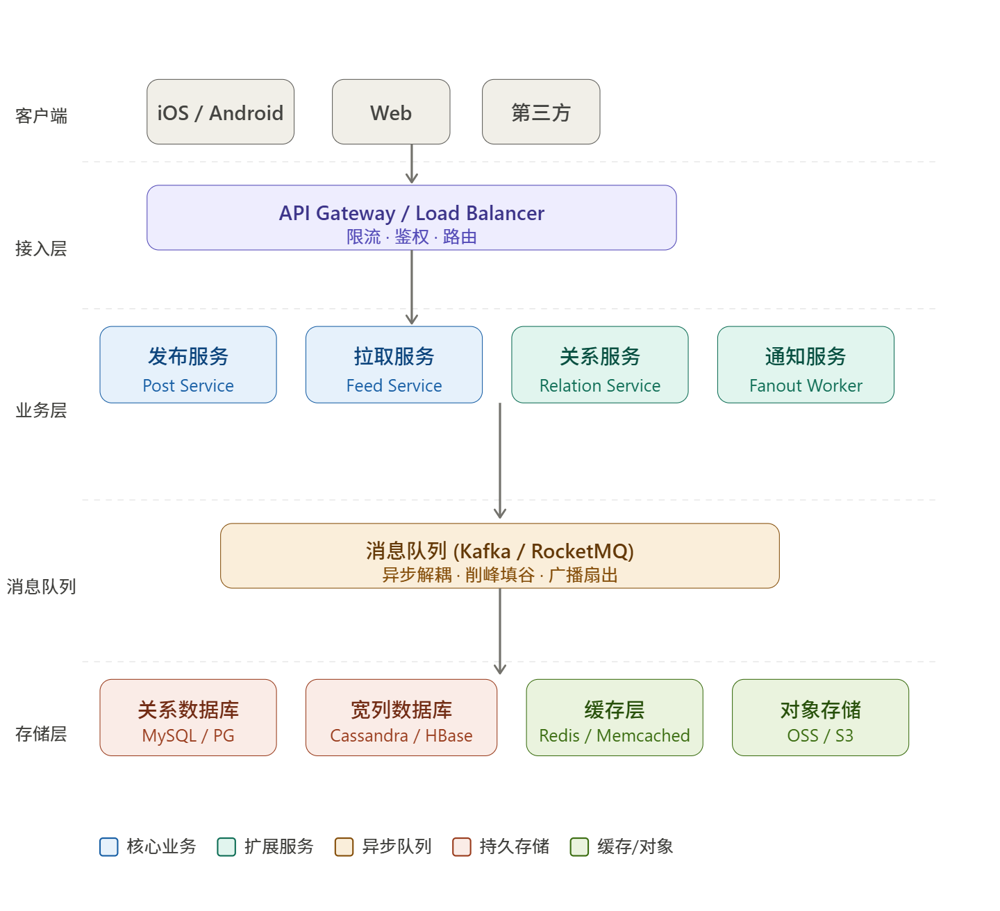
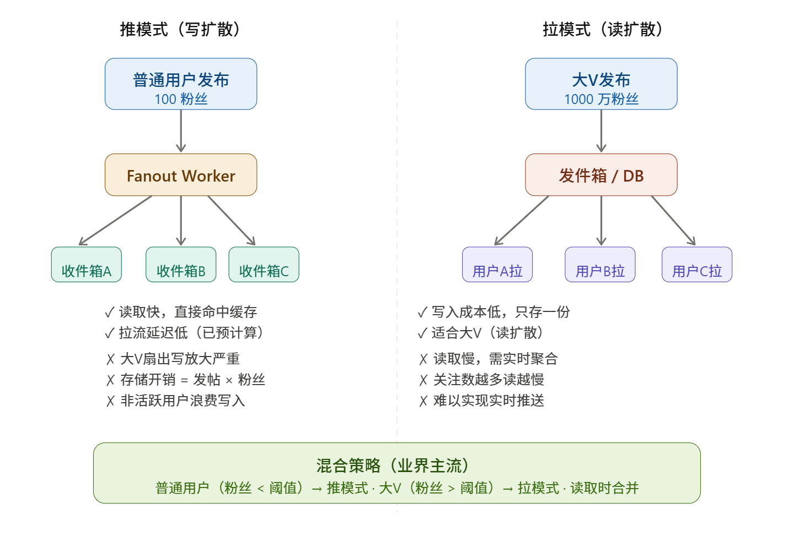
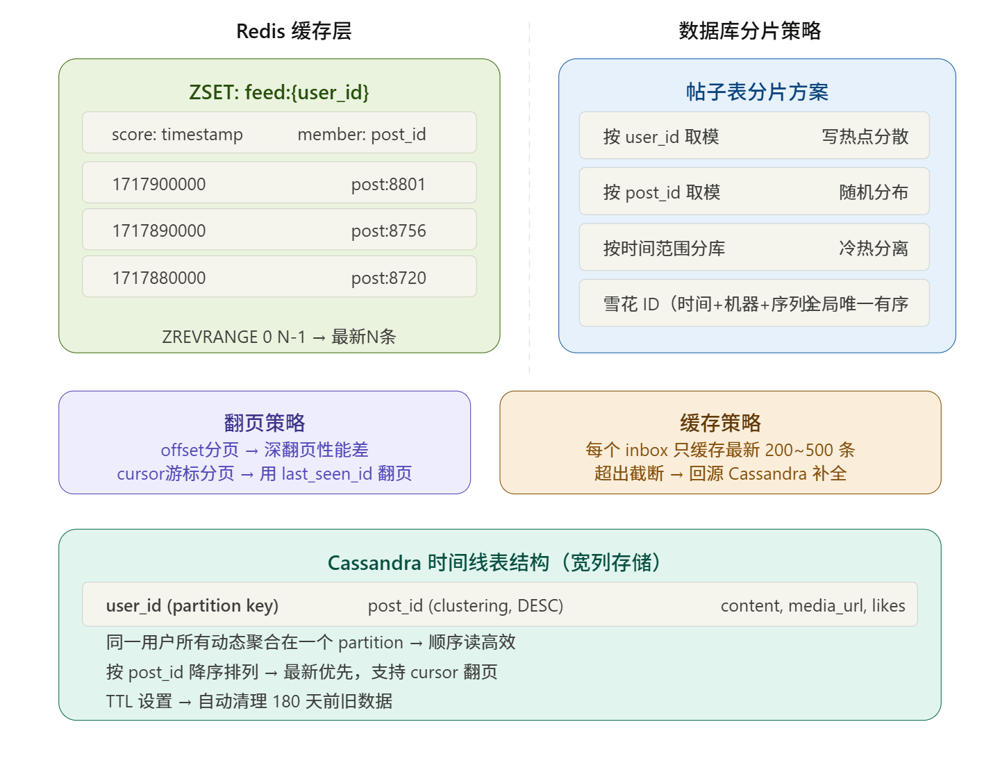
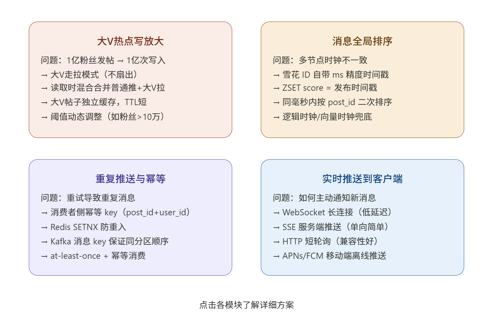
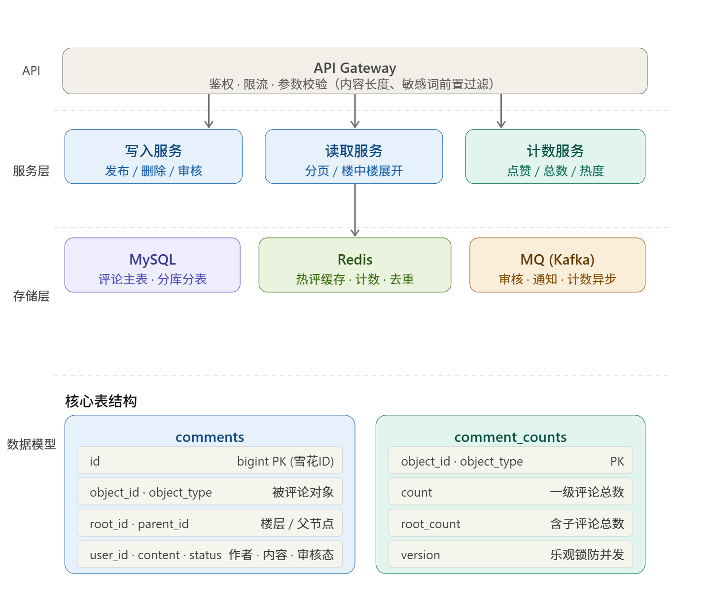
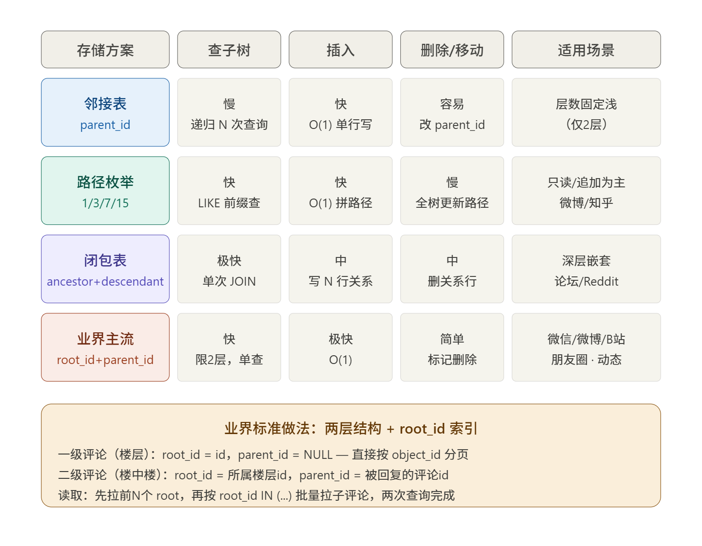
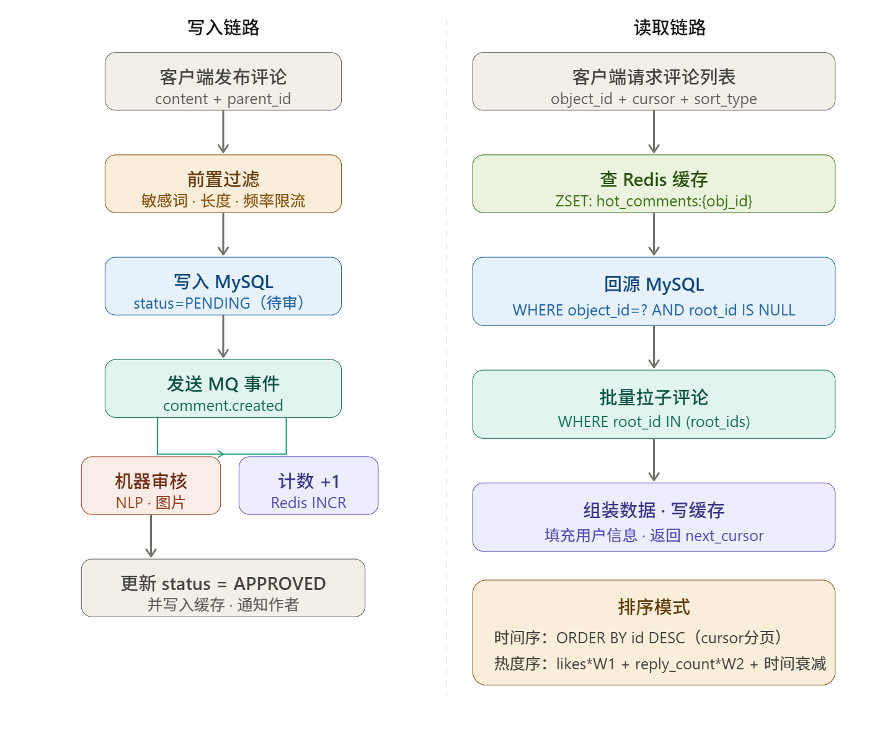
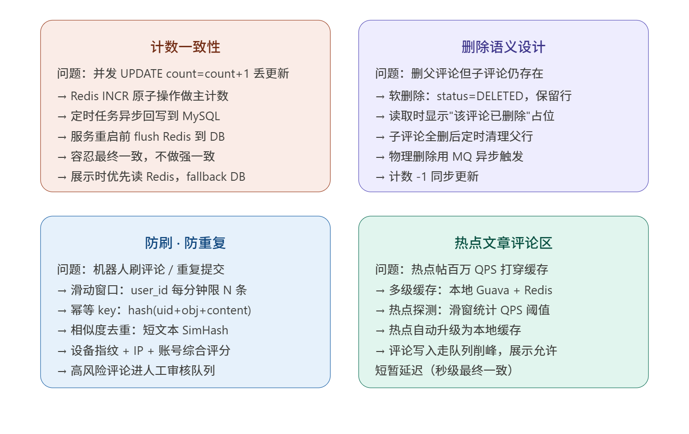
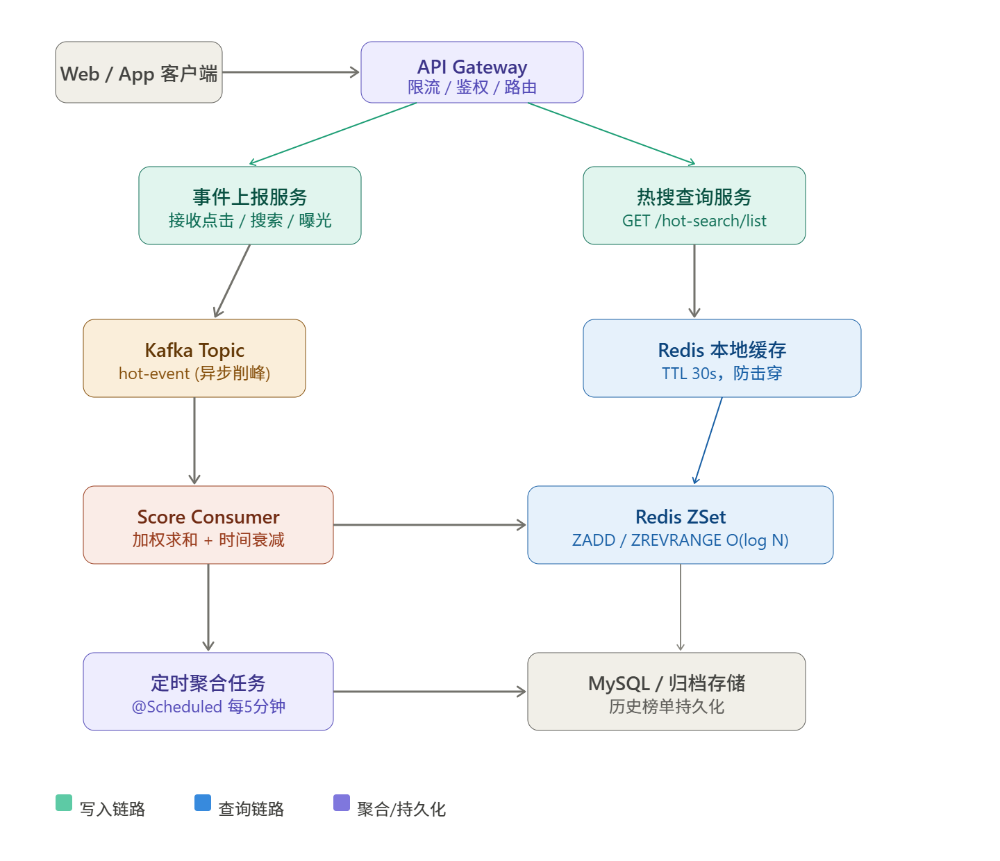

# 分布式系统设计场景全集（65 道大厂高频架构与实战手册）

> **文档说明**：本文档将原分散在 4 份文档中的 **65 道分布式系统设计场景题** 进行全量去重融合与深度扩充，涵盖**电商正向/逆向交易、金融支付与对账、营销互动玩法、社交内容与实时通信、搜索推荐与垂直业务、高并发流量治理与风控、海量数据存储与迁移、微服务高可用容灾、分布式调度与可观测性**九大核心领域。每个系统均配备**容量估算、架构分层图解、核心库表 DDL、Redis/Lua/Java 关键实现、极端故障兜底与 1 分钟满分面试话术**。

---

## 全局速查导航与选型总表

| 领域分类 | 包含核心系统设计场景 | 核心技术底座与架构锚点 |
| :--- | :--- | :--- |
| **一、电商正向与逆向交易** | 秒杀防超卖/防少卖、一人一单、多级库存扣减与锁定、订单系统与超时关单、购物车、**购物退款/售后逆向系统** | CDN 动静分离 + Redis Lua 原子预扣 + RocketMQ 事务/延迟消息 + 状态机防重 + 四大资源逆向回滚 |
| **二、金融支付、钱包与对账** | 支付网关与异步回调、**预付费/余额钱包系统**、**T+0/T+1 三方资金对账与差错平账系统** | 支付单/流水分离 + 乐观锁双余额（可用+冻结）+ 复式记账 + Redis `SINTER/SDIFF` 分桶对账 |
| **三、营销互动玩法** | 优惠券系统、微信抢红包系统、**抽奖/活动概率与保底系统**、**每日签到与补签系统** | 万分制权重区间 + Pity 保底计数器 + 二倍均值动态拆包 + Redis `BitMap` & `BITFIELD` 连续签到 |
| **四、社交内容与实时通信** | **Feed 流系统**、**楼中楼评论与热评系统**、**高并发点赞/点踩系统**、**敏感词过滤（DFA vs AC 自动机）**、IM 与百万长连接、全渠道消息推送 | 推拉结合（写扩散+读扩散）+ 扁平两层 `root_id/parent_id` + 滑动窗口批量聚合 + AC 自动机 `fail` 指针 + Netty 会话级 `seq` |
| **五、搜索、推荐与垂直业务** | 统一搜索 ES、**推荐系统四层漏斗**、**实时热搜排行榜**、短链系统、OSS 秒传/分片上传、**实时天气系统**、**省市区四级区划**、**国际化 i18n** | Canal Binlog 同步 + 召回/粗排/精排/重排 + 时间衰减公式 + Base62 发号 + `pid/path` 地址快照 |
| **六、流量治理、缓存与风控** | 多级缓存架构、热点 Key 探测、分层限流与熔断降级、接口防重与通用幂等、**智能指数退避重试**、**黑白名单与实时反作弊风控** | L1 Caffeine + L2 Redis + Sentinel 滑动窗口/半开探测 + 幂等表本地事务 + Full Jitter 退避 + 规则引擎 |
| **七、数据存储、发号与迁移** | 分布式 ID 与**每日重置定时流水号**、分库分表与读写分离、**冷热数据分离**、**不停机双写数据迁移**、百万级 Excel 导出、慢 SQL 与 **PITR 备份恢复** | 号段双 Buffer + 基因法分片 + 终态归档 ClickHouse + 双写六步迁移 + EasyExcel `SXSSF` 流式导出 + 全量 XtraBackup + Binlog |
| **八、微服务治理与高可用容灾** | API 网关、SSO 单点登录与会话共享、**版本灰度发布**、**服务优雅下线**、**大促全链路压测**、SaaS 多租户隔离、资源隔离、**异地多活单元化**、NTP 时钟同步 | 责任链过滤器 + 双 Token + 全链路染色 + K8s `preStop` 优雅停机 + 影子库/影子表/挡板 + RZone/GZone/CZone 单元化路由 |
| **九、调度、消息与可观测性** | 海量分布式定时任务、MQ 可靠投递与**多级队列削峰**、**SkyWalking 全链路追踪**、ELK 日志平台、实时监控告警、**静态/动态数据脱敏** | XXL-Job 分片广播 + 时间轮 + 本地消息表 + `TraceId/SpanId` 跨线程/MQ 透传 + AST 动态 SQL 改写脱敏 |

---

## 一、 电商交易正向与逆向全链路系统设计

### 1.1 高并发秒杀系统设计（防超卖 / 防少卖 / 一人一单）

#### 1. 业务挑战与容量估算
* **业务场景**：大促整点秒杀（如 100 台茅台、100 万人在 1 秒内同时点击抢购），瞬时读 QPS 高达 **50 万~100 万/s**，写 QPS 高达 **10 万+/s**，但真实有效库存仅百余件。
* **四大核心红线**：
  1. **严禁超卖**：库存扣成负数，导致商家无货可发、重大资损。
  2. **严禁少卖**：库存明明还有剩余，却因并发锁冲突或未释放超时订单导致用户买不到。
  3. **严禁一人多单**：黄牛利用脚本并发刷单，突破“每人限购 N 件”规则。
  4. **严禁拖垮主站**：秒杀热点流量将普通商品浏览、正常下单链路一并打挂。

#### 2. 四层漏斗削峰架构（金字塔流量拦截）

```text
[100万 QPS 客户端] ──► (1) 前端/CDN层：静态资源分离、按钮置灰、答题/滑块验证码（打散脉冲，拦截 70%）
                         │
[30万 QPS 网关层]  ──► (2) Nginx/Gateway：IP限流、UID令牌桶限流、风控黑名单、隐藏动态秒杀path（拦截 20%）
                         │
[5万 QPS 缓存层]   ──► (3) 服务层 + Redis集群：本地售罄标记(AtomicBoolean) + Lua原子预扣库存与一人一单校验（拦截 99.9% 无效写）
                         │
[100 QPS 持久层]   ──► (4) RocketMQ 异步削峰 ──► 订单/库存消费者事务落库（MySQL 乐观锁 `stock >= num` 兜底）
```

#### 3. 核心库表设计（秒杀活动 + 库存流水 + 订单唯一约束）

```sql
-- 1. 秒杀商品库存表
CREATE TABLE seckill_stock (
    id BIGINT PRIMARY KEY AUTO_INCREMENT,
    activity_id BIGINT NOT NULL COMMENT '秒杀活动ID',
    sku_id BIGINT NOT NULL COMMENT '商品SKU_ID',
    total_stock INT NOT NULL COMMENT '活动总库存',
    available_stock INT NOT NULL COMMENT '当前可用库存',
    locked_stock INT NOT NULL DEFAULT 0 COMMENT '已锁定未支付库存',
    sold_stock INT NOT NULL DEFAULT 0 COMMENT '已支付售出库存',
    limit_per_user INT NOT NULL DEFAULT 1 COMMENT '每人限购数量',
    version INT NOT NULL DEFAULT 0 COMMENT '乐观锁版本号',
    UNIQUE KEY uk_act_sku (activity_id, sku_id)
) ENGINE=InnoDB DEFAULT CHARSET=utf8mb4;

-- 2. 库存扣减幂等流水表（防少卖/回滚依据）
CREATE TABLE seckill_stock_log (
    order_no VARCHAR(64) PRIMARY KEY COMMENT '订单号（全局唯一幂等键）',
    activity_id BIGINT NOT NULL,
    sku_id BIGINT NOT NULL,
    user_id BIGINT NOT NULL,
    count INT NOT NULL COMMENT '扣减数量',
    status TINYINT NOT NULL COMMENT '1-已预扣/锁定 2-已确认支付 3-已回滚释放',
    create_time DATETIME NOT NULL DEFAULT CURRENT_TIMESTAMP,
    update_time DATETIME NOT NULL DEFAULT CURRENT_TIMESTAMP ON UPDATE CURRENT_TIMESTAMP,
    UNIQUE KEY uk_act_sku_user (activity_id, sku_id, user_id) -- 物理兜底：一人一单唯一索引
) ENGINE=InnoDB DEFAULT CHARSET=utf8mb4;
```

#### 4. Redis + Lua 原子预扣与一人一单实现
> **为什么必须用 Lua？** 如果在 Java 代码里先 `GET` 库存判断大于 0、再 `SISMEMBER` 判断用户是否买过、最后 `DECR` 扣减，这三步非原子，高并发下 100 个线程同时读到余量 1，瞬间超卖 99 件。

```lua
-- KEYS[1]: seckill:stock:{actId}:{skuId}  (String: 剩余库存)
-- KEYS[2]: seckill:users:{actId}:{skuId}  (Hash: field=userId, value=已购数量)
-- ARGV[1]: userId
-- ARGV[2]: buyNum (本次购买数量)
-- ARGV[3]: limitPerUser (每人限购上限)

local stock = tonumber(redis.call('GET', KEYS[1]))
local buyNum = tonumber(ARGV[2])
local limit = tonumber(ARGV[3])

-- 1. 校验库存是否初始化及是否充足
if not stock or stock < buyNum then
    return -1 -- 库存不足
end

-- 2. 校验一人一单 / 限购数量
local bought = tonumber(redis.call('HGET', KEYS[2], ARGV[1]) or '0')
if bought + buyNum > limit then
    return -2 -- 超过每人限购数量
end

-- 3. 原子扣减库存并累加用户购买计数
redis.call('DECRBY', KEYS[1], buyNum)
redis.call('HINCRBY', KEYS[2], ARGV[1], buyNum)
return 1 -- 预扣成功
```

#### 5. 防超卖 vs 防少卖 vs 热点 Key 分桶治理
* **三重防超卖防线**：
  1. **Redis Lua 原子扣减**：保证缓存层库存绝不扣成负数。
  2. **数据库乐观锁兜底**：`UPDATE seckill_stock SET available_stock = available_stock - #{num}, locked_stock = locked_stock + #{num} WHERE activity_id = #{actId} AND sku_id = #{skuId} AND available_stock >= #{num}`（利用 InnoDB 行锁与 `>=` 差值校验）。
  3. **唯一索引防重复下单**：`uk_act_sku_user(activity_id, sku_id, user_id)` 防止同一用户并发穿透。
* **三大防少卖补偿机制**（Redis 扣了但订单没生成，导致库存“人间蒸发”）：
  1. **RocketMQ 事务消息**：将“Redis 预扣成功”包装在半消息（Half Message）的 `executeLocalTransaction` 中，若 Redis 预扣成功但本地标记异常，Broker 回查后自动回滚 Redis 库存。
  2. **消费失败达到上限自动回补**：MQ 消费者落库失败重试 N 次进入死信队列后，根据 `seckill_stock_log` 状态判断若DB未落库，则执行 Lua 逆向脚本（`INCRBY` 库存 + `HINCRBY -buyNum` 用户计数）。
  3. **超时未支付自动回补**：订单创建时投递 15 分钟延迟消息，到期未支付则关闭订单并同步回补 DB 与 Redis 库存，同时**清除 JVM 本地售罄标记 `localSoldOutMap.put(skuId, false)`**，让后续用户能继续抢购回流库存。
* **单 SKU 百万 QPS 热点 Key 拆分（库存分桶）**：
  将 1000 件库存拆分为 10 个子 Key（`seckill:stock:1001:0` ~ `seckill:stock:1001:9`，每个 100 件），通过 HashTag `{bucket_0}` 打散到 10 个 Redis 主分片；用户请求按 `userId % 10` 路由到对应分桶，当当前分桶售罄时按环形链表尝试相邻最多 2 个分桶，写吞吐量直接提升 10 倍。

---

### 1.2 多级库存模型与库存锁定/扣减/释放设计

#### 1. 实物库存 vs 可售库存 vs 预占库存三层模型
电商库存绝不是单一数字，必须拆分为三层：
* **实物库存（Physical Stock）**：仓库 WMS 实际盘点的物理货品数量，仅在采购入库、发货出库、退货验收入库时变动。
* **可售库存（Available Stock）**：前端展示可购买的库存，`可售库存 = 实物库存 - 锁定库存 - 残次/活动预留库存`。
* **锁定/预占库存（Locked Stock）**：用户下单成功但尚未支付（或已支付尚未发货出库）占用的库存。

#### 2. 下单锁库存 vs 付款扣库存对比

| 扣减时机 | 核心流程 | 优点 | 缺点与恶意占库风险 | 适用场景 |
| :--- | :--- | :--- | :--- | :--- |
| **下单锁库存（主流）** | 下单时 `available - 1, locked + 1`；支付成功 `locked - 1, sold + 1`；超时取消 `locked - 1, available + 1` | 只要下完单去付款，100% 有货，不会出现“付了钱却没货退款”的极差体验 | 竞争对手可注册大批小号**只下单不付款**，将库存全部锁死 15 分钟（恶意占库） | 95% 普通电商交易、数码家电、服饰 |
| **付款扣库存** | 下单只创单不锁库存；支付成功回调时才真正扣减库存 | 彻底杜绝恶意下单占库 | 并发付款时极易出现**超付**（100 人下单，80 人付款，但只有 50 件货，30 人付款后被迫退款） | 极低库存虚拟商品、特价引流品 |
| **预扣缓存 + 极短锁定期** | 下单在 Redis 预扣并锁库，未付款关单时间缩短至 **3~5 分钟**，配合风控拦截高频不付款账号 | 兼顾用户体验与防占库 | 需配套准实时超时关单体系 | 大促秒杀、限量潮鞋抢购 |

---

### 1.3 订单系统架构、五表模型与超时自动关单设计

#### 1. 订单核心五表模型（正向 + 逆向支撑）

```sql
-- 1. 订单主表（按 user_id 基因法分库分表）
CREATE TABLE order_main (
    id BIGINT PRIMARY KEY,
    order_no VARCHAR(64) NOT NULL UNIQUE COMMENT '全局唯一订单号（嵌入user_id后4位基因）',
    user_id BIGINT NOT NULL COMMENT '买家ID',
    total_amount BIGINT NOT NULL COMMENT '订单商品总金额（分）',
    discount_amount BIGINT NOT NULL DEFAULT 0 COMMENT '优惠总金额（分）',
    freight_amount BIGINT NOT NULL DEFAULT 0 COMMENT '运费金额（分）',
    pay_amount BIGINT NOT NULL COMMENT '实付金额（分）',
    refunded_amount BIGINT NOT NULL DEFAULT 0 COMMENT '累计已退款金额（分，防超退核心）',
    order_status TINYINT NOT NULL COMMENT '10-待付款 20-已付款待发货 30-已发货 40-已完成 50-已取消/关闭',
    refund_status TINYINT NOT NULL DEFAULT 0 COMMENT '0-无退款 1-售后处理中 2-部分退款 3-全部退款',
    address_snapshot JSON NOT NULL COMMENT '收货地址中文全量快照（防行政区划变更或用户改地址）',
    expire_time DATETIME NOT NULL COMMENT '支付截止时间',
    create_time DATETIME NOT NULL DEFAULT CURRENT_TIMESTAMP,
    INDEX idx_user_status_time (user_id, order_status, create_time)
) ENGINE=InnoDB DEFAULT CHARSET=utf8mb4;

-- 2. 订单商品明细表（快照表：固化下单瞬间的标题、主图、成交单价、分摊优惠）
CREATE TABLE order_item (
    id BIGINT PRIMARY KEY,
    order_no VARCHAR(64) NOT NULL,
    sku_id BIGINT NOT NULL,
    sku_name VARCHAR(255) NOT NULL COMMENT '商品名称快照',
    sku_pic VARCHAR(512) NOT NULL COMMENT '商品主图快照',
    sale_price BIGINT NOT NULL COMMENT '下单时销售单价（分）',
    quantity INT NOT NULL COMMENT '购买数量',
    real_pay_amount BIGINT NOT NULL COMMENT '分摊优惠后实付小计（分，用于部分退款计算）',
    refund_status TINYINT NOT NULL DEFAULT 0 COMMENT '当前明细售后状态',
    INDEX idx_order_no (order_no)
) ENGINE=InnoDB DEFAULT CHARSET=utf8mb4;
```
> 其余三张配套表：`order_operate_log`（订单状态机变更审计流水）、`order_payment_rel`（订单与支付单关联表）、`order_delivery`（物流履约包裹表，支持一单拆多包裹发货）。

#### 2. 订单超时自动关单 4 种方案深度对比

| 方案 | 实现原理 | 精度 | 可靠性 | 适用规模与评价 |
| :--- | :--- | :---: | :---: | :--- |
| **1. RocketMQ 延迟消息 + XXL-Job 兜底** | 下单投递延迟消息（4.x 固定等级 / 5.x 基于 TimerWheel 任意毫秒），到期消费关单；定时任务每 5 分钟捞取漏单 | 秒级 | ⭐⭐⭐⭐⭐ | **工业界大厂首选**，高吞吐、天然支持集群分片与持久化 |
| **2. Redisson `RDelayedQueue`** | 基于 Redis `ZSet`（`score=到期时间戳`）+ `List` 就绪队列 + Pub/Sub 唤醒 | 秒级 | ⭐⭐⭐⭐ | **中大型项目常用**，无 MQ 重型依赖，需开启 AOF 防丢 |
| **3. RabbitMQ `DLX` / `x-delayed-message`** | TTL 过期转死信队列，或使用延迟交换机插件 | 秒级 | ⭐⭐⭐⭐ | 原生队头阻塞（长 TTL 堵住短 TTL），插件单节点百万级消息内存受限 |
| **4. Netty `HashedWheelTimer` / Redis 过期监听** | JVM 内存时间轮 / Redis `notify-keyspace-events Ex` | 秒级 | ⭐ | **严禁单独用于订单关单**：内存重启即丢；Redis Pub/Sub 无持久化且惰性删除导致严重延迟 |

#### 3. 关单与支付回调并发竞态（防“钱付了单却关了”）
* **场景**：第 15:00.000 秒，超时关单消费者和微信支付回调线程同时到达！
* **解法**：
  1. **同一把分布式锁互斥**：两者均以 `lock:order:state:{orderNo}` 加锁。
  2. **数据库状态机条件更新**：关单 SQL 强制带上 `WHERE order_no = #{orderNo} AND order_status = 10 (待支付)`。
  3. **支付成功遇到已关单自动触发退款**：若关单线程先抢到锁将订单置为 `50-已关闭` 并释放了库存，随后到达的支付回调发现影响行数为 0 且订单状态为 `50-已关闭`，**绝不能强行改回已支付**（因为库存已被别人买走），而是立即写入异常支付表并异步触发微信/支付宝**原路全额退款**，同时发短信告知用户“由于支付超时订单已关闭，款项已原路退回”。

---

### 1.4 购物车系统设计（未登录临时车 + 登录合并 + 动态计价）

#### 1. 核心存储与读写架构
* **双端存储模型**：
  * **未登录状态（离线购物车）**：存储在客户端本地 `LocalStorage`（Web）或 SQLite（App），或以服务端生成的临时 `temp_uuid` 为 Key 存入 Redis（`cart:temp:{temp_uuid}`，TTL 30 天）。
  * **已登录状态（在线购物车）**：**Redis Hash（主存） + MySQL（异步持久化备份）**。
    * Redis Key：`cart:user:{userId}`
    * Hash Field：`{skuId}`
    * Hash Value：`{"quantity": 2, "checked": 1, "addPrice": 19900, "addTime": 1710000000}`（**注意：严禁在购物车缓存里写死商品标题、实时价格、库存或满减规则！**）
* **登录购物车合并策略**：
  用户登录瞬间，前端将本地临时购物车列表提交给后端合并接口：同 `skuId` 数量累加（受单品最大加购数如 99 件及购物车总上限 120 种商品限制），合并后清空临时购物车并异步通过 MQ 落库 MySQL。
* **读链路（打开购物车实时聚合与降级）**：
  1. `HGETALL cart:user:{userId}` 拿到所有 `skuId` 及加购数量、当时加购价 `addPrice`。
  2. 批量并行 RPC 调用：
     * **商品服务**：获取最新上下架状态、主图、标题、实时售价（对比 `addPrice` 自动计算出**“比加入时降价 XX 元”**标签）。
     * **库存服务**：获取实时可售状态（无货商品自动沉底置灰，不可勾选结算）。
     * **营销计价引擎**：对勾选（`checked=1`）的商品试算跨店满减、店铺优惠券最优组合。
  3. **极端降级**：若大促期间营销计价服务超时，Sentinel 触发降级，购物车页面仅展示商品基础单价小计，并在顶部提示“具体优惠金额以结算页为准”，保障主链路可用。

---

### 1.5 购物退款与售后逆向流程系统设计（未发货/退货/部分退款 + 四大资源回滚）

#### 1. 四种退款类型与核心难点
1. **未发货全额退款**：已付款但仓库尚未打单出库，用户申请退款 $\rightarrow$ 拦截 WMS 发货单、自动审核通过、全额原路退款、释放库存、退回优惠券与积分。
2. **已发货仅退款**：生鲜破损/少发漏发，无需寄回商品 $\rightarrow$ 商家审核同意后直接退款（**不回补库存**）。
3. **已发货退货退款**：用户寄回商品并填写物流单号 $\rightarrow$ 商家/仓库**签收验货无误后**才触发原路退款并回补实物库存（**严禁未验货直接回补库存，防空包诈骗**）。
4. **部分退款（最复杂）**：一笔订单买了 3 件商品（用了满 300 减 50 优惠券），用户只退其中 1 件 $\rightarrow$ 需按**实付分摊金额**退款、仅回补该 SKU 库存、**优惠券不退回**、订单状态流转为“部分退款”，其余商品正常履约。

#### 2. 售后逆向核心库表设计

```sql
-- 1. 售后退款主表（一次退款申请生成一条售后单，支持一笔订单多次部分退款）
CREATE TABLE order_refund (
    id BIGINT PRIMARY KEY,
    refund_no VARCHAR(64) NOT NULL UNIQUE COMMENT '售后退款单号（全局唯一幂等键）',
    order_no VARCHAR(64) NOT NULL COMMENT '关联原正向订单号',
    user_id BIGINT NOT NULL,
    refund_type TINYINT NOT NULL COMMENT '1-未发货全额退 2-已发货仅退款 3-退货退款',
    refund_amount BIGINT NOT NULL COMMENT '本次申请退款总金额（分）',
    goods_refund_amount BIGINT NOT NULL COMMENT '退商品实付金额（分）',
    freight_refund_amount BIGINT NOT NULL DEFAULT 0 COMMENT '退运费金额（分）',
    refund_status TINYINT NOT NULL COMMENT '10-待审核 20-待买家退货 30-待商家验货 40-退款处理中 50-退款成功 60-已拒绝/关闭',
    return_logistics_no VARCHAR(64) DEFAULT NULL COMMENT '退货物流单号',
    create_time DATETIME NOT NULL DEFAULT CURRENT_TIMESTAMP,
    complete_time DATETIME DEFAULT NULL,
    INDEX idx_order_no (order_no)
) ENGINE=InnoDB DEFAULT CHARSET=utf8mb4;

-- 2. 售后退款商品明细表（精准支撑部分退款）
CREATE TABLE order_refund_item (
    id BIGINT PRIMARY KEY,
    refund_no VARCHAR(64) NOT NULL,
    order_item_id BIGINT NOT NULL COMMENT '原订单明细行ID',
    sku_id BIGINT NOT NULL,
    refund_quantity INT NOT NULL COMMENT '本次退货数量',
    refund_amount BIGINT NOT NULL COMMENT '该SKU本次应退分摊实付金额（分）',
    UNIQUE KEY uk_refund_item (refund_no, order_item_id)
) ENGINE=InnoDB DEFAULT CHARSET=utf8mb4;
```

#### 3. 部分退款分摊金额计算与防超退公式（防资损核心）
* **下单时优惠分摊（最大余额法兜底）**：
  假设订单买 A（100 元）、B（100 元）、C（100 元），总额 300 元，使用满 300 减 50 元券，实付 250 元：
  * 前 `N-1` 件按比例向下取整：$\text{A 实付} = \lfloor 250 \times \frac{100}{300} \rfloor = 83.33 \text{ 元}$；$\text{B 实付} = 83.33 \text{ 元}$。
  * **最后一件用减法兜底（防除不尽少退或多退 1 分钱）**：$\text{C 实付} = 250 - 83.33 - 83.33 = 83.34 \text{ 元}$。
* **防超额退款数据库强校验 SQL**：
  每次发起退款时，必须通过数据库原子条件更新校验累计退款金额绝不超过订单实付总额：
  ```sql
  UPDATE order_main
  SET refunded_amount = refunded_amount + #{currentRefundAmount},
      refund_status = CASE WHEN refunded_amount + #{currentRefundAmount} = pay_amount THEN 3 ELSE 2 END
  WHERE order_no = #{orderNo}
    AND refunded_amount + #{currentRefundAmount} <= pay_amount;
  ```

#### 4. 四大资源逆向回滚规则表

| 资源类型 | 未发货全额退款 | 部分退款 | 退货退款（已发货） |
| :--- | :--- | :--- | :--- |
| **1. 库存回滚** | 立即释放锁定库存（`locked - N, available + N`） | 仅按退货数量回补对应 SKU 库存 | **必须等仓库签收验货通过后**才回补实物与可售库存 |
| **2. 优惠券回滚** | 若券仍在有效期内则退回（状态改回 `0-未使用`）；已过期则作废不退 | **不退回优惠券**（行业铁律，防拆单薅羊毛） | 整单全退且券未过期才退回，否则不退 |
| **3. 积分/赠品** | 原路返还抵扣积分，扣回下单赠送积分 | 按比例返还抵扣积分 | 实物赠品须一并寄回，否则从退款金额中扣除赠品折算价 |
| **4. 资金退回** | 按原支付渠道（微信/支付宝/余额）以 `refund_no` 幂等原路退回 | 按分摊实付金额原路退回 | 验货通过后触发支付网关异步原路退款 |

> **1 分钟面试高分话术**：
> “电商逆向售后系统的核心是**双向状态机闭环、四大资源精准回滚与严防超退资损**。我们支持未发货全额退、仅退款、退货退款和部分退款四种模式。在下单阶段，我们就在 `order_item` 表通过比例分摊+尾差减法算好每个 SKU 的真实实付金额。发起退款时生成全局唯一的 `refund_no` 做全链路幂等，并通过 `WHERE refunded_amount + current <= pay_amount` 强校验锁死超额退款风险。逆向回滚采用 RocketMQ 可靠消息最终一致性：未发货退款直接拦截 WMS 并释放冻结库存、退回未过期优惠券；退货退款严格要求仓库签收验货通过后才回补库存；部分退款只退对应 SKU 的分摊实付金与库存，绝不退回优惠券以防恶意凑单薅羊毛。”

---

## 二、 金融支付、预付费钱包与资金对账系统设计

### 2.1 支付系统设计（多渠道路由 / 状态机 / 异步回调幂等）

#### 1. 整体四层架构与核心三表分离
* **架构分层**：支付接入层（防重、风控、统一下单） $\rightarrow$ 支付核心层（支付单状态机、资金流水、本地事务消息） $\rightarrow$ 渠道适配层（防腐层屏蔽微信/支付宝/银联报文差异，支持动态权重切换） $\rightarrow$ 异步补偿层（主动轮询查单、超时关单、日终对账）。
* **核心三表**：
  1. `payment_order`（支付主单表）：`pay_no`（支付流水号 PK）、`order_no`（商户订单号 **`UNIQUE` 唯一索引**，防一单多付）、`pay_amount`、`channel`、`pay_status`（`10-待支付`、`20-支付成功`、`30-已关闭`、`40-已退款`）。
  2. `payment_log`（渠道交互与资金流水表）：**只追加写入（Append-Only），严禁 UPDATE/DELETE**。
  3. `payment_refund`（支付渠道退款单表）：以 `refund_no` 为唯一键对接三方退款 API。

#### 2. 第三方支付异步回调五步防重与防伪造闭环
1. **验签与金额强校验**：使用微信/支付宝公钥验证签名（防黑客伪造回调报文），并校验回调报文中的 `total_amount` 与 `payment_order.pay_amount` **分毫不差**。
2. **分布式锁拦截并发回调**：`RLock lock = redisson.getLock("lock:pay:cb:" + orderNo)`。
3. **状态机幂等推进**：
   ```sql
   UPDATE payment_order
   SET pay_status = 20, channel_trade_no = #{tradeNo}, pay_time = NOW()
   WHERE order_no = #{orderNo} AND pay_status = 10;
   ```
   若影响行数为 0，查询当前状态：若已是 `20-支付成功`，直接向第三方返回 `"SUCCESS"` 停止重试；若是 `30-已关闭`（掉单/超时后支付），立即写入异常挂账表并自动发起原路退款。
4. **本地消息表投递履约事件**：在同一个数据库事务中写入 `payment_log` 和 `mq_outbox_message`，通知订单服务发货、通知积分服务加积分。
5. **主动查单兜底（防回调丢包）**：用户付完钱跳转结果页若发现仍是“待支付”，或后台定时任务发现创建满 3 分钟仍未回调的支付单，主动调用微信/支付宝 `queryOrder` 接口同步真实状态。

---

### 2.2 预付费 / 余额钱包系统设计（双余额模型 + 乐观锁 + 复式记账）

> **对应原 #61 题深度扩充**：储值卡、账户余额充值、消费扣款、提现冻结、转账，要求金融级强一致，零超扣、零错账。

#### 1. 为什么账户表必须设计“可用余额 + 冻结余额”双字段？
在提现、下单预授权或活动锁定资金时，如果直接扣减余额，一旦后续驳回还要加回去，账目极易混乱；如果不扣减，用户又可以把同一笔钱重复提现。因此工业界标准做法是**双余额模型（`available_balance` + `frozen_balance`）**：
* **发起提现 / 预授权冻结**：`available_balance - amount, frozen_balance + amount`（总资产不变，可用减少）。
* **提现打款成功 / 确认扣款**：`frozen_balance - amount`（冻结清零，真实出账）。
* **提现驳回 / 订单取消解冻**：`frozen_balance - amount, available_balance + amount`（原路解冻回可用）。

#### 2. 钱包核心库表设计（账户表 + 会计复式流水表）

```sql
-- 1. 用户钱包账户表
CREATE TABLE wallet_account (
    account_id BIGINT PRIMARY KEY COMMENT '账户ID',
    user_id BIGINT NOT NULL UNIQUE COMMENT '用户ID',
    available_balance BIGINT NOT NULL DEFAULT 0 COMMENT '可用余额（单位：分，严禁为负）',
    frozen_balance BIGINT NOT NULL DEFAULT 0 COMMENT '冻结余额（单位：分，严禁为负）',
    security_digest VARCHAR(128) NOT NULL COMMENT '防篡改HMAC签名: sha256(uid+avail+frozen+version+salt)',
    account_status TINYINT NOT NULL DEFAULT 1 COMMENT '1-正常 2-风控止付(只进不出) 3-冻结',
    version BIGINT NOT NULL DEFAULT 0 COMMENT '乐观锁版本号',
    update_time DATETIME NOT NULL DEFAULT CURRENT_TIMESTAMP ON UPDATE CURRENT_TIMESTAMP
) ENGINE=InnoDB DEFAULT CHARSET=utf8mb4;

-- 2. 钱包资金变动明细流水表（不可篡改，每笔变动记录变动前后快照）
CREATE TABLE wallet_journal (
    id BIGINT PRIMARY KEY AUTO_INCREMENT,
    journal_no VARCHAR(64) NOT NULL UNIQUE COMMENT '账务流水号',
    biz_no VARCHAR(64) NOT NULL COMMENT '外部业务单号（订单号/充值单号）',
    biz_type TINYINT NOT NULL COMMENT '1-充值 2-消费扣款 3-退款入账 4-提现冻结 5-提现成功 6-提现解冻',
    account_id BIGINT NOT NULL,
    direction TINYINT NOT NULL COMMENT '1-收入/贷(Credit) 2-支出/借(Debit)',
    change_amount BIGINT NOT NULL COMMENT '变动金额（分，恒为正整数）',
    balance_before BIGINT NOT NULL COMMENT '变动前可用余额快照（分）',
    balance_after BIGINT NOT NULL COMMENT '变动后可用余额快照（分）',
    create_time DATETIME NOT NULL DEFAULT CURRENT_TIMESTAMP,
    UNIQUE KEY uk_biz_type_dir (biz_no, biz_type, direction), -- 账务幂等铁律
    INDEX idx_account_time (account_id, create_time)
) ENGINE=InnoDB DEFAULT CHARSET=utf8mb4;
```

#### 3. 扣款/转账事务与防并发超扣实现
* **单账户消费扣款（本地事务 + 乐观锁差值校验）**：
  1. 先插入 `wallet_journal`（利用 `uk_biz_type_dir` 唯一索引拦截重复扣款请求）。
  2. 执行带余额下限与版本号的原子更新：
     ```sql
     UPDATE wallet_account
     SET available_balance = available_balance - #{amount},
         version = version + 1,
         security_digest = #{newDigest}
     WHERE account_id = #{accountId}
       AND available_balance >= #{amount}
       AND version = #{oldVersion}
       AND account_status = 1;
     ```
* **跨账户转账（防死锁设计）**：
  用户 A 转账给用户 B 时，若线程 1 锁 A 再锁 B，线程 2 锁 B 再锁 A 会发生死锁。**破局法则：严格按 `account_id` 从小到大排序加锁（固定加锁顺序）**，并在每一笔转账中同时生成两条会计分录（A 账户借记支出 `-100`，B 账户贷记收入 `+100`，借贷必相等）。
* **大商家的热点账户并发入账优化（缓冲记账 / 影子子账户）**：
  爆款商家每秒上千笔订单入账，单行 `wallet_account` 行锁成为瓶颈。解法：**收支分离 / 汇总入账**——高频入账先写入明细流水表或拆分为 16 个子账户（`sub_account_00 ~ 15`），每分钟异步汇总合并入主账户；只有提现/扣款才操作主账户。

---

### 2.3 T+0 实时核对与 T+1 三方资金对账系统设计

> **对应原 #36 题深度扩充**：每日百万~千万级支付流水，如何与微信/支付宝/银行渠道账单进行精准核对与差错平账？

#### 1. 四大差错类型定义
以**内部支付流水表（平台账）**与**三方渠道下载账单（渠道账）**进行双向比对，必然出现以下 4 类不平账：
1. **长款（渠道多、平台少 / 渠道成功、平台待支付）**：用户实际上在微信付了钱，但微信回调因网络抖动丢失，平台订单仍显示“待支付”或“已关闭”。（**用户投诉最强烈**）
2. **短款（平台多、渠道少 / 平台成功、渠道未支付）**：因代码 Bug 或伪造回调，平台把订单改成了“已支付”并把货发了，但微信账单里根本没收到这笔钱！（**直接资损，P0 级事故**）
3. **金额不一致**：同一笔单号，平台记录实付 100 元，渠道账单记录实收 10 元。
4. **日切跨天差异（假不平账）**：用户在 `23:59:59` 付款，微信记在 `T` 日账单，平台收到回调时已是 `T+1` 日 `00:00:01`。

#### 2. T+1 分布式海量对账五步流水线架构

```text
[1. 账单拉取与标准化] 每日凌晨 09:00 定时拉取微信/支付宝 CSV 对账单 ──► 解析转换为统一标准格式落入 channel_bill 表
         │
[2. 按订单号哈希分桶] 将当日平台流水与渠道账单按 crc32(order_no) % 64 拆分为 64 个分片桶（每桶约 10万条）
         │
[3. Redis Set 快速消融]
    - key1 (local:bucket:i)   存入：`orderNo_amount_status`
    - key2 (channel:bucket:i) 存入：`orderNo_amount_status`
    - SINTER (交集)：99.99% 完全一致的订单直接标记“已平账”
    - SDIFF key1 key2 + SDIFF key2 key1：毫秒级筛出所有差错候选集！
         │
[4. 日切缓冲池过滤] 将差错单与昨日遗留缓冲池、今日 00:00~00:15 窗口流水二次比对，自动剔除“跨零点日切假差错”
         │
[5. 差错定性与平账] 写入 recon_diff_record 差错表 ──► 自动补单/退单 或 触发财务人工审批工单
```

#### 3. 差错自动平账策略
* **长款（渠道已收钱，平台未支付）**：若原订单尚未超时关闭，自动触发**补单流程**（推进状态为已支付并通知履约）；若原订单已超时关闭且库存已释放，自动调用渠道接口发起**全额原路退款**。
* **短款（平台显示已付，渠道没钱）**：**严禁自动抹平**！立即触发最高级别电话告警，冻结关联用户账户与未出库包裹，交由安全与财务团队排查原因。

---

## 三、 营销互动玩法系统设计（优惠券、红包、抽奖概率、签到补签）

### 3.1 优惠券系统设计（批次模板 / 高并发抢券 / 核销乐观锁 / 退券）

#### 1. 核心库表设计（模板批次表与用户领券表分离）

```sql
-- 1. 优惠券批次规则表（模板）
CREATE TABLE coupon_batch (
    id BIGINT PRIMARY KEY,
    batch_no VARCHAR(64) NOT NULL UNIQUE COMMENT '券批次号',
    coupon_name VARCHAR(128) NOT NULL,
    coupon_type TINYINT NOT NULL COMMENT '1-满减券 2-无门槛立减 3-折扣券',
    denomination BIGINT NOT NULL COMMENT '面额（分；折扣券如85代表8.5折）',
    min_spend BIGINT NOT NULL DEFAULT 0 COMMENT '使用门槛金额（分）',
    total_count INT NOT NULL COMMENT '总发行量',
    receive_count INT NOT NULL DEFAULT 0 COMMENT '已领取数量',
    used_count INT NOT NULL DEFAULT 0 COMMENT '已核销数量',
    user_limit INT NOT NULL DEFAULT 1 COMMENT '每人限领张数',
    valid_type TINYINT NOT NULL COMMENT '1-固定起止时间 2-领券后N天内有效',
    valid_start DATETIME,
    valid_end DATETIME,
    valid_days INT
) ENGINE=InnoDB DEFAULT CHARSET=utf8mb4;

-- 2. 用户券表（按 user_id 分片，支撑“我的优惠券”高频查询）
CREATE TABLE user_coupon (
    id BIGINT PRIMARY KEY,
    coupon_id VARCHAR(64) NOT NULL UNIQUE COMMENT '单张券唯一ID',
    batch_no VARCHAR(64) NOT NULL,
    user_id BIGINT NOT NULL,
    status TINYINT NOT NULL DEFAULT 0 COMMENT '0-未使用 1-已锁定/核销 2-已过期 3-已作废',
    order_no VARCHAR(64) DEFAULT NULL COMMENT '核销绑定的订单号',
    valid_start DATETIME NOT NULL,
    valid_end DATETIME NOT NULL,
    receive_time DATETIME NOT NULL DEFAULT CURRENT_TIMESTAMP,
    use_time DATETIME DEFAULT NULL,
    INDEX idx_uid_status_end (user_id, status, valid_end)
) ENGINE=InnoDB DEFAULT CHARSET=utf8mb4;
```

#### 2. 抢券、核销、退券与过期四大核心链路
1. **高并发抢券（防超发与防超领）**：
   * Redis Key：`coupon:stock:{batchNo}`（剩余库存）、`coupon:user:{batchNo}:{uid}`（该用户已领张数）。
   * Lua 脚本原子校验库存 `> 0` 且用户已领数 `< user_limit`，原子执行 `DECR` 与 `INCR` 后发送 MQ 异步落库 `user_coupon`。
2. **下单核销（强一致 DB 事务，严禁仅靠 Redis 核销）**：
   * 核销直接关系资金减免，必须走 DB 乐观锁条件更新：
     ```sql
     UPDATE user_coupon
     SET status = 1, order_no = #{orderNo}, use_time = NOW()
     WHERE coupon_id = #{couponId} AND user_id = #{userId} AND status = 0 AND valid_end >= NOW();
     ```
   * **幂等性**：若同一 `orderNo` 重复调用核销接口，先查 `order_no` 是否已绑定该券，若已绑定直接返回幂等成功。
3. **过期处理（懒惰实时过滤 + 定时分片归档）**：
   
   * **千万别在零点单线程扫全表改过期状态**！用户查询“我的可用优惠券”时，SQL/内存层直接带上 `AND status = 0 AND valid_end > NOW()` 实时过滤过期券；后台 XXL-Job 在凌晨低峰期按分片小批量（每批 1000 条）将过期券状态刷为 `2-已过期`。

---

### 3.2 微信抢红包系统设计（二倍均值动态拆包 / Lua 防超领 / 过期退回）

#### 1. 为什么大群红包采用“抢时实时动态拆分”而非“发时预拆分”？
* **预拆分**：发红包时一次性拆成 N 条子记录落库。若 500 人大群发红包，发红包接口需同步写入 500 行 DB 记录，写放大严重且若无人领取则白白浪费存储。
* **实时动态拆分（微信主流方案）**：发红包时只存 `remain_amount`（剩余金额，单位：分）和 `remain_count`（剩余个数）；用户点击“开”的那一刻，在 **Redis Lua 脚本内原子运用二倍均值法动态算出本次抢到的金额**并扣减余量，再异步发 MQ 落库并入账钱包。

#### 2. 二倍均值法 + Lua 原子抢红包脚本（数学期望绝对公平）
设当前剩余金额为 $M$（分），剩余个数为 $N$：
* 若 $N == 1$（最后一个包）：直接拿走全部剩余金额 $M$（**兜底防金额散不尽**）。
* 若 $N > 1$：为了保证每个人之后剩下的每个包至少有 1 分钱，本次最大可抢上限为 $\min\left(\lfloor \frac{M}{N} \times 2 \rfloor, M - (N - 1)\right)$，在 $[1, \text{maxAmount}]$ 之间取均匀随机整数。每次抢包金额的数学期望恒为 $\frac{M}{N}$！

```lua
-- KEYS[1]: rp:info:{packetNo} (Hash: remain_amount, remain_count)
-- KEYS[2]: rp:users:{packetNo} (Set: 已抢用户ID集合，防重复抢)
-- ARGV[1]: userId
-- ARGV[2]: randomSeed (客户端/服务端传入随机种子)

-- 1. 判重：是否已经抢过
if redis.call('SISMEMBER', KEYS[2], ARGV[1]) == 1 then
    return -1 -- 已抢过
end

-- 2. 校验剩余个数
local count = tonumber(redis.call('HGET', KEYS[1], 'remain_count') or '0')
local amount = tonumber(redis.call('HGET', KEYS[1], 'remain_amount') or '0')
if count <= 0 or amount <= 0 then
    return 0 -- 已抢光
end

-- 3. 二倍均值法计算本次金额（分）
local grabAmount = 1
if count == 1 then
    grabAmount = amount
else
    math.randomseed(tonumber(ARGV[2]) + count + amount)
    local maxAmount = math.floor((amount / count) * 2)
    local safeMax = amount - (count - 1) -- 保证剩余每人至少1分钱
    if maxAmount > safeMax then maxAmount = safeMax end
    if maxAmount < 1 then maxAmount = 1 end
    grabAmount = math.random(1, maxAmount)
end

-- 4. 原子扣减余量并记录已抢用户
redis.call('HINCRBY', KEYS[1], 'remain_count', -1)
redis.call('HINCRBY', KEYS[1], 'remain_amount', -grabAmount)
redis.call('SADD', KEYS[2], ARGV[1])
return grabAmount
```

#### 3. 24 小时未领完自动退回设计
* **RocketMQ 24h 定时消息 + XXL-Job 分片扫描双重兜底**：
  到期后先删除或冻结 Redis 中的 `rp:info:{packetNo}` 阻止继续开包，随后在 DB 事务中执行：`UPDATE red_packet SET status = 3 WHERE packet_no = #{no} AND status IN (0, 1) AND remain_amount > 0`，并将 `remain_amount` 原路退回发送方钱包余额。

---

### 3.3 抽奖 / 活动概率与保底（Pity）系统设计

#### 1. 核心痛点：为什么单纯的随机数概率会导致奖品严重超发？
如果一等奖配置概率为 `1%`（万分之 100），库存只有 **10 台手机**，但大促瞬间涌入 **100 万人**抽奖，按纯概率算法会有 $100\text{万} \times 1\% = 10000$ 人命中一等奖区间！因此生产级抽奖系统必须遵循 **“万分制整数权重 + 保底计数判定 + 库存原子预扣降级”** 三位一体准则。

#### 2. 核心库表设计

```sql
-- 1. 奖品池配置表
CREATE TABLE lottery_prize (
    id BIGINT PRIMARY KEY,
    activity_id BIGINT NOT NULL,
    prize_name VARCHAR(64) NOT NULL,
    prize_type TINYINT NOT NULL COMMENT '1-实物大奖 2-优惠券 3-积分 4-安慰奖(谢谢参与)',
    total_stock INT NOT NULL COMMENT '总库存（安慰奖设为999999999）',
    remain_stock INT NOT NULL COMMENT '剩余库存',
    weight INT NOT NULL COMMENT '中奖权重（万分制整数，如100代表1%，避免double浮点误差）',
    is_pity_prize TINYINT NOT NULL DEFAULT 0 COMMENT '是否为保底奖品（连续N次未中时触发）',
    is_default TINYINT NOT NULL DEFAULT 0 COMMENT '是否为兜底安慰奖（库存耗尽时降级命中）'
) ENGINE=InnoDB DEFAULT CHARSET=utf8mb4;

-- 2. 抽奖幂等记录表
CREATE TABLE lottery_record (
    id BIGINT PRIMARY KEY,
    activity_id BIGINT NOT NULL,
    user_id BIGINT NOT NULL,
    draw_no VARCHAR(64) NOT NULL COMMENT '前端传入的抽奖请求幂等流水号',
    prize_id BIGINT NOT NULL,
    status TINYINT NOT NULL COMMENT '0-待发奖 1-发奖成功 2-发奖失败待补偿',
    create_time DATETIME NOT NULL DEFAULT CURRENT_TIMESTAMP,
    UNIQUE KEY uk_act_uid_drawno (activity_id, user_id, draw_no)
) ENGINE=InnoDB DEFAULT CHARSET=utf8mb4;
```

#### 3. 权重区间算法 + 保底机制（Pity Timer）+ 库存降级全链路
1. **组装离散权重区间**：
   例如奖品 A（权重 100，区间 `[1, 100]`）、奖品 B（权重 900，区间 `[101, 1000]`）、谢谢参与 C（权重 9000，区间 `[1001, 10000]`），总权重 $W = 10000$。
2. **Lua 原子抽奖四步闭环**：
   * **Step 1（次数与幂等校验）**：校验 `draw_no` 是否已存在，以及该用户今日抽奖次数 `lottery:daily:{actId}:{uid}:{yyyyMMdd}` 是否超限。
   * **Step 2（保底 Pity 触发判断）**：读取用户连续未中奖次数 `lottery:pity:{actId}:{uid}`。若 `>= 59`（即第 60 抽必出保底），直接将候选奖品锁定为保底奖品 `pityPrizeId`；否则生成 $[1, W]$ 随机数二分查找命中的候选奖品 `candidatePrizeId`。
   * **Step 3（库存原子预扣与优雅降级）**：若命中的不是“谢谢参与”，检查 `lottery:stock:{actId}:{prizeId}` 是否 `> 0`。若 `> 0`，原子 `DECR` 库存并将用户保底计数清零（`SET lottery:pity 0`）；**若库存已为 0，则自动降级为兜底安慰奖（谢谢参与）**，并将用户连续未中奖计数 `+1`！
   * **Step 4（MQ 异步发奖）**：返回前端中奖结果，同时投递 MQ 异步落库 `lottery_record`、扣减 DB 库存并调用券/积分服务发奖。

---

### 3.4 每日签到与补签系统设计（Redis `BitMap` 位图 + `BITFIELD` 连续签到算法）

#### 1. 存储选型：为什么千万级日活用户严禁用关系表存每日签到？
若 5000 万用户每天签到一个月，关系表 `user_sign_record` 每月新增 **15 亿行**！而使用 **Redis `BitMap`（底层 String 二进制位数组）**，每个用户每个月仅需 **31 bit（不到 4 字节）**，5000 万用户一个月的全部签到数据仅占约 **200 MB 内存**，存储空间压缩上千倍！
* **Redis Key 设计**：`sign:bm:{userId}:{yyyyMM}`（如 `sign:bm:10086:202610`）。
* **偏移量 Offset**：`dayOfMonth - 1`（每月 1 号对应 `offset = 0`，31 号对应 `offset = 30`）。
* **MySQL 归档表 `user_sign_month`**：每个用户每月仅存 **1 行**，使用 `INT UNSIGNED` 字段 `sign_bitmap`（32 位整数）持久化当月位图快照。

#### 2. 核心命令与 `BITFIELD` 连续签到天数计算实现
* **今日签到**：`SETBIT sign:bm:10086:202610 (day - 1) 1`（返回旧值：若返回 `1` 说明今日已签过，天然防重；返回 `0` 说明首次签到成功）。
* **统计当月累计签到总天数**：`BITCOUNT sign:bm:10086:202610`（时间复杂度 $O(1)$）。
* **获取当月签到日历 & 计算截至今日的连续签到天数（1 次网络 IO 搞定）**：
  利用 `BITFIELD key GET u{dayOfMonth} 0` 一次性取出从 1 号到今天（第 `day` 天）的无符号整数，然后在 Java 内存中通过**位运算右移**统计末尾连续 `1` 的个数：

```java
public int calcContinuousSignDays(Long userId, LocalDate today) {
    String key = String.format("sign:bm:%d:%s", userId, today.format(DateTimeFormatter.ofPattern("yyyyMM")));
    int dayOfMonth = today.getDayOfMonth();
    // BITFIELD sign:bm:10086:202610 GET u15 0 -> 取出前15位的无符号整数
    List<Long> result = stringRedisTemplate.opsForValue().bitField(
        key, BitFieldSubCommands.create().get(BitFieldSubCommands.BitFieldType.unsigned(dayOfMonth)).valueAt(0)
    );
    if (result == null || result.isEmpty() || result.get(0) == null || result.get(0) == 0L) {
        return 0;
    }
    long v = result.get(0);
    int continuousDays = 0;
    // 从最低位（今天）依次向高位（昨天、前天...）检查是否为1
    while ((v & 1L) == 1L) {
        continuousDays++;
        v >>>= 1;
    }
    // 若continuousDays == dayOfMonth（说明本月1号至今全勤），可继续拼接上个月的连续天数缓存
    return continuousDays;
}
```

#### 3. 补签卡与补签业务实现
* **补签流程**：用户选择当月某一天 `retroDate` 发起补签 $\rightarrow$ 校验 `retroDate < today` 且 `GETBIT` 为 `0`（确实漏签） $\rightarrow$ 本地事务扣减用户补签卡库存（`UPDATE user_prop SET count = count - 1 WHERE user_id = ? AND prop_type = 'RETRO_CARD' AND count > 0`） $\rightarrow$ 执行 `SETBIT key (retroDay - 1) 1` 置位，并重新执行上述 `BITFIELD` 算法刷新连续签到天数，补发达到连续 7 天/30 天门槛的阶段大奖（通过领奖流水表 `uk_uid_month_stage` 保证同一阶段奖励绝不重复发放）。

---

## 四、 社交内容与实时通信系统设计（Feed 流、评论、点赞、敏感词、IM、推送）

### 4.1 关注动态信息流（Feed 流）系统设计

#### 1. 整体四层架构与核心存储组件



* **发件箱（Outbox）**：存储每个博主自己发布过的所有动态列表，Redis Key：`feed:outbox:{authorId}`（ZSet，`score=timestamp, member=postId`）。
* **收件箱（Inbox / Timeline）**：存储每个粉丝接收到的关注人动态时间线，Redis Key：`feed:inbox:{fanId}`（ZSet，只缓存最新 **500 条** `postId`，超出通过 `ZREMRANGEBYRANK` 截断，历史翻页回源 Cassandra/MySQL）。

#### 2. 推模式（写扩散）vs 拉模式（读扩散）vs 推拉结合混合策略



| 模式 | 核心流程 | 优点 | 致命瓶颈 | 适用对象 |
| :--- | :--- | :--- | :--- | :--- |
| **推模式（写扩散）** | 博主发帖后，Fanout Worker 异步将 `postId` 写入所有粉丝的收件箱 Inbox | 粉丝刷首页直接 `ZREVRANGE` 读自己收件箱，$O(1)$ 极速响应 | **大 V 写放大灾难**：1 亿粉丝的大 V 发一条微博，引发 1 亿次 Redis 写入，延迟数十分钟且撑爆内存 | 普通用户（粉丝数 $< 10\text{万}$） |
| **拉模式（读扩散）** | 博主发帖只写自己发件箱 Outbox；粉丝刷首页时，先查关注列表，再逐个拉取所有关注人发件箱并在内存归并排序 | 发帖写入仅 1 次，零写放大 | **读放大严重**：若关注了 2000 人，每次刷首页需 2000 次读并内存归并，RT 极高 | 超大 V（粉丝数 $\ge 10\text{万}$） |
| **推拉结合（业界标准）** | **普通用户发帖走推模式**（仅推给近 7 天活跃粉丝）；**大 V 发帖走拉模式**（只写发件箱）；粉丝读取时**合并收件箱 + 所关注大 V 的发件箱** | 彻底消除大 V 写风暴，同时保持毫秒级拉流体验 | 需维护“用户关注的大 V 子集列表”与游标聚合逻辑 | 微博、抖音、微信朋友圈、小红书 |

#### 3. Redis ZSet 缓存层、数据库分片与游标翻页设计



* **为什么 Feed 流严禁用 `LIMIT offset, size` 分页？**
  Feed 流在不断有新动态插入，若第 1 页看 10 条期间插入了 3 条新动态，第 2 页 `OFFSET 10` 会重复看到第 1 页末尾的 3 条！必须采用 **游标翻页（Cursor-based Pagination）**：前端传上一页最后一条动态的 `lastTimestamp`（或雪花 `lastPostId`），后端执行 `ZREVRANGEBYSCORE feed:inbox:{uid} (lastTimestamp -inf LIMIT 0 20`。

#### 4. Feed 流四大工程难点治理（大V热点、全局排序、幂等、取关清理）



* **取关/删帖时如何处理收件箱？**
  * **用户 A 取关普通博主 B**：异步从 A 的 `feed:inbox:{uidA}` 中移除 B 近期发布的 `postId`。
  * **大 V 删帖**：由于大 V 走拉模式，直接从大 V 的 `feed:outbox:{vipId}` 删除并将帖子元数据标记为 `status = DELETED`；即便普通用户推模式收件箱里还残留已删帖的 `postId`，在批量回查帖子详情（`MGET post:detail:{id}`）时发现已删除，直接在内存过滤掉并顺手 `ZREM` 懒清理即可。

---

### 4.2 海量楼中楼评论系统与热评计算设计

#### 1. 整体架构与核心两表模型（`comments` + `comment_counts`）



```sql
-- 评论主表（按 object_id 哈希分库分表，确保同一篇文章/视频的评论落在同一分片！）
CREATE TABLE comments (
    id BIGINT PRIMARY KEY COMMENT '雪花算法评论ID（自带时间序）',
    object_type TINYINT NOT NULL COMMENT '1-视频 2-图文 3-商品',
    object_id BIGINT NOT NULL COMMENT '被评论作品ID（分片键 Sharding Key）',
    root_id BIGINT NOT NULL DEFAULT 0 COMMENT '所属一级评论ID（一级评论为0，二级及以下子评论均为所属楼层一级评论ID）',
    parent_id BIGINT NOT NULL DEFAULT 0 COMMENT '直接被回复的父评论ID（一级为0）',
    reply_to_uid BIGINT NOT NULL DEFAULT 0 COMMENT '被@回复的目标用户ID',
    user_id BIGINT NOT NULL COMMENT '发表评论用户ID',
    content VARCHAR(2048) NOT NULL COMMENT '评论内容',
    like_count INT NOT NULL DEFAULT 0 COMMENT '点赞数',
    reply_count INT NOT NULL DEFAULT 0 COMMENT '子回复总数（仅一级评论维护）',
    hot_score DOUBLE NOT NULL DEFAULT 0 COMMENT '热度得分',
    status TINYINT NOT NULL DEFAULT 0 COMMENT '0-待审 1-正常公开 2-审核拦截/仅自己可见 3-已软删除',
    create_time DATETIME NOT NULL DEFAULT CURRENT_TIMESTAMP,
    INDEX idx_obj_root_id (object_id, root_id, id DESC),
    INDEX idx_root_id (object_id, root_id, id ASC)
) ENGINE=InnoDB DEFAULT CHARSET=utf8mb4;
```

#### 2. 楼中楼 4 种存储方案对比（为什么业界一律采用两层扁平化 `root_id + parent_id`？）



* **核心秘诀（无限层级逻辑，两层物理存储）**：
  不管用户在楼中楼里回复了第 8 层还是第 100 层，入库时 **`root_id` 永远填所属的顶层一级评论 ID**，`parent_id` 填直接被回复的那条评论 ID。
  * **查询一级评论列表**：`WHERE object_id = ? AND root_id = 0 AND status = 1 AND id < #{cursor} ORDER BY id DESC LIMIT 20`。
  * **展开楼中楼子评论**：`WHERE object_id = ? AND root_id IN (20个一级评论ID)`，**无需任何 SQL 递归，总共只需 2 次索引查询**即可在内存拼出完整的“A 回复 B：xxx”楼中楼结构！

#### 3. 评论写入链路（先发后审 / 自见性）与读取链路



* **“先发后审 + 作者自见（Shadowban）”体验优化**：
  用户点击发表评论 $\rightarrow$ 本地 AC 自动机毫秒级过滤高危词 $\rightarrow$ 落库 `status = 0 (待审)` 并异步发 MQ 走 AI 内容审核，同时将该评论临时存入 Redis `comment:self:{objId}:{userId}`（TTL 5 分钟）。**当前用户自己刷新评论区时，合并公开评论与 `comment:self`，让他立刻看到自己发的评论**；其他人则在 1~2 秒 AI 审核通过改为 `status = 1` 后可见，兼顾合规安全与极速交互体验。

#### 4. 评论系统四大高并发难点治理



---

### 4.3 高并发点赞 / 点踩计数与批量聚合系统设计

#### 1. 痛点：为什么爆款视频每秒 10 万次点赞不能直接写 MySQL 或每赞发一条 MQ 立即 `UPDATE`？
即使走 MQ 异步，如果 10 万人同时给同一条评论 `cid=888` 点赞，MQ 消费者每秒执行 10 万次 `UPDATE comments SET like_count = like_count + 1 WHERE id = 888`，仍然会在 MySQL 单行锁上严重排队打满 CPU！

#### 2. 工业级解法：Redis Lua 状态互斥 + 滑动窗口内存批量合并（Batch Aggregation）
1. **Redis 存储结构**：
   * 用户对评论的赞踩状态：`comment:act:{commentId}`（Hash：`field = userId, value = 1(赞) / 2(踩)`）或 RoaringBitmap。
   * 评论实时计数缓存：`comment:stat:{commentId}`（Hash：`like_count, dislike_count, reply_count`）。
2. **Lua 脚本原子处理“点赞 / 取消赞 / 点踩互斥切换”**：
   一次原子操作读取旧状态：若原为 `2(踩)` 现改为 `1(赞)`，则原子执行 `dislike_count - 1, like_count + 1` 并更新用户状态为 `1`。
3. **Kafka / RocketMQ 批量聚合落库（1000 次请求合并为 1 次 SQL）**：
   * **点赞明细流**：按 `(userId, commentId)` 唯一键在消费者内存窗口（如每 **2 秒** 或攒满 **500 条**）合并最终状态（若用户在 2 秒内连续点了“赞 $\rightarrow$ 取消 $\rightarrow$ 赞 $\rightarrow$ 取消”，窗口合并后净状态为取消，甚至无需写库！），使用 `INSERT INTO comment_like ... ON DUPLICATE KEY UPDATE type = VALUES(type)` 批量写入。
   * **评论总赞数增量流**：在内存 `ConcurrentHashMap<Long, AtomicInteger>` 中累加每条 `commentId` 在 3 秒窗口内的净增减量 `delta`（如 `+852`），3 秒到期后仅执行 **1 次** `UPDATE comments SET like_count = like_count + 852 WHERE id = 888`！数据库写压力直接下降 **99.9%**。
4. **读列表时批量组装“当前用户是否已赞”**：
   拉出 20 条评论后，**严禁在 for 循环里执行 20 次 `HGET`**！必须使用 **Redis Pipeline（管道）** 一次性打包发送 20 个 `HGET comment:act:{cid} {currentUid}`，1 次网络 RTT 拿回全部点亮状态。

---

### 4.4 敏感词过滤系统设计（DFA 确定有穷自动机 vs AC 自动机 `fail` 失配指针）

#### 1. DFA（Trie 前缀树）vs AC 自动机（Aho-Corasick）深度对比

| 维度 | DFA 算法（基于 Trie 前缀树） | AC 自动机（Trie 树 + KMP `fail` 失配指针） |
| :--- | :--- | :--- |
| **底层结构** | 仅有 `children` 子节点转移 Map 与 `isEnd` 词尾标记 | 在 Trie 树基础上，通过 BFS 为每个节点构建指向**最长公共真后缀节点**的 `fail` 指针 |
| **失配时行为** | 当前字符匹配失败时，**必须回退到根节点**，主串指针回溯从下一个字符重新开始 | 匹配失败时，**主串指针绝不回退**！直接顺着 `fail` 指针横向跳转到后缀节点继续匹配 |
| **重叠词捕获** | 易漏检或需多次回溯（如词库有 `he, she, hers`，匹配 `"ushers"` 需回溯） | **一次线性扫描 $O(N)$ 捕获全部重叠敏感词** |
| **适用词库规模** | 中小型词库（1 万词以内，如 Hutool `SensitiveUtil`） | 海量词库（10 万~100 万级敏感词，大厂内容风控标配） |

#### 2. AC 自动机核心 Java 实现（含构建 `fail` 指针与一次扫描匹配）

```java
public class AcAutomaton {
    static class AcNode {
        Map<Character, AcNode> children = new HashMap<>();
        AcNode fail; // 失配指针：指向当前路径最长真后缀对应的节点
        List<String> emitWords = new ArrayList<>(); // 命中敏感词集合
    }

    private final AcNode root = new AcNode();

    // 1. 插入敏感词构建 Trie 树 + 2. BFS 构建 fail 失配指针
    public void build(Collection<String> words) {
        for (String word : words) {
            AcNode cur = root;
            for (char c : word.toCharArray()) {
                cur = cur.children.computeIfAbsent(c, k -> new AcNode());
            }
            cur.emitWords.add(word);
        }
        Queue<AcNode> queue = new LinkedList<>();
        for (AcNode child : root.children.values()) {
            child.fail = root;
            queue.offer(child);
        }
        while (!queue.isEmpty()) {
            AcNode curr = queue.poll();
            for (Map.Entry<Character, AcNode> entry : curr.children.entrySet()) {
                char ch = entry.getKey();
                AcNode child = entry.getValue();
                AcNode f = curr.fail;
                while (f != null && !f.children.containsKey(ch)) {
                    f = f.fail;
                }
                child.fail = (f == null) ? root : f.children.get(ch);
                // 合并后缀节点的命中词（解决包含关系如 "she" 内含 "he"）
                child.emitWords.addAll(child.fail.emitWords);
                queue.offer(child);
            }
        }
    }

    // 3. 一次遍历 O(N) 扫描原文（主串指针 i 永不回退）
    public List<String> match(String text) {
        List<String> hits = new ArrayList<>();
        AcNode cur = root;
        for (int i = 0; i < text.length(); i++) {
            char ch = text.charAt(i);
            while (cur != root && !cur.children.containsKey(ch)) {
                cur = cur.fail; // 失配时顺着 fail 指针跳转
            }
            cur = cur.children.getOrDefault(ch, root);
            if (!cur.emitWords.isEmpty()) {
                hits.addAll(cur.emitWords);
            }
        }
        return hits;
    }
}
```

#### 3. 工程实战：防绕词归一化、白名单防误杀与双 Buffer 无锁热更新
1. **对抗变异绕词（预处理归一化 Pipeline）**：
   匹配前先经过过滤链：① 剔除零宽字符、空格、特殊干扰符（把 `赌@#博` 还原为 `赌博`并记录原始字符下标映射以便精准打码 `*`）；② 繁体转简体、全角转半角、大小写统一；③ 谐音字/拆字字典映射（如 `氵去` $\rightarrow$ `法`）。
2. **白名单防误杀**：
   如敏感词有 `"炸弹"`，但用户发 `"炸弹面包很好吃"`。将白名单词汇一并编入自动机，若命中的敏感词区间被白名单词区间完全覆盖，则直接豁免放行。
3. **词库双树（CopyOnWrite / `AtomicReference<AcAutomaton>`）无锁热更新**：
   运营后台修改词库后通过 Nacos / Redis Pub/Sub 广播通知各节点 $\rightarrow$ 后台线程在内存静默构建一棵全新的 `AcAutomaton` 实例 $\rightarrow$ 构建完毕后调用 `atomicRef.set(newAutomaton)` 毫秒级原子切换引用，在途请求继续用老树跑完后由 GC 自动回收，全程零停机、零锁竞争。

---

### 4.5 IM 即时通讯系统与百万长连接管理设计

> **融合原十四章 IM 系统与 #56 百万长连接管理**：覆盖私聊、万人群聊、消息不丢不重有序、多端同步与单机百万连接调优。

#### 1. 百万级长连接网关（Netty）管理与内核调优
* **Linux 内核参数与 Netty 调优（单机支撑 50 万~100 万并发 TCP/WebSocket 连接）**：
  1. **突破文件描述符限制**：修改 `/etc/security/limits.conf` 的 `nofile = 1048576` 及内核 `fs.file-max`。
  2. **Netty 直接内存与对象池**：开启 `PooledByteBufAllocator`，调整高低水位线 `WRITE_BUFFER_WATER_MARK` 防止慢客户端撑爆服务端发送缓冲区導致 OOM。
  3. **连接路由表（Session Registry）**：网关节点无状态化，用户在网关节点 `Gateway-03` 建立连接后，在 Redis 中写入路由映射 `im:route:{userId} -> {deviceId: "Gateway-03:10.0.1.5:8080"}`。
  4. **智能心跳与空闲检测（`IdleStateHandler`）**：客户端每 30 秒发送 4 字节极简 Ping 帧（若期间有正常业务消息收发则自动重置心跳计时器以省电省流）；服务端 90 秒未收到任何帧则主动关闭 Channel 并清除 Redis 在线路由。

#### 2. 消息可靠投递三要素：不丢、不重、有序（TIMELINE 模型）
1. **不丢（ACK 闭环 + 离线收件箱）**：
   发送方 A $\rightarrow$ IM 服务先将消息持久化落库并写入 B 的离线收件箱 $\rightarrow$ 返回 `Send-ACK` 给 A $\rightarrow$ 推送给 B 的在线长连接 $\rightarrow$ B 收到后回传 `Deliver-ACK` $\rightarrow$ 服务端从离线箱确认消费；若超时未收到 B 的回执，转入 APNs/华为/小米厂商级离线推送通道唤醒 App。
2. **不重（客户端+服务端双重 `client_msg_id` 幂等）**：
   发送方生成消息时携带 UUID `client_msg_id`，弱网重试发送相同 `client_msg_id` 时服务端直接幂等返回已生成的 `server_msg_id`；接收端本地 SQLite 以 `server_msg_id` 为主键去重，绝不渲染两条重复气泡。
3. **严格有序（会话级单调递增 `seq` 序列号，而非全局时间戳！）**：
   不同机器时钟存在偏差，不能靠时间戳排序。为每个会话（私聊 `chat_id` 或群聊 `group_id`）维护独立的单调递增序列号 `im:seq:{chatId}`。客户端本地发现收到的 `seq` 从 `10` 直接跳到了 `13`，立刻感知到中间丢了 `11, 12` 两条消息，主动发起 `[11, 12]` 区间补拉请求（Hole Filling）。

#### 3. 多端同步与万人超大群（写扩散 vs 读扩散）
* **多端同步（手机 + PC + Pad 同时在线）**：每个终端本地独立维护本设备的 `last_ack_seq`；一端发送消息后，服务端除推送给对方外，还通过该用户其他在线设备的长连接同步推送一份“我方已发消息镜像”，实现多端实时同步。
* **群聊架构分野**：
  * **500 人以下普通群（写扩散）**：发一条群消息，异步写入每个群成员的个人收件箱。
  * **万人直播群/兴趣大群（读扩散）**：消息只写一份到群公共时间线 `group_timeline:{groupId}`（带群内自增 `group_seq`）；在线群成员通过网关房间广播推送，离线成员上线后凭自己本地记录的 `last_group_seq` 主动向群时间线增量拉取。

---

### 4.6 全渠道消息推送系统设计（防轰炸 / 模板路由 / 夜间免打扰）

#### 1. 核心架构与多通道智能路由降级
* **统一接入与模板引擎**：业务方只需传入 `templateCode`、`userId` 与占位符参数 Map；推送中台根据消息等级（验证码 P0 / 交易通知 P1 / 营销活动 P2）动态选择通道：
  * **多通道降级链**：优先尝试自建长连接/站内信（零成本） $\rightarrow$ 厂商系统级 Push（华为/小米/APNs，免费且高到达率） $\rightarrow$ 微信小程序服务通知 $\rightarrow$ 付费短信通道（阿里云/梦网，失败自动切备通道）。
* **频控防骚扰与夜间免打扰（22:00 ~ 次日 08:00）**：
  * **防推送轰炸**：利用 Redis 滑动窗口限制同一用户每日最多收到 3 条 P2 营销推送；短时间内相同类型的通知（如“您的文章收到 50 个赞”）在延迟窗口内合并为一条“您的文章收到了 50 个新赞”。
  * **夜间免打扰延迟队列**：非紧急通知在 22:00 后触发时，自动计算距离次日 08:00 的随机偏移秒数投递到延迟队列，避免凌晨吵醒用户导致卸载 App。

---

## 五、 搜索、推荐、实时热搜榜与垂直业务系统设计

### 5.1 统一搜索平台（Elasticsearch）与数据异构同步设计

#### 1. 整体架构与 MySQL $\rightarrow$ ES 同步双方案对比
```text
[业务写入 MySQL 主库] ──► Binlog ──► Canal 伪装从库拉取 ──► Kafka/RocketMQ ──► 异构清洗消费服务 ──► Elasticsearch 集群
                                                                                                      ▲
[用户搜索请求] ──► 搜索网关 (限流/DSL构造/拼写纠错/高亮) ──► L1/L2 热门词缓存 ────────────────────────┘
```
* **Canal 监听 Binlog（推荐）vs 业务双写 MQ**：Canal 对业务代码零侵入，严格按 Binlog 位点保序；消费端以业务主键作为 ES 的 `_id` 进行 `index/upsert` 覆盖写，天然保证消费幂等。
* **ES 核心调优与深分页破局**：
  1. **分词与字段类型**：需全文检索的标题/简介设为 `text`（配 `ik_max_word` 建索引、`ik_smart` 搜索分词，并挂载热更新自定义品牌词典）；用于精确过滤、排序、聚合的状态/分类/价格设为 `keyword` 或数值型，并利用 `bool.filter` 上下文跳过相关性算分（BM25）且自动缓存 BitSet。
  2. **深分页破局（严禁 `from + size` 翻过第 100 页）**：`from=10000, size=20` 会导致每个分片都查出 10020 条汇总到协调节点内存排序，引发 OOM。**C 端无限下拉翻页一律采用 `search_after`（传入上一页最后一条的 `[sortValue, _id]` 游标）**。

---

### 5.2 推荐系统四层漏斗架构设计（召回 $\rightarrow$ 粗排 $\rightarrow$ 精排 $\rightarrow$ 重排）

#### 1. 经典四层漏斗模型与职责边界

```text
[亿级物料库]
     │
     ▼ 1. 多路召回 (Recall)：毫秒级从亿级筛出 1000~2000 条候选（协同过滤 ItemCF/UserCF + 向量召回 Milvus + 热门/标签/关注召回）
[2000 候选集]
     │
     ▼ 2. 粗排 (Pre-Ranking)：轻量级双塔模型/逻辑回归快速打分，截断至 200~300 条（减轻精排算力压力）
[300 候选集]
     │
     ▼ 3. 精排 (Ranking)：重型深度学习模型（Wide&Deep / DeepFM / DIN），融合用户实时+离线特征预估 CTR/CVR/完播率
[50 排序集]
     │
     ▼ 4. 重排 (Re-Ranking)：曝光已读去重(BloomFilter) + 品类多样性打散(MMR滑动窗口) + E&E探索流量插入 + 广告/运营强插
[最终返回前端 10~20 条 Feed]
```

#### 2. 冷启动、已读去重与防信息茧房（面试必问）
* **冷启动双解**：
  * **新用户冷启动**：注册引导勾选兴趣标签 + 基于地域/机型/性别人口统计学热门兜底 + 利用 Flink 实时捕获用户前 3 次点击行为秒级更新 Redis 实时兴趣向量。
  * **新物料冷启动**：提取图文/视频 NLP 内容标签向量化入库 + **E&E（Exploration & Exploitation 探索与利用，如 Thompson Sampling / UCB 算法）** 固定拨出 10% 曝光流量池给新商品测款，点击率达标则自动晋升大流量池。
* **亿级曝光去重（防推看过的旧内容）**：
  采用 **Redis BloomFilter（布隆过滤器，按月分片）+ RocksDB 近期曝光明细**，在召回与重排阶段毫秒级剔除用户已读 `itemId`。

---

### 5.3 实时热搜与排行榜系统设计（时间衰减公式 + 分片架构 + 防刷）

#### 1. 整体流批一体热搜架构图



#### 2. 热度时间衰减算法（HackerNews / 牛顿冷却定律）
如果只按累计点击量排序，三年前的老热搜将永远霸榜。必须引入**时间重力衰减因子 $G$（通常取 $1.5 \sim 1.8$）**：
$$\text{HotScore} = \frac{W_{\text{search}} \times C_{\text{search}} + W_{\text{click}} \times C_{\text{click}} + W_{\text{share}} \times C_{\text{share}}}{(T_{\text{now}} - T_{\text{publish}} + 2)^G}$$
* **Flink + Redis ZSet 准实时更新**：前端搜索/点击埋点上报 Kafka $\rightarrow$ Flink 按 1 分钟滑动窗口聚合词条增量并代入时间衰减公式计算最新 `HotScore` $\rightarrow$ 批量写入 Redis `ZADD hot:search:list {score} {keyword}`，并通过 `ZREMRANGEBYRANK` 仅保留 Top 500。
* **多级缓存防读穿**：热搜榜 Top 50 全网每秒数十万次读取，绝对不能每次都打到单节点 Redis `ZREVRANGE`！由定时任务每 5 秒从 Redis 拉取一次 Top 50 渲染好排名升降箭头的 JSON，主动推送到各网关/应用节点的 **L1 Caffeine 本地内存（TTL 10s）**，应用层 `100%` 内存直返。

---

### 5.4 短链接生成与 302 跳转系统设计（Base62 发号 vs MurmurHash）

#### 1. 7 位 Base62 编码容量与两种生成流派对比
* **容量计算**：`0-9`、`a-z`、`A-Z` 共 62 个字符，$62^6 \approx 568\text{亿}$，$62^7 \approx 3.52\text{万亿}$，7 位短码足够全球使用数十年。
* **方案 A：分布式号段发号器 + 自增 ID 转 62 进制（推荐）**：
  从美团 Leaf 号段发号器拿到全局递增 `long id`（可做 Feistel 置换混淆防规律遍历猜测） $\rightarrow$ 除以 62 取余转为 62 进制短码 `shortCode`。**优势：100% 绝对无碰撞，无需查库判重**。
* **方案 B：MurmurHash3（32/64位）+ 布隆过滤器解决哈希冲突**：
  对长链计算 MurmurHash 转 Base62；先查布隆过滤器确认 `shortCode` 是否已存在，若存在且 DB 中长链不同（发生哈希碰撞），则在长链末尾追加随机盐 `#salt` 重新 Hash，并在 `url_map(short_code UNIQUE)` 唯一索引兜底下落库。
* **为什么短链跳转必须用 `302 临时重定向` 而非 `301 永久重定向`？**
  `301` 会被浏览器直接死缓存在本地，后续用户再次点击短链将直接跳转长链而不再经过短链服务器，导致服务端**完全无法统计点击次数、来源地区、设备画像等核心运营报表数据**！

---

### 5.5 大文件上传系统设计（OSS 签名直传 / MD5 秒传 / 分片断点续传）

#### 1. 为什么大文件严禁经过业务应用服务器中转？
若 1000 个用户同时上传 500MB 视频走 Spring Boot `MultipartFile` 中转，应用服务器的网卡带宽、Tomcat 线程池与磁盘 IO 瞬间被打满。必须采用 **客户端向后端申请临时 STS Token / Pre-signed URL 后直接上传阿里云 OSS / MinIO**。

#### 2. 秒传、分片并发上传与断点续传全流程
1. **文件秒传（Content-Addressed Deduplication）**：
   前端利用 WebWorker 切片计算文件 `SHA-256` 或 `MD5` 指纹（超大文件可取首、中、尾各 2MB + 文件字节长度混合哈希）调用 `/file/checkMd5` $\rightarrow$ 后端查 `file_storage_meta(file_md5 UNIQUE)` 表：若已存在，**0 字节传输直接返回已有 `oss_url` 绑定给当前用户（毫秒级秒传）**。
2. **分片上传与断点续传（Multipart Upload）**：
   * 前端将 2GB 文件按 **5MB/片** 切为 400 个 Chunk，并发上传每个分片 `{uploadId, chunkIndex, chunkMd5}`。
   * 服务端用 **Redis `BitMap`（`upload:bitmap:{fileMd5}`）** 记录每个分片的上传成功状态（第 `i` 片成功则 `SETBIT key i 1`）。
   * **网络中断恢复**：客户端重连后调用 `/file/progress` 获取已上传成功的分片序号列表，前端直接跳过已成功分片，仅补传剩余分片；当 `BITCOUNT == totalChunks` 时，触发 OSS `CompleteMultipartUpload` 合并文件并落库。

---

### 5.6 实时天气采集与气象预警推送系统设计

#### 1. 核心架构：为什么用户查天气绝不能实时调用第三方气象 API？
第三方气象厂商 API 按调用量高昂计费且有严格 QPS 限流。若千万用户早上打开 App 实时透传调用三方 API，配额会在 10 秒内耗尽且 RT 极高。
* **读写彻底解耦（后台分级预采集 + 多级缓存直返）**：
  1. **采集侧（按城市热度分级调度 + 多厂商适配防灾）**：
     * 一线及热门旅游城市：每 **5~10 分钟** 由 XXL-Job 主动拉取一次实时实况；普通地级市每 **30 分钟** 拉取；偏远区县每 **1~2 小时** 拉取。
     * **防腐适配层（Adapter）**：同时对接和风、彩云、中国天气网，统一转换为内部标准 DTO；主厂商超时被 Sentinel 熔断后毫秒级自动切备厂商。
  2. **查询侧（GPS 经纬度 $\rightarrow$ Redis GEO $\rightarrow$ L1/L2 多级缓存）**：
     * 客户端上报经纬度 `(lon, lat)` $\rightarrow$ 通过 `GEORADIUS` 匹配最近的国家标准行政区划 `city_id`（避免同名区县歧义） $\rightarrow$ 查 **L1 Caffeine（TTL 3min）** $\rightarrow$ 查 **L2 Redis（实况 TTL 15min / 小时预报 TTL 30min / 7天预报 TTL 1h）** $\rightarrow$ 若极端故障缓存全空，降级返回 InfluxDB 时序库中最近一次历史天气快照（**宁可返回 20 分钟前的旧天气，也绝不报错**）。
  3. **气象预警事件驱动**：采集到红/橙色台风暴雨预警时，以 `alert_id` 幂等投递 Kafka，异步查询订阅该 `city_id` 的用户列表下发厂商级 Push。

---

### 5.7 省市区四级行政区划数据设计与历史订单地址快照

> **对应原 #49 题深度扩充**：省-市-区/县-街道/乡镇四级联动字典，读 QPS 极高、写极少，但每年民政部会有行政区划撤县设区变更。

#### 1. 单表树形结构设计（`sys_region`）

```sql
CREATE TABLE sys_region (
    region_code VARCHAR(12) PRIMARY KEY COMMENT '国家统计局标准12位行政区划代码，如110101000000',
    parent_code VARCHAR(12) NOT NULL DEFAULT '0' COMMENT '父级区划代码',
    region_name VARCHAR(64) NOT NULL COMMENT '区划名称（如：东城区）',
    full_name VARCHAR(255) NOT NULL COMMENT '全路径名称（如：北京市/市辖区/东城区）',
    tree_path VARCHAR(128) NOT NULL COMMENT '编码路径（如：0,110000,110100,110101，便于子树查询）',
    level TINYINT NOT NULL COMMENT '层级：1-省/直辖市 2-地级市 3-区县 4-街道乡镇',
    pinyin VARCHAR(128) NOT NULL COMMENT '拼音首字母检索',
    sort_order INT NOT NULL DEFAULT 0,
    status TINYINT NOT NULL DEFAULT 1 COMMENT '1-启用 0-历史撤销（只软停用，严禁物理DELETE！）',
    version INT NOT NULL DEFAULT 1 COMMENT '字典版本号（供App端增量对比更新）',
    INDEX idx_parent_sort (parent_code, status, sort_order)
) ENGINE=InnoDB DEFAULT CHARSET=utf8mb4;
```

#### 2. 多级缓存加载策略与历史订单地址防错乱铁律
1. **前三层全量常驻内存 + 第四层按需懒加载**：
   全国省（34个）、市（300+）、区县（3000+）合计仅 **3500 余条记录（JSON 压缩后不足 150KB）**，服务启动时全量加载进 JVM 本地内存与 CDN 静态文件（配 `version` 版本号供 App 本地 SQLite 缓存）；而第 4 级街道/乡镇有 **4 万+条**，按 `region:children:{districtCode}` 存入 Redis Hash 按需查询。
2. **历史订单地址快照铁律（面试必考坑点）**：
   **订单表绝对不能只存 `province_code, city_code, district_code` 三个编码**！因为一旦某县三年后撤县设区或编码调整，用户查看历史订单时关联字典表会查不到或变成新地名。**正确做法**：下单瞬间必须将完整的中文省市区名称及详细门牌号冗余固化为 `address_snapshot` 字符串/JSON 存入订单表，且行政区划表只允许软标记 `status = 0`，严禁物理删除任何历史区划编码。

---

### 5.8 多语言 / 国际化（i18n）系统设计

> **对应原 #65 题深度扩充**：出海电商/跨境 SaaS 平台，需支持全球多语言文案、商品标题动态翻译、多时区与多币种展示。

#### 1. 四层国际化架构设计
1. **请求上下文感知（Locale Resolution）**：
   网关统一解析请求头 `Accept-Language`（如 `en-US`, `zh-TW`, `ar-SA`）或用户个人中心绑定的偏好语言，注入 `LocaleContextHolder` 并通过 RPC 隐式参数全链路透传；若请求的冷门语种缺失翻译，遵循 **`ja-JP` $\rightarrow$ `en-US`（全局基准语种） $\rightarrow$ `zh-CN`** 三级 Fallback 降级链。
2. **静态 UI 词条 vs 动态业务数据多语言存储**：
   * **静态 UI 词条与后端错误码**：存储在配置中心/多语言平台（表结构 `i18n_resource(namespace, msg_key, locale, msg_value)`），打包成按语种拆分的 JSON 推送至 CDN，并在后端本地内存缓存，报错时根据 `errorCode + locale` 动态渲染提示语。
   * **动态业务数据（如商品标题、详情描述）**：主表 `product` 保持语言无关的公共属性（价格、库存、SKU），多语言文本拆分至独立的翻译子表 **`product_i18n(product_id, locale, title, description, UNIQUE(product_id, locale))`**，ES 检索时按语种建立不同分词器的索引（如英文 `standard`、中文 `ik`、日文 `kuromoji`）。
3. **全球时区、货币与 RTL 排版铁律**：
   * **时区铁律**：服务端数据库与接口交互**一律使用 UTC 零时区时间戳（毫秒 `epoch_millis`）**，仅在客户端渲染层或导出报表时根据用户所在时区（如 `UTC+8`、`America/New_York`）格式化为本地时间字符串。
   * **多币种与金额**：数据库存储精确到最小货币单位的整数（`amount_minor`）并强制绑定币种代码 `currency = 'USD' / 'JPY'`（注意日元无小数分，美金为美分），汇率转换统一走汇率中心快照。

---

## 六、 高并发流量治理、缓存、限流熔断与反作弊风控系统

### 6.1 多级缓存架构设计与缓存三大问题（穿透/击穿/雪崩）

#### 1. 四层多级缓存标准链路与一致性保障
```text
[客户端/浏览器缓存] ──► [CDN / Nginx OpenResty 共享字典] ──► [L1 应用进程内 Caffeine] ──► [L2 分布式 Redis 集群] ──► [MySQL]
```
* **为什么有了 Redis 还要加 L1 Caffeine 本地缓存？**
  Redis 虽然快，但受制于网络 IO 与序列化开销，单分片上限约 10 万 QPS；若遇明星官宣或大促秒杀，单 Key 100 万 QPS 会直接打满 Redis 网卡。引入 L1 Caffeine（纯内存引用，无网络开销，单机轻松支撑百万 QPS，设置短 TTL 1~5 分钟 + `maximumSize` W-TinyLFU 淘汰），可替 Redis 挡掉 90% 的热点读流量。
* **L1 + L2 缓存更新与广播失效机制**：
  数据变更时采用 **Cache-Aside（先更新 DB，再删除 L2 Redis 缓存）**，同时通过 **Redis Pub/Sub / RocketMQ 广播模式（Broadcasting） / Canal Binlog** 向所有应用实例发送一条 `evict(key)` 消息，各实例收到后立即执行 `caffeineCache.invalidate(key)` 清除本地旧缓存。

#### 2. 缓存穿透、缓存击穿、缓存雪崩终极防治矩阵

| 问题类型 | 产生根因 | 工业级标准解决方案 |
| :--- | :--- | :--- |
| **缓存穿透** | 恶意请求查询**缓存和数据库中都根本不存在**的 ID（如 `id=-1` 或随机 UUID），每次都穿透打到 DB | 1. **缓存空对象（`NULL` 哨兵值）**：设置 30~60s 短 TTL（简单有效，但海量随机 Key 占内存）。<br>2. **Redisson 布隆过滤器（BloomFilter）**：将所有合法 ID 预热进位数组，判断不存在则 100% 拦截。 |
| **缓存击穿** | **某一个极高并发访问的热点 Key** 在过期的瞬间，成千上万并发请求同时发现缓存失效，瞬间击穿打死 DB | 1. **分布式互斥锁（DCL 双重检查锁）**：只允许抢到 `SETNX` 锁的 1 个线程回源查 DB 重建缓存，其余线程短暂休眠 50ms 重试读缓存。<br>2. **逻辑过期（永不过期）**：物理不设 TTL，Value 内嵌 `expireTime` 字段；发现逻辑过期后异步起独立线程更新，当前线程先立即返回旧值。 |
| **缓存雪崩** | 1. **大批 Key 在同一时刻集中过期**；<br>2. **Redis 集群整体宕机**，所有流量倾泻至 DB | 1. **随机抖动 TTL**：`baseTTL + ThreadLocalRandom.current().nextInt(300)` 打散过期时间。<br>2. **高可用集群**：Redis Cluster 主从哨兵 + 跨机房容灾。<br>3. **L1 Caffeine 兜底 + Sentinel 限流降级**：Redis 挂掉时禁止全量打 DB，依靠本地缓存与限流保护数据库。 |

---

### 6.2 热点数据（Hot Key）实时探测与自动升级设计

> **对应原 #28 题深度扩充**：如何第一时间发现未知的突发热点 Key（如突发新闻、黑天鹅事件），并在毫秒级自动将其从普通 Redis Key 升级为全节点本地缓存？

#### 1. 热点探测层 + 客户端 SDK 闭环架构（京东 JdHotKey / 阿里 Tair 思想）
1. **客户端埋点采集**：应用层 Redis SDK 拦截每次 `get(key)` 调用，在本地滑动窗口内初步过滤低频 Key，每 500ms 将高频访问 Key 计数异步批量上报给独立的 **Hotkey Worker 探测集群**。
2. **Worker 滑动窗口聚合判定**：Worker 节点按 Key 一致性哈希接收各业务机器上报的访问频次，利用时间轮滑动窗口计算单 Key 全局 QPS；一旦超过阈值（如 `2s 内访问 >= 5000 次`），立即判定为 **HotKey**！
3. **毫秒级广播推送与自动升级**：Worker 通过与业务机器保持的 Netty 长连接（或 Etcd Watch），毫秒级将热点 Key 推送给所有业务节点，业务节点自动将该 Key 及其 Value 写入本地 **Caffeine 热键缓存池**；后续针对该 Key 的读请求在 SDK 层直接命中 JVM 内存，**完全不再发送网络请求给 Redis**。

---

### 6.3 高并发限流体系与熔断降级设计

#### 1. 四大经典限流算法对比与选型

| 算法 | 核心原理 | 优点 | 缺点 | 典型应用 |
| :--- | :--- | :--- | :--- | :--- |
| **固定窗口计数器** | 按固定自然秒（如 `00:00~00:01`）累加计数，超阈值拒绝 | 实现极简（`INCR + EXPIRE`） | **临界突刺漏洞**：前 1 秒末 100ms 和后 1 秒初 100ms 各放行 1000 次，结果 200ms 内涌入 2000 次（2 倍超载） | 粗粒度日调用配额限制 |
| **滑动时间窗口** | 将 1 秒切分为 10 个 100ms 小格子（Sample Window），每次滑动一格统计最近 10 格总和 | 彻底消除临界双倍突刺，统计精准 | 依然是“直接拒绝超出部分”，无法平滑削峰 | **Sentinel 核心统计底座**、Redis ZSet 限流 |
| **漏桶算法（Leaky Bucket）** | 请求像水滴先进入固定容量水桶，桶底以**恒定速率**流出处理；桶满则溢出拒绝 | 无论外部流量多么波涛汹涌，流出速率绝对恒定，极佳保护脆弱下游 | **无法应对合法突发流量**：哪怕系统当前很空闲，也不能瞬间加速处理一批并发请求 | 消息队列削峰、调用速率受限的三方银行接口 |
| **令牌桶算法（Token Bucket）** | 系统以恒定速率向桶内放入令牌（上限 $B$ 个）；请求到来需先拿令牌，拿不到则拒绝或排队 | **既能限制平均速率，又允许桶内攒够令牌时瞬间放行合理突发流量** | 实现相对复杂（需基于上次请求时间差动态补发令牌） | **Guava `RateLimiter`**、Spring Cloud Gateway + Redis Lua 限流 |

#### 2. 熔断器三态转换机（Sentinel / Resilience4j）
```text
             [异常比例 >= 50% 或 慢调用比例超标]
[Closed 闭合态] ─────────────────────────► [Open 打开态 (全拦截，快速失败走 Fallback，持续熔断休眠期如 5s)]
      ▲                                                │
      │ [探测请求成功，恢复正常]                          ▼ [休眠期结束]
      └────────────────────────────────── [Half-Open 半开态 (仅放行 1~少量探测请求测试下游是否恢复)]
                                                       │
                                                       └──► [若探测请求依然失败，立即重新退回 Open 态再休眠 5s]
```

---

### 6.4 接口防重复提交与通用幂等系统设计

#### 1. 防重复提交 vs 幂等的分层职责与通用幂等表事务模型
* **核心并发漏洞警示**：**绝对禁止“先 `SELECT` 查幂等表/Redis 判断不存在 $\rightarrow$ 执行业务逻辑 $\rightarrow$ 最后 `INSERT` 幂等记录”**！高并发下两个线程同时 `SELECT` 为空，双双穿透执行。
* **工业级通用幂等框架（Spring AOP 注解 `@Idempotent` + Redis 锁 + 数据库幂等表同事务）**：

```sql
CREATE TABLE sys_idempotent_record (
    id BIGINT PRIMARY KEY AUTO_INCREMENT,
    biz_type VARCHAR(32) NOT NULL COMMENT '业务类型（ORDER_CREATE / PAY_CALLBACK / COUPON_USE）',
    idempotent_key VARCHAR(128) NOT NULL COMMENT '业务唯一幂等号（Token / orderNo / msgId）',
    status TINYINT NOT NULL COMMENT '1-处理中(PROCESSING) 2-处理成功(SUCCESS) 3-处理失败(FAILED)',
    response_json TEXT COMMENT '成功响应结果快照（重复请求直接反序列化返回）',
    expire_time DATETIME NOT NULL COMMENT '记录过期清理时间',
    create_time DATETIME NOT NULL DEFAULT CURRENT_TIMESTAMP,
    UNIQUE KEY uk_type_key (biz_type, idempotent_key)
) ENGINE=InnoDB DEFAULT CHARSET=utf8mb4;
```
* **标准原子执行流**：
  1. 尝试获取 Redis 短锁 `SET idem:lock:{bizType}:{key} 1 NX PX 5000`；抢锁失败直接返回“请求正在处理中，请勿重复提交”。
  2. 开启本地数据库事务：先 `INSERT INTO sys_idempotent_record(status=2)`（若抛 `DuplicateKeyException` 说明已处理过，回滚并查出 `response_json` 直接返回），紧接着执行业务表落库，**两者在同一个本地事务中原子提交**！

---

### 6.5 智能重试机制设计（指数退避 + Full Jitter 随机抖动 + 重试风暴防御）

> **对应原 #50 题深度扩充**：当下游服务出现网络闪断或短暂 GC 停顿时，盲目固定间隔重试会引发怎样的灾难？如何设计工业级智能重试系统？

#### 1. 为什么固定间隔立即重试会引发“重试放大雪崩（Retry Storm）”？
假设调用链路为 `A -> B -> C`，每层配置“失败立即重试 3 次”：当底层 `C` 因数据库慢查询出现超时，原本 1000 QPS 的流量会被 `B` 放大为 $3000$，再被 `A` 放大为 $3 \times 3 = 9000$ QPS（**指数级写放大**）；且如果 1000 个客户端在 `t=0` 同时超时，固定睡眠 `1s` 后又会在 `t=1s`、`t=2s` 形成整齐划一的脉冲波峰，彻底断送下游恢复的可能！

#### 2. 指数退避 + 全随机抖动（Exponential Backoff with Full Jitter）公式与实现
AWS 架构团队验证的最优退避公式——每次重试等待时间在 $[0, \text{指数上限}]$ 之间均匀随机采样，彻底打散同步重试波峰：
$$T_{\text{sleep}} = \text{Random}\Big(0, \min\big(T_{\text{max}}, T_{\text{base}} \times 2^{\text{attempt}}\big)\Big)$$

```java
public long nextBackoffMs(int attempt, long baseMs, long maxMs) {
    // 指数增长并限制最大退避上限（防止 2^attempt 溢出）
    long expCap = Math.min(maxMs, baseMs * (1L << Math.min(attempt, 20)));
    // Full Jitter：在 [0, expCap] 之间均匀随机打散
    return ThreadLocalRandom.current().nextLong(0, expCap + 1);
}
```

#### 3. 生产重试四大铁律（面试必背）
1. **下游必须具备幂等性**：对于非幂等的写接口，未接入 `idempotent_key` 前**严禁开启自动重试**。
2. **精准区分可重试异常与不可重试异常（白名单机制）**：
   * **允许重试**：网络闪断 `SocketTimeoutException`、`ConnectException`、HTTP `502/503/504`、乐观锁冲突。
   * **严禁重试（Fail-Fast）**：参数校验失败 `400`、鉴权失败 `401/403`、余额不足/库存不足等业务确定性异常。
3. **只允许单层重试（Single-Layer Retry）**：全链路 `Gateway -> ServiceA -> ServiceB` 中，只允许最贴近故障源的直接调用方重试，上层禁止嵌套重试。
4. **全局重试预算（Retry Budget，上限 10%）**：在客户端维护滑动窗口统计“重试请求占正常请求的比例”，一旦重试流量占比超过 **10%**（说明下游并非偶发网络抖动，而是已经整体宕机），**立即熔断关闭重试**，直接快速失败！

---

### 6.6 动态黑白名单与实时反作弊风控引擎系统设计

> **融合原 #33 黑白名单设计与 #60 风控反作弊系统**：拦截黄牛机刷、撞库盗号、恶意薅羊毛、黑产批量注册。

#### 1. 三级立体黑白名单架构（毫秒级全网生效）
* **支持维度**：IP / IP 段（CIDR）、用户 `userId`、设备指纹 `deviceId`（Canvas/硬件特征哈希）、手机号前缀。
* **多级存储与同步架构**：
  1. **L1 网关本地内存（Caffeine + 字典树 CIDR 匹配 + RoaringBitmap）**：网关每次请求直接查本地内存，耗时 $< 0.05\text{ms}$，零网络开销。
  2. **L2 Redis 共享池**：`risk:blacklist:uid`（Set/BloomFilter）、`risk:blacklist:ip`（ZSet，`score = 解封过期时间戳`，天然支持“临时封禁 2 小时后自动解封”）。
  3. **准实时毫秒级广播**：风控引擎或运营后台新增黑名单落库 MySQL 后，通过 **Nacos 配置推送 / Redis Pub/Sub** 毫秒级通知所有 API 网关节点刷新本地内存。

#### 2. 实时反作弊风控引擎五层架构（设备指纹 + 实时特征 + 规则引擎 + 处置阶梯）

```text
[业务请求：登录/领券/抽奖/下单]
        │
        ▼ (携带端侧 SDK 采集的加密设备指纹 Token：是否 Root/模拟器/群控改机/代理IP)
[风控接入网关] ──► (1) 白名单豁免检查（VIP/压测白名单直接放行）
        │
        ▼         (2) 黑名单一票否决（命中高危 IP/设备/账号黑名单直接拒绝或静默假成功）
[实时特征中心 (Flink + Redis 滑动窗口)]
        │          • 统计同 IP 1分钟内关联登录账号数、同设备 5分钟内领券次数、收货地址相似度(SimHash)
        ▼
[动态规则引擎 (Drools / AviatorScript 热加载表达式)]
        │          • 规则示例：`ip_login_uid_count_1m > 20 || (is_emulator && coupon_grab_5m > 3)` -> 累加风险分 RiskScore
        ▼
[分级处置决策矩阵]
   ├─ Score < 30  (正常流量) ──► 直接放行 (PASS)
   ├─ 30 <= Score < 80 (可疑) ──► 弹出滑块/点选验证码、人脸识别二次核身 (CHALLENGE)
   └─ Score >= 80 (确认为黑产) ──► 拦截拒绝 / 抽奖强制返回“谢谢参与” / 账号临时冻结并自动拉入黑名单 (BLOCK)
```

---

## 七、 分布式数据存储、发号器与海量数据迁移/导出设计

### 7.1 分布式 ID 发号器与每日重置定时流水号生成设计

#### 1. 主流分布式 ID 方案对比与时钟回拨破局
* **Snowflake（雪花算法 64 bit）**：`1bit 符号位(0) + 41bit 毫秒时间戳(69年) + 10bit 机器码(1024节点) + 12bit 序列号(4096/ms)`。
  * **时钟回拨三级防御**：① 回拨 $\le 5\text{ms}$：`Thread.sleep(offset << 1)` 等待追上；② 回拨 $5 \sim 100\text{ms}$：直接顺延消费上次记录的最大时间戳 `lastTimestamp` 的剩余序列号（借用未来时间）；③ 回拨 $> 100\text{ms}$：切换备用 `workerId` 槽位并立即告警。
* **美团 Leaf-segment（号段模式 + 双 Buffer 异步预加载）**：
  每次从 DB 批量批发一个号段（如 `step = 10000`）放入内存 `AtomicLong` 自增；当当前号段消耗到 **10%** 时，后台线程提前异步加载下一个号段到备用 Buffer，即使 DB 短暂宕机也能依靠内存号段继续支撑数十分钟。

#### 2. 每日重置定时流水号生成设计（对应原 #30 题：如 `ORD2026110300000001`）
* **业务诉求**：财务单据、政务工单、医院挂号单要求格式为 **`业务前缀 + yyyyMMdd + 8位当日从1开始递增序号`**，每天零点准时从 `00000001` 重新编号，且跨天零点高并发下绝不能重复、不能中断！
* **为什么不能靠 XXL-Job 在 `00:00:00` 定时将计数器清零？**
  定时任务存在百毫秒级触发延迟或时钟偏差，若在 `00:00:00.050` 清零，则前 50ms 的新订单会拿到昨天的大序号，而清零后又会和前 50ms 的序号冲突！
* **工业级零点无感切换方案（日期嵌入 Key 名称，天然按天隔离）**：
  将当前日期 `yyyyMMdd` 直接作为 **Redis Key 或号段表联合主键的一部分**：`seq:daily:{bizTag}:{yyyyMMdd}`！
  1. 当时间跨入 `00:00:00.001`，`LocalDate.now()` 自动变为新日期 `20261104`，请求自动路由到全新 Key `seq:daily:ORD:20261104`，无需任何定时任务重置，第一次 `INCR` 天然返回 `1`！
  2. **Lua 原子递增 + 自动设置 48h 过期清理**：
     ```lua
     -- KEYS[1]: seq:daily:ORD:20261103
     local seq = redis.call('INCR', KEYS[1])
     if seq == 1 then
         redis.call('EXPIRE', KEYS[1], 172800) -- 首次生成时自动设置48小时过期，防内存泄漏
     end
     return seq
     ```
  3. **Redis 宕机降级兜底**：为了防止 Redis 重启丢数据导致序号回退冲突，采用 **Redis 步长号段（每次 `INCRBY 500`）+ 本地内存双 Buffer**，结合 DB 表 `daily_seq_alloc(biz_tag, date_str, max_id, PRIMARY KEY(biz_tag, date_str))` 持久化当前最大号段。

---

### 7.2 分库分表（基因法）与读写分离（主从延迟治理）

#### 1. 分库分表后如何同时支持“按 `user_id` 查列表”和“按 `order_no` 查详情”？（基因法 + 异构索引）
* **嵌入分片基因法（Bit-Gene Embedding）**：
  若订单表按 `user_id % 64` 分为 64 张表（需要 `user_id` 二进制的最后 6 bit 决定路由），在生成全局唯一订单号 `order_no` 时，**强制将 `user_id` 的后 6 bit（或十进制后 2~4 位）拼接在 `order_no` 的末尾**！这样无论传入 `user_id` 还是 `order_no`，都能直接提取末尾基因计算出完全相同的分片路由，**0 广播查询**！
* **卖家维度 / 后台多条件组合检索**：通过 Canal 监听分片库 Binlog 实时同步至 **Elasticsearch 宽表** 或构建一张按 `merchant_id` 分片的异构映射表。

#### 2. 读写分离“写后立即读”主从延迟 4 种破局方案
1. **核心交易链路强制读主库（HintManager）**：支付回调、扣款后立即查余额，通过 ShardingSphere `HintManager.setWriteRouteOnly()` 强制路由主库。
2. **基于 Redis 短暂标记路由（Write-Flag Routing）**：当用户执行写操作时，写入 `master:route:{uid}:{table} = 1`（TTL `2s`，略大于主从复制延迟）；拦截器判断该标记存在则自动走主库，2 秒后自动恢复读从库。
3. **GTID 位点等待（`WAIT_FOR_EXECUTED_GTID_SET`）**：写主库后拿到事务 GTID，从库执行查询前先阻塞几毫秒确认该 GTID 已在从库回放完毕。
4. **半同步复制（Semi-Sync）+ 并行复制（MTS `LOGICAL_CLOCK`）**：从源头将主从复制延迟压低至毫秒级。

---

### 7.3 冷热数据分离架构设计（终态归档与跨冷热路由）

#### 1. 三套主流冷热分离架构对比
1. **方案一：MySQL 同库/异库历史归档表（千万级以内）**：热表 `order_main` 仅保留近 3 个月数据，历史数据按月归入 `order_archive_202601`。
2. **方案二：MySQL（热库在线事务）+ ClickHouse / TiDB / HBase（冷库海量分析检索，互联网主流）**：
   * **冷热分界铁律**：必须同时满足 **“创建时间 $\ge 90$ 天” 且 “订单状态处于终态（已完成 / 已取消 / 已全额退款）”**！**绝对禁止迁移“待发货、售后处理中”等在途非终态订单**，否则后续状态变更会找不到热库记录或造成冷热双库数据撕裂。
   * **迁移五步安全闭环**：凌晨低峰期按主键游标小批量（每批 1000 条）拉取热表终态记录 $\rightarrow$ 幂等写入冷库（ClickHouse/TiDB） $\rightarrow$ **逐行比对校验记录数与核心金额 Checksum 一致** $\rightarrow$ 按主键批量 `DELETE` 热表记录 $\rightarrow$ 定期在低峰期通过 `gh-ost` 重建整理热表表空间碎片。
3. **查询路由设计**：前端默认展示“近 3 个月订单”（100% 走热库）；用户点击切换下拉框“查看 3 个月前历史订单”时，路由层自动切换查询冷库（避免跨冷热库联合 `ORDER BY + LIMIT` 内存归并开销）。

---

### 7.4 不停机双写数据迁移系统设计（6 步平滑迁移法）

> **对应原 #59 题深度扩充**：线上单表 5000 万行订单正在承受每秒数千次读写，如何在**零停机、零丢数、随时可秒级回滚**的前提下迁移至分库分表新集群？

#### 1. 工业级不停机平滑迁移六步法（双写 + 存量搬迁 + 增量同步 + 灰度切读切写）

```text
[阶段1：旧库单写单读] ──► [阶段2：开启增量同步(Canal)或异步双写 + 存量全量游标搬迁]
                                │
                                ▼
[阶段4：灰度切读新库] ◄── [阶段3：全量+增量多轮数据比对校验与差异自动修复 (DataX/自研比对器)]
        │
        ▼
[阶段5：写流量切主新库（新库同步写，旧库异步反向同步保留 3~7 天随时回滚能力）] ──► [阶段6：下线旧库]
```

* **关键细节：全量存量搬迁期间，线上还在不断修改老数据，怎么防止“老数据覆盖新数据”？**
  1. **推荐采用“先启动 Canal 监听 Binlog（先挂起不消费或记录启动时间戳 `T0`） $\rightarrow$ 全量游标搬迁存量数据 $\rightarrow$ 追赶 `T0` 之后的增量 Binlog”**。
  2. **迁移落新库 SQL 强制带版本/时间戳条件**：新库采用 `INSERT INTO new_table ... ON DUPLICATE KEY UPDATE ... WHERE VALUES(update_time) >= new_table.update_time`（或比对乐观锁 `version`），确保全量搬迁线程读到的旧快照绝不会覆盖增量线程已经写入的最新状态！
* **灰度切流与一键回滚开关（Nacos 动态配置）**：
  通过配置中心控制状态机：`status = 1`（读旧写旧） $\rightarrow$ `2`（读旧双写，异步比对读结果） $\rightarrow$ `3`（1% $\rightarrow$ 50% $\rightarrow$ 100% 读新库，写仍主旧从新） $\rightarrow$ `4`（读写全切新库，旧库反向异步保活 7 天，万一新集群故障，1 秒改回配置即可无损回滚）。

---

### 7.5 百万级大数据量导出 Excel 系统设计（异步任务 + `SXSSF` 流式 + 游标分页）

#### 1. 为什么传统 Apache POI `XSSFWorkbook` 导出 10 万行就会直接打挂 JVM OOM？
传统 DOM 模式会将 10 万行所有的 `Row`、`Cell`、样式及 XML DOM 树全部驻留在 JVM 堆内存中，10 万行即可膨胀至 1.5GB+ 堆内存触发 `OutOfMemoryError: Java heap space`。
* **三大破局支柱**：
  1. **流式写磁盘（EasyExcel / POI `SXSSFWorkbook(100)`）**：滑动窗口仅在内存中保留最新 100 行，之前的行自动序列化刷入临时磁盘文件，内存占用恒定在几十 MB。
  2. **游标分页拉取从库（严禁 `LIMIT 500000, 5000`）**：强制路由只读从库（或 ClickHouse），使用主键游标 `WHERE id > #{lastMaxId} ORDER BY id ASC LIMIT 5000` 循环拉取边查边写，每次循环都是毫秒级主键索引扫描。
  3. **异步任务中心 + OSS/CDN 下载**：
     用户点击导出 $\rightarrow$ 校验导出频次幂等（防狂点导出拖垮库） $\rightarrow$ 插入 `export_task(status=PROCESSING)` 立即返回任务 ID $\rightarrow$ 独立导出线程池消费 MQ 生成文件（超过 100 万行自动拆多 Sheet 或打包为多 `.csv` 的 `.zip` 压缩包） $\rightarrow$ 流式上传至 OSS 对象存储并更新 `progress=100%, file_url=...` $\rightarrow$ 通过 WebSocket/站内信通知用户点击 CDN 链接下载。

---

### 7.6 慢查询治理体系与数据备份/按时间点恢复（PITR）设计

> **融合原 #63 慢查询优化与 #64 数据备份与恢复**：保障数据库日常高性能与遭遇误删库（`DROP/DELETE`）时的 0 丢失兜底。

#### 1. 慢 SQL 全生命周期闭环治理（事前拦截 + 事中熔断 + 事后根治）
* **事前 CI/CD 拦截**：上线前通过美团 SQLAdvisor / Yearning 扫描 Mapper XML，强制拦截无索引全表扫描（`type=ALL`）、深分页、隐式类型转换（如字符串手机号未加单引号导致索引失效）。
* **事中自动 Kill 止损**：部署监控哨兵每 5 秒检查 `information_schema.processlist`，若发现非备份账号执行的 `SELECT` 耗时超过 `15s` 且导致活跃连接数飙升，自动执行 `KILL QUERY {thread_id}` 保住主库。
* **事后五大高频优化手段**：① 联合索引遵循最左前缀与区分度优先原则；② **覆盖索引 + 延迟关联（Deferred Join）**（先在二级索引子查询里 `SELECT id LIMIT 100000, 20` 再回表 `INNER JOIN`）；③ 小表驱动大表；④ 大事务拆小；⑤ 复杂多表 `GROUP BY` 统计剥离至 ClickHouse/ES。

#### 2. 数据备份体系与 PITR（Point-In-Time Recovery 按任意时间点精确恢复）
* **3-2-1 备份准则**：3 份数据副本、2 种不同存储介质（本地 NVMe + 异地对象存储 OSS）、1 份异地离线不可变冷备（防勒索病毒）。
* **全量物理热备 + 增量 Binlog 实现秒级精度 PITR**：
  1. **每日全量热备**：每日凌晨 03:00 使用 **Percona XtraBackup** 对从库进行无锁物理热备，并记录备份完成瞬间的精确 Binlog 位点 `(mysql-bin.000125, pos=458920)`。
  2. **实时流式备份 Binlog**：实时将主库产生的 Binlog 同步归档至异地 OSS。
  3. **遭遇上午 `10:35:00` 误执行 `DELETE FROM order_main` 时的精确恢复步骤**：
     * 立即在临时实例上恢复今天凌晨 03:00 的 XtraBackup 全量物理备份；
     * 使用 `mysqlbinlog --start-position=458920 --stop-datetime="2026-11-03 10:34:59" mysql-bin.000125 ... | mysql` 重放从凌晨 03:00 到误删前 1 秒的所有增量事务（或用 `binlog2sql --flashback` 生成逆向回滚 SQL 快速闪回恢复）！
  4. **延迟从库（Delayed Replica）防误删利器**：专门配置一台固定延迟 **2 小时**（`CHANGE MASTER TO MASTER_DELAY = 7200`）的从库；一旦主库发生 `DROP TABLE / TRUNCATE` 误操作，在 2 小时窗口内直接暂停延迟从库的 SQL 线程，即可瞬间拿到误操作前 1 秒的完整热库！

---

## 八、 微服务基础设施、灰度发布、全链路压测与高可用容灾设计

### 8.1 API 网关（Gateway）插件化架构设计

#### 1. 双层网关（流量网关 Nginx/OpenResty + 业务网关 Spring Cloud Gateway）职责与责任链
* **核心职责与过滤器执行顺序**：
  `1. 跨域/协议转换(HTTP->gRPC/Dubbo) & 全局 TraceId 染色生成` $\rightarrow$ `2. IP/设备黑白名单拦截` $\rightarrow$ `3. 令牌桶限流与防重放验签(timestamp + nonce + sign)` $\rightarrow$ `4. JWT/OAuth2 统一鉴权并将 userId/tenantId 写入可信请求头` $\rightarrow$ `5. 灰度标签动态路由与负载均衡` $\rightarrow$ `6. Sentinel 熔断降级兜底` $\rightarrow$ `7. 统一响应包装、动态脱敏与异步访问日志上报`。
* **网关高性能优化铁律**：网关全面基于 **Netty + Reactor WebFlux 响应式非阻塞 IO**，**严禁在网关过滤器中编写任何同步阻塞代码（如同步 JDBC 查库、`Future.get()`、同步 Feign 调用）**，否则一旦阻塞为数不多的 EventLoop 线程，整个网关吞吐量瞬间归零！

---

### 8.2 统一认证中心（SSO 单点登录）与分布式会话共享设计

> **融合原十三章 SSO 登录认证与 #51 分布式会话共享**：支撑多子系统（淘宝/天猫 / 多域名 SaaS）一处登录、全网通行与秒级踢人下线。

#### 1. 双 Token（短效 AccessToken + 长效 RefreshToken）无感续期 + Redis 黑名单机制
* **为什么不能只用一个长效 JWT？**
  纯无状态 JWT 一旦签发，在过期前服务端无法使其主动失效（用户修改密码、风控封号或后台强制踢下线时，旧 JWT 仍能继续访问）。
* **工业级混合会话方案（双 Token + Redis 状态托管）**：
  1. **`AccessToken`（JWT，有效期 15~30 分钟）**：内含 `userId, deviceType, tokenVersion, jti`。网关直接用公钥本地内存验签（99% 请求零 Redis 开销）；若用户发生“改密/封号”，将 `jwt:blacklist:{jti}` 写入 Redis（TTL 等于剩余有效期，最多 30 分钟）并广播网关本地缓存即可秒级踢下线。
  2. **`RefreshToken`（不透明 UUID，有效期 7~14 天，存入 `HttpOnly + Secure` Cookie 及 Redis `sso:rt:{uid}:{device}`）**：当 `AccessToken` 过期返回 `40101` 时，前端 Axios 拦截器静默携带 `RefreshToken` 换取新双 Token（**RefreshToken Rotation 轮换机制**：每次刷新同时作废旧 RT 签发新 RT，防盗用）。
  3. **同端互斥与多端管理**：Redis Hash `sso:sessions:{userId}` 记录该用户当前所有在线终端 `{PC: jti_1, iOS: jti_2}`，新手机登录可直接将旧手机 `jti_2` 加入吊销列表实现“同端互踢”。

---

### 8.3 版本灰度发布（金丝雀发布）与全链路流量染色系统设计

#### 1. 五种灰度切流规则与全链路染色透传（ThreadLocal + MQ + RPC）

```text
[客户端请求] ──► [API 网关：匹配灰度规则（白名单UID / 城市 / App版本 / 5%哈希分桶）打标 x-env-tag: gray]
                     │
                     ▼ (Ribbon/LoadBalancer 优先选择 metadata.env=gray 的节点；若下游无 gray 节点则自动降级走 base 基线节点)
            [订单服务 (gray)] ──(Feign/Dubbo 拦截器透传)──► [库存服务 (base 基线兜底)] ──(MQ UserProperty 透传)──► [营销服务 (gray)]
```

* **异步线程与 MQ 怎么防止灰度标签丢失？**
  1. **跨线程池透传**：使用阿里开源 **`TransmittableThreadLocal`（TTL）** 包装业务线程池，确保父线程的 `gray` 标签自动复制到子线程。
  2. **跨 MQ 透传**：Producer 发消息时将 `x-env-tag: gray` 写入 RocketMQ `Message.putUserProperty("env", "gray")`；灰度消费者与基线消费者通过订阅过滤或动态路由隔离消费。
* **灰度期间数据库表结构与接口“双向兼容”铁律**：
  灰度节点与老版本基线节点共用同一个生产数据库！因此 **DDL 变更只允许新增可空列（或带默认值列），严禁在灰度未全量前删除、重命名旧字段或修改字段类型**；遵循 **Expand-and-Contract（先扩容兼容、全量稳定后再收缩清理旧字段）** 模式。

---

### 8.4 微服务优雅下线（Graceful Shutdown）全流程设计

> **对应原 #42 题深度扩充**：发版滚动重启或 K8s 缩容时，如果直接 `kill -9` 强杀进程，会导致正在处理的请求报 `502 Bad Gateway`、MQ 消费一半丢失、本地事务中断。如何做到**发版期间 0 报错**？

#### 1. 为什么服务自己掉了 `nacos.deregister()` 之后，还会继续收到 1~30 秒的新请求？
因为上游调用方（网关、其他微服务）本地缓存了 Nacos 服务实例列表（Ribbon/Spring Cloud LoadBalancer 默认定时拉取或接收 UDP/gRPC 推送存在数秒延迟）！如果一发起注销就立刻关停 Tomcat，这几秒内上游发来的在途请求将全部 `Connection Refused`！

#### 2. 工业级优雅下线 6 步黄金时序（K8s `preStop` Hook + Spring SmartLifecycle）

```text
[1. K8s 触发 Pod 销毁] ──► 执行 preStop 钩子：调用 /actuator/service-registry?status=DOWN 向 Nacos 注销实例
         │
[2. 流量排空等待期]   ──► sleep 10~15 秒（此时 Pod 仍正常处理请求，让上游网关/调用方充分刷新本地实例缓存，新流量彻底归零）
         │
[3. 发送 SIGTERM (kill -15)] ──► JVM ShutdownHook / Spring ContextClosedEvent 按优先级依次停机：
         ├─ (3.1) 停止入口流量：Netty/Tomcat 停止接收新连接，等待已有在途 HTTP/Dubbo 请求处理完毕（server.shutdown=graceful, timeout=30s）
         ├─ (3.2) 停止定时任务与 MQ 消费者：XXL-Job 停止接收新调度；RocketMQ/Kafka Consumer 暂停拉取新消息，等待正在消费的批次 ACK 完毕
         ├─ (3.3) 优雅关闭业务线程池：threadPool.shutdown() + awaitTermination(20, SECONDS)，刷盘内存缓冲队列
         └─ (3.4) 最后销毁底层资源：关闭数据库连接池 HikariCP、Redis 连接池 Lettuce（严禁底层连接池比业务线程池先关！）
```

---

### 8.5 大促线上全链路压测系统设计（影子库 / 影子表 / 影子缓存 / 挡板）

#### 1. 为什么不能只在测试环境压测？线上压测怎么防止污染真实生产数据？
测试环境机器配置仅线上的 1/10，且网络拓扑、数据分布与真实生产环境完全不同，无法暴露真实大促瓶颈。因此必须在**生产环境低峰期（凌晨 01:00~05:00）直接注入真实峰值压测流量**，并通过 **全链路压测染色标记（`x-pt-traffic: true`）+ 字节码增强 Agent（如阿里Takin/Pradar）** 实现生产数据与压测数据的 100% 物理隔离：

| 中间件层级 | 压测流量（`x-pt-traffic: true`）隔离方案 | 核心细节 |
| :--- | :--- | :--- |
| **1. 数据库 MySQL** | **影子库（Shadow DB）** 或 **影子表（`pt_order_main`）** | 压测 Agent 在 JDBC 层拦截 SQL，识别到压测上下文后自动将 `INSERT INTO order_main` 改写为 `INSERT INTO pt_order_main`（或路由至独立影子数据源） |
| **2. 缓存 Redis** | **影子 Key 前缀（`pt:seckill:stock:1001`）** | 自动给所有读写的 Redis Key 加上 `pt:` 前缀，绝不扣减真实商品的线上缓存库存 |
| **3. 消息队列 MQ** | **影子 Topic（`PT_TOPIC_ORDER_CREATE`）** | 压测消息自动改写投递至影子 Topic，由压测消费组消费 |
| **4. 第三方外部调用** | **压测挡板（Mock 模拟服务）** | 微信支付、银行扣款、发短信、顺丰打单等外部接口**严禁真实调用**！Agent 拦截后直接路由至内部 Mock 挡板（模拟耗时 50ms 后返回成功回调） |
| **5. 日志与大数据** | **压测日志分流丢弃** | 压测埋点禁止进入推荐训练、财务报表与风控拉黑链路 |

* **一键熔断紧急止损开关**：一旦监控发现生产真实用户请求 RT 上涨超过 20% 或机器 CPU $> 80\%$，压测平台立即一键切断施压机并在网关层直接丢弃所有带 `x-pt-traffic` 标记的压测包。

---

### 8.6 多租户 SaaS 隔离与微服务资源舱壁隔离设计

> **融合原 #34 多租户 SaaS 数据隔离与 #55 资源隔离设计**：防止单一租户或单一慢接口拖垮全局。

#### 1. 多租户 SaaS 三种数据隔离模式选型

| 隔离级别 | 实现方式 | 成本 | 隔离安全性 | 适用客群与实现要点 |
| :--- | :--- | :---: | :---: | :--- |
| **1. 独立数据库（Database-per-Tenant）** | 每个租户独占一套物理 MySQL 实例或独立 Database | 极高 | ⭐⭐⭐⭐⭐ | 金融、政企 KA 大客户（支持定制与独立物理备份）；通过 `AbstractRoutingDataSource` 动态切换数据源 |
| **2. 共享库、独立 Schema** | 共用实例，每个租户一套表前缀/Schema（`tenant_a.orders`） | 中 | ⭐⭐⭐⭐ | 中型企业客户；连接池可复用，但上千租户时 DDL 批量变更维护成本高 |
| **3. 共享库、共享表（`tenant_id` 字段隔离）** | 所有租户共用一张表，每张表强制包含 `tenant_id` | 最低 | ⭐⭐⭐ | 海量中长尾免费/标准版小微租户；**必须通过 MyBatis-Plus `TenantLineInnerInterceptor` 在 AST 层强制自动拼接 `AND tenant_id = ?`**，严防程序员漏写导致跨租户越权数据泄露！ |

#### 2. 微服务四维资源舱壁隔离（Bulkhead Pattern）
1. **线程池舱壁隔离**：核心接口（下单、支付）与非核心慢接口（报表导出、物流查询）**严禁共用同一个业务线程池或 Dubbo 共享线程池**，为不同依赖分配独立线程池，即使物流接口超时打满也绝不影响下单线程。
2. **连接池与数据源隔离**：核心交易库与后台报表查询分别配置独立的 HikariCP 连接池。
3. **MQ Topic 与消费者集群隔离**：核心交易消息与行为埋点日志物理拆分不同 MQ 集群。
4. **VIP 租户与普通租户物理分组（Cell/Group 隔离）**：大客户路由至专属 Pod 节点池，彻底消除“吵闹邻居效应（Noisy Neighbor）”。

---

### 8.7 同城双活与异地多活（单元化 Unit 架构）容灾系统设计

> **融合原 #35 异地多活设计与 #54 异地容灾备份设计**：应对机房光纤被挖断、城市级断电/自然灾害，实现 RPO $\approx 0$、RTO $< 30\text{s}$。

#### 1. 同城双活 vs 两地三中心 vs 异地多活（单元化架构）对比

| 架构形态 | 部署拓扑与距离 | 跨机房网络 RTT | 核心原理与局限性 |
| :--- | :--- | :---: | :--- |
| **同城双活** | 同一城市相距 $10 \sim 30\text{km}$ 的两个机房，裸光纤直连 | $1 \sim 2\text{ms}$ | 两个机房应用层同时对外接客，数据库跨机房主从同步（可视作同一个局域网）；**局限：无法防御城市级地震/洪涝灾害** |
| **两地三中心** | 同城生产中心 + 同城灾备中心 + 异地灾备中心（只备不活） | $30 \sim 50\text{ms}$ | 异地机房平时不接生产流量，仅做异步数据备份；灾难切换耗时长（RTO 小时级）且平时算力闲置浪费 |
| **异地多活（单元化）** | 相距 $1000\text{km}+$ 的多个城市（如上海、深圳、张北）全部同时读写接客 | $30 \sim 50\text{ms}$ | **光速限制铁律**：1000km 往返 RTT 至少 $30\text{ms}$，若一个下单请求跨异地机房调用 10 次 DB，仅网络耗时就高达 $300\text{ms}$！**因此异地多活必须按 `userId` 分片实行“单元封闭（本单元的读写 100% 在本机房内闭环完成）”**！ |

#### 2. 阿里异地多活三类单元划分（RZone / GZone / CZone）与秒级切流
1. **RZone（Region Zone 业务分片单元）**：
   将全国用户按 `userId % N` 划分为多个逻辑分片，比如 `uid % 2 == 0` 归属**上海单元**，`uid % 2 == 1` 归属**深圳单元**。上海单元内拥有完整的网关、订单服务、Redis 与 MySQL 分片主库；该用户的下单、查单全流程 **100% 在上海机房内部闭环完成，零跨城调用**！同时两地通过 DRC（数据复制中心）毫秒级双向异步复制对方单元的数据作为热备。
2. **GZone（Global Zone 全局中心单元）**：
   存放不可按用户分片的全局唯一且必须强一致的数据（如平台商户总账、全局配置管理），部署在中心机房。
3. **CZone（City Zone 只读缓存镜像单元）**：
   商品基础信息、行政区划字典等读多写少的数据，在中心写入后通过 DRC 实时广播复制到所有异地单元本地，供各 RZone 就近读取。
4. **机房级故障 10 秒切流演练**：
   当上海机房发生火灾断电 $\rightarrow$ 全局流量调度中心（GSLB / 网关路由表）一键将 `uid % 2 == 0` 的流量切往**深圳单元** $\rightarrow$ 深圳单元对这部分用户短暂开启 `10s` 写禁入（等待在途 DRC Binlog 追平防止数据冲突），随后提升深圳备库为主库，10 秒内恢复全量正常交易！

---

### 8.8 分布式集群时钟同步（NTP）与抗时钟漂移设计

> **对应原 #45 题深度扩充**：分布式节点间物理时钟不一致或 NTP 暴力回拨，会导致雪花 ID 撞车、分布式锁提前失效、LWW（Last-Write-Wins）新数据被旧数据静默覆盖。

#### 1. 四层抗时钟漂移防御体系
1. **运维基建层（Chrony 渐进式平滑调频 `makestep / slew`）**：
   机房内部署主备 Stratum-1 原子钟/GPS 授时服务器；所有业务宿主机使用 `chronyd` 替代老旧 `ntpd`，并配置**当偏差在阈值内时严禁直接向后跳变回拨（Step），而是通过微调内核时钟频率（Slew，如每秒慢走 0.5ms）平滑追齐**。
2. **发号器与排序层（逻辑时钟兜底）**：
   * 雪花算法内建 `lastTimestamp` 单调性守卫与借用未来序列号机制。
   * IM 消息排序、数据库复制冲突裁决**一律使用单调递增逻辑序列号（`seq` / Raft Term-Index / 混合逻辑时钟 HLC）**，绝不单纯信任客户端或单机 `System.currentTimeMillis()`。
3. **单机超时计算层**：
   JVM 内部测量接口耗时、锁等待超时、令牌桶补充时间差，**一律使用单调递增的 `System.nanoTime()`**（基于 CPU 硬件计数器，完全不受系统墙上时钟 NTP 回拨影响），严禁用两个 `System.currentTimeMillis()` 相减！

---

## 九、 分布式任务调度、消息可靠投递与可观测性平台

### 9.1 海量分布式定时任务与高并发整点削峰设计

> **融合原七章分布式定时任务、#40 海量定时任务调度与 #62 高并发定时任务**：解决千万级延时任务触发与“整点风暴”。

#### 1. XXL-Job 分片广播（Sharding Broadcast）并行跑批原理
当需要扫描处理 1 亿条待结算账单时，单机执行需数小时。开启 XXL-Job **分片广播路由策略**后，调度中心向全部 $N$ 台执行器同时下发任务，每台机器收到自己的 `shardIndex`（$0 \sim N-1$）与总分片数 `shardTotal`（$N$），业务 SQL 直接执行 `WHERE id % #{shardTotal} = #{shardIndex} AND status = 0 LIMIT 1000`，10 台机器天然无锁并行吞吐提升 10 倍；若有 1 台机器宕机，下一轮调度自动按 $N-1$ 重新分片。

#### 2. 高并发整点定时任务风暴治理（如每天 09:00 触发 500 万个预约提醒）
* **痛点**：千万用户设置的预约抢购、生日祝福、账单提醒集中定在 `09:00:00` 或整点/半点触发，导致零点瞬间 DB 与推送通道被打爆。
* **三级削峰与时间轮架构**：
  1. **分层时间轮（Hierarchical Timing Wheel，Kafka/Netty 思想）+ DB 预加载**：
     数据库只存持久化任务，后台 Coordinator 线程提前 1 分钟按 `(trigger_time, shard_id)` 联合索引将即将到期的任务预加载进内存多层时间轮（秒轮 60 槽 $\rightarrow$ 分轮 60 槽 $\rightarrow$ 时轮 24 槽），推进指针复杂度 $O(1)$，彻底告别高频扫表。
  2. **调度触发与业务执行解耦（只发 MQ，不跑重业务）**：
     时间轮到期瞬间**只负责将任务 ID 投递进 Kafka/RocketMQ**，由下游消费者集群按自身消费能力平滑拉取执行。
  3. **非强精准任务添加随机抖动（Jitter 打散整点脉冲）**：
     对于生日祝福、日报推送、缓存刷新等允许分钟级偏差的整点任务，在注册触发时间时自动加上 `Random(0, 600)` 秒随机偏移，将 `09:00:00` 的尖峰平摊到 `09:00 ~ 09:10` 的 10 分钟窗口内。

---

### 9.2 消息队列（MQ）全链路可靠投递与多级队列削峰设计

> **融合原十八章消息可靠投递与 #46 多级消息队列削峰设计**：实现生产端、Broker 端、消费端全链路 0 丢失与突发百倍洪峰隔离。

#### 1. MQ 全链路 0 丢失黄金三板斧
1. **生产端不丢**：采用 **RocketMQ 事务消息** 或 **本地消息表（Outbox Pattern：业务落库与 `mq_outbox` 表在同一本地事务提交 + 后台定时扫描重发未 ACK 消息）**，彻底解决“业务成功但发 MQ 失败”或“发 MQ 成功但业务回滚”的一致性难题。
2. **Broker 存储端不丢**：配置 **同步刷盘（`FLUSH_DISK_TYPE = SYNC_FLUSH`）+ 主从同步复制（`SYNC_MASTER` / Dledger Raft 多数派确认）**，消息写入磁盘且备节点同步成功后才向 Producer 返回 ACK。
3. **消费端不丢**：**严禁自动提交 Offset（关闭 `auto.commit`），且严禁在消费线程里另起异步无界线程池后立即返回 `CONSUME_SUCCESS`**！必须在业务逻辑真实落库完成后才手动 ACK；消费失败进入指数退避重试队列 `%RETRY%`，达到 16 次上限转入死信队列 `%DLQ%` 落库告警补偿。

#### 2. 多级消息队列削峰与快慢双通道隔离设计（对应 #46 题）
* **场景**：大促零点瞬间涌入 500 万条消息，导致 MQ 严重积压，连带把高优先级的 VIP 订单、实时支付通知堵在队列后面几十分钟出不来！
* **多级缓冲与快慢分道架构**：
  1. **核心与非核心物理集群隔离**：交易/支付链路独占高配 SSD 的 `Core-MQ` 集群；日志/埋点/通知走高吞吐 `Log-MQ` 集群。
  2. **快车道（Fast Lane）与慢车道/积压缓冲队列（Buffer Lane）双队列架构**：
     * 正常水位下，流量全部走 `Fast-Topic` 实时毫秒级消费。
     * 当监控到下游 DB CPU $> 80\%$ 或 `Fast-Topic` 积压超过阈值时，生产端动态分流器自动将非紧急请求（或超出下游消费水位的溢出流量）路由至 **`Overflow-Buffer-Topic`（积压缓冲队列）**，优先保住 `Fast-Topic` 畅通；待洪峰过后，后台以受控速率从缓冲队列回流消费。

---

### 9.3 分布式全链路追踪系统设计（SkyWalking / OpenTelemetry）

#### 1. Google Dapper 核心模型：`TraceId` + `SpanId` + `ParentSpanId`
* **`TraceId`**：一次完整外部请求在全网流转的全局唯一标识（如 `a8f901...`，贯穿网关 $\rightarrow$ 订单 $\rightarrow$ 库存 $\rightarrow$ MQ $\rightarrow$ 支付）。
* **`SpanId`**：链路中每一次局部调用单元（一次 HTTP 请求、一次 Dubbo RPC、一次 SQL 执行、一次 Redis 命令），通过 `ParentSpanId` 还原出完整的调用树与瀑布流耗时火焰图。

#### 2. 无侵入 Java Agent 字节码增强与跨界透传原理
1. **Java Agent（ByteBuddy 字节码插桩）**：无需修改一行哪怕业务代码，通过 JVM 启动参数 `-javaagent:skywalking-agent.jar` 在类加载期（`Instrumentation`）动态拦截 Spring MVC、Feign、Dubbo、MyBatis、RocketMQ、线程池等核心方法，在方法前后自动开启/闭合 Span 并统计耗时与异常栈。
2. **三大跨界透传通道**：
   * **跨进程 RPC/HTTP**：自动注入 HTTP Header / Dubbo Attachment（W3C 标准 `traceparent` 或 SkyWalking `sw8` 头）。
   * **跨 MQ 异步消息**：注入 Message Header，将上下游异步解耦链路串联在同一棵 Trace 树下。
   * **跨本地线程池**：增强 `Runnable/Callable` 提交点，捕获父线程 Context 并在子线程 `run()` 执行前自动挂载、执行后清理。
3. **采样率控制与尾部采样（Head vs Tail-based Sampling）**：
   正常成功请求按 **1%~10% 采样率**上报以节省 ES 存储成本；但**凡是发生异常报错（HTTP 5xx / Exception）或慢调用（RT $> 2\text{s}$）的异常链路，强制 100% 全量采样留存**！

---

### 9.4 统一日志平台（ELK / Loki）与实时监控告警系统设计

> **融合原十八章日志平台设计与 #37 短时延实时监控系统**：实现日志检索、指标大盘与秒级异常告警闭环。

#### 1. 高吞吐日志采集与 ILM 冷热生命周期架构
```text
[微服务 Pod (Logback 异步 Appender 输出 JSON 日志，自带 TraceId)]
        │ (落盘本地 /var/log/*.log，绝不直连网络发 ES 防阻塞业务线程)
        ▼
[DaemonSet 轻量采集器 Filebeat / Vector] ──► [Kafka 削峰缓冲队列] ──► [Logstash / Flink 清洗过滤脱敏]
                                                                              │
                                                                              ▼
                         [Kibana 检索分析] ◄── [Elasticsearch 集群 (ILM 生命周期：7天热SSD -> 30天温盘 -> 180天OSS冷归档删除)]
```

#### 2. 短时延实时监控与智能防风暴告警设计（对应 #37 题）
* **指标分类（黄金四指标 Golden Signals）**：延迟（Latency：`P95 / P99 / P999`，**严禁只看平均耗时 Avg，平均值会掩盖长尾故障**）、流量（Traffic QPS）、错误率（Errors）、饱和度（Saturation：CPU/内存/连接池水位）。
* **双通道监控架构**：
  * **基础设施与 JVM 指标**：Micrometer 暴露 `/actuator/prometheus` $\rightarrow$ Prometheus / VictoriaMetrics 定时拉取 $\rightarrow$ Grafana 大盘。
  * **业务实时风控与交易大盘（秒级延迟）**：业务埋点上报 Kafka $\rightarrow$ **Flink CEP（复杂事件处理）** 按 10 秒滑动窗口统计“支付成功率下跌超 10%”或“某渠道连续 20 笔超时” $\rightarrow$ 毫秒级触发告警。
* **防告警风暴（Alert Fatigue 治理）**：
  通过 Alertmanager 实现 **告警分组聚合（Grouping）**（同一机房 50 台机器同时报连接超时合并为 1 条告警）、**告警抑制（Inhibition）**（宿主机器宕机告警触发后，自动抑制该机器上所有微服务的健康检查告警）、**静默与分级升级**（P2 发企微/钉钉群，P0 级资损/核心宕机直接通过语音电话呼叫值班 On-Call 工程师）。

---

### 9.5 数据脱敏系统设计（静态脱敏 SDM vs 动态脱敏 DDM）

#### 1. 静态脱敏（Static Data Masking）vs 动态脱敏（Dynamic Data Masking）对比

| 维度 | 静态数据脱敏（SDM：脱敏后落盘） | 动态数据脱敏（DDM：底层存密文/原文，查询出口实时脱敏） |
| :--- | :--- | :--- |
| **核心场景** | 将生产库数据导出给**测试环境、开发联调、外包团队、离线数仓分析** | **线上生产环境**：客服、普通运营、C端页面查看用户手机号/身份证/银行卡 |
| **核心原则** | **不可逆仿真替换**（如保持 11 位合法手机号格式与关联外键一致，但真实号码被彻底洗掉，绝不让真实隐私离开生产域） | 数据库存储**AES-256 加密密文**，在查询返回时根据当前登录角色的权限等级实时掩码（如客服看 `138****5678`，风控审计专员经审批可看明文） |

#### 2. 生产级“敏感数据加密存储 + 模糊检索 + 动态掩码展示”全套方案
1. **多级分类分级与掩码规则**：
   * 手机号：保留前 3 后 4（`138****1234`）；身份证：保留前 3 后 4（`110***********123X`）；姓名：张\* / 欧阳\*；密码：BCrypt + 随机盐不可逆哈希。
2. **线上双层动态脱敏实现**：
   * **应用层注解脱敏（Jackson `@Sensitive(type = MOBILE)`）**：自定义 `JsonSerializer`，在 Spring MVC 序列化 ResponseBody JSON 时，结合 RBAC 权限上下文自动对标记字段打码。
   * **数据访问层（ShardingSphere Encrypt / MyBatis 拦截器）**：入库时自动将明文手机号加密为 `cipher_mobile`，出库时自动解密并根据权限掩码，对业务代码透明。
3. **核心痛点追问：手机号加密入库后，后台运营怎么支持“按手机号后 4 位或模糊搜索”？（密文检索破局）**
   加密后的密文失去了原文字符特征，无法直接 `LIKE '%1234%'`。**工业级标准解法（N-Gram 盲索引 / 拆字哈希摘要列）**：
   在用户表增加专门用于检索的哈希摘要列 `mobile_Band_index`：将手机号 `13812345678` 按前 3 位、中间 4 位、后 4 位（或每 3~4 位滑动窗口）分别计算 **`HMAC-SHA256(subStr, secretSalt)`** 拼接存入索引列；当客服输入后 4 位 `5678` 搜索时，对 `5678` 做相同 HMAC 哈希即可走索引精准秒级匹配，**既实现了模糊搜索，又确保即使脱库也无法反推明文手机号**！
