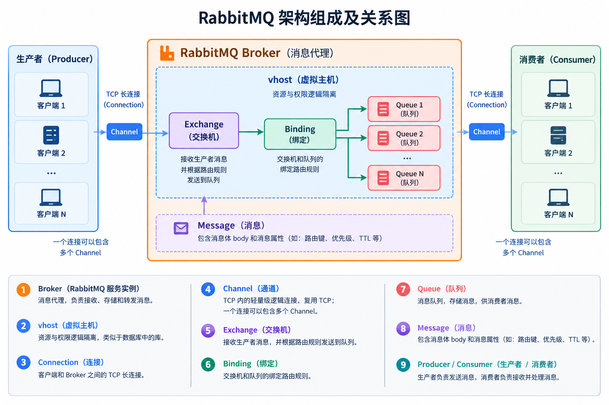
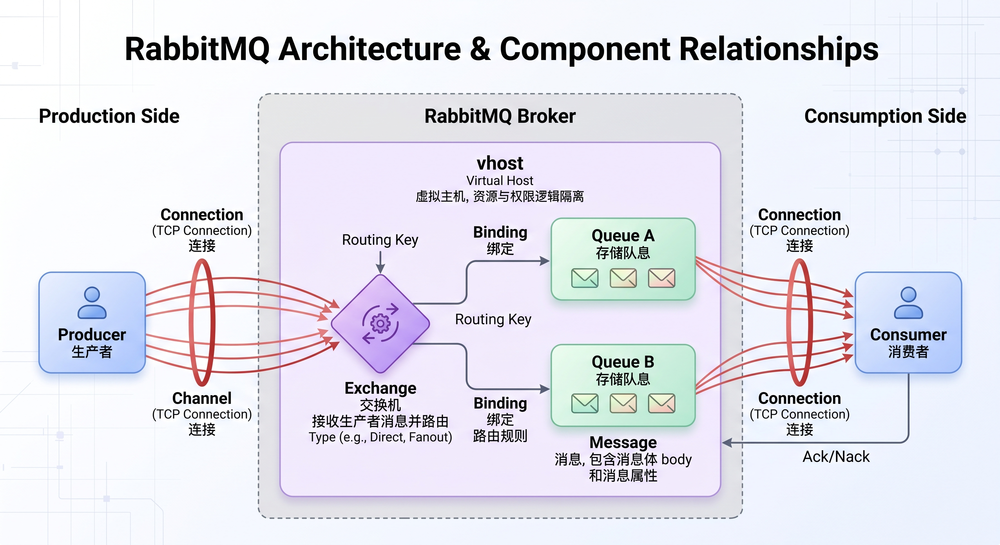

## 一、RabbitMQ 基础概念

1. 什么是 RabbitMQ？它的核心特点是什么？
2. RabbitMQ 的架构组成有哪些？
3. 什么是 AMQP？RabbitMQ 如何实现 AMQP 协议？
4. RabbitMQ 中的 **Exchange**、**Queue** 和 **Binding** 有什么作用？
5. RabbitMQ 的消息路由流程是怎样的？
6. 什么是 **Direct、Fanout、Topic、Headers** 类型的 Exchange？分别适合什么场景？
7. RabbitMQ 支持哪些消息确认机制？
8. 什么是 **消息持久化（Durable）**、**队列持久化**、**消息确认**？
9. RabbitMQ 如何保证消息不丢失？
10. RabbitMQ 与 Kafka、ActiveMQ 的区别是什么？

### **1. 什么是 RabbitMQ？它的核心特点是什么？**

- **定义**：RabbitMQ 是一个开源的消息队列（Message Broker），实现了 **AMQP（Advanced Message Queuing Protocol，高级消息队列协议）**，用于在分布式系统中异步传递消息。
- **核心特点**：
  1. **可靠传输**：支持持久化、事务、确认机制保证消息不丢失。
  2. **多种消息模式**：支持点对点（Work Queue）、发布/订阅（Pub/Sub）、路由（Routing）、主题（Topic）等。
  3. **灵活路由**：通过 Exchange + Binding 灵活路由消息。
  4. **高可用与可扩展**：支持集群、镜像队列（Mirrored Queue）。
  5. **支持多语言客户端**：Java、Python、C# 等。

------

### **2. RabbitMQ 的架构组成有哪些？**

- **Broker**：RabbitMQ 服务实例，消息代理，负责接收、存储、转发消息；
- **vhost**：虚拟主机，资源与权限逻辑隔离；
- **Connection**：客户端和 Broker 之间 TCP 长连接；
- **Channel**：通道，TCP 内轻量级逻辑连接，复用 TCP；一个连接可以包含多个 Channel。
- **Exchange**：接收生产者消息并根据路由规则发送到队列。
- **Binding**：交换机和队列的绑定路由规则，决定消息能否进入某个队列。
- **Queue**：消息队列，存储消息，供消费者消费；
- **Message**：消息，包含消息体 body 和消息属性；
- **Producer 生产者、Consumer 消费者**。




------




#### **Channel 与 Connection 的区别**

| 特性 | Connection                    | Channel                            |
| ---- | ----------------------------- | ---------------------------------- |
| 作用 | TCP 连接                      | 逻辑通信通道                       |
| 消耗 | 重量级                        | 轻量级                             |
| 线程 | 多线程共享可能出现阻塞        | 线程不安全，需要每线程独立 Channel |
| 建议 | 一般应用只创建少量 Connection | 多个 Channel 实现并发              |

#### 基础面试题

##### 追问1：Channel 是什么？为什么需要 Channel，不直接用 Connection？

> 标准答案

1. Connection 是客户端与 Broker 的 **TCP长连接**，TCP 创建销毁开销大，如果每个业务线程都新建TCP连接，会把服务器端口、资源打满。
2. Channel 是**TCP连接之上的轻量级逻辑通道**，复用同一条TCP连接；一个Connection可以开辟几十上百个Channel。
3. AMQP 所有操作（发消息、声明队列、ack）都在 Channel 完成。
4. ⚠️注意：Channel 对象在**客户端维护**，Broker只识别channel id，不存储Channel实体。
5. 开发规范：**多线程不要共享同一个Channel**，线程各自使用自己的Channel。

> 坑：不要说 Channel 是 Broker 的组件。

##### 追问2：Exchange 交换机存储消息吗？消息存在哪里？

> 标准答案 交换机**不存储消息**，只负责路由转发。 消息最终存储在 **Queue 队列**中。

- 如果消息投递到交换机，没有匹配任何队列，消息直接丢失（除非设置 mandatory 参数做回退）。

##### 追问3：vhost 虚拟主机作用？

1. 资源隔离：一个Broker下可以多个vhost，每个vhost内部独立的Exchange、Queue、Binding，互相不可见。
2. 权限隔离：可以针对vhost分配账号权限，不同业务使用不同vhost。
3. 类比 MySQL：Broker 相当于MySQL实例，vhost相当于database数据库。

##### 追问4：Binding 和 RoutingKey、BindingKey 的关系？

1. Binding：Exchange 和 Queue 的绑定关系。绑定的时候设置 **BindingKey**。
2. 生产者发消息携带 **RoutingKey**。
3. Exchange 根据交换机类型，对比 RoutingKey 和 BindingKey，决定消息路由到哪些队列。

- Direct：RoutingKey完全等于BindingKey才匹配
- Topic：通配符模糊匹配
- Fanout：忽略key，全部广播

##### 追问5：Connection 和 Channel 生产实践踩坑

1. Connection 重量级：应用一般只创建**少数几个Connection**，不要频繁创建关闭。
2. Channel 轻量，可以多；但是Channel会关闭：比如队列声明错误、参数异常，Channel会被Broker关闭，需要捕获异常重建。
3. 一个Connection内某个Channel异常关闭，**不会影响同Connection下其他Channel**。

##### 追问6：消息 Message 由哪两部分组成？properties有哪些常见属性？

Message = `body(业务二进制数据)` + `properties(消息属性)` properties常用：

- `deliveryMode`：1非持久，2持久化消息
- `routingKey`
- `messageId`：消息唯一ID，用于幂等
- `expiration`：消息TTL过期时间
- `headers`：自定义头信息

##### 追问7：Broker是什么？

Broker 就是 RabbitMQ 服务代理实例，接收、路由、存储消息；内部管理vhost、交换机、队列、绑定、消息数据。

> ❌Channel、Connection不属于Broker内部资源。

##### 追问8：消息完整流转链路（口头复述）

生产者(客户端) → Connection(TCP) → Channel(客户端) → Broker Broker内部：vhost → Exchange 根据Binding规则路由 → Queue存储Message 消费者(客户端)：Connection → Channel → 获取Queue消息 → ACK确认。

##### 追问9：mandatory 参数（高频延伸）

交换机找不到匹配队列时：

- mandatory=false：消息直接丢失（默认）
- mandatory=true：消息退回生产者，触发 `returnCallback`回调。

##### 追问10：为什么消息ACK是在Channel上执行？

ACK是AMQP协议指令，所有协议交互都走Channel；ACK告诉Broker这条消息可以删除。

------

#### 面试连环模拟现场

> 面试官：讲下RabbitMQ架构？ 你：讲出 Broker、vhost、Connection、Channel、Exchange、Binding、Queue、Message，区分客户端/服务端。

> 面试官：Channel为什么设计？ 你：回答TCP开销，复用连接，客户端对象。

> 面试官：交换机存消息吗？消息放哪里？ 你：交换机不存，消息存队列；没匹配队列消息丢失，mandatory参数。

> 面试官：BindingKey和RoutingKey区别？ 你：绑定的时候指定BindingKey；发消息带RoutingKey，交换机类型决定匹配逻辑。

> 面试官：vhost作用？ 你：资源隔离，权限隔离，类比MySQL数据库。

> 面试官：Message结构？ 你：body + properties，举几个properties属性。

如果你需要，我把**交换机四种类型+使用场景**也整理一套同格式面试追问。

------

### **3. 什么是 AMQP？RabbitMQ 如何实现 AMQP 协议？**

- **AMQP**：Advanced Message Queuing Protocol，高级消息队列协议，是一种标准化、跨平台的消息传递协议。
- **RabbitMQ 实现**：
  - 使用 AMQP 定义消息格式、交换机类型、路由规则、确认机制等。
  - RabbitMQ 的 broker 按照 AMQP 规范实现消息传递、队列管理、持久化、确认机制。
- **特点**：
  - **互操作性**：不同语言和平台都能通过 AMQP 通信。
  - **可靠性**：提供事务、确认机制、持久化。


------

### **5. RabbitMQ 的消息路由流程是怎样的？**

#### 完整流程

1. **生产者（Producer）** 准备消息：消息包含 `body`、消息属性 `properties`，发消息时指定 **routingKey**。
2. 生产者通过 **Connection**，在 **Channel** 上调用发布方法，将消息发送给 **Exchange（交换机）**，不是直接发给队列。
3. **Exchange** 接收消息，根据自身类型，使用消息的 `routingKey` 和绑定关系中的 `bindingKey` 做路由匹配。
4. Exchange 找到匹配的 **Binding**，把消息投递到对应的一个或多个 **Queue（队列）**。
   
    > 交换机本身**不存储消息**，只做路由转发。
5. 消息进入 Queue 后持久化/缓存，等待消费者消费。
6. **Consumer（消费者）** 通过 Channel 订阅队列，从 Queue 获取消息，执行业务处理。
7. 消费成功后，消费者发送 **ACK** 给 Broker；Broker 收到 ACK，才删除队列中的这条消息。
> 如果消费失败，可发送 NACK，消息重新回到队列。

一句话总结：**生产者发消息给交换机，交换机根据绑定规则路由到队列，消费者从队列拉取消息，ACK确认删除。**

#### 四种交换机的路由匹配规则（必背）

1. **Direct 直连交换机**
    精确匹配：消息的 routingKey **必须完全等于** bindingKey，才投递到对应队列。
    场景：单播、点对点消息，比如订单失败通知。
2. **Topic 主题交换机**
    模糊匹配，支持通配符：
    - `*`：匹配一个单词（用 `.` 分隔）
    - `#`：匹配0个或多个单词
    例：bindingKey=`order.*`，可以匹配 `order.pay`；`order.#` 匹配 `order.pay.success`
    场景：日志分类、多条件订阅。
3. **Fanout 扇出交换机**
    **忽略 routingKey 和 bindingKey**，消息广播给所有绑定该交换机的队列。
    场景：广播通知，比如商品上线通知所有服务。
4. **Headers 头交换机**
    不使用 routingKey，依靠消息 `headers` 属性做匹配，性能差，极少使用。

#### 面试高频追问

##### 追问1：如果消息投递交换机，没有任何队列匹配，会发生什么？

- 默认 `mandatory=false`：消息直接丢弃。
- `mandatory=true`：消息会退回生产者，触发 `ReturnCallback` 回调。
> 注意：mandatory 只针对路由失败；消息过期、队列满不触发这个回调。

##### 追问2：routingKey 和 bindingKey 的区别？

- **bindingKey**：队列绑定交换机的时候设置，写在 `Binding` 上。
- **routingKey**：生产者发送消息的时候携带，在消息里。
- 交换机根据类型对比两者，决定路由。Fanout 类型无视这两个key。

##### 追问3：消息什么时候真正持久化？

消息投递到队列，并且消息标记为持久化、队列也是持久化，Broker 才会落盘。交换机持久化只是保存交换机定义，**不会持久化消息**。

##### 追问4：ACK 是同步还是异步？如果消费者宕机没发ACK？

ACK 是消费者主动发送的异步指令。
消费者收到消息还没ACK就宕机，Broker 认为消息未消费，消息自动放回队列，重新投递。

##### 追问5：一个消息可以路由到多个队列吗？

可以。Fanout天然广播；Direct/Topic 可以把多个队列用不同bindingKey绑定同一个交换机，一条消息匹配多个bindingKey，会分发到多个队列。

##### 追问6：什么是死信路由？

消息无法被正常消费（TTL过期、队列满、消费者NACK且不重入队列），变成死信。
如果队列配置了 `dead-letter-exchange`，死信会被路由到指定死信交换机，再路由到死信队列。

#### 精简口述版（面试直接背）

生产者携带routingKey把消息发送到交换机；交换机根据类型，对比routingKey和bindingKey，按照Binding关系路由消息到队列；交换机不存消息，消息保存在队列。消费者订阅队列获取消息，处理完成发送ACK，Broker收到ACK删除消息。路由失败时，mandatory=true会回调生产者，否则消息丢失。

要不要我把**消息路由 + 架构组件**合并成一段完整的面试口述答案？

------

### **6. 四种类型的Exchange**

| 类型    | 特点                       | 场景                                 |
| ------- | -------------------------- | ------------------------------------ |
| Direct  | 精确匹配 Routing Key       | 点对点消息，任务分发                 |
| Fanout  | 广播消息，忽略 Routing Key | 发布/订阅，广播通知                  |
| Topic   | 支持通配符匹配 Routing Key | 灵活路由，如日志分级或主题路由       |
| Headers | 根据消息 Header 属性匹配   | 更灵活的条件路由，不依赖 Routing Key |

##### 1. Direct 直连交换机

**核心特点**：
路由键 **精确完全匹配**，消息只会投递给`RoutingKey`和`BindingKey`完全一致的队列。

**适用场景**：
- 点对点一对一通信
- 任务精准分发、单消费者业务
- 订单单发、一对一通知、RPC 调用

##### 2. Fanout 扇形/广播交换机

**核心特点**：
**忽略路由键**，收到消息后**广播转发到所有绑定的队列**，无需匹配。

**适用场景**：
- 发布订阅模式、系统全局广播
- 多服务同时接收同一条消息（如配置刷新、系统公告）
- 集群节点同步、多客户端实时推送

##### 3. Topic 主题交换机

**核心特点**：
路由键支持**通配符模糊匹配**：
- `*` 匹配**一个**单词
- `#` 匹配**零个或多个**单词
可实现按主题模糊路由。

**适用场景**：
- 日志分类收集（info/error/warn 日志分级）
- 多维度消息订阅、商品类目消息推送
- 微服务事件总线、多规则灵活路由

##### 4. Headers 头交换机

**核心特点**：
**不依赖 RoutingKey**，通过**消息 Header 键值对**匹配绑定规则，支持复杂条件匹配。

**适用场景**：
- 路由规则复杂、多维度条件筛选
- 无法用路由键表达的复杂业务匹配
- 极少用，一般能用 Topic 就不用 Headers

------

### **7. RabbitMQ 支持哪些消息确认机制？**

1. **生产者确认（Publisher Confirm）**：保证消息被 broker 接收。
2. **消费者确认（Consumer Ack）**：保证消息被成功消费。
3. **事务机制（Transaction）**：保证消息发送的原子性（性能开销大，生产环境少用）。


- 生产者确认机制中，“消息被 broker 接收” 的完整流程是：
  1. 生产者发送消息到 RabbitMQ broker；
  2. broker 接收消息后，首先将消息路由到对应的 exchange；
  3. exchange 根据绑定规则将消息转发到匹配的 queue；
  4. 只有当消息被成功写入 queue（持久化消息还需写入磁盘）后，broker 才会向生产者返回确认（ack）。
- broker 不是特指 exchange，而是包含 exchange、queue 在内的整个 RabbitMQ 服务；


##### 消费者确认机制

消费者确认（Consumer Ack，即消费者手动/自动确认机制）的核心目标，就是**确保消息被消费者成功处理完成后，才从 RabbitMQ 的队列中删除**，避免消息丢失或重复消费。

###### 一、Consumer Ack 的核心逻辑

RabbitMQ 中，消息从队列投递到消费者后，并不会立即删除，而是等待消费者发送 **确认信号（Ack）**：
- 消费者处理完业务逻辑（如订单取消、库存恢复）后，发送 `basicAck` 确认 → RabbitMQ 收到后删除消息；
- 消费者处理失败（如抛出异常），发送 `basicNack`/`basicReject` 拒绝 → RabbitMQ 按配置决定是否重新入队或路由到死信队列；
- 消费者未发送任何确认（如宕机）→ 连接断开后，RabbitMQ 会将消息重新放回队列，等待其他消费者处理。

###### 二、两种确认模式（自动 vs 手动）

1. 自动确认（`ackMode="AUTO"`，默认）

- 行为：消费者接收到消息后，**立即自动发送 Ack**，无论业务处理是否成功。
- 风险：如果业务处理失败（如数据库宕机），消息已被删除，导致消息丢失（违背“成功消费才确认”的核心）。
- 适用场景：对消息可靠性要求极低的场景（如日志收集），不推荐用于核心业务（如订单、支付）。

 **2. 手动确认（`ackMode="MANUAL"`，推荐核心业务使用）**

- 行为：消费者必须通过代码手动调用 `basicAck`/`basicNack`，才会触发消息确认/拒绝。
- 优势：完全控制确认时机，确保业务处理成功后再确认，避免消息丢失。
- 代码示例（Spring AMQP）：
  ```java
  @RabbitListener(queues = "order.timeout", ackMode = "MANUAL")
  public void handleOrderTimeout(Message message, Channel channel) throws IOException {
      long deliveryTag = message.getMessageProperties().getDeliveryTag(); // 消息唯一标识
      String orderId = new String(message.getBody());

      try {
          // 1. 执行业务逻辑（核心：必须确保业务处理成功）
          orderService.cancelOrderTimeout(orderId); // 订单取消、库存恢复等

          // 2. 业务成功 → 手动确认（第二个参数 false 表示不批量确认）
          channel.basicAck(deliveryTag, false);
          log.info("订单{}处理成功，已确认消息", orderId);
      } catch (Exception e) {
          log.error("订单{}处理失败", orderId, e);
          // 3. 业务失败 → 拒绝消息（requeue=false 表示不重新入队，路由到死信队列）
          channel.basicNack(deliveryTag, false, false);
      }
  }
  ```

###### 三、关键注意事项（避免踩坑）

**1. 必须手动调用确认/拒绝**

手动模式下，若消费者未调用 `basicAck`/`basicNack`，消息会一直处于“未确认”状态，占用队列内存，最终导致队列堆积。

**2. 拒绝消息的两种方式（`basicNack` vs `basicReject`）**

| 方法          | 区别                                  | 适用场景                  |
|---------------|---------------------------------------|---------------------------|
| `basicNack`   | 支持批量拒绝（第二个参数 `multiple=true`） | 批量处理消息时拒绝多条    |
| `basicReject` | 仅支持单条拒绝，不支持批量            | 单条消息处理失败时拒绝    |

**3. `requeue` 参数的选择**

- `requeue=true`：消息重新放回队列尾部，等待再次投递（适合瞬时故障，如网络抖动）；
- `requeue=false`：消息不再入队，直接路由到死信队列（适合业务逻辑失败，如订单已取消）。
- 风险：`requeue=true` 可能导致消息无限重试，需配合重试次数限制或死信队列。

**4. 消息顺序性**

若队列是“有序队列”（如按订单创建时间排序），手动确认时需注意：**只有前一条消息确认后，再处理下一条**，否则可能导致消息顺序错乱（如先处理后创建的订单）。

###### 四、与“消息幂等性”的配合

Consumer Ack 保证了“消息不会丢失”，但可能导致“重复消费”（如消费者确认前宕机，消息重新投递）。因此，手动确认必须搭配 **幂等性处理**（如之前提到的 Redis 去重、订单状态校验），才能完整保证消息可靠性。

###### 总结

- 核心目标：**业务处理成功 → 确认消息 → 队列删除消息**，确保消息“被成功消费”后才清理。
- 推荐方案：核心业务（订单、支付、库存）必须使用 **手动确认模式（MANUAL）** + 幂等性处理 + 死信队列，形成“可靠消费”闭环。
- 避坑关键：手动模式下切勿遗漏确认/拒绝，失败消息避免无限重试。


### 消息优先级 Priority 的作用

**消息优先级：当队列存在消息堆积时，高优先级消息会被优先消费；消费速度很快、队列没有积压时，优先级几乎没有效果。**

> 
> RabbitMQ 优先级范围：0 ~ 255，**数字越大优先级越高**；一般推荐设置较小上限（如 `x-max-priority=10`），减少Broker内存开销。

#### 核心用途

1. **流量洪峰下，紧急消息优先处理**
业务大量普通消息积压在队列里，有少量紧急消息（如告警、支付回调、人工干预订单），希望插队优先消费。

> 
> 例子：电商大促，大量普通订单消息堆积；客服人工取消订单消息设置高优先级，优先被消费。
2. **区分业务等级，保障高价值业务时效性**
同一队列内，把核心业务消息设置高优先级，次要业务低优先级。

> 
> 例：支付消息优先级8，订单状态同步消息优先级2；堆积时优先处理支付。

#### ⚠️重要前提（面试官最爱问）

1. **队列必须在声明时指定 `x-max-priority`，否则消息上的priority属性完全无效**

```
Map<String,Object> args = new HashMap<>();
args.put("x-max-priority",10); // 队列支持的最大优先级
channel.queueDeclare("priority_queue",true,false,false,args);
```

只在发送消息设置`priority`，队列没配置，优先级不起作用。

2. **只有队列里存在未消费的积压消息，优先级才生效**
如果消费者消费速度很快，消息来了马上消费，队列基本是空的，**高优先级消息不会插队，看不出任何优先级效果**。
底层原理：RabbitMQ会维护不同优先级的消息堆；**仅当消息排队等待消费时，才从最高优先级的消息里取出消息投递给消费者**。
3. **优先级只在**同一个队列**内生效，跨队列无效**。

#### 缺点 & 坑（面试必说）

1. **会增加Broker内存开销**
RabbitMQ要维护多个优先级的消息索引，`x-max-priority`设置越大，内存消耗越高，不建议直接设255。
2. **不能做到“实时插队”**
已经预取到消费者本地内存的消息（prefetch预拉取），不会重新排序。

> 
> 例如：Qos prefetch=20，已经拉了20条低优先级消息到消费者本地；此时一条高优先级消息入队。
> 消费者会先把本地已经拿到的20条消费完，才会去Broker拉取这条高优先级消息，**达不到插队效果**。
> ✅解决：优先级场景，prefetch尽量设置小一点（prefetch=1）。
3. **不适合大量高优先级消息**
如果大量消息全部设置高优先级，优先级失去意义，退化成普通队列。

#### 面试口述精简版

消息优先级用于**队列消息积压场景，让高优先级消息优先被消费**。优先级取值0~255，数值越大优先级越高。
使用前提：声明队列时必须配置`x-max-priority`。
注意：队列无积压时优先级无效；prefetch预拉取会破坏优先级效果；会增加Broker内存消耗；优先级只在同一个队列内生效。适合少量紧急消息插队场景，不适合大规模使用。

#### 追问

> 
> Q：优先级消息能不能和顺序消息一起使用？
> 不能。优先级会打乱FIFO顺序，**顺序消息队列不要开启优先级**。

要不要继续看 RabbitMQ 生产者 mandatory、immediate 参数的区别？面试很爱问。


------

### **8. 什么是消息持久化（Durable）、队列持久化、消息确认？**

- **消息持久化**：将消息写入磁盘，RabbitMQ 重启后不会丢失。
- **队列持久化**：队列本身持久化，重启后仍然存在。
- **消息确认**：消费者处理消息后，发送 ACK 给 broker，避免消息丢失或重复消费。

------

### **RabbitMQ 如何保证消息不丢失？**

1. **队列和消息持久化**：队列设置 `durable=true`，消息 `deliveryMode=2`。
2. **消费者 ACK**：确保消费者处理完成消息后再确认。
3. **Publisher Confirm**：生产者发送消息后等待 broker 确认。
4. **镜像队列（Mirrored Queue）**：在集群中多个节点备份队列，避免单点故障。

> 消息丢失发生在三个阶段：**生产者 → Broker、Broker内部、Broker → 消费者**。要保证消息不丢失，三个环节都要做处理。

#### 1️⃣ 生产者投递阶段：消息没到达Broker就丢失

问题：网络抖动，消息发出去，Broker没收到，生产者不知道。

手段：
1. **开启确认机制 Publisher‑Confirm（生产者发布确认）**
Broker收到消息后，异步回调生产者：
- `ack`：Broker成功接收消息
- `nack`：Broker接收失败，生产者需要重试发送

2. **mandatory 参数 + ReturnCallback**
消息到达交换机，但是**路由不到任何队列**（无匹配binding）：
- `mandatory=true`，触发 ReturnCallback，消息退回生产者，业务做补偿重试；
- false：消息直接丢弃（默认）。

3. **业务层做幂等 + 重试**
发送失败捕获异常，本地重试；避免重复消息。

> ❗注意：Publisher‑Confirm 是信道级别；事务 `txSelect()` 性能极差，生产几乎不用，优先 confirm。

#### 2️⃣ Broker服务端阶段：消息收到了，Broker宕机丢失

问题：消息只在内存，RabbitMQ宕机重启消息消失。
需要开启两处持久化：

1. **交换机持久化 `durable=true`**
保存交换机元数据定义，重启交换机还在；**交换机持久化不存消息**。

2. **队列持久化 `durable=true`**
保存队列元数据，重启队列存在。

3. **消息持久化 `deliveryMode=2`**
消息属性设置持久化，消息写入磁盘。
> 三者缺一：
> - 队列不持久：重启队列消失，消息全部丢失；
> - 消息不持久：即使队列持久，消息只放内存，宕机丢失。

⚠️ 持久化性能损耗；磁盘刷盘是异步的，宕机极端情况仍有极小概率丢消息。追求更高可靠性可以开启集群镜像队列/HA。

#### 3️⃣ 消费者消费阶段：消息拿到，还没处理完消费者宕机

问题：默认自动ACK，消息一投递给消费者，Broker立刻删除消息；程序还没执行业务逻辑，服务宕机 → 消息丢失。

手段：
1. **关闭自动Ack，使用手动Ack（manual‑ack）**
消费者处理完业务逻辑之后，手动发送 `basicAck` 告诉Broker：消费成功，可以删除消息。
- `basicNack`：消费失败，消息重新放回队列，后续重新消费。
> 如果消费者没发ACK直接断开连接，Broker自动把消息重新入队。

---

#### 完整方案总结（面试背诵版）

RabbitMQ消息丢失分为生产者、Broker、消费者三个环节：
1. **生产者端**：开启 `Publisher‑Confirm` 发布确认监听Broker应答；开启 `mandatory=true` + ReturnCallback捕获路由失败消息；发送失败做重试。不推荐AMQP事务。
2. **Broker服务端**：交换机持久化、队列持久化、消息设置 `deliveryMode=2` 消息持久化；生产环境搭建集群镜像队列提高可用性。
3. **消费者端**：关闭自动ACK，使用**手动ACK**，业务处理完成再确认；业务异常执行NACK让消息重回队列。

> 注意：持久化会带来IO性能开销；手动ACK要避免忘记ack导致消息堆积。

#### 📌 面试连环追问

##### 追问1：持久化之后消息100%不丢吗？

不能100%。RabbitMQ写入磁盘是异步刷盘；消息到操作系统页缓存，还没落盘磁盘时机器断电，仍然丢失。
解决方案：集群镜像队列，消息同步到多个节点。

##### 追问2：Publisher‑Confirm 和 RabbitMQ事务区别？

- 事务：`txSelect`、`txCommit`；同步阻塞，性能很差，吞吐量低，生产几乎不用。
- Publisher‑Confirm：异步回调，性能高，生产环境标准方案。

##### 追问3：mandatory 和 publisher‑confirm 区别？

- `publisher‑confirm`：确认消息有没有到达Broker。
- `mandatory`：消息到达交换机，但是路由不到队列时，把消息返回给生产者。
两者配合使用。

##### 追问4：手动Nack会不会造成消息无限循环？

会。业务异常一直失败，消息反复重入队列，无限消费。
解决方案：设置重试次数；超过次数转发到死信队列。

##### 追问5：消息持久化三个条件？

交换机durable、队列durable、消息deliveryMode=2。**只设置队列持久化没用，消息还是内存存储。**

##### 追问6：自动Ack的坑？

自动Ack模式下，消息一旦发送到消费者，Broker直接删除消息。消费者进程崩溃，消息直接丢失。

##### 追问7：重复消息问题怎么处理？

保证消息不丢失，就会带来消息重复投递。需要业务实现**幂等性**：数据库唯一索引、业务id判断。

---

要不要我整理下一套：**RabbitMQ死信队列 + 延迟消息 面试简答**？


### RabbitMQ 死信队列 + 延迟消息

> 核心要点：**RabbitMQ 没有原生延迟消息，延迟消息是靠【TTL + 死信队列】组合实现**

#### 一、死信队列 DLQ（Dead Letter Queue）基础概念

**死信 DL：消息变成死信的几种条件**，满足任意一条：
1. 消息 TTL 过期（超过存活时间）
2. 队列消息数量达到最大长度限制，消息被丢弃
3. 消费者 `basicNack` / `basicReject`，并且 `requeue=false`（不重新放回原队列）

> 消息一旦变成死信，不会直接被删除。
> 如果原队列配置了 `dead-letter-exchange`（死信交换机 DLX），死信就会投递到 DLX，DLX 再路由到**死信队列 DLQ**，由专门消费者监听DLQ做后续处理。

> 术语区分
> - DLX：Dead Letter Exchange，死信交换机
> - DLQ：Dead Letter Queue，死信队列（存放死信）

##### 死信完整流转

生产者 → 普通交换机 → 普通队列（设置DLX）
消息触发死信条件 → 消息转发给DLX → DLX路由到DLQ → 消费者监听DLQ消费死信

#### 二、基于 TTL + DLX 实现延迟消息（重点！面试高频）

##### 两种设置TTL的方式

1. **消息级别TTL**：发送消息时，给每条消息设置过期时间 `expiration`；**每条消息过期时间可以不一样**
2. **队列级别TTL**：声明队列的时候设置 `x-message-ttl`；队列里所有消息统一过期时间

> ⚠️ 大坑（面试官最爱问）：
> **队列TTL：消息入队就计时，队首消息过期才会被处理；消息TTL：消息过期了，但如果前面消息没过期，这条消息不会立刻变成死信！**
> RabbitMQ不会扫描队列判断消息是否过期；只会检查**队首第一条消息**。
> 举例：
> 消息A：TTL 10s；消息B：TTL 2s。A先进队列，B在后。
> B虽然2秒就到期，但是A还没过期，B不会被处理，要等A过期之后，B才会被检测到转发到死信队列。
> ✅ 结论：**如果每条消息延迟时间不一样，不能用同一个普通队列！必须一个延迟时间对应一个队列。**

##### 延迟消息架构设计（固定延迟时间场景）

1. 创建**普通交换机 normal-exchange**，普通队列 delay-queue，队列配置：
   - `x-message-ttl`：延迟时长（例如30分钟）
   - `dead-letter-exchange`：指定死信交换机 dlx
   - `dead-letter-routing-key`：死信路由key
2. 生产者发送消息到 normal-exchange，消息进入 delay-queue；消息不会被消费者消费
3. 消息TTL到期 → 变成死信 → 转发到 dlx
4. dlx绑定死信队列 dl-queue，消费者监听 dl-queue，此时就是达到延迟效果。

> 场景举例：订单30分钟未支付自动关闭。下单发送延迟消息到delay队列，30分钟后消息进入DLQ，消费时判断订单是否已支付，未支付则关闭订单。

#### 三、面试连环追问

##### 追问1：为什么RabbitMQ不能直接支持延迟消息，要用TTL+DLX实现？

RabbitMQ AMQP协议本身没有延迟投递能力，没有定时器去扫描消息。只能利用消息过期转死信的特性间接实现。

##### 追问2：消息级TTL和队列级TTL区别？坑是什么？

- 队列TTL：队列所有消息统一过期时间，消息入队开始计时；**不存在消息阻塞问题**，推荐固定延迟场景。
- 消息TTL：每条消息过期时间独立；**存在消息阻塞问题，前面消息没过期，后面消息即使到时间也不会触发死信**。
> 所以动态不同延迟时长场景，不能共用队列；要采用**多队列方案**（不同延迟时间创建不同队列）。

##### 追问3：死信和普通消息ACK NACK关系？

消费者 `nack(requeue=false)` / reject，消息进入死信；
`nack(requeue=true)`：消息重回原队列，**不是死信**。

##### 追问4：死信队列要不要持久化？

生产环境建议：DLX、DLQ都设置durable持久化；消息设置deliveryMode=2，防止Broker宕机丢失延迟任务。

##### 追问5：对比 RocketMQ 延迟消息

RocketMQ原生支持延迟消息，内置延迟等级，底层是定时轮询，没有RabbitMQ这个队首阻塞的问题；RabbitMQ是间接实现，有缺陷。

##### 追问6：死信队列的消费失败怎么办？

DLQ消费如果再次失败，不能再设置DLX指向自己，否则循环转发，造成消息风暴。一般：
1. 本地日志记录异常消息
2. 人工补偿，或者单独告警，不再次投递死信。

##### 追问7：如果延迟消息量很大，TTL+DLX方案有什么缺点？

1. 不同延迟时间需要新建队列，队列数量爆炸，运维压力大；
2. 消息TTL方案存在消息阻塞，时间不准；
3. 大量延迟消息堆积在普通队列，占用Broker资源。
> 高并发、动态延迟场景，不推荐RabbitMQ做延迟任务，优先RocketMQ。

#### ✅ 精简背诵版（面试口述）

死信就是消息满足TTL过期、队列满、NACK且不重入队列三种情况之一，变成死信。如果原队列配置了死信交换机DLX，死信就转发到DLX，路由到死信队列DLQ，由消费者处理。
RabbitMQ没有原生延迟消息，利用TTL+DLX实现延迟消息。TTL分为队列级别和消息级别；消息级别TTL有队首阻塞问题：后面消息过期了，但队首消息没过期，不会触发死信。固定延迟时间用队列TTL；如果多种延迟时长，需要创建多个队列。典型场景：订单超时关闭。缺点是动态延迟场景不方便，不如RocketMQ原生延迟消息。

---
要不要我整理 **RabbitMQ 消息重复、消息幂等、消息积压** 的面试题？这一套MQ面试经常连着问。

### RabbitMQ 消息重复、幂等、消息积压

（面试三连高频）

> 背景：**保证消息不丢失的代价就是消息会重复消费**，这是MQ通用问题，不只是RabbitMQ。

#### 一、消息重复消费产生的原因

三种产生重复的场景：
1. **消费者Ack超时 / 网络抖动**
消费者处理完业务，Broker收不到Ack（网络丢包、消费者进程卡死）。Broker认为消息未处理，消息重新入队，投递给消费者（可能同一个、也可能另一个消费者），造成重复。

2. **Publisher‑Confirm确认丢失**
生产者发送消息，Broker已经收到消息，但是confirm ack响应网络丢了；生产者没收到ack，业务重试发送，产生重复消息。

3. **Broker故障重启、集群切换**
消息已经投递，还没收到Ack，节点宕机，消息恢复后重新投递。

> 重点：**MQ无法彻底杜绝消息重复，只能尽可能减少；重复问题必须业务层做幂等解决。**

---

#### 二、消息幂等性（核心：一条消息多次执行，结果和执行一次一样）

##### 常见4种幂等实现方案（按生产常用排序）

1. **数据库唯一索引（最常用）**
业务表设置唯一业务ID（订单ID、消息ID）；插入时，重复消息插入会报唯一索引冲突，捕获异常直接忽略。
> 适用：新增类业务。

2. **状态机判断（订单状态，更新业务首选）**
业务有明确状态流转。
例：订单状态：待支付 → 已支付。
收到支付消息：`update order set status='PAID' where id=xxx and status='WAIT_PAY'`
只有当前是待支付才更新；重复执行不会改变数据。

3. **幂等表 + Redis去重**
- Redis：消息ID作为key，消费前setnx，设置过期时间。key存在直接跳过消费。
> 风险：Redis宕机丢失key；不能100%可靠。适合允许极小概率重复的场景。
- 数据库幂等表：记录已消费的`msgId`；消费先查询是否存在，存在直接return；不存在执行业务+插入幂等表。
> 强可靠，性能有损耗。

4. **利用MQ自带messageId + 业务自身唯一ID**
优先使用业务业务ID（orderId），不要单纯依赖MQ的messageId；极端场景MQ也可能重复生成messageId。

> ❌误区：不要指望MQ帮你解决重复消费，MQ不保证消息只投递一次，MQ保证**至少一次投递（At‑least‑Once）**。

##### 面试追问

> Q：什么是At‑Least‑Once / At‑Most‑Once / Exactly‑Once？
- At‑Most‑Once：最多一次，消息可能丢失，不会重复；自动Ack模式下消费者宕机丢消息。
- At‑Least‑Once：至少一次；消息绝不丢，但可能重复，RabbitMQ/RocketMQ/Kafka默认都是这个。
- Exactly‑Once：恰好一次。**MQ本身做不到**，是业务幂等实现出来的效果。

---

#### 三、RabbitMQ消息积压

> 现象：队列消息数量持续上涨，消息迟迟得不到消费。

##### 1. 消息积压常见原因

1. **消费者消费速度 < 生产者生产速度**，消费能力不足。
2. **消费者业务逻辑慢**：消费内部大量IO、数据库慢查询，阻塞消费。
3. **消费者bug**：抛出异常，不断Nack，消息反复重回队列，无限循环。
4. 忘记手动Ack：一直不发basicAck → Broker认为消息未消费，消息一直留在队列，队列持续堆积。
5. 生产者流量突增，流量洪峰。

##### 2. 消息积压带来的危害

1. 内存暴涨：大量消息堆积，RabbitMQ维护消息索引占用内存；内存阈值触发，RabbitMQ会把生产者阻塞（flow control流量控制），生产者发不出去消息。
2. 磁盘占用飙升。
3. 新消息延迟，消息时效性失效。
4. Erlang GC压力大，Broker卡顿，甚至节点宕机。
> ⚠️对比：RocketMQ/Kafka堆积能力强；RabbitMQ最怕大量消息堆积。

##### 3. 线上消息积压紧急处理方案（面试常问故障题）

> 场景：线上发现队列几万/几十万消息积压，怎么处理？

1. **先定位根因**
看消费者日志：是否报错、是否Ack、业务耗时；判断是消费慢还是bug死循环。

2. 如果是消费逻辑bug
- 先修复bug；**不要直接重启消费者**，会导致消息继续循环。
- 可以临时把堆积消息转发到临时备份队列，修复完再处理；或者把失败消息转入死信队列。

3. 如果消费能力不足（消费太慢）
① **增加消费者实例**：同一个队列增加更多消费者，并行消费，提高消费速度。
> 注意：RabbitMQ队列消息会轮询分给多个消费者。

② 优化消费端业务逻辑：减少消费中DB、IO耗时；批量处理。

③ 临时扩容；如果消息允许丢弃过期消息，可以设置消息TTL。

> ❗不要盲目调高prefetchCount；prefetch过大，消息大量堆在消费者客户端内存。

4. 积压实在巨大，来不及消费
新建临时队列，把原队列消息迁移；原队列供新消息消费；单独程序消费历史积压消息。

##### 4. 预防消息积压

1. 设置监控告警：监控队列消息数量，队列长度阈值告警。
2. 消费代码设置超时，异常合理处理，失败消息投递死信队列，**不要无限Nack重入队列**。
3. 合理设置prefetch，不要过大。
4. 做流量限制，防止生产者打崩MQ。

#### 面试追问点

##### 追问1：prefetchCount作用？

`basicQos(prefetchCount=N)`：告诉Broker，不要一次性把N条以上消息推送给同一个消费者；处理完Ack之后再发下一批。
防止一个消费者本地堆积大量消息，内存溢出。手动Ack模式才生效；自动Ack下Qos不生效。

##### 追问2：为什么不要Nack(requeue=true)无限重试？

消费一直异常，消息不断放回队列，反复消费，队列持续堆积，CPU升高。
解决方案：有限次数重试；超过最大重试次数转发死信队列。

##### 追问3：RabbitMQ消息堆积，生产者被阻塞？

RabbitMQ内存达到阈值，开启流量控制 flow‑control，**不再接收生产者消息**，生产者发送阻塞。

---

#### 📝面试背诵精简版

##### 消息重复

MQ保证至少一次投递At‑Least‑Once。消息重复来源：Ack丢失、网络抖动、Broker重启。MQ无法避免重复，必须业务幂等。

##### 幂等实现

1. 数据库唯一索引；
2. 状态机更新；
3. Redis/幂等表；
MQ做不到Exactly‑Once，是业务实现达到恰好一次效果。

##### 消息积压

原因：消费速度跟不上生产、消费逻辑慢、代码异常反复Nack、忘记Ack。
危害：内存上涨，触发流量控制阻塞生产者，服务卡顿。
处理：排查消费日志；bug消息转入死信；消费慢就增加消费者、优化业务；大量积压可以迁移消息到临时队列。
预防：队列长度监控告警，失败消息进死信，避免无限重入队列，配置Qos prefetch。

---

#### MQ整套复习链路梳理

RabbitMQ架构 → 路由流程 → 消息不丢失 → 死信&延迟消息 → **重复/幂等/积压** → RabbitMQ/RocketMQ/Kafka选型。

接下来需要我整理 **RabbitMQ生产实践踩坑总结**，或者切换到 RocketMQ核心面试题吗？

### Rabbit MQ消息丢失、重复、幂等解决方案。

#### 一、消息丢失场景与解决方案

RabbitMQ 消息丢失主要发生在三个环节：**生产者 → MQ**、**MQ 自身**、**MQ → 消费者**。

##### 1. 生产者到 MQ 丢失

**原因**：网络闪断、MQ 宕机，消息未到达 Broker。
**方案**：

1. **Confirm 机制（生产者确认）**
   - 开启 `publisher-confirm-type: correlated`
   - 消息发送成功后 Broker 异步返回 `ack`，失败返回 `nack`
2. **Return 机制（消息未路由到队列）**
   - 开启 `publisher-returns: true`
   - 处理无法路由到队列的消息（如备份到数据库、告警）
3. **生产者重试 + 落库**
   - 发送前先将消息入库（状态：待发送）
   - 收到 ack 后更新为已发送
   - 定时任务重发未 ack 消息（控制重试次数）

##### 2. MQ 自身丢失

**原因**：MQ 重启、宕机，内存消息未持久化。
**方案**：

1. **交换机、队列、消息都持久化**
   - 队列：`durable=true`
   - 消息：`deliveryMode=2`（持久化）
2. **镜像队列 / 集群高可用**
   - 主节点挂了，从节点顶上，避免单点丢失

##### 3. 消费者到业务处理丢失

**原因**：自动 ack，消费者刚拿到消息就宕机，MQ 认为已消费。
**方案**：

1. **手动 ACK（必须）**
   - 关闭自动 ack：`acknowledge-mode: manual`
   - 业务处理**成功**再 `channel.basicAck()`
   - 业务失败：`basicNack()` / `basicReject` 重新入队或丢弃
2. 避免：try 里成功 ack，catch 里什么都不做

---

#### 二、消息重复消费场景

**根本原因**：网络重传、消费者超时未 ack、重试机制导致同一条消息多次投递。
RabbitMQ **不保证消息只投递一次**，只保证 **至少一次（at least once）**。

**通用处理思路**：
让重复消费对业务结果无影响 → **幂等性**。

---

#### 三、幂等性解决方案（重点）

幂等：**同一消息执行多次，结果与执行一次相同**。

##### 方案1：唯一消息ID + 去重表（最通用、最稳）

1. 生产者发送时携带 **全局唯一ID**（如业务单号+序列号）
2. 消费者流程：
   - 开启事务
   - 查询去重表是否存在该 ID
   - 存在：直接 ack，不再处理
   - 不存在：执行业务 → 插入去重表 → 提交事务 → ack
3. 去重表可按时间分表/清理，避免过大

##### 方案2：数据库唯一约束（适合插入类业务）

- 业务表建立 **唯一索引**（如订单号）
- 重复消费时插入报唯一冲突，捕获异常直接 ack

##### 方案3：状态机机制（适合订单、支付等流转业务）

- 订单状态：待支付 → 支付中 → 已支付
- 只有状态为“待支付”才允许执行支付逻辑
- 重复消息到达时状态已变，直接忽略

##### 方案4：Redis 分布式锁（高并发场景）

- 以消息ID为 key，加分布式锁
- 拿到锁才执行业务，执行完释放锁
- 适合并发极高、不想频繁写数据库去重表的场景

---

#### 四、生产级最佳实践总结（面试加分）

1. 生产者：**Confirm + Return + 消息落库 + 定时重发**
2. Broker：**持久化 + 镜像队列**
3. 消费者：**手动 ack + 幂等保证**
4. 幂等优先选择：**唯一ID + 去重表（事务保证）**
5. 严禁：自动 ack、不做幂等、无重试兜底

### RabbitMQ 消息堆积 

#### 一、先排查：消息堆积常见原因

1. 消费者**消费速度 < 生产者发送速度**
2. 消费者**宕机、挂掉、没启动**
3. 消费者**业务逻辑阻塞**（DB慢、接口超时、死循环）
4. 消息**重复入队、重试泛滥**
5. 队列无上限、未做限流、未过期
6. 死信队列没配置，无效消息一直堆积

---

#### 二、紧急快速止血（线上立马能用）

1. **临时增加消费者节点**
   多开消费者实例，横向扩容，提升消费吞吐量。
2. **拆分队列**
   按业务拆分队列，避免大队列阻塞其他业务。
3. **暂停生产者发消息**
   非核心业务临时关停生产，先清堆积。
4. **批量消费 + 关闭自动ACK**
   手动ACK、批量拉取，提高消费效率。

---

#### 三、根本解决方案（生产落地）

##### 1. 消费者优化

- **关闭自动Ack，改用手动Ack**，处理完再确认
- 业务逻辑**异步化**：消息只做转发，耗时操作丢线程池
- 避免消费端**同步阻塞**（慢SQL、第三方接口超时）
- 设置**合理预取数 prefetch**，避免一次性拉太多卡死

##### 2. 流量控制 & 限流

- 生产者端**限流、削峰**，限制每秒发送量
- 开启 RabbitMQ **内存/磁盘水位限流**，防止MQ崩掉
- 非核心业务做**降级、丢弃、延迟队列**

##### 3. 队列配置优化

- 设置**队列最大长度、消息TTL**，溢出消息进死信
- 配置**死信交换机DLX + 死信队列DLQ**
  堆积/过期/拒收消息自动转发，不堵主队列
- 惰性队列：海量堆积场景开启，减少内存占用

##### 4. 消息重试与死信治理

- 消费失败**有限重试次数**，避免无限重试堆积
- 超过重试次数直接打入**死信队列**
- 定时巡检死信队列，人工补偿+日志排查

##### 5. 架构层面优化

- **业务拆分**：核心、非核心队列隔离
- **集群+镜像队列**：保证高可用，分担压力
- 引入**延迟队列**，秒杀、定时业务削峰

##### 6. 监控告警

- 监控：队列消息数、消费者在线数、堆积增长量
- 告警：堆积阈值、消费者离线、MQ内存磁盘告警
- 实时可视化，提前发现堆积而不是崩了再查

---

#### 四、面试一句话总结

1. **紧急处理**：加消费者、拆分队列、停生产、批量手动ACK。
2. **治本方案**：消费端异步化+手动ACK、设置prefetch、队列TTL+死信DLX、生产者限流、业务队列隔离、监控告警。
3. **核心思路**：**提消费速度、降生产速度、异常消息隔离不堵主队列**。

我可以给你整理成**面试背诵极简版**，几句话直接背就能答题，要不要？


### RabbitMQ 如何保证消息顺序

> 核心结论：**RabbitMQ 只能保证同一个队列内，消息入队顺序 ≈ 投递顺序；但默认不能保证消费有序。想要严格顺序，需要「单队列 + 单个消费者」。**

#### 1. 原生机制

- 一个**Queue**内部：消息是FIFO，生产者发送顺序就是队列存储顺序。
- 但是！**多个消费者监听同一个队列时，RabbitMQ会轮询分发消息**。
例：
生产者发送 msg1 → msg2 → msg3
队列顺序：msg1,msg2,msg3
有2个消费者C1、C2
- C1拿到msg1，C2拿到msg2
- 如果C1处理慢，C2先处理完msg2 → **业务上消息乱序**

👉 乱序根源：**多消费者轮询分发 + 消费处理速度不一样**。

#### 2. 实现严格顺序消息方案

##### 方案1：同一个队列，**只开1个消费者**（最简单，面试先说这个）

同一个Queue，只有一个consumer消费。
队列FIFO，消息一条一条给这个消费者，消费完ACK之后，Broker才会下发下一条。
✅优点：简单，严格有序
❌缺点：**消费无法并行，吞吐量低，容易成为瓶颈**

> 注意：不能开多个消费者，一旦多个消费者，就会轮询分发，出现乱序。

##### 方案2：业务key哈希，拆分多个队列（生产常用，兼顾顺序+并发）

把**需要保证顺序的同一组消息，路由到同一个队列**。
例如：订单维度，同一个orderId的所有消息，做hash取模，固定发到同一个queue。
每个队列仍然**单个消费者**；不同队列可以并行消费。

- orderId=1001 → queue-1
- orderId=1002 → queue-2
queue1、queue2各自独立消费，互不干扰。
> 同一订单的消息一定在同一个队列，单消费者保证有序；不同订单可以并发，提升吞吐。

> 类比RocketMQ：同一个MessageQueue（分区）内有序，同一个key哈希到同一个分区。

#### 3. 额外坑点（面试官最爱追问）

##### 坑1：消息重试会破坏顺序！

如果消息消费失败，执行 `basicNack(requeue=true)`，消息会**重新放回队列尾部**，直接打乱顺序。
✅解决：顺序消息场景，**不能requeue=true**。消费失败直接进死信队列，人工处理，不要重入队列。

##### 坑2：publisher-confirm + 并发发送，生产者并发发送也会乱序

生产者多线程并发发送消息，即使发到同一个队列，网络层面可能后发的消息先到达Broker，**入队顺序乱了**。
> 想要生产者发送有序：同一业务分组，**单线程发送**，等上一条confirm成功，再发下一条。

##### 坑3：不能开启prefetch过大？

prefetch只是预拉取，单消费者场景不破坏顺序；但预拉多条消息到本地内存，如果前面消息处理失败，后面消息已经拉到本地，业务层面也会乱序。

#### 4. 完整口述答案（面试背诵）

RabbitMQ队列本身是FIFO，队列内部消息存储有序，但**多消费者监听同一个队列会轮询分发，业务消费乱序**。
实现严格顺序消息有两种方案：
1. 简单方案：一个队列只使用单个消费者，消息依次消费；缺点吞吐量低。
2. 生产常用：按业务key（如orderId）哈希，将同一业务组的消息路由到同一个队列，每个队列单独一个消费者；不同队列可以并行消费，兼顾有序和吞吐量。
额外注意两点：①顺序消息消费失败**不能requeue=true**，否则消息回到队尾打乱顺序，失败消息直接进死信；②生产者端同一业务消息尽量单线程发送，避免并发投递导致入队乱序。

#### 📌面试连环追问

##### 追问1：为什么多消费者同一个队列会乱序？

RabbitMQ采用轮询策略，把消息依次分给多个消费者。后面的消费者处理速度更快，会先完成消息，造成业务乱序。队列存储顺序没变，只是消费完成顺序乱。

##### 追问2：顺序消息场景，消费异常怎么处理？

不能requeue=true，否则消息丢到队尾，顺序破坏。消费失败直接nack(requeue=false)，消息进入死信队列，人工排查补偿。

##### 追问3：RabbitMQ顺序消息对比RocketMQ顺序消息？

RabbitMQ：队列+单消费者；
RocketMQ：同一个topic，业务key哈希到同一个queue（分区），同一个queue内单消费者消费，支持分区内顺序，分区之间并行。

##### 追问4：能不能用一个队列，多个消费者，还保证顺序？

不行。RabbitMQ底层轮询分发，做不到。

##### 追问5：如果消息设置了TTL过期，会影响顺序吗？

会。过期消息转入死信队列，死信队列是新队列，原有顺序被打破。**顺序消息一般不使用TTL+DLX**。

要不要我继续整理RabbitMQ的集群模式（普通集群、镜像集群、仲裁队列）面试题？

### RabbitMQ消息乱序，业务层如何保证最终正确

> 前置回顾：RabbitMQ本身**单队列单消费者可以保证投递有序**；一旦多消费者、消息重试requeue、生产者并发发送，就会出现消费乱序。
> 问题本质：**即使消息到达顺序乱了，业务层面也要保证结果正确，也就是实现业务幂等 + 状态机控制**。

#### 核心思路

**不靠MQ保证顺序，业务层自己做状态校验，允许消息乱序到达，但是业务结果最终一致。**
> 一句话口述：**业务不依赖消息到达顺序，依靠业务单据状态机 + 幂等控制，先到达的后序消息直接丢弃/忽略，保证最终业务结果正确。**

#### 方案1：业务状态机（最常用，电商订单场景）

给业务单据维护**状态字段**（例如订单状态：`CREATED → PAID → DELIVERED → FINISHED`），每条消息携带**业务唯一ID（orderId）**。
消费逻辑：
1. 根据orderId查询数据库，拿到当前订单状态
2. 判断当前消息对应的**期望状态**，和数据库真实状态对比
    - ✅符合流转规则：执行业务，更新状态
    - ❌消息是旧状态（过时消息）：直接丢弃，不处理
> 例子：
> 正常流程：创建订单消息 → 支付消息
> 乱序场景：支付消息先到，创建订单消息后到
> - 支付消息过来，查订单，订单不存在/状态不是待支付，直接忽略这条支付消息；
> - 后续创建订单消息到达，创建订单；
> 后续如果有补偿机制，再补发支付事件。

> 关键点：**状态只能单向流转，不允许逆向回退**。

#### 方案2：幂等 + 消息序号（版本号）

每条消息携带**业务序列号/版本号version**，同一个业务ID的消息全局递增。
消费逻辑：

1. 查询数据库，记录该orderId已经处理完成的最大版本号
2. 如果当前消息版本 ≤ 已处理最大版本：直接丢弃（旧消息）
3. 如果当前消息版本 > 已处理版本：执行业务，更新最大版本号

举例：
msg1(v1 创建订单)，msg2(v2 支付成功)
网络乱序：msg2先到
- 数据库记录最大版本=0，msg2版本v2>0，但v2依赖v1，**单纯版本号不够，要结合状态机**。
> 单纯版本号只能过滤重复/旧消息，无法解决“前置消息未到，后置消息先到”，**版本号+状态机组合使用**。

#### 方案3：消息本地缓存/消息排队（内存缓冲，适合短时间乱序）

同一业务key的消息，收到之后先放到本地内存缓冲区，等待缺失的前置消息。
> 缺点：
> - 服务重启内存数据丢失；
> - 需要设置超时时间，超时未集齐消息，走补偿；
> - 分布式多实例场景，内存缓存不能跨实例，**生产很少用，单机可试用**。

#### 方案4：消息落库+定时任务补偿（兜底方案，分布式必选）

收到消息，**先把消息持久化到消息表（msg_log）**，记录：业务id、消息版本、消息状态（未处理/已处理）。
1. 消费消息，先入库，标记未处理；
2. 业务状态校验，符合条件执行业务；
3. 定时任务轮询扫描消息表，发现消息前置依赖缺失，等待或触发补偿；
4. 重复消息利用唯一索引做幂等，防止重复执行。

> 这是兜底方案，和状态机搭配。

#### 方案5：业务侧做消息排序（不推荐高吞吐）

业务收到一批乱序消息，全部拉出来，按业务序号排序后再执行。
缺点：需要攒齐消息，延迟高，内存压力大，一般不用。

#### 对比：两种思路区分

1. **强顺序方案**：MQ层保证顺序（单队列单消费者、key哈希分到同一队列），牺牲并发；适合必须顺序执行的场景。
2. **最终一致性方案（本题问的）**：**接受消息乱序到达，业务层做状态校验，过时消息直接丢弃，保证最终业务结果正确，不要求消息到达有序**。

> 面试重点区分：
> - MQ层保证顺序：解决消息投递顺序；吞吐量低；
> - 业务层兜底：不依赖消息顺序，**解决乱序带来的业务错误，高吞吐优先**。

#### 乱序场景配套：幂等性（必须一起说）

消息乱序经常伴随消息重复，所以业务层同时要保证幂等：
- 唯一业务号（orderId + eventType）建立唯一索引；
- 处理前先查是否已处理，已处理直接返回；
- 分布式场景可用分布式锁。

#### 面试完整口述答案

当消息出现乱序时，可以**不依赖MQ的消息到达顺序，在业务层通过状态机实现最终业务正确**。
1. 给业务单据维护状态机，状态单向流转。每条消息携带业务唯一标识，消费时先查询数据库当前单据状态；如果收到的消息是已经处理过的旧状态消息，直接丢弃不执行业务。
2. 可以配合消息版本号，记录该业务已处理的最大版本，小于等于该版本的消息直接丢弃。
3. 同时实现幂等，防止重复消息带来重复执行。
4. 兜底方案：消息先落消息日志表，通过定时任务做补偿处理。
> 适用场景：允许消息乱序到达，只要最终业务状态正确即可，是高并发业务常用方案；
> 缺点：业务代码复杂度提升，需要维护单据状态。

#### 高频追问

##### Q：状态机方案，后置消息先到被丢弃，后续怎么触发？

两种方式：
1. 前置消息到达之后，主动查询是否存在等待的后置事件，做补发；
2. 定时任务扫描订单，发现状态和事件不匹配，触发补偿。

##### Q：状态机能不能替代MQ层面的顺序消息？

看业务：
- 如果业务**绝对不能跳过任何步骤**（比如资金扣减），优先MQ层保证顺序，业务层状态机做双重兜底；
- 如果业务允许后置消息先到、直接丢弃，等前置消息到达再推进，只用业务状态机兜底。

##### Q：状态机和版本号的区别？

- **状态机**：控制业务流转方向，判断消息是否允许执行；
- **版本号**：判断消息新旧，过滤重复、过时消息；两者经常组合使用。

要不要我整理一段**订单场景的伪代码**（状态机校验），面试可以直接手写？


### 12.RabbitMQ 与 Kafka、RocketMQ三者区别

RabbitMQ、Kafka、RocketMQ 是三款主流的消息中间件，核心定位和设计理念差异显著，我会从**核心设计、功能特性、性能、适用场景**四个维度，用通俗易懂的语言+对比表格帮你理清三者的核心区别，同时补充实际开发中的选型建议。

#### 一、核心定位与设计理念

##### 1. RabbitMQ

- **核心定位**：基于 AMQP 协议的**通用型消息中间件**，主打「可靠投递」「灵活路由」，适用于企业级业务的解耦、异步通信。
- **设计理念**：以「队列」为核心，强调消息的可靠传输（确认机制、死信队列）和灵活的路由策略（直连、主题、扇形、头交换机），偏向「业务场景」的消息处理。
- **底层实现**：Erlang 语言开发，天生支持高并发、高可用，但跨语言调用性能略逊。

##### 2. Kafka

- **核心定位**：基于「日志模型」的**高性能消息中间件**，主打「高吞吐」「低延迟」，适用于大数据、流处理、日志收集场景。
- **设计理念**：以「主题+分区」为核心，牺牲部分消息可靠性（默认异步刷盘）换取极致吞吐，偏向「数据传输管道」的设计，专为海量数据场景优化。
- **底层实现**：Scala/Java 开发，基于磁盘顺序读写（性能远超随机IO），分区机制天然支持水平扩展。

##### 3. RocketMQ

- **核心定位**：阿里开源的**融合型消息中间件**，兼顾「可靠性」和「高性能」，适用于电商、金融等互联网业务场景。
- **设计理念**：吸收 Kafka 的高吞吐设计（分区、顺序写）+ RabbitMQ 的可靠特性（确认机制、事务消息），偏向「互联网业务场景」的平衡设计。
- **底层实现**：Java 开发，适配国内互联网大厂的技术栈，运维和二次开发成本低。

#### 二、核心区别对比表

| 维度             | RabbitMQ                          | Kafka                                   | RocketMQ                               |
| ---------------- | --------------------------------- | --------------------------------------- | -------------------------------------- |
| **核心协议**     | AMQP（高级消息队列协议）          | 自定义 TCP 协议                         | 自定义 TCP 协议（兼容部分 Kafka 协议） |
| **消息模型**     | 交换机 + 队列（路由灵活）         | 主题 + 分区（日志模型）                 | 主题 + 队列 + 分区（融合设计）         |
| **性能（吞吐）** | 中（万级 TPS）                    | 高（十万级 TPS）                        | 高（十万级 TPS）                       |
| **延迟**         | 毫秒级（微秒级优化后）            | 毫秒级（批量场景可达微秒级）            | 毫秒级（接近 Kafka）                   |
| **消息可靠性**   | 强（支持确认、死信、事务消息）    | 中（默认异步刷盘，可配置同步）          | 强（支持同步刷盘、事务消息、死信）     |
| **消息顺序性**   | 单队列可保证顺序，多队列不行      | 分区内严格顺序，跨分区不行              | 分区/队列内严格顺序，支持全局顺序      |
| **消息回溯**     | 仅死信队列支持有限回溯            | 基于 offset 任意回溯（日志保留）        | 基于 offset 回溯，支持按时间回溯       |
| **重试机制**     | 手动配置重试策略，支持死信        | 无内置重试，需业务层实现                | 内置重试机制，支持最大重试次数         |
| **事务消息**     | 支持（AMQP 事务）                 | 不支持（需业务层实现最终一致）          | 原生支持（分布式事务场景友好）         |
| **部署运维**     | 简单（单节点/集群）               | 中等（依赖 ZooKeeper/Kafka Controller） | 中等（依赖 NameServer，集群易扩展）    |
| **生态/社区**    | 成熟（开源早，插件丰富）          | 极其成熟（大数据生态核心组件）          | 国内活跃（阿里维护，适配阿里云）       |
| **语言支持**     | 多语言（Erlang 原生，跨语言友好） | 主要 Java，其他语言需客户端             | 主要 Java，适配国内技术栈              |

#### 三、典型适用场景

##### 1. RabbitMQ 适用场景

- 企业级业务解耦：如订单创建后异步通知库存、物流（强调可靠投递）；
- 短消息/通知推送：如验证码、营销短信（路由灵活，支持扇形广播）；
- 低吞吐、高可靠场景：如金融交易通知（不能丢失消息）。

##### 2. Kafka 适用场景

- 大数据/流处理：如日志收集（ELK 栈）、用户行为分析（Flink/Spark 对接）；
- 高吞吐数据传输：如电商秒杀的流量削峰（先入 Kafka 再消费）；
- 日志/监控数据采集：如服务器日志、应用监控指标（海量数据低延迟）。

##### 3. RocketMQ 适用场景

- 互联网电商/金融：如订单交易、支付回调（兼顾高吞吐和可靠性）；
- 分布式事务：如电商下单扣库存（原生事务消息，避免数据不一致）；
- 国产化/云原生场景：如阿里云 RocketMQ 版，适配国内云环境。

#### 四、开发中的选型建议

1. **优先选 RabbitMQ**：如果你的场景是「小流量、高可靠、路由灵活」（如企业内部业务解耦），RabbitMQ 的易用性和可靠性是首选；
2. **优先选 Kafka**：如果是「大数据、高吞吐、流处理」（如日志收集、实时计算），Kafka 的性能和生态优势明显；
3. **优先选 RocketMQ**：如果是「互联网业务、分布式事务、国产化」（如电商、金融），RocketMQ 兼顾性能和业务特性，且Java 技术栈适配性更好。

#### 总结

1. **RabbitMQ**：「可靠优先」的通用型消息中间件，适合企业级业务解耦，核心优势是灵活路由和高可靠性；
2. **Kafka**：「性能优先」的大数据消息中间件，适合海量数据传输/流处理，核心优势是高吞吐、低延迟；
3. **RocketMQ**：「平衡型」互联网消息中间件，兼顾可靠性和高性能，适合电商、金融等国内互联网场景。


### RabbitMQ / RocketMQ / Kafka 选型

> 核心一句话：
> - **Kafka**：高吞吐、日志/流处理，大数据场景优先；可靠性中等，延迟稍高。
> - **RocketMQ**：阿里开源，金融业务、高可靠、事务消息、定时消息，业务系统首选。
> - **RabbitMQ**：AMQP协议，路由能力极强，灵活，中小业务，低延迟；吞吐量偏弱。

#### 基础对比表（面试可以直接口述）

|对比维度|RabbitMQ|RocketMQ|Kafka|
|---|---|---|---|
|开发语言|Erlang|Java|Scala/Java|
|协议|AMQP|自研|TCP自定义协议|
|消息模型|交换机+队列，路由能力极强|Topic+Queue，简化版|Topic+Partition，分区模型|
|吞吐量|万级（低）|十万级（中）|百万级（极高）|
|消息延迟|微秒级，低延迟|毫秒级|毫秒级，批量拉取会略高|
|消息可靠性|强（持久化、ACK）|**极强**，金融级，支持事务消息|高，副本机制；不支持单条消息事务|
|消息功能|死信、TTL、灵活路由；**无原生事务消息、定时消息弱**|**事务消息、定时/延时消息、死信、消息回溯**|简单，没有事务消息；消息保留时间可配置|
|消息堆积|堆积能力弱，大量堆积性能暴跌|堆积能力强，磁盘存储|**堆积能力极强**，天生设计处理海量堆积|
|适用场景|复杂路由、小消息、低延迟，企业内部业务|电商/金融业务，订单、支付，事务消息|日志采集、埋点、大数据流、实时计算|

#### RabbitMQ

✅优点
1. AMQP协议，**路由能力非常灵活**（Direct/Topic/Fanout），复杂的多队列路由场景很适合。
2. Erlang语言，并发好，**延迟低**。
3. 完善的vhost权限隔离，适合多租户。
4. 消息ACK模型成熟。

❌缺点
1. **吞吐量低**，万级，不适合海量消息。
2. 消息大量堆积后性能下降明显。
3. 原生**不支持事务消息**，定时消息能力弱。
4. Erlang语言运维门槛高，国内大厂案例偏少。

👉适合：企业内部系统、消息路由复杂、消息量不大，比如通知推送、简单异步解耦。
👉不适合：日志、海量埋点、高并发订单。

#### RocketMQ

✅优点
1. Java开发，国内生态好，阿里背书，源码易读。
2. **金融级可靠**，原生支持**事务消息、定时/延迟消息**（面试高频亮点）。
3. 消息堆积能力强，支持消息回溯。
4. 支持广播、集群消费，支持死信队列。
5. 支持消息重试、按顺序消费。

❌缺点
1. 吞吐量低于Kafka。
2. 路由模型不如RabbitMQ灵活。

👉适合：**业务系统核心链路**，电商订单、支付、库存、分布式事务场景。
👉不适合：海量日志采集。

#### Kafka

✅优点
1. **超高吞吐**，百万级，基于顺序写磁盘，批量消息。
2. **海量消息堆积能力**，日志天生设计。
3. 分区并行消费，支持流计算Flink/Spark Streaming。
4. 副本机制保证高可用。

❌缺点
1. 消息模型简单，**没有事务消息、没有死信队列原生支持**。
2. 消息是批量拉取，延迟略高。
3. 消息保留是按时间，过期自动删除，不适合业务消息长期保存。
4. 不支持严格的消息重试，失败消息需要自己处理。

👉适合：**日志收集、用户埋点、大数据实时计算**。
👉不适合：支付、订单这类强业务可靠性+事务消息场景。

#### ✅面试标准回答（背诵版）

三者选型主要看**消息吞吐量、业务复杂度、是否需要事务消息、消息堆积场景**：
1. 如果是**日志采集、用户埋点、大数据流处理**，消息量巨大，优先选择 Kafka，吞吐和堆积能力最强；但不支持事务消息。
2. 如果是**电商、支付等核心业务场景**，需要分布式事务消息、定时消息、消息回溯，业务可靠性要求高，优先 RocketMQ。Java生态友好，国内使用广泛。
3. 如果业务**消息量不大，但是路由规则复杂**，需要灵活的交换机路由，低延迟，选用 RabbitMQ。缺点是吞吐量有限，堆积差，没有原生事务消息。

#### 📌高频面试追问

##### 追问1：RocketMQ事务消息原理？

半消息 → 确认发送成功 → 执行本地事务 → 发送确认消息；失败则回查。（单独整理可以给你）

##### 追问2：Kafka为什么吞吐高？

1. 顺序写磁盘，避免随机IO；
2. 批量发送、批量拉取消息；
3. 页缓存PageCache；
4. 零拷贝技术；
5. 分区并行。

##### 追问3：RocketMQ怎么保证消息顺序？

分区内消息有序；同一个消息队列同一个消费者；业务key哈希打到同一个queue。

##### 追问4：RabbitMQ 消息堆积为什么性能差？

RabbitMQ的消息会加载内存索引；消息大量堆积，内存占用暴涨，GC压力大，服务卡顿。RocketMQ/Kafka直接落盘，索引开销小。

##### 追问5：事务消息三者支持情况？

- RabbitMQ：**无原生事务消息**，只能本地消息表等方案模拟。
- RocketMQ：**原生支持事务消息**（核心优势）。
- Kafka：**不支持事务消息**，Kafka事务是分区原子写入，不是业务分布式事务。

##### 追问6：消息回溯，哪些支持？

RocketMQ支持，可以按时间/offset回溯消费；Kafka可以调整offset；RabbitMQ消息一旦ACK删除，**无法回溯**。

##### 追问7：延迟消息？

- RocketMQ：原生支持定时/延迟消息。
- RabbitMQ：TTL+死信队列间接实现。
- Kafka：原生不支持。

#### 快速记忆口诀

**日志埋点用Kafka，订单支付RocketMQ，路由复杂RabbitMQ。**

要不要我把**RocketMQ事务消息原理**整理成面试简答，继续刷题？


------

## **二、RabbitMQ Java API 使用**

1. 如何在 Java 中创建 RabbitMQ 连接？
2. Channel 与 Connection 的区别是什么？
3. Java 如何声明一个 Queue 和 Exchange？
4. 如何使用 Java 发送简单消息？
5. Java 消费者如何订阅队列？
6. 什么是 **自动确认（autoAck）** 与 **手动确认** 消费？
7. Java 如何实现消息确认机制（ack、nack、reject）？
8. Java 如何实现消息 TTL 和死信队列？
9. 如何在 Java 中使用 Topic Exchange 进行模糊路由？
10. Java 中如何设置消息优先级（Priority）？


### RabbitMQ 原生 Java Client（amqp‑client 5.x）

依赖

```xml
<dependency>
    <groupId>com.rabbitmq</groupId>
    <artifactId>amqp-client</artifactId>
    <version>5.21.0</version>
</dependency>
```

> 
> 包全部来自 `com.rabbitmq.client.*`，无Spring封装。

#### 1. 创建连接 Connection、Channel

> 
> Connection：TCP物理连接，重量级；Channel：逻辑信道，复用TCP，轻量。

```java
import com.rabbitmq.client.Channel;
import com.rabbitmq.client.Connection;
import com.rabbitmq.client.ConnectionFactory;

public class RawDemo {
    public static void main(String[] args) throws Exception {
        //1.工厂
        ConnectionFactory factory = new ConnectionFactory();
        factory.setHost("127.0.0.1");
        factory.setPort(5672);
        factory.setUsername("guest");
        factory.setPassword("guest");
        factory.setVirtualHost("/");

        // 创建TCP连接
        Connection connection = factory.newConnection();
        // 创建信道，几乎所有操作都走Channel
        Channel channel = connection.createChannel();

        // todo 执行业务：声明、发消息、消费

        // 用完关闭；生产不要频繁打开关闭！
//        channel.close();
//        connection.close();
    }
}
```

> 
> ⚠️注意：**多线程不要共享同一个Channel**；Connection尽量少创建。

---

#### 2. 声明队列 Queue、交换机 Exchange

##### 2.1 声明队列 queueDeclare

```java
/**
 * queueDeclare(String queue, boolean durable, boolean exclusive, boolean autoDelete, Map<String,Object> arguments)
 * queue：队列名
 * durable：持久化
 * exclusive：是否排他（仅当前连接可用，连接断开自动删）
 * autoDelete：没有消费者自动删除队列
 * arguments：扩展参数（TTL、死信、优先级等）
 */
Map<String,Object> args = new HashMap<>();
channel.queueDeclare("test_queue", true, false, false, args);
```

##### 2.2 声明交换机 exchangeDeclare

```java
/**
 * exchangeDeclare(String exchange, String type, boolean durable, boolean autoDelete, Map<String,Object> arguments)
 * type: "direct" / "topic" / "fanout" / "headers"
 */
// direct交换机
channel.exchangeDeclare("my_direct_exchange", "direct", true);

// topic交换机
channel.exchangeDeclare("my_topic_exchange", "topic", true);
```

##### 2.3 绑定队列与交换机 queueBind

```java
/**
 * queueBind(String queue, String exchange, String routingKey, Map<String,Object> arguments)
 */
channel.queueBind("test_queue", "my_direct_exchange", "order.key");
```

---

#### 3. Java原生发送简单消息 basicPublish

```java
import com.rabbitmq.client.AMQP;

// 消息属性：deliveryMode=2 消息持久化
AMQP.BasicProperties props = new AMQP.BasicProperties
        .Builder()
        .deliveryMode(2)   // 2=持久化；1=非持久
        .build();

byte[] body = "hello rabbitmq".getBytes();

/**
 * basicPublish(String exchange, String routingKey, BasicProperties props, byte[] body)
 * exchange="" 代表默认交换机
 */
channel.basicPublish("my_direct_exchange", "order.key", props, body);
```

---

#### 4. 消费者订阅队列 basicConsume + 消息确认机制（手动ACK）

`basicConsume(队列, autoAck=false关闭自动确认, 回调Consumer)`

```java
import com.rabbitmq.client.*;

// QoS prefetch：限制消费者未ack消息数量，手动ack才生效
channel.basicQos(10);

// autoAck = false → 手动ACK模式
channel.basicConsume("test_queue", false, new DefaultConsumer(channel){
    @Override
    public void handleDelivery(String consumerTag,
                               Envelope envelope,
                               AMQP.BasicProperties properties,
                               byte[] body) {
        long deliveryTag = envelope.getDeliveryTag();
        String msg = new String(body);
        System.out.println("收到消息：" + msg);
        try {
            // 业务处理
            // ✅手动确认成功 basicAck(deliveryTag, multiple)
            channel.basicAck(deliveryTag, false);
        } catch (Exception e) {
            try {
                // ❌消费失败：nack，requeue=false不重回队列，进入死信
                channel.basicNack(deliveryTag, false, false);
                // channel.basicReject(deliveryTag,false); // reject只能单条
            } catch (Exception ex) {
                ex.printStackTrace();
            }
        }
    }
});
```

> 
> - `basicAck(tag,false)`：确认单条
> - `basicNack(tag,false,false)`：拒绝，不重入队列
> - `basicReject`：只能拒绝单条消息，不能批量。

##### ✨原生 Publisher‑Confirm（生产者确认）

```java
// 开启confirm模式
channel.confirmSelect();

// 异步confirm监听
channel.addConfirmListener(new ConfirmListener() {
    @Override
    public void handleAck(long deliveryTag, boolean multiple) throws IOException {
        System.out.println("Broker收到消息 ack tag:"+deliveryTag);
    }
    @Override
    public void handleNack(long deliveryTag, boolean multiple) throws IOException {
        System.err.println("Broker拒绝消息 nack tag:"+deliveryTag);
    }
});

// 发送消息...
// 也可以同步等待 channel.waitForConfirms()，性能差，不推荐
```

##### ✨ReturnListener 路由失败回调（mandatory=true）

```java
channel.addReturnListener(returnMessage -> {
    System.err.println("路由失败，退回消息：" + new String(returnMessage.getBody()));
});
// 发送时 mandatory=true
channel.basicPublish("xxx_exchange", "no_route_key", true, false, props, body);
```

---

#### 5. TTL + 死信队列 DLX（原生API）

> 
> 在**队列声明的arguments**配置死信交换机、队列TTL。

```java
// 1.声明死信交换机、死信队列、绑定
channel.exchangeDeclare("dlx_exchange","direct",true);
channel.queueDeclare("dlx_queue",true,false,false,null);
channel.queueBind("dlx_queue","dlx_exchange","dlx_rk");

// 2.业务队列，设置死信参数
Map<String,Object> queueArgs = new HashMap<>();
// 指定死信交换机
queueArgs.put("x-dead-letter-exchange","dlx_exchange");
// 指定死信routingKey
queueArgs.put("x-dead-letter-routing-key","dlx_rk");
// 队列级别TTL，单位ms，队列所有消息统一过期
queueArgs.put("x-message-ttl", 30000);

channel.queueDeclare("business_queue", true, false, false, queueArgs);
channel.queueBind("business_queue","my_direct_exchange","biz.key");

// 【消息级别TTL】发送消息时设置expiration属性，单条消息过期时间
AMQP.BasicProperties propsMsgTtl = new AMQP.BasicProperties.Builder()
        .deliveryMode(2)
        .expiration("10000") // 10s，字符串类型！
        .build();
channel.basicPublish("my_direct_exchange","biz.key",propsMsgTtl,"ttl_msg".getBytes());
```

> 
> 坑：消息级别TTL存在**队首阻塞问题**，前面消息没过期，后面到期消息不会触发死信。

---

#### 6. Topic Exchange 模糊路由（* #通配符）

- `*` 匹配一个单词；`#` 匹配0或多个单词，`.`分隔

```java
// 声明topic交换机
channel.exchangeDeclare("topic_ex","topic",true);

// 声明队列，绑定不同bindingKey
channel.queueDeclare("log_queue_info",true,false,false,null);
channel.queueBind("log_queue_info","topic_ex","log.info.*");

channel.queueDeclare("log_queue_all",true,false,false,null);
channel.queueBind("log_queue_all","topic_ex","log.#");

// 发送消息，routingKey
AMQP.BasicProperties props = new AMQP.BasicProperties.Builder().deliveryMode(2).build();
// 匹配 log.info.*
channel.basicPublish("topic_ex","log.info.order",props,"info日志".getBytes());
// 匹配 log.#
channel.basicPublish("topic_ex","log.error.pay.db",props,"error日志".getBytes());
```

---

#### 7. 设置消息优先级 Priority

> 
> 前提：队列声明必须开启 `x-max-priority`，指定最大优先级（0‑255），否则优先级属性无效。

```java
// 声明队列，开启优先级，最大10
Map<String,Object> queueArgs = new HashMap<>();
queueArgs.put("x-max-priority",10);
channel.queueDeclare("priority_queue",true,false,false,queueArgs);

// 发送消息设置priority属性，数字0~10，数字越大优先级越高
AMQP.BasicProperties highPriorityProps = new AMQP.BasicProperties.Builder()
        .deliveryMode(2)
        .priority(8)
        .build();
channel.basicPublish("","priority_queue",highPriorityProps,"高优先级消息".getBytes());

AMQP.BasicProperties lowPriorityProps = new AMQP.BasicProperties.Builder()
        .deliveryMode(2)
        .priority(1)
        .build();
channel.basicPublish("","priority_queue",lowPriorityProps,"低优先级消息".getBytes());
```

> 
> ⚠️只有队列开启`x‑max‑priority`，消息priority才生效；消息堆积的时候优先级才体现；消费速度很快看不出效果。

---

#### 📝面试口述总结（原生API重点）

1. **连接**：`ConnectionFactory`创建`Connection(TCP连接)`，再创建`Channel(逻辑信道)`；Connection重量级，Channel轻量，多线程不共享Channel。
2. **声明资源**
   - `queueDeclare(队列名,durable,exclusive,autoDelete,arguments)`
   - `exchangeDeclare(交换机名,type,durable,autoDelete,arguments)`
   - `queueBind(队列,交换机,routingKey)`做绑定。
3. **发送消息**：`basicPublish(exchange,routingKey,mandatory,props,body)`；props设置`deliveryMode=2`实现消息持久化。
4. **消费与确认**：`basicConsume(队列,autoAck=false,Consumer回调)`；手动ack调用`basicAck`；失败调用`basicNack/basicReject`。生产者确认开启`confirmSelect()`，注册`ConfirmListener`；路由失败注册`ReturnListener`。
5. **TTL&死信**：队列声明`arguments`配置`x‑dead‑letter‑exchange`、`x‑dead‑letter‑routing‑key`；`x‑message‑ttl`队列TTL；发送消息`expiration`实现单条TTL。
6. **Topic模糊路由**：交换机type为`topic`，bindingKey使用`*`匹配一个单词，`#`匹配0或多个单词。
7. **消息优先级**：队列参数设置`x‑max‑priority`，发送消息设置`priority`属性，数值越大优先级越高。

#### 高频追问

1. Q：Channel为什么不能多线程共享？> 
> A：Channel不是线程安全，多线程共用会引发帧错乱异常，每个线程使用独立Channel。
2. Q：mandatory参数作用？> 
> A：true，路由不到队列会触发ReturnListener；false直接丢弃消息。
3. Q：basicNack与basicReject区别？> 
> A：`basicReject`只能拒绝单条；`basicNack`支持批量拒绝。

> 
> Spring‑AMQP底层就是封装这套原生API，帮我们做连接池、Channel复用、回调封装，业务开发优先Spring。原生API笔试有可能手写。


### Spring AMQP RabbitMQ 核心注解

> 包路径：`org.springframework.amqp.rabbit.annotation`
> 核心一句话：**@RabbitListener是主注解；@QueueBinding/@Queue/@Exchange/@Argument用来在注解内自动声明MQ资源；@RabbitHandler用于类上多方法分发；@SendTo用于消息应答**

#### 1. @RabbitListener（最核心）

作用：标记方法/类，作为Rabbit消息监听器，监听队列消息，消息到达自动执行该方法。
> 两个互斥属性二选一：
> - `queues = "xxx"`：**只监听已存在的队列，不会自动创建交换机/队列**（推荐生产配合Bean配置类）
> - `bindings = @QueueBinding(...)`：**自动声明队列、交换机、绑定关系**（仅消费者启动时才创建资源）

属性：
1. `queues`：监听的队列数组
2. `bindings`：内嵌资源声明（@QueueBinding数组），和queues不能同时写
3. `containerFactory`：指定监听器容器工厂，用来自定义并发、重试、prefetch
4. `id`：监听容器ID

```java
// 写法1：监听已存在队列（推荐，资源由配置类Bean统一创建）
@RabbitListener(queues = "order.queue")
public void consume(String msg, Channel channel) {
}

//写法2：bindings自动创建队列交换机
@RabbitListener(
    bindings = @QueueBinding(
            value = @Queue(value = "order.queue", durable = "true"),
            exchange = @Exchange(value = "order.ex", type = "direct", durable = "true"),
            key = "order.create"
    )
)
public void consume(String msg){}
```
> ⚠️坑：`bindings`模式，**只有消费者服务启动才会创建MQ资源；只启动生产者不会创建队列交换机，消息直接丢失**；如果MQ上已有同名队列，但参数不一致 → 启动报错。

#### 2. @QueueBinding

绑定注解，嵌套在`@RabbitListener(bindings = {})`内部，一次性定义：队列 + 交换机 + 绑定routingKey。
属性：
- `value`：@Queue 队列定义
- `exchange`：@Exchange 交换机定义
- `key`：bindingKey，支持数组，一个队列绑定多个routingKey
- `arguments`：绑定的扩展参数（很少用）

#### 3. @Queue（注解内声明队列）

```java
@Queue(
    value = "order.queue",
    durable = "true",        // 是否持久化
    exclusive = "false",     // 是否排他
    autoDelete = "false",    // 无消费者自动删除
    arguments = {            // 队列扩展参数，死信、TTL、优先级
            @Argument(name = "x-dead-letter-exchange", value = "dlx.ex"),
            @Argument(name = "x-dead-letter-routing-key", value = "dlx.key"),
            @Argument(name = "x-max-priority", value = "10", type = "java.lang.Integer")
    }
)
```

#### 4. @Exchange（注解内声明交换机）

```java
@Exchange(
    value = "order.ex",
    type = ExchangeTypes.DIRECT, // direct / topic / fanout / headers
    durable = "true",
    autoDelete = "false",
    ignoreDeclarationExceptions = "true" // 忽略声明异常，生产建议开启
)
```

#### 5. @Argument

写在`@Queue`的arguments数组里，给队列传递扩展参数（x-dead-letter-exchange、x-message-ttl、x-max-priority等）。
> `type`必须指定参数类型，例如Long、Integer，否则类型解析异常。

#### 6. @RabbitHandler（类级别多类型分发，面试常问）

配合**类上的@RabbitListener**，根据消息payload类型，分发到不同方法执行。
```java
@Component
@RabbitListener(queues = "order.queue") // 类上加@RabbitListener
public class OrderConsumer {

    @RabbitHandler
    public void handleOrder(String msg){
        System.out.println("字符串消息");
    }

    @RabbitHandler
    public void handleOrder(OrderDTO order){
        System.out.println("Order对象消息");
    }
}
```
原理：Spring自动做消息体类型转换，根据消息类型匹配对应`@RabbitHandler`方法。
> 注意：**类上写@RabbitListener，方法上加@RabbitHandler；不要在方法上同时写@RabbitListener和@RabbitHandler**。

#### 7. @SendTo（请求应答模式 RPC）

消费者处理完消息，返回结果，自动发送到`@SendTo`指定的队列/交换机，实现简单RPC。
```java
@RabbitListener(queues = "request.queue")
@SendTo("reply.queue")
public String handleRequest(String msg){
    return "处理结果：" + msg;
}
```
> 适用简单的请求应答场景，复杂RPC一般不用。

#### 8. @RabbitListeners（批量多个@RabbitListener）

一次性声明多个监听，等价多个`@RabbitListener`，数组形式。
```java
@RabbitListeners({
    @RabbitListener(queues = "queue1"),
    @RabbitListener(queues = "queue2")
})
```

#### ✅ 方法入参支持（@RabbitListener方法可以接收的参数，面试手写代码必背）

```java
// 全部可选组合
@RabbitListener(queues = "order.queue")
public void consume(
        String body,                // 消息体字符串
        OrderDTO dto,               // 自动反序列化POJO
        Message message,            // 完整消息对象（消息头、properties、body）
        Channel channel,            // 原生channel，用于手动ack/nack
        @Header("xxx") String val   // 获取消息header
) throws Exception {
}
```
> 手动ACK必须拿到`Channel channel`入参，yml配置`acknowledge-mode: manual`。

#### 📌面试高频追问

##### Q：@RabbitListener中 queues 和 bindings 的区别？

1. `queues="xxx"`：只监听队列，**不会创建队列交换机**，资源由@Configuration+@Bean统一管理，生产推荐；
2. `bindings = @QueueBinding`：**消费者启动自动声明队列、交换机、绑定**，生产者单独启动不会创建资源；如果队列已存在但参数不一致会报错。

##### Q：@RabbitHandler 什么时候用？

同一个队列收到不同类型消息，根据消息payload类型，分发到不同方法处理。**类上加@RabbitListener，方法上加@RabbitHandler**。

##### Q：@Argument 里type属性作用？

MQ扩展参数是强类型，例如`x-message-ttl`是Long，`x-max-priority`是Integer；不写type，Spring默认当成字符串，会导致MQ报错。

##### Q：@RabbitListener底层原理？

`RabbitListenerAnnotationBeanPostProcessor`后置处理器，项目启动扫描注解，创建`MessageListenerContainer`容器（SimpleRabbitListenerContainerFactory），创建消费者监听队列。

##### Q：注解声明资源 vs @Bean配置类声明资源怎么选？

- **@Bean配置类（生产推荐）**：资源统一管理，生产者启动也能创建交换机队列；
- **@QueueBinding注解声明**：快速开发demo；缺点只有消费者启动才创建资源，容易踩坑。

#### ✨面试口述精简总结

Spring AMQP核心注解：
1. **@RabbitListener**：标记消息监听方法，支持queues监听已有队列，或bindings内嵌注解自动创建交换机队列；
2. **@QueueBinding**：内嵌绑定，组合@Queue、@Exchange；
3. **@Queue**：定义队列，arguments用@Argument配置死信、TTL、优先级；
4. **@Exchange**：定义交换机类型；
5. **@RabbitHandler**：类级别监听，按消息类型分发到不同方法；
6. **@SendTo**：消息应答RPC场景。
注意bindings自动创建资源，**仅消费者启动才生效**；生产环境优先使用queues方式，资源统一在配置类Bean声明。

需要我把**@RabbitListener容器工厂（并发、重试、消息转换器）**的内容一起整理吗？面试经常问消费者容器配置。


---

### Springboot 使用RabbitMQ完成消息的收发

#### 前置条件

1. 已安装并启动 RabbitMQ 服务（默认端口 5672，账号密码 guest/guest）
2. 新建 Spring Boot 项目，引入以下依赖：

```xml
<!-- pom.xml 核心依赖 -->
<dependencies>
    <!-- Spring Boot Web（方便测试） -->
    <dependency>
        <groupId>org.springframework.boot</groupId>
        <artifactId>spring-boot-starter-web</artifactId>
    </dependency>
    <!-- Spring AMQP（RabbitMQ 核心依赖） -->
    <dependency>
        <groupId>org.springframework.boot</groupId>
        <artifactId>spring-boot-starter-amqp</artifactId>
    </dependency>
    <!-- lombok（简化代码，可选） -->
    <dependency>
        <groupId>org.projectlombok</groupId>
        <artifactId>lombok</artifactId>
        <optional>true</optional>
    </dependency>
</dependencies>
```

---

#### 步骤1：配置 RabbitMQ 连接

在 `application.yml` 中配置 RabbitMQ 连接信息和基础可靠性参数：

```yaml
spring:
  # RabbitMQ 基础配置
  rabbitmq:
    host: localhost      # MQ 地址（本地部署）
    port: 5672           # 默认端口
    username: guest      # 默认账号
    password: guest      # 默认密码
    virtual-host: /      # 默认虚拟主机
    # 生产者确认机制（避免消息从生产者到MQ丢失）
    publisher-confirm-type: correlated  # 开启异步确认
    publisher-returns: true             # 开启消息未路由返回机制
    # 消费者配置
    listener:
      simple:
        acknowledge-mode: manual        # 手动ACK（避免消息从MQ到消费者丢失）
        concurrency: 1                  # 消费者最小线程数
        max-concurrency: 5              # 消费者最大线程数
```

---

#### 步骤2：声明队列、交换机、绑定关系(声明式)

创建配置类，显式声明队列、交换机（这里用最常用的 **Direct 交换机**），并绑定：

```java
import org.springframework.amqp.core.Binding;
import org.springframework.amqp.core.BindingBuilder;
import org.springframework.amqp.core.DirectExchange;
import org.springframework.amqp.core.Queue;
import org.springframework.context.annotation.Bean;
import org.springframework.context.annotation.Configuration;

@Configuration
public class RabbitMQConfig {

    // 1. 声明队列（持久化）
    public static final String TEST_QUEUE = "test.queue";
    // 2. 声明交换机（持久化）
    public static final String TEST_EXCHANGE = "test.exchange";
    // 3. 声明路由键
    public static final String TEST_ROUTING_KEY = "test.routing.key";

    // 定义队列：durable = true 表示持久化，避免MQ重启队列丢失
    @Bean
    public Queue testQueue() {
        return new Queue(TEST_QUEUE, true);
    }

    // 定义Direct交换机：持久化
    @Bean
    public DirectExchange testExchange() {
        return new DirectExchange(TEST_EXCHANGE, true, false);
    }

    // 绑定队列和交换机：指定路由键
    @Bean
    public Binding bindingTestQueue(Queue testQueue, DirectExchange testExchange) {
        return BindingBuilder.bind(testQueue).to(testExchange).with(TEST_ROUTING_KEY);
    }
}
```

---

#### 步骤3：实现消息生产者（发送消息）

创建生产者类，支持发送普通消息，并添加 **生产者确认回调**（确保消息到达 MQ）：

```java
import lombok.extern.slf4j.Slf4j;
import org.springframework.amqp.rabbit.connection.CorrelationData;
import org.springframework.amqp.rabbit.core.RabbitTemplate;
import org.springframework.beans.factory.annotation.Autowired;
import org.springframework.stereotype.Component;

import javax.annotation.PostConstruct;
import java.util.UUID;

@Slf4j
@Component
public class MessageProducer {

    @Autowired
    private RabbitTemplate rabbitTemplate;

    // 初始化：设置生产者确认和返回回调
    @PostConstruct
    public void init() {
        // 1. 消息发送到MQ后的确认回调（成功/失败）
        rabbitTemplate.setConfirmCallback((correlationData, ack, cause) -> {
            String msgId = correlationData != null ? correlationData.getId() : "未知ID";
            if (ack) {
                log.info("消息【{}】成功发送到MQ", msgId);
            } else {
                log.error("消息【{}】发送到MQ失败，原因：{}", msgId, cause);
                // 这里可添加重试、落库等兜底逻辑
            }
        });

        // 2. 消息到达MQ但未路由到队列的回调
        rabbitTemplate.setReturnsCallback(returned -> {
            log.error("消息【{}】未路由到队列，响应码：{}，原因：{}",
                    returned.getMessage().getMessageProperties().getMessageId(),
                    returned.getReplyCode(), returned.getReplyText());
        });
    }

    // 发送消息方法
    public void sendMessage(String content) {
        // 生成全局唯一消息ID（用于追踪、去重）
        String msgId = UUID.randomUUID().toString();
        // 设置消息ID
        CorrelationData correlationData = new CorrelationData(msgId);
        
        // 发送消息：交换机 + 路由键 + 消息内容 + 消息ID
        rabbitTemplate.convertAndSend(
                RabbitMQConfig.TEST_EXCHANGE,
                RabbitMQConfig.TEST_ROUTING_KEY,
                content,
                correlationData
        );
        log.info("生产者发送消息：ID={}, 内容={}", msgId, content);
    }
}
```

---

#### 步骤4：实现消息消费者（接收并处理消息）

创建消费者类，使用手动 ACK 机制（确保业务处理完成后再确认消息）：

```java
import com.rabbitmq.client.Channel;
import lombok.extern.slf4j.Slf4j;
import org.springframework.amqp.core.Message;
import org.springframework.amqp.rabbit.annotation.RabbitListener;
import org.springframework.stereotype.Component;

import java.io.IOException;

@Slf4j
@Component
public class MessageConsumer {

    // 监听指定队列
    @RabbitListener(queues = RabbitMQConfig.TEST_QUEUE)
    public void consumeMessage(String content, Message message, Channel channel) throws IOException {
        // 获取消息的投递标签（用于ACK确认）
        long deliveryTag = message.getMessageProperties().getDeliveryTag();
        try {
            // 1. 执行业务逻辑（这里模拟业务处理）
            log.info("消费者接收到消息：内容={}", content);
            // 模拟业务处理（比如入库、调用接口等）
            // doBusiness(content);

            // 2. 手动ACK：确认消息已处理完成，MQ可删除该消息
            // multiple = false：只确认当前这条消息
            channel.basicAck(deliveryTag, false);
            log.info("消息确认成功，deliveryTag={}", deliveryTag);
        } catch (Exception e) {
            log.error("处理消息失败：{}", e.getMessage(), e);
            // 3. 手动NACK：处理失败时，拒绝消息并重新入队（可根据业务调整）
            // requeue = true：重新入队；false：直接丢弃（或走死信队列）
            channel.basicNack(deliveryTag, false, true);
        }
    }
}

```

---

#### 步骤5：测试消息收发

创建一个测试接口，通过 HTTP 请求触发消息发送：

```java
import org.springframework.beans.factory.annotation.Autowired;
import org.springframework.web.bind.annotation.GetMapping;
import org.springframework.web.bind.annotation.RequestParam;
import org.springframework.web.bind.annotation.RestController;

@RestController
public class TestController {

    @Autowired
    private MessageProducer messageProducer;

    // 测试接口：http://localhost:8080/sendMsg?content=HelloRabbitMQ
    @GetMapping("/sendMsg")
    public String sendMsg(@RequestParam String content) {
        messageProducer.sendMessage(content);
        return "消息发送请求已提交，内容：" + content;
    }
}
```

---

#### 运行测试

1. 启动 Spring Boot 项目（确保 RabbitMQ 已启动）；
2. 访问接口：`http://localhost:8080/sendMsg?content=HelloRabbitMQ`；
3. 查看控制台日志：
   - 生产者日志：`生产者发送消息：ID=xxx, 内容=HelloRabbitMQ` → `消息【xxx】成功发送到MQ`；
   - 消费者日志：`消费者接收到消息：内容=HelloRabbitMQ` → `消息确认成功，deliveryTag=1`。

---

#### 核心注意事项

1. **手动ACK是关键**：如果用自动ACK，消费者刚拿到消息就宕机，MQ会认为消息已消费，导致消息丢失；
2. **消息持久化**：队列、交换机、消息（默认deliveryMode=2）都要持久化，避免MQ重启丢失；
3. **生产者确认**：Confirm 机制确保消息到达 MQ，Return 机制处理路由失败的消息；
4. **异常处理**：消费者处理失败时，可通过 basicNack 重新入队（注意避免死循环，可限制重试次数）。

---

#### 总结

1. RabbitMQ 消息收发核心是 **生产者 → 交换机 → 队列 → 消费者**，通过路由键匹配绑定关系；
2. 可靠性基础配置：**生产者Confirm/Return + 手动ACK + 持久化**，可避免绝大多数消息丢失问题；
3. 代码中通过 `RabbitTemplate` 发送消息，`@RabbitListener` 监听队列接收消息，是 Spring Boot 集成 RabbitMQ 的标准用法。


### Spring AMQP RabbitMQ 完整开发流程

> 
> 两种资源声明方式：

1. **配置类Bean方式**：统一管理Exchange/Queue/Binding，生产者、消费者任意一方启动即可创建资源，**生产环境推荐**
2. **注解声明方式（@RabbitListener注解内嵌套注解）**：写在消费者方法上，**只有消费者启动才会创建队列交换机**；生产者单独启动不会自动创建。

> 
> yml配置、生产者代码、消费者代码两套方案通用。

#### 1 Maven依赖

```xml
<dependency>
    <groupId>org.springframework.boot</groupId>
    <artifactId>spring-boot-starter-amqp</artifactId>
</dependency>
```

#### 2 application.yml

```yml
spring:
  rabbitmq:
    host: 127.0.0.1
    port: 5672
    username: guest
    password: guest
    virtual-host: /
    # 发布确认模式 correlated：携带关联数据
    publisher-confirm-type: correlated
    # 开启路由失败Return回调
    publisher-returns: true
    listener:
      simple:
        acknowledge-mode: manual # 手动ACK，生产必开
        prefetch: 10             # Qos，每次最多接收10条未ack消息
```

- `publisher-confirm-type:correlated`：每条消息绑定CorrelationData，区分哪条消息确认
- `acknowledge-mode: manual`：关闭自动Ack，业务处理完成手动ack/nack

#### 方式一：配置类Bean声明（推荐生产使用）

```java
import org.springframework.amqp.core.*;
import org.springframework.context.annotation.Bean;
import org.springframework.context.annotation.Configuration;

@Configuration
public class RabbitBeanConfig {

    // 业务交换机、队列
    public static final String ORDER_EXCHANGE = "order.direct.exchange";
    public static final String ORDER_QUEUE = "order.queue";
    public static final String ORDER_ROUTING_KEY = "order.create";

    // 死信 DLX
    public static final String DLX_EXCHANGE = "dlx.direct.exchange";
    public static final String DLX_QUEUE = "dlx.queue";
    public static final String DLX_ROUTING_KEY = "dlx.key";

    // 业务交换机 持久化
    @Bean
    public DirectExchange orderExchange() {
        return ExchangeBuilder.directExchange(ORDER_EXCHANGE).durable(true).build();
    }

    // 业务队列，绑定死信交换机
    @Bean
    public Queue orderQueue() {
        return QueueBuilder.durable(ORDER_QUEUE)
                .withArgument("x-dead-letter-exchange", DLX_EXCHANGE)
                .withArgument("x-dead-letter-routing-key", DLX_ROUTING_KEY)
                // 队列TTL 单位ms
                // .withArgument("x-message-ttl", 30*60*1000)
                .build();
    }

    // 绑定交换机与队列
    @Bean
    public Binding orderBinding(DirectExchange orderExchange, Queue orderQueue) {
        return BindingBuilder.bind(orderQueue).to(orderExchange).with(ORDER_ROUTING_KEY);
    }

    // ======死信部分======
    @Bean
    public DirectExchange dlxExchange() {
        return ExchangeBuilder.directExchange(DLX_EXCHANGE).durable(true).build();
    }

    @Bean
    public Queue dlxQueue() {
        return QueueBuilder.durable(DLX_QUEUE).build();
    }

    @Bean
    public Binding dlxBinding(DirectExchange dlxExchange, Queue dlxQueue) {
        return BindingBuilder.bind(dlxQueue).to(dlxExchange).with(DLX_ROUTING_KEY);
    }
}
```

#### 方式二：@RabbitListener 内嵌注解声明资源（注解版）

> 
> 不需要上面的配置Bean；**队列、交换机、绑定全部写在消费者注解上**
> ⚠️关键点：只有消费者服务启动才会创建MQ资源；只启动生产者不会创建交换机队列。

```java
import com.rabbitmq.client.Channel;
import org.springframework.amqp.core.*;
import org.springframework.amqp.rabbit.annotation.RabbitListener;
import org.springframework.stereotype.Component;

@Component
public class RabbitAnnotationConsumer {

    /**
     * 注解方式直接声明 Exchange Queue Binding
     */
    @RabbitListener(
            bindings = @QueueBinding(
                    // 声明队列 durable持久化，配置死信参数
                    value = @Queue(
                            value = "order.queue",
                            durable = "true",
                            arguments = {
                                    "@Argument(name = "x-dead-letter-exchange", value = "dlx.direct.exchange"),
                                    "@Argument(name = "x-dead-letter-routing-key", value = "dlx.key")
                            }
                    ),
                    // 声明交换机
                    exchange = @Exchange(value = "order.direct.exchange", type = ExchangeTypes.DIRECT, durable = "true"),
                    // routingKey
                    key = "order.create"
            )
    )
    public void consumeOrder(Message message, Channel channel) throws Exception {
        long deliveryTag = message.getMessageProperties().getDeliveryTag();
        String body = new String(message.getBody());
        try {
            System.out.println("注解版消费者收到消息：" + body);
            // 业务处理
            channel.basicAck(deliveryTag, false);
        } catch (Exception e) {
            e.printStackTrace();
            // 消费失败，requeue=false 进入死信队列
            channel.basicNack(deliveryTag, false, false);
        }
    }

    // 死信队列 注解监听
    @RabbitListener(
            bindings = @QueueBinding(
                    value = @Queue(value = "dlx.queue", durable = "true"),
                    exchange = @Exchange(value = "dlx.direct.exchange", type = ExchangeTypes.DIRECT, durable = "true"),
                    key = "dlx.key"
            )
    )
    public void consumeDlq(Message message, Channel channel) throws Exception {
        String body = new String(message.getBody());
        System.out.println("死信消息：" + body);
        channel.basicAck(message.getMessageProperties().getDeliveryTag(), false);
    }
}
```

> 
> 注解说明：

1. `@QueueBinding`：把队列、交换机、绑定关系写在一起
2. `@Queue`：定义队列名称、是否持久化、arguments参数
3. `@Exchange`：交换机名称、类型、durable持久化
4. `key`：bindingKey

#### 生产者代码（两套方案共用）

```java
import org.springframework.amqp.core.CorrelationData;
import org.springframework.amqp.core.Message;
import org.springframework.amqp.core.MessageDeliveryMode;
import org.springframework.amqp.rabbit.core.RabbitTemplate;
import javax.annotation.PostConstruct;
import javax.annotation.Resource;
import java.util.UUID;
import static com.example.demo.rabbit.RabbitBeanConfig.*;

@Component
public class OrderProducer {

    @Resource
    private RabbitTemplate rabbitTemplate;

    @PostConstruct
    public void initCallback() {
        // confirm回调：消息到达Broker回调
        rabbitTemplate.setConfirmCallback((correlationData, ack, cause) -> {
            if (ack) {
                System.out.println("消息投递Broker成功 id=" + correlationData.getId());
            } else {
                System.err.println("消息投递Broker失败 id=" + correlationData.getId() + " cause:" + cause);
                // 记录日志、业务重试
            }
        });

        // Return回调：到达交换机，但无匹配队列
        rabbitTemplate.setReturnsCallback(returned -> {
            Message msg = returned.getMessage();
            System.err.println("路由失败退回消息：" + new String(msg.getBody()));
        });
    }

    public void sendOrderMsg(String content) {
        CorrelationData correlationData = new CorrelationData(UUID.randomUUID().toString());
        rabbitTemplate.convertAndSend(
                ORDER_EXCHANGE,
                ORDER_ROUTING_KEY,
                content,
                message -> {
                    // 设置消息持久化
                    message.getMessageProperties().setDeliveryMode(MessageDeliveryMode.PERSISTENT);
                    return message;
                },
                correlationData
        );
    }
}
```

#### 测试接口

```java
import org.springframework.web.bind.annotation.GetMapping;
import org.springframework.web.bind.annotation.RestController;
import javax.annotation.Resource;

@RestController
public class MqTestController {

    @Resource
    private OrderProducer orderProducer;

    @GetMapping("/send")
    public String send(){
        orderProducer.sendOrderMsg("创建订单消息 order_001");
        return "send ok";
    }
}
```

#### 📌面试重点背诵

##### 1 两种声明方式区别

1. **配置类Bean方式（@Configuration + @Bean）**

- 项目启动就创建交换机、队列；生产者服务单独启动也可以创建资源。
- 资源统一集中管理，便于维护，**生产环境推荐**。

2. **@RabbitListener + @QueueBinding注解方式**

- **只有消费者启动时，才会去声明队列、交换机**。
- 如果只启动生产者，MQ上不会自动创建Exchange/Queue，发送消息直接丢失。
- 适合快速开发demo。

##### 2 关键API回顾

- `channel.basicAck(tag,false)`：确认单条消息消费成功
- `channel.basicNack(tag,false,false)`：消费失败，不重回队列，进入死信
- `channel.basicNack(tag,false,true)`：重回原队列，慎用，容易消息循环堆积

##### 3 保证消息不丢失三个条件

1. yml开启 `publisher-confirm-type`、`publisher-returns`
2. 队列、交换机 durable=true；消息设置持久化 `PERSISTENT`
3. 消费者使用手动ACK `acknowledge-mode: manual`

##### 4 面试追问

> 
> Q：注解@RabbitListener的bindings，如果队列已经存在，会怎么样？
> A：不会覆盖，会复用已存在队列；**如果已存在队列参数不一致会直接报错**。

> 
> Q：confirmCallback和returnCallback区别？

- confirmCallback：确认消息是否成功到达Broker交换机。
- returnCallback：消息到达交换机，但是找不到匹配队列时触发。两者需要同时使用。

> 
> Q：prefetch作用？
> 配合手动ACK，控制消费者本地未确认消息数量，防止消费者内存堆积。


### RabbitTemplate

（Spring AMQP，对标 RocketMQTemplate）

> 
> 一句话：**RabbitTemplate 是 Spring AMQP 提供的模板类，实现了`AmqpTemplate`接口，用于RabbitMQ消息发送（生产者），也支持手动拉取消息；底层封装原生Rabbit Java Client；消费者**不用RabbitTemplate，消费用`@RabbitListener`注解**。和RocketMQTemplate定位一模一样，只是MQ产品不同。

#### 一、底层原理

1. 依赖`ConnectionFactory`（默认`CachingConnectionFactory`，**缓存Channel**，避免频繁创建销毁channel，性能优化关键点）
2. 内置`MessageConverter`：默认SimpleMessageConverter；可自定义Jackson2JsonMessageConverter序列化Java对象
3. 封装原生`com.rabbitmq.client.Channel`，SpringBoot自动装配，直接`@Autowired`注入
4. 支持消息确认回调、返回回调（**ConfirmCallback + ReturnsCallback**，保障消息投递可靠性）

#### 二、Maven依赖

```
<dependency>
    <groupId>org.springframework.boot</groupId>
    <artifactId>spring-boot-starter-amqp</artifactId>
</dependency>
```

#### 三、application.yml配置

```
spring:
  rabbitmq:
    host: 127.0.0.1
    port: 5672
    username: guest
    password: guest
    virtual-host: /
    # 开启生产者确认（重要，可靠性）
    publisher-confirm-type: correlated
    publisher-returns: true
    template:
      retry:
        enabled: true #发送失败重试
        initial-interval: 1000ms
```

#### 四、核心API（面试重点）

##### 1. convertAndSend（最常用，自动序列化对象）

```
@Autowired
private RabbitTemplate rabbitTemplate;

// 参数：交换机、routingKey、消息体
rabbitTemplate.convertAndSend("exchange.order", "routingKey.order", orderDTO);
// 简化：默认交换机，直接发队列（routingKey=队列名）
rabbitTemplate.convertAndSend("queue_order", orderDTO);
```

- 自动序列化对象，底层同步发送；
- 交换机 + routingKey 是RabbitMQ核心概念，和RocketMQ topic:tag完全不一样。

##### 2. send() 原生Message发送，手动构造byte[]

```
Message msg = MessageBuilder.withBody("hello".getBytes(StandardCharsets.UTF_8))
        .setHeader("bizId","1001")
        .build();
rabbitTemplate.send("exchange.order","routingKey.order",msg);
```

##### 3. convertSendAndReceive 请求应答模式（RPC，发消息并阻塞等待返回结果）

```
OrderResp resp = rabbitTemplate.convertSendAndReceive("exchange.order", "rk", reqDto, OrderResp.class);
```

一问一答，适合简单RPC，不适合高吞吐。

##### 4. receive / receiveAndConvert（手动拉取消息，**PULL模式**）

> 
> ⚠️一般业务消费不用这个；业务消费用@RabbitListener推模式。

```
String msg = (String) rabbitTemplate.receiveAndConvert("queue_order");
```

#### 五、可靠性回调（面试高频，RabbitMQ生产者保障）

RabbitTemplate提供两个回调，用来确认消息投递结果：

1. **ConfirmCallback**：消息到达Broker成功/失败回调（Broker收到消息ack/nack）
   - 消息成功到达Broker → confirm=true
   - Broker拒绝消息 → confirm=false
2. **ReturnsCallback**：消息被Broker路由失败（找不到队列），消息退回生产者。> 
> 注意：confirm只能证明消息到Broker，**不代表消息被消费者消费成功**！

```
// 配置回调
rabbitTemplate.setConfirmCallback((correlationData, ack, cause) -> {
    if(ack){
        // 消息成功到达Broker
    }else{
        // 投递失败，记录日志，补发
    }
});
rabbitTemplate.setReturnsCallback(returned -> {
    // 路由失败，消息退回
});
```

#### 六、事务支持

`rabbitTemplate.setChannelTransacted(true)`：开启channel事务；
在同一个事务内，多条消息要么全部提交，要么全部回滚。

> 
> 注意：RabbitMQ事务性能差，生产一般不用事务，改用**ConfirmCallback+本地消息表**做最终一致性。

#### 七、RabbitTemplate vs RocketMQTemplate（对比背诵，面试必问）

| 维度 | RabbitTemplate | RocketMQTemplate |
| --- | --- | --- |
| 所属 | Spring AMQP | rocketmq-spring-boot-starter |
| 底层 | Rabbit原生Client Channel | DefaultMQProducer |
| 寻址 | Exchange + RoutingKey | topic:tag |
| 投递确认 | ConfirmCallback、ReturnsCallback | SendResult同步返回结果 |
| 事务消息 | channel事务，不推荐；无原生半消息事务 | 原生事务消息（半消息+回查） |
| 消费 | RabbitTemplate仅支持手动pull；消费用@RabbitListener | Template只发送，消费用@RocketMQMessageListener |

#### 八、@RabbitListener（消费者，对比@RocketMQMessageListener）

> RabbitTemplate只管发送；消费靠`@RabbitListener`，底层是`SimpleMessageListenerContainer`，推模式消费。

**Channel（信道），是 Connection 连接里面的虚拟轻量级连接。**

- `Connection`：真实 TCP 网络连接，和 Broker 的物理连接，创建开销很大。
- `Channel`：在一个 TCP 连接之上，虚拟出来的多路复用信道。**一个 Connection 可以创建多个 Channel**，每个业务线程使用独立 Channel。

> AMQP 协议所有操作（声明队列、发送消息、ack、nack）全部都是在 **Channel** 上完成，不是直接在 Connection。

- `OrderDTO dto`：SpringAMQP 自动把消息体 JSON 反序列化成 Java 对象。
- **`Channel channel`**：当前这条消息所在的信道，用来执行 ack/nack。
- `Message message`：原生 AMQP 消息对象，可以拿到`deliveryTag`、headers 等原始属性。

> `deliveryTag`：信道内消息的唯一编号，ack/nack 必须依靠这个标识告诉 Broker 是哪条消息。

```java

@Component
public class OrderConsumer {
    @RabbitListener(queues = "queue_order")
    public void onMessage(OrderDTO dto, Channel channel, Message message) throws IOException {
        try {
            //业务逻辑
            channel.basicAck(message.getMessageProperties().getDeliveryTag(), false); //手动ack
        }catch (Exception e){
            // 如果要重试，自己写延时重试逻辑，不要直接 requeue=true。`requeue=true`：消息退回原队列，**会立刻再次被当前消费者抢到，造成无限死循环消费**！
            channel.basicNack(message.getMessageProperties().getDeliveryTag(),false,true);
            // 不重回队列，进入死信队列（推荐）：`requeue=false`
            channel.basicNack(message.getMessageProperties().getDeliveryTag(),false,false);

        }
    }
}
```

- RabbitMQ是**手动ACK机制**（默认自动ack，业务异常会丢消息，生产必须手动ack）
- 消费失败可以nack，重新入队；也可以路由到死信队列DLQ。

#### 九、高频坑点

1. **CachingConnectionFactory默认缓存Channel，不是缓存连接；Channel轻量，复用提升性能**
2. 自动ACK风险：业务执行完前抛出异常，消息已经被ack，消息丢失；**生产必须手动ack**
3. ConfirmCallback只能确认消息到达Broker，**不能确认消费成功**
4. 消息序列化：默认JDK序列化，不安全，生产推荐Jackson2JsonMessageConverter
5. RabbitTemplate不是线程不安全，**可多线程共用，不要重复new**
6. 交换机类型：direct、fanout、topic、headers，和RocketMQ模型完全不同

#### ✅口述精简版

RabbitTemplate是Spring AMQP的生产者模板，底层封装RabbitMQ原生客户端，依赖CachingConnectionFactory缓存Channel。用于发送消息，核心API convertAndSend，支持消息序列化；提供ConfirmCallback确认消息到达Broker，ReturnsCallback捕获路由失败。
RabbitTemplate也支持手动pull拉取消息，但业务消费一般不用Template，消费使用@RabbitListener注解。
RabbitMQ依靠channel.basicAck手动确认消费；Confirm只能证明消息到Broker，**不能证明消费成功**。
对比RocketMQTemplate：RocketMQ用topic+tag；RabbitMQ用交换机+RoutingKey；RocketMQ有原生半消息事务，RabbitMQ没有。

#### 高频面试追问

##### Q：RabbitTemplate和@RabbitListener底层是什么？

RabbitTemplate底层原生Rabbit Client Channel；@RabbitListener底层SimpleMessageListenerContainer。

##### Q：publisher-confirm-type 三个值区别？

none关闭；simple同步确认；correlated异步回调（生产推荐）。

##### Q：basicAck第二个参数multiple什么含义？

false只确认当前这条消息；true确认当前deliveryTag之前所有未确认消息。

##### Q：RabbitTemplate是线程安全吗？

**是，单例复用，多线程可以共用同一个RabbitTemplate实例。**

##### Q：RabbitMQ怎么保证消息至少一次投递？

消息持久化+手动ack；业务处理成功后再basicAck，不ack则消息留在队列，重新投递。

> 
> 接下来可以整理**RabbitMQ和RocketMQ架构对比**，面试非常高频，需要吗？


------

## **三、RabbitMQ 消息模式**

1. 什么是 **工作队列（Work Queue）** 模式？
2. 什么是 **发布/订阅（Pub/Sub）** 模式？
3. 什么是 **路由（Routing）** 模式？
4. 什么是 **主题（Topic）** 模式？
5. 什么是 **RPC（远程过程调用）** 模式？
6. 如何使用 Java 实现简单的 RPC 消息通信？
7. 什么是 **死信队列（Dead Letter Queue）**？如何在 Java 中配置？
8. 什么是 **延迟队列（Delayed Queue）**？Java 实现方式有哪些？
9. 如何实现消息广播给多个消费者？
10. 什么是 **消息幂等**？如何保证幂等消费？

------

### **1. 什么是工作队列（Work Queue）模式？**

- **定义**：工作队列模式用于将任务分发给多个消费者，通常用来实现任务异步处理和负载均衡。
- **特点**：
  - 一条消息只被一个消费者处理
  - 可以通过多个消费者共享队列，实现负载均衡
- **示意**：

```
Producer -> Queue -> Consumer1
                     Consumer2
```

- **Java 示例**：

```java
channel.queueDeclare("task_queue", true, false, false, null);
channel.basicPublish("", "task_queue", MessageProperties.PERSISTENT_TEXT_PLAIN, message.getBytes());
```

------

### **2. 什么是发布/订阅（Pub/Sub）模式？**

- **定义**：发布/订阅模式用于广播消息给多个消费者，每个消费者都能收到消息。
- **实现方式**：使用 **Fanout Exchange**
- **示意**：

```
Producer -> Fanout Exchange -> Queue1 -> Consumer1
                              Queue2 -> Consumer2
```

- **Java 示例**：

```java
channel.exchangeDeclare("logs", "fanout");
channel.basicPublish("logs", "", null, message.getBytes());
```

------

### **3. 什么是路由（Routing）模式？**

- **定义**：路由模式使用 **Direct Exchange**，根据 Routing Key 将消息发送到不同队列。
- **示意**：

```
Producer -> Direct Exchange -> Queue1 (key=info)
                             Queue2 (key=error)
```

- **Java 示例**：

```java
channel.exchangeDeclare("direct_logs", "direct");
channel.queueBind("error_queue", "direct_logs", "error");
channel.basicPublish("direct_logs", "error", null, message.getBytes());
```

------

### **4. 什么是主题（Topic）模式？**

- **定义**：主题模式使用 **Topic Exchange**，通过 Routing Key 通配符实现灵活路由。
- **Routing Key 通配符**：
  - `*` 匹配一个单词
  - `#` 匹配零个或多个单词
- **示意**：

```
Routing Key: "order.created"
Queue binding: "order.*"
```

- **Java 示例**：

```java
channel.exchangeDeclare("topic_logs", "topic");
channel.queueBind("queue1", "topic_logs", "order.*");
channel.basicPublish("topic_logs", "order.created", null, message.getBytes());
```

------

### **5. 什么是 RPC（远程过程调用）模式？**

- **定义**：RPC 模式允许客户端发送请求消息到服务器，并等待响应消息，实现同步调用。
- **特点**：
  - 需要临时队列（Reply Queue）
  - 需要 `correlationId` 匹配请求和响应

------

### **6. 如何使用 Java 实现简单的 RPC 消息通信？**

- **客户端示例**：

```java
String replyQueue = channel.queueDeclare().getQueue();
AMQP.BasicProperties props = new AMQP.BasicProperties.Builder()
                              .correlationId(corrId)
                              .replyTo(replyQueue)
                              .build();
channel.basicPublish("", "rpc_queue", props, message.getBytes());
```

- **服务端示例**：

```java
DeliverCallback deliverCallback = (consumerTag, delivery) -> {
    String response = process(new String(delivery.getBody()));
    AMQP.BasicProperties replyProps = new AMQP.BasicProperties.Builder()
                                      .correlationId(delivery.getProperties().getCorrelationId())
                                      .build();
    channel.basicPublish("", delivery.getProperties().getReplyTo(), replyProps, response.getBytes());
    channel.basicAck(delivery.getEnvelope().getDeliveryTag(), false);
};
channel.basicConsume("rpc_queue", false, deliverCallback, consumerTag -> {});
```

------

### **7. 什么是死信队列（Dead Letter Queue）？如何在 Java 中配置？**

- **定义**：死信队列用于存放被拒绝、过期或达到最大重试次数的消息。
- **Java 配置示例**：

```java
Map<String, Object> args = new HashMap<>();
args.put("x-dead-letter-exchange", "dlx_exchange");
channel.queueDeclare("main_queue", true, false, false, args);
```

- 消息被拒绝或 TTL 到期后，会被转发到 `dlx_exchange` 对应的队列。

------

### **8. 什么是延迟队列（Delayed Queue）？Java 实现方式有哪些？**

- **定义**：延迟队列用于延迟消费消息。
- **实现方式**：
  1. **TTL + 死信队列**（最常用）
  2. **插件 x-delayed-message**（官方插件支持，直接设置延迟时间）
- **Java TTL + DLX 示例**：

```java
Map<String, Object> args = new HashMap<>();
args.put("x-message-ttl", 60000); // 延迟 60 秒
args.put("x-dead-letter-exchange", "dlx_exchange");
channel.queueDeclare("delay_queue", true, false, false, args);
```

------

### **9. 如何实现消息广播给多个消费者？**

- **方式**：使用 **Fanout Exchange**
- **原理**：绑定多个队列到同一个 Exchange，每个队列都有独立消费者，每个消费者都收到同样消息。
- **Java 示例**：

```java
channel.exchangeDeclare("logs", "fanout");
channel.queueBind("queue1", "logs", "");
channel.queueBind("queue2", "logs", "");
```

------

## **四、消息可靠性与事务**

1. RabbitMQ 中有哪些消息确认机制？
2. 如何保证消息不丢失？
3. 什么是 **Publisher Confirm**？Java 如何实现？
4. 什么是事务（Transaction）模式？和 Confirm 模式的区别？
5. 消息重试机制在 Java 中如何实现？

------

### **1. RabbitMQ 中有哪些消息确认机制？**

- **消息确认机制主要分为两类**：

| 类型                                | 描述                                                         |
| ----------------------------------- | ------------------------------------------------------------ |
| **消费者确认（Consumer Ack）**      | 消费者处理完消息后发送 `basicAck`，保证消息被可靠消费。      |
| **生产者确认（Publisher Confirm）** | 生产者发送消息后，RabbitMQ 返回 ACK/NACK，保证消息被 broker 接收。 |
| **事务（Transaction）模式**         | 生产者发送消息前后使用 `txSelect` / `txCommit` / `txRollback`，保证发送操作的原子性。 |


#### 一、总览图（三大机制层级）

```
RabbitMQ 可靠性保障
├─ ① 生产者端确认
│   ├─ Publisher Confirm （确认模式，推荐）
│   └─ Transaction 事务模式（性能差，极少用）
│
└─ ② 消费者端确认
    └─ Consumer Ack（手动ACK，必须掌握）
```

---

#### 二、① 生产者确认机制

##### 1）Publisher Confirm（推荐）

###### 原理图

```
生产者  ─────发送消息────→  Broker（交换机）
            ↓（确认）
生产者  ←───ACK/NACK─────  Broker
```

###### 流程

1. 开启 **confirm 模式**
2. 消息到达交换机 → Broker 返回 **ACK**
3. 消息无法到达 → 返回 **NACK**
4. 生产者根据 ACK/NACK 决定**重发/丢弃**

###### 特点

- **异步、高性能**
- 只保证到**交换机**，不保证到队列
- 配合 **return 机制** 可保证到队列

---

##### 2）Transaction 事务模式（极少用）

###### 原理图

```
生产者
   ↓
txSelect() 开启事务
   ↓
发送消息
   ↓
txCommit() 提交 → 消息生效
txRollback() 回滚 → 消息丢弃
```

###### 特点

- **同步、阻塞、性能极差**
- 实际项目**几乎不用**
- 面试只需要知道：**慢、重、不用**

---

#### 三、② 消费者确认机制（Consumer ACK）

##### 核心原理图

```
Broker  ────消息────→  消费者
            ↓（处理）
消费者  ───basicAck──→  Broker
```

##### 两种模式

1. **自动 ACK（autoAck=true）**
   - 消息一发送就删除
   - **极易丢失消息**，生产禁用

2. **手动 ACK（autoAck=false，推荐）**
   - 业务执行成功 → `basicAck()` → 删除消息
   - 业务异常/失败 → `basicNack()`/`basicReject()`
     → **重新入队** 或 **丢弃**

##### 手动ACK流程图

```
收到消息
   ↓
执行业务逻辑
   ↓
成功？→ basicAck → 消息删除
失败？→ basicNack → 消息重回队列
```

---

#### 四、三者对比表（面试必背）

| 机制                  | 角色   | 性能 | 推荐度 | 作用               |
| --------------------- | ------ | ---- | ------ | ------------------ |
| **Publisher Confirm** | 生产者 | 高   | ⭐⭐⭐⭐⭐  | 确认消息到交换机   |
| **Transaction**       | 生产者 | 极低 | ⭐      | 原子提交/回滚      |
| **Consumer Ack**      | 消费者 | 高   | ⭐⭐⭐⭐⭐  | 确保消息被正确消费 |

---

#### 五、一句话终极总结（背这个）

1. **生产者用 Confirm 确认消息到Broker**
2. **消费者用手动Ack确保消息不丢失**
3. **事务模式慢到爆炸，基本不用**

------

### **4. 什么是事务（Transaction）模式？和 Confirm 模式的区别？**

| 特性     | 事务（Transaction）                  | Publisher Confirm                   |
| -------- | ------------------------------------ | ----------------------------------- |
| 可靠性   | 保证消息原子提交                     | 保证消息到 broker 成功              |
| 性能     | 开销大，吞吐低                       | 高性能，可异步确认                  |
| 使用方式 | `txSelect`、`txCommit`、`txRollback` | `confirmSelect` + `waitForConfirms` |
| 应用场景 | 少量消息需强事务                     | 高吞吐量生产者确认                  |

- **Java 示例：事务模式**：

```java
channel.txSelect();
try {
    channel.basicPublish("", "task_queue", null, message.getBytes());
    channel.txCommit();
} catch (Exception e) {
    channel.txRollback();
}
```

------


### RabbitMQ 如何实现消息重试

（面试完整版，分3种方案+坑点+口述版）

> 核心前提：**必须开启手动ACK**，自动ACK不适合重试。
> 两个基础API：
> `basic.nack(deliveryTag, multiple, requeue)`
> `basic.reject(deliveryTag, requeue)`
> `requeue=true`：消息立刻放回原队列，马上重新消费（**不推荐，会死循环、阻塞队列**）
> `requeue=false`：消息变成死信，转发到DLX死信交换机

#### 方案1：SpringAMQP本地重试（最简单，开发常用）

Spring AMQP自带重试，**重试发生在消费者本地，消息不会退回MQ服务端**。
- 原理：消费抛出异常，AOP捕获，本地sleep等待后，再次执行消费方法；达到最大次数后，才会把消息nack给MQ。
- yml配置示例
```yaml
spring:
  rabbitmq:
    listener:
      simple:
        retry:
          enabled: true
          max-attempts: 3 #最大重试次数
          initial-interval: 1000 #初始间隔1s
          multiplier: 2 #指数退避：1s →2s→4s
```
✅优点：简单，不需要额外交换机、队列
❌缺点：
1. 本地重试期间，消费线程被占用，高并发会耗尽消费线程
2. 如果服务重启，**本地重试状态丢失，重试次数清零**

> 适合：短时间临时故障（接口超时），重试次数少（3次以内）

#### 方案2：DLX+TTL 死信重试（生产标准方案，面试重点）

**核心思路：不要原地立刻重试；失败消息进入延迟队列，等待一段时间再投回主队列，超过最大次数进入死信队列人工处理**
流程：
1. 主业务队列绑定`x-dead-letter-exchange`（DLX死信交换机）
2. 消费失败，执行`nack(...,requeue=false)`，消息变成死信，投递到DLX
3. DLX路由到**重试延迟队列**，设置消息TTL（比如5s）
4. TTL到期，消息再次变成死信，通过DLX路由回**主业务队列**
5. 在消息header里记录`retryCount`重试次数；达到上限，转发到**死信队列（人工兜底）**

> 关键点：靠消息头记录重试次数，控制最大重试次数，防止无限循环
✅优点：
- 重试在MQ服务端，不占用消费线程，服务重启不丢失重试状态
- 可以做指数退避，隔离失败消息，不会阻塞正常业务消息
❌坑：TTL+DLX存在**队头阻塞**。同一个队列里面，前面长TTL消息没过期，后面短TTL消息不会被触发。
> 解决：使用`rabbitmq_delayed_message_exchange`延迟插件（推荐），直接发送带延迟时间的消息，没有队头阻塞。

#### 方案3：仲裁队列Quorum Queue原生重试（RabbitMQ4.3+新特性）

仲裁队列支持`delivery-limit`投递次数限制 + `delayed-retry`内置延迟重试，不需要自己搭建DLX重试队列。
- `delivery-limit`：消息投递超过该次数，自动转入死信
- `delayed-retry-min/max`：内置退避延迟，nack之后，Broker内部保留消息，等待延迟后再投递，不用反复重新发布消息。
> 新项目新版本MQ推荐，简化架构。

#### 重要面试必背要点

1. **requeue=true 绝对不要用于业务重试！**，requeue = 是否把这条消息重新放回原来的队列
消息立刻放回队头，马上重新消费，脏消息无限循环，直接堵死整个队列。只有临时网络抖动，少量场景临时使用。

2. 重试必须配套**幂等性**
MQ至少一次投递，重试必然带来重复消费；必须用消息ID做幂等（幂等表/唯一索引）。

3. 区分两类异常：
- **可重试异常**：第三方接口超时、网络抖动，临时故障，可以重试
- **不可重试异常**：参数错误、数据不存在、业务校验失败，直接进死信，不要重试

#### ✅面试口述精简版（45秒，STAR）

RabbitMQ消息重试有三种方案。
第一种是SpringAMQP本地重试，重试逻辑在消费者本机，抛异常后本地等待重试，优点简单，但占用消费线程，服务重启重试次数丢失，适合短次数重试。
第二种是生产最常用DLX死信重试方案。消费失败调用nack并且requeue=false，消息转为死信，进入延迟队列等待TTL到期，再路由回主队列，我们在消息头记录重试次数，超过最大次数转入死信队列人工告警处理。如果要解决TTL队头阻塞，可以用延迟消息插件。
第三种是新版本仲裁队列原生延迟重试，Broker内部托管延迟。
**严禁直接requeue=true原地重试，会造成消息死循环阻塞队列。重试同时必须做业务幂等，区分可重试和不可重试异常。**

#### 高频追问

##### Q：DLX死信队列触发死信的三个条件？

1. basic.nack / basic.reject，requeue=false
2. 消息TTL过期
3. 队列达到最大长度，消息被挤出

requeue = 是否把这条消息重新放回原来的队列

##### Q：本地重试和DLX重试怎么选？

少量短间隔重试选Spring本地重试；生产环境、重试间隔长、需要持久化重试状态，用DLX延迟重试。

##### Q：rabbitmq_delayed_message_exchange插件原理？

延迟交换机接收消息，根据x-delay参数，把消息存在插件内部，等到时间到，再投递到目标队列，**没有队头阻塞**。缺点是插件消息存在内存，大量延迟消息会占用内存。

##### Q：死信队列消息谁处理？

监控告警，人工排查问题；修复数据后，提供后台页面重新投递，或者标记丢弃。


要不要把RabbitMQ和RocketMQ的重试机制做对比，面试经常一起问？

### rabbitmq_delayed_message_exchange 延迟插件

#### ✅核心原理

插件新增**x-delayed-message**类型交换机（不是原生类型，插件扩展）。
消息投递到这个交换机时，**不会立刻路由到队列**，插件读取消息头 `x-delay`（单位毫秒），把消息存入Mnesia（Erlang内置数据库），按到期时间排序。等到延迟时间到达，插件再按照`x-delayed-type`指定的底层路由类型（direct/fanout/topic）投递消息到目标队列，消费者正常消费。

> 
> 最大优势：**没有TTL+DLX那种队头阻塞**，不同延迟时长的消息可以按各自设定时间准时投递。

#### 安装与启用

1. 下载和RabbitMQ版本匹配的 `.ez` 插件包，放到plugins目录
2. 启用插件

```
rabbitmq-plugins enable rabbitmq_delayed_message_exchange
```

3. **重启RabbitMQ服务**，插件才生效（面试必提坑点：不重启不生效）

#### SpringBoot代码示例（面试可以简述）

```
// 1. 声明延迟交换机
@Bean
public CustomExchange delayedExchange() {
    Map<String,Object> args = new HashMap<>();
    // 底层路由类型 direct/fanout/topic
    args.put("x-delayed-type", "direct");
    // type=x-delayed-message
    return new CustomExchange("delayed.exchange", "x-delayed-message", true, false, args);
}

// 2. 队列 + 绑定交换机
@Bean
public Queue orderQueue(){
    return QueueBuilder.durable("order.queue").build();
}
@Bean
public Binding binding(Queue orderQueue, CustomExchange delayedExchange){
    return BindingBuilder.bind(orderQueue).to(delayedExchange).with("order.key").noargs();
}

// 3. 发送消息，设置x-delay延迟毫秒
rabbitTemplate.convertAndSend("delayed.exchange","order.key",msg, message->{
    message.getMessageProperties().setDelay(5000); //延迟5s
    return message;
});
```

消费者和普通消息完全一样，不需要特殊改动。

#### ✅优点

1. **彻底解决TTL+DLX的队头阻塞**，同交换机可以混合不同延迟时长消息，各自按时投递
2. 架构简单，**不用维护多套DLX、延迟队列**，适合订单超时、消息重试场景（就是前面讲的支付重试场景）
3. 延迟时间**消息级粒度**，每条消息可以单独设置延迟

#### ⚠️重大缺点（面试高频，一定要说！）

1. **不适合海量延迟消息**（几十万、上百万未到期消息）。Mnesia是内存为主存储，堆积大量延迟消息会占用大量内存，MQ节点容易OOM，性能下降。
2. **消息只在单节点持久化**，集群场景下，这条延迟消息只存在当前Broker节点。如果该节点宕机，**未到期的延迟消息会丢失**，没有多副本。
3. 不支持`mandatory`参数，路由失败时，生产者无法通过`basic.return`回调感知消息不可达，消息直接丢弃。
4. 社区第三方插件，**不是RabbitMQ原生内置**，升级MQ版本要重新下载对应版本插件，版本兼容性需要注意。
5. Mnesia定时扫描，延迟时间**精度不是绝对精准**，高负载下会出现延迟偏大。

#### 适用场景 & 不适用场景

✅适合：延迟消息数量不大（几千/几万级别）、订单超时取消、消息重试（我们前面支付策略模式的重试场景就很适合）
❌不适合：百万级大量延迟消息、高可靠强一致性场景（这种场景推荐RocketMQ定时消息）

#### 面试口述精简版（45s）

rabbitmq_delayed_message_exchange是社区第三方插件，新增x-delayed-message类型交换机。消息发送时携带x-delay毫秒延迟，消息先存在Mnesia，等到时间到再投递到目标队列，解决了TTL+DLX方案的队头阻塞。
优点是架构简单，单条消息自定义延迟时间。但是有明显短板：海量延迟消息会占用大量内存；延迟消息只在单节点存储，节点宕机会丢消息；属于第三方插件，版本升级要注意兼容。适合少量延迟消息场景，比如订单超时、消息重试，大量延迟消息不推荐。

#### 高频追问

##### Q：和TTL+DLX对比怎么选？

- 延迟时间种类多、不想维护一堆队列，消息量不大 → **延迟插件**
- 消息量巨大，要求高可用，不想引入第三方插件 → TTL+DLX（每个延迟时长单独建队列规避队头阻塞）

##### Q：延迟插件做消息重试，怎么控制最大重试次数？

消息header存入`retryCount`。每次延迟投递消费失败，计数+1；达到阈值，直接转发到死信队列，不再继续延迟重试。

##### Q：RabbitMQ4.3之后仲裁队列原生delayed-retry和这个插件区别？

4.3仲裁队列原生延迟重试是**官方内置能力**，专门用于消费失败后的重试，消息不需要重新发布，性能更好，可靠性更高；而`delayed_message_exchange`是通用延迟消息插件，用于任意定时消息，不是专为重试设计。

##### Q：Mnesia是什么？

Erlang内置的轻量数据库，插件用它保存待到期延迟消息，数据存在节点内存+磁盘。

要不要我把 **TTL+DLX 和 delayed插件** 整理成对比表格，面试直接背？

### RabbitMQ 死信队列 DLQ（DLX）使用场景

> 基础概念：
RabbitMQ**没有专门的死信类型**，死信是满足特定条件的消息，通过**死信交换机DLX**路由到死信队列。
触发死信3个条件：
1. 消息被 `basic.nack` / `basic.reject`，并且 `requeue=false`
2. 消息TTL过期
3. 队列达到最大长度，消息被挤出

> 一句话：**死信队列，用来存放无法正常消费的消息，不再自动重试，人工介入处理**

#### ✅ 死信队列使用场景

##### 场景1：消费失败，多次重试之后转入死信（最常用）

搭配重试机制（DLX+TTL / delayed插件）做消息重试。
设置重试次数，多次重试依然消费失败 → 转发到死信队列。
- 适用：脏数据、参数错误、业务状态异常，重试无法修复的消息
- 目的：隔离脏消息，防止无限重试阻塞正常业务队列

##### 场景2：消息超时未消费（TTL过期）

消息在队列里放太久，一直没有消费者处理，TTL到期变成死信进入DLQ。
例子：
- 订单消息，消费者服务宕机很久，长时间没人消费，消息超时进入死信，触发告警。
> 注意：TTL+DLX有队头阻塞问题

##### 场景3：队列消息堆积超限，溢出消息进入死信

给业务队列设置 `x-max-length` 最大消息数量。队列满了之后，新进来的消息会被挤为死信进入DLQ。
- 作用：保护MQ，防止无限堆积把磁盘打满；做流量熔断保护。
> 适合：限流保护，防止突发流量压垮MQ。

##### 场景4：消息路由失败兜底（可选）

消息投递到交换机，但没有匹配的队列。可以配置DLX，让无法路由的消息进入死信队列，避免消息直接丢失，用于审计排查。

#### ❌ 不适合场景

1. **不要直接把临时可重试异常直接丢死信**，应该先走重试流程，重试耗尽再进死信。
2. 死信队列**不会自动消费**，需要单独消费死信队列做告警、存储，人工处理。

#### 工程实践（简历加分）

1. 死信队列单独消费者：监听死信消息，**实时告警**（钉钉/企业微信）
2. 保存消息现场：记录原始消息、异常信息，方便排查问题
3. 提供后台重放工具：问题修复后，将死信消息重新投递到业务队列
4. 设置死信队列消息过期时间，避免死信无限堆积占用磁盘

#### ✅面试口述精简版（40秒）

RabbitMQ死信队列基于DLX死信交换机实现。满足三种条件消息会变成死信：消息被nack拒绝且不重回队列、消息TTL超时、队列达到最大长度消息溢出。
主要场景：第一，消息多次重试失败后转入死信，隔离脏消息，防止无限重试阻塞业务队列；第二，消息长时间未消费TTL过期进入死信做告警；第三，队列设置最大长度，队列溢出消息进入死信，保护MQ磁盘。
死信不会自动处理，我们单独消费死信队列触发告警，人工排查，修复后可以重放消息。

#### 高频追问

##### Q：RabbitMQ死信和RocketMQ死信区别？

1. RabbitMQ：**需要手动配置DLX+死信队列**，没有原生死信Topic；触发条件更丰富（TTL、队列溢出也可以进死信）
2. RocketMQ：**原生内置**，消息达到最大重试次数自动进入`%DLQ%消费组`主题，只有消费重试失败才进死信；TTL、队列溢出不会自动进死信。

##### Q：死信队列要不要设置TTL？

一般建议设置，防止脏消息永久堆积占用磁盘。

##### Q：死信队列消息如果堆积会怎么样？

和普通队列一样，持续占用磁盘；如果死信队列也设置x-max-length，消息会丢失（没有二次DLX，不建议嵌套DLX）。

##### Q：DLX和普通交换机区别？

本质上就是普通交换机，只是被业务队列配置`x-dead-letter-exchange`引用，当消息变成死信时，自动投递到这个交换机。

要不要我整理一份 **RabbitMQ vs RocketMQ 死信对比**，面试直接背诵？


------

## **五、性能优化与高可用**

1. RabbitMQ 性能瓶颈一般出现在什么地方？
2. 如何优化生产者发送性能？
3. 如何优化消费者消费性能？
4. RabbitMQ 高可用方案有哪些？
5. 什么是 **镜像队列（Mirrored Queue）**？


------

### **1. RabbitMQ 性能瓶颈一般出现在什么地方？**

- **常见瓶颈**：

1. **磁盘 I/O**：消息持久化、日志写入频繁会成为性能瓶颈。
2. **网络**：大量生产者和消费者同时发送/接收消息，网络延迟或拥堵。
3. **CPU**：消息序列化/反序列化、路由计算（Exchange）占用 CPU。
4. **队列阻塞**：单队列堆积大量消息，导致消费者处理慢。
5. **不合理的 ack 或 confirm**：频繁同步确认影响吞吐量。

------

### **2. 如何优化生产者发送性能？**

- **批量发送消息**：减少 TCP/确认开销
- **异步发送确认（Publisher Confirm）**：避免阻塞等待
- **减少消息持久化**：非关键消息可以不持久化，减少磁盘 I/O
- **连接/通道复用**：避免频繁创建 Connection 或 Channel
- **示例：异步确认**：

```java
channel.confirmSelect();
channel.addConfirmListener((deliveryTag, multiple) -> {
    System.out.println("Ack for deliveryTag: " + deliveryTag);
}, (deliveryTag, multiple) -> {
    System.out.println("Nack for deliveryTag: " + deliveryTag);
});
```

------

### **3. 如何优化消费者消费性能？**

- **使用多线程或多 Channel 消费**：每个 Channel 单线程，使用线程池并发处理
- **合理设置 prefetchCount**：控制 QoS，避免消息积压
- **批量确认消息**：

```java
channel.basicQos(10); // 一次拉取 10 条消息
```

- **避免复杂业务逻辑阻塞消费者**：可以异步处理消息内容

------

### **4. RabbitMQ 高可用方案有哪些？**

- **集群模式（Cluster）**：多节点共享元数据和队列，但队列不自动复制
- **镜像队列（Mirrored Queue）**：队列在多个节点间同步，保证单点故障不丢失
- **消息持久化 + Publisher Confirm**：保证即使节点重启消息不丢失
- **HAProxy 或客户端负载均衡**：保证生产者/消费者高可用访问节点

------

### **5. 什么是镜像队列（Mirrored Queue）？**

- **定义**：镜像队列在 RabbitMQ 集群中将队列及其消息同步到多个节点副本。
- **特点**：
  1. 主队列和副本队列同步消息
  2. 当主节点挂掉时，副本节点自动提升为主节点
  3. 可提高高可用性，但会增加磁盘 I/O 和网络开销
- **Java 配置示例**（RabbitMQ 集群中策略配置）：

```java
Map<String, Object> args = new HashMap<>();
args.put("x-ha-policy", "all"); // 所有节点镜像
channel.queueDeclare("mirrored_queue", true, false, false, args);
```

- **注意**：镜像队列适合关键任务队列，不适合高吞吐量普通队列（会增加开销）。

------

**总结**：

- 性能优化主要从 **生产者、消费者、网络、磁盘、确认策略** 方面入手
- 高可用主要通过 **镜像队列 + 集群 + 持久化 + confirm** 组合实现

------

## **七、实战与场景应用**

1. 如何使用 RabbitMQ 实现秒杀系统的高并发限流？
2. 如何实现延迟任务队列？
3. 如何实现订单系统中的消息最终一致性？
4. 如何实现消息堆积与过载保护？
5. 如何在 Java 项目中监控 RabbitMQ 队列和消息状态？

------

### **1. 如何使用 RabbitMQ 实现秒杀系统的高并发限流？**

- **原理**：
  - 将秒杀请求异步写入队列
  - 消费者按队列处理请求，保证系统削峰
- **做法**：
  1. 前端通过分布式令牌桶或限流器控制请求流入
  2. 将请求写入 RabbitMQ 队列
  3. 消费者按序处理消息，完成扣库存、下单操作
- **Java 示例**：

```java
// 生产者
rabbitTemplate.convertAndSend("seckill_exchange", "seckill", orderRequest);

// 消费者
@RabbitListener(queues = "seckill_queue")
public void processOrder(String msg) {
    // 扣库存、生成订单
}
```

- **优点**：
  - 降低瞬时并发压力
  - 消息顺序可保证部分业务逻辑

------

### **2. 如何实现延迟任务队列？**

- **方式一：TTL + 死信队列**（常用）

```java
Map<String, Object> args = new HashMap<>();
args.put("x-message-ttl", 60000); // 延迟 60 秒
args.put("x-dead-letter-exchange", "dlx_exchange");
channel.queueDeclare("delay_queue", true, false, false, args);
```

- **方式二：使用插件 x-delayed-message**（直接设置延迟时间）

```java
channel.exchangeDeclare("delayed_exchange", "x-delayed-message",
                        true, false, Map.of("x-delayed-type", "direct"));
channel.basicPublish("delayed_exchange", "key", props, message.getBytes());
```

- **使用场景**：
  - 支付超时取消订单
  - 定时消息通知


在分布式系统中，延迟任务队列（如订单超时取消、定时提醒等场景）通常可通过 **RabbitMQ** 或 **Redis** 实现。以下是两种主流方案的具体实现方式：

#### **方案一：基于 RabbitMQ 实现延迟队列**

RabbitMQ 本身不直接支持延迟队列，但可通过 **TTL（消息过期时间）+ 死信交换机（Dead Letter Exchange）** 组合实现。

##### 核心原理：

1. **TTL（Time-To-Live）**：设置消息的过期时间，过期后消息变为“死信”。  
2. **死信交换机（DLX）**：当消息成为死信后，会被转发到绑定的死信交换机，再路由到实际消费队列。

##### 实现步骤：

###### 1. 配置队列和交换机

```java
import org.springframework.amqp.core.*;
import org.springframework.context.annotation.Bean;
import org.springframework.context.annotation.Configuration;

@Configuration
public class DelayQueueConfig {

    // 1. 实际消费队列（处理延迟任务）
    @Bean
    public Queue delayProcessQueue() {
        return QueueBuilder.durable("delay.process.queue")
                          .build();
    }

    // 2. 死信交换机（接收过期消息）
    @Bean
    public DirectExchange deadLetterExchange() {
        return ExchangeBuilder.directExchange("dead.letter.exchange")
                             .durable(true)
                             .build();
    }

    // 3. 绑定：死信交换机 -> 实际消费队列（指定路由键）
    @Bean
    public Binding deadLetterBinding(Queue delayProcessQueue, DirectExchange deadLetterExchange) {
        return BindingBuilder.bind(delayProcessQueue)
                             .to(deadLetterExchange)
                             .with("dead.letter.routing.key");
    }

    // 4. 延迟队列（消息在此队列中等待过期）
    @Bean
    public Queue delayQueue() {
        return QueueBuilder.durable("delay.queue")
                          // 设置死信交换机
                          .withArgument("x-dead-letter-exchange", "dead.letter.exchange")
                          // 设置死信路由键
                          .withArgument("x-dead-letter-routing-key", "dead.letter.routing.key")
                          // 队列整体过期时间（可选，优先级低于消息单独TTL）
                          .withArgument("x-message-ttl", 10000) // 10秒
                          .build();
    }

    // 5. 延迟交换机（用于发送延迟消息）
    @Bean
    public DirectExchange delayExchange() {
        return ExchangeBuilder.directExchange("delay.exchange")
                             .durable(true)
                             .build();
    }

    // 6. 绑定：延迟交换机 -> 延迟队列
    @Bean
    public Binding delayBinding(Queue delayQueue, DirectExchange delayExchange) {
        return BindingBuilder.bind(delayQueue)
                             .to(delayExchange)
                             .with("delay.routing.key");
    }
}
```

###### 2. 发送延迟消息

```java
import org.springframework.amqp.rabbit.core.RabbitTemplate;
import org.springframework.beans.factory.annotation.Autowired;
import org.springframework.stereotype.Component;

@Component
public class DelayMessageSender {

    @Autowired
    private RabbitTemplate rabbitTemplate;

    // 发送延迟消息（指定延迟时间，单位：毫秒）
    public void sendDelayMessage(String message, long delayMillis) {
        rabbitTemplate.convertAndSend(
            "delay.exchange",          // 延迟交换机
            "delay.routing.key",       // 路由键
            message,
            // 设置消息单独的TTL（优先级高于队列TTL）
            msg -> {
                msg.getMessageProperties().setExpiration(String.valueOf(delayMillis));
                return msg;
            }
        );
    }
}
```

###### 3. 消费延迟任务

```java
import org.springframework.amqp.rabbit.annotation.RabbitListener;
import org.springframework.stereotype.Component;

@Component
public class DelayMessageReceiver {

    // 监听实际消费队列，处理延迟任务
    @RabbitListener(queues = "delay.process.queue")
    public void processDelayMessage(String message) {
        System.out.println("处理延迟任务：" + message);
    }
}
```

#### **方案二：基于 Redis 实现延迟队列**

Redis 可通过 **ZSet（有序集合）** 实现延迟队列，利用其按分数（过期时间戳）排序的特性。

##### 核心原理：

1. 发送延迟消息时，将消息作为 ZSet 的 `value`，过期时间戳作为 `score` 存入 ZSet。  
2. 启动一个定时任务，不断扫描 ZSet 中 `score <= 当前时间戳` 的消息，取出并处理。

##### 实现步骤：

###### 1. 依赖与配置

确保引入 Redis 依赖：
```xml
<dependency>
    <groupId>org.springframework.boot</groupId>
    <artifactId>spring-boot-starter-data-redis</artifactId>
</dependency>
```

###### 2. 延迟队列工具类

```java
import org.springframework.data.redis.core.RedisTemplate;
import org.springframework.stereotype.Component;
import java.util.Set;
import java.util.UUID;
import java.util.concurrent.TimeUnit;

@Component
public class RedisDelayQueue {

    private static final String DELAY_QUEUE_KEY = "delay_queue";

    @Autowired
    private RedisTemplate<String, Object> redisTemplate;

    // 发送延迟消息
    public String sendDelayMessage(Object message, long delayMillis) {
        String messageId = UUID.randomUUID().toString();
        // 计算过期时间戳（当前时间 + 延迟时间）
        long expireTime = System.currentTimeMillis() + delayMillis;
        // 存入ZSet：value=消息ID，score=过期时间戳
        redisTemplate.opsForZSet().add(DELAY_QUEUE_KEY, messageId, expireTime);
        // 单独存储消息内容（避免ZSet过大）
        redisTemplate.opsForValue().set(messageId, message, 24, TimeUnit.HOURS);
        return messageId;
    }

    // 扫描并获取到期消息
    public void scanExpiredMessages() {
        long currentTime = System.currentTimeMillis();
        // 查询score <= 当前时间的消息（即已过期）
        Set<Object> expiredMessageIds = redisTemplate.opsForZSet()
                .rangeByScore(DELAY_QUEUE_KEY, 0, currentTime);

        if (expiredMessageIds != null && !expiredMessageIds.isEmpty()) {
            for (Object messageId : expiredMessageIds) {
                // 原子性删除，避免重复消费
                Long removeCount = redisTemplate.opsForZSet()
                        .remove(DELAY_QUEUE_KEY, messageId);
                if (removeCount != null && removeCount > 0) {
                    // 获取消息内容并处理
                    Object message = redisTemplate.opsForValue().get(messageId);
                    if (message != null) {
                        processMessage(message);
                        // 删除消息内容
                        redisTemplate.delete(messageId.toString());
                    }
                }
            }
        }
    }

    // 处理消息（实际业务逻辑）
    private void processMessage(Object message) {
        System.out.println("处理延迟任务：" + message);
    }
}
```

###### 3. 启动定时扫描任务

```java
import org.springframework.beans.factory.annotation.Autowired;
import org.springframework.scheduling.annotation.EnableScheduling;
import org.springframework.scheduling.annotation.Scheduled;
import org.springframework.stereotype.Component;

@EnableScheduling
@Component
public class DelayQueueScheduler {

    @Autowired
    private RedisDelayQueue redisDelayQueue;

    // 每1秒扫描一次
    @Scheduled(fixedRate = 1000)
    public void scanDelayQueue() {
        redisDelayQueue.scanExpiredMessages();
    }
}
```

#### **两种方案对比**

| 特性               | RabbitMQ 方案                          | Redis 方案                          |
|--------------------|----------------------------------------|-------------------------------------|
| 可靠性             | 支持消息持久化、ack确认，可靠性高      | 需手动保证消息不丢失（如持久化）    |
| 延迟精度           | 较高（依赖RabbitMQ处理速度）           | 依赖扫描频率（如每秒扫描，误差≤1秒）|
| 分布式支持         | 天然支持（多消费者负载均衡）           | 需手动处理分布式锁避免重复消费      |
| 适用场景           | 高可靠性、延迟精度要求高的场景         | 轻量级、低复杂度场景                |

根据业务需求选择方案：追求高可靠性选 RabbitMQ，追求简单轻量选 Redis。

### 2.RabbitMQ实现延迟队列

RabbitMQ 本身不直接提供“延迟队列”功能，但可以通过 **TTL（消息过期时间）+ 死信交换机（Dead Letter Exchange，DLX）** 的组合方案间接实现延迟任务队列。核心思路是让消息在“临时队列”中等待指定时间，过期后成为“死信”，再通过死信交换机路由到实际消费队列进行处理。

#### 一、核心概念

1. **TTL（Time-To-Live）**：消息的存活时间，超过该时间后消息会变为“死信”（Dead Letter）。  
   - 可设置在**队列**上（队列中所有消息统一过期时间）。  
   - 可设置在**消息**上（单个消息独立过期时间，优先级高于队列TTL）。  

2. **死信交换机（DLX）**：专门接收“死信”的交换机。当消息成为死信后，RabbitMQ 会自动将其转发到队列绑定的死信交换机，再由死信交换机路由到指定队列（最终消费队列）。  

3. **死信产生条件**：  
   - 消息过期（TTL 到期）。  
   - 消息被消费者拒绝（`basic.reject` 或 `basic.nack`）且 `requeue=false`。  
   - 队列达到最大长度，新消息入队导致旧消息被丢弃。  

#### 二、实现步骤（以 Spring Boot 为例）

##### 1. 配置队列、交换机和绑定关系

需要声明 2 个队列、2 个交换机：  
- **延迟队列**：消息在此队列中等待过期（不会被消费者直接消费）。  
- **死信交换机**：接收延迟队列的死信消息。  
- **实际消费队列**：最终处理延迟任务的队列（消费者监听此队列）。  
- **延迟交换机**：用于发送消息到延迟队列。  

```java
import org.springframework.amqp.core.*;
import org.springframework.context.annotation.Bean;
import org.springframework.context.annotation.Configuration;

@Configuration
public class RabbitDelayConfig {

    // 1. 实际消费队列（处理延迟任务）
    @Bean
    public Queue processQueue() {
        return QueueBuilder.durable("process.queue") // 持久化队列
                          .build();
    }

    // 2. 死信交换机（接收延迟队列的死信）
    @Bean
    public DirectExchange deadLetterExchange() {
        return ExchangeBuilder.directExchange("dead.letter.exchange") // 直连交换机
                             .durable(true) // 持久化
                             .build();
    }

    // 3. 绑定：死信交换机 -> 实际消费队列（指定路由键）
    @Bean
    public Binding deadLetterBinding(Queue processQueue, DirectExchange deadLetterExchange) {
        return BindingBuilder.bind(processQueue)
                             .to(deadLetterExchange)
                             .with("dead.letter.routing.key"); // 死信路由键
    }

    // 4. 延迟队列（消息在此等待过期，设置死信相关参数）
    @Bean
    public Queue delayQueue() {
        return QueueBuilder.durable("delay.queue") // 持久化队列
                          // 设置死信交换机（消息过期后转发到该交换机）
                          .withArgument("x-dead-letter-exchange", "dead.letter.exchange")
                          // 设置死信路由键（死信交换机通过此键路由到实际队列）
                          .withArgument("x-dead-letter-routing-key", "dead.letter.routing.key")
                          // 可选：队列全局TTL（所有消息默认过期时间，优先级低于消息单独TTL）
                          // .withArgument("x-message-ttl", 5000) // 5秒
                          .build();
    }

    // 5. 延迟交换机（用于发送消息到延迟队列）
    @Bean
    public DirectExchange delayExchange() {
        return ExchangeBuilder.directExchange("delay.exchange")
                             .durable(true)
                             .build();
    }

    // 6. 绑定：延迟交换机 -> 延迟队列
    @Bean
    public Binding delayBinding(Queue delayQueue, DirectExchange delayExchange) {
        return BindingBuilder.bind(delayQueue)
                             .to(delayExchange)
                             .with("delay.routing.key"); // 延迟消息路由键
    }
}
```

##### 2. 发送延迟消息

发送消息时，通过 `setExpiration` 为消息设置单独的 TTL（单位：毫秒），消息会先进入“延迟队列”等待过期。

```java
import org.springframework.amqp.rabbit.core.RabbitTemplate;
import org.springframework.beans.factory.annotation.Autowired;
import org.springframework.stereotype.Component;

@Component
public class DelayMessageSender {

    @Autowired
    private RabbitTemplate rabbitTemplate;

    // 发送延迟消息（参数：消息内容、延迟时间（毫秒））
    public void sendDelayMessage(String message, long delayMillis) {
        rabbitTemplate.convertAndSend(
            "delay.exchange",          // 延迟交换机
            "delay.routing.key",       // 延迟队列路由键
            message,                   // 消息内容
            // 设置消息单独的TTL（过期时间）
            msg -> {
                msg.getMessageProperties().setExpiration(String.valueOf(delayMillis));
                return msg;
            }
        );
    }
}
```

##### 3. 消费延迟任务

消费者监听“实际消费队列”，当消息过期并通过死信交换机路由到该队列后，消费者会自动处理消息。

```java
import org.springframework.amqp.rabbit.annotation.RabbitListener;
import org.springframework.stereotype.Component;

@Component
public class DelayMessageReceiver {

    // 监听实际消费队列，处理延迟任务
    @RabbitListener(queues = "process.queue")
    public void handleDelayMessage(String message) {
        System.out.println("处理延迟任务：" + message + "，时间：" + System.currentTimeMillis());
    }
}
```

#### 三、工作流程

1. 发送方通过“延迟交换机”将消息发送到“延迟队列”，并设置消息 TTL。  
2. 消息在“延迟队列”中等待，此时没有消费者监听该队列，消息不会被处理。  
3. 当消息过期（TTL 到期），成为“死信”。  
4. RabbitMQ 自动将死信通过“死信交换机”和指定的“死信路由键”转发到“实际消费队列”。  
5. 消费者监听“实际消费队列”，接收并处理延迟任务。  

#### 四、注意事项

1. **延迟精度**：依赖 RabbitMQ 服务器的处理速度，理论上存在毫秒级误差，但实际场景中足够使用。  
2. **消息持久化**：队列、交换机、消息均需设置持久化（`durable=true`），避免服务重启后消息丢失。  
3. **队列阻塞问题**：如果延迟队列中存在一条 TTL 很长的消息，其后的短 TTL 消息可能会被阻塞（因为 RabbitMQ 只会检查队头消息是否过期）。解决方案：  
   - 为不同延迟时间创建多个队列（如 10s、30s、1min 各一个队列）。  
   - 使用 RabbitMQ 插件 `rabbitmq_delayed_message_exchange`（更优雅，支持动态延迟时间）。  

#### 五、优化方案：使用延迟交换机插件

RabbitMQ 官方提供了 `rabbitmq_delayed_message_exchange` 插件，可直接声明“延迟交换机”，无需依赖死信机制，更简洁高效。  

1. **安装插件**：  
   
   ```bash
   rabbitmq-plugins enable rabbitmq_delayed_message_exchange
   ```

2. **配置延迟交换机**：  
   ```java
   @Bean
   public CustomExchange delayExchange() {
       // 类型必须为 x-delayed-message
       Map<String, Object> args = new HashMap<>();
       args.put("x-delayed-type", "direct"); // 底层交换机类型（direct/fanout/topic）
       return new CustomExchange("delay.exchange", "x-delayed-message", true, false, args);
   }
   ```

3. **发送消息时指定延迟时间**：  
   
   ```java
   msg.getMessageProperties().setHeader("x-delay", delayMillis); // 延迟时间（毫秒）
   ```

该方案可避免“队列阻塞问题”，推荐在生产环境使用。


通过以上方式，RabbitMQ 可稳定实现延迟任务队列，适用于订单超时取消、定时提醒、重试机制等场景。

------

### **3. 如何实现订单系统中的消息最终一致性？**

- **问题**：分布式系统中，订单和库存可能在不同服务，事务跨服务无法保证原子性
- **方案**：
  1. **事务消息**：发送本地事务 + RabbitMQ 消息
  2. **可靠消息最终一致性**：
     - 本地事务成功后发送消息
     - 消费者消费消息完成对应操作
- **Java 示例**：

```java
@Transactional
public void createOrder(Order order) {
    orderRepository.save(order); // 本地事务
    rabbitTemplate.convertAndSend("order_exchange", "order.created", order.getId());
}
```

- 消费者收到消息后执行库存扣减操作

------

### **4. 如何实现消息堆积与过载保护？**

- **方案**：
  1. **限制队列长度**：

```java
Map<String, Object> args = new HashMap<>();
args.put("x-max-length", 1000); // 最大 1000 条消息
channel.queueDeclare("queue", true, false, false, args);
```

1. **限流和拒绝策略**：
   - 前端限流
   - 消费端批量消费
   - 超过队列长度丢弃或进入死信队列

- **优点**：
  - 防止系统因消息堆积导致内存/磁盘溢出
  - 保证关键业务消息优先处理

------

### **5. 如何在 Java 项目中监控 RabbitMQ 队列和消息状态？**

- **方式一：管理插件 Web UI**
  - URL: `http://localhost:15672`
  - 可以查看队列长度、消费者状态、消息堆积
- **方式二：使用 Java 客户端 API**

```java
Properties props = channel.queueDeclarePassive("queue_name").getArguments();
int messageCount = channel.queueDeclarePassive("queue_name").getMessageCount();
int consumerCount = channel.queueDeclarePassive("queue_name").getConsumerCount();
```

- **方式三：通过 Spring Boot Actuator + micrometer-rabbitmq**
  - 监控队列消息量、吞吐量、延迟

------

**总结实战场景**：

- **秒杀系统**：异步队列 + 限流
- **延迟任务**：TTL + DLX 或插件
- **订单最终一致性**：本地事务 + 消息
- **消息堆积保护**：队列长度限制 + 死信队列
- **监控**：Web UI、Java API、Actuator

### 6.RabbitMQ 应用场景

RabbitMQ 是一款基于消息队列（MQ）中间件，核心作用是**在分布式系统中实现“异步通信”和“解耦”**，通过“生产者-消费者”模式传递消息，解决系统间直接调用带来的耦合高、并发压力大、故障传递等问题。在实际项目中，它的作用可以概括为：**削峰填谷、解耦服务、异步通信、重试缓冲、流量控制**。

#### 一、核心作用与实际场景举例

##### 1. 削峰填谷：应对突发流量，保护核心服务

**场景**：电商平台的“秒杀活动”  

- 问题：秒杀瞬间会有几十万用户同时抢购，直接调用订单系统会导致数据库、服务器压力骤增，甚至崩溃。  
- RabbitMQ 解决方案：  
  - 用户点击“抢购”按钮后，请求先发送到 RabbitMQ（生产者发送消息），消息内容包含用户 ID、商品 ID 等；  
  - 订单系统作为消费者，按自身处理能力（如每秒 1000 单）从队列中拉取消息处理，避免瞬间被压垮；  
  - 队列中暂时堆积的消息，会在流量峰值过后被逐步消化，起到“削峰”作用。  

**效果**：即使秒杀瞬间有 10 万请求，也不会直接冲击核心服务，而是通过队列“缓冲”，保障系统稳定。

##### 2. 解耦服务：降低系统间依赖，提升扩展性

**场景**：用户下单后，需要触发一系列操作（扣库存、生成物流单、发送短信通知、增加用户积分）  

- 问题：如果订单系统直接调用库存系统、物流系统、短信系统、积分系统，会导致：  
  - 订单系统与其他系统强耦合，任何一个下游系统故障（如短信服务挂了）都会影响订单创建；  
  - 新增一个操作（如“推送APP消息”）需要修改订单系统代码，扩展性差。  
- RabbitMQ 解决方案：  
  - 订单系统完成下单后，仅向 RabbitMQ 发送一条“订单创建成功”的消息，无需关心后续操作；  
  - 库存系统、物流系统、短信系统、积分系统分别作为消费者，订阅该消息队列，各自处理自己的业务（扣库存、生成物流单等）；  
  - 新增操作时，只需新增一个消费者订阅消息，无需修改订单系统。  

**效果**：系统间通过消息间接通信，互不依赖，一个系统故障不会影响其他系统，且易于扩展。

##### 3. 异步通信：非实时操作异步化，提升接口响应速度

**场景**：用户注册后，需要发送欢迎邮件、初始化用户数据、推送新人福利  

- 问题：如果注册接口同步执行这些操作（调用邮件服务、数据库初始化、福利发放），会导致接口响应时间变长（比如从 100ms 变成 1s），用户体验差。  
- RabbitMQ 解决方案：  
  - 注册接口仅完成“用户信息写入数据库”的核心操作，然后向 RabbitMQ 发送一条“用户注册成功”的消息，立即返回给用户（响应时间仍为 100ms）；  
  - 邮件服务、用户数据初始化服务、福利发放服务作为消费者，异步处理消息（发送邮件、初始化数据等）。  

**效果**：核心接口响应速度提升，用户无需等待非实时操作完成，体验更好。

##### 4. 重试缓冲：失败任务暂存，自动/手动重试

**场景**：支付系统向银行接口发起扣款请求，偶尔因网络波动导致调用失败  

- 问题：如果直接放弃，会导致用户支付失败；如果立即重试，可能因银行接口仍不稳定而再次失败。  
- RabbitMQ 解决方案：  
  - 支付系统发送“扣款请求”消息到 RabbitMQ，设置消息的“过期时间”和“重试次数”；  
  - 消费者（调用银行接口的服务）获取消息后执行扣款，若失败则将消息重新放入队列（或放入“死信队列”等待后续处理）；  
  - 队列会按设置的策略（如每隔 10s 重试一次，最多重试 3 次）自动重试，直到成功或达到最大次数。  

**效果**：避免因临时故障导致任务失败，减少人工干预，保证数据一致性。

##### 5. 流量控制：按消费者能力分配任务，避免过载

**场景**：数据同步系统需要将 A 数据库的 100 万条数据同步到 B 数据库  

- 问题：如果一次性将 100 万条数据发给同步服务，可能导致服务内存溢出；如果同步服务性能有限（如每秒处理 1000 条），直接推送会造成压力。  
- RabbitMQ 解决方案：  
  - 生产者（数据读取服务）分批向队列发送消息（如每次发送 1000 条）；  
  - 消费者（同步服务）通过“预取机制”（prefetch count）控制每次从队列拉取的消息数量（如每次拉 100 条），处理完再拉取下一批；  
  - 若同步服务性能不足，可增加多个消费者实例共同处理队列消息（负载均衡）。  

**效果**：根据消费者处理能力动态分配任务，避免单个服务过载，提高整体处理效率。

#### 二、RabbitMQ 与其他 MQ 的对比（为何选它？）

- **优势**：支持多种消息模式（简单队列、工作队列、发布订阅、路由、主题等），灵活性高；支持消息持久化、确认机制、死信队列，可靠性强；社区成熟，文档丰富。  
- **适用场景**：对消息可靠性、灵活性要求高的业务（如金融交易、电商订单）。  

#### 总结

RabbitMQ 本质是分布式系统的“通信桥梁”，通过消息的“存储-转发”机制，解决了服务间直接调用的痛点。在实际项目中，无论是高并发场景的流量缓冲、复杂业务的系统解耦，还是异步操作的效率提升，它都能发挥关键作用，是构建高可用、可扩展分布式系统的重要组件。


### 7.Sentinel 和 RabbitMQ 

都能应对流量问题，但两者的**核心定位、技术原理和适用场景完全不同**，并非替代关系，在实际项目中常结合使用。简单来说：**Sentinel 负责“限流熔断”（拦截过载请求），RabbitMQ 负责“削峰填谷”（缓冲过载请求并异步消化）**，二者互补形成完整的流量治理方案。

#### 一、核心差异：Sentinel vs RabbitMQ

| 维度                | Sentinel（流量控制组件）                          | RabbitMQ（消息队列中间件）                        |
|---------------------|--------------------------------------------------|--------------------------------------------------|
| **核心目标**        | 拦截超出系统承载能力的请求，避免服务被压垮        | 缓冲超出系统承载能力的请求，后续异步逐步处理      |
| **技术原理**        | 实时监控服务的 QPS、线程数等指标，触发阈值后直接拒绝/降级请求 | 基于“生产者-消费者”模式，将请求封装为消息存入队列，消费者按能力拉取处理 |
| **请求处理方式**    | 同步拦截（超出阈值的请求立即返回失败，如“系统繁忙”） | 异步缓冲（超出阈值的请求暂存队列，后续正常处理）  |
| **数据一致性**      | 不存储请求，被拒绝的请求需业务层处理（如提示用户重试） | 支持消息持久化，确保缓冲的请求不丢失              |
| **适用场景**        | 实时接口的流量控制、熔断降级（如查询接口、提交接口） | 非实时/准实时的高并发场景（如秒杀下单、批量数据处理） |

#### 二、为何需要同时用？举个秒杀场景的例子

以电商秒杀为例，用户点击“抢购”按钮后，整个链路的流量治理需要 Sentinel 和 RabbitMQ 配合：

##### 1. 第一步：Sentinel 拦截“超极限”流量（守门人）

秒杀活动中，可能存在两种流量：
- **正常峰值流量**：比如每秒 1 万请求，订单系统每秒能处理 2000 单（通过 RabbitMQ 缓冲）；
- **恶意/突发超极限流量**：比如每秒 10 万请求（可能是爬虫、刷接口导致）。

此时 Sentinel 的作用：
- 配置 QPS 阈值（如每秒 1.2 万），超出部分直接返回“系统繁忙，请稍后重试”，避免 RabbitMQ 队列被瞬间压满（队列存储容量有限，过多消息会导致内存溢出或处理延迟过高）；
- 同时监控订单系统的负载（如 CPU 使用率、数据库连接数），若服务本身过载，即使流量未达 QPS 阈值，也触发降级，优先保障服务存活。

##### 2. 第二步：RabbitMQ 缓冲“正常峰值”流量（缓冲池）

经过 Sentinel 拦截后，每秒 1.2 万以内的请求进入 RabbitMQ：
- 订单系统作为消费者，按自身处理能力（每秒 2000 单）从队列拉取消息，避免直接冲击数据库；
- 队列中堆积的消息（每秒 1.2 万 - 2000 = 1 万条）在流量峰值过后逐步消化，确保每个有效请求都能被处理（如用户真实抢购的订单不会丢失）；
- 结合 RabbitMQ 的持久化、确认机制，防止因服务重启导致消息丢失，保障交易数据一致性。

##### 3. 缺失任一组件的问题

- **只⽤ Sentinel**：超出阈值的请求直接被拒绝，即使是用户真实的抢购请求也无法处理，导致用户体验差、业务损失；
- **只⽤ RabbitMQ**：若遭遇每秒 10 万的恶意流量，队列会被瞬间压满，消息堆积过多可能导致 RabbitMQ 崩溃，进而引发整个秒杀系统瘫痪。

#### 三、其他互补场景

##### 1. 接口调用链路的流量治理

- 前端 -> API 网关（Sentinel 限流）-> RabbitMQ（缓冲请求）-> 后端服务（消费者处理）；
- Sentinel 在网关层拦截无效流量，RabbitMQ 在服务层缓冲有效流量，各司其职。

##### 2. 非实时任务的流量控制

- 比如用户下单后发送短信、推送通知：
  - Sentinel 限制每秒发送短信的请求数（避免短信接口被压垮）；
  - RabbitMQ 缓冲超出阈值的短信请求，后续异步发送，确保每个用户都能收到通知（不会因限流直接丢失）。

#### 总结

Sentinel 和 RabbitMQ 是流量治理的“黄金搭档”：
- **Sentinel 是“守门人”**：挡在最前线，拒绝超出系统承受范围的流量，防止整体崩溃；
- **RabbitMQ 是“缓冲池”**：承接守门人放行的有效流量，让后端服务按节奏处理，避免瞬间过载，同时保障请求不丢失。

在实际项目中，根据业务场景灵活组合二者，既能保证系统稳定性，又能最大化处理有效请求，提升用户体验。

