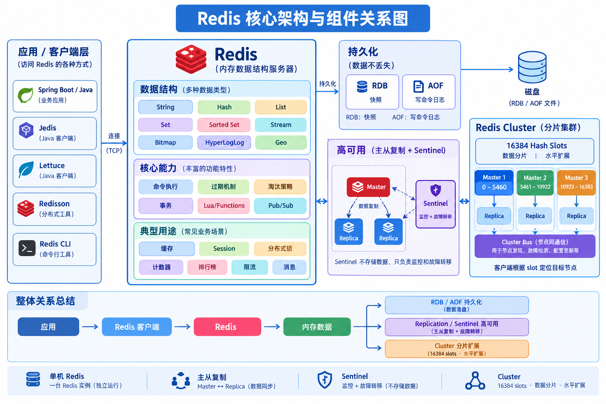
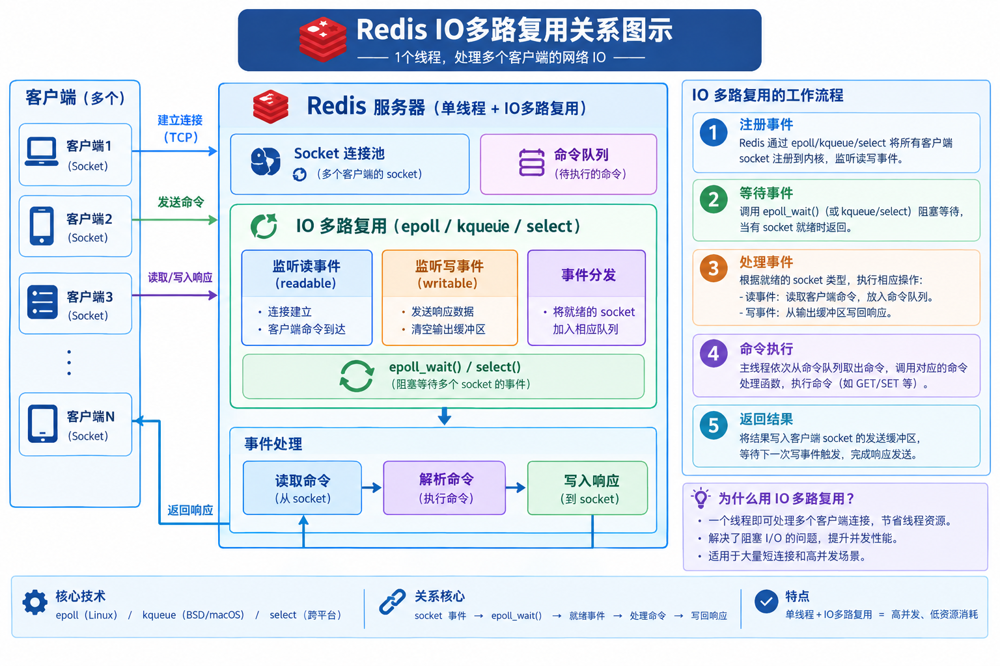
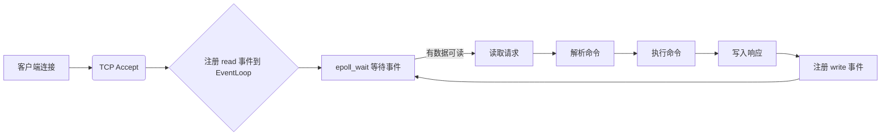
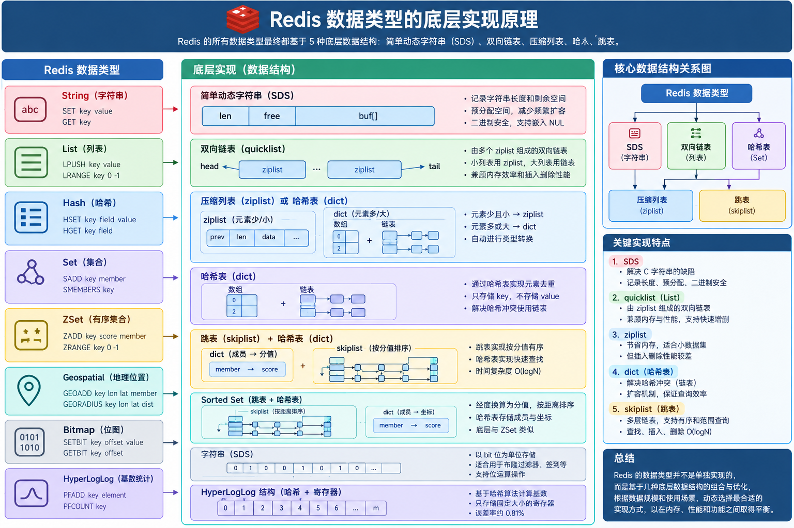
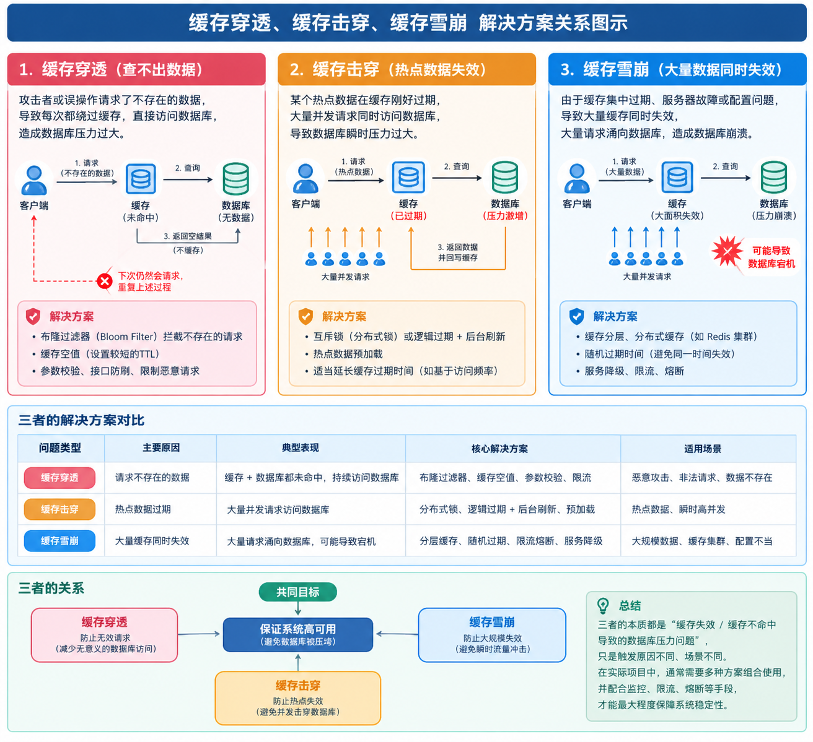

## 进入 Redis

要进入 Redis，通常是指**连接到 Redis 服务器并使用其命令行交互界面（CLI）**。以下是几种常见方式，适用于本地开发、远程服务器或 Docker 环境。

---

### ✅ 一、前提条件

确保 Redis 服务已安装并正在运行：

- **Linux / macOS**：通过包管理器（如 `apt`、`brew`）或源码安装
- **Windows**：
  - 推荐使用 **WSL2（Ubuntu）** 安装 Redis（官方不支持原生 Windows）
  - 或使用 [MicrosoftArchive/redis](https://github.com/microsoftarchive/redis)（仅用于测试，已停止维护）

> 💡 检查 Redis 是否运行：
>
> ```bash
> ps aux | grep redis
> # 或
> systemctl status redis   # Ubuntu/CentOS
> ```

---

### ✅ 二、进入 Redis CLI（最常用方式）

#### 1. **本地连接（默认配置）**

```bash
redis-cli
```

- 默认连接 `127.0.0.1:6379`
- 无密码（若未配置）

进入后你会看到：

```bash
127.0.0.1:6379>
```

#### 2. **指定主机和端口（远程连接）**

```bash
redis-cli -h <host> -p <port>
# 例如：
redis-cli -h 192.168.1.100 -p 6380
```

#### 3. **带密码认证**

如果 Redis 配置了密码（`requirepass yourpassword`）：

```bash
# 方式1：连接后手动认证
redis-cli -h 127.0.0.1 -p 6379
127.0.0.1:6379> AUTH yourpassword

# 方式2：连接时直接传密码（推荐）
redis-cli -h 127.0.0.1 -p 6379 -a yourpassword
```

> ⚠️ 警告：`-a` 会明文暴露密码（在历史命令中可见），生产环境建议用方式1，或使用 `--askpass`（Redis 6+）：
>
> ```bash
> redis-cli -h 127.0.0.1 -p 6379 --askpass
> ```

#### 4. **选择数据库（Redis 默认有 16 个 DB，编号 0~15）**

```bash
127.0.0.1:6379> SELECT 1
OK
127.0.0.1:6379[1]>
```

---

### ✅ 三、其他进入 Redis 的方式

#### 1. **通过 Docker 进入 Redis 容器**

```bash
# 先启动 Redis 容器（如果还没运行）
docker run --name my-redis -d -p 6379:6379 redis

# 进入容器内部的 redis-cli
docker exec -it my-redis redis-cli
```

#### 2. **使用 Redis Desktop Manager（图形界面）**

- 工具：[RedisInsight](https://redis.com/redis-enterprise/redis-insight/)（官方推荐，免费）
- 或旧版：Redis Desktop Manager（RDM）
- 适合可视化查看数据结构、监控性能

#### 3. **在应用程序中连接（如 Java、Python）**

虽然不是“进入”，但也是常用交互方式：

```python
# Python 示例（需安装 redis-py）
import redis
r = redis.Redis(host='localhost', port=6379, password='yourpassword')
r.set('name', 'Alice')
print(r.get('name'))
```

---

### ✅ 四、常用验证命令（进入后测试）

```bash
127.0.0.1:6379> PING
PONG

127.0.0.1:6379> INFO server    # 查看 Redis 版本等信息

127.0.0.1:6379> KEYS *         # 查看所有 key（生产环境慎用！）
```

---

### ❌ 常见问题排查

| 问题                             | 解决方案                                                     |
| -------------------------------- | ------------------------------------------------------------ |
| `Could not connect to Redis`     | 检查 Redis 是否启动：`sudo systemctl start redis`            |
| `NOAUTH Authentication required` | 使用 `AUTH yourpassword` 或 `-a` 参数                        |
| 连接被拒绝（Connection refused） | 检查 `redis.conf` 中 `bind` 和 `protected-mode` 配置         |
| 远程无法连接                     | 确保服务器防火墙开放 6379 端口，且 `redis.conf` 中 `bind 0.0.0.0` |

> 🔒 **安全提示**：  
> 生产环境 Redis **不要暴露在公网**！务必设置强密码，并限制 IP 访问。

---

### ✅ 总结：最常用命令

| 场景           | 命令                                  |
| -------------- | ------------------------------------- |
| 本地无密码进入 | `redis-cli`                           |
| 远程带密码进入 | `redis-cli -h IP -p PORT -a PASSWORD` |
| Docker 中进入  | `docker exec -it 容器名 redis-cli`    |
| 安全输入密码   | `redis-cli --askpass`                 |

---

现在你可以打开终端，输入 `redis-cli` 开始练习 Redis 命令了！如果遇到连接问题，欢迎提供具体错误信息，我可以帮你诊断。

## Redis命令

Redis 服务端收到命令后统一转成内部小写（大写）匹配命令表。所有 Redis 原生命令（GET、DEL、HSET）都这样。

### 一、基础键（Key）操作命令

所有 Redis 数据都以“键（Key）”为索引，这类命令用于管理 Key 本身（如创建、删除、查询状态），是最基础的操作。

| 命令                  | 功能描述                                               | 示例                                                |
| --------------------- | ------------------------------------------------------ | --------------------------------------------------- |
| `KEYS pattern`        | 查找匹配 `pattern` 的所有 Key（慎用！海量 Key 会阻塞） | `KEYS user:*`（查找所有以 `user:` 开头的 Key）      |
| `EXISTS key [key...]` | 判断一个或多个 Key 是否存在，返回存在的数量            | `EXISTS user:1001`（返回 1 表示存在，0 表示不存在） |
| `DEL key [key...]`    | 删除一个或多个 Key，返回删除成功的数量                 | `DEL user:1001 cart:2002`（删除 2 个 Key）          |
| `EXPIRE key seconds`  | 给 Key 设置过期时间（单位：秒）                        | `EXPIRE user:token 3600`（1 小时后过期）            |
| `TTL key`             | 查看 Key 的剩余过期时间（-1 永不过期，-2 已过期）      | `TTL user:token`（返回 1800 表示剩余 30 分钟）      |
| `TYPE key`            | 查看 Key 对应的值的类型（如 string、hash）             | `TYPE user:1001`（返回 hash 表示该 Key 是哈希类型） |
| `RENAME key newkey`   | 重命名 Key（若 newkey 已存在，会覆盖）                 | `RENAME user:1001 user:1002`                        |


### 二、数据类型操作命令

针对 Redis 5 种基础数据类型（String、Hash、List、Set、Sorted Set）的专属操作命令，是日常开发中最常用的类别。

| 类型                 | 中文名   | 特点                                 | 典型应用场景                 |
| -------------------- | -------- | ------------------------------------ | ---------------------------- |
| `STRING`             | 字符串   | 最基础类型，可存字符串、整数、浮点数 | 缓存、计数器、分布式锁       |
| `LIST`               | 列表     | 有序、可重复、双向链表               | 消息队列、最新消息列表       |
| `SET`                | 集合     | 无序、不重复、支持集合运算           | 标签系统、共同好友、去重     |
| `HASH`               | 哈希     | 键值对集合（field-value）            | 存储对象（如用户信息）       |
| `ZSET`（Sorted Set） | 有序集合 | 不重复 + 按 score 排序               | 排行榜、延迟队列、优先级队列 |

#### 1. String 类型命令（存储字符串/数字/二进制）

| 命令                    | 功能描述                                      | 示例                                                  |
| ----------------------- | --------------------------------------------- | ----------------------------------------------------- |
| `SET key value [NX|XX]` | 设置 Key 的值（NX：不存在才设，XX：存在才设） | `SET name redis NX`（name 不存在时设为 redis）        |
| `GET key`               | 获取 Key 的值                                 | `GET name`（返回 "redis"）                            |
| `INCR key`              | 将 Key 的值（数字）自增 1，返回自增后的值     | `INCR user:id`（生成自增用户 ID）                     |
| `INCRBY key increment`  | key 的值 + 指定数值                           | INCRBY views 5（views = 原值 + 5）                    |
| `DECR key`              | 将 Key 的值（数字）自减 1，返回自减后的值     | `DECR stock:1001`（库存减 1）                         |
| `DECRBY key decrement`  | key 的数值 - 指定值                           | DECRBY stock 3 （stock=原值-3）                       |
| `APPEND key value`      | 给 Key 的值追加字符串，返回新长度             | `APPEND name " is good"`（name 变为 "redis is good"） |
| `STRLEN key`            | 查看 Key 的值的字符串长度                     | `STRLEN name`（返回 12）                              |

##### SET key value [NX|XX] [EX seconds|PX milliseconds] [KEEPTTL]

是的，`SET key value` 命令支持同时添加 `EX`（过期时间，秒）或 `PX`（过期时间，毫秒）参数，与 `NX`/`XX` 组合使用，实现“条件设置+过期时间”的原子操作。这是 Redis 2.6.12 及以上版本支持的功能，非常适合分布式锁、缓存设置等场景。

###### 完整语法与参数说明

`SET` 命令的完整参数格式如下（方括号表示可选）：

```bash
SET key value [NX|XX] [EX seconds|PX milliseconds] [KEEPTTL]
```

- **`NX`**：Only set the key if it **does NOT exist**（仅当 key 不存在时才设置）。
- **`XX`**：Only set the key if it **already EXISTS**（仅当 key 存在时才设置）。
- **`EX seconds`**：设置 key 的过期时间（单位：秒），如 `EX 3600` 表示 1 小时后过期。
- **`PX milliseconds`**：设置 key 的过期时间（单位：毫秒），如 `PX 1000` 表示 1 秒后过期。
- **`KEEPTTL`**：保留 key 原有的过期时间（若 key 已存在），新增时不覆盖。

###### 典型组合示例

1. **`NX + EX`**：key 不存在时设置值，并指定过期时间（分布式锁常用）  

   ```bash
   # 仅当 lock:order 不存在时，设置为 "123" 并设置 30 秒过期
   SET lock:order 123 NX EX 30
   ```

- 用途：实现分布式锁（确保同一时间只有一个线程获取锁，且锁自动过期避免死锁）。

2. **`XX + PX`**：key 存在时更新值，并刷新过期时间（缓存更新常用）  

   ```bash
   # 仅当 user:1001 存在时，更新值为 "new_name" 并设置 5 分钟（300000 毫秒）过期
   SET user:1001 new_name XX PX 300000
   ```

- 用途：更新已存在的缓存，并延长过期时间，避免缓存提前失效。

3. **单独使用 `EX`**：无条件设置值并指定过期时间（普通缓存设置）  

   ```bash
   # 设置商品缓存，1 小时后过期
   SET goods:1001 '{"name":"手机","price":1999}' EX 3600
   ```

###### 为什么需要组合使用？

- **原子性保证**：`SET` 命令的所有参数是一次性执行的，避免“先判断 key 是否存在，再设置值和过期时间”的两步操作带来的并发问题（如分布式锁的竞态条件）。
- **简化代码**：无需单独调用 `EXPIRE` 命令，一行命令完成多步操作，减少网络交互。

#### 2. Hash 类型命令（存储键值对集合，适合对象）

| 命令                                    | 功能描述                     | 示例                                       |
| --------------------------------------- | ---------------------------- | ------------------------------------------ |
| `HSET key field value [field value...]` | 设置 Hash 的一个或多个字段值 | `HSET user:1001 name zhangsan age 20`      |
| `HGET key field`                        | 获取 Hash 中指定字段的值     | `HGET user:1001 name`（返回 "zhangsan"）   |
| `HGETALL key`                           | 获取 Hash 中所有字段和值     | `HGETALL user:1001`（返回所有用户属性）    |
| `HDEL key field [field...]`             | 删除 Hash 中指定字段         | `HDEL user:1001 age`（删除年龄字段）       |
| `HLEN key`                              | 查看 Hash 中的字段数量       | `HLEN user:1001`（返回 1，只剩 name 字段） |

##### 1. 三个角色分别是什么

- **key**：Redis 大键，整个 Hash 结构的**唯一标识**
- **field**：Hash 内部的**字段名**（类比 Java 对象的属性名）
- **value**：对应 field 的**字段值**（类比 Java 对象的属性值）

##### 2. 形象类比（最好理解）

把 **Hash** 看成 **一张表 / 一个 Java 对象**：

```
key = 用户名:zhangsan      【整个对象的唯一编号】
├── field = name    → value = 张三
├── field = age     → value = 22
└── field = sex     → value = 男
```

##### 3. 结构层级

```
Redis 全局
   ↓
key（第一层）
   ↓
field（第二层子键） → value（对应值）
```

Hash 本质结构：

```
Map<key, Map<field, value>>
```

##### 4. 举实际例子

```bash
HSET user:1001 name "李四" age 25 city "北京"
```

- **key** = `user:1001`
- **field** = `name`、`age`、`city`
- **value** = `李四`、`25`、`北京`

##### 5. 适用场景

- key：用户ID、商品ID 作为外层大key
- field：姓名、年龄、手机号、价格等属性
- value：对应属性具体值

一句话总结：
**key 是整个哈希的名字，field 是里面小字段，value 是小字段对应的值。**

#### 3. List 类型命令（有序可重复列表，适合队列）

| 命令                         | 功能描述                                              | 示例                                                         |
| ---------------------------- | ----------------------------------------------------- | ------------------------------------------------------------ |
| `LPUSH key value [value...]` | 从 List 左侧（头部）添加元素                          | `LPUSH msg:queue msg1 msg2`（队列头部加 2 条消息）           |
| `RPOP key`                   | 从 List 右侧（尾部）移除并返回元素                    | `RPOP msg:queue`（返回 "msg1"，实现队列消费）                |
| `LRANGE key start stop`      | 获取 List 中指定范围的元素（0 开始，-1 表示最后一个） | `LRANGE msg:queue 0 -1`（查看所有消息）                      |
| `LLEN key`                   | 查看 List 的元素数量                                  | `LLEN msg:queue`（返回 1，只剩 msg2）                        |
| LTRIM key start stop         | “只保留 List 中的一段，其余全部丢掉”                  | `start`：起始下标（从 0 开始）；`stop`：结束下标（包含）；下标可以是负数（从尾部算起） |

#### 4. Set 类型命令（无序不可重复集合，适合去重）

| 命令                          | 功能描述                            | 示例                                           |
| ----------------------------- | ----------------------------------- | ---------------------------------------------- |
| `SADD key member [member...]` | 向 Set 中添加元素                   | `SADD user:tags java redis`（添加 2 个标签）   |
| `SMEMBERS key`                | 获取 Set 中所有元素                 | `SMEMBERS user:tags`（返回所有标签）           |
| `SISMEMBER key member`        | 判断元素是否在 Set 中（1 是，0 否） | `SISMEMBER user:tags java`（返回 1）           |
| `SINTER key1 key2`            | 求两个 Set 的交集（共同元素）       | `SINTER user1:tags user2:tags`（返回共同标签） |
| `SCARD key`                   | 查看 Set 的元素数量                 | `SCARD user:tags`（返回 2）                    |

#### 5. Sorted Set 类型命令（有序不可重复集合，适合排行榜）

Redis 的 ZSet 会自动按 score 排序：score 越大，排名越靠前。

特性：
**自动按 score 排序、member 唯一不可重复、适合排行榜/热度榜/延时队列**
默认：**ZRANGE 升序（分数从小到大）、ZREVRANGE 降序（分数从大到小，排行榜用这个）**

| 命令                                                         | 功能描述                                         | 实用示例                                              |
| ------------------------------------------------------------ | ------------------------------------------------ | ----------------------------------------------------- |
| `ZADD key score member [score member...]`                    | 添加/更新元素，指定排序分值 score                | `ZADD rank:user 95 zhangsan 88 lisi 92 wangwu`        |
| `ZRANGE key start stop [WITHSCORES]`                         | 按**分数升序**查范围，加 WITHSCORES 连带分数返回 | `ZRANGE rank:user 0 -1 WITHSCORES` 查看全部升序榜单   |
| `ZREVRANGE key start stop [WITHSCORES]`                      | 按**分数降序**查范围，**排行榜首选**             | `ZREVRANGE rank:user 0 9 WITHSCORES` 取前10名榜单     |
| `ZSCORE key member`                                          | 查询某个 member 的分值                           | `ZSCORE rank:user zhangsan`                           |
| `ZINCRBY key increment member`                               | 给指定 member 分值**自增**（热度/积分累加）      | `ZINCRBY rank:user 5 zhangsan` 张三分数+5             |
| `ZRANK key member`                                           | 查升序排名（下标从0开始）                        | `ZRANK rank:user lisi`                                |
| `ZREVRANK key member`                                        | 查**降序排名**（真实排行榜名次，从0开始）        | `ZREVRANK rank:user zhangsan` 查排第几                |
| `ZCARD key`                                                  | 获取 ZSet 元素总个数                             | `ZCARD rank:user`                                     |
| `ZCOUNT key min max`                                         | 统计指定分数区间内的元素数量                     | `ZCOUNT rank:user 80 100` 统计80~100分人数            |
| `ZREM key member [member...]`                                | 删除指定一个/多个 member 元素                    | `ZREM rank:user lisi`                                 |
| `ZREMRANGEBYRANK key start stop`                             | 按**排名下标范围**删除                           | `ZREMRANGEBYRANK rank:user 0 2` 删除前3名             |
| `ZREMRANGEBYSCORE key min max`                               | 按**分数区间**删除                               | `ZREMRANGEBYSCORE rank:user 0 60` 删除60分及以下      |
| `ZREMRANGEBYLEX key min max`                                 | 按 member 字典序范围删除（固定分值场景）         | 多用于固定score做分组                                 |
| `ZRANGEBYSCORE key min max [WITHSCORES] [LIMIT offset count]` | 按分数升序区间查询，支持分页                     | `ZRANGEBYSCORE rank:user 80 100 WITHSCORES LIMIT 0 5` |
| `ZREVRANGEBYSCORE key max min [WITHSCORES]`                  | 按分数降序区间查询，适合分段榜单                 | `ZREVRANGEBYSCORE rank:user 100 80 WITHSCORES`        |
| `ZRANGEBYLEX key min max`                                    | 按 member 字典序查询（分值相同场景）             | 同分情况下按用户名排序                                |

#### 补充关键说明（面试+实战必记）

1. **ZREVRANGE / ZREVRANK** 做排行榜标配，分数越高越靠前
2. **ZINCRBY** 适合实时热度、积分累加，不用查改再插入，原子操作
3. `start=0 stop=9` 取前10名；`0 -1` 查看全部
4. ZSet **member 唯一**，重复添加会覆盖原有 score，天然去重
5. 底层：数据少用 `ziplist`，超128个或member超64字节用 `skiplist+dict`，增删查 O(logn)，适配高并发排行榜

我可以给你配套写一份：**ZSet 实现每日排行榜的实战思路 + 过期清榜方案**，要吗？

### 三、持久化命令

控制 Redis 数据持久化（RDB/AOF）的命令，用于手动触发备份或查看持久化状态。

| 命令               | 功能描述                                        | 示例                                     |
| ------------------ | ----------------------------------------------- | ---------------------------------------- |
| `SAVE`             | 同步触发 RDB 持久化（阻塞 Redis，不推荐线上用） | `SAVE`（生成 dump.rdb 文件）             |
| `BGSAVE`           | 异步触发 RDB 持久化（后台执行，不阻塞）         | `BGSAVE`（推荐线上使用）                 |
| `BGREWRITEAOF`     | 异步重写 AOF 文件（压缩冗余命令，减小文件体积） | `BGREWRITEAOF`（AOF 开启时用）           |
| `INFO persistence` | 查看持久化相关信息（如 RDB 最后备份时间）       | `INFO persistence`（返回持久化状态详情） |


### 四、内存管理命令

控制 Redis 内存使用、查看内存状态的命令，用于避免 OOM 和优化内存。

| 命令                          | 功能描述                                       | 示例                                 |
| ----------------------------- | ---------------------------------------------- | ------------------------------------ |
| `CONFIG SET maxmemory bytes`  | 设置 Redis 最大使用内存（如 1GB = 1073741824） | `CONFIG SET maxmemory 1073741824`    |
| `CONFIG GET maxmemory-policy` | 查看当前内存淘汰策略（如 volatile-lru）        | `CONFIG GET maxmemory-policy`        |
| `INFO memory`                 | 查看内存使用详情（如已用内存、内存占比）       | `INFO memory`（返回内存相关指标）    |
| `FLUSHDB`                     | 清空当前数据库的所有 Key（谨慎！）             | `FLUSHDB`（仅清空当前 db，默认 db0） |
| `FLUSHALL`                    | 清空所有数据库的所有 Key（生产环境禁用！）     | `FLUSHALL`（删除所有数据，无法恢复） |


### 五、事务命令

控制 Redis 事务（批量执行命令）的命令，保证命令的“一次性、顺序性”。

| 命令                 | 功能描述                                    | 示例                                         |
| -------------------- | ------------------------------------------- | -------------------------------------------- |
| `MULTI`              | 开启事务（后续命令加入事务队列，不执行）    | `MULTI`（进入事务模式）                      |
| `EXEC`               | 执行事务队列中的所有命令，返回结果列表      | `EXEC`（执行事务，返回每条命令结果）         |
| `DISCARD`            | 取消事务，清空队列中的命令                  | `DISCARD`（放弃未执行的事务）                |
| `WATCH key [key...]` | 监控 Key，若事务执行前 Key 被修改，事务取消 | `WATCH stock:1001`（监控库存，防止并发修改） |


### 六、发布/订阅命令

实现 Redis 发布/订阅（Pub/Sub）模式的命令，用于简单消息通信。

| 命令                               | 功能描述                                     | 示例                                                 |
| ---------------------------------- | -------------------------------------------- | ---------------------------------------------------- |
| `SUBSCRIBE channel [channel...]`   | 订阅一个或多个频道，接收消息                 | `SUBSCRIBE msg:user`（订阅用户消息频道）             |
| `PUBLISH channel message`          | 向指定频道发布消息，返回接收消息的订阅者数量 | `PUBLISH msg:user "hello"`（发布消息，返回订阅者数） |
| `UNSUBSCRIBE channel [channel...]` | 取消订阅指定频道                             | `UNSUBSCRIBE msg:user`（取消订阅）                   |


### 七、集群命令

Redis Cluster 集群模式下的管理命令，用于查看集群状态、节点操作。

| 命令                  | 功能描述                                        | 示例                                             |
| --------------------- | ----------------------------------------------- | ------------------------------------------------ |
| `CLUSTER INFO`        | 查看集群整体状态（如节点数、槽位分配）          | `CLUSTER INFO`（返回集群详情）                   |
| `CLUSTER NODES`       | 查看集群中所有节点的信息（ID、地址、角色）      | `CLUSTER NODES`（返回所有节点列表）              |
| `CLUSTER KEYSLOT key` | 计算 Key 对应的哈希槽位（Redis 集群按槽位分片） | `CLUSTER KEYSLOT user:1001`（返回 Key 所在槽位） |


### 八、脚本命令

执行 Lua 脚本的命令，用于实现原子性复杂逻辑（前文已详细介绍）。

| 命令                              | 功能描述                           | 示例                                              |
| --------------------------------- | ---------------------------------- | ------------------------------------------------- |
| `EVAL script numkeys key arg...`  | 直接执行 Lua 脚本                  | `EVAL "return redis.call('get', KEYS[1])" 1 name` |
| `SCRIPT LOAD script`              | 预加载脚本到 Redis，返回 SHA1 哈希 | `SCRIPT LOAD "return redis.call('get', KEYS[1])"` |
| `EVALSHA sha1 numkeys key arg...` | 通过 SHA1 执行预加载的脚本         | `EVALSHA abc123 1 name`（abc123 是脚本 SHA1）     |

### 九、批量能力

> Redis批量，核心目的：**减少网络RTT往返次数，提升吞吐量；Redis单线程，批量不会加快单条命令执行速度，只是减少网络开销**。
> 一共4种主流方案：**原生批量命令、Pipeline管道、MULTI/EXEC事务、Lua脚本**。

#### 1、原生批量命令（MGET / MSET / HMGET / HMSET）

##### MGET、MSET（String类型）

- `MGET k1 k2 k3`：一次性读取多个key
- `MSET k1 v1 k2 v2`：一次性写入多个key
  ✅特点：

1. **原子性**，命令一次性执行，要么全部成功，要么全部失败
2. 只能**同一种命令**，只能读写String类型key
3. Cluster集群限制：**多个key必须落在同一个hash槽**，否则报错

> 集群多key操作，不跨槽才能用MSET/MGET

❌缺点：只能简单读写，不能混合多种命令。

> 哈希类型：HMGET / HMSET，对同一个hash里面多个field批量读写。

#### 2、Pipeline 管道（最常用，面试重点）

原理：客户端缓存多条命令，**一次性打包发给Redis，Redis顺序执行，最后一次性返回全部结果**。
循环100次set，100次网络往返 → 1次网络往返。

✅特点：

1. **客户端层面的网络优化，不是原子操作！**

> 重点坑：中间某条命令执行失败，前面已经执行成功，不会回滚；其他客户端命令可以穿插在pipeline命令中间执行。

2. **支持混合多种命令**：set、get、expire、incr 可以放一起
3. 无命令种类限制，灵活度最高

⚠️限制：

1. 单次不要塞太多命令（一般几百条一批），防止Redis输出缓冲区爆掉、内存溢出。
2. **不能有命令依赖**：不能后一条命令依赖前一条的返回结果（一次性发送，拿不到中间返回值）
3. Cluster集群：多个key不在同一个hash槽，**也可以用pipeline**（只是会分发到不同节点，客户端需要路由）

> 一句话区分：MGET/MSET是服务端原生单命令；Pipeline是客户端打包多条独立命令。

#### 3、MULTI / EXEC 事务

MULTI开启事务，命令入队，EXEC一次性执行。
✅特点：执行期间不会插入其他客户端命令，**执行阶段是隔离的**
❌巨大坑：**不支持回滚！** 命令入队成功，执行时报错，前面成功的命令不会撤销。

> 生产很少用来做批量，原子性不完整。

#### 4、Lua脚本（EVAL）

把多条命令+业务逻辑写在Lua脚本，**整个脚本在Redis服务端原子执行**。
✅特点：

1. **强原子**，脚本执行过程，其他命令全部阻塞，全部执行完才释放；
2. 支持条件判断、业务逻辑，减少多次网络交互；
3. 适合**需要原子批量+业务判断**场景（比如分布式锁、扣减库存）

⚠️Cluster限制：脚本操作的所有key必须在同一个hash槽。
⚠️脚本不能写太长，长时间阻塞Redis单线程，造成线上卡顿。

#### 对比表（背诵）

| 方案              | 原子性               | 支持混合命令    | 集群限制                | 适用场景                         |
| ----------------- | -------------------- | --------------- | ----------------------- | -------------------------------- |
| MGET/MSET原生批量 | ✅原子                | ❌只能同一种命令 | key必须同槽             | 简单批量读写String               |
| Pipeline管道      | ❌非原子              | ✅支持多种命令   | key可跨槽（客户端路由） | 大批量读写，无原子要求（最常用） |
| MULTI事务         | 执行隔离，**无回滚** | ✅混合命令       | key同槽                 | 极少使用，不推荐                 |
| Lua脚本           | ✅原子                | ✅支持+条件逻辑  | key必须同槽             | 批量操作+原子业务判断            |

#### 高频面试追问

##### Q：Pipeline和MGET哪个性能好？

场景简单（批量读string）：MGET性能略好；
命令种类多（set+expire+get），优先Pipeline。
两者核心收益都是减少网络往返。

##### Q：Pipeline有没有原子性？

**没有！** 这是最高频坑。Pipeline只是打包发送，命令依次执行，中间失败不会回滚。如果需要原子，选Lua脚本。

##### Q：Cluster集群批量操作有什么限制？

MSET/MGET、Lua脚本，**所有key必须落在同一个slot**，否则报错；
Pipeline不受这个限制，key跨槽也可以，客户端会自动路由到不同节点。

##### Q：批量操作的最佳实践？

1. 无原子要求，大批量读写：Pipeline，分批，一次几百条，不要一次性上万条；
2. 简单多key读写：MGET/MSET；
3. 需要原子批量+业务判断：Lua脚本；
4. 禁止超大key、超大数据包批量操作，避免缓冲区溢出。

#### ✅面试口述精简版

Redis批量能力一共有4种方案：原生批量命令、Pipeline管道、MULTI事务、Lua脚本。
原生MGET/MSET是服务端单命令，具备原子性，但是只能执行同一种命令，集群下key必须在同一个哈希槽。
Pipeline管道是客户端层面的网络优化，打包多条命令一次性发送，减少网络往返，可以混合多种命令；**但是不具备原子性，中间失败不会回滚**，适合大批量读写，业务不需要原子的场景。
MULTI事务执行阶段隔离，但是没有回滚能力，生产很少使用。
Lua脚本在Redis服务端原子执行，支持条件逻辑，适合需要原子性的批量业务，缺点是脚本执行会阻塞Redis，集群下key必须同槽。

> 选型：单纯批量读写优先Pipeline；简单多key读写用MGET/MSET；要原子批量逻辑选Lua。


---

## Redis命令练习

Redis 提供了 **5 种基本数据类型**，每种类型都有其独特的命令和适用场景。下面为你整理一份 **清晰、实用、可动手练习** 的 Redis 五大数据类型命令速查与练习指南，适合初学者巩固基础，也适合开发者快速回顾。

---

### 🧩 Redis 五种基本数据类型

| 类型                 | 中文名   | 特点                                 | 典型应用场景                 |
| -------------------- | -------- | ------------------------------------ | ---------------------------- |
| `STRING`             | 字符串   | 最基础类型，可存字符串、整数、浮点数 | 缓存、计数器、分布式锁       |
| `LIST`               | 列表     | 有序、可重复、双向链表               | 消息队列、最新消息列表       |
| `SET`                | 集合     | 无序、不重复、支持集合运算           | 标签系统、共同好友、去重     |
| `HASH`               | 哈希     | 键值对集合（field-value）            | 存储对象（如用户信息）       |
| `ZSET`（Sorted Set） | 有序集合 | 不重复 + 按 score 排序               | 排行榜、延迟队列、优先级队列 |

---

### ✅ 1. STRING（字符串）

#### 常用命令

```bash
# 设置 & 获取
SET key value
GET key

# 设置并返回旧值
GETSET key new_value

# 批量操作
MSET key1 val1 key2 val2
MGET key1 key2

# 自增/自减（整数）
INCR key        # +1
DECR key        # -1
INCRBY key 10   # +10
DECRBY key 5    # -5

# 过期时间
SETEX key 60 "hello"   # 设置值并60秒后过期  SETEX key seconds value
TTL key                # 查看过期剩余秒数，过期返回(nil)   
返回值含义如下
>= 0：key 存在，且设置了过期时间，返回剩余秒数。
-1：key 存在，但没有设置过期时间（永久有效）。
-2：key 不存在。
```

#### 💡 练习

```bash
SET user:1001:name "Alice"
GET user:1001:name

INCR page:view:home
INCR page:view:home
GET page:view:home  # 应为 2

SETEX temp:token 30 "abc123"
TTL temp:token      # 应为 30 左右
```

---

#### ✅ 一、String 用作缓存（Cache）

##### 🎯 场景描述

将数据库查询结果、计算结果等**高频读、低频变**的数据存入 Redis，减少数据库压力，提升响应速度。

##### 🔧 实现方式

```bash
# 1. 查询缓存（伪代码逻辑）
value = GET user:1001
if value == nil:
    value = DB.query("SELECT * FROM users WHERE id=1001")
    SETEX user:1001 300 value  # 缓存5分钟
return value
```

##### 💡 实际示例（用户信息缓存）

```java
// Java + Spring Data Redis
public User getUserById(Long id) {
    String key = "user:" + id;
    User user = redisTemplate.opsForValue().get(key);
    if (user == null) {
        user = userMapper.selectById(id); // 查数据库
        redisTemplate.opsForValue().set(key, user, Duration.ofMinutes(5));
    }
    return user;
}
```

##### ⚠️ 注意事项

| 问题                                    | 解决方案                                                     |
| --------------------------------------- | ------------------------------------------------------------ |
| **缓存穿透**（查不存在的数据）          | 缓存空值（`SETEX key 60 ""`）+ 布隆过滤器+接口层参数校验限流 |
| **缓存击穿**（热点 key 过期瞬间高并发） | 互斥锁重建缓存 / 逻辑过期                                    |
| **缓存雪崩**（大量 key 同时过期）       | 过期时间加随机值（如 300±60 秒）+多级缓存（caffeine+redis缓存） |

**逻辑过期** 不是真的让缓存数据在 Redis 中 “过期删除”，而是在缓存值中嵌入一个 “过期时间字段”，Redis 本身不设置过期时间（或设置一个很长的过期时间）。当请求查询缓存时，程序先判断这个内嵌的过期时间是否已到：

- 如果没过期，直接返回缓存数据；
- 如果已过期，不立即删除缓存，而是先返回旧数据，再异步去更新缓存。

**互斥锁（分布式锁）**

缓存失效时，只让一个线程去查 DB 重建缓存，其他线程等待。

---

#### ✅ 二、String 用作计数器（Counter）

##### 🎯 场景描述

利用 `INCR`/`DECR` 的**原子性**，实现高并发下的安全计数。

##### 🔧 核心命令

```bash
INCR key          # +1
INCRBY key 10     # +10
DECR key          # -1
GET key           # 查看当前值
```

##### 💡 典型应用场景

##### 1. **全局 ID 生成器**

```bash
INCR global:user:id   # 返回 1, 2, 3...
```

> ✅ 优点：简单、有序、分布式唯一（单 Redis 实例）

##### 2. **页面/接口访问量统计**

```bash
INCR page:view:home
INCR api:call:/user/profile
```

> 📊 可配合 `EXPIRE` 按天统计（如每天 0 点重置）

##### 3. **库存扣减（简易版）**

```bash
# 初始化库存
SET stock:iphone 100

# 扣库存（需配合 Lua 保证原子性，见下文）
DECR stock:iphone
```

> ⚠️ 注意：**纯 DECR 不能保证超卖**！需用 Lua 脚本或 `WATCH` + 事务。

##### ⚠️ 注意事项

- `INCR` 要求值必须是 **整数字符串**，否则报错。
- 计数器无过期时间 → 长期运行可能内存泄漏，建议定期清理或使用带过期的计数（如每天一个 key）。

---

#### ✅ 三、String 用作分布式锁（Distributed Lock）

##### 🎯 场景描述

在分布式系统中，**同一时间只允许一个服务实例执行某段代码**（如订单创建、库存扣减）。

##### 🔧 正确实现方式（推荐）

> ❌ 错误做法：`SETNX + EXPIRE`（非原子，可能死锁）  
> ✅ 正确做法：**`SET key value NX EX seconds`**（原子加锁）

```bash
# 加锁（value 建议用唯一标识，如 UUID）
SET lock:order:create "instance1-thread1-uuid" NX EX 30

# 解锁（必须用 Lua 脚本，防止删错别人的锁）
EVAL "if redis.call('GET', KEYS[1]) == ARGV[1] then return redis.call('DEL', KEYS[1]) else return 0 end" 1 lock:order:create "instance1-thread1-uuid"
```

##### 💡 Java 示例（Spring Boot + RedisTemplate）

```java
// 加锁
Boolean locked = redisTemplate.opsForValue()
    .setIfAbsent("lock:order", uuid, Duration.ofSeconds(30));

if (Boolean.TRUE.equals(locked)) {
    try {
        // 执行业务逻辑
        createOrder();
    } finally {
        // 解锁（使用 Lua 脚本）
        String script = "if redis.call('GET', KEYS[1]) == ARGV[1] then return redis.call('DEL', KEYS[1]) else return 0 end";
        redisTemplate.execute(new DefaultRedisScript<>(script, Long.class), 
                              Collections.singletonList("lock:order"), uuid);
    }
}
```

##### ⚠️ 关键注意事项

| 问题                     | 解决方案                                        |
| ------------------------ | ----------------------------------------------- |
| **锁过期但业务未执行完** | 设置合理超时时间 + 使用 Redisson 看门狗自动续期 |
| **锁被其他线程误删**     | value 用唯一标识 + Lua 脚本校验后删除           |
| **主从切换导致锁丢失**   | 使用 Redlock 算法（多节点）或 ZooKeeper/Etcd    |

> 🚀 **生产建议**：直接使用 **Redisson** 客户端，它封装了完善的分布式锁（支持可重入、看门狗、Redlock）。

---

#### 🆚 三大场景对比总结

| 场景         | 核心命令          | 关键特性         | 注意事项                    |
| ------------ | ----------------- | ---------------- | --------------------------- |
| **缓存**     | `SET/GET/SETEX`   | 读多写少、带过期 | 防穿透/击穿/雪崩            |
| **计数器**   | `INCR/DECR`       | 原子自增、高性能 | 防超卖需额外逻辑            |
| **分布式锁** | `SET NX EX` + Lua | 互斥、防死锁     | 必须用唯一 value + Lua 解锁 |

---

#### 💡 最佳实践建议

1. **缓存**：
   - 热点数据永不过期 + 后台异步更新
   - 大 Value 拆分（避免阻塞 Redis）

2. **计数器**：
   - 高频计数用 **Redis + 定时同步到 DB**
   - 精确扣减用 **Lua 脚本**（如库存）

3. **分布式锁**：
   - **不要自己造轮子**！优先用 Redisson
   - 锁粒度尽量小，减少持有时间

---

### ✅ 2. LIST（列表）

#### 常用命令

```bash
# 从左边/右边插入
LPUSH key value1 value2   # 头部插入
RPUSH key value1 value2   # 尾部插入

# 弹出元素
LPOP key   # 弹出左边第一个
RPOP key   # 弹出右边第一个

# 查看范围（0 -1 表示全部）
LRANGE key 0 -1

# 获取长度
LLEN key

# 阻塞弹出（用于消息队列）
BLPOP key 10   # 阻塞最多10秒，直到有元素可弹出
```

#### 💡 练习

```bash
LPUSH news "新闻3" "新闻2"
RPUSH news "新闻4"

LRANGE news 0 -1  # 顺序应为：新闻2, 新闻3, 新闻4

LPOP news         # 弹出 "新闻2"
RPOP news         # 弹出 "新闻4"
```

> 📌 **注意**：LPUSH + RPOP = 队列（FIFO）；LPUSH + LPOP = 栈（LIFO）

Redis 的 **List（列表）** 是一个**有序、可重复、支持双向操作**的数据结构，底层使用**快速链表（quicklist）** 实现，非常适合需要 **顺序处理、先进先出（FIFO）或后进先出（LIFO）** 的场景。

---

#### ✅ 一、消息队列（Message Queue）

##### 🎯 场景描述

将任务或消息放入队列，由消费者异步处理，实现**解耦、削峰、异步处理**。

##### 🔧 实现方式（生产者-消费者模型）

```bash
# 生产者：往队列尾部添加任务
LPUSH task:queue "send_email:user123"
LPUSH task:queue "generate_report:order456"

# 消费者：从队列头部阻塞式获取任务（推荐）
BRPOP task:queue 0   # 0 表示永久阻塞，直到有元素
# 返回：1) "task:queue" 2) "generate_report:order456"
```

> ✅ **为什么用 `LPUSH + BRPOP`？**  
>
> - `LPUSH`：新任务插到左边（头部）  
> - `BRPOP`：从右边（尾部）弹出 → **先进先出（FIFO）**

##### 💡 实际案例

- 用户注册后发送欢迎邮件
- 订单支付成功后发短信通知
- 日志异步写入（避免阻塞主流程）

##### ⚠️ 注意事项

- **消息可靠性**：如果消费者崩溃，消息会丢失（无 ACK 机制）  
  → 解决方案：用 **Stream**（Redis 5.0+）或 **RabbitMQ/Kafka**
- **积压监控**：定期检查 `LLEN task:queue`，防止队列爆炸

---

#### ✅ 二、最新消息/动态列表（Timeline）

##### 🎯 场景描述

展示用户最新的 N 条动态、评论、日志等（按时间倒序）。

##### 🔧 实现方式

```bash
# 用户发新动态
LPUSH user:1001:timeline "今天天气真好！"
LPUSH user:1001:timeline "刚完成一个项目！"

# 只保留最近 100 条（防止无限增长）
LTRIM user:1001:timeline 0 99

# 获取最新 10 条（0=最新，9=最旧）
LRANGE user:1001:timeline 0 9
```

##### 💡 实际案例

- 微博/朋友圈最新动态
- 用户操作日志（最近 50 次登录）
- 商品最新评论列表

##### ⚠️ 注意事项

- **内存控制**：务必用 `LTRIM` 限制长度
- **分页问题**：List 不支持高效分页（如跳过前 1000 条），大数据量建议用 **ZSET（按时间戳排序）**

---

#### ✅ 三、任务栈（Stack）

##### 🎯 场景描述

需要**后进先出（LIFO）** 的场景，如撤销操作、深度优先遍历。

##### 🔧 实现方式

```bash
# 压栈
LPUSH undo:actions "delete_file"
LPUSH undo:actions "edit_text"

# 弹栈（撤销）
LPOP undo:actions  # 返回 "edit_text"
```

##### 💡 实际案例

- 文本编辑器的“撤销”功能
- 爬虫的 URL 深度优先抓取
- 游戏中的技能释放栈

---

#### ✅ 四、排行榜（简易版）

> ⚠️ 注意：**复杂排行榜请用 ZSET**，但 List 可用于**固定顺序的榜单**。

##### 🎯 场景描述

展示预定义顺序的列表，如“热门推荐商品”（运营手动维护）。

##### 🔧 实现方式

```bash
# 运营后台设置热门商品（按推荐顺序）
RPUSH hot:products "iPhone15"
RPUSH hot:products "MacBook Pro"
RPUSH hot:products "AirPods"

# 前端获取
LRANGE hot:products 0 -1
```

##### 💡 优势

- 插入顺序即展示顺序
- 支持动态调整（`LINSERT` 插入到指定元素前后）

---

#### ✅ 五、分布式限流（滑动窗口计数器）

> 虽然 ZSET 更精准，但 List 可实现**简易滑动窗口**。

##### 🎯 场景描述

限制用户每分钟最多请求 10 次。

##### 🔧 实现思路

```bash
# 每次请求时
key = "rate_limit:user123"
timestamp = 当前时间戳（秒）

# 移除1分钟前的记录
LTRIM key 0 9   # 先保留最多10个（粗略控制）

# 添加当前请求时间
LPUSH key timestamp

# 设置过期（防止长期占用）
EXPIRE key 60

# 判断是否超限
if LLEN key > 10:
    拒绝请求
```

> ⚠️ 缺点：精度不高，仅适用于要求不高的场景。  
> ✅ 推荐：用 **ZSET + ZREMRANGEBYSCORE** 实现精确滑动窗口。

---

#### 🆚 List vs 其他类型

| 需求               | 推荐类型   | 原因               |
| ------------------ | ---------- | ------------------ |
| 消息队列（可靠）   | **Stream** | 支持 ACK、消费者组 |
| 排行榜（动态排序） | **ZSET**   | 按 score 自动排序  |
| 去重列表           | **SET**    | 自动去重           |
| 存储对象           | **HASH**   | 字段可单独操作     |

---

#### ⚠️ List 使用注意事项

1. **大 Key 风险**  
   - 避免 List 超过 1 万条（`LRANGE` 全量读会阻塞 Redis）  
   - 解决方案：分片（如 `user:1001:timeline:202504`）

2. **阻塞操作慎用**  
   - `BLPOP`/`BRPOP` 在高并发下可能积压连接  
   - 建议设置超时时间：`BRPOP queue 5`（5秒超时）

3. **不支持随机访问**  
   - `LINDEX` 时间复杂度 O(N)，大数据量慎用

---

#### ✅ 总结：List 的核心价值

| 特性         | 适用场景                 |
| ------------ | ------------------------ |
| **有序**     | 时间线、任务队列         |
| **双向操作** | FIFO（队列）、LIFO（栈） |
| **原子性**   | 多线程安全入队/出队      |
| **简单高效** | 小数据量、高频读写       |

> 🚀 **一句话口诀**：  
> **“先进先出用队列（LPUSH + BRPOP），最新动态用列表（LPUSH + LTRIM）”**

---

### ✅ 3. SET（集合）

#### 常用命令

```bash
# 添加元素
SADD key member1 member2

# 查看所有元素
SMEMBERS key

# 判断是否存在
SISMEMBER key member

# 集合运算
SINTER key1 key2      # 交集
SUNION key1 key2      # 并集
SDIFF key1 key2       # 差集（key1 - key2）

# 随机弹出
SPOP key
```

#### 💡 练习

```bash
SADD user:1001:tags "java" "redis" "spring"
SADD user:1002:tags "python" "redis" "django"

SISMEMBER user:1001:tags "java"  # 返回 1（true）

SINTER user:1001:tags user:1002:tags  # 返回 "redis"
```

> 🎯 应用：找出两个用户的共同兴趣标签。

Redis 的 **Set（集合）** 是一个**无序、不重复、支持集合运算**的数据结构，底层使用 **哈希表（hashtable）** 实现，所有操作平均时间复杂度为 **O(1)**。它非常适合需要**去重、成员关系判断、集合交并差运算**的场景。

---

##### ✅ 一、标签系统（Tag System）

###### 🎯 场景描述

为内容（文章、商品、用户）打标签，并支持**按标签筛选、推荐相关内容**。

###### 🔧 实现方式

```bash
# 为文章打标签
SADD article:1001:tags "redis" "database" "backend"
SADD article:1002:tags "java" "spring" "backend"
SADD article:1003:tags "redis" "cache" "performance"

# 查找同时包含 "redis" 和 "backend" 的文章（交集）
SINTER article:1001:tags article:1002:tags  # 返回空
SINTER article:1001:tags article:1003:tags  # 返回 "redis"

# 更高效做法：反向索引（推荐）
SADD tag:redis 1001 1003
SADD tag:backend 1001 1002

# 查找带 "redis" 标签的所有文章
SMEMBERS tag:redis  # 返回 1001, 1003
```

###### 💡 实际案例

- 电商商品标签（“手机”、“5G”、“旗舰”）
- 新闻分类标签（“科技”、“国际”、“财经”）
- 用户兴趣标签（用于个性化推荐）

---

##### ✅ 二、共同好友 / 共同关注

###### 🎯 场景描述

社交平台中，快速计算两个用户的**共同好友、共同关注、可能认识的人**。

###### 🔧 实现方式

```bash
# 用户关注列表
SADD user:1001:follows 2001 2002 2003
SADD user:1002:follows 2002 2003 2004

# 共同关注（交集）
SINTER user:1001:follows user:1002:follows
# 返回：2002, 2003

# A 关注但 B 未关注的人（差集）
SDIFF user:1001:follows user:1002:follows
# 返回：2001
```

###### 💡 实际案例

- 微信/QQ “共同好友”提示
- 微博 “你可能认识的人”
- LinkedIn “二度人脉”推荐

---

##### ✅ 三、抽奖 / 随机抽取

###### 🎯 场景描述

从用户池中**随机抽取中奖者**，且保证不重复。

###### 🔧 实现方式

```bash
# 所有参与者
SADD lottery:2025:spring 1001 1002 1003 1004 1005

# 随机抽1人（不删除）
SRANDMEMBER lottery:2025:spring

# 随机抽1人并移除（防止重复中奖）
SPOP lottery:2025:spring
```

###### 💡 优势

- `SPOP` 原子操作，天然避免重复
- 比 List 更适合（List 需 `LPOP` + 打乱顺序）

---

##### ✅ 四、去重（Deduplication）

###### 🎯 场景描述

在高并发下，确保某个操作**只执行一次**（如防重复提交、防重复推送）。

###### 🔧 实现方式

```bash
# 用户提交订单（订单ID唯一）
order_id = "ORD20250405123456"

# 尝试加入集合（NX 效果）
if SADD order:submitted order_id == 1:
    # 未提交过，处理订单
    process_order(order_id)
else:
    # 已存在，拒绝重复提交
    return "订单已提交，请勿重复操作"
```

###### 💡 实际案例

- 表单防重复提交
- 消息推送去重（同一消息只推一次）
- 爬虫 URL 去重（已抓取的 URL 不再抓）

> ⚠️ 注意：长期积累会导致内存膨胀 → 建议加过期时间：
>
> ```bash
> EXPIRE order:submitted 86400  # 24小时后自动清理
> ```

---

##### ✅ 五、权限 / 角色管理

###### 🎯 场景描述

存储用户的角色或权限点，快速判断是否有某权限。

###### 🔧 实现方式

```bash
# 用户拥有的权限
SADD user:1001:permissions "read" "write" "delete"

# 判断是否有 "delete" 权限
SISMEMBER user:1001:permissions "delete"
# 返回 1（true）或 0（false）

# 批量判断（需多次调用或用 Lua）
```

###### 💡 优势

- `SISMEMBER` 时间复杂度 O(1)，比 List 的 `LPOS`（O(N)）快得多
- 天然去重，避免重复授权

---

##### ✅ 六、IP 黑名单 / 白名单

###### 🎯 场景描述

快速判断请求 IP 是否在黑名单中。

###### 🔧 实现方式

```bash
# 加入黑名单
SADD ip:blacklist "192.168.1.100" "10.0.0.5"

# 请求时检查
if SISMEMBER ip:blacklist "192.168.1.100":
    return 403 Forbidden
```

###### 💡 优势

- 比数据库查询快几个数量级
- 支持动态更新（运营后台实时封禁）

---

##### 🆚 Set vs 其他类型

| 需求                | 推荐类型          | 原因                 |
| ------------------- | ----------------- | -------------------- |
| 有序去重列表        | **ZSET**          | 需要排序（如排行榜） |
| 存储对象字段        | **HASH**          | 需要按字段读写       |
| 消息队列            | **List / Stream** | 需要顺序消费         |
| 简单去重 + 集合运算 | ✅ **Set**         | 天然支持交并差       |

---

##### ⚠️ 使用注意事项

1. **内存占用**  

   - Set 底层是 hashtable，内存开销略大于 List（但换来 O(1) 性能）
   - 避免存储超大集合（如千万级用户 ID）

2. **SMEMBERS 谨慎使用**  

   - 全量返回会阻塞 Redis，大数据量用 `SSCAN` 分批遍历：

     ```bash
     SSCAN user:1001:follows 0 COUNT 100
     ```

3. **集合运算性能**  

   - `SINTER`/`SUNION`/`SDIFF` 的时间复杂度 = 所有集合大小之和
   - 超大集合运算可能导致 Redis 卡顿 → 建议异步计算或限制集合大小

---

##### ✅ 总结：Set 的核心价值

| 特性              | 适用场景           |
| ----------------- | ------------------ |
| **无序 + 不重复** | 去重、成员关系判断 |
| **O(1) 查找**     | 黑名单、权限校验   |
| **集合运算**      | 共同好友、标签推荐 |
| **随机抽取**      | 抽奖、负载均衡     |

> 🚀 **一句话口诀**：  
> **“去重要用 Set，交并差集它最配；黑名单里查 IP，共同好友靠它推。”**

---

### ✅ 4. HASH（哈希）

#### 常用命令

```bash
# 设置 field-value ,HSET key Field value Field2 value2 ...
HSET user:1001 name "Alice" age 25 email "alice@example.com"

# 获取单个/多个字段
HGET user:1001 name
HMGET user:1001 name age

# 获取所有字段和值
HGETALL user:1001

# 判断字段是否存在
HEXISTS user:1001 email

# 自增字段（数值型）
HINCRBY user:1001 age 1
```

#### 💡 练习

```bash
HSET product:101 name "iPhone" price 5999 stock 100

HGET product:101 price        # 返回 "5999"
HINCRBY product:101 stock -1  # 库存减1

HGETALL product:101           # 返回所有字段
```

> ✅ 优势：比序列化整个对象更节省内存，且可单独更新字段。

Redis 的 **Hash（哈希）** 是一个**键值对集合**（field-value），特别适合**存储对象**。相比将整个对象序列化为一个 String，Hash 允许你**单独操作对象的某个字段**，既节省内存又提升灵活性。

---

#### ✅ 一、存储对象（最核心场景）

##### 🎯 场景描述

将数据库中的一行记录（如用户、商品、订单）缓存到 Redis，避免频繁查库。

##### 🔧 实现方式

```bash
# 存储用户信息（user:1001 是 key，name/age/email 是 field）
HSET user:1001 name "Alice" age 30 email "alice@example.com"

# 获取单个字段
HGET user:1001 name        # 返回 "Alice"

# 获取多个字段
HMGET user:1001 name age   # 返回 "Alice", "30"

# 获取所有字段（慎用，大数据量会阻塞）
HGETALL user:1001
```

##### 💡 实际案例

- **用户信息缓存**：登录后缓存用户基本信息
- **商品详情缓存**：避免每次查商品都读数据库
- **会话（Session）存储**：替代传统 Session，支持分布式

##### ✅ 优势 vs String 序列化

| 方式             | 更新字段                           | 内存占用               | 网络传输           |
| ---------------- | ---------------------------------- | ---------------------- | ------------------ |
| `String（JSON）` | 必须读取整个对象 → 修改 → 重新写入 | 较高（冗余字段）       | 大（传整个 JSON）  |
| `Hash`           | **直接 HSET 单个字段**             | 更低（Redis 优化编码） | 小（只传变化字段） |

> 📌 Redis 对小 Hash 会使用 **ziplist 编码**，内存效率极高！

---

#### ✅ 二、购物车（Cart）

##### 🎯 场景描述

用户将商品加入购物车，可修改数量、删除商品。

##### 🔧 实现方式

```bash
# 用户 1001 的购物车
# field = 商品ID, value = 购买数量
HSET cart:1001 101 2    # 商品101 买2件
HSET cart:1001 102 1    # 商品102 买1件

# 查看购物车
HGETALL cart:1001       # 返回 101→2, 102→1

# 修改数量
HINCRBY cart:1001 101 1 # 商品101 +1 → 变为3

# 删除商品
HDEL cart:1001 102
```

##### 💡 优势

- **原子操作**：`HINCRBY` 天然线程安全，避免超卖
- **灵活更新**：只改数量，不影响其他商品
- **自动过期**：可对整个购物车设过期时间（`EXPIRE cart:1001 86400`）

---

#### ✅ 三、配置中心（轻量级）

##### 🎯 场景描述

存储应用的动态配置项，支持运行时修改。

##### 🔧 实现方式

```bash
# 应用配置
HSET app:config feature_new_home 1
HSET app:config max_upload_size 10485760  # 10MB

# 服务启动时加载
HMGET app:config feature_new_home max_upload_size

# 运维动态开关功能
HSET app:config feature_new_home 0  # 关闭新首页
```

#### 💡 优势

- 比修改配置文件 + 重启服务更高效
- 支持多服务实例共享配置

---

#### ✅ 四、计数器分组（Grouped Counters）

##### 🎯 场景描述

按维度统计指标，如“每个接口的调用次数”。

##### 🔧 实现方式

```bash
# 接口调用统计
HINCRBY api:count:/user/profile today 1
HINCRBY api:count:/user/profile yesterday 5

# 查看某接口今日调用
HGET api:count:/user/profile today  # 返回 "1"
```

##### 💡 对比 String 方案

- String：需拼接 key，如 `api:count:/user/profile:today`
- Hash：**天然分组**，结构更清晰，且可 `HGETALL` 一次性获取所有时间段数据

---

#### ✅ 五、用户行为记录（轻量级）

##### 🎯 场景描述

记录用户最近的操作，如“最后登录时间”、“最后阅读的文章”。

##### 🔧 实现方式

```bash
HSET user:meta:1001 last_login "2025-04-05 10:30:00"
HSET user:meta:1001 last_read_article 5001
HSET user:meta:1001 login_count 42
```

> 📌 注意：**不要存大对象**（如用户所有历史行为），只存关键元数据。

---

##### 🆚 Hash vs 其他类型

| 需求                         | 推荐类型       | 原因                    |
| ---------------------------- | -------------- | ----------------------- |
| 存储完整对象（需字段级操作） | ✅ **Hash**     | 支持 HGET/HSET 单个字段 |
| 对象只整体读写               | String（JSON） | 更简单                  |
| 对象需排序                   | ZSET           | Hash 无序               |
| 对象字段非常多（>1000）      | String + JSON  | Hash 内存开销可能变大   |

---

#### ⚠️ 使用注意事项

1. **避免大 Hash**  
   - 单个 Hash 的 field 数量建议 **< 1000**
   - 超大 Hash 会导致 `HGETALL` 阻塞 Redis → 改用分片（如 `user:1001:info:1`, `user:1001:info:2`）

2. **编码优化**  
   - Redis 会对小 Hash 使用 **ziplist**（内存紧凑）
   - 阈值由 `hash-max-ziplist-entries` 和 `hash-max-ziplist-value` 控制（默认 512 个 field，每个 value < 64 字节）

3. **过期时间**  
   - **Hash 本身不能对单个 field 设过期**！过期是针对整个 key 的。
   - 如需字段级过期，考虑拆分为多个 key，或用 String + 逻辑过期。

---

#### ✅ 最佳实践建议

- **对象缓存**：优先用 Hash，尤其是字段较多、更新频繁的场景
- **购物车**：Hash 是天然选择，配合 `HINCRBY` 实现原子增减
- **配置管理**：简单动态配置用 Hash，复杂配置用专门的配置中心（如 Apollo、Nacos）
- **监控指标**：用 Hash 按维度聚合计数器，便于查询

---

#### 🚀 一句话总结

> **“存对象，用 Hash；改字段，不全刷；购物车，它最搭；配置项，也能抓。”**

---

### ✅ 5. ZSET（有序集合 / Sorted Set）

#### 常用命令

```bash
# 添加成员（带分数 score）,ZADD Key Member score,member score 
ZADD leaderboard 100 "Alice" 95 "Bob" 98 "Charlie"

# 获取排名（默认升序，score 小 → 大）
ZRANGE leaderboard 0 -1 WITHSCORES

# 获取倒序排名（score 大 → 小）
ZREVRANGE leaderboard 0 -1 WITHSCORES

# 获取某成员的分数
ZSCORE leaderboard "Alice"

# 获取某成员的排名（从0开始）
ZRANK leaderboard "Alice"      # 升序排名
ZREVRANK leaderboard "Alice"   # 降序排名

# 按分数范围查询
ZRANGEBYSCORE leaderboard 95 100
```

#### 💡 练习

```bash
ZADD game:scores 1200 "player1" 1500 "player2" 1300 "player3"

ZREVRANGE game:scores 0 2 WITHSCORES  # 前三名（高分在前）

ZSCORE game:scores "player2"          # 返回 "1500"

ZRANK game:scores "player3"           # 返回 1（0-based，1300排第2）
```

> 🏆 应用：游戏排行榜、热搜榜、延迟任务（用时间戳作 score）。

---

#### 🧪 综合小练习（动手试试！）

1. **缓存用户信息**  
   - 用 `HASH` 存储用户 ID 为 2001 的信息：name=Alice, age=30  
   - 用 `STRING` 存一个访问计数器 `user:2001:visits`，初始为 0，每次访问 +1

2. **实现简单消息队列**  
   - 用 `LPUSH` 往 `task:queue` 推入任务 "task1", "task2"  
   - 用 `RPOP` 消费任务

3. **共同关注**  
   - 用户 A 关注了：redis, java, python  
   - 用户 B 关注了：redis, go, python  
   - 求共同关注（用 `SINTER`）

4. **实时排行榜**  
   - 向 `rank:2025` 添加：张三(95), 李四(88), 王五(92)  
   - 查询前两名（高分在前）

Redis 的 **ZSET（Sorted Set，有序集合）** 是 Redis 中**最强大、最灵活**的数据结构之一。它结合了 **Set 的唯一性** 和 **按 Score 排序的能力**，底层使用 **跳跃表（Skip List）+ 哈希表** 实现，支持 **O(log N)** 的插入、删除、查询和范围操作。

下面结合真实项目场景，详细解析 **ZSET 的核心应用场景、实现方式、优势及最佳实践**。

---

#### ✅ 一、排行榜（Leaderboard）—— 最经典场景

##### 🎯 场景描述

实时展示 Top N 用户（如游戏积分榜、电商热销榜、内容热度榜）。

##### 🔧 实现方式

```bash
# 添加用户分数（member=用户ID, score=分数）
# ZADD key score member
ZADD leaderboard 1500 "user1001"
ZADD leaderboard 1200 "user1002"
ZADD leaderboard 1800 "user1003"

# 获取前3名（从高到低）
# 获取最新 N 条
# ZREVRANGE key 0 N-1
ZREVRANGE leaderboard 0 2 WITHSCORES
# 返回: 1) "user1003" 2) "1800" 3) "user1001" 4) "1500" ...

# 获取用户排名（从0开始）
ZRANK leaderboard "user1001"      # 升序排名 → 1
ZREVRANK leaderboard "user1001"   # 降序排名 → 1（第2名）

# 获取用户分数
ZSCORE leaderboard "user1001"     # 返回 "1500"

# 从 ZSET 里按“排名（rank）”删除元素删除 第 0 名到倒数第 101 名之前的所有元素
# ZREMRANGEBYRANK msg:zset 0 -101

ZSET 默认是按 score 排序的：
score 小 → 排前面
score 大 → 排后面
rank 是排序后的下标：
rank: 0   → 最小 score
rank: -1  → 最大 score（最新）
```

##### 💡 实际案例

- **游戏积分榜**：按杀敌数、通关时间排名
- **电商热销榜**：按销量、销售额排序
- **内容平台热榜**：按点赞数、阅读量排序（可加权计算 score）

##### ✅ 优势

- **实时更新**：分数变化自动重排
- **高效查询**：`ZREVRANGE` 直接取 Top N，无需全量排序

---

#### ✅ 二、延迟队列（Delayed Queue）

##### 🎯 场景描述

任务在**未来某个时间点执行**（如订单超时取消、优惠券过期提醒）。

##### 🔧 实现方式

```bash
# 将任务加入延迟队列（score = 执行时间戳）
ZADD delay:queue 1712345600 "order:cancel:1001"   # 2024-04-05 12:00:00
ZADD delay:queue 1712349200 "coupon:expire:2001"  # 2024-04-05 13:00:00

# 消费者轮询：取出所有到期任务
now = 当前时间戳（秒）
ZRANGEBYSCORE delay:queue 0 now
# 返回所有 score <= now 的任务

# 处理完后删除
ZREM delay:queue "order:cancel:1001"
```

##### 💡 实际案例

- **订单30分钟未支付自动取消**
- **会议开始前10分钟发送提醒**
- **定时清理临时文件**

##### ⚠️ 注意事项

- 需要**后台定时任务**轮询（可用 `ZRANGEBYSCORE ... LIMIT` 分批处理）
- 为避免重复消费，建议配合 **List + 原子操作** 或使用 **Redis Streams + 消费者组**

---

#### ✅ 三、时间线（Timeline）—— 比 List 更强大

##### 🎯 场景描述

按时间顺序展示动态，但需支持**分页、跳过、按时间范围查询**。

##### 🔧 实现方式

```bash
# 发布动态（score = 时间戳）
ZADD user:1001:timeline 1712345600 "今天完成了项目！"
ZADD user:1001:timeline 1712345700 "刚吃了顿大餐！"

# 获取最新10条（按时间倒序）
ZREVRANGE user:1001:timeline 0 9

# 获取某时间段的动态
ZREVRANGEBYSCORE user:1001:timeline 1712345700 1712345600

# 获取某条动态之后的新内容（用于“下拉刷新”）
ZREVRANGEBYSCORE user:1001:timeline +inf (1712345700 LIMIT 0 10
```

##### ✅ 优势 vs List

| 能力         | List                     | ZSET                                |
| ------------ | ------------------------ | ----------------------------------- |
| 按时间分页   | ❌ 不支持（只能按 index） | ✅ 支持（按 score 范围）             |
| 跳过中间内容 | ❌ 低效（LRANGE O(N)）    | ✅ 高效（ZRANGEBYSCORE O(logN + M)） |
| 去重         | ❌ 可重复                 | ✅ member 唯一                       |

> 📌 适合**大数据量时间线**（如微博、朋友圈）

---

#### ✅ 四、优先级队列（Priority Queue）

##### 🎯 场景描述

任务按优先级处理（数字越小/越大优先级越高）。

##### 🔧 实现方式

```bash
# score = 优先级（越小越优先）
ZADD task:queue 1 "urgent_bug_fix"
ZADD task:queue 5 "normal_feature"
ZADD task:queue 10 "low_priority_cleanup"

# 消费最高优先级任务
ZPOPMIN task:queue  # Redis 5.0+，返回 score 最小的元素
# 或
ZRANGE task:queue 0 0
ZREM task:queue "urgent_bug_fix"
```

##### 💡 实际案例

- **客服工单系统**：紧急问题优先处理
- **消息推送**：VIP 用户消息优先发送
- **资源调度**：高优先级任务先分配 CPU/内存

---

##### ✅ 五、地理位置（Geo）底层实现

> 🌍 Redis 的 `GEO` 命令（如 `GEOADD`, `GEORADIUS`）**底层就是 ZSET**！

##### 🔧 原理

- 经纬度被编码为 **52 位整数（Geohash）** 作为 score
- 成员（member）是位置 ID（如门店ID）
- `GEORADIUS` 本质是 `ZRANGEBYSCORE` + 距离计算

```bash
GEOADD cities 116.40 39.90 "Beijing"
GEOADD cities 121.47 31.23 "Shanghai"

# 查找附近城市
GEORADIUS cities 116.40 39.90 1000 km
```

---

#### 🆚 ZSET vs 其他类型

| 需求               | 推荐类型      | 原因                       |
| ------------------ | ------------- | -------------------------- |
| 简单排行榜         | ✅ **ZSET**    | 自动排序 + 高效范围查询    |
| 消息队列（无延迟） | List / Stream | ZSET 无阻塞消费            |
| 去重集合           | Set           | ZSET 内存开销更大          |
| 存储对象           | Hash          | ZSET 只能存 member + score |

---

#### ⚠️ 使用注意事项

1. **内存占用**  
   - ZSET 比 Set/List 更占内存（需存储 score + 跳跃表指针）
   - 避免 member 过长（如用 ID 代替完整 JSON）

2. **范围查询性能**  
   - `ZRANGEBYSCORE` 时间复杂度 O(logN + M)，M 是返回元素数
   - 避免 `ZRANGE key 0 -1` 全量拉取（大数据量会阻塞）

3. **Score 精度**  
   - Score 是 double 类型，注意浮点精度问题
   - 时间戳建议用 **秒或毫秒整数**，避免小数

---

#### ✅ 最佳实践建议

- **排行榜**：定期归档历史数据（如只保留 Top 10000）
- **延迟队列**：配合 `ZPOPMIN`（Redis 5.0+）或 Lua 脚本保证原子性
- **时间线**：用 `ZREVRANGEBYSCORE ... LIMIT` 实现高效分页
- **监控**：定期检查 ZSET 大小（`ZCARD key`），防止无限增长

---

#### 🚀 一句话总结

> **“要排序，用 ZSET；排行榜，它最配；延迟队列靠它推，时间线里显神威。”**

## Redis 复习

### **一、Redis的三种高可用集群模式：不只是名字不同**

刚开始接触Redis集群时，我对主从（Master-Slave）、哨兵（Sentinel）和Cluster模式三者的关系也很模糊。后来我明白，它们不是互斥的选择，而是**不同层次、不同维度的解决方案**。

- **主从复制 (****Master-Slave** **Replication)**：这是**基础**，是所有高可用方案的基石。它的核心是**数据冗余**。一个主节点（Master）负责写，一个或多个从节点（Slave）负责读，并异步同步主节点的数据。它解决了**读压力大**的问题，并通过数据备份提升了数据安全性。但它的致命缺点是：**主节点宕机需要手动干预**，无法自动故障转移，无法保证高可用。
- **哨兵模式 (****Sentinel****)**：它在主从复制的基础上，增加了**“自动故障转移”**的能力。哨兵是一个独立的进程，专门用来监控Redis主从节点的健康状态。一旦发现主节点宕机，哨兵会自动从从节点中选举出一个新的主节点，并让其他从节点指向它。对于客户端来说，哨兵提供了**服务发现**的功能，客户端通过询问哨兵来获取当前有效的主节点地址。但它**没有解决数据分片的问题**，写操作和存储容量仍然受单节点限制。
- **Cluster模式 (Redis Cluster)**：这是官方的**分布式****解决方案**，可以理解为集大成者。它**把主从复制和哨兵的功能内置了**。Cluster模式通过**分片（Sharding）** 来解决写压力和单机内存限制的问题。数据被分散在16384个**哈希槽（Hash Slot）** 上，每个节点负责一部分槽位。同时，每个分片（主节点）都有自己的从节点，实现了数据冗余和自动故障转移。这意味着，Cluster模式**同时解决了读压力、写压力、存储容量和****高可用性**的问题。

**关系小结**： 你可以把主从看作一个“小组”，哨兵是这个小组的“监控和调度员”，而Cluster是由多个这样的“小组”组成的一个“大型分布式系统”，每个小组自带调度员。

### **二、数据同步：全量与增量的奥秘**

数据同步是保证主从数据一致性的关键，理解全量和增量同步能帮你更好地规划运维策略。

1. **全量同步（Full Synchronization）** 这就像给从节点做一次“全身克隆”。**触发时机**通常是Slave第一次连接Master，或者Slave丢失了同步上下文（复制偏移量offset太旧）。

2. - Slave发送`PSYNC ? -1`命令请求同步。
   - Master接收到请求，判断需要进行全量同步，立即**fork一个****子进程****执行****`bgsave`**，在后台生成当前数据的RDB快照文件。
   - 在生成RDB文件的同时，Master会**将新的写命令记录到复制缓冲区（Replication Backlog）** 中。
   - RDB文件生成后，Master将其发送给Slave。
   - Slave先**清空自身旧数据**，然后加载RDB文件恢复数据。
   - 最后，Master再将复制缓冲区中积压的写命令发送给Slave执行，从而保证数据最终一致。

3. 1. **流程**：

4. **增量同步（Partial Synchronization）** 这就像只传输“差异数据”。当Slave短暂断开重连后，如果其复制的偏移量offset还在Master的复制缓冲区范围内，就会触发增量同步。

5. - Slave重连后，会发送`PSYNC`命令并带上自己当前的复制偏移量（offset）。
   - Master检查这个offset是否还在Backlog中。
   - **如果还在**，Master就将从该offset之后的所有命令发送给Slave，完成同步。
   - **如果不在**（说明Slave断开太久，想要的数据已经被覆盖了），则会**触发全量同步**。

6. 1. **核心依赖**：**复制积压缓冲区（Replication Backlog）**。这是一个在所有主从节点间共享的、固定大小的环形内存缓冲区（默认1MB）。Master不仅将写命令发给Slave，还会**写入这个Backlog**。因此，Backlog中会保存一部分最近写入的命令。
   2. **流程**：

**实践思考**：**合理设置****`repl-backlog-size`****参数非常重要**。对于写操作频繁的业务，增大Backlog大小可以容忍更长的Slave断开时间，避免频繁触发耗资源的全量同步。

### **三、单线程？多线程？别再误解了**

“Redis是单线程的”这个说法其实不够准确。Redis的**网络****I/O****和键值对读写命令**确实是由**单个主线程**处理的。这是Redis高性能的关键之一，因为**避免了****多线程****上下文切换和竞争的开销**，所有操作都是顺序的、原子的。

但是，Redis在其他地方**大量使用了****多线程**：

- **持久化**：执行`bgsave`生成RDB或重写AOF文件时，会**fork****子进程**（不是线程，但说明它不是单进程模型）来操作，不影响主线程。
- **网络****I/O**：在**Redis 6.0**之后，引入了**多线程****I/O**来处理网络数据的读写和协议解析，这样可以更好地利用多核CPU缓解网络瓶颈，但执行命令的核心模块依然是单线程的。
- **删除操作**：像`UNLINK`（异步删除大键）这样的命令，是由后台线程处理的。

所以，更准确的理解是：**Redis处理核心命令是单线程的，但其他后台任务是****多线程****/多进程的。**

### **四、持久化：RDB与AOF的权衡**

Redis提供了两种持久化方式，相当于提供了两种不同的“数据存档”策略。

| 特性 | RDB (Redis Database)                     | AOF (Append Only File)                     |
| ---- | ---------------------------------------- | ------------------------------------------ |
| 原理 | 定时生成数据的二进制快照                 | 记录每一次写操作命令（文本格式）           |
| 触发 | 手动（SAVE/BGSAVE）或根据配置定时触发    | 每秒同步（默认）、每次写操作同步           |
| 优点 | 恢复速度快，文件小，适合备份和灾难恢复   | 数据安全性高，最多丢失1秒数据，可读性强    |
| 缺点 | 可能丢失较多数据（最后一次快照后的数据） | 文件通常更大，恢复速度慢，写入性能略有开销 |


### **五、底层数据结构：性能背后的功臣**

Redis的快，不仅因为它是内存数据库，还得益于其精心设计的数据结构。

- **SDS** **(****Simple Dynamic String****)**：Redis的字符串实现。它不像C语言原生字符串以`\0`结尾，而是记录了长度（len）、分配空间大小（alloc）等元信息。这让**获取字符串长度的时间复杂度是O(1)**，并且是**二进制安全**的（可以存储任何二进制数据，包括`\0`）。
- **跳跃表** **(SkipList)**：**有序集合****（ZSet）** 的底层实现之一。它通过建立多级索引，使得查找效率可以达到平均**O(****log** **n)**，是一种以空间换时间的典型结构，实现比平衡树更简单。
- **压缩列表 (ZipList)**：**列表（List）、哈希（Hash）和****有序集合****（ZSet）** 在小数据量时的默认编码。它是一块**连续的****内存**，紧凑存储数据，非常节省内存。但正因为是连续空间，**修改操作可能引发“连锁更新”**（比如某个节点增大，导致后面所有节点都要往后挪），不过概率较低。

了解这些能帮你更好地使用Redis。例如，知道Hash的键值对很小时用的是ZipList，你就能理解为什么有时单个Key的字段太多或太大，性能会突然变化（编码转换）。

### **六、事务与原子性：并非你所想的事务**

Redis的事务（`MULTI`/`EXEC`）**不支持回滚（Rollback）**。如果事务中间某条命令出错，**它不会停止执行，而是继续执行后面的命令**。这和其他数据库的事务完全不同。

它的核心作用是**将一组命令打包，确保它们顺序且连续地执行**，在执行期间不会被其他客户端的命令打断。这是一种**隔离性**的保证。

真正的“原子性”操作需要依靠其他方式：

- **Lua脚本**：这是Redis中**保证****原子操作****的最佳方式**。因为Redis执行Lua脚本时，会将其作为一个整体、单线程顺序执行，脚本执行期间不会处理其他命令。**分布式锁****、复杂的原子操作都推荐用Lua脚本实现**。
- **管道（Pipeline）**：它的主要作用是**批量发送命令**，减少网络往返时间（RTT），提升吞吐。它**不保证原子性**，只是将多个命令打包发送，服务器端依然会逐个执行。

### **七、内存淘汰与删除策略**

当内存不足时，Redis提供了多种**淘汰策略（maxmemory-policy）** 来选择删除哪些数据来腾出空间，如LRU（最近最少使用）、LFU（最不经常使用）、随机淘汰等。

而**过期键的删除**则有两种策略：

- **惰性删除**：只有当客户端访问一个key时，才会检查它是否过期，过期则删除。**节省****CPU****资源，但可能浪费****内存**。
- **定期删除**：Redis**每隔一段时间**（不是每秒轮询所有）会随机检查一批key，并删除其中已过期的。**一种折中的方案**。

这两种策略结合使用，使得Redis在内存和CPU的使用上达到平衡。

### **八、分布式锁：RedLock与看门狗**

实现分布式锁最基本的方式是使用`SET key random_value NX PX 30000`（NX表示不存在才设置，PX设置超时时间），并用Lua脚本保证解锁时判断值再删除的原子性。

- **RedLock**：是为了在**Redis集群环境**（特别是Redis Cluster或主从架构）下实现更高可靠性的分布式锁算法。它的核心思想是**向多个（通常5个）独立的Redis主节点申请锁**，只有当超过半数的节点都获取成功时，才认为锁获取成功。这样可以避免因单个Redis实例故障或主从切换带来的锁失效问题。
- **看门狗（Watchdog）**：这是很多客户端库（如Redisson）实现的**锁自动续期机制**。如果你获取锁时没有指定超时时间，看门狗会启动一个后台线程，**定期（在锁过期前）延长锁的持有时间**，防止因为你业务执行时间过长导致锁超时释放。业务执行完后，你需要主动释放锁，看门狗也会停止续期。

**注意**：使用分布式锁非常复杂，需要考虑网络延迟、进程暂停、时钟漂移等诸多分布式环境下的问题。RedLock算法也存在一些争议，使用前务必仔细阅读官方文档并理解其局限性。

## 一、Redis 基础概念

1. Redis 是什么？和 Memcached 有什么区别？
2. Redis 是单线程吗？为什么它仍然很快？
3. Redis 支持哪些数据类型？请举例 Java 使用场景。
4. Redis 的持久化方式有哪些？RDB 与 AOF 的区别？
5. Redis 内存管理策略有哪些？Java 应用中如何防止 OOM？
6. Redis 的过期策略有哪些？LRU、LFU 和 TTL 的区别？
7. Redis 的发布/订阅（Pub/Sub）机制是什么？Java 如何实现消息订阅？
8. Redis 的事务是什么？和数据库事务有什么区别？


### 1. Redis 是什么？和 Memcached 有什么区别？

**Redis**：

- 是一个开源的 **内存数据存储系统**，可用作缓存、消息队列、数据库等。
- 支持丰富的数据类型（String、List、Set、Hash、ZSet 等）。
- 提供持久化机制（RDB/AOF），支持事务、发布/订阅、高可用和集群。

**Memcached**：

- 也是内存缓存系统，但功能更简单，仅支持 **key-value 存储**。
- 不支持持久化，也没有复杂数据结构和高级特性。

**区别总结**：

| 特性        | Redis                               | Memcached    |
| ----------- | ----------------------------------- | ------------ |
| 数据类型    | 多类型（String/List/Set/Hash/ZSet） | 仅 key-value |
| 持久化      | 支持 RDB/AOF                        | 不支持       |
| 单线程模型  | 是                                  | 是           |
| 高可用/集群 | 支持                                | 需额外实现   |
| 内存管理    | 可配置 LRU/LFU                      | slab 分配    |

**Java 示例**：

```java
// 使用 Jedis 操作 Redis
Jedis jedis = new Jedis("localhost", 6379);
jedis.set("user:1:name", "Alice");
String name = jedis.get("user:1:name");
```



------

### 2. Redis 是单线程吗？为什么它仍然很快？

- **Redis 是单线程的**，即所有命令由一个线程顺序执行，避免了线程切换开销和锁竞争问题。
- 高速原因：
  1. 数据全部在内存操作，读写延迟极低。
  2. 单线程避免了多线程锁竞争。
  3. I/O 多路复用（epoll/select）实现高并发处理。
  4. C语言设计的高效底层结构。

**Java 场景**：

- 多线程应用无需担心 Redis 内部并发冲突，但需要注意单命令阻塞（如大 key scan）。


### Redis网络I/O模型

Redis 的高性能不仅得益于其**基于内存的数据存储**，更关键的是其高效的 **网络 I/O 模型**。Redis 采用 **单线程 + I/O 多路复用（I/O Multiplexing）** 的架构，在大多数场景下能以极低的延迟处理数万甚至数十万 QPS。

下面从原理、模型演进、核心机制和性能优势四个方面系统解析 Redis 的网络 I/O 模型。

------

#### 一、为什么 Redis 选择单线程？

> ❓常见误解：Redis 是完全单线程的。
> ✅ 实际上：**网络 I/O 和命令执行是单线程的**，但持久化（RDB/AOF）、集群通信、异步删除等操作由后台线程处理。

##### 单线程的优势：

1. **避免锁竞争**：无需复杂的线程同步机制，代码简单、Bug 少；
2. **CPU 不是瓶颈**：Redis 性能瓶颈通常是内存带宽或网络带宽，而非 CPU；
3. **上下文切换开销小**：多线程频繁切换反而降低吞吐量。

> 💡 官方原话：
> “Redis is single-threaded because it’s fast enough, and multi-threading would add complexity without much benefit.”

------

#### 二、核心：I/O 多路复用（I/O Multiplexing）

Redis 使用 **事件驱动（Event-Driven） + I/O 多路复用** 技术，让**单个线程高效处理多个客户端连接**。

##### 什么是 I/O 多路复用？

- 允许一个线程**同时监听多个 socket 文件描述符**（FD）；
- 当任意一个 FD 就绪（可读/可写），内核通知应用程序；
- 应用程序按需处理，避免“阻塞”或“轮询”。

 **事件驱动（Event-Driven） + I/O 多路复用** 

- **I/O 多路复用（select/poll/epoll/kqueue）**：是**内核能力**，负责监控一堆 socket FD，告诉 Redis 哪些 FD 已经就绪（可读、可写）。
- **事件驱动（Event‑Driven）**：是**Redis 应用层的编程模型**，负责拿到就绪 FD 之后，分发、执行对应的处理函数。

##### 类比理解：

> 想象一个餐厅服务员（Redis 线程）：
>
> - **传统阻塞 I/O**：服务员为每位客人点单后站着等厨房出菜（阻塞），效率极低；
> - **I/O 多路复用**：服务员把所有客人的订单交给厨房，然后去接待新客人；厨房做好菜时“喊一声”，服务员再去上菜。



------

#### 三、Redis 支持的 I/O 多路复用实现

Redis 在不同操作系统上自动选择最优的 I/O 多路复用机制：

| 机制       | 操作系统                | 特点                                           |
| ---------- | ----------------------- | ---------------------------------------------- |
| **epoll**  | Linux                   | 高性能，O(1) 时间复杂度，支持百万级连接        |
| **kqueue** | macOS / BSD             | 类似 epoll，高效                               |
| **select** | 跨平台（Windows/Linux） | 最大 FD 数限制（通常 1024），O(n) 扫描，性能差 |
| **evport** | Solaris                 | 高效                                           |

> ✅ Redis 启动时会自动检测并优先使用 `epoll`（Linux）或 `kqueue`（macOS）。

------

#### 四、Redis 网络事件处理流程（简化版）



##### 关键组件：

1. **EventLoop（事件循环）**：
   - 主线程运行一个无限循环：`aeMain()`；
   - 调用 `aeProcessEvents()` 处理事件。
2. **文件事件处理器（File Event Handler）**：
   - 监听 socket 的 **readable**（客户端发来命令）和 **writable**（响应可发送）事件；
   - 使用 `aeCreateFileEvent()` 注册回调函数。
3. **时间事件（Time Event）**：
   - 处理定时任务（如过期 key 清理、持久化触发）；
   - 与文件事件共用同一个事件循环。

------

#### 五、为什么 I/O 多路复用 + 单线程如此高效？

| 对比项         | 传统多线程模型                   | Redis 单线程 + I/O 多路复用 |
| -------------- | -------------------------------- | --------------------------- |
| **连接数**     | 受限于线程数（每个连接一个线程） | 百万级连接（仅受 FD 限制）  |
| **上下文切换** | 频繁，开销大                     | 几乎无切换                  |
| **内存占用**   | 每个线程栈 ~1MB                  | 极低                        |
| **编程复杂度** | 需处理锁、死锁、竞态             | 无并发问题                  |
| **吞吐量**     | 中等                             | 极高（10w+ QPS）            |

> 📊 实测：在普通服务器上，Redis 可轻松达到 **8~10 万 QPS**（GET/SET 简单操作）。

------

#### 六、Redis 6.0+ 的多线程改进

虽然核心命令执行仍是单线程，但从 **Redis 6.0 开始引入了多线程 I/O**：

##### 多线程负责：

- **网络数据读取**（read）
- **网络数据写入**（write）

##### 命令执行仍为单线程：

- 解析命令、执行、写回结果的核心逻辑不变，保证原子性和一致性。

##### 配置开启（redis.conf）：

```conf
io-threads 4          # 开启 4 个 I/O 线程
io-threads-do-reads yes
```

> ✅ 效果：在网络带宽成为瓶颈时（如大 value 读写），性能提升 **2~3 倍**。

------

#### 七、总结：Redis 网络 I/O 模型的关键点

| 特性         | 说明                                     |
| ------------ | ---------------------------------------- |
| **架构**     | 单线程（命令执行） + I/O 多路复用        |
| **核心技术** | epoll（Linux）、kqueue（macOS）          |
| **事件模型** | Reactor 模式（同步非阻塞）               |
| **优势**     | 高并发、低延迟、低资源消耗               |
| **演进**     | Redis 6.0+ 支持多线程 I/O（仅网络读写）  |
| **适用场景** | 高频小数据读写（缓存、计数器、会话存储） |

> 🔑 **核心思想**：
> **“用一个线程，通过操作系统高效的事件通知机制，串行化处理所有请求，避免并发复杂性，最大化利用 CPU 缓存和内存带宽。”**

这种设计使得 Redis 在绝大多数业务场景中成为**高性能缓存和数据结构服务器**的首选。

------

### 3. Redis 数据类型

**主要数据类型**：

1. **String**：简单 KV 存储。

   ```java
   jedis.set("token:user:1", "abc123");
   ```

2. **List**：可作队列/栈。

   ```java
   jedis.lpush("queue:tasks", "task1");
   ```

3. **Set**：无序集合，去重。

   ```java
   jedis.sadd("onlineUsers", "user1");
   ```

4. **Sorted Set (ZSet)**：有序集合，常用于排行榜。

   ```java
   jedis.zadd("leaderboard", 100, "user1");
   ```

5. **Hash**：存储对象字段。

   ```java
   Map<String,String> user = new HashMap<>();
   user.put("name","Alice");
   user.put("age","20");
   jedis.hset("user:1", user);
   ```

6. **Bitmap**、**HyperLogLog**、**Stream**：特殊场景（活跃用户统计、唯一访问计数、消息队列）。

------

### 4. Redis 的持久化方式

> Redis是内存数据库，宕机内存数据全部丢失；持久化就是把内存数据落磁盘，重启可以恢复数据。两种方案：**RDB快照、AOF追加日志，也支持RDB+AOF同时开启**。

#### RDB 快照

按照配置的**时间+写次数条件**，触发快照，把全量内存数据生成二进制快照文件 `dump.rdb` 保存磁盘。
触发方式两种：

1. 自动触发：配置 `save 900 1`；900秒至少1次写操作触发RDB
2. 手动触发：`save`（主线程阻塞） / `bgsave`（fork子进程做快照，主线程不阻塞，生产默认用bgsave）

✅优点

1. 二进制压缩文件，体积小；
2. 重启恢复速度很快；
3. bgsave由子进程执行，主线程影响小。

❌缺点

1. **不是实时持久化**，两次快照之间的数据如果宕机会丢失；
2. fork子进程会产生内存拷贝开销；大数据量fork耗时会变长。

#### AOF 追加文件

把每一条写命令，追加写入aof日志文件。
三种刷盘策略 `appendfsync`

- `always`：每一条写命令立刻刷磁盘，最安全，性能最差
- `everysec`：每秒刷一次磁盘（默认），最多丢失1秒数据，平衡性能与安全
- `no`：交给操作系统自行刷盘，不可控，丢失数据多

> AOF文件会越来越大，提供AOF重写（bgrewriteaof），压缩日志，去掉无效命令，减少文件体积。重写也是fork子进程完成。

✅优点

1. 数据安全性更高；默认everysec最多丢1秒数据；always几乎不丢；
2. 日志追加模式，不易损坏。

❌缺点

1. AOF日志文件体积比RDB大很多；
2. 重启恢复需要回放所有命令，恢复速度慢；
3. AOF重写会消耗CPU、内存。

#### RDB 和 AOF核心对比表

| 对比项       | RDB                    | AOF                              |
| ------------ | ---------------------- | -------------------------------- |
| 存储内容     | 全量二进制内存快照     | 一条条写操作命令日志             |
| 数据丢失风险 | 两次快照间全部数据丢失 | everysec最多丢1s；always几乎不丢 |
| 文件大小     | 小，压缩二进制         | 大                               |
| 恢复速度     | 快                     | 慢，回放命令                     |
| fork开销     | bgsave需要fork         | 重写bgrewriteaof需要fork         |
| 数据安全性   | 低                     | 高                               |

#### 混合模式：RDB + AOF同时开启（生产推荐）

Redis4.0+支持混合持久化。
AOF重写的时候，把RDB快照内容写到AOF文件头部，后面追加增量AOF命令。
恢复的时候：先加载RDB快照，再回放后面增量AOF命令。

> 兼顾RDB恢复快 + AOF数据安全。

#### 业务选型（Java后端面试背诵）

1. **只做高速缓存，允许少量数据丢失**：只用RDB；宕机丢数据无所谓，业务可以回源重建缓存。
2. **Redis保存核心业务数据，不能大量丢数据**：开启AOF，推荐 `appendfsync everysec`。
3. **生产最佳实践：开启RDB+AOF混合持久化**。

#### ⚠️高频面试坑点

1. bgsave / bgrewriteaof 会fork子进程；**fork会拷贝页表，不会拷贝全部物理内存（写时复制COW）**；但大内存实例fork依然耗时。
2. save命令会阻塞主线程，生产禁止使用，只用bgsave。
3. AOF everysec不是绝对不会丢，机器断电，操作系统缓冲区还没刷盘，依然会丢1秒数据。
4. 如果同时开启RDB与AOF，Redis重启优先加载AOF文件，因为AOF数据更新。

#### 📝口述精简版（面试直接背）

Redis持久化分为RDB快照和AOF追加日志。
RDB是定时生成内存全量二进制快照保存磁盘，一般用bgsave子进程执行。优点文件小，恢复速度快；缺点是非实时，宕机会丢失两次快照之间的数据。
AOF记录每一条写命令追加到日志，有三种刷盘策略，默认everysec每秒刷盘，最多丢失1秒数据。优点数据安全性高；缺点文件体积大，恢复慢，需要做AOF重写压缩日志。
生产推荐开启RDB+AOF混合持久化，兼顾恢复速度和数据安全。
做缓存允许丢数据可以只用RDB；保存核心数据要开启AOF。

> 追问：如果Redis做分布式锁，持久化怎么配置？
> 答：分布式锁不要完全依赖Redis持久化；即使AOF‑always，主从切换依然有锁丢失风险，资金业务不能只靠Redis锁。


### Redis 内存管理策略

> 核心分为4大块：**内存上限配置、内存分配器、过期删除策略、内存淘汰策略（maxmemory-policy）**；另外还有**内存碎片管理**，面试高频。
> ⚠️重点区分：**过期删除**是清理TTL到期的key；**内存淘汰**是内存达到maxmemory上限，为了腾出空间主动删key，二者完全不同。

#### 1、内存上限配置 maxmemory

redis.conf配置：

```
maxmemory 4gb
maxmemory-policy allkeys-lru
```

- 64位Redis默认`maxmemory=0`，代表**不限制内存**，会一直吃内存直到机器内存耗尽，生产必须配置。
- 触发时机：**执行写命令（set/lpush等）时检查内存**；读命令GET不会触发内存淘汰。
- 当used_memory超过maxmemory，执行淘汰逻辑，直到内存低于阈值，才能执行本次写操作。

#### 2、内存分配器

Redis默认使用 **jemalloc**，也支持libc、tcmalloc。
jemalloc：按固定规格块分配内存，减少内存碎片；但修改、删除数据依然会产生碎片。

> `info memory` 查看 `mem_fragmentation_ratio` 内存碎片率。
> 碎片率 >1.5 就要关注，碎片过高：**实际占用内存远大于数据本身大小**。

##### 碎片解决方案：`activedefrag` 主动碎片整理（Redis4.0+）

后台线程异步整理内存，移动数据合并空闲连续内存，**不阻塞主线程**。

```
activedefrag yes
```

#### 3、过期删除策略（针对设置TTL的key）

Redis不会到点立刻删除过期key，采用**惰性删除 + 定期删除**组合。

1. **惰性删除（懒删除）**
   访问key的时候，检查是否过期，过期直接删除。

> 优点：不占用CPU；缺点：key永远不访问，过期了也一直占内存。

2. **定期删除**
   Redis后台线程，每隔一段时间，**随机抽取一批带TTL的key**，检查并删除过期key。

> 不是扫描全部key，是抽样，避免阻塞主线程；只能清理一部分过期key。

> 结论：过期key不会被立刻清理，依然占用内存，需要内存淘汰兜底。

#### 4、8种内存淘汰策略（maxmemory-policy，核心考点）

两个维度：**淘汰范围（allkeys / volatile）** + **淘汰算法**

- `allkeys-*`：在**所有key**里面淘汰，不管有没有设置TTL
- `volatile-*`：**只在设置了过期时间的key**里面淘汰，永久key不动

| 策略               | 说明                                             | 适用场景                             |
| ------------------ | ------------------------------------------------ | ------------------------------------ |
| noeviction【默认】 | 内存满，**不淘汰任何key**，写命令直接返回OOM错误 | 存放不可丢失的核心数据，不是缓存场景 |
| allkeys-lru        | 全部key，淘汰**最近最少使用**（近似LRU）         | **缓存场景最常用✅**                  |
| volatile-lru       | 只在带TTL的key，淘汰最近最少使用                 | 部分永久key不能丢，仅缓存带TTL数据   |
| allkeys-lfu        | 全部key，淘汰**访问频率最低**（Redis4.0+）       | 热点相对稳定，优先保留高频访问key    |
| volatile-lfu       | 带TTL的key，淘汰访问频率最低                     | 永久key保留，缓存数据按访问频率淘汰  |
| allkeys-random     | 全部key随机删除                                  | 极少用                               |
| volatile-random    | 带TTL的key随机删除                               | 极少用                               |
| volatile-ttl       | 带TTL的key，优先删剩余存活时间最短的             | 希望优先清理快要到期的缓存           |

> 重点：Redis的LRU是**近似LRU**，不是严格LRU。不会维护完整双向链表，采样少量key对比，节省内存和CPU。
> LFU：Least Frequently Used，**看访问次数**，适合长期热点稳定场景。

#### 5、高频面试追问

##### Q：过期删除 和 内存淘汰的区别？

过期删除：key到达TTL到期，清理过期key；
内存淘汰：**内存达到maxmemory上限，新写数据没有空间，主动删除key腾出内存**，key不一定过期。

> 两者独立，内存淘汰可以删除还没过期的key。

##### Q：allkeys-lru 和 volatile-lru怎么选？

- 做缓存（Cache Aside）推荐 **allkeys-lru**，所有key都可以被淘汰，优先保留热点。
- 如果Redis里面有永久存储的业务数据（不能删），选volatile-lru，只淘汰带TTL的缓存key。

##### Q：mem_fragmentation_ratio是什么？

内存碎片率 = 操作系统分配给Redis的内存 / Redis实际存储数据的内存。

> >1.5 碎片严重；开启activedefrag做自动碎片整理。

##### Q：unlink和内存释放？

Redis4.0+ unlink：大key放到后台线程释放内存，主线程不阻塞，缓解大key删除带来的碎片与阻塞。

##### Q：生产上maxmemory一般设置多少？

一般设置为**机器物理内存的50%~70%**，预留系统、RDB/AOF、主从同步的内存开销。

#### ✅面试口述2分钟版

Redis内存管理分为内存上限配置、内存分配器、过期删除策略、内存淘汰策略，还有内存碎片管理。
首先配置maxmemory限制最大内存，超过阈值写命令触发内存淘汰。内存分配器默认jemalloc，会产生内存碎片，4.0支持activedefrag后台自动碎片整理。
过期key采用惰性删除+定期删除组合：惰性删除访问时才清理；定期删除后台抽样清理过期key，不会一次性全量扫描。
内存满了触发8种淘汰策略，分allkeys和volatile两大类。缓存场景推荐allkeys-lru，它是近似LRU，淘汰最近最少访问key；还有LFU基于访问频率。noeviction是默认策略，内存满直接写报错，不淘汰key。
注意区分过期删除和内存淘汰：过期删除清理到期key；内存淘汰是内存超限，主动删除key腾出空间，key可以还没过期。

#### ✅1分钟精简背诵

Redis内存管理：配置maxmemory限制内存；默认jemalloc分配器，碎片可用activedefrag整理。过期key采用惰性删除+定期删除。内存达到上限触发8种淘汰策略，缓存常用allkeys-lru。区分过期删除（清理到期key）和内存淘汰（内存满主动删key）。

---

下一个：**缓存穿透、击穿、雪崩**全套，直接开始吗？


### 应用防止 Redis OOM 的方法

Java 应用作为 Redis 的使用方，需从“数据写入”“过期控制”“监控”三个维度主动规避 OOM 风险，具体可落地 4 个措施：

1. **给非永久数据设置过期时间**  
   对缓存、会话、临时计算结果等非永久数据，通过 Redis 命令或 Java 客户端 API 设置过期时间，避免 key 长期堆积。  

- 示例（Spring Data Redis）：`redisTemplate.opsForValue().set("user:token:123", "xxx", 30, TimeUnit.MINUTES);`

2. **控制 key 和 value 的大小**  

   - 避免存储过大的 value（建议单个 value 不超过 100KB），如大JSON、二进制文件（图片、视频），此类数据会快速占用内存。  
   - 减少无效 key 的产生，例如用“前缀+唯一ID”规范 key 命名（如 `order:info:1001`），避免乱码或重复 key。

3. **定期清理无效数据**  

   - 对未设置过期时间但已失效的 key（如已删除的订单缓存），通过 Redis 的 `scan` 命令（而非 `keys` 命令，避免阻塞）遍历并删除。  

   - 示例（Java 代码片段）：用 `ScanOptions` 批量扫描 key，筛选后删除：

     ```java
     ScanOptions options = ScanOptions.scanOptions().match("order:info:*").count(100).build();
     Cursor<String> cursor = redisTemplate.getConnectionFactory().getConnection().scan(options);
     while (cursor.hasNext()) {
         String key = cursor.next();
         // 判断 key 对应的订单是否已失效，失效则删除
         if (isOrderExpired(key)) {
             redisTemplate.delete(key);
         }
     }
     ```

4. **监控 Redis 内存并预警**  

   - 定期调用 Redis 的 `info memory` 命令，获取已用内存占比（`used_memory_ratio`），当占比超过 80% 时触发预警（如通过邮件、钉钉通知）。  
   - 集成监控工具（如 Prometheus + Grafana），实时可视化内存使用趋势，提前发现异常。

------

### Redis Pub/Sub 发布订阅

> 一句话：**Pub/Sub 是消息的广播模型，发布者向频道发消息，所有订阅该频道的客户端都收到这条消息。**
> ⚠️重点区分：**不是消息队列！没有消息持久化、没有ACK、没有消费位点，消息一旦发送，没在线的订阅者直接丢失。**

#### 核心命令

- `PUBLISH channel msg`：发布消息到频道
- `SUBSCRIBE channel1 channel2`：订阅指定频道，阻塞等待消息
- `PSUBSCRIBE pattern`：**模式订阅**，支持通配符，例如 `news.*` 匹配 news.order、news.pay

#### 工作流程

1. 订阅端执行 `SUBSCRIBE`，和Redis建立长连接，订阅某个channel；Redis在内存维护【频道-订阅客户端】映射关系。
2. 发布端调用 `PUBLISH`，发送消息到channel。
3. Redis 查到这个channel下所有订阅客户端，**实时把消息推送给所有在线订阅者**。
4. 消息推送完成，**Redis直接丢弃这条消息，不落地、不存储**。

#### ✅优点

1. 实现简单，实时推送；
2. 支持模式匹配订阅，支持一类频道批量订阅；
3. 基于内存，转发消息速度快。

#### ❌缺点（面试高频坑，必背）

1. **消息不持久化**：消息发送那一刻，如果订阅客户端离线/断开，消息直接丢失，不会保存。
2. **无ACK、无消费位点**，不知道客户端有没有收到消息。
3. **广播模式**：一条消息发给所有订阅者；**没有消费组、不能负载均衡**，多个订阅者都会收到完整消息，不能像MQ一样多个消费者分摊消费。
4. 客户端断线重连期间，消息丢失。
5. 大消息量场景，推送消息会占用客户端输出缓冲区，导致客户端被断开。

#### 和MQ（RabbitMQ/RocketMQ）核心区别

1. Pub/Sub：广播，无持久化，无重试，无死信，**适合实时通知，不适合可靠消息投递**。
2. MQ：消息持久化、消费位点、消费组、重试、死信，保证可靠投递。

#### 适用场景

✅适合：**实时通知、简单广播类场景**，比如配置变更推送、简单日志广播、在线状态通知。
❌不适合：**订单、支付、业务消息投递，不能要求消息不丢失**。

#### 面试口述精简版

Redis发布订阅Pub/Sub是广播模型。发布者向频道发送消息，所有在线订阅该频道的客户端都会收到消息。支持普通频道订阅和通配符模式订阅。
消息仅在内存转发，**不会持久化**，订阅者离线则消息直接丢失；没有ACK、没有消费位点，也不支持消费组负载均衡。
优点是实时性好、使用简单；缺点是消息不可靠，离线丢消息。一般用于简单实时广播通知，**不能当做可靠消息队列使用**。

#### 高频追问

Q：Redis5.0之后的Stream 和 PubSub区别？
A：Stream才是Redis真正的消息队列，支持消息持久化、消费组、offset；PubSub没有持久化，只是广播。

Q：PubSub能不能做消息队列？
A：不能。没有持久化，离线丢消息，没有消费组，无法做消息负载均衡。

需要我整理 **Redis Stream** 的知识点吗？

### Redis Stream

> Redis 5.0 推出，**Redis真正意义上的消息队列**，弥补 Pub/Sub 的缺陷。
> 核心特性：消息持久化、消息ID、消费组、offset、消息ACK、支持多消费者负载均衡。

#### 1、核心概念

- **Stream**：消息流，底层是一个有序的消息链表，存储在Redis内存，可持久化（RDB/AOF）。
- **消息ID**：默认 `毫秒时间戳-序列号`，例如 `1690000000000-0`，全局有序。
- **消息内容**：field-value 键值对。
- **消费组 Consumer Group**：核心能力，多个消费者属于同一个消费组，**消息在组内负载均衡，一条消息只分给组内一个消费者**（和RocketMQ/Kafka消费组逻辑一致）。
- **Pending List（待处理列表，PEL）**：消息分配给消费者后，进入pending列表，等待ACK；没ACK的消息会保存在这。
- **ACK**：业务处理完成，执行`XACK`，标记消息消费完成，移出pending。

#### 2、核心命令

1. `XADD`：新增消息到stream

```
XADD mystream * name zhangsan age 20
```

`*`代表自动生成消息ID

2. `XREAD`：读取消息（无消费组模式）
3. `XGROUP CREATE`：创建消费组
4. `XREADGROUP GROUP`：消费组模式读取消息（生产常用）
5. `XACK`：手动确认消息，从pending移除
6. `XPENDING`：查看pending未确认消息
7. `XDEL`：删除消息（一般不手动删，用最大长度自动裁剪）

#### 3、完整工作流程（消费组模式，重点）

1. 创建Stream，`XADD`写入消息，消息持久化保存。
2. 创建消费组，指定消费起始offset。
3. 组内多个消费者调用`XREADGROUP`拉取消息。
4. Stream把消息分配给组内其中一个消费者，消息进入Pending List。
5. 消费者执行业务逻辑。
   - ✅成功：调用`XACK`，消息移出pending；
   - ❌失败：不执行XACK，消息保留在pending。
6. 长时间未ACK的消息，可以用`XCLAIM`转移给其他消费者（消息重试）。

#### 4、优点

1. **消息持久化**，Redis宕机重启消息还在，不像PubSub消息直接丢弃；
2. 支持消费组，组内多个消费者负载均衡；
3. 支持手动ACK，pending列表记录未确认消息，支持消息重试；
4. 消息有序，ID递增；支持设置stream最大长度，自动淘汰旧消息；
5. 可以阻塞拉取消息（类似长轮询）。

#### 5、缺点（面试高频坑）

1. **没有死信队列原生支持**：多次重试失败的消息需要业务自己判断处理；
2. 集群模式下，stream的key只能在单个slot，**不能跨分片**；
3. 消息删除是惰性的，XDEL只是标记删除，不会立刻释放内存；
4. 不支持消息回溯到任意位点以外，超过stream最大长度消息会被裁剪丢失；
5. 高吞吐场景，性能弱于专业MQ（RocketMQ/Kafka）。

#### 6、Stream vs Redis Pub/Sub（必背对比）

| 对比       | Pub/Sub                       | Stream                            |
| ---------- | ----------------------------- | --------------------------------- |
| 消息持久化 | ❌不持久，消息发完直接丢弃     | ✅持久化，RDB/AOF保存              |
| 消费组     | ❌无，广播，所有人收到全部消息 | ✅支持消费组，组内负载均衡         |
| ACK机制    | ❌无ACK                        | ✅XACK手动确认，pending列表        |
| 离线消息   | ❌离线期间消息丢失             | ✅消费者上线后可以继续消费历史消息 |
| 适用场景   | 简单实时广播（配置通知）      | 轻量级消息队列，小流量可靠消息    |

#### 7、Stream vs RocketMQ/Kafka

Redis Stream适合**轻量、简单的消息场景**；
专业MQ：支持死信、事务消息、海量堆积、多分区、集群高可用、消息重试策略精细化。

> 结论：**不要用Redis Stream替代专业MQ做核心业务（订单、支付），适合小型内部通知、轻量异步任务**。

#### ✅面试口述精简版

Redis Stream是Redis5.0提供的消息队列结构，解决PubSub无法持久化、没有消费组的问题。
消息持久化存储，自带消息ID；支持消费组，同一个消费组内多个消费者可以负载均衡消费。
消息被取出后进入pending待处理列表，业务处理完成调用XACK手动确认；未ACK消息可以通过XCLAIM转移给其他消费者重试。
优点是消息持久化、支持ACK、可以保存离线消息。缺点是没有原生死信队列，集群环境只能单分片，不适合超大消息堆积场景。
适合轻量级异步消息场景，**不能替代RocketMQ/Kafka用于核心高可靠业务**。

#### 高频追问

Q：pending列表作用？
A：保存已经推送给消费者，但还没有XACK确认的消息。防止消费者宕机导致消息丢失。

Q：XCLAIM干什么？
A：如果某个消费者拿到消息长时间不ACK，其他消费者可以通过XCLAIM抢占这条消息，实现消息重试。

Q：Stream消息会永久保存吗？
不会，创建时可以设置MAXLEN，超过长度自动裁剪旧消息。

要不要继续整理Redis的**内存淘汰策略**？


### 8. Redis 的事务

- **Redis 事务**：
  - 使用 `MULTI` → `命令1` → `命令2` → `EXEC`。
  - **特点**：命令按顺序批量执行，保证原子性，但不支持回滚。
- **数据库事务**：
  - 支持 ACID（原子性、一致性、隔离性、持久性）。
  - 出错可以回滚。

**Java 示例**：

```java
Jedis jedis = new Jedis();
Transaction tx = jedis.multi();
tx.set("k1", "v1");
tx.incr("counter");
tx.exec(); // 批量执行，原子性操作
```

### 9.Redis 数据类型的底层实现原理



#### 一、5种基础数据类型及底层实现

##### 1. String（字符串）

- **核心功能**：存储字符串、数字（整数/浮点数）、二进制数据（如图片base64），支持增删改查、自增自减（`incr`/`decr`）等操作。
- **底层实现**：主要基于 **简单动态字符串（SDS）**，而非 C 语言原生字符串（char*）。
  - SDS 会记录字符串长度（`len`）和空闲空间（`free`），避免 C 字符串“求长度需遍历”和“缓冲区溢出”的问题。
  - 当存储的是整数（如 `set num 100`）时，Redis 会将其编码为 **int 类型**（直接存长整型数据），节省内存；若为字符串或浮点数，则用 SDS 存储。

##### 2. Hash（哈希）

- **核心功能**：存储键值对集合（field-value），适合表示对象（如用户信息、商品属性），支持单独操作某个 field（`hset`/`hget`）。
- **底层实现**：根据哈希表中元素数量，动态切换两种结构：
  - **压缩列表（ziplist）**：当哈希表的 field 和 value 都较小时（默认 field/value 长度 ≤64 字节，元素数量 ≤512），用 ziplist 存储。  
    特点：连续内存存储，节省空间，但修改时需移动数据，效率较低。
  - **哈希表（dict）**：当元素数量或长度超过阈值时，切换为 dict 存储。  
    特点：基于数组+链表（或红黑树）实现，查询、修改效率高（平均 O(1)），但占用空间比 ziplist 大。

压缩列表是 Redis 为**节省内存**设计的一种**顺序型、紧凑的字节数组结构**，并非仅用于 Hash 类型，也用于 List、Zset 等类型的底层实现。

- 结构组成:压缩列表由一系列 “节点” 组成，

- **紧凑存储**：所有节点连续存放于一块内存中，无内存碎片，极大节省空间；

##### 3. List（列表）

- **核心功能**：有序、可重复的字符串集合，支持两端插入/删除（`lpush`/`rpop`）、按索引访问（`lindex`），常用于消息队列、最新列表等场景。
- **底层实现**：同样根据元素数量和长度动态切换：
  - **压缩列表（ziplist）**：当元素长度 ≤64 字节、数量 ≤512 时，用 ziplist 存储。  
    特点：内存紧凑，适合小数据量场景。
  - **双向链表（linkedlist）**：当元素数量或长度超过阈值时，切换为 linkedlist 存储。  
    特点：两端操作效率高（O(1)），但每个元素需额外存储前后指针，占用空间大，且按索引访问效率低（O(n)）。

##### 4. Set（集合）

- **核心功能**：无序、不可重复的字符串集合，支持交集（`sinter`）、并集（`sunion`）、差集（`sdiff`）等操作，适合去重、好友关系计算。
- **底层实现**：两种结构，根据元素类型切换：
  - **整数集合（intset）**：当集合中所有元素都是整数（如 `sadd nums 1 2 3`），且元素数量 ≤512 时，用 intset 存储。  
    特点：连续内存存储，按升序排列，查询需二分查找（O(log n)），节省空间。
  - **哈希表（dict）**：当元素包含非整数，或数量超过阈值时，用 dict 存储。  
    特点：将集合元素作为 dict 的 key（value 设为 null），利用 dict 的去重特性，查询、添加效率均为 O(1)。

##### 5. Sorted Set（有序集合）

- **核心功能**：有序（按 `score` 排序）、不可重复的字符串集合，支持按 score 范围查询（`zrangebyscore`）、按排名查询（`zrank`），适合排行榜、定时任务场景。
- **底层实现**：两种结构，根据元素数量动态切换：
  - **压缩列表（ziplist）**：当元素长度 ≤64 字节、数量 ≤128 时，用 ziplist 存储。  
    存储方式：按 score 升序排列，每个元素包含“元素值”和“score”，查询需遍历（O(n)），适合小数据量。
  - **跳表（skiplist）+ 哈希表（dict）**：当元素数量或长度超过阈值时，用此组合存储。  
    - 跳表：按 score 维护有序结构，**支持快速范围查询和排名**（平均 O(log n)）。  
    - 哈希表：映射“元素值”到“score”，支持**快速获取**某个元素的 score（O(1)）。  
      两者配合，兼顾了“有序查询”和“快速定位”的需求。

#### 二、3种常见特殊数据类型及底层实现

除基础类型外，Redis 还支持一些特殊类型，底层基于基础结构封装：

- **BitMap（位图）**：底层基于 String 类型（SDS），将字符串的每个字节拆分为 8 个 bit，用 bit 表示“0”或“1”，适合存储布尔型数据（如用户签到、在线状态）。
- **HyperLogLog（基数统计）**：底层基于 String 类型，通过“概率算法”统计集合的不重复元素数量（基数），占用空间极小（约 12KB），但存在 0.81% 左右的误差，适合海量数据基数统计（如页面 UV）。
- **Geo（地理信息）**：底层基于 Sorted Set，将经纬度（如纬度 30.12，经度 120.34）转换为一个 64 位整数（geohash 编码），作为 Sorted Set 的 score，元素值为地理位置名称，利用 Sorted Set 的排序特性实现“附近的人”“距离计算”等功能。

------

## 二、Redis 数据结构

1. String 类型的使用场景及 Java 操作示例。
2. List 类型与 Queue、Stack 的关系，Java 如何操作？
3. Set 与 HashSet 有什么区别？Java 应用示例。
4. Sorted Set（ZSet）在 Java 中的应用场景。
5. Hash 类型适合存储什么？Java 如何批量存取？
6. Redis BitMap 的原理和 Java 应用场景。
7. Redis HyperLogLog 的作用及 Java 使用方法。
8. Redis GEO 的应用场景及 Java 示例。
9. Redis Stream 数据结构及在 Java 消息队列中的应用。
10. 如何用 Java 对 Redis 数据类型做序列化？（如 JSON、ProtoBuf）

### 1. String 类型的使用场景及 Java 操作示例

- **用途**：
  - 最基本的 KV 存储。
  - 缓存对象或简单数据（计数器、token、验证码等）。
- **Java 示例**：

```java
Jedis jedis = new Jedis("localhost");
jedis.set("user:1:name", "Alice"); // 设置
String name = jedis.get("user:1:name"); // 获取
jedis.incr("page:view"); // 计数器自增
jedis.append("user:1:name", " Smith"); // 拼接字符串
```

------

### 2. List 类型与 Queue、Stack 的关系，Java 如何操作？

- **特点**：
  - 有序集合，可重复。
  - 可以当 **队列（FIFO）** 或 **栈（LIFO）** 使用。
- **Java 示例**：

```java
// 队列 (FIFO)
jedis.rpush("queue:tasks", "task1");
String task = jedis.lpop("queue:tasks");

// 栈 (LIFO)
jedis.lpush("stack:tasks", "task1");
String lastTask = jedis.lpop("stack:tasks");
```

------

### 3. Set 与 HashSet 有什么区别？Java 应用示例

- **特点**：
  - Set：无序、去重。
  - HashSet（Java）：类似，存储对象的集合，去重。
- **Java 示例**：

```java
jedis.sadd("onlineUsers", "user1");
jedis.sadd("onlineUsers", "user2");
Set<String> users = jedis.smembers("onlineUsers"); // 获取集合
jedis.srem("onlineUsers", "user1"); // 删除元素
```

- **应用场景**：统计在线用户、好友列表、标签系统。

------

### 4. Sorted Set（ZSet）在 Java 中的应用场景

- **特点**：
  - 每个元素带一个 **score**，自动按 score 排序。
- **Java 示例**：

```java
jedis.zadd("leaderboard", 100, "user1");
jedis.zadd("leaderboard", 200, "user2");
Set<String> top = jedis.zrevrange("leaderboard", 0, 2); // 获取前三名
```

- **应用场景**：
  - 排行榜、评分系统、延迟队列。

------

### 5. Hash 类型适合存储什么？Java 如何批量存取？

- **特点**：
  - 存储对象字段，类似 Java Map。
- **Java 示例**：

```java
Map<String, String> user = new HashMap<>();
user.put("name", "Alice");
user.put("age", "20");
jedis.hset("user:1", user);

// 获取全部字段
Map<String, String> userMap = jedis.hgetAll("user:1");

// 批量操作
jedis.hmset("user:2", Map.of("name","Bob","age","22"));
List<String> values = jedis.hmget("user:2", "name","age");
```

- **应用场景**：用户信息、商品属性、配置项。

### Redis BitMap 

> 一句话：Bitmap 不是独立的数据类型，**底层本质是 String（二进制字符串）**，把字符串当成比特数组（bit数组）使用。每一位bit只有0或1，用来标记「是否存在」。
> 适合：**ID连续场景下，精确去重计数、状态标记**。

#### 1、核心原理

一个字节 = 8个bit。
例如字符串 `\x01`，二进制：`00000001`

- bit下标从**0开始**
- 每一位只有 0 / 1：0代表不存在，1代表存在

> 举例：用户ID=100，把第100位设置为1，代表该用户访问过；读取该位就能判断是否访问。
> 内存计算：100万用户 ≈ 1000000 / 8 /1024 ≈ **122KB**；1亿用户 ≈ 12MB。

#### 2、核心命令

```redis
# SETBIT：设置某一位的值，offset下标，0/1
SETBIT uv:day1 100 1

# GETBIT：读取某一位
GETBIT uv:day1 100

# BITCOUNT：统计值=1的bit总数（就是去重数量，UV）
BITCOUNT uv:day1

# BITOP：位运算操作（AND/OR/NOT/XOR），支持多个bitmap合并
# 例：求两天都访问的用户（交集 AND）
BITOP AND uv:both uv:day1 uv:day2
# 两天任意一天访问（并集 OR）
BITOP OR uv:total uv:day1 uv:day2

# BITPOS：查找第一个值为0或1的bit位置
BITPOS uv:day1 1
```

#### 3、优点

1. **精确统计**，不是估算，结果100%准确（和HLL最大区别）
2. 内存非常节省：1亿用户只需要约12MB
3. 支持位运算，轻松做交集、并集，适合多日UV、用户重合度计算
4. 支持单独标记、清除单个用户（可以设置bit=0）

#### 4、缺点（面试高频坑）

1. **强烈依赖ID连续**！如果用户ID极大、离散（比如UUID、雪花ID），offset会巨大，内存直接爆炸。

> 例：雪花ID=1000000000，那要分配到10亿位，占用上百MB，完全不可用。

2. 只能存布尔状态（是/否），**只能标记1种状态**。如果要记录多个维度状态，需要多个bitmap。
3. BITCOUNT、BITOP 在超大bitmap时，会有一定CPU开销。
4. 扩容：offset跨字节时，Redis自动填充0，但是一次性设置超大offset会一次性分配内存。

#### 5、适用场景 & 不适用场景

✅适合

1. 用户ID连续：每日UV、签到统计（连续用户ID）
2. 布尔状态标记：用户是否签到、是否阅读、是否点击
3. 用户交集、并集计算（如：同时访问页面A和页面B的用户）

❌不适合

1. ID离散、雪花ID、UUID，ID跨度极大
2. 需要存储多个状态（不是简单0/1）
3. 基数巨大且ID不连续（改用HLL）

#### 6、Bitmap vs HyperLogLog（必背对比）

| 对比项       | Bitmap位图                                       | HyperLogLog(HLL)             |
| ------------ | ------------------------------------------------ | ---------------------------- |
| 精度         | ✅精确                                            | ❌估算，误差0.81%             |
| 底层类型     | String                                           | String                       |
| 内存         | 取决于最大offset，ID连续才省内存；ID离散内存爆炸 | 固定最多12KB，和元素数量无关 |
| 单个元素删除 | ✅支持，SETBIT offset 0                           | ❌不支持单独删除              |
| 获取明细     | ✅可以判断单个用户是否存在                        | ❌无法拿到原始用户            |
| 合并能力     | 支持位运算 AND/OR                                | 支持PFMERGE合并              |
| 限制         | ID尽量连续                                       | 无法获取明细、有误差         |

> 选型口诀：
> ID连续，要精确UV → Bitmap
> ID离散、海量用户，允许微小误差，只需要总数 → HLL

#### 7、高频面试追问

##### Q：Bitmap底层是什么类型？

底层是String，`TYPE key` 返回string。Redis只是对string做bit层面的操作。

##### Q：BITCOUNT原理？

统计字符串里面，所有bit=1的数量，直接得到UV。可以指定字节范围，减少计算量。

##### Q：签到场景怎么用Bitmap？

key设计：`sign:202609:uid`，offset=日期。
每月31天，只用31bit，一个用户每月签到只占用4字节。

##### Q：Bitmap可以做百万级黑名单吗？

只有ID连续才合适；雪花ID离散不适合。

##### Q：SETBIT大offset会发生什么？

比如 `SETBIT key 100000 1`，中间所有空位自动填充0，一次性分配内存。一次性超大offset会瞬间占用大量内存。

#### ✅面试口述完整版（2分钟）

Redis Bitmap底层是String二进制字符串，把它当做bit数组，每一位存储0或1，用来标记布尔状态。
核心命令SETBIT设置位，GETBIT读取位，BITCOUNT统计bit=1的总数，BITOP支持位运算，做交集并集。
优点是统计结果精确，ID连续场景内存占用很小，支持删除单个标记，支持用户交集计算。
缺点是极度依赖ID连续，如果ID离散、雪花ID，offset会很大，内存开销暴涨。
适合连续ID的UV、用户签到、状态标记；ID离散场景优先HyperLogLog。

#### 精简短句版（1分钟口述）

Bitmap底层是String，按bit存储0/1。可以精确统计去重数量，BITCOUNT统计1的个数，BITOP做位运算。优点是精确、省内存；缺点要求ID连续，ID离散会占用大量内存。适合签到、连续ID的UV统计。


### Redis HyperLogLog 

#### 1、是什么

HyperLogLog（HLL）是Redis提供的**概率性基数估计算法**，用来统计**集合中不重复元素的个数（基数）**。

> 基数：一个集合去重后的元素数量。比如用户访问：`u1,u2,u1,u3`，基数=3。

核心亮点：**不存储原始数据，只存储元素的哈希特征；一个HLL key最多占用12KB内存，就能估算上亿的基数**。

> ⚠️重点：**估算值，不是精确值，存在统计误差**。标准误差约 0.81%。

#### 2、底层算法思想（面试常问，简化讲）

##### 前置：LogLog算法基础

1. 对输入元素做**哈希**，转成固定长度二进制串（保证随机性）。
2. 看二进制串**从低位开始连续0的个数**（称为前导零/尾零）。

> 例子：二进制 `0001011`，末尾连续0是3个。

3. 一个元素哈希后，尾部连续0越多，代表这个数字越稀有。
4. 维护多个桶（寄存器），每个桶保存**当前遇到最大的尾零个数**。
5. 最后用所有桶的值，通过数学公式估算基数。

HyperLogLog 在LogLog基础上做了优化：使用**调和平均数**替代简单平均数，降低极端值带来的误差。
Redis里HLL固定分配 **16384个寄存器（桶）**，每个寄存器占6bit。
`16384 * 6bit / 8 = 12288 byte ≈ 12KB` → 这就是12KB来源。

> 16384 = 2^14，固定桶数量，所以内存上限固定12KB，和存入多少元素无关。

#### 3、三大核心命令

```redis
# PFADD：把元素加入HLL结构，可以一次加多个
PFADD page:uv "user_1001" "user_1002" "user_1001"

# PFCOUNT：获取估算的基数（去重数量）
PFCOUNT page:uv

# PFMERGE：合并多个HLL，将多个HLL的统计结果合并，存入目标key
PFMERGE total_uv page1:uv page2:uv page3:uv
```

- PFADD：新增元素，**重复元素不会改变HLL内部寄存器**，天然去重
- PFCOUNT：可以传多个key，自动合并计算后返回总基数（临时合并，不落地存储）
- PFMERGE：把多个HLL合并生成新HLL，适合按天UV汇总、多页面UV汇总

#### 4、优点

1. **内存极低**：无论存入10万、1亿个元素，最多12KB；对比Set存储userId，内存差距巨大。
2. 写入、查询速度极快，O(1)。
3. 支持合并（PFMERGE），适合多维度汇总统计。
4. 可以做增量统计，持续追加元素。

#### 5、缺点（面试高频坑，必背）

1. **估算值，存在误差**，标准误差0.81%。
   比如真实UV=10000，估算可能9920 ~10080。**不能用于需要精确数字的场景**。
2. **无法获取原始元素**：只能拿到去重总数，拿不到具体有哪些用户。不能做黑名单、明细查询。
3. 不支持删除元素！**HLL没有删除API**。一旦元素加入，无法单独删除某一个元素。

> 如果需要删除，只能重建新HLL。

4. 误差是概率误差，数据量越小相对误差会更大。

#### 6、适用场景 & 不适用场景

✅适合（允许微小误差，只需要去重数量）

- 网站/页面UV（独立访客）、APP独立设备数
- 直播房间独立观看人数、广告独立曝光用户数
- 多维度的海量去重统计，数据量巨大，节省内存

❌不适合

- 订单数量、账户余额、库存（必须精确）
- 需要获取明细、黑名单、用户列表
- 需要支持删除单个元素的业务

#### 7、对比其他Redis方案做UV

| 方案        | 内存             | 是否精确         | 能否合并        | 缺点                   |
| ----------- | ---------------- | ---------------- | --------------- | ---------------------- |
| Set         | 海量用户占用极高 | ✅精确            | ❌合并麻烦       | 上亿用户内存爆炸       |
| Bitmap位图  | 取决于最大ID     | ✅精确            | ✅支持按位或合并 | ID离散时内存巨大       |
| HyperLogLog | 固定最多12KB     | ❌估算，0.81%误差 | ✅PFMERGE合并    | 不能删元素，拿不到明细 |

#### 8、高频面试追问

##### Q：HLL为什么固定12KB？

Redis HLL固定 16384个寄存器，每个寄存器6bit，16384*6/8=12288字节≈12KB。**不管存多少元素，内存上限固定**。

##### Q：PFCOUNT 传多个key 和 PFMERGE区别？

- `PFCOUNT k1 k2`：**临时合并计算，不保存结果**，每次调用都重新合并。
- `PFMERGE target k1 k2`：合并后生成新的HLL，持久化存入target key，后续直接读取。

##### Q：HLL能不能删除某个元素？

不能。HLL只保存哈希特征，不是原始集合，**不支持单独删除元素**。如果要删除，只能重建HLL。

##### Q：什么时候用Bitmap，什么时候HLL？

用户ID连续、范围不大（比如千万以内），想要精确值 → Bitmap。
用户ID离散、海量，只需要UV，允许0.81%误差，想节省内存 → HyperLogLog。

##### Q：HLL底层是String类型？

是的！Redis中HLL在高层封装，底层编码是string。你执行`TYPE key`看到返回`string`，这是一个容易踩的面试题。

> 底层只是用string存储HLL的16384个寄存器数据，不是普通字符串。

#### ✅面试口述完整版（2分钟回答）

HyperLogLog是Redis的概率基数统计结构，用来估算集合去重元素数量。
底层原理是对元素做哈希，统计二进制尾零个数，维护16384个6bit寄存器，固定最多占用12KB内存。
核心命令PFADD添加元素，PFCOUNT获取估算基数，PFMERGE合并多个HLL。
优点是内存极小，海量数据下性能很好，支持合并统计。
缺点是结果是估算值，存在约0.81%误差，**拿不到原始数据，不支持单独删除元素**。
适合UV、独立访客这类允许少量误差的海量去重统计场景；不能用于精确计数业务。
同时注意，HLL底层在Redis里是String类型。

#### 精简短句版（1分钟口述）

HyperLogLog是概率基数统计结构，用来统计去重数量。底层维护16384个寄存器，最多占用12KB。支持PFADD、PFCOUNT、PFMERGE。估算结果有约0.81%误差，不能获取原始数据，不支持删除元素。适合UV独立访客统计，节省内存，不适合需要精确值的业务。

下一个：**Bitmap位图**，需要我完整详细整理吗？

### Redis Geo 

> Redis 3.2 新增，**用来存储地理位置坐标（经纬度），实现附近的人、距离计算、范围查找**。
> 底层数据结构：**Sorted Set（ZSet有序集合）**。
> 原理：经纬度通过**Geohash算法**编码成52位整数，作为zset的score，member是元素唯一标识。

#### 1、核心原理

Geohash：把二维的经纬度，映射成一维字符串/数字。

- 地球平面不断二分，递归划分格子；每个格子对应一个编码。
- 距离越近的坐标，Geohash编码前缀相同。
  Redis把geohash转成52位整数，作为ZSet的score存入zset。

> 注意：Geohash有边界缺陷。**相邻的两个点，可能落在geohash两个不同格子，前缀不一样，查询时会漏掉。Redis内部会自动查询周边8个格子，规避这个问题。**

#### 2、核心命令

```redis
# GEOADD：添加地理位置，key、经度、纬度、成员名称
GEOADD city:loc 116.403874 39.914887 beijing

# GEOPOS：查询某个成员的经纬度
GEOPOS city:loc beijing

# GEODIST：计算两个成员之间距离，单位 m/km/mi/ft
GEODIST city:loc beijing shanghai km

# GEORADIUS：以给定经纬度为圆心，半径查询范围内的元素（旧命令）
# 圆心经度纬度，半径，单位 WITHDIST 返回距离
GEORADIUS city:loc 116.40 39.91 100 km WITHDIST

# GEORADIUSBYMEMBER：以集合内某个成员为圆心，查询附近元素（推荐）
GEORADIUSBYMEMBER city:loc beijing 200 km WITHDIST

# GEOHASH：获取元素对应的geohash字符串
GEOHASH city:loc beijing
```

> ⚠️Redis 6.2 开始**废弃 GEORADIUS / GEORADIUSBYMEMBER**，推荐使用 `GEOSEARCH`。

```redis
# GEOSEARCH 新版统一查询命令
GEOSEARCH city:loc FROMMEMBER beijing BYRADIUS 200 km WITHDIST
```

#### 3、优点

1. 开箱即用，快速实现「附近的人、附近门店」能力；
2. 底层ZSet，查询性能不错；
3. 直接支持距离计算、按半径范围检索；
4. 可以直接和ZSet原有命令混用：`ZREM` 删除地点、`ZCARD`统计数量。

#### 4、缺点（面试高频坑）

1. **没有索引，不支持复杂查询**：不能按条件过滤（比如只查类型=餐厅，距离1km内），只能先查距离，业务代码再过滤；
2. 排序限制：GEORADIUS可以按距离升序/降序，但复杂组合查询不支持；
3. 精度有限：Geohash编码52bit，精度大约0.5米；满足大部分业务，但不适合高精度测绘；
4. **不支持点的更新**：更新坐标本质是先ZREM，再GEOADD；
5. 大数据量、超大范围查询性能一般；海量地理位置检索，生产一般用ES（Elasticsearch）。

#### 5、适用场景 & 不适用场景

✅适合

- 附近门店、附近商户、附近的人（LBS轻量场景）
- 计算两点之间距离

❌不适合

- 海量千万级地理位置数据、多条件组合筛选（ES更合适）
- 高精度地理测绘
- 需要复杂空间多边形查询

#### 6、底层ZSet带来的特性

因为底层是ZSet，所以：

- 删除地点：`ZREM key member`
- 查看全部地点：`ZRANGE key 0 -1`
- 不能单独修改score，更新坐标只能删了再加

#### 7、高频面试追问

##### Q：Geo底层是什么结构？

底层是ZSet，利用Geohash算法将经纬度编码为52位整数作为score。

##### Q：Geohash边界问题，Redis怎么解决？

Geohash格子边界处，两个很近的点，可能分到相邻格子，前缀不一致。Redis做范围查询时，**除了目标格子，同时查询周围8个相邻格子**，避免漏掉邻近点。

##### Q：GEORADIUS 和 GEOSEARCH区别？

GEORADIUS是旧版命令，Redis6.2废弃；GEOSEARCH是统一新API，支持两种模式：从坐标点、从已有成员作为圆心。

##### Q：Redis Geo和ES地理检索怎么选？

Redis Geo适合**数据量不大、简单半径查询**；
ES支持地理多边形、多条件组合过滤、海量数据，适合千万级LBS业务。

##### Q：能不能直接操作ZSet命令修改Geo数据？

可以，但不建议手动修改score，score是geohash编码，手动改会破坏坐标。

#### ✅面试口述完整版（2分钟）

Redis Geo是3.2版本提供的地理位置模块，用于存储经纬度、计算距离、查询附近点位。底层基于ZSet有序集合，使用Geohash算法，将二维经纬度编码成52位整数作为ZSet的score。
核心命令GEOADD添加坐标，GEODIST计算两点距离，GEOSEARCH做半径范围查询。
Geohash存在边界漏洞，Redis查询时会同时查询周边8个格子，防止邻近点漏查。
优点是简单易用，快速实现附近门店这类LBS场景。缺点是只支持半径查询，无法做多条件联合过滤；大数据量场景性能一般。
适合轻量级附近点位查询；海量复杂地理检索推荐ES。

#### 精简短句版（1分钟口述）

Redis Geo用于地理位置存储与附近点查询，底层是ZSet，基于Geohash算法。支持添加坐标、计算距离、半径范围检索。Geohash存在边界问题，Redis会查询周边8格来规避。适合轻量LBS业务；不适合海量、多条件地理查询。

---

下一个：**Redis 有序集合 ZSet（跳表）**，需要我完整整理吗？


------

### 9. Redis Stream 数据结构及在 Java 消息队列中的应用

- **特点**：
  - 有序、可持久化、支持消费者组。
  - 类似 Kafka 的消息队列。
- **Java 示例**：

```java
// 生产者
jedis.xadd("mystream", StreamEntryID.NEW_ENTRY, Map.of("user", "Alice", "action", "login"));

// 消费者
List<Map.Entry<String, List<StreamEntry>>> entries = jedis.xread(
    XReadParams.xReadParams().count(10).block(1000),
    Map.of("mystream", StreamEntryID.UNRECEIVED_ENTRY)
);
```

- **应用场景**：
  - 日志收集、消息队列、异步任务。

------

### 10.  Java 对 Redis 数据类型做序列化？（如 JSON、ProtoBuf）

- **常用方式**：
  1. **JSON**：易读，跨语言。
  2. **ProtoBuf**：性能高，占用空间小。
- **Java 示例**：

```java
// JSON
ObjectMapper mapper = new ObjectMapper();
User user = new User("Alice", 20);
jedis.set("user:1", mapper.writeValueAsString(user));
User u2 = mapper.readValue(jedis.get("user:1"), User.class);

// ProtoBuf
byte[] data = user.toByteArray();
jedis.set("user:2".getBytes(), data);
byte[] result = jedis.get("user:2".getBytes());
User u3 = User.parseFrom(result);
```

- **应用场景**：
  - 对象缓存、RPC 数据传输、减少序列化/反序列化开销。


------

## 三、Redis 缓存策略与设计

1. Cache Aside（旁路缓存）模式介绍。
2. Read-Through 与 Write-Through 缓存模式区别。
3. Write-Behind（异步写）模式实现思路。
4. Java 应用中缓存雪崩、缓存穿透、缓存击穿如何解决？
5. Redis TTL 与 Java 定时任务结合使用的注意事项。
6. 如何在 Java 中实现分布式缓存？
7. Redis 热点 key 问题及 Java 优化策略。
8. Redis 缓存淘汰策略的选择场景。
9. Redis Multi-level Cache（多级缓存）在 Java 中的实现。
10. 如何用 Java 在 Redis 中实现延迟队列？


### 本地缓存（JVM本地缓存）

> **本地缓存定义**：缓存数据存储在**应用服务器JVM内存**，只属于当前这个服务实例，其他实例无法访问。
> 主流实现：**Caffeine（首选）、Guava Cache、HashMap、ConcurrentHashMap**
> 对比：Redis是**分布式缓存**，走网络；本地缓存内存读取，纳秒级，无网络开销。

#### 一、常见实现方案

##### 1. ConcurrentHashMap（原生JDK）

简单，线程安全。
缺点：**没有过期淘汰、没有LRU/LFU、没有最大容量限制**，需要自己写过期、清理逻辑，生产很少直接用来做缓存。

##### 2. Guava Cache（Google）

基于LRU淘汰，支持过期、最大容量、自动加载。
缺点：性能一般，淘汰算法老旧，**现在不推荐新项目使用**。

##### 3. Caffeine（推荐✅，SpringBoot2默认本地缓存）

基于 **Window TinyLFU** 淘汰算法，吞吐量更高、命中率更好，低GC。
支持：最大容量、写入后过期、访问后过期、自动加载、异步清理。

Caffeine 代码示例

```
// 构建本地缓存
Caffeine<String, Object> localCache = Caffeine.newBuilder()
        .maximumSize(10_000) // 最大缓存条目数
        .expireAfterWrite(60, TimeUnit.SECONDS) // 写入后60s过期
        .recordStats() // 统计命中率、miss等监控指标
        .build();

// 存入
localCache.put("goods:1001", goodsDto);
// 获取
Object val = localCache.getIfPresent("goods:1001");
```

##### 4. Spring Cache注解方式

底层切换Caffeine，注解驱动 `@Cacheable`，不用手写put/get。

```
@Cacheable(value = "localGoods", key = "#id", cacheManager = "caffeineCacheManager")
public Goods getGoods(Long id){
    //查DB
}
```

#### 二、本地缓存特点

✅优点

1. **速度极快**：JVM内存访问，无网络IO，纳秒级响应
2. 不占用Redis连接、不消耗Redis带宽，**解决Redis热点key**（多级缓存第一层）
3. 不依赖外部中间件，Redis挂了本地缓存还能继续提供数据，提升降级能力

❌缺点（面试重点）

1. **多实例之间数据隔离**：A服务实例更新了本地缓存，B实例还是旧数据，**存在数据不一致**
2. 容量有限，受JVM堆内存限制，不能存大量数据
3. **服务重启，缓存全部丢失**，冷启动问题
4. 每个实例都保存一份，内存总开销随实例数线性增长

#### 三、典型使用场景

1. **多级缓存第一层（Caffeine本地缓存 + Redis分布式缓存）**，拦截热点key，削峰
2. 静态基础字典、配置、常量数据（允许短暂不一致）
3. 接口限流本地计数器、临时黑名单> 

> ❌不适合：需要多实例强一致、大数据量存储场景

#### 四、本地缓存的一致性处理（高频考点）

多实例本地缓存不一致，3种方案：

1. **短TTL（最简单）**：设置较短过期时间，脏数据最多存活TTL时间。推荐搭配**随机抖动jitter**，防止大量key同时过期引发缓存风暴。
2. **MQ广播失效（强一点）**：数据更新后，更新DB、删除Redis，发送MQ消息；所有服务实例收到消息，**删除本机本地缓存**。
3. 监听Nacos/配置中心变更，触发本地缓存清除（配置类缓存）

> 原则：**本地缓存只删除，不主动更新**，避免旧值覆盖新值。

#### 五、本地缓存的淘汰策略

Caffeine：Window TinyLFU（优先保留访问频率高的数据）
Guava Cache：LRU（最近最少使用）

> 注意：和Redis内存淘汰区分开，这是JVM内存内的淘汰。

#### 六、高频面试追问

##### Q：Caffeine 和 Guava Cache 对比？

Caffeine 使用Window TinyLFU，更高吞吐量、更好命中率、GC压力更小；新项目优先Caffeine。Guava是LRU，性能弱，老项目遗留。

##### Q：本地缓存和Redis的区别？

|            | 本地缓存(Caffeine)      | Redis分布式缓存   |
| ---------- | ----------------------- | ----------------- |
| 存储位置   | JVM内存                 | 独立Redis服务     |
| 访问速度   | 纳秒级，无网络          | 毫秒级，网络IO    |
| 多实例共享 | ❌实例独立，数据不同步   | ✅全局共享         |
| 容量       | 受JVM堆限制             | 可横向扩容        |
| 故障影响   | 服务重启丢失数据        | 支持RDB/AOF持久化 |
| 作用       | 拦截热点，降低Redis压力 | 跨实例共享缓存    |

##### Q：本地缓存过期策略怎么选：expireAfterWrite 还是 expireAfterAccess？

- expireAfterWrite：写入后开始计时，固定时间过期（适合基础字典）
- expireAfterAccess：**最后一次访问后开始计时**，持续访问就不会过期（适合热点key）

##### Q：本地缓存会出现缓存雪崩吗？

会。大量key同一时刻过期，大量请求同时穿透到Redis。解决：TTL增加随机偏移量jitter。

##### Q：本地缓存适合放强一致性数据吗？

不适合。多实例之间缓存独立，很难做到实时一致；**只适合允许短暂不一致的读多写少业务**。

#### ✅面试口述2分钟版

本地缓存是把数据存在JVM内存，常用Caffeine、Guava Cache。Caffeine基于Window TinyLFU，性能更好，是SpringBoot推荐方案。
优点是访问速度极快，无网络开销，用来拦截热点请求，减轻Redis压力。缺点是每个实例独立，多实例存在数据不一致；容量受JVM内存限制，服务重启缓存丢失。
一致性方案：简单场景设置短TTL，并且增加随机抖动防止同时过期；要求高一点的场景，更新数据后通过MQ广播，让所有实例删除本地缓存。
本地缓存一般和Redis组成多级缓存，作为第一层拦截；不适合强一致性业务。

#### ✅1分钟精简背诵

本地缓存存于JVM内存，首选Caffeine，基于Window TinyLFU。优点速度快，削峰拦截热点key；缺点多实例数据不一致、容量有限、重启丢失。一致性方案：短TTL加随机抖动，或MQ广播删除缓存。常和Redis组成多级缓存。

要不要继续整理**缓存穿透、击穿、雪崩**？


### 缓存一致性 

> 核心背景：**缓存（Redis）+数据库（MySQL）**，业务读写同时操作两份存储，就会出现数据不一致。
> 核心目标：尽可能缩小不一致窗口；**不存在100%强一致（高性能场景）**，强一致会牺牲性能。
> 基础结论：**缓存和数据库只能做到最终一致性；如果业务要求强一致，不要用缓存，直接读库。**

#### 一、先明确4种基础更新策略（面试必考）

Cache‑Aside 的本质：**业务应用程序全权控制缓存、数据库，Redis 完全不知道 MySQL 存在，所有顺序都是我们业务代码手写编排**。 于是写的时候，程序员可以自己排列组合，就出来 4 种写法：

1. 方案 1：先更新缓存 → 更新 DB（Cache‑Aside 的错误写法）
2. 方案 2：先更新 DB → 更新缓存（Cache‑Aside 的错误写法）
3. 方案 3：先删除缓存 → 更新 DB（Cache‑Aside 的错误写法）
4. 方案 4：先更新 DB → 删除缓存（Cache‑Aside 的标准推荐写法）

> 4 个全部属于 Cache‑Aside，只是有的写法有 bug、不推荐

假设：读多写少场景，数据库为数据源，缓存是副本。

> 操作顺序：更新数据库、删除/更新缓存。

##### 方案1：先更新缓存，再更新数据库 ❌【废弃，不推荐】

流程：写缓存 → 更新DB
问题：

1. 数据库更新失败，缓存是新数据，DB旧数据，永久不一致；
2. 并发场景：线程A更新缓存，还没写库；线程B读到新缓存，此时DB是旧值，脏读。
   **结论：直接淘汰，不要用。**

##### 方案2：先更新数据库，再更新缓存 ❌【不推荐】

流程：更新DB → 更新缓存
问题：

1. 更新缓存失败，DB新、缓存旧，不一致；
2. **并发写冲突**：
   线程A、B同时更新同一个key
   A更新DB成功，还没更新缓存；
   B更新DB成功，然后更新缓存；
   之后A再更新缓存，**旧值覆盖新值**，缓存永久脏数据。

> 根本原因：更新缓存是写新值，后到达的请求会覆盖。

> 👉 核心思想转变：**不要更新缓存，而是删除缓存！**
> 原因：删除缓存，下一次查询会自动加载最新数据；不会出现旧值覆盖新值。

##### 方案3：先删缓存，再更新数据库 ❌【有并发漏洞】

流程：删除缓存 → 更新DB
并发漏洞（致命）：

1. 线程A：删除缓存，准备更新DB；
2. 线程B：查询缓存，缓存失效，去DB读到旧数据；
3. 线程A DB还没更新完成；
4. 线程B把旧数据写回缓存；
5. A更新DB完成。
   ✅结果：DB是新数据，缓存是旧数据，永久脏数据。

> 这个漏洞是面试高频追问点！

##### 方案4：先更新数据库，再删除缓存 ✅【业界标准基础方案】

流程：

1. 更新MySQL数据库
2. 删除Redis缓存

**并发分析：**
正常情况：DB更新成功，删掉缓存；下次查询触发缓存重建，加载最新数据。

潜在漏洞（概率很低）：

> 线程A查询缓存，缓存刚好失效 → 去DB读旧数据；
> 线程B更新DB，然后删除缓存；
> 线程A把旧数据写入缓存。
> 出现脏数据。

👉 为什么这个问题概率很低？
读请求耗时一般很短；写请求包含数据库事务，耗时更长。
需要满足严格时序：读请求拿到旧DB数据，并且**晚于写请求完成删缓存**，才会触发。

> 怎么解决这个极小概率漏洞？**延时双删！**

---

#### 二、延时双删策略（方案4的优化，最常用）

##### 流程

1. 更新数据库
2. 删除缓存
3. **延迟一段时间（比如500ms），再次删除缓存**

> 延时时间：大于业务读请求 + 写回缓存的最大耗时，根据业务压测设置。
> 原理：
> 给上面那个极小概率的脏数据窗口留出时间，等旧数据写入缓存之后，第二次删除把脏缓存清掉。

##### 伪代码

```java
// 1. 更新数据库
updateDb();
// 2. 第一次删除缓存
delCache(key);
// 3. 异步延迟再次删除
executor.schedule(() -> delCache(key), 500, TimeUnit.MILLISECONDS);
```

✅优点：实现简单，解决低概率脏读问题。
❌缺点：

1. 延时时间不好评估；
2. 如果服务重启，延时任务丢失，兜底失效；
3. 依赖线程池。

> 补充：延时任务不要用Thread.sleep，用异步线程池。

#### 三、消息队列异步删除缓存（高可靠方案）

##### 适用场景：对一致性要求更高，不想用延时双删

流程：

1. 更新数据库（事务内）
2. 发送删除缓存消息到MQ
3. 消费者消费消息，执行删除缓存

> 增加重试机制：删除缓存失败，消息重试。

优点：

- 解耦；删除失败可以重试，可靠性高；
- 规避延时双删任务丢失问题。
  缺点：
- 引入MQ，架构复杂；
- 需要保证消息投递可靠性（生产者确认、死信队列）。

> 注意：**必须保证数据库更新成功，才发送MQ消息**。可以用事务消息/本地消息表。

#### 四、Canal监听binlog异步删除缓存（大厂常用）

> 阿里、字节很多项目在用，**写业务代码完全不用管缓存删除**
> 流程：

1. 业务只更新MySQL数据库；
2. Canal监听MySQL binlog，捕获数据变更；
3. Canal解析binlog，发送消息；
4. 消费消息，执行Redis缓存删除。

✅优点：

1. 业务代码无侵入，不用在写接口写删缓存逻辑；
2. 数据库更新成功才会产生binlog，不会出现DB失败还删缓存；
3. 重试能力强，服务宕机也不会丢失变更事件。

❌缺点：
架构重，需要部署Canal，维护成本高；有一定延迟（毫秒级）。

#### 五、缓存更新策略选型总结

| 方案                     | 流程                         | 优点                 | 缺点                 | 适用场景             |
| ------------------------ | ---------------------------- | -------------------- | -------------------- | -------------------- |
| 先更DB，再删缓存（基础） | 更新DB→删缓存                | 简单，性能好         | 极低概率脏数据       | 绝大多数读多写少业务 |
| 延时双删                 | 更新DB→删缓存→延时再删       | 解决低概率脏数据     | 异步任务，时间难评估 | 普通业务，不想引入MQ |
| MQ异步删缓存             | 更新DB→发MQ→消费删缓存       | 可靠，失败可重试     | 引入MQ，架构复杂     | 高要求，大流量业务   |
| Canal binlog监听         | 业务只写DB，binlog触发删缓存 | 业务无侵入，可靠性高 | 部署维护成本高       | 大厂、核心业务       |

#### 六、额外兜底方案（必加！上面所有方案都要配合）

##### 1. 缓存设置过期时间（终极兜底）

无论用哪种方案，**缓存key一定要加TTL**。
就算出现脏数据，过期后自动失效，最多存活TTL时间，保证最终一致。

> 这是兜底，不能作为主方案。

##### 2. 版本号/时间戳方案（强一致性场景）

缓存value里面存数据版本号或者更新时间戳。
读的时候：DB的数据版本 > 缓存版本，就更新缓存。
适合对一致性要求较高的场景。

#### 七、两种业务场景区分：读多写少 / 写多读少

1. **读多写少（商品、基础资料）**：推荐【先更新DB，再删除缓存 + TTL兜底，可选延时双删】
2. **写多读少**：缓存收益低，甚至可以直接**不使用缓存**，直接访问数据库。

#### 八、高频面试追问

##### Q：为什么不推荐更新缓存，而是删除缓存？

1. 更新缓存存在并发覆盖问题，后到的旧值覆盖新值；
2. 很多写操作不一定会触发读，频繁更新缓存浪费资源；
   删除缓存，按需加载，只有下次查询才重建缓存。

##### Q：先删缓存再更新DB的漏洞是什么？

线程A删缓存，正在更新DB；线程B查询发现缓存失效，读取旧DB数据，等A更新完DB，B把旧数据写回缓存，永久脏数据。

##### Q：延时双删的延时设置多久？

根据业务压测，一般几百ms；要大于「查询DB+写回缓存」的最大耗时。不能太长，否则不一致窗口变大。

##### Q：延时双删如果第二次删除失败怎么办？

依靠缓存TTL兜底；或者把第二次删除交给MQ，失败重试。

##### Q：Canal方案，binlog延迟带来的不一致？

binlog本身有毫秒级延迟，属于最终一致；业务允许短暂不一致，完全没问题。

##### Q：什么场景需要强一致性？怎么处理？

金融转账这类，不能容忍脏数据。**不使用缓存，直接读数据库；或者分布式锁+读写串行化**，牺牲性能。

##### Q：缓存一致性和CAP怎么理解？

Redis缓存+MySQL，是最终一致性模型，AP。追求高可用、高性能，放弃强一致。

#### ✅面试口述完整版（2分钟背诵）

缓存一致性，指Redis缓存和MySQL数据库的数据保持一致。业界主流方案是**先更新数据库，再删除缓存**，而不是更新缓存。
如果先删缓存再更新数据库，会出现并发漏洞，读请求加载旧数据回写缓存，造成永久脏数据。
基础方案存在极低概率的脏数据问题，优化手段是延时双删：更新DB，删缓存，延迟一段时间再次删除缓存。
高可靠场景可以用MQ异步删除缓存，或者Canal监听binlog异步删除缓存，业务无侵入。
无论哪种方案，都需要给缓存设置过期时间作为兜底。
缓存只能做到最终一致性；如果业务要求强一致，不能使用缓存，直接访问数据库。

#### 精简短句版（1分钟）

缓存一致性主流方案：先更新数据库，再删除缓存。基础方案存在低概率脏数据，可以用延时双删优化；高可靠场景用MQ或者Canal监听binlog异步删除。所有方案都要加缓存过期时间兜底。缓存只能保证最终一致性，强一致场景不能用缓存。

---

下一个：**缓存三大问题：缓存穿透、击穿、雪崩**，要不要整理完整版本？

### Canal

**Canal** 是阿里巴巴开源的一款 **基于 MySQL 数据库增量日志（binlog）解析的数据库同步工具**，主要用于**实时捕获 MySQL 的数据变更（增、删、改）**，并将这些变更以事件流的形式投递给下游系统。

------

#### 🔍 一、Canal 的核心定位

> **“MySQL 的 binlog 订阅者”**
> 它伪装成 MySQL 的 **从库（Slave）**，通过 MySQL 的主从复制协议（Replication Protocol）拉取 binlog，然后解析成结构化的数据变更事件（如 `INSERT`、`UPDATE`、`DELETE`），供其他系统消费。

------

#### 🧩 二、Canal 的工作原理（树状图）

```
MySQL 主库
│
├── 开启 binlog（必须！）
│   └── 格式建议：ROW（记录每行变化）
│
└── Canal Server（部署在应用服务器）
    │
    ├── 模拟 MySQL Slave 连接主库
    │
    ├── 拉取 binlog 日志流
    │
    ├── 解析 binlog → 转为 Java 对象（Entry/RowData）
    │   ├── 表名、数据库名
    │   ├── 变更类型（INSERT/UPDATE/DELETE）
    │   ├── 变更前后的字段值
    │
    └── 推送变更事件给客户端（Client）
        │
        ├── 直连模式（TCP）
        ├── Kafka / RocketMQ / RabbitMQ（消息队列模式）
        └── 自定义 Client（如写入 Elasticsearch、缓存、数仓等）
```

------

#### ✅ 三、Canal 的典型应用场景

| 场景                        | 说明                                                         |
| --------------------------- | ------------------------------------------------------------ |
| **1. 数据库与缓存同步**     | MySQL 更新 → Canal 捕获 → 删除/更新 Redis 缓存（解决缓存不一致） |
| **2. 搜索引擎索引更新**     | 用户修改商品信息 → Canal → 同步到 Elasticsearch              |
| **3. 数据仓库/BI 实时同步** | 将业务库变更实时写入 Hive、ClickHouse、Doris 等              |
| **4. 异构数据库同步**       | MySQL → Oracle / PostgreSQL（需自定义转换逻辑）              |
| **5. 审计日志 / 操作留痕**  | 记录所有数据变更历史                                         |
| **6. 微服务解耦**           | 订单服务不直接调用库存服务，而是通过 Canal 事件触发          |

------

#### ⚙️ 四、Canal 的核心组件

| 组件               | 作用                                                |
| ------------------ | --------------------------------------------------- |
| **Canal Server**   | 核心服务，负责连接 MySQL、拉取并解析 binlog         |
| **Canal Instance** | 每个实例对应一个 MySQL 数据库的监听任务（可多实例） |
| **Canal Client**   | 消费端程序，订阅 Canal Server 的数据变更事件        |
| **Meta Manager**   | 存储消费位点（如 ZooKeeper、本地文件、数据库）      |
| **Event Store**    | （可选）将事件暂存到内存或磁盘队列                  |

------

#### 📦 五、Canal 部署架构示例

##### 方式 1：直连模式（简单场景）

```
[MySQL] ←(binlog)→ [Canal Server] ←(TCP)→ [Your Application]
```

##### 方式 2：消息队列模式（生产推荐）

```
[MySQL] 
   ↓ (binog)
[Canal Server] 
   ↓ (推送)
[Kafka / RocketMQ]
   ↓ (消费)
[Elasticsearch]  [Redis]  [Data Warehouse]  [Audit System]
```

> ✅ **优势**：解耦、削峰、多消费者、高可用

------

#### ⚠️ 六、使用前提（MySQL 配置）

必须在 MySQL 配置中开启 binlog：

```ini
# my.cnf
[mysqld]
server-id         = 1
log-bin           = mysql-bin
binlog-format     = ROW        # 必须为 ROW 模式！
binlog-row-image  = FULL       # 推荐（记录完整前后镜像）
```

> 💡 如果是云数据库（如阿里云 RDS、腾讯云 CDB），通常在控制台开启即可。

------

#### 🧪 七、简单代码示例（Java Client）

```java
// 创建 Canal 连接
CanalConnector connector = CanalConnectors.newSingleConnector(
    new InetSocketAddress("127.0.0.1", 11111), "example", "", "");

connector.connect();
connector.subscribe("jc_club\\.user"); // 监听 jc_club 库的 user 表

while (true) {
    Message message = connector.getWithoutAck(1000);
    List<CanalEntry.Entry> entries = message.getEntries();
    
    for (CanalEntry.Entry entry : entries) {
        if (entry.getEntryType() == CanalEntry.EntryType.ROWDATA) {
            RowChange rowChange = RowChange.parseFrom(entry.getStoreValue());
            for (RowData rowData : rowChange.getRowDatasList()) {
                if (rowChange.getEventType() == EventType.INSERT) {
                    // 处理插入
                } else if (rowChange.getEventType() == EventType.UPDATE) {
                    // 处理更新
                }
            }
        }
    }
    connector.ack(message.getId()); // 确认消费
}
```

------

#### 🆚 八、Canal vs 其他 CDC 工具

| 工具          | 语言       | 特点                                                       |
| ------------- | ---------- | ---------------------------------------------------------- |
| **Canal**     | Java       | 阿里开源，专注 MySQL，生态成熟                             |
| **Debezium**  | Java       | 支持多种数据库（MySQL, PG, Oracle...），基于 Kafka Connect |
| **Maxwell**   | Java       | 轻量级，直接输出 JSON 到 Kafka                             |
| **Flink CDC** | Java/Scala | 流处理框架内置 CDC 能力，适合实时计算                      |

> ✅ **Canal 优势**：轻量、稳定、国内社区活跃、与阿里系技术栈集成好。

------

#### ✅ 总结一句话：

> **Canal 是一个“监听 MySQL 数据变化”的中间件，它把数据库变成一个“消息源”，让其他系统能实时响应数据变更，实现最终一致性、解耦和实时数据管道。**

适用于任何需要 **“感知数据库变化”** 的场景，是构建现代数据架构的重要组件。


### 四大缓存读写模式

> 核心区分：**Cache Aside、Read-Through、Write-Through、Write Back(Write-Behind异步写)**
> 重点：**Cache Aside（旁路缓存）是互联网项目最常用，也就是上一节讲的「先更新DB，再删缓存」这套**

#### 1、Cache Aside 旁路缓存（最常用，重点）

又叫**旁路模式**，应用程序自己管理缓存，缓存和数据库独立，缓存不接管数据库读写。

##### ✅读流程

1. 应用先查缓存
2. 缓存命中 → 直接返回
3. 缓存未命中 → 查询数据库，**写入缓存，返回数据**

##### ✅写流程（两种写法）

- 方案A（推荐）：**先更新数据库，再删除缓存**（最终一致性）
- 方案B：先删缓存，再更新数据库（有并发脏数据漏洞，不推荐）

> 注意：Cache Aside 写的时候**不是更新缓存，而是删除缓存**；等下次读请求再回写缓存。

✅优点

1. 灵活可控，互联网主流（商品、用户信息）
2. 缓存和DB解耦，缓存挂了业务还能直接读DB
   ❌缺点
3. 需要业务代码手动维护缓存读写、删除逻辑
4. 存在短暂不一致，只能做到**最终一致性**
5. 存在极低概率脏数据，需要TTL兜底、延时双删等优化

> 一句话：**应用自己管缓存，缓存只是旁路辅助，不接管DB**

---

#### 2、Read-Through 读穿透（读时加载，缓存组件接管读）

> 应用只访问缓存，**不直接访问数据库**；缓存组件内部封装了DB查询逻辑。

##### ✅读流程

1. 应用请求缓存
2. 命中 → 返回
3. 未命中：**缓存组件自己去查数据库，自动写入缓存，返回给应用**

✅特点：

- 业务代码只操作缓存，不用写查DB的代码；
- 读缺失的逻辑由缓存中间件封装；
  ❌缺点：

1. 国内几乎很少用；Redis本身不支持Read-Through，一般是封装的缓存库/组件实现
2. 写逻辑需要自己另外处理

> 和Cache Aside区别：
> Cache Aside：应用自己判断miss，自己查库；
> Read-Through：缓存组件内部处理miss和回写，应用无感。

#### 3、Write-Through 写穿透（写时同步写缓存+DB）

> 写操作时，**同时写入缓存和数据库，两个都写成功才算成功**，由缓存组件负责双写。

##### ✅写流程

1. 应用写缓存
2. 缓存组件同步写数据库，**DB写成功才返回**> 

> 缓存和数据库保持强一致（写操作完成瞬间）

✅优点：写完成后，缓存和DB强一致
❌缺点：

1. 写性能极差，每次写都要操作DB，慢；
2. 大量写场景，很多数据写完不会读，白白浪费缓存写入；
3. Redis原生不支持，一般是封装组件实现。

> 适用：写少读少，对一致性要求很高的场景，互联网很少使用。

#### 4、Write Back（Write-Behind 异步写/回写）

> 也叫异步写缓存。**写请求只写缓存，直接返回成功；后台异步批量把缓存数据刷入数据库**。

##### ✅写流程

1. 应用写入缓存，直接返回成功
2. 缓存后台异步、批量写入数据库

✅优点：写性能极高，适合高并发写场景
❌致命缺点：

1. **数据风险极高**：缓存宕机、断电，数据直接丢失；
2. 一致性差，存在大量窗口不一致；
3. 会有数据覆盖问题。

> 典型场景：操作系统页缓存、数据库buffer pool；**业务Redis缓存几乎不会用这个模式**。

---

#### 四种模式对比表（背诵用）

| 模式                   | 读逻辑                                 | 写逻辑                 | 一致性               | 性能 | 适用场景                                   |
| ---------------------- | -------------------------------------- | ---------------------- | -------------------- | ---- | ------------------------------------------ |
| Cache Aside   旁路缓存 | 应用查缓存，miss由应用查库回写         | 先更新DB，再删缓存     | 最终一致             | 高   | 互联网绝大多数业务（商品、用户）**最常用** |
| Read-Through   读穿透  | 应用只访问缓存，miss由缓存组件查库回写 | 写逻辑需单独实现       | 看写策略             | 中   | 极少使用，中间件封装                       |
| Write-Through   写穿透 | 读：命中返回，miss组件读库             | 写操作同步写缓存+DB    | 写完成后强一致       | 低   | 写请求极少，强一致场景                     |
| Write Back   异步回写  | 读从缓存取                             | 只写缓存，后台异步刷DB | 弱一致，有丢数据风险 | 极高 | 操作系统缓存、数据库缓冲池；业务缓存不推荐 |

#### 高频面试追问

##### Q：Cache Aside为什么写操作是删除缓存，而不是更新缓存？

1. 更新缓存会出现并发覆盖问题，旧值覆盖新值；
2. 很多写操作后续不会有读，更新缓存属于无效写，浪费性能；
   删除缓存，按需加载，只有下次查询才重建缓存。

##### Q：Read-Through 和 Cache Aside 核心区别？

Cache Aside：应用程序自己判断缓存缺失，自己查询数据库；
Read-Through：应用只调用缓存，缓存组件内部完成DB查询和回写，业务代码不碰DB。

##### Q：Write-Through 和 Write Back区别？

Write-Through：写的时候同步写DB，写成功才返回，不丢数据，性能差；
Write Back：只写缓存，异步刷DB，性能极高，但缓存宕机会丢数据。

##### Q：项目里用的是哪种缓存模式？

**Cache Aside旁路缓存**。读：先查Redis，miss查MySQL，回写Redis；写：先更新MySQL，再删除Redis缓存，搭配TTL兜底，必要时延时双删。

##### Q：Write-Behind有什么风险？

写请求只落缓存，还没同步到数据库，如果Redis宕机、断电，这部分数据永久丢失，业务系统一般不会采用。

#### ✅面试口述完整版（2分钟背诵）

缓存读写模式一共4种，项目中最常用的是Cache Aside旁路缓存。
Cache Aside，应用自己管理缓存。读的时候先查缓存，未命中就查询数据库，写入缓存；写采用先更新数据库，再删除缓存，保证最终一致性。

Read-Through读穿透，应用只访问缓存，缓存组件内部处理缓存缺失，自动查询数据库回填，业务代码不用操作数据库，国内业务很少使用。

Write-Through写穿透，写请求同步写缓存和数据库，两者都成功才返回，写完成后强一致，但写性能很差。

Write Back也就是Write-Behind异步回写，写只写入缓存直接返回，后台异步批量刷入数据库，写性能极高，但缓存宕机会丢失数据，业务缓存一般不用。

#### 精简短句版（1分钟）

Cache Aside旁路缓存，业务代码管理缓存，项目最常用，最终一致；Read-Through读穿透，缓存组件处理读缺失；Write-Through同步双写，强一致但性能差；Write Back异步写缓存，性能高但有丢数据风险。

------

### 缓存雪崩、缓存穿透、缓存击穿如何解决？

| 问题     | 说明                                    | 解决方案                                               |
| -------- | --------------------------------------- | ------------------------------------------------------ |
| 缓存雪崩 | 缓存大量 key 同时过期导致数据库压力骤增 | 设置随机 TTL；分批过期；多级缓存                       |
| 缓存穿透 | 请求查询数据库不存在的数据              | 使用布隆过滤器或空对象缓存                             |
| 缓存击穿 | 热点 key 过期时大量请求穿透到数据库     | 热点 key 永不过期；加锁（如 Redis SETNX 或 Java Lock） |

核心是从“预防”和“兜底”两方面双管齐下。下面分别拆解每种问题的解决方案，给出Java应用中可直接落地的方案。



#### 一、缓存雪崩：批量缓存失效导致数据库压力激增

缓存雪崩是指大量缓存key在同一时间过期，或Redis服务宕机，导致所有请求直接打到数据库，引发数据库过载甚至宕机。

##### 解决方案（Java落地）

1. **给缓存过期时间加随机值，避免批量失效**  
   在设置缓存过期时间时，额外增加一个随机时间（如5-10分钟），让不同key的过期时间错开，避免同一时间大量失效。  
   示例（Spring Data Redis）：

   ```java
   int baseExpire = 3600; // 基础过期时间1小时
   int randomExpire = new Random().nextInt(600); // 随机增加0-10分钟
   redisTemplate.opsForValue().set(key, value, baseExpire + randomExpire, TimeUnit.SECONDS);
   ```

```
   
2. **Redis集群部署，提高可用性**  
   避免单点Redis宕机引发雪崩，采用主从+哨兵或Redis Cluster集群模式，即使主节点故障，从节点也能快速切换提供服务，减少缓存不可用时间。

3. **数据库层面加限流/熔断，兜底保护**  
   用Guava RateLimiter或Sentinel等工具，对数据库访问接口做限流（如每秒最多1000次请求）；当数据库压力过大时触发熔断（暂时拒绝请求），避免数据库被压垮。  
   示例（Guava限流）：
   
   ```java
   // 初始化限流，每秒允许1000个请求
   RateLimiter limiter = RateLimiter.create(1000.0);
   // 接口中判断是否允许请求
   if (!limiter.tryAcquire()) {
       throw new RuntimeException("当前请求过多，请稍后再试");
   }
   // 继续执行数据库查询逻辑
```

##### 二、缓存穿透：请求不存在的key，缓存无效导致数据库压力

缓存穿透是指请求的key在缓存和数据库中都不存在（如恶意构造不存在的用户ID），导致每次请求都跳过缓存直接查数据库，长期下来数据库会被无效请求压垮。

###### 解决方案（Java落地）

1. **缓存空值（Null Value），短期过期**  
   当数据库查询结果为null时，也将该key和空值存入缓存，并设置较短的过期时间（如5分钟），避免后续相同的无效请求重复查数据库。  
   示例：

   ```java
   Object data = redisTemplate.opsForValue().get(key);
   if (data != null) {
       return data; // 缓存命中，直接返回
   }
   // 缓存未命中，查数据库
   data = dbMapper.selectById(id);
   if (data == null) {
       // 缓存空值，设置5分钟过期
       redisTemplate.opsForValue().set(key, null, 300, TimeUnit.SECONDS);
       return null;
   }
   // 缓存正常数据
   redisTemplate.opsForValue().set(key, data, 3600, TimeUnit.SECONDS);
   return data;
   ```

2. **用布隆过滤器（Bloom Filter）过滤无效key**  
   提前将数据库中所有存在的key（如用户ID、商品ID）存入布隆过滤器，请求过来时先通过过滤器判断key是否存在：若不存在，直接拒绝请求；若存在，再走“缓存→数据库”流程。  
   Java中可使用Guava的BloomFilter或Redis的BloomFilter模块实现，适合海量key场景。  
   示例（Guava BloomFilter）：

   ```java
   // 初始化布隆过滤器，预计存储100万key，误判率0.01
   BloomFilter<Long> bloomFilter = BloomFilter.create(Funnels.longFunnel(), 1000000, 0.01);
   // 提前将数据库中的用户ID存入过滤器
   List<Long> userIds = dbMapper.selectAllUserIds();
   userIds.forEach(bloomFilter::put);
   
   // 请求时先判断
   if (!bloomFilter.mightContain(userId)) {
       throw new RuntimeException("用户不存在");
   }
   // 继续走缓存和数据库流程
   ```

3. **接口层做参数校验，拦截恶意请求**  
   对请求参数（如用户ID、商品ID）做合法性校验，例如用户ID必须是正整数、长度不超过10位，直接拦截明显无效的参数（如负数、超长字符串）。

#### 三、缓存击穿：热点key过期，大量请求同时查数据库

缓存击穿是指某个“热点key”（如热门商品详情、秒杀活动页面）过期瞬间，大量请求同时涌入，缓存未命中，导致所有请求都查数据库，造成数据库短期压力激增。

##### 解决方案（Java落地）

1. **热点key永不过期，主动更新**  
   对核心热点key（如秒杀商品），不设置过期时间，避免自动失效；通过后台定时任务（如每10分钟）主动查询数据库更新缓存，保证缓存数据的时效性。  
   示例（定时任务用Spring Scheduled）：

   ```java
   // 每10分钟更新热点商品缓存
   @Scheduled(fixedRate = 600000)
   public void refreshHotGoodsCache() {
       Long hotGoodsId = 1001L; // 热点商品ID
       Goods goods = dbMapper.selectById(hotGoodsId);
       redisTemplate.opsForValue().set("goods:info:" + hotGoodsId, goods);
   }
   ```

2. **加互斥锁（Mutex Lock），控制数据库查询并发**  
   当热点key缓存失效时，只允许一个线程去查询数据库并更新缓存，其他线程等待（如自旋或睡眠），避免大量线程同时查数据库。  
   Java中可使用Redis的`setIfAbsent`（分布式锁）或本地锁（如synchronized、ReentrantLock）实现，分布式场景优先用Redis锁。  
   示例（Redis分布式锁）：

   ```java
   String lockKey = "lock:goods:" + goodsId;
   try {
       // 尝试获取锁，30秒过期（避免死锁）
       Boolean locked = redisTemplate.opsForValue().setIfAbsent(lockKey, "1", 30, TimeUnit.SECONDS);
       if (locked != null && locked) {
           // 获得锁，查数据库更新缓存
           Goods goods = dbMapper.selectById(goodsId);
           redisTemplate.opsForValue().set("goods:info:" + goodsId, goods, 3600, TimeUnit.SECONDS);
           return goods;
       } else {
           // 未获得锁，等待100ms后重试
           Thread.sleep(100);
           return getGoodsInfo(goodsId); // 递归重试
       }
   } finally {
       // 释放锁（避免锁未释放导致死锁）
       redisTemplate.delete(lockKey);
   }
   ```

3. **热点key预热，提前加载到缓存**  
   在热点场景触发前（如秒杀活动开始前1小时），通过后台任务主动将热点key对应的 data 查出来并存入缓存，避免活动开始时缓存为空。

------

### 5. Redis TTL 与 Java 定时任务结合使用的注意事项

- **注意事项**：
  1. TTL 到期可能导致缓存击穿，需考虑加锁或延迟刷新。
  2. 避免 TTL 精度过高导致大量 key 同时过期（缓存雪崩）。
  3. 定时任务可用作主动刷新缓存，避免热点 key 过期。
- **Java 示例**：

```java
// 定时刷新热点缓存
ScheduledExecutorService executor = Executors.newScheduledThreadPool(1);
executor.scheduleAtFixedRate(() -> {
    String value = database.getHotData();
    jedis.setex("hot:data", 3600, value);
}, 0, 10, TimeUnit.MINUTES);
```

------


### Java实现分布式缓存

> **本地缓存**：数据保存在应用JVM内存，只对当前实例生效。
> **分布式缓存**：缓存数据独立部署，所有服务实例共享同一份缓存数据；Java项目主流实现就是**Redis作为分布式缓存**，SpringDataRedis / Redisson做客户端。

#### 一、核心思路

分布式缓存 = 独立缓存服务(Redis) + Java客户端操作Redis，多个微服务实例网络访问Redis，实现跨实例共享缓存。

> 注意：Redis只是分布式缓存中间件；Java代码只是客户端，不实现缓存服务本身。

#### 二、SpringBoot项目两种实现方式

##### 方式1：Spring Data Redis（RedisTemplate）

底层lettuce/jedis客户端，原生API，需要自己封装缓存逻辑（序列化、Cache‑Aside、TTL、异常处理）。
1.引入依赖

```
<dependency>
    <groupId>org.springframework.boot</groupId>
    <artifactId>spring‑boot‑starter‑data‑redis</artifactId>
</dependency>
```

application.yml

```
spring:
  redis:
    host: 127.0.0.1
    port: 6379
    password:
    lettuce:
      pool:
        max‑active: 8
```

配置序列化（解决JDK序列化乱码）

```
@Configuration
public class RedisConfig {
    @Bean
    public RedisTemplate<String, Object> redisTemplate(RedisConnectionFactory factory) {
        RedisTemplate<String,Object> template = new RedisTemplate<>();
        template.setConnectionFactory(factory);
        //key string序列化；value json序列化
        Jackson2JsonRedisSerializer<Object> jsonSerializer = new Jackson2JsonRedisSerializer<>(Object.class);
        StringRedisSerializer stringSerializer = new StringRedisSerializer();
        template.setKeySerializer(stringSerializer);
        template.setValueSerializer(jsonSerializer);
        template.setHashKeySerializer(stringSerializer);
        template.setHashValueSerializer(jsonSerializer);
        template.afterPropertiesSet();
        return template;
    }
}
```

业务使用

```
@Autowired
private RedisTemplate<String,Object> redisTemplate;

//写缓存
redisTemplate.opsForValue().set("user:1001",userObj,5, TimeUnit.MINUTES);
//读缓存
Object cache = redisTemplate.opsForValue().get("user:1001");
```

##### 方式2：Spring Cache注解（@Cacheable、@CachePut、@CacheEvict）

Spring抽象缓存层，底层可以切换Redis、Caffeine；只需要配置RedisCacheManager，直接注解驱动，不用手写RedisTemplate。

> 底层依然是Redis，属于分布式缓存。

```
<!--开启spring cache-->
<dependency>
    <groupId>org.springframework.boot</groupId>
    <artifactId>spring‑boot‑starter‑cache</artifactId>
</dependency>
```

启动类加上 `@EnableCaching`

```
//读缓存
@Cacheable(value = "user", key = "#id")
public User getUser(Long id){
    //缓存未命中执行数据库查询
    return userMapper.selectById(id);
}

//更新，删除缓存
@CacheEvict(value = "user",key="#id")
public void updateUser(Long id){
}
```

> ⚠️注意：Spring Cache默认是Cache Aside模式；写使用删除缓存，不是更新缓存。

##### 方式3：Redisson

提供丰富高级API：分布式锁、布隆过滤器、对象编码、RBucket。

```
RBucket<User> bucket = redissonClient.getBucket("user:1001");
bucket.set(user,5,TimeUnit.MINUTES);
User user = bucket.get();
```

#### 三、分布式缓存完整业务逻辑（Cache‑Aside旁路缓存）

```
//1.先查分布式缓存
User cacheUser = (User) redisTemplate.opsForValue().get("user:"+id);
if(cacheUser != null){
    return cacheUser;
}
//2.缓存未命中，查询数据库
User dbUser = userMapper.selectById(id);
if(dbUser == null){
    //缓存穿透，缓存空值
    redisTemplate.opsForValue().set("user:"+id,null,30,TimeUnit.SECONDS);
    return null;
}
//3.写入分布式缓存，设置TTL
redisTemplate.opsForValue().set("user:"+id,dbUser,5,TimeUnit.MINUTES);
return dbUser;

//更新逻辑：更新数据库，删除分布式缓存
userMapper.updateById(user);
redisTemplate.delete("user:"+user.getId());
```

#### 四、分布式缓存需要考虑的问题（面试重点）

1. **序列化**
   对象存入Redis必须序列化；推荐JSON序列化，避免JDK序列化。
2. **TTL过期时间**
   所有key必须设置过期时间，防止内存泄露。
3. **缓存一致性**
   业务使用Cache‑Aside模式：先更新DB，再删除缓存；存在短暂不一致，最终一致性。
4. **三大缓存问题**
   缓存穿透、击穿、雪崩；需要空值缓存、互斥锁、缓存预热、TTL随机抖动等方案。
5. **热点key、大key**
   热点key搭配JVM本地缓存做多级缓存；避免大key。
6. **网络故障**
   Redis宕机、超时异常，做降级，直接查数据库，不要整个接口报错。
7. **序列化、反序列化漏洞，类型转换问题**

#### 五、本地缓存 vs 分布式缓存

|            | 本地缓存(Caffeine) | 分布式缓存(Redis)         |
| ---------- | ------------------ | ------------------------- |
| 存储位置   | JVM内存            | 独立Redis服务             |
| 多实例共享 | ❌每个实例独立      | ✅所有服务共享一份数据     |
| 速度       | 极快（纳秒）       | 网络IO，毫秒级            |
| 容量       | 受JVM堆内存限制    | 可横向扩容                |
| 数据丢失   | 服务重启丢失       | 持久化RDB/AOF，数据不丢失 |

> 多级缓存：本地缓存 + Redis分布式缓存组合。

#### 高频面试追问

##### Q：Java自己手写实现一套分布式缓存，不用Redis可以吗？

几乎不现实。分布式缓存要求多节点共享、持久化、过期淘汰、高可用、网络通信。Java内存集合HashMap只能做本地缓存，多个实例数据互不感知，无法分布式共享。生产直接使用Redis。

##### Q：Spring Cache注解是本地缓存还是分布式缓存？

取决于底层CacheManager。底层Caffeine就是本地缓存；底层RedisCacheManager就是分布式缓存。

##### Q：分布式缓存一定能保证强一致性吗？

Redis做分布式缓存只能做到**最终一致性**；网络延迟、更新失败会存在短暂脏数据。强一致性场景不适合用缓存。

#### ✅面试口述2分钟版

Java中分布式缓存一般基于Redis实现。使用Spring‑data‑redis提供RedisTemplate客户端，或者Redisson，也可以使用SpringCache注解。
分布式缓存数据存放在独立Redis服务，所有服务实例通过网络访问，实现多实例数据共享。
业务上我们采用Cache‑Aside旁路缓存模式：读先查Redis，未命中查询数据库再回写缓存；写先更新数据库，再删除缓存，保证最终一致性。
使用分布式缓存需要处理序列化、TTL过期、缓存穿透击穿雪崩、Redis故障降级等问题。
区分本地缓存，本地缓存存在JVM，实例之间不能共享；分布式缓存独立部署，支持多实例共享，可以和本地缓存组合实现多级缓存。

#### 1分钟精简背诵

Java分布式缓存以Redis为服务端，Java通过RedisTemplate或者SpringCache作为客户端访问。实现多服务实例共享缓存数据；业务采用Cache‑Aside，做到最终一致性。需要处理序列化、TTL、缓存问题、降级；和JVM本地缓存可以组成多级缓存。


### Redis 热点Key 

#### 一、什么是热点Key

**热点Key：某一个key被超高并发访问（大量请求同时访问同一个key）**，QPS极高，流量集中打到Redis的**单个分片实例**。

> Redis集群是分片存储，key根据hash路由固定落到某一台master节点；热点流量全部压在这一台，其他节点空闲。

##### 典型场景

1. 秒杀商品库存、活动首页banner、爆款商品详情
2. 热搜榜单、大V主页（千万级访问）
3. 促销活动公共配置、全局开关

**危害**

1. Redis单实例CPU打满，请求延迟升高、超时；
2. 实例压力过大，容易宕机；
3. 流量打满Redis后，大量请求穿透到MySQL，数据库雪崩。

> 区分：热点key是**读多**；大key是**value体积大**；二者可以同时存在，但不是一回事。

#### 二、热点Key发现（怎么排查热点key，面试常问）

1. **Redis客户端埋点**：业务层统计key访问次数，上报监控系统（推荐，最准）
2. **redis-cli --hotkeys**：Redis4.0+自带，分析key的访问热度（有性能开销，生产不建议长时间开）
3. **monitor命令**：实时抓命令，分析key；**生产慎用，会极大消耗Redis性能**
4. **网络抓包/代理层**：如Redis Proxy（Codis、Redis Cluster Proxy）统计流量
5. 监控告警：Redis集群**单节点CPU突增，但是集群整体负载低**，大概率热点key

#### 三、热点Key解决方案（按优先级排序）

##### 方案1：本地缓存（JVM缓存，Caffeine/Guava）✅首选

思路：在应用服务器内存做一层本地缓存，拦截热点请求，**不访问Redis**。
流程：

1. 请求先查JVM本地缓存，命中直接返回；
2. 本地缓存失效，再去查Redis；
3. 更新数据时，**删除本地缓存 + 删除Redis缓存**。

要点：

- 设置较短TTL（比如几十秒~几分钟），控制不一致窗口；
- 多实例本地缓存会存在数据不一致，适合允许短暂不一致场景；
- 注意：**不要放超大数据，控制内存占用**。

> 优点：直接削峰，Redis压力下降最明显；缺点：多节点本地缓存，数据更新会有短暂不一致。

##### 方案2：Redis 分片副本（key多副本，水平拆分）

思路：**同一个业务数据，存多份不同key，value一样**。
例：商品1001，拆成 `goods:1001_0`、`goods:1001_1`、`goods:1001_2`
读取的时候，随机选其中一个key访问。

> 这样流量被哈希分散到集群多个Redis节点，不再压单台。

更新逻辑：更新数据库，**批量删除所有副本key**。

优点：流量打散，Redis集群均衡；
缺点：维护成本变高，更新时需要删除全部副本key，内存占用翻倍。

##### 方案3：增加从节点 + 读写分离

热点是**读热点**：主节点负责写，多个从节点分担读请求。

> 注意：Redis Cluster原生不支持读写分离，需要客户端或者代理层实现。
> 局限：主从同步有延迟；写热点（大量写同一个key）这个方案无效，所有写还是必须打主节点。

##### 方案4：请求限流 & 熔断（兜底保护）

- 限流：对接口做限流，控制单用户/全量QPS，挡住无效流量；
- 熔断：Redis异常时，直接熔断，返回降级数据（静态页面、默认值），保护后端。

> 属于**兜底**，不是解决热点本身，防止故障扩散。

##### 方案5：业务层面优化

1. 活动静态化：页面静态化，CDN缓存，请求直接打到CDN，根本不到后端；
2. 打散请求：前端做随机休眠，避免同一时刻大量请求同时过来；
3. 合并请求：前端批量请求合并，减少接口调用次数。

#### 四、写热点Key（高频追问！）

> 上面大多是**读热点**；如果是**写热点**（大量并发写同一个key，比如秒杀库存）

1. 不能简单多副本，副本数据会不一致；
2. 方案：**本地队列/分布式队列削峰 + 分段库存**
   - 分段库存：把1000库存拆成10份，goods:stock_0 ~ goods:stock_9，请求随机扣其中一段，打散写请求；
3. 或者用Lua脚本 + 分布式锁控制；超高峰可以使用消息队列异步扣减。

#### 五、高频面试追问

##### Q：热点key和大key区别？

- 热点key：**访问量极高**，和value大小无关；小value也可以是热点key；风险：单节点CPU打满。
- 大key：**value体积巨大**（比如List几十万元素、value几十MB）；风险：网络IO、Redis阻塞，删除大key会阻塞主线程。

##### Q：本地缓存会有数据不一致怎么解决？

本地缓存设置短TTL；数据更新时，主动删除所有应用实例本地缓存（可通过MQ广播通知各服务清本地缓存）。

##### Q：redis-cli --hotkeys生产环境可以一直开启吗？

不可以，开启会消耗RedisCPU，建议短时间采集，用完关闭。

##### Q：热点key放到从节点读，有什么问题？

主从复制异步，读到的数据是旧数据，存在延迟；业务需要接受短暂不一致。

##### Q：秒杀场景，热点商品key，优先用什么方案？

优先**CDN+本地JVM缓存**做第一层拦截；再配合Redis多副本分片；接口限流兜底；库存做分段拆分解决写热点。

#### ✅面试口述完整版（2分钟背诵）

热点key就是某个key访问量极高，流量全部落到Redis集群单个分片节点，造成单节点CPU打满，超时甚至宕机，大量请求还会穿透压垮数据库。
排查方式：业务埋点统计访问次数，也可以用redis-cli --hotkeys，monitor命令慎用。
解决方案优先：第一层使用JVM本地缓存Caffeine拦截热点请求；其次对同一个key做多副本，随机路由打散流量；读热点场景可以做读写分离，从节点分担读压力；同时搭配限流熔断兜底。
如果是写热点，不能简单多副本，一般采用分段库存，把库存拆分成多个key，打散写请求，也可以用MQ异步削峰。
热点key和大key不一样：热点key是访问高，大key是value体积大。

#### 精简短句版（1分钟）

热点key是单个key超高并发访问，压垮Redis单节点。优先JVM本地缓存；其次key多副本打散流量；读热点可读写分离；写热点用分段库存。搭配限流熔断兜底。热点key关注访问QPS，大key关注value大小。

---

### Redis 大Key 

> **大key定义**：key对应的value占用内存过大，或者集合元素数量过多。

- String：value很大，比如几十MB；
- Hash/List/Set/ZSet：元素数量特别多，比如上万、几十万条元素。

> ⚠区分：
> **大key：数据体量巨大；热点key：访问QPS极高。一个key可以既是大key，又是热点key。**

#### 一、大key带来什么危害（面试必背）

Redis是**单线程模型**，命令执行阻塞主线程。

1. **删除大key**：del一个几十万元素的集合，一次性大量释放内存，主线程阻塞，所有命令卡顿、超时。
2. **过期删除**：大key到期，Redis惰性删除/定期删除，如果清理大key，阻塞主线程。
3. **网络IO问题**：读取大key，一次性返回大量数据，带宽打满，请求RT暴涨。
4. **集群迁移槽位**：集群做slot迁移时，如果key是大key，迁移耗时极长，阻塞迁移流程。
5. **内存暴涨**：单个key占用大量内存，内存碎片升高。

> 典型坑：`hgetall`、`smembers`、`lrange 0 -1`直接读取整个大集合，一次性返回海量数据，网络打满。

#### 二、如何发现大key

1. `redis-cli --bigkeys`
   扫描所有key，统计每种数据结构最大的key。

> 注意：会遍历全量key，生产不要高峰期执行，会消耗CPU。

2. 监控上报
   业务侧记录写入对象大小；Redis监控观察key内存指标。
3. RDB/AOF分析工具，解析rdb文件找出大key。
4. `MEMORY USAGE key`，查看key实际占用内存大小。

#### 三、大key解决方案（生产落地）

##### 方案1：拆分大key（最根本）

把一个大key拆成多个小key。
示例：
原来一个大Hash：`user:info`，里面几十万个field。
拆分成：`user:info:{id}`，每个用户独立hash。

List/Set/ZSet：按业务维度拆分，按时间、用户id分片。

✅优点：从根源消除大key；删除、读取都不会阻塞。
❌缺点：业务代码需要改造，逻辑变复杂。

##### 方案2：避免一次性全量读取，使用分片命令

不要用：`HGETALL`、`SMEMBERS`、`LRANGE 0 -1`
改用增量迭代命令：

- Hash：`HSCAN`
- Set：`SSCAN`
- ZSet：`ZSCAN`

> scan游标迭代，分批取数据，不会一次性返回大量数据，不会阻塞网络。

##### 方案3：大key不要直接DEL，异步渐进删除（惰性删除）

不能直接del，会阻塞主线程。
策略：

1. 如果是集合，循环scan，分批删除里面元素，元素删完最后删除空key；
2. Redis4.0+支持 **unlink** 命令。

> `unlink key`：和del区别：简单小key直接删除；大key把内存释放放到后台子线程执行，主线程不阻塞。

> 注意：unlink只是释放内存异步，**key本身立刻就不存在了**。

伪代码思路：

```java
// 不要 del bigSet
// 使用scan分批删除集合内元素
Cursor cursor = scan("bigSet");
while(cursor.hasNext()){
    srem("bigSet", cursor.next());
}
unlink("bigSet");
```

##### 方案4：控制数据生命周期，设置合理TTL

避免数据无限膨胀，过期自动清理；

> 注意：大key过期也会有阻塞风险，过期只是标记，真正删除是惰性/定期删除。

##### 方案5：业务层面，限制集合最大元素数量

比如List使用`LTRIM`，只保留最近N条；
业务上不允许无限往集合中塞数据。

#### 四、高频面试追问

##### Q：del 和 unlink 的区别？

- del：同步删除，大key直接阻塞Redis主线程。
- unlink：4.0版本引入。小key同步删除；大key把内存回收交给后台线程，主线程不阻塞。key马上失效，只是内存慢慢释放。

##### Q：大key过期会阻塞Redis吗？

会。Redis过期策略：惰性删除（访问时才删）+定期删除。
如果定期删除刚好扫到大key，或者访问触发惰性删除，释放大量内存会阻塞主线程。
不要依赖过期去清理超大集合，业务上主动分批清理。

##### Q：redis‑cli --bigkeys线上可以随便跑吗？

不建议业务高峰期执行，遍历所有key，消耗CPU；选低峰执行。

##### Q：集群环境大key还有什么问题？

集群迁移slot的时候，如果slot里面存在大key，迁移会卡住，迁移耗时巨大。

##### Q：大key和热点key对比

|      | 大key                          | 热点key                       |
| ---- | ------------------------------ | ----------------------------- |
| 特征 | value体积大、元素多            | QPS访问量极高                 |
| 风险 | 主线程阻塞、网络IO高、迁移慢   | 单节点CPU打满，雪崩           |
| 排查 | --bigkeys、memory usage        | 业务埋点、--hotkeys           |
| 解决 | 拆分、scan迭代、unlink异步删除 | 本地缓存、key多副本、读写分离 |

#### ✅面试口述完整版（2分钟背诵）

大key指Redis中value体积过大，或者集合存储大量元素。
危害：删除、过期、迁移大key会阻塞Redis单线程主线程，造成命令超时；全量读取会占满网络带宽；集群迁移slot会卡住。
排查可以使用redis‑cli --bigkeys、MEMORY USAGE，不建议高峰期执行。
解决方案：优先业务拆分，把一个大key拆成多个小key；读取不要一次性全量获取，使用SCAN系列游标命令分批迭代；删除大key不要直接DEL，Redis4.0使用unlink异步释放内存，或者scan分批删除元素；设置合理TTL，业务控制集合最大数据量。
区分大key和热点key：大key是数据大，热点key是访问并发高。

#### 精简短句版（1分钟）

大key是value过大或者集合元素过多，会阻塞Redis主线程。排查用--bigkeys。优先拆分key；读取用scan分批；删除用unlink，避免del阻塞；控制数据生命周期。

---

下一个：**缓存穿透、缓存击穿、缓存雪崩**，直接整理全套吗？


------

### 10. 如何用 Java 在 Redis 中实现延迟队列？

- **思路**：
  - 使用 **Sorted Set（ZSet）**，score 存放执行时间。
  - 定时轮询 ZSet，取到执行时间的消息处理。
- **Java 示例**：

```java
// 添加延迟任务
long executeTime = System.currentTimeMillis() + 5000; // 5秒后执行
jedis.zadd("delay:tasks", executeTime, "task1");

// 消费延迟任务
Set<String> tasks = jedis.zrangeByScore("delay:tasks", 0, System.currentTimeMillis());
for (String task : tasks) {
    jedis.zrem("delay:tasks", task);
    processTask(task);
}
```

- **应用场景**：消息延迟、订单超时处理、任务调度。


### Redis 多级缓存 Multi-level Cache 

> **多级缓存**：把缓存分层，请求由近到远依次访问，层层拦截流量，减少打到Redis、MySQL的压力。
> 典型分层：**浏览器缓存 → CDN → 应用本地缓存（JVM缓存 Caffeine） → Redis分布式缓存 → MySQL数据库**
> 后端面试重点：**JVM本地缓存 + Redis** 这两层（核心），CDN属于前端/静态资源。

#### 一、分层介绍（后端重点）

1. **第一层：JVM本地缓存（Caffeine / Guava）**
   存在应用服务器内存，访问速度最快（纳秒级），不走网络。
   - 适用：热点数据、配置、基础静态信息
   - 缺点：
     - 每个实例独立，**多实例之间数据不一致**
     - 容量有限，不能存大量数据；服务重启数据丢失
2. **第二层：Redis分布式缓存**
   跨实例共享，所有服务节点共用；网络访问（毫秒级）。
   - 解决本地缓存容量不足、多实例共享问题
   - 缺点：有网络开销，存在热点key风险
3. **第三层：MySQL数据库**
   数据源，兜底。

> 整体读取流程：
> 请求 → 本地缓存(Caffeine)命中 → 直接返回
> → 本地未命中 → 查询Redis，命中返回，**回写本地缓存**
> → Redis未命中 → 查询MySQL，写入Redis，同时回写本地缓存

#### 二、写操作（多级缓存的一致性，重点难点）

多级缓存写，需要同时维护**本地缓存 + Redis**，一致性比单纯Cache Aside更复杂。
主流方案：**更新数据库 → 删除Redis缓存 → 广播消息，删除所有应用实例的本地缓存**
流程：

1. 更新MySQL数据库（事务）
2. 删除Redis缓存
3. 发送MQ消息（RocketMQ/RabbitMQ），通知所有服务实例
4. 每个服务消费消息，**删除本机JVM缓存**

> 为什么不直接更新本地缓存？
> 多实例数量不确定，更新容易出现旧值覆盖；**删除缓存，等待下次读加载最新**，和Cache Aside思想一致。

##### 简化方案（中小业务，不用MQ）

本地缓存设置**较短TTL（30s~3min）**作为兜底。
即使本地缓存脏数据，最多存活TTL时间，自动失效。

> 优点：简单，不用MQ；缺点：存在短暂不一致窗口。

#### 三、多级缓存解决什么问题

1. **解决Redis热点key问题**：超高并发的热点请求，在JVM本地缓存直接拦截，不访问Redis，保护Redis单节点。
2. **降低Redis QPS，减少网络开销**
3. **提升接口响应速度**，本地内存读取远快于Redis网络IO。

#### 四、多级缓存带来的新问题（面试必问）

1. **数据一致性问题（最大痛点）**
   三层存储：本地缓存、Redis、MySQL。
   本地缓存是每台机器独立，很难做到实时一致。

> 结论：多级缓存一般只适合**允许短暂不一致**的业务（商品详情、首页配置）；金融强一致场景不适合。

2. **内存占用**
   每台服务器都要存放缓存数据，服务实例越多，内存总开销越大。
3. **缓存失效风暴**
   如果本地缓存同时过期，大量请求同时击穿到Redis。
   ✅解决：给本地缓存TTL**加随机偏移量（jitter）**，防止同一时刻全部失效。
4. **维护成本更高**
   需要维护两套缓存，代码逻辑复杂，需要处理本地缓存清理、MQ广播等。

#### 五、选型：Caffeine（推荐） vs Guava Cache

- Caffeine：Java高性能本地缓存，基于Window TinyLfu淘汰算法，吞吐量、命中率优于Guava，SpringBoot2默认集成。
- Guava Cache：老方案，LRU，性能弱于Caffeine。

##### Caffeine简单示例（面试可写）

```
// 构建本地缓存
Caffeine<Object, Object> caffeineCache = Caffeine.newBuilder()
        .maximumSize(10_000) // 最大缓存条目
        .expireAfterWrite(60, TimeUnit.SECONDS) // 写入后过期
        .randomTicker() // 随机时间，避免同时过期
        .build();
```

#### 六、高频面试追问

##### Q：多级缓存读取流程？

先查JVM本地Caffeine缓存，命中直接返回；未命中查询Redis，命中返回并写入本地缓存；Redis未命中，查询MySQL，写入Redis，回写本地缓存。

##### Q：多级缓存怎么保证一致性？

两种方案：

1. 简单版：本地缓存设置短TTL，过期自动失效，兜底；
2. 严谨版：更新DB，删除Redis，通过MQ广播，所有实例删除本地缓存。> 

> 只能做到最终一致性。

##### Q：本地缓存和Redis的TTL需要保持一样吗？

不要。**本地缓存TTL要比Redis更短**。
例：Redis 5min，本地缓存1min。防止本地缓存脏数据存活太久。

##### Q：为什么多级缓存能解决热点key？

热点key请求直接在JVM内存返回，请求根本不会打到Redis，直接削峰，保护Redis。

##### Q：多级缓存失效风暴怎么处理？

给TTL增加随机抖动jitter，打散过期时间，避免大量key同一时间失效。

##### Q：多级缓存适合什么业务场景？

读多写少、允许短暂不一致：商品详情、活动配置、首页banner、基础字典。
写多、强一致场景不建议使用。

#### ✅面试口述完整版（2分钟背诵）

多级缓存就是分层缓存，常用三层：JVM本地缓存Caffeine、Redis分布式缓存、MySQL。
读流程优先访问本地缓存，命中直接返回；未命中访问Redis；Redis未命中再查数据库，查询到的数据逐级回写到上层缓存。
写操作采用先更新数据库，删除Redis缓存，通过MQ广播删除所有服务实例本地缓存；简化方案可以给本地缓存设置短TTL兜底。
多级缓存最大收益是拦截热点请求，解决Redis热点key问题，降低Redis压力，提升接口性能。
缺点是多实例本地缓存会存在数据不一致，只能做到最终一致性；需要注意TTL加随机抖动，防止缓存同时过期引发风暴。适合读多写少、允许短暂不一致的业务。

#### ✅1分钟精简背诵版

多级缓存分为本地JVM缓存Caffeine、Redis分布式缓存、数据库。读由近到远逐层查询；写更新DB后删除Redis，MQ广播清除各实例本地缓存。核心作用拦截热点请求，解决Redis热点key。缺点是存在短暂数据不一致，适合读多写少业务，TTL增加随机抖动避免缓存同时失效。

---

接下来：**缓存穿透、击穿、雪崩**全套，要不要整理？


### 缓存预热

#### 概念

缓存预热：**系统冷启动、Redis重启、大促活动来临前，提前把热点数据加载到缓存（Redis、JVM本地缓存）**。
避免刚上线，缓存全部miss，大量请求直接穿透打到数据库，造成数据库压力骤增。

> 触发时机：项目上线、Redis重启恢复、大促秒杀前夕、新实例部署。

#### 四种实现方式

##### 1、独立预热脚本（生产大促最推荐✅）

独立Java程序 / shell脚本，低峰期执行。

- 优点：不和业务服务绑定；可控制并发、分批限流；失败不影响业务服务；可运维后台手动触发。
- 适用：大批量热点商品、活动数据预热。

##### 2、应用启动内预热（3种API，重点区分）

###### ① @PostConstruct

Bean依赖注入完成就执行，**Tomcat还未初始化，服务还不能对外提供请求**。

```java
@Component
public class CachePreHeat {
    @Autowired
    private RedisTemplate redisTemplate;

    @PostConstruct
    public void preHeat() {
        //轻量预热逻辑
    }
}
```

- 缺点：预热耗时久，**阻塞Bean初始化，拖慢服务启动**；代码抛异常 → Bean初始化失败，**整个服务直接启动失败**。
- 适用：少量字典、配置类轻量数据。

###### ② CommandLineRunner（业务服务批量预热推荐✅）

Spring容器全部初始化完毕，**Tomcat已经启动，服务可以接收请求后执行**。
异常不会导致服务启动失败。

```java
@Component
public class PreHeatRunner implements CommandLineRunner {
    @Override
    public void run(String... args) throws Exception {
        //批量预热逻辑
    }
}
```

###### ③ ApplicationRunner

和CommandLineRunner时机完全一样，只是会把启动参数做封装解析；需要读取启动参数时使用。

> ⚠️ 多实例部署：以上三个注解每个实例都会执行，重复向Redis写数据。
> 解决方案：执行预热前抢占**Redis分布式锁**，抢到锁的实例做预热，其余实例直接跳过。

##### 3、定时任务预热

凌晨业务低峰期，定时刷新热点缓存。
适合热点数据会定时变更，持续维护缓存热点。

##### 4、流量灰度预热

没有办法提前预知热点key，先放小部分流量进来，请求自然miss后回填缓存；缓存命中率上来再全量开放流量。

#### 多级缓存场景预热（JVM本地缓存 + Redis）

1. 优先预热Redis，把热点key提前写入Redis；
2. JVM本地缓存不建议大规模启动就全量预热，实例多内存压力大；可以靠少量业务流量逐步加载到本地缓存。

#### 生产注意事项【面试高频考点】

1. **只预热热点数据，禁止全量DB数据灌入Redis**，浪费内存。
2. **分批、限流写入**，禁止一次性大批量查询DB，防止把数据库打崩。
3. 预热写入的key**必须设置TTL**，遵循缓存兜底策略。
4. 预热不等于数据静态不变；预热之后数据发生更新，依旧走Cache‑Aside（更新DB，删除缓存）保证最终一致。
5. 不要预热大key，大key提前做拆分。
6. 要有监控告警，预热失败告警；**预热只是预防手段，一定要有限流、降级兜底，就算预热失败系统不能雪崩**。

#### 高频面试追问

##### Q：@PostConstruct 和 CommandLineRunner 做缓存预热的区别？

`@PostConstruct`在Bean注入完成、Tomcat还没启动时执行；耗时久拖慢启动，抛出异常直接服务启动失败，适合少量轻量数据。
`CommandLineRunner`是容器完全启动、Tomcat就绪之后执行；执行失败不会摧毁服务，适合大批量缓存预热。

##### Q：多个服务实例，启动预热重复执行怎么办？

使用Redis分布式锁，只有拿到锁的实例执行预热逻辑，其他实例直接跳过。

##### Q：缓存预热和缓存雪崩的关系？

缓存雪崩原因包含冷启动缓存全部失效，大量请求打数据库。**缓存预热属于预防缓存雪崩的手段**。

#### 面试口述2分钟版

缓存预热指系统冷启动、大促前，提前将热点数据加载进缓存，避免缓存全部失效，大量请求穿透压垮数据库。
实现方式：优先使用独立脚本做预热，不耦合业务服务；应用内部可以使用`@PostConstruct`，但只适合轻量数据，它执行时Tomcat还未初始化，异常会直接导致服务启动失败；大批量预热优先采用`CommandLineRunner`。多实例场景需要加分布式锁避免重复预热。也可以使用定时任务低峰刷新，或者灰度小流量自然预热。
注意只预热热点数据，分批限流，预热key设置TTL。多级缓存下优先预热Redis，JVM本地缓存一般靠流量逐步加载。缓存预热属于预防缓存雪崩的手段，同时需要限流降级兜底。

#### 1分钟精简背诵

缓存预热是上线、大促前提前加载热点缓存，防止冷启动击穿数据库。
优先独立脚本；应用内轻量预热用`@PostConstruct`，批量预热用`CommandLineRunner`；多实例加分布式锁。
只预热热点，分批限流，设置TTL，搭配限流降级兜底。

---

接下来整理：**缓存穿透、缓存击穿、缓存雪崩**。


------

## 四、Redis 事务与 Lua 脚本

1. Redis MULTI/EXEC 如何保证原子性？
2. Redis 的 WATCH 命令作用是什么？
3. Java 如何在 Redis 中实现分布式锁？
4. Redis Lua 脚本在 Java 中的调用方式。
5. Lua 脚本原子性保证的原理。
6. Redis 事务与 Lua 脚本相比，优劣势是什么？


### 1. Redis MULTI/EXEC 如何保证原子性？

- **原理**：
  - `MULTI` 标记事务开始，之后的命令会被 **队列化**。
  - `EXEC` 执行事务队列中的所有命令，Redis **单线程顺序执行**，保证事务内命令原子性。
- **特点**：
  - 原子执行：事务内的命令要么全部执行，要么全部不执行（如果调用 `DISCARD`）。
  - 事务不会自动回滚：如果事务中某条命令执行失败，其余命令仍会执行。
- **Java 示例**：

```java
Jedis jedis = new Jedis("localhost");
Transaction tx = jedis.multi();
tx.set("k1", "v1");
tx.incr("counter");
tx.exec(); // 原子执行
```

------

### 2. Redis 的 WATCH 命令作用是什么？

- **作用**：
  - 监视一个或多个 key，在事务执行前如果被修改，则事务 **EXEC 不会执行**。
- **应用场景**：
  - 乐观锁，防止并发写冲突。
- **Java 示例**：

```java
Jedis jedis = new Jedis();
jedis.watch("balance");
String balance = jedis.get("balance");
Transaction tx = jedis.multi();
tx.set("balance", String.valueOf(Integer.parseInt(balance) - 10));
List<Object> result = tx.exec(); // 如果 balance 被其他线程修改，则 result 为 null
```

------

### 3. Java 如何在 Redis 中实现分布式锁？

- **思路**：
  - 使用 **SET key value NX PX milliseconds** 实现原子加锁。
  - 加锁成功返回 OK，否则等待或重试。
  - 解锁时确保只删除自己的锁（使用 value 校验）。
- **Java 示例**：

```java
String lockKey = "lock:user:1";
String lockValue = UUID.randomUUID().toString();
String result = jedis.set(lockKey, lockValue, SetParams.setParams().nx().px(3000));

if ("OK".equals(result)) {
    try {
        // 执行业务逻辑
    } finally {
        // 释放锁，确保安全
        String val = jedis.get(lockKey);
        if (lockValue.equals(val)) {
            jedis.del(lockKey);
        }
    }
}
```

- **高级实现**：Redisson 提供可靠分布式锁。

------

### 4. Redis Lua 脚本在 Java 中的调用方式

- **特点**：
  - Lua 脚本在 Redis 内部执行，**保证原子性**。
  - 适用于复杂原子操作（例如：扣库存、限流）。
- **Java 示例**：

```java
String script = "if redis.call('get', KEYS[1]) == ARGV[1] then " +
                "return redis.call('del', KEYS[1]) else return 0 end";
Object result = jedis.eval(script, Collections.singletonList("lock:user:1"), 
                           Collections.singletonList("uuid-123"));
```

- `eval` 方法参数：
  - **脚本内容**
  - **KEYS 列表**
  - **ARGV 列表**

------

### 5. Lua 脚本原子性保证的原理

- Redis **单线程**执行命令。
- Lua 脚本作为 **一个整体命令**在 Redis 中执行，期间不会被其他客户端命令打断。
- 因此，无需事务也能保证操作原子性。
- **应用场景**：
  - 扣库存、限流、队列操作、分布式锁释放。

------

### 6. Redis 事务与 Lua 脚本相比，优劣势是什么？

| 特性     | MULTI/EXEC 事务                            | Lua 脚本                         |
| -------- | ------------------------------------------ | -------------------------------- |
| 原子性   | 命令队列顺序执行，保证原子性，但失败不回滚 | 整个脚本原子执行                 |
| 并发控制 | 需要 WATCH 实现乐观锁                      | 内部原子执行，无需 WATCH         |
| 复杂逻辑 | 不易实现复杂逻辑                           | 可实现复杂逻辑（if/循环/计算）   |
| 性能     | 多命令逐条执行，有网络开销                 | 在 Redis 内部执行，减少网络往返  |
| 使用场景 | 简单批量写操作                             | 扣库存、限流、原子操作、分布式锁 |

### 7.lua脚本语法

Redis 支持通过 Lua 脚本执行复杂命令逻辑，利用其原子性（脚本内所有命令作为一个整体执行，不会被其他请求打断）解决分布式场景中的并发问题（如库存扣减、原子计数）。下面详细介绍 Redis 中 Lua 脚本的语法规则、常用命令及实战示例。

#### 一、Redis Lua 脚本核心语法

Redis 内置 Lua 解释器（基于 Lua 5.1 版本），脚本语法遵循 Lua 基础规范，同时提供了 **`redis.call()`** 和 **`redis.pcall()`** 两个核心函数用于调用 Redis 命令，两者的区别是：

- `redis.call(cmd, key, ...)`：执行 Redis 命令，若出错则直接抛出异常（中断脚本）。
- `redis.pcall(cmd, key, ...)`：执行 Redis 命令，若出错则返回错误信息（脚本继续执行）。

##### 1. 基础语法规则

- **命令调用格式**：`redis.call("命令名", "key", "参数1", "参数2", ...)`  
  例如：`redis.call("set", "name", "redis")` 等价于 Redis 命令 `set name redis`。

- **返回值处理**：Lua 脚本的返回值会被 Redis 自动转换为 Redis 支持的类型（如字符串、整数、数组），直接返回给客户端。

- **参数传递**：通过 `KEYS` 和 `ARGV` 两个全局变量接收外部传入的参数：
  - `KEYS[i]`：接收第 i 个 key 参数（索引从 1 开始，如 `KEYS[1]` 是第一个 key）。
  - `ARGV[i]`：接收第 i 个非 key 参数（索引从 1 开始，如 `ARGV[1]` 是第一个参数）。

- **注释**：单行注释用 `--`，多行注释用 `--[[ ... ]]`。

##### 2. 常用 Lua 语法示例

```lua
-- 1. 简单命令：设置 key 并返回结果
return redis.call("set", KEYS[1], ARGV[1])  -- KEYS[1] 是传入的 key，ARGV[1] 是 value

-- 2. 条件判断：判断 key 是否存在，存在则返回值，否则返回 0
if redis.call("exists", KEYS[1]) == 1 then
    return redis.call("get", KEYS[1])
else
    return 0
end

-- 3. 数值运算：原子性自增并判断是否超过阈值
local current = redis.call("incr", KEYS[1])  -- 自增 1
-- tonumber 是 Lua 脚本语言中的一个内置函数，将一个值（通常是字符串）转换为数字（number）。如果无法转换，则返回 nil。
if current > tonumber(ARGV[1]) then  -- ARGV[1] 是阈值（字符串转数字）
    redis.call("decr", KEYS[1])  -- 超过阈值则回滚
    return 0  -- 返回失败
end
return current  -- 返回自增后的值

-- 4. 数组返回：返回多个 key 的值
local result = {}
for i, key in ipairs(KEYS) do
    result[i] = redis.call("get", key)
end
return result  -- 返回数组（Redis 中会转为列表）
```

#### 二、Redis 中执行 Lua 脚本的命令

Redis 提供了 3 个核心命令执行 Lua 脚本：

| 命令                                            | 作用                                       | 示例                                                         |
| ----------------------------------------------- | ------------------------------------------ | ------------------------------------------------------------ |
| `EVAL script numkeys key1 key2... arg1 arg2...` | 直接执行脚本                               | `EVAL "return redis.call('set', KEYS[1], ARGV[1])" 1 name redis` |
| `EVALSHA sha1 numkeys key1... arg1...`          | 通过脚本 SHA1 哈希执行（避免重复传输脚本） | 先 `SCRIPT LOAD "..."` 得到 sha1，再用 `EVALSHA sha1 1 name redis` |
| `SCRIPT LOAD script`                            | 预加载脚本到 Redis，返回 SHA1 哈希         | `SCRIPT LOAD "return redis.call('get', KEYS[1])"`            |

##### 执行流程说明：

1. **`EVAL` 直接执行**：  
   示例：执行脚本设置 `user:1:name` 为 `zhangsan`  

   ```bash
   127.0.0.1:6379> EVAL "return redis.call('set', KEYS[1], ARGV[1])" 1 user:1:name zhangsan
   OK  # 返回执行结果
   ```

   - 其中 `1` 表示 `KEYS` 的数量（后续第一个参数是 `KEYS[1]`，之后是 `ARGV`）。

2. **`SCRIPT LOAD` + `EVALSHA` 预加载执行**（适合频繁执行的脚本，减少网络传输）：  

   ```bash
   # 1. 预加载脚本，得到 SHA1 哈希
   127.0.0.1:6379> SCRIPT LOAD "return redis.call('get', KEYS[1])"
   "a42059b356c875f0777db19a5775389361060e6"  # 脚本的 SHA1 值
   
   # 2. 通过 SHA1 执行脚本
   127.0.0.1:6379> EVALSHA a42059b356c875f0777db19a5775389361060e6 1 user:1:name
   "zhangsan"  # 返回结果
   ```

#### 三、Java 中调用 Redis Lua 脚本（实战示例）

在 Java 中，可通过 `RedisTemplate` 或 Redisson 执行 Lua 脚本，以下是 Spring Data Redis 的实现示例：

##### 场景：原子性扣减库存（避免超卖）

需求：检查库存是否充足，若充足则扣减，返回剩余库存；否则返回 -1（保证整个过程原子性）。

**Lua 脚本**：

```lua
-- 库存扣减脚本
-- KEYS[1]：库存 key（如 stock:1001）
-- ARGV[1]：扣减数量
local stockKey = KEYS[1]
local deductNum = tonumber(ARGV[1])  

-- 1. 检查库存是否存在
local currentStock = redis.call("get", stockKey)
if currentStock == false then
    return -2  -- 库存 key 不存在
end

-- 2. 转换为数字并判断是否充足
currentStock = tonumber(currentStock)
if currentStock < deductNum then
    return -1  -- 库存不足
end

-- 3. 扣减库存
redis.call("set", stockKey, currentStock - deductNum)
return currentStock - deductNum  -- 返回剩余库存
```


**Java 代码实现**：

```java
import org.springframework.beans.factory.annotation.Autowired;
import org.springframework.data.redis.core.RedisTemplate;
import org.springframework.data.redis.core.script.DefaultRedisScript;
import org.springframework.stereotype.Service;
import java.util.Collections;
import java.util.List;

@Service
public class StockService {

    @Autowired
    private RedisTemplate<String, Object> redisTemplate;

    // 定义 Lua 脚本
    private static final String STOCK_DEDUCT_SCRIPT = "local stockKey = KEYS[1]\n" +
            "local deductNum = tonumber(ARGV[1])\n" +
            "local currentStock = redis.call(\"get\", stockKey)\n" +
            "if currentStock == false then\n" +
            "    return -2\n" +
            "end\n" +
            "currentStock = tonumber(currentStock)\n" +
            "if currentStock < deductNum then\n" +
            "    return -1\n" +
            "end\n" +
            "redis.call(\"set\", stockKey, currentStock - deductNum)\n" +
            "return currentStock - deductNum";

    // 扣减库存的方法
    public Long deductStock(Long goodsId, int num) {
        // 1. 定义库存 key
        String stockKey = "stock:" + goodsId;

        // 2. 构建脚本对象
        DefaultRedisScript<Long> redisScript = new DefaultRedisScript<>();
        redisScript.setScriptText(STOCK_DEDUCT_SCRIPT);
        redisScript.setResultType(Long.class);  // 指定返回值类型

        // 3. 传入 KEYS 和 ARGV（注意：KEYS 是列表，ARGV 也是列表）
        List<String> keys = Collections.singletonList(stockKey);  // KEYS[1]
        List<Object> args = Collections.singletonList(num);        // ARGV[1]

        // 4. 执行脚本
        return redisTemplate.execute(redisScript, keys, args.toArray());
    }
}
```

#### 四、注意事项

1. **原子性保证**：Lua 脚本执行期间，Redis 会阻塞其他请求（单线程特性），因此脚本应 **尽量简短**（避免复杂逻辑或循环），防止阻塞 Redis 服务。

2. **参数传递规范**：

   - `KEYS` 必须用于传递 Redis 的 key（方便 Redis 集群分片，根据 key 路由到对应节点）。
   - 非 key 参数通过 `ARGV` 传递，避免将 key 放入 `ARGV` 导致集群路由错误。

3. **错误处理**：优先使用 `pcall` 捕获错误，避免脚本因单个命令失败而中断，例如：

   ```lua
   local res, err = redis.pcall("incr", "not_a_number")
   if err then
       return "错误：" .. err  -- 返回错误信息，不中断脚本
   end
   return res
   ```

4. **脚本缓存**：频繁执行的脚本建议用 `SCRIPT LOAD` 预加载，通过 `EVALSHA` 调用，减少网络传输开销。


通过 Lua 脚本，可将多步 Redis 命令合并为原子操作，有效解决分布式场景中的并发问题，是 Redis 高级应用的核心技巧之一。如果需要更复杂的场景示例（如分布式锁实现、限流算法），可以进一步说明。

------

## 五、Redis 高可用与集群

1. Redis 主从复制（Master-Slave）原理。
2. Redis Sentinel 如何实现高可用？Java 如何感知主节点切换？
3. Redis Cluster 的分片原理。
4. Redis Cluster slot 与 key 的映射规则。
5. Java 客户端操作 Redis Cluster 时需要注意什么？
6. Redis 哨兵模式和集群模式的区别。
7. Redis 节点故障恢复机制。
8. Redis 哨兵模式的缺陷和优化方法。


### 1. Redis 主从复制（Master-Slave）原理

- **原理**：
  - Master 保存写操作数据，从节点（Slave）通过 **异步复制**同步 Master 数据。
  - 新写入 Master 的命令，会以 **命令日志（Replication Stream）**方式发送给 Slave。
  - Slave 可提供读服务，实现读写分离。
- **特点**：
  - 提高读扩展能力。
  - 数据最终一致性（异步复制，可能短暂延迟）。
- **Java 应用注意**：
  - 读写分离时，写操作走 Master，读操作可走 Slave。
  - Jedis、Redisson 支持配置读写分离。

```java
// Jedis Sentinel 配置 Master/Slave 读写
JedisSentinelPool pool = new JedisSentinelPool("mymaster", Set.of("127.0.0.1:26379"));
try (Jedis jedis = pool.getResource()) {
    jedis.set("k1", "v1"); // 写到 Master
}
```

------

### 2. Redis Sentinel 如何实现高可用？Java 如何感知主节点切换？

- **Sentinel 原理**：
  1. 监控 Master 和 Slave 的状态。
  2. 当 Master 异常时，Sentinel 自动选举新的 Master。
  3. 通知客户端更新连接。
- **Java 感知主节点切换**：
  - 使用 JedisSentinelPool 或 Redisson 的 Sentinel 模式，客户端自动感知 Master 变化。

```java
RedissonClient redisson = Redisson.create(config.useSentinelServers()
    .addSentinelAddress("redis://127.0.0.1:26379")
    .setMasterName("mymaster"));
RMap<String, String> map = redisson.getMap("cache");
map.put("key", "value");
```

------

### 3. Redis Cluster 的分片原理

- **原理**：
  - Redis Cluster 将数据分成 **16384 个 slot**。
  - 每个 key 根据 **CRC16(key) % 16384** 映射到一个 slot。
  - 每个 slot 由一个节点负责。
- **特点**：
  - 自动分片，支持水平扩展。
  - 支持部分节点故障，其他节点继续服务。

------

#### Redis Cluster slot 与 key 的映射规则

- **步骤**：
  1. 计算 key 的 CRC16 值。
  2. 对 16384 取模，得到 slot。
  3. slot 被某个节点负责，命令路由到该节点。
- **Java 注意**：
  - 操作同一 key 的多命令必须路由到同一节点。
  - 多 key 命令（如 `MGET`）要求 keys 在同一 slot，否则报错。

------

### 5. Java 客户端操作 Redis Cluster 时需要注意什么？

- **注意事项**：
  1. **多 key 操作**要在同一 slot。
  2. 客户端自动跟踪 slot 与节点映射（JedisCluster/Redisson）。
  3. 写入热点 key 时可能集中到单节点，要做负载均衡。
  4. Cluster 不支持事务（MULTI/EXEC）跨节点。

```java
JedisCluster cluster = new JedisCluster(Set.of(new HostAndPort("127.0.0.1", 7000)));
cluster.set("user:1", "Alice"); // 自动路由到对应节点
```

### Redis 哨兵模式（Sentinel） vs Redis集群模式（Redis Cluster）

> 核心一句话区分：
> **哨兵：主从 + 故障自动转移，解决高可用；数据只有一份主从复制，不做数据分片。**
> **Redis Cluster：数据分片 + 主从 + 故障转移，同时解决高可用和大数据存储，数据分散到多个master节点。**

#### 一、Redis 哨兵模式 Sentinel

##### 1. 架构组成

1个Master + N个Slave；**另外独立部署Sentinel哨兵集群（至少3个实例）**

- Master：写，读也可以
- Slave：同步master数据，只读
- Sentinel：独立进程，监控主从节点，**故障自动转移**
  - 监控：持续ping主从，检测节点是否下线
  - 自动故障转移：master挂了，哨兵投票，选一个slave升级为新master，其余slave切换到新master
  - 客户端发现：客户端向哨兵询问当前master地址

> 数据特点：**全量数据存在master，slave只是副本，不分片。所有key都在master。**

##### 2. 核心能力

✅ 主从复制 + 自动故障转移，实现高可用
✅ 读写分离：写走master，读压力分摊到slave
❌ **不支持数据分片，单节点存储上限就是整个Redis的容量**，海量数据不适合
❌ 写压力无法横向扩展，写只能在单一master

##### 3. 适用场景

数据量不大，**读多写少**，主要诉求是高可用，不需要超大存储。
例如：分布式锁、缓存、会话存储、秒杀缓存。

##### 4. 缺点

1. 写无法水平扩容，写瓶颈在单个master
2. 单节点内存有限，数据量大时不适合
3. 主从切换过程会短暂不可写

#### 二、Redis Cluster 集群模式（官方集群）

##### 1. 架构组成

- 至少 **3主3从**（最小生产配置）
- 16384个哈希槽（slot），所有key通过 `CRC16(key) % 16384` 映射到slot，**每个master负责一部分slot**
- 每个master都有对应的slave副本，slave做备份，只读
- 集群自带Gossip协议，节点之间互相通信、感知状态、故障检测

> 数据特点：**数据分片存储，不同key落在不同master节点，实现存储和写能力横向扩容**

##### 2. 核心能力

✅ **数据分片**：存储、写QPS可以横向扩容，多个master同时提供写服务
✅ 自带故障转移：master宕机，slave自动升级为主节点
✅ 支持扩容缩容：新增节点，迁移slot，动态分片迁移
❌ 有一些限制：

- 不支持多key跨slot操作（比如mget、事务、Lua脚本里操作多个key，key不在同一个slot会报错）

> 解决方案：hash tag，把一组key打到同一个slot

##### 3. 适用场景

**数据量大，需要扩容存储、写QPS高**的业务。
例如：海量用户缓存、排行榜、海量计数器。

##### 4. 缺点

1. 运维复杂度更高
2. 跨slot多key命令受限
3. 集群迁移slot会有一定开销

#### 三、哨兵 VS RedisCluster 对比表（面试背诵）

| 对比项     | 哨兵Sentinel                      | Redis Cluster集群                 |
| ---------- | --------------------------------- | --------------------------------- |
| 核心定位   | **高可用方案，不分片**            | **分片+高可用，分布式存储**       |
| 数据分布   | 全部数据在一个master，slave是副本 | 数据拆分16384槽，分散在多个master |
| 写能力     | 写只能单master，写不能横向扩容    | 多master并行写，写可水平扩容      |
| 存储上限   | 受单节点内存限制                  | 多节点分摊，存储可横向扩展        |
| 最小部署   | 1主2从 + 3哨兵                    | 3主3从                            |
| 多key操作  | 不受槽位限制，支持                | 跨slot多key命令受限               |
| 运维复杂度 | 低                                | 高                                |
| 客户端     | 客户端查询哨兵获取master          | 客户端需要集群路由，支持slot      |

#### 四、高频面试追问

##### Q：哨兵里面，主观下线、客观下线是什么？

- **主观下线（SDOWN）**：单个sentinel检测到master超时无响应，单方面标记下线。
- **客观下线（ODOWN）**：多个sentinel（达到quorum法定票数）共同认为master下线，才触发故障转移。

##### Q：Redis Cluster哈希槽16384为什么是这个数？

CRC16输出0~65535；16384=2^14。

- 槽数量不能太大：节点之间交换槽位信息占用带宽高
- 不能太小：扩容粒度太粗
  官方权衡选择16384。

##### Q：Cluster 中主节点宕机流程？

节点通过Gossip互相感知，判断master下线；该master对应的slave升级为新master；其他slave、客户端更新路由。

##### Q：什么时候选哨兵，什么时候选Cluster？

- 数据量不大，写压力不高，追求简单稳定：**哨兵+主从**（分布式锁、秒杀缓存常用）
- 数据量大，需要扩容存储、写QPS高：**Redis Cluster**

##### Q：哨兵模式能不能做读写分离？

可以，写走master，读请求分发到slave，降低master压力。

##### Q：Redis Cluster 为什么不支持跨槽事务？

事务要求命令在同一个节点原子执行；跨slot的key分布在不同master，无法原子执行。如果业务必须多key，使用hash tag。

#### ✅面试口述2分钟版

哨兵模式是主从架构加上独立哨兵集群，**只解决高可用，不做数据分片**。所有数据都存在master，slave是副本；哨兵监控节点，master故障自动选slave升级。优点简单稳定，缺点写只能单节点，不能横向扩容，适合数据量不大的业务。

Redis Cluster是官方分片集群，一共有16384个哈希槽，key通过CRC16取模分配到不同master节点，**数据分片存储，多主并行写，存储和写能力可以横向扩容**。每个master配备slave，自带故障转移。缺点是运维复杂，跨slot多key操作有限制。

选型：数据量小、写压力低选哨兵；大数据量、需要扩容存储和写QPS选Redis Cluster。

#### ✅1分钟精简背诵

哨兵：主从+哨兵，高可用，不分片，写不能扩容，适合数据量不大场景。
Redis Cluster：16384哈希槽，数据分片，多主写，可横向扩容；跨slot多key受限，运维复杂。

要不要继续：**Redis持久化RDB、AOF**面试全套？

### Gossip 协议（Redis Cluster）

> Gossip 又叫**流言协议、瘟疫协议**，是一种**去中心化的节点信息同步协议**。Redis Cluster 使用 Gossip 做集群节点状态通信。

#### 一、核心思想

节点之间互相随机发送少量元数据，像病毒传播一样，一点点把集群内所有节点的状态扩散到整个集群。

- 每个节点周期性随机挑选部分其他节点，交换自己保存的集群信息（节点ID、IP、槽位分配、节点是否下线等）
- 信息慢慢扩散，最终**所有节点最终达到一致的状态视图**（最终一致性）

> 类比：微信群里几个人互相传话，消息慢慢传遍所有人，不需要一个中心服务器统一广播。

#### 二、Redis Cluster里Gossip传递什么信息

1. 节点身份：节点ID、IP、端口
2. 哈希槽slot分配信息（哪个master负责哪些槽）
3. 节点状态：在线/主观下线SDOWN、客观下线ODOWN
4. 主从关系信息

#### 三、Gossip的特点

✅ **去中心化**：没有中心节点，任意节点挂了不影响协议运行
✅ **容错性强**，适合分布式集群故障感知
✅ 消息是**异步传播**，状态不是瞬间一致，是**最终一致性**
❌ 信息同步有延迟，不是强一致
❌ 会产生一定网络开销；节点越多，网络开销越大

#### 四、Redis Cluster 故障检测流程（结合Gossip）

1. 节点A发现节点B无响应，标记B为**主观下线 SDOWN**（只是A单方面认为B挂了）
2. 通过Gossip协议，A把这个消息发给其他节点
3. 当足够多的master节点都确认B下线，B被标记为**客观下线 ODOWN**
4. 触发故障转移：B的slave升级为新master，再通过Gossip把新的主从、槽位信息同步到整个集群

> ⚠️区分：**Sentinel哨兵不是Gossip！**
> Sentinel是哨兵之间互相通信，但**哨兵用的不是Gossip协议**，哨兵是基于发布订阅+心跳检测。只有Redis Cluster使用Gossip。面试高频坑！

#### 五、Gossip 适用场景

- Redis Cluster
- 服务注册发现：Consul
- 分布式数据库：Cassandra
- 分布式监控、节点故障感知

#### 面试高频追问

##### Q：Gossip是强一致性吗？

不是，**最终一致性**。节点状态同步存在延迟，短时间内不同节点看到的集群状态可能不一样。

##### Q：Redis Cluster Gossip多久发一次消息？

默认每秒，节点随机挑选几个邻居交换集群元数据。

##### Q：Gossip和Raft有什么区别？

- Gossip：**最终一致性**，去中心化，用于信息扩散、故障感知；不保证强一致，不能用来选主（Redis Cluster选主是独立流程，Gossip只传播状态）
- Raft：**强一致性**，有领导者选举，保证日志强一致，用于分布式锁、分布式数据库（etcd、Nacos）

#### ✅口述2分钟版

Gossip是去中心化的流言协议，核心思想是节点之间周期性随机交换集群元数据，信息像病毒一样扩散，最终集群所有节点达到**最终一致性**。
Redis Cluster使用Gossip协议，用来同步节点IP、槽位分配、节点上下线状态。
当节点发现其他节点失联，标记主观下线，通过Gossip扩散消息；当足够多节点确认故障，标记客观下线，触发故障转移。
注意区分：Redis哨兵Sentinel**不使用Gossip**，只有Redis Cluster才用Gossip。Gossip是最终一致性，不是强一致；和Raft强一致协议不一样。

#### ✅1分钟精简背诵

Gossip是去中心化流言协议，节点之间互相交换状态，最终一致性。Redis Cluster用Gossip同步节点、槽位、故障信息；哨兵不用Gossip。Gossip适合故障感知，Raft是强一致，用于选主和数据一致性。

接下来：**RDB 和 AOF 持久化**？


------

### 7. Redis 节点故障恢复机制

- **Sentinel 模式**：
  1. 检测 Master 节点下线。
  2. 从 Slave 中选举新的 Master。
  3. 更新 Sentinel 和客户端。
- **Cluster 模式**：
  1. 节点失效由集群节点投票判断。
  2. Master 下线时，Slave 提升为 Master。
  3. 节点恢复后重新加入集群。
- **Java 注意**：
  - 客户端要支持重试机制。
  - 对事务和多 key 操作需做好容错。

------

### 8. Redis 哨兵模式的缺陷和优化方法

- **缺陷**：
  1. Sentinel 依赖网络和投票机制，可能选举延迟。
  2. 单 Master 容量有限，读写扩展受限。
  3. 客户端需要额外感知 Master 切换。
- **优化方法**：
  - 部署多个 Sentinel 以保证 quorum。
  - 结合读写分离缓解单节点压力。
  - 使用 Redisson 或 JedisSentinelPool 自动感知 Master 切换。
  - 对高并发热点 key 使用本地缓存 + Sentinel。

------

## 六、Redis 性能优化

1. Redis 性能瓶颈分析方法。
2. Java 应用中如何减少 Redis 网络延迟？
3. Redis 大 key 问题与优化策略。
4. Redis 持久化性能影响及优化技巧。
5. Redis 内存优化方法及 Java 使用建议。
6. Redis pipeline 的作用与 Java 示例。


### 1. Redis 性能瓶颈分析方法

- **分析工具**：
  1. `INFO` 命令：查看内存、连接数、命中率、慢查询。
  2. `MONITOR` 命令：实时监控 Redis 命令执行。
  3. `SLOWLOG`：分析慢查询命令。
  4. Redis 性能监控工具：如 Redis-stat、Prometheus + Grafana。
  5. `EXPLAIN` 对 Lua 脚本复杂命令进行分析。
- **Java 侧优化**：
  - 对热点操作使用本地缓存 + Redis。
  - 避免频繁连接或阻塞操作。

```java
// 查看慢查询
List<Slowlog> slowlogs = jedis.slowlogGet();
```

------

### 2. Java 应用中如何减少 Redis 网络延迟？

- **优化策略**：
  1. **使用连接池**（JedisPool / Redisson）减少频繁创建连接。
  2. **Pipeline 批量操作**，减少请求次数。
  3. **Lua 脚本原子执行复杂操作**，减少多次网络往返。
  4. **本地缓存 + Redis 二级缓存**。

```java
// 使用连接池
JedisPool pool = new JedisPool("localhost", 6379);
try (Jedis jedis = pool.getResource()) {
    jedis.set("k1", "v1");
}
```

------

#### 3. Redis 大 key 问题与优化策略

- **问题**：
  - 单个 key 太大，会导致：
    - 网络传输慢
    - 阻塞 Redis 线程
    - 内存占用高
- **优化策略**：
  1. **拆分大对象**：
     - 使用 Hash 存储对象字段
     - 使用 List/Stream 存储大数组
  2. **分页处理**：
     - 避免一次性读取整个大 key
  3. **避免使用 KEYS 命令**，用 SCAN 遍历

```java
// 使用 Hash 拆分大对象
jedis.hset("user:1", "name", "Alice");
jedis.hset("user:1", "age", "20");
```

------

#### 4. Redis 持久化性能影响及优化技巧

- **持久化方式性能影响**：
  - RDB 快照：保存大数据集时可能阻塞 fork，增加延迟。
  - AOF 日志：频繁写入影响性能，尤其 fsync=always。
- **优化技巧**：
  1. 使用 RDB + AOF 混合模式。
  2. RDB 设置 `save` 触发间隔，降低 fork 压力。
  3. AOF 使用 `everysec` 模式，异步 fsync。
  4. 定期 AOF 重写，控制日志大小。

```conf
# redis.conf
appendonly yes
appendfsync everysec
```

##### 一、Redis 持久化方式的性能影响深度分析

###### 1. RDB 快照的性能影响

RDB 通过**fork 子进程**生成数据集快照（.rdb 文件），主要性能瓶颈在于：

- **fork 阻塞**：fork 操作会复制父进程的页表（内存映射表），若 Redis 占用内存较大（如几十 GB），fork 会阻塞主线程，导致 Redis 短暂无法响应请求（毫秒级到秒级）。
- **磁盘 IO 压力**：生成的 RDB 文件写入磁盘时，若磁盘 IO 性能差（如机械硬盘），会导致子进程写入缓慢，间接影响 Redis 性能。
- **数据丢失风险**：RDB 是定时快照，若 Redis 宕机，会丢失最后一次快照后的所有数据（适合对数据一致性要求不高的场景）。

###### 2. AOF 日志的性能影响

AOF 通过**追加写命令到日志文件**实现持久化，主要性能瓶颈在于：

- **写入策略影响**：
  - `fsync=always`：每次写命令都同步到磁盘，性能最差（TPS 大幅下降），但数据零丢失；
  - `fsync=everysec`：每秒异步同步一次，性能适中，最多丢失 1 秒数据；
  - `fsync=no`：由操作系统决定同步时机，性能最好，但数据丢失风险高。
- **日志膨胀**：AOF 文件会随时间持续增大（如重复执行 `SET key value` 会生成多条命令），导致文件过大，重启加载慢。
- **重写开销**：AOF 重写（`BGREWRITEAOF`）需要 fork 子进程，同样会产生 fork 阻塞和磁盘 IO 压力。

##### 二、Redis 持久化优化技巧（生产环境实践）

###### 1. RDB + AOF 混合持久化（推荐）

Redis 4.0+ 支持混合模式，结合 RDB 和 AOF 的优势：

- **原理**：AOF 文件中包含 RDB 快照（全量数据） + 增量 AOF 日志（快照后的命令）。

- **优势**：

  - 重启加载速度比纯 AOF 快（RDB 加载快）；
  - 数据安全性接近纯 AOF（增量日志仅丢失秒级数据）。

- **配置**：

  ```conf
  aof-use-rdb-preamble yes  # 开启混合持久化
  ```

###### 2. RDB 优化

- **合理设置 `save` 触发规则**：避免过于频繁的快照，减少 fork 次数：

  ```conf
  save 900 1    # 900秒内至少1个键被修改则触发
  save 300 10   # 300秒内至少10个键被修改则触发
  save 60 10000 # 60秒内至少10000个键被修改则触发
  ```

- **控制 Redis 内存大小**：避免单实例内存过大（建议不超过 10GB），减少 fork 耗时和 RDB 文件大小。

- **使用高性能磁盘**：将 RDB 文件存储在 SSD 上，提升写入速度；或挂载内存盘（如 `/dev/shm`），但需注意机器宕机时数据丢失。

- **禁用不必要的快照**：若使用 AOF 为主持久化方式，可关闭 RDB 自动快照（`save ""`），仅通过 `BGSAVE` 手动备份。

###### 3. AOF 优化

- **选择合适的 `fsync` 策略**：生产环境优先使用 `everysec`：

  ```conf
  appendfsync everysec  # 每秒异步fsync，平衡性能与安全性
  ```

- **定期 AOF 重写**：手动或自动触发重写，压缩日志文件：

  ```conf
  auto-aof-rewrite-percentage 100  # AOF文件增长100%时触发重写
  auto-aof-rewrite-min-size 64mb   # AOF文件最小64MB才触发重写
  ```

- **优化 AOF 重写时机**：在业务低峰期（如凌晨）手动执行 `BGREWRITEAOF`，避免高峰期影响性能。

- **关闭 appendonly 缓冲**：若磁盘 IO 压力大，可关闭 AOF 缓冲区（`no-appendfsync-on-rewrite yes`），重写期间不 fsync，降低 IO 竞争。

###### 4. 通用优化手段

- **使用主从架构分摊压力**：

  - 主节点禁用持久化（或仅开启 AOF `everysec`），专注处理请求；
  - 从节点开启 RDB + AOF，负责持久化和备份，避免主节点性能损耗。

- **配置 `vm.overcommit_memory=1`**：让 Linux 内核允许 Redis fork 子进程时分配足够内存，避免 fork 失败。

- **监控持久化状态**：通过 `INFO persistence` 命令监控 RDB/AOF 状态，及时发现异常：

  ```bash
  redis-cli INFO persistence | grep -E "rdb_bgsave_in_progress|aof_rewrite_in_progress"
  ```

##### 三、生产环境持久化方案推荐

###### 场景1：高并发读写 + 数据可丢失秒级

- **方案**：主节点禁用持久化，从节点开启 RDB（每小时快照） + AOF（`everysec`）。
- **优势**：主节点性能最大化，从节点负责数据备份，宕机仅丢失秒级数据。

###### 场景2：数据零丢失要求（如金融）

- **方案**：主节点开启 AOF（`everysec`） + 混合持久化，从节点同步 AOF 文件。
- **兜底**：定期执行 `BGSAVE` 生成 RDB 快照，用于灾备恢复。

###### 场景3：纯缓存场景（可丢失数据）

- **方案**：禁用所有持久化，依赖上游数据库重建缓存。
- **优化**：若需防止重启缓存失效，可开启 RDB（每天凌晨快照一次）。

##### 总结

- **RDB 性能瓶颈**：fork 阻塞、磁盘 IO；优化核心是控制内存、合理设置快照间隔、使用高性能磁盘。
- **AOF 性能瓶颈**：fsync 频率、日志膨胀；优化核心是选择 `everysec` 策略、定期重写、混合持久化。
- **最佳实践**：主从分离持久化压力，优先使用 RDB + AOF 混合模式，根据业务场景平衡性能与数据安全性。


------

### 5. Redis 内存优化方法及 Java 使用建议

- **优化方法**：
  1. 设置 `maxmemory` 限制缓存大小。
  2. 选择合适的淘汰策略（LRU、LFU）。
  3. 使用合适数据结构：
     - Hash 存储对象字段
     - BitMap/HLL 等节省空间
  4. 压缩字符串（shorten keys、使用 ziplist/zset encoding）
- **Java 建议**：
  - 对缓存对象序列化（JSON、ProtoBuf）控制大小。
  - 对大数据使用分页或拆分策略。
  - 避免一次性加载大量数据到内存。

```java
// Redisson 本地缓存 + Redis 节约内存
RMapCache<String, String> mapCache = redisson.getMapCache("cache");
mapCache.put("key", "value", 10, TimeUnit.MINUTES);
```

------

### 6. Redis pipeline 的作用与 Java 示例

- **作用**：
  - 批量发送命令，减少网络 RTT。
  - 提高吞吐量，尤其在大量写入或查询场景。
- **Java 示例（Jedis）**：

```java
Jedis jedis = new Jedis("localhost");
Pipeline pipeline = jedis.pipelined();
for (int i = 0; i < 1000; i++) {
    pipeline.set("key:" + i, "value:" + i);
}
pipeline.sync(); // 批量执行
```

- **注意**：
  - Pipeline 不保证原子性。
  - 大量返回结果时，注意内存占用。

## Redisson 

> Redisson 是 **Redis 的 Java 客户端**，基于 Netty 实现；在底层 Redis 命令之上封装了大量分布式组件，**不用手写Lua、不用自己处理超时/续约**，是生产环境做分布式能力首选。
> 对比：SpringDataRedis(RedisTemplate) 偏底层，需要自己封装分布式锁、Lua；Redisson 直接提供高级API。

### 一、核心特性

1. 基于Netty，**非阻塞IO**，支持异步、响应式API
2. 自动管理连接池，支持Redis单机、主从、哨兵、集群模式
3. 内置序列化，支持多种编码（推荐Jackson，不推荐JDK序列化）
4. **大量分布式对象与服务**（面试重点）
5. 自动重试、超时处理、分布式锁看门狗自动续期

### 二、Redisson 提供的核心分布式组件

#### 1. 分布式锁（最常考 ✅）

`RLock` 可重入锁，底层使用Lua脚本实现。

- **看门狗（WatchDog）**：锁自动续期。默认锁超时30s；如果业务没执行完，Redisson后台线程每隔10s自动延长锁过期时间。
- 可重入：同一个线程可以多次加锁，计数。
- 支持：公平锁、读写锁、红锁（RedLock）

```
RLock lock = redissonClient.getLock("order:lock:1001");
try {
    // 尝试获取锁，最多等待10s，锁默认30s过期（看门狗自动续期）
    boolean acquired = lock.tryLock(10, TimeUnit.SECONDS);
    if (acquired) {
        // 业务逻辑
    }
} finally {
    // 必须判断当前线程持有锁，再释放，避免释放别人的锁
    if(lock.isHeldByCurrentThread()){
        lock.unlock();
    }
}
```

> 注意：**不能手动设置锁过期时间，否则看门狗失效**。

#### 2. 分布式集合

- `RBucket`：简单KV，类似String
- `RMap`：分布式HashMap，支持本地缓存（RMapCache）
- `RSet`、`RSortedSet`：分布式Set、ZSet
- `RList`：分布式List

#### 3. 分布式服务

- **分布式布隆过滤器 RBloomFilter**

```
RBloomFilter<String> bloomFilter = redissonClient.getBloomFilter("filter");
bloomFilter.tryInit(1000000,0.01);
bloomFilter.add("10001");
bloomFilter.contains("10001");
```

- 分布式限流 `RRateLimiter`（令牌桶，分布式限流，一行代码）

```
RRateLimiter rateLimiter = redissonClient.getRateLimiter("api:limit");
// 每秒产生5个令牌
rateLimiter.trySetRate(RateType.OVERALL,5,1,RateIntervalUnit.SECONDS);
boolean pass = rateLimiter.tryAcquire(1);
```

- 分布式原子变量 `RAtomicLong` 分布式计数器
- 分布式信号量 `RSemaphore`、可过期的信号量
- 分布式队列：`RQueue`、`RBlockingQueue`、`RDelayedQueue`（延迟队列，面试高频）

#### 4. 延迟队列 RDelayedQueue

底层：ZSet + 阻塞队列。把消息放入延迟队列，到期之后转移到目标队列，消费者从目标队列消费。

> 适用：订单超时自动关闭（30分钟未支付取消订单）。

#### RLock 

**RLock 就是 Redisson 提供的可重入分布式锁接口，是 Redisson 最常用的分布式锁实现**，底层基于单 Redis 主从集群。

```java
RLock rLock = redissonClient.getLock("lock:order:1001");
```

##### ✅ RLock 核心特性（面试必背）

1. **可重入**：同一个线程多次加锁不会死锁，内部用 `hash` 结构，key=锁名称，field=线程ID，value=重入次数；
2. **自动续期（看门狗 WatchDog）**
   - 加锁不指定过期时间时，Redisson 自动开启看门狗（默认30s过期，每10s续期一次）；
   - 如果业务线程正常执行，不断延长锁有效期；线程宕机不再续期，锁自动释放，避免死锁。
   - ⚠️ 手动指定 `leaseTime` 时，**看门狗失效**，不会自动续期。
3. **支持等待时间**：`tryLock(waitTime, leaseTime, unit)`，最多等待多久去抢锁，抢不到直接返回false，避免无限阻塞；
4. **非公平锁（默认），也有公平锁 RFairLock**；
5. **原子加锁、解锁**：底层lua脚本保证。

##### ❗ RLock 的致命缺陷（就是你上面提到的主从脑裂问题）

> 主节点拿到锁，**锁数据还没异步同步到从节点**，master突然宕机；slave被选举成新master。
> 此时旧锁在新主不存在，其他线程直接拿到同一把锁 → **锁失效，并发安全问题**。
> 👉 RLock（单主从模式）解决不了这个问题！

##### 两种方案区分

1. **RLock（单Redis主从）**
   - 优点：性能好，简单，绝大多数业务使用
   - 缺点：存在极小概率锁丢失（主从异步复制）
   - 适用：大部分普通业务（订单、库存非强资金场景，可以容忍极低概率问题）

2. **RedLock 红锁（Redisson也提供RedLock）**
   - 原理：**多个独立、无主从关系的Redis实例**，同时去申请锁，超过半数节点成功获取，才算拿到锁；
   - 优点：解决主从切换锁丢失问题
   - 缺点：性能差、部署维护复杂、网络抖动极易锁失效；生产环境**极少使用**，Redis官方也不推荐大规模落地。

##### 📌 面试一句话总结

> RLock是Redisson实现的**可重入分布式锁**，底层基于单Redis主从，自带看门狗自动续期；但因为Redis主从是异步复制，主节点宕机切换时存在锁丢失风险。普通业务直接用RLock；金融强一致性场景不能用Redis锁，改用数据库乐观锁/悲观锁；RedLock理论上解决该问题，但生产很少使用。

##### 高频追问

Q：RLock 看门狗什么时候停止？
A：业务线程主动unlock，或者业务线程执行完毕，不再续期，锁等待过期释放。

Q：解锁为什么不能直接del，要用lua？
A：防止把别的线程的锁误删，lua脚本原子判断：只有持有锁的线程，才允许释放锁。


### 三、SpringBoot整合Redisson

#### 依赖

```
<dependency>
    <groupId>org.redisson</groupId>
    <artifactId>redisson-spring-boot-starter</artifactId>
    <version>3.23.5</version>
</dependency>
```

yml配置（单机示例）

```
redisson:
  single-server-config:
    address: redis://127.0.0.1:6379
    password:
    database: 0
```

注入使用

```
@Autowired
private RedissonClient redissonClient;
```

### 四、Redisson vs RedisTemplate（面试必问）

|          | RedisTemplate(SpringDataRedis)    | Redisson                             |
| -------- | --------------------------------- | ------------------------------------ |
| 定位     | 底层Redis命令客户端               | 高级封装，分布式组件SDK              |
| 分布式锁 | 需要自己写Lua，自己处理续约、释放 | 内置RLock，自带看门狗自动续期        |
| API      | 贴近Redis原始命令                 | 面向对象风格，RBucket、RMap等        |
| IO模型   | Lettuce(netty)/Jedis(阻塞)        | Netty非阻塞                          |
| 高级能力 | 无，全部自己封装                  | 布隆、限流、延迟队列、原子类、信号量 |

### 五、高频面试追问

#### Q：Redisson看门狗原理？

当你调用`tryLock()`**不指定锁过期时间**，看门狗生效。
默认锁有效期30s，后台定时线程每10s检查：如果业务线程还持有锁，就执行Lua延长锁过期时间。

> 如果手动传入leaseTime，看门狗直接关闭，需要业务自己处理锁续期。

#### Q：Redisson分布式锁有什么问题？

主从切换场景：Master拿到锁，锁还没同步到Slave，master宕机，slave晋升为主，其他线程可以再次拿到锁，**锁失效**。
✅解决方案：**RedLock红锁**，向多个独立Redis节点申请锁，过半成功才算拿到锁；代价：性能差，维护成本高，生产很少用。

> 业务选型：绝大多数业务接受极小概率不一致，使用普通RLock即可；金融强一致场景不要依赖Redis锁，用数据库悲观锁/乐观锁。

#### Q：RDelayedQueue底层原理？

底层使用ZSet存储延迟消息，score=到期时间。Redisson后台线程轮询ZSet，取出到期消息，转移到目标阻塞队列，消费者消费目标队列。

#### Q：RRateLimiter是什么限流算法？

令牌桶算法，分布式全局限流。

#### Q：Redisson序列化方案？

默认使用**Kryo**，也可以配置Jackson。Kryo性能好，但有版本兼容性问题；业务推荐Jackson。

### ✅面试口述2分钟版

Redisson是基于Netty的Redis高级Java客户端，相比RedisTemplate，封装了大量分布式组件。
最核心的是RLock可重入分布式锁，自带看门狗自动续期；如果手动指定leaseTime看门狗失效。还提供分布式布隆过滤器、RRateLimiter令牌桶限流、RAtomicLong计数器、RDelayedQueue延迟队列。
SpringBoot引入redisson starter即可快速整合。
注意Redis主从切换会存在锁失效问题，RedLock红锁可以解决，但性能和维护成本高，生产很少使用。
区分RedisTemplate：RedisTemplate偏向底层命令；Redisson面向分布式场景，开箱即用。

### ✅1分钟精简背诵

Redisson是Netty实现的Redis高级客户端，内置RLock分布式锁（看门狗自动续期）、布隆过滤器、RRateLimiter令牌桶限流、RDelayedQueue延迟队列。对比RedisTemplate，Redisson封装分布式能力。主从切换存在锁失效问题，RedLock可解决但成本高。

---

接下来整理**缓存穿透、缓存击穿、缓存雪崩**全套面试内容吗？


## Redis 与 SpringBoot / SpringCloud 集成

### Redis 与 SpringBoot / SpringCloud 集成

> 核心知识点：SpringBoot 内置 **Spring Data Redis**，底层客户端有两套：**Jedis（阻塞IO）、Lettuce（Netty非阻塞，SpringBoot2默认）**；SpringCloud场景常搭配**Spring Session、Redisson、分布式锁、多级缓存**。

#### 一、SpringBoot 基础集成（Spring Data Redis + RedisTemplate）

##### 1. 引入依赖

```
<!-- SpringBoot Redis starter，底层默认Lettuce -->
<dependency>
    <groupId>org.springframework.boot</groupId>
    <artifactId>spring-boot-starter-data-redis</artifactId>
</dependency>
<!-- 连接池 -->
<dependency>
    <groupId>org.apache.commons</groupId>
    <artifactId>commons-pool2</artifactId>
</dependency>
```

##### 2. application.yml 配置

```
spring:
  redis:
    host: 127.0.0.1
    port: 6379
    password:
    database: 0
    # Lettuce连接池配置
    lettuce:
      pool:
        max-active: 8
        max-idle: 8
        min-idle: 2
        max-wait: 100ms
```

##### 3. RedisTemplate 配置（自定义序列化【面试重点】）

默认RedisTemplate使用JDK序列化，**key/value会出现乱码、可读性差**，生产必须修改序列化器。

```
@Configuration
public class RedisConfig {
    @Bean
    public RedisTemplate<String, Object> redisTemplate(RedisConnectionFactory factory) {
        RedisTemplate<String, Object> template = new RedisTemplate<>();
        template.setConnectionFactory(factory);
        // key: String序列化
        StringRedisSerializer stringSerializer = new StringRedisSerializer();
        // value: Jackson JSON序列化
        GenericJackson2JsonRedisSerializer jsonSerializer = new GenericJackson2JsonRedisSerializer();

        template.setKeySerializer(stringSerializer);
        template.setHashKeySerializer(stringSerializer);
        template.setValueSerializer(jsonSerializer);
        template.setHashValueSerializer(jsonSerializer);
        template.afterPropertiesSet();
        return template;
    }
}
```

> 还有一个 `StringRedisTemplate`：继承RedisTemplate，key和value都是String，适合只存字符串。

##### 4. 使用示例

```
@Autowired
private RedisTemplate<String,Object> redisTemplate;

// 写入
redisTemplate.opsForValue().set("name","zhangsan",30, TimeUnit.MINUTES);
// 查询
Object val = redisTemplate.opsForValue().get("name");
```

#### 二、SpringBoot + Redisson 集成（分布式锁、布隆、延迟队列）

```
<dependency>
    <groupId>org.redisson</groupId>
    <artifactId>redisson-spring-boot-starter</artifactId>
    <version>3.23.5</version>
</dependency>
```

```
redisson:
  single-server-config:
    address: redis://127.0.0.1:6379
```

直接注入 `RedissonClient` 使用，前面讲过RLock、RDelayedQueue等。

#### 三、SpringCloud 场景下Redis典型用法

SpringCloud微服务集群，Redis主要承担**跨实例共享能力**：

1. **Spring Session + Redis**：分布式Session，微服务会话共享，一次登录全集群生效

```
<dependency>
    <groupId>org.springframework.session</groupId>
    <artifactId>spring-session-data-redis</artifactId>
</dependency>
```

配置：`spring.session.store-type=redis`，自动把HttpSession存入Redis。

2. **分布式锁**：微服务之间并发抢资源（库存、幂等），使用Redisson RLock
3. **分布式限流**：网关层/业务接口，Redis实现滑动窗口/令牌桶限流
4. **多级缓存**：Caffeine本地缓存 + Redis分布式缓存，提升QPS，降低Redis压力
5. **服务幂等**：Redis保存请求唯一ID，防止重复提交
6. **消息通知**：Redis Stream / PubSub做简单微服务事件通知（复杂业务用MQ）

> SpringCloud网关（Spring Cloud Gateway）也可以集成Redis做网关限流。

#### 四、Lettuce vs Jedis（面试高频）

1. **Lettuce**：SpringBoot2默认，基于Netty，**非阻塞IO**，支持连接池，线程安全，推荐。
2. **Jedis**：阻塞IO，实例非线程安全，多线程需要每个线程新建实例，老项目遗留。

#### 五、高频面试追问

##### Q：RedisTemplate 默认序列化有什么问题？

默认JDK序列化：二进制存储，key乱码；序列化后的value可读性差；必须实现Serializable；跨语言不兼容。✅解决方案：使用Jackson2Json序列化。

##### Q：RedisTemplate 和 StringRedisTemplate区别？

- StringRedisTemplate：K/V都是String，适合简单字符串，不需要序列化对象；
- RedisTemplate：支持Object对象，需要自定义序列化器。

##### Q：SpringCloud微服务中Redis有什么注意点？

1. Redis必须高可用（哨兵/集群），Redis宕机所有微服务缓存、分布式锁全部失效；
2. 注意**热点key、大key**问题；
3. 微服务多实例共用一套Redis，做好key的命名隔离（不同业务加前缀）；
4. 序列化统一规范，避免不同微服务序列化方式不一致导致读取失败。

##### Q：SpringBoot中Redis事务支持？

RedisTemplate支持`multi`、`exec`，Redis事务**不支持回滚**，只是批量命令原子执行；不要和数据库事务混淆。Lua脚本是更好的原子方案。

##### Q：Redis和SpringCache注解整合（@Cacheable @CachePut @CacheEvict）

Spring Cache是抽象缓存接口，可以把Redis作为缓存实现。

```
@Cacheable(value = "goods", key = "#id")
public Goods getGoods(Long id){
    // 查询DB
}
```

> 注意：SpringCache注解底层使用RedisTemplate，需要配置序列化；存在**缓存穿透、击穿、雪崩**问题，需要自己额外处理。

#### ✅面试口述2分钟版

SpringBoot集成Redis使用Spring Data Redis，底层客户端有Lettuce和Jedis，SpringBoot2默认Lettuce，基于Netty非阻塞。
RedisTemplate默认JDK序列化会乱码，生产要改成Jackson JSON序列化；还有StringRedisTemplate专门处理字符串。
如果需要分布式锁、布隆过滤器等高级能力，集成Redisson。
在SpringCloud微服务场景，Redis用来实现分布式Session共享、分布式锁、分布式限流、多级缓存、幂等控制。
另外可以结合Spring Cache注解`@Cacheable`快速实现缓存。注意Redis事务不支持回滚，微服务环境Redis要部署高可用集群，处理热点key、大key问题。

#### ✅1分钟精简背诵

SpringBoot通过Spring Data Redis集成Redis，默认Lettuce非阻塞客户端。RedisTemplate默认JDK序列化会乱码，改用Jackson。高级分布式能力用Redisson。SpringCloud微服务中Redis用于分布式Session、分布式锁、限流、多级缓存；可结合SpringCache注解。Redis事务不支持回滚。

---

现在直接整理**缓存穿透、缓存击穿、缓存雪崩**全套面试内容？


### StringRedisTemplate

#### 一、是什么

`StringRedisTemplate` 是 **Spring Data Redis** 提供的模板类，继承自 `RedisTemplate<String, String>`。

> 特点：**key 和 value 全部都是 String 类型**，序列化器固定使用 `StringRedisSerializer`。

```
// 源码简化
public class StringRedisTemplate extends RedisTemplate<String, String> {
    public StringRedisTemplate() {
        StringRedisSerializer stringSerializer = new StringRedisSerializer();
        setKeySerializer(stringSerializer);
        setValueSerializer(stringSerializer);
        setHashKeySerializer(stringSerializer);
        setHashValueSerializer(stringSerializer);
    }
}
```

#### 二、和 RedisTemplate 的核心对比（面试高频）

| 对比项          | StringRedisTemplate                | RedisTemplate（默认）                              |
| --------------- | ---------------------------------- | -------------------------------------------------- |
| 泛型            | `<String,String>`                  | `<String,Object>`                                  |
| 序列化器        | 全部使用 String 序列化             | 默认JDK序列化（`JdkSerializationRedisSerializer`） |
| 存储内容        | 只能存字符串                       | 可以直接存Java对象                                 |
| Redis里存储格式 | 可读的明文                         | 二进制，乱码，不可读                               |
| 使用场景        | 字符串、JSON、Hash、ZSet、计数器等 | 需要直接序列化Java对象                             |

> 重点：**RedisTemplate默认JDK序列化，会产生\xAC\xED开头的乱码；StringRedisTemplate不会乱码。**

#### 三、使用示例

```
@Autowired
private StringRedisTemplate stringRedisTemplate;

// 1. String 简单KV
stringRedisTemplate.opsForValue().set("user:name","zhangsan",30, TimeUnit.MINUTES);
String name = stringRedisTemplate.opsForValue().get("user:name");

// 2. Hash
stringRedisTemplate.opsForHash().put("user:1001","age","20");
String age = (String) stringRedisTemplate.opsForHash().get("user:1001","age");

// 3. 计数器 incr
Long count = stringRedisTemplate.opsForValue().increment("article:view:1001");

// 4. ZSet排行榜
stringRedisTemplate.opsForZSet().add("rank","user1001",95);
```

##### 如果要存对象怎么处理？

StringRedisTemplate**不能直接传入Object**，需要手动把对象转成JSON字符串再存入，取出后再反序列化。

```
// 写入：对象转json
String json = JSON.toJSONString(userDto);
stringRedisTemplate.opsForValue().set("user:1001", json);

// 读取：json转对象
String jsonStr = stringRedisTemplate.opsForValue().get("user:1001");
UserDto dto = JSON.parseObject(jsonStr, UserDto.class);
```

#### 四、优点

1. **Redis客户端看到明文，无乱码，方便运维查看**
2. 序列化简单，性能好，无JDK序列化的版本兼容问题
3. 跨语言友好，其他语言（Go/Python）可以直接读取
4. 适合计数器、Lua、ZSet、Hash、分布式Session等绝大多数场景

#### 五、缺点

1. **不能直接序列化Java对象**，需要手动JSON序列化/反序列化
2. 多一步JSON转换代码，少量编码工作量

#### 六、高频面试追问

##### Q：什么时候选StringRedisTemplate，什么时候自定义RedisTemplate？

- ✅优先用 **StringRedisTemplate**：绝大多数业务，存JSON字符串、计数器、ZSet、Hash、限流、分布式Session。
- ✅自定义RedisTemplate（Jackson序列化）：想直接传入Object，不想手动做JSON转换。

> 项目推荐方案：**新项目优先StringRedisTemplate，配合fastjson2/jackson手动序列化对象**，避免JDK序列化坑。

##### Q：StringRedisTemplate底层序列化器是什么？

`StringRedisSerializer`，本质就是 `String.getBytes(StandardCharsets.UTF_8)`，字符串和byte数组直接转换。

##### Q：StringRedisTemplate 支持opsForZSet、opsForHash吗？

支持，所有Redis数据结构API都有，只是存入的值必须是字符串。

##### Q：SpringCache @Cacheable 可以用StringRedisTemplate吗？

默认SpringCache使用RedisTemplate；如果想要String存储，需要自己配置CacheManager使用StringRedisTemplate。

##### Q：JDK序列化有什么坑？

1. 二进制乱码，redis-cli查看看不懂
2. 实体类必须实现Serializable接口
3. 类结构修改（增减字段），旧数据反序列化失败
4. 跨语言无法读取

#### ✅面试口述2分钟版

StringRedisTemplate是Spring Data Redis提供的模板，继承RedisTemplate<String,String>，key和value全部使用String序列化，Redis中存储明文，不会出现乱码。
它不能直接存储Java对象，如果要存对象，需要手动转为JSON字符串存入，取出后再反序列化。
对比原生RedisTemplate，默认RedisTemplate使用JDK序列化，存储二进制，可读性差，存在版本兼容问题。
选型：绝大多数业务场景优先StringRedisTemplate，适合计数器、ZSet、Hash、JSON缓存；如果想直接传入Object自动序列化，可以自定义RedisTemplate，使用Jackson序列化。

#### ✅1分钟精简背诵

StringRedisTemplate：K/V都是String，String序列化，Redis明文无乱码；不能直接存对象，需要手动JSON转换。对比默认RedisTemplate，后者JDK序列化二进制乱码。业务优先选StringRedisTemplate。

---

现在我们一次性整理**缓存穿透、缓存击穿、缓存雪崩**全套面试答案？


### `StringRedisTemplate`的使用方法

`StringRedisTemplate` 是 Spring Data Redis 中专门用于操作字符串类型数据的模板类，其 API 设计与 Redis 数据类型一一对应，使用简单直观。下面按 **Redis 数据类型** 分类介绍其核心使用方法，附代码示例和场景说明。

##### StringRedisTemplate 完整结构树状图

```text
StringRedisTemplate（Redis字符串操作模板）
├── 通用 Key 操作（直接调用，无需opsForXXX）
│   ├── delete(key)                删除key，删除 Redis 任何数据（String、Hash、ZSet…）统一用
│   ├── hasKey(key)                判断key是否存在
│   ├── expire(key, timeout, unit) 设置过期时间
│   ├── getExpire(key)             获取剩余过期时间（秒）
│   ├── keys(pattern)              模糊查询key
│   ├── rename(oldKey, newKey)     重命名key
│   └── type(key)                  获取key的数据类型
│
├── opsForValue()     —— 操作 String 类型
│   ├── set(key, value)
│   ├── set(key, value, timeout, unit)
│   ├── setIfAbsent(key, value)    分布式锁 NX
│   ├── setIfAbsent(key, value, timeout, unit)
│   ├── get(key)
│   ├── getAndSet(key, value)
│   ├── increment(key)             +1
│   ├── increment(key, delta)      +指定值
│   ├── decrement(key)             -1
│   ├── append(key, value)
│   └── size(key)                  获取字符串长度
│
├── opsForHash()      —— 操作 Hash 类型
│   ├── put(key, field, value)
│   ├── putAll(key, map)
│   ├── get(key, field)
│   ├── entries(key)               获取全部field-value
│   ├── keys(key)                  获取所有field
│   ├── values(key)                获取所有value
│   ├── delete(key, fields...)     删除 Hash 里的 field 字段
│   ├── hasKey(key, field)
│   ├── size(key)                  field数量
│   └── increment(key, field, delta)
│
├── opsForList()      —— 操作 List 类型
│   ├── leftPush(key, value)       左进（栈）
│   ├── leftPushAll(key, values)
│   ├── rightPush(key, value)      右进（队列）
│   ├── rightPushAll(key, values)
│   ├── leftPop(key)               左出
│   ├── rightPop(key)              右出
│   ├── range(key, start, end)     获取区间
│   ├── trim(key, start, end)      截串
│   ├── size(key)                  列表长度
│   └── set(key, index, value)     根据下标赋值
│
├── opsForSet()       —— 操作 Set 类型
│   ├── add(key, values...)
│   ├── remove(key, values...)
│   ├── members(key)               所有成员
│   ├── isMember(key, value)
│   ├── size(key)
│   ├── intersect(key1, key2)      交集
│   ├── union(key1, key2)          并集
│   └── difference(key1, key2)     差集
│
└── opsForZSet()      —— 操作 SortedSet(ZSet) 类型
    ├── add(key, value, score)
    ├── remove(key, values...)
    ├── zCard(key)                               ✅ ZCARD 元素总数
    ├── range(key, start, end)               升序
    ├── reverseRange(key, start, end)        降序（排行榜）
    ├── rangeByScore(key, min, max)          按分数范围
    ├── reverseRangeByScore(key, min, max)
    ├── score(key, value)                    获取分数
    ├── incrementScore(key, value, delta)    分数增加
    ├── rank(key, value)                    正序排名
    ├── reverseRank(key, value)             倒序排名
    ├── removeRangeByScore(key, min, max)   按分数删除
    └── zCard(key)                          元素数量
    
Set  原生命令：SCARD → Spring 封装成 size()
ZSet 原生命令：ZCARD → Spring 保留原名 zCard()
```

---

##### 极简记忆版（顶层结构）

```text
StringRedisTemplate
├── 通用Key操作
├── opsForValue()   String
├── opsForHash()    Hash
├── opsForList()    List
├── opsForSet()     Set
└── opsForZSet()    ZSet
```

##### 一、操作 String 类型（最常用）

String 是 Redis 最基础的数据类型，`StringRedisTemplate` 提供 `opsForValue()` 方法获取操作对象，支持字符串存储、自增、过期时间设置等。

| 方法                             | 功能描述                                           | 示例代码                                                     |
| -------------------------------- | -------------------------------------------------- | ------------------------------------------------------------ |
| `set(key, value)`                | 设置 key-value（无过期时间）                       | `stringRedisTemplate.opsForValue().set("name", "zhangsan");` |
| `set(key, value, timeout, unit)` | 设置 key-value 并指定过期时间                      | `// 30分钟后过期<br>stringRedisTemplate.opsForValue().set("token", "xxx", 30, TimeUnit.MINUTES);` |
| `setIfAbsent(key, value)`        | 仅当 key 不存在时设置（等价于 `SET key value NX`） | `// 分布式锁场景：尝试获取锁<br>Boolean success = stringRedisTemplate.opsForValue().setIfAbsent("lock", "1", 30, TimeUnit.SECONDS);` |
| `get(key)`                       | 获取 key 对应的 value                              | `String name = stringRedisTemplate.opsForValue().get("name");` |
| `increment(key)`                 | 数值自增 1（value 需为数字字符串）                 | `// 计数器：文章阅读量+1<br>Long views = stringRedisTemplate.opsForValue().increment("article:1:views");` |
| `decrement(key)`                 | 数值自减 1                                         | `// 库存-1<br>Long stock = stringRedisTemplate.opsForValue().decrement("goods:1:stock");` |
| `append(key, value)`             | 向 value 追加字符串                                | `// "name" 从 "zhang" 变为 "zhangsan"<br>stringRedisTemplate.opsForValue().append("name", "san");` |

##### 二、操作 Hash 类型（适合对象存储）

Hash 类型用于存储键值对集合（field-value），适合表示对象（如用户信息、商品属性），`StringRedisTemplate` 通过 `opsForHash()` 操作。

| 方法                     | 功能描述                                    | 示例代码                                                     |
| ------------------------ | ------------------------------------------- | ------------------------------------------------------------ |
| `put(key, field, value)` | 向 Hash 中添加一个 field-value              | `// 存储用户信息：user:1 的 name 字段为 zhangsan<br>stringRedisTemplate.opsForHash().put("user:1", "name", "zhangsan");` |
| `putAll(key, map)`       | 批量添加 field-value（map 中 key 为 field） | `Map<String, String> userMap = new HashMap<>();<br>userMap.put("age", "20");<br>userMap.put("gender", "male");<br>stringRedisTemplate.opsForHash().putAll("user:1", userMap);` |
| `get(key, field)`        | 获取 Hash 中指定 field 的 value             | `String age = (String) stringRedisTemplate.opsForHash().get("user:1", "age");` |
| `entries(key)`           | 获取 Hash 中所有 field-value                | `// 返回整个用户对象的键值对<br>Map<Object, Object> user = stringRedisTemplate.opsForHash().entries("user:1");` |
| `delete(key, fields...)` | 删除 Hash 中指定的 field(s)                 | `// 删除 user:1 的 gender 字段<br>stringRedisTemplate.opsForHash().delete("user:1", "gender");` |
| `size(key)`              | 获取 Hash 中的 field 数量                   | `Long fieldCount = stringRedisTemplate.opsForHash().size("user:1");` |

##### 三、操作 List 类型（适合队列/列表）

List 是有序可重复的字符串列表，支持两端插入/删除，常用于消息队列、最新列表等场景，通过 `opsForList()` 操作。

| 方法                     | 功能描述                                            | 示例代码                                                     |
| ------------------------ | --------------------------------------------------- | ------------------------------------------------------------ |
| `leftPush(key, value)`   | 从列表左侧（头部）添加元素                          | `// 向消息队列左侧添加消息<br>stringRedisTemplate.opsForList().leftPush("msg:queue", "msg1");` |
| `rightPop(key)`          | 从列表右侧（尾部）移除并返回元素                    | `// 从消息队列右侧消费消息（FIFO 队列）<br>String msg = stringRedisTemplate.opsForList().rightPop("msg:queue");` |
| `range(key, start, end)` | 获取列表中指定范围的元素（0 开始，-1 表示最后一个） | `// 获取队列中所有消息<br>List<String> msgs = stringRedisTemplate.opsForList().range("msg:queue", 0, -1);` |
| `size(key)`              | 获取列表长度                                        | `Long queueSize = stringRedisTemplate.opsForList().size("msg:queue");` |
| `trim(key, start, end)`  | 截取列表，只保留 [start, end] 范围内的元素          | `// 只保留列表前 10 条消息<br>stringRedisTemplate.opsForList().trim("msg:queue", 0, 9);` |

##### 四、操作 Set 类型（适合去重/集合运算）

Set 是无序不可重复的字符串集合，支持交集、并集等运算，适合去重、好友关系等场景，通过 `opsForSet()` 操作。

| 方法                     | 功能描述                      | 示例代码                                                     |
| ------------------------ | ----------------------------- | ------------------------------------------------------------ |
| `add(key, values...)`    | 向 Set 中添加一个或多个元素   | `// 存储用户标签（自动去重）<br>stringRedisTemplate.opsForSet().add("user:1:tags", "java", "redis", "java");` |
| `members(key)`           | 获取 Set 中所有元素           | `// 获取用户所有标签<br>Set<String> tags = stringRedisTemplate.opsForSet().members("user:1:tags");` |
| `isMember(key, value)`   | 判断元素是否在 Set 中         | `// 检查用户是否有 "redis" 标签<br>Boolean hasRedis = stringRedisTemplate.opsForSet().isMember("user:1:tags", "redis");` |
| `intersect(key1, key2)`  | 求两个 Set 的交集（共同元素） | `// 获取用户1和用户2的共同标签<br>Set<String> commonTags = stringRedisTemplate.opsForSet().intersect("user:1:tags", "user:2:tags");` |
| `remove(key, values...)` | 从 Set 中删除元素             | `// 移除用户的 "java" 标签<br>stringRedisTemplate.opsForSet().remove("user:1:tags", "java");` |

##### 五、操作 Sorted Set 类型（适合排行榜）

Sorted Set 是有序（按 score 排序）不可重复的集合，支持按分数范围查询，适合排行榜、定时任务等场景，通过 `opsForZSet()` 操作。

| 方法                                | 功能描述                                                    | 示例代码                                                     |
| ----------------------------------- | ----------------------------------------------------------- | ------------------------------------------------------------ |
| `add(key, value, score)`            | 向 Sorted Set 中添加元素（指定 score）                      | `// 加入排行榜：用户 zhangsan 分数 90<br>stringRedisTemplate.opsForZSet().add("rank:score", "zhangsan", 90);` |
| `range(key, start, end)`            | 按 score 升序获取指定范围元素（带分数用 `rangeWithScores`） | `// 获取分数从低到高的前 3 名<br>Set<String> top3 = stringRedisTemplate.opsForZSet().range("rank:score", 0, 2);` |
| `reverseRange(key, start, end)`     | 按 score 降序获取指定范围元素（适合排行榜）                 | `// 获取分数从高到低的前 3 名<br>Set<String> top3 = stringRedisTemplate.opsForZSet().reverseRange("rank:score", 0, 2);` |
| `score(key, value)`                 | 获取元素的 score 值                                         | `// 获取 zhangsan 的分数<br>Double score = stringRedisTemplate.opsForZSet().score("rank:score", "zhangsan");` |
| `incrementScore(key, value, delta)` | 给元素的 score 增加 delta 值                                | `// zhangsan 分数 +5<br>stringRedisTemplate.opsForZSet().incrementScore("rank:score", "zhangsan", 5);` |

##### 六、通用 Key 操作（跨数据类型）

`StringRedisTemplate` 还提供了直接操作 Key 的方法（无需指定数据类型），如删除、过期时间设置等。

| 方法                         | 功能描述                                         | 示例代码                                                     |
| ---------------------------- | ------------------------------------------------ | ------------------------------------------------------------ |
| `delete(key)`                | 删除指定 key                                     | `stringRedisTemplate.delete("name");`                        |
| `expire(key, timeout, unit)` | 给 key 设置过期时间                              | `// 设置 user:1 1小时后过期<br>stringRedisTemplate.expire("user:1", 1, TimeUnit.HOURS);` |
| `hasKey(key)`                | 判断 key 是否存在                                | `Boolean exists = stringRedisTemplate.hasKey("user:1");`     |
| `getExpire(key)`             | 获取 key 的剩余过期时间（单位：秒，-1 永不过期） | `Long ttl = stringRedisTemplate.getExpire("user:1");`        |
| `keys(pattern)`              | 查找匹配 pattern 的 key（慎用！海量 key 会阻塞） | `Set<String> userKeys = stringRedisTemplate.keys("user:*");` |

###### 核心特点与最佳实践

1. **序列化**：所有 key 和 value 均以字符串存储，与 Redis 命令行操作结果一致，可读性强。
2. **对象存储**：若需存储对象，需手动序列化为 JSON 字符串（如用 Jackson），读取时再反序列化。
3. **性能**：字符串序列化轻量高效，适合大部分缓存场景（如 Token、商品信息、计数器）。
4. **避免混用**：`StringRedisTemplate` 与 `RedisTemplate` 序列化方式不同，不可交叉操作同一 key，否则会导致数据乱码或读取失败。

通过上述方法，`StringRedisTemplate` 可覆盖 Redis 所有基础数据类型的操作，是日常开发中最常用的 Redis 客户端工具之一

