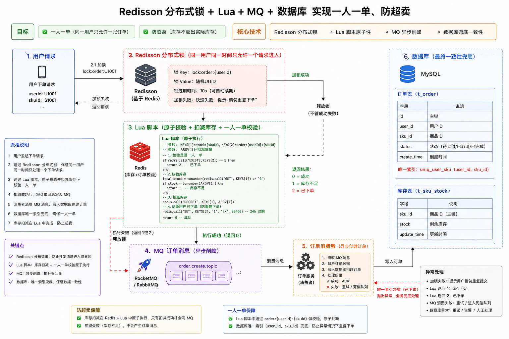
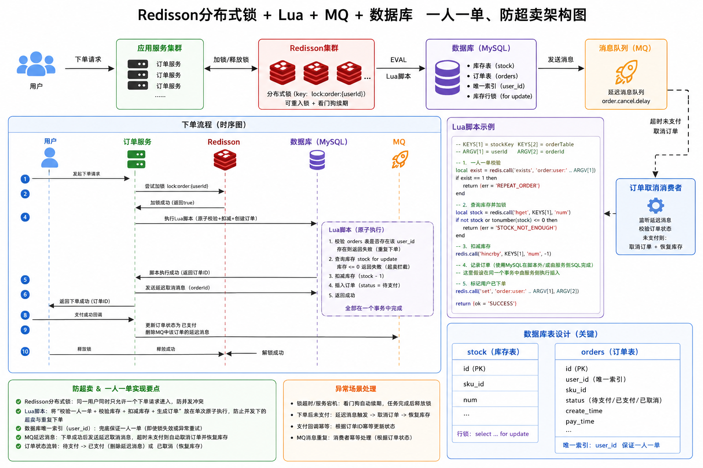
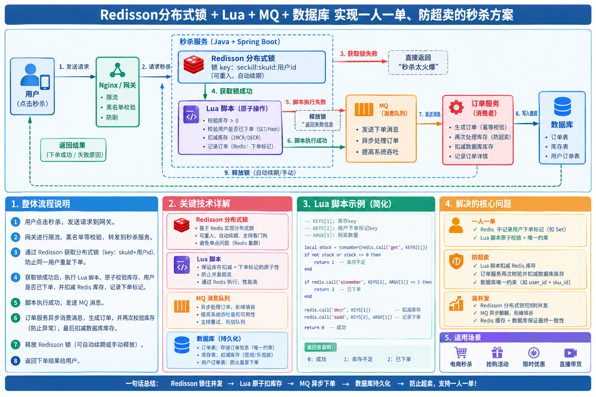

### Redis 缓存穿透（Cache Penetration）

首先搞清楚**什么是缓存穿透**：
> 用户请求的数据**既不在缓存里，也不在数据库里**，导致请求每次都直接打到数据库。
> 大量恶意/异常请求穿透缓存，直接压垮数据库，这就是缓存穿透。

典型场景：查询 id = -1 的用户、查询不存在的订单，数据库根本没有这条数据，缓存永远不会命中，请求全走数据库。

---

#### 一、核心解决方案（4 种，企业最常用）

#### 1. 缓存空值 / 默认值（最简单、最常用）

**思路**：即使数据库查询不到数据，也把 `null` 或空对象缓存起来，下次请求直接返回缓存，不再查库。

**优点**：实现简单，成本低
**缺点**：会占用一点缓存空间（可设置短过期时间）

**实战代码逻辑**：

1. 查缓存 → 无
2. 查数据库 → 无
3. **把空值写入缓存**（设置较短过期时间，如 60s）
4. 下次请求直接返回缓存空值

**Redis 示例**
```
# 查询不存在的数据，缓存空字符串，30秒过期
SET key:10086 "" EX 30
```

---

#### 2. 布隆过滤器（Bloom Filter）（高性能、防恶意攻击）

**思路**：提前把**数据库里存在的所有 key** 存入布隆过滤器，请求进来先判断：

- 过滤器说**不存在** → 直接返回，不查缓存、不查库
- 过滤器说**存在** → 再查缓存 → 查数据库

**优点**：内存占用极小、性能极高，完美防穿透
**缺点**：有极低的误判率（可容忍），不支持删除

**适用场景**：高并发、防恶意攻击、海量数据查询

---

#### 3. 参数校验 + 接口限流（基础防护）

**思路**：

1. 校验请求参数合法性（比如 id 必须 > 0）
2. 对非法参数直接拦截，不放行到缓存/数据库
3. 配合接口限流、IP 黑名单，防止恶意刷接口

**优点**：从源头拦截非法请求，最安全
**缺点**：无法解决合法但不存在的参数穿透

---

#### 4. 热点参数缓存（增强版空值缓存）

**思路**：
针对高频查询的**不存在 key**，单独做一层本地缓存（Caffeine、Guava），比 Redis 更快拦截。

---

#### 二、方案对比（直接选）

| 方案       | 优点           | 缺点               | 推荐场景           |
| ---------- | -------------- | ------------------ | ------------------ |
| 缓存空值   | 简单、易实现   | 占用少量缓存空间   | 大多数业务系统     |
| 布隆过滤器 | 高性能、防攻击 | 有极小误判率       | 高并发、电商、秒杀 |
| 参数校验   | 源头拦截       | 无法防合法无效参数 | 所有系统必加       |
| 本地缓存   | 速度极快       | 增加复杂度         | 超高并发场景       |

---

#### 三、企业级最佳实践（组合方案）

**最稳、最常用的双层防护：**
1. **第一层**：**参数校验 + 接口限流**（拦截非法请求）
2. **第二层**：**布隆过滤器**（快速判断数据是否存在）
3. **第三层**：**缓存空值**（兜底，避免漏网请求）

---

#### 四、一句话总结

- **简单业务**：用 **缓存空值**
- **高并发/防攻击**：用 **布隆过滤器 + 缓存空值**
- **所有系统**：必须加 **参数校验**

#### 总结

1. 缓存穿透 = 查询**缓存和数据库都不存在**的数据
2. 最简单方案：**缓存空值**
3. 最强方案：**布隆过滤器 + 缓存空值 + 参数校验**
4. 核心目标：**不让请求打到数据库**

### Redis 缓存击穿（Cache Breakdown）

#### 一、先搞懂什么是缓存击穿

**缓存击穿**：**热点Key突然过期**，瞬间大量并发请求同时打到数据库，把数据库压垮。
特点：

- 数据**数据库是存在的**
- 缓存**刚好过期**
- 高并发瞬间全部绕过缓存直查DB

和穿透区别：
- 穿透：**数据根本不存在**
- 击穿：**数据存在，只是缓存过期瞬间被并发打穿**

---

#### 二、主流解决方案（面试必背+生产常用）

##### 1. 互斥锁（分布式锁）

核心思路：
缓存过期时，**只放行一个请求去查库、更新缓存**，其他请求等待，更新完直接走缓存。

常用实现：
Redis `SETNX`、Redisson 分布式锁。

流程：
1. 查Redis缓存，过期/不存在
2. 尝试加分布式锁
3. 加锁成功 → 查询DB → 回填缓存 → 释放锁
4. 加锁失败 → 短暂休眠后重试查缓存

**优点**：精准解决击穿，无额外内存浪费
**缺点**：有少量等待、可能出现锁等待超时

---

##### 2. 热点Key 永不过期（后台异步更新）

核心思路：
- 缓存**逻辑不过期**，不设置expire
- 起一个**定时任务/异步线程**，后台定时主动刷新缓存数据

**优点**：**彻底杜绝Key过期**，完全没有击穿风险，并发性能极高
**缺点**：数据有短暂延迟，占用缓存空间；只适合**允许弱一致性**的热点数据（商品详情、首页推荐等）

---

##### 3. 缓存过期时间加随机值（错开过期时间）

核心思路：
给缓存过期时间**加随机偏移量**，比如原本30分钟过期，改成 `30±5分钟`。
避免大量热点Key**同一时刻集体过期**，分散流量峰值。

**优点**：实现最简单、零成本
**缺点**：只能**缓解**，不能彻底根治高并发击穿

---

##### 4. 多级缓存 + 本地缓存兜底

核心思路：
JVM本地缓存（Caffeine/Guava） + Redis 二级缓存。
Redis即使瞬间失效，本地缓存还能扛住一波并发，不会直接打DB。

**优点**：速度快、抗并发强
**缺点**：本地缓存有数据一致性问题、集群节点数据不一致

---

#### 三、方案对比

| 方案             | 适用场景           | 优点                 | 缺点               |
| ---------------- | ------------------ | -------------------- | ------------------ |
| 分布式互斥锁     | 高并发、强一致性   | 精准防击穿、数据一致 | 有等待、实现稍复杂 |
| 热点Key永不过期  | 电商商品、首页热点 | 性能最高、无击穿     | 数据准实时稍差     |
| 过期时间加随机值 | 普通业务、低并发   | 极简零开发成本       | 只能缓解不能根治   |
| 本地缓存+Redis   | 超高并发接口       | 抗流量能力极强       | 一致性难保证       |

---

#### 四、企业最佳实践（面试标准答案）

1. **普通业务**：缓存过期时间**加随机偏移** 兜底缓解
2. **热点核心业务**：**永不过期 + 后台异步刷新**
3. **要求强一致性**：**Redisson分布式锁** 互斥更新
4. **超高并发**：本地二级缓存 + 分布式锁 组合

---

#### 五、一句话记考点

- 缓存击穿：**热点Key过期，并发打数据库**
- 三大核心解法：**分布式锁、永不过期、过期加随机值**

### Redis 缓存雪崩（Cache Avalanche）

#### 一、什么是缓存雪崩

**缓存雪崩**：
大量Redis热点Key**同时过期** 或 **Redis服务整体宕机**，导致**海量请求全部直达数据库**，瞬间压垮DB。

三种成因：
1. **批量key同一时间过期**（时间雪崩）
2. **Redis集群宕机/断电/主从故障**（服务雪崩）
3. **缓存预热没做好**，上线瞬间大量key都不存在

> 区别总结
> - 穿透：查**不存在**的数据，一直打DB
> - 击穿：**单个热点key过期**，瞬间打DB
> - 雪崩：**大量key同时失效 / Redis挂了**，全线打DB

---

#### 二、解决方案 分两类：**预防过期雪崩**、**预防Redis宕机雪崩**

##### 一、解决：大量Key同时过期（时间雪崩）

###### 1. 过期时间加随机偏移（最常用、最简单）

设置过期时间时，在基础时间上**加随机秒数**
例：统一30分钟过期 → 设为 `30分钟 ± 随机1~5分钟`
避免大批量key同一时刻集体失效。

**优点**：零成本、一行代码搞定
**缺点**：只能缓解，不能彻底杜绝

###### 2. 热点Key 永不过期

热点商品、首页数据**不设置物理过期**，后台定时任务**异步主动刷新**。
从根源消灭key过期，彻底避免雪崩。

###### 3. 分层过期策略

不同业务模块设置**不同过期时长**，错开过期高峰，不扎堆。

---

##### 二、解决：Redis 宕机/集群故障（服务雪崩）

###### 1. Redis 高可用架构（必做）

- **主从复制 + 哨兵Sentinel**
- **Redis Cluster 集群**
实现主节点宕机自动故障转移，避免整体缓存不可用。

###### 2. 多级缓存降级

**JVM本地缓存（Caffeine/Guava） + Redis**
Redis挂了，本地缓存还能兜底，请求不直接落库。

###### 3. 服务熔断 + 限流 + 降级

用 Sentinel / Hystrix / Resilience4j：
- 接口限流：限制每秒请求量
- 熔断：DB压力大时直接熔断，返回默认值
- 降级：非核心接口直接走兜底数据，不查库

###### 4. 缓存预热

项目上线、Redis重启后，**提前把热点数据批量加载进缓存**，避免上线瞬间大量冷key打垮DB。

###### 5. 数据库层防护

- 数据库**读写分离、分库分表**
- 配置连接池**最大连接数**，防止缓存崩了把DB连接打满

---

#### 三、三种缓存问题 一句话区分（面试秒杀）

1. **缓存穿透**：查**不存在**的数据 → 布隆过滤器、缓存空值、参数校验
2. **缓存击穿**：**单个热点key过期** → 分布式锁、永不过期、随机过期
3. **缓存雪崩**：**大量key同时过期 / Redis挂了** → 随机过期、集群高可用、多级缓存、限流熔断

---

#### 四、企业级最佳组合方案

1. 所有key **过期加随机值** 基础兜底
2. 热点数据 **永不过期 + 定时异步刷新**
3. Redis **集群+哨兵** 保证高可用
4. 接入**本地二级缓存** 做兜底
5. 网关/业务层 **限流+熔断+降级**
6. 上线前**缓存预热** + DB读写分离

我可以给你整理一张**穿透/击穿/雪崩 对比表**，面试直接背，要吗？

### Redis 热点 Key（Hot Key）

> **💡 核心定位**：
> 热点 Key（Hot Key）是高并发大促、秒杀、热点事件场景中最致命的性能杀手之一。
> 面试官考察热点 Key，核心看你是否具备：**流量倾斜认知、单点瓶颈分析、事前事中探测手段、以及多级本地缓存（二级缓存）与一致性保障的架构落地能力**。

---

#### 一、先搞懂什么是热点 Key

**热点 Key**：指在极短时间内，某个特定的 Key 承受了**极高的访问频次（QPS 达到数万甚至数十万）**，导致访问流量极度倾斜在单个节点上的现象。

##### 1. 典型业务场景
- **突发热点舆情**：微博/抖音明星突发新闻（如“某明星官宣/辟谣”，瞬间产生千万级点击）；
- **爆款大促秒杀**：电商平台的顶流爆款（如“1499 元飞天茅台”、“iPhone 1元秒杀”，数十万人同时刷新同一商品详情）；
- **头部主播直播间**：带货一姐/一哥直播上架某款秒杀福利链接；
- **平台全局字典与配置中心**：系统核心配置数据、通用路由字典表，每个微服务请求都必须读取该 Key。

##### 2. 核心概念辨析（面试必问）
| 概念 | 核心特征 | 瓶颈维度 | 核心危害 |
| :--- | :--- | :--- | :--- |
| **热点 Key (Hot Key)** | 访问 QPS 极高（几万~数十万） | **计算/流量瓶颈** | 单节点 CPU 跑满、网卡打满、微服务连接池耗尽 |
| **大 Key (Big Key)** | Value 物理内存体积大、元素数量多 | **存储/内存瓶颈** | 主线程内存释放阻塞、Slot 迁移卡死、数据倾斜 |
| **缓存击穿** | 热点 Key 刚好在某一刻**过期失效** | **时序瞬断瓶颈** | 瞬间穿透缓存，巨量高并发直接击穿打崩底层 MySQL |

---

#### 二、热点 Key 带来什么毁灭性危害？（核心考点）

1. **单分片节点 CPU 瞬间打满（单点瓶颈）**：
   - Redis 的核心网络请求处理与命令执行采用**单线程事件循环模型**，单台 Redis 节点的极限处理能力通常在 8~10 万 QPS。
   - 当某个热点 Key 的瞬时访问达到 10 万+ QPS 时，该 Key 所在的单台 Redis 实例 CPU 瞬间飙到 100%，导致同一节点上的其他业务命令全部超时排队！
2. **集群横向扩展失效（算力与流量倾斜）**：
   - Redis Cluster 通过哈希槽（16384 个 Slots）进行数据分片。**无论你的集群横向扩展了 20 台还是 100 台机器，特定的某一个 Key 永远只能落在某一个确定的 Master 分片上**！
   - 集群的总吞吐量虽然很高，但该热 Key 节点的物理承载上限依然是单机上限，集群无法分摊其单点压力。
3. **服务器物理网卡带宽被打满（NIC 饱和丢包）**：
   - 若热点 Key 存储的内容稍微偏大（例如 10KB 的商品详情 JSON），在 10 万 QPS 访问下：
     $$\text{出网带宽} = 100,000 \times 10\text{KB} = 1,000,000\text{KB/s} \approx 1\text{GB/s} = 8\text{Gbps}$$
   - 千兆网卡（上限 125MB/s）或万兆网卡瞬间被打满，触发网卡丢包、网络延迟暴增。
4. **上游微服务连接池耗尽，引发全链路级联雪崩**：
   - Redis 节点由于 CPU/网络过载响应迟缓，上游 Java 客户端（Jedis/Lettuce）的连接池迅速被耗尽，大量 Tomcat 业务工作线程因阻塞等待 Redis 响应而堆积，最终拖死整个微服务集群。

---

#### 三、如何发现与识别热点 Key？（事前预估 + 事中动态探测）

##### 1. 事前业务预估（最推荐的业务驱动策略）
* 对于电商大促、秒杀活动、头部主播带货等确定性事件，活动上线前由业务与运营提前报备；
* 架构师与研发介入，在活动开售前通过脚本将这批已知的热点商品提前做**多级缓存预热与分片打散**。

##### 2. 事中动态自动探测（大厂主流方案）
* **客户端 SDK 埋点动态统计（推荐：如京东 JDH-HotKey、有赞 HotKey）**：
  - 在微服务框架层面（如 Spring 拦截器、Redisson/Jedis 封装层）做统计计数；
  - 采用**滑动窗口算法**（如定义规则：1 秒内访问超过 1000 次），一旦识别到某个 Key 达到阈值，判定为热 Key，立即自动推送给该应用各节点的本地缓存中。
* **代理层 Proxy 采集分析（如 Twemproxy、Codis、Envoy）**：
  
  - 在请求到达 Redis 之前的网关代理层进行指令采样与频次统计，对后端业务应用完全无侵入。
* **Redis 官方原生检测工具（`--hotkeys`）**：
  - 需要在 `redis.conf` 中开启 LFU 内存淘汰策略（如 `maxmemory-policy allkeys-lfu` 或 `volatile-lfu`）；
  - 执行热点分析命令：
    ```bash
    redis-cli -h 127.0.0.1 -p 6379 -a "password" --hotkeys
    ```
  - ⚠️ **注意**：底层基于遍历全量 Key，存在 CPU 消耗，严禁在业务高峰期执行！
* **网络抓包分析（redis-faina）**：
  
  - 在 Redis 宿主机上通过 `tcpdump` 抓取 6379 端口通信数据包，使用分析脚本统计 QPS Top 10 的 Key，完全零侵入、零 Redis 性能损耗，但运维成本高。

---

#### 四、企业级热点 Key 治理四大解决方案（生产落地）

##### 1. 方案一：多级本地缓存（二级缓存 Caffeine / Guava Cache，终极杀手锏）
* **核心思路**：既然单个 Redis 节点抗不住几十万 QPS，就直接将热点数据存放在 **Java 应用的本地 JVM 内存（Caffeine 缓存）** 中！
* **架构流程**：
  1. 用户请求进入 Spring Boot 微服务；
  2. 先查本地 **Caffeine 本地缓存**：若命中，耗时从网络往返的数毫秒直接降至 **纳秒级别**，吞吐量高达数百万 QPS，且**完全不向 Redis 发送任何网络请求**！
  3. 若本地缓存未命中，再查 Redis，并回填到本地缓存中。
* **核心难点：本地缓存如何保证数据一致性？（面试必问）**
  - **策略 1（被动兜底）**：给本地缓存设置极短的 TTL（如 `expireAfterWrite(5, TimeUnit.SECONDS)`），即使后端修改了数据，最多容忍 5 秒短暂不一致；
  - **策略 2（主动广播失效）**：当后台管理系统修改了商品信息时，通过 **Redis Pub/Sub 广播机制** 或 **RocketMQ 广播消息**（或 Canal 监听 MySQL Binlog），向所有微服务节点发布一条“清理 Key 缓存”的广播通知，各个 Java 实例收到后立即调用 `caffeineCache.invalidate(key)` 淘汰本地缓存。

##### 2. 方案二：热点 Key 备份打散分片（加随机后缀分散单点压力）
* **核心思路**：将原本集中的单个热 Key 复制为 N 份副本（如 20 份），加上随机后缀分布到 Redis Cluster 的不同分片节点上。
* **写入逻辑**：当热点数据初始化或修改时，同步/异步写入所有副本：
  - `hot_sku_1001_0`
  - `hot_sku_1001_1`
  - ...
  - `hot_sku_1001_19`
* **读取逻辑**：客户端读取时，生成 `[0, 19]` 之间的随机数：
  ```java
  // 随机负载均衡访问不同的 Redis 节点
  int randomIndex = ThreadLocalRandom.current().nextInt(20);
  String distributedKey = "hot_sku_1001_" + randomIndex;
  String value = redisTemplate.opsForValue().get(distributedKey);
  ```
* **收益**：原本集中在单节点的 10 万 QPS，被均匀切分到 20 个 Redis 节点上，**每个节点仅承担 5000 QPS**，单机瓶颈迎刃而解！

##### 3. 方案三：主从读写分离 + 增加 Slave 节点
* 采用一主多从架构，主节点负责写操作，增加 3~5 个只读从节点；
* 客户端通过读写分离配置（如 Lettuce 的 `ReadFrom.REPLICA_PREFERRED`），将读流量分散到多个从节点上。
* *缺点*：单主多从无法彻底解决百万级极度夸张的极端瞬时脉冲热点。

##### 4. 方案四：网关/应用层限流降级（Sentinel / Gateway）
* 在网关层或业务应用内使用 **Alibaba Sentinel** 配置**热点参数限流规则（ParamFlowRule）**；
* 当特定热点参数的访问频次超过单机阈值时，直接触发限流降级，返回友好的排队提示（如“活动太火爆啦，请稍后再试”），保护底层 Redis 和数据库不被打崩。

---

#### 五、热点 Key 现场答辩高频追问

* **Q1：热点 Key 为什么不能简单通过给 Redis Cluster 扩容节点来解决？**
  
  > **答**：因为 Redis Cluster 是按照 Key 的 CRC16 哈希值计算所属槽位（Slot）的。无论集群扩容到多少个节点，同一个 Key 的哈希计算结果是完全固定的，依然会永远落在那唯一的一台 Master 节点上。所以横向扩容加机器根本无法分担单个热 Key 的单机流量瓶颈。
* **Q2：本地缓存（Caffeine）遇到微服务集群部署，如何保证各节点数据的一致性？**
  
  > **答**：采用“短过期兜底 + MQ/PubSub 广播主动失效”的组合方案。本地设置 5~10 秒的短暂 TTL 控制不一致窗口；在后台修改数据时，通过消息队列发布广播消息（Fanout/Topic 模式）通知所有微服务实例清理该 Key 的本地缓存，实现秒级的一致性收敛。

---

### Redis 大 Key（Big Key）

> **💡 核心定位**：
> 大 Key 是导致 Redis 生产环境产生**偶发严重毛刺、主线程阻塞卡顿、慢查询激增、集群 Slot 迁移超时失败**的头号元凶。
> 面试官核心考察：**大 Key 的界定标准、底层单线程阻塞原理、线上安全排查手段、渐进式读取与异步删除（UNLINK）、以及业务拆分架构经验**。

---

#### 一、先搞懂什么是大 Key

**大 Key**：指 Key 本身并没有问题，但其对应的 **Value 占用的物理内存过大**，或者其集合类型中**存储的元素数量极多**。

##### 业界通用认定标准
- **String 类型**：单个 Value 大于 **10KB** 即可认定为大 Key（若超过 50KB 属于严重违规）；
- **容器集合类型（Hash / List / Set / ZSet）**：
  - 元素个数超过 **5000 个**；
  - 或者整个集合序列化后占用的总物理内存超过 **10MB**。

##### 典型产生场景
1. **大集合当持久库滥用**：把全平台几百万用户的行为明细存进一个大 List 里（`user_action_list`）；
2. **全量数据放一个 Hash**：将所有商品或全量字典配置无脑放进一个 Hash 里（`all_goods_map`，里面有数十万个 field）；
3. **未序列化压缩的大 JSON 报文**：String 类型直接存放未经裁剪的几百 KB 复杂大报文；
4. **社交场景大粉丝群/大 V 粉丝列表**：千万级粉丝的 Set 集合（`star_fans:1001`）。

---

#### 二、大 Key 带来什么毁灭性危害？（核心考点）

1. **主线程严重阻塞（单线程模型的致命痛点）**：
   - **读取阻塞**：在几万个元素的大 Hash 上执行 `HGETALL`，或在大 List 上执行 `LRANGE 0 -1`，单次命令耗时几百毫秒甚至数秒。在单线程模型下，**后续所有客户端的读写命令必须全部排队等待，引发全系统大面积超时**！
   - **删除阻塞**：直接对大 Key 执行 `DEL my_big_set`，Redis 必须在内存中同步逐个释放上万个节点指针并回收内存页，会霸占主线程数百毫秒，导致严重的响应时间（RT）尖刺！
2. **内存空间分配严重不均（数据倾斜）**：
   - 在 Redis Cluster 集群中，一个几百 MB 的大 Key 会导致所在分片节点内存利用率飙升至 95%，而其余分片仅 20%。
   - 很容易导致该节点提前触发 `maxmemory` 限制，进而引发键驱逐甚至单机 OOM 宕机！
3. **物理网卡带宽瞬间打满（NIC 饱和）**：
   - 客户端并发读取一个 5MB 的大 Key，仅需 25 个并发，瞬时出网带宽就会达到 `5MB * 25 = 125MB/s`，直接占满千兆网卡极限，导致该机器网络丢包、连接断开。
4. **集群扩缩容槽位迁移（Slot Rebalance）卡死超时**：
   - 在 Redis Cluster 进行节点扩容或缩容时，数据迁移以 Key 为最小粒度。若某个槽位中存在特大 Key，网络传输和序列化耗时极长，容易导致**迁移超时、主从同步阻塞中断，甚至造成集群脑裂**！
5. **过期自动删除的“隐形地雷”**：
   - 给大 Key 设置了 TTL，到期时由 Redis 内部定期删除或惰性删除触发同步内存释放，在业务高峰期毫无预警地导致主线程卡顿几百毫秒，排查极难定位。

---

#### 三、如何排查与发现大 Key？（线下 + 线上手段）

##### 1. 线上快速体检：`redis-cli --bigkeys`
```bash
# 扫描指定实例并输出各类数据类型占用内存/元素最多的 Key
redis-cli -h 127.0.0.1 -p 6379 -a "password" --bigkeys
```
* **原理**：底层通过 `SCAN` 游标遍历所有 Key，统计 String/Hash/List/Set/ZSet 中最大的 Top 1。
* ⚠️ **生产避坑**：**严禁在业务高峰期执行！** 虽然采用的是非阻塞游标 SCAN，但快速密集扫描依然会消耗 Redis 实例的 CPU 资源，建议在业务低峰期（如凌晨）执行。

##### 2. 精确内存查询：`MEMORY USAGE key`（Redis 4.0+）
```bash
# 查询单个 key 实际占用的物理内存大小（单位：Bytes）
127.0.0.1:6379> MEMORY USAGE user:cart:1001
(integer) 84520  # 约 84.5 KB
```

##### 3. 线下离线分析 RDB 备份文件（最推荐的大厂规范）
* **工具**：开源神器 **`rdb-tools`**（Python 编写）；
* **操作**：将生产环境的从节点 RDB 快照文件备份下载到本地测试机，执行离线分析：
  ```bash
  # 分析并导出占用内存大于 10KB 的所有 Key 为 CSV 报表
  rdb -c memory dump.rdb --bytes 10240 -f redis_bigkeys.csv
  ```
* **核心优势**：**完全零侵入、零线上生产性能开销**，能导出清晰的 Excel 报表，排查彻底。

---

#### 四、企业级大 Key 治理五大解决方案（生产落地）

##### 1. 方案一：业务拆分（最根本、最彻底的根治手段）
* **String 类型拆分**：
  - 去除无用字段，只存业务必需属性；
  - 对文本或大 JSON 进行压缩后再存入 Redis（如使用 **Gzip / Snappy / Zstd** 算法压缩，体积通常能缩减 70%~80%）。
* **Hash / Set / List 容器拆分（固定分桶二级哈希）**：
  - *改造前*：所有用户的购物车数据全部塞进一个大 Hash `cart:all`（数百万个 field）；
  - *改造后（固定分桶）*：将一个大 Hash 拆分成 100 个小 Hash，通过用户 ID 哈希取模分桶：
    ```
    Key: cart:bucket_{user_id % 100}
    Field: {user_id}
    Value: {cart_data}
    ```
    每个小 Hash 只存几万条，不仅消除了大 Key，还能分散到 Redis Cluster 的不同分片上！或者直接按用户 ID 细粒度拆分：`cart:user_{user_id}`。

##### 2. 方案二：严禁全量遍历，改用增量游标（SCAN 替代）
在代码中严格进行架构红线审查：
- ❌ **严禁使用全量高危命令**：`HGETALL`、`SMEMBERS`、`LRANGE 0 -1`、`KEYS *`；
- ✅ **推荐使用渐进式迭代命令**：
  - Hash：改用 `HSCAN key cursor COUNT 100` 分批次拉取；
  - Set：改用 `SSCAN key cursor COUNT 100`；
  - ZSet：改用 `ZSCAN key cursor COUNT 100` 或基于分数的区间分页 `ZRANGEBYSCORE`。

##### 3. 方案三：异步渐进式删除（严禁同步 DEL，必须使用 UNLINK）
* **Redis 4.0+ 原生解决方案：`UNLINK` 命令**
  ```bash
  # 推荐使用 UNLINK 代替 DEL
  UNLINK my_big_key
  ```
  - **底层机理**：`UNLINK` 会先在键空间字典中将 Key 立即解绑（对外立即表现为 key 已不存在，耗时微秒级）；然后将耗时庞大的物理内存回收工作交给后台独立的 **lazy-free 子线程** 异步释放，**主线程完全零阻塞**！
* **代码端分批删除（适用 Redis 4.0 以前或超大集合手工清理）**：
  
  - 对于 Hash：循环调用 `HSCAN` 每次取 500 个 field，调用 `HDEL` 删除，循环往复直至清空，最后删除空 key。

##### 4. 方案四：限制集合最大容量（设置容量天花板）
* 针对 List 类型的消息队列或用户最近访问记录，在每次 `LPUSH` 后紧跟 `LTRIM` 截断命令：
  ```bash
  # 强制仅保留最新的 1000 条记录，防止无限追加膨胀
  LPUSH user:recent:1001 "item_99"
  LTRIM user:recent:1001 0 999
  ```

##### 5. 方案五：开启 Redis 4.0+ 后台异步内存回收配置
在 `redis.conf` 中开启惰性删除参数，防范大 Key 过期或驱逐时阻塞主线程：
```ini
lazyfree-lazy-eviction yes   # 内存达到上限驱逐 key 时异步释放
lazyfree-lazy-expire yes     # key 过期删除时异步释放
lazyfree-lazy-server-del yes # 隐式 del 时异步释放
slave-lazy-flush yes         # 全量同步清空数据库时异步清空
```

---

#### 五、大 Key vs 热 Key 深度横向对比与面试追问

##### 1. 大 Key 与 热 Key 核心对比矩阵

| 维度 | 大 Key (Big Key) | 热点 Key (Hot Key) |
| :--- | :--- | :--- |
| **本质特征** | Value 物理体积过大（>10KB）、集合元素过多（>5000） | 访问频率极高（QPS 破万~数十万） |
| **产生原因** | 数据结构设计不合理、未限制数据增长、大报文滥用 | 突发全网热点、爆款秒杀单品、明星事件 |
| **核心危害** | 主线程同步删除/读取阻塞、内存倾斜、Slot 迁移卡死 | 单分片 CPU 100%、网卡打满、微服务连接池耗尽 |
| **排查方式** | `--bigkeys`、`MEMORY USAGE`、离线 `rdb-tools` | 客户端 SDK 滑动窗口统计、Proxy 聚合、`--hotkeys` |
| **核心解决方案** | 业务分桶拆分、`HSCAN` 游标拉取、`UNLINK` 异步删除、`LTRIM` | **多级本地缓存（Caffeine）**、加随机后缀备份打散、Sentinel 限流 |

##### 2. 经典面试深度追问

* **Q1：如果一个 Key 既是大 Key，又是热点 Key，该如何处理？**
  > **典型场景**：热门微博的评论列表（几百万条评论 = 大 Key；数百万人同时刷新围观 = 热 Key）。
  > **满分回答**：
  > 1. **大 Key 拆分分片**：严禁全量获取，将大评论列表按时间或页码拆分成小 Key（如 `comment:weibo_1001:page_1`，每页仅存 20 条）；
  > 2. **热 Key 多级缓存拦截**：将前两页的核心热评数据加载到微服务节点的本地 **Caffeine 缓存** 中，设置 3~5 秒短暂过期。99% 的刷新流量直接被 JVM 本地内存消化，根本不打到 Redis；
  > 3. **读写分离与限流削峰**：后台新增评论走异步队列写库，网关层配置热点限流，防止极端脉冲。
* **Q2：大 Key 设置了过期时间（TTL），到期时会自动消失，还会阻塞 Redis 吗？**
  
  > **答**：**依然会阻塞！** 因为 Redis 默认的过期删除策略（惰性删除与定期删除）在释放内存时是同步的。如果这个大 Key 占用内存达数十兆，当被定期扫描到或被访问触发删除时，主线程依然会陷入同步内存回收停顿。必须显式在配置文件开启 `lazyfree-lazy-expire yes`，或者在业务端提前分批主动清理。

---

#### 六、现场面试口述高分模板（1 分钟背诵版）

* **面试官提问：** “请聊聊你在生产中对 Redis 热点 Key 和大 Key 的理解，怎么排查和治理的？”
* **20k+ 现场答辩参考话术：**
  > “在实际生产中，大 Key 和热点 Key 是完全不同维度的性能隐患：**大 Key 是空间与数据体量大，危害在于阻塞单线程主线程和网络带宽；热 Key 是时间与访问频率高，危害在于打爆单节点 CPU 算力**。
  > 
  > 针对**热点 Key**：
  > 1. 我们通过客户端 SDK 滑动窗口算法动态探测热 Key；
  > 2. 治理上首选**多级本地缓存（Caffeine）**，将数据缓存在 JVM 内存中，配合 MQ 广播实现失效同步，将 95% 以上流量拦截在应用层；对于必须走 Redis 的热点，采用**加随机后缀的方式生成多副本**（如 `key_{0..19}`），把单点流量打散到不同的集群分片上。
  > 
  > 针对**大 Key**：
  > 1. 我们线下通过离线分析从节点 RDB 快照文件（`rdb-tools`）进行定期巡检；
  > 2. 治理上坚持**业务分桶拆分**，将百万级的大 Hash 通过用户 ID 取模拆解为多个小 Hash；读取时严禁使用 `HGETALL` 等全量命令，改用 `HSCAN` 游标分批读取；删除时杜绝同步 `DEL`，全面采用 Redis 4.0 的 **`UNLINK` 异步释放内存**，并在配置文件开启 `lazyfree` 特性彻底消除毛刺阻塞。”

---


### 秒杀

#### 核心架构（微服务秒杀标准）

1. **Redis 预减库存**（高并发挡在数据库外）
2. **Lua 脚本**（保证库存扣减 + 一人一单判断**原子性**）
3. **Redis 分布式锁**（兜底）
4. **RabbitMQ/Kafka 异步下单**（削峰、异步落库）

#### 图示



#### 图示




### Redis 秒杀应用场景

> 秒杀核心痛点：**瞬间高并发、超卖、DB压力大**。Redis用来承担前端大流量，做库存预扣、限流、防重复下单；**最终库存必须落库MySQL，Redis只是缓冲**。
> 业务流程：前端限流 → 网关限流 → Redis预校验库存 + 防重复提交 → 异步MQ扣减MySQL库存。



#### 一、整体架构思路

1. **预热**：秒杀开始前，把商品库存加载到Redis（`seckill:stock:10001`）
2. **前端**：按钮置灰、验证码，减少无效请求
3. **网关层**：限流，拦截恶意流量
4. **Redis层**：
   - 校验用户是否已经下单（防重复，Set/BloomFilter）
   - 原子扣减库存，判断是否还有库存
5. **扣减成功**：发送消息到MQ（RocketMQ），异步执行MySQL真实库存扣减 + 创建订单
6. **扣减失败**：直接返回“库存不足”> 
> ❗核心：**Redis只做预扣减，真实库存以MySQL为准**，防止Redis宕机/不一致导致超卖。

#### 二、核心Redis命令（Lua脚本保证原子，面试重点）

不能分开执行`GET + DECR`，并发下会超卖，必须Lua脚本**原子执行**：

```
-- KEYS[1] 库存key，KEYS[2] 用户已抢购集合key
-- ARGV[1] 用户ID
local stockKey = KEYS[1]
local userSetKey = KEYS[2]
local userId = ARGV[1]

-- 判断用户是否已经抢购过
local hasBuy = redis.call('SISMEMBER', userSetKey, userId)
if hasBuy == 1 then
    return 0 -- 重复抢购，失败
end

-- 判断库存
local stock = tonumber(redis.call('GET', stockKey))
if stock <= 0 then
    return 1 -- 库存不足，失败
end

-- 库存-1，记录用户已抢购
redis.call('DECR', stockKey)
redis.call('SADD', userSetKey, userId)
return 2 -- 抢购成功
```

返回值定义：

- 0：重复下单
- 1：库存不足
- 2：成功，发送MQ创建订单

Java代码（StringRedisTemplate执行Lua）

```
String script = "上面lua脚本";
List<String> keys = Arrays.asList("seckill:stock:10001","seckill:user:10001");
Object result = stringRedisTemplate.execute(new DefaultRedisScript<>(script, Long.class),keys,userId);
```

#### 三、Redis在秒杀里承担的能力

1. **库存预扣减（原子Lua）**：挡掉绝大部分无效请求，不直接打DB
2. **防重复下单**：Set存储已抢购用户ID；海量用户可用**布隆过滤器（Redisson RBloomFilter）**
3. **接口限流**：RRateLimiter令牌桶 / ZSet滑动窗口，限制单个用户QPS
4. **秒杀状态控制**：Redis标记秒杀是否开始/结束
5. **订单号生成**：`INCR`生成自增订单编号

#### 四、秒杀核心问题 & 解决方案（面试必问）

##### 1. 超卖问题

根源：并发下多线程同时读到库存>0，同时扣减。
✅方案：**Lua脚本原子化库存判断+扣减**，Redis单线程保证脚本一次性执行，不会并发冲突。

##### 2. 一人多单（重复抢购）

✅方案：Set保存已经下单用户；海量用户使用布隆过滤器，减少Set内存占用。

##### 3. 热点Key问题（爆款商品，大量请求打同一个Redis key）

✅方案：

- 方案1：**库存分片（分段库存）**
把1000库存拆成多个key：`seckill:stock:10001_0`、`seckill:stock:10001_1`，请求随机路由到分片，分散压力；扣减成功后记录用户，防止一人抢多个分片。
- 方案2：本地Caffeine缓存做二级缓存，缓存秒杀状态，减少Redis访问
- 方案3：Redis集群，热点key迁移到独立分片

##### 4. 库存不一致（Redis和MySQL库存不一致）

Redis扣减成功，MQ消费失败，MySQL没扣减，库存不一致。
✅方案：

1. MQ消息做可靠投递（RocketMQ事务消息/确认ACK）
2. 定时任务对账：定时对比Redis库存与MySQL库存，补偿差异
3. 最终以MySQL库存为准

##### 5. 消息堆积、订单创建失败

使用专业MQ，消息重试、死信队列，失败订单进入死信人工处理。

#### 五、完整业务执行流程（口述版）

1. 秒杀预热：系统低峰期，将商品库存写入Redis。
2. 用户点击秒杀，前端验证码、按钮防重复点击。
3. 请求到网关，网关限流，拦截高频恶意请求。
4. 后端执行Lua脚本：先判断用户是否已抢购；再判断库存；库存充足则原子扣减库存，标记用户已抢到。
5. Lua返回成功 → 发送消息到RocketMQ，立刻返回用户“抢购成功，订单生成中”。
6. MQ消费者异步扣减MySQL库存，创建订单；
7. 定时任务对账，修复Redis和MySQL库存差异。

#### 六、高频面试追问

##### Q：为什么不用Redis直接扣减真实库存？

Redis是内存数据库，宕机可能丢数据；Redis只是流量削峰，**库存最终权威数据源一定是MySQL**。

##### Q：为什么必须用Lua脚本，不能Java层判断库存再DECR？

GET和DECR是两条独立命令，中间会被其他请求插入，并发下产生超卖；Lua脚本是原子执行，Redis单线程保证脚本执行不被打断。

##### Q：Set和布隆过滤器防重复下单怎么选？

- Set：保存真实userId，可以删除，内存消耗大，适合用户量不大
- 布隆过滤器：内存极小，存在误判；适合海量用户；缺点不能删除元素

##### Q：秒杀可以用Redisson分布式锁吗？

**不推荐**。分布式锁会串行执行，吞吐量极低，秒杀追求高并发，Lua脚本原子扣减性能远高于分布式锁。

##### Q：秒杀为什么要用MQ异步创建订单？

如果同步写MySQL，大量并发请求直接压垮数据库；MQ实现削峰，异步缓慢消费，平滑写入DB。

#### ✅面试口述2分钟版

Redis用于秒杀场景主要用来削峰，挡住绝大部分流量，保护MySQL。
秒杀前预热，将库存加载进Redis；用户请求过来，执行Lua脚本，原子完成两件事：判断用户是否重复抢购、校验并扣减库存，防止超卖。
抢购成功后发送消息到RocketMQ，异步扣减数据库库存、创建订单。
会遇到热点key问题，解决方案是库存分片打散流量；Redis和MySQL库存不一致，靠定时任务对账补偿。
注意Redis只是预扣减，真实库存以MySQL为准；不能用分布式锁做库存扣减，性能差。

#### ✅1分钟精简背诵

秒杀：Redis预热库存，Lua脚本原子扣减库存+防重复下单，防止超卖；扣减成功发送MQ异步落库。热点key做库存分片；定时任务对账保证Redis和MySQL库存一致。Redis仅做流量削峰，真实库存以MySQL为准。

---

下一个：**Redis大Key、热Key**面试全套？


### 秒杀场景中 Redisson 的使用

> 
> 前面秒杀方案**优先推荐Lua脚本**（性能最高），Redisson 不是首选，但秒杀场景下**Redisson可以承担周边能力**，不能用RLock做库存扣减（性能差）。

#### 一、Redisson 在秒杀里能做什么

##### 1. RBloomFilter 布隆过滤器：防重复抢购（海量用户场景）

当参与秒杀用户千万级，用Redis Set存已抢购用户占用内存很大，改用Redisson布隆过滤器。

```
// 初始化布隆过滤器，预估1000万用户，误判率0.01
RBloomFilter<Long> bloomFilter = redissonClient.getBloomFilter("seckill:bloom:10001");
bloomFilter.tryInit(10000000L,0.01);

// 判断用户是否已经抢购
boolean isBought = bloomFilter.contains(userId);
if(isBought){
    return "不能重复抢购";
}
// 抢购成功后加入布隆
bloomFilter.add(userId);
```

> 
> 局限：布隆过滤器**不能删除元素**；如果秒杀重复使用，需要重建。

##### 2. RRateLimiter 令牌桶：分布式限流（单个用户/IP限流）

控制同一个用户单位时间内的请求次数，防止用户疯狂刷接口。

```
RRateLimiter rateLimiter = redissonClient.getRateLimiter("seckill:limit:user:"+userId);
// 每秒允许2个令牌
rateLimiter.trySetRate(RateType.OVERALL,2,1, RateIntervalUnit.SECONDS);
boolean canAcquire = rateLimiter.tryAcquire(1);
if(!canAcquire){
    return "请求过于频繁，请稍后重试";
}
```

##### 3. RSemaphore 分布式信号量（可选方案，控制总并发）

可以用信号量模拟总库存，**不推荐做真实库存**，适合控制同时进入下单逻辑的并发数量。

```
RSemaphore semaphore = redissonClient.getSemaphore("seckill:sem:10001");
// 设置信号量=商品库存
semaphore.trySetPermits(1000);
// 获取许可
boolean acquire = semaphore.tryAcquire();
if(acquire){
    // 拿到许可，继续下单逻辑
}
```

> 
> ⚠️缺点：信号量释放容易出问题，服务宕机许可丢失，一般不用做库存。

##### 4. RDelayedQueue 延迟队列：秒杀订单超时自动关闭

秒杀下单后30分钟未支付，自动取消订单、归还库存。Redisson的RDelayedQueue非常适合这个场景。

```
RDelayedQueue<SeckillOrder> delayedQueue = redissonClient.getDelayedQueue(queue);
// 放入延迟消息，30分钟后进入目标队列
delayedQueue.offer(orderDto,30, TimeUnit.MINUTES);
```

消费者监听目标队列，收到消息，判断订单是否未支付，若未支付：关闭订单、恢复库存。

#### 二、重点：为什么**不推荐 Redisson RLock（分布式锁）扣减秒杀库存**

很多面试坑点：能不能用RLock做秒杀？

```
// ❌不推荐！吞吐量极低
RLock lock = redissonClient.getLock("seckill:lock:10001");
try{
    boolean getLock = lock.tryLock(0,30,TimeUnit.SECONDS);
    if(getLock){
        // 查询库存、扣减
    }
}finally {
    if(lock.isHeldByCurrentThread()) lock.unlock();
}
```

原因：

1. RLock是**排他锁**，同一时刻只有一个线程执行库存扣减，**串行执行，并发上不去**，秒杀高并发场景直接报废。
2. 秒杀核心需求是**高并发**，Lua脚本单命令原子，不需要加锁，性能远高于RLock。

> ✅一句话结论：**秒杀库存扣减用Lua；Redisson用来做限流、布隆、延迟订单，不做库存锁。**

**RLock 是 Redisson 提供的分布式可重入锁接口 / 对象；Redisson 是 Redis Java 客户端，RLock 是它里面最核心的分布式锁实现**Redisson。

```
// 从RedissonClient拿到RLock实例
RLock lock = redissonClient.getLock("order_lock");
```

**核心关系拆解**

1. **包路径**：`org.redisson.api.RLock`，属于 Redisson 库，不是 JDK 自带的锁。
2. **实现接口**：`RLock implements java.util.concurrent.locks.Lock`，API 和 JDK `ReentrantLock`几乎一样（`lock()`、`unlock()`、`tryLock()`），**但是分布式锁，跨 JVM、跨服务器**，而 ReentrantLock 是单机锁。
3. **底层存储**：锁信息存在 Redis，用`Hash`结构：`key=锁名，field=线程唯一标识，value=重入次数`，Lua 脚本保证加锁 / 解锁原子性。
4. **看门狗（Watchdog）**：RLock 独有核心能力。默认锁 30s 过期，后台定时线程**每 10s 续期**；只要持有锁的客户端存活，锁不会过期；客户端宕机，锁到期自动释放，防止死锁。

> ⚠️ 如果你调用`tryLock(waitTime, leaseTime, unit)`手动指定`leaseTime`，**看门狗会失效**，锁不会自动续期。

#### 三、面试口述2分钟版（Redisson+秒杀）

秒杀库存扣减本身优先使用Lua脚本，不用Redisson的RLock分布式锁，因为排他锁会串行，吞吐量很低。
但是Redisson可以在秒杀场景提供配套能力：

1. RBloomFilter布隆过滤器，海量用户场景用来判断用户是否重复抢购，节省内存；
2. RRateLimiter分布式令牌桶，对用户IP做接口限流，拦截刷请求；
3. RDelayedQueue延迟队列，实现订单超时未支付自动关闭，归还库存；
4. RSemaphore分布式信号量可以控制并发，但是不适合作为库存。

#### ✅1分钟精简背诵

秒杀库存扣减不用Redisson RLock，锁会串行降低吞吐量。Redisson配套能力：RBloomFilter防重复抢购、RRateLimiter分布式限流、RDelayedQueue实现订单超时关闭。

#### 高频追问

##### Q：秒杀用Redisson布隆过滤器和Redis Set怎么选？

用户量巨大选Redisson RBloomFilter，内存占用小；需要支持删除用户、精准判断，选Redis Set。布隆存在误判，不能删除。

##### Q：Redisson RDelayedQueue底层原理？

底层ZSet，score=到期时间，后台线程轮询ZSet，到期消息转移到阻塞队列，消费者消费。

##### Q：Redisson信号量做秒杀库存有什么风险？

服务宕机，已经获取的许可无法释放，库存无法回补，会出现少卖，一致性不好。

---

接下来继续：**Redis大Key、热Key**全套面试内容？


### Redis 应用场景

> Redis 是内存型KV数据库，支持多种数据结构 + 持久化、集群、Lua、发布订阅等能力，场景分为**缓存、计数器、分布式能力、中间件替代**四大类。

#### 一、缓存（最核心，面试必提）

##### 1. 分布式缓存

商品详情、首页banner、字典、基础配置。
- 模式：Cache Aside；解决DB查询压力，提升接口响应速度。
- 配套：缓存预热、多级缓存（本地Caffeine + Redis）、处理穿透/击穿/雪崩、热点key、大key。

##### 2. 会话缓存（Session共享）

分布式系统多实例，把用户session存入Redis，多服务共享登录态。
> 现在SpringSession底层就是Redis。

#### 二、计数器 & 限流（原子操作）

Redis单线程，`incr/decr`原子，适合计数。
1. 网站访问量、视频播放量、点赞数、粉丝数
2. 接口限流：
   - 固定窗口限流：incr + TTL
   - 滑动窗口限流（ZSet）
   - 令牌桶/漏桶也可基于Redis实现

> 注意：高并发写热点，考虑分段计数打散压力。

#### 三、分布式能力（非常高频）

1. **分布式锁**
   Redisson推荐，解决并发抢资源（库存扣减、防止重复提交）。
   底层：set nx ex；需要考虑锁续约、可重入、锁释放、死锁。

2. **分布式ID**
   incr自增生成全局唯一ID；或者结合时间戳。

3. **分布式全局信号、分布式幂等**
   保存请求唯一标识，判断请求是否已经处理，防止重复提交。

#### 四、排行榜、TopN（ZSet 有序集合）

ZSet（sorted set）自带score排序：
- 热搜榜、直播间榜单、商品销量排行榜、积分排名。
> 支持按score升降序查询，分页。

#### 五、消息队列（简单场景，不推荐复杂业务）

List / Stream 实现简易消息队列：
1. List：lpush + rpop 普通队列；blpop阻塞消费
2. Redis Stream：5.0+，支持消息ID、ack、消费者组、持久化
> ⚠️面试一定要说：**Redis做MQ不适合高可靠、大量堆积场景；生产可靠消息优先RocketMQ/RabbitMQ**。

#### 六、集合相关场景（Set / HyperLogLog / BitMap / BloomFilter）

1. **Set**：去重、交集、并集。例如：共同好友、用户标签。
2. **BitMap**：位图，海量布尔标记，极度省内存。
    - 签到统计、用户在线状态、日活统计。
    - 例：用户签到，一个bit代表一天是否签到。
3. **HyperLogLog**：基数统计，估算独立UV，**不保存原始数据，存在误差**。
    - 网站独立访客UV、页面访问独立用户数。
4. **BloomFilter（RedisBloom模块）**：解决缓存穿透，黑名单过滤。

#### 七、发布订阅 Pub/Sub

消息广播，简单通知场景。
> 缺点：消息无持久化，订阅者断线丢消息；**不适合可靠消息**。
> 适用：配置变更简单通知、简单广播事件。

#### 八、高频面试追问

##### Q：Redis做消息队列有什么缺点？

- List：无ack，消息丢失风险；没有消费者组，重试难。
- Pub/Sub：消息不持久化，下线丢消息，无堆积。
- Stream改善很多，但依然不适合大规模、高可靠业务；复杂业务用专业MQ。

##### Q：HyperLogLog和BitMap区别？

BitMap：存储每一位状态，**精确统计**，内存随用户量线性增长；适合签到、布尔标记。
HyperLogLog：估算基数，**有误差**，不存原始数据；适合海量UV估算，内存极小。

##### Q：ZSet 排行榜有什么坑？

score相同会按字典序排序；大数据量分页性能下降；热点排行榜考虑多级缓存。

##### Q：哪些场景不适合Redis？

1. 大量数据存储、超大容量冷数据（Redis内存贵）
2. 需要强事务、强一致性
3. 超大量消息堆积、高可靠消息投递（专业MQ）

#### ✅面试口述2分钟版

Redis的应用场景主要有：
第一，缓存，也是最常用场景，用作分布式缓存存储商品、字典数据，也可以实现分布式session共享；还可以和JVM本地缓存组成多级缓存。
第二，计数器和限流，利用incr原子命令做点赞、播放量，以及接口限流。
第三，分布式能力，实现分布式锁、分布式ID、幂等判断。
第四，ZSet实现排行榜，做热搜、销量榜单。
第五，集合类场景：Set做好友关系；BitMap做签到；HyperLogLog估算UV；Redis布隆过滤器解决缓存穿透。
第六，可以用List或Stream实现简易消息队列，Pub/Sub做简单广播通知。
注意Redis做MQ可靠性不足，高可靠业务要使用RocketMQ、RabbitMQ。

#### ✅1分钟精简背诵

Redis场景：分布式缓存、Session共享；incr做计数器和限流；实现分布式锁、分布式ID；ZSet做排行榜；Set、BitMap、HyperLogLog、布隆过滤器做统计去重；List/Stream简易消息队列，PubSub广播。Redis不适合强一致、海量堆积的消息业务。

---
现在可以把**缓存穿透、缓存击穿、缓存雪崩**一次性整理完整吗？


### Redis 应用场景：限流器

> 限流目的：保护后端服务，控制接口QPS，防止突发流量打垮数据库/应用。
> Redis凭借**原子命令、Lua脚本、过期时间**，可以实现多种分布式限流方案：**固定窗口、滑动窗口、漏桶、令牌桶**。

#### 一、固定窗口限流（计数器限流，最简单）

原理：划分时间窗口（例如1分钟），同一个用户/IP在窗口内计数，超过阈值拒绝请求。
核心：`INCR` + 过期时间，**必须Lua脚本保证原子**（防止INCR执行完宕机，没设置TTL）

Lua脚本：
```lua
local key = KEYS[1]
local limit = tonumber(ARGV[1])
local window = tonumber(ARGV[2])
local cnt = redis.call('INCR',key)
if cnt == 1 then
    redis.call('EXPIRE',key,window)
end
if cnt > limit then
    return 0 -- 限流，拒绝
else
    return 1 -- 通过
end
```
> KEYS[1] = `limit:ip:192.168.1.1`，ARGV[1]最大请求数，ARGV[2]窗口秒数

✅优点：简单，性能高
❌缺点：**临界窗口突刺问题**
例：窗口5s，上限100。第4s来了100请求，第5s窗口重置，瞬间再来100，**1秒内200请求，超过阈值**。

#### 二、滑动窗口限流（解决固定窗口临界突刺，面试重点）

底层使用 **ZSet有序集合**
思路：
1. key：`limit:slide:ip:xxx`
2. member：唯一随机值；score：**当前时间戳**
3. 每次请求：
   ① 删除窗口外过期的记录（移除score < 当前时间-窗口时长）
   ② ZCard统计窗口内剩余请求数量
   ③ 数量 < 阈值：添加当前时间戳记录，放行；否则拒绝
4. 定时清理旧数据，避免ZSet无限膨胀

```lua
-- 滑动窗口Lua脚本
local key = KEYS[1]
local now = tonumber(ARGV[1])
local window = tonumber(ARGV[2])
local limit = tonumber(ARGV[3])
-- 删除窗口之外的记录
redis.call('ZREMRANGEBYSCORE', key, 0, now - window)
-- 统计当前窗口内请求数
local cnt = redis.call('ZCARD', key)
if cnt < limit then
    redis.call('ZADD', key, now, now..math.random())
    return 1
else
    return 0
end
```
✅优点：流量平滑，解决固定窗口临界突刺
❌缺点：每个请求存一条记录，高并发下内存占用更高

#### 三、令牌桶限流（最常用，允许突发流量）

原理：按固定速率往桶里放令牌；请求进来先拿令牌，拿到放行，拿不到限流。
Redis实现：记录**上次放令牌时间、当前剩余令牌数**，Lua脚本原子计算。
> 适合：允许一定突发流量的场景（秒杀活动）

✅特点：可以应对突发流量，短时间可以一次性发放积攒的令牌。

#### 四、漏桶限流（流量整形，流量匀速流出）

请求进入桶，以固定速率处理；桶满直接拒绝。
> 特点：**强制流量匀速，不允许突发流量**，适合必须平滑流量场景。

> 面试区分令牌桶 vs 漏桶：
> - 令牌桶：**放令牌，允许突发**
> - 漏桶：**流出固定，不允许突发**

#### 五、单机限流 vs 分布式限流

- 单机限流：Guava RateLimiter（令牌桶，JVM本地，只对单实例生效）
- 分布式限流：Redis实现，**全集群统一计数，多实例共享限流阈值**

#### 六、高频面试追问

##### Q：固定窗口的漏洞是什么？怎么解决？

临界窗口流量突刺；解决方案：滑动窗口。

##### Q：滑动窗口为什么用ZSet？

ZSet可以按时间戳score快速删除过期记录、统计数量；但高并发会占用较多内存。

##### Q：为什么限流逻辑要用Lua脚本？

保证多条Redis命令**原子执行**，避免并发下数据不一致。比如先删旧数据再统计，中间被其他请求打断，统计结果不准。

##### Q：Redis限流有什么风险？

1. Redis单点故障 → 限流失效；生产Redis需要主从/集群高可用
2. 高并发下限流key变成热点key
3. Redis网络超时，要做降级策略（可以直接放行/直接拒绝，看业务）

##### Q：Guava RateLimiter和Redis令牌桶区别？

Guava是单机本地限流，多实例无法全局控制；Redis是分布式，全服务集群共享限流配额。

#### ✅面试口述2分钟版

Redis可以实现分布式限流，常用三种方案：固定窗口、滑动窗口、令牌桶。
固定窗口基于INCR+TTL，简单高性能，但存在窗口临界点流量突刺问题。滑动窗口使用ZSet，清理窗口外过期请求，统计窗口内请求数量，解决临界突刺，但内存开销更大。令牌桶可以允许突发流量，漏桶强制流量匀速。
分布式限流必须用Lua脚本保证命令原子性。
注意区分：Guava RateLimiter是单机限流，Redis限流是集群全局限流。Redis限流依赖Redis可用性，需要做高可用，同时处理超时降级。

#### ✅1分钟精简背诵

Redis分布式限流：固定窗口(INCR，有临界突刺)；滑动窗口(ZSet，解决突刺，内存更高)；令牌桶允许突发流量，漏桶强制匀速。全部用Lua保证原子。Guava是单机限流，Redis是集群全局限流。Redis故障要做降级。

---
现在可以整理**缓存穿透、缓存击穿、缓存雪崩**完整面试版吗？


### Redis 应用场景：排行榜

> 
> 核心数据结构：**ZSet（Sorted Set，有序集合）**
> ZSet 每个元素包含 `member(成员，唯一)` + `score(分数，用于排序)`，Redis 内部自动按 score 排序。

#### 原理

- 添加：`ZADD`，设置成员和分数
- 按分数升序：`ZRANGE`
- 按分数降序：`ZREVRANGE`（排行榜绝大多数场景用这个，分数越高越靠前）
- 支持分页、按分数范围筛选、增减分数

#### 常用命令示例

```
# 添加：用户1001，积分80；用户1002，积分95
ZADD rank:score 80 user:1001 95 user:1002

# 增加分数（比如点赞+1，积分+5）
ZINCRBY rank:score 5 user:1001

# 降序查询前10名（从0开始，取10条）
ZREVRANGE rank:score 0 9 WITHSCORES

# 获取某个用户的排名（降序排名）
ZREVRANK rank:score user:1001
```

Java SpringDataRedis 示例

```
// 增加分数
redisTemplate.opsForZSet().incrementScore("rank:score", "user:1001", 5);
// 查询前10，降序
Set<ZSetOperations.TypedTuple<Object>> top10 = redisTemplate.opsForZSet()
        .reverseRangeWithScores("rank:score",0,9);
```

#### 业务适用场景

1. 直播间贡献榜、礼物排行榜
2. 商品销量榜、热搜榜单
3. 学生成绩、游戏积分排行榜
4. 短视频点赞/播放量TOP榜单

#### 优点

1. Redis原生有序，**自动维护排序**，不用自己在Java内存排序；
2. `ZINCRBY`原子操作，并发更新分数不会错乱；
3. 支持直接获取排名、分页查询；
4. 性能高，适合高频查询榜单。

#### 缺点 & 面试坑点（重点）

1. **score相同的情况**
score相同时，Redis会按照**member字典序**排序，不是业务自定义顺序。

> 
> 比如两个用户积分都是100，排序结果不可控。
> 解决方案：score拼接时间戳，`score = 积分 * 1000000000 + 时间戳`；分数相同，时间小的排在前面。
2. **大集合性能问题**
ZSet元素极多（几十万+），`ZREVRANGE`查询会变慢；
✅优化：只保留TOP N，定期淘汰后面低分用户；或者做多级缓存（Caffeine本地缓存缓存榜单，减少Redis查询）。
3. **榜单时效性与持久化**
Redis是内存，可开RDB/AOF；榜单数据建议**定时落库MySQL**，防止Redis故障丢失榜单数据。
4. **热点榜单**
爆款榜单大量请求查询同一个ZSet，会形成热点key。
✅优化：多级缓存，本地Caffeine缓存榜单，定时刷新，减少Redis访问。
5. **不适合超大范围分页**
ZSet适合查TOP N；如果要翻页到几百名之后，性能较差。

#### 高频面试追问

##### Q：ZSet底层是什么？

ZSet底层由**跳表(skiplist) + 哈希表**组成。

- hash表：O(1)快速查member对应的score；
- 跳表：实现有序范围查询、排名，时间复杂度O(logN)。

##### Q：ZRANGE 和 ZREVRANGE区别？

ZRANGE：score从小到大升序；
ZREVRANGE：score从大到小降序，排行榜业务几乎都用ZREVRANGE。

##### Q：多个用户分数一样怎么处理？

Redis在score相等时，按member字典序排序，无法满足业务规则。
方案：把分数改成复合值，主值是业务分数，次值是时间戳，保证score唯一。

##### Q：ZSet适合千万级用户全量排行榜吗？

不推荐。元素太多，内存占用高，查询变慢。一般只保留TOP N，或者分区分榜单。

#### ✅面试口述2分钟版

Redis实现排行榜依靠ZSet有序集合，结构是member+score，自动按score排序。
核心命令ZADD添加，ZINCRBY原子更新分数，ZREVRANGE查询降序TOP榜单，ZREVRANK查询用户排名。底层是跳表+hash表，范围查询和排名查询效率O(logN)。
存在几个坑：score相同会按member字典序排序，业务需要把score拼接时间戳保证排序可控；元素数量过大查询性能下降；热点榜单会出现热点key，可用多级缓存优化。
榜单数据建议定时同步到MySQL做持久化，防止Redis故障丢失数据。适合TOPN榜单，不适合超大集合深度分页。

#### ✅1分钟精简背诵

排行榜使用Redis ZSet，member+score，底层跳表+hash。ZINCRBY更新分数，ZREVRANGE查TOPN。score相同按member字典序，可拼接时间戳解决；大集合性能差，热点榜单做多级缓存，数据定时落库。

---

继续：**缓存穿透、缓存击穿、缓存雪崩**全套整理？


### Redis 用作消息队列

> 重点前置：**Redis 可以实现简易消息队列，但不适合高可靠、海量消息堆积的业务；生产上可靠性要求高优先选 RocketMQ / RabbitMQ**。
Redis 有三套方案实现消息队列：`List`、`Pub/Sub`、`Stream`（5.0+推荐）

#### 一、方案1：List 实现消息队列（lpush + rpop / blpop）

底层是双向链表。
- 生产者：`LPUSH queue:order msg` 从左边入队
- 消费者：`RPOP queue:order` 从右边出队；`BLPOP` 阻塞式读取，没有消息时阻塞等待，减少轮询CPU消耗

```redis
# 生产者
LPUSH order:queue "订单10001"
# 消费者 非阻塞
RPOP order:queue
# 阻塞读取，超时30s
BLPOP order:queue 30
```
✅优点：简单，支持持久化（RDB/AOF）
❌缺点：
1. **没有消息ACK机制**：消息取出直接删除；消费者拿到消息还没处理完就宕机 → **消息丢失**
2. 没有消费者组、没有重试、死信队列
3. 一个队列只能一个消费者，多消费者会抢消息，但无重试保障

#### 二、方案2：Pub/Sub 发布订阅

```redis
# 发布
PUBLISH order:channel "订单10001"
# 订阅
SUBSCRIBE order:channel
```
✅优点：一对多广播，一条消息发给多个订阅者
❌致命缺点：
1. **消息不持久化**，订阅者离线期间的消息直接丢失
2. 无ACK，没有堆积能力；订阅者处理慢会丢消息
> 适用：简单实时通知，**绝对不能做业务消息队列**

#### 三、方案3：Stream（Redis5.0+，Redis官方推荐✅）

专门设计的消息流类型，**最像MQ的方案**，支持：消息ID、持久化、消费者组、消息ACK、消息重试、pending等待列表。

```redis
# 生产者发送消息
XADD order:stream * id 10001 status create
# 创建消费者组
XGROUP CREATE order:stream g1 $
# 消费者组读取消息
XREADGROUP GROUP g1 c1 COUNT 1 BLOCK 0 STREAMS order:stream >
# 消费成功，手动ACK
XACK order:stream g1 1690000000000-0
```
核心机制：
1. 消息写入Stream后持久保存，直到主动删除
2. **消费者组**：同一个消息发给组内不同消费者，实现负载均衡
3. **ACK确认**：消息读取后不会立刻删除；必须执行XACK确认消费成功；未ACK消息进入pending列表
4. 消息消费失败、消费者宕机：pending里的消息可以重新读取，实现重试

❌不足：
- 没有死信队列、没有完整的消息重试策略（需要业务自己实现）
- 不支持海量消息堆积，内存成本高；大量消息会占用大量Redis内存

#### 四、Redis做MQ的通用缺陷（面试必背）

1. **内存成本高**：Redis是内存数据库，消息堆积会大量消耗内存，不适合百万级以上消息堆积场景
2. 消息可靠性弱：List无ACK；Pub/Sub无持久化；Stream虽然有ACK，但Redis宕机、AOF丢失配置问题依然会丢消息
3. 高级特性缺失：没有完善的死信队列、消息回溯、延迟消息、事务消息、消息轨迹监控、消息重试策略
4. 消费能力有限：集群模式下的消息分片、故障转移不如专业MQ成熟

#### 五、适用场景 & 不适用场景

✅适合：**轻量、低堆积、允许少量消息丢失的业务**
简单异步通知、日志上报、少量异步任务

❌不适合：订单支付、库存扣减、金融业务、大量消息堆积、高可靠投递场景（选RocketMQ/RabbitMQ）

#### 六、高频面试追问

##### Q：List和Stream做消息队列的区别？

List：简单，无ACK，消息取出直接删除，消费者宕机丢消息，无消费者组；
Stream：支持持久化、消费者组、手动ACK、pending列表，消息消费失败可重试，是Redis里最靠谱的MQ方案。

##### Q：Redis Stream的pending列表作用？

消费者读取消息后，未执行XACK，消息进入pending。用来记录已投递但未确认的消息；消费者宕机后，可以把pending里消息重新分配给其他消费者，防止消息丢失。

##### Q：Redis消息队列和RocketMQ对比？

Redis基于内存，性能高，但内存昂贵，堆积能力差，高级消息特性不足；RocketMQ是磁盘存储，支持海量堆积、事务消息、死信、重试，可靠性更强，适合业务核心异步场景。

##### Q：Pub/Sub能不能用来做订单异步处理？

**不建议**。订阅者下线消息直接丢失，没有持久化，一旦服务重启消息全部丢失。

#### ✅面试口述2分钟版

Redis可以通过三种方式实现简易消息队列：List、Pub/Sub、Stream。
List使用lpush+blpop，简单，但没有ACK，消息取出直接删除，消费者宕机会丢消息。Pub/Sub用于一对多广播，消息不持久化，离线消息丢失，只适合简单通知。
Redis5.0推出Stream，是官方推荐方案，支持持久化、消费者组、手动ACK、pending列表，消费失败可以重试。
但是Redis做消息队列有明显短板：Redis是内存数据库，消息堆积会占用大量内存；缺少死信、事务消息等高级特性，可靠性不如专业MQ。
所以Redis只适合轻量异步场景；订单支付等高可靠、大堆积业务，要用RocketMQ或RabbitMQ。

#### ✅1分钟精简背诵

Redis实现消息队列三种方式：List（简单无ACK）、Pub/Sub（广播，丢消息）、Stream（5.0+，支持消费者组、ACK、pending）。Redis内存成本高，堆积能力差，缺少死信等高级能力，仅适合轻量异步场景；高可靠业务使用专业MQ。

---
接下来：**缓存穿透、缓存击穿、缓存雪崩**，一次性整理全套面试答案？


### Redis 会话共享（分布式Session）

#### 一、概念

在**分布式/微服务集群**中，多台应用服务器实例，用户请求可能负载均衡路由到不同机器。
传统Tomcat Session存在问题：Session保存在单机JVM内存，A机器登录，B机器没有这个Session，需要重复登录。

**分布式Session**：把用户登录Session信息存入**Redis**，所有服务实例共享同一份会话数据；任意实例都可以读取、校验登录态，实现一次登录，全集群生效。

> 
> Spring Session 底层就是这个方案。

#### 二、实现原理

1. 用户登录成功，生成唯一sessionId（token）；
2. 将用户信息存入Redis，key = `session:xxx(随机sessionId)`，value=用户信息；设置TTL（如30分钟，会话超时自动失效）；
3. 返回sessionId给前端，存入Cookie / LocalStorage；
4. 后续每次请求，前端携带sessionId；
5. 后端任意服务实例，拿着sessionId去Redis查询，校验登录态；
6. 退出登录：直接删除Redis中的session key。

#### 三、SpringBoot 整合 Spring Session + Redis（主流方案）

##### 依赖

```
<dependency>
    <groupId>org.springframework.session</groupId>
    <artifactId>spring-session-data-redis</artifactId>
</dependency>
<dependency>
    <groupId>org.springframework.boot</groupId>
    <artifactId>spring-boot-starter-data-redis</artifactId>
</dependency>
```

application.yml

```
spring:
  session:
    store-type: redis # 指定session存储到redis
    timeout: 1800s # session过期时间30分钟
```

启动类无需额外复杂代码，**自动把HttpSession托管到Redis**，原有`HttpSession`API几乎不用改动。

```
// 登录存入session，和原生写法一样
session.setAttribute("user",userDto);
// 获取
UserDto user = (UserDto) session.getAttribute("user");
```

#### 四、特点

✅优点

1. 多实例共享登录态，负载均衡无状态化；
2. 自动过期，会话超时自动失效；
3. Redis持久化，服务重启，Session不会丢失；
4. 支持水平扩容，新增服务实例不需要做会话复制。

❌缺点

1. 依赖Redis，如果Redis宕机，登录校验会失败；需要Redis高可用（主从/集群）；
2. 每次请求多一次Redis网络IO；
3. 存在Redis数据序列化、内存开销。

#### 五、高频面试追问

##### Q：分布式Session 和 JWT Token 的区别？

- **Redis分布式Session**：服务端存储用户信息；token只是sessionId；可以**主动销毁会话**（登出直接删Redis key）；可续期；需要访问Redis校验。
- **JWT**：用户信息放在token里，客户端存储；**默认无法主动失效**（除非维护黑名单）；不需要每次查Redis；token体积大。> 
> 业务选型：需要支持**主动登出、单点下线**，优先Redis分布式Session。

##### Q：Session过期怎么续期？

Spring Session默认：**每次访问session，自动刷新TTL**。只要用户持续操作，会话就不会过期；长时间不访问才过期。

##### Q：Redis宕机，会话会怎么样？

无法读取session，用户请求判定未登录。所以Redis要做高可用集群，避免单点故障。

##### Q：和本地Tomcat Session对比？

Tomcat本地Session：单机有效，集群需要session复制，复制开销大，扩容麻烦；服务重启session丢失。
Redis分布式Session：服务无状态，方便扩容，支持集群。

##### Q：分布式Session的登录过期是靠Redis TTL实现的吗？

是的，key设置TTL；SpringSession内部会自动续期。

#### ✅面试口述2分钟版

分布式Session用于集群多实例场景，解决单机Tomcat Session不能跨机器共享的问题。
核心思路：登录成功后，将用户会话信息存入Redis，返回sessionId给前端；后续请求携带sessionId，任意服务实例从Redis读取会话，实现一次登录全集群可用。
项目一般使用Spring Session整合Redis，只需要简单配置，原有HttpSession编码方式几乎不用改动。
优点：服务无状态，便于水平扩容；支持主动登出；会话超时依靠Redis TTL自动失效。缺点是依赖Redis，Redis故障会影响登录校验，存在网络开销。
对比JWT：Redis分布式Session可以主动下线，JWT默认不能主动销毁。

#### ✅1分钟精简背诵

分布式Session将登录会话存入Redis，实现集群多实例会话共享。常用Spring Session+Redis实现。优点：服务无状态、支持主动登出、方便扩容；缺点依赖Redis。和JWT对比，Redis会话可主动失效，JWT不支持主动下线。

---

接下来我们直接整理**缓存穿透、缓存击穿、缓存雪崩**全套面试内容？


### Redis用作计数器

> Redis是单线程模型，`INCR / INCRBY` 是**原子命令**，不需要加锁，非常适合做计数器。
典型业务：点赞数、播放量、阅读量、粉丝数、接口访问计数、库存计数、日访问统计。

#### 1、基础命令

```redis
# 自增1，key不存在自动初始化为0
INCR article:view:1001

# 自增指定步长
INCRBY article:like:1001  5

# 自减
DECR stock:1001
DECRBY stock:1001 2
```
> ⭐核心：`INCR` 是原子操作，多线程/多客户端并发，不会出现超卖、计数错乱，不需要Java层加锁。

Java SpringDataRedis示例
```java
// +1
Long count = redisTemplate.opsForValue().increment("article:view:1001");
// +5
redisTemplate.opsForValue().increment("article:like:1001",5);
```

#### 2、给计数器设置过期时间

业务场景：接口限流（窗口计数器），统计某个时间窗口内访问次数。
```redis
INCR api:count:user:1001
EXPIRE api:count:user:1001 60
```
> 注意：`INCR` 和 `EXPIRE` 是两条独立命令，并发下存在风险：
> 如果执行完INCR，Redis宕机，EXPIRE没有执行 → key永不过期，内存泄漏。
✅解决方案：使用 **Lua脚本**，保证计数+设置TTL原子执行。

Lua脚本示例（计数+过期原子）
```lua
local cnt = redis.call('INCR',KEYS[1])
if cnt == 1 then
    redis.call('EXPIRE',KEYS[1],ARGV[1])
end
return cnt
```

#### 3、计数器遇到的问题（面试高频坑）

##### ① Redis宕机，计数丢失

Redis是内存数据库。
- 如果没开持久化：宕机计数器直接清零，数据丢失。
- RDB/AOF持久化：有概率丢失一小段时间数据。

> 业务选型：
- **允许少量计数误差**（播放量、点赞数）：Redis计数器完全没问题。
- **绝对不能丢（库存、金额）：不能只用Redis计数，必须落地数据库。**

> 重要：Redis计数器适合统计类，**不适合直接充当真实库存，库存最终以DB为准**。

##### ② 热点key问题（大流量，同一个key疯狂自增）

比如爆款视频，千万QPS都打同一个`article:like:hot`，这个key成为热点key，压垮Redis单节点。

✅解决方案：**分段计数器（分片打散）**
不只用一个key，拆成多个子key，请求随机打在其中一个分片，最后聚合求和。
```
article:like:1001:0
article:like:1001:1
article:like:1001:2
```
自增：随机选一个分片key执行INCR；
读取总数：把所有分片key全部sum求和。

##### ③ 计数无限上涨，内存持续膨胀

要合理设置TTL；业务上定期将计数同步落库，清理Redis计数器。
> 定时任务：把Redis的点赞/播放量同步到MySQL，避免Rediskey无限堆积。

#### 4、常见业务场景

1. **点赞、阅读、播放量**
Redis做计数，定时任务同步到数据库；允许短暂不一致。用户看页面读Redis，数据库做最终存储。
> 不需要每次点赞都写DB，减少DB压力。

2. **固定窗口限流**
`INCR + TTL + Lua脚本`，实现固定窗口计数器限流。

3. **分布式ID**
`INCR global:id` 获取自增id。

4. **简单库存扣减**
⚠️不建议直接用DECR做真实库存；Redis扣完还需要校验数据库，防止Redis和DB不一致。

#### 5、高频面试追问

##### Q：INCR为什么是原子？

Redis单线程执行命令，一条命令完整执行完，才处理下一条客户端请求，所以INCR天然原子，不需要额外加锁。

##### Q：INCR之后EXPIRE为什么不安全？

两条独立命令。INCR执行完，Redis宕机，EXPIRE没执行，key永久存在。要用Lua脚本保证原子。

##### Q：Redis计数器可以完全替代数据库吗？

不可以。Redis有宕机丢失风险。统计类业务：Redis做高速计数，定时同步DB；核心交易库存必须以数据库为准。

##### Q：热点计数器怎么解决？

分段计数器，拆分为多个key，写入随机分片，读取聚合求和，打散热点压力。

##### Q：能不能用Java的AtomicLong代替Redis计数器？

AtomicLong是JVM本地，只针对单个实例；多实例分布式场景不能用。

#### ✅面试口述2分钟版

Redis用作计数器依靠INCR、INCRBY原子命令，Redis单线程保证单条命令原子性，多并发不会错乱。
如果需要计数同时设置过期时间，不能分开执行INCR和EXPIRE，要使用Lua脚本保证两条操作原子执行。
存在问题：Redis宕机会有丢失计数风险，适合允许少量误差的统计场景，比如点赞、播放量，不适合强一致性交易库存。
高并发热点计数器会产生热点key，采用分段计数器分片打散压力；同时定时把计数同步落库，防止内存无限膨胀。

#### ✅1分钟精简背诵

Redis计数器用INCR原子命令；需要过期时间使用Lua脚本保证原子。存在宕机丢失风险，适合点赞播放这类允许少量误差场景；热点key使用分段计数器分片；定时同步数据库。

> 下一轮我们直接整理：**缓存穿透、缓存击穿、缓存雪崩**。


### 布隆过滤器 BloomFilter 

#### 一、概念

布隆过滤器是**空间高效的概率型数据结构**，用来判断一个元素**一定不存在**或者**可能存在**。

> 
> ✅核心特点：

1. **判断结果只有两种**
   - 如果返回 **不存在** → 一定不存在（100%准确）
   - 如果返回 **存在** → 只是**可能存在**，存在**误判（假阳性）**
2. **不支持删除元素**（删除会影响其他元素的bit标记）
3. 底层：**bit数组 + 多个不同的哈希函数**

##### 原理简述

1. 初始化一个很长的bit数组，全部置0；
2. 插入元素：把元素经过k个哈希函数算出k个下标，把bit数组对应位置置为1；
3. 查询元素：同样算出k个下标；
   - 只要有一个bit位是0 → 元素不存在
   - 全部bit位都是1 → 元素**可能存在**（存在误判）

> 
> 为什么不能删除：多个元素会共用同一个bit位；删掉一个元素，把bit置0，会误删别的元素标记。

#### 二、核心用途（后端面试高频）

**最经典场景：解决缓存穿透**

> 缓存穿透：大量请求查询数据库不存在的数据（比如非法id），Redis查不到，直接打到MySQL。
> 布隆过滤器预先存放所有合法ID；请求先过布隆过滤器：
> 
> 
> - 布隆返回不存在 → 直接返回，不去查Redis、DB
> - 布隆返回可能存在 → 继续走Cache Aside流程（查Redis→DB）

其他场景：

- 黑名单、垃圾邮件过滤
- 爬虫URL去重
- 推荐系统，去重已推送内容

#### 三、Java实现方案

##### 方案1：Guava BloomFilter（单机本地布隆，JVM内存）

> 
> 注意：Guava的布隆是**本地的，单机，不能跨实例共享**，分布式场景不能直接用。

```
// 创建布隆：预期元素数量100万，误判率0.01
BloomFilter<String> bloomFilter = BloomFilter.create(Funnels.stringFunnel(StandardCharsets.UTF_8),
        1000000, 0.01);
// 插入
bloomFilter.put("10001");
// 判断
boolean mightContain = bloomFilter.mightContain("10001");
```

##### 方案2：Redis布隆过滤器（分布式✅，生产用这个）

Redis4.0+ 提供Bloom模块（RedisBloom），**分布式共享，多实例共用同一个布隆过滤器**，适合缓存穿透场景。

```
# 添加元素
BF.ADD goods_filter 10001
# 批量添加
BF.MADD goods_filter 10002 10003
# 判断是否存在
BF.EXISTS goods_filter 10001
```

> 
> 底层Redis的布隆也是bit数组，存放在Redis里，所有服务实例共享。

#### 四、核心优缺点

✅优点

1. 占用内存极小，空间效率极高；百万级元素只需要几MB
2. 查询、插入速度极快，O(1)

❌缺点（面试必背）

1. **存在误判（假阳性）**：判定存在，不一定真的存在；可以通过调整参数降低误判率（增大bit数组、增加哈希函数数量，代价是内存变大）
2. **不能删除元素**（标准布隆）；如果要支持删除，使用**计数布隆过滤器（Counting Bloom Filter）**，用计数器代替bit位，占用内存更高
3. 元素集合**提前预估**，如果实际元素远超预期，误判率会急剧上升

#### 五、高频面试追问

##### Q：布隆过滤器为什么会误判？

不同元素哈希后可能映射到相同bit位。多个元素把某些bit置1；查询一个不存在元素，刚好所有哈希映射的bit全部被别的元素置为1，就会误判为存在。

##### Q：布隆过滤器能不能解决缓存击穿、缓存雪崩？

**不能，只能解决缓存穿透！**

- 缓存穿透：查询不存在数据 → 布隆拦截
- 缓存击穿：热点key过期，大量请求打DB → 互斥锁、永不过期
- 缓存雪崩：大量key同时过期 → 预热、TTL随机抖动、多级缓存

##### Q：Guava布隆和Redis布隆区别？

Guava：JVM本地，单机，重启丢失，多实例数据不一致；适合单机去重。
RedisBloom：分布式，所有服务共享，持久化，适合拦截缓存穿透。

##### Q：布隆过滤器数据怎么初始化？

项目启动/大促预热阶段，批量把合法商品ID导入布隆过滤器。

> 
> 新增数据时，要同步添加到布隆；**数据删除时，标准布隆无法删除，需要业务侧做补偿**。

##### Q：如果业务新增合法ID，布隆怎么处理？

新增商品，调用BF.ADD写入Redis布隆。

> 
> 旧商品下线：标准布隆无法删除，要么接受短暂误判，或者定期重建布隆过滤器。

##### Q：计数布隆过滤器原理？

把bit位改成计数器。插入+1，删除-1；计数器为0代表不存在。代价：内存占用大幅增加。

#### ✅面试口述2分钟版

布隆过滤器是概率型数据结构，底层是bit数组+多个哈希函数。它可以判断元素一定不存在或者可能存在，存在假阳性误判，标准布隆不支持删除。
主要用途是解决缓存穿透，把合法的id预先存入布隆；请求先经过布隆过滤器，如果判定不存在直接返回，不去查询Redis和数据库；判定可能存在，再走正常缓存流程。
Java实现分两种：Guava提供单机本地布隆，不能跨实例共享；生产分布式场景使用RedisBloom模块。
缺点：存在误判；标准布隆不能删除元素；元素数量超过预估值，误判率会飙升。注意布隆过滤器**只能解决缓存穿透，不能解决击穿和雪崩**。

#### ✅1分钟精简背诵

布隆过滤器：bit数组+多哈希函数，判断元素一定不存在或可能存在，存在假阳性，不可删除。核心用于解决缓存穿透。单机可用Guava；分布式场景用RedisBloom。缺点：存在误判，标准布隆不支持删除。

---

### Redis 应用场景：Set（集合运算与社交关系/抽奖）

#### 一、数据结构特性与底层编码

Redis 的 Set（集合）是**无序、去重、确定性**的字符串集合，具备集合代数运算（交集、并集、差集）能力。

- **底层双编码机制**：
  1. **intset（整数集合）**：当集合中所有元素都是**整数值**，且元素个数不超过 512 个（默认配置 `set-max-intset-entries 512`）时，采用紧凑的内存数组存储，极度节省内存空间；
  2. **hashtable（字典）**：当元素包含字符串或元素数量超过阈值时，自动转为哈希表编码（类似 Java 中的 `HashSet`，Key 为元素值，Value 为 `null`），查找和插入时间复杂度均为 $O(1)$。

---

#### 二、核心命令与集合运算

| 命令分类 | 常用指令 | 功能描述 | 时间复杂度 |
| :--- | :--- | :--- | :--- |
| **基础增删查** | `SADD key member [member ...]` | 向集合添加元素（自动去重） | $O(N)$ |
| | `SREM key member [member ...]` | 移除集合中的指定元素 | $O(N)$ |
| | `SISMEMBER key member` | 判断元素是否存在于集合中 | $O(1)$ |
| | `SCARD key` | 获取集合中元素的总个数 | $O(1)$ |
| | `SMEMBERS key` | 获取集合中的所有元素（**生产慎用**） | $O(N)$ |
| **集合代数运算** | `SINTER key [key ...]` | 计算多个集合的**交集** | $O(N \times M)$ |
| | `SUNION key [key ...]` | 计算多个集合的**并集** | $O(N)$ |
| | `SDIFF key [key ...]` | 计算多个集合的**差集**（在 key1 中且不在 key2 中） | $O(N)$ |
| | `SINTERSTORE dest key [key ...]` | 将交集结果存入目标新 Key | $O(N \times M)$ |
| **随机抽样** | `SRANDMEMBER key [count]` | 随机返回元素（**不移除**，支持抽奖可重复） | $O(N)$ |
| | `SPOP key [count]` | 随机**弹出并移除**元素（天然去重抽奖） | $O(N)$ |

---

#### 三、典型业务实战场景

##### 1. 社交“共同关注 / 共同好友”（交集 SINTER）
- **业务场景**：微信中查看与好友的共同好友，或微博中查看两个用户的共同关注列表。
- **实现逻辑**：
  ```bash
  # 用户 1001 关注了: 1002, 1003, 1004
  SADD follow:1001 1002 1003 1004
  # 用户 1002 关注了: 1003, 1004, 1005
  SADD follow:1002 1003 1004 1005

  # 求两人的共同关注列表 -> 返回 [1003, 1004]
  SINTER follow:1001 follow:1002
  ```

##### 2. 社交“可能认识的人 / 二度人脉推荐”（差集 SDIFF）
- **业务场景**：用户 A 关注了 B，B 关注了 C，但 A 尚未关注 C。系统将 C 推荐给 A 作为“可能认识的人”。
- **实现逻辑**：
  ```bash
  # 求差集：在 follow:1002 中但不在 follow:1001 中的用户 -> 返回 [1005]
  SDIFF follow:1002 follow:1001
  ```

##### 3. 多维度用户标签筛选（交集 SINTER）
- **业务场景**：电商运营系统圈选目标人群，例如筛选出“北京地区 + 程序员 + 90后”的用户群体。
- **实现逻辑**：
  ```bash
  SADD tag:city:beijing user_1 user_2 user_3
  SADD tag:job:coder user_2 user_3 user_4
  SADD tag:age:90s user_3 user_5

  # 圈选同时满足三个标签的目标人群 -> 返回 [user_3]
  SINTER tag:city:beijing tag:job:coder tag:age:90s
  ```

##### 4. 高并发运营抽奖与年会活动（随机抽样 SRANDMEMBER / SPOP）
- **业务场景**：高并发年会抽奖、盲盒抽取，需保证随机性与公平性，杜绝重复中奖。
- **实现逻辑**：
  ```bash
  # 1. 参与活动，用户 ID 写入抽奖池（天然去重，同一用户不能重复报名）
  SADD lottery:pool 101 102 103 104 105 106 107 108

  # 场景 A：一人可中多个奖项（抽完不放回，仅读取）
  SRANDMEMBER lottery:pool 3

  # 场景 B：严禁一人重复中奖（一等奖抽中后立即移出奖池）
  # SPOP 具有原子性，无需加分布式锁，天然绝对并发安全！
  SPOP lottery:pool 1   # 抽取一等奖：103（同时从池子中永久删除）
  SPOP lottery:pool 2   # 抽取二等奖：101, 106（剩余池子中抽取）
  ```

##### 5. 微信朋友圈点赞去重列表
- **业务场景**：一条朋友圈动态的点赞列表，同一个用户只能点赞一次，可随时取消点赞，展示总点赞数及当前用户是否已点赞。
- **实现逻辑**：
  ```bash
  # 用户 1001 点赞动态 9988
  SADD moments:like:9988 1001
  # 取消点赞
  SREM moments:like:9988 1001
  # 获取点赞总人数
  SCARD moments:like:9988
  # 判定当前登录用户是否已点赞（前端高亮小红心）
  SISMEMBER moments:like:9988 1001
  ```

---

#### 四、生产避坑与大厂深度追问

##### Q1：生产环境中如果某个大 V 拥有 500 万粉丝，执行 SINTER 会发生什么？如何治理？
> **满分回答**：
> - **灾难性后果**：`SINTER` 的时间复杂度为 $O(N \times M)$。当两个超大 Set（如大 V 粉丝集合）在 Redis 内存中做交集运算时，会瞬间将 Redis 主线程 CPU 打到 100%，导致整台 Redis 实例在这几秒内**完全无法响应任何其他业务请求**，进而引发超时熔断与全链路雪崩！
> - **治理三板斧**：
>   1. **架构拆分（小 Set 驱动）**：求交集时，Redis 内部以**元素数量最小的集合**为基准进行哈希比对。业务层必须严格保证第一个参数是小集合；
>   2. **下沉到大数据离线计算**：对于大 V 等超大规模的社交关系网络，严禁在在线交易 Redis 中执行实时交集，应通过 Flink/Spark 离线或准实时计算后，将“共同好友结果”缓存至 KV 结构中；
>   3. **改用 SSCAN 增量分批处理**：严禁在生产执行 `SMEMBERS`，必须使用 `SSCAN key cursor [COUNT count]` 游标方式渐进式拉取。

---

### Redis 应用场景：BitMap（海量签到、日活与在线状态）

#### 一、核心原理与空间效率账本

**BitMap（位图）**并不是一种独立的数据结构，它的底层本质是 **String（SDS 动态字符串）**。Redis 借助于字符串二进制位（bit）的读写指令，将字符串变成了一个超高密度的“二进制位数组”。

- **底层约束**：Redis 字符串最大限制为 512MB，因此一个 BitMap 最多支持 $512 \times 1024 \times 1024 \times 8 = 2^{32}$ 个 bits（约 42.9 亿位）。
- **极度省内存的账本计算（面试必背算账题）**：
  - 传统存储：用 Set 或 MySQL 存 1,000 万用户的布尔状态，每个 ID 占 8 字节，至少需消耗 **80MB ~ 120MB**；
  - **BitMap 存储**：1 个 bit 代表 1 个用户的布尔值（0 或 1）：
    $$\text{1000 万用户状态} = 10,000,000 \text{ bits} = \frac{10,000,000}{8 \times 1024 \times 1024} \approx \mathbf{1.19 \text{ MB}}！$$
    $$\text{1 亿用户状态} = 100,000,000 \text{ bits} \approx \mathbf{11.92 \text{ MB}}！$$
    一个用户一整年（365天）的签到数据：只需 $365 \text{ bits} \approx \mathbf{46 \text{ 字节}}！$

---

#### 二、核心指令体系

| 指令 | 语法 | 功能描述 |
| :--- | :--- | :--- |
| **SETBIT** | `SETBIT key offset value` | 设置指定偏移量（offset）的二进制位为 0 或 1 |
| **GETBIT** | `GETBIT key offset` | 获取指定偏移量的二进制位值 |
| **BITCOUNT** | `BITCOUNT key [start end [BYTE\|BIT]]` | 统计二进制位为 1 的总数量（**注意：默认区间以 Byte 字节为单位**） |
| **BITPOS** | `BITPOS key bit [start [end]]` | 查找第一个出现的 0 或 1 所在的 bit 索引位置 |
| **BITOP** | `BITOP <AND\|OR\|XOR\|NOT> destkey key [key ...]` | 对多个 BitMap 进行位运算，并将结果存入 destkey |
| **BITFIELD** | `BITFIELD key [GET type offset] ...` | **位域批量操作**：在单次请求中按整数类型批量读写多个连续 bit 位 |

---

#### 三、典型业务实战场景

##### 1. 用户月度签到与连续打卡统计（SETBIT + BITFIELD）
- **Key 设计**：`sign:{userId}:{yyyyMM}`（每个用户每月一个独立的 Key，Offset 对应当月天数下标 0~30）。
- **指令操作**：
  ```bash
  # 用户 1001 在 2026年10月1日签到 (下标 0)
  SETBIT sign:1001:202610 0 1
  # 用户 1001 在 2026年10月6日签到 (下标 5)
  SETBIT sign:1001:202610 5 1

  # 检查 10月6日是否签到 -> 返回 1
  GETBIT sign:1001:202610 5

  # 统计 10 月份累计签到总天数 -> 返回 2
  BITCOUNT sign:1001:202610
  ```
- **生产级实战：如何计算用户“当前连续签到天数”？**
  使用 `BITFIELD` 读取从第 1 天到今天（假设今天为 10月6日）的 6 个 bit 位作为一个无符号整数：
  ```bash
  # 从 offset 0 开始读取无符号 6 位整数 (u6)
  BITFIELD sign:1001:202610 GET u6 0
  ```
  在 Java 代码中将返回的十进制数转为二进制，从最低位循环向右位移（`>>> 1`）并判断末尾是否为 1，遇到第一个 0 即终止循环，计数器即为**连续签到天数**。

##### 2. 日活（DAU）、月活（MAU）与跨天留存率（BITOP 核心实战）
- **Key 设计**：`dau:{yyyyMMdd}`，用户 ID 作为 offset。
- **指令操作**：
  ```bash
  # 10月1日用户 101, 102, 103 登录打卡
  SETBIT dau:20261001 101 1
  SETBIT dau:20261001 102 1
  SETBIT dau:20261001 103 1

  # 10月2日用户 102, 103, 104 登录打卡
  SETBIT dau:20261002 102 1
  SETBIT dau:20261002 103 1
  SETBIT dau:20261002 104 1

  # 统计 10月1日 DAU -> 返回 3
  BITCOUNT dau:20261001

  # 统计【次日留存】(10月1日和10月2日都登录的用户): 位与运算 AND
  BITOP AND dau:retain:2d dau:20261001 dau:20261002
  BITCOUNT dau:retain:2d  # 返回 2 (即 102 和 103)

  # 统计【国庆七天总活跃人数 (去重)】: 位或运算 OR
  BITOP OR dau:active:7d dau:20261001 dau:20261002 ...
  BITCOUNT dau:active:7d
  ```

---

#### 四、生产踩坑与大厂面试连环追问

##### 【致命陷阱】Offset 巨大导致内存瞬间崩溃与主线程卡死！
- **危险场景**：
  如果系统中用户的 `userId` 并不连续，或者采用了分布式雪花算法（Snowflake ID，生成的 ID 类似 `1719283746152431616`），研发人员若直接执行：
  `SETBIT user:sign 1719283746152431616 1`
- **毁灭性后果**：
  Redis 底层需要为 offset 分配连续的物理空间。当第一次写入巨大 offset 时，Redis 必须瞬间向操作系统申请并**初始化分配整段连续内存，并将前置的所有 bit 补零**！直接尝试分配数百兆甚至超限，导致：
  1. Redis 单线程在此期间发生**严重阻塞（几秒以上）**，网络连接池超时雪崩；
  2. 极易瞬间打满系统内存引发 OOM 进程被 Linux 内核杀死。
- **最佳避坑策略**：
  1. **禁止直接使用稀疏大 ID / 雪花 ID 作为 offset**；
  2. **分桶（Bucket）隔离**：若必须使用大 ID，可按模数分桶，如 `userId / 1000000` 作为 Key 的后缀，`userId % 1000000` 作为当前桶内的 offset，将大位图拆解为多个最大 1MB 的小位图；
  3. **注意 BITCOUNT 的区间单位**：`BITCOUNT key 0 10` 代表的是第 0 到第 10 个**字节（Byte，即 88 个 bits）**，而非第 0 到第 10 个 bit 位！

---

### Redis 应用场景：HyperLogLog（海量基数统计与千万级 UV 估算）

#### 一、核心概念：什么是基数统计（Cardinality）？

**基数（Cardinality）**是指一个数据集合中**不重复元素的总个数**。例如集合 `{A, B, C, A, B}` 的基数为 3。

- **传统海量 UV 统计痛点**：
  - 统计一个千万级 DAU 网站、或者几万个商品详情页的独立访客（UV）；
  - 若用 **Set** 存储 1 亿个 64 位整型用户 ID，需要内存：$10^8 \times (8 + 节点开销) \approx \mathbf{2\text{GB} \sim 4\text{GB}}$；
  - 若有 10 万个热门商品同时统计 UV，Redis 内存会瞬间被几十 TB 数据挤爆。
- **HyperLogLog（HLL）破局**：
  HyperLogLog 是基于概率算法的基数估算数据结构。它的核心优势是：**无论集合包含 10 个、100 万个、还是 10 亿个元素，每个 HyperLogLog 键占用的内存大小永远恒定固定只有 12 KB**！它牺牲了极微小的精度（标准误差约为 **0.81%**），换取了对内存的极致压缩。

---

#### 二、核心命令与使用

| 指令 | 语法 | 功能描述 |
| :--- | :--- | :--- |
| **PFADD** | `PFADD key element [element ...]` | 向 HyperLogLog 添加元素。如果估算基数发生变化返回 1，未变化返回 0 |
| **PFCOUNT** | `PFCOUNT key [key ...]` | 返回给定 HyperLogLog 的近似基数值。支持传入多个 Key 自动去重合并统计 |
| **PFMERGE** | `PFMERGE destkey sourcekey [sourcekey ...]` | 将多个 HyperLogLog 合并存储为一个新的目标 Key（如 7天日UV 合并为 周UV） |

```bash
# 1. 用户访问商品页，记录独立访客 (同一用户重复访问自动去重)
PFADD uv:goods:1001 user_A user_B user_C
PFADD uv:goods:1001 user_B user_D  # user_B 重复访问

# 2. 查询当前商品页的估算独立 UV 访客数 -> 返回 4
PFCOUNT uv:goods:1001

# 3. 统计全周独立 UV：将周一至周日的日 UV 键合并
PFMERGE uv:goods:1001:week uv:goods:1001:20261001 uv:goods:1001:20261002 ...
PFCOUNT uv:goods:1001:week
```

---

#### 三、【大厂必考深度】为什么无论统计多少数据，它恒定固定只占 12KB 内存？

这是面试官考察候选人底层原理深度的经典考题。其背后的数学逻辑非常精妙：

##### 1. 数学本质：伯努利试验（抛硬币原理）
- 假设你连续抛掷硬币，每次正面朝上的概率为 $\frac{1}{2}$。
- 如果某人告诉你：他连续抛硬币，**第一次出现硬币正面朝上是在第 $k$ 次**（前面有 $k-1$ 次全为反面）；
- 根据概率论推算，他抛硬币的总次数 $n$ 大致为 $2^k$ 次。$k$ 越大，说明实验的样本基数越庞大。

##### 2. Redis HLL 的 16384 个分桶设计
1. 每一个输入元素经过 **MurmurHash64A** 计算，得到一个 64 位的哈希值（二进制 0 和 1 均匀分布）；
2. **低 14 位用于分桶（Register）**：$2^{14} = 16384$ 个桶。通过低 14 位决定该元素落入哪一个桶中，有效平摊随机误差；
3. **高 50 位用于寻找第一个“1”出现的位置（前导零计数）**：50 位的二进制数，其前导零的最大可能数量为 50；
4. 记录数值 50 只需要 **6 个 bit**（因为 $2^6 = 64 > 50$）；
5. **内存计算公式**：
   $$\text{总空间} = 16384 \text{ 个桶} \times 6 \text{ bits} = 98,304 \text{ bits} = \frac{98,304}{8} \text{ Bytes} = 12,288 \text{ Bytes} = \mathbf{12 \text{ KB}}！$$

##### 3. 稀疏存储与稠密存储的自适应优化
Redis 为了追求极致性能，并不是一开始就分配 12KB：
- **稀疏存储（Sparse）**：当元素很少时，Redis 使用紧凑的运行长度编码（RLE），内存仅占用几十到几百字节；
- **稠密存储（Dense）**：当稀疏编码占用超过 3000 字节（`hll-sparse-max-bytes` 配置）或元素增多时，自动转变为固定的 12KB 稠密数组。

---

#### 四、HLL 的局限性与高频面试追问

##### Q1：HyperLogLog 与 BitMap 的核心区别是什么？该怎么选型？
> **满分回答**：
> - **数据精确度**：BitMap 是**精确的**，每一个 bit 绝对代表一个用户的真伪状态；HLL 是**概率估算的**，存在 0.81% 的误差。
> - **原始数据可读性**：BitMap 可以查询具体某个用户是否打卡（`GETBIT`）；HLL **完全不存储任何原始数据**，无法判断某个具体用户是否访问过，只能获取总计基数值。
> - **空间扩展性**：BitMap 的内存随用户 ID 线性递增（1000万用户需 1.2MB，10亿用户需 120MB）；HLL 无论多少人**恒定 12KB**。
> - **选型原则**：
>   - 需要精准判断具体用户状态（如签到、在线名单、精准营销）：选 **BitMap**；
>   - 仅需统计海量独立访客总数，容忍微小误差（如页面 UV、搜索词去重热度）：选 **HyperLogLog**。

##### Q2：HyperLogLog 能不能删除单个元素？
> **满分回答**：
> **绝对不能**。HyperLogLog 内部每个桶只保存“观测到的前导零的最大值”，没有保存具体的元素信息，无法得知某个元素是否贡献了当前最大值，因此不支持任何单元素删除操作。如果需要重新统计，只能删除整 Key 重新收集。

---

### 集合四剑客（Set / BitMap / HyperLogLog / BloomFilter）终极选型矩阵

#### 1. 全景横向对比矩阵

| 对比维度 | Set（集合） | BitMap（位图） | HyperLogLog（基数统计） | BloomFilter（布隆过滤器） |
| :--- | :--- | :--- | :--- | :--- |
| **存储内容** | 真实元素明文（String/Int） | 连续的二进制位（0 / 1） | 16384个分桶的前导零最大值 | 多个哈希映射的连续 bit 位 |
| **空间占用** | 随元素数量线性暴增（**大**） | 随最大 offset 线性增长（**极小**，1亿=12MB） | **恒定固定 12 KB** | 随预估元素量与误判率而定（**很小**，100万=1.2MB） |
| **是否存原始值**| ✅ 保存完整元素 | ❌ 仅保存偏移量对应状态 | ❌ 完全不保存原始值 | ❌ 完全不保存原始值 |
| **精确度** | **100% 精确** | **100% 精确** | 概率估算（约 **0.81% 误差**） | 存在**假阳性误判**（不存在100%准，存在可能误判） |
| **单元素删除** | ✅ 原生支持 `SREM` | ✅ 原生支持 `SETBIT key off 0` | ❌ 绝对不支持删除 | ❌ 标准不支持（需用计数布隆） |
| **核心底层** | intset 或 hashtable | String (SDS 二进制数组) | 16384 个 6-bit 寄存器数组 | bit 数组 + k 个哈希函数 |
| **代表应用场景**| 共同好友、标签交集、抽奖去重 | 用户连续签到、海量在线、DAU | 千万级/亿级商品页独立 UV 统计 | **海量缓存穿透拦截**、垃圾邮件黑名单 |

#### 2. 终极选型口诀（面试直接背）

> **社交关系、标签交并差、精确抽奖去重** 👉 坚决选 **Set**；  
> **签到打卡、连续在线、DAU 次日留存、需查单个用户** 👉 坚决选 **BitMap**；  
> **千万独立 UV、页面访问去重、只看总数能忍微小误差** 👉 坚决选 **HyperLogLog**；  
> **解决缓存穿透、黑名单快速拦截、海量快速判存** 👉 坚决选 **BloomFilter**。
