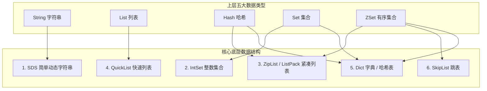
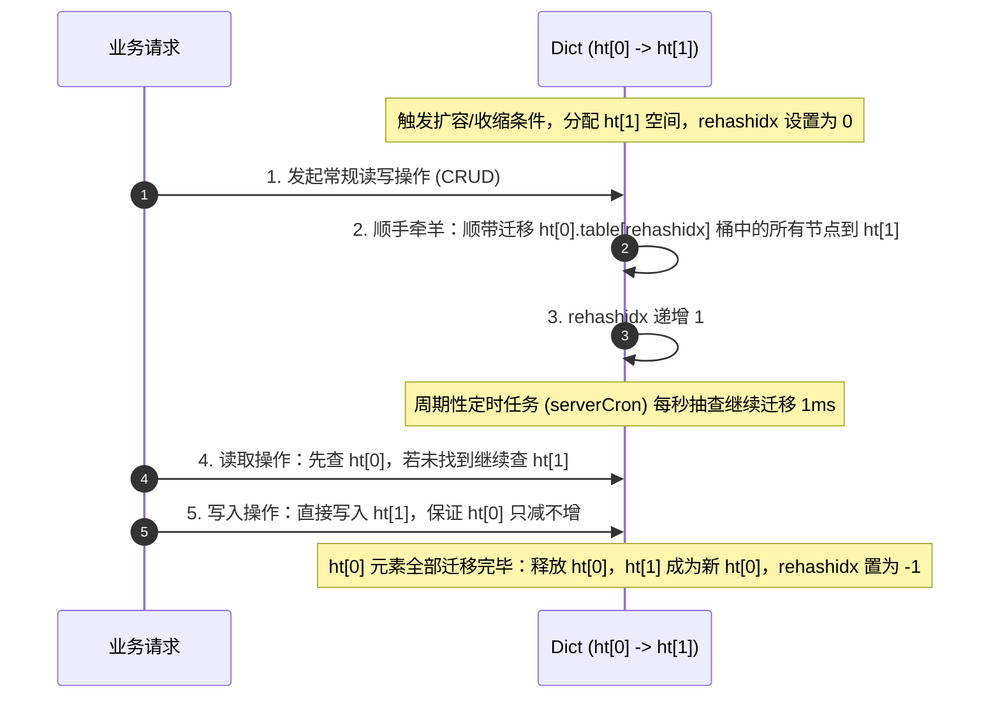
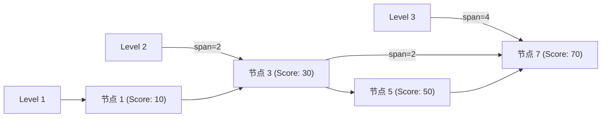
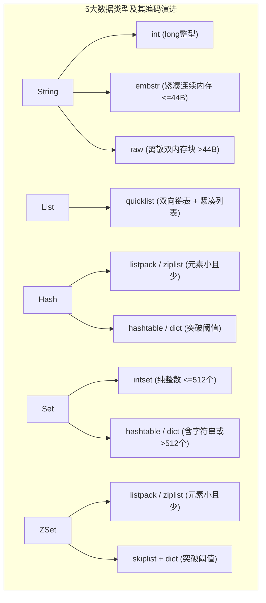
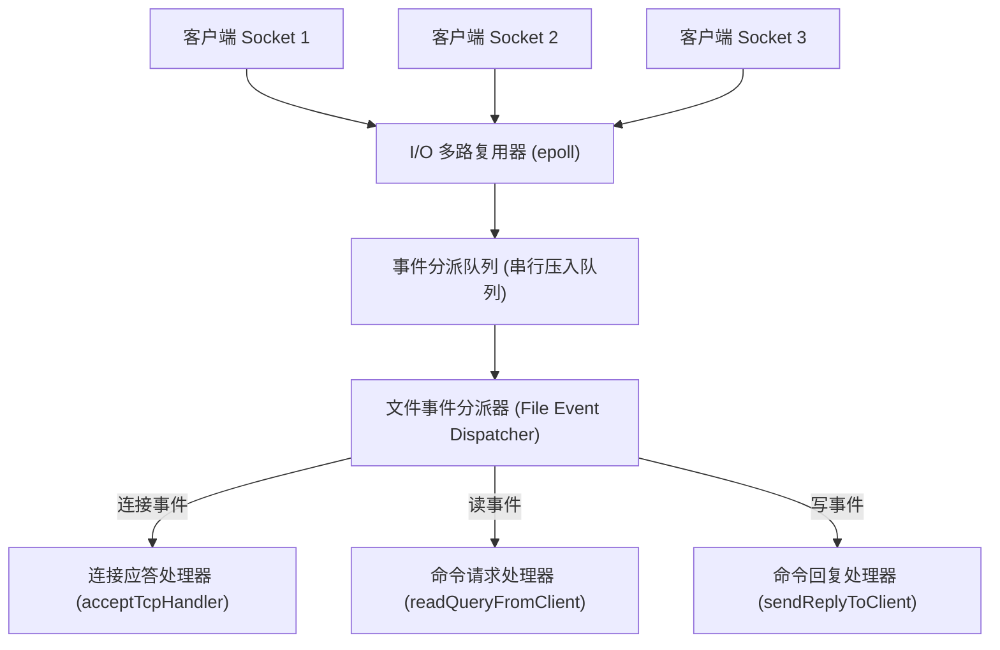
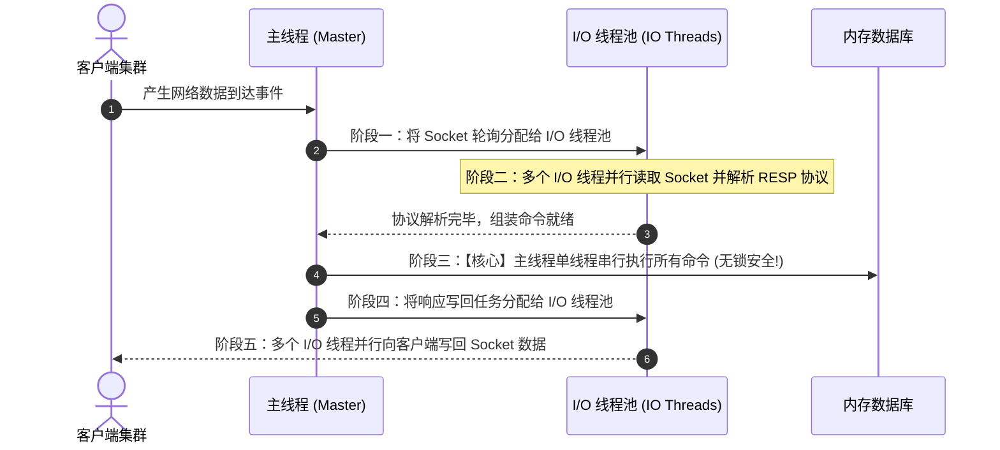
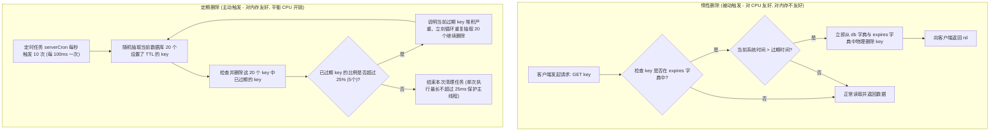
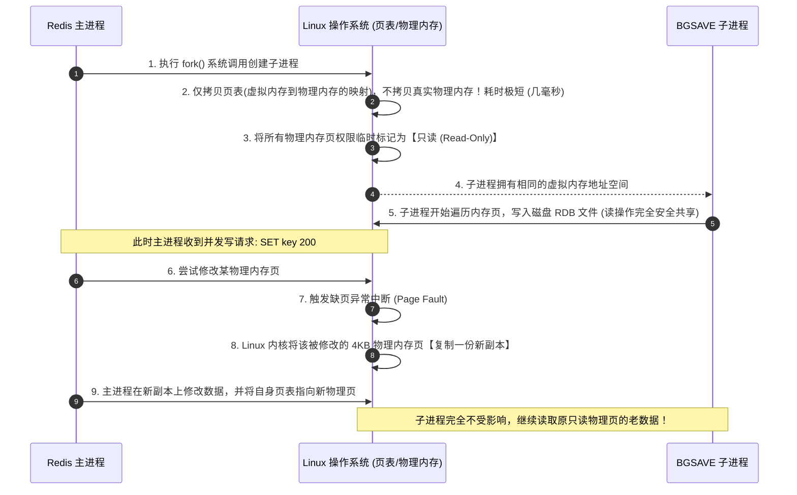

# Redis 核心底层原理、高可用集群与架构实战全景精讲（20k~35k 进阶必备）

> **定位与导读**：
> 本文是 Redis 体系的**全景核心主控与底层原理圣经**，全面融合了：
> 1. **核心底层原理**：C 语言底层数据结构（SDS/Dict/跳表/ListPack/QuickList）、redisObject 16 字节对象模型、Linux epoll 与 Reactor 模型、Redis 6.0 多线程 I/O、内存淘汰算法源码（近似 LRU / LFU）、Key 过期删除机制、Linux 写时复制（COW）与 RDB/AOF 混合持久化。
> 2. **高可用与分布式架构**：主从复制全量/增量机制（PSYNC2 双 Replication ID）、哨兵机制（Sentinel 心跳检测、Raft 选举、脑裂防御 `min-slaves-to-write`）、Cluster 分布式切片集群（16384 哈希槽原理、MOVED 与 ASK 寻址、Gossip 协议）。
> 3. **分布式工程实战**：Redis 分布式锁与 Redisson 深度剖析（WatchDog 看门狗时间轮续期、可重入 Hash Lua 脚本、RedLock 争议复盘）、缓存与数据库双写一致性终极方案（Cache Aside、Canal + RocketMQ 异步订阅 Binlog）、生产环境 `redis.conf` TOP 20 核心参数与 Spring Boot 生产避坑。
>
> - 若需深入掌握 **缓存穿透/击穿/雪崩、大Key与热Key排查治理、Set/BitMap/HyperLogLog/布隆过滤器场景实战、延迟队列及多级缓存**，请参阅业务落地文档：[04-Redis应用场景.md](file:///04-%E4%B8%AD%E9%97%B4%E4%BB%B6/04-Redis%E5%BA%94%E7%94%88%E5%9C%BA%E6%99%AF.md)。


---

## 一、Redis 宏观架构全景、redisObject 对象系统与技术选型

### 1. Redis 核心定位与为什么这么快？（面试第一问）

Redis（Remote Dictionary Server）是基于内存运行的高性能键值对（Key-Value）NoSQL 数据库。在现代分布式微服务体系中，它主要承担**高性能分布式缓存、分布式协调控制（分布式锁/限流）、轻量级消息队列以及海量数据计数与去重**等职责。单机 QPS 可以轻松达到 10w+。

#### (1) 四大性能支柱
| 性能支柱 | 底层机制与原理 | 收益结果 |
| :--- | :--- | :--- |
| **纯内存操作** | 数据常驻内存，所有读写均在 RAM 中完成，避免了磁盘机械寻道与磁头移动 | 纳秒级（ns）内存读写延迟，比普通磁盘快数万倍 |
| **单线程核心模型** | 核心命令执行采用单线程串行处理，彻底消除了多线程上下文切换、锁竞争（死锁/锁等待）的开销 | 零锁冲突、零线程上下文切换 CPU 开销 |
| **I/O 多路复用** | 基于 Linux `epoll`（非阻塞 I/O + 事件驱动 Reactor 模型），单线程并发监听成千上万个客户端 Socket | 单线程高并发处理海量网络连接 |
| **极致优化的底层数据结构** | 根据存储数据大小动态选择最优编码（如 SDS、intset、listpack/ziplist、skiplist） | 极致压缩内存开销，同时保证 $O(1)$ 或 $O(\log N)$ 的时间复杂度 |

#### (2) Redis vs 传统关系型数据库（MySQL）访问延时量级对比
- **存储介质**：MySQL 数据常驻磁盘（辅以 InnoDB Buffer Pool 内存缓冲），Redis 数据常驻内存。
- **访问延时**：内存的随机读写纳秒级/微秒级（约 100ns），磁盘机械寻道或 SSD 随机读写微秒到毫秒级（约 1~10ms），读写速度存在 **3~4 个数量级** 的天然鸿沟。
- **吞吐能力**：单机 MySQL 支撑读写 QPS 通常在数千到上万（受限于磁盘 I/O 与行锁竞争）；单机 Redis 轻松支撑 **100,000+ QPS**。

#### (3) Redis vs Memcached 深度选型对比

| 对比维度 | Redis | Memcached | 面试选型剖析 |
| :--- | :--- | :--- | :--- |
| **数据结构支持** | 丰富：String, List, Hash, Set, ZSet, BitMap, HyperLogLog, Geospatial, Stream 等 | 单一：仅支持纯 Key-Value 字符串 | Redis 可以在服务端直接对复杂数据类型进行原子操作（如 Hash 单字段更新、ZSet 增量排榜），无需将整包数据反序列化到客户端。 |
| **持久化能力** | 支持 RDB 快照与 AOF 日志，支持混合持久化 | 不支持任何持久化，宕机全量丢失 | Redis 重启可快速从磁盘恢复热点数据，避免系统重启引发严重的数据库缓存击穿风暴。 |
| **高可用与集群** | 原生支持主从复制、哨兵集群（Sentinel）与分布式切片集群（Cluster） | 无原生集群与高可用，需依赖客户端一致性哈希分片 | Redis 提供企业级完备的高可用与自动故障转移机制，运维生态高度成熟。 |
| **多线程模型** | 核心命令执行单线程（避免锁竞争），Redis 6.0 引入 I/O 多线程处理网络读写 | 原生多线程模型（Master-Worker 线程池与全局互斥锁） | Memcached 适合纯简单 KV 读取且 Value 较大的极少场景；现代高并发架构已全面拥抱 Redis。 |
| **内存管理** | 针对不同数据类型定制底层编码，支持 8 种内存淘汰策略 | 采用 Slab Allocation 内存池，预分配固定大小的 Chunk | Memcached Slab 分配机制虽然避免了内存碎片，但对于变长数据可能造成内部空间浪费。 |

---

### 2. 核心中枢纽带：redisObject 对象系统

在 Redis 中，我们存储的任何一个键值对，**Key 永远是一个包含 SDS 的字符串对象，而 Value 则是一个 `redisObject` 对象**。`redisObject` 是连接高层 5 大数据类型与底层 6 种数据结构的“灵魂纽带”。

```c
// server.h 中的 redisObject 结构体源码定义
typedef struct redisObject {
    unsigned type:4;       // 1. 数据类型 (4 bits = 0.5 Byte): OBJ_STRING, OBJ_LIST, OBJ_HASH, OBJ_SET, OBJ_ZSET
    unsigned encoding:4;   // 2. 底层编码 (4 bits = 0.5 Byte): OBJ_ENCODING_RAW, OBJ_ENCODING_INT, OBJ_ENCODING_HT 等
    unsigned lru:24;       // 3. LRU/LFU 时钟 (24 bits = 3 Bytes): 记录对象最后访问时间戳或访问频次计数
    int refcount;          // 4. 引用计数 (4 Bytes): 内存回收与对象共享机制
    void *ptr;             // 5. 数据指针 (8 Bytes, 64位系统): 指向底层真实数据结构 (如 sds, dict, skiplist 等)
} robj;
```

#### redisObject 内存大小与 16 字节对齐
- **结构体大小精准计算**：
  $$\text{type(4b)} + \text{encoding(4b)} + \text{lru(24b)} = 32 \text{ bits} = 4 \text{ 字节}$$
  $$4 \text{ 字节(元数据)} + 4 \text{ 字节(refcount)} + 8 \text{ 字节(*ptr 指针)} = \mathbf{16 \text{ 字节}}！$$
- **面试必背结论**：在 64 位操作系统下，**任何一个 `redisObject` 仅元数据头就固定占用 16 个字节的物理内存**。即便是存一个最简单的整数，Redis 也会先分配这 16 字节的对象头！

---

### 3. Redis 单机到分布式集群架构演进路线

从初创业务到亿级 DAU 架构，Redis 的部署形态经历四个关键演进阶段：

```text
阶段 1: 单机架构 (Standalone)
    └── 优点: 部署简单、无网络开销
    └── 痛点: 单点故障 (SPOF)、单机内存上限、CPU单核瓶颈

阶段 2: 主从复制架构 (Master-Slave)
    └── 解决: 读写分离 (写Master, 读Slave)、数据备份
    └── 痛点: Master 宕机需人工手动介入切换，无法做到自动化容灾

阶段 3: 哨兵模式架构 (Sentinel)
    └── 解决: 自动化监控、故障自动转移 (Failover)、客户端透明切换
    └── 痛点: 依然属于单主写模式，无法横向扩展写并发与超大内存容量

阶段 4: 分布式切片集群 (Redis Cluster)
    └── 解决: 16384 哈希槽无中心水平分片、支持海量存储与高写并发水平扩展
```


---

## 二、底层 6 大核心数据结构深度剖析

Redis 并不是直接使用上层的 String、Hash、List 等，而是根据数据规模在以下 6 大底层结构中动态选型与切换：



---

### 1. SDS（Simple Dynamic String，简单动态字符串）

C 语言原生字符串以 `\0` 结尾，存在 **无法 $O(1)$ 获取长度、容易缓冲区溢出、遇到 `\0` 截断导致二进制不安全** 等严重缺陷。Redis 自研了 SDS 作为底层字符串实现。

#### （1）SDS 源码设计（Redis 3.2+ 5 种空间规格）
为了追求极致节省内存，Redis 3.2 之后将 SDS 头部分拆为 5 种不同规格：`sdshdr5`、`sdshdr8`、`sdshdr16`、`sdshdr32`、`sdshdr64`。根据字符串长度动态匹配最小的头部空间。

以最常用的 `sdshdr8` 为例：
```c
struct __attribute__ ((__packed__)) sdshdr8 {
    uint8_t len;         // 1. 已使用的字符串实际字节长度 (不含末尾 \0)
    uint8_t alloc;       // 2. 总分配的缓冲区容量 (不含头部与末尾 \0)
    unsigned char flags; // 3. 标识当前 SDS 类型 (低3位标识是 5/8/16/32/64)
    char buf[];          // 4. 真正存放字符的字符数组 (末尾自动补 \0，兼容 C 库函数)
};
```
> `__attribute__ ((__packed__))`：告诉 GCC 编译器**取消结构体内存对齐填充**，按紧凑模式排布，节省内存的同时允许通过 `buf[-1]` 直接快速定位到 `flags` 字段。

#### （2）SDS 核心优势对比 C 原生字符串（面试必考）

| 对比维度 | C 原生字符串 (`char*`) | Redis SDS 动态字符串 |
| :--- | :--- | :--- |
| **获取长度复杂度** | $O(N)$，遍历字符直到遇到 `\0` | **$O(1)$**，直接读取结构体中的 `len` 字段 |
| **缓冲区溢出风险** | 极高（如 `strcat` 未分配足够空间直接覆盖相邻内存引发崩溃） | **杜绝溢出**：修改前自动检查 `alloc - len`，空间不足先自动扩容 |
| **内存重分配开销** | 每次修改字符串长度必发生系统调用重新分配内存 | **空间预分配 + 惰性释放**，大幅减少内存重分配系统调用 |
| **二进制安全性** | ❌ 只能存纯文本，遇到中间出现 `\0` 直接截断 | ✅ **二进制安全**：以 `len` 确定边界，支持存储图片、音频、序列化二进制流 |
| **C 语言库函数兼容** | 天然兼容 | 末尾依然保留 `\0`，可复用大量 C 标准库函数（如 `printf`, `strcasecmp`） |

#### （3）SDS 空间预分配与惰性释放策略
- **空间预分配（优化字符串追加）**：
  - 若修改后 SDS 长度（`len`）**< 1MB**：Redis 会分配与 `len` 相同的未分配空间（即 `alloc = 2 * len`）；
  - 若修改后 SDS 长度 **≥ 1MB**：Redis 固定额外预分配 **1MB** 未分配空间。
- **惰性空间释放（优化字符串缩短）**：
  - 当字符串缩短时，并不立即调用内存释放释放多余空间，而是仅更新 `len`，多出的空间保留在 `alloc` 中，以便下次追加直接复用。若需真正释放，Redis 提供了手动释放 API。

---

### 2. IntSet（整数集合）

IntSet 是当一个集合（Set）中的元素**全部都是整数值**，且元素数量较少时采用的紧凑连续内存结构。

```c
typedef struct intset {
    uint32_t encoding; // 编码方式: INTSET_ENC_INT16(2B), INTSET_ENC_INT32(4B), INTSET_ENC_INT64(8B)
    uint32_t length;   // 包含的元素数量 (O(1) 获取)
    int8_t contents[]; // 柔性数组，真正存放整数的物理连续内存空间 (从小到大升序排列)
} intset;
```

- **核心机制：二分查找**：由于 `contents` 内部元素严格按**从小到大有序且无重复**排列，查询元素时间复杂度为 $O(\log N)$。
- **核心特性：自动升级（Upgrade）**：
  - 初始时若所有整数都在 $[-32768, 32767]$，`encoding` 为 `INT16`，每个数字仅占 2 个字节；
  - 一旦插入一个超出当前范围的大整数（如 65535），IntSet 会触发**编码升级**：将底层所有现有元素统一重新转换为 4 字节的 `INT32` 重新排列，并追加新元素。
  - **重要原则**：**IntSet 仅支持自动升级，绝对不支持降级**（即便后来删除了那个大整数，编码也不会再降回 INT16）。

---

### 3. ZipList 与 Redis 7.0 ListPack 演进（重大核心升级）

#### （1）ZipList（压缩列表）结构
ZipList 是由一系列特殊编码的连续内存块组成的顺序型数据结构，设计初衷是**最大化榨干内存碎片**：
```
<zlbytes> <zltail> <zllen> <entry 1> <entry 2> ... <entry N> <zlend>
```
- `zlbytes` (4B)：整块压缩列表占用的总字节数；
- `zltail` (4B)：到达表尾节点的字节偏移量，支持 $O(1)$ 定位尾部；
- `zllen` (2B)：节点数量；
- `zlend` (1B)：恒为 `0xFF` (255)，标识列表结束。

每一个 entry 节点内部包含：
```
<previous_entry_length> <encoding> <content>
```
- `previous_entry_length`：记录**前一个节点的字节长度**，用于从尾向头反向遍历。若前一节点长度 < 254 字节，占 1 字节；若 ≥ 254 字节，占 5 字节。

#### （2）【大厂必考致命缺陷】ZipList 的“连锁更新（Cascade Update）”灾难
- **连锁更新原理**：
  - 假设压缩列表中连续有多个大小在 **250 ~ 253 字节** 之间的 entry 节点；
  - 此时它们的 `previous_entry_length` 都只需 1 个字节存储；
  - 若在最前方突然插入一个长度超过 254 字节的新节点，导致下一个节点的 `previous_entry_length` 必须从 1 字节扩容到 5 字节；
  - 扩容后，该节点自身总大小突破了 254 字节，进而迫使其下一个节点也必须扩容……由此引发**整条链表连锁重新分配内存**！
- **后果**：每次内存重分配都要重新 `memcpy` 拷贝，最坏时间复杂度直接退化为 $O(N^2)$，引起主线程严重卡顿。

#### （3）Redis 7.0 终极破局：ListPack（紧凑列表）
在 Redis 5.0 引入并在 **Redis 7.0 中彻底全面淘汰 ZipList** 的正是 **ListPack**！
- **核心设计思想**：彻底消灭连锁更新！
- **破局关键**：ListPack **移除了 `previous_entry_length` 字段**，每个 entry 节点只记录：
  ```
  <encoding> <data> <element-tot-len>
  ```
  - `element-tot-len`：只记录**当前节点自身的总长度**！
  - 从后向前遍历时，只需要读取前一个节点末尾的 `element-tot-len`，即可知道前一个节点的起始位置，**完全与前驱节点的大小脱钩**，彻底在物理设计上终结了连锁更新问题！

---

### 4. QuickList（快速列表，List 的底层支撑）

在 Redis 3.2 之后，List 类型的底层统一由 **QuickList** 支撑。
- **设计初衷**：双向链表（LinkedList）内存开销极大（前后指针在 64 位下占 16 字节，且内存碎片严重）；而单纯用 ZipList 又受限于连续大内存分配和连锁更新风险。
- **折中之道**：**QuickList = 双向链表 + 节点内部挂载 ZipList/ListPack**。每个链表节点（`quicklistNode`）内部存放一段紧凑列表。

```c
typedef struct quicklist {
    quicklistNode *head; // 头节点
    quicklistNode *tail; // 尾节点
    unsigned long count; // 所有节点内部元素的总数量
    unsigned int len;    // quicklistNode 节点的数量
    int fill : 16;       // 单个 quicklistNode 节点中紧凑列表的最大容量限制 (默认 -2, 即 8KB)
    unsigned int compress : 16; // 两端不压缩的节点深度 (0 表示不压缩)
} quicklist;
```
- **核心调优参数**：
  - `list-max-ziplist-size`（默认 -2）：每个 quicklistNode 的内存大小不得超过 8KB，避免大内存碎片；
  - `list-compress-depth`（默认 0）：List 两端访问最频繁，中间的节点可以启用 LZF 算法深度压缩，大幅节约内存。

---

### 5. Dict（字典 / 哈希表）

Dict 是 Redis 最核心的底层结构，整个 Redis 键值对数据库自身就是建立在 Dict 之上的。

#### （1）三层源码架构
```c
typedef struct dict {
    dictType *type;     // 类型特定函数 (哈希函数、比较函数等)
    void *privdata;     // 私有数据
    dictht ht[2];       // 【核心】两个哈希表: ht[0] 日常工作表，ht[1] 扩容/缩容备份表
    long rehashidx;     // rehash 进度索引: -1 表示当前未进行 rehash
    int16_t pauserehash;// 是否暂停 rehash
} dict;

typedef struct dictht {
    dictEntry **table;  // 桶数组指针
    unsigned long size; // 哈希表大小 (恒为 2 的 N 次幂)
    unsigned long sizemask; // 掩码 = size - 1, 用于计算桶索引 (hash & sizemask)
    unsigned long used; // 已有元素数量
} dictht;
```

#### （2）哈希冲突与链地址法
当不同的 key 计算得到相同的哈希桶索引时，Redis 使用**单向链表（链地址法）**解决冲突。为了追求最高性能，新节点总是采用**头插法（$O(1)$）**插入到链表头部。

#### （3）【大厂面试绝杀】渐进式 Rehash 全流程（Progressive Rehash）

传统一次性 Rehash 当哈希表达到上千万元素时，集中迁移会导致 Redis 阻塞数秒之久。因此 Redis 独创了**渐进式 Rehash**：



- **触发条件**：
  - 负载因子公式：$\text{LoadFactor} = \frac{\text{ht[0].used}}{\text{ht[0].size}}$；
  - **自动扩容**：
    1. 自然状态下：$\text{LoadFactor} \ge 1$ 且没有在执行 BGSAVE/BGREWRITEAOF；
    2. 强制状态下：$\text{LoadFactor} \ge 5$（即便在执行子进程备份，为了防止链表过长也强制扩容）；
  - **自动收缩**：$\text{LoadFactor} < 0.1$ 时，自动开始缩容以释放内存。

---

### 6. SkipList（跳表）

跳表是带有**多级随机索引**的有序链表，查找、插入、删除的时间复杂度均为平均 **$O(\log N)$**，最坏 $O(N)$。



#### （1）源码核心结构体
```c
typedef struct zskiplistNode {
    sds ele;             // 存储的成员对象 member (唯一)
    double score;        // 分值，排序核心依据
    struct zskiplistNode *backward; // 后退指针，支持从表尾向表头倒序遍历
    struct zskiplistLevel {
        struct zskiplistNode *forward; // 前进指针
        unsigned long span;            // 跨度: 记录当前指针跳过了多少个节点 (计算排名的核心依据!)
    } level[];           // 柔性数组，层级通过掷骰子随机生成 (最大 32 层/64层，概率 25%)
} zskiplistNode;
```

- **跨度（span）的精妙用途**：普通跳表仅用于查找元素；Redis 跳表中给每层前进指针增加了一个 `span` 属性。**沿着查找路径将沿途经过的所有前驱节点的 `span` 累加，就能在 $O(\log N)$ 时间内精确计算出该元素的当前排名（Rank）**！

#### （2）ZSet 为什么采用“跳表 + Dict”双引擎？
有序集合（ZSet）底层实际上同时维护了跳表与哈希表：
- **Dict 负责 $O(1)$ 精确点查**：`ZSCORE key member` 通过哈希表秒级拿到对应分数；
- **SkipList 负责 $O(\log N)$ 范围检索与排名计算**：`ZRANGEBYSCORE`、`ZRANK`。

#### （3）【大厂面试高频必问】ZSet 为什么使用“跳表”而不是“红黑树 / B+树”？

| 考量维度 | 跳表（SkipList） | 平衡二叉树 / 红黑树（RB-Tree） | B+ 树 |
| :--- | :--- | :--- | :--- |
| **范围查询（Range Query）** | **最优**：$O(\log N)$ 定位到首节点后，直接沿着 Level 1 双向链表顺序遍历 | 较繁琐：需要中序遍历，跨节点回溯寻道 | 同样优秀，支持叶子节点顺序遍历 |
| **并发与实现复杂度** | **极度简单轻量**：仅通过随机层高维护平衡，无复杂树旋转 | **极度复杂**：插入/删除频繁触发左旋、右旋与变色 | 节点分裂、合并复杂度极高 |
| **内存开销** | 平均每个节点指针数：$\frac{1}{1 - 0.25} \approx 1.33$ 个指针，内存更优 | 每个节点固定占用 2 个左右子节点指针 | 每个页节点需保留大量槽位指针 |
| **适用环境** | **纯内存型数据库的首选** | 适合内存小规模字典 | 适合**磁盘型关系数据库**（如 MySQL InnoDB，减少磁盘 I/O） |

---


---

## 三、高层 5 大数据类型底层编码与转换机制



---

### 1. String 字符串的三种底层编码

可以通过 `OBJECT ENCODING <key>` 查看 String 的底层编码：

#### （1）`int` 编码
- **条件**：保存的值是可以用 `long` 类型表示的纯整数（如 `10086`）。
- **优化原理**：`redisObject` 的 `*ptr` 指针直接转换用来存储这个数值本身（8 字节刚好存下 `long`），**完全无需额外分配 SDS 内存**！

#### （2）`embstr` 与 `raw` 编码的本质差异与 44 字节分界线

| 编码名称 | 内存分配方式 | 释放开销 | 字符串修改表现 |
| :--- | :--- | :--- | :--- |
| **`embstr`** | **只分配 1 次内存**：`redisObject` 与 SDS 紧凑连续排布在同一块连续内存中 | 释放仅需 1 次 `zfree` 系统调用 | **只读属性**：任何修改操作都会强制升级为 `raw` |
| **`raw`** | **分配 2 次内存**：`redisObject` 与 SDS 分别分配在两块离散的内存区域 | 释放需要 2 次系统调用 | 支持动态自由扩容与修改 |

```
embstr 内存布局 (1 次内存分配, 刚好 64 字节):
[ redisObject (16B) ] [ sdshdr8 头部 (3B) ] [ 字符数据 (<=44B) ] [  (1B) ]
```

> **【大厂高频深度必考】：为什么 embstr 和 raw 的分界线恰恰是 44 个字节？**  
> 1. **内存分配器最小粒度**：Redis 默认使用 **jemalloc** 内存分配器，其分配内存的固定规格之一是 **64 字节**。如果单次申请不超过 64 字节，能完美避免内部碎片；
> 2. **账本计算**：
>    $$\text{redisObject 元数据大小} = 16 \text{ 字节}$$
>    $$\text{sdshdr8 头部大小 (len + alloc + flags)} = 1 + 1 + 1 = 3 \text{ 字节}$$
>    $$\text{末尾预留的 } \backslash 0 \text{ 结束符} = 1 \text{ 字节}$$
>    $$64 \text{ 字节} - (16 + 3 + 1) = \mathbf{44 \text{ 字节}}！$$
> 3. **结论**：只要字符内容不超过 44 字节，整个对象（对象头 + SDS头 + 内容）刚好卡在 64 字节内，一次分配全部搞定！

---

### 2. List 列表底层编码

- **当前实现**：自 Redis 3.2 之后，List 统一采用 **`quicklist`** 编码；
- **历史演进**：老版本采用 `ziplist`（元素少时）与 `linkedlist`（元素多时），由于双向链表指针开销大（占用 16 字节），被 quicklist 彻底取代。

---

### 3. Hash 哈希底层编码与转换条件

- **编码一：`ziplist` / `listpack`（紧凑列表）**：
  
  - 键值对以成对的方式紧挨着保存在连续内存中（前一个 entry 存 key，后一个 entry 存 value）；
- **编码二：`hashtable`（字典 / dict）**：
  
  - 散列表结构，键值分散。
- **触发降级/升级转换的阈值（两者同时满足才用紧凑列表）**：
  1. `hash-max-ziplist-entries 512`：哈希中键值对数量小于 512 个；
  2. `hash-max-ziplist-value 64`：每个键和值字符串长度均小于 64 字节。
  - **任一条件不满足**，立即升级为 `hashtable`。

#### Hash vs String(JSON) 存储对象大厂选型对比
- **选 Hash**：对象包含多个字段，业务经常需要**独立读取或局部修改某个属性**（如仅修改用户积分 `HINCRBY user:1001 points 10`），避免反序列化全部数据，网络带宽极大节省；
- **选 String(JSON)**：对象属性固定、几乎总是整体读写（如商品快照），或对象结构复杂带多层嵌套列表。

---

### 4. Set 集合底层编码与转换条件

- **编码一：`intset`**：
  - 条件 1：集合中的所有元素都**必须是整数**；
  - 条件 2：元素数量不超过 512 个（配置 `set-max-intset-entries 512`）。
- **编码二：`hashtable`**：
  - 只要插入了任意一个非整数（字符串），或者元素个数突破 512 个，**永久升级为 `hashtable`**（字典的 Value 恒为 `null`）。

---

### 5. ZSet 有序集合底层编码与转换条件

- **编码一：`ziplist` / `listpack`**：
  - 紧凑列表中第一个 entry 存 member，紧随其后的 entry 存 score，按 score 从小到大升序排列。
- **编码二：`skiplist + dict`**：
  - 同时维护跳表与哈希表。
- **转换阈值**：
  1. `zset-max-ziplist-entries 128`：元素数量小于 128 个；
  2. `zset-max-ziplist-value 64`：每个 member 的长度小于 64 字节。

---


---

## 四、网络 I/O 底层模型与多线程演进

### 1. Linux I/O 多路复用模型深度拆解

在海量客户端高并发连接场景下，网络 I/O 模型经历了四个发展阶段：


- **BIO 缺陷**：一连接一线程，数万连接导致 JVM 线程暴增，内存耗尽，系统崩溃；
- **NIO 轮询缺陷**：单线程不断 `read()` 循环调用，无论有无数据都占用 CPU，导致单核 CPU 100%；
- **select / poll 缺陷**：每次调用都把包含所有 fd 的集合从用户态全量拷贝到内核态，并且内核需要 $O(N)$ 遍历整个数组来确认谁有数据，最大并发连接数受限（select 默认 1024）；
- **epoll（Linux 终极武器）优势**：
  1. **红黑树管理**：内部维护一颗红黑树，添加、删除监控的 Socket 复杂度为 $O(\log N)$，无需每次重复拷贝；
  2. **事件就绪链表（Ready List）**：当网卡收到数据触发硬件中断，通过回调函数直接将就绪的 Socket 加入就绪链表；
  3. **$O(1)$ 获取就绪连接**：调用 `epoll_wait` 仅返回有数据的活跃连接，绝不浪费时间扫描空闲连接！

---

### 2. Redis 单线程 Reactor 事件驱动模型

Redis 基于 epoll 封装了一套轻量级的 **Reactor 模式事件处理器（AeEvent）**：



- **核心调度原理**：虽然网络连接成千上万，但 I/O 多路复用器将产生事件的 Socket 放入队列，单线程**串行、无锁地**依次处理，保证了内存执行的原子性与简单性。

---

### 3. 【大厂高频面试绝杀】Redis 6.0 为什么引入多线程？

面试官常问：*“Redis 之前一直吹嘘单线程最快，为什么在 6.0 偏偏引入了多线程？单线程的瓶颈到底在哪里？会不会产生线程安全问题？”*

#### （1）瓶颈究竟在哪里？
Redis 的性能瓶颈**从来不是 CPU**（Redis 内存操作极快，单核每秒处理数万条内存指令游刃有余）。真正的瓶颈是：
1. **网络 Socket 读写系统调用开销**：当网络数据量很大时，在内核缓冲区与用户缓冲区之间频繁调用 `read()` / `write()` 拷贝数据成为最大瓶颈；
2. **协议解析耗时**：将客户端发来的字节流反序列化为 Redis 命令（RESP 协议解析）。

#### （2）Redis 6.0 多线程架构与分工机制



- **安全铁律（面试必背）**：
  - **多线程仅负责**：**网络数据的读取、协议解析** 与 **网络数据的回复写出**（耗时的网络 I/O）；
  - **单线程仍然独占**：**实际的命令执行与数据内存读写**（如 `GET`、`SET`、`HSET`）！
  - **结论**：**因此 Redis 6.0 依旧是纯粹的单线程执行模型，完全不需要引入细粒度内存锁，绝无线程安全与并发竞态问题！**

---


---

## 五、内存管理与淘汰驱逐底层机制

### 1. 自研内存管理与 jemalloc 内存分配器

Redis 不直接调用系统的 `malloc/free`，而是通过自研的 `zmalloc.c` 统一封装。
- **内存前置标记**：在每次分配的内存块头部固定记录 8 字节（存储本次分配的内存大小），使 Redis 能以 $O(1)$ 实时统计自身当前占用的总物理内存（`used_memory`）；
- **默认分配器 jemalloc**：采用分规格内存池分配（如 8B, 16B, 32B, 64B...），将内存碎片率控制在最低水平。

---

### 2. 8 大内存淘汰策略（maxmemory 触发）

当 Redis 内存使用量突破配置的 `maxmemory` 限制时，在处理任何写请求前，Redis 都会在 `freeMemoryIfNeeded()` 函数中执行内存淘汰：

| 淘汰策略名称 | 适用 Key 范围 | 核心淘汰逻辑 | 推荐生产场景 |
| :--- | :--- | :--- | :--- |
| **`noeviction`（默认策略）** | 全部 Key | **不淘汰任何数据**，写请求直接抛出 OOM 异常报错，读请求正常放行 | 纯分布式存储、严禁丢数据的非纯缓存业务 |
| **`allkeys-lru` ⭐ 最常用** | 全部 Key | 优先淘汰**最近最少使用**（Least Recently Used）的 Key | **经典缓存场景首选**，符合二八法则 |
| **`volatile-lru`** | 仅设置了 TTL 的 Key | 优先淘汰设置了过期时间中最近最少使用的 Key | 既做持久存储又做临时缓存的混合场景 |
| **`allkeys-lfu` ⭐ 4.0+** | 全部 Key | 优先淘汰**最不经常访问**（Least Frequently Used，访问频次最低）的 Key | 存在偶发突发冷门扫描流量的场景 |
| **`volatile-lfu`** | 仅设置了 TTL 的 Key | 优先淘汰设置了过期时间中访问频次最低的 Key | 混合场景 + 防突发冷 Key 扫描 |
| **`volatile-ttl`** | 仅设置了 TTL 的 Key | 优先淘汰**剩余存活时间最短**（即即将过期）的 Key | 临时验证码、短期 Token 场景 |
| **`allkeys-random`** | 全部 Key | 随机淘汰任意 Key | 极少使用 |
| **`volatile-random`** | 仅设置了 TTL 的 Key | 随机淘汰设置了过期时间的 Key | 极少使用 |

---

### 3. 【大厂深度必考】近似 LRU 底层算法逻辑（为什么不用标准 LRU？）

传统 Java 中的 `LinkedHashMap` 标准 LRU 算法需要维护一个**全量双向链表**。每当访问一个 Key，都要将该节点移动到链表表头。
- **为什么 Redis 不用标准 LRU？**
  1. 占用海量额外内存：每个键值对需要两个额外指针（16 字节），对于数千万 Key，指针内存开销将高达数 GB；
  2. 锁与并发性能灾难：每次读取操作都演变成链表写操作，频繁修改指针，极其消耗 CPU。

#### Redis 近似 LRU（Approximation LRU）设计原理：
1. **时钟记录（24 bits）**：每个 `redisObject` 的 `lru` 字段记录该对象最后一次被访问时的时间戳（秒级）；
2. **随机采样**：淘汰时，Redis 不会扫描全局所有 Key，而是默认随机抽取 **5 个 Key**（配置 `maxmemory-samples 5`）；
3. **维护淘汰池（Eviction Pool）**：Redis 内部维护一个容量为 16 的固定升序候选池。将这 5 个采样 Key 中空闲时间最长（`当前时间戳 - lru` 最大）的 Key 插入池中；
4. **精确定点清除**：从候选池中挑出空闲时间最大的 Key 释放内存。**随着采样数提高到 10，其效果无限逼近严格 LRU，但内存开销为 0！**

---

### 4. 【大厂深度必考】LFU 底层对数计数与衰减数学算法（4.0+）

LFU 解决的是 LRU 的经典缺陷：*如果一个冷门数据被偶尔全表扫描了一次，LRU 会将其误提升至链表头，导致真正的热点被淘汰*。

Redis 将 `redisObject` 的 **24 位 `lru` 空间一分为二**：
```
[ 16 bits: LDT (Last Decrement Time) ] [ 8 bits: LOG_C (Logistic Counter) ]
```
1. **高 16 位：LDT（上次衰减时间戳，分钟级精度）**：记录最后一次访问的时间；
2. **低 8 位：LOG_C（对数访问频次计数器，0 ~ 255）**：
   - 并不是来一次请求就直接 `+1`（8 位最多只能数到 255）；
   - **基于概率的对数增长**：访问次数越多，计数器增长概率越低（通过配置 `lfu-log-factor` 调节，255 可代表上百万次访问）；
   - **时间衰减机制**：若距离上次访问时间跨度较大（配置 `lfu-decay-time`），在下次访问或淘汰时，计数器会**自动按时间比例向下衰减扣减**。
   - **结论**：既记录了频次，又融合了时间新鲜度，完美防范了历史偶发流量污染。

---


---

## 六、过期 Key 清理底层机制

面试官常问：*“我们在 Redis 里面设置了大量 Key 的过期时间（EXPIRE），当时间到了之后，这些 Key 会被立即从内存中删除吗？”*

**答案是：绝对不会立即删除！如果为每个 Key 设置定时器，几百万个定时器会瞬间将 CPU 跑满崩溃。** Redis 采用了**“惰性删除 + 周期性定期删除”**的主动与被动结合机制。



#### 内存泄漏终极兜底
如果某些 Key 既很久没有客户端去访问（惰性删除未触发），又在定期采样的随机抽查中连续漏网（定期删除未抽中），导致这些过期冷数据常驻内存。**此时第五章讲到的【内存淘汰策略（maxmemory-policy）】将作为最后的兜底屏障，在内存打满前强制将其驱逐回收！**

---


---

## 七、持久化底层机制与原理

Redis 提供了三大持久化方案：**RDB（内存快照）**、**AOF（追加日志）** 和 **RDB+AOF 混合持久化**。

---

### 1. RDB 快照持久化与 Linux 写时复制（COW）

RDB 是在某一时间点上将 Redis 内存中全量数据生成紧凑的二进制压缩文件（`dump.rdb`）。

- **触发方式**：
  - `save`（手动前台触发）：**在主线程中串行执行**，会导致 Redis 瞬间挂起，期间阻塞所有业务命令，**严禁在生产线上使用**！
  - `bgsave`（后台异步触发）：主线程调用 Linux `fork()` 系统调用创建子进程，由子进程在后台将数据写入临时 RDB 文件，写完后原子替换原文件。

#### 【大厂必考深度】Linux 写时复制（COW，Copy-On-Write）底层原理

面试官常问：*“Redis 在执行 BGSAVE 期间，主线程依然能继续并发处理增删改写请求，如果此时子进程正在写磁盘，数据不会读写冲突或者读到脏数据吗？为什么内存没有瞬间暴涨一倍？”*



- **写时复制（COW）核心优势**：`fork` 瞬间耗时极短，只拷贝页表指针，绝不发生海量物理内存深拷贝；
- **【高危避坑】极端写流量下的内存翻倍风险**：如果 BGSAVE 期间，业务恰好有高并发大批量重度写入（如大量数据被更新重写），会导致大量 4KB 内存页被复制分裂，**实际总内存使用量可能无限逼近 2 倍物理内存**！若服务器未预留足够的 SWAP 空间或物理内存，会直接触发 Linux OOM Killer 杀掉 Redis 主进程！

---

### 2. AOF 日志持久化与重写机制

AOF（Append Only File）以纯文本协议格式实时记录服务端执行过的**每一条修改写入命令**。

#### （1）为什么 Redis 采用“写后日志”而不是 MySQL 的“写前日志（WAL）”？
- **MySQL WAL（Write-Ahead Logging）**：先写 redo log 到磁盘再改内存，主要是为了实现事务的崩溃安全性（Crash-Safe）；
- **Redis 为什么先改内存后写 AOF？**
  1. **免除语法检查成本**：如果先写日志，若命令本身语法错误，还得回滚磁盘；写后日志确保了只有真正执行成功的合法命令才被持久化；
  2. **绝对不阻塞当前主线程写命令**：保证了内存写的极限极速响应。
  3. **代价**：若命令刚写完内存、还没来得及落盘服务器就宕机，这部分最新数据将永久丢失。

#### （2）三种刷盘策略（`appendfsync`）

| 刷盘策略 | 底层实现 | 数据安全性 | 性能开销 | 推荐场景 |
| :--- | :--- | :--- | :--- | :--- |
| **`always`** | 每次执行写命令都强制调用系统 `fsync()` 落盘 | **最高**（几乎不丢数据） | **极差**（受限于磁盘机械 I/O，QPS 暴跌至几百） | 极少数核心金融场景 |
| **`everysec` ⭐ 默认首选** | 每秒由后台子线程统一调用一次 `fsync()` | **较高**（最多丢失 1~2 秒数据） | **极高**（兼顾极佳的吞吐量） | **绝大多数生产环境首选** |
| **`no`** | 由操作系统自身决定何时刷盘（通常 30 秒） | **极差**（宕机损失不可控） | 最高 | 纯测试环境 |

#### （3）AOF 重写机制（AOF Rewrite）
随着时间推移，AOF 文件会无限膨胀（如一个计数器 `INCR` 了 100 万次，AOF 记录了 100 万条无用日志）。
- **重写本质**：并不是去分析老 AOF，而是**直接读取当前 Redis 内存中的最新数据，将每个键值对用一条最小指令写入新的 AOF 文件**（100 万次 INCR 变成一条 `SET counter 1000000`）！
- **重写后台执行**：通过 `bgrewriteaof` fork 出子进程，在后台扫描内存生成新 AOF 文件。期间新增的写入命令同时写入内存的“AOF 重写缓冲区”，子进程写完后由主线程将增量部分一次性追加合并。

#### （4）【Redis 7.0 现代化演进】Multi-Part AOF（MP-AOF）
- **老版本痛点**：在 Redis 7.0 之前，单 AOF 文件的重写与追加在同一个大文件中进行，在重写期间主进程需要频繁写 AOF 缓冲区与新旧文件重命名，在重写完成切换瞬间存在严重的磁盘写写竞争和阻塞停顿。
- **Redis 7.0 架构革新**：将单 AOF 拆解为三类子文件：
  1. **Base 基础文件**：存放上次重写完成时的全量快照；
  2. **Incr 增量文件**：重写期间及后续的实时增量变更写入独立的增量文件；
  3. **Manifest 清单文件**：使用 JSON 风格跟踪记录所有的 Base 与 Incr 文件版本与追溯依赖。彻底解耦了追加写与重写操作！

---

### 3. RDB + AOF 混合持久化模式（4.0+ 标配）

通过配置 `aof-use-rdb-preamble yes` 启用：
- **核心原理**：在 AOF 重写时，子进程前半截**直接将当前内存以 RDB 二进制格式写入新 AOF 文件开头**，后半截在重写期间产生的增量变更以正常的 **AOF 文本协议格式追加在末尾**。
- **收益**：
  - **重启恢复极速**：加载 RDB 二进制文件比逐行回放几千万条 AOF 文本快数十倍；
  - **数据完整度极高**：利用末尾少量的增量 AOF 保证了最近几秒钟的数据零丢失。

---


---

## 八、Redis 高可用架构：主从复制（Replication）深度剖析

### 1. 主从复制的核心价值与拓扑结构

主从复制是 Redis 实现高可用的坚实基石，它通过将 Master 节点的写操作日志持续同步到一个或多个 Slave（Replica）节点，达到以下核心目标：
- **读写分离（Read/Write Splitting）**：Master 节点专职负责高并发写流量，多个 Slave 节点分担只读查询，读并发能力随 Slave 数量线性扩展。
- **数据容灾备份（Disaster Recovery）**：Slave 节点作为数据全量冗余副本，当 Master 遭遇硬件故障或机房断电时，能最大程度保全数据。
- **高可用自动故障转移的基础**：后续的 Sentinel 哨兵模式与 Cluster 集群模式均强依赖底层的主从复制链路。

#### 拓扑结构设计
1. **一主多从拓扑（One-Master Multi-Slave）**：适用于读流量极高、Slave 节点数适中（<= 5 台）的常规场景。
2. **树状级联复制拓扑（Chained / Hierarchical Replication）**：`Master -> Slave 1 -> Slave 2 / Slave 3`。当从节点过多时，避免多个 Slave 同时向 Master 请求同步造成 Master 的 CPU 与出口网络带宽瞬间打爆（复制风暴）。

---

### 2. 主从全量同步流程原理

当一个新 Slave 节点初次加入集群，或者从节点与主节点断开时间过长导致增量数据被覆盖时，触发**全量同步（Full Synchronization）**。

#### 全量同步 6 步文字时序拆解

```text
[Slave 从节点]                                         [Master 主节点]
     |                                                       |
     |---- 1. 发送连接请求 (replicaof master_ip port) ------>|
     |---- 2. 发送 PING 握手探活与 AUTH 认证 --------------->|
     |---- 3. 发送 PSYNC ? -1 (告知主节点: 首次请求全量同步) ->|
     |                                                       |---- 4. 触发 BGSAVE，fork 子进程生成 RDB
     |                                                       |     同时开启 repl_backlog_buffer 记录新写命令
     |<--- 5. 发送 RDB 快照文件 (网络流式传输) ---------------|
     |     (清空自身旧数据，加载 RDB 文件到内存)              |
     |                                                       |
     |<--- 6. 发送 repl_backlog_buffer 中积压的写命令 --------|
     |     (执行缓冲区中的写命令，主从数据状态达成一致)        |
     |                                                       |
     |================ 建立长连接，进入心跳维持与命令传播阶段 =================|
```

#### 关键技术点解析
1. **无盘复制（Diskless Replication）**：
   - 默认配置下，Master 会先将 RDB 写入本地磁盘，然后再发送给网络。如果磁盘 I/O 缓慢，会成为同步瓶颈。
   - 配置 `repl-diskless-sync yes` 后，Master 的子进程直接将生成的 RDB 通过 Socket 管道流式发往 Slave，跳过磁盘落盘，极大提升 SSD/机械盘承载同步的效率。
2. **复制积压缓冲区（repl_backlog_buffer）**：
   - Master 维护的一个固定大小的**环形写缓冲区（Ring Buffer）**，所有写入命令在传播给 Slave 的同时，都会按序写入该缓冲区。
   - 包含两个核心偏移量：
     - `master_repl_offset`：Master 自身当前写入的最新偏移量。
     - `slave_repl_offset`：各个 Slave 已经成功同步并 ACK 的偏移量。

---

### 3. 增量同步机制与 PSYNC / PSYNC2

当主从网络发生短暂抖动或瞬时断连后，如果每次重连都执行全量 RDB 生成与网络大文件传输，将对主节点系统资源造成灾难性打击。因此 Redis 设计了高效的**增量同步（Partial Resynchronization）**机制。

#### (1) PSYNC 执行条件与判断逻辑
当从节点网络重连后，向主节点发送命令：`PSYNC <master_replid> <slave_repl_offset>`。
- `master_replid`：从节点记录的主节点运行标识符（Replication ID）。
- `slave_repl_offset`：从节点当前最后同步到的命令字节偏移量。

Master 收到请求后进行两项核心校验：
1. **Replication ID 校验**：比较从节点传来的 `master_replid` 是否与自身一致。若一致，说明从节点之前确实隶属于当前主节点。
2. **Offset 覆盖校验**：计算从节点的 `slave_repl_offset` 是否仍然在 Master 的 `repl_backlog_buffer` 环形缓冲区之内。
   - **命中环形范围**：Master 返回 `+CONTINUE`，进入增量同步模式！Master 仅将 `slave_repl_offset` 到 `master_repl_offset` 之间未同步的字节数据打包推送给从节点。
   - **超出环形范围（已被覆盖）**：说明断网时间过长，未同步的数据已被环形缓冲区覆盖擦除。Master 返回 `+FULLRESYNC <master_replid> <offset>`，强制降级为全量同步。

#### (2) Redis 4.0+ PSYNC2 优化（主从切换后的增量复制）
在 Redis 4.0 之前，如果主节点宕机，哨兵将某个从节点晋升为新主节点，新主节点会重新生成全新的 `Replication ID`。此时其他从节点去连接新主节点时，由于 ID 发生变化，**必然全部触发全量同步**，极易引发主从级联雪崩。

**PSYNC2 核心解决方案**：
引入两个 Replication ID：
- `replid`：当前主节点的主 ID。
- `replid2`：当前主节点所继承的旧主节点的次级 ID。
当从节点晋升为新主节点时，会将旧主节点的 `replid` 赋给自身的 `replid2`，并记录继承时的最后 offset。其他从节点向新主节点发起同步请求时，即便 `replid` 不匹配，新主节点发现从节点的 ID 匹配自身的 `replid2` 且 offset 在安全范围内，**依然允许执行增量同步**，完美规避了主从切换引发的全局全量同步！

---

### 4. 生产环境复制痛点与调优方案

| 生产痛点场景 | 根本原因剖析 | 工业级解决方案 |
| :--- | :--- | :--- |
| **复制风暴（Replication Storm）** | 多个 Slave 节点同时断网重连或批量启动，并发向 Master 发起全量同步，导致 Master 频繁 fork 产生内存 COW 翻倍、CPU 跑满、网络千兆网卡被打爆。 | 1. 采用**树状级联复制**架构，分流从节点同步压力；<br>2. 适当增大 `repl-backlog-size` 避免轻易触发全量同步；<br>3. 避免批量同时重启从节点。 |
| **客户端输出缓冲区溢出导致无限同步** | 全量同步期间写流量极大，Slave 处理较慢，Master 为该 Slave 维护的 `client-output-buffer-limit slave` 被撑爆，Master 主动切断连接，引发 Slave 重连再次全量同步，形成恶性死循环。 | 增大输出缓冲区阈值配置：<br>`client-output-buffer-limit slave 512mb 128mb 60`（硬限制 512MB，软限制 128MB 持续 60 秒断开）。 |
| **主从数据延迟与脏读** | 主从复制是**异步（Asynchronous）**进行的，Master 写成功后立即返回客户端，再异步传播命令给 Slave。高并发写时 Slave 必然存在毫秒级延迟。 | 1. 强一致性要求高的读请求直接强制走 Master；<br>2. 监控主从延迟指标 `master_link_down_since_seconds` 与 offset 差值；<br>3. 必要时使用 `WAIT numreplicas timeout` 阻塞等待指定数量 Slave 确认。 |


---

---

## 九、Redis 哨兵机制（Sentinel）深度剖析

### 1. Sentinel 集群职责与通信模型

在主从复制模式下，Master 节点宕机需要运维人员手动将 Slave 提升为 Master 并修改所有客户端配置，不可用时间长、容灾代价高。
**Redis Sentinel（哨兵）**是一个独立的分布式系统，它作为看门人运行在独立进程中，主要承担四大职责：
1. **监控（Monitoring）**：持续通过心跳检测 Master 和 Slave 是否健康运行。
2. **通知（Notification）**：当被监控节点发生故障时，通过 API / 发布订阅通道向管理员或客户端应用程序告警。
3. **自动故障转移（Automatic Failover）**：Master 宕机后，自动从健康 Slave 中选举出一个晋升为新 Master，并将其余 Slave 的复制目标重定向至新 Master。
4. **配置提供者（Configuration Provider）**：客户端不再硬编码 Redis Master IP，而是直连 Sentinel 集群获取当前真实的 Master 节点地址。

#### 哨兵节点间的“自发现”与通信机制
哨兵之间无需手动配置彼此的 IP 和端口，它们利用 Master 节点的 **发布/订阅（Pub/Sub）机制** 自动完成互联互通：
- 每个哨兵每隔 2 秒向 Master 的 `__sentinel__:hello` 频道发送一条消息，广播自身的 IP、端口、运行 ID 以及对 Master 的状态认知。
- 所有订阅了该频道的其他哨兵都能接收到该广播，从而自动发现彼此并建立 P2P 相互通信的 TCP 链路。
- 哨兵每隔 10 秒向 Master 发送 `INFO` 命令，自动发现并解析该 Master 下属的所有 Slave 节点列表。

---

### 2. 下线检测判定机制：主观下线 vs 客观下线

为防止因为单个哨兵节点自身机器网络卡顿、丢包而引发对主节点的误判，Sentinel 设计了严谨的双层下线判定机制。

```text
[单个哨兵检测超时] ────> 标记为: 主观下线 (sdown)
                               │
                               ▼
        向集群其他哨兵发起投票请求 (SENTINEL is-master-down-by-addr)
                               │
                               ▼
[确认下线哨兵数 >= quorum] ───> 标记为: 客观下线 (odown) ────> 触发 Leader 选举与故障转移
```

#### (1) 主观下线（sdown - Subjectively Down）
- 单个哨兵每隔 1 秒向 Master、Slave 及其他哨兵发送 `PING` 心跳命令。
- 若 Master 在配置的 `down-after-milliseconds`（如 30000ms）内未返回有效响应（`+PONG`、`-LOADING` 等），该哨兵单方面认为该 Master 已经下线，将其标记为 **主观下线**。

#### (2) 客观下线（odown - Objectively Down）
- 当某个哨兵判定 Master 主观下线后，会向其他所有哨兵广播 `SENTINEL is-master-down-by-addr <master_ip> <port> <current_epoch> <runid>` 命令。
- 其他哨兵根据自身的心跳检测结果投票回复是否同意下线。
- 当判定主观下线的哨兵数量达到配置文件中设定的法定人数 **`quorum`** 时，该 Master 被正式标记为 **客观下线**。
> **注意**：客观下线状态**仅针对 Master 节点**有效。如果是 Slave 或 Sentinel 节点通信超时，仅做主观下线标记，不触发多节点法定客观下线投票。

---

### 3. 哨兵 Leader 选举机制（Raft 简化版）

当 Master 被判定客观下线后，集群不能由所有哨兵蜂拥而上去操作故障转移，必须先从哨兵集群中选出一个 **领头哨兵（Leader）** 来全权执行故障转移。

Leader 选举基于 **Raft 算法** 的思想实现：
1. **纪元递增（Epoch）**：最先发现客观下线的哨兵，会将自身的配置纪元（`current_epoch`）自增 1，并在向其他哨兵发送 `is-master-down-by-addr` 时附带自身的 `runid`，请求其他哨兵选举自己为 Leader。
2. **先到先得原则**：每个哨兵在一个给定的 `epoch` 内只能投出一票。谁先向它拉票，它就把票投给谁；后来的拉票请求直接拒绝。
3. **当选法定条件**：某个哨兵想要当选 Leader，必须同时满足两个硬性条件：
   - 获得的赞成票数必须 **大于等于 `quorum`**。
   - 获得的赞成票数必须 **超过哨兵总数的一半（> sentinels / 2）**（过半数机制防止脑裂产生多个 Leader）。
4. **选举超时与重试**：如果本轮没有任何哨兵获得过半票数，随机休眠一段退避时间（避免活锁并发），进入下一个 `epoch` 重新发起选举。

---

### 4. 故障转移（Failover）4 步法

选出的哨兵 Leader 将严格按照以下步骤完成自动故障切换：

```text
步骤 1: 从候选 Slave 中按规则过滤并优选出“天选之子”新 Master
   │
步骤 2: 向新 Master 发送 SLAVEOF NO ONE 命令，使其升级为独立主节点
   │
步骤 3: 向其余 Slave 节点下发 SLAVEOF <new_master_ip> <port>，转为新主的从节点
   │
步骤 4: 将老 Master 降级标记为 Slave，监控其上线；一旦复活，自动作为新主的从节点
```

#### 如何在众多 Slave 中选出最优的新 Master？（核心算法）
哨兵 Leader 依次按以下规则层层淘汰，选出综合素质最高的节点：
1. **淘汰不健康节点**：过滤掉所有已经处于下线、断线状态的 Slave，以及与旧 Master 断开时间超过 `10 * down-after-milliseconds` 的数据过旧节点。
2. **按权重选择（replica-priority）**：比较候选节点的优先级配置（`replica-priority`），数值越小越优先（若配置为 0 则永不晋升）。
3. **按数据完整度选择（slave_repl_offset）**：若优先级相同，比较各节点的同步偏移量，**`offset` 越大的节点数据越新，优先当选**。
4. **按运行 ID 字典序选择（runid）**：若 offset 依然相同，最后选择 `runid` 字典序最小的节点当选。

---

### 5. 生产致命陷阱：网络分区脑裂（Split-Brain）与终极防御

#### (1) 脑裂形成机制与数据丢失过程
脑裂是指由于网络偶发性分区（Network Partition），导致集群被割裂为两个互不通联的子网络，从而同时产生**两个 Master 节点**在不同子网络中独立接收写请求的现象。

```text
正常状态:
   [客户端 Client] ───写/读───> [Master A] ────异步复制────> [Slave B]
                                   │                           │
                                   └────── [Sentinel 集群] ────┘

发生网络分区后 (脑裂):
   【子网络 1 (分区孤岛)】            【子网络 2 (多数派分区)】
   [部分客户端 Client 1]             [Sentinel 集群 + Slave B]
          │                                      │
          ▼ 写请求                               ▼ 检测不到 Master A
     [Master A (旧主)]              [Slave B 晋升为新 Master B]
   (无从节点，仍响应写命令)                     ▲
                                                │ 写请求
                                     [其余客户端 Client 2]

网络分区恢复后 (灾难发生):
   Master A 被哨兵降级为 Slave B 的从节点，强制执行全量同步！
   Master A 本地数据被完全清空，在网络分区期间 Client 1 写入的所有数据永久丢失！
```

#### (2) 工业级终极防御配置
单纯依靠哨兵无法百分之百防止旧 Master 接收写入。必须在 Redis 配置文件中开启保护性熔断机制：

```properties
# 至少有 1 个健康的从节点与主节点保持连接
min-slaves-to-write 1

# 从节点向主节点发送 ACK 心跳的最大允许延迟时间（秒）
min-slaves-max-lag 10
```

**防护原理**：
- 当 Master 发生网络分区落单时，它在 10 秒内收不到任何 Slave 发来的 ACK 响应，发现满足条件的从节点数量为 0（`< min-slaves-to-write`）。
- Master **立即主动熔断，拒绝接收一切客户端的写请求（返回只读错误 `-READONLY`）**！
- 客户端在旧主节点的写入被立刻阻断，将数据丢失量牢牢限制在最多 10 秒的极小窗口内，彻底规避海量脏数据写入被冲刷的毁灭性灾难。


---

---

## 十、Redis Cluster 分布式集群模式（分片架构）

### 1. 为什么需要 Redis Cluster？

虽然哨兵模式实现了自动高可用切换，但本质上依然属于**单主写模式**，存在三大无法逾越的天花板：
1. **写并发瓶颈**：所有写入流量全部倾斜在单一 Master 节点上，无法水平扩容写能力。
2. **内存容量瓶颈**：单机 Redis 推荐内存不宜超过 16GB~32GB（内存过大导致 fork 子进程生成 RDB 耗时飙升、主从全量恢复极慢）。海量百 G、TB 级数据无法存储。
3. **单点出口带宽瓶颈**：千兆网卡读写吞吐上限约 125MB/s，单机网卡容易在突发大流量下被打满。

Redis 3.0 正式引入 **Redis Cluster**，采用**去中心化（Decentralized）虚拟哈希槽分片**架构，实现了数据的水平切片存储与读写双向横向扩展。

---

### 2. 槽位分片机制与 CRC16 算法

Redis Cluster 没有采用传统的一致性哈希环，而是将整个数据存储空间抽象划分为固定的 **16384 个虚拟哈希槽（Hash Slot）**，编号为 `0 ~ 16383`。

```text
           Key: "user:order:1001"
                     │
                     ▼
             CRC16("user:order:1001")
                     │
                     ▼
          CRC16(key) & 16383 = 7820 (Slot 号)
                     │
         ┌───────────┼───────────┐
         ▼           ▼           ▼
   [Master Node A] [Master Node B] [Master Node C]
    (Slot 0~5460)   (Slot 5461~10922) (Slot 10923~16383)
                     ▲
                     └── 7820 归属于 Node B，请求直接定向到 Node B！
```

#### (1) 哈希计算与路由规则
每个写入的 Key 经过算法计算出槽位号：
```text
Slot = CRC16(key) % 16384  (代码实现采用高效位运算: CRC16(key) & 16383)
```
集群中的每一个 Master 节点各自负责一部分连续或离散的槽位。所有槽位被全部节点覆盖且无遗漏时，集群处于健康可用状态（`cluster_state:ok`）。

#### (2) Hash Tag（哈希标签）机制：跨节点 Multi-key 救星
在 Cluster 模式下，Redis **不支持跨不同节点的 Multi-key 聚合操作**（如 `MGET`、`MSET`、事务 `MULTI/EXEC` 或跨 Key 的 Lua 脚本）。如果多个 Key 算出的 Slot 落在不同节点上，执行会报错 `CROSSSLOT Keys in request don't hash to the same slot`。

**解决方案：Hash Tag**
当 Key 中包含大括号 `{...}` 时，Redis **只对大括号内部的字符串计算 CRC16**，大括号外部的前缀后缀仅作为完整 Key 名，不参与槽位哈希计算。
- 例如：
  - Key 1: `user:{10086}:profile`
  - Key 2: `user:{10086}:orders`
  - Key 3: `user:{10086}:cart`
- 三个 Key 计算哈希时只取 `10086`，因此它们必将落在完全相同的 Slot（以及同一个 Master 节点）上，从而天然支持原子事务、Pipeline 与批量批量读写！

---

### 3. 经典深度面试题：为什么哈希槽是 16384，而不是 65535？

CRC16 算法理论上可以计算出 16 位整型值，最大可映射 $2^{16} = 65536$ 个槽位。**为什么 Redis 作者 Antirez 最终选择了 16384（16K）个槽？**

官方作者 Antirez 在 GitHub 上的原版权威回复归结为三大考量：
1. **心跳包头体积开销（Gossip Ping/Pong Packet Size）**：
   - 集群各节点间每秒持续发送 Gossip 心跳包。心跳包的头部必须携带当前节点负责的槽位位图（Bitmap）。
   - 槽位是用位图（Bit Array）表示的：
     - 若槽位数为 16384：位图大小为 $16384 div 8 = 2048 	ext{ Bytes} = 2 	ext{ KB}$。
     - 若槽位数为 65536：位图大小为 $65536 div 8 = 8192 	ext{ Bytes} = 8 	ext{ KB}$。
   - 当节点间每秒高频交互心跳时，8KB 的位图头体积将占用大量的网络带宽，传输开销扩大整整 4 倍，极易导致内网带宽拥塞。
2. **集群节点规模上限的现实考量**：
   - Redis Cluster 设计初衷推荐的物理节点规模通常在 **1000 个节点以内**（超过上千个节点后，Gossip 广播风暴会使集群总线流量暴增，延迟陡升）。
   - 对于最多 1000 个节点的集群规模，16384 个槽位意味着平均每台节点分配约 16 个槽位，槽位颗粒度已经足够精细，完全满足负载均衡与动态分片迁移的需求，更大的槽位数量毫无必要。
3. **槽位位图压缩比优化**：
   - 节点在交换位图时采用压缩机制，16384 位的位图在节点较少时连续的 1/0 很多，压缩后体积甚至远小于 2KB。

---

### 4. 客户端寻址协议与重定向：MOVED vs ASK

Redis Cluster 属于无中心代理架构，客户端直连任意集群节点。当客户端访问一个不归属于当前节点的 Key 时，服务端通过重定向协议告知客户端正确的节点地址。

| 重定向类型 | 返回状态响应 | 本质含义与发生场景 | 客户端本地路由表缓存处理 |
| :--- | :--- | :--- | :--- |
| **MOVED** | `-MOVED 7820 192.168.1.102:7002` | **槽位所有权已确定且永久迁移完毕**。<br>客户端访问的 Slot 已经确凿由目标新节点全权负责。 | **立即更新** 本地 `Slot -> Node` 路由映射缓存表。<br>后续所有针对该 Slot 的请求将直接定向发送至新节点。 |
| **ASK** | `-ASK 7820 192.168.1.103:7003` | **槽位正处于数据在线迁移中（Migrating）**。<br>原节点找不到该 Key，指示客户端去导入目标节点碰碰运气。 | **绝对不更新** 本地路由表！<br>仅对当前单次请求生效。客户端必须先向目标节点发送 `ASKING` 命令激活会话，再发送业务命令。下次请求同一 Slot 依然默认访问原节点。 |

```text
客户端请求生命周期 (Smart Client 智能客户端如 JedisCluster / Lettuce):
1. 客户端启动时拉取并缓存在内存中: [0~5460 -> NodeA, 5461~10922 -> NodeB, ...]
2. 本地计算 CRC16(key) & 16383 算出 Slot，直接直连目标节点 Node 发起请求 (99.9% 场景仅需 1 次网络 RTT)
3. 遇到集群扩缩容迁槽时:
   - 收到 MOVED: 刷新本地缓存映射，向新地址重试
   - 收到 ASK: 单次 ASKING 握手，向新地址重试，保持本地缓存映射不变
```

---

### 5. 集群通信核心：Gossip 协议与广播风暴优化

Redis Cluster 节点之间通过专用的 **集群总线（Cluster Bus）** 进行 P2P 相互通信。集群总线端口固定为客户端业务端口加 `10000`（例如业务端口 6379，总线通信端口为 16379）。

#### (1) Gossip 核心消息类型
- **MEET**：由运维向节点下发 `CLUSTER MEET <ip> <port>`，通知新节点加入集群，开启握手交互。
- **PING**：节点之间持续周期性互发心跳，携带自身节点信息以及集群中部分已知其他节点的状态快照。
- **PONG**：对 PING / MEET 的响应确认，亦可用于广播自身状态变更。
- **FAIL**：当某个 Master 节点被客观判定下线后，向全集群广播下线标记，通知所有 Slave 准备发起选举。

#### (2) Gossip 广播风暴与调优
当集群物理节点规模过大（如单集群扩展到数百上千台）时，每个节点定时向其他节点发送 Gossip PING/PONG，每秒产生的网络包呈 $O(N^2)$ 指数级膨胀，消耗数十兆甚至上百兆集群总线带宽，引发节点假死下线。

**优化策略**：
1. **适度调大 `cluster-node-timeout`**：默认 15000ms（15 秒）。如果网络偶发抖动，增大此值可降低心跳密集度并避免误触发故障转移。
2. **集群规模物理切分**：单集群业务节点建议控制在 200~500 个以内；如业务体量极大，应按业务线（用户、订单、搜索）垂直拆分多套独立 Cluster，而非无限制堆砌超大单集群。


---

---

## 十一、Redis 分布式锁与 Redisson 深度剖析

### 1. 裸用原生命令实现分布式锁的 5 大致命缺陷

在分布式多进程架构中，本地 JVM 锁（`synchronized`、`ReentrantLock`）只能锁住单一 JVM 进程内的多线程，无法跨服务实例生效。许多初学者尝试使用 Redis 原生命令实现分布式锁，但极易踩入五大陷阱：

```text
演进阶段 1 (严重死锁风险):
SETNX lock_key 1
... 执行业务逻辑 ...
DEL lock_key
致命问题: 若执行业务期间系统宕机，DEL 无法执行，产生永久死锁！

演进阶段 2 (原子性缺失导致死锁):
SETNX lock_key 1
EXPIRE lock_key 30
致命问题: SETNX 与 EXPIRE 是两条独立命令，非原子操作！在 SETNX 之后、EXPIRE 之前服务宕机，依然死锁。

演进阶段 3 (推荐基础命令):
SET lock_key unique_value NX PX 30000
保证了原子性，但依然存在下述 3、4、5 号严重生产隐患！
```

#### 原生锁的 5 大致命缺陷全览
1. **非原子性问题**：早期 SETNX + EXPIRE 分步执行缺陷（需用 `SET NX PX` 解决）。
2. **锁超时提前释放**：业务执行耗时超出预设 TTL（如发生慢 SQL 或 Full GC），锁在业务结束前自动过期消失，导致其他并发线程违规获取同一把锁进入临界区。
3. **误删他人锁**：线程 A 获取锁并超时失效；线程 B 获取锁；此时线程 A 执行完毕调用 `DEL lock_key`，将线程 B 正在持有的锁强制删除了！
   - *传统补救*：Value 存入唯一 ClientID（如 UUID + ThreadID），释放锁时用 Lua 脚本“比较值相等再删除”。
4. **不可重入性**：同一个线程在同一个调用链路中嵌套调用加锁方法时，由于锁已被自身持有，会发生死锁把自己锁死。
5. **无法自动续期**：缺乏后台健康保活探针，死板的硬编码 TTL 无法适应复杂的业务耗时波动。

---

### 2. Redisson 源码级深度剖析

Redisson 是基于 Netty 实现的高性能 Java Redis 客户端，其分布式锁 `RLock` 是工业界成熟度最高、生产落地最广泛的标杆方案。

#### (1) WatchDog 看门狗自动续期机制

```text
[业务线程] 调用 lock.lock() / tryLock() (不传 leaseTime)
   │
   ▼
向 Redis 执行 Lua 脚本加锁成功 (默认锁有效时间: 30 秒)
   │
   ▼
[Redisson 客户端] 启动 WatchDog 看门狗!
   │  (底层基于 Netty 的 HashedWheelTimer 时间轮定时调度器)
   │
   ▼
每隔 10 秒 (lockWatchdogTimeout / 3) 周期性执行 Lua 续期脚本:
   └── "检查当前线程是否依然持有锁? 是 -> 重新刷新 TTL 为 30 秒"
   │
   ├─► 业务执行正常完毕 -> 调用 unlock() -> 显式取消时间轮定时器任务 -> 释放锁
   │
   └─► 业务服务发生宕机 / 崩溃 -> 时间轮停止续期 -> 30 秒后 Redis 自动将锁物理过期释放 -> 绝对不产生死锁!
```

> **重要避坑警告（面试必考）**：
> 若调用了带明确租期参数的方法：`lock.tryLock(10, 15, TimeUnit.SECONDS)`（显式传入了 `leaseTime = 15s`），**Redisson 将强制关闭 WatchDog 看门狗机制**！锁到期后绝对不会自动续期，必须由业务自身完全对超时风险负责。

#### (2) 可重入锁底层 Hash 结构与核心 Lua 脚本
Redisson 底层放弃了简单的 String 结构，改用 **Redis Hash 结构** 来记录分布式锁与重入计数：
- **Key**：锁的全局唯一名称（如 `order:pay:1001`）。
- **Field**：持有锁的客户端与线程唯一标识（`UUID + ":" + threadId`）。
- **Value**：当前线程对该锁的重入计数（整型 integer）。

##### 加锁 Lua 源码逻辑：
```lua
-- KEYS[1]: 锁名称
-- ARGV[1]: 锁过期时间 (毫秒)
-- ARGV[2]: 客户端唯一标识 (UUID:threadId)
if (redis.call('exists', KEYS[1]) == 0) then
    -- 锁不存在，初次获取：创建 Hash 并设置重入计数为 1
    redis.call('hincrby', KEYS[1], ARGV[2], 1);
    redis.call('pexpire', KEYS[1], ARGV[1]);
    return nil;
end;
if (redis.call('hexists', KEYS[1], ARGV[2]) == 1) then
    -- 锁已存在，且是当前线程持有：重入计数自增 1，刷新 TTL
    redis.call('hincrby', KEYS[1], ARGV[2], 1);
    redis.call('pexpire', KEYS[1], ARGV[1]);
    return nil;
end;
-- 锁被其他线程持有：返回当前锁剩余生存时间 (毫秒)，通知客户端等待重试
return redis.call('pttl', KEYS[1]);
```

##### 释放锁 Lua 源码逻辑：
```lua
-- KEYS[1]: 锁名称
-- KEYS[2]: 发布释放通知的频道名称 (redisson_lock__channel:{lock_name})
-- ARGV[1]: 锁释放标志
-- ARGV[2]: 锁过期时间
-- ARGV[3]: 客户端唯一标识 (UUID:threadId)
if (redis.call('hexists', KEYS[1], ARGV[3]) == 0) then
    -- 如果当前线程并不持有锁，不能跨线程释放他人的锁，直接返回 nil
    return nil;
end;
-- 重入计数减 1
local counter = redis.call('hincrby', KEYS[1], ARGV[3], -1);
if (counter > 0) then
    -- 嵌套调用仍未完全退回，刷新有效时间
    redis.call('pexpire', KEYS[1], ARGV[2]);
    return 0;
else
    -- 重入计数归零，彻底删除锁 Key，并通过发布订阅通知等待抢锁的线程
    redis.call('del', KEYS[1]);
    redis.call('publish', KEYS[2], ARGV[1]);
    return 1;
end;
```

#### (3) 锁等待机制：Netty 时间轮与 Pub/Sub
当线程 A 持有锁，线程 B 尝试获取锁失败时，Redisson 并不会采用死循环盲目 `while(true)` 轮询打满 CPU，而是基于 **Redis Pub/Sub 发布订阅**：
- 线程 B 订阅锁专用的释放频道（`redisson_lock__channel:{lockName}`），并基于 Semaphore 信号量进入非阻塞等待。
- 当线程 A 完全释放锁并执行 `publish` 广播时，线程 B 被事件唤醒，再次发起抢锁，兼顾了极高的响应时效与超低 CPU 资源开销。

---

### 3. RedLock（红锁）与主从切换丢锁争议全景复盘

#### (1) 单主从架构下的丢锁隐患
在常规主从/哨兵/Cluster 架构下，Redis 采用的是**异步复制**。
```text
1. 线程 A 在 Master 上成功获取分布式锁
2. Master 尚未将该加锁命令异步同步给 Slave，物理机突然宕机断电
3. 哨兵 / Cluster 判定主节点下线，将 Slave 晋升为新 Master
4. 新 Master 内存中根本不存在线程 A 的锁记录！
5. 线程 B 请求新 Master 加锁，顺利成功获取同一把锁
=> 线程 A 和 线程 B 同时进入临界区执行业务，分布式锁彻底失效！
```

#### (2) RedLock（红锁）算法原理
为解决异步复制导致的锁丢失，Redis 作者提出了 **RedLock 算法**：
- 部署 $N$ 个（通常为 5 个）**完全独立、无主从关系、无集群互联** 的纯物理单机 Redis 节点。
- 客户端依次向这 5 个节点请求加锁，设置极短的单节点网络连接超时时间（如 5~50ms，防止节点宕机拖慢全局）。
- 当且仅当满足两大条件时判定加锁成功：
  1. 客户端在 **大于半数（$ge 3$ 个）** 节点上成功获取锁。
  2. 获取锁的总耗时 **小于锁设定的有效时间**。

#### (3) Martin Kleppmann 与 Antirez 的旷世论战
分布式领域著名学者 Martin Kleppmann 曾撰文指出 RedLock 在严苛分布式环境下的致命软肋：
1. **时钟跳跃漂移（Clock Drift）**：运维人员手动调整系统时间，或 NTP 服务时间突变，可能导致部分节点的锁瞬间过期。
2. **长时间 GC 停顿（STW）与网络延迟**：JVM 发生长达数十秒的 Full GC 停顿，锁早已过期但进程唤醒后浑然不知，继续操作共享资源引发脏写。
3. **真实安全方案必须依赖存储端的 Fencing Token（带单调递增版本号的防护令牌）**。

#### (4) 工业界终极落地实践结论
- **绝大多数互联网公司生产实践**：**放弃 RedLock**！因为运维 5 台完全独立的 Redis 成本过高，网络偶发抖动易导致大量加锁超时失败，吞吐极低。业务普遍采用 **单 Cluster + Redisson RLock**，并在底层数据层配合 **MySQL 唯一索引、乐观锁版本号 `version` 或状态机** 进行最终一致性幂等兜底。
- **金融/强一致性资金结算场景**：若业务绝对无法容忍锁丢失，**彻底弃用 Redis 锁**，转而采用强一致性 CP 系统（如基于 Raft 协议的 **Etcd**、**Zookeeper**，或直接依赖数据库行级排他锁）。


---

---

## 十二、缓存与数据库双写一致性终极方案

### 1. 强一致性 vs 最终一致性权衡

在涉及高性能缓存架构时，必须明确的第一设计法则是：**缓存（Cache）是系统的性能加速器，数据库（DB）才是系统的真实数据源（Single Source of Truth）**。
- **强一致性（Strong Consistency）**：读请求必须读到最新写入的数据。如果要保证 Redis 与 DB 的强一致性，必须引入分布式两阶段提交（2PC）或全局排他分布式锁，这会导致吞吐量呈断崖式下跌，完全丧失了引入 Redis 缓存的初衷。
- **最终一致性（Eventual Consistency）**：绝大多数互联网场景追求的目标。允许高并发写入时存在毫秒到秒级的短暂不一致窗口，但通过设计保证数据在极短时间内收敛到完全一致。

---

### 2. 四种双写策略全面剖析与缺陷论证

| 方案策略 | 具体操作时序 | 并发安全性评估 | 核心缺陷与致命漏洞剖析 |
| :--- | :--- | :--- | :--- |
| **方案 1：先更缓存，再更 DB** | 1. `update cache`<br>2. `update db` | ❌ 严禁使用 | 若 DB 更新因网络或约束校验失败抛出异常，缓存中已经是脏数据且无法回滚，业务读取全部污染。 |
| **方案 2：先更 DB，再更缓存** | 1. `update db`<br>2. `update cache` | ❌ 严禁使用 | **并发写覆盖导致长期脏数据**：<br>线程 A 写 DB(v1) -> 线程 B 写 DB(v2) -> 线程 B 写缓存(v2) -> 线程 A 因网络延迟滞后写缓存(v1)。最终 DB 为 v2，缓存被覆盖为 v1，造成永久脏数据！ |
| **方案 3：先删缓存，再更 DB** | 1. `delete cache`<br>2. `update db` | ❌ 不推荐（脏数据概率极高） | **并发读写穿透回填脏数据**：<br>线程 A 删缓存 -> 线程 B 读缓存未命中，查 DB 得旧值 -> 线程 A 更新 DB 为新值 -> 线程 B 将查询到的旧值写入缓存！最终缓存长期滞留旧值。 |
| **方案 4：先更 DB，再删缓存**<br>**(Cache Aside Pattern)** | 1. `update db`<br>2. `delete cache` | ✅ **工业界标准实践** | **并发脏读概率极低**：只有在“读请求未命中查出旧值 -> 刚好写请求更新 DB 且删缓存 -> 读请求回填旧值”的时序下才会发生。但读请求常驻内存操作（微秒级）远快于写 DB（毫秒级），该时序在实际生产中极罕见。 |

#### 延时双删（Delayed Double Delete）的局限
为了弥补方案 3 的缺陷，有人提出“延时双删”：先删缓存 -> 写 DB -> `Thread.sleep(N 毫秒)` -> 再次删缓存。
**生产弊端**：
1. 延时休眠的毫秒数 $N$ 无法科学精准预估（受业务链路长度、慢 SQL、GC 抖动影响）。
2. 在业务主线程中 `sleep` 会导致接口 RT 暴增、线程池耗尽，必须异步化处理。
3. 第二次删除依然可能因为网络超时失败，无法解决兜底保证。

---

### 3. 工业级生产方案：Canal / Debezium + MQ 异步解耦

为彻底解决 Cache-Aside 模式下第二步“删除缓存失败”导致的不一致问题，现代高并发系统普遍采用基于 **MySQL Binlog 变更日志订阅** 的异步解耦架构。

```text
                  [业务服务应用]
                     │  仅需执行正常业务事务
                     ▼
           ┌──────────────────┐
           │ MySQL (写主库)    │
           └────────┬─────────┘
                    │ 1. 产生 Row 格式 Binlog
                    ▼
           ┌──────────────────┐
           │  Canal / Debezium │ (伪装为 MySQL Slave，实时流式拉取解析 Binlog)
           └────────┬─────────┘
                    │ 2. 投递变更事件 (包含表名、主键ID、变更类型)
                    ▼
           ┌──────────────────┐
           │ RocketMQ / Kafka │ (高可靠消息队列，提供持久化与顺序消费保障)
           └────────┬─────────┘
                    │ 3. 消费端拉取消息
                    ▼
         ┌───────────────────────┐
         │ 缓存失效服务 (Consumer) │
         └──────────┬────────────┘
                    │ 4. 幂等执行 Redis 删除操作
                    ▼
           ┌──────────────────┐
           │   Redis 集群     │
           └──────────────────┘
```

#### 方案核心优势与关键设计考量
1. **业务侵入性为零**：业务开发人员只需专注于数据库事务编写，无需在业务代码中堆砌复杂的缓存删除、重试逻辑。
2. **保证最终一致性的机制**：
   - MQ 具备天然的消息持久化与 ACK 确认机制。若 Redis 删除操作遇到瞬时网络抖动失败，消费端不予 ACK，MQ 自动触发指数退避重试（Retry）。
   - 若重试多次依然失败，消息自动进入**死信队列（Dead Letter Queue - DLQ）**并触发运维系统钉钉/飞书告警，由人工或补偿 Worker 介入。
3. **消除并发乱序影响**：通过 MQ 的 Message Queue 分区键（指定以实体主键 `id` 作为 HashKey），确保对同一行数据的变更日志严格保序消费，避免并发读写乱序。


---

---

## 十三、生产性能调优、核心配置与工程实战

### 1. Pipeline 管道技术与性能压测对比

在常规交互中，客户端向 Redis 发送一条命令，需要经历：`客户端发送 -> 网络传输 -> 服务端执行 -> 网络传输 -> 客户端接收`。这个往返时间被称为 **RTT（Round Trip Time）**。
- 如果局域网单次 RTT 为 1ms，则即便 Redis 内部执行只需 10 微秒，单线程顺序执行 1000 条命令也至少需要 $1000 	imes 1	ext{ms} = 1	ext{s}$。
- **Pipeline 管道机制** 允许客户端将大量命令在本地暂存打包，通过一次 TCP 请求统一发往服务端，服务端按序执行后将所有结果打包一次性返回，将千次网络往返压缩至 **1 次 RTT**！

#### 批量方案多维对比矩阵

| 特性维度 | 普通循环单命令 | Pipeline 管道 | MGET / MSET 批命令 | Lua 脚本 |
| :--- | :--- | :--- | :--- | :--- |
| **网络 RTT 消耗** | $N$ 次 RTT | **1 次 RTT** | **1 次 RTT** | **1 次 RTT** |
| **原子性保证** | 否 | 否（中间可能穿插其他客户端命令） | 是（单命令级原子性） | **是（全脚本级强原子性）** |
| **支持的数据类型** | 全类型 | 全类型 | 仅限单一同类操作（如 String/Hash） | 全类型及复杂流程控制 |
| **Cluster 跨槽支持** | 自动按 Key 分散路由 | 客户端分片打包支持 | 默认要求同一 Slot（需 HashTag） | 默认要求同一 Slot（需 HashTag） |
| **吞吐提升幅度** | 基准 1x | **5x ~ 10x 巨幅提升** | 很高 | 很高 |

---

### 2. 生产环境 `redis.conf` 核心参数 TOP 20 深度解析

| 分类 | 核心配置参数 | 生产推荐配置值 | 底层原理解析与生产避坑指引 |
| :--- | :--- | :--- | :--- |
| **基础与网络** | `bind` | 内网真实物理 IP（禁 `0.0.0.0`） | 避免将 Redis 端口暴露在公网，防止未经授权的公网扫描与挖矿病毒植入。 |
| | `protected-mode` | `yes` | 开启保护模式，未设密码或未绑定 IP 时拒绝外部连接。 |
| | `port` | 自定义高位端口（如 `16379`） | 避免使用默认 `6379`，降低自动化扫描探测风险。 |
| | `timeout` | `300` | 客户端空闲连接超时时间（秒），自动清理空闲死连接释放文件句柄。 |
| | `tcp-keepalive` | `60` | 每隔 60 秒发送 TCP 心跳探测保活，快速感知静默断开的假死网络连接。 |
| | `tcp-backlog` | `511`（可调至 1024/2048） | TCP 三次握手队列长度。高并发连接时需同步调大操作系统 `somaxconn`。 |
| | `maxclients` | `10000` | 最大并发客户端连接数，需同步调大系统 `ulimit -n` 文件描述符限制。 |
| **内存与淘汰** | `maxmemory` | 物理机内存的 `60% ~ 75%` | **严禁不设上限！**必须留足物理内存供操作系统运行、主从复制缓冲区以及 `bgsave` fork 时的 COW（写时复制）内存开销。 |
| | `maxmemory-policy` | `volatile-lru` 或 `allkeys-lru` | 达到内存上限时的淘汰算法。作为纯缓存时选 `allkeys-lru`；有持久化关键数据选 `volatile-lru`。 |
| **持久化安全** | `appendonly` | `yes` | 生产强烈建议开启 AOF，实现更高维度的数据防丢保证。 |
| | `appendfsync` | `everysec` | 每秒异步刷盘，兼顾高性能与安全性，极端宕机最多丢失 1 秒数据。 |
| | `aof-use-rdb-preamble` | `yes` | **开启混合持久化**！AOF 文件前半截为二进制 RDB 快照，后半截为增量命令日志，秒级极速恢复。 |
| | `no-appendfsync-on-rewrite` | `yes` | 在子进程执行 BGSAVE 或 BGREWRITEAOF 期间，主线程暂停 AOF 同步刷盘，避免剧烈磁盘 I/O 阻塞主线程。 |
| | `stop-writes-on-bgsave-error` | `no`（生产建议配监控） | 当后台生成快照失败时，默认会拒绝写入。需确保磁盘监控告警生效。 |
| **主从复制** | `repl-backlog-size` | `64mb ~ 256mb` | 复制积压缓冲区大小。根据写入吞吐适当调大，避免从节点短暂抖动直接沦为全量同步。 |
| | `min-slaves-to-write` | `1` | 保证至少 1 个 Slave 连接健康方可写入，**防止集群脑裂的终极防线**。 |
| | `min-slaves-max-lag` | `10` | Slave 心跳最大允许延迟秒数，与上一项配合熔断旧主写入。 |
| **慢日志与运维** | `slowlog-log-slower-than` | `10000`（10 毫秒） | 慢查询阈值（微秒）。生产排查慢命令（如 `KEYS *`、大集合检索）的核心抓手。 |
| | `slowlog-max-len` | `1000` | 慢日志内存队列长度。 |
| **异步删除** | `lazyfree-lazy-eviction`<br>`lazyfree-lazy-expire` | `yes`<br>`yes` | 开启内存淘汰与过期删除的后台线程异步释放，彻底消除大 Key 释放阻塞主线程的隐患！ |

---

### 3. Spring Boot / Spring Data Redis 工程最佳实践

#### (1) RedisTemplate 序列化踩坑实战
Spring Boot 默认提供的 `RedisTemplate<Object, Object>` 默认采用 `JdkSerializationRedisSerializer`，在 Redis 中存入的 Key 和 Value 包含大量类似 `\xac\xed\x00\x05t\x00` 的十六进制前缀，不仅无法直观阅读，跨系统与跨语言兼容性极差。

##### 生产推荐配置类（Jackson JSON 序列化）：
```java
package com.example.config;

import com.fasterxml.jackson.annotation.JsonAutoDetect;
import com.fasterxml.jackson.annotation.PropertyAccessor;
import com.fasterxml.jackson.databind.ObjectMapper;
import com.fasterxml.jackson.databind.jsontype.impl.LaissezFaireSubTypeValidator;
import org.springframework.context.annotation.Bean;
import org.springframework.context.annotation.Configuration;
import org.springframework.data.redis.connection.RedisConnectionFactory;
import org.springframework.data.redis.core.RedisTemplate;
import org.springframework.data.redis.serializer.Jackson2JsonRedisSerializer;
import org.springframework.data.redis.serializer.StringRedisSerializer;

@Configuration
public class RedisConfig {

    @Bean
    public RedisTemplate<String, Object> redisTemplate(RedisConnectionFactory factory) {
        RedisTemplate<String, Object> template = new RedisTemplate<>();
        template.setConnectionFactory(factory);

        // 1. Key 与 HashKey 统一采用 String 序列化
        StringRedisSerializer stringSerializer = new StringRedisSerializer();
        template.setKeySerializer(stringSerializer);
        template.setHashKeySerializer(stringSerializer);

        // 2. Value 与 HashValue 采用 Jackson 序列化
        ObjectMapper mapper = new ObjectMapper();
        mapper.setVisibility(PropertyAccessor.ALL, JsonAutoDetect.Visibility.ANY);
        // 记录对象类型信息，以便反序列化还原为具体实体类（注意安全白名单）
        mapper.activateDefaultTyping(LaissezFaireSubTypeValidator.instance, ObjectMapper.DefaultTyping.NON_FINAL);
        Jackson2JsonRedisSerializer<Object> jacksonSerializer = new Jackson2JsonRedisSerializer<>(mapper, Object.class);

        template.setValueSerializer(jacksonSerializer);
        template.setHashValueSerializer(jacksonSerializer);

        template.afterPropertiesSet();
        return template;
    }
}
```

#### (2) StringRedisTemplate vs RedisTemplate 选型原则
- **`StringRedisTemplate`**：继承自 `RedisTemplate<String, String>`，其 Key、Value、HashKey、HashValue 全部固定为 `StringRedisSerializer`。
  - **最佳实践**：业务中推荐优先使用 `StringRedisTemplate`！在存入前由业务显式使用 Fastjson2 / Jackson 手动转为 JSON 字符串，读取后手动反序列化。这不仅排除了隐式框架类型漏洞，在多语言协作（Java、Go、Python 共享 Redis）中最为稳定。
- **`RedisTemplate<String, Object>`**：适用于单纯 Java 体系内部、对象自动透明存取的快速开发场景。

#### (3) Lettuce vs Jedis 深度技术选型
- **Lettuce（Spring Boot 2+ 默认内置）**：
  - 基于 Netty 框架实现，属于**非阻塞事件驱动 I/O**。
  - 实例天然是**线程安全（Thread-Safe）**的，多个线程可以共享单一物理连接操作不同命令，极大节省连接数与网络开销。
  - *避坑警告*：若在压测中遇到 Netty 堆外内存溢出（`OutOfDirectMemoryError`），通常是由于低版本连接池未配置最大连接上限导致堆外内存暴增，需合理引入 `commons-pool2` 并限制最大活跃连接。
- **Jedis（传统老牌客户端）**：
  - 基于阻塞 I/O（BIO），其单个 `Jedis` 实例是**非线程安全**的，多线程并发操作同一个 Jedis 实例会产生协议解析错乱，因此必须强制依赖 `JedisPool` 连接池进行租借与归还。

---

---

## 十四、高频底层与架构面试绝杀与口述答辩模板

### 1. 高频真题 1：ZSet 为什么使用跳表（SkipList）而不是红黑树或 B+ 树？

**满分回答**：
> “我们在架构上选择跳表主要基于**范围查询效率、并发实现复杂度与内存空间开销**三个维度的综合权衡：
> 1. **在范围查询（Range Query）上，跳表具备天然优势**：跳表只需通过多级索引以 $O(\log N)$ 定位到区间的起始节点，然后直接沿着最底层的 Level 1 双向有序链表顺序向后遍历即可；而红黑树进行范围检索需要复杂的中序遍历与反复跨分支节点回溯，寻道开销极大；
> 2. **在维护平衡性上，跳表实现极度简单轻量**：红黑树插入或删除节点时，为了维持严格的黑色平衡，频繁触发复杂的左旋、右旋与变色操作；而跳表依靠**独立的随机概率掷骰子（25% 概率加层）**生成层高，插入新节点只涉及相邻指针修改，无需任何全局锁和树旋转；
> 3. **在内存开销上，跳表更优**：Redis 跳表节点平均只有 1.33 个前进指针；而 B+ 树更适合磁盘文件系统（为了规避磁盘寻道将页做成 16KB），对于纯内存型数据库，多级分支页节点反而会带来严重的内存空间浪费与间接跳转。”

---

### 2. 高频真题 2：为什么 Redis 4.0 引入多线程（UNLINK），6.0 又引入网络多线程，但依然称自己是“单线程”？

**满分回答**：
> “我们所说的‘Redis 是单线程的’，核心指的是：**‘接收客户端请求、解析命令、执行命令以及数据内存读写’的核心工作流程，始终是由一个主线程串行、无锁化驱动的**。
> 1. **Redis 4.0 引入的多线程（Lazy Free 后台异步线程）**：主要是解决 `DEL` 大 Key 时主线程发生秒级阻塞的痛点。通过 `UNLINK` 命令，主线程仅在字典中摘除 Key 映射（$O(1)$ 瞬间返回），真正的巨型内存释放由独立的后台子线程（Bio Threads）异步分批释放；
> 2. **Redis 6.0 引入的多线程（I/O Threads）**：专门解决网络 Socket 读写和 RESP 协议解析的瓶颈。主线程将网络读写拆分给 I/O 线程池并发处理，但**真正的命令执行逻辑依然交回给主线程串行执行**。
> 整个生命周期完全没有线程间的锁竞争与共享内存读写冲突，因此核心业务逻辑依旧享有单线程模型的绝对安全与轻量极速。”

---

### 3. 高频真题 3：Redis fork 子进程做 BGSAVE 时，如果此时并发写流量极大，会发生什么？怎么优化？

**满分回答**：
> “Linux 在 `fork` 时采用的是**写时复制（COW）**技术，父子进程共享相同的物理内存页。如果在备份期间并发写入流量暴增，会带来两大严重隐患：
> 1. **内存暴涨与 OOM 风险**：每一次对内存页的写操作都会触发 Linux 的缺页异常，迫使操作系统为被修改的 4KB 内存页分配新的物理内存副本。极端持续全量写情况下，总物理内存可能瞬间接近原内存的 2 倍，极易触发操作系统的 OOM Killer 杀掉 Redis 进程；
> 2. **CPU 抖动与单线程短暂卡死**：频繁的内存页复制和页表重写会消耗大量 CPU，如果大页内存（Transparent Huge Pages，THP）未关闭，一次分配的不是 4KB 而是 2MB 的大页，会导致拷贝耗时剧增，引发主线程毫秒级停顿。
> **生产优化方案**：
> - 操作系统层面**坚决关闭透明大页**（`echo never > /sys/kernel/mm/transparent_hugepage/enabled`）；
> - 规划服务器内存时，**至少预留 30%~40% 的冗余空闲物理内存**供 COW 分裂使用；
> - 业务侧尽量将大量批处理写操作安排在深夜业务低峰期执行，避开 BGSAVE 窗口。”

---

### 4. 高频真题 4：Redis 7.0 为什么用 listpack 全面替代了 ziplist？连锁更新到底是怎么回事？

**满分回答**：
> “核心原因是为了**彻底消灭 ZipList 致命的‘连锁更新（Cascade Update）’隐患**：
> 1. **ZipList 的连锁更新机制**：ZipList 的每一个 entry 节点都必须记录 `previous_entry_length`（前一个节点的字节长度）。如果前一个节点长度在 250~253 字节之间，用 1 个字节记录；一旦前方插入了一个大于等于 254 字节的新节点，下一个节点的前置长度必须从 1 字节扩容到 5 字节。而这个扩容可能使自身总长度也突破 254 字节，进而迫使其后续节点连续被动扩容，引发整条链表的连锁内存重分配与全量内存拷贝，最坏时间复杂度直接退化为 $O(N^2)$；
> 2. **ListPack 的终极破局**：Redis 7.0 全面引入 ListPack（紧凑列表），**彻底废弃了 `previous_entry_length`**，改在每个节点的末尾记录当前节点的自身总长度（`element-tot-len`）。从后向前遍历时直接读取当前节点的长度即可向前跳转，节点之间彻底解耦，在物理架构层面上彻底杜绝了连锁更新。”

---

---

### 5. 高频真题 5：请谈谈 Redis 主从复制的原理？（全量同步与增量同步）
> **答辩话术**：
> “Redis 主从复制包含**全量同步**与**增量同步**两个阶段。
> 从节点首次连接主节点时执行全量同步：发送 `PSYNC ? -1`，主节点 fork 子进程执行 `BGSAVE` 生成 RDB 快照，并开启 `repl_backlog_buffer` 记录后续增量写命令。快照生成完毕流式发给从节点加载，随后再将缓冲区积压的增量命令推送同步。
> 在网络短暂断连恢复后，从节点发送自身的 `replid` 与 `offset`，主节点判断偏移量若仍落在环形积压缓冲区范围内，则直接通过 `+CONTINUE` 进行高效的增量同步。在 Redis 4.0 以后引入 PSYNC2，通过双 Replication ID 机制，使得主节点故障切换晋升后其他从节点依然能够无缝增量复制。”

---

### 6. 高频真题 6：哨兵模式如何判定节点下线并完成故障转移？
> **答辩话术**：
> “哨兵集群通过三步实现自动化容灾：
> 第一步是**下线判定**：单个哨兵心跳超时判定主节点‘主观下线’，随后广播询问其他哨兵，当赞同下线的法定人数达到 `quorum` 时判定‘客观下线’；
> 第二步是**选举领头哨兵**：基于 Raft 算法机制，获得超过半数且达到 quorum 票数的哨兵当选 Leader；
> 第三步是**执行故障切换**：Leader 在健康候选从节点中，依次按优先级、复制偏移量 offset（数据最新优先）、运行 ID 字典序选出新 Master，下发 `SLAVEOF NO ONE` 晋升新主，并将其他从节点重定向至新主，最后将老主节点降级为从节点持续监听其上线。”

---

### 7. 高频真题 7：Redis Cluster 槽位分片机制与 MOVED/ASK 的区别？
> **答辩话术**：
> “Redis Cluster 采用去中心化分片架构，全局固定划分 16384 个虚拟哈希槽，通过 `CRC16(key) & 16383` 将 Key 映射到各个 Master 节点负责的槽位中。若需跨 Key 事务可利用 `{...}` Hash Tag 约束槽位归属。
> 客户端路由过程中：当槽位已经完全迁移到目标节点时，服务端返回 **MOVED** 永久重定向，客户端收到后会立即更新本地路由表缓存；而当槽位正处于数据在线迁移中时，服务端返回 **ASK** 临时重定向，此时客户端不会更新本地路由表，仅针对当前单次请求向目标节点发送 `ASKING` 握手并重试请求。”

---

### 8. 高频真题 8：Redisson 看门狗原理与为什么要用 Lua 脚本？
> **答辩话术**：
> “Redisson 底层使用 Redis 的 Hash 结构实现可重入锁，Key 为锁名，Field 为 UUID加线程ID，Value 记录重入次数。
> 当调用加锁方法不指定过期时间时，看门狗（WatchDog）机制自动生效。默认锁超时时间为 30 秒，底层基于 Netty 的时间轮调度器，每隔 10 秒向 Redis 执行 Lua 脚本检测并重置锁的 TTL 为 30 秒。若服务崩溃宕机，时间轮停止续期，30 秒后锁自动过期释放防止死锁。
> 加锁和解锁逻辑必须全部封装在 Lua 脚本中执行，这是为了保证判断锁是否存在、计数增减、重入校验以及过期时间刷新等一系列多步操作在 Redis 单线程执行下的绝对原子性。”

---

### 9. 高频真题 9：缓存与数据库双写一致性如何保障？为什么先更 DB 再删缓存？
> **答辩话术**：
> “在绝大多数分布式场景中我们追求的是最终一致性。业界标准的 Cache-Aside 模式推荐‘先更新数据库，再删除缓存’。因为读操作通常在微秒级内存完成，而写数据库在毫秒级，如果先删缓存极易在写 DB 期间被并发读请求穿透回填旧值造成长期脏数据；而先更 DB 再删缓存能将并发脏读概率降至极低。
> 为彻底解决第二步删除缓存可能因网络失败导致的不一致问题，生产环境最优方案是通过 **Canal 或 Debezium** 实时订阅并解析 MySQL Binlog 日志，将变更事件异步投递至 **RocketMQ**，由消费服务保证幂等且可重试地执行 Redis 缓存删除，失败利用死信队列告警兜底，彻底解耦业务逻辑与缓存一致性保障。”


---

### 10. 面试加分绝杀：1 分钟高薪结构化底层与架构自述模板（直接背诵）
> **“【面试官您好，我从对象模型、执行链路和高阶演进三个层面汇报我对 Redis 底层原理的理解】：**
> 
> 1. **在底层数据结构与对象体系上**：Redis 任何一个键值对的值都是一个 16 字节的 `redisObject`。它连接了高层的 5 大基本类型与底层的 6 大数据结构。底层的 SDS 通过空间预分配和 $O(1)$ 长度解决了 C 原生字符串缺陷；String 在 44 字节内通过 `embstr` 实现单次内存分配；Dict 依托渐进式 rehash 解决了海量迁移阻塞；ZSet 依托跳表与 Dict 双引擎，通过跨度 span 实现了 $O(\log N)$ 的极速范围检索与排名。
> 2. **在网络模型与内存管理上**：Redis 基于 Linux `epoll` 的 Reactor 单线程事件驱动模型处理核心命令，排除了多线程锁竞争与上下文切换开销；到了 Redis 6.0 引入多线程仅负责网络 Socket 读写和协议解析，命令执行依然由主线程单线程无锁原子执行；内存管理上通过近似 LRU 的采样淘汰池与 24 位的 LFU 对数访问衰减算法，配合‘惰性删除 + 周期性定期删除’实现了极致的内存控制。
> 3. **在持久化与现代演进上**：RDB 依托 Linux 写时复制（COW）实现无锁并发快照；AOF 采用写后日志并结合 Redis 7.0 的 Multi-Part AOF 实现了增量与基础文件解耦；针对 ZipList 历史上的连锁更新缺陷，Redis 7.0 全面通过 ListPack 架构彻底终结了内存雪崩风险。”
