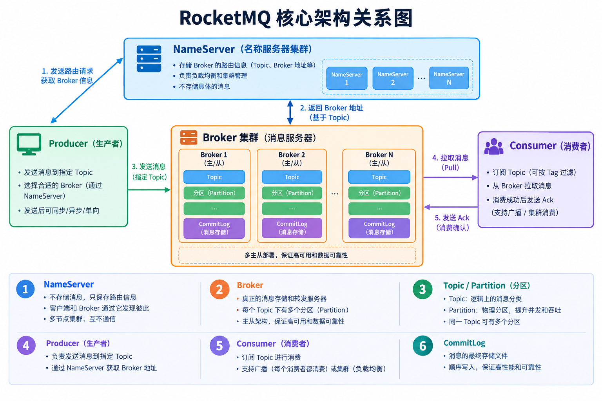

# RocketMQ部署


## RocketMQ 是否可以单机部署

**可以单机部署（单Broker），适合开发、测试环境；生产环境不推荐单机。**

### 1. 单机部署架构

NameServer 单机 + Broker 单机（一个Broker实例，Master，无Slave）
- NameServer：独立进程，维护路由信息；单机部署NameServer即可。
- Broker：单节点，角色为Master，**没有Slave副本**。
> 单机Broker也可以配置**同步刷盘/异步刷盘**，控制本机持久化。

### 2. 单机部署优缺点

✅优点
1. 部署简单，只需要启动1个NameServer + 1个Broker；
2. 资源占用少，本地开发、单元测试、联调非常方便。

❌缺点（生产致命问题）
1. **单点故障**：Broker机器宕机、磁盘损坏，整个MQ不可用，消息可能丢失；
2. **没有副本**：不存在主从复制，没有Slave备份；
3. 无法做故障转移，不支持高可用。

> 单机模式下，**刷盘策略只能保护本机宕机场景**；如果磁盘硬件损坏，消息直接丢失。

### 3. 单机Broker的可靠性说明

- 如果配置**同步刷盘**：只要返回ACK，消息写入本机磁盘；机器断电重启消息还在；但磁盘坏了就丢。
- 如果**异步刷盘（默认）**：断电会丢失PageCache中未刷盘消息。

> 单机模式**不具备容灾能力**，生产环境至少使用**一主一从/一主多从**。

### 4. 补充：单机多Broker（伪集群）

同一台物理机上，启动多个Broker实例（不同端口），组成集群。
> 这叫**单机多实例集群**，不是真正分布式集群；机器宕机全部Broker一起挂，仅用于测试集群功能，**依然不能用于生产**。

### ✅口述精简版

RocketMQ支持单机部署，单NameServer+单Broker，适合开发测试。
单机只有一个Broker Master，没有Slave副本，存在单点故障，机器宕机或者磁盘损坏会造成MQ不可用、消息丢失。所以生产环境不能单机部署，生产至少部署一主一从架构。单机可以配置刷盘策略，仅能保护机器断电，无法保护磁盘损坏。

### 高频追问

#### Q：单机部署能不能支持事务消息？

可以，事务消息是Broker的功能，和是否主从无关，单机环境可以跑。

#### Q：单机部署可以支持Rebalance、消费重试吗？

可以，这些是客户端逻辑，和集群节点数量无关。

#### Q：生产最低推荐架构是什么？

至少**2个NameServer（高可用） + 一主一从Broker**。

要不要继续整理 **消息堆积** 面试题？


## RocketMQ高级功能

### 一、消息存储机制

RocketMQ采用**CommitLog+ConsumeQueue+IndexFile**三层存储架构，核心是**顺序写、随机读**，兼顾高性能与可靠性。

#### 1. 核心文件结构
- **CommitLog（消息主存储）**
  - 所有Topic消息**全局顺序写入**，单文件固定**1GB**，满后自动生成新文件。
  - 存储**完整消息体+元数据**（Topic、Tag、时间戳、偏移量等）。
  - 采用**mmap内存映射+零拷贝**，提升读写性能。


- **ConsumeQueue（消费索引）**
  - 按**Topic+Queue**维度拆分，记录消息在CommitLog中的**物理偏移量、长度、Tag哈希**。
  - 每个队列对应一个文件，**顺序写入、随机读取**，支撑消费者快速拉取。

- **IndexFile（索引文件）**
  - 基于**消息Key/唯一ID**构建哈希索引，支持按Key快速查询消息。
  - 加速消息定位，避免全量扫描CommitLog。

#### 2. 刷盘策略（可靠性保障）
- **同步刷盘（SYNC_FLUSH）**
  - 消息写入**磁盘后**才返回成功。
  - **可靠性最高**，但性能较低。
- **异步刷盘（ASYNC_FLUSH）**
  - 消息写入**PageCache内存**即返回成功，后台线程定期刷盘。
  - **性能极高**，但断电可能丢失未刷盘消息。

### 二、高可用机制
#### 1. NameServer集群（路由中心）
- **无状态设计**，支持水平扩展，默认**3节点**满足生产。
- 维护**Topic路由表**，Broker定期上报状态，客户端定期拉取路由。
- **故障自动剔除**：节点宕机后，客户端自动切换到其他可用节点。

#### 2. Broker主从架构（存储高可用）
- **Master-Slave模式**：Master负责读写，Slave作为热备同步数据。
- **数据复制模式**
  - **同步复制（SYNC_MASTER）**：主节点等待从节点写入成功后才返回确认。
    - 优点：**数据零丢失**；缺点：性能略降（约10%）。
  - **异步复制（ASYNC_MASTER）**：主节点先返回成功，再异步同步到从节点。
    - 优点：**性能高**；缺点：主节点宕机可能丢失少量数据。


#### 3. Dledger模式（Raft协议）
- **基于Raft共识算法**，实现**自动选主、故障转移、数据强一致**。
- 集群需**≥3节点**，半数以上节点写入成功才确认。
- **主节点宕机**：秒级自动选举新Master，对业务透明。

### 三、负载均衡机制
#### 1. 生产者端（消息发送负载）
- **路由获取**：生产者从NameServer拉取Topic路由，获取Broker队列列表。
- **队列选择策略**
  - **轮询（Round-Robin）**：默认策略，均匀分发消息到各队列。
  - **哈希路由（ShardingKey）**：按业务Key（如订单ID）哈希，**相同Key进入同一队列**，支持顺序消费。

#### 2. 消费者端（队列分配负载）
- **集群模式（默认）**：同一消费组内**消息只被一个消费者消费**。
- **负载均衡策略（客户端实现）**
  - **平均分配（AllocateMessageQueueAveragely）**：队列数÷消费者数，前N个多分配1个。
    - 例：5队列、2消费者 → 消费者1：0/1/2；消费者2：3/4。
  - **一致性哈希（AllocateMessageQueueConsistentHash）**：消费者扩缩容时**最小化队列迁移**。
  - **按机房分配**：同机房队列分配给同机房消费者，减少跨机房网络开销。
- **广播模式**：同一消费组**所有消费者都接收全量消息**（适用于日志审计）。

### 四、消息重试机制
#### 1. 生产者重试（发送失败）
- **触发条件**：网络异常、Broker宕机、超时、服务端返回失败。
- **默认策略**：同步发送**重试2次**、异步发送**0次**。
- **配置**：`producer.setRetryTimesWhenSendFailed(3)`。

#### 2. 消费者重试（消费失败）
- **触发条件**
  - 抛出异常
  - 返回`RECONSUME_LATER`
  - 顺序消费返回`SUSPEND_CURRENT_QUEUE_A_MOMENT`
- **重试队列**：`%RETRY%ConsumerGroup`，独立Topic存储重试消息。
- **重试次数与间隔（默认16次）**
  - 间隔：1s→5s→10s→30s→1m→2m→3m→4m→5m→6m→10m→20m→30m→1h→2h。
- **配置**：`consumer.setMaxReconsumeTimes(20)`。

### 五、死信队列（DLQ）
#### 1. 定义与触发条件
- **死信消息**：**重试16次仍失败**、消息过期、格式错误。
- **死信队列**：`%DLQ%ConsumerGroup`，**独立Topic**，存储不可恢复消息。


#### 2. 核心特性
- **命名规则**：`%DLQ%{ConsumerGroup}`。
- **生命周期**：与消费组共存，删除消费组即删除死信队列。
- **存储**：默认保存**72小时**。

#### 3. 处理方式
- **人工干预**：新建消费组订阅`%DLQ%ConsumerGroup`，修复逻辑后重新投递。
- **命令查询**：`mqadmin queryMsgByKey -n 地址 -t %DLQ%组名 -k 消息Key`。

### 六、消费幂等（防重复消费）
#### 1. 重复消费原因
- **至少一次投递**：RocketMQ保证**不丢消息**，但**无法避免重复**。
- 原因：网络抖动、消费者宕机、主从切换、Rebalance。

#### 2. 幂等实现方案
- **唯一ID去重（推荐）**
  - 使用**业务唯一标识**（订单ID、用户ID），而非`msgId`。
  - 消费前查询**Redis/数据库**，存在则跳过，不存在则记录。
- **数据库唯一约束**
  - 防重表：`id(主键)、msg_key(唯一索引)、status(0=处理中/1=成功)`。
  - 消费前插入，冲突则判定重复。
- **乐观锁/悲观锁**
  - 并发修改时，通过版本号或锁机制保证数据一致性。
- **幂等操作**
  - 设计业务为**幂等**（如更新、删除、查询），重复执行结果一致。

### 总结
- **存储**：CommitLog顺序写+ConsumeQueue索引，mmap提升性能。
- **高可用**：NameServer集群、Broker主从、Dledger Raft，故障自动转移。
- **负载均衡**：生产者轮询/哈希；消费者平均分配/一致性哈希。
- **重试**：生产者2次、消费者16次（间隔递增）。
- **死信**：重试16次失败进入`%DLQ%`，人工处理。
- **幂等**：业务层唯一ID、数据库约束、乐观锁。

要不要我把以上内容整理成一份**RocketMQ核心机制速查表**（含关键配置、命令、常见问题），方便你复习和面试？

## SpringBoot整合RocketMQ 

### SpringBoot整合RocketMQ 

> 
> 一句话总结：**引入rocketmq-spring-boot-starter依赖 → yml配置NameServer、生产者组、消费者组 → 生产者注入RocketMQTemplate发送消息；消费者使用@RocketMQMessageListener注解 + RocketMQListener接口监听消费；事务消息额外实现RocketMQLocalTransactionListener监听器。**

#### 一、环境说明

- SpringBoot 2.x / 3.x 都支持
- `rocketmq-spring-boot-starter:2.2.3`（最稳定版本，推荐）
- RocketMQ Broker 4.x /5.x

#### 核心概念

| 概念               | 作用                                                         |
| ------------------ | ------------------------------------------------------------ |
| Producer（生产者） | 微服务中发送消息的角色（如订单服务发送「订单创建」消息）     |
| Consumer（消费者） | 微服务中接收消息的角色（如库存服务消费「订单创建」消息）     |
| Topic              | 消息主题（消息分类，如 `order_topic`、`inventory_topic`）    |
| Tag                | 消息标签（主题下的细分，如 `order_topic` 下的 `create`/`pay`/`cancel`） |
| Group              | 生产/消费组（标识一组生产者/消费者，用于负载均衡、消息重试） |
| NameServer         | RocketMQ 服务发现组件，生产者/消费者通过它获取 Broker 地址   |


#### 二、Maven引入依赖

```
<!-- SpringBoot RocketMQ Starter -->
<dependency>
    <groupId>org.apache.rocketmq</groupId>
    <artifactId>rocketmq-spring-boot-starter</artifactId>
    <version>2.2.3</version>
</dependency>
```

#### 三、application.yml 配置

```
rocketmq:
  # NameServer地址，集群用分号分隔 127.0.0.1:9876;127.0.0.2:9876
  name-server: 127.0.0.1:9876
  # 生产者配置
  producer:
    group: demo-producer-group
    send-message-timeout: 3000 # 发送超时时间ms
    retry-times-when-send-failed: 2 # 发送失败重试次数
```

> 
> 注意：**消费者不需要在yml写消费组，消费组写在注解`@RocketMQMessageListener`上**。

#### 四、生产者：RocketMQTemplate（发送消息）

##### 1. 注入Template

```java
import org.apache.rocketmq.spring.core.RocketMQTemplate;
import org.springframework.beans.factory.annotation.Autowired;
import org.springframework.stereotype.Component;

@Component
public class MqProducer {
    @Autowired
    private RocketMQTemplate rocketMQTemplate;

    /**
     * 1.普通同步消息（最常用）
     * topic:tag  冒号分隔topic和tag
     */
    public void sendNormalMsg() {
        String topicTag = "order_topic:tag_order";
        OrderDTO orderDTO = new OrderDTO(10001L, "订单001");
        // convertAndSend底层同步发送，不拿返回结果
        rocketMQTemplate.convertAndSend(topicTag, orderDTO);
    }

    /**
     * 同步发送，获取SendResult（推荐，拿到msgId）
     */
    public void syncSendWithResult() {
        String topicTag = "order_topic:tag_order";
        OrderDTO orderDTO = new OrderDTO(10002L, "订单002");
        SendResult result = rocketMQTemplate.syncSend(topicTag, orderDTO);
        System.out.println("msgId:" + result.getMsgId());
    }

    /**
     * 顺序消息：相同hashKey路由到同一个队列
     */
    public void sendOrderlyMsg() {
        String topicTag = "order_topic:tag_order";
        OrderDTO orderDTO = new OrderDTO(10003L, "订单003");
        // hashKey：相同hashKey进入同一个MessageQueue
        rocketMQTemplate.syncSendOrderly(topicTag, orderDTO, "order_10003");
    }

    /**
     * 延迟消息 单位ms，RocketMQ固定延迟等级，不支持任意时间
     */
    public void sendDelayMsg() {
        String topicTag = "order_topic:tag_order";
        rocketMQTemplate.syncSendDelayTimeMills(topicTag, new OrderDTO(), 3000);
    }

    /**
     * 单向消息sendOneWay，不等待ACK，日志埋点场景
     */
    public void sendOneWay() {
        rocketMQTemplate.sendOneWay("order_topic:tag_order", new OrderDTO());
    }
}
```

##### 2. 事务消息生产者（额外代码）

```java
// 发送事务消息
public void sendTxMsg() {
    String topicTag = "tx_order_topic:tag_tx";
    OrderDTO orderDTO = new OrderDTO();
    Message<OrderDTO> message = MessageBuilder
            .withPayload(orderDTO)
            .setHeader(RocketMQHeaders.TRANSACTION_ID, UUID.randomUUID().toString())
            .build();
    // 发送半消息，第二个参数传给本地事务监听器
    TransactionSendResult txResult = rocketMQTemplate.sendMessageInTransaction(topicTag, message, orderDTO);
}
```

**事务监听器，必须实现RocketMQLocalTransactionListener**

```java
@Component
public class OrderTxListener implements RocketMQLocalTransactionListener {
    // 执行本地事务
    @Override
    public RocketMQLocalTransactionState executeLocalTransaction(Message msg, Object arg) {
        try {
            OrderDTO dto = (OrderDTO) arg;
            // 执行本地DB事务，创建订单
            return RocketMQLocalTransactionState.COMMIT;
        } catch (Exception e) {
            return RocketMQLocalTransactionState.ROLLBACK;
        }
    }

    // Broker回查本地事务状态
    @Override
    public RocketMQLocalTransactionState checkLocalTransaction(Message msg) {
        String txId = (String) msg.getHeaders().get(RocketMQHeaders.TRANSACTION_ID);
        // 查询数据库，判断本地事务是否成功
        boolean exist = checkDb(txId);
        if (exist) {
            return RocketMQLocalTransactionState.COMMIT;
        } else {
            return RocketMQLocalTransactionState.ROLLBACK;
        }
    }
}
```

#### 五、消费者：@RocketMQMessageListener + RocketMQListener

##### 方式1：自动序列化（业务常用）

```java
import org.apache.rocketmq.spring.annotation.RocketMQMessageListener;
import org.apache.rocketmq.spring.core.RocketMQListener;
import org.springframework.stereotype.Service;

@Service
@RocketMQMessageListener(
        topic = "order_topic",
        consumerGroup = "order-consumer-group",
        selectorExpression = "tag_order", // tag过滤，*消费全部tag，多个tag用||分隔
        consumeMode = ConsumeMode.CONCURRENT, // CONCURRENT并发 / ORDERLY顺序消费
        messageModel = MessageModel.CLUSTERING, // CLUSTERING集群 / BROADCASTING广播
        consumeThreadMax = 10
)
public class OrderConsumer implements RocketMQListener<OrderDTO> {

    @Override
    public void onMessage(OrderDTO message) {
        // 业务消费逻辑
        System.out.println("收到消息：" + message);
        // 抛出异常，SDK自动返回RECONSUME_LATER，进入重试队列
    }
}
```

##### 方式2：获取原生MessageExt，拿到msgId、properties等元数据

```java
@Service
@RocketMQMessageListener(
        topic = "order_topic",
        consumerGroup = "order-consumer-group",
        selectorExpression = "tag_order"
)
public class OrderRawConsumer implements RocketMQListener<MessageExt> {
    @Override
    public void onMessage(MessageExt messageExt) {
        String msgId = messageExt.getMsgId();
        String keys = messageExt.getKeys();
        byte[] body = messageExt.getBody();
    }
}
```

#### 六、底层完整执行流程（面试口述核心）

##### 生产者流程

1. SpringBoot启动，读取yml配置，自动初始化`DefaultMQProducer`，包装进`RocketMQTemplate`；
2. 调用`rocketMQTemplate.syncSend`发送消息；
3. Template将对象序列化为byte[]，组装Message，设置topic、tag；
4. Producer发送消息到NameServer获取Topic路由，拿到Broker地址；
5. 发送消息到Broker；Broker写入CommitLog，构建ConsumeQueue索引；
6. 根据刷盘策略、主从复制模式，等待ACK返回；
7. 返回SendResult，拿到msgId。

> 
> 事务消息特殊流程：先发半消息 → 执行本地事务 → Broker回查。

##### 消费者流程

1. Spring启动扫描所有`@RocketMQMessageListener`，为每个消费者创建独立`DefaultRocketMQListenerContainer`；
2. 容器内部创建原生`DefaultMQPushConsumer`，连接NameServer，获取Topic路由；
3. 注册订阅关系，触发**Rebalance重平衡**，分配MessageQueue；
4. SDK后台线程执行**长轮询**拉取消息；
5. 消息拉回，自动Jackson反序列化，回调`onMessage`执行业务；
6. 业务无异常：自动提交offset；业务抛异常，返回`RECONSUME_LATER`，进入重试Topic；
7. 达到最大重试次数，消息转入死信`%DLQ%+消费组`。

#### 七、核心注意事项&坑（面试高频）

1. **序列化**：RocketMQListener自动Jackson反序列化，DTO必须有无参构造函数。
2. **消费组规则**：同一个消费组，**订阅关系(topic+tag)必须完全一致**，否则Rebalance错乱。
3. **并发上限**：最大并发线程数 = Topic的MessageQueue数量；线程数大于队列数无效。
4. **顺序消费**：`consumeMode=ORDERLY`，消费失败阻塞队列，不会进重试Topic。
5. **广播消费BROADCASTING**：无重试、死信队列，offset保存在本地文件。
6. **事务消息限制**：不支持批量发送，不支持单向发送；必须实现`RocketMQLocalTransactionListener`。
7. **自动提交offset风险**：业务执行完还没到定时提交时间，应用宕机，会重复消费；核心业务建议手动ack。
8. Topic命名、消费组命名不要下划线以外特殊符号；**生产者组和消费者组分开**。

#### 八、异常处理最佳实践

1. 消费代码内部捕获业务异常，区分**可重试异常**、**不可重试异常**；
2. 不可重试异常（参数错误、数据不存在）直接返回成功，避免无限重试；
3. 可重试异常直接抛出，SDK自动进入重试队列；
4. 消费端业务必须做幂等，防止Rebalance带来重复消费。

#### ✅面试口述精简版

SpringBoot整合RocketMQ，第一步引入rocketmq-spring-boot-starter，yml配置NameServer和生产者信息。生产者使用RocketMQTemplate，支持同步、异步、单向、顺序、延迟、事务消息；事务消息需要实现RocketMQLocalTransactionListener监听器。消费者使用@RocketMQMessageListener注解，配合RocketMQListener接口；支持并发/顺序消费、集群/广播模式。
Spring容器启动自动创建Producer、PushConsumer；消费者启动触发Rebalance，通过长轮询拉取消息；业务抛异常消息自动进入重试Topic。集群消费offset保存在Broker，默认自动提交，存在重复消费风险，消费端要做幂等。

#### 高频追问

##### Q：RocketMQTemplate和@RocketMQMessageListener底层原生类是什么？

RocketMQTemplate底层DefaultMQProducer；@RocketMQMessageListener底层DefaultMQPushConsumer。

##### Q：生产者和消费者的NameServer必须配置同一个吗？

是的，必须连接同一个NameServer集群，否则路由发现失败。

##### Q：一个应用可以配置多个消费者吗？

可以，写多个@RocketMQMessageListener，不同topic、不同消费组。

##### Q：多个消费者使用同一个消费组有什么要求？

订阅topic和tag必须完全一致，否则Rebalance异常。

##### Q：事务消息的producerGroup有什么要求？

事务消息建议单独使用独立的producerGroup，不要和普通消息共用。

要不要我把**RocketMQ整合常见问题（消息丢失、重复、堆积、事务消息踩坑）**整理成面试问答？


### RocketMQTemplate 

> 
> 一句话：**`RocketMQTemplate` 是 `rocketmq-spring-boot-starter` 提供的Spring封装模板类，对标RabbitTemplate；底层封装原生RocketMQ DefaultMQProducer，适配Spring Messaging规范，简化消息发送，支持几乎所有RocketMQ消息类型；消费者不用Template，用`@RocketMQMessageListener`注解**。

#### 一、类继承与核心原理

1. 继承：`AbstractMessageSendingTemplate`（Spring Messaging抽象模板），实现`InitializingBean、DisposableBean`
   - `afterPropertiesSet()`：容器初始化完成，自动启动Producer
   - `destroy()`：容器关闭，优雅shutdown Producer，释放资源
2. 底层：内部持有原生`DefaultMQProducer` / `TransactionMQProducer`；所有模板方法最终调用原生client发送API
3. 消息转换：`convertAndSend`自动把Java对象序列化（默认Jackson）转为消息payload；支持`MessageBuilder`构建Spring标准`Message<?>`，携带header（如`RocketMQHeaders.TAGS`、`KEYS`、`TRANSACTION_ID`）

> 
> 命名格式：`topic:tag`，冒号分隔topic和tag，用于Broker消息过滤。

#### 二、Maven依赖

```
<dependency>
    <groupId>org.apache.rocketmq</groupId>
    <artifactId>rocketmq-spring-boot-starter</artifactId>
    <version>2.2.3</version>
</dependency>
```

#### 三、application.yml基础配置

```
rocketmq:
  name-server: 127.0.0.1:9876
  producer:
    group: demo-producer-group
    send-message-timeout: 3000
```

注入使用：

```
@Autowired
private RocketMQTemplate rocketMQTemplate;
```

#### 四、核心API分类（面试重点）

##### 1. convertAndSend（最简发送，内部同步发送，不拿返回结果）

```
// 自动序列化对象，发普通消息
rocketMQTemplate.convertAndSend("order_topic:tag_order", orderDTO);
```

- 底层调用`syncSend`，**忽略SendResult**；只抛异常捕获失败场景。
- 适合：不需要关心发送结果，简单场景。

##### 2. syncSend 同步发送（阻塞，等待Broker返回结果，最常用）

```
// 发送Spring Message
Message<?> msg = MessageBuilder.withPayload(orderDTO).build();
SendResult result = rocketMQTemplate.syncSend("order_topic:tag_order", msg);
```

✅特点：线程阻塞，等待Broker返回ACK，拿到`SendResult`（msgId、发送状态）；适合订单、支付等**需要确认消息落地**场景。
变体：

- `syncSendOrderly`：**顺序消息**，传入hashKey，相同hashKey消息路由到同一个MessageQueue，保证顺序
- `syncSendDelayTimeMills()`：延迟消息（毫秒）
- `syncSendMessages()`：批量发送消息，List
- `syncSendDeliverTimeMills()`：定时消息（指定时间戳投递，RocketMQ 4.8+）

##### 3. asyncSend 异步发送（非阻塞，回调通知结果）

```
rocketMQTemplate.asyncSend("topic:tag", msg, new SendCallback() {
    @Override
    public void onSuccess(SendResult sendResult) {}
    @Override
    public void onException(Throwable e) {}
});
```

✅特点：不阻塞主线程；通过回调接收成功/失败；高并发、吞吐优先场景。
变体：`asyncSendOrderly`异步顺序消息。

##### 4. sendOneWay 单向发送（不等待Broker响应，无回调）

```
rocketMQTemplate.sendOneWay("topic:tag", msg);
```

✅特点：只管发，不等待ACK，性能最高；**不保证消息投递成功**；适合日志、埋点、监控上报，允许丢少量消息。
变体：`sendOneWayOrderly`单向顺序消息。

##### 5. sendMessageInTransaction 事务消息（核心）

```
TransactionSendResult txResult = rocketMQTemplate.sendMessageInTransaction(
    "tx_topic:tag_tx",
    MessageBuilder.withPayload(orderDTO)
            .setHeader(RocketMQHeaders.TRANSACTION_ID, UUID.randomUUID().toString())
            .build(),
    orderDTO // 传给本地事务监听器的参数
);
```

> 
> 必须配套实现`RocketMQLocalTransactionListener`，两个方法：
> `executeLocalTransaction`：执行本地事务
> `checkLocalTransaction`：Broker回查本地事务状态
> 👉事务消息只能用Template发送，消费者依旧用`@RocketMQMessageListener`

##### 6. sendAndReceive 请求应答模式（RPC式消息）

发送消息，阻塞等待消费者返回响应结果，一问一答。

```
String resp = rocketMQTemplate.sendAndReceive("request_topic", reqMsg, String.class);
```

适合服务间简单RPC，不适合高吞吐。

#### 五、消息类型支持汇总

✅ RocketMQTemplate全部支持：普通消息、同步/异步/单向、顺序消息、批量消息、延迟消息、定时消息、事务消息、request-reply应答消息。

> 
> 注意：**消费者和Template无关！Template只做生产者。消费使用注解`@RocketMQMessageListener`**

```
@Component
@RocketMQMessageListener(
        topic = "order_topic",
        consumerGroup = "order-consumer-group",
        selectorExpression = "tag_order"
)
public class OrderConsumer implements RocketMQListener<OrderDTO> {
    @Override
    public void onMessage(OrderDTO message) {
        //消费逻辑
    }
}
```

#### 六、核心坑点（面试高频）

1. **Topic:Tag 写法**：`topic:tag`，冒号中间不能有空格；selectorExpression匹配tag。
2. **序列化**：默认Jackson序列化对象；复杂对象注意无参构造、序列化兼容性。
3. **事务消息限制**：**不支持批量、不支持单向发送**；必须实现本地事务监听器，配置事务producerGroup。
4. **顺序消息**：`syncSendOrderly`的hashKey，相同hashKey路由同一队列；**只能保证同一队列有序，全局不保证**。
5. **sendOneWay**：没有ACK，网络异常会丢消息，业务不能强可靠场景使用。
6. **异常处理**：同步发送会抛出`MessagingException`，需要捕获重试；不要直接吞异常。
7. Producer Group：同一个应用，生产者组唯一；事务消息的producerGroup必须独立。

#### 七、原生Producer vs RocketMQTemplate对比

| 维度 | 原生DefaultMQProducer | RocketMQTemplate |
| --- | --- | --- |
| 开发 | 手动创建、启动、关闭producer，手动构造Message | Starter自动装配，直接@Autowired注入，一行代码发送 |
| 序列化 | 手动序列化对象转byte[] | 自动序列化Java对象 |
| Spring适配 | 无Spring整合，需要自己管理Bean生命周期 | 符合Spring Messaging，集成Spring上下文 |
| 事务消息 | 原生TransactionMQProducer，编码繁琐 | 封装sendMessageInTransaction，简化 |
| 控制粒度 | 细，底层完全可控 | 封装，底层参数仍可配置 |

#### ✅口述精简版

RocketMQTemplate是rocketmq-spring-boot-starter提供的生产者模板，底层封装原生DefaultMQProducer，适配Spring Messaging规范。消费者不用Template，使用@RocketMQMessageListener注解。
提供多种发送API：convertAndSend简易发送、syncSend同步阻塞（获取发送结果）、asyncSend异步回调、sendOneWay单向发送；还支持顺序、批量、延迟、事务、请求应答消息。
事务消息使用sendMessageInTransaction，需要实现RocketMQLocalTransactionListener。
注意topic:tag的写法，顺序消息依靠hashKey路由，sendOneWay不等待ACK可靠性低；Template只负责发送，消费逻辑由注解监听器实现。


#### 生产级最佳实践

##### 1. 消息幂等性（核心避坑）

RocketMQ 可能因网络问题导致消息重复投递，必须保证消费逻辑幂等：

- **方案1**：基于订单ID/消息ID做唯一键，消费前先查数据库是否已处理；
- **方案2**：使用 Redis 分布式锁 + 唯一键，确保同一消息仅处理一次；
- **方案3**：数据库乐观锁（如 `update inventory set num = num -1 where order_id = ? and version = ?`）。

##### 2. 消息重试与死信队列

- **重试配置**：消费者消费失败会自动重试（默认 16 次，间隔递增），可通过 `maxReconsumeTimes` 配置最大重试次数；
- **死信队列**：超过重试次数的消息会进入死信队列（`%DLQ%+消费组名`），需定期处理死信队列消息（如人工核查后重新发送）；
- **配置示例**：在 `@RocketMQMessageListener` 中添加 `maxReconsumeTimes = 3`。

##### 3. 消息过滤

- **Tag 过滤**：通过 `selectorExpression = "create || pay"` 过滤指定标签的消息，减少无效消费；
- **SQL 过滤**：开启 Broker 的 SQL 过滤功能，支持更复杂的过滤（如 `createTime > 1710000000000`）。

##### 4. 集群部署注意事项

- **生产者组**：同一业务的生产者必须使用相同的 `producer.group`，便于 RocketMQ 做负载均衡；
- **消费者组**：同一业务的消费者必须使用相同的 `consumer.group`，保证消息仅被消费一次（集群模式）；
- **NameServer 集群**：配置多个 NameServer 地址（`127.0.0.1:9876,127.0.0.2:9876`），提高可用性。

##### 5. 监控与告警

- 部署 RocketMQ Dashboard（可视化监控）：https://github.com/apache/rocketmq-dashboard；
- 监控核心指标：消息生产/消费 TPS、消息堆积数、消费延迟、重试次数；
- 配置告警：消息堆积超过阈值、消费失败次数过多时触发邮件/钉钉告警。

##### 6. 消息堆积处理

- **原因**：消费者处理速度慢于生产者发送速度；
- **解决方案**：
  1. 增加消费线程数（`consumeThreadMax`）；
  2. 开启批量消费（`consumeMessageBatchMaxSize`）；
  3. 拆分 Topic/Tag，分散消费压力；
  4. 临时扩容消费者实例，分摊消费任务。

##### 7. 日志与追踪

- 生产环境需记录消息的 `msgId`、`keys` 等关键信息，便于问题排查；
- 集成链路追踪（如 SkyWalking），追踪消息从生产到消费的全链路。

#### 常见问题排查

1. **消息发送失败**：
   - 检查 NameServer 地址是否正确，网络是否互通；
   - 检查生产者组是否配置，Topic 是否已创建（RocketMQ 自动创建 Topic，但建议提前创建）；
   - 查看 RocketMQ 日志（`~/logs/rocketmqlogs/broker.log`）。

2. **消费者收不到消息**：
   - 检查消费组、Topic、Tag 是否匹配；
   - 检查消费者是否启动，是否有异常日志；
   - 检查消息模式（集群模式下，消息仅被一个消费者消费）。

3. **事务消息回查频繁**：
   - 检查本地事务执行时间是否过长（超过 RocketMQ 事务超时时间）；
   - 优化本地事务逻辑，减少执行耗时。

#### 总结

1. **集成核心**：Spring Cloud 中通过 `rocketmq-spring-boot-starter` 快速集成，核心是 `RocketMQTemplate`（生产）和 `@RocketMQMessageListener`（消费）；
2. **核心特性**：普通消息、延迟消息、事务消息覆盖绝大多数微服务场景，事务消息解决分布式一致性问题；
3. **生产保障**：必须保证消费幂等性，配置重试和死信队列，监控消息堆积和消费延迟；
4. **集群适配**：生产者/消费者组保证集群内一致，NameServer 集群提高可用性。

#### 高频面试追问

##### Q：RocketMQTemplate能不能用于消费消息？

**不能。Template只做生产者发送消息；消费使用@RocketMQMessageListener + RocketMQListener。**

##### Q：convertAndSend底层是同步还是异步？

底层是syncSend同步发送，只是不返回SendResult，异常会抛出。

##### Q：事务消息发送时，TRANSACTION_ID作用？

业务唯一事务ID，放到消息header，Broker回查时用来定位对应的本地事务记录。

##### Q：syncSendOrderly，hashKey相同一定有序吗？

是的，相同hashKey会路由到同一个MessageQueue；保证**同一个队列内消息有序**，多队列之间无法全局有序。

##### Q：sendOneWay适用场景？

日志、埋点，允许少量消息丢失，追求最高性能，不关心发送结果。

要不要我整理RocketMQTemplate + @RocketMQMessageListener完整可运行demo（包含事务消息）？

### @RocketMQMessageListener

完整介绍（SpringBoot Starter 消费者注解，面试高频）

> 
> 一句话：**`@RocketMQMessageListener` 是 rocketmq-spring-boot-starter 提供的注解，标记当前类是RocketMQ的Push消费者；底层封装原生`DefaultMQPushConsumer`，自动创建消费容器，自动执行Rebalance、长轮询拉取消息；和生产者`RocketMQTemplate`成对使用。**

> 
> 核心：**注解在类上，配合两种接口：`RocketMQListener`（简单自动转换） / `RocketMQReplyListener`；也可以用`RocketMQMessageListener` + `MessageListenerConcurrently/MessageListenerOrderly`拿到原生`MessageExt`。**

#### 一、核心注解属性（面试必背）

```
@Target(ElementType.TYPE)
@Retention(RetentionPolicy.RUNTIME)
public @interface RocketMQMessageListener {
    // 【必填】消费组，同一个消费组内实例负载均衡；同组订阅关系必须完全一致
    String consumerGroup();
    // 【必填】订阅的topic
    String topic();

    // tag过滤表达式，* 代表订阅全部tag；多个tag用 || 分隔，如 "tagA||tagB"
    String selectorExpression() default "*";
    // 过滤类型：TAG 标签过滤 / SQL92 属性过滤
    SelectorType selectorType() default SelectorType.TAG;

    // 消费模式：CONCURRENT 并发消费 / ORDERLY 顺序消费
    ConsumeMode consumeMode() default ConsumeMode.CONCURRENT;
    // 消息投递模式：CLUSTERING集群消费 / BROADCASTING广播消费
    MessageModel messageModel() default MessageModel.CLUSTERING;

    // 消费线程池最小、最大线程数，控制并发度
    int consumeThreadMin() default 20;
    int consumeThreadMax() default 20;

    // 从哪个位点开始消费
    ConsumeFromWhere consumeFromWhere() default ConsumeFromWhere.CONSUME_FROM_LAST_OFFSET;

    // 最大重试次数，集群消费有效
    int maxReconsumeTimes() default 16;
}
```

##### 关键枚举说明

1. **ConsumeMode**
   - `CONCURRENT`：并发消费，多线程消费，不保证顺序；消费失败返回`RECONSUME_LATER`，消息进`%RETRY%`重试Topic。
   - `ORDERLY`：顺序消费；锁定MessageQueue，单线程串行消费；失败**不会进重试Topic，阻塞当前队列持续重试**。
2. **MessageModel**
   - `CLUSTERING`：集群消费（默认），消费组内多个实例负载均衡，一条消息只会被组内一个实例消费；会触发Rebalance。
   - `BROADCASTING`：广播消费，所有consumer实例都收到全量消息；**不触发Rebalance，无重试/死信队列**。
3. **ConsumeFromWhere**
   - `CONSUME_FROM_LAST_OFFSET`：默认，从上次消费位点继续消费；新消费组第一次启动，从最新消息开始。
   - `CONSUME_FROM_FIRST_OFFSET`：第一次启动，从头消费Topic全部历史消息。
   - `CONSUME_FROM_TIMESTAMP`：从指定时间戳位置开始消费。

#### 二、两种写法

##### 写法1：RocketMQListener（推荐，自动序列化）

自动把消息payload转成Java对象，简单，业务最常用。

```
@Service
@RocketMQMessageListener(
        topic = "order_topic",
        consumerGroup = "order_consumer_group",
        selectorExpression = "tag_order",
        consumeMode = ConsumeMode.CONCURRENT,
        messageModel = MessageModel.CLUSTERING
)
public class OrderConsumer implements RocketMQListener<OrderDTO> {
    @Override
    public void onMessage(OrderDTO message) {
        // 业务消费逻辑
    }
}
```

> 
> 底层：SDK自动做消息反序列化（Jackson），异常自动处理，返回`CONSUME_SUCCESS`/`RECONSUME_LATER`。

##### 写法2：拿到原生MessageExt（需要获取msgId、properties、tags等元信息）

实现`RocketMQListener<MessageExt>`，可以拿到完整原生消息对象。

```
@Override
public void onMessage(MessageExt messageExt) {
    String msgId = messageExt.getMsgId();
    String keys = messageExt.getKeys();
    byte[] body = messageExt.getBody();
}
```

> 
> 顺序消费：`consumeMode = ConsumeMode.ORDERLY`，同一个MessageQueue串行消费，保证单队列消息有序。

#### 三、底层执行流程（注解生效原理）

1. Spring容器启动，扫描所有带`@RocketMQMessageListener`的Bean；
2. 为每个注解Bean创建独立`DefaultRocketMQListenerContainer`容器；
3. 容器内部创建原生`DefaultMQPushConsumer`，连接NameServer，注册订阅关系；
4. 触发Rebalance，分配MessageQueue；
5. 后台线程长轮询拉取消息；
6. 收到消息后，自动反序列化，回调`onMessage`；
7. 根据业务是否抛异常，自动返回消费状态：
   - 无异常 → `CONSUME_SUCCESS`，自动提交offset；
   - 抛出异常 → `RECONSUME_LATER`，转入重试Topic。

> 
> ⚠️默认是**自动提交offset**（定时提交），不是处理完立刻提交。

#### 四、高频坑点（面试重点）

1. **同一个消费组，订阅关系必须完全一致**：topic、tag必须一模一样，否则Rebalance分配错乱，消费异常。
2. **consumerGroup全局唯一**，不要多个不同业务共用同一个消费组。
3. **顺序消费缺陷**：一条消息消费失败，会阻塞整个队列，后面消息无法消费，容易堆积。
4. **广播消费没有重试、死信**，失败会无限重复拉取，业务要捕获异常处理。
5. **消费线程上限**：`consumeThreadMax`不要盲目调大；并发度上限由**MessageQueue数量**决定，线程数超过队列数，多余线程空闲。> 
> 例：Topic 4个队列，最多4个线程并发消费，开20线程没用。
6. **不要在onMessage里面写长时间阻塞代码**（大量IO、sleep），消费线程耗尽，消息堆积。
7. 序列化问题：RocketMQListener自动Jackson反序列化，实体类必须有无参构造函数。

#### 五、并发消费 vs 顺序消费对比

| 维度 | CONCURRENT并发消费 | ORDERLY顺序消费 |
| --- | --- | --- |
| 线程 | 多线程 | 单线程（每个队列） |
| 有序性 | 不保证 | 同一个MessageQueue消息有序 |
| 失败处理 | 转入%RETRY%重试Topic，按退避时间重试 | 不进重试Topic，阻塞当前队列反复重试 |
| Rebalance | 会重复消费 | rebalance会释放锁，短暂破坏顺序 |

#### 六、面试高频追问

##### Q：@RocketMQMessageListener底层是Push还是Pull？

底层是**PushConsumer，底层SDK封装长轮询Pull**。

##### Q：集群消费和广播消费的offset存在哪里？

集群消费：offset保存在Broker；广播消费：offset保存在消费者本地。

##### Q：自动提交offset有什么风险？

业务处理成功，还没到定时提交时间，应用宕机，重启后重复消费。核心业务建议手动提交offset。

> 
> 手动提交写法：实现`RocketMQListener<MessageExt>`，消费完成调用`consumerContext.ack()`。

##### Q：selectorExpression="*"代表什么？

消费该Topic下**所有tag**的消息；多个tag用`tag1||tag2`。

##### Q：消费组消费模式可以一半集群一半广播吗？

**不可以，同一个消费组必须统一。**

##### Q：为什么消费线程数大于队列数没有提升？

RocketMQ一个MessageQueue同一时刻只能分配给一个consumer的一个线程消费，所以最大并发度等于Topic的队列数量。

#### ✅口述精简版

@RocketMQMessageListener是SpringBoot整合RocketMQ的消费者注解，标记类为Push消费者，底层封装DefaultMQPushConsumer。
核心参数：consumerGroup消费组、topic主题、selectorExpression标签过滤；支持并发/顺序消费、集群/广播两种投递模式。配合RocketMQListener接口，自动序列化消息，自动管理offset、重试。
集群消费默认自动提交offset，消费失败消息进入重试Topic；顺序消费失败会阻塞队列，不会进重试Topic。同一个消费组订阅关系必须完全一致，消费最大并发度受限于MessageQueue数量。广播消费没有重试死信，offset保存在本地。

> 
> 补充对比：RocketMQTemplate是生产者发送消息；@RocketMQMessageListener是消费者接收消息，两者分开。

要不要继续整理**消息堆积**面试题，这是MQ面试压轴题？


# RocketMQ

------

## 一、RocketMQ 基础概念类（入门必问）

主要考察你是否理解 MQ 的基本概念。

常见问题：

1. 什么是 Apache RocketMQ？
2. RocketMQ 的核心组件有哪些？
3. RocketMQ 中 **Producer、Consumer、Broker、NameServer** 的作用是什么？
4. RocketMQ 的消息模型是什么？
5. RocketMQ 中 **Topic 和 Queue 的关系**？
6. Consumer Group 的作用是什么？
7. RocketMQ 的消息流程是怎样的？

这一类问题通常是：

> **先确认你是否真正用过 MQ**

下面把你列出的 **RocketMQ 基础概念类问题**整理成一套 **面试标准回答版**（简洁 + 面试可直接说的版本）。

涉及的系统是：
Apache RocketMQ

------

### 一、什么是 Apache RocketMQ？

**RocketMQ 是一个分布式消息中间件（Message Queue）**，用于实现系统之间的 **异步通信、解耦、削峰填谷、消息可靠传递**。

特点：

- 高吞吐量
- 高可靠性
- 支持分布式
- 支持顺序消息
- 支持事务消息
- 支持延迟消息

典型应用场景：

| 场景       | 说明                |
| ---------- | ------------------- |
| 系统解耦   | 订单系统 → 库存系统 |
| 异步处理   | 下单后发送短信      |
| 流量削峰   | 秒杀系统            |
| 分布式事务 | 订单 + 支付         |

一句话总结（面试高频回答）：

> RocketMQ 是一个 **高性能、高可靠的分布式消息队列系统**，常用于系统解耦、异步处理和流量削峰。

------

### 二、RocketMQ 的核心组件有哪些？

#### 整体工作流程（口述）

先启动NameServer集群；
Broker启动，向所有NameServer注册Topic、队列信息，并且定时上报心跳；
Producer启动，连接NameServer拉取Topic路由信息，根据路由选择MessageQueue，把消息发送到Broker Master；消息写入CommitLog，根据配置同步/异步复制到Slave；
Consumer启动，从NameServer获取路由，和Broker建立长连接，长轮询拉取消息；
收到消息后执行业务逻辑：

- ✅业务处理成功：返回`CONSUME_SUCCESS`，提交offset给Broker，标记这条消息消费完成；
- ❌业务处理失败：返回`RECONSUME_LATER`，**不提交offset**，消息进入重试队列，后续重试；多次重试失败进入死信队列；
  Broker持久化offset，消费位点更新。

##### 区分

> RocketMQ**没有ack/nack API**，是通过消费回调返回状态码，配合offset提交实现消息确认语义。
> RabbitMQ才是显式调用 basicAck / basicNack。

##### 面试追问：RocketMQ有没有NACK？

RocketMQ没有独立nack接口。返回`RECONSUME_LATER`等价于NACK语义，告诉Broker本次消费失败，需要重试。

> 重点坑：不要说RocketMQ调用nack，要说**返回RECONSUME_LATER，不提交offset，触发重试**，不然面试官会觉得你混淆RabbitMQ和RocketMQ。

#### RocketMQ 四大核心组件（面试标准版，4.x）

> 一句话：**NameServer、Broker、Producer、Consumer**，5.x新增Proxy组件。

| 组件       | 作用         |
| ---------- | ------------ |
| Producer   | 消息生产者   |
| Consumer   | 消息消费者   |
| Broker     | 消息服务器   |
| NameServer | 路由注册中心 |



#### 1. NameServer（命名服务，路由注册中心）

**核心定位：轻量级无状态路由中心，保存Topic和Broker的路由元数据**
- 功能
  1. Broker管理：Broker启动后**向所有NameServer注册、定时上报心跳（30s）**；NameServer检测Broker存活，下线节点剔除路由。
  2. 路由管理：保存Topic → Broker → MessageQueue的映射关系。Producer/Consumer从NameServer拉取Topic路由，知道消息该发往哪个Broker。
- 特点（面试高频）
  - **无状态，集群部署，节点之间互不通信、不做数据同步**。Broker会把信息注册到每一台NameServer，每台都保存完整路由。
  - AP架构，不使用ZooKeeper，没有复杂选举，可用性高。
  - 只存元数据，**不存储消息**。

#### 2. Broker（消息服务，最核心存储节点）

**核心定位：接收消息、持久化存储、消息投递、管理消费位点offset**
- 角色划分：Master / Slave
  - Master：可读可写，接收生产者消息；
  - Slave：默认只读，负责主从复制、故障容灾、读写分离。
  > BrokerId=0代表Master，非0是Slave，同一个BrokerName代表一组主从。
- Broker内部三大存储文件（面试必背）
  - **CommitLog**：消息原始日志，所有Topic消息顺序追加写入（RocketMQ高性能核心）。
  - **ConsumeQueue**：消费队列，CommitLog的索引，每个Topic下每个队列对应一个，保存offset、commitLog位置。
  - **IndexFile**：索引文件，用于按消息key快速检索消息。
- 能力：消息刷盘、主从复制、消息重试、死信、事务消息、消息过滤（Tag/SQL）。

#### 3. Producer（生产者）

消息发送客户端，业务系统用来生产消息。
- 启动逻辑：随机连接一台NameServer，拉取Topic路由，和对应的Broker Master建立长连接。
- 发送模式：**同步、异步、单向one-way**。
- 能力：消息负载均衡（轮询/消息key哈希选MessageQueue，实现顺序消息）、发送重试、批量消息、事务消息。
> 顺序消息原理：同一个业务key做hash取模，固定路由到同一个MessageQueue，同一个队列内部消息有序。

#### 4. Consumer（消费者）

消费消息客户端，必须属于**ConsumerGroup消费组**。
- 两种消费模式：
  1. **拉模式Pull**：消费者主动去Broker拉取消息（RocketMQ原生默认）
  2. **推模式Push**：底层仍然是长轮询Pull，SDK封装成看起来是Broker推送。
- 消费分组两种模式：
  - **集群消费**：同一个消费组内多个Consumer，分摊消费；一条消息只被组内一个实例消费。
  - **广播消费**：组内所有消费者都收到全量消息。
- 消费位点offset：集群消费offset存在Broker；广播消费offset存在本地。消费成功提交offset。

#### 补充：5.x新增组件 Proxy

在客户端与Broker之间增加一层代理，屏蔽Broker集群细节，支持gRPC/http协议，方便多语言客户端接入；客户端不再直连Broker，只连Proxy。


#### 📌面试高频追问

##### Q：NameServer为什么不用Zookeeper？

Zookeeper是CP，需要选举；NameServer是AP，无状态，节点间不通信，Broker主动上报心跳，架构简单，高可用，适合MQ路由场景。

##### Q：Broker的Master和Slave作用？

Master负责读写；Slave做数据副本，Master宕机可以切换；也可以分担读请求，做读写分离。

##### Q：MessageQueue是什么？

Topic下的分区，消息存储和负载均衡的最小单元；**同一个MessageQueue内消息有序**。

##### Q：消费组ConsumerGroup作用？

同一组内消费者共同消费Topic，水平扩容；集群消费模式下，一个队列只能分配给组内一个消费者，保证同队列消息不会被组内多个实例重复消费。

##### Q：RocketMQ和RabbitMQ架构简单对比？

- RabbitMQ：Broker内部交换机+队列，元数据存在Broker；没有独立NameServer；
- RocketMQ：独立NameServer做路由；Broker基于CommitLog顺序写，Topic拆成多个MessageQueue分区。

要不要我继续整理RocketMQ的**事务消息原理**，面试高频？

### RocketMQ 消息模型

> 一句话核心：**生产者发消息到 Topic，Topic 内部拆分为多个 MessageQueue（分区）；消费者以消费组 ConsumerGroup 的身份订阅 Topic，消费 Topic 下的 MessageQueue。**

#### 1. Topic（主题）

**消息的逻辑分类**，同一业务类型的消息放到同一个Topic。

- Topic 只是逻辑概念，**不存储消息**；消息实际存在底层的 MessageQueue。
- 一个Topic可以分布在多个Broker节点上，实现分布式水平扩展。
- 生产者发送消息，指定Topic；消费者订阅Topic。

#### 2. MessageQueue（消息队列 / 分区，核心）

Topic 的物理分区，**消息存储、读写、负载均衡、顺序保证的最小单元**。
- 一个Topic可以配置N个MessageQueue，分散在不同Broker上。
- ✅**同一个MessageQueue内部：消息严格FIFO有序**；不同MessageQueue之间消息互不保证顺序。
- 顺序消息原理：业务key做hash取模，**同一业务key的消息固定路由到同一个MessageQueue**。
- 负载均衡：消费组内分配MessageQueue，**一个MessageQueue同一时刻只能分配给消费组内一个消费者实例**。

> 类比Kafka：MessageQueue ≈ Partition。

#### 3. Message（消息）

消息载体，包含核心属性：
- `topic`：所属主题
- `body`：消息二进制内容
- `tags`：消息标签，**消息过滤（订阅过滤）**，一个消息可以打多个tag，消费者订阅指定tag，只消费匹配消息
- `keys`：业务关键字，用于消息检索，底层会建立索引，可通过key查询消息
- `msgId`：全局唯一消息ID
- `properties`：自定义扩展属性（事务消息、延迟消息等标记）

> Tag 是RocketMQ轻量过滤，在Broker侧过滤；复杂条件可以用SQL过滤。

#### 4. Producer / ProducerGroup 生产者 & 生产者组

- Producer：消息发送客户端。
- ProducerGroup：生产者组，**同一业务用途的生产者实例归为一组**。
> 重点：**事务消息场景必须使用生产者组**，用于事务回查时找到对应的生产者实例。普通消息ProducerGroup可以随便命名。

#### 5. Consumer / ConsumerGroup 消费者 & 消费组（重中之重）

> ConsumerGroup：**同一业务目的的一组消费者实例**，订阅同一个Topic。
两大消费模式：
##### ① 集群消费（默认）

- 同一个消费组，多条消息分摊给组内不同消费者；**一条消息只会被组内一个实例消费一次**。
- 消费位点offset**持久化在Broker**。
- 水平扩容：增加消费者实例，会重新分配MessageQueue，提升消费能力。
> 约束：一个MessageQueue同一时间只能分配给组内一个consumer。

##### ② 广播消费

- 同一个消费组内**所有消费者实例都会收到Topic全部消息**。
- offset保存在**消费者本地**，Broker不保存位点。
- 场景：配置变更通知，所有节点都要收到通知；**不能水平扩容分摊消息**。

#### 6. 消息类型（RocketMQ 5种消息类型，面试必背）

##### 1. 普通消息

最基础，支持同步、异步、单向发送。
- 同步send：发送后阻塞等待Broker返回ACK，适合支付、订单等强可靠场景。
- 异步send：回调接收结果，不阻塞，高吞吐。
- one-way单向：不等待响应，只管发，日志采集，可靠性低。

##### 2. 顺序消息

- 全局顺序：整个Topic所有消息有序（不推荐，Topic只能一个MessageQueue，无法扩容）
- **分区顺序（业务常用）**：同一业务key的消息hash到同一个MessageQueue，该key下消息有序；不同key并行。

##### 3. 延迟消息（定时消息）

发送消息时指定延迟级别，消息不会立刻投递，等待时间到才可见。
> 4.x版本**不支持任意时间戳**，只有预设的18个延迟等级；RocketMQ 5.x支持指定时间戳。
> 原理：消息先写入`SCHEDULE_TOPIC_XXXX`，到时间后转发到目标Topic。

##### 4. 事务消息（分布式事务）

实现**半消息 + 事务状态确认 + 回查机制**，保证本地事务和消息发送最终一致性。
阶段：

1. 发送半消息（Prepared消息，对消费者不可见）
2. 执行本地事务
3. 提交/回滚半消息；如果Broker没收到结果，Broker主动发起事务回查，查询本地事务状态。

##### 5. 批量消息

多条消息打包一次性发送，减少网络IO，提升吞吐；**单批消息总大小不能超过4MB**。

#### 7. 消息过滤模型

两种方式：
1. **Tag过滤（推荐）**：订阅 `topic:tagA`，Broker在服务端过滤，不匹配的消息不推送给消费者，性能好。
2. **SQL过滤**：通过SQL表达式，基于消息properties做复杂条件过滤，性能比Tag差。

#### 8. 重试消息 & 死信消息

- **重试消息**：消费失败，消息会投递到当前消费组对应的**重试Topic(%RETRY%+consumerGroup)**；重试多次仍然失败 → 转入死信。
- **死信消息DLQ**：达到最大重试次数仍然消费失败，投递到死信Topic `%DLQ%+consumerGroup`，不再自动重试，人工排查处理。

#### 整体消息流转口述

生产者构造Message，发送到Topic；消息根据路由策略投递到Topic下某个MessageQueue存储；消费者属于ConsumerGroup订阅Topic，通过负载均衡分配MessageQueue，拉取消息消费；消费成功提交offset，失败进入重试队列。

#### 📌高频面试追问

##### Q：Tag和Key的区别？

- Tag：用于**消息订阅过滤**，Broker侧过滤；
- Key：业务唯一标识，用于**消息检索查询**，建立IndexFile索引。

##### Q：集群消费，同一个消费组不同实例订阅不同tag可以吗？

不建议。负载均衡基于Topic，会出现消息异常。**同一个消费组订阅规则必须保持一致**。

##### Q：事务消息能不能和顺序消息一起使用？

**不支持**，RocketMQ事务消息不支持顺序消息。

##### Q：MessageQueue分配规则？

一个MessageQueue同一时间只能分配给消费组内**一个消费者实例**，保证分区内有序。

##### Q：RocketMQ消息模型对比RabbitMQ？

- RocketMQ：Topic + MessageQueue（分区），Tag做过滤；没有Exchange、Queue绑定模型。
- RabbitMQ：Exchange + Queue，通过binding + routingKey路由。

需要我整理RocketMQ**事务消息完整流程**吗？面试超级高频。


------

## 二、架构原理类（面试核心）

主要考察 **系统架构理解能力**。

常见问题：

1. RocketMQ 的整体架构是什么？
2. **NameServer 的作用是什么？为什么不使用 ZooKeeper？**
3. Broker 是如何存储消息的？
4. RocketMQ 的 **路由发现机制**是什么？
5. Producer 如何选择 MessageQueue？
6. RocketMQ 的 **高可用架构**是怎样的？
7. Broker Master 和 Slave 的区别？

这一类问题通常会继续追问：

> RocketMQ 为什么比 Kafka 更适合金融场景？

### RocketMQ Broker 消息存储原理

> 一句话：**消息统一顺序追加写入 CommitLog；ConsumeQueue 是 CommitLog 的索引，供消费端快速查找消息；IndexFile 用于按 msgId/key 检索消息。**

#### 三大存储文件

1. **CommitLog：消息主体文件**
2. **ConsumeQueue：消费索引队列**
3. **IndexFile：消息检索索引**

---

#### 1. CommitLog（核心）

- 所有 Topic 的消息**全部顺序追加写入同一个 CommitLog 文件**，不分 Topic。
- 文件固定大小，默认 **1GB**，写满就新建下一个文件。文件名 = 该文件第一条消息的起始偏移量。
- 每条消息写入 CommitLog 时，保存完整内容：topic、body、tags、keys、properties、消息偏移量、消息长度等。
> 为什么顺序写？磁盘顺序写性能远高于随机写，是RocketMQ高性能根基。

##### 刷盘机制（面试必问）

消息写入内存 PageCache，再落盘，两种策略：
1. **同步刷盘 SYNC_FLUSH**
消息写入PageCache，**强制等待刷到磁盘成功**，才返回ACK给生产者。
✅可靠性高；❌性能差。适合金融、支付场景。
2. **异步刷盘 ASYNC_FLUSH（默认）**
写入PageCache就直接返回成功，后台线程异步刷盘。
✅吞吐高；❌机器断电，PageCache中未刷盘消息丢失。

> 注意：**主从复制**是另一件事。刷盘控制消息是否持久化到本机磁盘；主从是把CommitLog复制到Slave节点。

##### 2. ConsumeQueue（消费索引）

> CommitLog是混合所有topic的原始日志，消费时不能遍历整个CommitLog，所以需要索引。
- 每个 **Topic + MessageQueue** 对应独立的 ConsumeQueue。
- 不是存完整消息，只存**固定20字节的索引条目**：
    1. CommitLog中消息物理偏移量（8字节）
    2. 消息长度（4字节）
    3. Tag的hashCode（8字节）
- 写入流程：消息写入CommitLog成功后，**异步构建ConsumeQueue**。
- 消费逻辑：消费者拉取消息，先读ConsumeQueue拿到CommitLog物理地址，再去CommitLog读取真正消息body。

> 好处：ConsumeQueue体积很小，可以大量缓存在内存，消费速度快。

##### 3. IndexFile（检索索引）

用于**根据 messageId / message key**快速定位消息，用于运维查询，消费不走这个索引。
底层是哈希表结构，保存key到CommitLog偏移量映射。
文件默认400MB。

---

#### ✅完整消息写入流程

1. Producer发送消息到Broker Master；
2. Broker把消息**追加写入CommitLog（PageCache）**；
3. 根据刷盘策略，同步/异步落盘；
4. 异步线程构建ConsumeQueue索引、IndexFile索引；
5. 返回ACK给生产者；
6. Master异步把CommitLog复制给Slave节点（主从复制）。

#### ✅消息读取（消费）流程

1. Consumer提交offset，拉取消息；
2. Broker找到该Topic+MessageQueue对应的ConsumeQueue；
3. 根据offset读取ConsumeQueue条目，拿到CommitLog物理偏移和消息长度；
4. 根据物理地址到CommitLog读取完整消息，返回给消费者；
5. 消费成功后Consumer提交新offset保存。

#### 消息过期删除机制

CommitLog不是永久保存，默认**保留7天**。
后台定时线程，按文件整体删除（**按文件删除，不是单条消息删除**）。
> RocketMQ不支持随机修改、删除CommitLog里面某一条消息；只能追加写，过期直接删整个文件。

#### 高频面试追问

##### Q：CommitLog 和 ConsumeQueue 的区别？

CommitLog：存储**完整消息实体**，所有topic消息顺序追加；
ConsumeQueue：**轻量索引**，给消费用，只存CommitLog位置。

##### Q：为什么所有Topic消息都写同一个CommitLog？

顺序写，最大化磁盘吞吐；如果每个topic单独文件，会变成随机写，性能暴跌。

##### Q：同步刷盘和异步刷盘怎么选？

支付、资金类业务选同步刷盘保证不丢消息；普通业务异步刷盘提升吞吐。

##### Q：主从复制是复制CommitLog还是ConsumeQueue？

**只复制CommitLog**。Slave收到CommitLog后，Slave自己本地异步构建ConsumeQueue和IndexFile。

##### Q：消息删除是删除单条消息吗？

不是。RocketMQ是日志结构，**不能随机删单条**，到期直接删除整个CommitLog文件。

##### Q：PageCache是什么？

操作系统页缓存。Broker写消息不是直接写磁盘，先写入操作系统内存PageCache，再刷盘。RocketMQ重度依赖PageCache实现高性能。

##### Q：什么场景会出现PageCache污染？

大量随机读，会把PageCache里的热数据置换出去，导致CommitLog读变慢。

要不要我继续讲RocketMQ的**主从同步机制**？


### RocketMQ 路由发现机制

> 一句话：**Broker主动向所有NameServer上报路由元数据；Producer/Consumer主动从NameServer拉取Topic路由，本地缓存；NameServer不主动推送，是拉模式+心跳上报。**

#### 1. 组件角色回顾

- **NameServer**：无状态路由注册中心，集群多节点，节点之间**不通信、不同步数据**。
- **Broker**：消息存储节点，是路由信息的**上报方**。
- **Producer、Consumer**：客户端，路由**拉取方**。

#### 2. Broker 注册 & 心跳上报（注册过程）

1. Broker启动时，会遍历**全部NameServer列表**，向每一台NameServer发起注册，上报自身元数据：
    - BrokerName、BrokerId（0=Master，非0=Slave）、IP、端口
    - 当前Broker上所有Topic、Topic对应的MessageQueue数量、读写权限
2. **心跳周期：30s**，Broker每隔30s向所有NameServer发送心跳包，刷新路由信息。
3. NameServer维护Broker存活时间；**120s没有收到心跳 → 判定Broker下线，把该Broker上的路由信息剔除**。
> 重点：每台NameServer都会保存一份完整路由表，节点之间互不通信。

#### 3. 客户端（Producer/Consumer）路由拉取

Producer/Consumer启动流程：
1. 客户端配置NameServer地址列表，随机挑选一个NameServer建立连接；
2. 向NameServer请求**Topic路由信息**：拿到该Topic分布在哪些Broker、每个Broker上有多少MessageQueue；
3. **客户端本地缓存路由表**；
4. 客户端后台定时线程（默认30s），**周期性拉取最新路由，更新本地缓存**。

> ❗NameServer**不会主动推送路由变更**，客户端是定时拉取。
> 如果Broker上下线，客户端不会立刻感知，最多等待一次定时拉取周期才更新路由。

#### 4. 发送消息时，路由选择逻辑（Producer）

拿到Topic路由后，Producer做两件事：
1. 根据路由拿到该Topic下所有可用MessageQueue列表；
2. 选择MessageQueue：
    - 普通消息：轮询策略，负载均衡；
    - 顺序消息：业务key做hash取模，固定选择同一个MessageQueue。

#### 5. Consumer端路由+队列分配（负载均衡）

1. Consumer定时拉取Topic路由，拿到全部MessageQueue；
2. 消费组内所有消费者客户端，**在客户端侧执行负载均衡算法**（默认平均分配）；
3. 将Topic下所有MessageQueue分配给消费组内各个Consumer实例；
> 约束：**一个MessageQueue同一时刻只能分配给消费组内一个Consumer**，保证分区有序。

#### 6. 故障感知

- Broker宕机：停止发送心跳，NameServer 120s后剔除路由；客户端最多等待30s定时拉取，感知路由变化，不再往宕机Broker发消息。
- NameServer某一台挂掉：客户端自动切换下一个NameServer节点，不影响整体。因为所有NameServer都保存完整路由。

#### 7. 和Kafka的简单对比（面试加分）

- RocketMQ：Broker推心跳给NameServer；客户端**拉取路由**；NameServer无状态，节点间无通信。
- Kafka：Broker注册到ZK；客户端从ZK获取元数据；ZK负责元数据管理与选举。

#### 📌面试高频追问

##### Q：NameServer集群之间会同步路由数据吗？

**不会**。Broker会把信息上报给每一台NameServer，每台NameServer独立保存完整路由，节点之间不通信、不做数据同步。

##### Q：Broker心跳多久一次？多久判定宕机？

30s上报心跳；连续120s无心跳，NameServer将Broker标记失效，剔除路由。

##### Q：路由变更后，客户端是否立刻感知？

不能。客户端是定时拉取（默认30s），存在**最多30s的路由感知延迟**。

##### Q：为什么NameServer不做推送？

简化架构，降低NameServer压力；如果推送，大量客户端连接会带来巨大的连接管理开销。拉模式更简单、稳定。

##### Q：Producer和Consumer谁做负载均衡？

- Producer：选择MessageQueue（轮询/hash），发送消息负载均衡；
- Consumer：消费组内客户端做负载均衡，分配MessageQueue。**都是客户端侧负载均衡，不是NameServer、Broker做的**。

##### Q：NameServer挂一个有影响吗？

无影响。客户端会自动轮询下一个NameServer；所有NameServer都存有全量路由。

#### ✅口述精简版

RocketMQ路由发现机制：Broker启动向所有NameServer注册，每30s上报心跳；NameServer检测心跳超时（120s）剔除失效Broker。Producer和Consumer主动从NameServer拉取Topic路由并本地缓存，后台定时拉取更新路由。NameServer之间不通信，无状态。消息发送时Producer选择MessageQueue；Consumer在客户端完成MessageQueue分配。NameServer不主动推送，客户端是拉模式，存在短暂感知延迟。

要不要继续看RocketMQ**消息发送完整流程（同步发送）**？这个是面试超级高频大题。

### RocketMQ Producer 选择 MessageQueue 机制

> 
> 一句话：**生产者拿到Topic路由，得到所有可用MessageQueue列表；根据消息类型，使用不同策略选队列，最终决定消息发到哪个MQ。**

#### 前置

Producer先从NameServer拉取Topic路由，得到该Topic下**所有可写的MessageQueue集合**（只选Master上的队列，Slave不接收写入）。

#### 1. 普通消息（默认策略：轮询）

默认是**轮询策略（Round-Robin）**

1. 维护一个原子自增计数器 `index`
2. `index++ % queueList.size()` 取模，选中对应MessageQueue
3. 每发送一条消息，计数器+1，轮流分发到各个队列

- 目的：**消息均匀分散到各个MessageQueue，实现负载均衡**。> 
> 缺点：如果某条消息发送失败，会触发**发送重试，重试时会重新选队列（可能发到别的MQ）**，因此普通消息不能保证顺序。

#### 2. 顺序消息（分区顺序，业务最常用：hash取模）

业务指定 `messageKey`，采用**哈希取模**

```
queueIndex = hash(messageKey) % queueList.size()
```

- 同一个业务key，hash之后得到相同下标，**固定路由到同一个MessageQueue**
- 同一个MessageQueue内消息FIFO有序，实现**分区有序**> 
> 注意：
> 
> 
> 1. 这里的hash是RocketMQ内置哈希算法；
> 2. 如果Topic队列数量发生变化（扩容/缩容），队列总数改变，取模结果改变，**会出现消息乱序**；
> 3. 顺序消息发送失败**不允许重试**（重试会发到别的队列，破坏顺序），RocketMQ顺序消息重试默认关闭。

> 
> 全局顺序：Topic只保留**1个MessageQueue**，所有消息都进这一个队列，吞吐极低，业务极少使用。

#### 3. 延迟消息 / 事务消息

底层特殊处理：

- 延迟消息：不会直接选业务Topic队列，先路由到系统内置的 `SCHEDULE_TOPIC_XXXX` 的队列；到期后Broker再转发到目标Topic。
- 事务消息（半消息）：同样会经过特殊路由，投递到目标Topic的MessageQueue。

#### 4. 自定义队列选择器

SDK提供接口 `MessageQueueSelector`，业务可以自己实现选择逻辑。

```
// 自定义选择器示例
producer.send(msg, new MessageQueueSelector() {
    @Override
    public MessageQueue select(List<MessageQueue> mqs, Message msg, Object arg) {
        // 自己写选择逻辑
        return mqs.get(0);
    }
}, "自定义参数");
```

顺序消息底层就是内置实现了这个接口。

#### 5. 故障规避机制（重要加分点）

轮询策略不是简单无脑取模，Producer内置**故障隔离**：

- 如果某个Broker/队列多次发送失败，Producer会把该Broker标记为**故障节点**，一段时间内**避开该Broker上的队列**，优先选择正常Broker的队列，减少发送失败。
- 故障节点会定时探测恢复，恢复后重新加入候选队列列表。

#### ✅ 面试高频追问

##### Q：顺序消息，如果发送失败，重试会破坏顺序吗？

会。重试会重新选队列，消息会跑到别的MessageQueue，导致乱序。所以顺序消息**禁止重试**。

##### Q：Topic队列扩容后，原来相同key的消息还能落在同一个队列吗？

不能。`hash(key) % queueNum`，分母变了，结果改变，会出现消息分流，顺序被打乱。

> 
> 解决方案：业务提前预留足够队列，尽量不要动态扩容顺序Topic；或者用一致性哈希。

##### Q：Producer选队列是客户端做还是Broker做？

**客户端Producer本地计算选择MessageQueue，Broker不参与队列选择**。

##### Q：轮询策略下，消息发送失败重试，会继续发到原来的队列吗？

不会。重试会重新执行轮询，大概率选别的队列。

##### Q：MessageQueue的选择 和 Consumer的负载均衡（分配队列）是一回事吗？

完全两码事

- Producer：**发送时选队列**，决定消息写到哪个MQ；
- Consumer：**消费负载均衡**，把Topic下的MessageQueue分配给消费组内消费者实例，决定哪个消费者消费哪个MQ。

##### Q：Tag会不会影响MessageQueue选择？

不会。Tag只是消息属性，用于消费端过滤；**不影响队列路由选择**。

#### 📝口述精简版

Producer先从NameServer获取Topic下所有可写MessageQueue列表。普通消息默认轮询策略，原子计数器取模实现负载均衡；顺序消息根据messageKey哈希取模，同一个key固定路由到同一个MessageQueue，保证分区有序。Producer支持自定义MessageQueueSelector。同时Producer自带故障规避，临时屏蔽故障Broker的队列。队列选择逻辑**在客户端执行**。顺序消息发送失败不能重试，Topic队列扩容会破坏原有key的路由。

要不要我讲**Consumer端的负载均衡（MessageQueue分配算法）**？这个经常和Producer选队列一起对比提问。


### RocketMQ 高可用架构

（面试完整版，4.x）

> 一句话总结：**NameServer集群保证路由中心高可用；Broker采用主从集群（Master-Slave），主节点负责读写，从节点同步数据，实现故障容灾；Producer、Consumer客户端自带重试、故障转移能力。**

#### 一、NameServer 高可用

1. **集群部署，多节点独立运行**，无主从、无选举、节点之间**不通信、不同步数据**（AP架构）
2. Broker会向**每一台NameServer**上报心跳和路由元数据，每台NameServer都保存完整路由信息
3. 客户端（Producer/Consumer）配置NameServer地址列表，随机选一个连接；某一台NameServer宕机，客户端自动切换其他节点，**不影响业务**
4. NameServer只保存内存路由元数据，不存消息；重启后Broker重新上报心跳恢复路由。

> 单点NameServer挂了不影响整体，只要还有存活的NameServer节点。

#### 二、Broker集群高可用（核心，Master + Slave）

> 同一组Broker拥有相同`BrokerName`，不同`BrokerId`
> - `BrokerId=0` → Master，可读可写，生产者只能发消息到Master
> - `BrokerId≠0` → Slave，默认只读，同步Master的CommitLog数据

##### 1. 数据复制机制

Master写入CommitLog；Slave**主动拉取Master的CommitLog**做异步复制。
- 只复制CommitLog；ConsumeQueue、IndexFile由Slave本地根据CommitLog自行构建。
- 复制是异步的：消息写入Master成功返回ACK，之后才异步同步给Slave。
> ⚠️异步复制的短板：Master宕机，**极少量还未同步到Slave的消息会丢失**。

##### 2. 两种部署模式

###### 模式1：异步主从（默认，性能优先）

Master写入成功直接返回ACK，后台异步复制给Slave。
- 优点：吞吐高；
- 缺点：Master宕机，存在少量消息丢失风险。

###### 模式2：同步双写（可靠性优先，金融场景）

Master收到消息，**等消息同步复制到至少一个Slave成功之后，才返回ACK给生产者**。
- 优点：Master宕机，Slave拥有完整数据，消息不丢；
- 缺点：多一次网络等待，性能下降。

##### 3. 故障转移（读、写分离）

1. **读请求转移**：当Master压力大，或者Master短暂不可用，Consumer可以自动从Slave拉取消息（读请求负载分担）。
2. **写请求**：**Slave不能接收写入**。4.x版本**不支持自动主从切换**！
> ✅面试重点：RocketMQ 4.x **没有自动故障转移**，Master宕机后，Slave不会自动提升为Master；需要人工运维介入切换。
> ✅RocketMQ 5.x支持**自动主从切换（Dledger模式）**，宕机自动选主，实现高可用。

#### 三、Producer 客户端高可用能力

1. 路由缓存：Producer定时从NameServer拉取路由，自动剔除故障Broker。
2. **发送重试**：消息发送失败，SDK自动重试，重试时自动避开故障Broker，选择其他可用Master。
3. 故障规避：客户端会标记故障Broker，一段时间内不再向故障Broker发送消息，定时探测恢复。
4. 多Broker分布：Topic的MessageQueue分散在多组Broker，一组Broker挂了，其他Broker上的队列还可以正常收发消息。

#### 四、Consumer 客户端高可用能力

1. 负载均衡：消费组内多个Consumer实例，自动分配MessageQueue，**水平扩容提升消费能力**；实例宕机，触发rebalance，队列会重新分配给组内其他存活消费者。
2. 位点持久化：集群消费offset保存在Broker，消费者重启不会丢失消费进度。
3. 重试/死信：消费失败消息进入重试队列；多次失败转入死信队列，避免消息阻塞整个消费。

#### 五、5.x Dledger模式（加分项）

RocketMQ5.x引入Dledger，基于Raft协议，Broker集群可以**自动选主，故障自动切换**。
- 一组Broker多个节点，自动选举Master；
- Master宕机，集群自动选出新Master，**无需人工干预**，真正的自动容灾。

#### ✅整体高可用总结口述

RocketMQ高可用分为三层：
1. NameServer集群多节点部署，无状态，节点独立，单点故障不影响；
2. Broker采用主从架构，支持异步复制和同步双写；4.x默认不支持自动主从切换，需要人工操作；5.x的Dledger模式基于Raft实现自动选主；消息存储在CommitLog，主从之间同步CommitLog；
3. Producer和Consumer客户端具备重试、故障隔离、rebalance负载均衡能力，Topic队列分散在多Broker，实现集群层面的容灾。

#### 📌高频面试追问

##### Q：RocketMQ4.x Master宕机后会发生什么？

Master不可写，Slave可读；**不会自动升主**，生产者无法向该Broker组发送消息，需要运维手动切换。其他Broker组的Topic队列不受影响。

##### Q：同步双写和异步复制区别？

异步复制：写Master成功就返回ACK，后台同步Slave，性能高，存在消息丢失风险；
同步双写：必须等Slave复制成功才返回ACK，可靠性高，性能下降。

##### Q：主从同步复制的是CommitLog还是ConsumeQueue？

只复制CommitLog，Slave本地自行构建ConsumeQueue和IndexFile。

##### Q：NameServer挂一个，业务还能跑吗？

可以，客户端会切换其他NameServer节点。

##### Q：Rebalance是什么，和高可用的关系？

当消费者实例上下线，触发rebalance，消费组内重新分配MessageQueue，保证存活实例接管消息消费，是消费端高可用的基础。

##### Q：RocketMQ和Kafka高可用对比？

Kafka分区副本，控制器自动选主；RocketMQ4.x主从无自动切换，5.x Dledger基于Raft实现自动选主。

要不要我继续讲 **Rebalance机制**？面试非常高频。


------

### 七、Broker Master 和 Slave 的区别

| 对比     | Master | Slave       |
| -------- | ------ | ----------- |
| 写消息   | 支持   | 不支持      |
| 读消息   | 支持   | 支持        |
| 数据来源 | 自己写 | 同步 Master |
| 作用     | 主节点 | 备份节点    |

同步方式：

- **同步复制**
- **异步复制**

------

### 八、RocketMQ 为什么比 Kafka 更适合金融场景？

对比系统：

Apache RocketMQ
Apache Kafka

| 特性       | RocketMQ   | Kafka    |
| ---------- | ---------- | -------- |
| 事务消息   | 支持       | 不完善   |
| 顺序消息   | 支持       | 较复杂   |
| 延迟消息   | 原生支持   | 需要实现 |
| 消息可靠性 | 更高       | 更偏吞吐 |
| 应用场景   | 金融、电商 | 大数据   |

#### RocketMQ 设计目标：

```
高可靠
高一致
金融级消息
```

#### Kafka 设计目标：

```
高吞吐
日志系统
大数据流处理
```

你前面总结的 **RocketMQ、Kafka** 非常准，我直接给你**面试标准答案版**的 RabbitMQ 设计目标，和它们形成清晰对比：

#### RabbitMQ 设计目标

```
高可靠
灵活路由
低延迟通用消息队列
企业级易用
```

#### 标准描述

- **高可靠性**
  消息持久化、事务、确认机制（publisher confirm、consumer ack），保证消息不丢、不乱、不重复。
- **极致灵活的路由能力**
  支持多种交换机：direct、topic、fanout、headers，路由策略非常丰富，是三大队列里**路由最强**的。
- **低延迟、实时性高**
  消息推送模型（Push），延迟极低，适合实时业务通知。
- **通用型消息队列**
  面向**通用业务系统**，不偏向大数据，适合微服务解耦、异步、通知、订单流程等。
- **易用、稳定、企业级友好**
  部署简单、管理控制台完善、客户端多语言支持，传统企业、金融、政企系统非常常用。

---

#### 三者设计目标一句话对比（面试绝杀）

- **RabbitMQ**：**通用、可靠、灵活路由**，面向企业业务场景。
- **RocketMQ**：**高可靠、金融级、低延迟、高吞吐**，面向互联网电商/金融。
- **Kafka**：**超高吞吐、日志采集、流处理**，面向大数据生态。

需要我帮你整理成**一张三者对比速记表**，直接背吗？

------

## 三、消息发送机制类

考察 **消息发送流程与策略**。

常见问题：

1. RocketMQ 发送消息的流程是什么？
2. RocketMQ 有哪几种发送方式？

常见发送模式：

| 发送方式 | 说明                   |
| -------- | ---------------------- |
| 同步发送 | 发送后等待 Broker 返回 |
| 异步发送 | 通过回调返回           |
| 单向发送 | 不等待响应             |

追问：

- 如何保证消息发送成功？
- 发送失败如何重试？

### RocketMQ 同步发送消息完整流程

（面试高频，4.x，口述+步骤）

> 前提：Producer已经初始化，配置NameServer地址，本地缓存Topic路由。
> 一句话：**Producer拉取路由 → 选MessageQueue → 发送请求到Broker Master → Broker写CommitLog+主从复制 → 返回ACK；失败则SDK自动重试。**

#### 完整步骤（同步发送 send()）

1. **查找Topic路由信息**
Producer 先查本地缓存是否存在该Topic路由。
- 没有路由：随机选一台NameServer，发起请求拉取Topic路由（Topic下有哪些Broker、MessageQueue列表），缓存到本地；
- 有路由：直接使用本地缓存。
> 后台线程定时（30s）刷新路由。

2. **选择MessageQueue**
拿到Topic下所有可写的MessageQueue（只选Master上的队列）。
- 普通消息：轮询策略；
- 顺序消息：messageKey哈希取模；
- 同时会避开客户端标记的故障Broker。

3. **建立长连接**
Producer和目标Broker Master维持长连接，复用连接通道发送消息。

4. **网络发送请求到Broker Master**
将消息（topic、body、tags、keys、properties等）封装成请求包发送。

5. **Broker接收消息，写入CommitLog**
Broker收到消息：
- 做消息校验（权限、消息大小）；
- 将消息**追加写入CommitLog（PageCache）**；
- 根据刷盘策略：同步刷盘/异步刷盘；
- 根据复制策略：异步复制 / 同步双写（等待Slave复制成功）。

6. **异步构建索引 ConsumeQueue、IndexFile**
写入CommitLog成功后，**异步线程**构建ConsumeQueue（消费索引）和IndexFile（检索索引），不阻塞主流程。

7. **Broker返回ACK给Producer**
- 同步刷盘：消息落盘成功才返回成功；
- 同步双写：等Slave复制完成才返回ACK；
- 异步刷盘：写入PageCache直接返回ACK。

8. **Producer收到ACK，发送成功；失败则重试**
- 成功：方法正常返回SendResult；
- 失败（网络异常、Broker报错）：SDK自动重试，**重新选择可用MessageQueue**，最多重试次数可配置。
> ⚠️顺序消息：发送失败**禁止重试**，防止消息跑到别的队列破坏顺序。

#### 三种发送方式对比（面试顺带说）

1. **同步发送 SyncSend**
send()阻塞等待Broker ACK；适合订单、支付，追求可靠；有重试。
2. **异步发送 AsyncSend**
send+callback回调，不阻塞主线程；高吞吐场景；回调接收成功/失败结果。
3. **单向发送 OneWay**
只管发，不等待响应、无回调；日志埋点，性能最高，可靠性最差。

#### 同步发送时序精简口述（面试直接背）

Producer先从NameServer拉取Topic路由，选择MessageQueue；通过长连接把消息发给Broker Master；Broker追加写入CommitLog，按配置做刷盘和主从复制；异步构建ConsumeQueue索引；Broker返回ACK给生产者；Producer收到ACK代表发送成功；发送失败SDK自动重试。

#### 📌高频面试追问

##### Q：消息写入CommitLog，ConsumeQueue什么时候生成？

**异步构建**，写入CommitLog成功之后，后台线程异步生成，不阻塞消息返回ACK。

##### Q：同步刷盘 vs 同步双写是一回事吗？

不是两个维度：
- **刷盘**：控制消息是否持久化到本机磁盘；
- **主从复制（同步双写）**：控制消息是否同步复制到Slave节点。
可以组合：同步刷盘+同步双写，可靠性最高。

##### Q：重试的时候，还会选原来的MessageQueue吗？

普通消息重试**重新执行队列选择逻辑**，大概率选别的队列；**顺序消息关闭重试**。

##### Q：Producer什么时候更新路由？

启动拉取；后台定时30s拉取；发送失败触发即时更新路由。

##### Q：为什么消息只发给Master，不能发给Slave？

Slave只负责读和数据复制，不接收写入请求。

##### Q：消息发送成功，代表消费者一定能消费到吗？

不能。发送成功代表消息已经在Broker存储；但消费失败会进入重试队列，多次失败进死信。发送成功 ≠ 业务消费成功。

要不要我继续讲 **RocketMQ消费流程（Push模式底层长轮询）**？

### RocketMQ 三种消息发送方式

`Sync`同步发送、`Async`异步发送、`OneWay`单向发送。

#### 1. 同步发送（SyncSend）

```java
SendResult result = producer.send(msg);
```
- 行为：**主线程阻塞，等待 Broker 返回 ACK 响应之后才继续往下执行**。
- 重试：开启自动重试，发送失败SDK会重试。
- 特点：可靠性最高，有等待耗时。
- 使用场景：**订单创建、支付业务、重要业务消息，需要确认消息投递成功**。

#### 2. 异步发送（AsyncSend）

```java
producer.send(msg, new SendCallback() {
    @Override
    public void onSuccess(SendResult sendResult) {}
    @Override
    public void onException(Throwable e) {}
});
```
- 行为：调用send立即返回，**不阻塞业务主线程**；网络IO完成后，在回调线程中接收成功/失败结果。
- 重试：失败同样支持自动重试。
- 特点：吞吐量高；业务代码要处理回调，注意回调线程不要做耗时操作。
- 使用场景：高并发，不能容忍发送阻塞主线程，但是又需要知道发送结果，如日志、通知。

> ⚠️注意：回调是SDK内部线程池，回调里不能做很重业务逻辑，避免耗尽SDK线程。

#### 3. 单向发送（OneWay）

```java
producer.sendOneway(msg);
```
- 行为：只管把消息发出去，**不等待Broker响应，没有回调，不处理返回结果**。
- 无重试。
- 特点：性能最高，可靠性最差，发生丢消息感知不到。
- 使用场景：不重要日志、埋点统计，允许少量消息丢失。

---

#### 对比表格

|发送方式|是否阻塞|是否等待ACK|是否有回调|自动重试|可靠性|适用场景|
|---|---|---|---|---|---|---|
|同步发送|✅阻塞|✅等待|❌|✅|最高|订单、支付核心业务|
|异步发送|❌不阻塞|✅等待|✅回调|✅|高|高吞吐业务，需要知道发送结果|
|单向发送|❌不阻塞|❌不等待|❌|❌|最低|埋点、日志，允许丢少量消息|

#### 面试高频追问

###### Q：异步发送回调线程是什么线程？

RocketMQ客户端内部的回调线程池，**不是业务主线程**；回调中不能执行耗时、阻塞逻辑，会耗尽SDK线程，导致后续消息发送卡住。

###### Q：三种发送，哪一种会自动重试？

**同步、异步发送支持自动重试；one‑way单向发送没有重试。**

###### Q：顺序消息适合用哪种发送方式？

同步发送；并且要关闭重试，重试会重新选择MessageQueue，破坏顺序。

###### Q：异步发送如果业务线程退出，消息还会发吗？

会。send调用返回只是入队，真正网络发送在SDK线程；如果JVM直接退出，可能消息还没发出就丢失。

###### Q：同步发送成功，就一定不会丢消息吗？

不一定，取决于Broker刷盘策略、主从复制策略。异步刷盘、异步主从模式下，发送返回成功，机器断电仍有可能丢消息。

---

> 补充：发送失败的重试策略
- 生产者参数 `retryTimesWhenSendFailed`：同步发送失败重试次数；
- `retryTimesWhenSendAsyncFailed`：异步发送失败重试次数；
> 重试会**重新选择MessageQueue**，所以顺序消息必须关闭重试。

需要我接着讲 **RocketMQ Push消费底层长轮询机制**吗？

### RocketMQ 如何保证消息发送成功

> 核心一句话：**客户端重试机制 + Broker存储确认（刷盘+主从复制） + 业务侧捕获异常做兜底，多层保障；但不存在绝对100%，需要业务做幂等。**

#### 一、客户端层面保障

1. **选用合适发送方式**
    - 核心业务用**同步发送SyncSend**，阻塞等待Broker返回ACK，拿到SendResult才认为发送成功；
    - one-way单向发送不等待响应，**不适合需要保证发送成功的场景**。
2. **SDK自带发送重试**
    - 参数：`retryTimesWhenSendFailed`（同步发送重试次数，默认2次）
    - 发送遇到网络异常、Broker不可用，SDK自动重试，**重试会重新选择可用MessageQueue，规避故障Broker**
    - ⚠️顺序消息**必须关闭重试**，重试会路由到别的队列，破坏顺序。
3. **捕获发送异常，业务兜底**
    send抛异常时，业务要记录本地失败日志，存入失败消息表，通过定时任务补偿重试。
> 重点：**SDK重试只能解决网络抖动、Broker临时不可用；不能解决业务逻辑问题**。

#### 二、Broker端的可靠确认（决定ACK返回时机）

两个独立维度：**刷盘策略** + **主从复制策略**
1. **刷盘策略（消息是否持久化到本机磁盘）**
    - **同步刷盘 SYNC_FLUSH**：消息写入PageCache后，强制刷到磁盘，**落盘成功才返回ACK**。宕机消息不丢，性能差，金融场景。
    - **异步刷盘 ASYNC_FLUSH（默认）**：写入PageCache就返回ACK，后台线程异步刷盘；机器断电，PageCache未刷盘消息丢失。

2. **主从复制策略（消息是否同步到Slave副本）**
    - **异步主从**：Master写完直接返回ACK，后台异步复制给Slave；Master宕机，未同步消息丢失。
    - **同步双写**：Master收到消息，**至少复制到一个Slave成功后，才返回ACK**。保证主从都有该消息，可靠性更高，吞吐下降。

> 最强可靠组合：**同步刷盘 + 同步双写**，消息落盘+副本都完成，Broker才返回ACK。

#### 三、消息状态判断：不能只看无异常

SendResult的发送状态 `SendStatus`
- `SEND_OK`：发送成功；
- `FLUSH_DISK_TIMEOUT`：刷盘超时；
- `FLUSH_SLAVE_TIMEOUT`：同步复制到Slave超时；
- `SLAVE_NOT_AVAILABLE`：Slave不可用。

> 面试坑：**收到返回，但是状态不是SEND_OK，业务也要当成发送失败处理**。

#### 四、业务层兜底（最重要，防止消息丢失/重复）

1. **本地事务表（事务消息场景）**
事务消息：发送半消息，执行本地事务，再提交/回滚半消息；Broker回查本地事务状态，保证本地事务和消息发送最终一致。
2. **消息落库 + 定时补偿（通用兜底）**
发送消息前，先把消息存入本地消息表，标记状态「待发送」；发送成功更新状态为「已发送」；定时任务扫描长时间处于待发送的消息，重新发送。
> 这个方案也叫**本地消息表**，实现可靠消息最终一致性。
3. **幂等**
重试发送会产生**重复消息**，消费端必须做幂等，避免重复执行业务。

#### 五、丢失风险点（面试加分）

1. 异步刷盘 + 异步主从：Broker Master刚返回ACK，还没刷盘、没同步Slave，机器断电 → 消息丢失；
2. 异步发送：回调还没执行，JVM直接宕机，消息丢失；
3. 网络闪断，Broker已经保存消息，但ACK丢在网络，客户端认为发送失败，触发重试 → **消息重复**。

##### ✅口述精简版

保证消息发送成功分为三层：
1. 客户端：核心业务使用同步发送，开启SDK发送重试，捕获异常，失败消息落库定时补偿；顺序消息关闭重试。
2. Broker端：通过刷盘策略控制消息是否持久化本地磁盘；主从复制策略控制副本同步。高可靠场景选择同步刷盘+同步双写，等落盘+副本复制完成才返回SEND_OK。
3. 业务兜底：事务消息用半消息+事务回查；普通消息可用本地消息表做补偿；同时消费端做好幂等，应对重试带来的消息重复。

#### 高频追问

###### Q：SEND_OK 就代表消息一定不会丢吗？

不是。只有同步刷盘+同步双写，SEND_OK才代表消息已经持久化到主、从磁盘；异步刷盘/异步主从模式下，返回SEND_OK后仍存在丢失风险。

###### Q：SDK重试会造成消息重复吗？

会。比如Broker已经收到消息、写入成功，但是ACK包网络丢了，客户端超时，触发重试，导致消息重复。**消费端必须幂等**。

###### Q：本地消息表 和 RocketMQ事务消息的区别？

本地消息表是业务自己实现；RocketMQ事务消息是MQ原生提供半消息+回查机制。

###### Q：异步发送如何保证发送成功？

依靠SendCallback回调，在onException捕获失败，业务记录消息，定时补偿；但主线程退出会丢失还未发送的消息。

要不要继续讲 **RocketMQ事务消息完整流程**？

### RocketMQ 发送失败如何重试

> 一句话区分：**SDK内置重试（客户端自动重试） + 业务层兜底重试；普通消息可以重试，顺序消息默认关闭重试。**

#### 一、SDK客户端自动重试（原生能力）

##### 1. 生效范围

**同步发送、异步发送支持SDK自动重试；one-way单向发送没有重试。**
两个核心参数：
- `retryTimesWhenSendFailed`：同步发送失败重试次数，**默认2次**
- `retryTimesWhenSendAsyncFailed`：异步发送失败重试次数，默认2次

> 总尝试次数 = 1（首次） + 配置重试次数。

##### 2. 哪些异常会触发SDK重试

网络类、Broker临时不可用这类**可重试异常**：
- 网络超时、连接断开
- Broker繁忙、队列不可写
- NameServer路由异常

❌**不会触发重试**：消息参数错误、权限错误、消息超长这类业务错误。

##### 3. 重试时的队列选择逻辑（重点）

重试的时候**重新执行MessageQueue选择逻辑**（轮询），会**换一个Broker上的队列**发送。
> 后果：顺序消息一旦重试，消息跑到别的队列，**破坏分区顺序**。
> ✅所以顺序消息必须关闭发送重试：`retryTimesWhenSendFailed=0`。

##### 4. 故障规避机制（加分）

SDK会把多次失败的Broker标记为故障节点，一段时间内**避开该Broker**，优先选择健康Broker的队列重试，提升重试成功率。

#### 二、SDK重试的局限性（面试必说）

1. 只能处理**发送阶段异常**；如果Broker已经写入消息，但是ACK丢在网络，客户端超时重试 → **产生重复消息**。消费端必须做幂等。
2. SDK重试是内存级重试：**如果JVM宕机、进程崩溃，内存里待重试的消息直接丢失，SDK救不了**。
3. 重试次数有限，达到上限后SDK不再重试，直接抛异常交给业务。

#### 三、业务层兜底重试（真正的兜底方案，弥补SDK短板）

SDK重试失败后，业务不能直接丢弃消息，需要业务自己做补偿：
1. **发送前先把消息存入本地消息表，状态标记【待发送】**
2. 调用producer.send；收到SEND_OK，更新状态为【发送成功】
3. 如果抛异常，状态保留【待发送】
4. **定时任务轮询扫描本地消息表**，找出长时间处于待发送的消息，重新发起发送；设置最大重试次数，防止死循环。
5. 多次兜底重试仍然失败，转入人工告警/死信表，人工排查。

> 优点：进程重启、宕机消息不会丢失；
> 缺点：业务要维护数据库消息表，增加开发量。

#### 四、重试带来的问题

1. **消息重复**：Broker写入成功，ACK网络丢失，客户端超时重试，产生重复消息。**消费端必须幂等**。
2. **消息乱序**：普通消息重试会换队列，若业务依赖顺序，不能依赖SDK重试。

#### 面试高频追问

##### Q：SDK重试，重试的时候会不会发到同一个MessageQueue？

**一般不会**，重试会重新走轮询选队列，大概率换队列。顺序消息因此关闭重试。

##### Q：什么情况SDK不会重试？

消息体过大、topic不存在、权限不足等业务参数错误，不会触发重试。

##### Q：SDK重试和业务定时补偿重试区别？

SDK重试：内存中快速重试，解决临时网络抖动；进程挂掉就失效。
业务定时补偿：持久化到数据库，进程重启也能继续重试，作为兜底。**两者搭配使用**。

##### Q：发送重试 和 消费重试是一回事吗？

完全不同：
- **发送重试**：Producer发送阶段失败，重发消息；
- **消费重试**：Consumer消费失败，消息投递到%RETRY%消费组重试topic。

##### Q：发送重试会不会造成消息重复？

会。典型场景：Broker已经持久化消息，但是ACK在网络丢包，客户端超时，触发重试 → 重复消息。消费端幂等是必须的。

#### ✅口述精简版

RocketMQ发送失败分为两层重试：
1. SDK内置重试：同步、异步发送支持，配置重试次数；遇到网络、Broker临时不可用自动重试；重试会重新选择MessageQueue，因此顺序消息要关闭SDK发送重试。SDK重试存在上限，进程宕机内存消息丢失。
2. 业务兜底重试：发送前消息落本地消息表，定时任务扫描未成功消息补偿重发。
发送重试会带来消息重复，消费端必须实现幂等。参数错误类异常不会触发SDK重试。

要不要我讲**消费端重试和死信机制**？经常对比发送重试一起问。

### RocketMQ 消息可靠性机制

> 一句话：**消息可靠性分为四个阶段：发送、存储、投递、消费。每个阶段都有对应的保障，同时每个阶段都存在失效风险，业务层幂等做最终兜底。**
> 目标：**不丢消息，不重复消费（重复允许出现，业务幂等保证结果）**

#### 1. 发送阶段可靠性（Producer）

##### ① 发送方式选择

核心业务使用**同步发送**，等待Broker返回ACK；one-way不适合可靠场景。
##### ② SDK自动重试

同步/异步发送支持重试，遇到网络抖动、Broker临时不可用自动重试；重试会更换MessageQueue。
> 限制：顺序消息关闭发送重试，防止乱序；参数错误不会触发重试。
##### ③ 业务兜底：本地消息表 / 事务消息

SDK重试上限耗尽、进程宕机时，内存中待发送消息会丢失。
- 普通可靠消息：发送前消息入库（待发送），发送成功更新状态；定时任务扫描补偿重发。
- 事务消息：半消息+本地事务+事务回查，保证本地事务和消息发送原子性。
##### ④ 风险点

ACK网络丢失 → Broker已经存消息，客户端认为失败，重试 → **消息重复**。消费端必须幂等。

#### 2. 存储阶段可靠性（Broker，核心）

消息写入CommitLog，两大控制维度：**刷盘策略 + 主从复制**
1. **刷盘策略（是否持久化本机磁盘）**
    - 异步刷盘（默认）：写入PageCache直接返回ACK，后台异步落盘；机器断电，PageCache未刷盘消息丢失，吞吐高。
    - 同步刷盘：等待消息刷入磁盘后返回ACK，本机宕机消息不丢，性能低。
2. **主从复制策略（副本，防止单Broker磁盘损坏）**
    - 异步主从：Master写入成功返回ACK，后台异步复制CommitLog给Slave；Master宕机，未同步消息丢失。
    - 同步双写：消息复制到Slave成功后，才返回ACK；主从双副本都保存，可靠性更高，吞吐下降。
> 最高可靠组合：**同步刷盘 + 同步双写**。
> 主从只复制CommitLog，Slave本地构建ConsumeQueue。

#### 3. 投递阶段可靠性（Broker → Consumer）

1. **长轮询机制**：Consumer拉取消息，如果没有消息，Broker hold住连接一段时间，有消息立刻返回。
2. **消费位点Offset管理**
    - 集群消费：offset持久化在Broker；消费成功提交offset；**只有提交offset后，这条消息才不会再次被拉取**。
    - 广播消费：offset保存在消费者本地。
> ⚠️关键：**RocketMQ是先拉消息，业务消费完成后，手动/自动提交offset。如果消费失败，不提交offset，下次拉取会再次拿到这条消息。**

#### 4. 消费阶段可靠性（Consumer）

##### ① 消费重试机制

消费失败（业务抛异常），消息不会丢弃，投递到当前消费组对应的**重试Topic：%RETRY%+consumerGroup**，按退避策略多次重试。
> 重试达到最大次数后，消息转入**死信Topic %DLQ%+consumerGroup**，不再自动重试，人工排查。

##### ② 消费模式

集群消费：一个MessageQueue同一时间只分配给组内一个消费者，避免同一消息被组内多个实例并发消费。

##### ③ 业务幂等（兜底，必不可少）

重复消息来源：发送重试、消费重试、offset提交前服务宕机。
**MQ只能保证消息至少投递一次（At-Least-Once），不能保证只投递一次。**
业务层必须实现幂等：唯一业务id、唯一索引、状态机，保证重复消息执行结果不变。

#### 完整可靠性总结（口述背诵）

RocketMQ的消息可靠性覆盖发送、存储、投递、消费四个阶段：
1. 发送端：同步发送+SDK自动重试；业务可采用本地消息表或事务消息做兜底，应对进程宕机。
2. Broker存储：通过刷盘策略控制消息落盘，主从复制做数据副本；高可靠场景选用同步刷盘+同步双写。
3. 投递：集群消费offset持久化在Broker，消费成功才提交offset；消费失败不提交offset，消息进入重试队列。
4. 消费端：消费失败自动重试，多次失败进入死信队列兜底。
RocketMQ的语义是**至少投递一次 At-Least-Once**，会产生重复消息，**业务幂等是最终可靠性的保障**。

#### 📌高频面试追问

##### Q：RocketMQ消息投递语义是什么？

At-Least-Once（至少一次），不保证Exactly Once。Exactly Once需要**MQ的At-Least-Once + 业务幂等**共同实现。

##### Q：什么场景会丢消息？

1. 异步刷盘+异步主从，Master返回ACK后断电，未刷盘、未同步的消息丢失；
2. 消费成功，业务还没执行完，提交offset之后服务宕机；
3. 死信消息长期不处理，CommitLog过期自动清理。

##### Q：offset什么时候提交？

默认自动提交：消费成功后SDK后台定时提交；也可以手动提交。
> 坑：**不要先提交offset，再执行业务**，会造成消息丢失。正确顺序：执行业务 → 提交offset。

##### Q：重试消息和死信消息的区别？

消费失败先进入重试Topic，多次重试失败转入死信Topic；死信不会自动重试，人工处理。

##### Q：RocketMQ能不能做到消息不丢失？

架构层面可以做到**不丢消息**（同步刷盘+同步双写），但代价是吞吐下降；但依然会有消息重复，业务幂等必不可少。

##### Q：事务消息能保证Exactly Once吗？

不能。事务消息保证**本地事务和消息发送的最终一致性**；消费端仍然是At-Least-Once，消费端依旧要幂等。

要不要我整理RocketMQ **事务消息完整流程**？这个是MQ面试压轴题。

------

## 四、消息消费机制类

考察 **消费者设计**。

常见问题：

1. RocketMQ 的消费模式有哪些？

| 模式     | 说明             |
| -------- | ---------------- |
| 集群模式 | 消费者分摊消息   |
| 广播模式 | 每个消费者都消费 |

1. RocketMQ 是 **Push 还是 Pull**？
2. Consumer 如何负载均衡？
3. 消费失败如何处理？
4. 如何避免重复消费？

关键知识：

- **Push 实际是封装后的 Pull**


### RocketMQ 消费模式

> 一句话：**从消息推送方式分为 Push、Pull；从消费分组行为分为集群消费、广播消费。两组是不同维度的概念，不要混淆。**

#### 一、按消息拉取方式：Push / Pull（客户端API层面）

##### 1. Push 模式（常用，推荐）

**表面看是Broker主动推消息，底层本质是SDK封装的长轮询Pull**
1. Consumer启动后，SDK后台线程持续向Broker发起拉消息请求；
2. 如果Broker没有消息，**hold住连接一段时间（长轮询）**，有消息立刻返回；超时无消息则返回空，马上再次发起拉取；
3. 消息到达后，SDK回调业务的`ConsumeMessageListener`，执行业务消费逻辑；
4. 业务消费成功后SDK自动提交offset（也可手动提交）。
✅优点：使用简单，SDK帮你管理连接、长轮询、offset、流量控制；
❌缺点：流量控制由SDK管理，精细控制弱。

##### 2. Pull 模式

**消费者主动调用API去Broker拉取消息，完全由业务控制**
业务自己控制拉取时机、拉取数量、offset提交、流量。
✅优点：高度灵活，自己控制消费速率；
❌缺点：开发复杂，需要自己维护offset、循环拉取、处理异常；业务一般很少直接使用。

> ✅重点：**RocketMQ没有真正的Broker主动推送，Push只是SDK封装的长轮询Pull。**

#### 二、按消费组分发策略：集群消费 / 广播消费（最重要）

> 前提：Consumer必须属于某个`ConsumerGroup`

##### 1. 集群消费（默认，业务最常用）

**同一个消费组内，一条消息只会被组内一个消费者实例消费**
- 负载均衡：消费组内多个consumer，通过Rebalance，把Topic下的MessageQueue分配给各个实例；**一个MessageQueue同一时刻只能分配给组内一个consumer**。
- offset：**持久化存储在Broker**。
- 水平扩容：增加consumer实例，触发rebalance，队列重新分配，提升消费能力。
- 场景：订单消息、支付消息，消息只需要处理一次。

> 特点：分摊消费，实现水平扩容。

##### 2. 广播消费

**同一个消费组内，所有消费者实例，都会收到Topic下全部消息**
- 不会做队列分摊，所有实例订阅全量MessageQueue。
- offset：**保存在消费者本地，不存Broker**。
- 不能水平分摊消息；增加实例不会提升消费吞吐。
- 场景：配置变更通知、缓存刷新，所有节点都要收到通知。

> 限制：广播消费**没有重试队列**，消费失败不会进入重试Topic，业务自己处理失败。

#### 三、组合关系（面试容易踩坑）

Push / Pull 可以 和 集群/广播 任意组合：
- Push + 集群消费（最常用）
- Push + 广播消费
- Pull + 集群消费
- Pull + 广播消费

#### 📌高频面试追问

##### Q：Push是Broker主动推送消息吗？

不是。底层是**长轮询Pull**，消费者持续拉取，Brokerhold连接等待消息。

##### Q：集群消费和广播消费offset存储位置？

集群消费：offset在Broker；广播消费：offset存在消费者本地。

##### Q：广播消费有没有重试消息？

**没有。广播消费失败不会进入%RETRY%重试队列，业务自己处理异常。**

##### Q：同一个消费组，不同实例订阅不同Tag行不行？

**不允许！同一个消费组订阅规则必须保持一致，否则Rebalance会异常。**

##### Q：集群消费，新增consumer实例会发生什么？

触发Rebalance，消费组内重新分配MessageQueue，实现负载均衡，提升消费能力。

##### Q：Rebalance什么时候触发？

消费组内消费者上下线、Topic队列数量变更，触发rebalance，重新分配MessageQueue。

#### ✅口述精简版

RocketMQ消费模式分两个维度：
1. 拉取方式：Push和Pull。Push是SDK封装的长轮询Pull，使用简单；Pull是业务主动拉取，灵活性高。不存在Broker真正主动推送。
2. 消费分发策略：集群消费和广播消费。集群消费是默认模式，一条消息组内只消费一次，offset存Broker，支持水平扩容；广播消费组内所有实例都收到全部消息，offset存在本地，没有重试队列。

------

### RocketMQ 消费端 Offset 提交模式

> 前提：RocketMQ PushConsumer，**offset = 消费位点**，记录消费组在某个MessageQueue读到哪条消息。 分两大类：**自动提交（自动ACK）、手动提交（手动ACK）**

#### 一、自动提交（默认模式，`autoCommit=true`）

默认开启，不需要业务代码处理offset。 SDK内部后台线程，**定时自动上报offset给Broker**。

```
// 默认就是true，可不写
consumer.setAutoCommit(true);
```

##### 特点

1. 消费回调`consumeMessage`执行完，SDK后台线程异步定时提交位点（不是消费完立刻提交，有间隔）
2. 风险：业务处理中途宕机，如果**offset已经被后台线程提前提交** → 消息丢失！
3. 适用：简单非核心业务，允许少量消息丢失。

> ⚠️误区：不是回调方法return成功就立刻提交，是后台定时批量提交。

#### 二、手动提交（`autoCommit=false`）

关闭自动提交，**由业务代码控制什么时候提交offset**，可靠性更高，生产核心业务推荐。

```
consumer.setAutoCommit(false);
```

手动提交分两种：**同步提交、异步提交**

> RocketMQ PushConsumer，`autoCommit=false` 开启手动提交。
>
> **生产环境绝大多数业务：优先选【异步手动提交】；对数据极致可靠、吞吐量不高场景用【同步手动提交】。**

##### 1. 同步手动提交

提交offset的时候，阻塞当前线程，等待Broker返回提交成功才继续往下走。

- 优点：提交结果立即可知，可靠性最高
- 缺点：阻塞业务线程，并发高时影响吞吐量

##### 2. 异步手动提交

提交请求发出去，不阻塞业务线程，通过回调接收提交结果。

- 优点：不阻塞，性能好
- 缺点：极端情况回调失败、网络闪断，offset提交结果不确定，有极小风险

------

#### 两种写法（Push监听器内）

##### 方式1：通过context设置ackIndex（推荐，原生SDK写法）

```
consumer.registerMessageListener(new MessageListenerConcurrently() {
    @Override
    public ConsumeConcurrentlyStatus consumeMessage(List<MessageExt> msgs, ConsumeConcurrentlyContext context) {
        try {
            // 执行业务逻辑
            System.out.println("业务处理");
            // ackIndex：标记到第几条消息消费成功；0代表第一条
            context.setAckIndex(0);
            return ConsumeConcurrentlyStatus.CONSUME_SUCCESS;
        } catch (Exception e) {
            e.printStackTrace();
            // 消费失败，不提交offset，消息进入重试队列
            return ConsumeConcurrentlyStatus.RECONSUME_LATER;
        }
    }
});
```

> `context.setAckIndex(n)`：代表**msgs列表中，0~n的消息全部消费成功，提交offset**。 例如一批拉取5条消息，ackIndex=2 → 前3条全部提交。

##### 方式2：返回RECONSUME_LATER

```
// 业务异常，返回这个状态：不提交offset，消息进入重试队列
return ConsumeConcurrentlyStatus.RECONSUME_LATER;
```

#### 📌面试高频考点

##### Q：自动提交和手动提交怎么选？

核心业务（订单、支付）：**关闭自动提交，使用手动提交**，防止消息丢失。 日志、统计类允许丢少量消息：自动提交，开发简单。

##### Q：返回CONSUME_SUCCESS就代表一定提交offset吗？

- 自动提交：return成功，后续后台线程会提交；但有时间窗口，存在宕机丢消息风险。
- 手动提交：**必须配合context.setAckIndex**，只return SUCCESS不设置ackIndex，不会提交offset！

##### Q：RECONSUME_LATER原理？

返回该状态，**本次不提交offset**。消息不会立刻重试，会进入**重试队列**，按递增间隔重试；超过最大重试次数，消息转入死信队列DLQ。

##### Q：offset提交成功，代表什么？

Broker记录消费位点，这条消息**不会再推送给当前消费组**。

##### Q：手动提交有没有缺点？

业务处理成功，**提交offset之前消费者宕机** → offset没提交，Broker重发消息，产生**重复消费**。 👉所以无论什么提交模式，业务必须做幂等。

#### 精简口述版（面试直接背）

RocketMQ Push消费分为自动提交和手动提交。 自动提交是默认开启，SDK后台线程定时上报offset，开发简单，但存在业务未处理完位点已提交，消息丢失的风险。 手动提交需要关闭autoCommit，分为同步提交、异步提交。同步提交阻塞等待Broker响应，可靠性高；异步提交不阻塞，性能更好。 手动模式下通过context.setAckIndex标记消费成功的消息，业务异常返回RECONSUME_LATER，不提交offset，消息进入重试队列。 手动提交能减少消息丢失风险，但不能杜绝重复消费，业务层必须实现幂等。

#### 补充区分（和RabbitMQ对比，面试官爱问）

- RabbitMQ：ACK是单条确认，手动ack就是业务完成后调用basicAck
- RocketMQ：批量拉取消息，支持批量提交offset，可以指定ackIndex，批量位点提交

需要我继续讲**重试队列 + 死信队列DLQ**完整代码和面试点吗？


### RocketMQ 消费失败如何处理

> 一句话：**集群消费下，消费抛异常，消息会进入当前消费组对应的重试Topic，按退避策略多次重试；多次重试失败，转入死信Topic，不再自动重试。广播消费没有重试队列，失败由业务自行处理。**

#### 一、集群消费（默认）

##### 1. 触发条件

业务消费逻辑抛出异常（`ConsumeConcurrentlyStatus.RECONSUME_LATER`），**不提交offset**。Broker不会把这条消息丢弃。
> ✅正确编码：业务处理成功返回`CONSUME_SUCCESS`；失败返回`RECONSUME_LATER`。

##### 2. 重试Topic与重试队列

消息会被转发到**消费组专属重试Topic：`%RETRY% + ConsumerGroup`**
- 重试Topic内部有多个队列；
- **重试不是立刻重试，有退避时间（延迟）**，不是马上再次投递。
> 预设重试间隔：1s、5s、10s、30s、1min、2min、3min、4min、5min、6min、7min、8min、9min、10min、20min、30min、1h、2h。
> 最多重试**16次**（默认），16次全部失败 → 转入死信。

##### 3. 死信 DLQ

Topic名称：`%DLQ% + ConsumerGroup`
- 达到最大重试次数仍然消费失败，消息投递到死信队列；
- **死信消息不会自动重试**，停止自动投递；
- 需要人工查看、排查原因，手动消费或导出消息处理。

##### 4. 注意：offset

消费失败**不会提交offset**；消息转移到重试Topic，相当于一条新消息，由消费组订阅重试Topic。
> 原Topic的offset不会前进。

#### 二、广播消费

**广播消费没有重试Topic，不会自动重试，也不会进入死信。**
消费失败，这条消息会继续留在原队列，下次拉取时再次拿到同一条消息，容易造成死循环。
👉广播消费失败**业务自己捕获异常做处理**（日志、入库、告警）。

#### 三、两种消费状态返回（并发消费）

```java
// 消费成功
return ConsumeConcurrentlyStatus.CONSUME_SUCCESS;
// 消费失败，需要重试
return ConsumeConcurrentlyStatus.RECONSUME_LATER;
```
> ❗坑：**不能捕获所有异常后直接返回SUCCESS**，会直接丢弃消息；
> ❗坑：也不能一直返回RECONSUME_LATER，会反复重试直到16次后进死信。

#### 四、消费失败的常见原因

1. 业务代码异常（空指针、数据库异常）
2. 下游服务不可用
3. 消息体非法、格式解析失败
4. 重复消息，幂等处理异常

#### 五、业务最佳实践

1. **消费前先做幂等**：MQ是At-Least-Once，重复消息是常态，用业务唯一标识做幂等，避免重复执行业务。
2. 区分**可重试异常 / 不可重试异常**
    - 可重试：网络抖动、下游临时不可用 → 返回`RECONSUME_LATER`，交给MQ自动重试。
    - 不可重试：消息格式错误、数据不存在、参数非法 → 直接记录日志入库，返回`CONSUME_SUCCESS`，避免无限重试占用资源。
3. 监控告警：监控死信队列，一旦出现死信及时告警人工排查。
4. 不要在消费逻辑写长时间阻塞代码，防止消费线程被耗尽，消费堆积。

#### 六、高频面试追问

##### Q：重试消息的延迟是怎么实现的？

消息投递到`%RETRY%`这个系统Topic，本质是**延迟消息**，按照预设级别等待，到期再投递回原消费组。

##### Q：重试消息还是原来的MessageId吗？

不是。重试后的消息会生成**新的msgId**，但是消息内部保留原消息的`originMessageId`，用于溯源。

##### Q：最大重试次数可以修改吗？

可以，`maxReconsumeTimes`，默认16次。

##### Q：消费失败，原Topic的offset会前进吗？

不会。消息被转发到重试Topic，原消息不会再从原Topic拉取；重试Topic是独立的Topic，消费重试Topic消息单独维护offset。

##### Q：死信消息会自动清理吗？

会。死信消息底层也是CommitLog，**超过存储时间（默认7天）会被Broker自动删除**，所以死信要及时处理，防止丢失。

##### Q：顺序消费的重试逻辑？

顺序消费（`ConsumeOrderly`）消费失败，不会进入重试Topic。会**不断锁住当前MessageQueue，反复重试当前这条消息**，阻塞后续消息，直到成功或者人工干预。
> ⚠️顺序消费很容易出现消息堆积，业务要重点处理。

#### ✅口述精简版

集群消费消费失败返回RECONSUME_LATER，消息转入消费组专属%RETRY%重试Topic，按预设退避时间重试，最多重试16次；多次失败转入%DLQ%死信Topic，不再自动重试，人工处理。广播消费没有重试和死信机制，失败需要业务自己处理。顺序消费失败不会进重试Topic，会阻塞当前队列持续重试。业务要区分可重试/不可重试异常，并且实现幂等。死信消息到期会被清理，需要监控告警。


### RocketMQ 如何避免重复消费

> 核心前提：**RocketMQ 只能保证 At‑Least‑Once（至少投递一次），无法做到 Exactly‑Once（恰好一次）。重复消息是必然会出现的，MQ层面不能杜绝重复，必须靠业务实现幂等来解决。**

#### 一、产生重复消费的根源（面试必背）

1. **发送端重试**：Broker已经成功存储消息，但是ACK网络丢失；客户端超时，触发发送重试 → 产生两条一样的消息。
2. **消费端重试**：业务消费成功，但offset提交前消费者宕机/崩溃；重启后重新拉取同一条消息。
3. **Rebalance重平衡**：发生rebalance，队列被重新分配，offset还未提交，消息被再次拉取。
4. Broker主从切换，少量消息重复投递。

> MQ无法完全消除重复，只能**业务幂等，让重复执行不产生副作用**。

#### 二、业务幂等常见实现方案（4种）

##### 方案1：数据库唯一索引（简单可靠，推荐）

给业务表增加**唯一业务标识字段**（如`order_no`、`msg_unique_id`）。
- 发送消息时，业务生成全局唯一ID，放到消息`keys/properties`；
- 消费时，执行业务SQL，把这个唯一ID插入/更新；
- 重复消息过来，数据库报**唯一索引冲突异常**，捕获异常直接忽略，不重复执行业务。

优点：简单、可靠；
缺点：依赖数据库。

```sql
alter table t_order add unique uk_order_no(order_no);
```

##### 方案2：业务状态机（订单、支付类业务首选）

业务有明确状态流转，例如订单：`待创建 → 已支付 → 已完成`。
消费消息前先查询当前业务状态：

- 如果状态已经是目标状态，直接return，不再执行业务逻辑；
- 只有符合流转条件才执行业务，做状态变更。

> 例：收到支付成功消息，如果订单已经是【已支付】，直接跳过处理。

优点：贴合业务逻辑；
缺点：只适合有状态的业务。

##### 方案3：Redis记录已消费id（高并发场景）

消费前先判断Redis是否存在该`msgId/业务唯一id`
1. 消费消息，先查Redis；存在代表已经消费过，直接返回；
2. 不存在，则执行业务，执行成功再写入Redis（设置过期时间，比如7天）。

> ⚠️注意时序问题：**先执行业务，再写Redis，不要反过来**；
> 如果先写Redis，业务执行失败，这条消息会永久被跳过，造成消息丢失。

优点：性能高，适合大流量；
缺点：Redis宕机、数据丢失会导致幂等失效；要考虑持久化。

##### 方案4：本地消息表（数据库）

消费消息，将业务唯一ID存入一张消费记录表。
消费前查询这条记录是否已存在；已存在直接跳过；不存在执行业务+插入记录。

> 和唯一索引思路类似，独立一张表记录消费记录。

#### 三、错误做法（面试踩坑点）

❌ 直接使用MQ自带的`msgId`做幂等：
> **msgId可能重复**（Broker生成，极端场景会重复），不要直接拿msgId作为业务幂等键。
✅ 业务自己生成**业务唯一ID**（orderNo、traceId）放到消息properties/keys，用这个做幂等。

❌ Redis先set再执行业务：业务失败，Redis标记已消费，消息直接丢。
> 正确顺序：**执行业务逻辑成功 → 再标记已消费**。

❌ 希望关闭MQ重试来避免重复：不可行，网络抖动依然会产生重复。

#### 四、补充：事务消息能不能解决重复消费？

**不能**。RocketMQ事务消息只保证「本地事务与消息发送的最终一致性」，消费端依旧是At‑Least‑Once，消费端依然会重复，仍然要做幂等。

#### ✅口述精简版

RocketMQ是至少一次投递语义，无法从MQ层面彻底消除重复消费。重复来源于发送重试、消费offset未提交宕机、rebalance重平衡等场景。
解决靠业务幂等，常用四种方案：
1. 数据库唯一索引，利用唯一约束拦截重复；
2. 业务状态机，根据业务状态判断是否处理；
3. Redis存储已消费的业务id，适合高并发；
4. 独立消费记录表。
注意不要直接使用msgId做幂等，使用业务自己生成的唯一业务ID；并且必须先执行业务成功，再打幂等标记。事务消息不能解决消费端重复问题。

#### 📌高频追问

##### Q：At‑Least‑Once 如何实现 Exactly‑Once？

MQ保证At‑Least‑Once，**加上业务幂等，最终对外实现Exactly‑Once效果**。

##### Q：Redis做幂等，如果业务执行成功，Redis写入失败怎么办？

会出现重复消费。可以开启Redis持久化；或者结合数据库方案，最终兜底靠DB。

##### Q：消费端手动提交offset能不能避免重复？

不能。业务执行完，还没提交offset进程挂掉，重启依旧重复消费。offset只能减少重复，不能杜绝。


### RocketMQ 如何实现消息重试

（面试完整版，区分【生产者发送重试】、【消费者消费重试】，重点是消费重试）

> 核心结论：**RocketMQ消费重试仅集群消费模式生效；广播消费不支持重试。**

#### 一、消费者消费重试（PushConsumer，面试重点）

##### 并发消费（普通消息）

1. 业务消费逻辑抛出异常 或者 返回 `RECONSUME_LATER`，代表本次消费失败，需要重试。
2. Broker不会把消息放回原业务Topic，而是转发到**当前消费组专属重试Topic：`%RETRY%{consumerGroup}`**
3. 消息进入重试 Topic 后**不会立刻被消费**，会等待对应的延迟时间（1s/5s/10s… 阶梯退避）。默认最多重试16次。**等待的延迟时间到期之后**，这条消息才变成可被消费状态。**PushConsumer 底层会自动订阅当前消费组的 % RETRY% 重试 Topic**，不需要开发者手动写代码订阅。到期后，consumer 像拉普通消息一样，从重试 Topic 拉取这条消息，再次执行业务消费逻辑。
> 默认重试间隔：1s、5s、10s、30s、1m、2m、3m、4m、5m、6m、7m、8m、9m、10m、30m、2h
4. 重试次数耗尽（达到最大重试次数），消息转入**死信Topic `%DLQ%{consumerGroup}`**，不再自动重试，等待人工处理。

> 代码示例
```java
//消费成功
return ConsumeConcurrentlyStatus.CONSUME_SUCCESS;
//消费失败，需要重试
return ConsumeConcurrentlyStatus.RECONSUME_LATER;
```
> 可修改最大重试次数：
```java
consumer.setMaxReconsumeTimes(10);
```

##### 顺序消息（顺序消费）

**和普通并发消费完全不一样！**
顺序消息失败，**不会投递到Broker的%RETRY%重试topic**，而是**客户端本地挂起当前队列，不断本地循环重试**。
原因：顺序消息必须保证FIFO，不能跳过当前消息去消费下一条。
缺点：一条脏消息会**阻塞整个队列**，生产环境要做好监控，及时处理脏消息。

#### 二、生产者发送重试（容易混淆，和消费重试无关）

生产者发送消息时，网络抖动、超时等发送失败，客户端自动重试发送。
- 同步发送：`producer.setRetryTimesWhenSendFailed(2)` 默认重试2次
- 异步发送：`producer.setRetryTimesWhenSendAsyncFailed(2)` 默认重试2次
> ⚠️ 这是**发送阶段重试**，不是消费失败重试，不要搞混。

#### 三、核心特点&优缺点

✅优点
1. **原生内置重试能力，开箱即用**，不需要像RabbitMQ手动搭建DLX、延迟插件
2. 重试消息隔离到独立`%RETRY%`主题，不污染原业务队列
3. 阶梯退避，防止短时间大量重试压垮下游
4. 重试消息多副本持久化，可靠性高

❌缺点
1. 只有**18个固定延迟级别，不能自定义任意延迟时间**
2. 广播消费模式**没有重试**，消费失败直接丢弃消息
3. 重试消息会产生重复消费，业务必须做幂等
4. 顺序消费本地重试，脏消息会阻塞队列

#### 四、面试口述精简版本（40秒）

RocketMQ的消费重试只在集群消费模式生效，广播消费不支持。
普通并发消息消费失败，返回RECONSUME_LATER，消息会投递到消费组专属的%RETRY%重试Topic，底层复用18级延迟级别，阶梯递增重试，默认最多重试16次。次数耗尽转入死信主题人工处理。
顺序消息不一样，失败不会进Broker重试topic，而是客户端本地循环重试，会阻塞队列。
它原生自带重试，不需要额外搭建DLX；但延迟级别固定，不能自定义时间。同时重试会带来重复消费，业务必须保证幂等。

#### 高频面试追问

##### Q：%RETRY% 和 %DLQ% 是谁创建的？

Broker自动创建，**每个消费组独立一套重试topic、死信topic**。

##### Q：如果我想自定义重试间隔怎么办？

原生消费重试无法自定义间隔。想要灵活自定义延迟，就不要依赖原生重试；业务捕获异常后，**手动发送一条延迟消息**到原Topic，自己在消息头维护重试次数。

##### Q：重试消息的msgId会不会变？

msgId不变，所以可以直接拿msgId做幂等。

##### Q：RocketMQ重试 vs RabbitMQ重试

- RocketMQ：原生重试，%RETRY%主题，固定18级延迟；可靠性高。
- RabbitMQ：无原生消费重试，需要DLX或者延迟插件；延迟可以自定义，延迟插件存在丢消息风险。

##### Q：死信消息怎么处理？

监控告警，人工排查问题；修复问题后，写工具把死信消息重新投递到业务Topic。

---
要不要我把 RocketMQ、RabbitMQ 的重试机制整理成对比表格，方便面试背诵？

### RocketMQ 死信队列使用场景

> 核心定义：**一条消息达到最大重试次数后，仍然消费失败，Broker将消息投递到死信Topic（死信队列），不再自动重试，等待人工介入。**

#### ✅ 死信队列核心使用场景

##### 1. 业务不可恢复异常（最主要场景）

消费失败不是临时网络抖动，而是业务本身数据问题，重试多少次都不会成功。
例子：
- 消息携带订单ID，数据库查询**订单不存在**
- 参数非法、字段格式错误、数据校验不通过
- 状态非法：订单已取消，无法执行支付回调
> 这类消息继续重试没有意义，反复重试只会浪费资源，直接进入死信，人工处理。

##### 2. 可恢复故障，但重试次数耗尽

临时故障（下游接口超时、数据库短暂不可用），但在16次阶梯重试窗口内问题没有恢复，次数耗尽，消息进入死信。
等问题修复完成，人工把死信消息重新投递。

##### 3. 消息脏数据、数据污染

上游生产消息时，传入错误数据，代码无法正常处理。需要人工核查、修复数据后重放。

##### 4. 线上问题审计、故障复盘

死信消息保存现场，保留原始消息内容、消息属性、重试次数。
可以用来排查：为什么消费失败、上游传参错误、业务逻辑bug。

#### ❌ 死信队列**不适合**做什么（面试坑）

1. **不能自动重试**：死信消息不会被消费者自动消费，必须人工干预。
2. **不是丢弃消息**：死信只是隔离存储，不是删除。
3. 不要把临时可重试异常直接丢死信（应该交给原生重试机制）

#### 死信配套工程实践（面试加分）

1. **监控告警**：监听死信Topic，一旦有消息进入立刻告警（钉钉/企业微信）。死信出现=业务异常。
2. **消息查询**：根据msgId查询死信内容，定位问题。
3. **重放工具**：后台提供功能，选择死信消息，重新投递回原业务Topic。
4. **保留期限**：设置死信消息保留时长，防止无限堆积占用磁盘。

#### 完整流程回顾

消费失败 → 进入%RETRY%重试topic多次重试 → 达到最大重试次数仍然失败 → 投递到 **%DLQ%消费组** 死信topic → **停止自动重试，人工处理**

#### ✅面试口述精简版（40秒）

死信队列存放达到最大重试次数依然消费失败的消息，不再自动重试，用于人工处理。
适用场景主要是业务不可恢复异常，比如参数错误、订单不存在这类重试无法解决的脏数据；也包括临时故障在重试窗口内没有恢复，次数耗尽的消息。
死信消息可以保留现场，用于故障复盘。我们一般会对死信配置监控告警，人工排查问题，修复数据后，通过工具重放消息。
需要注意，死信不会自动消费，它的核心作用是隔离脏消息，避免无限重试消耗系统资源。

#### 高频追问

##### Q：死信消息会被PushConsumer自动消费吗？

**默认不会！**
PushConsumer**不会自动订阅死信%DLQ%主题**。需要我们自己手动写消费者去监听死信topic，做告警和记录。

##### Q：死信消息如果不处理，会怎么样？

一直保存在死信topic，持续占用磁盘，建议设置消息保留时间。

##### Q：RocketMQ死信和RabbitMQ死信区别？

- RocketMQ：达到最大重试次数自动进死信topic，每个消费组独立死信主题
- RabbitMQ：需要手动配置DLX，满足条件（nack、TTL、队列满）才转入死信队列

##### Q：死信和重试消息的区别？

重试消息：还会自动再次消费；
死信消息：停止自动重试，必须人工介入。

要不要我整理一段**死信消息处理的工程方案**，可以直接写进项目简历STAR描述？


### RocketMQ Push模式消费完整流程

（面试高频，4.x）

> 重点：**Push不是Broker主动推送，是Consumer SDK封装的长轮询Pull**
一句话：**Consumer启动，做订阅注册+负载均衡Rebalance；后台线程持续长轮询拉取消息；拿到消息交给业务监听器处理；业务成功则提交offset；失败消息进入重试Topic，多次失败进死信。**

#### 前置准备

1. Consumer初始化，配置NameServer地址、消费组、订阅关系（topic+tag）。
2. 连接NameServer，拉取Topic路由信息，本地缓存。
3. 向Broker发送**订阅注册**，上报当前消费者订阅信息。

#### 完整步骤

1. **触发Rebalance（重平衡）**
    消费组内实例上下线、Topic队列增减，触发Rebalance。
    客户端侧执行负载均衡算法，把Topic下所有MessageQueue分配给消费组内各个Consumer实例。
> 约束：**一个MessageQueue同一时刻只能分配给消费组内一个Consumer**，保证顺序消费的有序性。

2. **长轮询拉取消息（核心）**
    SDK启动后台线程，向分配给自己的MessageQueue所在Broker发起拉取请求：
    - Broker收到拉取请求，读取该MQ对应的ConsumeQueue；
    - 如果**有消息**：读取CommitLog里消息，返回给Consumer；
    - 如果**没有消息**：Broker**hold住连接（默认15s）**，不立刻返回；等待消息到来，有消息就返回；超时无消息返回空；
    - Consumer收到响应后，立刻再次发起下一轮拉取请求，持续循环。

3. **SDK回调业务监听器**
    SDK拿到消息后，把消息交给业务`ConsumeMessageListener`执行业务消费逻辑。
    - 并发消费：多线程并发处理多条消息；
    - 顺序消费：单线程，串行处理当前队列消息，锁住MQ，不处理完不能取下一条。

4. **业务返回消费状态**
    - `CONSUME_SUCCESS`：消费成功；
    - `RECONSUME_LATER`：消费失败，需要重试。

5. **offset提交**
    - **自动提交（默认）**：消费成功后，SDK后台定时把最新offset提交到Broker；
    - **手动提交**：业务处理完成后，手动调用API提交offset（推荐，可控性更强）。
    > ❗关键：**offset提交代表这条消息不再重新拉取；必须业务处理成功之后再提交，不能先提交offset再执行业务，否则会丢消息。**

6. **消费失败处理**
集群消费：业务返回`RECONSUME_LATER`，**不提交offset**，消息转发到`%RETRY%+消费组`重试Topic，按退避时间重试；最多重试16次失败，转入`%DLQ%+消费组`死信Topic。
> 广播消费：没有重试Topic，失败不会自动重试。

#### Pull模式简要对比

业务自己调用pull API主动拉取消息，**所有逻辑自己维护**：拉取时机、流量控制、offset保存、异常处理；SDK不封装长轮询，开发成本高。

#### ✅口述精简版

Consumer启动，从NameServer拉取Topic路由，注册订阅；触发Rebalance，客户端分配MessageQueue。SDK后台线程执行长轮询拉取消息，无消息时Brokerhold连接等待。消息拉回后交给业务监听器消费。业务成功，提交offset；消费失败返回RECONSUME_LATER，消息进入重试Topic，多次失败进入死信。Push底层本质是长轮询Pull。

#### 📌高频面试追问

##### Q：长轮询和短轮询区别？

短轮询：不断请求，没消息直接返回，频繁空请求，消耗大；
长轮询：Brokerhold住连接，有消息立刻返回，减少无效请求。

##### Q：Rebalance什么时候触发？

消费者实例上线/下线、Topic的MessageQueue数量变更、订阅关系变更。

##### Q：Rebalance有什么问题？

Rebalance期间会**暂停消费**；可能出现重复消费（offset还没提交，队列被分给其他consumer）。

##### Q：并发消费和顺序消费的区别？

并发消费：多线程消费，不保证顺序；
顺序消费：锁定MessageQueue，单线程串行消费，保证同一个队列消息有序；消费失败会阻塞队列，不会进重试Topic。

##### Q：offset存在哪里？

集群消费：offset持久化在Broker；广播消费：offset保存在消费者本地。

##### Q：自动提交offset有什么风险？

自动提交是定时提交。如果业务处理完成，还没到提交时间，进程宕机，会重复消费。所以核心业务推荐**手动提交offset**。

##### Q：顺序消费失败为什么不进重试Topic？

顺序消费要保证队列消息有序，一旦把消息丢到重试队列，顺序被打乱。所以顺序消费失败会**阻塞当前队列，反复重试这条消息**，直到成功。

要不要继续讲 **Rebalance重平衡机制**？这个是消费端最常问的底层考点。


### RocketMQ Rebalance

（重平衡）机制

> 一句话：**Rebalance 是消费组内所有Consumer客户端，在客户端侧执行的队列重新分配逻辑；当消费组实例上下线、队列数量变化时触发，把Topic下所有MessageQueue重新分配给存活消费者。目标：分摊消费压力；代价：会带来短暂停消费、重复消费。**

#### 1. 触发时机（什么时候会rebalance）

只要**消费组订阅的Topic的队列总数** 或者 **消费组内存活consumer实例数量**发生变化，就触发：
1. Consumer实例**上线**（新增消费者）
2. Consumer实例**下线**（正常退出、宕机）
3. Topic的MessageQueue数量**扩容/缩容**
4. 订阅关系变更（订阅新Topic、修改tag）

> 注意：**Rebalance是客户端行为！Broker只负责通知，不做分配计算；每个Consumer自己独立执行分配算法。**

#### 2. 前置条件

集群消费模式下，同一个消费组所有consumer**必须订阅完全相同的Topic+Tag**，否则Rebalance异常。

#### 3. 分配算法（默认：平均分配算法 AllocateMessageQueueAveragely）

输入：
- mqList：Topic下全部MessageQueue列表
- consumerList：消费组内所有存活消费者实例列表

逻辑：
1. 将MQ按顺序排好，消费者实例排序；
2. 尽量均分；
3. 多余的队列按顺序分配给前面的consumer。

示例：
- MQ数量：5，Consumer实例：2
- C0：分到队列0,1,2
- C1：分到队列3,4

还有其他内置算法：
- `AllocateMessageQueueConsistentHash`：一致性哈希，适合顺序消费场景（队列扩容尽量减少队列迁移）
- `AllocateMessageQueueByRandom`：随机分配
- `AllocateMessageQueueByConfig`：手动指定分配

#### 4. Rebalance完整流程

1. Broker维护消费组在线消费者列表；当实例上下线，Broker通知该消费组所有Consumer：触发rebalance。
2. 每个Consumer客户端，向Broker请求：当前Topic的全部MQ列表、消费组全部在线consumer列表。
3. **每个Consumer独立执行分配算法**，算出自己需要负责哪些MessageQueue。
4. 对**新分配给自己的MQ**：
    - 从Broker读取该MQ最新的offset，开始拉取消息消费。
5. 对**不再分配给自己的MQ**：
    - 停止拉取消息，释放队列。
> ⚠️重点：多个Consumer各自独立计算分配结果，**依赖所有consumer拿到相同的mqList、consumerList，才能算出一致的分配结果**；如果订阅不一致，分配错乱。

#### 5. Rebalance带来的问题（面试重点）

##### ① 消费暂停

Rebalance进行期间，消费者会**暂停拉取消息**，出现短暂消费停顿、消息堆积。

##### ② 重复消费（高频考点）

场景：
ConsumerA正在消费MQ1，业务已经处理完消息，但**offset还没提交到Broker**；此时触发rebalance，MQ1分配给ConsumerB。
ConsumerB拿到MQ1，读取原有offset，**重新拉取这条消息，造成重复消费**。
> 解决方案：业务幂等。

##### ③ 消息丢失（较少见）

几乎不会丢消息；但如果业务先提交offset，再执行业务逻辑，rebalance+宕机会丢消息。

##### ④ 顺序消费风险

顺序消费需要锁定MessageQueue；rebalance会释放锁，队列被其他consumer接管，**会短暂破坏顺序**。

#### 6. 如何减少Rebalance影响（优化点）

1. 尽量**不要频繁启停消费者实例**，避免频繁触发rebalance；
2. 顺序消费场景，选用**一致性哈希分配算法**，减少队列迁移；
3. 优雅关闭consumer，不要直接kill -9，让实例正常退出，平滑触发rebalance；
4. 核心业务使用**手动提交offset**，控制提交时机，降低重复概率；
5. 监控消费堆积、rebalance触发次数，频繁rebalance需要告警排查。

#### 7. 补充：广播消费会不会rebalance？

**广播消费不会执行Rebalance**。广播消费每个consumer消费全部队列，不需要分配。

#### ✅口述精简版

Rebalance是集群消费下客户端侧的队列重分配机制。在消费者上下线、Topic队列变更时触发；默认使用平均分配算法，每个consumer独立计算自己负责的MessageQueue。Rebalance会短暂暂停消费，最主要问题是容易产生重复消费，业务必须做幂等。顺序消费场景可以使用一致性哈希算法减少队列迁移。广播消费不触发rebalance。

#### 📌高频追问

##### Q：Rebalance是Broker做还是Consumer做？

**Consumer客户端自己计算分配，Broker只维护在线消费者列表并通知触发。**

##### Q：为什么rebalance会重复消费？

消息业务处理完成，但offset还没提交，队列被分配给别的consumer；新consumer从旧offset拉取，消息重复。

##### Q：同一个消费组订阅不同tag，rebalance会怎么样？

分配错乱，消费异常，**同一个消费组订阅关系必须完全一致**。

##### Q：顺序消费遇到rebalance会怎么样？

会释放MQ锁，队列交给其他consumer，短暂破坏消息顺序；尽量避免频繁rebalance。

##### Q：kill -9 和正常关闭consumer，rebalance触发有区别吗？

正常关闭：consumer主动通知Broker下线，触发rebalance；
kill -9：Broker无法立刻感知，要等心跳超时（120s）才判定下线，延迟触发rebalance。

## **五、RocketMQ 6大类消息**

NameServer 地址统一：

```java
private static final String NAMESRV = "你的IP:9876";
```

* 导入MQ客户端依赖

```xml
<dependency>
    <groupId>org.apache.rocketmq</groupId>
    <artifactId>rocketmq-client</artifactId>
    <version>4.4.0</version>
</dependency>
```

* 消息发送者步骤分析

```tex
1.创建消息生产者producer，并制定生产者组名
2.指定Nameserver地址
3.启动producer
4.创建消息对象，指定主题Topic、Tag和消息体
5.发送消息
6.关闭生产者producer
```

* 消息消费者步骤分析

```tex
1.创建消费者Consumer，制定消费者组名
2.指定Nameserver地址
3.订阅主题Topic和Tag
4.设置回调函数，处理消息
5.启动消费者consumer
```

---

### 1. 基本消息（普通同步）

```java
import org.apache.rocketmq.client.producer.DefaultMQProducer;
import org.apache.rocketmq.client.producer.SendResult;
import org.apache.rocketmq.common.message.Message;
import java.nio.charset.StandardCharsets;
/**
 * Message 构造函数完整参数说明
 * 构造器：Message(String topic, String tags, String keys, byte[] body)
 * 参数说明：
 * 1. topic：【必选】消息所属主题
 * 2. tags：【可选】消息标签，用于消费端过滤，null/"" 代表不设置tag
 * 3. keys：【可选】业务唯一key，用于查询消息、排查问题，null/"" 代表不设置keys
 * 4. body：【必选】消息体字节数组
 *
 * 重载还有：topic, tags, keys, flag, body；flag为内部标记，业务几乎不用
 */
public class NormalProducer {

    private static final String NAMESRV = "127.0.0.1:9876";

    public static void main(String[] args) throws Exception {
        DefaultMQProducer producer = new DefaultMQProducer("normal-group");
        producer.setNamesrvAddr(NAMESRV);
        producer.start();
		/**
         * Message(String topic, String tags, String keys, byte[] body)
         * topic：必选，消息投递到哪个topic
         * tags：可选，消息标签，消费端使用selectorExpression过滤，null=不设置
         * keys：可选，业务key，建议传入业务唯一id(订单id/用户id)，便于运维排查消息，null=不设置
         * body：必选，消息内容字节，强烈指定字符集UTF‑8，防止跨平台乱码
         */
        Message msg = new Message(
                "NormalTopic",          //【必选】topic
                "TagA",                 //【可选】tags，多标签格式 "TagA||TagB"
                null,                   //【可选】keys，这里使用setKeys()方法单独设置
                "Hello Normal Msg".getBytes(StandardCharsets.UTF_8) //【必选】body
        );

        // 1. 设置延时消息，delayTimeLevel级别：3 代表10秒后投递
        msg.setDelayTimeLevel(3);

        // 2. 设置消息索引Key，用于控制台/API根据key快速查询定位消息
        // **作用**：给消息设置业务唯一标识，Broker 会对 keys 建立索引，**用于消息排查、定位消息**。
        msg.setKeys("orderId_12345");

        // 3. 设置自定义用户属性，消费端可以通过 getProperties 获取自定义属性
        msg.putUserProperty("bizType", "order_create");
        msg.putUserProperty("operator", "admin");

        SendResult result = producer.send(msg);
        System.out.println(result);

        producer.shutdown();
    }
}

```

**特点**：可靠、通用、等待结果。

**创建一条 RocketMQ 消息（Message 对象）**

---

### 2. 顺序消息（FIFO）

保证 **同一个队列 严格有序**。

#### 什么是顺序消息

保证**同一组业务消息**按照**发送顺序 → 存储顺序 → 消费顺序**严格一致。
例如：
订单创建 → 支付 → 发货 → 完成
必须按这个顺序消费，不能乱序。

>核心原理：**相同业务 ID，投递到同一个 MessageQueue，同一个队列内部消息 FIFO，从而保证局部顺序**。 注意：只保证同一个队列内有序；不同队列之间消息是乱序的。

---

#### 核心原理

**同一个队列（MessageQueue）内的消息天然全局有序，只要让同一类消息进入同一个队列即可。**

RocketMQ 保证：

- 同一个 Queue 内：**FIFO 严格顺序**
- 不同 Queue 之间：**不保证顺序**

所以顺序消息的关键就是：
**相同业务 ID → 路由到同一个 Queue**

#### 完整流程总结（面试必背）

1. 生产者用**业务ID哈希**，让同类消息进入**同一个队列**
2. Broker 中同一个队列**严格顺序存储**
3. 消费者使用 **Orderly 监听器**，**单线程串行消费**同一个队列
4. 最终实现 **发送有序 → 存储有序 → 消费有序**

**RocketMQ 顺序消息 = 同一队列FIFO + 发送端哈希路由 + 消费端串行监听**
只保证**分区有序**，不保证全局有序，是高并发下最实用的顺序方案。

#### 生产者代码

```java
import org.apache.rocketmq.client.producer.DefaultMQProducer;
import org.apache.rocketmq.client.producer.SendResult;
import org.apache.rocketmq.client.producer.selector.MessageQueueSelector;
import org.apache.rocketmq.common.message.Message;
import org.apache.rocketmq.common.message.MessageQueue;
import java.nio.charset.StandardCharsets;

public class OrderProducer {

    private static final String NAMESRV = "127.0.0.1:9876";

    public static void main(String[] args) throws Exception {
        DefaultMQProducer producer = new DefaultMQProducer("order-group");
        producer.setNamesrvAddr(NAMESRV);
        producer.start();

        // 模拟3个不同订单：orderId 0,1,2
        for (int i = 0; i < 10; i++) {
            int orderId = i % 3;

            Message msg = new Message(
                    "OrderTopic",
                    "TagA",
                    null,
                    ("msg-" + orderId).getBytes(StandardCharsets.UTF_8)
            );

            /**
             * send(msg, 队列选择器, arg)
             * 第二个参数：MessageQueueSelector 队列选择器回调，自定义选队列逻辑
             * 第三个参数arg：传入业务参数，这里传orderId，回调里可以拿到
             *
             * 逻辑：相同orderId，对队列总数取模，每次选中同一个queue
             * 同一个业务订单的全部消息发送到同一个MessageQueue，实现局部顺序
             */
            SendResult result = producer.send(msg, new MessageQueueSelector() {
                @Override
                public MessageQueue select(List<MessageQueue> mqs, Message msg1, Object arg) {
                    // arg就是我们传入的orderId
                    int id = (int) arg;
                    // 根据orderId取模队列数量，固定选择一个队列
                    return mqs.get(id % mqs.size());
                }
            }, orderId);

            System.out.println("send result:" + result);
        }
        producer.shutdown();
    }
}

```

#### **消费者必须用 MessageListenerOrderly**

> 生产者做到消息发到同一个队列，**消费者必须保证：一个队列只被一个消费线程消费，才能真正消费有序**。 如果消费者多线程并发消费同一个队列，消费端依旧乱序！

```java
import org.apache.rocketmq.client.consumer.DefaultMQPushConsumer;
import org.apache.rocketmq.client.consumer.listener.ConsumeOrderlyContext;
import org.apache.rocketmq.client.consumer.listener.ConsumeOrderlyStatus;
import org.apache.rocketmq.client.consumer.listener.MessageListenerOrderly;
import org.apache.rocketmq.common.message.MessageExt;
import java.util.List;

public class OrderConsumer {
    public static void main(String[] args) throws Exception {
        DefaultMQPushConsumer consumer = new DefaultMQPushConsumer("order-consumer-group");
        consumer.setNamesrvAddr("127.0.0.1:9876");
        consumer.subscribe("OrderTopic", "TagA");

        // ✅顺序消息监听器 MessageListenerOrderly 【关键】
        // 不能用普通 MessageListenerConcurrently（并发监听器，多线程消费会乱序）
        consumer.registerMessageListener(new MessageListenerOrderly() {
            @Override
            public ConsumeOrderlyStatus consumeMessage(List<MessageExt> msgs, ConsumeOrderlyContext context) {
                for (MessageExt msg : msgs) {
                    System.out.println("消费消息：" + new String(msg.getBody()));
                }
                // 消费成功，返回SUCCESS
                return ConsumeOrderlyStatus.SUCCESS;
            }
        });
        consumer.start();
        System.out.println("顺序消费者启动");
    }
}

```

---

#### 两种顺序消息

##### 1. 全局顺序（极少用）

整个 Topic 只有 **1 个队列**
所有消息都进这一个队列，天然全局有序。

缺点：

- 性能极差
- 无法并发消费
  生产基本不用。

---

##### 2. 分区顺序（推荐，生产标准用法）

按**业务 ID（订单ID/用户ID）**哈希取模，进入同一个队列。

- 同一订单：严格顺序
- 不同订单：互不影响
- 可并发消费，性能高

这就是 **RocketMQ 默认支持的顺序消息**。

---

#### 注意要点（高频考点）

1. **顺序消息不能批量消费**
2. **顺序消息消费失败会阻塞队列**
   所以消费逻辑必须稳定，否则会导致消息堆积
3. **扩容消费者会触发 rebalance**
   队列重新分配，可能短暂乱序（极短时间）
4. **顺序消息性能低于普通消息**
5. **不能开启异步发送、重试发送**，否则会乱序
6. 主从切换可能导致短暂乱序（极少出现）

---

### 3. 延时消息（定时）

RocketMQ 不支持任意时间，只支持 **18个固定级别**：

```
1s 5s 10s 30s 1m 2m 3m 4m 5m 6m 7m 8m 9m 10m 20m 30m 1h 2h
```

RocketMQ 延时消息（Delay Message）是**消息发送后延迟指定时间才被消费**的特性，核心用于**订单超时、定时通知、延迟重试**等场景。

**RocketMQ 延时消息通过18个固定延迟等级、内部队列存储、定时任务扫描转发实现；开源版不支持任意时间，适合订单超时、定时通知等场景，5.0+ 支持时间轮实现任意精度延迟。**

```java
import org.apache.rocketmq.client.producer.DefaultMQProducer;
import org.apache.rocketmq.client.producer.SendResult;
import org.apache.rocketmq.common.message.Message;
import java.nio.charset.StandardCharsets;

public class DelayProducer {

    private static final String NAMESRV = "127.0.0.1:9876";

    public static void main(String[] args) throws Exception {
        DefaultMQProducer producer = new DefaultMQProducer("delay-group");
        producer.setNamesrvAddr(NAMESRV);
        producer.start();

        Message msg = new Message(
                "DelayTopic",       // 业务topic
                "TagA",             // tag过滤
                null,               // keys，可填业务id
                "Hello Delay".getBytes(StandardCharsets.UTF_8)
        );

        // 设置延时级别：3 → 10秒之后才投递给消费者
        msg.setDelayTimeLevel(3);

        SendResult sendResult = producer.send(msg);
        System.out.println("发送结果：" + sendResult);

        producer.shutdown();
    }
}

```


---

#### 核心原理

**发送时指定延迟等级 → Broker 存入内部延迟队列 → 定时任务扫描 → 到期后转发到原 Topic → 消费者正常消费**。

##### 1. 延迟等级（18级，固定）

开源版**不支持任意时间**，只能选预设等级：

```
1s, 5s, 10s, 30s,
1m, 2m, 3m, 4m, 5m, 6m, 7m, 8m, 9m, 10m,
20m, 30m, 1h, 2h
```

- **delayLevel=3 → 延迟10秒**
- **delayLevel=17 → 延迟1小时**

##### 2. Broker 内部处理（关键）

1. **消息替换**：把原 Topic/Queue 存到属性，**改成内部 Topic：SCHEDULE_TOPIC_XXXX**
2. **分级存储**：18个等级 → 18个内部队列（同等级消息放一起）
3. **定时扫描**：Broker 启动 18 个线程（ScheduleMessageService），**每秒扫描对应队列**
4. **到期转发**：时间到 → 恢复原 Topic/Queue → 重新投递

##### 3. 5.0+ 新特性：时间轮（TimingWheel）

- 支持**任意时间精度**（不再局限18级）
- 按到期时间分到时间轮刻度，**避免队头阻塞**
- 适合**高精度、大并发**场景

---

#### 关键特性（面试必背）

##### ✅ 优点

- **简单可靠**：原生支持、无额外依赖
- **高并发**：内部队列并行扫描、吞吐高
- **延迟准确**：误差约 1–2 秒
- **稳定**：Broker 宕机重启后**会恢复未到期消息**

##### ❌ 限制

- **开源版固定18级**（不支持任意时间）
- **延迟最长2小时**（默认）
- **不支持批量发送**（批量会乱序）
- **不支持事务消息**（延迟+事务不能混用）

---

#### 典型业务场景

1. **订单超时取消**（30分钟/1小时）
2. **支付结果通知**（延迟5分钟）
3. **重试机制**（失败后延迟10秒重试）
4. **定时任务**（如凌晨2点统计）

---

#### 常见面试点（顺便背）

1. **延时消息为什么不能随便写时间？**
   开源版只支持18级固定延时，商业版支持任意时间。

2. **延时消息原理？**
   - 消息先进入内部主题 `SCHEDULE_TOPIC_XXXX`
   - Broker 定时扫描
   - 到期后转发到真实主题

3. **延时消息能和事务消息一起用吗？**
   不能，不支持。**RocketMQ 事务消息二阶段提交逻辑 和 延时消息的调度机制冲突，底层设计上无法兼容**。

4. **Broker 重启会丢延时消息吗？**
   不会，会从磁盘恢复继续计时。


---

### 4. 批量消息（高吞吐）

> 批量发送：把多条消息打包一次网络 IO 发送给 Broker，**减少网络开销，提升吞吐量**。 硬性限制：一批消息总大小**不能超过 4MB**，这是 RocketMQ 硬阈值。

如果消息的总长度可能大于4MB时，这时候最好把消息进行分割

```java
import org.apache.rocketmq.client.producer.DefaultMQProducer;
import org.apache.rocketmq.client.producer.SendResult;
import org.apache.rocketmq.common.message.Message;
import java.nio.charset.StandardCharsets;
import java.util.ArrayList;
import java.util.List;

public class BatchProducer {

    private static final String NAMESRV = "127.0.0.1:9876";

    public static void main(String[] args) throws Exception {
        DefaultMQProducer producer = new DefaultMQProducer("batch-group");
        producer.setNamesrvAddr(NAMESRV);
        producer.start();

        List<Message> msgs = new ArrayList<>();

        Message msg1 = new Message(
                "BatchTopic",
                "TagA",
                null,
                "msg1".getBytes(StandardCharsets.UTF_8)
        );
        Message msg2 = new Message(
                "BatchTopic",
                "TagA",
                null,
                "msg2".getBytes(StandardCharsets.UTF_8)
        );
        Message msg3 = new Message(
                "BatchTopic",
                "TagA",
                null,
                "msg3".getBytes(StandardCharsets.UTF_8)
        );

        msgs.add(msg1);
        msgs.add(msg2);
        msgs.add(msg3);

        // 批量发送消息：一次网络请求发送多条消息
        // 重要限制：同一批消息总大小 <= 4MB；超过抛出异常
        // ⚠️注意：批量消息必须是同一个topic，tag可以不一样
        SendResult result = producer.send(msgs);
        System.out.println(result);

        producer.shutdown();
    }
}

```

#### 📌面试高频点（背诵）

##### 1. 批量发送作用

减少网络 IO 次数，提升发送吞吐量；多条消息合并为一次请求发给 Broker。

##### 2. 硬性约束

1. **同一批消息必须属于同一个 Topic**；tag 可以不同。
2. 一批消息总字节大小**不能超过 4MB**，超过直接抛异常。
3. ❗**批量消息不支持延时消息、事务消息**。

> 不能给 batch 里面的 msg 设置`setDelayTimeLevel`；批量不支持事务消息。

##### 3. 发送失败语义

`producer.send(List<Message>)` 是**原子的**：

- 整批全部成功；
- 或者整批全部失败；**不会出现部分消息成功、部分失败**。

> 重要：一批消息作为一个请求，Broker 要么全部落盘，要么全部拒绝。

##### 4. 如果消息集合很大，超过 4MB 怎么办？

手动做**分片切割**，把大 list 拆成多个小于 4MB 的小 list，循环分批发送。 RocketMQ 没有自动切割 API，需要业务自己写逻辑切割。

##### 5. 追问：批量发送消息，消费端是怎么样？

消费端`consumeMessage`收到的`List<MessageExt>`，就是一批消息； 消费端批量大小由消费端参数 `consumeMessageBatchMaxSize`控制，默认 1。

> `consumer.setConsumeMessageBatchMaxSize(10);` 一次最多拉 10 条消息消费。

##### 6. 坑点

批量发送**不能混用顺序消息选择器**？ 可以用，`send(msgs, selector, arg)`，整批消息会被发送到同一个队列；可以实现批量 + 顺序。

#### 精简口述面试版

批量发送是将多条消息打包，一次网络 IO 发送给 Broker，提高吞吐量。 限制：同一批消息必须同一个 topic，总大小不能超过 4MB；不支持事务消息、延时消息。 发送是原子性，整批成功或整批失败，不会出现部分成功。 如果消息集合过大，业务需要手动切割成多批发送。

---

### 5. 过滤消息（TAG 过滤）

> 核心：**Tag是消息的标签，在消费端做过滤，Broker投递消息给消费者之前根据tag做筛选，不匹配tag的消息不会推送给消费者**。
> 注意：过滤发生在**Broker侧**，不是客户端收到再丢弃，减少网络传输。

#### 生产者代码（打Tag）

```java
import org.apache.rocketmq.client.producer.DefaultMQProducer;
import org.apache.rocketmq.client.producer.SendResult;
import org.apache.rocketmq.common.message.Message;
import java.nio.charset.StandardCharsets;

public class TagProducer {
    private static final String NAMESRV = "127.0.0.1:9876";

    public static void main(String[] args) throws Exception {
        DefaultMQProducer producer = new DefaultMQProducer("tag-group");
        producer.setNamesrvAddr(NAMESRV);
        producer.start();

        // TagA：订单创建消息
        Message msg1 = new Message("OrderTopic", "TagA", null, "订单创建".getBytes(StandardCharsets.UTF_8));
        // TagB：订单支付消息
        Message msg2 = new Message("OrderTopic", "TagB", null, "订单支付".getBytes(StandardCharsets.UTF_8));
        // TagC：订单取消消息
        Message msg3 = new Message("OrderTopic", "TagC", null, "订单取消".getBytes(StandardCharsets.UTF_8));

        producer.send(msg1);
        producer.send(msg2);
        producer.send(msg3);

        producer.shutdown();
    }
}
```

#### 消费者代码（Tag过滤，重点在subscribe第二个参数 selectorExpression）

```java
import org.apache.rocketmq.client.consumer.DefaultMQPushConsumer;
import org.apache.rocketmq.client.consumer.listener.ConsumeConcurrentlyContext;
import org.apache.rocketmq.client.consumer.listener.ConsumeConcurrentlyStatus;
import org.apache.rocketmq.client.consumer.listener.MessageListenerConcurrently;
import org.apache.rocketmq.common.message.MessageExt;
import java.util.List;

public class TagConsumer {
    public static void main(String[] args) throws Exception {
        DefaultMQPushConsumer consumer = new DefaultMQPushConsumer("tag-consumer-group");
        consumer.setNamesrvAddr("127.0.0.1:9876");

        /**
         * subscribe(topic, selectorExpression)
         * selectorExpression 标签过滤表达式：
         * 1. "*" ：消费该topic下全部tag的消息
         * 2. "TagA" ：只消费TagA消息
         * 3. "TagA||TagB" ：消费TagA 或者 TagB，多个tag用 || 分隔
         * 注意：不支持 &&，tag只能或，不能与
         */
        // 示例1：只消费TagA
        // consumer.subscribe("OrderTopic", "TagA");

        // 示例2：消费TagA 或者 TagB
        consumer.subscribe("OrderTopic", "TagA||TagB");

        // 示例3：消费全部tag
        // consumer.subscribe("OrderTopic", "*");

        consumer.registerMessageListener(new MessageListenerConcurrently() {
            @Override
            public ConsumeConcurrentlyStatus consumeMessage(List<MessageExt> msgs, ConsumeConcurrentlyContext context) {
                for (MessageExt msg : msgs) {
                    // 获取这条消息的tag
                    String tag = msg.getTags();
                    System.out.printf("收到消息,tag=%s,body=%s%n", tag, new String(msg.getBody()));
                }
                return ConsumeConcurrentlyStatus.CONSUME_SUCCESS;
            }
        });
        consumer.start();
        System.out.println("Tag消费者启动");
    }
}
```

#### 📖面试背诵知识点

##### 1. Tag过滤特点

1. **过滤在Broker端执行**，不匹配tag的消息不会传到消费端，节省网络带宽。
2. 一条消息**只能有一个Tag**。
3. 多个Tag使用 `||` 分隔，**不支持 && 与逻辑**。
4. `*`代表消费topic下所有tag消息。

##### 2. Tag过滤 VS SQL属性过滤（面试对比）

- **Tag过滤**：简单、性能好；只能做等于、或；一条消息只能一个tag。适合绝大多数业务。
- **SQL92属性过滤**：基于`putUserProperty`自定义属性，可以做大于、小于、and、or复杂条件；**Broker需要开启配置支持，性能比Tag差**。

> 注意：keys不能用于过滤！keys只是索引，用于控制台查询消息。

##### 3. 高频面试坑

Q：生产者发送TagA、TagB，消费者订阅`TagA||TagB`，能收到TagC吗？
A：收不到，Broker直接过滤掉，不会推送到客户端。

Q：我想同时满足TagA并且bizType=order，tag能实现吗？
A：tag不支持&&；需要使用SQL属性过滤。

Q：tag写null代表什么？
生产者new Message的时候tag传null，这条消息tag为空字符串；消费者`*`可以消费到，指定TagA收不到。

##### 4. 区分三个容易混淆字段

| 字段         | 作用                            | 是否Broker过滤                      |
| ------------ | ------------------------------- | ----------------------------------- |
| tags         | 消息标签，消费过滤              | ✅支持                               |
| keys         | 业务索引key，用于控制台查询消息 | ❌不能过滤                           |
| userProperty | 自定义业务属性                  | ❌tag模式不能过滤，开启SQL过滤才可以 |

#### 精简口述版

Tag过滤是RocketMQ最常用过滤方式，生产者给消息设置tag，消费者在subscribe传入selectorExpression，支持单个tag或者`||`多个tag，`*`消费全部。过滤逻辑在Broker执行，不匹配的消息不会下发给消费者，减少网络IO。一条消息只能有一个tag，不支持&&与逻辑；复杂条件使用SQL92属性过滤。


---

### 6. 事务消息（最核心）

> 作用：**保证本地数据库事务 和 MQ消息投递 的最终一致性**，不是2PC强一致，是**最终一致性**。
> 典型场景：创建订单同时发送消息通知下游扣库存、发优惠券。

#### ✅ 完整流程（背诵核心5步）

1. **发送半消息（prepare消息）**
   生产者发送半消息给Broker；Broker持久化消息，标记为**不可投递**，返回ACK给生产者。消费者此时**看不到这条消息**。
2. **执行本地事务**
   收到Broker半消息ACK之后，执行本地数据库事务（新增订单、扣库存等）。
3. **提交二次确认**
   根据本地事务结果，返回三种状态给Broker：

- `COMMIT_MESSAGE`：本地事务成功 → Broker把半消息改为可投递，消费者可以消费。
- `ROLLBACK_MESSAGE`：本地事务失败 → Broker删除这条半消息，消费者永远收不到。
- `UNKNOWN`：状态未知（比如本地事务还在执行）→ Broker后续会**事务回查**。

4. **事务回查（核心容错机制）**
   如果生产者宕机、网络断连，Broker长时间没有收到commit/rollback，会**主动回查生产者**，询问这条消息对应的本地事务最终状态。
5. **生产者回查处理**
   收到回查请求，**查询数据库（不能查内存！）**，拿到真实事务状态，再次返回commit/rollback/unknown给Broker。

> ⚠️重点：回查逻辑**必须查数据库**，进程重启后内存状态丢失，不能依赖内存变量。

#### 完整生产者代码 TransactionMQProducer

```java
import org.apache.rocketmq.client.producer.TransactionListener;
import org.apache.rocketmq.client.producer.TransactionMQProducer;
import org.apache.rocketmq.client.producer.LocalTransactionState;
import org.apache.rocketmq.common.message.Message;
import org.apache.rocketmq.common.message.MessageExt;
import java.nio.charset.StandardCharsets;
import java.util.concurrent.*;

public class TransactionProducer {
    private static final String NAMESRV = "127.0.0.1:9876";

    public static void main(String[] args) throws Exception {
        // 事务消息必须使用 TransactionMQProducer，不是DefaultMQProducer
        TransactionMQProducer producer = new TransactionMQProducer("tx-producer-group");
        producer.setNamesrvAddr(NAMESRV);

        // 事务回查线程池，建议自定义
        ExecutorService executor = new ThreadPoolExecutor(
                2, 5, 100, TimeUnit.SECONDS,
                new ArrayBlockingQueue<>(2000),
                r -> new Thread(r, "tx-check-thread")
        );
        producer.setExecutorService(executor);

        // 设置事务监听器，两个核心回调方法
        producer.setTransactionListener(new TransactionListener() {

            /**
             * 执行本地事务：半消息发送成功后自动执行
             */
            @Override
            public LocalTransactionState executeLocalTransaction(Message msg, Object arg) {
                String body = new String(msg.getBody(), StandardCharsets.UTF_8);
                System.out.println("执行本地事务，消息内容：" + body);

                // ========== 业务代码：执行数据库事务（创建订单）==========
                // 模拟三种结果
                // 1. 本地事务成功 return LocalTransactionState.COMMIT_MESSAGE;
                // 2. 本地事务失败 return LocalTransactionState.ROLLBACK_MESSAGE;
                // 3. 状态未知，触发回查 return LocalTransactionState.UNKNOW;

                return LocalTransactionState.COMMIT_MESSAGE;
            }

            /**
             * Broker事务回查回调：Broker来询问本地事务最终状态
             * 【重点】这里必须查询数据库，不能读内存！
             */
            @Override
            public LocalTransactionState checkLocalTransaction(MessageExt msg) {
                System.out.println("Broker发起事务回查，msgId:" + msg.getMsgId());
                String orderId = msg.getKeys();
                // 核心：查询数据库，看订单事务是否提交成功
                // if(数据库查到订单成功) return COMMIT;
                // else if 事务回滚无记录 return ROLLBACK;
                // else 事务还在处理 return UNKNOW;
                return LocalTransactionState.COMMIT_MESSAGE;
            }
        });

        producer.start();

        // 发送事务消息，调用 sendMessageInTransaction
        Message msg = new Message(
                "TxOrderTopic",
                "TagA",
                "ORDER_20260919_0001", // keys，回查时用来查询业务数据
                "创建订单，事务消息".getBytes(StandardCharsets.UTF_8)
        );
        // 发送事务消息
        producer.sendMessageInTransaction(msg, null);

        Thread.sleep(30000);
        producer.shutdown();
    }
}
```

#### 消费者代码（和普通消息完全一样，无需特殊配置）

```java
import org.apache.rocketmq.client.consumer.DefaultMQPushConsumer;
import org.apache.rocketmq.client.consumer.listener.ConsumeConcurrentlyContext;
import org.apache.rocketmq.client.consumer.listener.ConsumeConcurrentlyStatus;
import org.apache.rocketmq.client.consumer.listener.MessageListenerConcurrently;
import org.apache.rocketmq.common.message.MessageExt;
import java.util.List;

public class TxConsumer {
    public static void main(String[] args) throws Exception {
        DefaultMQPushConsumer consumer = new DefaultMQPushConsumer("tx-consumer-group");
        consumer.setNamesrvAddr("127.0.0.1:9876");
        consumer.subscribe("TxOrderTopic", "TagA");
        consumer.registerMessageListener(new MessageListenerConcurrently() {
            @Override
            public ConsumeConcurrentlyStatus consumeMessage(List<MessageExt> msgs, ConsumeConcurrentlyContext context) {
                for (MessageExt msg : msgs) {
                    System.out.println("事务消息消费：" + new String(msg.getBody()));
                }
                return ConsumeConcurrentlyStatus.CONSUME_SUCCESS;
            }
        });
        consumer.start();
        System.out.println("事务消费者启动");
    }
}
```

#### 📌面试高频考点（背诵）

##### 1. 三个状态

- `COMMIT_MESSAGE`：本地事务成功，消息可投递
- `ROLLBACK_MESSAGE`：本地事务失败，丢弃消息
- `UNKNOW`：状态不确定，Broker后续回查

##### 2. 核心坑点（必背）

1. **事务消息不支持延时消息**：`setDelayTimeLevel`设置了也不生效。
2. **事务消息不支持批量发送**。
3. 回查方法 `checkLocalTransaction` **不能依赖内存变量**，进程重启内存丢失，必须查询数据库。
4. 事务消息**只能保证：本地事务成功 → 消息一定投递**；**不能保证消费者消费一定成功**。消费者失败依旧重试，**消费端必须做幂等**！> 

> 一句话：事务消息解决【本地事务和消息发送一致性】，**不解决下游消费成功问题**。

##### 3. 追问：事务消息是强一致性吗？

不是，是**最终一致性**。Broker回查有间隔，存在短暂不一致；不是XA 2PC那种强一致。

##### 4. 追问：最大回查次数？

Broker有最大回查次数，多次回查仍然UNKNOWN，会默认回滚消息，防止半消息永久挂死。

##### 5. 追问：半消息会占用磁盘吗？

会持久化到CommitLog，占用磁盘；rollback之后才会被清理。

##### 6. 追问：和本地消息表方案对比？

- RocketMQ事务消息：MQ原生支持，代码简单；依赖RocketMQ版本。
- 本地消息表：数据库事务表 + 定时任务扫描；不依赖MQ特性，通用，所有MQ都能用，代码量大。

#### 📝精简口述版（面试直接背）

RocketMQ事务消息用来保证本地数据库事务和消息投递的最终一致性。分为两个阶段：
第一阶段发送半消息，Broker保存消息但标记不可投递；生产者收到ACK后执行本地事务。
本地事务执行完成返回commit、rollback或者unknown。commit则Broker把消息投递给消费者；rollback直接丢弃消息。
如果生产者宕机、网络异常，Broker收不到确认，会主动发起事务回查。生产者收到回查，**查询数据库**返回事务状态。
注意：事务消息不支持延时消息、批量消息；它只能保证本地事务成功后消息一定投递，**下游消费失败需要自己做重试+幂等**。


### RabbitMQ 没有事务消息

**RabbitMQ 原生没有 RocketMQ 那样的“事务消息”机制**，但可以**自己实现等价效果**，达到同样的**本地事务 + 消息发送最终一致性**。

---

#### 1. 为什么说 RabbitMQ 没有“事务消息”

RocketMQ 事务消息的核心是：

- 先发**半消息**（对消费者不可见）
- 执行本地事务
- 再提交/回滚消息
- 支持**事务回查**

RabbitMQ 本身**没有半消息、没有内置回查机制**，所以**原生不支持**。

RabbitMQ 只有两个弱一点的机制：

1. **事务机制（tx.select / tx.commit / tx.rollback）**
   - 性能极差，生产基本不用
2. **发送方确认机制（Publisher Confirms）**
   - 消息到交换机就 ack
   - 但**不能保证“本地事务成功才发消息”**

---

#### 2. RabbitMQ 如何实现等价于 RocketMQ 事务消息的功能？

用 **本地消息表 + 定时任务 + 消息确认** 方案，业界通用，效果一样。

##### 标准实现流程（最终一致性）

1. **业务库新增一张消息表**
   `msg_log(id, content, status, create_time, retry_count)`
2. **本地事务中同时做两件事**
   - 执行业务操作（订单/支付）
   - **插入一条待发送消息到消息表**（status=0）
     → 同一个事务，要么都成功，要么都失败
3. **定时任务扫描消息表**
   把 status=0 的消息发到 RabbitMQ
4. **发送成功后，更新 status=1（已发送）**
5. **消费端正常消费，保证幂等**

##### 这就等价于 RocketMQ 事务消息

- 本地事务与消息入库 **原子性**
- 定时任务 = 模拟 **Broker 回查**
- 消息表 = 模拟 **半消息存储**

---

#### 3. 进阶：可靠消息 + 幂等 + 重试

完整可靠方案：

1. 发送前：消息落库（事务保证）
2. 发送后：等待 broker ack
3. ack 成功：更新状态为已发送
4. 消费成功：手动 ack，删除/标记消息
5. 消费失败：重试，超过次数进入死信

------

## 六、可靠性机制类（重点）

考察 **消息不丢失的机制**。

常见问题：

1. RocketMQ 如何保证 **消息不丢失**？
2. RocketMQ 如何实现 **消息持久化**？
3. Broker 宕机如何恢复？
4. RocketMQ 如何保证 **消息至少一次投递**？
5. RocketMQ 如何处理 **重复消费**？

涉及机制：

- 同步刷盘
- 异步刷盘
- Master-Slave 复制


下面把 **RocketMQ 可靠性机制类（面试重点）**整理成 **标准面试回答版**。
涉及系统：Apache RocketMQ。

------

### 一、RocketMQ 如何保证消息不丢失？

在 MQ 中，消息可能在 **三个阶段丢失**：

| 阶段              | 丢失原因   |
| ----------------- | ---------- |
| Producer 发送阶段 | 网络异常   |
| Broker 存储阶段   | 服务器宕机 |
| Consumer 消费阶段 | 消费失败   |

#### 一、生产者端防丢失

1. 禁用 **sendOneway** 单向发送，不等待响应极易丢消息。
2. 使用**同步/异步发送**，捕获异常，**发送失败本地重试**。
3. 重要业务用**事务消息（半消息+回查）**，保证本地事务和消息发送原子性。
4. 兜底方案：**本地消息表 + 定时任务轮询补发**。

#### 二、Broker 服务端防丢失

1. 刷盘策略：关键业务配置**同步刷盘**，数据落盘再返回，避免断电丢数据。
2. 集群部署：**Master + Slave 主从架构**，主节点宕机自动切换，副本冗余备份。
3. 合理设置**消息保留时长**，不提前清理未消费消息。
4. 配置磁盘水位保护，防止磁盘写满导致消息写入失败丢失。

#### 三、消费者端防丢失

1. **禁止自动ACK**，业务**处理成功后再手动提交Offset**。
2. 消费异常不直接丢弃，先走**重试队列**，重试耗尽进入**死信队列**人工补偿。
3. 消费逻辑加 try-catch，避免程序异常导致偏移量提前提交。
4. 不随意重置消费位点，防止跳过未消费消息。

##### 注意：

RocketMQ Push 模式默认是**自动提交 offset**

- 逻辑：消息给到消费者，**只要代码进入消费方法，不管业务有没有处理成功，SDK 就会自动上报 offset**
- 风险：业务执行中途抛异常、服务宕机，但 offset 已经提交 → **消息丢失！**

> 这就是为什么要关闭自动 ACK，改用手动提交。

Offset 就是消费位点，记录这个消费组，消费到哪一条消息了。手动提交 Offset = 业务代码处理完业务逻辑之后，再告诉 Broker：这条消息我处理成功了，你可以更新消费位点。

**只有业务逻辑完整执行成功，我们手动通知 Broker 更新消费位点（offset）**

- 业务处理成功 → 手动提交 offset，Broker 记录这条消息已经消费完成，不会再推送给我
- 业务处理失败 / 抛出异常 → **不提交 offset**，Broker 后续会重试这条消息

> RocketMQ 的 offset 保存在 Broker，记录：`消费组 + Topic + Queue → 当前读到哪个位置`。

#### 四、全局兜底

1. 开启**消息轨迹**，全链路追踪溯源。
2. 生产、消费完整日志记录，支持事后补发。
3. 业务库与消息库**定时对账**，自动补全缺失消息。

#### 五、面试一句话总结

RocketMQ 从三阶段保证消息不丢失：
生产者不用单向发送、失败重试+事务消息/本地消息表兜底；Broker采用**同步刷盘+主从集群**；消费者**手动提交Offset、异常进重试死信队列**，配合消息轨迹与定时对账彻底杜绝消息丢失。

------

### 二、RocketMQ 如何实现消息持久化？

RocketMQ 通过 **CommitLog 文件**进行消息持久化。

消息写入流程：

```text
Producer
   │
   ↓
Broker
   │
   │ 写入 CommitLog
   ↓
磁盘文件
```

RocketMQ 的存储结构：

```text
CommitLog
   │
   ├── ConsumeQueue
   └── IndexFile
```

说明：

| 结构         | 作用         |
| ------------ | ------------ |
| CommitLog    | 存储完整消息 |
| ConsumeQueue | 消费索引     |
| IndexFile    | Key 查询索引 |

特点：

- 顺序写磁盘
- 高吞吐
- 支持快速定位消息

#### 1. 核心底层：CommitLog 持久化

RocketMQ 所有消息**统一落地到 CommitLog 日志文件**，是物理存储的核心，所有 Topic 的消息都顺序写入 CommitLog。

#### 2. 两大辅助索引文件

- **ConsumeQueue**：消费队列索引，存偏移量、物理地址，给消费者快速拉取消息
- **IndexFile**：索引文件，支持按 MessageId、Key 快速检索消息

#### 3. 两种刷盘策略（重点）

##### ① 异步刷盘（默认，性能高）

消息写入**内存页缓存**就返回成功，后台异步刷入磁盘。
- 优点：吞吐高、性能好
- 缺点：机器断电，**内存未刷盘消息会丢失**
- 适用：普通非核心业务

##### ② 同步刷盘（可靠零丢失）

消息**真正落盘到磁盘**后，才给生产者返回成功。
- 优点：断电不丢消息，可靠性极高
- 缺点：有磁盘IO等待，**性能稍低**
- 适用：支付、订单、金融核心业务

#### 4. 主从复制持久化

Master 节点持久化后，同步复制到 Slave 节点，**多副本存储**，防止单节点磁盘损坏、数据丢失。

#### 5. 文件过期清理

CommitLog、ConsumeQueue 不会无限膨胀，**默认保留48小时**，超时自动清理过期文件，循环复用文件。

#### 面试极简背诵版

RocketMQ 基于 **CommitLog 顺序写**实现消息持久化，配合 ConsumeQueue、IndexFile 做索引；提供**同步/异步两种刷盘策略**，同步刷盘保证不丢消息、异步刷盘高性能；再通过**主从多副本复制**进一步保障持久化可靠性，过期文件自动清理回收。

------

### RocketMQ 两种刷盘策略

> 刷盘控制消息从操作系统**PageCache（页缓存）**刷入物理磁盘的时机，是Broker持久化的核心配置，在Topic创建时指定。

#### 1. 异步刷盘 ASYNC_FLUSH（默认）

1. 消息写入PageCache后，**立刻返回ACK给生产者**，不等待刷盘到磁盘；
2. 后台单独的刷盘线程，定时批量把PageCache里的数据刷到磁盘；
✅优点：少了磁盘IO等待，**吞吐高，性能好**，生产环境绝大多数场景使用；
❌风险：Broker返回SEND_OK之后，如果机器突然断电/宕机，PageCache中还没刷盘的消息会丢失。

> 补充：异步刷盘还有**刷盘间隔、刷盘页数**参数，积累一定数据或超时就触发刷盘。

#### 2. 同步刷盘 SYNC_FLUSH

1. 消息写入PageCache；
2. **阻塞等待，直到数据真正写入物理磁盘成功之后，才返回ACK给Producer**；
✅优点：只要返回SEND_OK，消息已经持久化在本机磁盘，单机宕机消息不会丢失；
❌缺点：每次消息都要等待磁盘IO，**吞吐下降，IO压力大**，只用于金融、支付这类极高可靠场景。

#### 关键区分（面试一句话）

- **异步刷盘**：写内存PageCache就返回ACK，后台异步落盘；性能高，存在断电丢消息风险。
- **同步刷盘**：必须等消息刷入磁盘完成，才返回ACK；本机宕机消息不丢，吞吐低。

#### 高频面试追问

##### Q：刷盘策略 和 主从复制是一回事吗？

不是，两个独立维度：
- 刷盘：**本机，内存 → 本地磁盘**
- 主从复制：**Master节点 → Slave节点，跨机器副本**
可以组合：同步刷盘+同步双写（最强可靠）、异步刷盘+异步主从（默认高性能）。

##### Q：同步刷盘会不会每条消息都刷一次磁盘？

可以配置，支持**批量同步刷盘**，不是强制单条刷盘，减少IO压力。

##### Q：异步刷盘消息丢失场景？

Broker返回SEND_OK，PageCache内消息还没刷盘，机器断电，内存数据丢失。

##### Q：刷盘失败会怎么样？

同步刷盘：返回`FLUSH_DISK_TIMEOUT`，发送失败；
异步刷盘：刷盘线程刷盘失败，会重试，极端情况丢消息。

要不要我顺带把**主从复制两种模式**整理成简短背诵版，和刷盘放一起对比记忆？


------

### 四、Master-Slave 复制机制

RocketMQ 通过 **主从复制**提高可靠性。

结构：

```text
Master Broker
      │
      │ 同步复制
      ↓
Slave Broker
```

复制模式：

| 模式     | 说明               |
| -------- | ------------------ |
| 同步复制 | Slave 写成功才返回 |
| 异步复制 | Master 先返回      |


> 一句话：主从复制是把Master的CommitLog数据同步到Slave节点，做**跨机器副本**，防止Master机器磁盘损坏、机器宕机造成消息丢失；分为**异步主从、同步双写**两种模式，独立于刷盘策略。

#### 1. 异步主从（ASYNC_MASTER_SLAVE，默认）

1. Master收到消息，写入PageCache，**立刻返回ACK给Producer**；
2. 后台异步线程把CommitLog数据复制到Slave；
✅优点：没有等待副本复制的耗时，**吞吐高**；
❌风险：Master返回SEND_OK之后，如果Master立刻宕机，**还没同步到Slave的消息会丢失**。

#### 2. 同步双写（SYNC_MASTER_SLAVE，同步主从）

1. Master写入消息；
2. **阻塞等待Slave成功收到并持久化消息**；
3. 主从都成功，才返回ACK给Producer。
✅优点：ACK返回，代表主、从两台机器都保存了消息；Master宕机，消息在Slave上存在，**不会丢失**；
❌缺点：等待跨机器网络+Slave落盘，**吞吐下降，延迟更高**；适合支付、金融等高可靠场景。

#### 补充要点（面试常问）

1. **复制内容**：只同步 CommitLog，ConsumeQueue 由Slave节点根据CommitLog**自己重建**。
2. **主从角色**：4.x版本主从是一主多从；**旧版主从不能自动故障转移**，Master挂了，Slave只能读不能写，需要人工切换；5.x支持自动主从切换。
3. 和刷盘策略区分（极易混淆）
    - 刷盘：**本机PageCache → 本机磁盘**（单节点内持久化）
    - 主从复制：**Master机器 → Slave机器**（跨机副本）
    4种组合：
    - 异步刷盘 + 异步主从：默认，性能最好，可靠性最低
    - 异步刷盘 + 同步双写
    - 同步刷盘 + 异步主从
    - 同步刷盘 + 同步双写：可靠性最高，性能最差

#### 主从的作用

1. **容灾**：Master机器硬盘损坏、宕机，Slave保留消息副本，防止消息丢失；
2. **读负载分担**：消费者可以配置从Slave拉取消息，分担Master的读压力。

#### ✅口述精简版

RocketMQ通过主从复制实现跨机器副本，提升可靠性，分为异步主从和同步双写。
异步主从：Master写完直接返回ACK，后台异步同步数据给Slave，性能高，但Master宕机，未同步消息会丢失。
同步双写：等待Slave复制成功才返回ACK，主从双副本，可靠性高，但吞吐下降。
主从复制和刷盘策略是两套独立机制，刷盘是本机落盘，主从是跨机器同步。旧版本主从不支持自动切换，5.x支持自动故障转移。

#### 高频追问

##### Q：主从复制同步的是ConsumeQueue吗？

不是，只同步CommitLog，Slave本地异步构建ConsumeQueue索引。

##### Q：同步双写，Slave宕机，Master还能接收消息吗？

不能。Master会等待Slave响应，Slave不可用，消息发送直接失败。

##### Q：主从切换，会不会产生重复消息？

切换过程中，少量消息可能重复投递，消费端依旧要幂等。

##### Q：主从架构能不能解决消息重复？

不能，只解决消息丢失问题，**不解决重复消费**。

要不要把【刷盘+主从】合并成一段面试标准答案，方便直接背诵？

### 五、Broker 宕机如何恢复？

RocketMQ 使用 **CommitLog + ConsumeQueue 重建机制**。

恢复流程：

```text
Broker重启
   │
读取 CommitLog
   │
重建 ConsumeQueue
   │
恢复消息状态
```

特点：

- CommitLog 是唯一真实数据
- ConsumeQueue 可以重建

恢复过程：

```text
CommitLog → 重新构建索引
```

#### 一、核心恢复原理

Broker 重启后依靠 **CommitLog + 日志回放** 自动恢复，无需人工干预。

#### 二、完整恢复流程

1. **加载 CommitLog**
Broker 启动首先读取物理存储文件 **CommitLog**，它存了**所有原始消息**。

2. **重建 ConsumeQueue 消费队列**
如果 ConsumeQueue 索引文件损坏或缺失，**自动根据 CommitLog 重新解析、回放**，重建每个 Topic 的 ConsumeQueue 索引。

3. **重建 IndexFile 索引文件**
根据 CommitLog 消息 Key、MsgId 重新生成索引，支持消息检索。

4. **加载消费偏移量 Offset**
加载 `config/consumerOffset.json`，恢复各消费组消费位点，**接着上次位置继续消费**，不重复、不丢失。

5. **主从重新同步**
若是集群主从架构：
- Master 宕机：可手动/自动**故障转移**，Slave 升级为临时 Master 提供服务
- 原 Master 恢复上线后，自动从新主节点**同步数据**，补齐宕机期间消息

#### 三、两种宕机场景恢复

##### 1. 普通重启（进程挂、临时宕机）

直接重启 Broker，**自动回放 CommitLog 重建索引、恢复偏移量**，业务无感知。

##### 2. 磁盘损坏/机器报废

依靠 **Master-Slave 多副本**：
- 从 Slave 节点拷贝完整 CommitLog 数据
- 新机器部署 Broker，加载数据自动重建索引
- 集群自动同步，对外正常提供服务

#### 四、面试一句话背诵

Broker 宕机重启后，**通过 CommitLog 物理消息日志回放，自动重建 ConsumeQueue 和 IndexFile 索引**，加载消费偏移量恢复消费位点；集群环境下依靠**主从复制+故障转移**保证高可用和数据不丢失。

我可以给你整理成**超精简面试2行标准答案**，直接背就能口述，需要吗？


------

### RocketMQ 如何实现消息持久化

> 一句话：**消息写入Broker时，先写入内存缓冲区，再落盘到CommitLog文件；配套ConsumeQueue、IndexFile做索引；通过刷盘策略控制何时刷入磁盘，主从复制实现副本备份，完成持久化。**

#### 一、三大存储文件

1. **CommitLog（核心，消息主体）**
Broker收到消息，**原始消息全部顺序写入CommitLog**。
- 是**追加写**，顺序IO，性能高；文件固定大小，满了新建下一个文件；
- 存储内容：消息体、topic、queueId、offset、properties等完整原始数据；
- 消息一旦写入CommitLog，代表消息已经持久化（取决于刷盘策略）。

2. **ConsumeQueue（消费队列，逻辑索引）**
CommitLog是全局顺序文件，消费者不能直接遍历CommitLog。
ConsumeQueue是**Topic+MessageQueue的逻辑索引文件**，每一条记录保存：
`CommitLog物理offset + 消息长度 + tag hashcode`
> 作用：Consumer拉取消息时，先读ConsumeQueue，拿到CommitLog的位置，再去CommitLog读取真实消息。
> ConsumeQueue也是顺序追加写。

3. **IndexFile（索引文件，可选）**
基于哈希索引，保存`msgKey → CommitLog offset`。
用于根据消息keys快速检索消息，排查问题用，消费不走这个索引。

> 写入顺序：消息写入CommitLog → 异步构建ConsumeQueue和IndexFile。

#### 二、刷盘策略（控制消息何时从PageCache写入磁盘，核心）

消息先写入操作系统**PageCache（页缓存）**，此时在内存，还没真正落盘。两种策略：
1. **异步刷盘 ASYNC_FLUSH（默认）**
消息写入PageCache就返回ACK给Producer；后台线程异步把PageCache数据刷入磁盘。
- 优点：吞吐高；
- 风险：返回ACK后，如果机器断电，PageCache中未刷盘消息丢失。

2. **同步刷盘 SYNC_FLUSH**
消息写入PageCache，**等待数据真正刷入磁盘成功后，才返回ACK给Producer**。
- 优点：本机宕机消息不丢；
- 缺点：刷盘IO阻塞，吞吐下降。

#### 三、主从复制（副本持久化，防止单盘损坏）

CommitLog写入Master之后，会将数据同步到Slave节点，保存副本。两种模式：
1. **异步主从（ASYNC_MASTER_SLAVE）**
Master写完PageCache就返回ACK，后台异步复制CommitLog给Slave；Master宕机，未同步消息丢失。
2. **同步双写 SYNC_MASTER_SLAVE**
Master写入消息，**等待Slave复制成功，才返回ACK给Producer**。主从双副本都保存，可靠性更高，吞吐下降。

> 高可靠组合：**同步刷盘 + 同步双写**，返回SEND_OK代表主从磁盘都持久化成功。

#### 四、文件清理机制

CommitLog、ConsumeQueue不会实时删除，而是**过期自动清理**（默认7天）。
满足两个条件才删除：
1. 文件超过保留时间；
2. 该文件所有消息的消费offset都已经被消费完毕。

#### 五、写入完整流程

1. Producer发送消息到Broker；
2. Broker将消息写入PageCache；
3. 根据刷盘策略，决定是否等待刷盘完成再返回ACK；
4. 写入CommitLog成功后，异步线程构建ConsumeQueue、IndexFile索引；
5. Master通过主从复制，同步CommitLog到Slave；
6. Consumer消费时，读取ConsumeQueue索引，定位CommitLog读取消息。

#### ✅口述精简版

RocketMQ持久化依靠CommitLog、ConsumeQueue、IndexFile三类文件。原始消息顺序追加写入CommitLog；ConsumeQueue作为消费索引，IndexFile用于key检索。
消息先写入PageCache，通过同步/异步刷盘控制落盘时机；再通过主从复制做副本。异步刷盘是默认，性能高但断电可能丢消息；同步刷盘等待落盘才返回ACK。配合主从复制提升可靠性。文件不会立即删除，超时自动清理。

#### 📌高频追问

##### Q：CommitLog是每个Topic一个文件吗？

不是。**所有Topic的消息都写到同一个CommitLog文件**，是Broker全局文件；ConsumeQueue才是按Topic+队列分开。

##### Q：为什么CommitLog用顺序追加写？

顺序IO远快于随机IO，提升磁盘写入性能。

##### Q：ConsumeQueue丢失会怎么样？

无法定位消息，消费失败；但CommitLog消息本体还在，可以重建ConsumeQueue。

##### Q：PageCache是什么？

操作系统内核的页缓存，位于内存，用于加速磁盘读写。RocketMQ重度依赖PageCache。

##### Q：同步刷盘和同步双写区别？

同步刷盘：**本机磁盘落盘**；同步双写：**同步复制到从节点**。两个独立配置，可以自由组合。

##### Q：消息持久化成功代表不会丢消息吗？

同步刷盘+同步双写，返回SEND_OK，消息在主从磁盘都落地，本机宕机不会丢；如果是异步刷盘异步主从，ACK返回后断电仍会丢消息。

要不要继续整理 **RocketMQ存储相关的性能优化、PageCache预读、内存占用问题**？面试经常问存储的坑。

#### RocketMQ 如何保证至少一次投递（At-Least-Once）

> 一句话：**核心机制：消息持久化存储 + 消费成功后才推进offset；只要消息没有被成功消费，offset不提交，下次拉取会再次拿到这条消息，从而实现至少投递一次。**

##### 1. Broker端：消息持久化，消息不丢

消息发送成功后，写入CommitLog，并根据刷盘、主从策略做持久化与副本。
只要Broker返回ACK，消息已经落地存储，不会凭空丢失。
> 前提：配置合理（同步刷盘+同步双写可靠性最高；异步刷盘+异步主从存在断电丢消息风险）。

##### 2. 消费的核心规则：**先消费，后提交offset**（最关键）

集群消费模式：
1. Consumer拉取消息到本地；
2. 执行业务消费逻辑；
3. **业务消费成功，才向Broker提交这条消息的offset**。

- ✅ 业务成功 → 提交offset：Broker记录消费位点，这条消息不会再被拉取；
- ❌ 业务失败/抛异常/进程宕机 → **不会提交offset**。
> 下次Consumer重新拉取该MessageQueue时，仍然从旧offset读取，再次拿到这条消息，重新投递。

> 两种提交方式：
> - 自动提交：SDK后台定时提交offset；业务处理完，但定时任务还没提交就宕机，会重拉消息；
> - 手动提交：业务代码处理完成后手动提交，可控性更强，依然遵循「先业务，后提交offset」。

##### 3. 消费失败重试机制兜底

集群消费，业务返回`RECONSUME_LATER`：
消息转入`%RETRY%+消费组`重试Topic，按退避策略多次重试；达到最大重试次数才转入死信队列。
只要没消费成功，消息持续可投递，保证至少被尝试消费一次。

> 广播消费没有重试Topic，但是同样遵循：不提交offset，下次继续拉取，也满足At-Least-Once。

##### 4. Rebalance场景下的保障

发生重平衡，队列分配给其他消费者：
新的Consumer读取Broker上保存的offset，从上次未消费完成的位置继续拉取，不会跳过消息。
> 副作用：会带来重复消费，所以业务必须幂等。

##### 5. 边界：什么情况下会破坏At-Least-Once（消息丢失）

只有下面错误操作才会导致消息丢失：
1. **先提交offset，再执行业务**：offset提交成功，业务执行失败/宕机，消息不会再次拉取，消息丢失；
2. 死信消息长期不处理，CommitLog过期自动清理；
3. Broker使用异步刷盘+异步主从，返回SEND_OK后，还没刷盘、没同步副本，机器断电，消息丢失。

#### ✅口述精简版

RocketMQ保证至少一次投递，依靠两点：
1. Broker将消息持久化存储，消息落地；
2. 消费遵循**先消费业务，成功之后再提交offset**。只要offset没有提交，消息不会被标记为已消费。
消费失败会进入重试队列反复投递；发生Rebalance，新消费者读取Broker保存的offset继续消费。
所以MQ保证消息至少投递一次，但无法保证只投递一次，会产生重复消息，业务层需要幂等。如果颠倒顺序，先提交offset再执行业务，就会丢失消息，破坏At-Least-Once。

#### 📌高频追问

##### Q：At-Least-Once 含义？

消息**至少被成功投递一次**；允许多次投递，业务幂等才能实现最终的恰好一次效果。

##### Q：死信消息还满足At-Least-Once吗？

满足。消息已经多次尝试投递，只是达到重试上限转入死信；此时不再自动重试，但消息还在Broker存储，人工还可以消费。直到CommitLog过期清理，才会丢失。

##### Q：顺序消费是否也是At-Least-Once？

是的。顺序消费失败不会进重试Topic，会持续阻塞当前队列反复重试，直到消费成功，同样满足至少一次投递。

##### Q：Push和Pull模式都能保证至少一次投递吗？

都可以。只要遵循**业务处理成功后提交offset**的原则。

要不要我把RocketMQ核心考点浓缩成一页背诵清单，方便面试快速复习？

#### RocketMQ 如何处理重复消费

> 核心结论：**RocketMQ 本身无法消除重复消息，只能保证 At-Least-Once（至少投递一次）。重复消费的兜底方案是业务实现幂等，让同一条消息多次处理，最终结果不变。**

##### 一、重复消费产生的原因（先讲来源）

1. **发送阶段重试**
Broker已经持久化消息，但ACK包在网络丢包；Producer超时，SDK自动重试发送 → 产生重复消息。
2. **消费阶段offset提交前宕机**
业务逻辑执行成功，但还没提交offset，消费者进程崩溃。重启后，从旧offset重新拉取这条消息。
3. **Rebalance重平衡**
消费组rebalance，队列被分配给其他consumer，旧consumer业务处理完但offset未提交；新consumer拿到该队列，再次拉取消息。
4. 主从切换、网络抖动等场景，也会造成消息重复投递。

##### 二、RocketMQ原生层面能做什么（只能减少，不能杜绝）

1. **重试/死信队列**
消费失败消息进入`%RETRY%`重试Topic，多次失败转入死信，避免无限重复；但**无法解决“业务成功但offset未提交”带来的重复**。
2. **手动提交offset**
相比自动定时提交，手动提交可以精准控制offset提交时机，**降低重复概率，但不能彻底避免**。
> 错误顺序：先提交offset，再执行业务 → 会丢消息；
> 正确顺序：执行业务成功 → 提交offset。

#### 三、业务幂等方案（真正解决重复消费，4种主流实现）

#### 1. 数据库唯一索引（最常用，推荐）

业务生成全局唯一业务ID（订单号、流水号），存入消息属性。
业务表增加唯一索引；消费时执行写入，重复消息触发唯一索引冲突，捕获异常直接跳过。
> 注意：不要直接使用MQ的msgId，极端场景msgId可能重复，优先**业务自定义唯一标识**。

##### 2. 业务状态机（订单/支付场景）

业务有明确状态流转。消费前查询业务状态：
- 如果已经是目标终态，直接返回，不执行业务；
- 只有满足状态流转条件，才执行更新。
> 例：收到支付成功消息，如果订单状态已经是【已支付】，直接跳过。

##### 3. Redis标记已消费ID（高并发场景）

消费前查询Redis是否存在该业务唯一ID：
- 不存在 → 执行业务，业务成功后写入Redis，设置过期时间（如7天，匹配CommitLog保存周期）；
- 已存在 → 直接跳过。
> ⚠️时序：**先执行业务，成功后再写Redis**。如果先写Redis再执行业务，业务失败会导致消息永久丢失。
> 风险：Redis宕机、数据丢失会造成幂等失效，重要业务建议DB兜底。

##### 4. 独立消费记录表

单独建一张消费记录表，存储业务唯一ID。消费前查询，不存在则执行业务+插入记录；已存在直接跳过。本质和唯一索引思路一致。

#### 四、区分：可重试异常 & 不可重试异常（减少无效重复）

- **可重试异常**：下游网络抖动、数据库临时不可用 → 返回`RECONSUME_LATER`，进入重试队列；
- **不可重试异常**：消息格式错误、数据不存在、参数非法 → 记录日志告警，直接返回`CONSUME_SUCCESS`，避免反复重试造成大量重复。

#### 五、面试高频追问

##### Q：RocketMQ能不能做到Exactly Once？

MQ只能做到At-Least-Once；**At-Least-Once + 业务幂等，对外实现Exactly Once效果**。

##### Q：事务消息可以解决重复消费吗？

**不能**。事务消息只保证本地事务和消息发送的一致性；消息提交后消费阶段依然会重复，消费端依旧要幂等。

##### Q：自动提交offset为什么更容易出现重复消费？

自动提交是后台定时提交。业务处理完成，还没到定时提交时间，服务宕机，重启后重新拉取消息。核心业务推荐手动提交offset。

##### Q：顺序消费会不会重复？

会。顺序消费消费失败会阻塞当前队列反复重试；如果中途发生rebalance，同样会出现重复。顺序消费也需要幂等。

#### ✅口述精简版

RocketMQ无法从MQ层面彻底杜绝重复消费，只能保证至少一次投递。重复来源于发送重试、offset未提交宕机、Rebalance。
MQ原生能力可以通过手动提交offset、重试死信队列减少重复；真正解决依赖业务幂等：数据库唯一索引、业务状态机、Redis记录消费id、独立消费记录表。使用业务自定义唯一ID，不要直接依赖msgId。事务消息不能解决消费端重复问题。

> 对比：这个题目和上一问【如何避免重复消费】高度重合，面试时可以区分侧重点：
> - 如何避免重复消费：偏**事前预防**；
> - 如何处理重复消费：偏**重复消息到来之后，怎么处理**。

### RocketMQ 消息丢失

#### 一、消息丢失三个环节

**生产者 → Broker → 消费者**，三个阶段都可能丢消息，逐个兜底。

#### 二、生产者端防止消息丢失

1. **不使用单向发送 sendOneway**
   只发不等待响应，网络波动直接丢消息，**业务严禁用**。
2. **使用同步/异步发送 + 捕获异常**
   同步 `sendSync`、异步 `sendAsync`，**发送失败重试**、记录本地日志。
3. **开启事务消息 / 半消息**
   保证**本地事务与消息发送原子性**，不发空消息、不丢消息。
4. **本地消息表+可靠消息最终一致性**
   落库再发消息，定时任务轮询补发失败消息。

#### 三、Broker 服务端防止消息丢失

1. **刷盘策略改成同步刷盘**

- **异步刷盘**：内存写完就返回，机器断电丢消息
- **同步刷盘**：落磁盘再返回，性能略降、**绝不丢消息**

2. **集群部署 + 主从同步**
   配置**Master + Slave**，主节点宕机自动切换，副本备份防数据丢失。
3. **关闭过期删除/设置合理保留时间**
   默认过期消息会清理，重要业务延长**消息保留时长**。

#### 四、消费者端防止消息丢失

1. **必须手动 ACK，不自动消费确认**
   自动ACK：消息拿到就标记成功，业务还没处理完宕机 → **直接丢消息**。
   改成**业务处理成功后再提交offset**。
2. **消费失败不要直接丢弃**
   失败走**重试队列**，重试耗尽转入**死信队列**，人工排查补偿。
3. **避免消费程序异常退出**
   业务逻辑加 try-catch，异常不走正常ACK，防止偏移量乱提交。
4. **关闭批量消费盲目提交**
   批量消息只要一条失败，不要整批ACK，逐条处理或回滚偏移量。

#### 五、终极兜底方案（企业常用）

1. **消息轨迹追踪**：开启RocketMQ消息轨迹，全程链路溯源。
2. **日志落地**：生产、消费全链路打日志，可回溯补发。
3. **定时对账**：业务库与消息库定时对账，缺失消息自动补偿。

#### 六、面试一句话背诵版

RocketMQ防消息丢失：
生产者不用单向发送、失败重试+本地消息表事务兜底；Broker**同步刷盘+主从集群**；消费者**手动ACK、处理完再提交偏移量**，失败进重试死信队列，配合轨迹日志定时对账彻底杜绝丢失。

需要我把 RabbitMQ 和 RocketMQ 消息丢失/堆积做**对比总结表**，方便一起背面试题吗？

### RocketMQ 消息堆积

#### 一、消息堆积根本原因

1. **消费速度 < 生产速度**
2. 消费者挂掉、下线、组配置错乱
3. 消费逻辑阻塞（慢SQL、调用第三方、死循环）
4. 消息重试过多、重试队列积压
5. 批量消费不合理、线程池过小
6. 标签/订阅关系不一致导致消息无法消费

#### 二、紧急处理（线上快速止血）

1. **扩容消费者实例**
   同一消费组多加机器，横向扩容提升消费能力。
2. **调高消费者线程数**
   修改 `consumerThreadNum`，瞬间提升吞吐量。
3. **临时拆分 Topic**
   把流量拆分到新Topic，分流减压。
4. **跳过堆积历史消息**
   不重要业务可重置消费位点，直接消费最新消息。
5. **暂停生产者发消息**
   非核心业务限流、暂停生产，先清堆积。

#### 三、消费者端优化（核心治本）

1. **消费业务异步化**
   消息接收只做转发，耗时操作丢**业务线程池**，避免阻塞消费队列。
2. **合理配置批量消费**
   开启批量拉取、批量消费，减少网络IO，提升吞吐。
3. **避免消费阻塞**
   超时设置、接口熔断、慢SQL优化，杜绝同步长时间阻塞。
4. **控制重试次数**
   消费失败不要无限重试，超过次数直接进**死信队列**，不占用正常队列资源。
5. **规范订阅关系**
   同一消费组**订阅Topic、Tag必须一致**，否则消息不消费、造成堆积。

#### 四、Broker 服务端优化

1. **调高Broker读写并发**
   调整线程池参数，提高消息收发处理能力。
2. **合理设置队列数量**
   Topic队列数 ≈ 消费者线程总数，匹配度越高越不堆积。
3. **开启磁盘堆积保护**
   配置磁盘水位，防止大量堆积拖垮整个Broker。
4. **清理无效过期消息**
   设置合理消息保留时间，自动清理过期冗余消息。

#### 五、架构层面解决方案

1. **业务隔离**
   核心业务、非核心业务**分Topic隔离**，互不影响。
2. **流量削峰**
   高并发场景用**延迟队列、限流、降级**，削峰填谷。
3. **死信队列治理**
   消费失败多次转入死信，定时巡检、人工补偿，不堵正常队列。
4. **监控告警**
   监控**队列堆积条数、消费TPS、消费者在线数**，超过阈值及时告警。

#### 六、面试极简背诵版

RocketMQ消息堆积解决：
紧急扩容消费者、调大消费线程、业务异步化；优化慢业务避免阻塞；匹配Topic队列数与消费者线程数；规范订阅关系、失败消息进死信；业务Topic隔离、生产限流削峰，加监控提前预警。

需要我给你整理 **RabbitMQ vs RocketMQ 消息堆积对比** 面试口诀版吗？

### RocketMQ 重复消费

#### 一、为什么会重复消费

1. **消费成功后，Offset 提交失败/延迟**，Broker 重新投递。
2. 网络超时、消费者重启、集群负载均衡触发重发。
3. 业务处理完但**程序崩溃没返回ACK**，触发重试。
4. 生产者重试发送，导致**业务侧重复消息**。

> 核心本质：**MQ 保证至少一次投递（At-Least-Once），不保证唯一一次**，业务必须做**幂等**。

---

#### 二、四大解决方案（从简单到常用）

##### 1. 业务唯一键幂等（最常用）

每条消息自带 **唯一消息ID / 业务单号**（订单号、流水号）。

- 消费前先根据单号**查库**
- 已存在直接**忽略**，不再执行业务
- 不存在才正常处理落地

适用：订单支付、物流通知、业务流水类。

##### 2. 全局唯一索引约束

数据库表对**业务单号加唯一索引**。

- 重复消息插入直接报主键冲突
- 捕获异常，不影响业务，天然防重

优点：最简单、零代码逻辑；缺点：只适合**新增类**场景。

##### 3. 分布式锁防重（Redis/ZooKeeper）

消费开始先抢锁，key = 消息唯一ID

- 抢锁成功：执行业务
- 抢锁失败：说明正在被消费，直接丢弃
- 设置锁过期时间，防止死锁

适用：复杂业务、更新类、不能建唯一索引的场景。

##### 4. 消息表 + 状态机幂等

新建一张**消息消费记录表**：
字段：msgId、业务单号、状态(处理中/成功/失败)
流程：

1. 先插入消息记录，状态=处理中
2. 执行业务逻辑
3. 业务成功后更新状态=成功
4. 重复消息发现已存在记录，直接跳过

适合：强一致性、金融、支付核心业务。

---

#### 三、RocketMQ 自身机制优化

1. **不要手动抛异常**
   业务正常完成就正常返回，别乱抛异常导致进入重试队列重复消费。
2. 合理设置**重试次数**
   避免无限重试造成大量重复。
3. 消费逻辑**保证幂等无副作用**
   无论执行一次还是多次，结果一致。

---

#### 四、面试一句话总结背诵

RocketMQ 重复消费根源是**至少一次投递**，不能依赖MQ去重；
主流解决方式：**业务唯一ID判重、数据库唯一索引、分布式锁、消息状态表**，核心就是**消费接口做幂等设计**。

需要我把 **RocketMQ 丢失、堆积、重复消费** 三道面试题


------

## 七、高可用与扩展性类

考察 **系统设计能力**。

常见问题：

1. RocketMQ 如何实现 **高可用**？
2. RocketMQ 如何实现 **水平扩展**？
3. Broker 挂掉会发生什么？
4. NameServer 挂了会怎样？

关键知识：

- NameServer **无状态**
- Broker **主从复制**


下面把 **RocketMQ 高可用与扩展性类（系统设计能力）**整理成 **面试标准回答版**。
涉及系统：Apache RocketMQ。

------

### 一、RocketMQ 如何实现高可用？

RocketMQ 主要通过 **三层机制实现高可用**：

| 层级          | 机制                  |
| ------------- | --------------------- |
| NameServer 层 | 多节点无状态          |
| Broker 层     | Master-Slave 主从复制 |
| Client 层     | 自动重试与路由更新    |

整体架构：

```text
                NameServer1
                NameServer2
                     ▲
                     │
        +------------+------------+
        |                         |
   Broker-A Master          Broker-B Master
        │                         │
   Broker-A Slave           Broker-B Slave
```

核心思想：

```text
去中心化 + 主从复制
```

这样即使某个节点故障：

- 系统仍然可以继续运行
- 不会影响整体消息服务

------

### 二、RocketMQ 如何实现水平扩展？

RocketMQ 的扩展主要依靠 **增加 Broker 节点**。

扩展方式：

```text
Topic
   │
   ├── Queue1 → Broker1
   ├── Queue2 → Broker2
   ├── Queue3 → Broker3
   └── Queue4 → Broker4
```

Producer 发送消息时：

```text
Producer → 选择 MessageQueue → 对应 Broker
```

增加 Broker 后：

```text
Queue数量增加
```

Consumer 并发能力也会提高。

扩展流程：

```text
增加 Broker
      │
注册 NameServer
      │
更新 Topic Route
      │
Producer 自动发现
```

特点：

- **动态扩展**
- **不需要停机**
- **客户端自动感知**

------

### 三、Broker 挂掉会发生什么？

RocketMQ 通过 **主从结构 + 客户端容错**解决。

结构：

```text
Master Broker
      │
      │ 同步复制
      ↓
Slave Broker
```

如果 **Master 宕机**：

可能出现：

| 情况          | 结果                |
| ------------- | ------------------- |
| Slave 可读    | Consumer 可以继续读 |
| Producer 发送 | 可能失败            |

Producer 会：

```text
自动选择其他 Broker
```

如果启用了 **同步复制**：

```text
数据不会丢失
```

Broker 恢复后：

```text
重新注册 NameServer
```

客户端会自动更新路由。

------

### 四、NameServer 挂了会怎样？

RocketMQ 的 **NameServer 是无状态服务**。

特点：

| 特性     | 说明           |
| -------- | -------------- |
| 无状态   | 不存储业务数据 |
| 多节点   | 可以部署多个   |
| 互不通信 | 独立运行       |

架构：

```text
Producer
   │
   ├── NameServer1
   └── NameServer2
```

如果某个 NameServer 挂掉：

```text
客户端连接其他 NameServer
```

如果 **所有 NameServer 都挂了**：

系统仍然可以运行一段时间。

原因：

```text
Producer / Consumer 本地有路由缓存
```

但缺点：

- 新 Broker 无法注册
- 路由无法更新

------

### 五、RocketMQ 的扩展能力

RocketMQ 支持 **多维度扩展**。

| 扩展对象 | 方法              |
| -------- | ----------------- |
| Broker   | 增加 Broker       |
| Topic    | 增加 Topic        |
| Queue    | 增加 MessageQueue |
| Consumer | 增加消费者        |

例如：

```text
Topic(Order)
   │
   ├── Queue1
   ├── Queue2
   ├── Queue3
   └── Queue4
```

增加 Queue：

```text
提高消费并发
```

------

### 六、RocketMQ 高可用架构图

```text
                 NameServer Cluster
             +---------+---------+
             |                   |
        NameServer1         NameServer2
             |                   |
     +-------+-------------------+-------+
     |                                   |
Broker-A Master                    Broker-B Master
     |                                   |
Broker-A Slave                     Broker-B Slave
     |                                   |
     +---------------+-------------------+
                     |
                  Consumer
                     |
                  Producer
```

特点：

- NameServer 多节点
- Broker 主从复制
- 客户端自动容错

------

### 七、高可用机制总结（面试模板）

RocketMQ 的高可用主要通过 **三个方面实现**：

#### 1 NameServer 层

- 无状态设计
- 多节点部署

------

#### 2 Broker 层

- Master-Slave 主从复制
- 同步 / 异步复制

------

#### 3 Client 层

- 路由缓存
- 自动重试
- 自动切换 Broker

整体特点：

```text
高可用
可扩展
去中心化
```

------

如果你在准备 **Java / 中间件面试**，其实还差 **两个非常重要的 RocketMQ 面试模块**，面试官特别喜欢问：

**第八部分：RocketMQ 性能优化**

例如：

- RocketMQ 为什么能做到 **百万 TPS**
- Topic / Queue **如何设计**
- 如何优化 **消息堆积**

以及最后一个：

**第九部分：MQ 对比（RocketMQ vs Kafka vs RabbitMQ）**

这个几乎是 **所有中间件面试必问题**。

------

## 八、性能优化类

面试高级岗位常问。

常见问题：

1. RocketMQ 如何做到 **高吞吐量**？
2. 如何优化 RocketMQ 性能？
3. 如何设计 Topic 和 Queue？
4. 如何减少消息延迟？

优化手段：

- 增加 Queue 数量
- 批量发送
- 异步发送
- 合理分区


下面把 **RocketMQ 性能优化类（面试高级岗）**整理成 **标准面试回答版**。
涉及系统：Apache RocketMQ。

------

### 一、RocketMQ 如何做到高吞吐量？

RocketMQ 的高吞吐量来源于以下几个关键设计：

| 机制         | 说明                            |
| ------------ | ------------------------------- |
| 顺序写磁盘   | CommitLog 顺序追加，减少随机 IO |
| 异步刷盘     | 提高写入性能                    |
| 批量发送     | 一次网络调用传多条消息          |
| 高效网络     | Netty 异步 IO                   |
| 消息队列分片 | 多队列并行消费，提高并发        |

架构示意：

```text
Producer → Broker CommitLog → Consumer
        ↑  ↑
   批量 + 异步
```

------

### 二、RocketMQ 性能优化手段

#### 1. 增加 Queue 数量

每个 Topic 可以有多个 Queue，消费者并行处理：

```text
Topic(Order)
 ├── Queue1 → Consumer1
 ├── Queue2 → Consumer2
 ├── Queue3 → Consumer3
 └── Queue4 → Consumer1
```

效果：

- 提高消费并发
- 减少消费延迟

------

#### 2. 批量发送消息

```java
List<Message> messages = Arrays.asList(msg1, msg2, msg3);
producer.send(messages);
```

特点：

- 减少网络调用次数
- 提高吞吐量
- 限制：单批消息 ≤ 4MB

适用场景：

- 日志收集
- 数据同步
- 高吞吐业务

------

#### 3. 异步发送消息

RocketMQ 支持异步发送：

```java
producer.send(msg, new SendCallback() {
    public void onSuccess(SendResult sendResult) {}
    public void onException(Throwable e) {}
});
```

特点：

- 不阻塞线程
- 高并发发送
- 可配合重试机制保证可靠性

------

#### 4. 合理分区（MessageQueue 分配）

顺序消息或高并发场景，保证：

```text
业务相关消息进入同一 Queue
不同业务分散到不同 Queue
```

效果：

- 避免热点队列
- 提高 Broker 并行能力
- 减少阻塞等待

------

#### 5. 消息消费优化

- **增加 Consumer 数量**：消费端并行处理
- **异步消费**：PushConsumer 内部采用异步 Pull
- **合理批量消费**：一次拉取多条消息，减少网络开销

------

#### 6. Broker 配置优化

- 增加 Broker 节点 → 水平扩展
- 主从异步复制 → 提升写性能
- 调整 CommitLog 文件大小和 Flush 策略
- 调整队列数量和线程池

------

### 三、Topic 和 Queue 设计策略

| 设计点     | 建议                             |
| ---------- | -------------------------------- |
| Queue 数量 | 根据消费并发量设计，避免热点队列 |
| Topic 粒度 | 业务维度划分，避免 Topic 过多    |
| 顺序保证   | 同一业务使用同一 Queue           |
| 批量/异步  | 高吞吐业务可以批量发送或异步发送 |

示例：

```text
Topic(Order)
 ├── Queue1 → 支付业务
 ├── Queue2 → 订单创建
 └── Queue3 → 订单取消
```

------

### 四、如何减少消息延迟？

1. **增加 Queue 数量** → 提高并行消费
2. **批量发送和批量消费** → 减少网络开销
3. **异步发送** → 提升 Producer 吞吐
4. **适当刷盘策略**
   - 延迟敏感业务可用异步刷盘
   - 可靠性业务可用同步刷盘
5. **合理 Topic/Queue 分布** → 避免热点队列

------

### 五、RocketMQ 性能优化总结（面试模板）

#### Producer 层优化

- 批量发送
- 异步发送
- 减少阻塞等待

#### Broker 层优化

- 多 Queue 并行
- 主从异步复制
- 顺序写 CommitLog
- 调整刷盘策略

#### Consumer 层优化

- 多 Consumer 并行
- 批量消费
- 异步 Pull

#### Topic & Queue 设计

- Queue 数量与消费并发匹配
- 同业务使用同一 Queue 保证顺序
- 不同业务分散 Queue 避免热点

------

RocketMQ **高吞吐 + 低延迟 + 高可用** 的核心就是：

```text
顺序写磁盘 + 批量发送 + 异步发送 + 多队列并行
```

------

如果你需要，我可以帮你整理最后一部分：

**第九部分：RocketMQ 对比（Kafka vs RabbitMQ vs RocketMQ）**

这是中高级面试最爱出的考题，直接涉及 **技术选型、性能、可靠性、事务处理**。

------

## 九、实际应用场景类

面试官喜欢问 **真实使用场景**。

常见问题：

1. RocketMQ 适用于哪些业务场景？

典型场景：

| 场景       | 示例            |
| ---------- | --------------- |
| 异步解耦   | 下单 → 发送短信 |
| 流量削峰   | 秒杀系统        |
| 日志收集   | 用户行为日志    |
| 分布式事务 | 订单 + 库存     |

1. 为什么选择 RocketMQ 而不是 Kafka？

下面把 **RocketMQ 实际应用场景类（面试高频）**整理成 **面试标准回答版**。
涉及系统：Apache RocketMQ。

------

### 一、RocketMQ 适用的业务场景

RocketMQ 在中大型互联网、金融、电商系统中使用广泛，主要适合以下场景：

| 场景       | 说明                               | 示例                       |
| ---------- | ---------------------------------- | -------------------------- |
| 异步解耦   | 将生产者与消费者解耦，提高系统并发 | 下单 → 发送短信/推送       |
| 流量削峰   | 控制高峰流量压力，避免系统过载     | 秒杀、抢票系统             |
| 日志收集   | 高吞吐量写入，异步处理日志         | 用户行为日志、访问统计     |
| 分布式事务 | 保证跨系统操作的一致性             | 订单服务 + 库存服务        |
| 顺序消息   | 消息必须按顺序处理                 | 订单支付流程、银行交易流水 |

------

### 二、典型应用示例

#### 1. 异步解耦

传统同步调用：

```text
下单服务 → 支付服务 → 消息通知
```

存在问题：

- 支付服务或通知服务慢会阻塞下单
- 系统耦合度高

使用 RocketMQ 异步解耦：

```text
下单服务 → 发送消息 → 消费者异步处理通知
```

优势：

- 下单快速响应
- 系统解耦
- 易扩展

------

#### 2. 流量削峰（秒杀场景）

秒杀高并发流量：

```text
用户请求 → 消息队列 → 后端服务消费
```

RocketMQ 作用：

- 消息排队
- 消费端可限流
- 避免数据库或缓存压力过大

------

#### 3. 日志收集

用户行为日志、访问日志：

```text
前端 → RocketMQ → 日志服务 → 数据仓库
```

特点：

- 批量发送
- 高吞吐
- 异步处理

------

#### 4. 分布式事务

订单 + 库存服务需要保证一致性：

```text
Producer 发送事务消息 → Broker → 消费者 → 本地事务执行 → Commit / Rollback
```

优势：

- 保证业务一致性
- 支持回查机制
- 避免数据不一致

------

### 三、为什么选择 RocketMQ 而不是 Kafka？

| 维度       | RocketMQ                       | Kafka           | 说明                                       |
| ---------- | ------------------------------ | --------------- | ------------------------------------------ |
| 事务支持   | ✅ 事务消息（分布式事务）       | ❌ 仅限幂等发送  | 适合金融、电商等业务                       |
| 顺序消息   | ✅ 支持单队列顺序               | ✅ 仅分区顺序    | RocketMQ 更灵活                            |
| 高可用     | Master-Slave 主从复制          | Leader-Follower | RocketMQ 主从复制简单配置                  |
| 延迟消息   | ✅ 内置延迟队列                 | ❌ 需外部实现    | 方便实现订单超时等                         |
| 消息可靠性 | 高（同步刷盘 + 重试）          | 高（ack机制）   | 金融场景更易保证不丢消息                   |
| 部署灵活性 | NameServer 无状态，多节点      | Zookeeper 集群  | RocketMQ 更易运维                          |
| 性能       | 高吞吐（顺序写 + 批量 + 异步） | 高吞吐          | 两者差异不大，但 RocketMQ 更适合分布式事务 |

总结：

- **金融、订单、库存、秒杀、延迟任务** → RocketMQ
- **日志采集、大数据流处理** → Kafka

------

### 四、面试答题模板（实用版本）

> “RocketMQ 适用于异步解耦、流量削峰、日志收集和分布式事务场景。相比 Kafka，RocketMQ 的优势在于内置顺序消息、延迟消息、事务消息以及主从高可用机制，更适合金融、电商等对业务一致性要求高的系统。”


