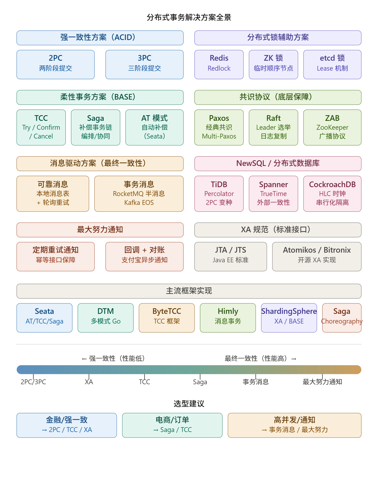
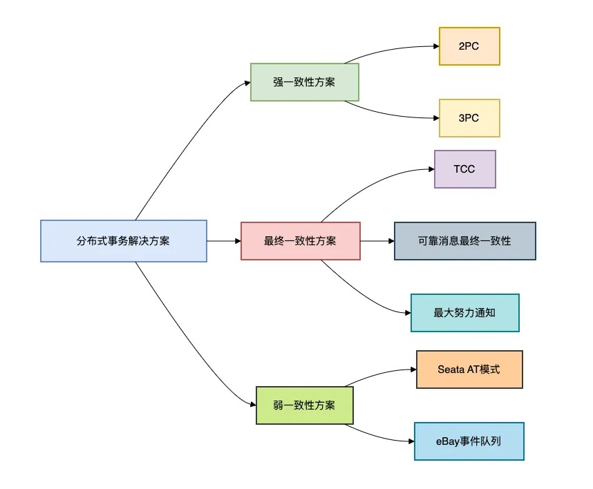

# Seata

## Seata TC 库三张表

> 前置说明
> 1. 这3张表部署在 **Seata Server（TC事务协调器）** 连接的数据库（库名一般叫`seata`），**不是业务微服务的业务库**。
> 2. 生效前提：Seata Server存储模式配置为 `store.mode=db`；如果是file/redis模式，这3张表不存在。
> 3. 覆盖4种模式：
>    - `global_table`、`branch_table`：**AT/TCC/SAGA/XA四种模式全部需要**，是TC核心基础表
>    - `lock_table`：**仅AT模式使用，TCC、SAGA、XA完全不读写这张表**，AT全局写锁专用

### 一、global_table 全局事务表

> 含义：记录**一条完整的全局事务**。一次`@GlobalTransactional`就会新增一条记录，代表一个分布式大事务。
> 1个全局事务 → 对应多条branch_table分支记录（一对多）

#### 建表语句（seata库执行）

```sql
CREATE TABLE global_table
(
    xid                       VARCHAR(128) NOT NULL COMMENT '全局事务ID，主键',
    transaction_id            BIGINT COMMENT 'TC内部生成事务ID',
    status                    TINYINT      NOT NULL COMMENT '全局事务状态',
    application_id            VARCHAR(32) COMMENT '发起全局事务的应用名',
    transaction_service_group VARCHAR(32) COMMENT '事务分组tx-service-group',
    transaction_name          VARCHAR(128) COMMENT '全局事务名称，一般是方法名',
    timeout                   INT COMMENT '全局事务超时时间 ms',
    begin_time                BIGINT COMMENT '事务开始时间戳',
    application_data          VARCHAR(2000) COMMENT '自定义业务透传数据',
    gmt_create                DATETIME COMMENT '记录创建时间',
    gmt_modified              DATETIME COMMENT '记录修改时间',
    PRIMARY KEY (xid),
    KEY idx_status_gmt_modified (status, gmt_modified),
    KEY idx_transaction_id (transaction_id)
) ENGINE = InnoDB DEFAULT CHARSET = utf8mb4;
```

##### 核心字段详细解读

|字段|说明|
| ---- | ---- |
|xid|**主键，全局事务唯一ID**。TM开启全局事务时TC生成，整条调用链路传递，所有分支共用同一个XID。格式示例：`127.0.0.1:8091:18923456`|
|transaction_id|TC内部自增id，TC自己使用，业务代码不感知|
|status|**全局事务状态码（面试重点）**|
|application_id|发起全局事务的微服务名称（order-service）|
|transaction_service_group|事务分组，和客户端yml中`tx-service-group`对应，用来映射seata集群|
|transaction_name|事务名称，默认是被`@GlobalTransactional`标记的方法名|
|timeout|全局事务超时时间，超时TC自动触发回滚|
|begin_time|事务开始时间戳|
|application_data|可以存放自定义业务数据，业务很少使用|
|gmt_create/gmt_modified|数据库记录创建/更新时间，TC定时清理过期事务会用到|

##### status全局事务状态枚举

```
0: UnKnown        未知
1: Begin          全局事务已开启（初始状态）
2: Committed      全局事务提交成功
3: Rollbacked     全局事务回滚成功
4: CommitFailed   提交失败
5: RollbackFailed 回滚失败
```
**状态流转：**
1. TM调用@GlobalTransactional → TC插入记录 status=1(Begin)
2. 所有分支一阶段成功，TM通知TC提交 → status更新为2(Committed)
3. 业务抛出异常 / 事务超时 → TC修改status=3(Rollbacked)
4. 二阶段操作失败（数据库宕机等），变成4/5异常状态，需要人工介入处理

### 二、branch_table 分支事务表

> 含义：保存**全局事务下每一个分支事务**。
> 一个全局事务（一条global_table记录），对应N条branch_table记录，每个微服务参与的分支事务占一行。
> 例如下单事务：order、stock、account三个服务，同XID下3条分支记录。

#### 建表语句

```sql
CREATE TABLE branch_table
(
    xid                VARCHAR(128) NOT NULL COMMENT '关联global_table的全局事务ID',
    branch_id          BIGINT       NOT NULL COMMENT '分支事务ID',
    transaction_id     BIGINT COMMENT 'TC内部全局事务id',
    resource_group_id  VARCHAR(32),
    resource_id        VARCHAR(256) COMMENT '资源标识，一般是数据库连接地址',
    branch_type        VARCHAR(8) COMMENT '分支类型 AT / TCC / SAGA / XA',
    status             TINYINT COMMENT '分支事务状态',
    client_id          VARCHAR(64) COMMENT '客户端标识',
    application_data   VARCHAR(2000) COMMENT '分支自定义透传数据',
    gmt_create         DATETIME COMMENT '创建时间',
    gmt_modified       DATETIME COMMENT '更新时间',
    PRIMARY KEY (xid, branch_id),
    KEY idx_xid (xid)
) ENGINE = InnoDB DEFAULT CHARSET = utf8mb4;
```

#### 核心字段解读

|字段|说明|
| ---- | ---- |
|xid|全局事务ID，关联global_table，联合主键之一|
|branch_id|**分支事务ID**，TC生成；xid+branch_id联合主键，唯一确定一条分支|
|transaction_id|TC内部全局事务id，和global_table.transaction_id一致|
|resource_id|资源标识。AT模式下是业务数据库地址，标记这个分支操作的数据库资源|
|branch_type|分支类型：`AT` / `TCC` / `SAGA` / `XA`，标记这条分支属于哪种事务模式|
|status|分支事务状态：注册、提交、回滚、失败等|
|application_data|分支的自定义数据，TCC模式经常用来传递上下文参数|

#### 执行流程

RM（微服务客户端）执行分支事务前，**向TC注册分支事务**，插入branch_table；
二阶段收到TC commit/rollback指令，执行完成后更新这条分支的status。

> 一句话：global记录大事务，branch记录大事务里面每一个子事务。

### 三、lock_table 全局锁表（**AT模式专用**）

> 重要：**只有AT模式使用**，TCC、SAGA、XA完全不操作这张表。
> 作用：存储**Seata框架层面的全局写锁**，用来解决多个全局事务并发修改同一行业务数据的冲突问题。
> ❗区分：lock_table是TC维护的**框架锁**，**不是MySQL自带的行锁**。MySQL行锁在业务库，lock锁在seata库。

#### 建表语句

```sql
CREATE TABLE lock_table
(
    row_key        VARCHAR(128) NOT NULL COMMENT '锁记录主键，表名+主键',
    xid            VARCHAR(128) COMMENT '持有锁的全局事务XID',
    transaction_id BIGINT COMMENT 'TC内部事务id',
    branch_id      BIGINT       NOT NULL COMMENT '持有锁的分支id',
    resource_id    VARCHAR(256) COMMENT '数据库资源地址',
    table_name     VARCHAR(32) COMMENT '业务表名',
    pk             VARCHAR(36) COMMENT '业务表数据主键值',
    gmt_create     DATETIME COMMENT '锁创建时间',
    gmt_modified   DATETIME COMMENT '锁更新时间',
    PRIMARY KEY (row_key),
    KEY idx_branch_id (branch_id)
) ENGINE = InnoDB DEFAULT CHARSET = utf8mb4;
```

#### 核心字段解读

|字段|说明|
| ---- | ---- |
|row_key|**锁的主键**，拼接格式：`tableName:pk`，例如`order:10001`，唯一标识业务库的某一行数据|
|xid|当前占有这条行锁的全局事务ID|
|branch_id|占有锁的分支事务id|
|resource_id|业务数据库地址，区分不同库资源|
|table_name|业务表名称 order/stock|
|pk|业务数据主键，例如订单id=10001|

#### AT全局锁完整流程

事务A修改 order表id=10001
1. RM执行业务update，一阶段提交本地事务前，向TC申请全局锁；
2. TC往lock_table插入一条row_key=`order:10001`记录，标记锁被A的XID持有；
3. 如果事务B也要修改`order:10001`，RM向TC申请锁，发现lock_table存在该row_key，**阻塞等待锁释放**；
4. 事务A二阶段提交成功 → TC删除lock_table这条锁记录，释放全局锁；等待的事务B就可以获取锁继续执行。

> 如果事务A回滚，同样删除lock_table释放锁。

#### lock_table注意点

1. 只有AT模式才会写入lock_table；TCC由业务代码冻结资源，不需要Seata全局锁；SAGA无锁设计；XA由数据库原生锁控制。
2. 全局锁超时：事务长时间不提交，锁超时自动释放，避免死锁。
3. 热点行大量并发，会大量争抢lock_table锁，容易报`LockConflict`锁冲突异常。

### 四、三张表联动（AT模式完整事务链路）

1. TM开启全局事务 → TC插入global_table，status=Begin
2. Order服务RM注册分支 → TC插入branch_table；修改数据，向TC申请全局锁，写入lock_table
3. Feign调用stock服务，stock RM注册分支，新增branch_table，新增lock锁记录
4. 业务代码正常执行无异常，TM通知TC全局提交
5. TC修改global_table状态为Committed，向所有RM下发commit指令
6. RM删除业务库undo_log；TC删除lock_table锁记录，更新branch_table分支状态

> 如果业务抛异常：TC修改global_table状态为Rollbacked，下发rollback指令，RM读取undo_log反向回滚业务数据；TC删除lock锁，更新branch状态。

### 五、面试高频问答

#### Q1：TCC模式会写lock_table吗？

不会。lock_table是AT模式独有的全局写锁。TCC资源冻结逻辑业务自己编码实现，不依赖Seata全局锁。

#### Q2：global_table和branch_table是一对多关系？

是的。一条global全局事务，可以有多个branch分支事务，对应多个微服务。

#### Q3：lock_table和业务库undo_log的区别？

1. lock_table：TC库，**AT全局锁**，控制并发写冲突；服务端使用。
2. undo_log：**业务库**，保存数据前后镜像，用于回滚；业务微服务RM写入。
> TCC/SAGA/XA，业务库不需要undo_log。

#### Q4：global_table中status=Rollbacked代表什么？

代表全局事务已经完成回滚，所有分支全部回滚成功。

### 六、精简背诵版

1. **global_table**：保存全局事务记录，记录@GlobalTransactional开启的分布式大事务状态，四种模式都要用。主键xid。
2. **branch_table**：保存每个微服务的分支事务，一条全局事务对应多条分支记录，四种模式都要用。联合主键xid+branch_id。
3. **lock_table**：AT模式专属，TC存储全局写锁，记录被锁定的业务行，控制并发写冲突；TCC/SAGA/XA不用。

## undo_log（AT模式专属）

> ✅一句话：**undo_log 在业务库，AT模式专用，TCC/SAGA/XA不需要。**
> 作用：保存业务数据修改**前镜像beforeImage、修改后镜像afterImage**，全局事务失败时，RM读取镜像自动生成反向SQL恢复数据。
> 存放位置：**每个微服务自己的业务数据库**（order库、stock库、account库都要单独建undo_log），**不是seata库**（seata库是global_table/branch_table/lock_table）

### 1. MySQL建表语句

```
CREATE TABLE IF NOT EXISTS `undo_log`
(
    `id`            BIGINT       NOT NULL AUTO_INCREMENT COMMENT '自增主键',
    `branch_id`     BIGINT       NOT NULL COMMENT '分支事务ID',
    `xid`           VARCHAR(128) NOT NULL COMMENT '全局事务ID',
    `context`       VARCHAR(128) NOT NULL COMMENT '序列化等上下文信息',
    `rollback_info` LONGBLOB     NOT NULL COMMENT '核心：保存前后镜像快照',
    `log_status`    INT(11)      NOT NULL COMMENT '0正常，1防御状态',
    `log_created`   DATETIME(6)  NOT NULL COMMENT '记录创建时间',
    `log_modified`  DATETIME(6)  NOT NULL COMMENT '记录更新时间',
    UNIQUE KEY `ux_undo_log` (`xid`, `branch_id`)
) ENGINE = InnoDB
AUTO_INCREMENT = 1
DEFAULT CHARSET = utf8mb4
COMMENT = 'AT模式回滚日志表';
```

> 
> 唯一索引 `ux_undo_log(xid,branch_id)`：**同一个分支事务只能有一条undo_log**，防止重复写入。

### 2. 字段详细解释

| 字段 | 含义 |
| --- | --- |
| id | 自增主键 |
| xid | 全局事务ID，和TC的global_table、branch_table的xid完全一致 |
| branch_id | 分支事务ID，TC生成，和branch_table的branch_id对应；xid+branch_id唯一标识一条分支undo记录 |
| context | 上下文，记录rollback_info用的序列化方式（jackson）、压缩配置等 |
| rollback_info【核心】 | LONGBLOB二进制，存放序列化后的undo数据：beforeImage（修改前快照）、afterImage（修改后快照）、SQL类型、表名、字段信息。回滚时解析这个blob生成反向SQL |
| log_status | 日志状态：   0 = NORMAL 正常状态；   1 = DEFENSE 防御状态（防止二阶段重复回滚，防回滚重试问题） |
| log_created/log_modified | 创建、修改时间，用于后台定时清理过期undo日志 |

#### rollback_info内部结构（JSON序列化存入blob）

```
{
  "branchId":123456,
  "undoItems":[
    {
      "sqlType":"UPDATE",
      "tableName":"stock",
      "beforeImage":{ "rows":[{"id":1,"stock":100}] },
      "afterImage":{ "rows":[{"id":1,"stock":99}] }
    }
  ]
}
```

beforeImage：修改之前的数据；回滚就是把数据库恢复成beforeImage的值。

### 3. AT模式一阶段，undo_log写入逻辑（重点）

Seata通过**DataSourceProxy代理数据源**拦截DML（insert/update/delete），**业务SQL 和 insert undo_log 在同一个本地事务提交！**

1. 执行业务SQL前，查询数据，生成`beforeImage`
2. 执行业务SQL（update/insert/delete）
3. 执行后查询数据，生成`afterImage`
4. 将前后镜像打包序列化，写入undo_log
5. **业务SQL + undo_log insert 在同一个本地事务一次性提交**> 
> 关键点：本地事务成功，undo_log一定落库；本地事务失败，undo_log跟着回滚，不会残留脏undo记录。

### 4. 二阶段两种分支走向

#### ① 全局事务提交（TM通知TCcommit）

RM收到commit指令，**直接删除这条undo_log记录**。数据已经提交，快照不再需要。

#### ② 全局事务回滚（TM异常/超时，TC下发rollback）

1. RM根据`xid+branch_id`查询undo_log
2. 取出rollback_info，拿到beforeImage镜像
3. 对比当前数据库数据，生成反向SQL（update把库存改回原值 / delete新增记录）
4. 执行反向SQL恢复业务数据
5. 修改log_status=1防御状态，再删除undo_log> 
> log_status=1防御状态作用：防止网络重试，多次执行回滚，避免重复回滚覆盖数据。

### 5. 清理机制

undo_log提交成功后会**即时删除**；只有异常未正常清理的undo_log，Seata后台定时任务自动清理，默认保留7天。

```
# seata服务端配置
server.undo.logSaveDays:7
server.undo.logDeletePeriod:86400000 # 清理周期，单位ms，默认一天
```

### 6. 重要区分（面试高频）

| 表名 | 位置 | 所属模式 | 作用 |
| --- | --- | --- | --- |
| undo_log | **业务库（order/stock库）** | **仅AT** | 保存数据前后镜像，用来自动回滚业务数据，RM读写 |
| global_table | seata库（TC库） | AT/TCC/SAGA/XA | 全局事务记录 |
| branch_table | seata库（TC库） | AT/TCC/SAGA/XA | 分支事务记录 |
| lock_table | seata库（TC库） | **仅AT** | 全局写锁，控制并发写冲突 |

> 
> ❗易错点：
> 
> 
> 1. TCC、SAGA、XA **业务库不需要undo_log**
> 2. undo_log是业务库，每个微服务业务库单独建，不是共用一张
> 3. undo_log是Seata框架维护的回滚快照，**不是MySQL原生undo log（InnoDB的undo日志），二者完全不是一回事！**

### 7. 面试常问

#### Q1：undo_log和MySQL innodb undo log区别？

1. Seata undo_log：业务库的一张业务表，**Seata AT框架使用**，保存业务行修改前后快照，用于分布式事务二阶段回滚。
2. MySQL InnoDB undo log：MySQL底层日志，数据库本身MVCC、事务回滚使用，和Seata无关。

#### Q2：为什么业务SQL和undo_log要在同一个本地事务？

保证原子性：业务SQL成功，undo_log一定写入；业务SQL失败，undo_log不会残留。

#### Q3：log_status=1是什么场景？

二阶段回滚时标记为防御状态，**防止TC重试rollback指令造成重复回滚**。

#### Q4：AT模式回滚原理一句话？

一阶段提交本地事务，同时写入undo_log保存前后镜像；全局失败时，RM读取undo_log的before镜像，执行反向SQL恢复业务数据。

### 8. 精简背诵版

undo_log是**AT模式专属，建在每个业务库**，存储业务数据修改前后镜像。业务SQL和undo_log在同一个本地事务提交。全局提交就删除undo_log；全局回滚，读取镜像反向恢复业务数据。TCC/SAGA/XA不需要这张表。

### 汇总全套四张表（面试背诵总表）

1. global_table：seata库，全模式，全局事务状态
2. branch_table：seata库，全模式，分支事务
3. lock_table：seata库，仅AT，全局写锁
4. undo_log：业务库，仅AT，数据快照，用于回滚

## AT模式

### AT模式所需配置

---

#### 一、@GlobalTransactional

`@GlobalTransactional` 只做一件事
**标记这个方法是分布式事务的发起方（TM 事务管理器）**，告诉 Seata：

> “我这个方法里调用的所有微服务/数据库操作，都要纳入同一个全局事务！”

它**不负责**：

- 代理数据源
- 生成 undo_log 回滚日志
- 与 TC（Seata 服务端）通信
- 分支事务注册、提交、回滚

这些底层能力全靠**其他配置**支撑。

---

#### 二、Seata AT 模式 **必须满足的 6 个条件**

##### 1. 引入 Seata 依赖（客户端）

SpringBoot / SpringCloud 必须引入：

```xml
<!-- seata 核心客户端 -->
<dependency>
    <groupId>io.seata</groupId>
    <artifactId>seata-spring-boot-starter</artifactId>
    <version>你的版本</version>
</dependency>
```

##### 2. 配置 Seata 服务端（TC）

application.yml 必须配置：

- 事务分组
- 服务组映射
- 连接 TC 地址

示例：

```yaml
seata:
  enabled: true
  application-id: account-service
  tx-service-group: my_test_tx_group  # 事务组名
  service:
    vgroup-mapping:
      my_test_tx_group: default    # 映射到 TC 集群名
    grouplist:
      default: 127.0.0.1:8091      # Seata 服务器地址
```

##### 3. **必须代理数据源（最关键！）**

AT 模式的核心原理就是**代理数据源**，拦截 SQL、生成 undo_log。

你**必须**做下面两件事之一：

###### 方式1：自动代理（推荐，starter 自动配置）

确保配置开启：

```yaml
seata:
  datasource-proxy-autoproxy: true
```

###### 方式2：手动创建数据源 Bean（防止冲突）

```java
@Bean
public DataSource dataSource() {
    return new DataSourceProxy(originalDataSource); // 必须包一层
}
```

**不加代理 = AT 模式完全失效！**

##### 4. 每个参与事务的库都必须建 `undo_log` 表

Seata AT 模式**强制要求**：

```sql
CREATE TABLE `undo_log` (
  `id` bigint NOT NULL AUTO_INCREMENT,
  `branch_id` bigint NOT NULL,
  `xid` varchar(100) NOT NULL,
  `context` varchar(128) NOT NULL,
  `rollback_info` longblob NOT NULL,
  `log_status` int NOT NULL,
  `log_created` datetime NOT NULL,
  `log_modified` datetime NOT NULL,
  PRIMARY KEY (`id`),
  UNIQUE KEY `ux_undo_log` (`xid`,`branch_id`)
) ENGINE=InnoDB DEFAULT CHARSET=utf8mb4;
```

没有这张表 → 直接抛异常。

##### 5. 必须启动 Seata 服务器（TC）

下载 seata-server → 启动 `sh seata.sh`
分布式事务的**协调中心**，没有它事务无法提交/回滚。

##### 6. 所有参与微服务都要集成 Seata

比如：

- 账户服务
- 订单服务
- 库存服务

只要参与分布式事务，**都要配置 Seata 客户端**。

---

#### 三、你的代码真正能跑的前提

```java
@GlobalTransactional
public void transfer(String from, String to, BigDecimal amount) {
    accountDAO.debit(from, amount);
    accountDAO.credit(to, amount);
}
```

这段代码能工作的**真实条件**：

1. 项目引入了 `seata-starter`
2. 配置了 TC 地址
3. 数据源被 `DataSourceProxy` 代理
4. 数据库有 `undo_log` 表
5. Seata 服务端正在运行
6. 没有关闭 seata 自动配置

---

#### 四、总结

`@GlobalTransactional` = **分布式事务的开关**
但 Seata AT 模式 = **客户端 + 服务端 + 数据源代理 + undo_log + 配置** 的完整体系。


### AT 模式完整操作步骤（分 6 步）

#### 核心前提

AT 模式核心逻辑：**一阶段提交本地事务，二阶段根据全局事务结果自动回滚/提交**，全程无代码侵入，基于 SQL 解析实现。

#### 步骤 1：环境准备（基础依赖）

##### 1.1 部署 Seata Server 服务端

Seata Server 是分布式事务的协调中心，负责全局事务的提交/回滚决策。

- **下载 Seata Server**：从 [Seata 官网](https://seata.io/zh-cn/blog/download.html) 下载稳定版（推荐 1.6.1+）。

- **配置 Seata Server**：

  1. 修改 `conf/application.yml`，配置注册中心（Nacos）和配置中心（Nacos）、存储模式（推荐 DB 存储）：

     ```yaml
     server:
       port: 8091
     spring:
       application:
         name: seata-server
     seata:
       registry:
         type: nacos
         nacos:
           server-addr: 127.0.0.1:8848 # 你的 Nacos 地址
           namespace: "" # 按需配置
           group: SEATA_GROUP
           application: seata-server
       config:
         type: nacos
         nacos:
           server-addr: 127.0.0.1:8848
           group: SEATA_GROUP
       store:
         mode: db # 存储模式：file（测试）/db（生产）/redis
         db:
           datasource: druid
           db-type: mysql
           driver-class-name: com.mysql.cj.jdbc.Driver
           url: jdbc:mysql://127.0.0.1:3306/seata?useUnicode=true&rewriteBatchedStatements=true
           user: root
           password: 你的密码
     ```

  2. 初始化 Seata 数据库：执行 [Seata 官方 DB 脚本](https://github.com/seata/seata/blob/1.6.1/server/src/main/resources/db/mysql.sql)，创建 `branch_table`、`global_table`、`lock_table` 三张核心表。

- **启动 Seata Server**：

  ```bash
  # 进入 Seata 解压目录
  sh bin/seata-server.sh -p 8091 -h 127.0.0.1 -m db
  ```

##### 1.2 业务数据库准备（每个微服务库）

每个参与分布式事务的微服务数据库，都需要创建 **undo_log 表**（AT 模式回滚的核心表）：

```sql
CREATE TABLE `undo_log` (
  `id` bigint(20) NOT NULL AUTO_INCREMENT,
  `branch_id` bigint(20) NOT NULL,
  `xid` varchar(100) NOT NULL,
  `context` varchar(128) NOT NULL,
  `rollback_info` longblob NOT NULL,
  `log_status` int(11) NOT NULL,
  `log_created` datetime NOT NULL,
  `log_modified` datetime NOT NULL,
  `ext` varchar(100) DEFAULT NULL,
  PRIMARY KEY (`id`),
  UNIQUE KEY `ux_undo_log` (`xid`,`branch_id`)
) ENGINE=InnoDB AUTO_INCREMENT=1 DEFAULT CHARSET=utf8mb4;
```

#### 步骤 2：微服务引入 Seata 依赖（以 Spring Boot 为例）

在每个参与分布式事务的微服务 `pom.xml` 中添加依赖：

```xml
<!-- Seata 核心依赖 -->
<dependency>
    <groupId>com.alibaba.cloud</groupId>
    <artifactId>spring-cloud-starter-alibaba-seata</artifactId>
    <version>2022.0.0.0-RC2</version> <!-- 适配 Spring Cloud Alibaba 版本 -->
</dependency>
<!-- Seata 与 Nacos 集成（如果用 Nacos 注册） -->
<dependency>
    <groupId>io.seata</groupId>
    <artifactId>seata-spring-boot-starter</artifactId>
    <version>1.6.1</version>
</dependency>
```

#### 步骤 3：微服务配置 Seata（application.yml）

每个微服务都要配置 Seata 客户端，关联到 Seata Server：

```yaml
spring:
  cloud:
    alibaba:
      seata:
        tx-service-group: my_test_tx_group # 事务组名称（必须和 Seata 配置一致）
seata:
  enabled: true
  application-id: order-service # 当前微服务名称（如订单/库存/账户）
  tx-service-group: my_test_tx_group
  registry:
    type: nacos
    nacos:
      server-addr: 127.0.0.1:8848
      namespace: ""
      group: SEATA_GROUP
      application: seata-server
  config:
    type: nacos
    nacos:
      server-addr: 127.0.0.1:8848
      group: SEATA_GROUP
  service:
    vgroup-mapping:
      my_test_tx_group: default # 事务组映射（必须和 Seata Server 一致）
  client:
    rm:
      report-success-enable: true
    undo:
      log-serialization: jackson # 序列化方式
      log-table: undo_log # 对应步骤1.2创建的回滚表
```

#### 步骤 4：配置数据源代理（核心！AT 模式必须）

AT 模式需要 Seata 代理数据源，才能拦截 SQL 生成回滚日志，需自定义数据源配置类：

```java
import com.alibaba.druid.pool.DruidDataSource;
import io.seata.rm.datasource.DataSourceProxy;
import org.springframework.boot.context.properties.ConfigurationProperties;
import org.springframework.context.annotation.Bean;
import org.springframework.context.annotation.Configuration;
import org.springframework.context.annotation.Primary;

import javax.sql.DataSource;

@Configuration
public class SeataDataSourceConfig {

    // 1. 读取原有数据源配置
    @Bean
    @ConfigurationProperties(prefix = "spring.datasource")
    public DataSource druidDataSource() {
        return new DruidDataSource();
    }

    // 2. 用 Seata 代理数据源（核心）
    @Bean
    @Primary // 优先使用代理后的数据源
    public DataSource dataSourceProxy(DataSource druidDataSource) {
        return new DataSourceProxy(druidDataSource);
    }
}
```

#### 步骤 5：编写业务代码（无侵入，只加注解）

##### 5.1 全局事务发起方（如订单服务）

在**最外层调用方法**上添加 `@GlobalTransactional` 注解（全局事务入口）：

```java
import io.seata.spring.annotation.GlobalTransactional;
import org.springframework.stereotype.Service;
import javax.annotation.Resource;

@Service
public class OrderService {

    @Resource
    private OrderMapper orderMapper; // 本地订单DAO
    @Resource
    private StorageFeignClient storageFeignClient; // 库存服务Feign调用
    @Resource
    private AccountFeignClient accountFeignClient; // 账户服务Feign调用

    // 全局事务入口：创建订单→扣库存→扣账户余额
    @GlobalTransactional(rollbackFor = Exception.class) // 异常时全局回滚
    public void createOrder(OrderDTO orderDTO) {
        // 1. 本地事务：创建订单（一阶段提交）
        orderMapper.createOrder(orderDTO);
        
        // 2. 调用库存服务：扣减库存（远程事务）
        storageFeignClient.deductStorage(orderDTO.getProductId(), orderDTO.getCount());
        
        // 3. 调用账户服务：扣减余额（远程事务）
        accountFeignClient.deductAccount(orderDTO.getUserId(), orderDTO.getAmount());
        
        // 4. 模拟异常：触发全局回滚
        // int i = 1 / 0;
    }
}
```

##### 5.2 参与方服务（如库存/账户服务）

参与方无需特殊注解，只需保证本地方法是 Spring 事务（默认即可）：

```java
// 库存服务示例
@Service
public class StorageService {

    @Resource
    private StorageMapper storageMapper;

    // 本地事务：扣减库存（被全局事务管理）
    public void deductStorage(Long productId, Integer count) {
        storageMapper.deductStorage(productId, count);
    }
}

// 账户服务示例
@Service
public class AccountService {

    @Resource
    private AccountMapper accountMapper;

    // 本地事务：扣减余额
    public void deductAccount(Long userId, BigDecimal amount) {
        accountMapper.deductAccount(userId, amount);
    }
}
```

#### 步骤 6：测试验证

1. **正常场景**：调用订单服务 `createOrder`，订单创建、库存扣减、账户扣减全部成功，Seata Server 记录全局事务状态为提交。
2. **异常场景**：打开代码中 `int i = 1 / 0;` 注释，触发异常：
   - 订单服务本地事务回滚（undo_log 表生成回滚日志）；
   - 库存/账户服务的本地事务自动回滚；
   - 所有数据库数据恢复到事务前状态，实现**全局一致性**。

---

#### 总结

1. **环境层**：部署 Seata Server（配置 DB 存储）+ 每个业务库创建 `undo_log` 表；
2. **配置层**：微服务引入 Seata 依赖 + 配置注册/配置中心 + 数据源代理（核心）；
3. **代码层**：全局事务发起方加 `@GlobalTransactional`，参与方无需额外注解；
4. **核心逻辑**：AT 模式通过代理数据源拦截 SQL，一阶段提交本地事务，二阶段根据全局结果自动回滚/提交，全程无代码侵入。

#### 关键注意事项

- `undo_log` 表必须每个业务库都创建，否则无法回滚；
- 数据源必须用 Seata 代理，这是 AT 模式生效的核心；
- `@GlobalTransactional` 只能加在**最外层方法**，内层方法加无效；
- Seata Server 和客户端的事务组名称（tx-service-group）必须一致。

## TCC 模式


### TCC注解与接口完整讲解

```java
public interface AccountTccService {
    @TwoPhaseBusinessAction(name = "accountDebitTcc", commitMethod = "confirm", rollbackMethod = "cancel")
    boolean tryDebit(
        @BusinessActionContextParameter(paramName = "from") String from,
        @BusinessActionContextParameter(paramName = "amount") BigDecimal amount
    );
    boolean confirm(BusinessActionContext context);
    boolean cancel(BusinessActionContext context);
}
```
`@TwoPhaseBusinessAction` 是Seata TCC模式核心注解，标记**Try方法**，用来告诉Seata：这个TCC动作对应的Confirm确认方法、Cancel取消回滚方法是谁；
`@BusinessActionContextParameter` 用来把Try阶段的参数存入`BusinessActionContext`，供后面Confirm/Cancel阶段读取。

#### 1. @TwoPhaseBusinessAction 注解（作用在Try方法上）

```java
@TwoPhaseBusinessAction(
        name = "accountDebitTcc",
        commitMethod = "confirm",
        rollbackMethod = "cancel"
)
```
##### 属性说明

1. **name**：TCC业务动作名称，**全局唯一**
    - 用来标识这个TCC资源动作，会存入TC的`branch_table`；
    - 同一个应用内不能重名。
2. **commitMethod**：**Confirm确认方法名（字符串）**
    - 指定二阶段成功时，Seata反射调用哪个方法；
    - 方法必须写在同一个类里面。
3. **rollbackMethod**：**Cancel取消方法名（字符串）**
    - 二阶段失败时，Seata反射调用该方法做资源释放。
> 补充可选参数（面试偶尔问到）
> - `commitIsRetry`：Confirm是否支持重试，默认true；Confirm必须**幂等**，TC会重试。
> - `rollbackIsRetry`：Cancel是否支持重试，默认true；Cancel也必须**幂等**。

> ⚠️注意：
> 注解**只能打在Try方法上**，Confirm、Cancel方法**不要加任何TCC注解**。
> 二阶段Confirm/Cancel是Seata框架通过反射调用。

#### 2. @BusinessActionContextParameter

```java
@BusinessActionContextParameter(paramName = "from") String from
@BusinessActionContextParameter(paramName = "amount") BigDecimal amount
```
- 作用：**把Try方法入参保存到 BusinessActionContext（业务上下文）**
- `paramName`：存入上下文的key名称，Confirm/Cancel通过这个key取值。

##### BusinessActionContext（TCC上下文对象）

Confirm 和 Cancel方法入参固定是 `BusinessActionContext context`，可以取出Try阶段传递的参数：
```java
// confirm方法内获取参数
String from = context.getActionContext("from", String.class);
BigDecimal amount = context.getActionContext("amount", BigDecimal.class);
```
> 原理：Try执行完，Seata把标记的参数序列化存入上下文，存入TC的branch_table的application_data字段；二阶段Confirm/Cancel拿到上下文再取出。

#### 3. TCC三个方法规范（重点面试）

##### ① Try 方法（一阶段）

```java
boolean tryDebit(参数);
```
职责：**资源检查 + 资源预留锁定**
账户场景：校验余额，冻结金额（冻结余额字段+，可用余额-），**不真正扣减**。
返回值：
- `true`：Try成功，注册分支事务到TC；
- `false`：Try失败，TC直接执行Cancel。

> Try方法**建议加本地事务@Transactional**，保证冻结操作原子性。

##### ② Confirm 方法（二阶段确认）

```java
boolean confirm(BusinessActionContext context);
```
全局事务全部Try成功，TC触发Confirm。
账户场景：把**冻结金额真正扣减掉，清除冻结记录**。
✅必须**幂等**：TC可能重试调用Confirm，多次执行结果一致，不能重复扣钱。

##### ③ Cancel 方法（二阶段回滚）

```java
boolean cancel(BusinessActionContext context);
```
全局事务失败，TC触发Cancel，释放预留资源。
账户场景：解冻金额，把冻结金额退回可用余额。
✅必须**幂等**：网络抖动TC会重试Cancel，不能重复解冻。

> 三个方法返回boolean：true代表执行成功；false代表失败，TC会不断重试。

#### 4. 完整实现示例（接口+实现类）

```java
@Service
public class AccountTccServiceImpl implements AccountTccService {

    @Autowired
    private AccountMapper accountMapper;

    @Override
    @TwoPhaseBusinessAction(name = "accountDebitTcc", commitMethod = "confirm", rollbackMethod = "cancel")
    @Transactional
    public boolean tryDebit(
            @BusinessActionContextParameter(paramName = "from") String from,
            @BusinessActionContextParameter(paramName = "amount") BigDecimal amount
    ) {
        // Try：校验余额，冻结资金
        int rows = accountMapper.freezeBalance(from, amount);
        return rows > 0;
    }

    @Override
    public boolean confirm(BusinessActionContext context) {
        String from = context.getActionContext("from", String.class);
        BigDecimal amount = context.getActionContext("amount", BigDecimal.class);
        // Confirm：确认扣减，清除冻结
        accountMapper.confirmFreeze(from, amount);
        return true;
    }

    @Override
    public boolean cancel(BusinessActionContext context) {
        String from = context.getActionContext("from", String.class);
        BigDecimal amount = context.getActionContext("amount", BigDecimal.class);
        // Cancel：解冻资金，释放预留资源
        accountMapper.unFreezeBalance(from, amount);
        return true;
    }
}
```

#### 5. 全局事务入口调用TCC

```java
@Service
public class OrderServiceImpl {
    @Autowired
    private AccountTccService accountTccService;

    @GlobalTransactional(rollbackFor = Exception.class)
    public void createOrder(){
        // 调用TCC Try方法
        accountTccService.tryDebit("user001", new BigDecimal("100"));
        // 还可以调用库存TCC Try
    }
}
```
> 调用`tryDebit`的时候，就会执行Try阶段，并且向TC注册TCC分支事务。

#### 6. 面试高频考点

##### Q1：@TwoPhaseBusinessAction写在哪个方法？

写在**Try方法**，Confirm/Cancel不需要这个注解。

##### Q2：@BusinessActionContextParameter作用？

把Try阶段参数存入BusinessActionContext，供Confirm、Cancel阶段获取参数。

##### Q3：TCC三阶段幂等为什么很重要？

TC在网络异常场景会重试二阶段Confirm/Cancel。如果不做幂等，会出现重复扣款、重复解冻，造成资金错乱。
> 一般用事务状态表记录分支执行状态（TRY/CONFIRMED/CANCELED）做幂等。

##### Q4：TCC需要undo_log吗？

不需要。TCC没有快照，**业务自己写冻结、确认、解冻逻辑**。

##### Q5：TCC和AT最大区别？

AT：框架自动生成undo_log，自动回滚；业务只写正常业务SQL。
TCC：**业务自己编码Try/Confirm/Cancel**，手动控制资源预留和释放。

#### 一句话背诵版

`@TwoPhaseBusinessAction`标记Try方法，指定commitMethod和rollbackMethod，告诉Seata二阶段调用哪个方法；
`@BusinessActionContextParameter`把Try参数存入BusinessActionContext，Confirm/Cancel从上下文读取参数；
TCC三阶段Try预留资源、Confirm确认提交、Cancel释放资源；Confirm/Cancel必须保证幂等。

要不要我补充TCC幂等防悬挂、空回滚的解决方案代码？这是面试TCC必考。


### Seata TCC：幂等、空回滚、防悬挂

> TCC三大经典问题根源：**TC的重试机制 + 网络超时**
> 先记住3个名词：
> 1. **幂等**：Confirm / Cancel 被TC多次重试，不能重复执行业务逻辑（重复扣款、重复解冻）
> 2. **空回滚**：Try阶段**还没执行成功**，TC先收到分支回滚指令，执行Cancel；此时没有预留资源，Cancel不能报错
> 3. **防悬挂**：Try网络延迟，**Try晚于Cancel执行**；Cancel已经释放资源，Try才执行资源预留，造成资源悬挂（冻结了永远不会Confirm的资源）

核心方案统一思路：**增加一张分支事务状态表（tcc_branch_state）**，记录每个分支的状态。
> 状态枚举：`INIT(0)`初始化、`TRY_SUCCESS(1)`Try成功、`CONFIRMED(2)`已确认、`CANCELED(3)`已取消

#### 建表语句（业务库，每个TCC服务单独建）

```sql
CREATE TABLE tcc_branch_state (
    id BIGINT AUTO_INCREMENT PRIMARY KEY,
    xid VARCHAR(128) NOT NULL COMMENT '全局事务id',
    branch_id BIGINT NOT NULL COMMENT '分支事务id',
    state TINYINT NOT NULL COMMENT '状态：0 INIT,1 TRY_SUCCESS,2 CONFIRMED,3 CANCELED',
    create_time DATETIME,
    UNIQUE KEY uk_xid_branchid (xid, branch_id)
);
```

#### 状态流转规则

1. Try成功：插入记录，state = 1（TRY_SUCCESS）
2. Confirm执行：判断state=1，执行业务，更新state=2（CONFIRMED）
3. Cancel执行：
   - 如果state=1：执行资源释放，更新state=3（CANCELED）
   - 如果state=0：空回滚，直接更新state=3，**不执行业务解冻逻辑**
   - 如果state=2/3：幂等，直接返回true，不重复执行

---

#### 1. 幂等（Confirm / Cancel 重复调用）

##### 问题

网络超时，TC收不到二阶段返回，**TC会不断重试Confirm或者Cancel**。
- Confirm重试：重复扣减冻结金额
- Cancel重试：重复解冻资金

##### 解决方案

执行Confirm/Cancel**先查状态表**
- 如果状态已经是CONFIRMED/CANCELED → 直接return true，不再执行业务SQL
- 只有状态=TRY_SUCCESS，才执行业务逻辑，然后更新状态

Confirm示例代码：
```java
@Override
@Transactional
public boolean confirm(BusinessActionContext context) {
    String xid = context.getXid();
    Long branchId = context.getBranchId();
    // 查询状态
    TccBranchState state = stateMapper.selectByXidBranch(xid, branchId);
    // 幂等判断：已经确认，直接返回成功
    if (state.getState() == 2) {
        return true;
    }
    // 执行业务：确认扣减冻结金额
    String from = context.getActionContext("from", String.class);
    BigDecimal amount = context.getActionContext("amount", BigDecimal.class);
    accountMapper.confirmFreeze(from, amount);
    // 更新状态为已确认
    stateMapper.updateState(xid, branchId, 2);
    return true;
}
```
Cancel幂等逻辑同理，先判断状态，已经CANCELED直接返回true。

> ✅一句话：**用状态表记录二阶段执行状态，已完成就不再执行业务**。

#### 2. 空回滚

##### 场景

全局事务发起，TC下发Cancel指令，**分支的Try还没有执行成功（甚至Try还没跑）**，此时没有任何资源被冻结。
如果Cancel直接执行解冻SQL，会报异常（没有冻结金额可以解冻）。

> 时序：
> 1. TM开启全局事务
> 2. 调用TCC Try，Try执行卡住
> 3. 全局事务超时，TC下发Cancel
> 4. Cancel先执行，此时Try还没执行，无冻结资源

##### 解决方案

Cancel的时候，查询状态表：
1. 如果**没有记录 / state=INIT** → 空回滚，**不执行业务解冻SQL**，插入状态记录state=3（CANCELED），返回true。
2. 如果state=TRY_SUCCESS → 正常执行解冻，更新state=3。

Cancel代码：
```java
@Override
@Transactional
public boolean cancel(BusinessActionContext context) {
    String xid = context.getXid();
    Long branchId = context.getBranchId();
    TccBranchState state = stateMapper.selectByXidBranch(xid, branchId);
    // 空回滚：状态不存在/INIT，直接标记取消，不执行业务
    if (state == null || state.getState() == 0) {
        stateMapper.insertState(xid, branchId, 3);
        return true;
    }
    // 幂等：已经取消，直接返回
    if (state.getState() == 3) {
        return true;
    }
    // 正常取消：释放冻结资源
    String from = context.getActionContext("from", String.class);
    BigDecimal amount = context.getActionContext("amount", BigDecimal.class);
    accountMapper.unFreezeBalance(from, amount);
    stateMapper.updateState(xid, branchId, 3);
    return true;
}
```

#### 3. 防悬挂（重点，面试最爱问）

##### 场景

Try请求网络延迟，**Cancel先执行完成，Try才到达并执行成功**。
Cancel已经标记state=CANCELED，但是后面Try执行成功，冻结了资源；
二阶段不会再触发Confirm/Cancel → **冻结资源永远无法释放，资源悬挂**。

> 时序：
> 1. 调用Try，网络卡顿，请求迟迟到达下游
> 2. 全局事务超时，TC下发Cancel，Cancel执行成功，state置为3 CANCELED
> 3. 延迟的Try请求终于到达，Try执行成功，冻结资金
> 4. 这个分支不会再走Confirm/Cancel，冻结资金永久挂着

##### 解决方案

Try方法内部，**先查询状态表**：
- 如果查到状态是 CANCELED（3） → 直接return false，**不做资源冻结**，拒绝Try执行，防止悬挂。
- 如果状态不存在，才执行冻结业务，插入state=TRY_SUCCESS(1)

Try完整代码：
```java
@Override
@TwoPhaseBusinessAction(name = "accountDebitTcc", commitMethod = "confirm", rollbackMethod = "cancel")
@Transactional
public boolean tryDebit(
        @BusinessActionContextParameter(paramName = "from") String from,
        @BusinessActionContextParameter(paramName = "amount") BigDecimal amount,
        BusinessActionContext context // 注入上下文拿到xid、branchId
) {
    String xid = context.getXid();
    Long branchId = context.getBranchId();
    TccBranchState state = stateMapper.selectByXidBranch(xid, branchId);
    // 防悬挂：如果已经被取消，直接返回false，不再预留资源
    if (state != null && state.getState() == 3) {
        return false;
    }
    // 执行业务Try：冻结金额
    int row = accountMapper.freezeBalance(from, amount);
    if(row <=0){
        return false;
    }
    // Try成功，插入状态 TRY_SUCCESS
    stateMapper.insertState(xid, branchId, 1);
    return true;
}
```

#### ✅ 总结一张表

|问题|现象|解决核心思路|
|---|---|---|
|幂等|TC重复调用Confirm/Cancel，重复执行业务|状态表，已完成直接返回，不重复执行业务|
|空回滚|Try没执行，Cancel先到，没有资源可回滚|Cancel发现无Try记录，标记CANCELED，不执行解冻业务|
|防悬挂|Cancel执行完，延迟的Try才执行，资源永久冻结|Try执行前先查状态，如果已经CANCELED，拒绝执行Try|

> 一句话背诵（面试口述版）
TCC通过**分支事务状态表**同时解决幂等、空回滚、防悬挂。
1. 幂等：Confirm/Cancel执行前查询状态，已完成直接返回；
2. 空回滚：Cancel发现没有Try成功记录，仅标记状态，不执行资源释放；
3. 防悬挂：Try执行前查询状态，如果已经被Cancel，则不再预留资源。

#### 补充面试追问

##### Q：为什么AT不用处理空回滚、悬挂？

AT由框架控制一阶段和二阶段时序，一阶段本地事务提交后才注册分支；不会出现Try延迟晚于Cancel。

##### Q：状态表操作为什么和业务操作放在同一个本地事务？

保证原子性。例如Try冻结余额 + 插入状态记录，在同一个@Transactional，要么一起成功，要么一起失败。

##### Q：有没有其他方案？

Seata1.4.2之后提供TCC框架内置的**状态机防悬挂**，底层原理还是记录分支状态；生产上自己建状态表最容易理解，面试优先说自建状态表方案。

要不要我整理TCC和AT对比的面试简答？


### TCC 必须满足的 6 个核心条件

##### 1. 必须手动编写 3 个方法：Try / Confirm / Cancel

这是 TCC 最核心的要求：**你必须自己实现业务逻辑 + 手动提交/回滚**。

一个标准 TCC 接口长这样：

```java
// 1. Try  ：资源检查、预留、锁定（扣减冻结金额）
// 2. Confirm：真正执行提交（扣减正式金额）
// 3. Cancel ：释放预留资源，回滚（解冻金额）
public interface AccountTccService {
    @TwoPhaseBusinessAction(name = "accountDebitTcc", commitMethod = "confirm", rollbackMethod = "cancel")
    boolean tryDebit(
        @BusinessActionContextParameter(paramName = "from") String from,
        @BusinessActionContextParameter(paramName = "amount") BigDecimal amount
    );

    boolean confirm(BusinessActionContext context);
    boolean cancel(BusinessActionContext context);
}
```

---

##### 2. 必须使用 @TwoPhaseBusinessAction 注解

这是 TCC 的**核心注解**，作用：

- 标记这是一个 TCC 资源
- 指定 `Try` 入口
- 指定 `Confirm` 提交方法
- 指定 `Cancel` 回滚方法

---

##### 3. 全局事务入口必须加 @GlobalTransactional

和 AT 一样，**分布式事务入口必须标记**，让 Seata 开启全局事务：

```java
@Service
public class TransferServiceImpl implements TransferService {

    @Autowired
    private AccountTccService accountTccService;

    // 全局事务发起方
    @GlobalTransactional
    public void transfer(String from, String to, BigDecimal amount) {
        // 调用 TCC 服务
        accountTccService.tryDebit(from, amount);
        // 其他TCC服务...
    }
}
```

---

##### 4. 必须保证 幂等性 + 防悬挂 + 空回滚（强制！）

TCC 框架**不会自动处理**，你必须自己解决 3 个问题，否则会出现：

- 重复扣款
- 金额扣多了
- 服务异常后数据错乱

必须在数据库增加 **事务控制表**，记录：

- 全局事务 XID
- 分支事务 ID
- 状态：try / confirm / cancel

```sql
CREATE TABLE `tcc_transaction_log` (
  `xid` varchar(128) NOT NULL,
  `branch_id` bigint NOT NULL,
  `status` int NOT NULL COMMENT '0:Try,1:Confirm,2:Cancel',
  `create_time` datetime DEFAULT NULL,
  PRIMARY KEY (`xid`,`branch_id`)
) ENGINE=InnoDB DEFAULT CHARSET=utf8mb4;
```

**不做这三个保障，线上绝对出事故！**

---

##### 5. 必须引入 Seata 依赖 + 配置 Seata 服务端（TC）

和 AT 模式一样：

1. 引入 `seata-spring-boot-starter`
2. 配置 `application.yml` 连接 Seata 服务器
3. 启动 seata-server（TC 协调器）

TCC 也依赖 Seata 服务端做全局事务协调。

---

##### 6. 所有参与者都必须是 TCC 接口

TCC 模式下：

- 不能混用普通 DAO
- 不能混用 AT 模式的自动事务
- **所有参与分布式事务的服务，都必须写成 TCC 接口**

比如转账：

- 扣款：TCC
- 加款：TCC
  **两个都必须是 TCC 实现。**

## Saga 模式

### 一、核心定义与起源

**Saga模式**是分布式事务中解决**长事务（Long Transaction）**的标准方案，1987年由Hector & Kenneth在论文《Sagas》中提出，核心思想是：**将一个分布式长事务拆成一串独立的本地短事务，每个短事务执行后立即提交；若后续步骤失败，则逆序执行已成功步骤的“补偿操作”，最终达成数据最终一致性**。

在Seata中，Saga是与AT、TCC、XA并列的四大分布式事务模式之一，主打**无锁、高性能、长流程、最终一致**。

### 二、核心原理：正向执行+反向补偿

#### 1. 基本模型

一个Saga由n个**正向子事务Ti**和对应的n个**补偿子事务Ci**组成：

- **正向流程**：按T1→T2→T3→…→Tn顺序执行，每个Ti完成后**立即提交本地事务、释放资源**（无锁）。
- **成功**：全部Ti执行成功，全局事务正常结束。
- **失败**：若Tk（k≤n）失败，则**逆序执行补偿Ck-1→Ck-2→…→C1**，撤销已提交的T1~Tk-1，实现回滚。


#### 2. 与TCC的关键区别

- **TCC**：Try（资源检查/锁定）→Confirm（提交）→Cancel（回滚），**三阶段、有锁、强一致、业务侵入高**。
- **Saga**：无Try阶段，**直接提交（一阶段）+补偿回滚（二阶段）、无锁、最终一致、长流程友好**。

### 三、Seata Saga标准实现：状态机模式（推荐）

Seata的Saga标准实现为**状态机引擎驱动**（区别于简单注解模式），通过**JSON状态定义文件**编排流程，支持复杂分支、并发、子流程、异常捕获，企业级首选。

#### 1. 核心组件

- **状态机定义（JSON）**：用状态图描述流程，含**节点（服务调用）、补偿节点、分支判断、异常处理**。
- **状态机引擎**：Seata Server内置，负责**驱动状态流转、记录执行日志、触发补偿、持久化状态**。
- **业务服务**：实现**正向接口（Ti）**和**补偿接口（Ci）**，需保证**幂等性**（避免重复执行）。

#### 2. 执行流程（含状态机）

1. **定义状态机**：绘制状态图→生成JSON（含节点、补偿、分支），示例：

```json
{
  "Start": "ReduceInventory",
  "States": {
    "ReduceInventory": {
      "Service": "inventoryService.reduce",
      "Compensate": "CompensateReduceInventory",
      "Next": "ReduceBalance"
    },
    "ReduceBalance": {
      "Service": "accountService.reduce",
      "Compensate": "CompensateReduceBalance",
      "Next": "Succeed"
    },
    "CompensateReduceInventory": { "Service": "inventoryService.compensateReduce" },
    "CompensateReduceBalance": { "Service": "accountService.compensateReduce" }
  }
}
```

2. **启动事务**：客户端请求Seata Server，创建**全局事务ID（XID）**，引擎加载状态机JSON。
3. **正向执行**：引擎按状态顺序调用Ti服务，每个Ti提交本地事务，引擎记录“已完成节点”。
4. **异常触发补偿**：若某Ti失败，引擎**逆序调用对应补偿节点Ci**，逐个回滚已提交的Ti；补偿完成后，全局事务标记为“回滚”。
5. **事务结束**：全部Ti成功→全局提交；补偿完成→全局回滚；状态机执行日志持久化到库。

#### 3. 状态图示例（订单扣库存+扣余额）


- **正常流程**：Start→ReduceInventory（扣库存）→ReduceBalance（扣余额）→Succeed。
- **异常流程**：若ReduceBalance失败→触发CompensateReduceInventory（恢复库存）→事务失败。

### 四、关键特性

1. **无锁高性能**：一阶段直接提交本地事务，**无全局锁、无资源阻塞**，适合高并发长流程。
2. **长流程友好**：支持**跨服务、跨系统、跨企业**的长事务（如订单→支付→物流→出库）。
3. **编排能力强**：状态机支持**分支选择、并发执行、子流程嵌套、参数映射、异常捕获/重试**。
4. **最终一致性**：通过补偿机制保证数据最终一致，但**中间过程可能不一致**（无隔离性）。
5. **业务侵入可控**：需实现正向+补偿接口，但状态机模式**配置化编排、低侵入**。

### 五、适用场景

- ✅ **长周期事务**：流程长、步骤多、执行时间久（如供应链、跨境电商、金融审批）。
- ✅ **跨系统/遗留系统**：参与者含第三方公司或遗留服务，**无法提供TCC的Try/Confirm/Cancel三接口**。
- ✅ **高并发高性能**：无锁设计，适合高吞吐、低延迟场景。
- ❌ **强隔离/强一致**：不支持脏读/脏写隔离，中间态不一致，不适合金融核心交易（如转账）。

### 六、优缺点

#### 优点

- **无锁、高性能、高吞吐**。
- **长流程、跨系统、异步化支持好**。
- **状态机编排灵活，支持复杂流程**。
- **补偿逻辑相对直观，易实现**。

#### 缺点

- **无隔离性**：中间态数据不一致，可能脏读/脏写，需业务层控制（如状态标记）。
- **补偿逻辑复杂**：需手动编写，且**必须幂等**；补偿失败可能需人工干预。
- **最终一致非实时**：一致性有延迟，不适合强实时场景。

### 七、与其他模式对比

| 特性         | Saga（状态机） | TCC          | AT               | XA       |
| :----------- | :------------- | :----------- | :--------------- | :------- |
| **一致性**   | 最终一致       | 强一致       | 最终一致         | 强一致   |
| **锁机制**   | 无锁           | 行锁（Try）  | 全局锁（一阶段） | 两阶段锁 |
| **性能**     | 最高           | 中           | 高               | 低       |
| **流程长度** | 长流程友好     | 短流程       | 中短流程         | 短流程   |
| **业务侵入** | 中（需补偿）   | 高（三接口） | 低（无代码）     | 低       |
| **隔离性**   | 无             | 有           | 无               | 有       |

### 八、开发要点（状态机模式）

1. **正向接口（Ti）**：实现业务逻辑，**提交本地事务**，保证幂等。
2. **补偿接口（Ci）**：实现回滚逻辑（如扣库存→加库存），**幂等+可逆**。
3. **状态机JSON**：定义节点、补偿、分支、异常，**避免循环依赖**。
4. **幂等设计**：所有接口（正向/补偿）必须**支持重试、防重复执行**（如唯一键、状态表）。
5. **异常处理**：定义补偿失败策略（重试/告警/人工），**避免悬挂事务**。

### 总结

**Saga标准模式（Seata状态机版）**是长分布式事务的最优解之一，通过“**拆分长事务、本地提交、异常补偿**”实现无锁、高性能、最终一致，尤其适合跨系统、长周期、高并发的业务场景。开发核心是**设计幂等的正向/补偿接口+配置化状态机编排**，同时需接受中间态不一致的特性，通过业务手段控制隔离性问题。

## Seata

### 一、Seata 是什么

**Seata（Simple Extensible Autonomous Transaction Architecture）**，阿里开源分布式事务框架，专门解决微服务场景下跨服务、跨数据库的数据一致性问题。

> 目标：**让分布式事务使用像本地事务一样简单**。

#### 核心角色（必背）

Seata分布式事务模型包含3

个组件：**TM、TC、RM**

1. **TM Transaction Manager 事务管理器**
    事务发起方（业务应用）。负责：
    - 开启全局事务（向TC申请一个全局XID）
    - 提交/回滚全局事务（`@GlobalTransactional` 所在服务）
2. **TC Transaction Coordinator 事务协调器（Seata Server）**
    独立部署的服务，全局事务的大脑。保存：全局事务、分支事务状态。
    - 接收TM请求：创建全局事务
    - 接收RM注册分支事务
    - 二阶段通知RM：commit / rollback
3. **RM Resource Manager 资源管理器**
    每个微服务应用上的组件，管理分支资源（数据库、TCC资源等）
    - 注册分支事务到TC
    - 监听TC二阶段指令，执行分支提交/回滚

> **XID 全局事务ID**
> TM开启全局事务生成全局唯一XID，**在整个调用链路传递**（Feign/Http请求头），所有分支事务绑定同一个XID，用来归属同一个全局事务。
> 格式：`ip:port-${transId}`

#### 整体执行流程（通用，四大模式都复用这套角色模型）

1. TM向TC发起请求，**开启全局事务**，拿到XID
2. TM执行业务，远程调用其他微服务；XID随调用传递到下游服务
3. 各个微服务RM向TC**注册分支事务**
4. 业务执行完毕无异常：TM通知TC，**全局提交**；TC下发commit指令给所有RM
5. 业务抛出异常：TM通知TC，**全局回滚**；TC下发rollback指令给所有RM

---
### 二、四大模式详解（AT / TCC / SAGA / XA）

> Seata4种模式本质区别：**RM如何管理资源、如何实现提交/回滚**

#### 模式1：AT模式（Auto Transaction，最常用）

> 前提：**支持InnoDB引擎的MySQL**；利用数据库本地事务；业务低侵入，仅加注解。
> 核心：**undo_log 快照 + 全局写锁**

`@GlobalTransactional` = **分布式事务的开关**
但 Seata AT 模式 = **客户端 + 服务端 + 数据源代理 + undo_log + 配置** 的完整体系。

1. **只加注解绝对不能用**，这是新手最容易踩的坑
2. AT 模式核心是**数据源代理** + **undo_log** + **TC 协调**
3. `@GlobalTransactional` 只是标记“这是全局事务入口”
4. 必须完整集成 Seata 环境才能工作

##### 核心思想

**“两阶段提交 + 自动补偿”**，无需编写回滚逻辑，Seata 自动生成反向 SQL 实现回滚。

##### 工作原理

###### 第一阶段：本地事务 + 全局锁注册

1. **业务 SQL 执行前**：Seata代理DataSource，拦截业务SQL，解析并记录 **Before Image（BI）**；
2. **执行业务 SQL**（如 `UPDATE account SET balance = balance - 100 WHERE user_id = 1`）；
3. **执行后**：记录 **After Image（AI）**；
4. **生成 undo_log**：将 BI/AI 封装成 **undo log**，与**业务 SQL** 在**同一个本地事务中提交**；(undo_log表需要手动创建)
5. 向 TC（Transaction Coordinator）注册分支事务，**释放本地锁**；并申请**全局行锁**（防止并发修改）。

> 📌 全局锁：Seata 在 TC 中维护一个“行级锁表”，确保同一行数据不会被多个全局事务同时修改。
>
> ✅ 关键点：一阶段**直接提交本地事务**，不阻塞其他事务；这是AT对比XA最大优势

###### 第二阶段：提交 or 回滚

- **提交**：TC通知RM提交；RM**直接删除undo_log记录**，事务结束。
- **回滚**：TC通知RM回滚；RM读取 undo_log 中的 BI，自动**生成反向SQL恢复数据**（如 `UPDATE ... SET balance = 原值`）执行回滚。然后删除undo_log。

##### AT 隔离机制：全局写锁

- 修改数据时，会拿到**全局行锁**，其他事务修改同一行会阻塞等待
- 全局锁在一阶段提交后释放

> ⚠️ AT是**读未提交**隔离级别：其他事务可以读到未提交的数据（脏读）。如果要避免脏读，需要**SELECT FOR UPDATE**加锁。

##### **优点**

- 业务几乎零侵入，只需要`@GlobalTransactional`
- 性能远高于XA，一阶段直接提交本地事务

##### **缺点**

- 仅支持MySQL InnoDB；不支持Redis、Mongo、第三方API
- 存在全局锁，热点行高并发场景容易锁等待
- 脏读问题

> 底层：Seata通过代理DataSource拦截SQL，自动生成undo_log，**不修改业务SQL**

##### **使用示例**

```java
@GlobalTransactional
public void transfer(String from, String to, BigDecimal amount) {
    accountDAO.debit(from, amount);
    accountDAO.credit(to, amount);
}
```

---
#### 模式2：TCC模式 Try-Confirm-Cancel

> 全称：Try Confirm Cancel。**业务自己编写三段代码，没有undo_log**。
> 适用场景：**非数据库资源（Redis、第三方支付、积分）**

**核心思想**：**“手工编码实现两阶段”**，由开发者显式定义 Try、Confirm、Cancel 三个方法。

#####  三阶段语义

| 阶段        | 作用                       | 要求             |
| ----------- | -------------------------- | ---------------- |
| **Try**     | 资源预留（冻结、占位）     | 幂等、可空回滚   |
| **Confirm** | 真正执行业务（扣款、发货） | 幂等             |
| **Cancel**  | 释放预留资源（解冻、取消） | 幂等、支持空回滚 |

##### 三段接口定义

1. **Try：资源检查与预留（冻结资源）**
    参数校验、业务检查，**冻结资源，不真正扣减**
    例：冻结库存、冻结账户余额
2. **Confirm：确认提交**
    全局事务全部分支Try成功，执行真实业务，释放冻结资源
3. **Cancel：取消回滚**
    任意分支失败，释放冻结资源，补偿

> 注解：`@TwoPhaseBusinessAction`
```java
@LocalTCC
public interface AccountService {

    @TwoPhaseBusinessAction(name = "debit", commitMethod = "confirmDebit", rollbackMethod = "cancelDebit")
    boolean debit(@BusinessActionContextParameter(paramName = "userId") String userId,
                  @BusinessActionContextParameter(paramName = "amount") BigDecimal amount);

    boolean confirmDebit(BusinessActionContext context);
    boolean cancelDebit(BusinessActionContext context);
}
```
`BusinessActionContext`：上下文，用来传递参数给Confirm/Cancel

>💡 **典型场景**：红包发放、库存预占、积分兑换等。


##### TCC三大经典问题（面试必考）

1. **幂等性**
    网络重试，Confirm/Cancel可能多次调用，**多次执行结果必须一样**。解决方案：事务状态表记录执行状态。
2. **空回滚**
    Try**没有执行成功**，但是TC收到异常，调用Cancel。
    场景：网络超时，TC判定分支失败触发Cancel，但Try请求还没到达服务。
    解决：事务控制表，记录分支是否执行Try；没执行Try，Cancel直接不处理。
3. **悬挂**
    Try请求网络阻塞超时，TC超时触发Cancel（释放资源）；**之后延迟的Try请求到达**，再次冻结资源，资源被错误冻结。
    解决：事务状态表，Cancel执行之后拒绝后续Try。

✅优点
- **灵活性极高**：适用于非 DB 资 源（如 Redis、MQ、第三方 API）；

- **性能好**：Try 阶段即可释放本地锁，不阻塞；没有AT全局锁，并发性能更好
- **无全局锁**，适合高并发场景。

❌缺点
- **侵入性极高**，每个业务都要写3套接口
- 业务需要手动处理幂等、空回滚、悬挂

> 一句话区分AT vs TCC：AT框架自动生成undo；TCC业务自己写冻结+确认+补偿。

---
#### 模式3：Saga模式（长事务）

适合**长时间运行的业务流程**，订单→库存→物流→短信，整个流程可能持续几分钟/小时，**不能长时间持有锁**。
> 没有全局锁，没有undo_log，弱隔离，**正向业务接口 + 补偿接口**。

##### ✅ 核心思想

**“事件驱动 + 补偿事务”**，适用于**长时间运行**的业务流程（如订单履约、审批流）。

##### 🔧 工作方式

- 正向服务链：`A → B → C → D`
- 若 D 失败，则依次执行反向补偿：`Compensate C → Compensate B → Compensate A`

两种实现：
1. **编排模式（Choreography 分布式编排）**：服务之间互相监听事件，互相调用补偿；无中心。耦合高，难维护。
2. **编排器模式（Orchestration Seata推荐）**：**Seata状态机中心编排**，json配置定义流程，中心控制器驱动。

Saga状态机Json示例：定义每一步服务、正向方法、补偿方法。
执行逻辑：顺序执行正向服务；一旦某一步失败，**逆序调用前面所有成功步骤的补偿接口**。

✅优点
- 支持**超长事务**（几分钟到几天）；
- 无锁设计，吞吐量高；
- 可与状态机结合（Seata Saga 支持状态图定义）。

❌缺点
- **弱一致性，无隔离**，中间状态数据对外可见（脏读）
- 需要自己编写补偿逻辑；补偿失败需要人工处理
- 无法回滚已提交的外部系统操作（如短信已发送）。

> 使用场景：订单履约、审批流程，不需要强隔离，能接受中间状态对外可见。

##### 📌 适用场景

- 跨多个外部系统的业务流程（如旅游预订：机票+酒店+租车）；
- 最终一致性可接受的场景。

---
#### 模式4：XA模式

XA是数据库原生分布式事务标准协议（2PC）。MySQL、Oracle原生支持XA。
XA两个阶段：

1. **Prepare（一阶段）**：所有分支数据库执行prepare，资源锁定，不提交
2. **Commit/Rollback（二阶段）**：全部prepare成功 → commit；任意失败 → rollback

Seata XA模式RM，调用数据库原生XA接口。

✅优点
- **强一致性**；业务侵入低
❌缺点
- **性能很差**，一阶段prepare会长时间持有数据库锁，高并发场景阻塞严重
- MySQL的XA有缺陷，生产极少使用
> 使用场景：低并发、强一致性，传统金融内部系统。

### 三、AT模式底层细节（面试深挖）

#### 1. undo_log表

每一个业务库都要有undo_log。
字段：id、xid、branch_id、context、rollback_info（longblob，存放镜像）、log_status、log_created、log_modified

- log_status: 0正常，1防御状态（防止二阶段重复回滚）

#### 2. 全局锁原理

AT写数据的时候，seata会在TC维护全局锁记录：`table + pk`。
> 事务A修改id=1订单，拿到全局锁；事务B修改同一条记录，会阻塞，等待全局锁释放。
> ⚠️ 全局锁不是数据库锁，是TC内存/数据库维护的锁。

#### 3. 脏读问题怎么解决

AT默认可以读到未提交数据。想要隔离：业务sql增加`select ... for update`，Seata会自动申请全局锁，阻止其他事务读取。

### 四、Seata Server部署 & 存储模式

Seata TC（seata-server）存储全局事务信息，支持3种存储模式：
1. **file（默认单机）**：文件存储，重启丢失数据，仅测试用。
2. **db（数据库存储，推荐）**：全局事务、分支、锁信息存入MySQL；生产环境必须用db模式（前面给的global_table、branch_table、lock_table）
3. redis：Redis存储，高可用集群场景。

#### Seata注册中心

Seata支持 Nacos、Eureka、Consul、etcd3。**微服务项目最常用Nacos**
> seata-server注册到Nacos；客户端从Nacos发现seata-server地址。

#### 事务分组（tx-service-group，面试高频）

`tx-service-group: my_tx_group`
> 事务分组：客户端逻辑分组，用来映射seata集群。
```yaml
seata:
  tx-service-group: my_tx_group
  service:
    vgroup-mapping:
      my_tx_group: default
```
含义：my_tx_group这个事务分组，对应seata集群`default`。
作用：**支持多机房、多集群隔离**，不同分组路由到不同seata-server集群。

### 五、Seata 客户端工作机制

1. 数据源代理（AT模式核心）
`DataSourceProxy` 包装原生DataSource，拦截所有DML语句，生成undo_log。
> SpringBoot starter自动代理，新版本不用手动写代理Bean。

2. XID传递
SpringCloud Alibaba Seata自动提供Feign拦截器，**自动把XID放入请求头`TX_XID`**，下游自动从header取出XID绑定到当前事务上下文。
> 如果是原生Http调用，需要手动传递XID。

#### 六、常见异常与坑（面试常问）

1. `@GlobalTransactional` 不生效
    - 注解必须加在public方法；不能private；不能被内部调用（AOP失效）
    - 异常是CheckedException，默认不回滚；需要 `@GlobalTransactional(rollbackFor = Exception.class)`
2. 事务不回滚：业务库没有undo_log表
3. `can not register RM, err: no available seata server`
    - 事务分组vgroup-mapping配置错误；seata没有成功注册到nacos；网络不通
4. 回滚失败，undo_log丢失：数据库宕机，二阶段回滚时数据库不可用，需要人工处理。
5. AT全局锁超时，报LockConflict异常：热点行并发争抢全局锁。
6. 超时回滚：一阶段执行很久，TC全局事务超时，自动触发回滚。

### 七、版本选型

- seata1.5.2：稳定，很多老项目在用，和nacos2.1适配（当前docker环境）
- seata1.6+：增强TCC、SAGA，优化锁机制
- seata2.x：大版本重构，部分API变更

> SpringCloud Alibaba版本必须和seata版本对齐，否则依赖冲突。

### 八、生产环境注意事项

1. seata-server集群部署，保证TC高可用；存储使用db模式
2. AT热点行要评估全局锁带来的性能影响
3. undo_log会持续膨胀，需要定时清理（二阶段提交后自动删除undo_log，异常长时间未处理的undo_log需要清理）
4. 全局事务超时时间合理配置，不要太长
5. TCC/SAGA业务必须保证补偿接口幂等，补偿失败要有告警人工介入

### 九、面试精简总结（背诵）

1. Seata是分布式事务框架，角色TM、TC、RM，XID全局事务id贯穿整个链路
2. AT：无侵入，undo_log快照，MySQL，一阶段提交本地事务，全局锁；适合微服务CRUD
3. TCC：Try冻结资源、Confirm确认、Cancel补偿；手动编码；幂等/空回滚/悬挂三大问题；支持非数据库资源
4. SAGA：长事务，正向+补偿，无锁，弱隔离
5. XA：数据库原生2PC，强一致，性能差，生产很少使用

### 十、对比其他分布式事务方案（扩展面试）

1. Seata AT：TCC：SAGA：XA
2. 本地消息表（可靠消息最终一致性）
3. RocketMQ事务消息
4. 最大努力通知

> 最大努力通知、RocketMQ事务消息属于**最终一致性**；Seata AT/TCC/SAGA可以做到全局事务。


## Spring 集成 Seata

> 
> 前置环境：
> 
> 
> - TC：seata-server 1.5.2，docker部署，注册到Nacos
> - 注册中心：Nacos v2.1.0-slim
> - 数据库：MySQL8，每个业务库必须建undo_log（AT模式），seata库存放TC全局事务表
> - SpringCloud Alibaba 2021.0.1.0，Seata客户端版本1.5.2

### 一、Seata基础概述

#### 1. 什么是Seata

Seata（Simple Extensible Autonomous Transaction Architecture）阿里开源**分布式事务框架**，解决微服务跨服务/跨库数据一致性，目标：**分布式事务像本地@Transactional一样简单**。

#### 2. 三大核心角色

1. **TM 事务管理器**：业务应用，`@GlobalTransactional`所在服务。负责开启全局事务，获取XID，通知TC提交/回滚。
2. **TC 事务协调器（Seata Server）**：独立服务，分布式事务大脑。保存全局事务、分支事务状态，下发commit/rollback指令。
3. **RM 资源管理器**：每个微服务内，管理分支资源，向TC注册分支，执行二阶段提交/回滚。

#### 3. XID 全局事务ID

TM创建全局事务生成唯一XID，**自动在Feign调用头传递**，链路所有分支绑定同一个XID，标识属于同一个全局事务。

---

### 二、公共基础配置（所有模式通用）

#### 1. Maven依赖（所有参与分布式事务的微服务都引入）

```xml
<!-- SpringCloud Alibaba Seata Starter -->
<dependency>
    <groupId>com.alibaba.cloud</groupId>
    <artifactId>spring-cloud-starter-alibaba-seata</artifactId>
    <version>2021.0.1.0</version>
    <exclusions>
        <exclusion>
            <groupId>io.seata</groupId>
            <artifactId>seata-spring-boot-starter</artifactId>
        </exclusion>
    </exclusions>
</dependency>
<dependency>
    <groupId>io.seata</groupId>
    <artifactId>seata-spring-boot-starter</artifactId>
    <version>1.5.2</version>
</dependency>
<!-- Nacos注册发现 -->
<dependency>
    <groupId>com.alibaba.cloud</groupId>
    <artifactId>spring-cloud-starter-alibaba-nacos-discovery</artifactId>
</dependency>
<!-- OpenFeign -->
<dependency>
    <groupId>org.springframework.cloud</groupId>
    <artifactId>spring-cloud-starter-openfeign</artifactId>
</dependency>
<!-- MyBatis + MySQL驱动 -->
<dependency>
    <groupId>org.mybatis.spring.boot</groupId>
    <artifactId>mybatis-spring-boot-starter</artifactId>
    <version>2.2.2</version>
</dependency>
<dependency>
    <groupId>mysql</groupId>
    <artifactId>mysql-connector-java</artifactId>
    <scope>runtime</scope>
</dependency>
```

#### 2. application.yml 公共配置（order/stock/account服务，只改spring.application.name）

```yml
spring:
  application:
    name: order-service
  cloud:
    nacos:
      discovery:
        server-addr: 192.168.x.x:8848 # nacos地址
  datasource:
    driver-class-name: com.mysql.cj.jdbc.Driver
    url: jdbc:mysql://192.168.x.x:3306/order?useUnicode=true&characterEncoding=utf8&serverTimezone=Asia/Shanghai
    username: root
    password: root123456

# seata配置
seata:
  tx-service-group: my_tx_group
  service:
    vgroup-mapping:
      my_tx_group: default # 和seata-server集群名保持一致
  registry:
    type: nacos
    nacos:
      server-addr: 192.168.x.x:8848
      application: seata-server
      group: SEATA_GROUP
  config:
    type: nacos
    nacos:
      server-addr: 192.168.x.x:8848
      group: SEATA_GROUP
```

#### 3. 启动类

```java
@SpringBootApplication
@EnableDiscoveryClient
@EnableFeignClients
public class OrderApplication {
    public static void main(String[] args) {
        SpringApplication.run(OrderApplication.class, args);
    }
}
```

#### 4. Feign接口（自动传递XID，Seata starter自带拦截器）

```java
@FeignClient("stock-service")
public interface StockFeignClient {
    @PostMapping("/stock/deduct")
    void deductStock(@RequestParam("productId") Long productId, @RequestParam("num") Integer num);
}

@FeignClient("account-service")
public interface AccountFeignClient {
    @PostMapping("/account/deduct")
    void deductBalance(@RequestParam("userId") Long userId, @RequestParam("money") BigDecimal money);
}
```

> 
> 数据库脚本：
> 
> 
> 1. seata库：global_table、branch_table、lock_table（TC使用）
> 2. 业务库order、stock、account，**每个库单独执行undo_log建表SQL（AT模式）**

---

### 模式1：AT模式（Auto Transaction，最常用，低侵入）

> 原理：代理DataSource拦截DML，自动记录undo_log前后镜像；一阶段提交本地事务；二阶段删除undo_log/反向SQL回滚。
> ✅适用：MySQL InnoDB，普通CRUD微服务；**只需要加注解，不用手动写补偿**

#### AT代码示例

##### OrderServiceImpl【全局事务入口】

```java
@Service
public class OrderServiceImpl implements OrderService {

    @Autowired
    private OrderMapper orderMapper;
    @Autowired
    private StockFeignClient stockFeignClient;
    @Autowired
    private AccountFeignClient accountFeignClient;

    /**
     * @GlobalTransactional：开启全局事务（TM）
     * rollbackFor = Exception.class：所有异常触发回滚，默认只RuntimeException
     */
    @Override
    @GlobalTransactional(rollbackFor = Exception.class)
    public void createOrder(OrderDTO dto) {
        //1. 创建订单，本地事务
        orderMapper.insertOrder(dto);

        //2. 远程扣库存
        stockFeignClient.deductStock(dto.getProductId(), dto.getNum());

        //3. 远程扣余额
        accountFeignClient.deductBalance(dto.getUserId(), dto.getMoney());

        // 模拟异常，测试全局回滚
        // int i = 1 / 0;
    }
}
```

##### StockServiceImpl（分支服务）

分支只需要Spring原生`@Transactional`，**不需要@GlobalTransactional**

```java
@Service
public class StockServiceImpl implements StockService {
    @Autowired
    private StockMapper stockMapper;

    @Override
    @Transactional
    public void deductStock(Long productId, Integer num) {
        stockMapper.reduceStock(productId, num);
    }
}
```

##### AccountServiceImpl（分支服务）

```java
@Service
public class AccountServiceImpl implements AccountService {
    @Autowired
    private AccountMapper accountMapper;

    @Override
    @Transactional
    public void deductBalance(Long userId, BigDecimal money) {
        accountMapper.reduceBalance(userId, money);
    }
}
```

✅ AT特点：

- 业务几乎无侵入，框架自动生成undo_log快照
- 一阶段直接提交本地事务，释放数据库锁；TC维护全局写锁
- 缺点：只支持MySQL；存在脏读；热点行全局锁竞争

---

### 模式2：TCC模式 Try-Confirm-Cancel（高侵入，适合Redis/第三方支付）

> 
> 核心：业务自己实现三段接口，**没有undo_log**，Try冻结资源，Confirm确认，Cancel释放冻结资源
> 注解：`@TwoPhaseBusinessAction`；上下文`BusinessActionContext`传递参数
> ⚠️必须解决三大问题：**幂等、空回滚、悬挂**

#### TCC代码示例

##### StockTCCAction（库存TCC服务）

```java
@Service
public class StockTCCService {

    @Autowired
    private StockMapper stockMapper;

    /**
     * Try：冻结库存，不真实扣减
     * name：TCC动作名称
     * commitMethod：确认方法名
     * rollbackMethod：取消回滚方法名
     */
    @TwoPhaseBusinessAction(name = "stockTccAction", commitMethod = "confirmDeduct", rollbackMethod = "cancelDeduct")
    public boolean tryDeduct(
            @BusinessActionContextParameter(paramName = "productId") Long productId,
            @BusinessActionContextParameter(paramName = "num") Integer num) {
        // 冻结库存
        stockMapper.freezeStock(productId, num);
        return true;
    }

    /**
     * Confirm：全局事务成功，真正扣减库存，删除冻结记录
     */
    public boolean confirmDeduct(BusinessActionContext ctx) {
        Long productId = Long.valueOf(ctx.getActionContext("productId").toString());
        Integer num = Integer.valueOf(ctx.getActionContext("num").toString());
        stockMapper.confirmFreezeStock(productId, num);
        return true;
    }

    /**
     * Cancel：全局事务失败，释放冻结库存
     */
    public boolean cancelDeduct(BusinessActionContext ctx) {
        Long productId = Long.valueOf(ctx.getActionContext("productId").toString());
        Integer num = Integer.valueOf(ctx.getActionContext("num").toString());
        stockMapper.unFreezeStock(productId, num);
        return true;
    }
}
```

#### OrderService全局事务入口

```java
@Service
public class OrderServiceImpl implements OrderService {
    @Autowired
    private OrderMapper orderMapper;
    @Autowired
    private StockTCCService stockTCCService;
    @Autowired
    private AccountTCCService accountTCCService;

    @Override
    @GlobalTransactional(rollbackFor = Exception.class)
    public void createOrderTcc(OrderDTO dto) {
        //本地保存订单
        orderMapper.insertOrder(dto);
        //调用TCC Try方法，冻结库存
        stockTCCService.tryDeduct(dto.getProductId(), dto.getNum());
        //调用账户TCC Try，冻结余额
        accountTCCService.tryDeduct(dto.getUserId(), dto.getMoney());

        //int a = 1/0; // 异常触发所有Cancel
    }
}
```

✅ TCC特点

- 不依赖数据库，可以对接Redis、第三方支付接口
- 无AT全局锁，并发更好
- ❌侵入极高；Confirm/Cancel必须幂等；要处理空回滚、悬挂

---

### 模式3：SAGA模式（长事务，状态机编排，弱一致性）

> 
> 适用长流程业务，订单履约、审批；无锁、无undo_log；正向接口 + 补偿接口；通过JSON状态机编排流程
> Seata SAGA采用**编排器模式**，TC执行状态机驱动流程

#### 1. 业务接口 + 补偿接口

```java
@Service
public class OrderSagaService {
    @Autowired
    private OrderMapper orderMapper;

    //正向：创建订单
    public void createOrder(OrderDTO dto){
        orderMapper.insertOrder(dto);
    }

    //补偿：取消订单（正向失败时执行）
    public void cancelOrder(Long orderId){
        orderMapper.updateOrderStatus(orderId, 2);
    }
}
```

```java
@Service
public class StockSagaService {
    @Autowired
    private StockMapper stockMapper;

    //正向扣减
    public void deductStock(Long productId, Integer num){
        stockMapper.reduceStock(productId,num);
    }
    //补偿回加库存
    public void addStock(Long productId, Integer num){
        stockMapper.addStock(productId,num);
    }
}
```

#### 2. SAGA状态机json文件 resources/saga/createOrderStateMachine.json

```json
{
  "Name": "createOrderSaga",
  "Comment": "订单Saga长事务",
  "States": [
    {
      "Name": "createOrder",
      "Type": "Service",
      "ServiceName": "order-service",
      "ServiceMethod": "createOrder",
      "CompensateServiceMethod": "cancelOrder"
    },
    {
      "Name": "deductStock",
      "Type": "Service",
      "ServiceName": "stock-service",
      "ServiceMethod": "deductStock",
      "CompensateServiceMethod": "addStock"
    }
  ]
}
```

#### 3. 启动Saga全局事务

```java
@Service
public class SagaBusinessService {
    @Autowired
    private StateMachineEngine stateMachineEngine;

    public void createOrderSaga(OrderDTO dto){
        StateMachineInstance instance = stateMachineEngine.start("createOrderSaga", null, dto);
        if (!StateMachineStatus.SU.equals(instance.getStatus())) {
            throw new RuntimeException("saga事务失败");
        }
    }
}
```

✅ SAGA特点

- 适合长事务，无锁，异构系统、外部接口都支持
- 弱隔离，中间状态数据对外可见；补偿失败需要人工介入

1. Saga执行顺序：**正向顺序执行，失败反向补偿**
2. 和TCC区别：Saga无Try，直接提交本地事务，靠补偿回滚
3. Seata Saga底层：状态机引擎驱动，持久化执行节点日志
4. 一致性：**最终一致性，无事务隔离**

---

### 模式4：XA模式（数据库原生2PC，强一致，性能差）

> 
> XA是数据库原生二阶段提交协议，RM调用数据库XA接口。
> 一阶段prepare锁定资源；二阶段commit/rollback。
> 业务代码写法类似AT，不需要写undo_log，只需要开启xa模式。

application.yml增加XA配置：

```
seata:
  data-source-proxy-mode: XA
```

业务代码：

```java
@Service
public class OrderServiceImpl implements OrderService {
    @Autowired
    private OrderMapper orderMapper;
    @Autowired
    private StockFeignClient stockFeignClient;

    @Override
    @GlobalTransactional(rollbackFor = Exception.class)
    public void createOrderXA(OrderDTO dto) {
        orderMapper.insertOrder(dto);
        stockFeignClient.deductStock(dto.getProductId(), dto.getNum());
    }
}
```

✅ XA特点

- 强一致性，业务侵入低
- ❌性能差，长时间持有数据库锁，高并发场景容易阻塞；MySQL XA生产很少使用

---

### 三、四大模式选型汇总

| 模式 | 侵入性 | 一致性 | 隔离 | 适用场景 |
| --- | --- | --- | --- | --- |
| AT | 低 | 最终一致 | 弱隔离 | MySQL微服务CRUD（首选） |
| TCC | 高 | 最终一致 | 业务控制 | Redis、第三方支付、非关系库 |
| SAGA | 中 | 最终一致 | 无隔离 | 长流程业务、订单履约、审批流程 |
| XA | 低 | 强一致 | 数据库原生隔离 | 低并发，强一致性需求 |

### 四、高频坑（面试重点）

1. `@GlobalTransactional`不生效：必须public方法，不能内部调用（AOP失效）
2. AT模式**每个业务库必须创建undo_log**，否则无法回滚
3. XID丢失：Feign自动传递；原生RestTemplate需要手动从上下文拿XID放到header

```
String xid = RootContext.getXID();
```

4. TCC空回滚、悬挂：用事务状态表记录分支执行状态
5. 事务分组tx-service-group配置错误，客户端无法找到seata-server
6. AT脏读：需要`select ... for update`获取全局锁

### 五、面试背诵精简版

Seata三大角色TM、TC、RM；XID贯穿整个调用链路。

1. AT：框架自动生成undo_log快照，代理数据源；一阶段提交本地事务，TC维护全局锁；适合MySQL微服务CRUD。
2. TCC：Try冻结资源，Confirm确认，Cancel补偿；业务手写三段逻辑；要处理幂等、空回滚、悬挂。
3. SAGA：状态机编排，正向+补偿接口；长事务，无锁，弱隔离。
4. XA：数据库原生2PC，强一致，性能差，生产极少使用。


# 分布式事务解决方案-Claude




### 一、强一致性（ACID）

**2PC（两阶段提交）** — 协调者驱动，准备阶段 + 提交阶段。优点是实现简单；缺点是同步阻塞、协调者单点故障、脑裂风险。适合低并发、强一致场景（如数据库跨库）。

**3PC（三阶段提交）** — 在 2PC 基础上加入"预提交"阶段，引入超时机制，降低阻塞概率，但仍无法彻底解决网络分区问题，实现复杂，工业界较少直接使用。

------

### 二、柔性事务（BASE）

**TCC（Try-Confirm-Cancel）** — 业务侵入型，将操作分为预留资源（Try）、确认提交（Confirm）、取消回滚（Cancel）三步。需要业务自己实现三个接口，并保证幂等性。适合资金类操作。

**Saga 模式** — 将长事务拆分为一系列本地事务，每步有对应补偿操作。有两种实现：编排式（Choreography，事件驱动）和协同式（Orchestration，中心协调器）。适合长流程业务（如订单、物流）。

**AT 模式（Auto Transaction）** — Seata 特有，通过 SQL 解析自动生成 undo log 实现回滚，对业务无侵入。性能介于 XA 与 TCC 之间。

------

### 三、消息驱动（最终一致性）

**本地消息表** — 业务操作和写消息表在同一本地事务中完成，后台定时任务轮询发送，消费者幂等处理。简单可靠，适合异步解耦。

**事务消息** — RocketMQ 的半消息机制（先发 half message，业务提交后确认投递）；Kafka 通过 EOS（Exactly Once Semantics）语义实现。吞吐高，适合高并发场景。

------

### 四、最大努力通知

通过定期重试 + 幂等接口保障最终送达，不保证强一致。典型场景是支付宝、微信支付的异步回调通知。

------

### 五、分布式锁（辅助手段）

用于并发控制而非事务本身，常与上述方案结合使用：Redis Redlock、ZooKeeper 临时顺序节点、etcd Lease 机制。

------

### 六、共识协议（底层基础）

**Paxos / Raft / ZAB** — 解决多节点状态一致性的理论基础，是 ZooKeeper、etcd、TiDB 等系统的底层实现，不直接对业务暴露。

------

### 七、NewSQL / 分布式数据库

**TiDB**（Percolator 协议）、**Google Spanner**（TrueTime + 2PL）、**CockroachDB**（HLC 混合逻辑时钟）—— 在数据库层面原生支持分布式事务，对应用透明，但运维复杂度更高。

------

### 八、XA 规范

X/Open 组织制定的分布式事务标准接口，基于 2PC。Java 生态中对应 JTA/JTS 规范，实现有 Atomikos、Bitronix、Narayana 等。ShardingSphere 也支持 XA 模式。

------

### 选型原则

| 场景              | 推荐方案             |
| ----------------- | -------------------- |
| 资金/金融，强一致 | TCC、XA/2PC          |
| 电商订单长流程    | Saga、TCC            |
| 高并发异步解耦    | 事务消息（RocketMQ） |
| 简单通知场景      | 最大努力通知 + 幂等  |
| 已用分布式数据库  | NewSQL 原生事务      |
| 遗留系统快速接入  | Seata AT 模式        |


# 分布式事务解决方案



## **1.为什么分布式事务如此棘手？**

在单体应用时代，数据库的ACID事务保证了数据一致性。

但在微服务架构下，**一个业务操作需要跨多个服务、多个数据库**，传统事务模型不再适用。

想象一下电商下单场景：

1. 订单服务创建订单（订单数据库）
2. 库存服务扣减库存（库存数据库）
3. 支付服务处理支付（支付数据库）
4. 积分服务增加积分（积分数据库）

这四个操作要么**全部成功，要么全部失败**。

这就是分布式事务要解决的核心问题。

那么，如何解决问题呢？

## **2. 常见的解决方案**

### **2.1 2PC（两阶段提交）**

该方案是强一致性方案。

2PC是最经典的分布式事务协议，通过**协调者（Coordinator）** 统一调度**参与者（Participant）** 的执行。

分为两个阶段：


**第一阶段：准备阶段**协调者询问所有参与者：“能否提交事务？”

参与者执行本地事务但不提交，锁定资源并回复YES/NO。

```
// 参与者伪代码
public boolean prepare() {
    try {
        startTransaction();
        executeSql("UPDATE account SET frozen = 100 WHERE id = 1"); // 预留资源
        return true; // 返回YES
    } catch (Exception e) {
        rollback();
        return false; // 返回NO
    }
}
```

**第二阶段：提交/回滚阶段**

- 若所有参与者返回YES，协调者发送commit命令，参与者提交事务
- 若有任一参与者返回NO，协调者发送rollback命令，参与者回滚事务

**致命缺陷**：

- **同步阻塞**：所有参与者在prepare后锁定资源，直到收到commit/rollback（高并发下吞吐量骤降）
- **单点故障**：协调者宕机导致参与者永久阻塞
- **数据不一致**：网络分区时部分参与者可能提交成功

### **2.2 3PC（三阶段提交）**

该方案也是强一致性方案。

3PC可以解决2PC阻塞问题。

3PC在2PC基础上增加**预提交阶段**，并引入**超时机制**：


1. **CanCommit阶段**：协调者询问参与者状态（不锁定资源）
2. **PreCommit阶段**：参与者锁定资源并执行SQL（不提交）
3. **DoCommit阶段**：正式提交

**改进点**：

- 参与者超时未收到命令自动提交（降低阻塞风险）
- 预提交阶段发现异常可提前终止

**但依然存在问题**：

- 网络分区时仍可能数据不一致
- 实现复杂度显著增加

### **2.3 TCC（Try-Confirm-Cancel）**

该方案是最终一致性方案。

它是业务层面的2PC。

TCC将业务逻辑拆分为三个阶段：

- **Try**：预留资源（如冻结库存）
- **Confirm**：确认操作（正式扣减库存）
- **Cancel**：释放资源（解冻库存）

```java
// 积分服务TCC实现
publicclass PointsService {
    
    @Transactional
    public boolean tryDeductPoints(Long userId, int points) {
        // 检查用户积分是否充足
        UserPoints user = userPointsDao.selectForUpdate(userId);
        if (user.getAvailable() < points) {
            thrownew InsufficientPointsException();
        }
        // 冻结积分
        userPointsDao.freeze(userId, points);
    }
    
    public boolean confirmDeductPoints(Long userId, int points) {
        // 实际扣减冻结积分
        userPointsDao.confirmDeduct(userId, points);
    }
    
    public boolean cancelDeductPoints(Long userId, int points) {
        // 释放冻结积分
        userPointsDao.unfreeze(userId, points);
    }
}
```

**执行流程**：

1. 主业务调用所有服务的try方法
2. 全部try成功则调用confirm；任一try失败则调用cancel

**优势**：

- **无全局锁**：只在try阶段锁定局部资源
- **高可用**：协调者可集群部署

**挑战**：

- 需**手动实现回滚逻辑**（业务侵入性强）
- 所有服务需提供三种接口

> 金融核心系统首选：某银行跨境支付系统采用TCC方案，日均处理200万笔交易，跨5个服务的事务成功率99.99%

### **2.4 可靠消息最终一致性**

该方案也是最终一致性方案。

可以使用RocketMQ的事务消息。

RocketMQ的事务消息完美解决**本地操作与消息发送的一致性**问题：


**关键步骤**：

1. 发送half消息（对消费者不可见）
2. 执行本地事务
3. 根据本地事务结果commit/rollback
4. MQ定时回查未决事务

**示例代码**：

```java
// 订单服务使用事务消息
publicclass OrderService {
    
    @Autowired
    private RocketMQTemplate rocketMQTemplate;
    
    public void createOrder(Order order) {
        // 1. 发送half消息
        Message msg = MessageBuilder.withPayload(order).build();
        TransactionSendResult result = rocketMQTemplate.sendMessageInTransaction(
            "order_topic", msg, null);
        
        // 2. 执行本地事务（在TransactionListener中实现）
    }
}

// 事务监听器
@RocketMQTransactionListener
class OrderTransactionListener implements RocketMQLocalTransactionListener {

    @Override
    public RocketMQLocalTransactionState executeLocalTransaction(Message msg, Object arg) {
        try {
            Order order = (Order) msg.getPayload();
            orderDao.save(order); // 本地事务
            return RocketMQLocalTransactionState.COMMIT;
        } catch (Exception e) {
            return RocketMQLocalTransactionState.ROLLBACK;
        }
    }

    @Override
    public RocketMQLocalTransactionState checkLocalTransaction(Message msg) {
        // 回查逻辑
        return checkOrderStatus(msg);
    }
}
```

### **2.5 最大努力通知**

该方案是弱一致性方案。

适用于**对实时性要求低**的场景（如短信通知）：

1. 业务主流程完成后发送通知
2. 失败后按策略重试（如间隔1min、5min、10min）
3. 达到阈值后人工干预

```java
// 最大努力通知服务
publicclass BestEffortNotifier {
    
    privatestaticfinalint[] RETRY_INTERVALS = {1, 5, 10, 30, 60}; // 分钟
    
    public void notify(String event) {
        int retryCount = 0;
        while (retryCount < RETRY_INTERVALS.length) {
            try {
                if (sendNotification(event)) {
                    return; // 通知成功
                }
            } catch (Exception e) {
                // 记录日志
            }
            Thread.sleep(RETRY_INTERVALS[retryCount] * 60 * 1000);
            retryCount++;
        }
        alertManualIntervention(event); // 人工介入
    }
}
```

> 实战经验：支付回调采用此方案，重试8次跨12小时，99.5%的通知在30分钟内成功

### **2.6 Seata AT模式**

该方案是自动化的TCC。

Seata的**AT（Auto Transaction）模式**在**不侵入业务代码**的前提下实现分布式事务：

**核心机制**：

1. **全局锁**：TC（事务协调器）管理内存级全局锁（替代数据库行锁）
2. **SQL代理**：解析业务SQL自动生成回滚日志
3. **二阶段异步提交**：极大提升吞吐量

```
/* 原始SQL */
UPDATE product SET stock = stock - 10 WHERE id = 1001;

/* Seata自动记录回滚日志 */
INSERT INTO undo_log (branch_id, xid, 
  before_image, after_image) 
VALUES (?, ?, 
  '{"stock":100}',  -- 更新前值
  '{"stock":90}');  -- 更新后值
```

**性能对比**：

| 方案     | 锁持有时间 | 锁冲突检测耗时 | 适用场景         |
| :------- | :--------- | :------------- | :--------------- |
| 传统2PC  | 500~2000ms | 5~20ms         | 低并发强一致性   |
| Seata AT | 1~10ms     | 0.01ms         | 高并发最终一致性 |

**局限**：

- 不支持嵌套事务
- 热点数据更新冲突率高

### **2.7 eBay事件队列**

该方案是基于本地事务的最终一致性方案。

eBay提出的经典方案：

1. 将分布式操作拆分为**本地事务+异步事件**
2. 使用**事件表**确保事件不丢失
3. 通过**补偿机制**解决失败场景

```
-- 订单服务数据库
BEGIN TRANSACTION;
-- 1. 创建订单
INSERT INTO orders (...) VALUES (...); 
-- 2. 记录事件（与订单在同一个事务）
INSERT INTO event_queue (event_type, payload, status) 
VALUES ('ORDER_CREATED', '{"orderId":1001}', 'PENDING');
COMMIT;

-- 定时任务扫描事件表并发布
```

> 该方案在早期eBay系统中每天处理1亿+事件，保证核心交易链路最终一致

## **3.方案的选型指南**

根据业务场景选择合适方案：

| 方案             | 一致性级别 | 性能 | 复杂度 | 适用场景             |
| :--------------- | :--------- | :--- | :----- | :------------------- |
| 2PC/3PC          | 强一致性   | 低   | 中     | 银行核心系统         |
| TCC              | 最终一致   | 高   | 高     | 电商交易、积分体系   |
| RocketMQ事务消息 | 最终一致   | 高   | 中     | 订单创建、物流通知   |
| 最大努力通知     | 弱一致     | 高   | 低     | 短信提醒、运营通知   |
| Seata AT         | 最终一致   | 高   | 低     | 微服务架构的常规业务 |
| eBay事件队列     | 最终一致   | 高   | 中     | 内部状态同步         |

**黄金法则**：

- **强一致性需求**：选择2PC/ZooKeeper（牺牲性能）
- **高并发场景**：选择可靠消息/Seata AT（最终一致）
- **弱一致性场景**：最大努力通知（成本最低）

## **总结**

经过十年演进，分布式事务解决方案已从**强一致性**向**高性能最终一致性**发展。

> 技术没有绝对的好坏，只有适合与否。

我曾见过团队为了追求理论上的强一致性，把系统搞得复杂不堪；也见过过度追求性能导致资金损失的血泪教训。

分布式事务的本质，是在业务需求与技术可行性之间找到平衡点。

**致开发者**：不必追求完美的分布式事务解决方案，**适合业务场景的才是最好的**。

在设计时多问自己：

1. 业务能容忍多长时间不一致？
2. 事务失败后如何补偿？
3. 是否有完善的监控和人工介入机制？

愿你在分布式系统的海洋中，乘风破浪，游刃有余。

