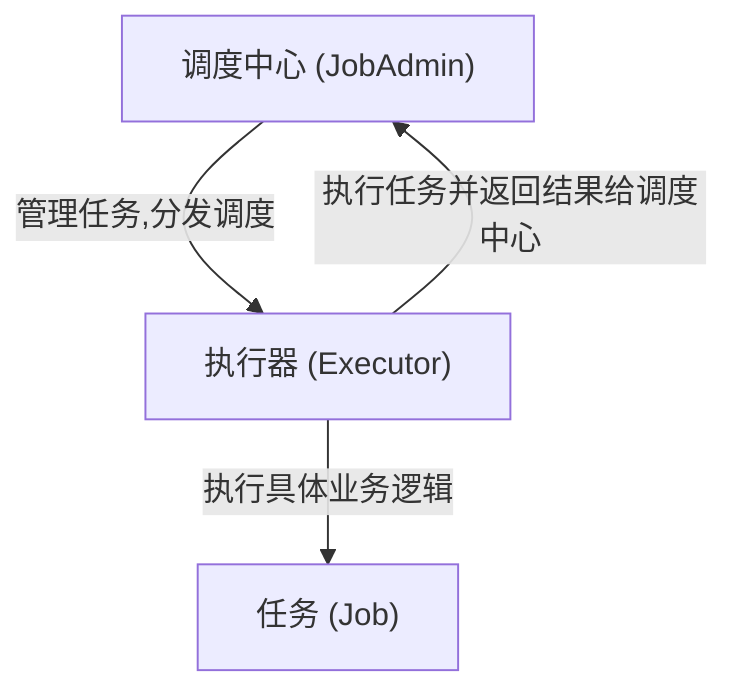
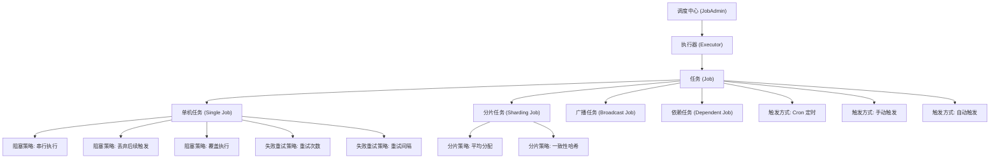

# XXL-JOB

## 调度中心 & 执行器

**是的，完全是两个独立的服务，职责分开，部署也分开**

> XXL-JOB核心设计：**调度中心（admin）只管调度；执行器（executor）执行业务任务**

调度中心和执行器是两套独立组件，职责解耦。调度中心负责任务管理、定时下发调度指令，**不执行业务代码**；执行器集成在业务项目中，接收调度请求运行任务，执行完上报结果。

### 1. 调度中心：xxl-job-admin（独立服务）

职责：**任务管理 + 触发调度 + 日志存储 + 告警**，**不跑业务代码**

- 存储：MySQL（存放任务配置、执行器注册信息、调度日志、锁表）
- Web后台，我们在页面上新建任务、配置cron、看日志、配置告警
- 到时间点，挑选执行器节点，**发HTTP请求调用执行器**
- 集群部署靠`xxl_job_lock`行锁，防止同一个任务重复调度
- 它只是**发指令**，不会执行你的业务JobHandler

### 2. 执行器 Executor（嵌入在你的业务SpringBoot项目）

职责：**接收调度指令，执行业务任务代码**

- 就是你的订单服务/库存服务，引入xxl-job-core依赖，写`@XxlJob`任务方法
- 内置一个小型Jetty HTTP服务（默认9999端口），用来接收admin的调度请求
- 启动后主动注册IP端口到调度中心，每30s上报心跳
- 收到调度请求，运行JobHandler；执行完成，回调admin上报成功/失败结果

### 3. 两者通信关系

1. **执行器主动注册（执行器 → 调度中心）**
   业务项目启动，主动把自己IP、端口、appname上报存入admin的`xxl_job_registry`表，持续心跳保活。
2. **调度中心下发调度指令（调度中心 → 执行器）**
   到cron时间，admin发起HTTP请求，调用执行器jetty端口，触发任务。
3. **执行器上报执行结果（执行器 → 调度中心）**
   任务跑完，执行器回调admin，上报执行状态、日志。

### 4. 形象类比（方便记忆）

- **调度中心 = 老板**：负责排工作计划（cron），到点打电话安排干活；自己不干活。
- **执行器 = 员工（业务服务）**：等着老板打电话，收到指令执行任务；干完汇报结果。

### 5. 重要面试考点

#### Q：调度中心挂了，已经在执行的任务会中断吗？

**不会**。任务一旦下发给执行器，业务代码是在执行器本地跑；调度中心宕机，**不影响正在运行中的任务**，只是不再产生新调度。等admin恢复，调度继续。

#### Q：执行器挂了，会怎么样？

执行器停止后，不再上报心跳；90s后调度中心标记这个实例离线。路由策略如果是故障转移，下次调度会选其他存活执行器节点。

#### Q：能不能调度中心和执行器放同一个服务？

技术上可以，但生产不推荐。admin是中心化调度管理，业务执行器是业务应用，职责隔离，分开部署更稳定。

### 6. 核心区别汇总表

|                  | 调度中心 xxl-job-admin       | 执行器 Executor                  |
| ---------------- | ---------------------------- | -------------------------------- |
| 部署             | 独立服务                     | 嵌入业务SpringBoot项目           |
| 核心职责         | 任务配置、定时触发、日志告警 | 执行业务任务JobHandler           |
| 是否执行业务代码 | ❌不执行                      | ✅执行                            |
| 数据库           | 持有XXL-JOB整套MySQL表       | **不需要单独数据库，复用业务库** |
| 网络角色         | 主动调用方                   | 被动接收HTTP请求                 |
| 端口             | admin服务端口（如8080）      | 内置Jetty（默认9999）            |


## XXL-JOB 概念

1. **触发方式**：Cron、固定速率、固定延迟、手动、API触发
2. **调度模式**：调度类型（触发时机）+运行模式
3. **任务类型**：BEAN、GLUE、HTTP任务
4. **执行策略**：路由策略、阻塞策略、失败重试策略

### XXL-JOB 任务类型

（运行模式，面试标准版）

> 任务类型，就是后台新建任务里的**运行模式**，决定任务代码在哪写、在哪跑。一共两大类：**BEAN任务、GLUE任务**，GLUE下面细分多种脚本。另外还有独立的HTTP任务。

#### 1. BEAN（最常用，Java业务任务）

- 开发方式：业务项目写Java方法，加`@XxlJob("handlerName")`，交给Spring管理
- 执行位置：在执行器JVM线程内运行，共享Spring容器，可以直接注入Service、Mapper
- 更新：改代码需要重新打包发布业务服务
- 适用：正式业务定时任务（订单统计、对账、数据同步）

```java
@XxlJob("orderStatHandler")
public void orderStatHandler(){
    //业务逻辑
}
```

#### 2. GLUE系列（在线脚本，代码写在调度中心后台）

> GLUE代码保存在admin，调度下发后，**仍然在执行器机器执行**。不用发布业务服务，保存即时生效。

1. **GLUE(Java/Groovy)**：在线写Java代码片段，可拿到执行器SpringBean；临时简单Java逻辑
2. **GLUE(Shell)**：Linux脚本，运维常用，清理日志、服务器命令
3. **GLUE(Python)**：python脚本
4. **GLUE(NodeJS)**
5. **GLUE(PHP)**
6. **GLUE(PowerShell)**：Windows脚本

✅优点：快速调试、临时运维脚本，**无需发布业务应用**
❌缺点：版本管理弱，复杂业务不推荐；脚本会fork子进程，资源开销更大

#### 3. HTTP任务（无执行器，独立类型）

调度中心直接发起HTTP请求调用外部接口，**不需要部署xxl-job执行器**。

- 调度中心主动发起GET/POST调用目标url
- 跨语言，调用第三方服务，非Java项目也能接入
- 缺点：无法使用执行器的分片广播、本地日志等能力

#### 补充特殊任务能力（不是任务类型，面试容易混）

- **分片广播任务**：不是独立任务类型，**是路由策略**，BEAN/GLUE都可以开启分片广播
- **父子任务**：任务依赖，父任务执行成功自动触发子任务，属于任务配置，不是任务类型

#### 对比汇总

| 任务类型 | 代码位置          | 执行环境                     | 是否需要发布服务 | 适用场景                     |
| -------- | ----------------- | ---------------------------- | ---------------- | ---------------------------- |
| BEAN     | 业务执行器项目    | 执行器JVM线程                | 需要打包发布     | 业务定时任务，推荐生产       |
| GLUE脚本 | xxl-job-admin后台 | 执行器机器进程（脚本子进程） | 不需要发布       | 运维脚本、临时任务、快速验证 |
| HTTP任务 | 后台配置url       | 调度中心直接调用             | 不需要执行器     | 调用外部接口，跨语言系统     |

#### 面试高频问答

##### Q：GLUE代码存在调度中心，是admin执行代码吗？

不是。脚本代码存在admin，调度下发给执行器，**代码在执行器机器运行**。

##### Q：BEAN任务和GLUE Java任务的区别？

BEAN代码在业务项目，版本管理规范，适合正式业务；GLUE Java在后台在线编辑，不用发布，适合临时简单逻辑。

##### Q：HTTP任务需要业务项目集成xxl-job-core吗？

不需要，**不用部署执行器**，调度中心直接发http请求访问目标接口。

#### 一句话背诵

XXL-JOB任务类型包含BEAN、GLUE系列脚本、HTTP任务。BEAN写在业务项目`@XxlJob`，生产业务首选；GLUE脚本在后台在线编写，无需发布服务；HTTP任务由调度中心直接调用接口，不需要执行器。分片广播属于路由策略，不是任务类型。

> 前面我们梳理了：触发方式、调度模式、任务类型、路由策略、阻塞策略。要不要把这一整套合并成一页XXL-JOB面试速记小抄？


### XXL-JOB 执行策略

> 执行策略包含三块：**路由策略、阻塞策略、失败重试策略**，这三个统称为任务执行策略，面试官问“执行策略”一般就是问这三类。

#### 一、路由策略：多执行器集群，选哪些节点执行任务

调度中心拿到所有在线执行器实例，按策略挑选节点下发调度请求。

1. **FIRST（第一个）**：选中注册列表里第一个存活执行器
2. **LAST（最后一个）**：选中最后一个存活执行器
3. **ROUND（轮询）**：轮流分发，负载均衡，常用
4. **RANDOM（随机）**：随机挑选一台机器
5. **CONSISTENT_HASH（一致性HASH）**：任务参数hash，相同参数固定落到同一台机器；适合**有状态任务**
6. **LEAST_FREQUENTLY_USED（最不经常使用）**：选近期执行次数最少的机器
7. **LEAST_RECENTLY_USED（最近最久未使用）**：选很久没执行任务的机器
8. **FAILOVER（故障转移，高可用推荐）**：顺序探测执行器，找到第一个存活节点；当前节点宕机自动切其他机器
9. **BUSYOVER（忙碌转移）**：探测执行器，选择空闲节点，避开正在跑任务的机器
10. **SHARDING_BROADCAST（分片广播）**：**所有在线执行器全部执行**，每个节点携带分片参数`shardIndex`、`shardTotal`，大数据批量处理

> ⚠️分片广播是路由策略，**不是任务类型、不是触发方式**

#### 二、阻塞处理策略（单机策略！仅针对单台执行器内部）

同一台执行器，上一轮任务**还没执行完成**，新调度请求又来了，如何处理新来的请求。

1. **SERIAL_EXECUTION 单机串行（默认）**
   新调度请求进入队列排队，串行执行。同一个执行器不会并发跑同一个任务。
   适用：绝大多数业务任务。
2. **DISCARD_LATER 丢弃后续调度**
   上一轮未结束，直接**丢弃本次新调度**，不执行。
   适用：报表任务，任务跑不完，这一轮直接跳过，等下一个周期。
3. **COVER_EARLY 覆盖之前调度**
   终止正在运行的任务，直接执行本次新调度。
   慎用，强行中断业务，可能造成数据异常。

> 重点：阻塞策略**只作用单机**，不能控制多台执行器之间的并发。跨机器并发要业务自己做幂等/分布式锁。

#### 三、失败重试策略

任务执行失败后的重试规则，在任务页面配置重试次数、重试间隔。

1. 调度下发HTTP请求失败（网络超时、执行器失联）：调度中心侧重试调度，重新路由选节点下发请求
2. 业务代码抛出异常（执行器内业务报错）：执行器上报失败，调度中心按配置重试
3. 分片广播任务：支持分片粒度重试，只重试失败的分片节点，不用全部重跑

> 重要：重试会重复下发调度请求，**业务代码必须保证幂等**

#### 高频面试题

##### Q：阻塞策略是全局的吗？

不是，**单机维度**。集群多个执行器，多台机器可以并行执行同一个任务，阻塞策略拦不住跨机器并发。

##### Q：故障转移什么时候生效？

调度中心调用执行器HTTP失败（机器宕机、网络不通），路由策略为FAILOVER，自动探测下一个存活节点重新下发。**任务执行中途抛业务异常不属于故障转移**。

##### Q：分片广播的分片数量会动态变化吗？

会。新增/下线执行器实例，下一次调度`shardTotal`自动更新。

##### 一句话背诵

XXL-JOB执行策略分为路由策略、阻塞策略、失败重试策略。路由策略用来在执行器集群选择执行节点；阻塞策略处理单机上任务未完成又来了新调度的场景；失败重试策略定义任务失败自动重试规则；跨执行器并发控制需要业务自行保证幂等。


### XXL-JOB 任务触发方式

XXL-JOB一共**4种触发方式**：Cron触发、固定速率/固定延迟触发、手动触发、API触发。

#### 1. Cron触发（最常用，定时触发）

后台调度类型选 `CRON`，填写cron表达式（如`0 0 2 * * ?`凌晨2点）

- 逻辑：调度中心内部线程扫描任务表，到达cron时间点，发起调度，下发HTTP请求到执行器
- 特点：**基于日历时间**，不受上一次任务执行时长影响；到点就尝试发起调度；
- 适用：凌晨报表、数据归档、每日对账

> 注意：如果上一轮任务还在跑，新调度请求来了，由**执行器的阻塞策略**决定怎么处理（串行/丢弃/覆盖）

#### 2. 固定速率 / 固定延迟（相对时间）

调度类型：`固定速率`、`固定延迟`

1. **固定速率 FIX_RATE**

   > 间隔是**任务开始时间**为基准。例如间隔60s：0s启动任务，不管任务跑多久，下一次在60s发起调度。
   > ⚠️ 如果任务执行超过间隔，会受阻塞策略限制。

2. **固定延迟 FIX_DELAY**

   > 间隔是**任务结束时间**为基准。任务跑完，等待N秒，再触发下一次。
   > 不会并发，适合任务执行时长波动大的场景。

> 对比：Cron是**绝对日历时间**；固定速率/延迟是**相对时间**。

#### 3. 手动触发（后台页面【执行】按钮）

跳过时间判断，**直接执行调度全流程**：抢锁、路由、http下发请求

- 用途：开发调试、临时跑任务、紧急补数据
- 特点：一次性触发，不影响原有定时规则

#### 4. API触发（平台外部调用接口触发）

调度中心提供开放API，第三方系统通过HTTP请求调用调度中心，触发任务。

> 例如订单系统完成业务后，调用XXL-JOB的api，触发数据统计任务。

- 需要开启accessToken鉴权
- 适合：事件驱动场景，**不是按时间，而是业务事件触发任务**

#### 补充区分：路由策略不是触发方式！

路由策略（轮询、故障转移、分片广播）是**调度中心选执行器节点的策略**，不属于触发方式。

#### 面试高频问题

##### Q：固定速率和固定延迟区别？

- 固定速率：以上一次**任务开始时刻**计时；
- 固定延迟：以上一次**任务结束时刻**计时。

##### Q：API触发是调度中心主动发起吗？

外部请求调用调度中心API → 调度中心收到请求，然后发起调度，和手动触发底层逻辑一致。

##### Q：这4种触发，执行器侧有没有区别？

**执行器无感知**。不管是Cron、手动、API、固定速率，最终都是admin发HTTP请求，执行器收到请求执行JobHandler。

#### 一句话背诵

XXL-JOB四种触发：Cron定时（绝对时间）、固定速率/固定延迟（相对时间）、后台手动触发、开放API触发；所有触发最终都是调度中心下发HTTP请求，执行器被动执行任务。


### XXL-JOB 调度模式

（面试区分：**调度类型（触发时间）** + **运行模式（任务代码放哪）**，很多面试官问的“调度模式”实际包含这两块）

> 注意名词区分：
>
> 1. **调度类型**：什么时候触发任务（时间维度，就是前面讲的触发方式）
> 2. **运行模式**：任务代码存在哪里、在哪执行（任务执行模式，面试高频叫“调度运行模式”）

#### 一、调度类型（时间调度模式，后台下拉框）

1. **CRON**（最常用）
   按日历时间定时调度，`0 0 2 * * ?` 每天凌晨2点。到点调度中心发起调度；不受上一轮任务执行时长影响。
2. **固定速率 FIX_RATE**
   以上一次**调度开始时刻**计算间隔；不管任务跑多久，到间隔就尝试发起下一次调度。
3. **固定延迟 FIX_DELAY**
   以上一次**任务执行结束时刻**开始计时；任务跑完，等待N秒，再调度下一次，天然不会并发。
4. **无**：不会自动定时触发，只能手动触发 / API触发（事件任务）

> 补充：**调度过期策略（错过时间怎么处理）**
>
> - 忽略：错过的调度直接丢掉（默认）
> - 立即补偿触发一次：admin重启，补上错过那一次

#### 二、运行模式（任务代码存放模式，重点！面试常问）

##### 1. BEAN模式（生产最常用）

任务代码写在**业务执行器项目**里，`@XxlJob("handlerName")` 定义JobHandler；后台填写JobHandler名称绑定任务。

- 代码在业务服务，需要打包发布才能更新任务
- 可以直接注入Spring Bean、Service，操作业务数据库
- 适合正式业务定时任务

##### 2. GLUE模式（源码托管在调度中心）

代码写在xxl-job-admin后台页面，**不用发布业务服务，在线编辑，实时生效**；底层是groovy动态编译，代码仍然在**执行器进程**里运行。
细分GLUE：

- GLUE(Java)：Java代码，可注入执行器SpringBean
- GLUE(Shell)：shell脚本
- GLUE(Python/PHP/Node/PowerShell)：各类脚本
  ✅优点：临时任务、快速调试，不用重新部署服务
  ❌缺点：代码不好版本管理，复杂业务不推荐

#### 三、架构调度模型（中心化调度模式，底层调度架构）

XXL-JOB整体是**中心化推送调度模式**

- 调度中心（admin）统一管理任务、计算触发时间、抢锁、选执行器节点
- 调度中心通过HTTP**推送调度请求**给执行器
- 执行器被动接收请求，执行任务，执行完成回调上报结果

对比：ElasticJob是**去中心化拉取模式**，执行器自己去ZK抢任务。

#### 四、配套策略（和调度模式配合，别混淆）

1. **路由策略**：集群多个执行器，选哪些机器执行任务（轮询、故障转移、分片广播等）
2. **阻塞策略**：单机上一个任务未跑完，新调度请求到达如何处理（单机串行、丢弃后续、覆盖之前）

#### 五、面试高频问答

##### Q：BEAN和GLUE模式核心区别？

BEAN：任务代码在业务执行器项目，@XxlJob，需要发布；
GLUE：代码保存在调度中心后台，在线编辑动态生效，无需重启业务服务；**两种模式代码最终都在执行器进程执行**。

##### Q：GLUE代码存在admin，是admin直接运行代码吗？

不是。代码保存在admin，调度下发后，**执行器接收源码并在执行器JVM中执行**。

##### Q：中心化推送调度是什么意思？

调度中心主动把调度指令推给执行器，执行器被动等待调用；区别于执行器主动去抢任务的拉取模型。

#### 一句话背诵版

XXL-JOB调度分为**调度类型**和**运行模式**。调度类型控制触发时机，包含Cron、固定速率、固定延迟；运行模式分BEAN模式（代码写在业务项目@XxlJob）、GLUE模式（后台在线脚本）。底层架构是**中心化推送调度**，调度中心统一计算时间，HTTP推送任务到执行器执行。

要不要把：**调度模式、触发方式、路由策略、阻塞策略**合并成一页精简面试小抄？

### XXL-JOB 日志与监控

#### 一、日志体系

XXL-JOB日志分为**调度日志**、**执行器业务日志**两块。
##### 1. 调度日志（保存在xxl-job的MySQL，`xxl_job_log`表）

由调度中心维护，记录**每一次调度事件**：
- 任务ID、JobHandler、触发时间、执行器地址、调度结果、执行耗时
- 触发来源：Cron/手动/API
- 状态：运行中、成功、失败
> 这里**不会存业务打印的详细日志**，只存调度元信息。

##### 2. 执行器运行日志（业务日志）

业务代码通过 `XxlJobHelper.log("xxx")` 打印，**临时存执行器本地文件**（配置 `xxl.job.executor.logpath`）。
调度中心会**在线读取执行器本地日志文件**，在后台页面展示。
> 配置 `logretentiondays` 日志保留天数，到期自动清理本地日志文件。

⚠️关键点：
1. 如果执行器机器宕机，**未同步到后台的业务日志会丢失**（日志文件在执行器本地）
2. `System.out` 打印内容**不会被XXL-JOB采集**，必须用 `XxlJobHelper.log()`
3. 日志分页查看，支持实时滚动查看正在运行任务的日志

#### 二、监控能力

##### 1. 基础监控（后台自带）

1. **执行器在线状态监控**
执行器每30s上报心跳；90s无心跳，标记离线。在【执行器管理】页面查看在线实例。底层表`xxl_job_registry`。

2. **调度记录监控**
调度日志列表，可筛选成功/失败任务；查看每次调度的结果、耗时。

3. **任务运行状态监控**
识别正在运行中的任务，支持后台手动终止任务。

##### 2. 告警监控（失败告警）

任务执行失败，可配置多种告警渠道：**邮件、钉钉机器人、企业微信机器人**
- 触发条件：任务调度失败，达到阈值后推送告警消息
- 告警内容：任务名称、失败原因、调度时间、执行器地址

> 注意：**执行器离线本身默认不会告警，需要自己扩展**；只有任务调度失败才会触发告警。

#### 三、运维相关

1. 日志清理：`logretentiondays`，执行器自动删除过期本地日志文件，避免磁盘打满。
2. 调度日志（mysql `xxl_job_log`）**不会自动清理**，量大需要手动写定时任务归档/删除，否则mysql表越来越大，影响调度性能。
3. 日志查看链路：后台点击【日志】→调度中心发起HTTP请求，远程读取执行器本地日志文件返回页面。

#### 四、面试高频问题

##### Q：调度日志和业务日志分别存在哪里？

调度元日志在调度中心MySQL（xxl_job_log）；业务日志在**执行器本地磁盘文件**，调度中心远程读取展示。

##### Q：System.out.println的日志在XXL后台能看到吗？

不能。必须使用`XxlJobHelper.log()`，框架才会捕获写入本地日志文件。

##### Q：执行器离线会不会自动告警？

原生不支持。原生仅**任务执行失败告警**；执行器离线告警需要二次开发，轮询注册表`xxl_job_registry`检测离线实例。

##### Q：xxl_job_log表会自动清理吗？

**不会自动清理**。业务量大时，日志表持续膨胀，建议自己写定时任务归档。

##### Q：查看日志时如果执行器断网会怎么样？

后台查看日志会失败，**无法读取业务日志**，只能看到调度记录标记失败。

#### 一句话背诵

XXL-JOB日志分为调度日志（存储在调度中心MySQL，记录调度元数据）和业务日志（执行器本地磁盘，通过`XxlJobHelper.log`打印，调度中心远程拉取查看）。监控包含执行器心跳监控、调度记录监控；任务失败支持钉钉/邮件告警；调度日志表不会自动清理，业务日志可配置自动过期删除。

> 现在XXL-JOB整套知识点：触发方式、调度模式、任务类型、执行策略、日志监控，全部梳理完了。
> 需要我整理**XXL-JOB面试完整口述版本**（连贯一段，直接背）吗？


## XXL-JOB

（许雪里开源轻量分布式任务调度）

### 一、简介

XXL-JOB 是大众点评许雪里开源的**中心化分布式定时任务调度平台**，目标：简单、轻量、开箱即用，解决原生`@Scheduled`集群重复执行、无监控、无失败重试、无法动态管理任务的痛点。

> 核心设计思想：**调度中心 和 执行器解耦**
>
> - 调度中心（xxl-job-admin）：只负责**触发调度、任务管理、日志监控**，**不执行业务代码**
> - 执行器：嵌入业务SpringBoot应用，接收调度中心HTTP请求，执行业务任务JobHandler

通信方式：调度中心通过HTTP调用执行器；执行器执行完成后回调调度中心上报结果。
执行器启动后主动注册到调度中心，**每30s心跳保活**，90s无心跳标记离线。

#### 核心组件

| 组件                     | 作用                                                         |
| ------------------------ | ------------------------------------------------------------ |
| **调度中心（JobAdmin）** | 提供 Web 界面，管理任务、分发调度，监控任务执行状态。        |
| **执行器（Executor）**   | 真正执行任务的节点，接收调度中心分发的任务并返回结果。       |
| **任务（Job）**          | 定义具体业务逻辑的任务单元，包括任务代码、Cron 表达式和执行策略。 |

### 二、整体架构两大模块

#### 1）调度中心 xxl-job-admin（独立服务）

- Web可视化后台：任务CRUD、启停、手动触发、日志查看、告警、执行器管理
- 调度触发：基于MySQL锁表`xxl_job_lock`实现**集群HA**，多admin节点部署时，**同一个任务同一时刻只会被一个节点调度，防止重复调度**
- 存储：MySQL，8张核心表（任务、执行器分组、注册信息、调度日志、锁表等）
  - `xxl_job_info`：任务配置（cron、路由、重试、超时）
  - `xxl_job_group`：执行器分组
  - `xxl_job_registry`：执行器注册、心跳表
  - `xxl_job_log`：调度执行日志
  - `xxl_job_lock`：调度中心集群锁，防止多节点同时触发同一个任务

#### 2）执行器 Executor（业务项目集成SDK）

业务服务引入xxl-job-core依赖，通过`@XxlJob("handlerName")`定义任务处理器JobHandler。

```java
@XxlJob("demoJobHandler")
public void demoJobHandler(){
    XxlJobHelper.log("执行任务");
}
```

执行器内部：每个JobHandler对应独立JobThread，内部维护队列接收调度请求。

### 三、完整调度执行流程

1. 执行器启动，自动向调度中心注册IP端口，持续心跳上报
2. 在调度中心后台新建任务：绑定执行器分组、cron表达式、路由策略、阻塞策略
3. 调度中心定时扫描任务，到达触发时间：
   1. 获取`xxl_job_lock`行锁，保证集群只有一个admin节点触发任务
   2. 根据**路由策略**从在线执行器列表选中目标节点
   3. HTTP发送调度请求到执行器，携带任务参数
4. 执行器收到请求，交给对应JobHandler线程池执行业务代码
5. 任务执行完成（成功/失败），执行器回调调度中心上报执行结果、日志
6. 调度中心记录日志，失败则按配置重试，失败可邮件/钉钉告警

### 四、核心功能点（面试高频）

#### 1. 路由策略（执行器集群多节点，怎么选机器执行任务）

1. **FIRST 第一个**：选择注册列表第一个存活节点

2. **LAST 最后一个**

3. **ROUND 轮询**：常用，负载均衡

4. **RANDOM 随机**

5. **CONSISTENT_HASH 一致性哈希**：相同任务参数固定打到同一台机器（适合有状态任务）

6. **LEAST_FREQUENTLY_USED 最不经常使用**

7. **LEAST_RECENTLY_USED 最近最久未使用**

8. **FAILOVER 故障转移（高可用首选）**：顺序探测执行器，选第一个存活节点；机器宕机自动切其他节点

9. **BUSYOVER 忙碌转移**：顺序探测，选**空闲**的执行器

10. **SHARDING_BROADCAST 分片广播（重点！）**

    > 一次调度，**集群所有在线执行器全部触发执行**，每个节点自带分片参数：
    > `shardIndex`：当前机器分片序号（从0开始）
    > `shardTotal`：集群总执行器数量
    > 业务代码：`if(id % shardTotal == shardIndex)`做数据分片处理。
    > 特点：**动态分片**，扩容执行器节点，下一次任务分片数量自动增加；适合大数据批量同步、对账、归档。

#### 2. 阻塞处理策略（任务调度密集，上一轮任务还没跑完，新一轮调度又来了）

三个策略（**单机维度，只对当前执行器生效**）

1. **单机串行（默认SERIAL_EXECUTION）**：调度请求放入队列排队，串行执行；不会并发跑同一个任务。
2. **丢弃后续调度 DISCARD_LATER**：上一轮未结束，直接丢弃本次新调度请求。适合不允许重复跑的任务。
3. **覆盖之前调度 COVER_EARLY**：终止正在运行的任务，直接执行本次新调度。慎用，会打断业务。

> ⚠️注意：阻塞策略是单机策略，**不能全局保证任务幂等**；多执行器集群，多个节点可以同时执行任务。业务自己要保证幂等。

#### 3. 任务超时 & 失败重试

- 任务超时：可配置超时时间，超时自动中断任务
- 失败重试：任务执行失败，支持配置重试次数、重试间隔；分片任务支持分片粒度重试
- 支持手动触发任务、停止任务、终止运行中的任务，Web后台动态修改任务，实时生效

### 五、任务类型

1. Bean任务（最常用）：@XxlJob注解Java方法
2. GLUE任务：在线后台写Java代码，不用发布服务，动态更新
3. 命令行任务：执行Shell脚本
4. HTTP任务：调用HTTP接口
5. 分片广播任务（上面讲的）

### 六、高可用说明

1. **调度中心HA**：多节点部署，依靠MySQL锁表`xxl_job_lock`，保证同一个任务只会被一个调度节点触发。调度中心挂一个，其余节点继续调度。
2. **执行器HA**：执行器集群，故障转移路由下，节点宕机自动切换其他存活节点；执行器无状态，可以横向扩容。

> 缺点：**中心化架构**，调度中心是单点风险（集群部署可解决，但依赖MySQL，如果MySQL宕机整个调度不可用）

### 七、优缺点

✅优点

1. 可视化Web后台，任务管理、日志、告警，运维友好
2. 轻量，接入简单，SpringBoot集成方便
3. 支持分片广播，大批量数据任务并行处理
4. 丰富路由、阻塞策略、失败重试、超时控制
5. 执行器自动注册，机器上下线自动感知
6. 支持GLUE、Shell、HTTP多种任务类型

❌缺点

1. **中心化架构**，调度中心依赖MySQL，数据库是单点瓶颈；数据库压力大时调度性能下降
2. 阻塞策略是单机级别，无法全局防并发，**业务必须自己保证幂等**
3. 分片广播：一次调度全部节点执行，要小心数据分片逻辑写错导致重复处理
4. 长任务不友好，任务长时间占用线程池

### 八、面试高频问题整理

#### Q1：XXL-JOB和Spring @Scheduled区别？

1. @Scheduled单机，集群多实例会重复执行；XXL-JOB分布式，调度中心统一下发任务
2. @Scheduled无Web管理，不能动态启停、查看日志、失败告警、重试
3. XXL-JOB支持分片广播，大数据并行处理

#### Q2：XXL-JOB 和 Elastic-Job区别

- XXL-JOB：**中心化**，admin调度中心主动推任务给执行器；简单易用，国内使用更广
- Elastic-Job：**去中心化**，基于zookeeper，执行器自己抢任务；适合超大规模复杂分片场景，较重

#### Q3：分片广播原理？

调度中心拿到全部在线执行器列表，一次调度向所有执行器发送请求；每个执行器拿到shardIndex、shardTotal，业务代码按分片参数拆分数据。扩容节点，分片总数自动变大。

#### Q4：阻塞策略三种分别什么时候使用？

1. 单机串行：默认，大部分场景，防止单机同一个任务并发
2. 丢弃后续：定时报表，任务没跑完，新周期直接跳过
3. 覆盖之前：极少场景，需要立刻执行最新任务，强行终止旧任务

#### Q5：为什么XXL-JOB任务业务代码必须做幂等？

1. 网络抖动，调度中心可能重复下发调度请求
2. 故障转移场景，机器处理一半宕机，其他节点重新执行任务

> 幂等方案：业务状态表，处理前判断状态，已经处理直接跳过。

#### Q6：调度中心集群怎么保证不会重复调度？

依赖mysql `xxl_job_lock` 行锁。任务触发前尝试获取锁，拿到锁才执行调度；同一任务同一时刻只能一个admin节点拿到锁。

### 九、简单集成示例

1. maven引入xxl-job-core
2. yml配置调度中心地址、执行器appname

```yaml
xxl:
  job:
    admin:
      addresses: [http://127.0.0.1:8080/xxl-job-admin](http://127.0.0.1:8080/xxl-job-admin)
    executor:
      appname: order-executor
```

3. 编写JobHandler

```java
@XxlJob("orderSyncJobHandler")
public void orderSyncJob(){
    XxlJobHelper.log("开始同步订单");
}
```

4. admin后台新增任务，JobHandler填`orderSyncJobHandler`，配置cron表达式。


如果你想，我可以对比：**XXL-JOB、ElasticJob、PowerJob**三者对比，面试常考。


## XXL-JOB 使用完整流程

整体分为 5 大阶段：**调度中心部署 → 业务项目集成执行器 → 开发JobHandler任务代码 → 管理后台配置任务 → 运行监控与运维**

### 一、准备工作：部署 xxl-job-admin（调度中心）

> 调度中心是独立服务，**只负责任务调度、管理、日志存储，不执行业务代码**

1. 准备MySQL，执行XXL-JOB提供的初始化sql脚本，创建8张表（`xxl_job_info`、`xxl_job_group`、`xxl_job_registry`、`xxl_job_log`、`xxl_job_lock`等）
2. 拉取XXL-JOB源码，打包`xxl-job-admin`模块，或者直接使用官方打好的jar包
3. 修改admin配置文件：
   - MySQL连接地址、账号密码
   - 访问端口
4. 启动`xxl-job-admin`，访问Web后台（默认账号密码：admin / 123456）

> 集群部署：启动多个admin实例，**共用同一个MySQL**，依靠`xxl_job_lock`行锁保证任务不会被重复调度。

### 二、业务项目集成【执行器Executor】

#### 1. 引入Maven依赖

```xml
<dependency>
    <groupId>com.xuxueli</groupId>
    <artifactId>xxl-job-core</artifactId>
    <version>2.4.0</version>
</dependency>
```

#### 2. yml/application.properties配置执行器

```yml
xxl:
  job:
    # 调度中心地址，多个用逗号分隔
    admin:
      addresses: [http://127.0.0.1:8080/xxl-job-admin](http://127.0.0.1:8080/xxl-job-admin)
    # 当前执行器配置
    executor:
      appname: order-executor  # 执行器名称【重要！后台新增执行器分组要用】
      ip:                      # 不填自动获取本机IP
      port: 9999               # 执行器内嵌jetty端口，接收调度中心http请求
      logpath: /data/xxljob/log
      logretentiondays: 30     # 日志保留天数
```

#### 3. 配置XXL-Job配置类

```java
@Configuration
public class XxlJobConfig {
    @Value("${xxl.job.admin.addresses}")
    private String adminAddresses;
    @Value("${xxl.job.executor.appname}")
    private String appName;
    @Value("${xxl.job.executor.port}")
    private int port;

    @Bean
    public XxlJobSpringExecutor xxlJobExecutor() {
        XxlJobSpringExecutor xxlJobSpringExecutor = new XxlJobSpringExecutor();
        xxlJobSpringExecutor.setAdminAddresses(adminAddresses);
        xxlJobSpringExecutor.setAppname(appName);
        xxlJobSpringExecutor.setPort(port);
        return xxlJobSpringExecutor;
    }
}
```

#### 4. 编写任务处理器 JobHandler

使用`@XxlJob("handler名称")`标记方法，**方法名随便，注解内name是唯一标识，后台填写**

```java
@Component
public class OrderJob {

    /**
     * JobHandler名称：orderSyncHandler，后台任务配置要填这个
     */
    @XxlJob("orderSyncHandler")
    public void orderSyncHandler() {
        // 任务业务逻辑
        XxlJobHelper.log("订单同步任务开始执行");
        try {
            // 业务代码，例如：同步历史订单
            // 支持获取任务参数 String param = XxlJobHelper.getJobParam();
            String jobParam = XxlJobHelper.getJobParam();
            XxlJobHelper.log("任务参数:" + jobParam);

            // 业务成功
            XxlJobHelper.handleSuccess("任务执行成功");
        } catch (Exception e) {
            XxlJobHelper.log("任务异常",e);
            // 标记任务失败
            XxlJobHelper.handleFail("任务执行失败");
        }
    }
}
```

> 要点：
>
>
> 1. 类必须加`@Component`交给Spring管理
> 2. `@XxlJob`的name全局唯一，后台绑定任务时填写
> 3. 使用`XxlJobHelper.log()`打印日志，可以在后台日志页面查看
> 4. `XxlJobHelper.handleSuccess / handleFail`主动上报任务结果；如果方法抛异常，框架自动标记失败

#### 5. 启动业务项目（执行器）

项目启动后，执行器会**主动注册到调度中心**，每30s发送心跳包。

> 后台【执行器管理】页面，可以看到这个`order-executor`分组下的在线机器IP。
> 如果看不到：检查网络、端口9999是否开放、appname是否一致。

### 三、在XXL-JOB后台配置任务

#### Step1：执行器管理 → 新增执行器分组

- AppName：填写业务项目yml配置的`appname`，本例`order-executor`
- 执行器类型：选择【自动注册】
  保存。此时在线实例列表会显示你的业务服务节点。

#### Step2：任务管理 → 新增任务

核心配置项：

1. **执行器**：选中刚刚创建的`order-executor`分组
2. **JobHandler**：`orderSyncHandler`（和代码注解@XxlJob里的名字完全一致）
3. **任务描述**：订单同步任务
4. **调度类型**
   - Cron：定时调度（最常用，例如`0 0 2 * * ?`每天凌晨2点执行）
   - 固定速度、固定延迟
5. **路由策略**：轮询/故障转移/分片广播等
6. **阻塞处理策略**：单机串行（默认）
7. **任务超时时间**：单位s，超过自动终止任务
8. **失败重试次数、重试间隔**
9. 任务参数：可以预先传入参数，代码通过`XxlJobHelper.getJobParam()`获取

保存任务。此时任务默认是**停止状态**。

### 四、任务运行测试

1. 点击任务后面【操作】→ **启动**，任务生效，等待cron自动调度；
2. 也可以点击【执行】手动触发任务，立即跑一次，用于测试；
3. 执行之后，查看【调度日志】
   - 日志状态：成功 / 失败
   - 查看执行详情、XxlJobHelper打印的业务日志
   - 如果失败，可以看异常栈；配置了重试会自动重试。

> 手动执行适合开发阶段调试任务，上线靠cron定时触发。

### 五、运维与异常处理

1. 日志：后台调度日志查看执行记录；业务日志持久化在配置的logpath目录
2. 告警：任务连续失败，支持配置邮件、钉钉、企业微信告警
3. 动态修改：后台修改cron、参数，**不用重启业务服务，实时生效**
4. 终止任务：如果任务卡死，可以后台【终止】正在运行中的任务
5. 扩容：新增一台业务实例（同一个appname），执行器自动注册，路由策略自动识别新节点

### 六、分片广播任务额外配置（大数据场景）

1. 后台任务路由策略选择：`分片广播`
2. 代码获取分片参数

```java
@XxlJob("shardJobHandler")
public void shardJobHandler(){
    int shardIndex = XxlJobHelper.getShardIndex(); // 当前分片号，从0开始
    int shardTotal = XxlJobHelper.getShardTotal(); // 总执行器数量
    XxlJobHelper.log("分片："+shardIndex + "/" + shardTotal);
    // 业务：根据id取模，拆分数据，每个节点处理一部分数据
}
```

> 分片广播：调度触发后，**所有在线执行器全部执行**。

### 七、完整时序梳理（面试口述流程）

1. 部署独立的xxl-job-admin调度中心，初始化mysql表；
2. 业务服务引入xxl-job-core，配置执行器appname，编写@XxlJob任务方法；
3. 业务服务启动，执行器自动注册、心跳上报到admin；
4. admin后台创建执行器分组，新建定时任务，绑定JobHandler名称、cron；
5. 启动任务，到达cron时间点，admin获取mysql锁，选中执行器节点，http下发调度请求；
6. 执行器收到请求，执行JobHandler业务代码；
7. 执行完成，执行器回调admin上报成功/失败，日志入库；
8. 失败则按配置自动重试，可配置告警。

### 八、踩坑清单（面试/实操高频坑）

1. @XxlJob的name和后台JobHandler名字不一致 → 提示找不到handler
2. 执行器appname前后不一致，后台看不到在线机器
3. 服务器防火墙，9999端口不通，admin无法调用执行器
4. 任务没做幂等：网络重试/故障转移，任务重复执行，造成脏数据
5. 阻塞策略理解错误：阻塞策略是单机维度，**不是全局锁**
6. 长任务不设置超时，线程被一直占用

### 一句话背诵版

部署独立xxl-job-admin并初始化数据库；业务项目引入xxl-job-core，配置执行器，使用`@XxlJob`编写任务；业务服务启动自动注册执行器；后台创建执行器分组、新建任务绑定JobHandler与cron；启动任务，调度中心定时http触发执行器运行任务，执行器上报结果并记录日志。

要不要我顺带写一个**分片广播任务完整可运行demo**？

## XXL-JOB 执行器启动成功检测

（分4层：控制台日志 → Web后台 → 数据库验证 → 手动执行测试）

> 区分两个服务：**xxl-job-admin调度中心**、**业务项目（xxl执行器Executor）**，下面主要讲**业务执行器**是否成功接入XXL-JOB。

### 一、看应用控制台日志（最快，启动第一时间看）

执行器SpringBoot项目启动成功后，正常日志关键词：

```
>>> xxl-job executor registry-address: ...
>>> xxl-job executor start success
```

出现这行 = XXL-JOB执行器初始化成功，内置Jetty服务启动，**准备注册到调度中心**。

> 后续每30s打印心跳日志：
> `xxl-job executor beat` 心跳上报成功。

❌异常日志：

- `registry fail`：注册失败（admin地址错误、网络不通、appname不一致）
- 端口占用：`BindException`，executor端口9999被占用

> ⚠️注意：**日志打印start success ≠ 已经注册到admin**，只是执行器本地组件启动成功；注册需要几秒（心跳周期30s）。

### 二、XXL-JOB管理后台Web验证（最核心，面试重点）

登录`xxl-job-admin`后台

1. 【执行器管理】→ 找到你配置的`appname`对应的执行器分组
2. 看**在线实例列表**：能看到当前机器IP:端口，状态在线 ✅

> 如果看不到实例：等待30s，等第一次心跳上报。90s无心跳会被标记离线。

> 原理：执行器启动后，每隔30s向admin上报心跳，写入`xxl_job_registry`表。

### 三、数据库验证（底层验证）

连接xxl-job的MySQL库，查询注册表：

```sql
SELECT * FROM xxl_job_registry;
```

能查到你的**appname + ip + port**记录，说明注册成功。

### 四、最终验证：手动触发任务（确认调度链路全通）

> 前面三步只能证明执行器注册成功；**手动执行任务，才代表整条调度链路通了**

1. 后台任务管理，新建任务，JobHandler填写`@XxlJob("xxx")`里面的名字
2. 任务操作 → 点击【执行】手动触发
3. 查看【调度日志】：
   - 状态成功，并且能看到`XxlJobHelper.log()`打印业务日志
   - 代表：admin可以调用执行器、任务代码正常执行、结果回调上报正常。

> 如果提示`job handler not found`：@XxlJob名称和后台JobHandler名字不一致，或者类没有加@Component。

### 五、xxl-job-admin调度中心本身启动检测（admin服务）

1. 启动日志：`xxl-job admin start success`
2. 浏览器访问admin页面，能正常登录（admin/123456）
3. 数据库8张表（xxl_job_info、xxl_job_lock等）存在
4. 多节点admin集群：多个admin都可以登录，共用一套mysql。

### 六、常见启动失败排查清单

1. 执行器appname，yml和后台执行器分组不一致 → 无法注册
2. 服务器防火墙，9999端口不通，admin无法访问执行器
3. xxl-job admin地址写错，或者网络不通
4. @Component漏加，@XxlJob类没有交给Spring管理 → handler找不到
5. 执行器端口9999被别的进程占用，Jetty启动失败
6. 服务器多网卡，自动获取IP不对，可以yml手动指定`xxl.job.executor.ip`

### 七、面试一句话总结

首先查看业务应用控制台日志，看到executor start success；然后登录xxl-job后台，在执行器管理页面看到在线实例；也可以查`xxl_job_registry`表验证注册记录；**最后手动执行一次任务，调度日志正常返回，代表xxl-job执行器完整可用**。


# **XXL-JOB 面试分类整理**

## 1️⃣ 基础概念类

**考点**：理解 XXL-JOB 的基本概念和架构

- XXL-JOB 是什么？用途？
- 核心组件：
  - **调度中心（JobAdmin）**
  - **执行器（Executor）**
  - **任务（Job）**
- 调度中心和执行器的关系
- 支持的触发方式（Cron、手动、依赖触发等）

**考点**：掌握 XXL-JOB 的基本概念、架构和核心组件关系。

### 1. XXL-JOB 是什么？用途

- **定义**：XXL-JOB 是一款 **轻量级分布式任务调度平台**。
- **主要用途**：管理和调度定时任务，支持分布式执行和任务监控。
- **特点**：
  - 简单易用，提供 Web 控制台管理任务。
  - 支持集群模式和多节点分片。
  - 可与 Java/Spring 系统无缝集成。

### 2. 核心组件

| 组件                     | 作用                                                         |
| ------------------------ | ------------------------------------------------------------ |
| **调度中心（JobAdmin）** | 提供 Web 界面，管理任务、分发调度，监控任务执行状态。        |
| **执行器（Executor）**   | 真正执行任务的节点，接收调度中心分发的任务并返回结果。       |
| **任务（Job）**          | 定义具体业务逻辑的任务单元，包括任务代码、Cron 表达式和执行策略。 |

好的，我帮你用 **Mermaid** 画出 XXL-JOB 核心组件的关系图示，把 **调度中心 → 执行器 → 任务** 的关系清晰可视化：

    %% 组件描述
    click A callback "调度中心：提供 Web 界面，管理任务、分发调度监控任务执行状态"
    click B callback "执行器：真正执行任务的节点，接收调度中心分发的任务并返回结果"
    click C callback "任务：定义具体业务逻辑，包括任务代码、Cron 表达式和执行策略"


✅ **说明**：

- **箭头方向**表示任务流：调度中心下发任务 → 执行器执行 → 返回结果给调度中心。
- **任务 (Job)** 作为执行器执行的具体业务单元，依赖执行器执行。
- 可以在 Mermaid 支持的环境中点击组件查看描述（`click` 可选，用于演示）。

如果需要，我可以把这个核心组件图 **升级成包含触发方式和执行策略的一体化关系图**，把面试常问点一次可视化出来。

你希望我做吗？

### 3. 调度中心与执行器的关系

- 调度中心负责 **任务管理和调度分发**。
- 执行器负责 **任务执行**，并将执行结果反馈给调度中心。
- 支持多执行器节点，实现 **分布式任务执行**。

### 4. 支持的触发方式

- **Cron 定时触发**：按指定时间规则自动触发。
- **手动触发**：通过 Web 控制台立即执行任务。
- **依赖触发**：当前任务依赖其他任务完成后才触发。
- **自动触发**：任务完成后可自动触发下一个任务。

------

如果你愿意，我可以帮你把 **基础概念类 + 任务类型类 + 执行策略类**做成一张 **面试一看就懂的 XXL-JOB 分类图**，把组件、任务类型、触发方式和执行策略全部可视化。


明白了，我帮你用 **Mermaid** 写一份 **XXL-JOB 面试关系图示**，把基础概念类、任务类型类和执行策略类可视化：



✅ **说明**：

- 上层：调度中心 → 执行器 → 任务
- 中层：任务类型（单机、分片、广播、依赖）
- 下层：执行策略（阻塞、分片、失败重试） + 触发方式（Cron、手动、自动）
- 关系箭头清晰展示了 XXL-JOB 面试考点的层次和依赖。

如果你愿意，我可以帮你把这份 Mermaid 代码再升级成 **更紧凑、面试一页就能看懂的 XXL-JOB 全分类图**，把任务类型、触发方式、执行策略全部整合成一个完整视图。


------

## 2️⃣ 任务类型类

**考点**：掌握任务分类和执行策略

- **单机任务（Single Job）**：只在一个节点执行
- **分片任务（Sharding Job）**：多节点并行执行，任务分片策略
- **广播任务（Broadcast Job）**：每个节点都执行一次
- **依赖任务（Dependent Job）**：任务执行顺序依赖其他任务

**考点**：理解 XXL-JOB 中的任务分类、特点及执行策略。

### 1. **单机任务（Single Job）**

- **定义**：任务仅在 **一个节点上执行一次**。
- **特点**：
  - 不涉及分片或广播。
  - 执行简单，适合单节点或非分布式场景。
- **适用场景**：
  - 低频率、独立任务，例如数据清理、日志归档。

------

### 2. **分片任务（Sharding Job）**

- **定义**：任务被拆分为若干 **分片（Shard）**，分布在多个节点上并行执行。
- **特点**：
  - 每个分片执行任务的一部分。
  - 支持分布式并行，提高执行效率。
  - 分片策略可选择：
    - **平均分配**：均匀分配到节点。
    - **一致性哈希**：保证分片分配稳定性。
- **适用场景**：
  - 大数据处理、批量任务、多节点并行计算。

------

### 3. **广播任务（Broadcast Job）**

- **定义**：任务在 **所有执行器节点上都执行一次**。
- **特点**：
  - 每个节点都会独立执行完整任务。
  - 保证每个节点状态一致。
- **适用场景**：
  - 配置同步、缓存刷新、全量通知。

------

### 4. **依赖任务（Dependent Job）**

- **定义**：任务执行依赖于 **其他任务完成的结果**。
- **特点**：
  - 支持任务链式依赖。
  - 可以设置前置任务执行成功后再触发当前任务。
- **适用场景**：
  - ETL 任务流程、业务处理流水线。

------

💡 **面试小技巧**：

- 面试官常问区分 **单机 / 分片 / 广播**，记住关键点：
  - **单机**：1个节点
  - **分片**：多节点并行分片
  - **广播**：所有节点执行
- **依赖任务**通常和业务流程或任务链相关，强调顺序和依赖关系。

------

如果你愿意，我可以帮你把 **基础概念类 + 任务类型类 + 执行策略类** 整合成 **一张 XXL-JOB 面试思维导图**，把组件、任务类型、触发方式、执行策略都可视化，非常适合一眼记住面试重点。

你希望我直接画吗？

------

## 3️⃣ 执行策略类

**考点**：任务冲突处理与分布式调度策略

- **阻塞处理策略**：
  - 串行执行（默认）
  - 丢弃后续触发（任务未完成，新触发请求被丢弃）
  - 覆盖执行（任务未完成，新触发会覆盖旧任务）
- **分片策略**：
  - 平均分配
  - 一致性哈希分配
- **失败重试策略**：
  - 重试次数
  - 重试间隔


**考点**：理解 XXL-JOB 中任务执行冲突处理、分片策略以及失败重试机制。

------

### 1. **阻塞处理策略（Block Strategy）**

- **作用**：当任务触发时，如果上一次任务尚未完成，系统如何处理新触发请求。
- **策略类型**：

| 策略                              | 描述                                         | 面试记忆点             |
| --------------------------------- | -------------------------------------------- | ---------------------- |
| **串行执行（Serial）**            | 新触发任务等待上一次执行完成再执行。         | 默认策略，安全稳妥     |
| **丢弃后续触发（Discard Later）** | 上一次任务未完成时，新触发请求直接丢弃。     | 防止任务堆积           |
| **覆盖执行（Cover Early）**       | 上一次任务未完成，新触发覆盖旧任务立即执行。 | 适合实时更新或覆盖场景 |

------

### 2. **分片策略（Sharding Strategy）**

- **作用**：当任务是分片任务时，如何将分片分配到多个节点执行。
- **策略类型**：
  - **平均分配（Average Allocation）**：均匀分片到各节点。
  - **一致性哈希（Consistent Hashing）**：保证分片分配稳定，即节点变动时最小化任务迁移。
- **面试提示**：分布式任务优化考点，经常被问如何保证任务均衡和稳定性。

------

### 3. **失败重试策略（Fail Retry）**

- **作用**：任务执行失败后，是否重试以及重试方式。
- **配置项**：
  - **重试次数（Retry Count）**：失败后尝试次数。
  - **重试间隔（Retry Interval）**：每次重试之间的时间间隔。
- **面试提示**：
  - 考虑分布式任务的可靠性。
  - 可结合阻塞策略控制任务并发。

------

💡 **面试小技巧**：

1. 阻塞策略常和单机/分片任务一起问：面试官可能会问“任务正在执行，新的触发请求怎么办？”
2. 分片策略常和分布式负载均衡考点一起问。
3. 重试策略结合阻塞策略，可讨论任务可靠性与幂等性问题。

------

如果你愿意，我可以帮你把 **基础概念类 + 任务类型类 + 执行策略类 + 触发方式类** 做成一张 **面试 XXL-JOB 全分类图**，每类核心考点都可视化，一眼记住面试重点。

你希望我画吗？

------

## 4️⃣ 触发与调度类

**考点**：Cron 表达式、触发方式、延迟执行

- **触发方式**：
  - 定时触发（Cron）
  - 手动触发
  - 自动触发
- **调度模式**：
  - 单机模式
  - 集群模式（多调度中心或执行器）


**考点**：掌握 XXL-JOB 的触发方式、调度模式以及 Cron 表达式应用。

------

### 1. **触发方式（Trigger Type）**

- **定时触发（Cron Trigger）**
  - 按 Cron 表达式自动触发任务。
  - **面试要点**：常被问如何配置每日/每周/每月定时任务。
  - 示例：每天凌晨 1 点执行 `0 0 1 * * ?`
- **手动触发（Manual Trigger）**
  - 通过 Web 控制台立即触发任务，无需等待 Cron。
  - **面试要点**：适合调试或紧急任务。
- **自动触发（Automatic Trigger）**
  - 当前任务完成后，可自动触发下一个任务。
  - **面试要点**：通常用于任务链或依赖任务。

------

### 2. **调度模式（Schedule Mode）**

- **单机模式（Single Mode）**
  - 调度中心只有一个节点，任务在该节点执行。
  - **适用场景**：单节点应用、小规模部署。
- **集群模式（Cluster Mode）**
  - 支持 **多调度中心 + 多执行器节点**，实现分布式调度。
  - 特点：
    - 高可用：调度中心 HA，节点宕机自动切换。
    - 分布式负载均衡：任务分片或广播策略。
  - **面试要点**：
    - 面试官可能问“如何保证任务不重复执行？”
    - 可结合阻塞策略、分片策略讲解。

------

💡 **面试小技巧**：

- Cron 表达式基础一定要熟悉，常被问如何配置复杂定时任务。
- 调度模式结合任务类型一起讲解更有逻辑：
  - 单机 + 单机任务
  - 集群 + 分片任务 / 广播任务
- 自动触发可和依赖任务一起提，展示对任务链管理理解。

------

我已经帮你整理了 **基础概念类 → 任务类型类 → 执行策略类 → 触发与调度类** 这四大面试模块。

如果你愿意，我可以帮你画一张 **XXL-JOB 面试全分类图**，把这些模块、任务类型、触发方式、执行策略都一眼可视化，非常适合面试前快速复习。

你希望我画吗？

------

## 5️⃣ 日志与监控类

**考点**：任务执行监控和日志分析

- **日志类型**：
  - 执行日志（任务结果、耗时）
  - 失败日志（异常信息）
  - 调度日志（调度中心调度记录）
- **面试可能问**：
  - 如何监控任务状态？
  - 任务失败如何排查？


**考点**：理解 XXL-JOB 的任务执行监控机制和日志分析方法。

------

### 1. **日志类型**

| 日志类型                      | 内容                             | 面试记忆点                                 |
| ----------------------------- | -------------------------------- | ------------------------------------------ |
| **执行日志（Execution Log）** | 记录任务执行结果、耗时、执行参数 | 可用来确认任务是否执行成功及耗时分析       |
| **失败日志（Fail Log）**      | 记录任务异常、失败原因           | 排查任务错误的主要依据                     |
| **调度日志（Schedule Log）**  | 记录调度中心分发任务情况         | 可监控任务调度是否正常，分析调度延迟或失败 |

------

### 2. **面试可能问的问题**

- **如何监控任务状态？**
  - 通过 XXL-JOB Web 控制台查看任务执行状态和日志。
  - 可结合定时查询接口获取任务状态。
  - 分析执行日志和调度日志判断任务执行情况。
- **任务失败如何排查？**
  - 查看失败日志，定位异常信息和失败原因。
  - 根据日志定位问题：
    - 任务代码异常 → 修复逻辑或异常处理
    - 执行器节点异常 → 检查节点状态、网络、资源
    - 分片失败 → 检查分片策略、节点数量

------

💡 **面试小技巧**：

1. 面试官喜欢问“如果任务失败你怎么排查？”
   - 答案可从 **日志类型 + 调度中心监控 + 执行器状态** 三方面讲。
2. 强调 **任务可监控、可追溯** 是 XXL-JOB 的一大优势。
3. 可以顺便提 **日志分页、搜索、导出功能**，展示对平台的熟悉度。

------

我已经帮你整理了 **前五大面试模块**：

1. 基础概念类
2. 任务类型类
3. 执行策略类
4. 触发与调度类
5. 日志与监控类

如果你需要，我可以帮你把这五大模块 **画成一张 XXL-JOB 面试全分类思维导图**，把 **组件、任务类型、触发方式、执行策略、日志监控** 全部一目了然，非常适合面试前快速复习。

你希望我画吗？

------

## 6️⃣ 高级功能类

**考点**：分布式场景和优化策略

- 分布式任务调度的原理
- 任务分片策略原理
- XXL-JOB 与 Spring/微服务的集成方式
- 多节点调度中心如何保证任务不重复执行
- 高可用部署模式（调度中心 HA、Executor HA）


**考点**：掌握 XXL-JOB 在分布式环境下的高级特性和优化策略。

------

### 1. **分布式任务调度原理**

- 调度中心负责 **任务管理和分发**。
- 多执行器节点执行任务，通过 **心跳检测**和 **任务状态同步**确保调度正确。
- **关键点**：保证任务在分布式环境中不会重复执行或丢失。

------

### 2. **任务分片策略原理**

- 分片任务将任务拆分为多个片（Shard），分配给多个执行器节点执行。
- 分片策略：
  - **平均分配**：任务均匀分片到各节点，负载均衡。
  - **一致性哈希**：节点变动时，最小化任务迁移，保证分片稳定性。
- **面试答题提示**：可结合分布式负载均衡原理讲解。

------

### 3. **XXL-JOB 与 Spring / 微服务集成**

- 执行器通常是 Spring Boot 应用，任务方法通过注解或接口注册给调度中心。
- 支持微服务架构：
  - 每个服务独立注册执行器。
  - 调度中心统一管理任务。
- **面试提示**：可能问如何在微服务中保证任务调度统一与服务解耦。

------

### 4. **多节点调度中心如何保证任务不重复执行**

- XXL-JOB 调度中心可 HA 部署。
- **原理**：
  - 调度中心通过 **分布式锁 / 选主机制** 确定唯一执行者。
  - 防止多调度中心同时下发同一任务。
- **面试答题技巧**：
  - 结合分布式锁或 ZooKeeper 选主思路讲解，显示你对分布式一致性理解。

------

### 5. **高可用部署模式**

- **调度中心 HA**：
  - 多节点部署调度中心，主备切换自动化。
- **Executor HA**：
  - 执行器节点可多实例部署，任务失败可重试到其他节点。
- **面试提示**：
  - 高可用和容错性是分布式任务调度核心考点。
  - 可结合执行策略和分片策略讲解。

------

💡 **面试小技巧**：

1. 高级功能题通常考 **分布式理解 + HA + 微服务集成**。
2. 讲解思路：
   - 分布式调度 → 分片策略 → 执行器注册 → 高可用部署 → 任务幂等。
3. 面试官喜欢问“如果节点宕机或任务重复执行怎么办？”，结合 HA + 阻塞策略 + 分片策略回答最佳。

------

如果你愿意，我可以把 **6大模块全部整理成一张 XXL-JOB 面试全分类思维导图**，**基础概念 → 任务类型 → 执行策略 → 触发与调度 → 日志监控 → 高级功能**，一眼记住所有面试考点。

你希望我画吗？

------

## 7️⃣ 面试高频问答示例

| 面试题                 | 要点回答                                     |
| ---------------------- | -------------------------------------------- |
| XXL-JOB 架构组成       | 调度中心 + 执行器 + 任务 + 日志              |
| 单机任务与分片任务区别 | 单机任务只执行一次，分片任务可多节点并行     |
| 分片策略有哪些         | 平均分配、一致性哈希                         |
| 触发策略有哪些         | Cron 定时、手动触发、依赖触发、自动触发      |
| 执行策略有哪些         | 串行、丢弃后续、覆盖执行                     |
| 如何监控任务执行情况   | 查看执行日志、失败日志、调度日志，Web 控制台 |

------

如果你需要，我可以帮你画一张 **XXL-JOB 面试分类思维导图**，把 **任务类型、触发方式、执行策略、日志监控、高级功能**全链路可视化，面试一看就懂。

你希望我直接画吗？

## 在 Spring Cloud 微服务架构中集成 XXL-Job 

是实现分布式任务调度的主流方案，XXL-Job 提供了**中心化调度、可视化管理、故障转移、分片执行**等核心能力，完美适配微服务的任务调度需求。我会从「环境准备」「服务端部署」「微服务集成（执行器）」「任务开发」「生产最佳实践」五个维度，给你一套可直接落地的集成方案。

### 一、核心概念先理清

在集成前先明确 XXL-Job 的核心角色，避免理解混乱：
| 角色               | 作用                                                         |
| ------------------ | ------------------------------------------------------------ |
| 调度中心（服务端） | 可视化管理任务、触发调度、监控执行状态（XXL-Job 官方提供的独立服务） |
| 执行器（客户端）   | 部署在 Spring Cloud 微服务中，接收调度中心的任务指令并执行   |
| 任务               | 具体要执行的业务逻辑（如定时同步数据、批量发送短信）         |
| 执行器分组         | 对执行器进行分组（如订单服务执行器组、支付服务执行器组），便于调度管理 |

### 二、第一步：部署 XXL-Job 调度中心（服务端）
#### 1. 下载源码
从 GitHub 下载 XXL-Job 源码：https://github.com/xuxueli/xxl-job
推荐使用稳定版本（如 2.4.0）。

#### 2. 初始化数据库
执行源码中 `doc/db/tables_xxl_job.sql` 脚本，创建 XXL-Job 所需的数据库表（支持 MySQL/MariaDB）。

#### 3. 配置并启动调度中心
修改 `xxl-job-admin` 模块的 `application.properties` 核心配置：
```properties
# 数据源配置（连接你初始化的数据库）
spring.datasource.url=jdbc:mysql://127.0.0.1:3306/xxl_job?useUnicode=true&characterEncoding=UTF-8&autoReconnect=true&serverTimezone=Asia/Shanghai
spring.datasource.username=root
spring.datasource.password=123456
spring.datasource.driver-class-name=com.mysql.cj.jdbc.Driver

# 调度中心端口
server.port=8080
# 调度中心访问令牌（建议设置，执行器需匹配）
xxl.job.accessToken=123456
```
启动 `xxl-job-admin` 模块，访问 `http://localhost:8080/xxl-job-admin`，默认账号密码：`admin/123456`，能登录即部署成功。

### 三、第二步：Spring Cloud 微服务集成执行器（客户端）
#### 1. 添加依赖（Maven）
在你的 Spring Cloud 微服务（如订单服务、用户服务）中添加 XXL-Job 执行器依赖：
```xml
<!-- XXL-Job 核心依赖 -->
<dependency>
    <groupId>com.xuxueli</groupId>
    <artifactId>xxl-job-core</artifactId>
    <version>2.4.0</version>
</dependency>
```

#### 2. 添加 XXL-Job 配置
在 `application.yml` 中添加执行器配置（核心配置）：
```yaml
# XXL-Job 执行器配置
xxl:
  job:
    # 调度中心地址（多个用逗号分隔）
    admin:
      addresses: http://127.0.0.1:8080/xxl-job-admin
    # 执行器配置
    executor:
      # 执行器AppName（必须唯一，对应调度中心的执行器分组）
      appname: order-service-executor
      # 执行器IP（默认为空，自动获取）
      ip:
      # 执行器端口（默认9999，多个执行器需不同端口）
      port: 9999
      # 执行器日志目录（任务执行日志存储路径）
      logpath: /data/applogs/xxl-job/jobhandler
      # 日志保留天数
      logretentiondays: 30
    # 访问令牌（需与调度中心一致）
    accessToken: 123456
```

#### 3. 添加 XXL-Job 配置类
创建配置类，初始化执行器核心组件：
```java
import com.xxl.job.core.executor.impl.XxlJobSpringExecutor;
import org.slf4j.Logger;
import org.slf4j.LoggerFactory;
import org.springframework.beans.factory.annotation.Value;
import org.springframework.context.annotation.Bean;
import org.springframework.context.annotation.Configuration;

/**
 * XXL-Job 执行器配置类
 */
@Configuration
public class XxlJobConfig {
    private Logger logger = LoggerFactory.getLogger(XxlJobConfig.class);

    @Value("${xxl.job.admin.addresses}")
    private String adminAddresses;

    @Value("${xxl.job.executor.appname}")
    private String appname;

    @Value("${xxl.job.executor.ip}")
    private String ip;

    @Value("${xxl.job.executor.port}")
    private int port;

    @Value("${xxl.job.accessToken}")
    private String accessToken;

    @Value("${xxl.job.executor.logpath}")
    private String logPath;

    @Value("${xxl.job.executor.logretentiondays}")
    private int logRetentionDays;

    /**
     * 初始化 XXL-Job 执行器
     */
    @Bean
    public XxlJobSpringExecutor xxlJobExecutor() {
        logger.info(">>>>>>>>>>> xxl-job config init.");
        XxlJobSpringExecutor xxlJobSpringExecutor = new XxlJobSpringExecutor();
        xxlJobSpringExecutor.setAdminAddresses(adminAddresses);
        xxlJobSpringExecutor.setAppname(appname);
        xxlJobSpringExecutor.setIp(ip);
        xxlJobSpringExecutor.setPort(port);
        xxlJobSpringExecutor.setAccessToken(accessToken);
        xxlJobSpringExecutor.setLogPath(logPath);
        xxlJobSpringExecutor.setLogRetentionDays(logRetentionDays);
        return xxlJobSpringExecutor;
    }
}
```

### 四、第三步：开发 XXL-Job 任务（核心）
在 Spring Cloud 微服务中开发两种常见任务类型：**简单任务**、**分片任务**（微服务集群常用）。

#### 1. 简单任务（单实例执行）
适用于无需分片的定时任务（如定时清理过期订单）：
```java
import com.xxl.job.core.context.XxlJobHelper;
import com.xxl.job.core.handler.annotation.XxlJob;
import org.slf4j.Logger;
import org.slf4j.LoggerFactory;
import org.springframework.stereotype.Component;

/**
 * XXL-Job 任务处理器（订单服务）
 */
@Component
public class OrderJobHandler {
    private static final Logger logger = LoggerFactory.getLogger(OrderJobHandler.class);

    /**
     * 简单任务：定时清理过期订单
     * @XxlJob 注解指定任务名称（需与调度中心配置的 JobHandler 一致）
     */
    @XxlJob("clearExpiredOrderJob")
    public void clearExpiredOrderJob() {
        // 1. 获取任务参数（调度中心配置的参数）
        String param = XxlJobHelper.getJobParam();
        logger.info(">>>>>>>>>>> 开始执行清理过期订单任务，参数：{}", param);

        try {
            // 2. 业务逻辑：清理 24 小时未支付的过期订单
            int clearCount = clearExpiredOrder(24); // 自定义业务方法
            logger.info(">>>>>>>>>>> 清理过期订单完成，共清理 {} 条", clearCount);

            // 3. 任务执行成功，设置结果
            XxlJobHelper.handleSuccess("清理过期订单成功，共清理 " + clearCount + " 条");
        } catch (Exception e) {
            logger.error(">>>>>>>>>>> 清理过期订单任务失败", e);
            // 4. 任务执行失败，设置失败信息
            XxlJobHelper.handleFail("清理过期订单失败：" + e.getMessage());
        }
    }

    /**
     * 模拟业务方法：清理过期订单
     */
    private int clearExpiredOrder(int hour) {
        // 实际场景：调用订单服务的 DAO/Service 清理数据
        return 100; // 模拟清理 100 条
    }
}
```

#### 2. 分片任务（集群执行）
适用于海量数据处理（如批量同步数据），XXL-Job 会将任务分片，分配给集群中的不同执行器节点：
```java
/**
 * 分片任务：批量同步订单数据到数据仓库
 */
@XxlJob("syncOrderToDwJob")
public void syncOrderToDwJob() {
    // 1. 获取分片信息（核心）
    int shardIndex = XxlJobHelper.getShardIndex(); // 当前分片索引（0,1,2...）
    int shardTotal = XxlJobHelper.getShardTotal(); // 总分片数
    logger.info(">>>>>>>>>>> 开始执行订单同步分片任务，分片索引：{}，总分片数：{}", shardIndex, shardTotal);

    try {
        // 2. 业务逻辑：按分片处理数据（如总分片数 3，分片 0 处理 0-33% 数据）
        int syncCount = syncOrderByShard(shardIndex, shardTotal);
        logger.info(">>>>>>>>>>> 分片 {} 同步订单完成，共同步 {} 条", shardIndex, syncCount);

        // 3. 任务成功
        XxlJobHelper.handleSuccess("分片 " + shardIndex + " 同步成功，共同步 " + syncCount + " 条");
    } catch (Exception e) {
        logger.error(">>>>>>>>>>> 分片 {} 同步订单失败", shardIndex, e);
        XxlJobHelper.handleFail("分片 " + shardIndex + " 同步失败：" + e.getMessage());
    }
}

/**
 * 按分片同步订单数据
 */
private int syncOrderByShard(int shardIndex, int shardTotal) {
    // 实际场景：根据分片索引查询对应范围的数据（如按订单 ID 取模）
    // 示例：orderId % shardTotal == shardIndex
    return 500; // 模拟同步 500 条
}
```

### 五、第四步：调度中心配置任务
启动 Spring Cloud 微服务后，在 XXL-Job 调度中心配置任务：
1. **新增执行器**：
   - 登录调度中心 → 执行器管理 → 新增；
   - 执行器名称：`订单服务执行器`；
   - 执行器AppName：`order-service-executor`（需与微服务配置的 `appname` 一致）；
   - 注册方式：`自动注册`（微服务启动后会自动注册到调度中心）。

2. **新增任务**：
   - 登录调度中心 → 任务管理 → 新增；
   - 任务名称：`清理过期订单`；
   - 执行器选择：`订单服务执行器`；
   - JobHandler：`clearExpiredOrderJob`（需与 @XxlJob 注解的名称一致）；
   - 调度类型：`CRON`；
   - CRON 表达式：`0 0 1 * * ?`（每天凌晨 1 点执行）；
   - 分片参数（分片任务需配置）：总分片数 `3`，分片参数（可选）；
   - 保存并启动任务。

### 六、生产级最佳实践
#### 1. 任务参数传递
- 通过调度中心配置「任务参数」，在任务中用 `XxlJobHelper.getJobParam()` 获取，避免硬编码；
- 示例：配置参数 `hour=24`，任务中解析参数动态调整清理时长。

#### 2. 任务失败重试
- 调度中心配置「失败重试次数」（如 3 次），任务失败后自动重试；
- 重试间隔可通过 XXL-Job 源码调整（默认 10 秒），或自定义重试策略。

#### 3. 任务日志管理
- 执行器日志目录 `logpath` 建议挂载到分布式文件系统（如 NFS），便于查看集群日志；
- 调度中心可直接查看任务执行日志，无需登录服务器。

#### 4. 集群部署注意事项
- 执行器 `port` 需保证集群中唯一（或配置为 0，自动分配端口）；
- 分片任务的总分片数建议等于执行器节点数，最大化利用集群资源；
- 避免无状态任务（如分片任务）依赖本地资源，保证集群节点无差别。

#### 5. 监控告警
- 调度中心支持任务失败告警（邮件/短信/钉钉），需配置告警渠道；
- 监控执行器在线状态，避免执行器全部下线导致任务无法执行；
- 监控任务执行时长，超过阈值（如 10 分钟）告警。

#### 6. 任务暂停/恢复
- 业务高峰期可暂停非核心任务（如数据同步），高峰期后恢复；
- 调度中心支持手动暂停/恢复，也可通过 API 自动控制。

#### 7. 避免重复执行
- 对于非幂等任务（如发送短信），需保证任务仅执行一次；
- 解决方案：
  1. 任务执行前加分布式锁（Redis/Zookeeper）；
  2. 任务执行结果写入数据库，执行前先检查是否已执行。

### 七、常见问题排查
1. **执行器未注册到调度中心**：
   - 检查执行器 `appname` 与调度中心配置一致；
   - 检查 `accessToken` 与调度中心一致；
   - 检查调度中心地址 `admin.addresses` 正确，网络互通。

2. **任务执行失败**：
   - 查看调度中心的「任务日志」，定位具体错误；
   - 检查微服务日志，确认业务逻辑是否异常；
   - 检查执行器是否有足够的资源（CPU/内存）。

3. **分片任务分配不均**：
   - 优化分片规则（如按数据量分片，而非按数量）；
   - 监控各分片执行时长，调整分片策略。

### 总结
1. **集成步骤**：部署调度中心 → 微服务添加依赖和配置 → 开发任务处理器 → 调度中心配置任务；
2. **核心注解**：`@XxlJob` 标记任务处理器，需与调度中心的 JobHandler 一致；
3. **集群适配**：分片任务是微服务集群处理海量数据的核心，通过分片索引和总分片数实现负载均衡；
4. **生产保障**：配置失败重试、监控告警、分布式锁，保证任务可靠执行。

## 一致性哈希（Consistent Hashing）

一句话：**一种分布式哈希算法，在节点增减时，尽可能少地移动数据，保证系统稳定。**

非常高频面试题，我用最简单、最容易记的方式讲清楚。

---

### 一、普通哈希有什么问题？

普通哈希：
```
index = hash(key) % 节点数
```
问题：
**节点数量一变，几乎所有 key 都会重新分配**
→ 缓存雪崩、数据全量迁移、系统崩溃。

---

### 二、一致性哈希原理

1. 构造一个 **0 ~ 2³² - 1 的环形哈希空间**
2. 把 **服务器节点** 哈希后放到环上
3. 把 **数据 key** 哈希后也放到环上
4. 按 **顺时针方向** 找最近的服务器节点存储

#### 关键特性

- **增加/删除一个节点**
  只影响该节点**相邻一小段数据**
  其他 key 完全不变
- 避免大量数据迁移

---

### 三、数据倾斜问题（热点）

如果节点很少，容易扎堆，导致部分节点压力巨大。

解决方法：**虚拟节点（Virtual Node）**
- 一个真实节点对应 **100~200 个虚拟节点**
- 虚拟节点打散在环上
- 数据均匀分布
- 真实节点上下线，虚拟节点平滑迁移

这就是一致性哈希的**经典优化**。


#### 示例

---

##### 场景：数据倾斜

假设只有 **2 台真实服务器**：
- A
- B

它们哈希后扔到环上，结果可能是：
```
0 ————————— A ————— B ————————— 2^32
```
- A 只占**很小一段**
- B 占**超大一段**

结果：
**B 扛了 90% 流量，A 几乎闲着**
这就叫 **数据倾斜 / 热点**。

---

#### 虚拟节点怎么解决？（对应你那段话）

##### 1）一个真实节点对应 100~200 个虚拟节点

- 真实节点 A → 虚拟节点：A1、A2、A3 … A150
- 真实节点 B → 虚拟节点：B1、B2、B3 … B150

##### 2）虚拟节点打散在环上

300 个节点扔到环上，**天然均匀散开**，不会扎堆。

环变成密密麻麻、均匀分布：
```
A1 B2 A3 B5 A7 B9 ... 一圈均匀铺满
```

##### 3）数据均匀分布

数据 key 顺时针找最近的虚拟节点，
因为虚拟节点均匀，**数据自然均匀**。
不会出现某台机器压力爆炸。

##### 4）真实节点上下线，平滑迁移

- 加一台真实节点 C
  → 生成 C1~C150 撒入环
  → 从 A、B 均匀“挖走”一小部分数据
  → 无倾斜、无全局震荡

- 下线一台真实节点 A
  → 移除 A1~A150
  → 这些数据均匀转移给周围 B、C 的虚拟节点
  → 不会集中压到某一台

---

#### 一句话总结你那段话

**真实节点太少容易扎堆不均 → 用大量虚拟节点把环铺满 → 数据均匀、扩缩容平滑。**

---

#### 面试标准答案（可直接背）

一致性哈希在节点数量较少时，容易出现**数据倾斜**，部分节点压力过大。
解决方案是引入**虚拟节点**：
将一个真实物理节点映射为多个虚拟节点，均匀分布在哈希环上，使数据分配更均匀；
当物理节点上下线时，只需迁移对应虚拟节点的数据，实现平滑扩缩容，避免热点与雪崩。

---

### 四、RocketMQ 中的一致性哈希

RocketMQ 消费者负载均衡有策略：
```
AllocateMessageQueueConsistentHash
```
作用：
- 消费者集群扩容/缩容时
- **队列尽量不重新分配**
- 避免顺序消息乱序
- 避免大量消息重新平衡

---

### 五、面试背诵版

一致性哈希是将节点与数据映射到**环形哈希空间**，通过顺时针寻址实现负载均衡。
**节点变化时仅影响相邻数据，大幅减少数据迁移**，配合虚拟节点解决数据倾斜问题，广泛用于分布式缓存、分布式队列、负载均衡场景。

---

### 六、一句话超精简版

**一致性哈希 = 环形哈希 + 虚拟节点，解决节点变动时大量数据迁移问题。**

### 应用场景

一致性哈希最核心、最常考的一句话：
**主要用于分布式节点会动态扩缩容，同时又希望数据尽量不大量迁移、不雪崩的场景。**

下面我按**面试高频 + 实际工作**给你归类，记这些就够了。

---

#### 一、最经典场景：分布式缓存（Redis / Memcached）

这是**一致性哈希诞生的初衷**。
- 缓存集群加节点、减节点
- 如果用普通 hash % n，**几乎所有缓存失效 → 雪崩**
- 用一致性哈希：**只迁移少量数据**，命中率基本不受影响

面试常问：
> Redis 集群如何保证扩缩容不雪崩？
> 答：用**一致性哈希 + 虚拟节点**。

---

#### 二、消息队列负载均衡（RocketMQ 必考）

RocketMQ 消费者负载均衡策略：
**AllocateMessageQueueConsistentHash**

作用：
- 消费者上下线、扩容缩容
- 队列分配尽量不变
- **顺序消息不乱序**
- 避免队列大规模重新分配导致消费抖动

所以：
**顺序消费 + 一致性哈希 = 绝配**

---

#### 三、分布式 RPC / 负载均衡（Dubbo、SpringCloud）

场景：
- 服务提供者集群动态扩缩容
- 希望**同一个用户/订单**，永远落到同一台提供者
- 避免会话丢失、状态不一致

用一致性哈希负载均衡：
- hash(用户ID) % 环
- 节点增减只影响少量请求

---

#### 四、分布式数据库分库分表（Sharding-JDBC 等）

- 按 user_id 分片
- 扩容增加数据库节点
- 希望**只迁移部分数据**，而不是全量重分片

一致性哈希能做到：
- 加节点只迁移相邻区间数据
- 业务影响最小

---

#### 五、其他典型场景

- 分布式文件系统（FastDFS、MinIO）
- 网关路由、CDN 节点调度
- 分布式任务分配（保证任务不频繁重新分配）

---

#### 六、面试标准答案（直接背）

一致性哈希主要用于**分布式系统中节点动态扩缩容**的场景，
目的是**减少节点变化时的数据迁移量**，避免缓存雪崩、服务抖动、消息乱序等问题。
典型应用包括：**分布式缓存、消息队列负载均衡、RPC负载均衡、分库分表**等。

---

#### 七、极简记忆版

- **Redis 集群：防雪崩**
- **RocketMQ 消费：防顺序乱序、队列抖动**
- **Dubbo 负载均衡：同用户固定同机器**
- **分库分表：减少扩容数据迁移**

需要我帮你把**一致性哈希**所有考点整理成一页**面试速背版**吗？

### 示例

好，我**一步一步、超详细举例**，带你完整走一遍：
真实节点 → 虚拟节点 → 哈希环 → 数据映射，你马上彻底通透。

#### 场景

我们只有 **2 台真实服务器**
- A
- B

---

#### 1. 不加虚拟节点：数据倾斜严重

直接把 A、B 哈希放到环上，假设结果是：
- hash(A) = 05:00
- hash(B) = 06:00

环（简化成钟表 0~12 点）：
```
00 01 02 03 04 05(A) 06(B) 07 08 09 10 11 12 → 00
```

数据顺时针找最近节点：
- 05~06 → A
- 06~05（一圈剩下所有） → B

结果：
**A 只负责 1 小时，B 负责 11 小时**
严重倾斜！

---

#### 2. 加虚拟节点（核心来了）

##### 规则：

1 台真实机器 = **3 个虚拟节点**（演示用3个，真实用100~200个）

##### 对 A 服务器：

生成 3 个虚拟节点：
**A#1、A#2、A#3**

分别计算哈希，放到环上：
- hash(A#1) = 01:00
- hash(A#2) = 05:00
- hash(A#3) = 09:00

##### 对 B 服务器：

生成 3 个虚拟节点：
**B#1、B#2、B#3**

哈希后放到环上：
- hash(B#1) = 03:00
- hash(B#2) = 07:00
- hash(B#3) = 11:00

---

#### 3. 现在哈希环长这样（全是虚拟节点）

```
00   01(A#1)   03(B#1)   05(A#2)   07(B#2)   09(A#3)   11(B#3)   12 → 00
```

**虚拟节点均匀铺满整个环！**
不再扎堆。

---

#### 4. 数据如何映射？（最关键）

规则：
**数据 → 顺时针找最近虚拟节点 → 映射回真实服务器**

举例：

##### 数据 key1，hash=02:00

顺时针找 → **03:00 B#1**
B#1 → 真实服务器 **B**

##### 数据 key2，hash=04:00

顺时针找 → **05:00 A#2**
A#2 → 真实服务器 **A**

##### 数据 key3，hash=08:00

顺时针找 → **09:00 A#3**
A#3 → 真实服务器 **A**

##### 数据 key4，hash=10:00

顺时针找 → **11:00 B#3**
B#3 → 真实服务器 **B**

---

#### 5. 结果：数据均匀了！

- A 的虚拟节点：A#1、A#2、A#3
- B 的虚拟节点：B#1、B#2、B#3

整个环被均匀瓜分，
**A 和 B 压力基本一样**
不再倾斜。

---

#### 6. 回答你最关心的那句：

 **“A服务器节点直接使用多个虚拟节点替代了，B服务器节点也是”**

**✅ 100% 正确！**

- **真实节点 A 不再直接出现在环上**
  由 **A#1、A#2、A#3** 替代

- **真实节点 B 也不再直接出现在环上**
  由 **B#1、B#2、B#3** 替代

- 环上**只有虚拟节点**
- 数据找到虚拟节点后，再“归位”到真实服务器

---

#### 7. 超精简总结

- 真实节点太少 → 分布不均、倾斜
- 给每个真实节点造一堆**虚拟节点**
- 虚拟节点撒满环 → 分布均匀
- 数据找虚拟节点 → 映射回真实节点
- A、B 都被自己的虚拟节点替代

如果你愿意，我可以再举一个
**加一台新机器 C，虚拟节点如何平滑迁移** 的例子，让你彻底吃透一致性哈希。

------

# **XXL-JOB 分类介绍**

## 1️⃣ XXL-JOB 简介

**XXL-JOB** 是一款轻量级分布式任务调度平台，主要用于 **定时任务管理和调度**，特点是：

- 简单易用：提供 Web 界面管理任务。
- 分布式支持：可扩展多节点。
- 支持多种触发方式：Cron 表达式、手动触发等。
- 可与 Spring 系统无缝集成。

------

## 2️⃣ XXL-JOB 核心概念分类

### (1) **调度中心（JobAdmin）**

- **职责**：任务管理和调度分发。
- **功能**：
  - 提供 Web 界面管理任务。
  - 管理执行器（Executor）信息。
  - 日志查看和监控任务执行情况。

### (2) **执行器（Executor）**

- **职责**：执行具体业务任务。
- **功能**：
  - 接收调度中心下发的任务。
  - 执行任务代码（Java 方法）。
  - 返回任务执行结果和日志。
- **特点**：
  - 可分布式部署多节点。
  - 支持 **任务分片**（Sharding）处理。

### (3) **任务（Job）**

- **分类**：
  1. **单机任务（Single Job）**
     - 仅在一个执行器节点上执行。
  2. **分片任务（Sharding Job）**
     - 将任务分片，在多节点并行执行。
  3. **广播任务（Broadcast Job）**
     - 所有节点都执行一次。
- **属性**：
  - Cron 表达式：定时触发规则。
  - 执行器选择：绑定哪个 Executor。
  - 执行策略：失败重试、阻塞处理等。

### (4) **触发策略分类（Trigger）**

- **定时触发**：Cron 表达式定时执行。
- **手动触发**：通过 Web 界面立即执行。
- **自动触发**：任务完成后自动触发下一个任务。
- **依赖触发**：按任务依赖链顺序触发。

### (5) **执行策略分类（Executor Handler）**

- **单机串行**：同一任务在同一节点串行执行。
- **丢弃后续**：任务正在执行时丢弃新触发请求。
- **覆盖执行**：任务正在执行时覆盖执行。
- **分片策略**：
  - **平均分配**：将任务平均分片到节点。
  - **一致性哈希**：保证分片分配稳定性。

### (6) **日志管理**

- **分类**：
  - 执行日志：每次任务的执行结果。
  - 失败日志：任务异常或失败记录。
  - 调度日志：调度中心调度记录。
- **作用**：
  - 可用于审计、分析任务性能。
  - 支持分页、搜索和导出。

------

## 3️⃣ XXL-JOB 使用分类总结表

| 分类     | 类型/策略                     | 说明                           |
| -------- | ----------------------------- | ------------------------------ |
| 任务类型 | 单机 / 分片 / 广播            | 控制任务在哪些节点执行         |
| 触发方式 | 定时 / 手动 / 自动 / 依赖     | 控制任务触发的方式             |
| 执行策略 | 串行 / 丢弃 / 覆盖 / 分片策略 | 控制任务执行时的冲突与分配     |
| 日志类型 | 执行 / 失败 / 调度            | 用于监控和审计任务             |
| 部署模式 | 单机 / 集群                   | 决定调度中心和执行器数量及分布 |

------

## **调度中心（Admin）+ 执行器（Executor）**

XXL-Job 的核心是“**调度中心（Admin）+ 执行器（Executor）**”的**中心化主从架构**：调度中心是“大脑”，负责统一管控与触发；执行器是“手脚”，内嵌在业务服务中干活；两者**解耦部署、双向通信、集群高可用**。

---

### 一、核心定位与职责（彻底解耦）

#### 1. 调度中心（xxl-job-admin）
- **独立部署**，不参与业务逻辑。
- 职责：
  - 任务管理：CRUD、Cron配置、状态启停、重试/告警策略。
  - 触发调度：按时间轮/Quartz精准触发，集群部署保证高可用。
  - 执行器管理：接收注册、心跳探测、路由选择（轮询/随机/分片等）。
  - 结果与日志：接收执行结果、日志聚合、失败重试、告警通知。

#### 2. 执行器（xxl-job-executor）
- **内嵌业务服务**（如SpringBoot），每个服务一个执行器实例。
- 职责：
  - 注册与心跳：启动上报IP/端口/AppName，默认**30秒心跳**维持在线。
  - 任务执行：接收HTTP调度请求，反射调用`@XxlJob`方法，线程池隔离执行。
  - 结果回调：执行完毕返回**成功/失败、日志、执行耗时**等。
  - 资源隔离：任务线程池、超时控制、阻塞策略（串行/丢弃/覆盖）。

### 二、通信与交互流程（HTTP+注册发现）
1. **执行器启动→注册**：执行器主动请求调度中心 `/api/admin/registry`，上报自身信息，调度中心存入`xxl_job_registry`表。
2. **心跳维持**：每30秒执行器重复注册，调度中心**1分钟未收到则标记下线**。
3. **任务触发→调度下发**：调度中心按Cron触发，根据路由策略选一个/多个在线执行器，**HTTP POST**下发任务参数。
4. **执行器执行→结果回调**：执行器本地线程池执行JobHandler，完成后**HTTP回调**调度中心，上报结果与日志。
5. **调度中心记录→重试/告警**：更新任务状态、日志；失败则按配置重试，最终失败触发告警。

### XXL-Job 调度中心 & 执行器 完整详细交互流程

（含接口地址、请求方向、每一步细节）

#### 前置基础

- 通信协议：**HTTP POST**
- 调度中心：`xxl-job-admin`
- 执行器：业务服务引入 `xxl-job-core` 依赖
- 核心两张表：
  - `xxl_job_registry`：执行器注册注册表
  - `xxl_job_info`：任务配置表

---

#### 一、整体流程总览

1. 执行器启动 → 向调度中心**注册**
2. 执行器定时心跳 → 续约保活
3. 调度中心定时扫描任务 → 触发调度
4. 调度中心调用执行器**任务执行接口**
5. 执行器执行完任务 → 回调调度中心**执行结果接口**
6. 调度中心日志归档、失败重试、告警

---

#### 二、分步详细交互（含接口地址、请求方向、参数作用）

##### 步骤1：执行器启动，主动注册到调度中心

**请求方向**：执行器 → 调度中心
**接口地址**

```
http://调度中心IP:端口/xxl-job-admin/api/registry
```

**请求方式**：POST
**作用**
执行器启动后，把自己的 **AppName、机器IP、内嵌Jetty端口** 上报给调度中心，调度中心写入 `xxl_job_registry` 注册表，标记在线。

**注册核心参数**

- registryGroup：固定 `EXECUTOR`
- registryKey：执行器AppName
- registryValue：执行器节点地址 `IP:端口`

---

##### 步骤2：执行器定时心跳续约（保活）

**请求方向**：执行器 → 调度中心
**接口地址**：和注册同一个

```
http://调度中心IP:端口/xxl-job-admin/api/registry
```

**默认周期**：**30秒** 发一次心跳
**机制**

- 本质是**重复发起注册请求**，刷新注册表中更新时间
- 调度中心规则：**超过90秒没收到心跳 → 自动剔除下线**

---

##### 步骤3：调度中心拉取在线执行器列表

调度中心内部定时任务，扫描 `xxl_job_registry`，根据 **AppName** 聚合可用执行器节点列表，为后续任务路由做准备。

---

##### 步骤4：调度中心触发任务，下发调度请求

**请求方向**：调度中心 → 执行器
**执行器内置接口地址**（固定接口）

```
http://执行器IP:内嵌端口/xxl-job-executor-run
```

**请求方式**：POST
**触发时机**
根据任务 Cron 表达式，调度中心集群通过**数据库分布式锁**抢锁，抢到的实例负责下发任务。

**下发携带参数**

- 任务ID、JobHandler名称、任务参数、分片索引/总分片、超时时间、路由策略等
  **执行器动作**

1. 匹配本地 `@XxlJob("JobHandler名称")`
2. 放入任务线程池排队执行
3. 按阻塞策略处理：串行、丢弃、覆盖

---

##### 步骤5：执行器执行完成，回调执行结果

**请求方向**：执行器 → 调度中心
**回调接口地址**

```
http://调度中心IP:端口/xxl-job-admin/api/joblog
```

**请求方式**：POST
**作用**
执行器把**执行状态、成功/失败、日志ID、耗时、异常信息**回传给调度中心。

**调度中心动作**

1. 写入 `xxl_job_log` 日志表
2. 判断是否失败，按配置做**失败重试**
3. 触发邮件/钉钉/微信告警
4. 更新任务调度状态

---

##### 步骤6：调度中心日志批量拉取（日志查看）

**请求方向**：调度中心 → 执行器
**接口地址**

```
http://执行器IP:内嵌端口/xxl-job-executor-log
```

**作用**
在管理后台查看执行日志时，调度中心主动拉取执行器本地日志内容，展示到页面。

---

#### 三、关键端口说明

1. **调度中心端口**：如 8080，后台管理页面 + 接收注册/回调接口
2. **执行器业务端口**：SpringBoot 服务端口（如 8081），和XXL-Job无关
3. **执行器内嵌Jetty端口**（默认 9999）
   专门用来接收调度中心的**任务调度、日志拉取**请求，和业务端口隔离。

配置示例：

```yaml
xxl:
  job:
    admin:
      addresses: http://127.0.0.1:8080/xxl-job-admin
    executor:
      appname: demo-job-executor
      port: 9999  # 执行器通信端口
```

---

#### 四、极简流程链路总结

执行器(30s一次) → 调度中心 `/api/registry` 注册心跳  
调度中心 → 执行器 `IP:9999/xxl-job-executor-run` 下发任务  
执行器 → 调度中心 `/api/joblog` 回调结果  
调度中心 → 执行器 `IP:9999/xxl-job-executor-log` 拉取日志

我可以给你画一份**文字版时序图**，直接背面试用，要不要？

### 三、部署与高可用（集群互补）
- **调度中心集群**：多实例部署，通过**MySQL悲观锁**保证同一任务只被一个实例调度，避免重复触发。
- **执行器集群**：同AppName多实例部署，调度中心通过路由策略实现**负载均衡+故障转移**（某实例挂了自动切到其他实例）。
- **弹性扩缩容**：执行器上下线自动感知，下次调度自动重新分配任务，无需改配置。

### 四、关键关系总结（一句话）
- **管理与被管理**：调度中心统一管控所有执行器与任务；执行器被动接收指令并执行。
- **解耦与协作**：调度只管触发，执行只管干活，互不依赖，各自可独立扩容。
- **注册与发现**：执行器主动注册，调度中心动态发现，实现**软负载+故障自愈**。

### 五、架构图（简化）
```
调度中心（集群）
  ↓ HTTP触发（负载均衡）
执行器集群（业务服务内嵌）
  ↓ 反射调用
@XxlJob 方法（业务逻辑）
  ↓ HTTP回调
调度中心（结果/日志/重试）
```

需要我把以上内容浓缩成一页**核心面试速记**，并补充常见的**调度中心与执行器配置示例**吗？

